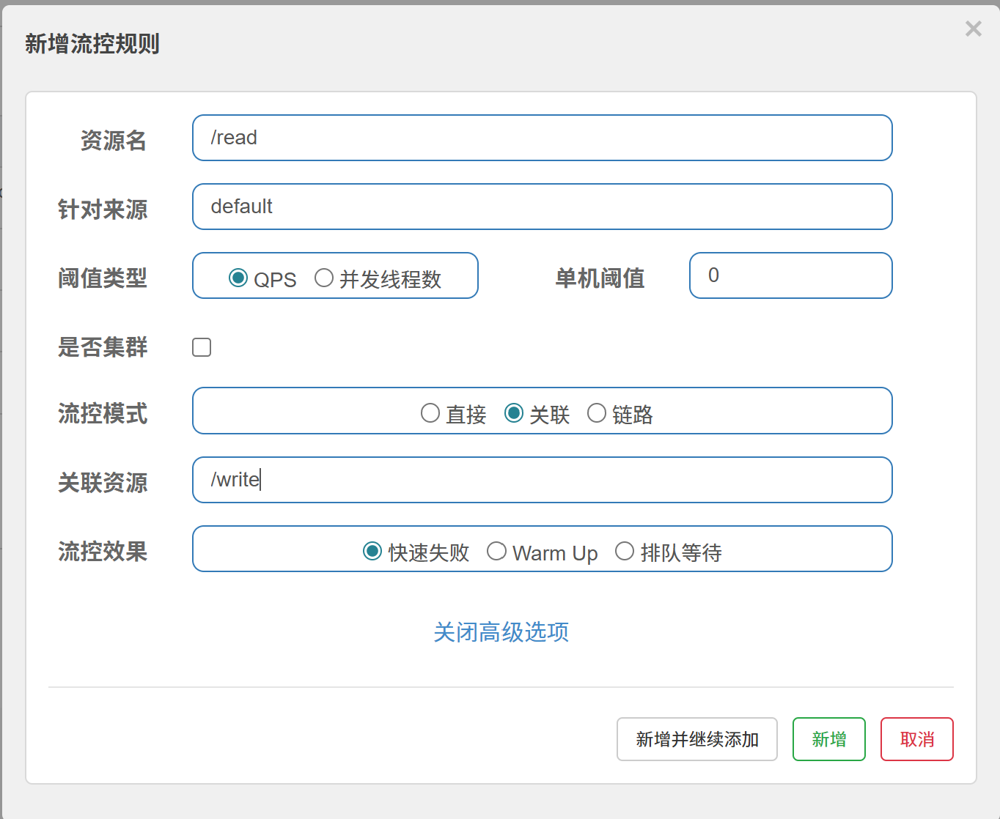
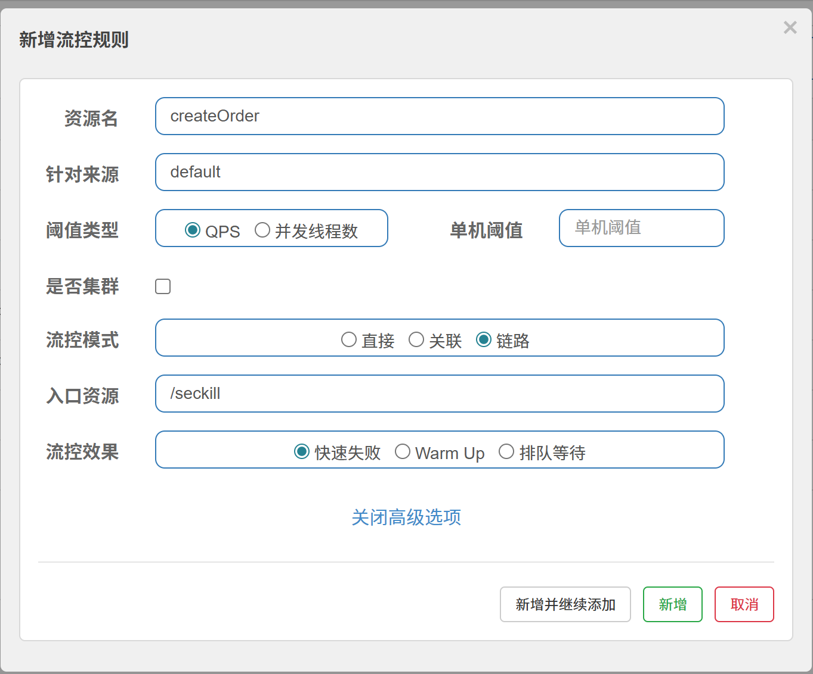
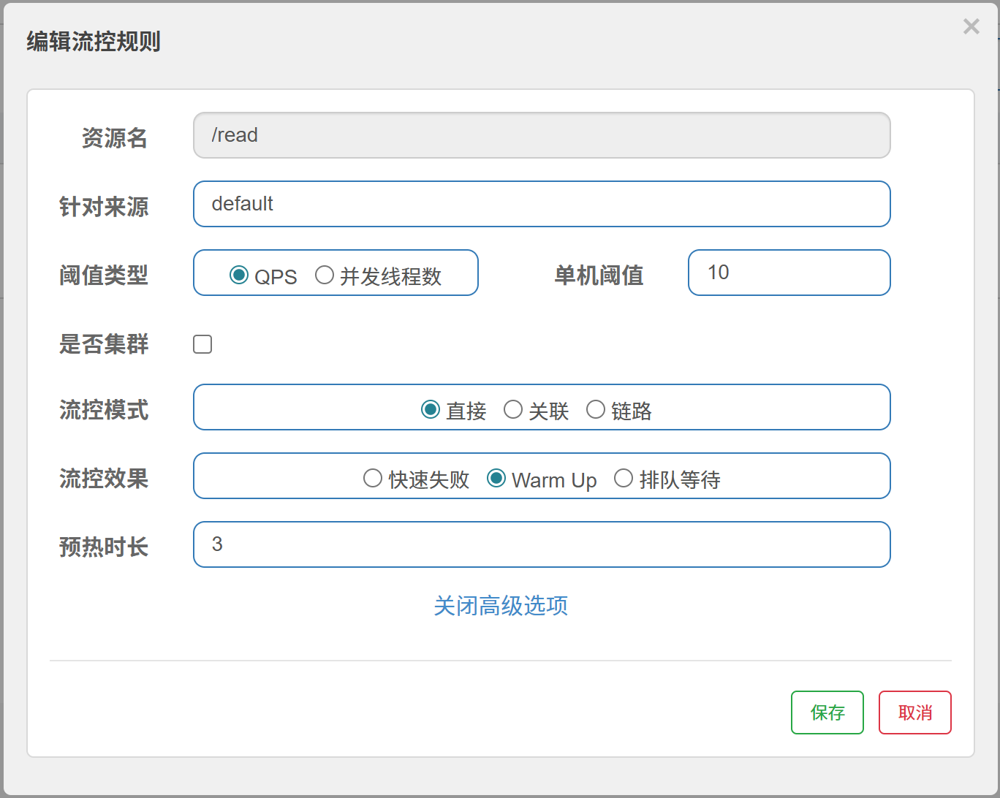
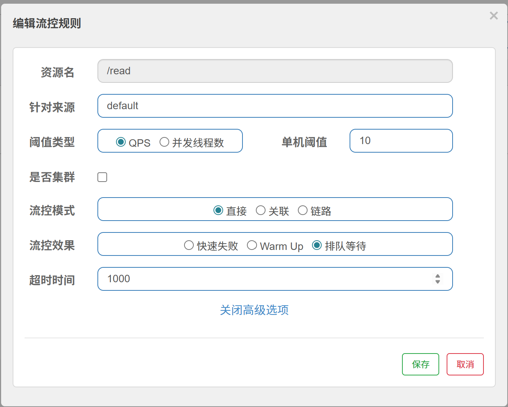
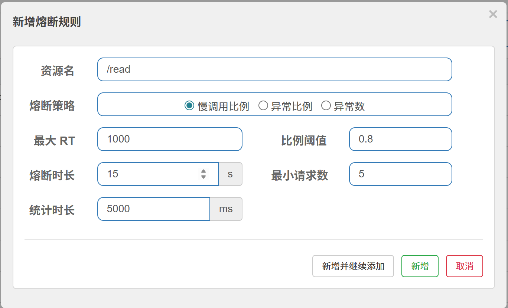
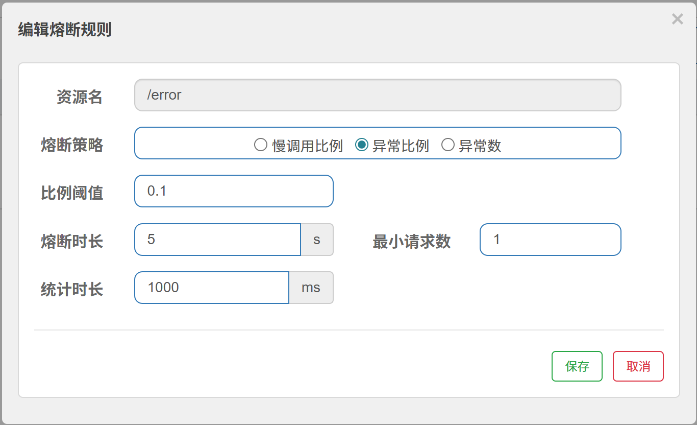
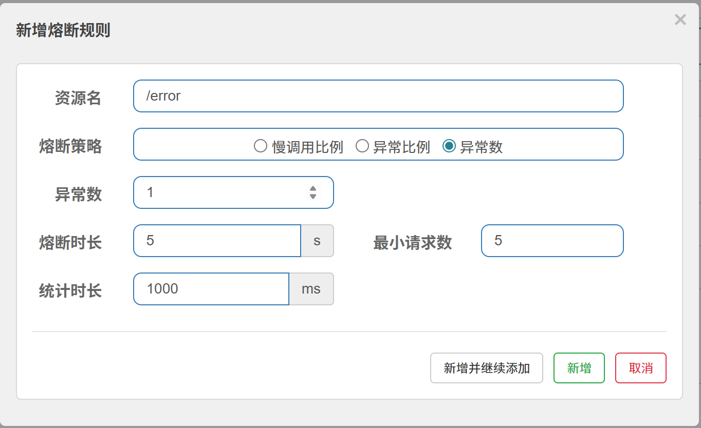
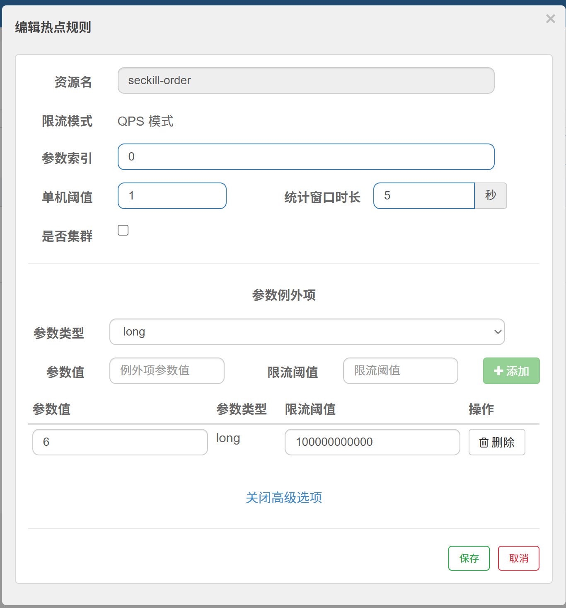
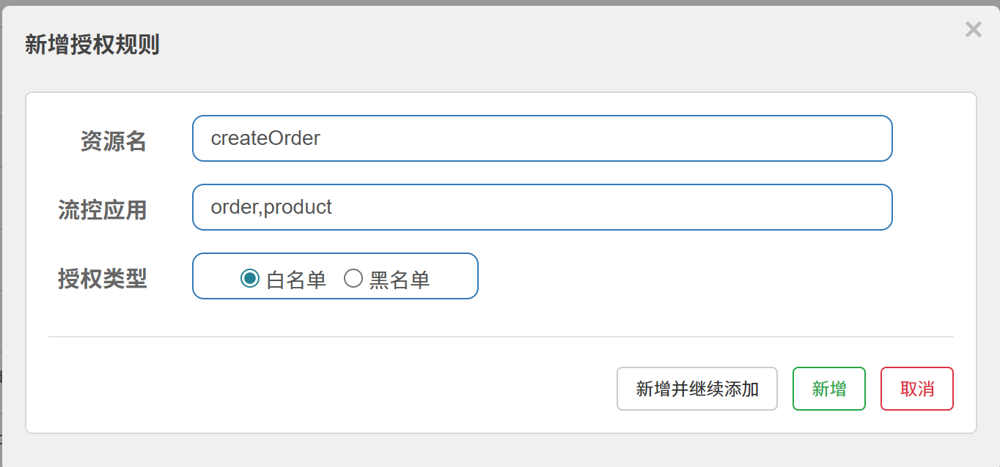

# Sentinel 流量控制 & 熔断降级（gulimall）

## 1. 概述

### 1.1 什么是 Sentinel

Sentinel 是阿里巴巴开源的流量治理组件，提供：

- **流量控制**（限流）
- **熔断降级**
- **系统负载保护**
- **热点参数限流**
- **授权规则**

本项目版本：

- Sentinel 客户端：**1.8.9**
- Spring Cloud Alibaba：**2025.0.0.0**
- Spring Boot：**3.5.16**
- Dashboard：`bladex/sentinel-dashboard:1.8.9`，地址 `http://<服务器IP>:8858`，默认账号密码 `sentinel / sentinel`

核心概念：

- **资源（Resource）**：要保护的目标，可以是方法、接口或网关路由
- **规则（Rule）**：对资源的流量控制策略

### 1.2 本项目接入范围

| 模块 | 用途 | 客户端端口 |
|---|---|---|
| `gulimall-gateway` | 网关入口限流（网关流控规则） | 8719 |
| `gulimall-seckill` | 抢购接口、商品查询、热点参数 | 8720 |
| `gulimall-order` | 仅用于 `SeckillFeignClient` 的 Feign fallback | 8721 |

> ⚠️ 同一台机器上多个 Sentinel 客户端不能都用默认 8719，必须分配不同端口。

## 2. 部署与接入

### 2.1 启动 Dashboard

`deploy/docker-compose.yaml` 已启用：

```yaml
sentinel-dashboard:
  image: bladex/sentinel-dashboard:1.8.9
  container_name: sentinel1.8.9
  restart: always
  ports:
    - "8858:8858"
```

```bash
cd /mydata/docker
docker compose up -d sentinel-dashboard
```

### 2.2 依赖

普通 Servlet 模块（本项目 seckill）：

```xml
<dependency>
    <groupId>com.alibaba.cloud</groupId>
    <artifactId>spring-cloud-starter-alibaba-sentinel</artifactId>
</dependency>
```

Spring Boot 3 / Jakarta 的 Web MVC 自定义 BlockExceptionHandler 还需要：

```xml
<dependency>
    <groupId>com.alibaba.csp</groupId>
    <artifactId>sentinel-spring-webmvc-v6x-adapter</artifactId>
    <version>1.8.9</version>
</dependency>
```

网关额外需要：

```xml
<dependency>
    <groupId>com.alibaba.cloud</groupId>
    <artifactId>spring-cloud-alibaba-sentinel-gateway</artifactId>
</dependency>
```

规则持久化到 Nacos：

```xml
<dependency>
    <groupId>com.alibaba.csp</groupId>
    <artifactId>sentinel-datasource-nacos</artifactId>
    <version>1.8.9</version>
</dependency>
```

### 2.3 客户端配置

seckill：`config/gulimall-seckill.yaml`

```yaml
spring:
  cloud:
    sentinel:
      transport:
        dashboard: ${SENTINEL_DASHBOARD}
        port: 8720
      eager: true
      datasource:
        flow:
          nacos:
            server-addr: ${NACOS_ADDR}
            data-id: gulimall-seckill-sentinel-flow.json
            group-id: SENTINEL_GROUP
            data-type: json
            rule-type: flow
            username: ${NACOS_USERNAME}
            password: ${NACOS_PASSWORD}
        degrade:
          nacos:
            data-id: gulimall-seckill-sentinel-degrade.json
            rule-type: degrade
            # server-addr / group-id / data-type / 账号同 flow
        param-flow:
          nacos:
            data-id: gulimall-seckill-sentinel-param-flow.json
            rule-type: param-flow
            # 同上
```

gateway：`config/gulimall-gateway.yaml`

```yaml
spring:
  cloud:
    sentinel:
      transport:
        dashboard: ${SENTINEL_DASHBOARD}
        port: 8719
      eager: true
      datasource:
        gw-flow:
          nacos:
            server-addr: ${NACOS_ADDR}
            data-id: gulimall-gateway-sentinel-gw-flow.json
            group-id: SENTINEL_GROUP
            data-type: json
            rule-type: gw-flow
            username: ${NACOS_USERNAME}
            password: ${NACOS_PASSWORD}
```

order：`config/gulimall-order.yaml`

```yaml
spring:
  cloud:
    sentinel:
      transport:
        dashboard: ${SENTINEL_DASHBOARD}
        port: 8721
      eager: true

feign:
  sentinel:
    enabled: true
```

## 3. 保护范围

Sentinel 支持 Web Servlet、Spring Cloud、Spring WebFlux、Reactor、Dubbo、gRPC 等；本项目实际使用：

- seckill 的 Spring MVC 接口（Web 资源）
- seckill 的 `@SentinelResource` 方法（资源层）
- Feign 调用（Feign 层 fallback）
- gateway 的路由（网关流控，gw-flow）

## 4. 流控规则

### 4.1 三种流控模式

| 模式 | 说明 | 本项目示例 |
|---|---|---|
| **直接** | 直接限制当前资源 | `seckillOrderSubmit` 50 QPS |
| **关联** | 关联资源达到阈值时限流自己 | 可把抢购与查询做关联保护 |
| **链路** | 按入口链路分别限流 | 可限制不同入口调用同一资源 |





> 链路模式需要设置 `spring.cloud.sentinel.web-context-unify: false`，本项目当前没有开启链路模式，所以没有改这个配置。

### 4.2 三种流控效果

| 效果 | 说明 | 特点 |
|---|---|---|
| **快速失败** | 超阈值直接拒绝 | 默认，最常用 |
| **Warm Up** | 冷启动预热，慢慢提升到阈值 | 防止瞬间流量打垮服务 |
| **排队等待** | 超阈值排队匀速处理 | 削峰，但增加响应时间 |





### 4.3 本项目流控规则

`deploy/sentinel/gulimall-seckill-sentinel-flow.json`：

| 资源 | 类型 | 阈值 | 说明 |
|---|---|---|---|
| `seckillOrderSubmit` | QPS | 50 | 抢购入口，`SeckillOrderController.submit` |
| `seckillSkuInfo` | QPS | 200 | 商品详情秒杀信息 |
| `/seckill/sessions` | QPS | 200 | 场次查询 Web 资源 |
| `/seckill/skus` | QPS | 200 | 商品列表 Web 资源 |

## 5. 熔断规则

### 5.1 三种熔断策略

| 策略 | 说明 | 关键参数 |
|---|---|---|
| **慢调用比例** | 慢调用比例超阈值就熔断 | 最大 RT / 比例阈值 / 熔断时长 / 最小请求数 / 统计时长 |
| **异常比例** | 异常请求比例超阈值就熔断 | 同上 |
| **异常数** | 异常请求数量超阈值就熔断 | 异常数 / 熔断时长 / 最小请求数 |







熔断流程：

```text
统计窗口内请求 → 判断熔断条件 → 开启熔断（熔断期间请求直接失败）→ 熔断时长后进入半开恢复
```

### 5.2 本项目熔断规则

`deploy/sentinel/gulimall-seckill-sentinel-degrade.json`：

- 资源：`seckillOrderSubmit`
- 策略：慢调用比例
- 最大 RT：800ms
- 慢调用比例阈值：0.5
- 统计窗口：10 秒
- 最小请求数：10
- 熔断时长：10 秒

## 6. 热点参数规则

热点参数限流针对方法的某个参数，例如按 `skuId` 限制每个商品详情被访问的频率。



本项目：

- 资源：`seckillSkuInfo`
- 参数下标：`1`，即 `skuInfo(Long sessionId, Long skuId, HttpSession session)` 的 `skuId`
- 阈值：同一 `skuId` 每秒 20 次
- 规则文件：`deploy/sentinel/gulimall-seckill-sentinel-param-flow.json`

## 7. 授权规则

授权规则按调用来源（origin）决定放行/拒绝；本项目当前没有配置调用来源解析器，所以没有启用授权规则。



如果以后要按来源限流，需要实现 `RequestOriginParser`，把请求头/参数解析成 origin，再配置 authority rule。

## 8. 三层异常处理

| 层级 | 方式 | 本项目实现 |
|---|---|---|
| **Web 层** | `BlockExceptionHandler` | `SentinelWebBlockHandler` |
| **资源层** | `@SentinelResource(blockHandler/fallback)` | `SeckillOrderController.submit`、`SeckillController.skuInfo` |
| **Feign 层** | `@FeignClient(fallback)` | `SeckillFeignClientFallback`、`ProductFeignClientFallback` |

### 8.1 blockHandler 与 fallback 的区别

| 特性 | blockHandler | fallback |
|---|---|---|
| 兜底异常 | 仅 `BlockException` | 所有 `Throwable` |
| 触发场景 | 限流、熔断、热点、授权规则 | 业务异常、运行时异常等 |
| 使用场景 | 流量控制兜底 | 通用异常兜底 |

### 8.2 Web 层：SentinelWebBlockHandler

Spring Boot 3 使用 `webmvc_v6x` 适配器，注意 `handle` 方法多了 `resourceName` 参数：

```java
@Component
public class SentinelWebBlockHandler implements BlockExceptionHandler {

    @Autowired
    private ObjectMapper objectMapper;

    @Override
    public void handle(HttpServletRequest request, HttpServletResponse response,
                       String resourceName, BlockException e) throws Exception {
        response.setStatus(HttpServletResponse.SC_OK);
        response.setContentType("application/json;charset=UTF-8");
        R result = R.error(BizCodeEnum.SECKILL_FLOW_LIMIT.getCode(),
                BizCodeEnum.SECKILL_FLOW_LIMIT.getMsg());
        response.getWriter().write(objectMapper.writeValueAsString(result));
    }
}
```

返回统一结构：

```json
{"code":14013,"msg":"当前抢购人数过多，请稍后再试"}
```

### 8.3 资源层

抢购入口：

```java
@SentinelResource(value = "seckillOrderSubmit", blockHandler = "submitBlocked")
@PostMapping("/submit")
public R submit(@RequestBody SeckillOrderSubmitVo vo) { ... }
```

商品信息接口同时使用 `blockHandler` 和 `fallback`：

```java
@SentinelResource(value = "seckillSkuInfo",
        blockHandler = "skuInfoBlocked", fallback = "skuInfoFallback")
@GetMapping("/sku/info")
public R skuInfo(@RequestParam Long sessionId,
                 @RequestParam Long skuId,
                 HttpSession session) { ... }

public R skuInfoBlocked(Long sessionId, Long skuId,
                        HttpSession session, BlockException ex) {
    return R.error(14013, "当前访问人数过多，请稍后再试");
}

public R skuInfoFallback(Long sessionId, Long skuId,
                         HttpSession session, Throwable t) {
    return R.error(14009, "秒杀商品信息查询失败，请稍后再试");
}
```

### 8.4 Feign 层

order 调 seckill：

```java
@FeignClient(value = "gulimall-seckill", fallback = SeckillFeignClientFallback.class)
public interface SeckillFeignClient {
    R releaseSeckillOrder(String orderSn, String reason);
    R markSeckillOrderPaid(String orderSn);
}
```

fallback 只记日志并返回错误，订单取消/支付主流程不被拖垮：

```java
@Slf4j
@Component
public class SeckillFeignClientFallback implements SeckillFeignClient {
    @Override
    public R releaseSeckillOrder(String orderSn, String reason) {
        log.error("通知秒杀释放失败，等待对账：{}", orderSn);
        return R.error(14012, "秒杀服务繁忙，库存释放稍后对账处理");
    }
    // markSeckillOrderPaid 同理
}
```

seckill 调 product 也有 fallback，product 不可用时返回空 `skuInfo`，页面和上架任务降级。

> ⚠️ `OrderFeignClient` 的建单、订单状态查询没有加静默 fallback：如果 fallback 返回“订单不存在”，监听器会误判并回补库存。关键写链路宁可失败重试，也不要返回假数据。

## 9. 网关 Sentinel 配置

### 9.1 依赖与配置

gateway 依赖：

```xml
<dependency>
    <groupId>com.alibaba.cloud</groupId>
    <artifactId>spring-cloud-starter-alibaba-sentinel</artifactId>
</dependency>
<dependency>
    <groupId>com.alibaba.cloud</groupId>
    <artifactId>spring-cloud-alibaba-sentinel-gateway</artifactId>
</dependency>
```

`config/gulimall-gateway.yaml` 已配置 Dashboard、客户端端口 8719 和 Nacos `gw-flow` 数据源。

### 9.2 自定义网关 BlockRequestHandler

gateway 是 WebFlux，不能用 Servlet 的 `BlockExceptionHandler`，改用 `GatewayCallbackManager`：

```java
@Configuration
public class SentinelGatewayConfig {

    @PostConstruct
    public void initBlockHandler() {
        GatewayCallbackManager.setBlockHandler((exchange, throwable) ->
                ServerResponse.status(HttpStatus.TOO_MANY_REQUESTS)
                        .contentType(MediaType.APPLICATION_JSON)
                        .body(BodyInserters.fromValue(
                                R.error(14013, "当前访问人数过多，请稍后再试"))));
    }
}
```

### 9.3 网关流控规则

`deploy/sentinel/gulimall-gateway-sentinel-gw-flow.json`：

```json
[
  {
    "resource": "seckill-route",
    "resourceMode": 0,
    "grade": 1,
    "count": 100,
    "intervalSec": 1,
    "controlBehavior": 0,
    "burst": 0,
    "maxQueueingTimeoutMs": 500,
    "paramItem": null
  }
]
```

- `resourceMode=0` 表示按路由 ID；`seckill-route` 必须和 gateway 路由配置里的 `id` 一致。
- 该规则限制秒杀路由 100 QPS。

## 10. 规则持久化

### 10.1 Dashboard 默认不持久

Sentinel Dashboard 默认把规则存在**自己的内存**里：

- Dashboard 重启 → Dashboard 里的规则丢失
- 服务重启 → 从 Dashboard 推送的规则丢失
- 只有客户端从 Nacos 数据源加载的规则，服务每次启动都会重新拉取

### 10.2 本项目方案：Nacos 数据源

gateway 和 seckill 已配置 `sentinel-datasource-nacos`，规则文件在 `deploy/sentinel/`，已经发布到 Nacos：

| Data ID | 规则类型 |
|---|---|
| `gulimall-seckill-sentinel-flow.json` | 流控 |
| `gulimall-seckill-sentinel-degrade.json` | 熔断 |
| `gulimall-seckill-sentinel-param-flow.json` | 热点 |
| `gulimall-gateway-sentinel-gw-flow.json` | 网关流控 |

Group 统一是 `SENTINEL_GROUP`，格式 JSON。

所以：

- 服务重启不会丢规则；
- Dashboard 重启也不会丢规则（规则在 Nacos）；
- **在 Dashboard 里改规则不会写回 Nacos**，正式修改请改 Nacos 配置。

### 10.3 如果要在 Dashboard 里改

当前 `bladex/sentinel-dashboard:1.8.9` 没有 Nacos 写回能力，Dashboard 只适合观察和临时验证。要“Dashboard 改完永久保存”，需要改造 Dashboard，让它把规则写入 Nacos；本项目不包含改造后的 Dashboard。

## 11. Dashboard 参数速查

### 11.1 流控规则 (FlowRule)

| 参数 | 说明 |
|---|---|
| resource | 资源名 |
| count | QPS 阈值 |
| grade | 0=线程数, 1=QPS |
| limitApp | 调用来源（default=不区分） |
| strategy | 0=直接, 1=关联, 2=链路 |
| controlBehavior | 0=快速失败, 1=Warm Up, 2=排队等待 |
| warmUpPeriodSec | Warm Up 预热时间（秒） |
| maxQueueingTimeMs | 排队等待超时（毫秒） |
| clusterMode | 是否集群流控 |

### 11.2 熔断规则 (DegradeRule)

| 参数 | 说明 |
|---|---|
| resource | 资源名 |
| count | 阈值（RT ms / 异常比例 / 异常数） |
| grade | 0=慢调用比例, 1=异常比例, 2=异常数 |
| timeWindow | 熔断时长（秒） |
| minRequestAmount | 最小请求数 |
| statIntervalMs | 统计时长（毫秒） |
| slowRatioThreshold | 慢调用比例阈值 |

### 11.3 热点规则 (ParamFlowRule)

| 参数 | 说明 |
|---|---|
| resource | 资源名 |
| paramIdx | 参数下标（从 0 开始） |
| count | 单机阈值 |
| grade | 1=QPS |
| durationInSec | 统计窗口（秒） |
| controlBehavior | 0=快速失败 |
| paramFlowItemList | 例外项列表 |

### 11.4 网关流控规则 (GatewayFlowRule)

| 参数 | 说明 |
|---|---|
| resource | 路由 ID 或 API 分组名 |
| resourceMode | 0=路由 ID, 1=API 分组 |
| grade | 1=QPS |
| count | 阈值 |
| intervalSec | 统计窗口（秒） |
| controlBehavior | 0=快速失败 |
| burst | 额外突发量 |
| maxQueueingTimeoutMs | 排队超时（毫秒） |

## 12. 验证与排错

### 12.1 验证

1. 启动 `sentinel-dashboard`、Jaeger、各业务服务；
2. 访问 `/seckill/sessions` 或 `/seckill/sku/info`，Dashboard 的机器列表/簇点链路出现 `gulimall-seckill`；
3. 超过规则阈值时，接口返回：

```json
{"code":14013,"msg":"当前抢购人数过多，请稍后再试"}
```

4. 重启 seckill 后规则仍在，说明 Nacos 数据源生效；
5. 网关超过 100 QPS 时返回 429 + 统一 JSON。

### 12.2 常见问题

- **Dashboard 看不到服务**：先访问一次接口，客户端才会注册/上报。
- **客户端端口冲突**：同一台机器上 gateway=8719、seckill=8720、order=8721；新增模块必须改端口。
- **规则重启后丢失**：检查是否仍从 Dashboard 内存推送；本项目要确认 Nacos 数据源是否连接成功、Data ID/Group 是否一致。
- **Dashboard 修改规则不生效**：Nacos 数据源和 Dashboard 同时存在时，以最后加载的规则为准；正式规则请统一在 Nacos 修改。
- **Spring Boot 3 自定义 BlockExceptionHandler 编译不过**：使用 `com.alibaba.csp.sentinel.adapter.spring.webmvc_v6x.callback.BlockExceptionHandler`，并引 `sentinel-spring-webmvc-v6x-adapter`。
- **网关限流不生效**：确认 `gw-flow` 规则的 `resource` 与路由 `id` 一致，且已引入 `spring-cloud-alibaba-sentinel-gateway`。
- **Feign fallback 不生效**：确认调用方有 Sentinel starter，且配置了 `feign.sentinel.enabled: true`。
