# Gulimall 集群部署篇（CentOS Stream 10 · 双节点）

部署环境：两台 **CentOS Stream 10（Coughlan）** 虚拟机，一台控制平面、一台工作节点，容器运行时使用 containerd 2.x。

## 执行位置约定

本文每条命令前都标注了执行位置，先认清这两个终端：

| 标记 | 含义 |
| --- | --- |
| **【master】** | 只在 `gulimall-master`（<your-k8s-master-ip>）执行 |
| **【node】** | 只在 `gulimall-node`（<your-k8s-node-ip>）执行 |
| **【两个节点】** | master 和 node 各执行一次，内容完全相同 |

三条通用规则：

1. **带 `kubectl` 的命令一律在 master 上执行**，node 上不需要 kubectl
2. **带 `kubeadm init` 的只在 master**，**带 `kubeadm join` 的只在 node**
3. **装软件、改系统配置的步骤两个节点都要做**，只有主机名不同

## 版本基线

下文所有命令都按这张表编写，和旧版教程（CentOS 7 + k8s 1.17 + Docker 18）完全不同，不要混用。

| 层面 | 版本 | 说明 |
| --- | --- | --- |
| 操作系统 | CentOS Stream 10 | 只有 cgroup v2，没有 cgroup v1 |
| 包管理 | dnf 4.20 | 不是 dnf5，`config-manager` 语法要注意 |
| Kubernetes | v1.34.x | kubeadm / kubelet / kubectl 三件套 |
| 容器运行时 | containerd 2.x | 随 Docker CE 的 `containerd.io` 包安装 |
| CNI 网络插件 | Flannel | 轻量，VXLAN 打通跨节点 Pod 网络 |
| 控制台 | Kuboard v3 | 替代 KubeSphere，单容器部署 |
| MySQL | 8.4.11 | 与 `deploy/docker-compose.yaml` 一致 |
| Redis | 7.2.12 | 同上 |
| Elasticsearch | 8.18.8 | 同上 |
| RabbitMQ | 3.13.7-management | 同上 |
| Nacos | 3.0.3 | 同上 |

> **为什么不用 Docker 当 CRI**：Kubernetes 1.24 起移除了 dockershim，`kubelet` 不能再直接对接 Docker 守护进程。Docker 自带的 containerd 才是真正干活的运行时，本文让 kubelet 直连 containerd，Docker 只留作本地构建镜像用。

---

## 一、k8s 集群部署

### 1、k8s 快速入门

#### 1）简介

Kubernetes 简称 k8s，是用于自动部署、扩展和管理容器化应用程序的开源系统。

- 中文官网：<https://kubernetes.io/zh/>
- 官方文档：<https://kubernetes.io/zh-cn/docs/home/>
- 部署方式演进：<https://kubernetes.io/zh-cn/docs/concepts/overview/>

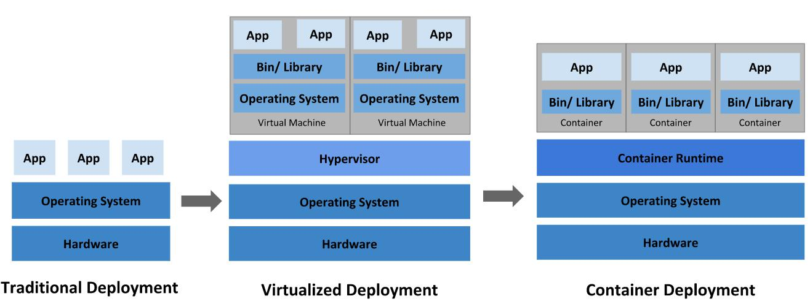

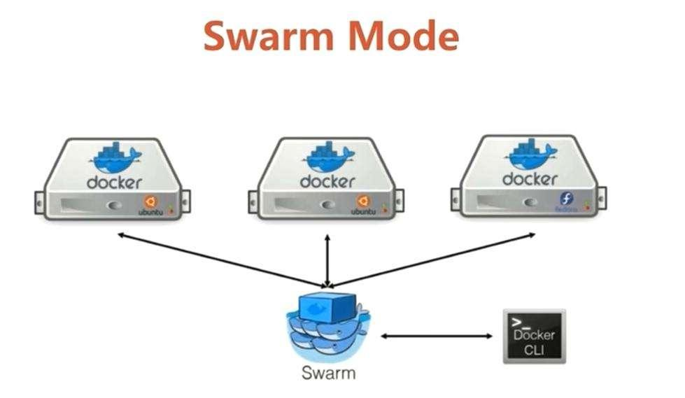

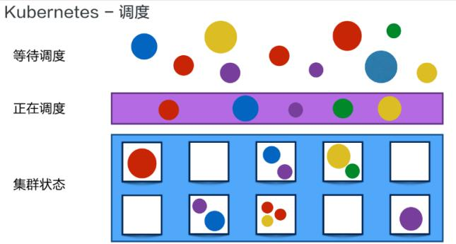

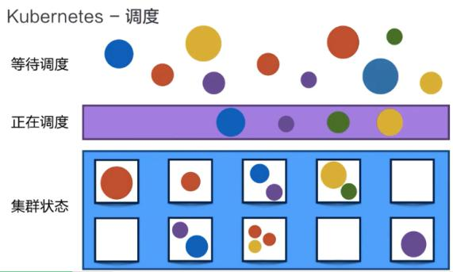

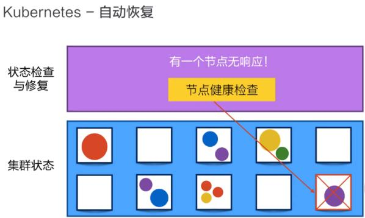

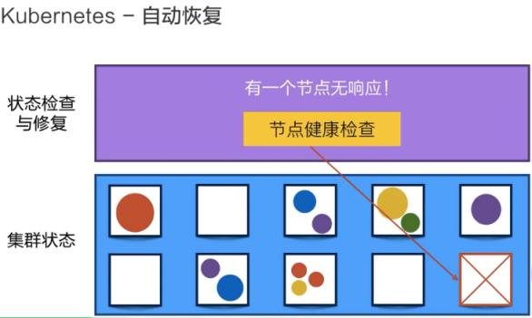

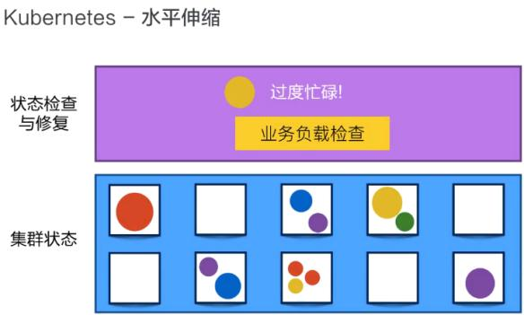

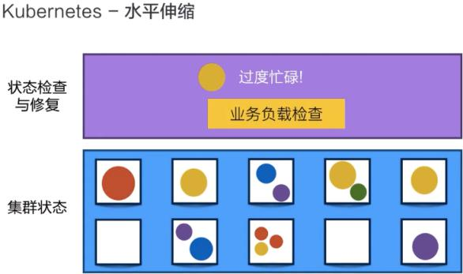

#### 2）架构

##### 1、整体主从方式

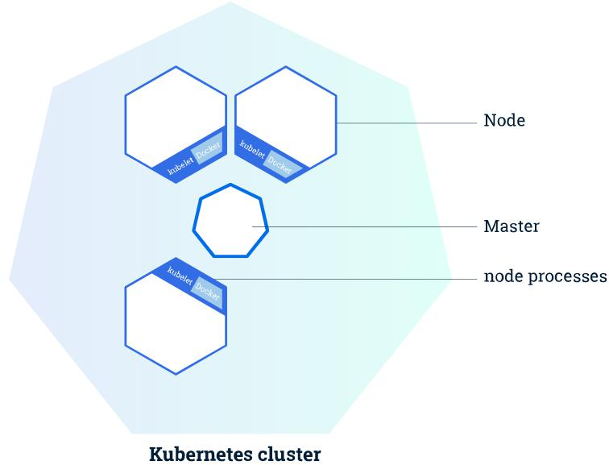

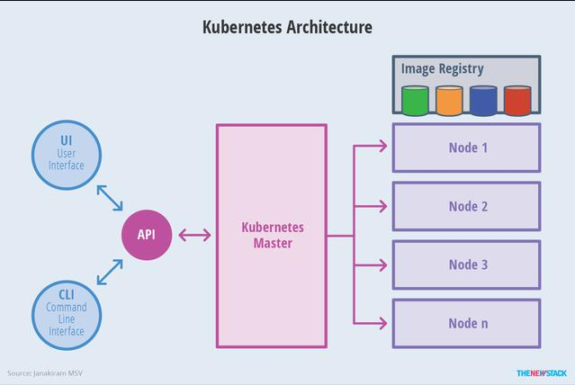

##### 2、Master 节点架构

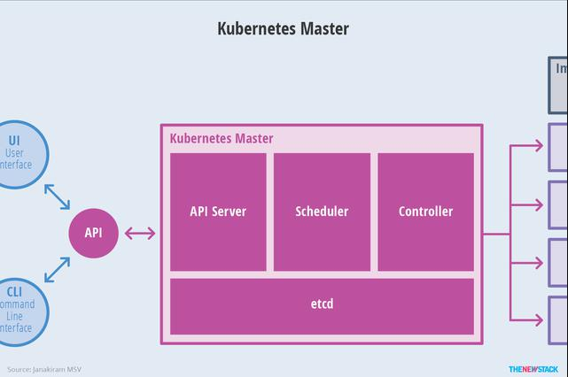

- **kube-apiserver**
  - 对外暴露 K8S 的 API 接口，是外界进行资源操作的唯一入口
  - 提供认证、授权、访问控制、API 注册和发现等机制
- **etcd**
  - 兼具一致性和高可用性的键值数据库，保存 Kubernetes 全部集群数据
  - 生产环境必须有备份计划
- **kube-scheduler**
  - 监视新创建、未指定运行节点的 Pod，并为其选择节点
- **kube-controller-manager**
  - 在主节点上运行控制器：节点控制器、副本控制器、端点控制器、ServiceAccount 与 Token 控制器

##### 3、Node 节点架构

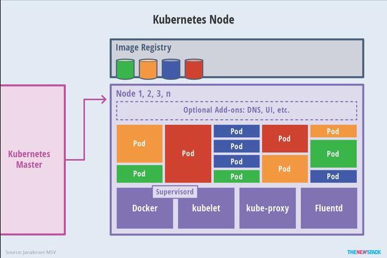

- **kubelet**：每个节点上运行的代理，保证容器运行在 Pod 中，负责容器生命周期、Volume（CSI）和网络（CNI）管理
- **kube-proxy**：为 Service 提供集群内部的服务发现和负载均衡
- **容器运行环境**：负责运行容器的软件，本文使用 containerd（也支持 CRI-O）
- **fluentd / 日志采集**：集群层面的日志收集

#### 3）核心概念

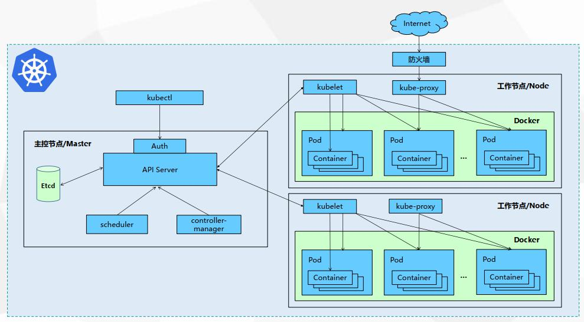

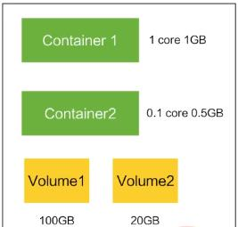

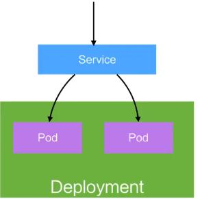

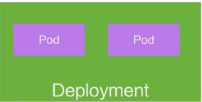

- **Container**：容器，可以是一个 Docker 容器
- **Pod**：k8s 中最小部署单元，一个 Pod 内的容器共享同一网络命名空间
- **Volume**：声明在 Pod 中可访问的文件目录，支持本地、分布式、云存储等多种后端
- **Controllers**：更高层次对象，负责部署和管理 Pod
  - ReplicaSet：确保预期的 Pod 副本数量
  - Deployment：无状态应用部署
  - StatefulSet：有状态应用部署
  - DaemonSet：确保所有 Node 都运行一个指定 Pod
  - Job：一次性任务；CronJob：定时任务
- **Service**：定义一组 Pod 的访问策略，提供稳定访问地址，支持 ClusterIP、NodePort、LoadBalancer
- **Label / Selector**：标签与选择器，用于资源查询和筛选
- **Namespace**：命名空间，集群内部的逻辑隔离（鉴权、资源）

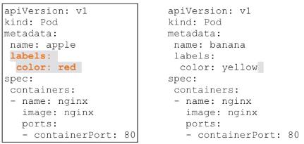

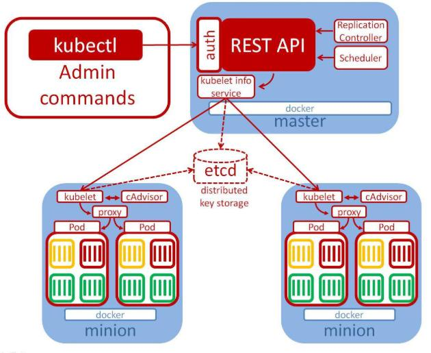

#### 4）一次部署请求的完整流程

1. `kubectl` 提交创建 Deployment 的请求，经 API Server 写入 etcd
2. Controller Manager 监听到事件，发现还没有对应的 Pod，按模板生成 Pod 对象写回 etcd
3. Scheduler 监听到新 Pod，为其选定节点，结果写回 etcd
4. 目标节点上的 kubelet 监听到"自己的"Pod，调用 containerd 拉起容器
5. Service 创建后，Controller Manager 生成 Endpoints；kube-proxy 据此建立负载均衡规则

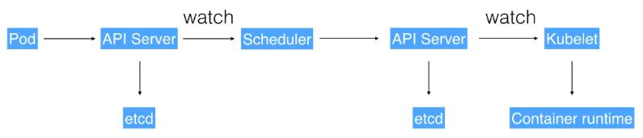

### 2、集群拓扑

| 主机名 | IP | 角色 | 规格 |
| --- | --- | --- | --- |
| gulimall-master | <your-k8s-master-ip> | 控制平面 + etcd | 8G 内存 / 20G 磁盘 |
| gulimall-node | <your-k8s-node-ip> | 工作节点（承载业务 Pod） | 8G 内存 / 20G 磁盘 |

- **master**：运行 kube-apiserver、etcd、kube-scheduler、kube-controller-manager。默认带 `control-plane:NoSchedule` 污点，不跑业务 Pod。
- **node**：运行 kubelet、kube-proxy、容器运行时，所有业务 Pod 调度到这里。

> **主机名规则**：只能用小写字母、数字和短横线。`gulimall_master` 里的下划线不合法，kubelet 注册节点时会被 DNS 标签校验拒绝，必须写成 `gulimall-master`。

### 3、磁盘空间规划（每台 20G）

**【两个节点】** 下面的检查和清理命令在每台机器上各跑一次。

| 用途 | master | node |
| --- | --- | --- |
| 系统 + 基础软件 | 6 ~ 8 G | 6 ~ 8 G |
| containerd + k8s 系统镜像 | 2 ~ 3 G | 2 ~ 3 G |
| 业务镜像 | — | 4 ~ 6 G |
| 数据目录（MySQL / Redis / ES） | 视部署情况 | 视部署情况 |
| journald 日志 | 1 G | 1 G |

master 只跑控制平面，20G 很宽裕；node 上的镜像和日志是主要增长点，需要定期清理：

```bash
# 1. 看各目录占用排行
sudo du -h --max-depth=1 /var/lib/containerd /var/lib/docker /mydata 2>/dev/null | sort -rh | head

# 2. 清理 Docker 无用镜像和构建缓存
docker system df
docker system prune -a

# 3. 清理 containerd 中没被任何 Pod 使用的镜像
sudo ctr -n k8s.io images list
sudo ctr -n k8s.io images prune

# 4. 限制 journald 日志上限（系统日志很容易涨到几个 G）
sudo mkdir -p /etc/systemd/journald.conf.d
sudo tee /etc/systemd/journald.conf.d/size.conf <<'EOF'
[Journal]
SystemMaxUse=500M
SystemMaxFileSize=100M
EOF
sudo systemctl restart systemd-journald

# 5. 看整体剩余
df -h
```

### 4、环境准备（两个节点都执行）

> 以下步骤在 `gulimall-master` 和 `gulimall-node` 上都要做一遍，只有主机名不同。

#### 1）设置主机名与 hosts

**master 节点执行：**

```bash
# 1. 确认发行版和内核
cat /etc/os-release | head -3
uname -r

# 2. 设置主机名（只能用小写字母、数字、短横线，不能用下划线）
hostnamectl set-hostname gulimall-master

# 3. 确认
hostname
```

**node 节点执行：**

```bash
# 1. 确认发行版和内核
cat /etc/os-release | head -3
uname -r

# 2. 设置主机名
hostnamectl set-hostname gulimall-node

# 3. 确认
hostname
```

**两个节点写入完全相同的 `/etc/hosts`：**

```bash
vi /etc/hosts
```

```text
<your-k8s-master-ip> gulimall-master
<your-k8s-node-ip> gulimall-node
```

```bash
# 验证解析，两个节点都要能解析出对方的 IP
ping -c 1 gulimall-master
ping -c 1 gulimall-node
```

#### 2）关闭 swap（必须）

**【两个节点】** kubelet 1.34 在 swap 开启时会直接拒绝启动。先确认当前状态：

```bash
# 1. 看 swap 使用量
free -h

# 2. 看有哪些 swap 设备，空输出表示没有
swapon --show

# 3. 看 fstab 里有没有 swap 开机挂载
grep -i swap /etc/fstab
```

如果 `free -h` 的 Swap 全是 0、`swapon --show` 没有输出，说明系统本来就没开 swap，**直接跳到下一节**。

如果有 swap，按设备类型处理：

| 设备 | 处理 |
| --- | --- |
| `/dev/zram0` | 先 `sudo systemctl disable --now systemd-zram-setup@zram0.service` |
| 普通分区或 swap 文件 | 不需要停服务，直接 `swapoff` |

```bash
# 1. 关闭所有 swap
sudo swapoff -a

# 2. 注释 /etc/fstab 里所有 swap 行，防止重启后自动挂载
sudo sed -ri 's/.*swap.*/#&/' /etc/fstab

# 3. 验证，Swap 一行必须全是 0
free -h
```

> 部分 CentOS Stream 10 安装没有启用 zram，执行 `systemctl disable --now systemd-zram-setup@zram0.service` 会报 `Unit ... does not exist`。这不是错误，说明系统没开 zram，按上面的检测结果跳过即可。

#### 3）SELinux 设为 permissive

**【两个节点】**

```bash
# 1. 临时生效
setenforce 0

# 2. 永久生效
sed -i 's/^SELINUX=enforcing/SELINUX=permissive/' /etc/selinux/config

# 3. 确认
getenforce
```

> 生产环境应保持 enforcing 并加载正确的策略，实验环境为了省事用 permissive。

#### 4）关闭防火墙

**【两个节点】**

```bash
systemctl disable --now firewalld
systemctl status firewalld
```

> 如果要保留 firewalld，至少放行 6443（apiserver）、10250（kubelet）、8472/UDP（Flannel VXLAN）以及 Pod 网段 10.244.0.0/16、Service 网段 10.96.0.0/16。

#### 5）时间同步

**【两个节点】**

```bash
# EL10 自带 chronyd，确认它在跑
systemctl enable --now chronyd
chronyc sources -v
```

#### 6）内核模块与 sysctl

**【两个节点】**

```bash
# 1. 开机自动加载模块
cat > /etc/modules-load.d/k8s.conf <<'EOF'
overlay
br_netfilter
EOF

# 2. 立即加载
modprobe overlay
modprobe br_netfilter

# 3. 确认已加载
lsmod | grep -E 'overlay|br_netfilter'

# 4. 内核参数
cat > /etc/sysctl.d/99-kubernetes.conf <<'EOF'
net.bridge.bridge-nf-call-iptables  = 1
net.bridge.bridge-nf-call-ip6tables = 1
net.ipv4.ip_forward                 = 1
EOF

# 5. 生效
sysctl --system

# 6. 验证
sysctl net.ipv4.ip_forward
```

#### 7）确认 cgroup v2

**【两个节点】** EL10 只有 cgroup v2，kubelet 也要求 v2，正常情况不用改，确认一下即可：

```bash
stat -fc %T /sys/fs/cgroup/
```

输出必须是 `cgroup2fs`。如果是 `tmpfs`，说明还在 v1，需要在内核启动参数里加 `systemd.unified_cgroup_hierarchy=1`。

### 5、安装 Docker CE（两个节点都执行）

kubelet 使用 containerd 作为容器运行时，而 containerd 由 Docker CE 的 `containerd.io` 包提供，所以先装 Docker。以下命令在 CentOS Stream 10 上验证通过。

#### 1）确认系统版本

```bash
# 1. 确认发行版
cat /etc/os-release | head -3

# 2. 确认 releasever 变量（应为 10）
rpm -q --qf '%{VERSION}\n' centos-stream-release
```

#### 2）配置 Docker CE 仓库

EL10 的包在 `linux/rhel/` 路径下（`linux/centos/` 已不提供新版），而且 dnf 4.x 没有 `config-manager addrepo` 子命令，直接手写 repo 文件最稳：

```bash
sudo tee /etc/yum.repos.d/docker-ce.repo <<'EOF'
[docker-ce-stable]
name=Docker CE Stable - $basearch
baseurl=https://download.docker.com/linux/rhel/$releasever/$basearch/stable
enabled=1
gpgcheck=1
gpgkey=https://download.docker.com/linux/rhel/gpg
proxy=http://<your-vmware-nat-ip>:7897
EOF

# 刷新元数据并确认仓库可见
sudo dnf makecache
dnf repolist | grep -i docker
```

> `proxy=` 这一行是让 dnf 下载软件包走代理。dnf 4.x **不读取** `/etc/dnf/dnf.conf.d/`，所以只能写在 repo 段里。你的网络不需要代理时删掉这一行。

#### 3）安装 Docker CE

```bash
sudo dnf install -y docker-ce docker-ce-cli containerd.io \
  docker-buildx-plugin docker-compose-plugin
```

#### 4）启动 Docker

```bash
sudo systemctl enable --now docker
sudo docker version
```

`docker version` 的 `Server` 段有输出，说明守护进程正常。

> Docker 后续只用于本地构建镜像；k8s 的 Pod 由 containerd 直接运行，不经过 Docker。

### 6、配置 containerd（两个节点都执行）

Docker CE 已经把 `containerd.io` 装好了，但它默认的 CRI 配置不能直接给 kubelet 用，必须改两处：**cgroup 驱动**和 **pause 镜像**。

#### 1）确认 containerd 在运行

```bash
systemctl enable --now containerd
systemctl status containerd --no-pager
containerd --version
```

#### 2）生成完整配置

```bash
# 1. 备份现有配置（如果存在）
ls -l /etc/containerd/config.toml

# 2. 生成默认配置并覆盖
containerd config default | sudo tee /etc/containerd/config.toml > /dev/null

# 3. 确认版本号（containerd 2.x 是 version = 3）
head -5 /etc/containerd/config.toml
```

#### 3）把 cgroup 驱动改成 systemd

kubelet 默认用 systemd，containerd 默认用 cgroupfs，两者不一致会导致节点一直 NotReady。

```bash
# 1. 改之前先看有几处
grep -n "SystemdCgroup" /etc/containerd/config.toml

# 2. 全部改成 true
sed -i 's/SystemdCgroup = false/SystemdCgroup = true/g' /etc/containerd/config.toml

# 3. 确认
grep -n "SystemdCgroup" /etc/containerd/config.toml
```

如果 `grep` 一条都没输出（containerd 2.4 的配置模板可能不同），手动在 `[plugins.'io.containerd.cri.v1.runtime'.containerd.runtimes.runc.options]` 段下加一行：

```toml
SystemdCgroup = true
```

#### 4）确认 pause 镜像地址

```bash
grep -n "sandbox_image" /etc/containerd/config.toml
```

默认是 `registry.k8s.io/pause:3.10`。**如果下面第 5 节配好了 containerd 代理，这行不用改**；如果拉不下来，再换成国内镜像：

```toml
sandbox_image = "registry.aliyuncs.com/google_containers/pause:3.10"
```

#### 5）重启并验证

```bash
systemctl restart containerd
systemctl status containerd --no-pager | head -5
```

### 7、给 containerd 配代理（两个节点都执行）

**Docker 的代理配置对 containerd 完全无效。** 你之前配的 `/etc/systemd/system/docker.service.d/http-proxy.conf` 只作用于 Docker 守护进程，kubelet 走 containerd，拉 `registry.k8s.io` 的镜像时不会用那个代理，表现是镜像一直 `ErrImagePull` 或 `i/o timeout`。

containerd 是独立的 systemd 服务，要单独配：

```bash
# 1. 创建 drop-in 目录
sudo mkdir -p /etc/systemd/system/containerd.service.d

# 2. 写入代理（IP 和端口换成你实际的代理地址）
sudo tee /etc/systemd/system/containerd.service.d/http-proxy.conf <<'EOF'
[Service]
Environment="HTTP_PROXY=http://<your-vmware-nat-ip>:7897"
Environment="HTTPS_PROXY=http://<your-vmware-nat-ip>:7897"
Environment="NO_PROXY=localhost,127.0.0.1,192.168.119.0/24,<your-subnet>/24,10.244.0.0/16,10.96.0.0/12,.svc,.cluster.local"
EOF

# 3. 重新加载并重启
sudo systemctl daemon-reload
sudo systemctl restart containerd

# 4. 确认环境变量注入成功
sudo systemctl show --property=Environment containerd
```

`NO_PROXY` 里的 `<your-subnet>/24`（集群节点网段）、`10.244.0.0/16`（Pod 网段）、`10.96.0.0/12`（Service 网段）、`.svc`、`.cluster.local` **必须加**，否则节点之间和集群内部的通信也会被塞进代理，出现各种诡异超时。

**验证 containerd 能拉镜像：**

```bash
sudo ctr -n k8s.io images pull registry.k8s.io/pause:3.10
```

能拉下来就说明代理通了。拉完可以删掉：`sudo ctr -n k8s.io images rm registry.k8s.io/pause:3.10`。

### 8、安装 kubeadm、kubelet、kubectl（两个节点都执行）

旧教程用的 `mirrors.aliyun.com/kubernetes/yum/repos/kubernetes-el7-x86_64` 是 CentOS 7 的源，EL10 上**没有对应包**，装了也会因为 glibc 版本对不上跑不起来。必须换成官方 `pkgs.k8s.io`。

#### 1）添加 v1.34 仓库

```bash
# 1. 写仓库文件（注意 URL 里的冒号，必须用引号包住）
sudo tee /etc/yum.repos.d/kubernetes.repo <<'EOF'
[kubernetes]
name=Kubernetes
baseurl=https://pkgs.k8s.io/core:/stable:/v1.34/rpm/
enabled=1
gpgcheck=1
gpgkey=https://pkgs.k8s.io/core:/stable:/v1.34/rpm/repodata/repomd.xml.key
exclude=kubelet kubeadm kubectl cri-tools kubernetes-cni
EOF

# 2. 把代理也写进这个 repo（否则 dnf 拉不到 pkgs.k8s.io）
#    加到 [kubernetes] 段末尾即可：
#    proxy=http://<your-vmware-nat-ip>:7897

# 3. 刷新元数据
sudo dnf makecache

# 4. 确认仓库可见
dnf repolist | grep -i kubernetes
```

#### 2）安装三件套

```bash
# 1. 安装（--disableexcludes 用于绕过上面 repo 里的 exclude）
sudo dnf install -y kubelet kubeadm kubectl cri-tools --disableexcludes=kubernetes

# 2. 确认版本
kubeadm version -o short
kubelet --version
kubectl version --client

# 3. 锁定版本，防止后续 dnf update 把集群升坏（versionlock 需要这个插件）
sudo dnf install -y dnf-plugins-core
sudo dnf install -y python3-dnf-plugin-versionlock
sudo dnf versionlock add kubelet kubeadm kubectl
```

#### 3）启动 kubelet

```bash
# 1. 设置开机自启（此时还没 init，它会反复重启，属于正常）
systemctl enable kubelet
```

> **不要**现在去 `systemctl start kubelet` 后盯着它报错。`kubeadm init` 之前 kubelet 没有配置文件，必然是失败状态，这是预期行为。

### 9、kubeadm init（master 节点）

**【master】** 以下命令全部在 `gulimall-master` 上执行。

#### 1）先跑预检

```bash
kubeadm init --dry-run
```

预检会列出 swap、防火墙、SELinux、cgroup 等问题，按提示逐条修掉。

#### 2）执行初始化

把 `--apiserver-advertise-address` 换成你自己机器的 IP（`ip addr` 查看，**不要用 127.0.0.1**）：

```bash
sudo kubeadm init \
  --apiserver-advertise-address=<your-k8s-master-ip> \
  --pod-network-cidr=10.244.0.0/16 \
  --kubernetes-version=$(kubeadm version -o short) \
  --cri-socket=unix:///run/containerd/containerd.sock
```

参数说明：

- `--pod-network-cidr=10.244.0.0/16`：Flannel 的默认网段，必须和后面 CNI 配置一致
- `--cri-socket`：显式指定 containerd 的 socket，避免 kubeadm 猜错去连 Docker
- `--kubernetes-version`：这里自动取你实际装的版本，避免手写版本号写错
- **刻意不加 `--image-repository`**：走 containerd 代理直连 `registry.k8s.io` 最稳。阿里云 `google_containers` 已经不保证同步新版本镜像了

初始化成功会输出一段 `kubeadm join ...`，先复制保存，下一步在 node 节点上要用。

#### 3）配置 kubectl

```bash
# 1. 普通用户也能用 kubectl
mkdir -p $HOME/.kube
sudo cp -i /etc/kubernetes/admin.conf $HOME/.kube/config
sudo chown $(id -u):$(id -g) $HOME/.kube/config

# 2. 确认能连上
kubectl cluster-info
kubectl get nodes
```

此时节点是 `NotReady`，因为还没装 CNI，正常。

#### 4）控制平面污点保持默认

多节点集群里，master 默认带 `node-role.kubernetes.io/control-plane:NoSchedule` 污点，业务 Pod 不会被调度到控制平面，这是生产环境的正确做法，**不要移除**。

确认污点还在：

```bash
kubectl describe node gulimall-master | grep -A2 Taints
```

### 10、加入 worker 节点

**【node】** 加入命令在 `gulimall-node` 上执行；生成 token 的那一条在 `gulimall-master` 上执行，下面会逐条标明。

#### 1）在 master 上生成加入命令

**【master】**

```bash
kubeadm token create --print-join-command
```

输出格式如下（**每次生成的值都不同，下面的尖括号内容只是占位**）：

```text
kubeadm join <your-k8s-master-ip>:6443 --token <真实token> \
  --discovery-token-ca-cert-hash sha256:<真实hash>
```

> token 默认 24 小时过期。过期后重新执行这条命令生成新的即可，不需要重新初始化集群。

#### 2）在 node 上执行 join

**【node】** 把上一步输出的**完整命令原样复制**到 node 执行，不要手打，也不要照抄任何示例：

```bash
# 下面只是格式示意，token 和 hash 必须换成 kubeadm token create 的实际输出
sudo kubeadm join <your-k8s-master-ip>:6443 --token <真实token> \
  --discovery-token-ca-cert-hash sha256:<真实hash>
```

node 节点不需要额外传 `--cri-socket`，kubeadm 会自动探测 containerd。如果报"找到多个 CRI socket"，再补上：

```bash
--cri-socket=unix:///run/containerd/containerd.sock
```

#### 3）回到 master 验证

**【master】**

```bash
kubectl get nodes -o wide
```

两个节点都出现，node 此时是 `NotReady`（还没装 CNI），属于正常状态。

### 11、安装 CNI 网络插件

**【master】** Flannel 是轻量级 CNI：每个节点跑一个 DaemonSet Pod，通过 VXLAN 打通跨节点的 Pod 网络。

```bash
# 1. 应用 Flannel
kubectl apply -f https://github.com/flannel-io/flannel/releases/latest/download/kube-flannel.yml

# 2. 观察 Pod 拉起
watch kubectl get pods -n kube-flannel -o wide
```

> 如果 `kubectl apply` 报 `unable to read URL`，是 Windows 侧网络问题，把 yml 下载下来传到服务器再 `kubectl apply -f kube-flannel.yml`。

等待 1~3 分钟，节点变成 `Ready`：

```bash
kubectl get nodes -o wide
```

### 12、验证集群

**【master】**

```bash
# 1. 所有系统组件必须 Running
kubectl get pods -n kube-system -o wide

# 2. 两个节点都必须是 Ready
kubectl get nodes -o wide

# 3. 跑一个跨节点测试 Pod
kubectl run nginx-test --image=nginx:alpine --port=80
kubectl get pods -o wide
```

期望结果：

- `kube-apiserver`、`etcd`、`kube-scheduler`、`kube-controller-manager` 在 `gulimall-master` 上 `Running`
- `kube-proxy`、`kube-flannel-ds` 在两个节点上各一份，`Running`
- `coredns` 两个副本 `Running`
- 两个节点状态都是 `Ready`

```bash
# 4. 确认测试 Pod 确实调度到了 worker 节点
kubectl describe pod nginx-test | grep "Node:"

# 5. 删除测试 Pod
kubectl delete pod nginx-test
```

### 13、kubelet 资源预留

**【两个节点】** kubelet 默认把整机内存都算作可分配，业务 Pod 吃满之后系统组件会被挤出内存，节点直接失联。

#### 1）给系统和 k8s 组件预留内存

**【两个节点】** 先编辑配置并重启 kubelet：

```bash
# 1. 编辑 kubelet 配置
sudo vi /var/lib/kubelet/config.yaml
```

加上（缩进必须和 `apiVersion` 同级，不要嵌套错）：

```yaml
systemReserved:
  cpu: 500m
  memory: 512Mi
  ephemeral-storage: 2Gi
kubeReserved:
  cpu: 500m
  memory: 512Mi
evictionHard:
  memory.available: "200Mi"
  nodefs.available: "10%"
```

```bash
# 2. 重启 kubelet 生效
sudo systemctl restart kubelet
```

**【master】** 两个节点都改完后，回 master 分别查看：

```bash
# 3. 查看两个节点的可分配资源
kubectl describe node gulimall-master | grep -A5 Allocatable
kubectl describe node gulimall-node | grep -A5 Allocatable
```

8G 内存下，两个节点的 `memory` 都应该显示 7Gi 左右，剩下的留给系统和 k8s 自身。

#### 2）业务 Pod 必须写 resources

不管内存多大，Deployment 都要写 `resources`，否则调度器无法正确装箱，多个服务同时扩容时容易把节点顶爆：

```yaml
resources:
  requests:
    memory: "512Mi"
    cpu: "200m"
  limits:
    memory: "1Gi"
    cpu: "1000m"
```

JVM 服务要把堆固定住，别让 JVM 按节点实际内存去推算（默认会用到物理内存的 1/4）：

```bash
java -Xms512m -Xmx1g -XX:MaxMetaspaceSize=256m -jar app.jar
```

worker 节点 8G，跑 9 个微服务时每个 1G 上限是合理值；如果同时还要跑 ES、MySQL、Redis，把上限压到 768m。

### 14、入门操作 kubernetes 集群

**【master】** 以下 kubectl 命令全部在 `gulimall-master` 上执行。

#### 1、部署一个 tomcat

```bash
kubectl create deployment tomcat6 --image=tomcat:6.0.53-jre8
```

```bash
# 获取 Pod 信息，-o wide 能看到调度到哪个节点
kubectl get pods -o wide
```

##### 为什么 `docker ps` 看不到这个 Pod

k8s 1.24 起移除了 dockershim，kubelet 直接调用 containerd 的 CRI 接口。Docker 只负责本地构建镜像，不参与 Pod 运行。

| 项目 | Docker | containerd（k8s 用） |
| --- | --- | --- |
| 镜像存储 | `/var/lib/docker` | `/var/lib/containerd` |
| 查看容器 | `docker ps` | `crictl ps` |
| 查看镜像 | `docker images` | `crictl images` |

**【node】** 在 node 上查看真实运行的容器。先建 crictl 配置，消除每次执行都出现的 endpoint 警告：

```bash
# 1. 指定 containerd 的 socket
sudo tee /etc/crictl.yaml <<'EOF'
runtime-endpoint: unix:///run/containerd/containerd.sock
image-endpoint: unix:///run/containerd/containerd.sock
timeout: 10
debug: false
EOF

# 2. 查看容器、镜像、Pod
crictl ps
crictl images
crictl pods
```

`crictl ps` 能看到 `tomcat6-xxx` 容器和 `tomcat:6.0.53-jre8` 镜像；`docker ps` 永远是空的，这是正常的。

**清理重名的 NotReady Pod**

`crictl pods` 里如果出现同名但 `STATE` 为 `NotReady`、`ATTEMPT` 为 0 的条目，是 kubelet 重启后残留的旧 sandbox（比如改完 kubelet 配置重启过一次）。它们不参与运行，可以清理：

```bash
# 1. 查看所有 NotReady 的 sandbox
crictl pods --state notready

# 2. 全部强制删除
crictl pods --state notready -q | xargs -r crictl rmp -f

# 3. 确认只剩 Ready 的
crictl pods
```

#### 2、暴露访问

```bash
kubectl expose deployment tomcat6 --port=80 --target-port=8080 --type=NodePort
```

Pod 的 80 映射容器的 8080；Service 会代理 Pod 的 80。

```bash
# 查看分配到的 NodePort
kubectl get svc tomcat6
```

浏览器访问 `http://<your-k8s-node-ip>:<NodePort>`。

#### 3、动态扩容与升级

```bash
# 查看 Deployment
kubectl get deployment

# 应用升级（--help 查看用法）
kubectl set image --help

# 扩容：把副本数改成 3
kubectl scale --replicas=3 deployment tomcat6
```

扩容后多个副本会分布到不同节点，访问任意节点的 NodePort 都能进入 tomcat6。

```bash
# 确认副本分布
kubectl get pods -o wide
```

#### 4、以上操作的 yaml 获取

```bash
kubectl get deployment tomcat6 -o yaml
kubectl get service tomcat6 -o yaml
```

字段含义参照第四章「K8S 细节」。

#### 5、删除

```bash
kubectl get all
kubectl delete deployment.apps/tomcat6
kubectl delete service/tomcat6
```

流程：创建 Deployment 会管理 ReplicaSet，ReplicaSet 控制 Pod 数量，Pod 故障会自动拉起新的 Pod。

### 15、安装 Dashboard

**【master】** Dashboard 提供 Web 界面查看集群资源。部署步骤如下：

```bash
# 1. 安装
kubectl apply -f https://raw.githubusercontent.com/kubernetes/dashboard/v2.7.0/aio/deploy/recommended.yaml

# 2. 改成 NodePort 暴露
kubectl -n kubernetes-dashboard patch svc kubernetes-dashboard \
  -p '{"spec":{"type":"NodePort","ports":[{"port":443,"targetPort":8443,"nodePort":30001}]}}'

# 3. 创建管理员账号
kubectl create serviceaccount dashboard-admin -n kube-system
kubectl create clusterrolebinding dashboard-admin \
  --clusterrole=cluster-admin \
  --serviceaccount=kube-system:dashboard-admin

# 4. 取 token
kubectl -n kube-system create token dashboard-admin
```

浏览器访问 `https://<节点IP>:30001`，粘贴 token 登录（自签证书，浏览器要手动信任）。

### 16、常见问题排查

| 现象 | 原因 | 处理 |
| --- | --- | --- |
| 节点一直 `NotReady` | CNI 没装 / containerd 的 cgroup 驱动不是 systemd | 看 `journalctl -u kubelet -f`，检查 `SystemdCgroup = true` |
| `failed to pull image "registry.k8s.io/pause:3.10"` | containerd 没配代理（Docker 的代理不算） | 配 `/etc/systemd/system/containerd.service.d/http-proxy.conf` |
| `unknown service runtime.v1.RuntimeService` | kubelet 在连 Docker 而不是 containerd | 检查 `/var/lib/kubelet/kubeadm-flags.env` 里的 socket 路径 |
| `kubeadm init` 卡在 `waiting for the kubelet to boot up` | swap 没关 / 防火墙 / SELinux | `journalctl -u kubelet -f` 看具体报错 |
| 重复执行 init 报 `FileAvailable--etc-kubernetes-manifests-kube-apiserver.yaml` | 上次初始化残留 | `sudo kubeadm reset -f && sudo rm -rf /etc/cni/net.d/*` 后重来 |
| 所有业务 Pod `Pending` | 没有可调度的 worker 节点 / 节点 NotReady / 资源不足 | `kubectl describe pod` 看事件；确认 `kubectl get nodes` 中 node 为 Ready |
| `kubeadm join` 报 `x509` 或 `token expired` | token 超过 24 小时 | 在 master 上重新 `kubeadm token create --print-join-command` |
| Pod 创建后卡在 `ContainerCreating` | Flannel 没 Ready / 节点网段不对 | `kubectl get pods -n kube-flannel -o wide` |
| `free -h` 里 Swap 不是 0 | 系统启用了 swap（zram 或分区） | 有 zram 服务就停它，否则直接 `swapoff -a` 并注释 fstab |
| Pod 被频繁 `Evicted` | 内存不足触发驱逐 | 加 `systemReserved`，并给 Pod 写 `resources.limits` |

**最有用的一条命令**：任何节点起不来的问题，先看 kubelet 日志。

```bash
journalctl -u kubelet -n 100 --no-pager
```

---

## 二、集群管理界面

**【master】** 本章所有命令在 `gulimall-master` 上执行。

### 1、方案说明

原教程的 KubeSphere v2.1 依赖 Helm 2 + Tiller + OpenEBS 1.5，这套组合在 k8s 1.34 上已经无法运行（Helm 2 于 2020 年停止维护，相关 CRD 的 apiVersion 也已移除）。

本章使用 **Kuboard v3** 作为集群管理界面：单个容器部署、导入 kubeconfig 即可使用，支持节点、Pod、日志、事件、YAML 编辑等常用功能。

> 如果要用 KubeSphere，当前版本是 v3.4，其支持矩阵最高到 k8s 1.28，在 1.34 上需要自行验证兼容性，且需要额外准备 StorageClass 和多台 4C8G 以上节点。

### 2、部署 Kuboard v3

在 **gulimall-master** 上执行（master 已安装 Docker）。

```bash
# 1. 拉镜像并启动
docker run -d --name kuboard \
  -p 30080:80 \
  -p 30081:30081 \
  -e KUBOARD_ENDPOINT="http://<your-k8s-master-ip>:30080" \
  -e KUBOARD_AGENT_SERVER_TCP_PORT="30081" \
  -v /root/kuboard-data:/data \
  eipwork/kuboard:v3

# 2. 确认容器在跑
docker ps | grep kuboard

# 3. 看日志，等出现 "Kuboard 启动成功"
docker logs -f kuboard
```

浏览器打开 `http://<your-k8s-master-ip>:30080`，默认账号 `admin` / 密码 `Kuboard123`，登录后导入 kubeconfig。

### 3、导入 kubeconfig

```bash
# 1. 把 admin.conf 复制到能下载的位置
sudo cp /etc/kubernetes/admin.conf /root/kubeconfig.yaml
sudo chmod 644 /root/kubeconfig.yaml

# 2. 用 scp 下载到本机，或在 Kuboard 页面上传这个文件
# 3. 导入时把 server 地址从 127.0.0.1 改成节点真实 IP
grep "server:" /root/kubeconfig.yaml
```

> kubeconfig 里如果写的是 `https://127.0.0.1:6443`，Kuboard 在容器里连不到，要改成节点 IP。

### 4、kubectl 常用命令

日常排查主要靠命令行，下面这些覆盖绝大多数场景：

```bash
# 1. 常用：看 Pod 状态、事件、日志
kubectl get pods -A -o wide
kubectl describe pod <pod名> -n <命名空间>
kubectl logs -f <pod名> -n <命名空间>

# 2. 看资源占用（需先安装 metrics-server）
kubectl top nodes
kubectl top pods -A
```

---

## 三、Docker 深入

**【master】** 镜像构建命令在 `gulimall-master` 上执行；在 node 上构建也可以，镜像要推送到仓库后集群才能拉取。

> 集群里 kubelet 用的是 containerd，但**本地构建镜像仍然用 Docker**：Dockerfile 语法、构建流程完全一致，构建完 `docker push` 到镜像仓库，k8s 再从仓库拉。

### 1、Dockerfile

Dockerfile 是镜像的描述文件，内部是一条条指令，每条指令构建一层。

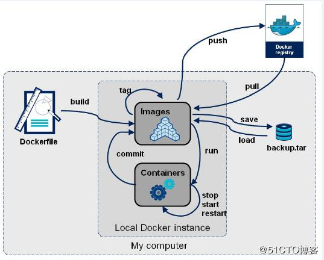

#### 1）示例

> **注意**：`centos` 官方镜像已停止维护（最后一个版本是 CentOS 8，2021 年 EOL），EL10 上构建镜像要用 `rockylinux:9` 或 `almalinux:9`。`MAINTAINER` 指令也已被官方废弃，改用 `LABEL`。

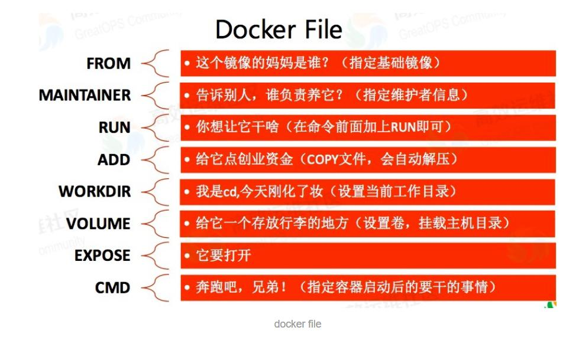

```dockerfile
# 1. 基础镜像：CentOS 已 EOL，用 Rocky Linux 9 替代
FROM rockylinux:9

# 2. 维护人信息（MAINTAINER 已废弃）
LABEL maintainer="you@example.com"

# 3. 安装 httpd
RUN dnf -y install httpd && dnf clean all

# 4. 开启 80 端口
EXPOSE 80

# 5. 复制首页
COPY index.html /var/www/html/index.html

# 6. 启动脚本
COPY run.sh /run.sh
RUN chmod 775 /run.sh

# 7. 容器启动命令
CMD ["/run.sh"]
```

**复杂一点的示例（编译安装 nginx）：**

```dockerfile
FROM rockylinux:9

LABEL maintainer="you@example.com"

# 1. 安装编译依赖
RUN dnf -y install gcc make pcre-devel zlib-devel tar zlib && dnf clean all

# 2. 复制源码包（ADD 遇到压缩包会自动解压）
ADD nginx-1.27.0.tar.gz /usr/src/

# 3. 编译安装
RUN cd /usr/src/nginx-1.27.0 \
  && ./configure --prefix=/usr/local/nginx \
  && make && make install \
  && ln -s /usr/local/nginx/sbin/nginx /usr/local/sbin/

# 4. 清理源码
RUN rm -rf /usr/src/nginx-1.27.0

EXPOSE 80

CMD ["nginx", "-g", "daemon off;"]
```

官方文档：<https://docs.docker.com/reference/dockerfile/>

#### 2）常用指令

| 类型 | 命令 |
| --- | --- |
| 基础镜像信息 | FROM |
| 维护者信息 | LABEL（MAINTAINER 已废弃） |
| 镜像操作指令 | RUN、COPY、ADD、EXPOSE、WORKDIR、ONBUILD、USER、VOLUME 等 |
| 容器启动时执行指令 | CMD、ENTRYPOINT |

> EL10 上 `dnf` 装完记得 `dnf clean all`，否则镜像会比实际大几百 MB。

### 2、镜像操作

#### 1）构建镜像

```bash
# 1. 在 Dockerfile 所在目录执行，最后的小数点不能丢
docker build -t gulimall/product:1.0 -f ./Dockerfile .

# 2. 查看镜像
docker images
```

#### 2）进入容器修改后提交

```bash
# 1. 进容器
docker exec -it <容器id> /bin/bash

# 2. 改完退出，提交为新镜像
docker commit -a "your-name" -m "调整时区" <容器id> gulimall/product:1.1
```

`docker commit [OPTIONS] CONTAINER [REPOSITORY[:TAG]]`

- `-a`：作者
- `-c`：使用 Dockerfile 指令创建镜像
- `-m`：说明文字
- `-p`：提交时暂停容器

> 生产环境不要用 `docker commit`，改什么写进 Dockerfile，保证可复现。

#### 3）登录 / 登出镜像仓库

```bash
docker login -u <用户名> -p <密码>
docker logout
```

不指定地址时默认是 Docker Hub。

#### 4）推送到 Docker Hub

```bash
docker tag gulimall/product:1.0 <用户名>/gulimall-product:1.0
docker push <用户名>/gulimall-product:1.0
```

#### 5）保存 / 加载镜像

离线环境把镜像打成 tar 拷过去：

```bash
# 1. 导出
docker save gulimall/product:1.0 -o /root/product-1.0.tar

# 2. 导入
docker load -i /root/product-1.0.tar
```

> **注意**：`docker save` 出来的 tar 只能给 Docker 用。要让 containerd 直接识别，用 `ctr -n k8s.io images import`，或者先 `docker load` 再 `docker push` 到私有仓库。

#### 6）阿里云镜像仓库

```bash
# 1. 登录（密码是开通仓库时设置的）
docker login --username=<阿里云账号> registry.cn-hangzhou.aliyuncs.com

# 2. 打 tag 并推送
docker tag gulimall/product:1.0 registry.cn-hangzhou.aliyuncs.com/<命名空间>/gulimall-product:1.0
docker push registry.cn-hangzhou.aliyuncs.com/<命名空间>/gulimall-product:1.0
```

k8s 的 Pod 里引用这个完整地址即可，containerd 会自动拉取。

---

## 四、K8S 细节

**【master】** 本章都是 kubectl 操作，全部在 `gulimall-master` 上执行。

### 1、kubectl

- 命令总览：<https://kubernetes.io/zh-cn/docs/reference/kubectl/>
- 资源类型：<https://kubernetes.io/zh-cn/docs/reference/kubectl/#资源类型>
- 格式化输出：<https://kubernetes.io/zh-cn/docs/reference/kubectl/#格式化输出>
- 命令手册：<https://kubernetes.io/docs/reference/generated/kubectl/kubectl-commands>

### 2、yaml 语法

k8s 所有资源都能用 YAML 描述，四个顶层字段必记：

```yaml
apiVersion: apps/v1     # 1. 资源所属的 API 组和版本
kind: Deployment        # 2. 资源类型
metadata:               # 3. 元数据：名字、命名空间、标签
  name: demo
  namespace: default
spec:                   # 4. 期望状态
  replicas: 1
```

常用查询：

```bash
# 1. 用 yaml 方式查看现有资源，照着改最省事
kubectl get deployment demo -o yaml

# 2. 只看关键字段
kubectl get pod <pod名> -o jsonpath='{.status.podIP}'

# 3. 字段含义查官方 API 文档
#    https://kubernetes.io/docs/reference/kubernetes-api/
```

### 3、入门操作

#### 1）Pod 与 Controller

<https://kubernetes.io/zh-cn/docs/concepts/workloads/pods/#pods-and-controllers>

控制器负责创建和管理 Pod、管理副本与上线、提供自修复能力。常见控制器：

- Deployment：无状态应用
- StatefulSet：有状态应用（MySQL、Redis、ES 用这个）
- DaemonSet：每个节点跑一份（Flannel、日志采集用这个）

控制器通过 Pod 模板创建它负责的 Pod。

#### 2）Deployment 与 Service

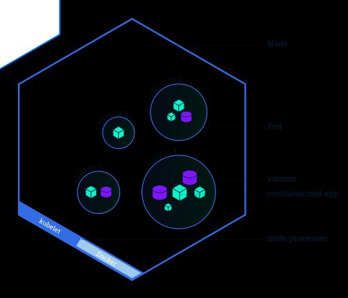

```yaml
apiVersion: apps/v1
kind: Deployment
metadata:
  name: nginx
spec:
  replicas: 2                    # 1. 期望副本数
  selector:
    matchLabels:
      app: nginx                 # 2. 选择器必须匹配模板标签
  template:
    metadata:
      labels:
        app: nginx
    spec:
      containers:
        - name: nginx
          image: nginx:1.27-alpine
          ports:
            - containerPort: 80
          resources:             # 3. 生产必须设置，便于调度和限制
            requests:
              memory: "64Mi"
              cpu: "50m"
            limits:
              memory: "128Mi"
              cpu: "200m"
```

#### 3）Service 的意义

Service 给一组 Pod 提供稳定访问入口，解决 Pod IP 变化导致的服务发现问题和负载均衡问题。

```bash
# 1. 创建 Deployment
kubectl create deployment nginx --image=nginx:1.27-alpine

# 2. 暴露为 NodePort（集群外可通过 <节点IP>:<随机端口> 访问）
kubectl expose deployment nginx --port=80 --type=NodePort

# 3. 查看分配的端口
kubectl get svc nginx
```

四种类型：

| 类型 | 作用 |
| --- | --- |
| ClusterIP | 仅集群内部访问（默认） |
| NodePort | 每台节点开一个端口对外暴露 |
| LoadBalancer | 云厂商负载均衡器（自建环境需额外组件） |
| ExternalName | 映射到外部域名 |

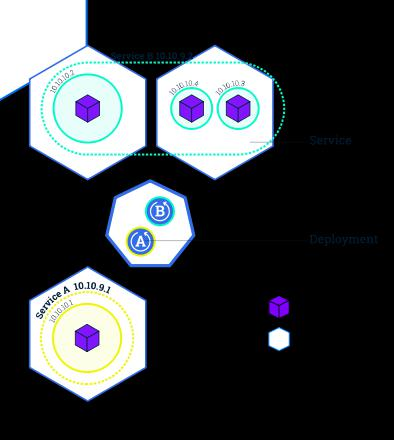

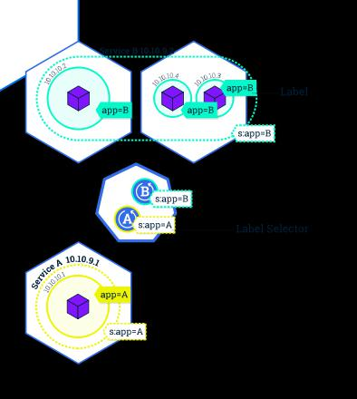

> NodePort 会在每个节点上开放同一个端口，访问任意节点都能进入这个 Service。

#### 4）labels and selectors

```bash
# 1. 给节点打标签，用于 nodeSelector 定向调度
kubectl label node gulimall disktype=ssd

# 2. 按标签筛选 Pod
kubectl get pods -l app=nginx

# 3. 按标签删除
kubectl delete pods -l app=nginx
```

#### 5）Ingress

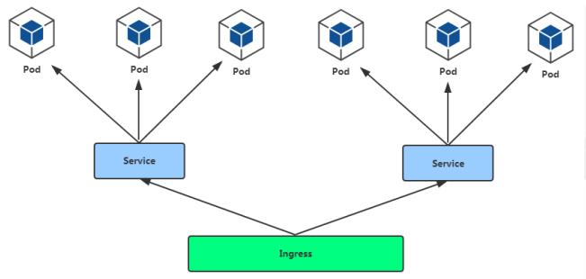

Ingress 通过域名 + 路径把流量分发到不同 Service，比 NodePort 更接近生产用法。

**旧版 `extensions/v1beta1` 在 k8s 1.22 已彻底移除**，现在必须用 `networking.k8s.io/v1`，且 backend 结构变了：

```yaml
apiVersion: networking.k8s.io/v1
kind: Ingress
metadata:
  name: web
spec:
  ingressClassName: nginx
  rules:
    - host: tomcat.example.com
      http:
        paths:
          - path: /
            pathType: Prefix
            backend:
              service:
                name: tomcat
                port:
                  number: 8080
```

**安装 Ingress Controller**：需要按域名和路径路由时，先部署控制器：

```bash
# 1. 参考 releases 页选版本，替换下面的 vX.Y.Z
#    https://github.com/kubernetes/ingress-nginx/releases
kubectl apply -f https://raw.githubusercontent.com/kubernetes/ingress-nginx/controller-vX.Y.Z/deploy/static/provider/baremetal/deploy.yaml

# 2. 确认 controller Pod 起来了
kubectl get pods -n ingress-nginx
```

> **重要提示**：`ingress-nginx` 项目已于 2025 年宣布停止维护（2026 年 3 月归档）。新项目建议直接用 Gateway API，或改用 Traefik、Higress 等仍在维护的控制器。学习阶段用它没问题。

#### 6）网络模型

Kubernetes 网络模型由四部分组成：

1. Pod 内部容器所在的网络
2. Pod 所在的网络（Flannel 负责，本文是 10.244.0.0/16）
3. Pod 和 Service 之间通信的网络（kube-proxy 负责，本文是 10.96.0.0/12）
4. 外界与 Service 之间通信的网络（NodePort / Ingress / LoadBalancer）

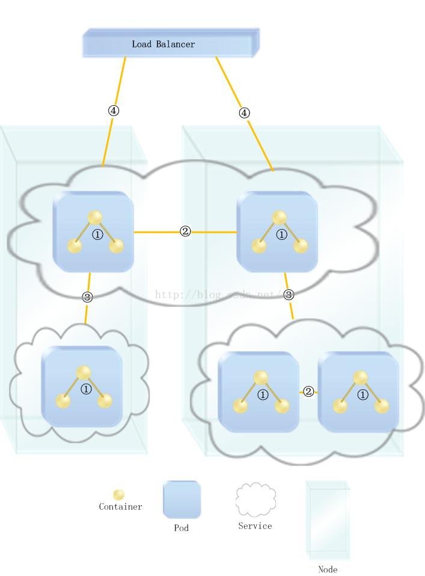

**排查网络的三条命令：**

```bash
# 1. 节点上能不能通 Pod IP
kubectl get pods -o wide
ping <podIP>

# 2. Service 是否真的有 Endpoints（空说明 selector 没匹配上）
kubectl get endpoints <service名>

# 3. 在 Pod 里测 DNS
kubectl exec -it <pod名> -- nslookup kubernetes.default
```

### 4、项目部署流程

1. 制作项目镜像（Dockerfile）
2. 推送到镜像仓库（阿里云 / Harbor / Docker Hub）
3. 编写 Deployment + Service + ConfigMap 的 YAML，`kubectl apply`
4. 配置 Ingress 或 NodePort 对外暴露
5. 日志与监控（`kubectl logs`、Loki、Prometheus）

---

## 五、MySQL 8.4 主从

**【node】** 本章的 Docker 容器都部署在 `gulimall-node`（<your-k8s-node-ip>）上。

### 1、方案选择

| 方案 | 现状 |
| --- | --- |
| MySQL-MMM | 2010 年代方案，依赖 Perl 脚本和 VIP，已无人维护 |
| MHA | 0~30 秒切换，配置复杂，社区版基本停更 |
| **InnoDB Cluster（MySQL Shell + Router）** | 官方推荐，但组件多、内存开销大 |
| **主从复制** | 结构最简单，本文采用 |

**部署位置**：本章的两个 MySQL 容器都运行在 `gulimall-node` 上，通过端口区分主从。这个形态用于验证复制链路；生产环境应把主从拆到不同物理机，并配合 VIP 或中间件完成故障切换。

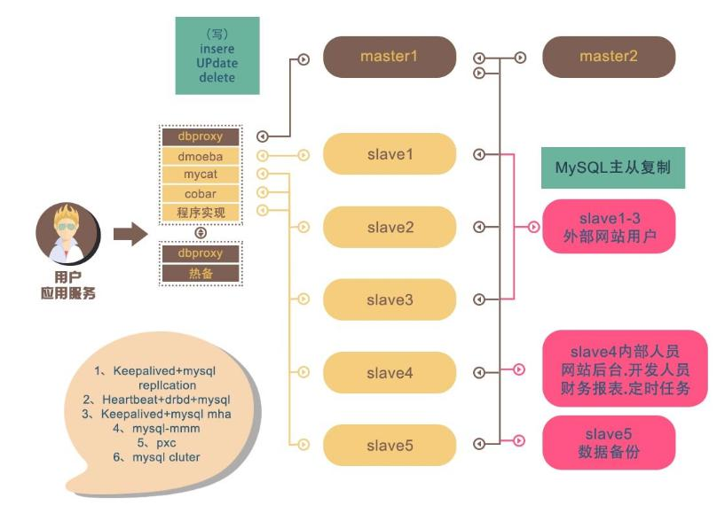

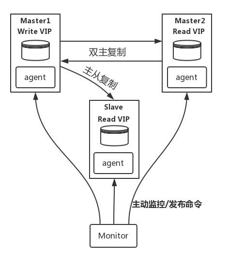

### 2、创建主从实例

MySQL 版本统一用 **8.4.11**，与 `deploy/docker-compose.yaml` 一致。

#### 1）准备目录和网络

```bash
# 1. 建目录
mkdir -p /mydata/mysql/master/{conf,data,log}
mkdir -p /mydata/mysql/slaver/{conf,data,log}

# 2. 建专用网络（容器之间用名字互访）
docker network create mysql-net

# 3. 8.4 镜像里 mysql 用户 uid 是 999，数据目录要能写
chmod -R 777 /mydata/mysql
```

#### 2）启动主库

> **关键差异**：8.x 官方镜像的配置目录是 `/etc/mysql/conf.d`，**不能挂载整个 `/etc/mysql`**，否则会把镜像自带的 `my.cnf` 覆盖掉，容器起不来。这是旧教程最常见的一个坑。

```bash
docker run -d --name mysql-master \
  --network mysql-net \
  -p 3307:3306 \
  -v /mydata/mysql/master/conf:/etc/mysql/conf.d \
  -v /mydata/mysql/master/data:/var/lib/mysql \
  -v /mydata/mysql/master/log:/var/log/mysql \
  -e MYSQL_ROOT_PASSWORD=root \
  mysql:8.4.11
```

#### 3）主库配置

```bash
vi /mydata/mysql/master/conf/my.cnf
```

```ini
[mysqld]
# 1. 字符集统一 utf8mb4
character-set-server=utf8mb4
collation-server=utf8mb4_0900_ai_ci

# 2. 连接数与缓冲池：8G 节点给这套值足够跑谷粒商城
max_connections=500
innodb_buffer_pool_size=1G

# 3. 必须加，否则反向解析主机名会让连接慢到无法接受
skip-name-resolve

# 4. 主从配置
server-id=1
log-bin=mysql-bin
binlog_format=ROW
# 8.4 默认就是 caching_sha2_password，复制用户需要它
binlog-do-db=gulimall_ums
binlog-do-db=gulimall_pms
binlog-do-db=gulimall_oms
binlog-do-db=gulimall_sms
binlog-do-db=gulimall_wms
binlog-do-db=gulimall_admin
replicate-ignore-db=mysql
replicate-ignore-db=sys
replicate-ignore-db=information_schema
replicate-ignore-db=performance_schema
```

```bash
# 重启主库让配置生效
docker restart mysql-master
docker logs --tail 20 mysql-master
```

#### 4）启动从库

```bash
docker run -d --name mysql-slaver-01 \
  --network mysql-net \
  -p 3317:3306 \
  -v /mydata/mysql/slaver/conf:/etc/mysql/conf.d \
  -v /mydata/mysql/slaver/data:/var/lib/mysql \
  -v /mydata/mysql/slaver/log:/var/log/mysql \
  -e MYSQL_ROOT_PASSWORD=root \
  mysql:8.4.11
```

```bash
vi /mydata/mysql/slaver/conf/my.cnf
```

```ini
[mysqld]
character-set-server=utf8mb4
collation-server=utf8mb4_0900_ai_ci
max_connections=500
innodb_buffer_pool_size=1G
skip-name-resolve

server-id=2
log-bin=mysql-bin
binlog_format=ROW
read_only=1
replicate-ignore-db=mysql
replicate-ignore-db=sys
replicate-ignore-db=information_schema
replicate-ignore-db=performance_schema
```

```bash
docker restart mysql-slaver-01
```

### 3、配置复制

#### 1）主库：创建复制用户

> **8.4 的变化**：`GRANT ... IDENTIFIED BY` 这种"授权时顺带建用户"的老语法已被移除，必须**先 CREATE USER 再 GRANT**。

```bash
# 1. 进主库
docker exec -it mysql-master mysql -uroot -p
```

```sql
-- 2. 允许 root 远程连接（方便用 Navicat 等工具）
CREATE USER IF NOT EXISTS 'root'@'%' IDENTIFIED BY 'root';
GRANT ALL PRIVILEGES ON *.* TO 'root'@'%' WITH GRANT OPTION;
FLUSH PRIVILEGES;

-- 3. 创建复制专用用户
CREATE USER 'backup'@'%' IDENTIFIED BY '123456';
GRANT REPLICATION SLAVE ON *.* TO 'backup'@'%';
FLUSH PRIVILEGES;

-- 4. 记录 File 和 Position，下一步要用
SHOW MASTER STATUS;
```

输出示例：

```text
+------------------+----------+--------------+------------------+
| File             | Position | Binlog_Do_DB | Binlog_Ignore_DB |
+------------------+----------+--------------+------------------+
| mysql-bin.000003 |      856 | gulimall_ums |                  |
+------------------+----------+--------------+------------------+
```

#### 2）从库：指向主库

```bash
# 1. 进从库
docker exec -it mysql-slaver-01 mysql -uroot -p
```

```sql
-- 2. 8.0.23 之后的新语法（旧的 CHANGE MASTER TO 已废弃）
CHANGE REPLICATION SOURCE TO
  SOURCE_HOST='mysql-master',
  SOURCE_PORT=3306,
  SOURCE_USER='backup',
  SOURCE_PASSWORD='123456',
  SOURCE_LOG_FILE='mysql-bin.000003',
  SOURCE_LOG_POS=856,
  GET_SOURCE_PUBLIC_KEY=1;

-- 3. 启动复制（旧语法 START SLAVE 已改名）
START REPLICA;

-- 4. 查看状态
SHOW REPLICA STATUS\G
```

`GET_SOURCE_PUBLIC_KEY=1` **必须加**：MySQL 8.4 默认用 `caching_sha2_password`，不加这一项，从库会因为拿不到主库公钥而报 `Authentication plugin 'caching_sha2_password' reported error`。

关注 `SHOW REPLICA STATUS` 里这两行：

```text
Replica_IO_Running: Yes
Replica_SQL_Running: Yes
```

两个都是 `Yes` 才算成功。截图对应旧版的 `Slave_IO_Running`，含义相同。

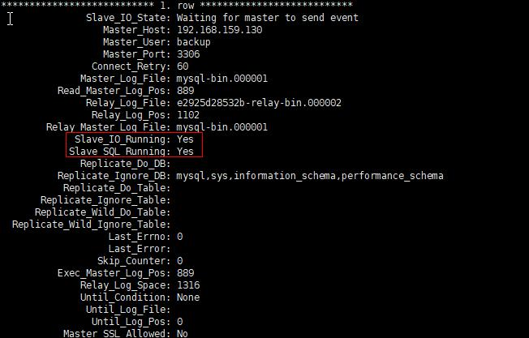

### 4、验证

```sql
-- 1. 主库建表插数据
CREATE DATABASE gulimall_pms;
USE gulimall_pms;
CREATE TABLE t_test (id INT PRIMARY KEY, name VARCHAR(20));
INSERT INTO t_test VALUES (1, 'hello');
```

```sql
-- 2. 从库查，能看到数据说明同步成功
USE gulimall_pms;
SELECT * FROM t_test;
```

### 5、单实例部署

如果只是想跑业务，不需要演示主从，直接单实例更简单：

```bash
docker run -d --name mysql \
  -p 3306:3306 \
  -v /mydata/mysql/conf:/etc/mysql/conf.d \
  -v /mydata/mysql/data:/var/lib/mysql \
  -e MYSQL_ROOT_PASSWORD=root \
  -e TZ=Asia/Shanghai \
  mysql:8.4.11
```

单实例的配置更简单，端口和连接串也不用区分主从。

### 6、k8s 上部署

有状态服务用 StatefulSet + PVC，要点只有三条：

- 配置抽出来放 ConfigMap
- 数据必须用 PVC 持久化，否则 Pod 重建数据全丢
- 集群内用 Headless Service 提供的稳定域名互相访问

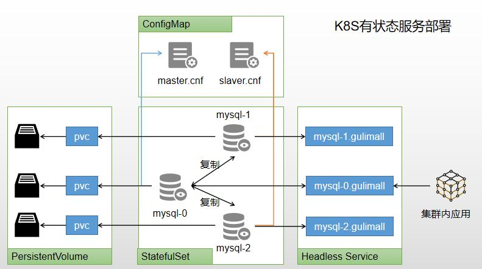

> 集群没有默认 StorageClass 时，PVC 会一直 `Pending`，需要先装 local-path-provisioner 或改用 `hostPath`。

---

## 六、Redis 7.2 集群

**【node】** 本章的 Docker 容器都部署在 `gulimall-node`（<your-k8s-node-ip>）上。

### 1、集群形态

#### 1）数据分区方案

- **客户端分区**：代表是 Redis Sharding（ShardedJedis）。不使用中间件、逻辑可控，但客户端要自己维护路由，节点增删无法动态感知。

  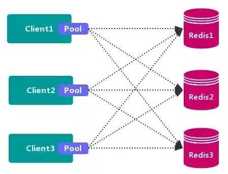

- **代理分区**：Twemproxy、Codis。客户端连接代理，由代理做路由，但多了一层，且代理本身要保证高可用。

  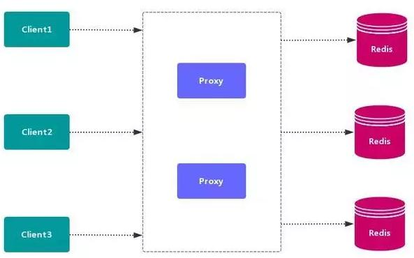

- **redis-cluster**：Redis 官方方案，本文采用。

  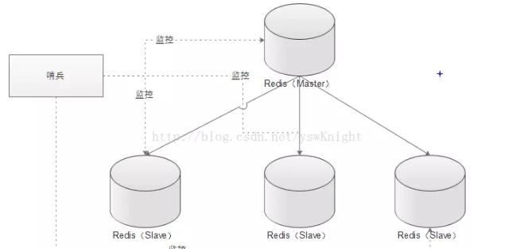

  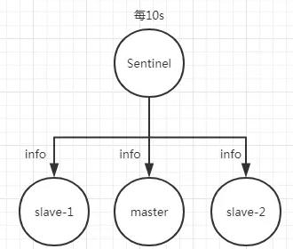

  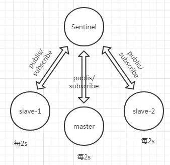

#### 2）高可用方式

**哨兵（Sentinel）** 解决的是"主挂了要人工切换"的问题，提供三个能力：

- 监控：持续检查 Master 和 Slave 是否正常
- 通知：节点异常时通过 API 告警
- 自动故障转移：主库故障时自动把从库提升为主库

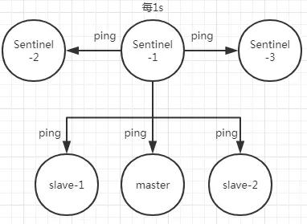

哨兵通过三个定时任务判断节点状态：

- 每 10 秒向主从发送 `INFO replication` 获取拓扑
- 每 2 秒向 `_sentinel_:hello` 频道广播自身判断
- 每 1 秒发送 `PING` 做心跳

心跳超时判定为"主观下线"；超过 `<quorum>` 数量的哨兵都判定，则升级为"客观下线"，随后用 Raft 选举出 leader 执行故障转移。

**Redis Cluster** 则是官方分片方案，3 主 3 从，数据分为 16384 个槽位。

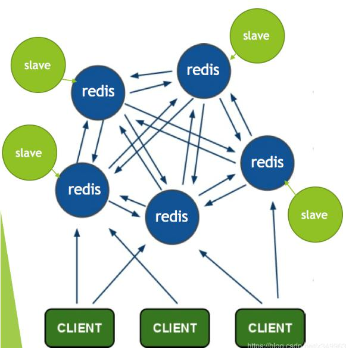

### 2、Redis Cluster

<https://redis.io/docs/latest/operate/oss_and_stack/management/scaling/>

**部署位置**：本章的 6 个实例都运行在 `gulimall-node` 上，用端口区分。这个形态用于理解槽位分配和主从切换；生产环境应把实例分散到至少 3 台物理机。

#### 1）槽与功能限制

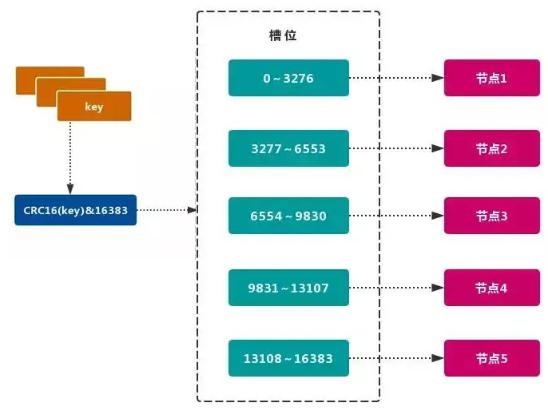

- 批量操作（mset/mget）只支持相同 slot 的 key
- 事务只支持同一节点上的多 key
- key 是数据分区的最小粒度，不能把 hash/list 拆到不同节点
- 集群模式只有 db0，不能用 16 个库
- 复制只支持一层，从节点不能再挂从节点
- 跨槽命令会重定向，多一次网络往返

#### 2）一致性 Hash

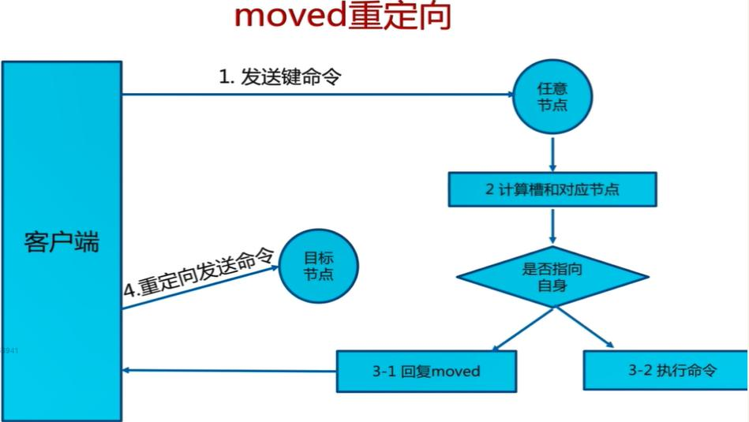

一致性哈希把节点排在 Hash 环上，key 顺时针找最近节点，节点增删只影响相邻区间。

节点少时会出现 **Hash 倾斜**，引入虚拟节点解决：

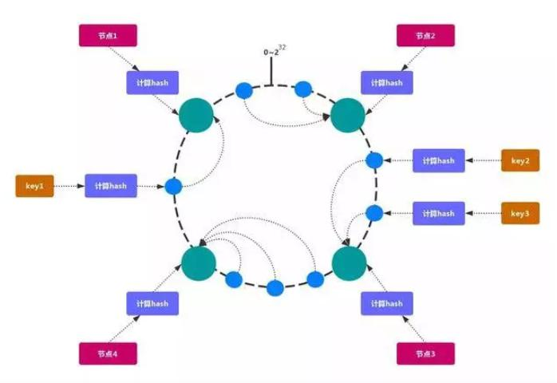

> Redis Cluster 实际用的是**哈希槽**而不是一致性哈希，这里作为背景知识了解即可。

#### 3）部署 6 个节点

```bash
# 1. 循环创建 6 个实例，端口 7001~7006，总线和数据端口分别是 1xxxx
for port in $(seq 7001 7006); do
  mkdir -p /mydata/redis/node-${port}/{conf,data}
  cat > /mydata/redis/node-${port}/conf/redis.conf <<EOF
port ${port}
bind 0.0.0.0
protected-mode no
cluster-enabled yes
cluster-config-file nodes.conf
cluster-node-timeout 5000
# 换成宿主机真实 IP，写 127.0.0.1 会导致节点之间无法握手
cluster-announce-ip <your-k8s-node-ip>
cluster-announce-port ${port}
cluster-announce-bus-port 1${port}
appendonly yes
EOF
  docker run -d --name redis-${port} \
    -p ${port}:${port} -p 1${port}:1${port} \
    -v /mydata/redis/node-${port}/data:/data \
    -v /mydata/redis/node-${port}/conf/redis.conf:/usr/local/etc/redis/redis.conf \
    redis:7.2.12 redis-server /usr/local/etc/redis/redis.conf
done

# 2. 确认 6 个都在跑
docker ps | grep redis-700
```

> Redis 7.x 镜像里的配置文件路径是 `/usr/local/etc/redis/redis.conf`，旧教程写的 `/etc/redis/redis.conf` 在 7.x 上不存在。

#### 4）创建集群

```bash
docker exec -it redis-7001 redis-cli --cluster create \
  <your-k8s-node-ip>:7001 \
  <your-k8s-node-ip>:7002 \
  <your-k8s-node-ip>:7003 \
  <your-k8s-node-ip>:7004 \
  <your-k8s-node-ip>:7005 \
  <your-k8s-node-ip>:7006 \
  --cluster-replicas 1
```

中途会提示分配方案，输入 `yes` 确认。

#### 5）验证

```bash
# 1. 集群模式连接（-c 表示跟随重定向）
docker exec -it redis-7001 redis-cli -c -p 7001

# 2. 集群信息
cluster info
cluster nodes

# 3. 读写测试，会看到 MOVED 重定向
set k1 v1
get k1
```

```bash
# 4. 检查集群健康
docker exec -it redis-7001 redis-cli --cluster check <your-k8s-node-ip>:7001
```

故障演练：`docker stop redis-7001`，观察从节点提升为主节点；再 `docker start redis-7001`，它会以从节点身份回来。

#### 6）单实例部署

业务只想用 Redis，不需要集群：

```bash
docker run -d --name redis \
  -p 6379:6379 \
  -v /mydata/redis/conf/redis.conf:/usr/local/etc/redis/redis.conf \
  -v /mydata/redis/data:/data \
  redis:7.2.12 redis-server /usr/local/etc/redis/redis.conf --appendonly yes
```

#### 7）k8s 上部署

参照 StatefulSet + Headless Service 即可，每个 Pod 挂自己的 PVC。

---

## 七、Elasticsearch 8.18

**【node】** 本章的 Docker 容器都部署在 `gulimall-node`（<your-k8s-node-ip>）上。

### 1、集群原理

elasticsearch 内置 ZenDiscovery（7.x 之后改叫 cluster coordination），不依赖 ZooKeeper，节点用相同的 `cluster.name` 就能自动组集群。

#### 1）单节点

- 一个 ES 实例就是一个节点，集群由多个同 `cluster.name` 的节点组成
- 主节点负责集群级变更（增删索引、增删节点），不处理文档级读写，所以单个主节点不会成为瓶颈
- 任意节点都能接收请求并转发到数据所在节点

#### 2）集群健康

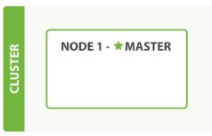

```http
GET /_cluster/health
```

| 状态 | 含义 |
| --- | --- |
| green | 主分片和副本分片都正常 |
| yellow | 主分片正常，部分副本未分配（单节点默认就是这个状态） |
| red | 有主分片未分配，部分数据不可用 |

> **单节点下健康状态永远是 yellow**：副本不能和主分片放在同一个节点上，所以副本无处分配。这是正常的，不是故障。

#### 3）分片

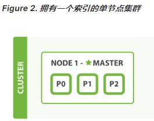

- 分片是底层工作单元，一个索引的数据分散在多个分片里
- 分片分主分片和副本分片，主分片数索引创建后不能改，副本数可以随时改
- 单节点没有副本可分配，所以默认 1 个副本时状态是 yellow

```http
PUT /blogs
{
  "settings": {
    "number_of_shards": 3,
    "number_of_replicas": 1
  }
}
```

#### 4）新增节点与扩容

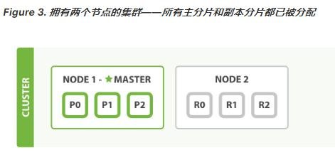

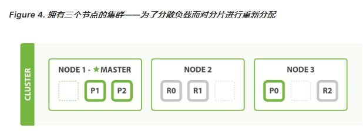

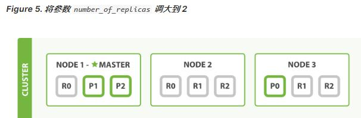

节点加入后分片会自动均衡。动态调副本数：

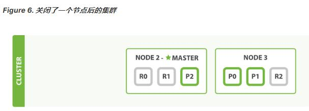

```http
PUT /blogs/_settings
{
  "number_of_replicas": 2
}
```

#### 5）应对故障

主节点挂掉会先选举新主节点；主分片缺失时如果有副本可提升，状态从 red 变 yellow；副本数量不够则停留在 yellow，但数据不丢。

#### 6）角色划分与脑裂

| 角色 | 配置 | 职责 |
| --- | --- | --- |
| 候选主节点 | `node.roles: [master]` | 参与选主，不存数据 |
| 数据节点 | `node.roles: [data]` | 存储和查询，吃 CPU/内存/磁盘 |
| 协调节点 | `node.roles: []` | 只做请求分发和汇总 |

**脑裂**：网络分区或主节点卡顿时，多个节点各自选主，导致数据分叉。ES 7 之后用 `cluster.initial_master_nodes` + 多数派投票彻底解决，旧的 `discovery.zen.minimum_master_nodes` 参数**在 8.x 已不存在**。

单节点直接用 `discovery.type: single-node`，根本不参与选主，不存在脑裂。

#### 7）集群结构

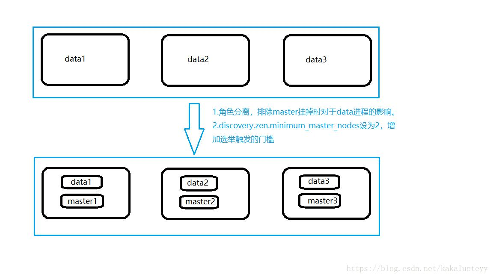

多机部署时按"每台机器一个 master + 一个 data"的形态规划，保证 master 数量为奇数且满足多数派。

### 2、单实例部署

**单实例部署即可覆盖谷粒商城的需求**。旧教程的 3 master + 3 data 是为了演示分片分配和选主，6 个实例挤在同一台机器上没有高可用意义（机器一挂全挂）。想观察集群行为，可以在这台机器上再起 2 个实例。

```bash
# 1. 内核参数（ES 启动时强制检查，不设置会直接退出）
sudo sysctl -w vm.max_map_count=262144
echo "vm.max_map_count=262144" | sudo tee -a /etc/sysctl.conf
sudo sysctl -p

# 2. 数据目录，容器内 uid=1000，必须可写
sudo mkdir -p /mydata/elasticsearch/{data,plugins}
sudo chmod -R 777 /mydata/elasticsearch

# 3. 启动单节点
docker run -d --name elasticsearch \
  -p 9200:9200 -p 9300:9300 \
  -e discovery.type=single-node \
  -e xpack.security.enabled=false \
  -e ES_JAVA_OPTS="-Xms2g -Xmx2g" \
  -e TZ=Asia/Shanghai \
  -v /mydata/elasticsearch/data:/usr/share/elasticsearch/data \
  -v /mydata/elasticsearch/plugins:/usr/share/elasticsearch/plugins \
  elasticsearch:8.18.8
```

两个关键参数：

- `discovery.type=single-node`：单节点模式，跳过选主检查
- `xpack.security.enabled=false`：ES 8 默认开启 HTTPS + 账号密码，实验环境关掉省事。**生产必须开启**，否则等于裸奔

```bash
# 4. 等 30 秒左右，验证
curl http://localhost:9200
curl http://localhost:9200/_cluster/health?pretty
```

`status` 显示 `green`（因为单节点模式下副本默认为 0）就成功了。

> 堆大小不要超过物理内存的一半。这台机器还要跑 MySQL、Redis 和微服务，2G 是平衡值；如果 ES 是主要负载，可以给到 4G。

### 3、多节点集群（有第二台机器再看）

```bash
# 每台机器执行，只改 node.name 和 node.roles
cat > /mydata/elasticsearch/config/elasticsearch.yml <<'EOF'
cluster.name: my-es
node.name: es-node-1
node.roles: [master, data]
network.host: 0.0.0.0
http.port: 9200
transport.port: 9300
discovery.seed_hosts: ["<your-k8s-master-ip>:9300", "<your-k8s-node-ip>:9300"]
cluster.initial_master_nodes: ["es-node-1", "es-node-2", "es-node-3"]
EOF
```

- `discovery.seed_hosts` 填其他节点的**传输端口**（9300），不是 9200
- `cluster.initial_master_nodes` 只在集群第一次启动时用，之后删掉
- 每台机器的 `node.name` 必须唯一

### 4、常用检查命令

```bash
# 1. 节点信息
curl -s localhost:9200/_cat/nodes?v

# 2. 分片分配
curl -s localhost:9200/_cat/shards?v

# 3. 集群健康
curl -s localhost:9200/_cluster/health?pretty

# 4. 索引列表
curl -s localhost:9200/_cat/indices?v
```

---

## 八、RabbitMQ 3.13 集群

**【node】** 本章的 Docker 容器都部署在 `gulimall-node`（<your-k8s-node-ip>）上。

### 1、集群形态

RabbitMQ 用 Erlang 开发，本身是分布式语言，组集群很方便；但 Erlang 只解决节点发现和通信，**负载均衡要自己做**。

节点分内存节点（RAM）和磁盘节点（Disk），集群中至少有一个磁盘节点，否则元数据没法持久化。

- **普通模式（默认）**：各节点队列结构相同，消息只存在其中一个节点，消费时从那个节点取。适合日志类不需要持久化的场景。
- **Quorum 队列**：基于 Raft 协议，消息自动在多数节点复制，天然高可用。**3.13 推荐方案**。

> **旧版的镜像队列（ha-mode）已废弃**：从 RabbitMQ 3.9 开始标记废弃，4.0 彻底移除。3.13 上还能用但会有警告，新项目一律用 Quorum 队列。

**部署位置**：本章的单实例容器运行在 `gulimall-node` 上；RabbitMQ 集群至少需要 3 个节点（Raft 多数派），三节点部署方法见下一节。

### 2、单实例部署

```bash
docker run -d --name rabbitmq \
  -p 5672:5672 \
  -p 15672:15672 \
  -e RABBITMQ_DEFAULT_USER=admin \
  -e RABBITMQ_DEFAULT_PASS=<your-password> \
  -v /mydata/rabbitmq/data:/var/lib/rabbitmq \
  rabbitmq:3.13.7-management
```

```bash
# 1. 确认容器在跑
docker ps | grep rabbitmq

# 2. 看日志
docker logs -f rabbitmq

# 3. 管理台：http://<节点IP>:15672，账号 admin / <your-password>
```

> 默认 guest 用户只能本机登录，所以这里直接建了 `admin` 账号。

### 3、三节点集群（有第二、三台机器再做）

```bash
# 1. 建网络，三个容器必须能互相解析主机名
docker network create rabbit-net

# 2. 三个节点用同一个 Erlang cookie
COOKIE="gulimall-erlang-cookie"

# 3. 启动三个节点，只有第一个映射端口
docker run -d --name rabbitmq01 --hostname rabbitmq01 --network rabbit-net \
  -p 15672:15672 -p 5672:5672 \
  -e RABBITMQ_ERLANG_COOKIE="$COOKIE" \
  -v /mydata/rabbitmq/rabbitmq01:/var/lib/rabbitmq \
  rabbitmq:3.13.7-management

docker run -d --name rabbitmq02 --hostname rabbitmq02 --network rabbit-net \
  -e RABBITMQ_ERLANG_COOKIE="$COOKIE" \
  -v /mydata/rabbitmq/rabbitmq02:/var/lib/rabbitmq \
  rabbitmq:3.13.7-management

docker run -d --name rabbitmq03 --hostname rabbitmq03 --network rabbit-net \
  -e RABBITMQ_ERLANG_COOKIE="$COOKIE" \
  -v /mydata/rabbitmq/rabbitmq03:/var/lib/rabbitmq \
  rabbitmq:3.13.7-management
```

> `--link` 在 Docker 中已废弃多年，用自定义网络 + `--hostname` 替代。

#### 1）加入集群

```bash
# 1. 节点 2 加入
docker exec -it rabbitmq02 rabbitmqctl stop_app
docker exec -it rabbitmq02 rabbitmqctl reset
docker exec -it rabbitmq02 rabbitmqctl join_cluster rabbit@rabbitmq01
docker exec -it rabbitmq02 rabbitmqctl start_app

# 2. 节点 3 加入
docker exec -it rabbitmq03 rabbitmqctl stop_app
docker exec -it rabbitmq03 rabbitmqctl reset
docker exec -it rabbitmq03 rabbitmqctl join_cluster rabbit@rabbitmq01
docker exec -it rabbitmq03 rabbitmqctl start_app

# 3. 查看集群状态
docker exec -it rabbitmq01 rabbitmqctl cluster_status
```

> **不要加 `--ram`**：`join_cluster --ram` 会把节点建成纯内存节点，元数据不落盘，重启就丢。除非磁盘紧张，否则一律用磁盘节点（默认）。

#### 2）创建 Quorum 队列策略

```bash
# 1. 所有队列使用 quorum 类型
docker exec -it rabbitmq01 rabbitmqctl set_policy -p / quorum-all "^" \
  '{"queue-type":"quorum"}'

# 2. 查看策略
docker exec -it rabbitmq01 rabbitmqctl list_policies -p /
```

Quorum 队列把消息复制到半数以上节点，主节点挂掉自动选举新主节点，不需要旧的 `ha-mode` 配置。

> 注意 Quorum 队列不支持非持久化消息和排他队列，日志类临时队列应显式声明为 classic。

#### 3）加载均衡

RabbitMQ 集群**不会自动做负载均衡**，客户端要配置多个节点地址，或者前面挂 HAProxy / Nginx。Spring Boot 的 `spring.rabbitmq.addresses` 支持写多个：

```yaml
spring:
  rabbitmq:
    addresses: rabbitmq01:5672,rabbitmq02:5672,rabbitmq03:5672
```

### 4、k8s 上部署

用 StatefulSet：每个 Pod 有稳定主机名（`rabbitmq-0.rabbitmq-headless`），Erlang 节点名依赖主机名，Deployment 的随机 Pod 名会导致重启后无法重新加入集群。

---

## 九、DevOps

**【master】** Jenkins 部署在 `gulimall-master` 上，构建产物推送到镜像仓库后由集群拉取。

### 1、项目开发要考虑的维度

- **Dev**：怎么开发
- **Ops**：怎么运维
- **高并发**：怎么扛住流量
- **高可用**：怎么避免单点

### 2、什么是 DevOps

DevOps 是 Development 和 Operations 的组合，可以看作开发（软件工程）、技术运营和质量保障（QA）三者的交集。

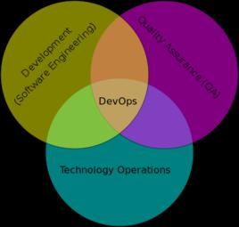

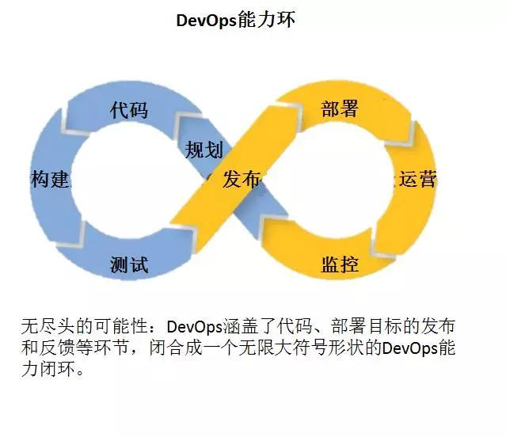

核心是打通交付链路上的工具，减少团队之间的等待和手工操作。

### 3、CI 与 CD

#### 1）持续集成（CI）

把个人开发的代码频繁合并到主干，尽早发现问题。需要具备：

- 自动化测试
- 灵活的构建环境（容器）
- 版本控制（Git）
- 自动化构建工具（Jenkins、GitLab CI、GitHub Actions）
- 快速反馈机制

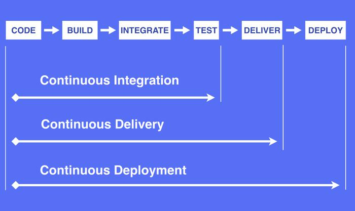

#### 2）持续交付（CD）

在 CI 基础上，把代码自动部署到类生产环境，随时可以发布到生产。

- 快速发布
- 迭代周期缩短
- 发布过程标准化、可重复
- 进度可视化

#### 3）持续部署

代码通过评审和全部自动化测试后，**自动**部署到生产环境，是持续交付的最高阶段。


> "You build it, you run it" —— Amazon 能实现每天数十次部署的核心。

### 4、落地方案

**Maven + Git + Jenkins + Docker**


集群的 CI/CD 流水线：

1. 开发提交代码到 Git
2. Jenkins 拉代码，`mvn package` 打包
3. `docker build` 构建镜像并推送到阿里云镜像仓库
4. Jenkins 执行 `kubectl set image` 更新 Deployment
5. k8s 滚动更新 Pod

> Jenkins 构建时很吃 CPU 和内存，建议把构建任务安排在业务低峰期，并给容器设置内存上限。

---

## 十、附录

**【node】** 附录里的 Nacos、Sentinel、Zipkin 都是业务中间件，部署在 `gulimall-node` 上；Jenkins 在 master。

### 1、Jenkins

官方文档：<https://www.jenkins.io/zh/doc/>

Jenkins 是开源的 CI/CD 工具，通过插件支持几乎所有构建、部署场景。


```bash
# Jenkins 部署，固定 JVM 堆大小
docker run -d --name jenkins \
  -p 8080:8080 -p 50000:50000 \
  -v /mydata/jenkins:/var/jenkins_home \
  -e JAVA_OPTS="-Xms512m -Xmx1g" \
  jenkins/jenkins:lts-jdk21

# 初始密码
docker exec jenkins cat /var/jenkins_home/secrets/initialAdminPassword
```

> `jenkins/jenkins:lts` 在 2025 年后只提供 JDK 21 版本，和本项目的 JDK 21 环境一致。

### 2、Jenkins 流水线

<https://www.jenkins.io/zh/doc/book/pipeline/>

### 3、k8s 部署 Nacos

版本与项目一致：**3.0.3**。

```bash
docker run -d --name nacos \
  -p 8848:8848 -p 9848:9848 \
  -e MODE=standalone \
  -e NACOS_AUTH_ENABLE=true \
  -v /mydata/nacos/logs:/home/nacos/logs \
  -v /mydata/nacos/conf:/home/nacos/conf \
  nacos/nacos-server:v3.0.3
```

> Nacos 2.x 起除了 8848 还需要 **9848**（gRPC 客户端端口），只开 8848 会导致客户端连接失败。3.x 默认开启鉴权，需要在控制台配置 token。

### 4、k8s 部署 Sentinel

```bash
docker run -d --name sentinel \
  -p 8858:8858 \
  bladex/sentinel-dashboard:1.8.8
```

访问 `http://<节点IP>:8858`，默认账号密码 `sentinel` / `sentinel`。

### 5、k8s 部署 Zipkin

```bash
# 1. 内存存储（重启丢数据，仅测试）
docker run -d --name zipkin -p 9411:9411 openzipkin/zipkin

# 2. 存储到 Elasticsearch
docker run -d --name zipkin -p 9411:9411 \
  -e STORAGE_TYPE=elasticsearch \
  -e ES_HOSTS=http://<your-k8s-node-ip>:9200 \
  openzipkin/zipkin
```

> 谷粒商城现在用的是 **Micrometer + OTLP** 接 Jaeger，不是 Zipkin，这一节仅作历史参考。实际部署见项目 `deploy/docker-compose.yaml` 里的 jaeger 配置。

### 6、业务代码 CICD

#### 1）参数化构建


#### 2）并行任务与嵌套 stage


