# gulimall 性能测试实战（JMeter + Arthas + VisualVM）

> 本文讲**三个工具怎么用**：JMeter 压出问题 → VisualVM 缩小范围 → Arthas 定位到方法。
>
> **完整的排查案例**（一次真实的 200 并发调优过程）和 **常见性能问题手册** 见《性能测试-常见问题手册.md》。

---

## 一、三个工具的分工

性能排查最忌讳"上来就猜"。这三个工具各管一段，顺序不能乱：

| 工具 | 定位 | 回答什么问题 | 跑在哪 |
|---|---|---|---|
| **JMeter** | 压测客户端 | **慢不慢、有多慢** —— 用数据把问题量化 | Windows（压测机） |
| **VisualVM** | JVM 监控 | **哪里在耗资源** —— CPU 打满？GC 频繁？线程阻塞？ | Windows（通过 JMX 连远程 JVM） |
| **Arthas** | 在线诊断 | **具体哪个方法慢** —— 方法级调用链耗时追踪 | Linux（attach 到目标 JVM 进程） |

**配合思路（一条漏斗，逐层收窄）：**

```
① JMeter 压测
   产出量化指标：均值 2257ms、90% 3688ms
        ↓ 结论：慢，且慢得离谱
② VisualVM 看整体资源
   CPU 1.2%、GC 0%、堆正常
        ↓ 结论：不是 CPU 密集、不是内存问题 → 【在等】
③ Arthas trace 追踪方法
   getAllCategory() 占 80%~99%
        ↓ 结论：瓶颈在"访问数据库"这一步
④ 看代码 + 看配置
   连接池默认只有 10 个 → 200 并发抢 10 个连接 → 全在排队
        ↓
⑤ 分层优化 → 重新压测 → 对比前后数据
   连接池 / Tomcat / 缓存 / JVM 内存 / SQL（见《性能测试-常见问题手册.md》§1.4）
```

> 第 ⑤ 步**不是只调一个参数**。本次至少涉及三层：连接池（缓解排队）、
> Tomcat 线程（承接并发）、**Redis 缓存（治本 —— 分类数据根本不该每次都查库）**。

> **关键认知：Arthas 的 `trace` 测的是"墙钟时间"（wall time），包含等待。**
> 一个方法耗时 1.8 秒，不代表它算了 1.8 秒 —— 很可能是在**排队等数据库连接**。
> 这一点是本次排查的转折点。

---

## 二、JMeter：把问题量化

### 2.1 干什么用

JMeter 是压测**发起端**，负责"制造并发"，然后把结果变成可比较的数字。

**没有它，后面的排查就没有起点** —— 你不能靠"感觉有点慢"去优化。

### 2.2 线程组配置

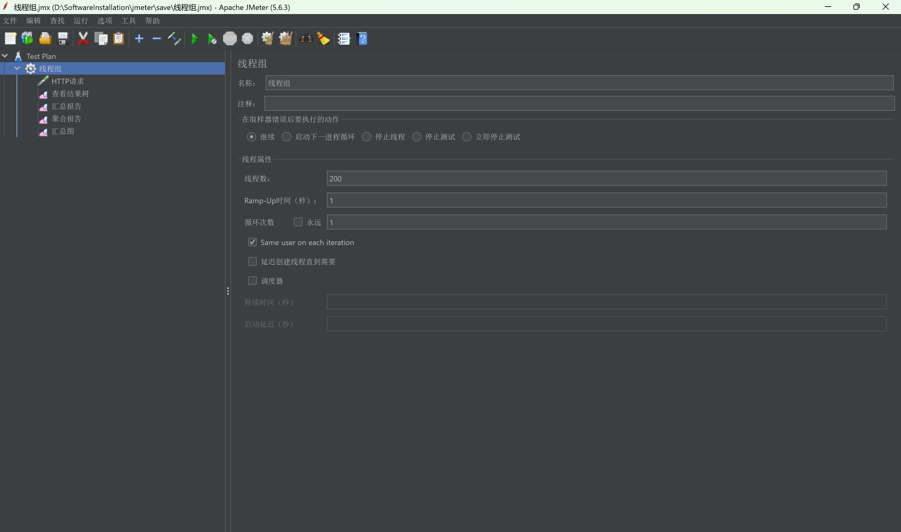

本次配置：

| 参数 | 值 | 含义 |
|---|---|---|
| 线程数 | **200** | 模拟 200 个并发用户 |
| Ramp-Up 时间 | **1** 秒 | 200 个线程在 1 秒内全部启动 |
| 循环次数 | 1 | 每个线程只发一次请求 |
| 取样器错误后要执行的动作 | 继续 | 出错不中断测试 |

> **Ramp-Up 是个容易忽略的参数**：设成 1 秒 = "瞬间 200 并发"（压力最大）；
> 设成 200 秒 = "每秒 1 个新用户"（压力平缓）。想测极限就用小值。

### 2.3 HTTP 请求配置

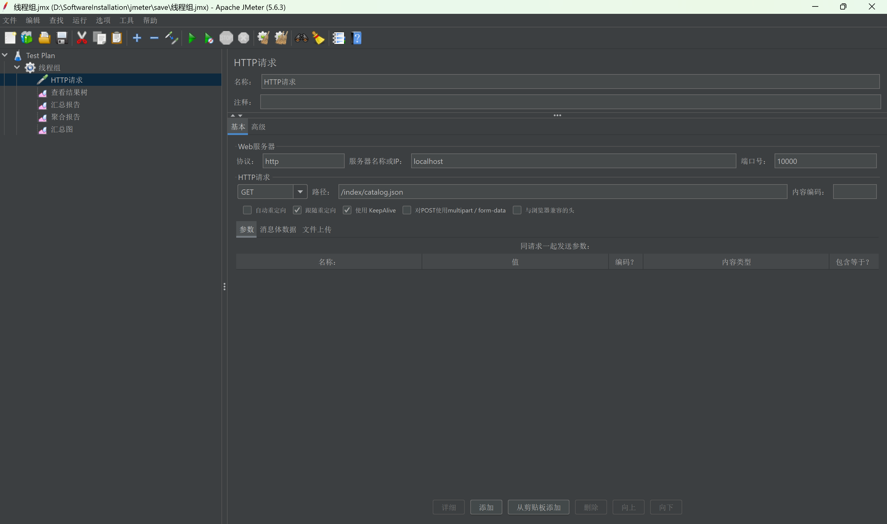

| 参数 | 值 | 说明 |
|---|---|---|
| 协议 | `http` | |
| 服务器名称或 IP | `localhost` | 压测机在 Windows，服务在 Linux（`<your-vm-host-ip>`）——**这里写 localhost 是本机调试用，压远程要改成服务器 IP** |
| 端口号 | `10000` | product 服务端口 |
| 方法 | `GET` | |
| 路径 | `/index/catelog.json` | 分类树接口 |
| 跟随重定向 | ✅ | |
| 使用 KeepAlive | ✅ | 复用 TCP 连接，更贴近真实浏览器行为 |

> **压测地址怎么选**：想测"服务本身"就直接压 `product:10000`（绕开 Nginx 和网关，排除干扰）；
> 想测"完整链路"就压 `http://gulimall.vip/gulimall/...`。**排查阶段建议直连服务**，避免把 Nginx/网关也拖进嫌疑范围。

### 2.4 查看结果树

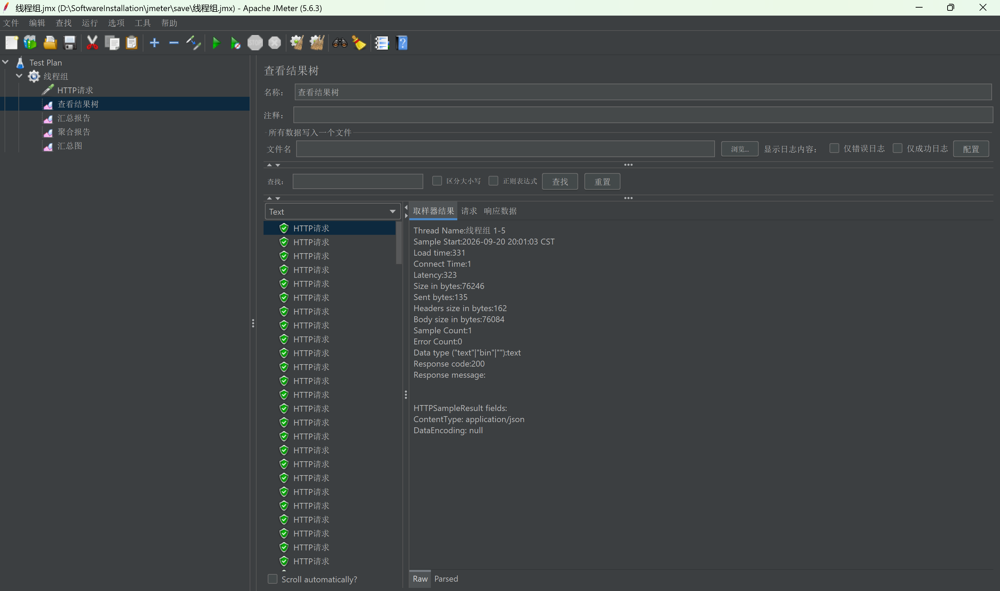

用来**确认请求真的成功了**：

```
Response code: 200
Response message:           ← 空表示正常
ContentType: application/json
DataEncoding: null
```

**⚠️ 压测前必看**：如果这里返回 4xx/5xx，那压出来的"响应时间"其实是在测错误处理的耗时，毫无意义。**先保证 200，再看时间。**

### 2.5 聚合报告 —— 核心读数

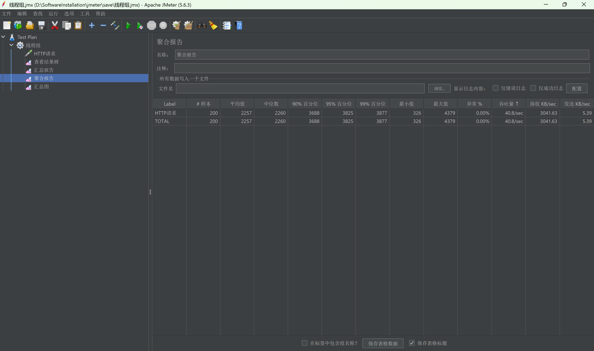

本次实测（200 样本）：

| 指标 | 值 | 怎么读 |
|---|---|---|
| **# 样本** | 200 | 与预期一致（200 线程 × 1 循环）✓ |
| 平均值 | **2257** ms | 受极端值影响，参考意义有限 |
| 中位数 | 2260 ms | **50% 的请求在 2.26 秒内完成** —— 比平均值更能代表"典型用户" |
| 90% 百分位 | **3688** ms | **90% 的请求在 3.7 秒内** —— 性能验收的核心指标 |
| 95% 百分位 | 3825 ms | |
| 99% 百分位 | 3877 ms | 长尾，反映最差体验 |
| 最小值 | 326 ms | 第一个请求（冷启动后第一次调用）反而最快 |
| 最大值 | 4379 ms | |
| **异常 %** | **0.00%** | **必须为 0**，非 0 要先解决错误 |
| 吞吐量 | 40.8/sec | 系统每秒能处理 40.8 个请求 |

### 2.6 汇总图

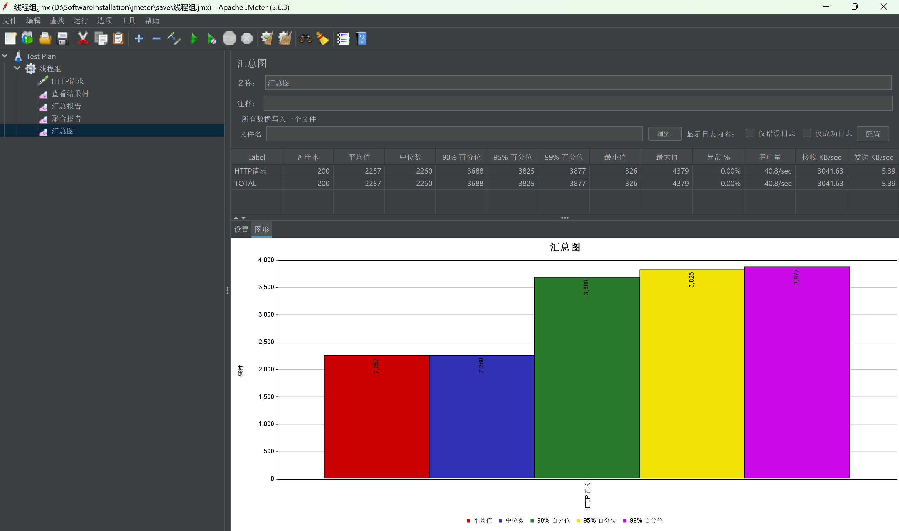

把上面那几个百分位画成柱状图，**一眼就能看出"中位数和 90% 分位差距很大"** —— 说明响应时间分布很分散，有相当一部分请求被拖慢了。

### 2.7 判断标准

一个"查分类列表"的简单读接口，**正常应该在几十毫秒内返回**。现在：

```
中位数 2260ms  →  比正常慢了两个数量级
```

**结论：确认有严重性能问题，进入下一步定位。**

---

## 三、VisualVM：缩小范围

### 3.1 前提：启动服务时必须开启 JMX

VisualVM 通过 **JMX**（Java Management Extensions）远程连接 JVM。**默认是关闭的**，必须在启动参数里显式打开：

```bash
# ① product（JMX 端口 10001）
nohup java \
-Dcom.sun.management.jmxremote \
-Dcom.sun.management.jmxremote.port=10001 \
-Dcom.sun.management.jmxremote.rmi.port=10001 \
-Djava.rmi.server.hostname=<your-vm-host-ip> \
-Dcom.sun.management.jmxremote.authenticate=false \
-Dcom.sun.management.jmxremote.ssl=false \
-jar gulimall-product-0.0.1-SNAPSHOT.jar \
> /mydata/logs/product.log 2>&1 &

# ② renren-fast（JMX 端口 8081）
nohup java \
-Dcom.sun.management.jmxremote \
-Dcom.sun.management.jmxremote.port=8081 \
-Dcom.sun.management.jmxremote.rmi.port=8081 \
-Djava.rmi.server.hostname=<your-vm-host-ip> \
-Dcom.sun.management.jmxremote.authenticate=false \
-Dcom.sun.management.jmxremote.ssl=false \
-jar renren-fast.jar \
> /mydata/logs/renren-fast.log 2>&1 &

# ③ gateway（JMX 端口 89）
nohup java \
-Dcom.sun.management.jmxremote \
-Dcom.sun.management.jmxremote.port=89 \
-Dcom.sun.management.jmxremote.rmi.port=89 \
-Djava.rmi.server.hostname=<your-vm-host-ip> \
-Dcom.sun.management.jmxremote.authenticate=false \
-Dcom.sun.management.jmxremote.ssl=false \
-jar gulimall-gateway-0.0.1-SNAPSHOT.jar \
> /mydata/logs/gateway.log 2>&1 &
```

`deploy/app/start-all.sh` 已按“HTTP 端口 + 1”自动加上 JMX 参数，默认开启；`ENABLE_JMX=0` 可关闭所有服务的 JMX。完整端口映射如下：

| 服务 | HTTP 端口 | JMX 端口 |
|---|---:|---:|
| gateway | 88 | 89 |
| coupon | 7000 | 7001 |
| member | 8000 | 8001 |
| renren-fast | 8080 | 8081 |
| order | 9000 | 9001 |
| product | 10000 | 10001 |
| ware | 11000 | 11001 |
| search | 12000 | 12001 |
| cart | 13000 | 13001 |
| seckill | 14000 | 14001 |
| agent | 15000 | 15001 |
| auth-server | 20000 | 20001 |
| third-party | 30000 | 30001 |

> 上面的手动命令只用于单独启动某个服务；用 `start-all.sh` 启动时不需要再手写这些参数。`JMX_HOST` 默认是 `<your-vm-host-ip>`，VisualVM 连接另一块网卡时用 `JMX_HOST=<your-vm-ip> ./start-all.sh` 覆盖。

**每个参数在干什么：**

| 参数 | 作用 |
|---|---|
| `-Dcom.sun.management.jmxremote` | 开启 JMX 远程管理 |
| `-Dcom.sun.management.jmxremote.port=10001` | JMX 连接端口（**每个服务要用不同端口**） |
| `-Dcom.sun.management.jmxremote.rmi.port=10001` | RMI 端口。**必须和上面一致**，否则在防火墙/NAT 环境下连不上 |
| `-Djava.rmi.server.hostname=<your-vm-host-ip>` | 告诉客户端"用这个 IP 回连我"。**不设或设成 127.0.0.1 会导致连接超时** |
| `-Dcom.sun.management.jmxremote.authenticate=false` | 关闭账号认证 |
| `-Dcom.sun.management.jmxremote.ssl=false` | 关闭 SSL |

> ⚠️ **安全警告**：`authenticate=false` + `ssl=false` = **任何人只要能访问端口就能完全控制这个 JVM**（可以执行任意操作）。
> `start-all.sh` 默认给 13 个服务都开 JMX，等于 13 个入口全部敞开。
> **只能在纯内网测试机用**，生产环境必须 `ENABLE_JMX=0`，或开认证（`-Dcom.sun.management.jmxremote.password.file=...`）并限制访问来源。
> 用完记得停掉带 JMX 的启动方式，或防火墙只放行压测机 IP。

### 3.2 添加 JMX 连接

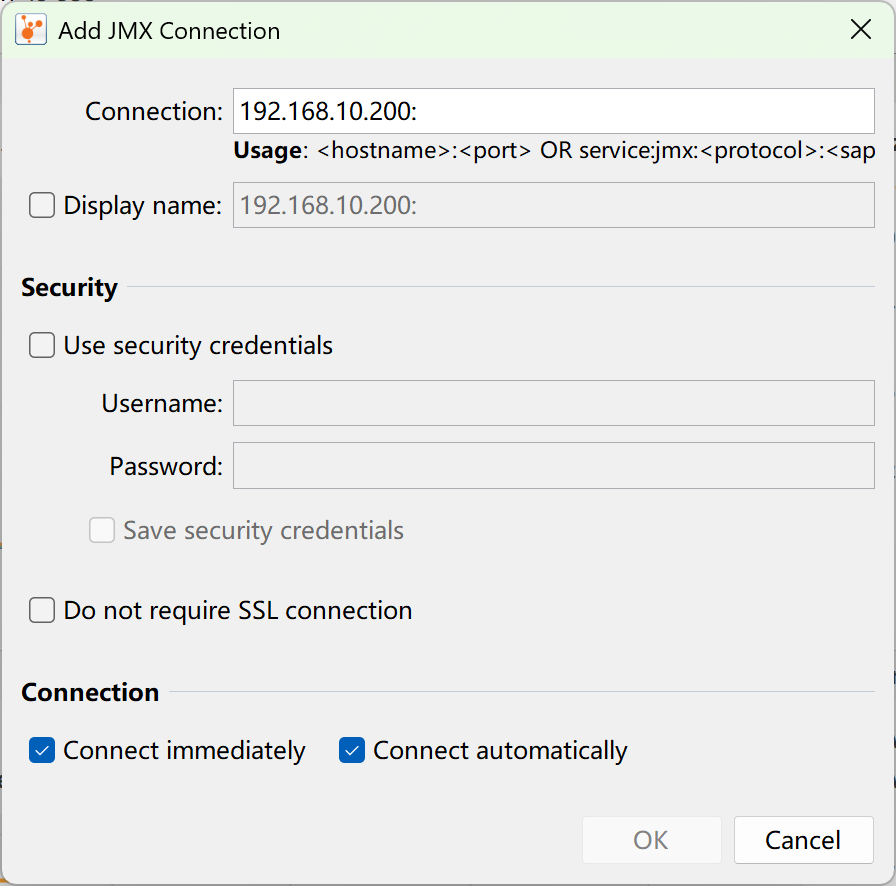

VisualVM → 右键左侧 `Remote` → **Add JMX Connection** → 填 `<your-vm-host-ip>:10001`。

> 连不上时按顺序查：① 端口按 3.1 的端口表填（product 是 10001、renren-fast 是 8081、gateway 是 89）；② `-Djava.rmi.server.hostname` 设了没；
> ③ 防火墙放行了吗（以 product 为例：`firewall-cmd --add-port=10001/tcp`）。

### 3.3 Monitor 面板：先看资源

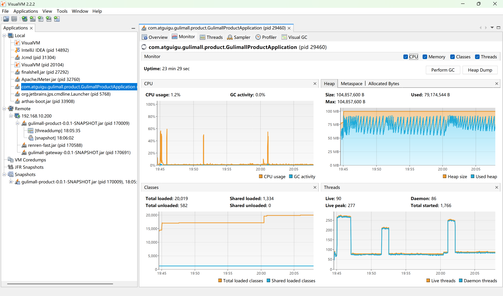

本次读数：

| 面板 | 数值 | 解读 |
|---|---|---|
| **CPU** | **1.2%** | 几乎不干活 |
| **GC 活动** | **0.0%** | 完全没有 GC 压力 |
| Heap Size / Used | 104 MB / 79 MB | 堆用了一半，正常 |
| Live Threads | 90 | |
| Total loaded classes | 20,019 | 正常 |

**这张图是本次排查的关键转折点：**

> **CPU 只有 1.2%、GC 是 0，但每个请求要 2.2 秒。**
>
> 如果瓶颈是"计算"或"内存"，CPU 或 GC 必然有一项飙高。两项都低，只剩一种可能：
> **线程在"等"什么东西** —— 等数据库连接、等远程调用、等锁、等 I/O。

**这一步把排查范围从"整个 JVM"直接缩小到"阻塞型问题"，不需要再看火焰图、不用查内存泄漏。**

### 3.4 Sampler 面板：方法级 CPU 采样

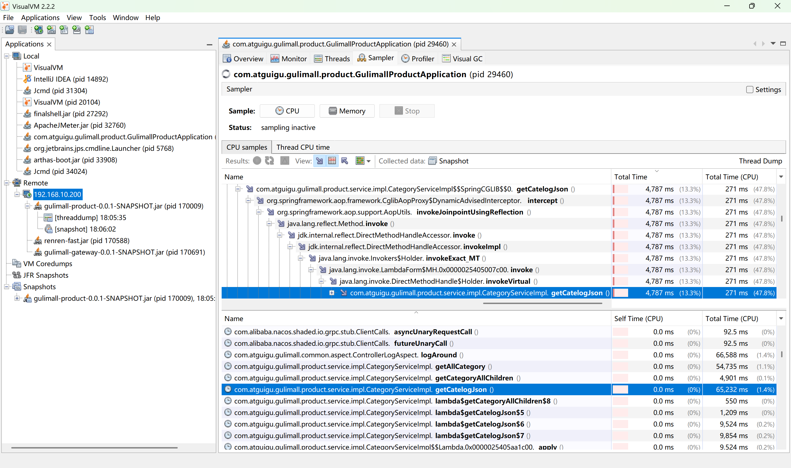

`Sampler` → `CPU` → `CPU samples`，会按方法累计 CPU 时间：

```
Total Time (CPU)  1,034,654 ms          ← 所有方法累计
       ...
com.atguigu.gulimall.product.service.impl.CategoryServiceImpl.getCatelogJson()   271 ms (47.8%)
    ↑ 注意这里是 "Total Time (CPU)"，271ms —— 很小！
```

**这份采样数据再次印证了上面的判断**：

- `getCatelogJson` 的 **CPU 时间只有 271ms**，但它的**墙钟耗时是 4787ms**
- `Self Time (CPU)` 几乎是 `0.0 ms`

**CPU 时间和墙钟时间差了将近 20 倍** → 这是"线程在等待"的铁证（等待期间不消耗 CPU）。

> **要分清两个概念**：
> - **CPU 时间**：线程真正占用处理器的时间
> - **墙钟时间（Wall Time）**：从方法开始到结束的真实耗时（包含等待）
>
> 两者差距大 = 在等；两者接近 = 在算。

### 3.5 Visual GC 面板：看 GC 细节

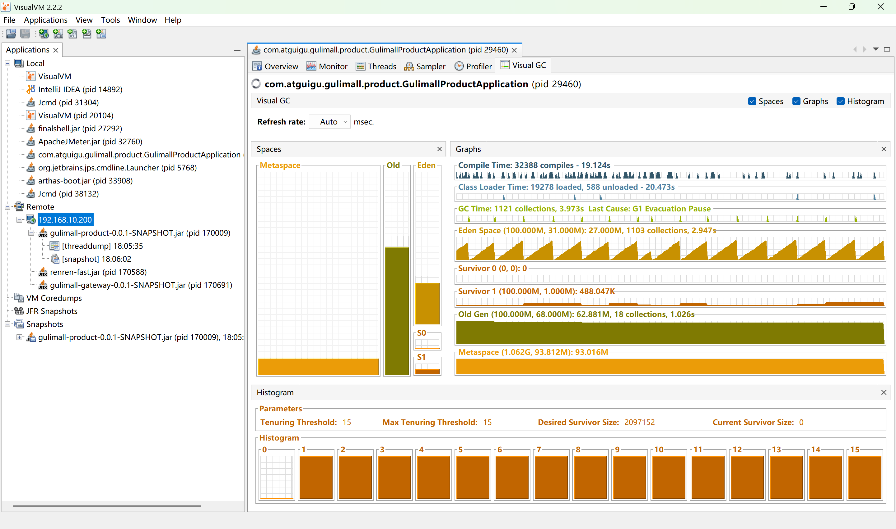

装了 **Visual GC** 插件后可用（Tools → Plugins 里安装）。本次读数：

| 项 | 值 |
|---|---|
| GC Time | 1121 次回收，累计 3.973 秒 |
| Eden Space | 27MB 已用（共 100MB） |
| Old Gen | 62.9MB 已用，18 次回收 |
| Metaspace | 93MB / 1.06GB |

**GC 总时间才 4 秒，Full GC 只有 18 次 → 完全没有 GC 问题。** 排除内存相关的可能。

> 什么时候该盯 GC：Full GC 频繁（几十秒一次）、GC 时间占比超过 5%、老年代持续增长不回落 → 内存泄漏或堆太小。

---

## 四、Arthas：定位到具体方法

### 4.1 装上并 attach

```bash
# 下载
curl -O https://arthas.aliyun.com/arthas-boot.jar

# 启动（会列出所有 Java 进程让你选）
java -jar arthas-boot.jar
```

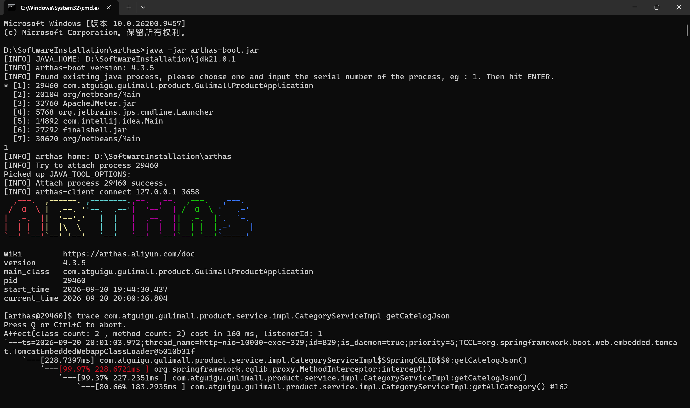

```
[INFO] Found existing java process, please choose one and input the serial number of the process
* [1]: 29460 com.atguigu.gulimall.product.GulimallProductApplication     ← 选这个
  [2]: 20104 org.netbeans.Main
  ...
1
[INFO] Attach process 29460 success.
```

> **Arthas 是 attach 到运行中的 JVM**，不需要重启服务、不需要改代码、不需要加依赖。

### 4.2 trace：追踪方法内部调用链

```bash
trace com.atguigu.gulimall.product.service.impl.CategoryServiceImpl getCatelogJson
```

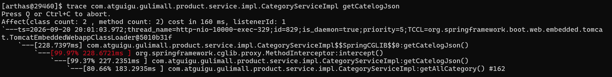

输出：

```
---ts=2026-09-20 20:01:03.972;thread_name=http-nio-10000-exec-329;id=829;is_daemon=true;priority=5;...
   ---[228.7397ms] com.atguigu.gulimall.product.service.impl.CategoryServiceImpl$$SpringCGLIB$$0:getCatelogJson()
       `---[99.97% 228.6721ms ] org.springframework.cglib.proxy.MethodInterceptor:intercept()
           `---[99.37% 227.2351ms ] com.atguigu.gulimall.product.service.impl.CategoryServiceImpl:getCatelogJson()
               `---[80.66% 183.2935ms ] com.atguigu.gulimall.product.service.impl.CategoryServiceImpl:getAllCategory() #162
```

**怎么读这个输出：**

| 元素 | 含义 |
|---|---|
| `---[228.7397ms]` | 这一层方法的总耗时 |
| 缩进层级 | 调用关系（下一层是被上一层调用的） |
| `[99.97% 228.6721ms]` | **占上层耗时的百分比** + 绝对耗时 |
| `#162` | 源码行号（这里是 `CategoryServiceImpl.java` 第 162 行） |
| `$$SpringCGLIB$$0` | Spring 生成的代理类（AOP 切面）；`intercept()` 就是切面在执行 |

**读数方法：**

1. 从最外层往里看，**找到那个"占比最高"的节点**
2. 这里 `getAllCategory()` 占 **80.66%** → 瓶颈就在它
3. 它是叶子节点（没有再往下展开）→ 说明它内部的耗时**不是自己算的，而是等出来的**（比如等数据库响应）

### 4.3 多次 trace 确认（排除偶发）

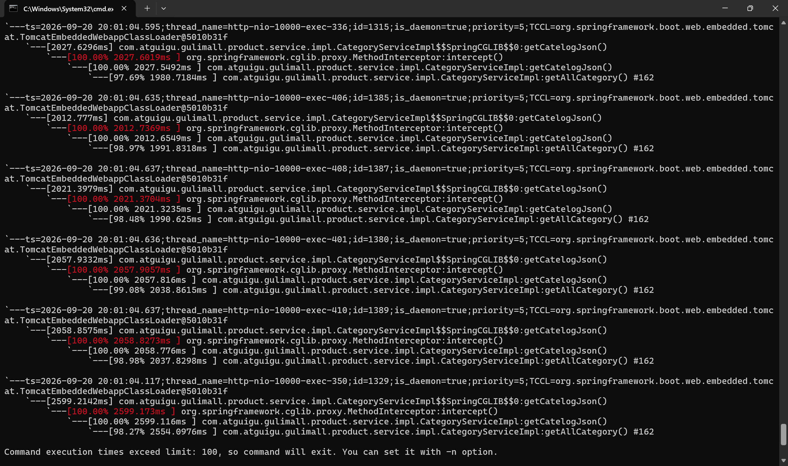

压测期间连续看 5 次，`getAllCategory()` 的占比：

```
---[228.7397ms] → getAllCategory() [80.66% 183.2935ms]
---[2027.6296ms] → getAllCategory() [97.69% 1980.7184ms]
---[2012.7771ms] → getAllCategory() [98.97% 1991.8318ms]
---[2021.3979ms] → getAllCategory() [98.48% 1990.625ms]
---[2057.9332ms] → getAllCategory() [99.08% 2038.8615ms]
---[2058.8575ms] → getAllCategory() [98.98% 2037.8298ms]
---[2599.2142ms] → getAllCategory() [98.27% 2554.0976ms]
```

**每次都稳定占 97%~99%** → 稳定复现的瓶颈，不是偶发抖动。

> **为什么要看多次**：单次 trace 可能正好碰上缓存命中、GC 停顿等偶发情况。
> **稳定复现的才算真瓶颈。**

### 4.4 Arthas 常用命令速查

| 命令 | 作用 | 场景 |
|---|---|---|
| `dashboard` | 全局概览（线程/内存/GC） | 只想快速看一眼 |
| **`trace 类 方法`** | **方法内部调用链耗时** | **★ 定位瓶颈的主力** |
| `trace 类 方法 -n 5` | 只抓 5 次 | 避免刷屏 |
| `trace 类 方法 '#cost > 100'` | 只抓耗时 >100ms 的调用 | 过滤掉正常请求 |
| `watch 类 方法 '{params, returnObj}'` | 看入参/返回值 | 确认参数对不对 |
| `thread -n 3` | 最忙的 3 个线程及其堆栈 | CPU 高时用 |
| `jad 类` | 反编译 | 确认线上跑的代码版本 |
| `monitor -c 5 类 方法` | 每 5 秒统计调用次数/成功率/平均耗时 | 长期观察 |
| `profiler start` / `profiler stop` | 生成火焰图 | CPU 瓶颈时用 |
| `quit` / `stop` | 退出；`stop` 会彻底卸载 | |

---

## 五、进阶内容（已拆分为独立文档）

完整排查案例和常见性能问题手册篇幅较大，已拆到 **《性能测试-常见问题手册.md》**：

| 该文档的章节 | 内容 |
|---|---|
| **一、完整排查案例** | 本次 200 并发压测 → VisualVM 缩小范围 → Arthas 定位方法 → 分层优化 → 复测的完整过程 |
| **二、常见性能问题分类手册** | **服务端配置 / 数据库 / 缓存 / JVM 内存 / 线程并发 / 远程调用** 六大类，每类给出 **现象 → 怎么查 → 怎么改** |
| **二、2.7 排查决策树** | 从"压测发现慢"一路分叉到具体查法，照着走就行 |

> 下面两章（注意事项、延伸阅读）是**用工具时的通用提醒**，留在本文档。

---

## 六、注意事项

### 6.1 压测机本身别成为瓶颈

JMeter 是 Java 写的，**它自己也要吃 CPU 和内存**。200 线程还好，上千线程时压测机可能先撑不住，
导致压出来的数据失真（看起来是服务慢，其实是压测机发不出请求）。

- 优先用**非 GUI 模式**：`jmeter -n -t 计划.jmx -l 结果.jtl`
- 加大 JMeter 堆：改 `jmeter.bat` 里的 `HEAP=-Xms1g -Xmx1g`
- 看 JMeter 自己的 CPU 占用（任务管理器）

### 6.2 压测环境要干净

- 关掉 IDEA、浏览器、杀毒软件（会抢 CPU）
- 确认没有其他人在用这台测试机
- 压测前**先跑一轮预热**，让 JIT 编译完成、连接池建好连接

### 6.3 别一上来就压生产

先在测试环境找到问题、验证修改效果。生产压测要挑低峰期，且要有回滚方案。

### 6.4 JMX 的安全问题

前面说过：`authenticate=false` + `ssl=false` 等于**把 JVM 完全敞开**。
测试完记得：

```bash
# 停止带 JMX 的进程，用普通方式重启
pkill -f gulimall-product
cd /mydata/app
nohup java -jar gulimall-product-0.0.1-SNAPSHOT.jar > /mydata/logs/product.log 2>&1 &
```

或者防火墙只放行压测机的 IP。

如果使用 `start-all.sh` 启动，先停掉对应进程，再执行 `ENABLE_JMX=0 ./start-all.sh`，新启动的进程不会开 JMX。

---

## 七、延伸阅读

**测试工具**

- JMeter 官方文档：https://jmeter.apache.org/usermanual/index.html
- Arthas 官方文档：https://arthas.aliyun.com/doc/
- VisualVM 官方文档：https://visualvm.github.io/documentation.html
- Eclipse MAT（堆 dump 分析）：https://eclipse.dev/mat/

**连接池 / 缓存**

- HikariCP 配置说明：https://github.com/brettwooldridge/HikariCP#configuration-knobs-baby
- Spring Boot Cache 抽象：https://docs.spring.io/spring-boot/reference/io/caching.html
- Spring Data Redis：https://docs.spring.io/spring-data/redis/reference/
- Caffeine（本地缓存）：https://github.com/ben-manes/caffeine

**数据库**

- MySQL 连接数相关参数：https://dev.mysql.com/doc/refman/8.4/en/server-system-variables.html
- MySQL 慢查询日志：https://dev.mysql.com/doc/refman/8.4/en/slow-query-log.html
- MySQL 锁等待排查：https://dev.mysql.com/doc/refman/8.4/en/innodb-locking.html

**JVM / 调优**

- Oracle JVM 调优指南（JDK 21）：https://docs.oracle.com/en/java/javase/21/gctuning/
- ZGC 介绍：https://wiki.openjdk.org/display/zgc
- Tomcat 连接器配置：https://tomcat.apache.org/tomcat-10.1-doc/config/http.html

**Spring Cloud 相关**

- OpenFeign 超时配置：https://docs.spring.io/spring-cloud-openfeign/reference/
- Sentinel 熔断限流：https://sentinelguard.io/zh-cn/docs/introduction.html
