# 1. Linux 创建与环境准备-介绍

## 1.1 基础配置

- VMware 17 + CentOS 10
- 处理器：2
- 内核：4
- 内存：8G
- 磁盘：20G

## 1.2 配置 root + 个人用户

## 1.3 网络配置

> 顺序很重要：**先在 VMware 里配好虚拟网络编辑器，再配 Linux 网卡**。
> 虚拟网络编辑器决定「网段、网关、DNS、桥接到哪块物理网卡」，Linux 里的 IP 只是这个网络的其中一台机器。
> 只配 Linux 网卡、不配虚拟网络编辑器，会出现「网卡配置看着对，但网关/DNS 不通」的问题。

### 1.3.1 虚拟网络编辑器（VMware 侧，先做）

**进入方式**

VMware 菜单栏 -> 编辑（Edit）-> 虚拟网络编辑器（Virtual Network Editor）。
（需要管理员权限才能改，点右下角「更改设置 Change Settings」解锁；Windows 下用管理员身份运行 VMware 更省事。）

**（1）NAT 网络：VMnet8（对应 ens33，让 Linux 自己联网）**

选中列表里的 **VMnet8**，确认：

- 类型：**NAT 模式**
- **子网 IP：192.168.119.0**
- **子网掩码：255.255.255.0**
- 勾选「**将主机虚拟适配器连接到此网络**」（勾了宿主机才会出现 `VMnet8` 网卡，后面的代理 `<your-vmware-nat-ip>` 才有落脚点）

然后点「**NAT 设置（NAT Settings）**」：

- **网关 IP：<your-vmware-dns-ip>**（Linux 里配的网关和 DNS 都是它，必须一致）
- 宿主机在 VMnet8 上的地址通常是 `<your-vmware-nat-ip>`，所以 Docker 代理要写 `http://<your-vmware-nat-ip>:7897`

点「**DHCP 设置（DHCP Settings）**」：

- 选择「使用本地 DHCP 服务」时，起始/结束地址范围要**避开 <your-vm-ip>**（本例是静态 IP）
- 或者干脆取消勾选 DHCP，纯静态配置

**（2）桥接网络：VMnet0（对应 ens36，让局域网访问 Linux）**

选中列表里的 **VMnet0**：

- 类型：**桥接模式（Bridged）**
- 「桥接到（Bridged to）」推荐选**具体的物理网卡**（宿主机正在上网的那块 WLAN / 以太网），不要选「自动」——「自动」会随机挑网卡，换网络后容易桥错。
- 注意：**宿主机所在局域网的网段必须是 <your-subnet>/24**，Linux 的 `<your-vm-host-ip>` 才有效；
  若宿主机实际是 `192.168.1.x`，要么把这里和 Linux 的 IP 一起改为 `192.168.1.x`，要么把宿主机 Wi-Fi 换成 `192.168.10.x` 的那个网络。

**（3）验证（在宿主机执行）**

```bash
ipconfig            # 看是否出现 VMware Network Adapter VMnet8，其 IPv4 应为 <your-vmware-nat-ip>
ping <your-vm-ip>   # 通 -> NAT 网络 OK
ping <your-vm-host-ip>    # 通 -> 桥接网络 OK
```

### 1.3.2 Linux 网卡配置

- **ens33：NAT 自己联网**
  - IPv4 地址：<your-vm-ip>
  - 子网掩码：255.255.255.0
  - 网关：<your-vmware-dns-ip>
  - DNS：<your-vmware-dns-ip>
- **ens36：桥接 局域网访问 Linux**
  - IPv4 地址：<your-vm-host-ip>
  - 子网掩码：255.255.255.0

> 说明：
> - `ens33` 是对应 VMnet8（NAT）的网卡，网关/DNS 都指向 NAT 网关 `<your-vmware-dns-ip>`；VMware 的 NAT 设备自带 DNS 代理，所以它可以当 DNS 用。
> - `ens36` 是对应 VMnet0（桥接）的网卡，IP 必须落在宿主机所在局域网的网段内。
> - 两块网卡各管一段：一个负责出公网，一个负责被局域网访问。

## 1.4 补充：公网访问服务器

1. 用户访问申请的地址，例如 www.example.com
2. 地址通过 nginx 反向代理处理访问实际 IP，例如 www.example.com -> <your-vm-host-ip>
3. IP 通过端口号访问服务 <your-vm-host-ip> -> 9001

> 注：<your-vm-host-ip> 为内网地址，公网用户无法直接访问，需通过公网 IP + 端口映射或经 nginx 转发。

## 1.5 补充：虚拟机扩容

> 说明：本文以「扩展 `/dev/sda3` 分区 → 扩容 LVM → 扩展 XFS 文件系统」为主线，最终把新增空间全部分配给根目录 `/`。（如果不是sda3按实际来）
 
**第 1 步：VMware 增加虚拟磁盘容量**

VMware 选中虚拟机 -> 设置 -> 硬盘 -> 扩展 -> 增加容量

**第 2 步：扩展 /dev/sda3**

sda3 是最后一个分区，而且后面就是未分配空间，可以直接扩展：

```bash
growpart /dev/sda 3
```

如果提示：

```bash
-bash: growpart: command not found
```

按照提示安装 growpart 即可。

成功后应该看到类似：

```text
CHANGED: partition=3 start=... old: size=... end=... new: size=...
```

**第 3 步：让 LVM 识别扩大的 PV**

执行：

```bash
pvresize /dev/sda3
```

然后查看：

```bash
pvs
```

应该能看到 PV 从大约 18G 变成 23G 左右。

**第 4 步：把空间全部给 /**

根目录对应：

```text
/dev/mapper/cs_192-root
```

先查看：

```bash
vgs
```

应该会看到类似：

```text
VG       VSize   VFree
cs_192   23G     5G
```

然后把剩余空间全部扩给 root：

```bash
lvextend -l +100%FREE /dev/mapper/cs_192-root
```

**第 5 步：扩展 XFS 文件系统**

根路径 `/` 是：

```text
xfs
```

所以执行：

```bash
xfs_growfs /
```

**第 6 步：确认**

```bash
df -hT /
```

原来：

```text
/dev/mapper/cs_192-root   xfs   16G   13G   3.0G   82% /
```

完成后应该变成大约：

```text
/dev/mapper/cs_192-root   xfs   21G   13G   8G   ...   /
```

> 具体容量会因为分区和 LVM 元数据略有差异。

# 2. Linux 安装应用（需要启动 VPN）

## 2.1 Docker

### 2.1.1 手册
https://docs.docker.com/engine/install/centos/

### 2.1.2 安装步骤
**步骤1：安装 dnf 插件包（其中包含 DNF 仓库管理命令）并搭建仓库**

```bash
sudo dnf -y install dnf-plugins-core
sudo dnf config-manager --add-repo https://download.docker.com/linux/centos/docker-ce.repo
```

**步骤2：安装最新版本 Docker**

```bash
sudo dnf install docker-ce docker-ce-cli containerd.io docker-buildx-plugin docker-compose-plugin
```

**步骤3：开机自启动 docker**

```bash
sudo systemctl enable --now docker
```

- 常规启动：`sudo systemctl start docker`

**补充说明——dnf 命令适用于 CentOS 8 及以上版本，CentOS 7 及以下版本使用 yum**

### 2.1.3 Docker Hub 仓库配置代理（否则需要配置阿里云镜像等）

**步骤1：创建 Docker daemon 代理配置**

```bash
mkdir -p /etc/systemd/system/docker.service.d
vim /etc/systemd/system/docker.service.d/http-proxy.conf
```

写入：

```ini
[Service]
Environment="HTTP_PROXY=http://<your-vmware-nat-ip>:7897"
Environment="HTTPS_PROXY=http://<your-vmware-nat-ip>:7897"
Environment="NO_PROXY=localhost,127.0.0.1,192.168.119.0/24,<your-subnet>/24"
```

保存。

**步骤2：重新加载 Docker**

```bash
systemctl daemon-reload
systemctl restart docker
```

**步骤3：确认 Docker daemon 已经拿到代理**

```bash
systemctl show --property=Environment docker
```

应该看到：

```ini
Environment=HTTP_PROXY=http://<your-vmware-nat-ip>:7897
Environment=HTTPS_PROXY=http://<your-vmware-nat-ip>:7897
```

### 2.1.4 Docker 优先启动 IPv4 访问

**步骤1：创建 gai.conf**

```bash
vim /etc/gai.conf
```

加入：

```ini
precedence ::ffff:0:0/96  100
```

保存。

**步骤2：重启 Docker**

```bash
systemctl restart docker
```

> 注：`precedence ::ffff:0:0/96  100` 影响系统 getaddrinfo 域名解析（让 IPv4 优先），对所有使用网络解析的程序生效，不限于 Docker。

# 3. Docker 安装应用

## 3.1 Docker Hub 镜像搜索

- dockerhub：[Repositories | liujiaxucn](https://hub.docker.com/repositories/liujiaxucn)，直接搜索镜像名称即可

## 3.2 MySQL 8.4.11

- MySQL 配置：[my.cnf](../../deploy/mysql/conf/my.cnf)

**步骤1：创建目录**

```bash
mkdir -p /mydata/docker
cd /mydata/docker
```

创建 MySQL 持久化目录：

```bash
mkdir -p mysql/{conf,data,log}
```

**步骤2：创建 compose 文件**

进入：

```bash
cd /mydata/docker
```

创建并写入（具体内容略）：

```bash
vim docker-compose.yml
```

**步骤3：创建 cnf 文件（具体内容略）**

```bash
cd /mydata/docker/mysql/conf
vim my.cnf
```

**步骤4：启动所有服务**

在 compose 文件目录执行：

```bash
cd /mydata/docker
docker compose up -d
```

**步骤5：使用 Navicat 连接 MySQL**

- 连接信息：<your-vm-host-ip> / root / <your-password> / 3306
- sqlyog 版本过低，不支持 MySQL 8.4.11，需要额外配置。

> 注：MySQL 8 默认使用 caching_sha2_password 认证，老版 SQLyog 不支持；且 MySQL 8.4 中 mysql_native_password 插件默认禁用、需显式启用，SQLyog 官方也已停止维护，建议改用 Navicat/DBeaver 等客户端。另 `mysql:8.4.11` 这个 tag 拉取前建议先确认是否存在。

## 3.3 Redis 7.2

- Redis 配置：[redis.conf](../../deploy/redis/conf/redis.conf)

1. 创建对应目录
2. 编写文件：docker-compose.yml + redis.conf
3. 本地 redis 客户端连接 Linux：<your-vm-host-ip> + 6379

## 3.4 目录结构

- 中间件编排：[docker-compose.yaml](../../deploy/docker-compose.yaml)
- 中间件组件清单：[Deploy组件一览](../Deploy/Deploy组件一览.md)

```text
docker
├── docker-compose.yml
│
├── mysql
│   ├── conf
│   │   └── my.cnf
│   ├── data
│   └── log
│
└── redis
    ├── data
    ├── conf
    │   └── redis.conf
    └── log
```

## 3.5 Docker Compose 常用管理命令

| 说明 | 命令 |
| --- | --- |
| 查看所有服务： | `docker compose ps` |
| 启动指定服务 | `docker compose up -d 服务名(例如mysql)` |
| 启动全部（首次启动会自动pull）： | `docker compose up -d` |
| 停止全部： | `docker compose stop` |
| 删除容器（保留数据）： | `docker compose down` |
| 查看日志： | `docker compose logs -f mysql` |
| 重启某个服务： | `docker compose restart mysql` |
| 进入容器 | `docker exec -it redis7.2 redis-cli` |

> 注：`docker exec -it redis7.2 redis-cli` 中的 `redis7.2` 为容器名，需与 docker-compose.yml 中定义的容器名一致。

# 4. 项目后端构建

**技术版本：**
- JDK 21
- Spring Boot 3.5.16
- Maven 3.9
- Node.js 16

## 4.1 Maven 配置

### 4.1.1 修改配置文件

- Maven 安装目录：`D:\SoftwareInstallation\Maven\apache-maven-3.9.3\conf`
- 修改 `settings.xml`：
  - mirrors 配置阿里云镜像
  - profiles 配置 JDK 版本

### 4.1.2 IDEA 设置

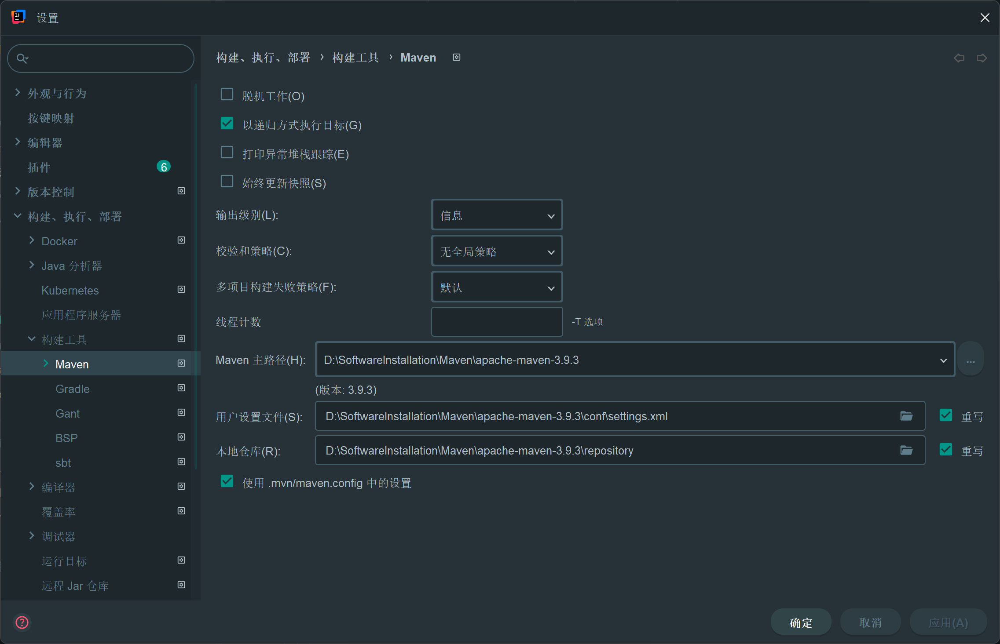

## 4.2 Git 配置

1. GitHub 初始化仓库
2. IDEA 创建项目：`git@github.com:liu-jiaxu/gulimall.git`

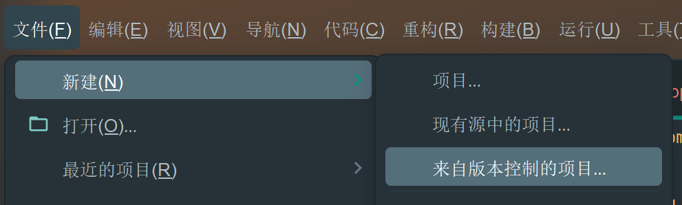

## 4.3 创建各个微服务项目

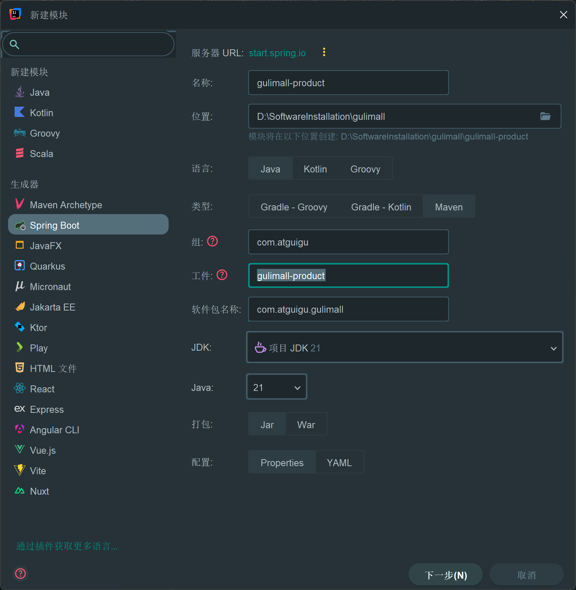

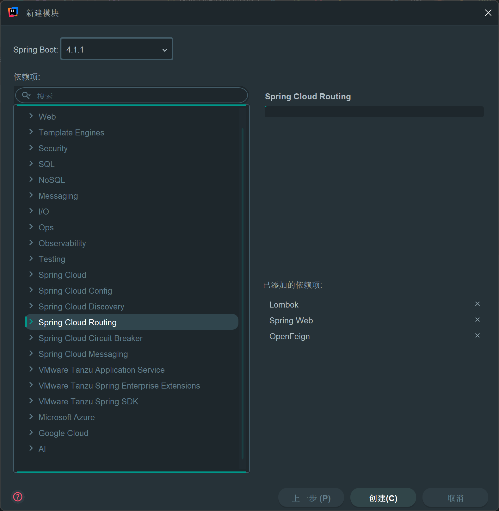

> 版本说明：创建模块时下拉框默认选中的是 Spring Boot 4.x（截图记录的是当时的界面），但 Spring Cloud Alibaba 2025.0.0.0 与 Spring Boot 4.x 尚未配套，后续统一改为 Spring Boot 3.5.16。所有模块的最终版本以根 `pom.xml` 为准。

## 4.4 配置项目 pom.xml 和 .gitignore 文件

**设计**

根 `pom.xml` 只做三件事：声明父工程与统一版本、聚合所有子模块、集中管理第三方 BOM。子模块不重复写版本号，避免各模块依赖版本漂移。

- 父工程使用 `spring-boot-starter-parent`，统一 Spring Boot、Jackson、日志等基础依赖版本。
- `spring-cloud-alibaba-dependencies` 以 BOM 方式导入，统一 Nacos、Sentinel、Seata 版本。
- `maven-javadoc-plugin` 配置自定义 tag（`@ClassName:`、`@Package:` 等），保证中文注释生成文档时不报错。
- 项目从初始的 5 个业务模块逐步扩展为当前的 16 个模块，下面贴的是最终版。

**根 pom.xml**

```xml
<?xml version="1.0" encoding="UTF-8"?>
<project xmlns="http://maven.apache.org/POM/4.0.0" xmlns:xsi="http://www.w3.org/2001/XMLSchema-instance"
         xsi:schemaLocation="http://maven.apache.org/POM/4.0.0 https://maven.apache.org/xsd/maven-4.0.0.xsd">

    <modelVersion>4.0.0</modelVersion>

    <parent>
        <groupId>org.springframework.boot</groupId>
        <artifactId>spring-boot-starter-parent</artifactId>
        <version>3.5.16</version>
        <relativePath/>
    </parent>

    <groupId>com.atguigu.gulimall</groupId>
    <artifactId>gulimall</artifactId>
    <version>0.0.1-SNAPSHOT</version>
    <name>gulimall</name>
    <description>总项目</description>

    <packaging>pom</packaging>

    <properties>
        <java.version>21</java.version>
        <spring-cloud.version>2025.0.3</spring-cloud.version>
        <spring-cloud-alibaba.version>2025.0.0.0</spring-cloud-alibaba.version>
    </properties>

    <!-- 聚合子模块 -->
    <modules>
        <module>gulimall-coupon</module>
        <module>gulimall-member</module>
        <module>gulimall-order</module>
        <module>gulimall-product</module>
        <module>gulimall-ware</module>
        <module>gulimall-cart</module>

        <module>gulimall-api</module>
        <module>gulimall-common</module>
        <module>gulimall-gateway</module>
        <module>gulimall-third-party</module>
        <module>gulimall-search</module>
        <module>gulimall-auth-server</module>
        <module>gulimall-seckill</module>
        <module>gulimall-agent</module>

        <module>gulimall-rocketmq</module>
        <module>gulimall-rabbitmq</module>
    </modules>

    <dependencyManagement>
        <dependencies>
            <!-- Spring Cloud Alibaba BOM：统一管理 Nacos / Seata 等组件版本 -->
            <dependency>
                <groupId>com.alibaba.cloud</groupId>
                <artifactId>spring-cloud-alibaba-dependencies</artifactId>
                <version>${spring-cloud-alibaba.version}</version>
                <type>pom</type>
                <scope>import</scope>
            </dependency>
        </dependencies>
    </dependencyManagement>

    <build>
        <plugins>
            <plugin>
                <groupId>org.apache.maven.plugins</groupId>
                <artifactId>maven-javadoc-plugin</artifactId>
                <version>3.12.0</version>
                <configuration>
                    <encoding>UTF-8</encoding>
                    <charset>UTF-8</charset>
                    <docencoding>UTF-8</docencoding>
                    <doclint>none</doclint>
                    <!-- 冒号要连在一起注册：javadoc 把 @ClassName: 整个当成 tag 名 -->
                    <tags>
                        <tag><name>ClassName:</name><placement>a</placement><head>ClassName</head></tag>
                        <tag><name>Package:</name><placement>a</placement><head>Package</head></tag>
                        <tag><name>Description:</name><placement>a</placement><head>Description</head></tag>
                        <tag><name>Author:</name><placement>a</placement><head>Author</head></tag>
                        <tag><name>Create:</name><placement>a</placement><head>Create</head></tag>
                        <tag><name>Version:</name><placement>a</placement><head>Version</head></tag>
                    </tags>
                </configuration>
            </plugin>

            <plugin>
                <groupId>org.apache.maven.plugins</groupId>
                <artifactId>maven-compiler-plugin</artifactId>
                <version>3.13.0</version>
            </plugin>
        </plugins>
    </build>

</project>
```

**.gitignore**

```gitignore
target/
pom.xml.tag
pom.xml.releaseBackup
pom.xml.versionsBackup
pom.xml.next
release.properties
dependency-reduced-pom.xml
buildNumber.properties
.mvn/timing.properties
# https://maven.apache.org/tools/wrapper/#Usage_with_or_without_Binary_JAR
.mvn/wrapper/maven-wrapper.jar

# Eclipse m2e generated files
# Eclipse Core
.project
# JDT-specific (Eclipse Java Development Tools)
.classpath

# 手动设置gitignore文件，忽略maven wrapper相关文件
**/mvnw
**/mvnw.cmd
**/.mvn
**/target/
.idea
.vscode
**/.gitignore

# 这些项目完成时必须从github上删除，因为涉及信息安全和无用信息
#/config
#/deploy
#/logs
#/TODO
#/document
#/jwt
```

> 说明：`config`、`deploy`、`logs`、`jwt` 等目录的忽略规则目前是注释状态，真实配置和密钥仍在仓库中。生产环境应启用这些规则，并把敏感配置迁到配置中心加密或密钥管理系统。

## 4.5 Git 提交，同时创建 develop 分支用于日常开发

**设计**

主分支 `main` 只保留稳定版本，日常开发在 `develop/gulimall/v0.1` 上按功能阶段提交。提交信息采用 Conventional Commits，格式为 `类型(范围): 描述`，一次提交对应一个可验证的功能点，便于回滚和按阶段生成文档。

**分支与提交约定**

| 项目 | 约定 |
|---|---|
| 主分支 | `main` |
| 开发分支 | `develop/gulimall/v0.1` |
| 功能类型 | `feat`、`fix`、`refactor`、`docs`、`test`、`chore` |
| 范围 | 模块名，如 `gulimall-product`、`gulimall-seckill` |
| 描述 | 中文，写清楚当前提交改了什么，不写“update”这类空话 |

**初始化与分支命令**

```bash
# 1. 初始化仓库并关联远程
git init
git remote add origin git@github.com:liu-jiaxu/gulimall.git

# 2. 首次提交主分支
git add .
git commit -m "fix(gulimall):项目初始结构构建"
git push -u origin main

# 3. 创建并切换到开发分支
git checkout -b develop/gulimall/v0.1

# 4. 后续按功能阶段提交
git add .
git commit -m "feat(gulimall-product):三级分类树形查询与前端页面"
git push -u origin develop/gulimall/v0.1
```

**提交信息示例（取自项目履历）**

```text
feat(gulimall-product):商品服务：属性分组全功能实现
feat(gulimall-product):商品上架功能实现（新增ES模块与md说明文档）
feat(gulimall-cart):购物车功能-1
feat：提交订单-7(seata使用+rabbitmq优化+取消支付功能)
feat:秒杀功能5（1.秒杀下单：Redis原子预扣+限购+10秒防重、MQ异步建单……）
```

## 4.6 代码快速开发（以 product 为例）

### 4.6.1 Gitee 下载人人开源项目

- 地址：https://gitee.com/renrenio
- 后端：renren-fast
- 前端：renren-fast-vue
- 代码生成器：renren-generator

### 4.6.2 添加到 Maven 项目

- renren-fast
- renren-generator
- 部分项目版本过旧，使用 AI 查询修改 Maven 依赖问题

### 4.6.3 修改配置

- **renren-fast：修改 `application-dev.yml` 数据库配置**
- **renren-generator：修改 `application.yml` 数据库配置、`generator.properties` 模块生成配置**
- **renren-fast-vue：前端使用 Node.js 16，本地开发一直保持该版本**

```bash
nvm install 16.20.2
nvm list
nvm use 16.20.2
npm install + npm run dev
```

### 4.6.4 renren-generator 生成代码

**设计**

renren-generator 读取 MySQL 的 `information_schema`，按表结构套模板生成后端 CRUD 与前端列表/表单页面。生成物只负责“能跑通的基础骨架”，业务校验、远程调用、缓存、事务等需要手写补充。

生成前必须同时改两个文件，否则会连错库或生成到错误模块：

1. `generator.properties`：包名、模块名、表前缀、作者、数据库类型到 Java 类型的映射。
2. `application.yml`：数据源地址、库名、账号密码。

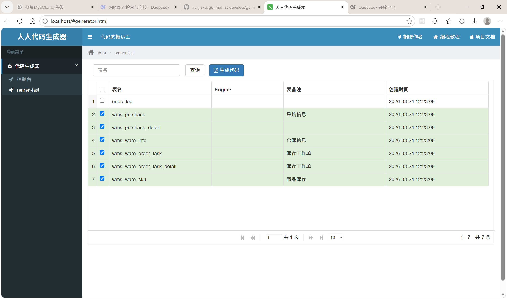

**generator.properties**

```properties
# 修改信息自动根据数据库表生成CRUD代码，一定要同时修改application.yml中的url数据源配置，才能正确生成代码
# product pms
# coupon sms
# member ums
# order oms
# ware wms
mainPath=com.atguigu
# 包名
package=com.atguigu.gulimall
moduleName=ware
# 作者
author=liujiaxu
# Email
email=15866718620@163.com
# 表前缀(类名不会包含表前缀)
tablePrefix=wms_

# 类型转换，配置信息
tinyint=Integer
smallint=Integer
mediumint=Integer
int=Integer
integer=Integer
bigint=Long
float=Float
double=Double
decimal=BigDecimal
bit=Boolean

char=String
varchar=String
tinytext=String
text=String
mediumtext=String
longtext=String

date=Date
datetime=Date
timestamp=Date

NUMBER=Integer
INT=Integer
INTEGER=Integer
BINARY_INTEGER=Integer
LONG=String
FLOAT=Float
BINARY_FLOAT=Float
DOUBLE=Double
BINARY_DOUBLE=Double
DECIMAL=BigDecimal
CHAR=String
VARCHAR=String
VARCHAR2=String
NVARCHAR=String
NVARCHAR2=String
CLOB=String
BLOB=String
DATE=Date
DATETIME=Date
TIMESTAMP=Date
TIMESTAMP(6)=Date

int8=Long
int4=Integer
int2=Integer
numeric=BigDecimal

nvarchar=String
```

**application.yml**

```yaml
server:
  port: 80

spring:
  datasource:
    type: com.alibaba.druid.pool.DruidDataSource
    driverClassName: com.mysql.cj.jdbc.Driver
    url: jdbc:mysql://${MYSQL_HOST}:${MYSQL_PORT}/${DB_NAME}?useUnicode=true&characterEncoding=UTF-8&useSSL=false&serverTimezone=Asia/Shanghai
    username: ${MYSQL_USERNAME}
    password: ${MYSQL_PASSWORD}

  jackson:
    time-zone: GMT+8
    date-format: yyyy-MM-dd HH:mm:ss
  web:
    resources:
      static-locations: classpath:/static/,classpath:/views/
  config:
    import:
      - optional:file:./config/common.yaml
      - optional:file:./config/${spring.application.name}.yaml
      - optional:file:../config/common.yaml
      - optional:file:../config/renren-generator.yaml

mybatis:
  mapper-locations: classpath:mapper/**/*.xml

pagehelper:
  reasonable: true
  supportMethodsArguments: true
  params: count=countSql

# 指定数据库，可选值有【mysql、oracle、sqlserver、postgresql、mongodb】
renren:
  database: mysql
```

**生成产物**

以 product 为例，生成后在 `gulimall-product` 下得到：

```text
gulimall-product
├── src/main/java/com/atguigu/gulimall/product
│   ├── entity      实体类，@TableName/@TableId/@Data
│   ├── dao         继承 BaseMapper，空接口
│   ├── service     继承 IService
│   ├── service/impl 继承 ServiceImpl
│   └── controller  @RestController + @RequestMapping
└── src/main/resources/mapper/product
    └── XxxDao.xml  MyBatis-Plus 基础 SQL
```

前端生成在 `renren-fast-vue/src/views/modules/{模块}/`，包括列表页与新增/修改弹窗两个 Vue 文件。

生成代码的固定特征：

```java
// 实体：表名、主键、序列化
@Data
@TableName("pms_brand")
public class BrandEntity implements Serializable {
    @TableId
    private Long brandId;
    private String name;
    // ...
}

// DAO：只继承 BaseMapper，不写方法
@Mapper
public interface BrandDao extends BaseMapper<BrandEntity> {}

// Service：继承 IService
public interface BrandService extends IService<BrandEntity> {}

// ServiceImpl：继承 ServiceImpl，queryPage 使用 Query + PageUtils
@Service("brandService")
public class BrandServiceImpl extends ServiceImpl<BrandDao, BrandEntity> implements BrandService {
    @Override
    public PageUtils queryPage(Map<String, Object> params) {
        IPage<BrandEntity> page = this.page(
                new Query<BrandEntity>().getPage(params),
                new QueryWrapper<>()
        );
        return new PageUtils(page);
    }
}

// Controller：统一返回 R，分页返回 PageUtils
@RestController
@RequestMapping("product/brand")
public class BrandController {
    @RequestMapping("/list")
    @RequiresPermissions("product:brand:list")
    public R list(@RequestParam Map<String, Object> params) {
        PageUtils page = brandService.queryPage(params);
        return R.ok().put("page", page);
    }
}
```

> 说明：上面只保留关键骨架，批量生成的重复 CRUD 不逐段贴出。真正需要阅读的是分页、统一返回、异常处理和前端路由这几块公共基础设施。

#### 4.6.4.1 MyBatis-Plus 分页配置

**设计**

MyBatis-Plus 的分页依赖 `MybatisPlusInterceptor` 和 `PaginationInnerInterceptor`。没有这个插件，`this.page(...)` 不会生成 `LIMIT`，而是把全表查回内存再分页。

**product 版**

```java
package com.atguigu.gulimall.product.config;

import com.baomidou.mybatisplus.annotation.DbType;
import com.baomidou.mybatisplus.extension.plugins.MybatisPlusInterceptor;
import com.baomidou.mybatisplus.extension.plugins.inner.PaginationInnerInterceptor;
import org.mybatis.spring.annotation.MapperScan;
import org.springframework.context.annotation.Bean;
import org.springframework.context.annotation.Configuration;
import org.springframework.transaction.annotation.EnableTransactionManagement;

@Configuration
// 开启事务
@EnableTransactionManagement
@MapperScan("com.atguigu.gulimall.product.dao")
public class MybatisPlusConfig {

    @Bean
    public MybatisPlusInterceptor mybatisPlusInterceptor() {
        MybatisPlusInterceptor interceptor = new MybatisPlusInterceptor();
        /*
          maxLimit       默认 Long.MAX_VALUE   单页最大限制
          overflow       默认 false            超过 maxLimit 时是否回退到 maxLimit
          optimizeJoin   默认 true             是否优化 join 分页（只 count 主表）
          dbType         默认 DbType.MYSQL     数据库类型，决定分页方言
         */
        interceptor.addInnerInterceptor(new PaginationInnerInterceptor(DbType.MYSQL));
        return interceptor;
    }
}
```

**ware 版**

ware 把 `@MapperScan` 和 `@EnableTransactionManagement` 放在启动类上，配置类只保留分页插件：

```java
package com.atguigu.gulimall.ware.config;

import com.baomidou.mybatisplus.annotation.DbType;
import com.baomidou.mybatisplus.extension.plugins.MybatisPlusInterceptor;
import com.baomidou.mybatisplus.extension.plugins.inner.PaginationInnerInterceptor;
import org.springframework.context.annotation.Bean;
import org.springframework.context.annotation.Configuration;

@Configuration
public class MybatisPlusConfig {

    @Bean
    public MybatisPlusInterceptor mybatisPlusInterceptor() {
        MybatisPlusInterceptor interceptor = new MybatisPlusInterceptor();
        interceptor.addInnerInterceptor(new PaginationInnerInterceptor(DbType.MYSQL));
        return interceptor;
    }
}
```

**分页参数约定**

```yaml
mybatis-plus:
  # classpath* 表示自己和引入其他模块的 mapper.xml 都会扫描
  mapper-locations: classpath*:/mapper/**/*.xml
  global-config:
    db-config:
      id-type: auto
```

前端传 `page`、`limit`，后端 `Query.getPage` 读取这两个参数，排序字段 `sidx`、`order` 会经过 `SQLFilter.sqlInject` 过滤，防止 SQL 注入。

#### 4.6.4.2 统一返回 R

**设计**

所有接口统一返回 `R`，本质是一个 `HashMap`，固定包含 `code` 和 `msg`，业务数据通过链式 `put` 追加。`code=0` 表示成功，非 0 表示业务失败。

**renren-fast 原始版**

```java
package io.renren.common.utils;

import org.apache.http.HttpStatus;

import java.util.HashMap;
import java.util.Map;

public class R extends HashMap<String, Object> {
    private static final long serialVersionUID = 1L;

    public R() {
        put("code", 0);
        put("msg", "success");
    }

    public static R error() {
        return error(HttpStatus.SC_INTERNAL_SERVER_ERROR, "未知异常，请联系管理员");
    }

    public static R error(String msg) {
        return error(HttpStatus.SC_INTERNAL_SERVER_ERROR, msg);
    }

    public static R error(int code, String msg) {
        R r = new R();
        r.put("code", code);
        r.put("msg", msg);
        return r;
    }

    public static R ok(String msg) {
        R r = new R();
        r.put("msg", msg);
        return r;
    }

    public static R ok(Map<String, Object> map) {
        R r = new R();
        r.putAll(map);
        return r;
    }

    public static R ok() {
        return new R();
    }

    public R put(String key, Object value) {
        super.put(key, value);
        return this;
    }
}
```

**迁移到 common 后扩展的能力**

`gulimall-common` 的 `R` 在此基础上增加了泛型反序列化和 `getCode()`：

```java
public class R extends HashMap<String, Object> {
    private static final long serialVersionUID = 1L;

    /**
     * 从 R 中取出指定 key 的数据，并按 TypeReference 反序列化成目标类型。
     * Feign 返回的 R 里的数据是 LinkedHashMap，直接强转会失败，必须走一次 JSON 转换。
     */
    public <T> T getData(String key, TypeReference<T> typeReference) {
        Object data = get(key);
        String jsonString = JSON.toJSONString(data);
        return JSON.parseObject(jsonString, typeReference.getType());
    }

    public R() {
        put("code", 0);
        put("msg", "success");
    }

    // error/ok/put 与 renren 版一致

    public Integer getCode() {
        return (Integer) this.get("code");
    }
}

// 更推荐的泛型返回结构，当前保留在 R.java 文件末尾作为备选
@Data
class Result<T> {
    private Integer code;
    private String message;
    private T data;

    private Result() {}

    public static <T> Result<T> build(T body, Integer code, String message) {
        Result<T> result = new Result<>();
        result.setData(body);
        result.setCode(code);
        result.setMessage(message);
        return result;
    }
}
```

#### 4.6.4.3 全局异常处理

**设计**

业务代码只负责抛异常，统一由 `@RestControllerAdvice` 转成 `R`，避免每个 Controller 写 try/catch。renren-fast 处理自身后台异常，common 处理业务服务异常和 Shiro 权限异常。

**renren-fast 的异常处理**

```java
package io.renren.common.exception;

import io.renren.common.utils.R;
import org.apache.shiro.authz.AuthorizationException;
import org.slf4j.Logger;
import org.slf4j.LoggerFactory;
import org.springframework.dao.DuplicateKeyException;
import org.springframework.web.bind.annotation.ExceptionHandler;
import org.springframework.web.bind.annotation.RestControllerAdvice;
import org.springframework.web.servlet.NoHandlerFoundException;

@RestControllerAdvice
public class RRExceptionHandler {
    private Logger logger = LoggerFactory.getLogger(getClass());

    @ExceptionHandler(RRException.class)
    public R handleRRException(RRException e) {
        R r = new R();
        r.put("code", e.getCode());
        r.put("msg", e.getMessage());
        return r;
    }

    @ExceptionHandler(NoHandlerFoundException.class)
    public R handlerNoFoundException(Exception e) {
        logger.error(e.getMessage(), e);
        return R.error(404, "路径不存在，请检查路径是否正确");
    }

    @ExceptionHandler(DuplicateKeyException.class)
    public R handleDuplicateKeyException(DuplicateKeyException e) {
        logger.error(e.getMessage(), e);
        return R.error("数据库中已存在该记录");
    }

    @ExceptionHandler(AuthorizationException.class)
    public R handleAuthorizationException(AuthorizationException e) {
        logger.error(e.getMessage(), e);
        return R.error("没有权限，请联系管理员授权");
    }

    @ExceptionHandler(Exception.class)
    public R handleException(Exception e) {
        logger.error(e.getMessage(), e);
        return R.error();
    }
}
```

**自定义业务异常**

```java
package com.atguigu.gulimall.common.exception;

import com.atguigu.gulimall.common.enums.BizCodeEnum;
import lombok.Getter;
import lombok.Setter;

import java.text.MessageFormat;

@Setter
@Getter
public class RRException extends RuntimeException {
    private static final long serialVersionUID = 1L;

    private String msg;
    private int code = 500;

    public RRException(String msg) {
        super(msg);
        this.msg = msg;
    }

    public RRException(String msg, Throwable e) {
        super(msg, e);
        this.msg = msg;
    }

    public RRException(String msg, int code) {
        super(msg);
        this.msg = msg;
        this.code = code;
    }

    public RRException(String msg, int code, Throwable e) {
        super(msg, e);
        this.msg = msg;
        this.code = code;
    }

    public RRException(BizCodeEnum error) {
        this(error.getMsg(), error.getCode());
    }

    public RRException(BizCodeEnum error, Object... args) {
        this(MessageFormat.format(error.getMsg(), args), error.getCode());
    }
}
```

**Shiro 权限异常统一处理**

```java
package com.atguigu.gulimall.common.exception;

import com.atguigu.gulimall.common.utils.R;
import org.apache.shiro.authz.UnauthenticatedException;
import org.apache.shiro.authz.UnauthorizedException;
import org.springframework.http.HttpStatus;
import org.springframework.web.bind.annotation.ExceptionHandler;
import org.springframework.web.bind.annotation.ResponseStatus;
import org.springframework.web.bind.annotation.RestControllerAdvice;

@RestControllerAdvice
public class ShiroExceptionHandler {

    @ExceptionHandler(UnauthenticatedException.class)
    @ResponseStatus(HttpStatus.UNAUTHORIZED)
    public R handleUnauthenticated(UnauthenticatedException e) {
        return R.error(HttpStatus.UNAUTHORIZED.value(), "未登录或登录已过期");
    }

    @ExceptionHandler(UnauthorizedException.class)
    @ResponseStatus(HttpStatus.FORBIDDEN)
    public R handleUnauthorized(UnauthorizedException e) {
        return R.error(HttpStatus.FORBIDDEN.value(), "没有操作权限");
    }
}
```

#### 4.6.4.4 前端重点

**1. 全局挂载与请求封装**

`src/main.js` 把 axios 实例、权限判断、PubSub 挂到 Vue 原型上：

```js
import Vue from 'vue'
import App from '@/App'
import router from '@/router'
import store from '@/store'
import VueCookie from 'vue-cookie'
import '@/element-ui'
import '@/icons'
import '@/element-ui-theme'
import '@/assets/scss/index.scss'
import httpRequest from '@/utils/httpRequest'
import { isAuth } from '@/utils'
import cloneDeep from 'lodash/cloneDeep'
import PubSub from 'pubsub-js'

Vue.use(VueCookie)
Vue.config.productionTip = false

Vue.prototype.$http = httpRequest
Vue.prototype.isAuth = isAuth
Vue.prototype.PubSub = PubSub
window.PubSub = PubSub

window.SITE_CONFIG['storeState'] = cloneDeep(store.state)

new Vue({
  el: '#app',
  router,
  store,
  template: '<App/>',
  components: { App }
})
```

`src/utils/httpRequest.js` 负责 token、401 跳转、URL 与参数处理：

```js
import Vue from 'vue'
import axios from 'axios'
import router from '@/router'
import qs from 'qs'
import merge from 'lodash/merge'
import { clearLoginInfo } from '@/utils'

const http = axios.create({
  timeout: 1000 * 30,
  withCredentials: true,
  headers: {
    'Content-Type': 'application/json; charset=utf-8'
  }
})

// 请求拦截：从 Cookie 取 token 放进请求头
http.interceptors.request.use(config => {
  config.headers['token'] = Vue.cookie.get('token')
  return config
}, error => Promise.reject(error))

// 响应拦截：401 清登录信息并回登录页
http.interceptors.response.use(response => {
  if (response.data && response.data.code === 401) {
    clearLoginInfo()
    router.push({ name: 'login' })
  }
  return response
}, error => Promise.reject(error))

// 统一拼接后端地址
http.adornUrl = (actionName) => {
  return (process.env.NODE_ENV !== 'production' && process.env.OPEN_PROXY ? '/proxyApi/' : window.SITE_CONFIG.baseUrl) + actionName
}

// GET 参数加时间戳，避免浏览器缓存
http.adornParams = (params = {}, openDefaultParams = true) => {
  var defaults = { 't': new Date().getTime() }
  return openDefaultParams ? merge(defaults, params) : params
}

// POST body 加时间戳，支持 json/form 两种编码
http.adornData = (data = {}, openDefaultData = true, contentType = 'json') => {
  var defaults = { 't': new Date().getTime() }
  data = openDefaultData ? merge(defaults, data) : data
  return contentType === 'json' ? JSON.stringify(data) : qs.stringify(data)
}

export default http
```

**2. 动态菜单路由**

后台菜单表 `sys_menu.url` 直接写 `product/category`，前端在 `src/router/index.js` 里根据菜单动态加载组件：

```js
function fnAddDynamicMenuRoutes (menuList = [], routes = []) {
  var temp = []
  for (var i = 0; i < menuList.length; i++) {
    if (menuList[i].list && menuList[i].list.length >= 1) {
      temp = temp.concat(menuList[i].list)
    } else if (menuList[i].url && /\S/.test(menuList[i].url)) {
      menuList[i].url = menuList[i].url.replace(/^\//, '')
      var route = {
        path: menuList[i].url.replace('/', '-'),
        component: null,
        name: menuList[i].url.replace('/', '-'),
        meta: {
          menuId: menuList[i].menuId,
          title: menuList[i].name,
          isDynamic: true,
          isTab: true,
          iframeUrl: ''
        }
      }
      if (isURL(menuList[i].url)) {
        route['path'] = `i-${menuList[i].menuId}`
        route['name'] = `i-${menuList[i].menuId}`
        route['meta']['iframeUrl'] = menuList[i].url
      } else {
        try {
          route['component'] = _import(`modules/${menuList[i].url}`) || null
        } catch (e) {}
      }
      routes.push(route)
    }
  }
  if (temp.length >= 1) {
    fnAddDynamicMenuRoutes(temp, routes)
  } else {
    mainRoutes.name = 'main-dynamic'
    mainRoutes.children = routes
    router.addRoutes([
      mainRoutes,
      { path: '*', redirect: { name: '404' } }
    ])
  }
}
```

菜单 url 与组件的对应关系：

```text
sys_menu.url = 'product/category'  ->  src/views/modules/product/category.vue
sys_menu.url = 'product/brand'     ->  src/views/modules/product/brand.vue
sys_menu.url = 'product/attrgroup' ->  src/views/modules/product/attrgroup.vue
sys_menu.url = 'product/spu'       ->  src/views/modules/product/spu.vue
sys_menu.url = 'product/spuadd'    ->  src/views/modules/product/spuadd.vue
sys_menu.url = 'product/manager'   ->  src/views/modules/product/manager.vue
```

**3. 列表分页写法**

renren-fast-vue 没有独立分页组件，每个列表页内联 `el-pagination`：

```html
<el-pagination
  @size-change="sizeChangeHandle"
  @current-change="currentChangeHandle"
  :current-page="pageIndex"
  :page-sizes="[10, 20, 50, 100]"
  :page-size="pageSize"
  :total="totalPage"
  layout="total, sizes, prev, pager, next, jumper">
</el-pagination>
```

```js
data() {
  return {
    pageIndex: 1,
    pageSize: 10,
    totalPage: 0
  }
},
methods: {
  getDataList() {
    this.$http({
      url: this.$http.adornUrl('/product/brand/list'),
      method: 'get',
      params: this.$http.adornParams({
        'page': this.pageIndex,
        'limit': this.pageSize,
        'key': this.dataForm.key
      })
    }).then(({ data }) => {
      if (data && data.code === 0) {
        this.dataList = data.page.list
        this.totalPage = data.page.totalCount
      }
    })
  },
  sizeChangeHandle(val) {
    this.pageSize = val
    this.pageIndex = 1
    this.getDataList()
  },
  currentChangeHandle(val) {
    this.pageIndex = val
    this.getDataList()
  }
}
```

**4. 上传组件**

renren-fast-vue 的通用上传组件在 `src/components/upload/singleUpload.vue`，品牌 logo、商品图片都复用它。改造后走 MinIO 预签名 URL 直传，具体代码在 6.2 文件上传一节展开。

**5. 商品模块页面清单**

```text
renren-fast-vue/src/views/modules/product
├── attr-add-or-update.vue
├── attr-group-relation.vue
├── attrgroup-add-or-update.vue
├── attrgroup.vue
├── attrupdate.vue
├── baseattr.vue
├── brand-add-or-update.vue
├── brand.vue
├── category.vue
├── manager.vue
├── saleattr.vue
├── spu.vue
├── spuadd.vue
└── spuinfo.vue
```

### 4.6.5 构建 common 模块

**设计**

common 模块只放“所有业务服务都需要、且与具体业务无关”的东西：统一返回、异常、分页、常量、校验分组、防注入工具、可选鉴权。它不引入 Sentinel、Seata、链路追踪等只有部分模块需要的依赖，避免所有服务被动加载。

其他业务模块通过 Maven 依赖引入 common：

```xml
<dependency>
    <groupId>com.atguigu.gulimall</groupId>
    <artifactId>gulimall-common</artifactId>
    <version>0.0.1-SNAPSHOT</version>
</dependency>
```

**common 的关键依赖**

```xml
<dependencies>
    <!-- web + servlet，供过滤器/异常处理使用 -->
    <dependency>
        <groupId>org.springframework.boot</groupId>
        <artifactId>spring-boot-starter-web</artifactId>
        <version>3.5.16</version>
    </dependency>
    <dependency>
        <groupId>jakarta.servlet</groupId>
        <artifactId>jakarta.servlet-api</artifactId>
        <version>5.0.0</version>
        <scope>provided</scope>
    </dependency>

    <!-- optional：只有引入了 Redis 的模块才装配 Redis 城市存储 -->
    <dependency>
        <groupId>org.springframework.boot</groupId>
        <artifactId>spring-boot-starter-data-redis</artifactId>
        <optional>true</optional>
    </dependency>

    <!-- MyBatis-Plus + 分页 + MySQL 驱动 -->
    <dependency>
        <groupId>com.baomidou</groupId>
        <artifactId>mybatis-plus-boot-starter</artifactId>
        <version>3.5.16</version>
    </dependency>
    <dependency>
        <groupId>org.mybatis</groupId>
        <artifactId>mybatis-spring</artifactId>
        <version>3.0.6</version>
    </dependency>
    <dependency>
        <groupId>com.baomidou</groupId>
        <artifactId>mybatis-plus-jsqlparser</artifactId>
        <version>3.5.16</version>
    </dependency>
    <dependency>
        <groupId>mysql</groupId>
        <artifactId>mysql-connector-java</artifactId>
        <version>8.0.32</version>
    </dependency>

    <!-- JSON、AOP、校验、Lombok -->
    <dependency>
        <groupId>com.alibaba.fastjson2</groupId>
        <artifactId>fastjson2</artifactId>
        <version>2.0.58</version>
    </dependency>
    <dependency>
        <groupId>org.springframework.boot</groupId>
        <artifactId>spring-boot-starter-aop</artifactId>
        <version>3.5.16</version>
    </dependency>
    <dependency>
        <groupId>org.springframework.boot</groupId>
        <artifactId>spring-boot-starter-validation</artifactId>
    </dependency>
    <dependency>
        <groupId>org.projectlombok</groupId>
        <artifactId>lombok</artifactId>
    </dependency>
    <dependency>
        <groupId>io.projectreactor</groupId>
        <artifactId>reactor-core</artifactId>
    </dependency>

    <!-- Shiro 2.2.1，jakarta classifier，适配 Spring Boot 3 -->
    <dependency>
        <groupId>org.apache.shiro</groupId>
        <artifactId>shiro-core</artifactId>
        <version>2.2.1</version>
        <classifier>jakarta</classifier>
    </dependency>
    <dependency>
        <groupId>org.apache.shiro</groupId>
        <artifactId>shiro-web</artifactId>
        <version>2.2.1</version>
        <classifier>jakarta</classifier>
    </dependency>
    <dependency>
        <groupId>org.apache.shiro</groupId>
        <artifactId>shiro-spring</artifactId>
        <version>2.2.1</version>
        <classifier>jakarta</classifier>
        <exclusions>
            <exclusion>
                <groupId>org.apache.shiro</groupId>
                <artifactId>shiro-core</artifactId>
            </exclusion>
            <exclusion>
                <groupId>org.apache.shiro</groupId>
                <artifactId>shiro-web</artifactId>
            </exclusion>
        </exclusions>
    </dependency>

    <!-- Nacos 注册 + 配置、OpenFeign、LoadBalancer -->
    <dependency>
        <groupId>com.alibaba.cloud</groupId>
        <artifactId>spring-cloud-starter-alibaba-nacos-discovery</artifactId>
    </dependency>
    <dependency>
        <groupId>com.alibaba.cloud</groupId>
        <artifactId>spring-cloud-starter-alibaba-nacos-config</artifactId>
    </dependency>
    <dependency>
        <groupId>org.springframework.cloud</groupId>
        <artifactId>spring-cloud-starter-openfeign</artifactId>
    </dependency>
    <dependency>
        <groupId>org.springframework.cloud</groupId>
        <artifactId>spring-cloud-starter-loadbalancer</artifactId>
    </dependency>
</dependencies>
```

> 说明：Sentinel、Seata、Micrometer Tracing 的依赖特意不放在 common，由真正使用的模块单独引入，避免无关服务被迫加载。

**分页工具 PageUtils**

```java
package com.atguigu.gulimall.common.utils;

import com.baomidou.mybatisplus.core.metadata.IPage;
import lombok.Data;

import java.io.Serializable;
import java.util.List;

@Data
public class PageUtils implements Serializable {
    private static final long serialVersionUID = 1L;
    private int totalCount;
    private int pageSize;
    private int totalPage;
    private int currPage;
    private List<?> list;

    public PageUtils(List<?> list, int totalCount, int pageSize, int currPage) {
        this.list = list;
        this.totalCount = totalCount;
        this.pageSize = pageSize;
        this.currPage = currPage;
        this.totalPage = (int) Math.ceil((double) totalCount / pageSize);
    }

    public PageUtils(IPage<?> page) {
        this.list = page.getRecords();
        this.totalCount = (int) page.getTotal();
        this.pageSize = (int) page.getSize();
        this.currPage = (int) page.getCurrent();
        this.totalPage = (int) page.getPages();
    }
}
```

**分页参数与排序 Query**

```java
package com.atguigu.gulimall.common.utils;

import com.atguigu.gulimall.common.xss.SQLFilter;
import com.baomidou.mybatisplus.core.metadata.IPage;
import com.baomidou.mybatisplus.core.metadata.OrderItem;
import com.baomidou.mybatisplus.extension.plugins.pagination.Page;
import org.apache.commons.lang.StringUtils;

import java.util.Map;

public class Query<T> {

    public IPage<T> getPage(Map<String, Object> params) {
        return this.getPage(params, null, false);
    }

    public IPage<T> getPage(Map<String, Object> params, String defaultOrderField, boolean isAsc) {
        // 1. 默认第 1 页、每页 10 条
        long curPage = 1;
        long limit = 10;

        if (params.get(Constant.PAGE) != null) {
            curPage = Long.parseLong((String) params.get(Constant.PAGE));
        }
        if (params.get(Constant.LIMIT) != null) {
            limit = Long.parseLong((String) params.get(Constant.LIMIT));
        }

        // 2. 构造 MyBatis-Plus 分页对象
        Page<T> page = new Page<>(curPage, limit);
        params.put(Constant.PAGE, page);

        // 3. 排序字段必须过滤，防止拼接 SQL 注入
        String orderField = SQLFilter.sqlInject((String) params.get(Constant.ORDER_FIELD));
        String order = (String) params.get(Constant.ORDER);

        if (StringUtils.isNotEmpty(orderField) && StringUtils.isNotEmpty(order)) {
            if (Constant.ASC.equalsIgnoreCase(order)) {
                return page.addOrder(OrderItem.asc(orderField));
            } else {
                return page.addOrder(OrderItem.desc(orderField));
            }
        }

        // 4. 没有排序字段时使用默认排序，或保持不排序
        if (StringUtils.isBlank(defaultOrderField)) {
            return page;
        }

        if (isAsc) {
            page.addOrder(OrderItem.asc(defaultOrderField));
        } else {
            page.addOrder(OrderItem.desc(defaultOrderField));
        }

        return page;
    }
}
```

**分页常量**

```java
package com.atguigu.gulimall.common.utils;

public class Constant {
    public static final int SUPER_ADMIN = 1;
    public static final String PAGE = "page";
    public static final String LIMIT = "limit";
    public static final String ORDER_FIELD = "sidx";
    public static final String ORDER = "order";
    public static final String ASC = "asc";

    public enum MenuType {
        CATALOG(0), MENU(1), BUTTON(2);
        private int value;
        MenuType(int value) { this.value = value; }
        public int getValue() { return value; }
    }

    public enum ScheduleStatus {
        NORMAL(0), PAUSE(1);
        private int value;
        ScheduleStatus(int value) { this.value = value; }
        public int getValue() { return value; }
    }
}
```

**业务错误码 BizCodeEnum**

错误码固定 5 位，前段表示模块，规则是“服务端口 ÷ 1000”。例如商品 10000 → 10，仓储 11000 → 11，购物车 13000 → 13，秒杀 14000 → 14，认证 20000 → 20。

```java
package com.atguigu.gulimall.common.enums;

public enum BizCodeEnum {

    /* 99：通用 */
    UNKNOW_EXCEPTION(99000, "系统未知异常"),
    VALID_EXCEPTION(99001, "参数格式校验失败"),
    ILLEGAL_CHARACTER_EXCEPTION(99002, "包含非法字符"),

    /* 08：会员 */
    USER_NAME_EXISTS(8001, "用户名{0}已存在"),
    PHONE_EXISTS(8002, "手机号{0}已存在"),
    LOGIN_ACCT_PASSWORD_INVALID(8003, "账号或密码错误"),
    MEMBER_NOT_LOGIN(8004, "请先登录"),

    /* 09：订单 */
    ORDER_NOT_LOGIN(9001, "登录已失效，请重新登录"),
    ORDER_TOKEN_INVALID(9002, "订单已提交或已过期，请刷新页面重新提交"),
    ORDER_ADDRESS_INVALID(9003, "收货地址无效，请重新选择"),
    ORDER_CART_EMPTY(9004, "购物车为空，无法下单"),
    ORDER_PRICE_CHANGED(9005, "商品价格有变动，请刷新页面重新确认后再提交"),
    ORDER_STOCK_NOT_ENOUGH(9006, "以下商品库存不足，请调整后重试：{0}"),
    ORDER_STOCK_INSUFFICIENT(9007, "商品库存不足，请调整后重试"),
    ORDER_STOCK_DEDUCT_FAILED(9008, "库存锁定失败，请稍后重试"),
    ORDER_FREIGHT_MISSING(9009, "运费信息缺失，请刷新页面重新提交"),
    ORDER_PAYPRICE_MISSING(9010, "应付金额信息缺失，请刷新页面重新提交"),
    ORDER_WAREHOUSE_MISSING(9011, "发货仓库信息缺失，请刷新页面重新提交"),
    ORDER_STOCK_BUSY(9012, "库存正在盘点中，请稍后重试"),
    ORDER_SUBMIT_INTERRUPTED(9013, "下单被中断，请稍后重试"),
    ORDER_SN_REQUIRED(9014, "订单号不能为空"),
    ORDER_NOT_FOUND_OR_NOT_OWNER(9015, "订单不存在或无权操作"),
    ORDER_CANCEL_NOT_ALLOWED(9016, "当前订单状态不允许取消"),
    ORDER_PAY_NOT_ALLOWED(9017, "当前订单状态不允许支付"),
    ORDER_PAY_AMOUNT_INVALID(9018, "订单应付金额异常"),
    ORDER_PAY_CREATE_FAILED(9019, "创建支付宝支付失败，请稍后重试"),
    ORDER_RECEIVE_NOT_ALLOWED(9020, "当前订单状态不允许确认收货"),
    ORDER_RETURN_NOT_ALLOWED(9021, "当前订单状态不允许申请退货"),
    ORDER_RETURN_ALREADY_APPLIED(9022, "该商品已经提交过退货申请"),
    ORDER_RETURN_COUNT_INVALID(9023, "退货数量不正确"),
    ORDER_RETURN_NOT_FOUND(9024, "退货单不存在"),
    ORDER_RETURN_ALREADY_COMPLETED(9025, "退货单已处理完成，不能重复处理"),
    ORDER_RETURN_REFUND_FAILED(9026, "退款失败，已记录待重试"),

    /* 10：商品 */
    SAME_RECORD_EXCEPTION(10001, "已存在相同的品牌和分类记录"),
    PRODUCT_UP_EXCEPTION(10002, "商品上架异常"),

    /* 11：仓储 */
    WARE_STOCK_BUSY(11001, "库存正在被操作，请稍后重试"),
    WARE_STOCK_OPERATE_INTERRUPTED(11002, "库存操作被中断，请稍后重试"),
    WARE_ADDRESS_NOT_FOUND(11003, "收货地址不存在"),
    WARE_FARE_CALC_FAILED(11004, "运费计算失败，请稍后重试"),
    WARE_ORDER_SN_REQUIRED(11005, "订单号不能为空"),
    WARE_STOCK_ITEMS_REQUIRED(11006, "锁库存的商品不能为空"),
    WARE_ORDER_TASK_ALREADY_PROCESSED(11007, "订单{0}的库存工作单已处理，不能重复锁定"),
    WARE_STOCK_NOT_ENOUGH(11008, "库存不足，请刷新后重试"),
    WARE_CHOSEN_WAREHOUSE_EMPTY(11009, "选中的仓库没有该商品，请刷新后重试"),
    WARE_CHOSEN_WAREHOUSE_REQUIRED(11010, "缺少发货仓库信息，请刷新页面重新提交"),
    WARE_STOCK_RELEASE_FAILED(11011, "解锁库存失败：工作单明细{0}的锁定数量不足"),
    WARE_ORDER_TASK_NOT_FOUND(11012, "订单{0}的库存工作单不存在"),
    WARE_ORDER_TASK_RELEASED(11013, "订单{0}的库存工作单已解锁，不能扣减"),
    WARE_STOCK_DEDUCT_FAILED(11014, "扣减库存失败：工作单明细{0}库存不足"),
    WARE_STOCK_RELEASING(11015, "库存正在盘点，解锁稍后重试"),
    WARE_STOCK_RELEASE_INTERRUPTED(11016, "解锁库存被中断，稍后重试"),
    WARE_ORDER_TASK_DETAIL_NOT_FOUND(11017, "订单{0}的库存扣减记录不存在，无法回补库存"),
    WARE_RETURN_STOCK_NUM_INVALID(11018, "退货回补数量不正确"),

    /* 13：购物车 */
    SKU_NO_STOCK_EXCEPTION(13001, "商品库存不足"),
    CART_BUSY_EXCEPTION(13002, "操作太频繁，请稍后重试"),

    /* 14：秒杀 */
    SECKILL_NOT_LOGIN(14001, "请先登录后再抢购"),
    SECKILL_NOT_STARTED(14002, "秒杀活动还没开始"),
    SECKILL_ENDED(14003, "秒杀活动已结束"),
    SECKILL_STOCK_INSUFFICIENT(14004, "手慢了，商品已抢光"),
    SECKILL_LIMIT_EXCEEDED(14005, "超过每人限购数量"),
    SECKILL_REQUEST_DUPLICATE(14006, "请求处理中，请勿重复提交"),
    SECKILL_RANDOM_CODE_INVALID(14007, "秒杀随机码无效，请刷新页面"),
    SECKILL_ORDER_NOT_FOUND(14008, "秒杀订单不存在或无权操作"),
    SECKILL_PARAM_INVALID(14009, "秒杀参数不合法"),
    SECKILL_RELEASE_CONFLICT(14010, "秒杀库存释放冲突，请稍后重试"),
    SECKILL_SESSION_INVALID(14011, "秒杀场次不存在或已停用"),
    SECKILL_ORDER_BUILD_FAILED(14012, "秒杀订单创建失败，库存已退回"),
    SECKILL_FLOW_LIMIT(14013, "当前抢购人数过多，请稍后再试"),

    /* 20：认证 */
    SMS_CODE_EXCEPTION(20001, "验证码获取频率太高，请稍后再试"),
    SMS_SEND_EXCEPTION(20002, "短信发送失败，请稍后重试"),
    OAUTH_LOGIN_EXCEPTION(20003, "社交登录失败，请稍后重试"),

    /* 30：第三方 */
    MAP_DISTANCE_EXCEPTION(30001, "距离计算失败，请稍后重试");

    private final int code;
    private final String msg;

    BizCodeEnum(int code, String msg) {
        this.code = code;
        this.msg = msg;
    }

    public int getCode() { return code; }
    public String getMsg() { return msg; }
}
```

**JSR303 校验分组**

```java
package com.atguigu.gulimall.common.valid;

public interface AddGroup {
}
```
```java
package com.atguigu.gulimall.common.valid;

public interface UpdateGroup {
}
```
```java
package com.atguigu.gulimall.common.valid;

public interface UpdateGroupStatus {
}
```

**自定义校验注解 @ListValue**

用于限制字段只能取指定值，例如品牌显示状态只能是 0 或 1：

```java
package com.atguigu.gulimall.common.valid.showStatusValid;

import jakarta.validation.Constraint;
import jakarta.validation.Payload;

import java.lang.annotation.*;

@Documented
@Constraint(validatedBy = {ListValueConstraintValidator.class})
@Target({ElementType.METHOD, ElementType.FIELD, ElementType.ANNOTATION_TYPE,
         ElementType.CONSTRUCTOR, ElementType.PARAMETER, ElementType.TYPE_USE})
@Retention(RetentionPolicy.RUNTIME)
public @interface ListValue {

    String message() default "{com.atguigu.gulimall.common.valid.ListValue.message}";

    Class<?>[] groups() default {};

    Class<? extends Payload>[] payload() default {};

    int[] values() default {};
}
```

```java
package com.atguigu.gulimall.common.valid.showStatusValid;

import jakarta.validation.ConstraintValidator;
import jakarta.validation.ConstraintValidatorContext;

import java.util.HashSet;
import java.util.Set;

public class ListValueConstraintValidator implements ConstraintValidator<ListValue, Integer> {

    private final Set<Integer> set = new HashSet<>();

    @Override
    public void initialize(ListValue constraintAnnotation) {
        int[] value = constraintAnnotation.values();
        for (int i : value) {
            set.add(i);
        }
    }

    @Override
    public boolean isValid(Integer value, ConstraintValidatorContext context) {
        return set.contains(value);
    }
}
```

> 说明：`showStatus` 字段上使用 `@ListValue(values = {0, 1})`，保存和修改时如果传了其他值会直接被校验拦截。

### 4.6.6 数据库配置

**设计**

每个业务服务只连自己的库，数据源、端口、MyBatis-Plus 规则放在 `config/gulimall-{服务}.yaml`，由 `application.yaml` 通过 `spring.config.import` 导入。启动类不写数据源，Mapper 扫描统一放在配置类或启动类其中一处。

**依赖**

```xml
<dependency>
    <groupId>com.baomidou</groupId>
    <artifactId>mybatis-plus-boot-starter</artifactId>
    <version>3.5.16</version>
</dependency>
<dependency>
    <groupId>mysql</groupId>
    <artifactId>mysql-connector-java</artifactId>
    <version>8.0.32</version>
</dependency>
```

**application.yaml：只声明应用名与配置源**

```yaml
spring:
  application:
    name: gulimall-product

  config:
    import:
      - optional:nacos:gulimall.yaml
      - optional:file:./config/common.yaml
      - optional:file:./config/${spring.application.name}.yaml
      - optional:file:../config/common.yaml
      - optional:file:../config/${spring.application.name}.yaml
```

**config/gulimall-product.yaml：端口、数据源、逻辑删除**

```yaml
server:
  port: 10000

  tomcat:
    threads:
      max: 300             # 默认 200，小幅上调留点余量
      min-spare: 50        # 默认 10：保持常驻线程，避免突发流量时现建
    max-connections: 10000
    accept-count: 300
    connection-timeout: 20000

spring:
  datasource:
    username: ${MYSQL_USERNAME}
    password: ${MYSQL_PASSWORD}
    url: jdbc:mysql://${MYSQL_HOST}:${MYSQL_PORT}/gulimall_pms?useUnicode=true&characterEncoding=UTF-8&serverTimezone=Asia/Shanghai&allowPublicKeyRetrieval=true
    driver-class-name: com.mysql.cj.jdbc.Driver

  data:
    redis:
      host: ${REDIS_HOST}
      port: ${REDIS_PORT}
      password: ${REDIS_PASSWORD}

  session:
    timeout: 7d
    redis:
      namespace: ${SESSION_REDIS_NAMESPACE}

  cache:
    type: caffeine
    caffeine:
      spec: maximumSize=100,expireAfterWrite=5m

mybatis-plus:
  global-config:
    db-config:
      # 逻辑删除规则
      logic-delete-value: 1
      logic-not-delete-value: 0
```

**Mapper 扫描的最终位置**

product 模块没有把 `@MapperScan` 写在启动类，而是写在 `MybatisPlusConfig`：

```java
@Configuration
@EnableTransactionManagement
@MapperScan("com.atguigu.gulimall.product.dao")
public class MybatisPlusConfig {
    // 分页插件见 4.6.4.1
}
```

ware 模块把 `@MapperScan` 和 `@EnableTransactionManagement` 放在启动类，配置类只保留分页插件：

```java
@EnableScheduling
@EnableTransactionManagement
@MapperScan("com.atguigu.gulimall.ware.dao")
@SpringBootApplication
public class GulimallWareApplication {
    public static void main(String[] args) {
        SpringApplication.run(GulimallWareApplication.class, args);
    }
}
```

**XML 扫描与主键策略**

```yaml
mybatis-plus:
  mapper-locations: classpath*:/mapper/**/*.xml
  global-config:
    db-config:
      id-type: auto
```

`classpath*` 会同时扫描当前模块和依赖模块的 `mapper.xml`；`id-type: auto` 表示使用数据库自增主键。

### 4.6.7 端口号设置

每个服务在 `config/gulimall-{服务}.yaml` 中设置端口，不写在代码里：

```yaml
server:
  port: 10000
```

| 服务 | 端口 |
|---|---:|
| gateway | 88 |
| coupon | 7000 |
| member | 8000 |
| order | 9000 |
| product | 10000 |
| ware | 11000 |
| search | 12000 |
| cart | 13000 |
| seckill | 14000 |
| agent | 15000 |
| auth-server | 20000 |
| third-party | 30000 |

### 4.6.8 微服务项目快速生成共通操作

> 注：微服务项目包括 coupon、member、order、product、ware。

1. renren-generator 模块修改 `generator.properties` + `application.yml`，一键生成代码替换 main 包
2. 创建 yaml 文件，配置端口号、DB 设置
3. 引入 common 模块
4. 在 `MybatisPlusConfig` 或启动类上加 `@MapperScan` 扫描 DAO
5. 使用测试类验证数据库读写

# 5. 分布式服务

## 5.1 Nacos

### 5.1.1 Nacos 服务管理

**步骤1：common 共通导入 Nacos 依赖**

- `spring-cloud-starter-alibaba-nacos-discovery`

> 注：所有微服务组件依赖让 AI 导入，注意适配版本。

**步骤2：yaml 文件配置 Nacos 名称和地址**

```yaml
# Nacos 配置
spring:
  application:
    name: gulimall-coupon
  cloud:
    nacos:
      server-addr: <your-vm-host-ip>:8848  # 服务管理
      discovery:
        enabled: true
```

**步骤3：启动类开启服务注册发现功能**

```java
@EnableDiscoveryClient
```

**步骤4：Linux 配置 compose 文件 pull 并启动 Nacos**

> 注：`server-addr: <your-vm-host-ip>:8848` 为 Nacos 服务地址与端口。当前使用 Nacos 3.0.3，除 8848（HTTP 控制台/配置/注册）外，还需开放 9848（gRPC 客户端通信）；Web 控制台映射到宿主机 8849。

### 5.1.2 OpenFeign 远程调用

以 member 服务调用 coupon 服务为例。

**步骤1：common 引入 OpenFeign 和负载均衡依赖**

- `spring-cloud-starter-openfeign`
- `spring-cloud-starter-loadbalancer`

**步骤2：coupon 服务编写接口 controller 方法 memberCoupons**

```java
/**
 * 获取会员优惠券列表（member 服务远程调用）
 * - @RequestMapping 不指定访问方式时，get/post/put/delete 都可以访问，实际开发会细分
 * @return 会员优惠券列表
 */
@RequestMapping("/member/list")
public R memberCoupons() {
    CouponEntity couponEntity = new CouponEntity();
    couponEntity.setCouponName("满100减10");
    return R.ok().put("coupons", List.of(couponEntity));
}
```

**步骤3：member 创建 feign 包编写远程调用**

```java
@FeignClient("gulimall-coupon")
public interface CouponFeignService {
    /**
     * 获取会员优惠券列表（member 服务远程调用）
     * @return 会员优惠券列表
     */
    @RequestMapping("coupon/coupon/member/list")
    R memberCoupons();
}
```

**步骤4：member 启动类开启 Feign 远程调用功能**

```java
@EnableFeignClients(basePackages = "com.atguigu.gulimall.member.feign")
```

**步骤5：member 接口中编写方法实际远程调用 coupon 方法**

```java
@Autowired
private CouponFeignService couponFeignService;

/**
 * 获取当前会员的优惠券列表
 * <p>
 * 通过 OpenFeign 远程调用 coupon 服务（gulimall-coupon）的
 * {@code /coupon/coupon/member/list} 接口，获取当前会员的优惠券列表，
 * 连同会员信息一起返回。
 *
 * @return 包含会员信息和优惠券列表的响应对象
 */
@RequestMapping("/coupon/list")
public R getCouponList() {
    MemberEntity memberEntity = new MemberEntity();
    memberEntity.setNickname("张三");
    R memberCoupons = couponFeignService.memberCoupons();
    return R.ok().put("member", memberEntity).put("coupons", memberCoupons.get("coupons"));
}
```

### 5.1.3 Nacos 配置服务

以 coupon 模块为例。

**步骤1：common 共通导入 Nacos 依赖**

- `spring-cloud-starter-alibaba-nacos-config`

**步骤2：Nacos 配置中心创建配置**

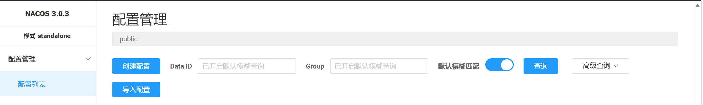

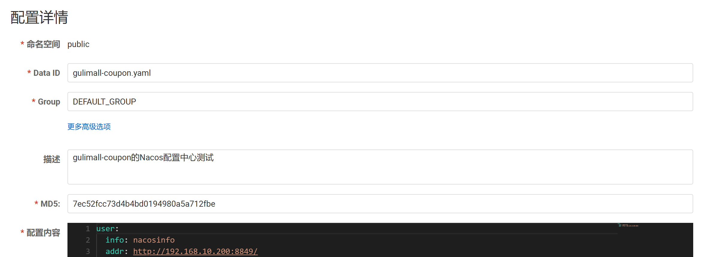

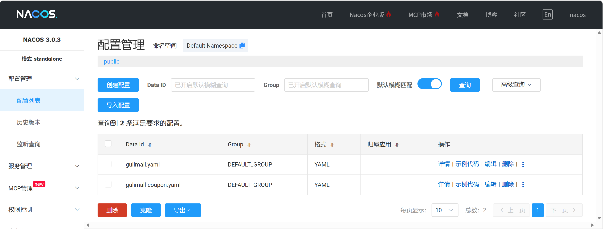

**步骤3：yaml 文件配置 Nacos 配置管理**

名称和地址在第 5.1.1 节已经配置过：

```yaml
spring:
  application:
    name: gulimall-coupon
  cloud:
    nacos:
      server-addr: <your-vm-host-ip>:8848  # 配置管理
      config:
        enabled: true
```

**步骤4：yaml 文件配置 Nacos 配置导入源**

> 注：Spring Cloud 2020.x 及以上版本要求显式声明配置导入源。

```yaml
spring:
  config:
    import:
      - optional:nacos:gulimall.yaml  # 指定 data-id
      # 使用通配符
      - optional:nacos:${spring.application.name}.yaml
```

**步骤5：controller 接口中创建方法**

**方式一：自定义实体类 + 配置类读取 yaml 复杂结构**

实体类：

```java
package com.atguigu.gulimall.coupon.property;

import lombok.Data;
import lombok.Getter;
import org.springframework.boot.context.properties.ConfigurationProperties;
import java.util.List;

/**
 * gulimall 分布式组件版本配置类。
 */
@Data
@ConfigurationProperties(prefix = "gulimall")
public class GulimallComponentsProperties {
    /** 分布式组件清单 */
    private List<Component> components;

    /** 单个组件 */
    @Data
    public static class Component {
        /** 组件名称，如 Nacos Server */
        private String name;
        /** 组件角色，如 注册中心 + 配置中心 */
        private String role;
        /** 版本号，如 3.0.3 */
        private String version;
        /** 端口列表 */
        private List<Port> ports;
    }

    /** 端口信息 */
    @Data
    public static class Port {
        /** 端口号 */
        private int port;
        /** 用途说明 */
        private String description;
    }
}
```

配置类：

```java
package com.atguigu.gulimall.coupon.bean;

import com.atguigu.gulimall.coupon.property.GulimallComponentsProperties;
import org.springframework.boot.context.properties.EnableConfigurationProperties;
import org.springframework.context.annotation.Configuration;

/**
 * 注册 {@link GulimallComponentsProperties} 配置绑定。
 * <p>
 * 直接 {@code @Autowired} 注入 {@link GulimallComponentsProperties} 即可读取版本信息。
 *
 * @author liujiaxu
 */
@Configuration
@EnableConfigurationProperties(GulimallComponentsProperties.class)
public class GulimallPropertiesAutoConfiguration {}
```

**方式二：接口自定义方法读取配置中心配置源**

```java
@Autowired
private GulimallComponentsProperties gulimallComponentsProperties;

/**
 * 获取 Nacos 配置中心的配置信息
 * <p>
 * 通过访问 {@code /coupon/coupon/get/nacos/config} 接口，获取 Nacos 配置中心的配置信息。
 * <p>
 * <a href="http://localhost:7000/coupon/coupon/get/nacos/config">http://localhost:7000/coupon/coupon/get/nacos/config</a>
 *
 * @return 包含 Nacos 配置中心配置信息的响应对象
 */
@GetMapping("/get/nacos/config")
public R getNacosConfig(
        // 1.本地配置文件读取
        @Value("${user.name:#{null}}") String name,
        @Value("${user.password:}") String password,
        // 2.方法中使用 @Value 获取数据无需 @RefreshScope 注解，可以直接不停机修改
        @Value(value = "${user.info:default}") String info,
        @Value(value = "${user.addr:}") String addr
) {
    return R.ok().put("name", name).put("password", password)
            .put("info", info).put("addr", addr)
            // 3.使用 @ConfigurationProperties(prefix = "gulimall") 也可以不停机修改
            .put("components", gulimallComponentsProperties);
}
```

**步骤6：启动服务测试 + 不停机修改**

### 5.1.4 配置管理隔离

为不同环境（生产、开发、测试）设置不同的配置。

#### 5.1.4.1 命名空间

**步骤1：Nacos 配置服务创建多个命名空间**

- 默认是 public，为不同环境创建不同命名空间。

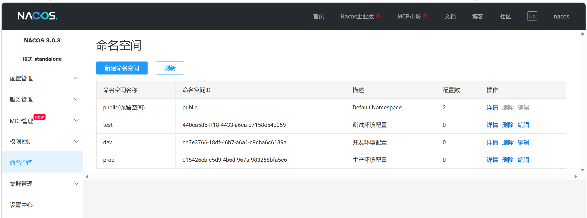

**步骤2：切换到不同环境创建对应的配置文件**

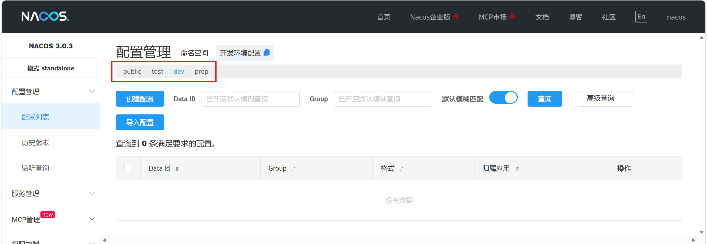

**步骤3：yaml 文件指定命名空间**

```yaml
spring:
  cloud:
    nacos:
      config:
        # 指定命名空间（Nacos 控制台 -> 配置管理 -> 命名空间），默认是 public
        # 注意：Nacos 命名空间必须是 ID，不要引入名称！
        namespace: cb7e3766-18df-46b7-a6a1-c9cba6c6189a
```

**步骤4：重启微服务测试**

> 补充：也可以创建每个微服务的命名空间，每个微服务的配置源放在相应的配置中心中。

#### 5.1.4.2 配置集

就是一个配置中心创建多个配置文件，然后微服务指定读取相应的文件。

原有配置：

```yaml
spring:
  config:
    import:
      # 指定 data-id
      - optional:nacos:gulimall.yaml
      # 使用通配符
      - optional:nacos:${spring.application.name}.yaml
```

#### 5.1.4.3 配置分组

**步骤1：Nacos 平台创建不同配置组**

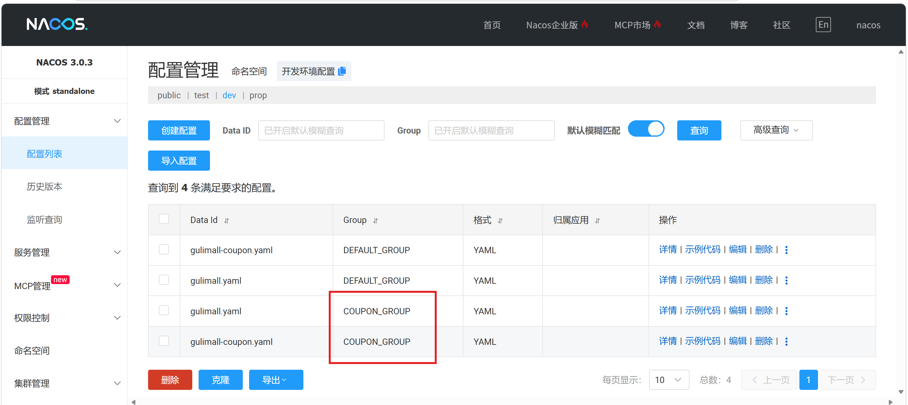

**步骤2：yaml 设置配置组**

```yaml
spring:
  cloud:
    nacos:
      config:
        # 指定配置组（Nacos 控制台 -> 配置管理 -> 配置列表），默认是 DEFAULT_GROUP
        # 注意大小写！
        group: COUPON_GROUP
```

**步骤3：重启微服务测试**

#### 5.1.4.4 配置文件拆分

由于后期配置文件会配置很多内容，因此可以将配置文件拆分成多个配置文件放到 Nacos 上读取，例如端口号、DB 配置、框架配置、微服务配置、日志配置、权限配置等多个配置文件。然后微服务启动后加载多个配置文件即可。

原有配置：

```yaml
spring:
  config:
    import:
      # 指定 data-id
      - optional:nacos:gulimall.yaml
      # 使用通配符
      - optional:nacos:${spring.application.name}.yaml
```

### 5.1.5 服务管理隔离

与配置管理隔离一样配置，略。

### 5.1.6 Nacos 整体配置一览

```yaml
spring:
  # Nacos 配置
  cloud:
    nacos:
      # 统一配置：discovery（服务管理）与 config（配置管理）
      # 服务管理与配置管理共同地址（也可以分别配置）
      server-addr: <your-vm-host-ip>:8848
      # 服务管理
      discovery:
        enabled: true
        # 指定服务管理命名空间，默认是 public
#        namespace: cb7e3766-18df-46b7-a6a1-c9cba6c6189a
        # 指定服务管理分组，默认是 DEFAULT_GROUP
#        group: COUPON_GROUP
      # 配置管理
      config:
        enabled: true
        # 指定配置管理命名空间（Nacos 控制台 -> 配置管理 -> 命名空间），默认是 public
        # 注意：Nacos 命名空间必须是 ID，不要引入名称！
        namespace: cb7e3766-18df-46b7-a6a1-c9cba6c6189a
        # 指定配置管理配置组（Nacos 控制台 -> 配置管理 -> 配置列表），默认是 DEFAULT_GROUP
        # 注意大小写！
        group: COUPON_GROUP
  # Nacos 配置服务指定配置源
  config:
    import:
      # 指定 data-id
      - optional:nacos:${spring.application.name}.yaml
```

## 5.2 Gateway

### 5.2.1 作用

- 统一入口：作为系统的唯一访问入口，屏蔽后端内部服务细节。
- 请求路由：根据请求路径、参数等将流量转发到对应的后端服务。
- 负载均衡：在多个服务实例间分发请求，提高吞吐量与可用性。
- 流量控制：限制请求速率或并发数，防止后端被突发流量冲垮。
- 身份认证：在入口统一验证请求者身份，避免各服务重复实现。
- 协议转换：在不同网络协议（如 HTTP ↔ RPC、HTTP ↔ WebSocket）之间转换。
- 系统监控：汇聚请求日志、延迟、错误率等数据，便于观测与告警。
- 安全防护：防御常见攻击（SQL 注入、XSS、恶意爬虫等）并管理 IP 黑/白名单。

### 5.2.2 网关三部分

**（1）Route（路由）**

网关最基本的组成部分。

- ID：路由的唯一标识
- URI：目标服务地址（转发目的地）
- Predicates：断言条件（匹配规则）
- Filters：过滤器（处理逻辑）

**（2）断言**

断言是路由的匹配条件，用于判断请求是否符合路由规则。常见断言包括：

- Path：路径匹配
- Method：请求方法匹配
- Header：请求头匹配
- Query：请求参数匹配
- Host：主机名匹配
- Cookie：Cookie 匹配
- 时间相关：Before / After / Between

**（3）过滤器**

过滤器是在请求被路由前后执行的处理逻辑。分为两类：

- Gateway Filter：作用于单个路由
- Global Filter：作用于所有路由

### 5.2.3 网关模块

**步骤1：创建网关模块**

**步骤2：配置 pom 文件**

- AI 配置依赖版本 + 引入 common

**步骤3：配置 Nacos 服务配置**

- yaml + 启动类

**步骤4：启动类排除数据库配置**

引入 common 依赖后继承 MyBatis-Plus 依赖，需要排除数据库（也可以在 pom 中排除）。

```java
@SpringBootApplication(exclude = DataSourceAutoConfiguration.class)
```

**步骤5：编写网关 yaml 文件和配置类**

为了实现 yaml 配置分类，该 yaml 在 Nacos 中编写。

```yaml
# ============================================================
# 网关路由配置（application-gateway.yaml）
# 所有网关配置统一放本文件，后期可整份上传到 Nacos 的 application-gateway.yaml dataId。
#
# 五个微服务统一使用「虚拟前缀 gulimall + StripPrefix=1」方案，各路由的差异点：
#   coupon  短写法 + 自定义 Token 断言 + AddRequestHeader（Predicate 自定义模式）
#   member  全写法（predicates/filters 用 name/args）
#   order   短写法
#   product 短写法 + Query 参数断言
#   ware    短写法 + Method 断言
#
# 注意：
#   1. 本项目是 WebFlux 版网关（spring-cloud-starter-gateway 4.3.x），
#      Gateway 4.3 起 WebFlux 版前缀为 spring.cloud.gateway.server.webflux.*
#      （旧前缀 spring.cloud.gateway.* 已被弃用，继续用会报警告）
#   2. 访问 url 统一带一层虚拟前缀 gulimall（如 /gulimall/coupon/**），由 StripPrefix=1
#      在转发前去掉 gulimall，还原成后端路径。后端 controller 类级路径都是「模块/实体」
#      双前缀（如 CouponController = @RequestMapping("coupon/coupon")），完整路径
#      coupon/coupon/list。
#      注意：StripPrefix=1 只能去网关自己加的虚拟段 gulimall，绝不能去后端的 coupon 段，
#      否则剩 /coupon/list 匹配不上 coupon/coupon/list → 404！
# ============================================================
# ============================================================
# 测试 URL 速查（前提：网关 + 目标微服务都已启动并注册 Nacos；网关端口 88）
# 通用流程：Path=/gulimall/xxx/** 匹配 → 断言通过 → StripPrefix=1 去掉 gulimall
#           → 负载均衡转发到后端 /xxx/...
# 通用结果：200=命中并返回数据；404=断言不满足；503=微服务未启动
# ------------------------------------------------------------------
# 1) coupon 优惠券列表（需带 X-Token 请求头，Token 断言要求）
#    GET http://localhost:88/gulimall/coupon/coupon/list?page=1&limit=10
#    → 200：Path + Token 断言通过，StripPrefix 后 /coupon/coupon/list 命中
#    → 404：不带 X-Token 头（Token 断言拦截）
#    → 503：coupon 服务未启动（lb://gulimall-coupon 无可用实例）
#
# 2) member 会员列表（全写法路由）
#    GET http://localhost:88/gulimall/member/member/list?page=1&limit=10
#    → 200：StripPrefix 后 /member/member/list 命中
#    → 503：member 服务未启动
#
# 3) order 订单列表（短写法路由）
#    GET http://localhost:88/order/order/list?page=1&limit=10
#    → 200：转发到 /order/order/list
#    → 503：order 服务未启动
#
# 4) product 品牌列表（Query=sku 断言要求 URL 必须带 sku 参数）
#    GET http://localhost:88/gulimall/product/brand/list?page=1&limit=10&sku=1
#    → 200：Path + Query(sku) 断言通过，StripPrefix 后 /product/brand/list 命中
#    → 404：URL 不带 sku 参数（Query 断言拦截，演示用，实际可删掉该断言）
#    → 503：product 服务未启动
#
# 5) ware 仓库列表（Method=GET,POST 断言）
#    GET http://localhost:88/gulimall/ware/wareinfo/list?page=1&limit=10
#    → 200：GET 方法 + Path 匹配，StripPrefix 后 /ware/wareinfo/list 命中
#    → 503：ware 服务未启动
#
# 附加：若在业务模块开启了 common 的 shiro 拦截（gulimall.shiro.enabled=true ），
#      上述 list 接口因带 @RequiresPermissions("xxx:list") 会返回 401/403；默认不开启则正常 200。
# ============================================================
# ============================================================
# 完整执行流程示例 —— coupon 接口（虚拟前缀 + StripPrefix 方案）：
#   GET http://localhost:88/gulimall/coupon/coupon/list?page=1&limit=10
#   请求头需带 X-Token: abc
#
#   ① 请求到达网关 88 端口（WebFlux 响应式管线）
#   ② 全局 CORS 处理：允许任意 Origin/Header/Method，直接放行
#   ③ RtGlobalFilter 全局过滤器（order=0，最先执行）：
#        记录 uri=/gulimall/coupon/coupon/list、start 时间
#   ④ 路由匹配（按 order 从小到大依次尝试，匹配到即转发、不再向下）：
#        coupon-route(order=0)
#          · Path=/gulimall/coupon/**  →  /gulimall/coupon/coupon/list 命中 ✓
#          · Token=X-Token            →  自定义断言（见 TokenRoutePredicateFactory）
#                                        检查请求头 X-Token 存在 ✓
#        全部断言通过 → 选中 coupon-route
#        若不带 X-Token 头 → Token 断言失败 → 无路由命中 → 404
#   ⑤ 过滤器执行（按声明顺序）：
#        StripPrefix=1                     → 去掉第一段 gulimall，路径变 /coupon/coupon/list
#        AddRequestHeader=X-From, gateway  → 转发时给后端请求加头 X-From=gateway
#   ⑥ 负载均衡：uri=lb://gulimall-coupon，LoadBalancer 从 Nacos 注册中心
#        选择一个 gulimall-coupon 实例（如 <your-vm-host-ip>:7000）
#        Nacos 中无该服务实例 → 503
#   ⑦ 转发：把 /coupon/coupon/list 转发到选中实例
#   ⑧ 后端处理：CouponController 类级 @RequestMapping("coupon/coupon")
#        + 方法 @RequestMapping("/list") = coupon/coupon/list
#        → couponService.queryPage(params) 分页查询数据库
#        → 返回 R.ok().put("page", page)（JSON）
#   ⑨ 响应回程：RtGlobalFilter 的 doFinally 回调打印 end/cost 耗时，
#        响应经 CORS 头返回客户端
# ============================================================
# Gateway 保证用户访问微服务时的负载均衡，OpenFeign 保证微服务间访问的负载均衡
spring:
  cloud:
    gateway:
      server:
        webflux:
          # ============================================================
          # 全局 CORS（跨域）
          # ------------------------------------------------------------
          # CORS 是浏览器的同源策略机制，只约束【浏览器】发起的跨域请求；
          # curl / Postman / 后端服务之间不受它限制。
          # 全部放开("*")只适合开发调试：生产若放开，任何恶意网站都能在
          # 用户浏览器里跨域调用本网关接口（配合 Cookie 登录态可构成 CSRF 风险）。
          #
          # 推荐做法（下方已按此配置）：
          #   1) allowed-origin-patterns：只放行前端的域名/端口白名单
          #      支持通配模式（如 "https://*.example.com"），注意改成本地实际端口
          #   2) allowed-methods：只放行业务需要的方法
          #   3) allowed-headers：只放行前端会带的请求头
          # 开发调试时可临时改回 ["*"]（见被注释掉的那行），上生产前务必收窄。
          # 注意：一旦开 allow-credentials: true（允许携带 Cookie 登录态），
          #       origin 就不能配 "*"，必须写具体域名。
          # ============================================================
          globalcors:
            cors-configurations:
              '[/**]':
                allowed-origin-patterns: ["*"]     # 开发调试临时放开
#                allowed-origin-patterns:
#                  - "http://localhost:8001"       # 后台管理 renren-fast-vue（前端）
#                  - "http://localhost:3000"       # 商城前端（按实际端口改）
#                  - "http://localhost:8080"       # 其它前端（按实际端口改）
                allowed-headers:
                  # 开发阶段放行全部请求头；生产按需收窄，例如：
                  #   - X-Token        （网关 Token 断言要求的头）
                  #   - Content-Type / Authorization 等业务头
                  - "*"
                allowed-methods:
                  - "GET"
                  - "POST"
                  - "PUT"
                  - "DELETE"
                  - "OPTIONS"
                allow-credentials: true             # renren-fast-vue 登录 withCredentials=true 必需
          routes:
            # ---------- coupon：短写法 + 自定义 Token 断言 ----------
            - id: coupon-route
              uri: lb://gulimall-coupon             # lb:// 走 Nacos 负载均衡
              predicates:
                - Path=/gulimall/coupon/**          # 访问 /gulimall/coupon/** 转发到 coupon 服务
#                - Token=X-Token                     # 自定义断言：请求必须带 X-Token 请求头
              # yaml 配置文件全部写法：
              # predicates:
              #   - Token=X-Token                    # 短写法：请求头 X-Token 存在即可
              #   - Token=X-Token,admin              # 短写法：请求头 X-Token 必须等于 admin
              #   - name: Token                      # 全写法：请求头 X-Token 必须等于 admin
              #     args:
              #       headerName: X-Token
              #       headerValue: admin
              filters:
                - StripPrefix=1                     # StripPrefix=1：转发前去掉第一段虚拟前缀 gulimall，还原后端路径
                - AddRequestHeader=X-From, gateway  # 给后端请求添加来源标识头（演示 AddRequestHeader）
              order: 0                              # 路由优先级，越小越先匹配
            # 网关开启前后对比
            # 开启前访问 url：http://localhost:7000/coupon/coupon/list?page=1&limit=10
            # 开启后访问 url：http://localhost:88/gulimall/coupon/coupon/list?page=1&limit=10 + X-Token 请求头
            #   - predicates 匹配路径 + 请求头，匹配成功后再进行过滤判断
            #   - filters 去掉第一个前缀 gulimall，负载均衡转发到 coupon 服务的 /coupon/coupon/list，同时给后端请求添加请求头 X-From=gateway
            # ---------- member：全写法（name/args） ----------
            - id: member-route
              uri: lb://gulimall-member
              predicates:
                - name: Path
                  args:
                    patterns: /gulimall/member/**
                    matchTrailingSlash: true       # /gulimall/member/ 与 /gulimall/member 视为同路径
              filters:
                - StripPrefix=1                    # 去掉虚拟前缀 gulimall
                - name: AddResponseHeader
                  args:
                    name: x-member
                    value: member
              order: 1
            # ---------- order：短写法 ----------
            - id: order-route
              uri: lb://gulimall-order
              predicates:
                - Path=/gulimall/order/**
              filters:
                - StripPrefix=1                    # 去掉虚拟前缀 gulimall
                - AddResponseHeader=x-order, order
              order: 2
            # ---------- product：短写法 + Query 参数断言 ----------
            - id: product-route
              uri: lb://gulimall-product
              predicates:
                - Path=/gulimall/product/**
#                - Query=sku                        # 必须带 sku 参数（演示 Query 断言，实际按需删除）
              filters:
                - StripPrefix=1                    # 去掉虚拟前缀 gulimall
              order: 3
            # ---------- ware：短写法 + Method 断言 ----------
            - id: ware-route
              uri: lb://gulimall-ware
              predicates:
#                - Method=GET,POST                  # 仅 GET/POST 请求放行（演示 Method 断言）
                - Path=/gulimall/ware/**
              filters:
                - StripPrefix=1                    # 去掉虚拟前缀 gulimall
              order: 4
```

> 说明：这里保留初始阶段的 5 条业务路由。后续新增的 `third_party_route`、`seckill-route`、`agent-route`、`admin_route` 以及 `httpclient.response-timeout` 分别在对应业务章节和部署章节展开。

**自定义断言类：TokenRoutePredicateFactory**

```java
package com.atguigu.gulimall.gateway.predicate;

import jakarta.validation.constraints.NotEmpty;
import org.springframework.cloud.gateway.handler.predicate.AbstractRoutePredicateFactory;
import org.springframework.cloud.gateway.handler.predicate.GatewayPredicate;
import org.springframework.stereotype.Component;
import org.springframework.validation.annotation.Validated;
import org.springframework.web.server.ServerWebExchange;
import java.util.Arrays;
import java.util.List;
import java.util.function.Predicate;

/**
 * 自定义断言工厂：Token（WebFlux 版网关，用于 coupon 路由）
 *
 * <p>命名规则：类名去掉 {@code RoutePredicateFactory} 前缀即为配置中使用的名字，
 * 本类 {@code TokenRoutePredicateFactory} → 配置名 {@code Token}：</p>
 * <pre>
 *   yaml 配置文件全部写法：
 *   predicates:
 *     - Token=X-Token                    # 短写法：请求头 X-Token 存在即可
 *     - Token=X-Token,admin              # 短写法：请求头 X-Token 必须等于 admin
 *     - name: Token                      # 全写法
 *       args:
 *         headerName: X-Token
 *         headerValue: admin
 * </pre>
 *
 * <p>断言规则：请求必须携带名为 {@code headerName} 的请求头；若配置了 {@code headerValue}，
 * 则该请求头的值必须精确匹配。</p>
 */
@Component
public class TokenRoutePredicateFactory extends AbstractRoutePredicateFactory<TokenRoutePredicateFactory.Config> {
    public TokenRoutePredicateFactory() {
        super(Config.class);
    }

    // 短写法属性顺序：Token=X-Token,admin → headerName=X-Token, headerValue=admin
    @Override
    public List<String> shortcutFieldOrder() {
        return Arrays.asList("headerName", "headerValue");
    }

    @Override
    public Predicate<ServerWebExchange> apply(Config config) {
        return new GatewayPredicate() {
            @Override
            public boolean test(ServerWebExchange exchange) {
                List<String> values = exchange.getRequest().getHeaders().get(config.getHeaderName());
                if (values == null || values.isEmpty()) {
                    return false;
                }
                // 未配置期望值：只要有该请求头即放行
                if (config.getHeaderValue() == null || config.getHeaderValue().isBlank()) {
                    return true;
                }
                return values.stream().anyMatch(config.getHeaderValue()::equals);
            }

            @Override
            public Object getConfig() {
                return config;
            }

            @Override
            public String toString() {
                return String.format("Token: headerName=%s headerValue=%s",
                        config.getHeaderName(), config.getHeaderValue());
            }
        };
    }

    @Validated
    public static class Config {
        @NotEmpty
        private String headerName;
        private String headerValue;

        public String getHeaderName() {
            return headerName;
        }

        public Config setHeaderName(String headerName) {
            this.headerName = headerName;
            return this;
        }

        public String getHeaderValue() {
            return headerValue;
        }

        public Config setHeaderValue(String headerValue) {
            this.headerValue = headerValue;
            return this;
        }
    }
}
```

**全局过滤器：RtGlobalFilter**

```java
package com.atguigu.gulimall.gateway.filter;

import org.slf4j.Logger;
import org.slf4j.LoggerFactory;
import org.springframework.cloud.gateway.filter.GatewayFilterChain;
import org.springframework.cloud.gateway.filter.GlobalFilter;
import org.springframework.core.Ordered;
import org.springframework.http.server.reactive.ServerHttpRequest;
import org.springframework.http.server.reactive.ServerHttpResponse;
import org.springframework.stereotype.Component;
import org.springframework.web.server.ServerWebExchange;
import reactor.core.publisher.Mono;

/**
 * 自定义全局过滤器：打印请求 URI 与耗时（仿照 cloud-demo/gateway 学习示例移植）
 *
 * <p>全局过滤器对所有路由自动生效，无需在 yaml 中配置；实现 {@link Ordered}
 * 控制执行优先级，数值越小越先执行。</p>
 */
@Component
public class RtGlobalFilter implements GlobalFilter, Ordered {
    private static final Logger log = LoggerFactory.getLogger(RtGlobalFilter.class);

    @Override
    public Mono<Void> filter(ServerWebExchange exchange, GatewayFilterChain chain) {
        ServerHttpRequest request = exchange.getRequest();
        ServerHttpResponse response = exchange.getResponse();
        String uri = request.getURI().toString();
        long start = System.currentTimeMillis();
        log.info("uri:{}, request:{}, response:{}", uri, request, response);
        log.info("start:{}", start);
        // 响应式编程是异步执行，doFinally 在整条链路结束后回调
        return chain.filter(exchange)
                .doFinally((result) -> {
                    long end = System.currentTimeMillis();
                    log.info("end:{}", end);
                    log.info("cost:{}", end - start);
                });
    }

    @Override
    public int getOrder() {
        return 0;
    }
}
```

> 说明：这是初始版本的耗时日志过滤器。最终版在日志治理阶段扩展为 method、uri、remote、headers 输出，并对 Cookie、Authorization、token 脱敏，完整实现见第 16 章。

### 5.2.4 启动网关和微服务模块测试

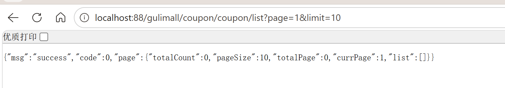

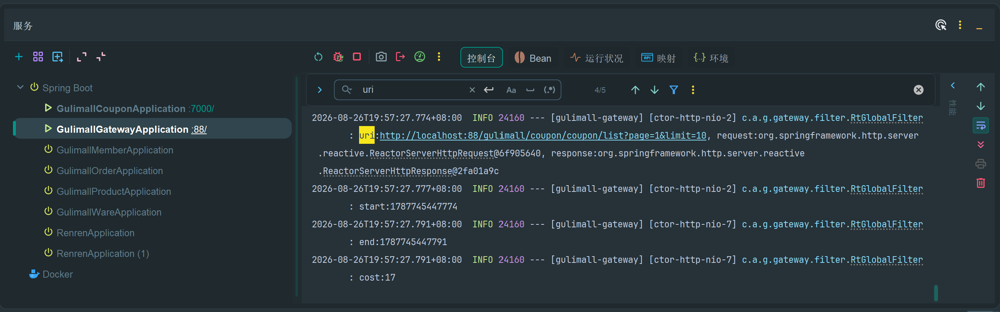

---
