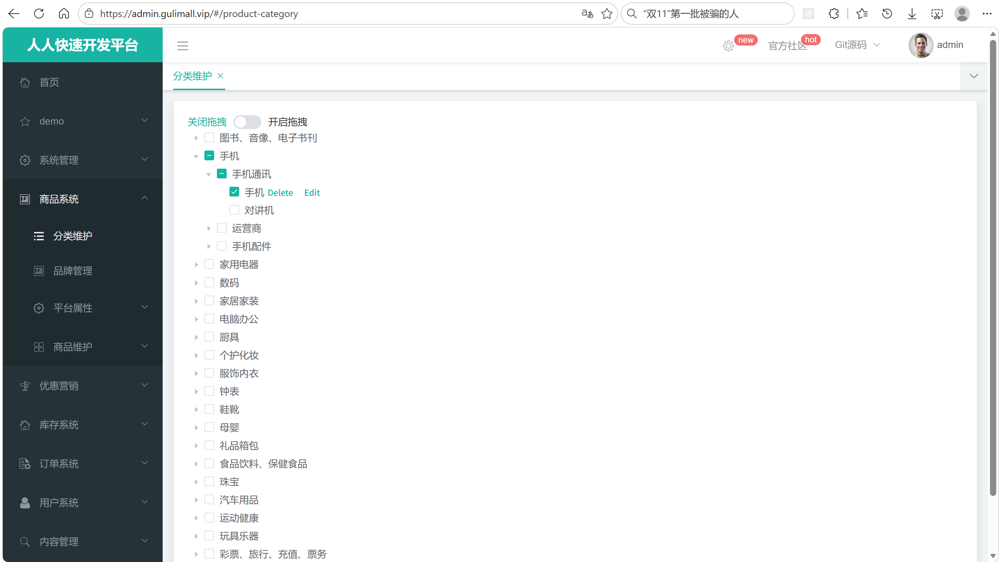
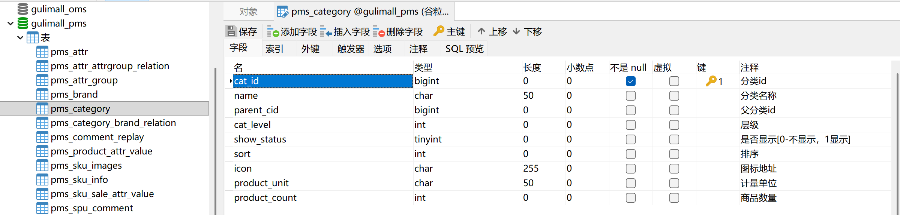
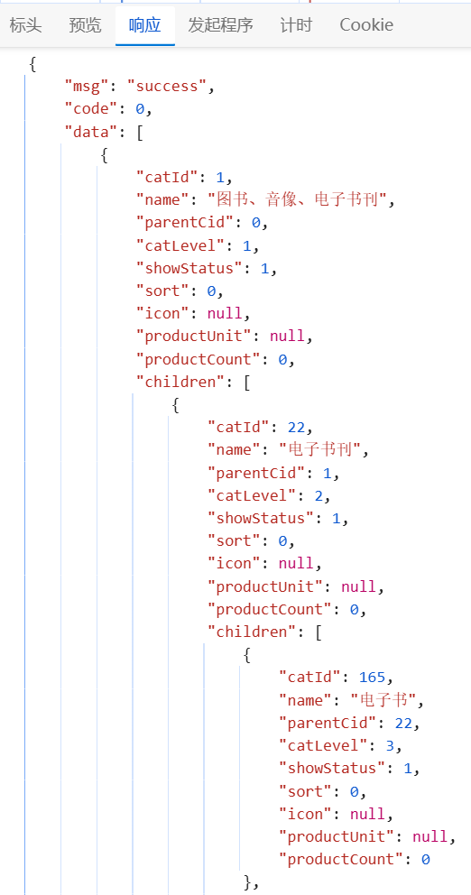
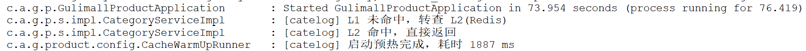
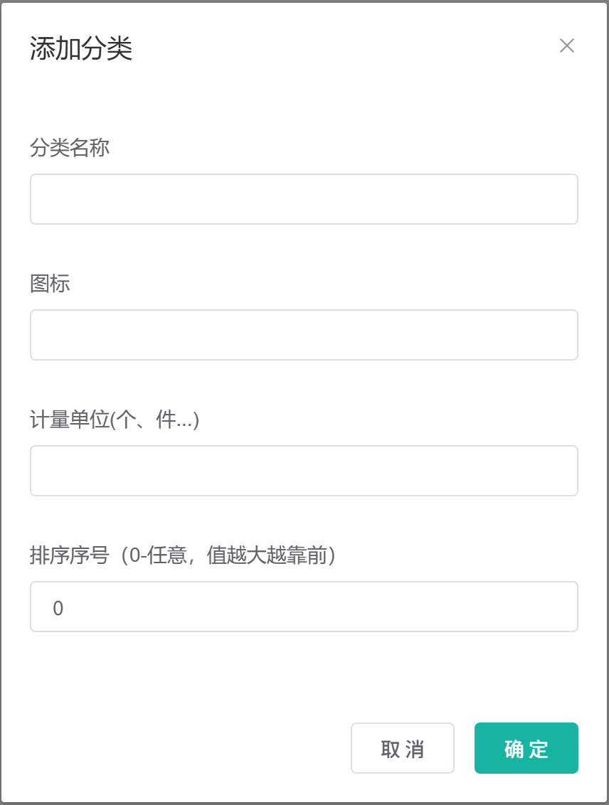
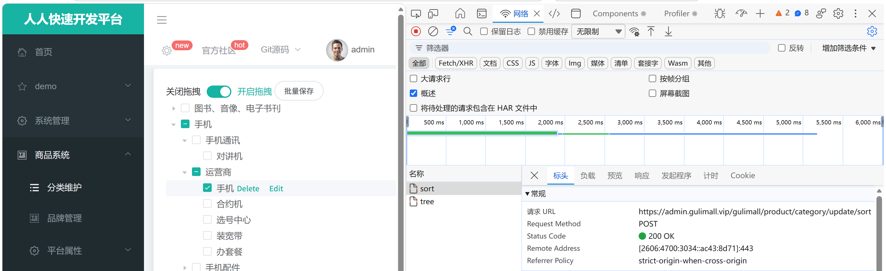
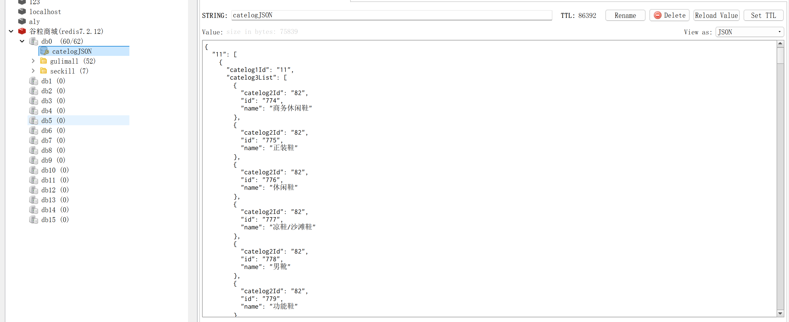

# 6.1 三级分类-介绍

> 本篇介绍商品三级分类：业务上怎么划分分类、管理员怎么维护、分类数据怎么存、树形结构怎么组装、拖拽排序怎么实现、缓存怎么加、缓存和数据库怎么保持一致。

---

## 1. 这个功能是干什么的

商品分类是商城的目录。用户打开首页，左侧看到“图书、手机、家用电器”，点“手机”进入“手机通讯”，再点进入“智能手机”，这三层就是三级分类。

分类在业务上有三个作用：

1. **给商品归类**：发布商品时必须选择一个三级分类，商品才知道自己属于哪个目录。
2. **给用户导航**：首页左侧分类、搜索页分类筛选、商品详情页面包屑，都依赖分类数据。
3. **给后台管理**：管理员可以新增、修改、删除分类，也可以拖拽调整分类顺序。

分类固定为三层：

```text
一级分类：手机数码
    └── 二级分类：手机通讯
            └── 三级分类：智能手机
```

为什么不设计成无限层级：商城的商品目录习惯就是三级，固定三层可以让页面布局、商品发布、属性绑定都更简单。如果做成无限级，前端要处理任意深度树，后端要处理任意层级校验，商品发布页也不好布局。

## 2. 管理员怎么操作

入口：

```text
管理后台 → 商品系统 → 分类维护
```



管理员可以完成五件事。

### 2.1 查看分类树

1. 打开页面，前端请求 `/product/category/list/tree`。
2. 后端返回一级分类数组，每个一级分类里带 `children`，`children` 里再带三级分类。
3. 前端用 Element UI 的 `el-tree` 渲染。
4. 点击父节点可以展开或收起子节点。

### 2.2 新增分类

1. 勾选一个一级或二级节点。
2. 点击节点后面的 `Append`。
3. 弹窗填写分类名称、图标、计量单位、排序。
4. 点击“确定”。
5. 后端把新分类插入 `pms_category`，`parentCid` 是当前节点 id，`catLevel` 是当前层级加 1。
6. 前端重新请求分类树，并展开新分类的父节点。

只有一级、二级节点能新增子分类，因为业务只允许三层。

### 2.3 修改分类

1. 勾选节点，点击 `Edit`。
2. 前端先请求 `/product/category/info/{catId}`，把最新数据回显到弹窗。
3. 修改名称、图标、单位、排序后点击“确定”。
4. 后端更新 `pms_category`。
5. 如果改了分类名称，还要同步更新 `pms_category_brand_relation.catelog_name`，否则品牌关联列表里还是旧名字。
6. 前端重新请求分类树。

### 2.4 删除分类

1. 勾选一个没有子节点的叶子分类。
2. 点击 `Delete`。
3. 前端只把叶子节点 id 提交给后端。
4. 后端执行逻辑删除，把 `show_status` 从 1 改成 0。
5. 前端重新请求分类树。

删除不做物理删除，因为商品、属性分组、品牌分类关联都可能引用这个分类 id。物理删除后，历史商品会找不到分类。

### 2.5 拖拽排序

1. 打开“开启拖拽”开关。
2. 把节点拖到目标位置，可以是某个节点的前面、后面，也可以是某个节点的内部。
3. 前端 `allowDrop()` 判断拖拽后是否超过三层。
4. 放下后，`handleDrop()` 重新计算受影响节点的 `parentCid`、`catLevel`、`sort`。
5. 点击“批量保存”，一次性提交所有受影响节点。
6. 后端批量更新 `pms_category`。
7. 前端重新请求分类树并展开相关父节点。

拖拽不只是改顺序，还可能改父分类和层级，所以必须把子节点一起移动，并重新计算层级。

## 3. 整体设计思路

### 3.1 业务上怎么设计

#### 3.1.1 分类的归属和引用关系

分类是商品域的基础数据，商品、属性分组、品牌关联都引用分类 id：

```text
pms_category
    ├── pms_spu_info.catelog_id          商品属于哪个三级分类
    ├── pms_attr_group.catelog_id        属性分组挂在哪个分类
    ├── pms_attr.catelog_id              属性属于哪个分类
    └── pms_category_brand_relation.catelog_id  品牌关联了哪些分类
```

因此分类不能随便物理删除。删除一个分类前，业务上要先确认没有商品、属性、品牌关联在用它。

#### 3.1.2 新增规则

1. 一级分类的 `parentCid` 固定为 0。
2. 二级分类的 `parentCid` 必须是一级分类 id。
3. 三级分类的 `parentCid` 必须是二级分类 id。
4. `catLevel` 由父分类层级加 1 得到。
5. 只有一级、二级可以新增子分类，三级不能再新增。

#### 3.1.3 修改规则

1. 改名称：要级联更新品牌分类关联表里的冗余分类名。
2. 改图标、单位、排序：只更新分类自己。
3. 改父分类：当前页面不支持直接改父分类，父分类变化通过拖拽完成。

#### 3.1.4 删除规则

1. 只能删叶子节点。
2. 删除是逻辑删除，`show_status=0`。
3. 删除后要清缓存，否则首页还会显示已删除的分类。

#### 3.1.5 排序规则

1. `sort` 值越大越靠前。
2. 拖拽后，同一父节点下的兄弟节点重新生成 `sort`。
3. 如果节点换了父分类，子节点要跟着移动，`catLevel` 也要一起更新。

#### 3.1.6 缓存规则

分类是典型的“读多写少”数据：

- 首页、搜索页、商品详情页都要读分类。
- 管理员很少改分类。

所以业务上允许分类走缓存，但要求：

1. 管理员修改后，缓存要尽快失效。
2. 不能因为缓存故障导致首页打不开。
3. 多个商品服务实例看到的分类树要尽量一致。

### 3.2 技术上怎么设计

#### 3.2.1 一张自关联表

`pms_category` 用 `parent_cid` 指向父分类：

```text
pms_category
├── cat_id        分类自己的 id
├── name          分类名称
├── parent_cid    父分类 id，一级分类为 0
├── cat_level     层级：1、2、3
├── show_status   是否显示，1 显示、0 隐藏，同时作为逻辑删除标记
├── sort          排序，值越大越靠前
├── icon          图标
├── product_unit  计量单位
└── product_count 商品数量
```



优点：

1. 新增、修改、删除都只操作一张表。
2. 查整棵树只需要一次数据库查询。
3. 表结构简单，容易理解和维护。

可优化点：

1. 当前没有唯一约束保证同一父节点下分类名不重复，可以在 `(parent_cid, name)` 上加唯一索引。
2. 当前没有外键，分类被商品引用时数据库不会阻止删除，需要在业务层补校验。

#### 3.2.2 内存组树

树形查询的步骤：

1. 一次查出所有未删除分类。
2. 在内存里按 `parentCid` 找子节点。
3. 递归把子节点挂到父节点的 `children`。
4. 按 `sort` 倒序排列。

优点：一次 SQL 返回整棵树，避免逐级查数据库。

可优化点：当前 `getChildren()` 每次递归都会扫描全量列表，最坏复杂度是 O(n²)。分类量大时可以先用 `Map<parentCid, List<CategoryEntity>>` 分组，再递归取子节点，复杂度降为 O(n)。

#### 3.2.3 逻辑删除

`show_status` 同时表示“显示/隐藏”和“是否删除”：

- `1`：显示，未删除。
- `0`：隐藏，已删除。

MyBatis-Plus 的 `@TableLogic(value = "1", delval = "0")` 会自动把删除改成更新，查询自动过滤已删除数据。

优点：历史商品、属性、品牌关联不会因为分类被删而找不到数据。

可优化点：显示和删除是两个语义，长期看应该拆成 `show_status` 和 `deleted` 两个字段，避免“隐藏”和“删除”混在一起。

#### 3.2.4 三级缓存

```text
第 1 层：Caffeine 本地缓存，存在当前 JVM 内存里，最快
第 2 层：Redis 分布式缓存，多个服务实例共享
第 3 层：MySQL 数据库，最终事实
```

读取顺序：Caffeine → Redis → MySQL。
回写顺序：MySQL → Redis → Caffeine（Caffeine 由 `@Cacheable` 自动写）。

#### 3.2.5 分布式锁

查询回源、删除、修改共用一把锁 `catelog-lock`：

- 查询回源抢锁，防止缓存击穿。
- 删除和修改抢锁，防止查询线程把旧数据写回缓存。

#### 3.2.6 事务提交后清缓存

写操作如果在事务提交前清缓存，其他请求会在“缓存已清、数据库未提交”的窗口里读到旧数据，并写回缓存。所以用 `afterCommit` 回调，等事务真正提交后再清。

#### 3.2.7 缓存压缩与预热

1. 分类 JSON 用 GZIP 压缩成二进制，存 Redis，减少网络传输。
2. 用 `RedisTemplate<String, byte[]>` 存二进制，避免 Base64 膨胀。
3. 应用启动时主动查一次分类树，把缓存预热好，避免第一个用户请求承担冷缓存加载时间。



## 4. 详细代码、配置和解释

本章按“类为什么存在 → 关键数据 → 读/写链路 → 代码分块解释 → 一次完整示例 → 边界”组织。每一块代码前面先说明它在链路里承担什么，代码后面再按 1、2、3 的顺序解释执行过程和原因。

### 4.1 CategoryEntity：分类表映射

#### 4.1.1 这个类解决什么问题

商城的分类只有一张 `pms_category` 表，父子关系用 `parent_cid` 指向自己。这个实体同时承担三件事：

1. 把表字段映射成 Java 对象，供 MyBatis-Plus 增删改查；
2. 在返回前端时承载树形结构，让一级分类对象里直接挂 `children`；
3. 用 `show_status` 表达逻辑删除，保证商品、属性、品牌关联引用过的分类 id 不会突然失效。

前两件事决定字段怎么定义，第三件事决定删除为什么是更新而不是 `DELETE`。

#### 4.1.2 字段与业务含义

| 字段 | 数据库列 | 业务含义 | 说明 |
|---|---|---|---|
| `catId` | `cat_id` | 分类 id | 主键 |
| `name` | `name` | 分类名称 | 后台可修改，改名要级联更新品牌关联表 |
| `parentCid` | `parent_cid` | 父分类 id | 一级分类固定为 0 |
| `catLevel` | `cat_level` | 层级 | 1、2、3，由父分类层级加 1 得到 |
| `showStatus` | `show_status` | 显示与逻辑删除 | 1 显示、0 隐藏，同时是删除标记 |
| `sort` | `sort` | 排序 | 值越大越靠前 |
| `icon` | `icon` | 分类图标 | 后台展示 |
| `productUnit` | `product_unit` | 计量单位 | 商品发布时使用 |
| `productCount` | `product_count` | 分类下商品数量 | 冗余字段，当前没有维护逻辑 |
| `children` | 无 | 子分类列表 | 不落库，只用于返回前端 |

#### 4.1.3 代码与解释

```java
@Data
@TableName("pms_category")
public class CategoryEntity implements Serializable {
    private static final long serialVersionUID = 1L;

    @TableId
    private Long catId;
    private String name;
    private Long parentCid;
    private Integer catLevel;

    // 逻辑删除：1 未删除，0 已删除；同时兼作显示开关
    @TableLogic(value = "1", delval = "0")
    private Integer showStatus;

    private Integer sort;
    private String icon;
    private String productUnit;
    private Integer productCount;

    // 不映射数据库字段，children 为空时 JSON 不输出
    @TableField(exist = false)
    @JsonInclude(JsonInclude.Include.NON_EMPTY)
    private List<CategoryEntity> children;
}
```

1. `@TableName("pms_category")`：告诉 MyBatis-Plus 这个类对应 `pms_category` 表。
2. `@TableId`：标记 `catId` 是主键，插入后能回填自增 id。
3. `@TableLogic(value = "1", delval = "0")`：声明逻辑删除。调用删除方法时，MyBatis-Plus 不会发 `DELETE`，而是发 `UPDATE pms_category SET show_status=0 WHERE cat_id=? AND show_status=1`；所有查询会自动补上 `show_status=1`。
4. `@TableField(exist = false)`：`children` 不是数据库列，只在组装树和返回前端时使用。
5. `@JsonInclude(NON_EMPTY)`：`children` 为空时不出现在 JSON 里，叶子节点不会带一个空数组。

#### 4.1.4 一次读写示例

查询分类树时，MyBatis-Plus 实际执行：

```sql
SELECT cat_id, name, parent_cid, cat_level, show_status, sort,
       icon, product_unit, product_count
FROM pms_category
WHERE show_status = 1;
```

删除三级分类 143：

```sql
UPDATE pms_category
SET show_status = 0
WHERE cat_id = 143
  AND show_status = 1;
```

删除后，历史商品 `pms_spu_info.catelog_id = 143` 仍然能查到分类记录，只是分类不出现在树里。

#### 4.1.5 边界与可优化点

1. `show_status` 同时承担“显示/隐藏”和“是否删除”两个语义，运营把分类隐藏和删除分类在数据库里看起来一样。长期应拆成 `show_status` 和 `deleted` 两个字段。
2. `product_count` 是冗余字段，当前没有维护逻辑，商品新增或下架后不会自动更新。
3. 表上没有 `(parent_cid, name)` 唯一约束，同一父分类下可以出现重名分类，只能在业务层校验。
4. 逻辑删除会让查询自动过滤 `show_status=0`，如果确实需要查已删除分类，必须绕过 MyBatis-Plus 的查询方法。

### 4.2 CategoryController：接收分类请求

#### 4.2.1 这个类解决什么问题

管理后台的“分类维护”页面要完成六类操作：查树、修改前回显、新增、修改、删除、拖拽后的批量排序。页面只认 HTTP 接口，这个 Controller 负责把六类操作翻译成 Service 调用。

Controller 只做三件事：

1. 接收请求参数和请求体；
2. 用 `@RequiresPermissions` 校验后台权限；
3. 把 Service 的返回值包装成统一结果 `R`。

树怎么组装、缓存怎么清、品牌关联表怎么级联更新，都不在这个类里。

#### 4.2.2 接口清单

| 操作 | 方法与路径 | 权限 | 调用的 Service 方法 |
|---|---|---|---|
| 查询分类树 | `GET /product/category/list/tree` | `product:category:list` | `listWithTree()` |
| 修改前回显 | `GET /product/category/info/{catId}` | `product:category:info` | `getById()` |
| 新增分类 | `POST /product/category/save` | `product:category:save` | `save()` |
| 修改分类 | `POST /product/category/update` | `product:category:update` | `updateDetails()` |
| 删除分类 | `POST /product/category/delete` | `product:category:delete` | `removeMenusByIds()` |
| 批量排序 | `POST /product/category/update/sort` | `product:category:update` | `updateBatchById()` |

网关转发前会去掉 `/gulimall` 前缀，所以后台实际请求路径是 `/gulimall/product/category/...`。

#### 4.2.3 代码与解释

```java
@RestController
@RequestMapping("product/category")
public class CategoryController {

    @Autowired
    private CategoryService categoryService;

    /**
     * 查询分类树
     * 请求：GET /product/category/list/tree
     */
    @RequestMapping("/list/tree")
    @RequiresPermissions("product:category:list")
    public R list() {
        List<CategoryEntity> list = categoryService.listWithTree();
        return R.ok().put("data", list);
    }

    /**
     * 拖拽后批量保存
     * 请求：POST /product/category/update/sort
     */
    @RequestMapping("/update/sort")
    @RequiresPermissions("product:category:update")
    public R updateSort(@RequestBody CategoryEntity[] category) {
        categoryService.updateBatchById(Arrays.asList(category));
        return R.ok();
    }

    /**
     * 查询单个分类，修改前回显
     */
    @RequestMapping("/info/{catId}")
    @RequiresPermissions("product:category:info")
    public R info(@PathVariable("catId") Long catId) {
        CategoryEntity category = categoryService.getById(catId);
        return R.ok().put("data", category);
    }

    /**
     * 新增分类
     */
    @RequestMapping("/save")
    @RequiresPermissions("product:category:save")
    public R save(@RequestBody CategoryEntity category) {
        categoryService.save(category);
        return R.ok();
    }

    /**
     * 修改分类：走 updateDetails，会级联更新关联表
     */
    @RequestMapping("/update")
    @RequiresPermissions("product:category:update")
    public R update(@RequestBody CategoryEntity category) {
        categoryService.updateDetails(category);
        return R.ok();
    }

    /**
     * 删除分类：走 removeMenusByIds，会清缓存
     */
    @RequestMapping("/delete")
    @RequiresPermissions("product:category:delete")
    public R delete(@RequestBody Long[] catIds) {
        categoryService.removeMenusByIds(Arrays.asList(catIds));
        return R.ok();
    }
}
```

1. `@RestController` + `@RequestMapping("product/category")`：六个接口共用 `/product/category` 前缀。
2. `list()`：调用 `listWithTree()` 返回整棵树，结果放在 `data` 字段，前端取 `data.data`。
3. `updateSort()`：接收数组而不是单个对象。拖拽一个节点会影响同一父节点下所有兄弟节点的 `sort`，所以一次批量提交。
4. `info()`：修改前回显。前端先查一次最新数据，避免直接拿列表里的旧对象提交。
5. `save()`：调用的是接口方法，实际执行的是 `CategoryServiceImpl` 重写后的 `save()`，里面有抢锁和清缓存。
6. `update()`：不走默认的 `updateById()`，而是走 `updateDetails()`，因为分类改名时还要同步品牌关联表。
7. `delete()`：不走默认的 `removeByIds()`，而是走 `removeMenusByIds()`，因为删除要加锁、清缓存。

#### 4.2.4 一次请求示例

管理员在后台把“智能手机”改名为“智能手机 Pro”：

```text
1. 前端弹窗回显：GET /gulimall/product/category/info/143
2. 用户改名后点确定：POST /gulimall/product/category/update
3. 请求体：
   {
     "catId": 143,
     "name": "智能手机 Pro",
     "parentCid": 142,
     "catLevel": 3,
     "showStatus": 1
   }
4. Controller 校验 product:category:update 权限
5. 调用 categoryService.updateDetails(category)
6. 返回 R.ok()
7. 前端重新请求分类树，页面显示新名称
```

#### 4.2.5 它不做什么

1. 不组装分类树，树结构由 `CategoryServiceImpl.listWithTree()` 完成。
2. 不校验层级和父子关系，层级规则由 Service 和前端共同保证。
3. 不判断删除的是不是叶子节点，当前只靠前端过滤。
4. 不直接操作缓存，缓存清理在 Service 的写方法里。

#### 4.2.6 边界与可优化点

1. `delete()` 没有校验传入的分类是否有子节点，也没有校验是否被商品引用，生产环境应补。
2. `save()` 和 `update()` 没有使用 `@Valid` 做参数校验，分类名、层级、父分类 id 都应该校验。
3. `updateSort()` 直接调用 `updateBatchById()`，绕过了 `CategoryServiceImpl` 的写入口，不会清缓存。当前拖拽只改 `sort`，分类树缓存里的 `sort` 会旧到下次过期，生产环境应把批量排序也纳入缓存清理。
4. 接口没有限制批量大小，一次提交过多节点会生成大事务。

### 4.3 CategoryServiceImpl：分类业务与缓存

#### 4.3.1 这个类解决什么问题

分类是典型的“读多写少”数据：首页、搜索页、商品详情页、属性分组、品牌关联都要读分类，管理员很少改分类。这个类要同时解决四件事：

1. 后台分类树查询：把扁平表数据组装成三层树；
2. 首页分类 VO：把分类转成页面需要的“一级 → 二级 → 三级”结构；
3. 三级缓存：Caffeine 本地缓存、Redis 分布式缓存、MySQL 最终事实；
4. 缓存一致性：写操作完成后，在事务提交之后清掉两层缓存。

第 3、4 件事是难点。缓存能减轻数据库压力，但也会带来“数据库改了、缓存还是旧值”的问题，所以读写链路必须成对设计。

#### 4.3.2 读链路与写链路

读链路：

```text
@Cacheable 先查 Caffeine
  → 命中直接返回
  → 未命中进入方法体
  → 读 Redis catelogJSON，解压反序列化
  → 命中直接返回
  → 未命中抢 catelog-lock
  → 锁内二次检查 Redis
  → 仍然没有才查 MySQL 组装
  → GZIP 压缩写回 Redis
  → 返回结果，Spring 写入 Caffeine
```

写链路：

```text
调用写方法
  → 抢 catelog-lock
  → 写 pms_category，必要时级联写品牌关联表
  → 注册事务提交后回调
  → 事务提交
  → 清 Caffeine
  → 清 Redis catelogJSON
  → 释放锁
```

读写共用同一把 `catelog-lock`，目的是避免“查询线程读到旧数据并写回缓存”和“删除或修改同时进行”互相覆盖。

#### 4.3.3 类字段

```java
private static final String CATELOG_CACHE_KEY = "catelogJSON";
private static final String CATELOG_CACHE_NAME = "catelogJson";
private static final String CATELOG_LOCK_NAME = "catelog-lock";

private final CategoryDao categoryDao;
private final CategoryBrandRelationDao categoryBrandRelationDao;
private final CategoryMethod categoryMethod;
private final RedisTemplate<String, byte[]> byteRedisTemplate;
private final RedissonClient redissonClient;
private final CacheManager cacheManager;

@Autowired
public CategoryServiceImpl(RedisTemplate<String, byte[]> byteRedisTemplate,
                           CacheManager cacheManager,
                           CategoryBrandRelationDao categoryBrandRelationDao,
                           CategoryDao categoryDao,
                           CategoryMethod categoryMethod,
                           RedissonClient redissonClient) {
    this.byteRedisTemplate = byteRedisTemplate;
    this.cacheManager = cacheManager;
    this.categoryBrandRelationDao = categoryBrandRelationDao;
    this.categoryDao = categoryDao;
    this.categoryMethod = categoryMethod;
    this.redissonClient = redissonClient;
}
```

1. `CATELOG_CACHE_KEY`：Redis 里的 key，固定为 `catelogJSON`。
2. `CATELOG_CACHE_NAME`：Spring Cache 的缓存名，必须和 `@Cacheable(cacheNames=...)` 一致，否则 `cacheManager.getCache()` 拿到的是另一块缓存。
3. `CATELOG_LOCK_NAME`：分布式锁名，查询回源、删除、修改共用。
4. `byteRedisTemplate`：专门存 GZIP 二进制，不能用默认的 `RedisTemplate`。
5. `cacheManager`：用来手动清 Caffeine。
6. `redissonClient`：提供分布式锁。
7. `categoryMethod`：分类路径查询放在独立的 Method 层，避免 Service 之间循环依赖。
8. 构造器注入而不是字段注入：依赖不可变，单元测试可以直接传 mock。

#### 4.3.4 读链路一：后台分类树 `listWithTree`

后台页面需要一次性拿到完整的三层树。这个方法先查全量，再在内存里挂子节点，最后排序。

```java
@Override
public List<CategoryEntity> listWithTree() {
    // 1.一次查出所有未删除分类
    List<CategoryEntity> allCategory = getAllCategory();

    // 2.筛出一级分类
    return allCategory.stream()
            .filter(category -> category.getParentCid() == 0L)
            // 3.每个一级分类递归挂子分类
            .peek(category -> category.setChildren(getChildren(category, allCategory)))
            // 4.按 sort 倒序
            .sorted(Comparator.comparingInt(
                    (CategoryEntity c) -> c.getSort() == null ? 0 : c.getSort()).reversed())
            .toList();
}
```

1. `getAllCategory()` 查一次数据库，条件是 `show_status=1`，拿到全部分类。
2. `filter` 找出 `parentCid=0` 的一级分类。
3. `peek` 对每个一级分类调用 `getChildren()`，把二级、三级挂到 `children`。
4. `sorted` 按 `sort` 倒序，`sort` 为 null 时按 0 处理。
5. 返回的列表就是前端 `el-tree` 直接渲染的数据。

为什么一次查全量：分类数量小，一次 SQL 比逐级查询少很多网络往返。树在内存里组装，排序也在内存里完成。

示例：数据库有 3 条记录：

```text
1  手机数码        parent_cid=0  sort=10
2  手机通讯        parent_cid=1  sort=5
3  智能手机        parent_cid=2  sort=1
```

`listWithTree()` 返回：

```text
[
  {
    "catId": 1,
    "name": "手机数码",
    "children": [
      {
        "catId": 2,
        "name": "手机通讯",
        "children": [
          { "catId": 3, "name": "智能手机" }
        ]
      }
    ]
  }
]
```

**查全量分类 `getAllCategory`**

`listWithTree()` 和首页 VO 组装都依赖这个方法，它只查未删除分类：

```java
private List<CategoryEntity> getAllCategory() {
    return categoryDao.selectList(
            new LambdaQueryWrapper<CategoryEntity>()
                    .eq(CategoryEntity::getShowStatus, 1L));
}
```

1. 只查 `show_status=1` 的分类，已删除和隐藏的分类不会进入树。
2. `@TableLogic` 已经会自动补 `show_status=1`，这里再写一次是显式表达业务含义。
3. 使用 `LambdaQueryWrapper` 而不是字符串字段名，字段改名时编译期能发现。
4. 一次查询返回全量，供后续内存递归和 VO 组装共同使用。

#### 4.3.5 读链路二：递归挂子节点 `getChildren`

`listWithTree()` 只负责找一级分类，真正把树挂起来的是 `getChildren()`。

```java
private List<CategoryEntity> getChildren(CategoryEntity root,
                                         List<CategoryEntity> all) {
    return all.stream()
            .filter(category -> Objects.equals(category.getParentCid(), root.getCatId()))
            .peek(category -> category.setChildren(getChildren(category, all)))
            .sorted(Comparator.comparingInt(
                    (CategoryEntity c) -> c.getSort() == null ? 0 : c.getSort()).reversed())
            .toList();
}
```

1. 遍历全量列表。
2. 找到 `parentCid` 等于当前节点 id 的分类。
3. 对每个子节点继续递归，直到没有子节点。
4. 按 `sort` 倒序返回。

边界：如果 `parent_cid` 配成环，例如 A 的父是 B、B 的父是 A，递归不会停止，最终栈溢出。当前代码没有访问集合，也没有最大深度限制。

可优化点：每次递归都扫描全量列表，复杂度 O(n²)。可以先把全量列表按 `parentCid` 分组，再从根节点开始按组取子节点，复杂度降为 O(n)。

#### 4.3.6 读链路三：首页分类 VO 组装 `getCatelogJsonFromDB`

后台分类树返回的是实体，首页需要的是固定三层 VO。这个方法把全量分类组装成 `Map<一级分类id, List<二级分类>>`。

```java
private Map<String, List<Catelog2Vo>> getCatelogJsonFromDB() {
    // 1.一次查出所有未删除分类
    List<CategoryEntity> allCategory = getAllCategory();
    if (allCategory == null || allCategory.isEmpty()) {
        return new HashMap<>();
    }

    // 2.筛出一级分类，转成 Map
    return allCategory.stream()
            .filter(category -> category.getParentCid().equals(0L))
            .collect(Collectors.toMap(
                    k -> k.getCatId().toString(),
                    v -> {
                        // 3.当前一级分类下的所有二级分类
                        List<CategoryEntity> level2List =
                                getCategoryAllChildren(v, allCategory);

                        // 4.每个二级分类下再挂三级分类
                        return level2List.stream().map(level2 -> {
                            Catelog2Vo catelog2Vo = new Catelog2Vo();
                            catelog2Vo.setCatelog1Id(v.getCatId().toString());
                            catelog2Vo.setId(level2.getCatId().toString());
                            catelog2Vo.setName(level2.getName());

                            List<CategoryEntity> level3List =
                                    getCategoryAllChildren(level2, allCategory);
                            List<Catelog2Vo.Catelog3Vo> catelog3Vos = level3List.stream()
                                    .map(level3 -> new Catelog2Vo.Catelog3Vo(
                                            level2.getCatId().toString(),
                                            level3.getCatId().toString(),
                                            level3.getName()))
                                    .toList();
                            catelog2Vo.setCatelog3List(catelog3Vos);
                            return catelog2Vo;
                        }).toList();
                    }
            ));
}
```

1. `getAllCategory()` 查出所有未删除分类。
2. `filter(parentCid=0)` 找出一级分类。
3. `Collectors.toMap` 的 key 是一级分类 id 的字符串，value 是这个一级分类下的二级分类列表。
4. 对每个一级分类，调用 `getCategoryAllChildren(v, allCategory)` 筛出二级分类。
5. 每个二级分类创建 `Catelog2Vo`，记录所属一级分类 id、自己的 id 和名称。
6. 再调用 `getCategoryAllChildren(level2, allCategory)` 筛出三级分类。
7. 每个三级分类转成 `Catelog3Vo`，记录所属二级分类 id、自己的 id 和名称。
8. 三级列表塞进 `Catelog2Vo.catelog3List`。
9. 返回 `Map<一级分类id, List<二级分类>>`。

为什么用 Map：前端首页按一级分类 id 直接取数据，不需要遍历数组。

#### 4.3.7 读链路四：查子分类 `getCategoryAllChildren`

```java
private List<CategoryEntity> getCategoryAllChildren(CategoryEntity rootCategory,
                                                    List<CategoryEntity> allCategory) {
    if (allCategory == null) {
        return new ArrayList<>();
    }
    return allCategory.stream()
            .filter(category -> Objects.equals(category.getParentCid(),
                    rootCategory.getCatId()))
            .sorted(Comparator.comparingInt(
                    (CategoryEntity c) -> c.getSort() == null ? 0 : c.getSort()).reversed())
            .toList();
}
```

1. 入参是当前节点和全量列表。
2. `filter` 找出 `parentCid` 等于当前节点 id 的分类。
3. 按 `sort` 倒序返回。
4. 没有子分类时返回空列表，不返回 null，调用方不用做空判断。

可优化点：和 `getChildren()` 一样，每次调用都扫描全量，建议改成按 `parentCid` 分组。

#### 4.3.8 读链路五：三级缓存查询 `getCatelogJson`

首页读分类走这个方法。它把 Caffeine、Redis、MySQL 串起来，并处理缓存击穿和 Redis 超时。

```java
@Cacheable(cacheNames = "catelogJson", key = "'all'", sync = true)
@Override
public Map<String, List<Catelog2Vo>> getCatelogJson() {
    // 1.先读 Redis，不加锁
    try {
        String catelogJSON = GzipUtils.decompress(
                byteRedisTemplate.opsForValue().get(CATELOG_CACHE_KEY));
        if (StringUtils.isNotEmpty(catelogJSON)) {
            return JSON.parseObject(catelogJSON, new TypeReference<>() {});
        }
    } catch (QueryTimeoutException e) {
        // Redis 超时降级：直接查库并回写，不再走锁流程
        Map<String, List<Catelog2Vo>> fromDB = getCatelogJsonFromDB();
        writeBackToRedis(fromDB);
        return fromDB;
    }

    // 2.缓存击穿保护：只放一个线程查数据库
    RLock catelogLock = redissonClient.getLock("catelog-lock");
    catelogLock.lock(30, TimeUnit.SECONDS);
    Map<String, List<Catelog2Vo>> catelogJsonFromDB;
    try {
        // 3.锁内二次检查，防止别的线程刚写过
        String catelogJSON2 = GzipUtils.decompress(
                byteRedisTemplate.opsForValue().get(CATELOG_CACHE_KEY));
        if (StringUtils.isNotEmpty(catelogJSON2)) {
            return JSON.parseObject(catelogJSON2, new TypeReference<>() {});
        }

        // 4.查数据库并回写 Redis
        catelogJsonFromDB = getCatelogJsonFromDB();
        writeBackToRedis(catelogJsonFromDB);
    } catch (QueryTimeoutException e) {
        catelogJsonFromDB = getCatelogJsonFromDB();
        writeBackToRedis(catelogJsonFromDB);
    } finally {
        catelogLock.unlock();
    }
    return catelogJsonFromDB;
}
```

1. 方法上的 `@Cacheable` 先查 Caffeine，命中时方法体根本不执行。
2. Caffeine 未命中，进入方法体，先读 Redis 的 `catelogJSON`，GZIP 解压后反序列化。
3. Redis 命中直接返回，不回写 Caffeine，Spring 会负责写入。
4. Redis 读取超时，走降级：直接查数据库、写 Redis、返回，不再抢锁，避免 Redis 故障时请求被锁拖住。
5. Redis 未命中，抢 `catelog-lock`，同一时刻只允许一个线程回源。
6. 锁内再读一次 Redis，防止排队期间别的线程已经写好。
7. 仍然没有才查数据库，组装 VO。
8. 组装结果 GZIP 压缩后写回 Redis。
9. `finally` 解锁。
10. 方法返回后，Spring 把结果写入 Caffeine。

`sync = true` 的作用：Caffeine 同一个 key 只允许一个线程加载，其他线程等待并复用结果，避免本地缓存过期瞬间大量线程同时压 Redis。

锁内二次检查的作用：第一个线程查库、写 Redis 后释放锁；第二个线程拿到锁时 Redis 已有数据，直接返回，不再查库。

#### 4.3.9 读链路六：回写 Redis `writeBackToRedis`

```java
private void writeBackToRedis(Map<String, List<Catelog2Vo>> data) {
    try {
        byteRedisTemplate.opsForValue().set(
                CATELOG_CACHE_KEY,
                GzipUtils.compress(JSON.toJSONString(data)),
                1, TimeUnit.DAYS);
    } catch (Exception e) {
        log.warn("[catelog] 回写 Redis 失败，忽略", e);
    }
}
```

1. 把 Map 转成 JSON 字符串。
2. 用 GZIP 压缩成 `byte[]`。
3. 以 `catelogJSON` 为 key 写入 Redis，过期时间 1 天。
4. 写失败只记日志，不影响当前请求的返回。

为什么用 `byte[]`：GZIP 结果是二进制，`StringRedisTemplate` 只认 UTF-8 文本，用 `RedisTemplate<String, byte[]>` 可以原样存二进制。

为什么失败不影响主流程：数据已经从数据库查到，缓存写不进去只会导致下次再查库，不应该让用户请求失败。

#### 4.3.10 写链路一：写入口收口 `save` / `updateById` / `removeById` / `removeByIds`

MyBatis-Plus 的 `IService` 自带这四个写方法。如果在其他业务里直接调用，会绕过缓存清理，所以实现类把它们统一重写。

```java
@Override
public boolean save(CategoryEntity entity) {
    RLock lock = redissonClient.getLock(CATELOG_LOCK_NAME);
    lock.lock(30, TimeUnit.SECONDS);
    try {
        boolean result = super.save(entity);
        evictCacheAfterCommit();
        return result;
    } finally {
        lock.unlock();
    }
}

@Override
public boolean updateById(CategoryEntity entity) {
    RLock lock = redissonClient.getLock(CATELOG_LOCK_NAME);
    lock.lock(30, TimeUnit.SECONDS);
    try {
        boolean result = super.updateById(entity);
        evictCacheAfterCommit();
        return result;
    } finally {
        lock.unlock();
    }
}

@Override
public boolean removeById(Serializable id) {
    RLock lock = redissonClient.getLock(CATELOG_LOCK_NAME);
    lock.lock(30, TimeUnit.SECONDS);
    try {
        boolean result = super.removeById(id);
        evictCacheAfterCommit();
        return result;
    } finally {
        lock.unlock();
    }
}

@Override
public boolean removeByIds(Collection<?> list) {
    RLock lock = redissonClient.getLock(CATELOG_LOCK_NAME);
    lock.lock(30, TimeUnit.SECONDS);
    try {
        boolean result = super.removeByIds(list);
        evictCacheAfterCommit();
        return result;
    } finally {
        lock.unlock();
    }
}
```

四个方法的流程完全一样：

1. 抢 `catelog-lock`，最多持有 30 秒。
2. 调用 `super` 的写方法，真正执行 SQL。
3. 注册事务提交后的清缓存回调。
4. `finally` 解锁，保证异常时锁也能释放。

为什么必须收口：分类写操作可能来自后台页面，也可能来自其他服务。只有所有入口都重写，才能保证“数据库变了，缓存一定跟着清”。

#### 4.3.11 写链路二：修改并级联 `updateDetails`

分类改名时，品牌分类关联表里冗余了 `catelog_name`，必须一起更新。

```java
@Transactional(rollbackFor = Exception.class)
@Override
public void updateDetails(CategoryEntity category) {
    // 1.抢锁，和查询回源互斥
    RLock lock = redissonClient.getLock(CATELOG_LOCK_NAME);
    lock.lock(30, TimeUnit.SECONDS);
    try {
        // 2.更新分类。走 super，避免本类重写的 updateById 重复清缓存
        super.updateById(category);

        // 3.分类名变更时，级联更新品牌关联表的冗余名称
        if (StringUtils.isNotEmpty(category.getName())) {
            categoryBrandRelationDao.updateCatelogName(
                    category.getCatId(), category.getName());
        }

        // 4.事务提交后清缓存
        evictCacheAfterCommit();
    } finally {
        lock.unlock();
    }
}
```

1. `@Transactional(rollbackFor = Exception.class)` 保证主表更新和关联表更新在同一个事务里，任何一步失败都回滚。
2. 抢 `catelog-lock`，阻止查询线程同时回源。
3. `super.updateById()` 更新 `pms_category`。用 `super` 是为了跳过本类重写的 `updateById()`，避免重复注册清缓存。
4. 名称不为空时，调用 `CategoryBrandRelationDao.updateCatelogName()` 更新 `pms_category_brand_relation.catelog_name`。
5. 注册事务提交后的清缓存回调。
6. `finally` 解锁。

为什么级联更新：品牌关联列表直接读 `catelog_name`，不 join 分类表。分类改名后不同步，列表会一直显示旧名字。

#### 4.3.12 写链路三：删除 `removeMenusByIds`

```java
@Override
public void removeMenusByIds(List<Long> ids) {
    // 1.抢锁，和查询回源互斥
    RLock lock = redissonClient.getLock(CATELOG_LOCK_NAME);
    lock.lock(30, TimeUnit.SECONDS);
    try {
        // 2.逻辑删除，MyBatis-Plus 自动改成 update show_status=0
        categoryDao.deleteByIds(ids);
        // 3.事务提交后清缓存
        evictCacheAfterCommit();
    } finally {
        // 4.解锁
        lock.unlock();
    }
}
```

1. 抢 `catelog-lock`。
2. 调 `categoryDao.deleteByIds()`。因为实体上有 `@TableLogic`，实际 SQL 是 `UPDATE pms_category SET show_status=0`。
3. 注册事务提交后的清缓存回调。
4. `finally` 解锁。

为什么加锁：如果删除和查询回源同时进行，查询线程可能读到删除前的数据并写回 Redis，导致“删了等于没删”。加锁让两者互斥。

#### 4.3.13 写链路四：事务提交后清缓存

清缓存由两个方法配合完成：`evictCacheAfterCommit()` 决定什么时候清，`evictAllCacheLevels()` 决定清哪些。

```java
private void evictCacheAfterCommit() {
    if (TransactionSynchronizationManager.isSynchronizationActive()) {
        TransactionSynchronizationManager.registerSynchronization(
                new TransactionSynchronization() {
                    @Override
                    public void afterCommit() {
                        evictAllCacheLevels();
                    }
                });
    } else {
        evictAllCacheLevels();
    }
}

private void evictAllCacheLevels() {
    // 1.清 Caffeine
    Cache cache = cacheManager.getCache(CATELOG_CACHE_NAME);
    if (cache != null) {
        cache.clear();
    }
    // 2.清 Redis
    try {
        byteRedisTemplate.delete(CATELOG_CACHE_KEY);
    } catch (Exception e) {
        log.warn("[catelog] 删除 L2(Redis) 缓存失败，忽略", e);
    }
}
```

1. `evictCacheAfterCommit()` 先判断当前有没有事务。
2. 有事务就注册 `afterCommit` 回调，事务真正提交后再清缓存。
3. 没有事务就立即清缓存。
4. `evictAllCacheLevels()` 先清 Caffeine，再清 Redis。
5. 清 Redis 失败只记日志，不回滚业务。

为什么必须事务提交后清：`@Transactional` 方法体执行完只是准备提交，真正提交发生在方法返回之后。如果在方法体里清缓存，其他请求会在“缓存已清、数据库未提交”的窗口里读到旧数据并写回缓存。

为什么两层一起清：只清 Caffeine，读请求会从 Redis 拿到旧值并回填 Caffeine；只清 Redis，Caffeine 还会继续返回旧值。

#### 4.3.14 一次完整示例

**示例 A：首页首次访问，三级缓存全部未命中**

```text
1. IndexController 调 getCatelogJson()
2. Caffeine 没有 catelogJson::'all'
3. 进入方法体，读 Redis catelogJSON，不存在
4. 抢 catelog-lock
5. 锁内再读 Redis，仍然不存在
6. 查 MySQL：SELECT ... FROM pms_category WHERE show_status=1
7. 组装 Map<一级分类id, List<二级分类>>
8. GZIP 压缩写 Redis，TTL 1 天
9. 释放锁
10. Spring 把结果写入 Caffeine，TTL 5 分钟
11. 返回首页数据
```

后续 5 分钟内的请求直接命中 Caffeine；5 分钟后 Caffeine 过期，但 Redis 还有数据，请求只读 Redis，不再查库。

**示例 B：管理员改名后清缓存**

```text
1. 后台提交 POST /product/category/update
2. updateDetails() 抢 catelog-lock
3. super.updateById() 更新 pms_category
4. 更新 pms_category_brand_relation.catelog_name
5. 注册 afterCommit 回调
6. 事务提交
7. 回调清 Caffeine 的 catelogJson
8. 回调删除 Redis 的 catelogJSON
9. 释放锁
10. 下一次首页请求重新走三级缓存加载，拿到新名称
```

**示例 C：删除分类后缓存失效**

```text
1. 后台提交 POST /product/category/delete，传入 catId 数组
2. removeMenusByIds() 抢锁
3. MyBatis-Plus 执行逻辑删除 show_status=0
4. 事务提交后清 Caffeine 和 Redis
5. 下一次查询分类树时，已删除分类不再出现
```

#### 4.3.15 它不做什么

1. 不创建新分类 id，主键由数据库自增。
2. 不校验分类是否被商品引用，删除只做逻辑删除。
3. 不保证多实例的 Caffeine 立即一致，只清当前实例的本地缓存。
4. 不处理分类数据成环，递归没有深度保护。
5. 不负责首页页面渲染，只返回 VO 数据。

#### 4.3.16 边界与可优化点

1. `getChildren()` 和 `getCategoryAllChildren()` 每次递归扫描全量列表，复杂度 O(n²)，分类量大时可以先按 `parentCid` 分组。
2. `peek` 有副作用，虽然能工作，但可读性不如 `map`。
3. 多实例部署时，只清当前实例的 Caffeine，其他实例最多 5 分钟后自然过期。生产环境可以用 Redis Pub/Sub 广播清缓存。
4. `saveBatch`、`updateBatchById` 等批量方法没有重写，直接调用会绕过缓存清理。
5. Redis 是单 key 热点，访问压力集中，可以给缓存加逻辑过期并后台异步刷新。
6. 事务回滚时缓存不清，这是正确行为，因为数据库没有变化。
7. 写 Redis 失败没有重试，生产环境可以补一次重试或异步补偿。

### 4.4 CategoryMethod：分类路径

#### 4.4.1 这个类解决什么问题

商品详情页面包屑、属性分组、品牌关联都需要知道“当前分类的完整路径”，例如三级分类 143 的路径是 `[1, 2, 143]`。

这个查询如果放在 `CategoryService`，其他 Service 调用分类 Service 时容易形成循环依赖：分类 Service 依赖品牌关联 Service，品牌关联 Service 又依赖分类 Service。所以路径查询单独放在 `CategoryMethod` 里，只依赖 `CategoryDao`，任何 Service 都可以安全调用。

#### 4.4.2 代码与解释

```java
@Component
public class CategoryMethod {

    @Autowired
    private CategoryDao categoryDao;

    /**
     * 返回 [父, 子, 孙] 完整路径。
     */
    public Long[] findCatelogPath(Long catelogId) {
        List<Long> path = new ArrayList<>();
        findParentPath(catelogId, path);
        return path.toArray(new Long[0]);
    }

    private void findParentPath(Long catelogId, List<Long> path) {
        CategoryEntity category = categoryDao.selectById(catelogId);
        if (category != null) {
            // 当前节点放头部，再递归查父节点
            path.addFirst(catelogId);
            findParentPath(category.getParentCid(), path);
        }
    }
}
```

1. `findCatelogPath()` 创建空路径列表，调用递归方法。
2. `findParentPath()` 按 id 查当前分类。
3. 分类存在时，把当前 id 放在列表头部。
4. 用 `parentCid` 继续查父分类。
5. 父分类不存在或 `parentCid=0` 查不到记录时，递归结束。
6. 返回 `[一级, 二级, 三级]` 顺序的数组。

#### 4.4.3 一次查询示例

查询三级分类 143：

```text
第 1 次查询：select * from pms_category where cat_id=143
  → 存在，path = [143]，继续查 parent_cid=142
第 2 次查询：cat_id=142
  → 存在，path = [142, 143]，继续查 parent_cid=141
第 3 次查询：cat_id=141
  → 存在，path = [141, 142, 143]，继续查 parent_cid=0
第 4 次查询：cat_id=0
  → 不存在，递归结束
返回 [141, 142, 143]
```

#### 4.4.4 边界与可优化点

1. 层级固定三层，最多 3 次有效查询，性能可以接受。
2. 如果 `parent_cid` 配成环，递归不会停止，需要加访问集合或最大深度。
3. 分类树数据量变大后，可以把整棵树缓存到本地，路径查询直接从内存取。
4. 每次都查数据库，没有走缓存；分类改名后路径里的名称需要重新取，所以当前只缓存 id，影响不大。

**Service 层只做委托**

`CategoryServiceImpl` 不重复实现路径查询，只把调用转给 `CategoryMethod`：

```java
@Override
public Long[] findCatelogPath(Long catelogId) {
    return categoryMethod.findCatelogPath(catelogId);
}
```

1. Service 层保留这个方法，是为了让商品详情、属性分组等业务继续通过 `CategoryService` 接口调用。
2. 真正的递归查询在 `CategoryMethod`，Service 不引入 `CategoryDao` 之外的依赖。
3. 这样拆分后，其他 Service 依赖的是分类接口，不会和分类实现形成循环依赖。

### 4.5 Catelog2Vo：首页分类 VO

#### 4.5.1 这个类解决什么问题

首页左侧导航需要固定结构：一级分类下面挂二级，二级下面挂三级。数据库实体 `CategoryEntity` 有 `parentCid`、`showStatus`、`sort`、`productCount` 等后台字段，首页一个都不需要。

用 VO 只返回页面需要的字段，既减少 JSON 体积，也避免把后台字段暴露给前端。

#### 4.5.2 结构与字段

| 字段 | 所属层级 | 含义 |
|---|---|---|
| `catelog1Id` | `Catelog2Vo` | 二级分类所属的一级分类 id |
| `id` | `Catelog2Vo` | 二级分类 id |
| `name` | `Catelog2Vo` | 二级分类名称 |
| `catelog3List` | `Catelog2Vo` | 二级分类下的三级分类列表 |
| `catelog2Id` | `Catelog3Vo` | 三级分类所属的二级分类 id |
| `id` | `Catelog3Vo` | 三级分类 id |
| `name` | `Catelog3Vo` | 三级分类名称 |

#### 4.5.3 代码与解释

```java
@Data
public class Catelog2Vo {
    private String catelog1Id;
    private String id;
    private String name;
    private List<Catelog3Vo> catelog3List;

    @Data
    @AllArgsConstructor
    public static class Catelog3Vo {
        private String catelog2Id;
        private String id;
        private String name;
    }
}
```

1. `catelog1Id`：让前端知道这个二级分类属于哪个一级分类。
2. `id`、`name`：二级分类自己的 id 和名称。
3. `catelog3List`：二级分类下的三级分类。
4. `Catelog3Vo.catelog2Id`：让前端知道这个三级分类属于哪个二级分类。
5. `@AllArgsConstructor`：组装三级 VO 时可以直接用构造器，少写三个 setter。

#### 4.5.4 示例

```json
{
  "1": [
    {
      "catelog1Id": "1",
      "id": "2",
      "name": "手机通讯",
      "catelog3List": [
        {
          "catelog2Id": "2",
          "id": "3",
          "name": "智能手机"
        }
      ]
    }
  ]
}
```

#### 4.5.5 边界与可优化点

1. id 全部用字符串，前端处理方便，但后端会多占内存。数据量小，当前可以接受。
2. VO 没有排序字段，顺序完全依赖组装时的 `sort` 倒序，前端不能再调整。
3. 如果首页需要分类图标，需要在 VO 里补字段。

### 4.6 缓存工具：GzipUtils

#### 4.6.1 这个类解决什么问题

首页分类 JSON 有几十 KB，直接存 Redis 会占用较多网络带宽和内存。这个工具负责两件事：

1. 写入前把 JSON 压缩成 GZIP 二进制；
2. 读取时把二进制解压回 JSON。

它还要兼容三种历史数据：明文 JSON、Base64 编码的 GZIP、直接写入的 GZIP 二进制。

#### 4.6.2 代码与解释

```java
public final class GzipUtils {

    private static final byte GZIP_MAGIC_FIRST = (byte) 0x1f;

    private GzipUtils() {
    }

    public static byte[] compress(String text) {
        if (text == null || text.isEmpty()) {
            return null;
        }
        ByteArrayOutputStream bos = new ByteArrayOutputStream(
                Math.max(64, text.length() / 4));
        try (GZIPOutputStream gzip = new GZIPOutputStream(bos)) {
            gzip.write(text.getBytes(StandardCharsets.UTF_8));
        } catch (IOException e) {
            throw new IllegalStateException("GZIP 压缩失败", e);
        }
        return bos.toByteArray();
    }

    public static String decompress(byte[] data) {
        if (data == null || data.length == 0) {
            return null;
        }

        if (data[0] == '{') {
            return new String(data, StandardCharsets.UTF_8);
        }

        byte[] gzipBytes = data;
        if (data[0] != GZIP_MAGIC_FIRST) {
            gzipBytes = Base64.getDecoder().decode(data);
        }

        try (GZIPInputStream gzip = new GZIPInputStream(
                new ByteArrayInputStream(gzipBytes));
             ByteArrayOutputStream bos = new ByteArrayOutputStream(gzipBytes.length * 5)) {
            gzip.transferTo(bos);
            return bos.toString(StandardCharsets.UTF_8);
        } catch (IOException e) {
            throw new IllegalStateException("GZIP 解压失败", e);
        }
    }
}
```

1. `GZIP_MAGIC_FIRST`：GZIP 文件头的第一个字节固定是 `0x1f`，用来判断数据是不是 GZIP。
2. 私有构造器：工具类不允许实例化。
3. `compress()` 先按 UTF-8 把字符串转成字节，再用 `GZIPOutputStream` 压缩。
4. 初始缓冲区按文本长度的四分之一估算，减少扩容次数。
5. `decompress()` 先判空。
6. 第一个字节是 `{`，说明是明文 JSON，直接转字符串返回。
7. 第一个字节不是 `0x1f`，说明是历史 Base64 数据，先 Base64 解码。
8. 其余情况按 GZIP 解压。
9. 解压结果按 UTF-8 转回 JSON 字符串。

#### 4.6.3 一次压缩示例

```text
原始 JSON：{"1":[...]}，约 40 KB
compress → GZIP 二进制，约 8 KB
写入 Redis：key=catelogJSON，value=8 KB 二进制
读取：decompress → 还原 40 KB JSON
```

#### 4.6.4 边界与可优化点

1. 压缩失败直接抛 `IllegalStateException`，调用方需要决定是降级还是失败。
2. 只支持 GZIP，不能换算法；如果换压缩率更高的算法，CPU 开销会增加。
3. 没有记录压缩前后大小，无法评估压缩效果。
4. Base64 兼容分支是为了历史数据，新数据不会再写 Base64。

### 4.7 MyRedisConfig：二进制 RedisTemplate

#### 4.7.1 这个配置解决什么问题

Spring Boot 默认的 `RedisTemplate` 用 JDK 序列化：

- key 在 Redis 里是一串二进制，`redis-cli` 看不到 `catelogJSON`；
- value 带 Java 序列化头，体积比原始数据大。

分类缓存存的是 GZIP 二进制，需要 key 可读、value 原样存储，所以单独定义一个 `RedisTemplate<String, byte[]>`。

#### 4.7.2 代码与解释

```java
@Configuration
public class MyRedisConfig {

    @Bean
    public RedisTemplate<String, byte[]> byteRedisTemplate(RedisConnectionFactory factory) {
        RedisTemplate<String, byte[]> template = new RedisTemplate<>();
        template.setConnectionFactory(factory);
        template.setKeySerializer(new StringRedisSerializer());
        template.setHashKeySerializer(new StringRedisSerializer());
        template.setValueSerializer(RedisSerializer.byteArray());
        template.setHashValueSerializer(RedisSerializer.byteArray());
        template.afterPropertiesSet();
        return template;
    }
}
```

1. `@Configuration` + `@Bean`：把模板注册成 Spring Bean。
2. `setKeySerializer(new StringRedisSerializer())`：key 按 UTF-8 字符串存，Redis 里可以直接看到 `catelogJSON`。
3. `setValueSerializer(RedisSerializer.byteArray())`：value 按 `byte[]` 原样存，不做 Base64 或 JDK 序列化。
4. Hash 的 key 和 value 也设置成同样的序列化方式，避免同一个模板出现两种格式。
5. `afterPropertiesSet()`：初始化模板，让配置立即生效。
6. Bean 名必须叫 `byteRedisTemplate`，不能叫 `redisTemplate`，否则会覆盖 Spring Boot 默认模板，影响其他业务。

#### 4.7.3 示例

写入 `catelogJSON` 后，在 `redis-cli` 里看到：

```text
127.0.0.1:6379> keys *
1) "catelogJSON"
127.0.0.1:6379> ttl catelogJSON
(integer) 86399
```

key 是可读字符串，value 是 GZIP 二进制，不能用 `get` 直接看明文。

#### 4.7.4 边界与可优化点

1. 没有设置默认过期时间，每个调用方都要自己传 TTL，容易漏。
2. 没有配置连接池和超时，依赖 Spring Boot 的公共 Redis 配置。
3. 只适合存二进制，不适合存需要按字段查询的 Hash 结构。

### 4.8 CacheWarmUpRunner：启动预热

#### 4.8.1 这个类解决什么问题

`@Cacheable(sync = true)` 在冷缓存时只允许一个线程加载，其他线程等待。如果第一个请求落在用户访问高峰期，会有一批用户同时等待数据库查询。

启动预热把这次加载提前到应用启动阶段，用户请求进来时缓存已经有数据。

#### 4.8.2 代码与解释

```java
@Slf4j
@Component
public class CacheWarmUpRunner implements ApplicationRunner {

    private final CategoryService categoryService;

    public CacheWarmUpRunner(CategoryService categoryService) {
        this.categoryService = categoryService;
    }

    @Override
    public void run(ApplicationArguments args) {
        long begin = System.currentTimeMillis();
        try {
            categoryService.getCatelogJson();
            log.info("[catelog] 启动预热完成，耗时 {} ms",
                    System.currentTimeMillis() - begin);
        } catch (Exception e) {
            log.warn("[catelog] 启动预热失败，不影响启动，首个请求将自行加载", e);
        }
    }
}
```

1. 实现 `ApplicationRunner`，Spring Boot 启动完成后调用 `run()`。
2. 调 `categoryService.getCatelogJson()`，走完整的读链路。
3. 缓存为空时，方法体会查数据库、写 Redis，Spring 再写入 Caffeine。
4. 记录预热耗时。
5. 预热失败只记日志，不阻断启动；第一个用户请求会自行加载。



#### 4.8.3 一次启动示例

```text
应用启动
→ CacheWarmUpRunner.run()
→ getCatelogJson()
→ Caffeine 未命中
→ Redis 未命中
→ 查 MySQL 组装分类树
→ 写 Redis（TTL 1 天）
→ 写 Caffeine（TTL 5 分钟）
→ 日志：[catelog] 启动预热完成，耗时 235 ms
```

#### 4.8.4 边界与可优化点

1. 预热失败没有重试，只能等第一个请求兜底。
2. 只预热分类树，其他热点数据没有预热。
3. 多实例同时启动时，每个实例都会查一次数据库，可以用分布式锁只让一个实例回源。
4. 预热在启动线程里同步执行，数据量大时会延长启动时间，可以改成异步。

### 4.9 MyRedissonConfig：分布式锁客户端

#### 4.9.1 这个配置解决什么问题

分类缓存的查询回源、删除、修改都需要同一把分布式锁。Redisson 提供可重入锁和自动续期，比手写 `SETNX` 更可靠。

默认参数在高并发下会把偶发慢命令放大：单条命令默认等 3 秒，失败默认重试 4 次，一次慢查询可能拖到十几秒。这个配置把超时和重试收紧。

#### 4.9.2 代码与解释

```java
@Configuration
public class MyRedissonConfig {

    @Value("${REDIS_HOST}")
    private String redisHost;

    @Value("${REDIS_PORT}")
    private int redisPort;

    @Value("${REDIS_PASSWORD}")
    private String redisPassword;

    @Bean(destroyMethod = "shutdown")
    public RedissonClient redisson() {
        Config config = new Config();
        SingleServerConfig single = config.useSingleServer();
        single.setAddress("redis://" + redisHost + ":" + redisPort);
        single.setPassword(redisPassword);

        // 单条命令最多等 1 秒；默认 3 秒会把偶发慢命令放大成 10 秒级等待
        single.setTimeout(1000);
        // 失败只重试 1 次；默认 4 次会在 200 并发下放大成 10 秒以上
        single.setRetryAttempts(1);
        // 连接超时 3 秒
        single.setConnectTimeout(3000);
        // 连接池：最小空闲 32，最大 128
        single.setConnectionMinimumIdleSize(32);
        single.setConnectionPoolSize(128);

        return Redisson.create(config);
    }
}
```

1. 从环境变量读取 Redis 地址、端口、密码，不写死在代码里。
2. `useSingleServer()` 使用单机模式，适合当前开发环境。
3. `setAddress` 拼接 `redis://host:port`。
4. `setTimeout(1000)`：单条命令最多等 1 秒，避免慢命令长期占用连接。
5. `setRetryAttempts(1)`：失败只重试 1 次，避免高并发下重试放大延迟。
6. `setConnectTimeout(3000)`：建立连接最多 3 秒。
7. 连接池最小空闲 32、最大 128，保证并发抢锁时有连接可用。
8. `@Bean(destroyMethod = "shutdown")`：应用停止时关闭客户端，释放连接。

#### 4.9.3 参数影响

```text
并发 200，Redis 偶发一次 800 ms 慢命令：
默认 timeout=3000、retryAttempts=4
  → 最坏等待约 3 秒 × 5 次 = 15 秒

当前 timeout=1000、retryAttempts=1
  → 最坏等待约 1 秒 × 2 次 = 2 秒
```

#### 4.9.4 边界与可优化点

1. 单机模式有单点故障风险，生产环境应使用哨兵或集群模式。
2. 连接池和超时参数需要根据压测结果调整，不是固定值。
3. 没有配置密码加密，环境变量里是明文，需要依赖部署环境的密钥管理。

### 4.10 category.vue：后台分类树页面

#### 4.10.1 这个页面解决什么问题

分类维护页面要把一棵树展示出来，并支持新增、修改、删除、拖拽排序。页面本身不写业务规则，只负责：

1. 调接口拿数据；
2. 把数据渲染成 `el-tree`；
3. 把用户操作转成接口请求；
4. 操作成功后刷新树。

#### 4.10.2 页面与接口的对应关系

| 用户操作 | 前端方法 | 后端接口 | 成功后动作 |
|---|---|---|---|
| 打开页面 | `getMenus()` | `GET /product/category/list/tree` | 渲染树 |
| 点 Append | `append()` | 无 | 打开新增弹窗 |
| 提交新增 | `addCategory()` | `POST /product/category/save` | 重新查树，展开父节点 |
| 点 Delete | `remove()` | `POST /product/category/delete` | 重新查树 |
| 拖拽节点 | `allowDrop()` / `handleDrop()` | 无 | 记录待保存节点 |
| 点批量保存 | `batchSave()` | `POST /product/category/update/sort` | 重新查树，展开父节点 |

#### 4.10.3 查询分类树

```javascript
getMenus() {
  this.$http({
    url: this.$http.adornUrl('/product/category/list/tree'),
    method: 'get'
  }).then(({ data }) => {
    this.menus = data.data
  }).catch((error) => {
    const msg = (error && error.response && error.response.data
      && error.response.data.msg) || (error && error.message) || '请求失败';
    this.$message.error(msg);
  });
}
```

1. `adornUrl` 拼接后端地址和网关前缀。
2. 请求成功后，`data.data` 是后端返回的分类树。
3. 赋值给 `menus`，`el-tree` 的 `:data="menus"` 自动渲染。
4. 请求失败时优先显示后端 `msg`，没有就显示异常信息，最后兜底“请求失败”。

#### 4.10.4 新增分类

```javascript
append(data) {
  this.dialogType = 'add'
  this.title = '添加分类'
  this.dialogVisible = true;
  this.category.parentCid = data.catId;
  this.category.catLevel = data.catLevel * 1 + 1;
  this.category.name = ''
  this.category.catId = null
  this.category.sort = 0
  this.category.icon = ''
  this.category.productUnit = ''
  this.category.showStatus = 1
}

addCategory() {
  this.$http({
    url: this.$http.adornUrl('/product/category/save'),
    method: 'post',
    data: this.$http.adornData(this.category, false)
  }).then(() => {
    this.$message({ message: '添加成功', type: 'success' });
    this.getMenus();
    this.expandedKey = [this.category.parentCid];
    this.dialogVisible = false;
  })
}
```

1. `append(data)` 记录当前节点 id 作为 `parentCid`。
2. `catLevel` 取当前层级加 1，保证新增节点层级正确。
3. 重置 `name`、`catId`、`sort`、`icon`、`productUnit`，避免上一次编辑的数据残留。
4. `showStatus` 设为 1，新增分类默认显示。
5. `addCategory()` 提交到保存接口。
6. 成功后关闭弹窗、重新查树，并把父节点加入展开列表。



#### 4.10.5 删除分类

```javascript
remove() {
  const removeList = []
  this.$refs.menuTree.getCheckedKeys().forEach(id => {
    const checkedNode = this.$refs.menuTree.getNode(id)
    if (checkedNode && checkedNode.childNodes.length === 0) {
      removeList.push({ catId: id, name: checkedNode.data.name })
    }
  })
  const catIds = removeList.map(item => item.catId)
  this.$confirm(`确定要删除选中的 ${catIds.length} 个分类吗?`, '提示', {
    confirmButtonText: '确定',
    cancelButtonText: '取消',
    type: 'warning'
  }).then(() => {
    this.$http({
      url: this.$http.adornUrl('/product/category/delete'),
      method: 'post',
      data: this.$http.adornData(catIds, false)
    }).then(({ data }) => {
      if (data && data.code === 0) {
        this.$message({ message: '删除成功', type: 'success' });
        this.getMenus()
      } else {
        this.$message({ message: data.msg, type: 'error' })
      }
    })
  })
}
```

1. 收集所有勾选的节点 id。
2. 通过 `getNode(id)` 拿到节点，只保留 `childNodes.length === 0` 的叶子节点。
3. 提取 `catId` 数组。
4. 弹二次确认框，显示实际要删除的数量。
5. 确认后提交删除接口。
6. 后端返回 `code=0` 才提示成功并刷新树，否则显示错误信息。

#### 4.10.6 拖拽排序

```javascript
allowDrop(draggingNode, dropNode, type) {
  this.draggingLevel = this.findChildNodeLevel(draggingNode)
  if (type === 'inner') {
    if (this.draggingLevel + dropNode.level > 3) {
      this.dropMessage = '拖动后超过三级分类，禁止拖拽！'
      return false;
    }
  } else {
    const parentLevel = dropNode.parent ? dropNode.parent.level : 0
    if (this.draggingLevel + parentLevel > 3) {
      this.dropMessage = '拖动后超过三级分类，禁止拖拽！'
      return false;
    }
  }
  this.dropMessage = ''
  return true;
}

handleDrop(draggingNode, dropNode, dropType, ev) {
  let pCid = 0;
  let sibings = null;
  if (dropType == 'before' || dropType == 'after') {
    pCid = dropNode.parent.data.catId == undefined ? 0 : dropNode.parent.data.catId;
    sibings = dropNode.parent.childNodes;
  } else {
    pCid = dropNode.data.catId;
    sibings = dropNode.childNodes;
  }

  for (let i = 0; i < sibings.length; i++) {
    if (sibings[i].data.catId == draggingNode.data.catId) {
      let catLevel = draggingNode.level;
      if (sibings[i].level != draggingNode.level) {
        catLevel = sibings[i].level;
        this.updateChildNodeLevel(sibings[i]);
      }
      this.updateNodes.push({
        catId: sibings[i].data.catId,
        sort: sibings.length - i - 1,
        parentCid: pCid,
        catLevel: catLevel
      });
    } else {
      this.updateNodes.push({
        catId: sibings[i].data.catId,
        sort: sibings.length - i - 1
      });
    }
  }
  this.pCid.push(pCid);
}

batchSave() {
  this.$http({
    url: this.$http.adornUrl('/product/category/update/sort'),
    method: 'post',
    data: this.$http.adornData(this.updateNodes, false)
  }).then(({ data }) => {
    this.$message({ message: '菜单顺序修改成功', type: 'success' });
    this.getMenus();
    this.expandedKey = this.pCid;
    this.pCid = [];
  });
  this.updateNodes = [];
}
```

1. `allowDrop()` 在拖拽过程中判断放下后是否超过三层。
2. 拖到节点内部时，用“被拖节点总层级 + 目标节点层级”判断。
3. 拖到节点前后时，用“被拖节点总层级 + 目标父节点层级”判断。
4. 超过三层返回 false，`el-tree` 不允许放下。
5. `handleDrop()` 在放下后确定新的父分类 id。
6. `before` / `after` 取目标节点的父节点作为新父分类。
7. `inner` 取目标节点自己作为新父分类。
8. 遍历受影响的兄弟节点，重新生成 `sort`；被拖节点还要更新 `parentCid` 和 `catLevel`。
9. 层级变化时调用 `updateChildNodeLevel()` 递归更新子节点。
10. `batchSave()` 一次性提交所有受影响节点，成功后重新查树并展开相关父节点。



#### 4.10.7 一次完整操作示例

管理员把“智能手机”拖到“手机通讯”下面：

```text
1. 打开“开启拖拽”
2. 拖动节点，allowDrop() 检查：被拖节点总层级 1 + 目标层级 1 = 2，不超过 3，允许
3. 放下，handleDrop() 计算：
   parentCid = 目标节点 catId
   sort = 兄弟节点数量 - 当前下标 - 1
   catLevel = 拖拽后层级
4. 子节点层级变化时，updateChildNodeLevel() 递归更新
5. 点击“批量保存”
6. batchSave() 提交 updateNodes 数组
7. 后端 updateBatchById() 批量更新 pms_category
8. 前端重新查树，展开父节点
```

#### 4.10.8 边界与可优化点

1. 删除只在前端过滤非叶子节点，接口没有校验。
2. 拖拽只在前端限制三层，后端没有校验 `catLevel`。
3. `batchSave()` 调用的是 `updateBatchById()`，绕过了 `CategoryServiceImpl` 的写入口，不会清缓存。
4. 新增成功后只展开父节点，没有展开新节点本身。
5. 请求失败没有统一拦截，新增和批量保存没有处理错误分支。

### 4.11 配置项

#### 4.11.1 这些配置解决什么问题

分类缓存和锁依赖三组配置：Caffeine 控制本地缓存容量和过期时间，Redis 提供分布式缓存，Redisson 提供分布式锁。配置错了，缓存和锁都不会按预期工作。

#### 4.11.2 缓存与 Redis 配置

Caffeine：

```yaml
spring:
  cache:
    type: caffeine
    caffeine:
      spec: maximumSize=100,expireAfterWrite=5m
```

1. `type`：指定 Spring Cache 使用 Caffeine。
2. `maximumSize=100`：最多缓存 100 个 key，超过后按最近最少使用淘汰。
3. `expireAfterWrite=5m`：写入 5 分钟后过期。

Redis：

```yaml
spring:
  data:
    redis:
      host: ${REDIS_HOST}
      port: ${REDIS_PORT}
      password: ${REDIS_PASSWORD}
```

Redisson 连接参数：

```yaml
REDIS_HOST: <your-vm-host-ip>
REDIS_PORT: 6379
REDIS_PASSWORD: ******
```

#### 4.11.3 缓存 key 汇总

| 用途 | key | 类型 | TTL |
|---|---|---|---|
| 分类树 Redis 缓存 | `catelogJSON` | byte[] | 1 天 |
| 分类树 Caffeine 缓存 | `catelogJson::'all'` | Map | 5 分钟 |
| 分类分布式锁 | `catelog-lock` | Redisson 锁 | 30 秒 |



#### 4.11.4 边界与可优化点

1. Caffeine 只缓存 100 个 key，分类只有一个 key，容量足够；其他业务共用时可能被挤掉。
2. Caffeine 是单机缓存，多实例之间不共享。
3. Redis 密码写在环境变量里，部署时需要保证环境变量文件权限。
4. `catelogJSON` 没有逻辑过期，缓存失效瞬间仍有击穿风险，当前靠 Redisson 锁兜底。


## 5. 数据怎么流转

### 5.1 读分类树

```text
浏览器
  → Nginx（admin.gulimall.vip）
  → Gateway /gulimall/product/category/list/tree
  → product 服务 CategoryController.list()
  → CategoryServiceImpl.listWithTree()
  → getAllCategory() 查 MySQL pms_category
  → 内存递归组装 children
  → 返回 JSON
```

首页分类另外走缓存：

```text
IndexController
  → CategoryServiceImpl.getCatelogJson()
  → Caffeine
  → Redis catelogJSON
  → MySQL pms_category
```

### 5.2 写分类

```text
CategoryController
  → CategoryServiceImpl.save / updateDetails / removeMenusByIds
  → 抢 catelog-lock
  → 更新 pms_category
  → 可能级联更新 pms_category_brand_relation
  → 事务提交
  → 清 Caffeine + Redis
```

### 5.3 数据表

| 表 | 作用 |
|---|---|
| `pms_category` | 分类主表 |
| `pms_category_brand_relation` | 品牌分类关联，冗余 `catelog_name` |

## 6. 一次请求的完整执行流程

### 6.1 打开分类维护页

1. 浏览器访问管理后台。
2. 点击“商品系统 → 分类维护”。
3. 前端加载 `category.vue`。
4. `created()` 调 `getMenus()`。
5. 请求 `GET /gulimall/product/category/list/tree`。
6. Nginx 按 `Host` 转发到 Gateway。
7. Gateway 匹配 `product-route`，去掉 `gulimall` 前缀。
8. 请求进入 `CategoryController.list()`。
9. 调 `CategoryServiceImpl.listWithTree()`。
10. `getAllCategory()` 查 `pms_category`。
11. `filter` 找一级分类。
12. `getChildren()` 递归挂子分类。
13. 按 `sort` 倒序。
14. Controller 返回 `R.ok().put("data", list)`。
15. 前端把 `data.data` 赋给 `menus`，`el-tree` 渲染。

### 6.2 新增分类

1. 勾选一级或二级节点。
2. 点击 `Append`。
3. `append()` 记录 `parentCid`、`catLevel`，打开弹窗。
4. 填写表单，点击“确定”。
5. `addCategory()` 调 `POST /product/category/save`。
6. Controller 调 `categoryService.save(category)`。
7. 实现类抢 `catelog-lock`。
8. `super.save()` 插入 `pms_category`。
9. 注册 `afterCommit` 回调。
10. 事务提交后清 Caffeine 和 Redis。
11. 解锁。
12. 前端重新调 `getMenus()`，展开父节点。

### 6.3 修改分类

1. 勾选节点，点击 `Edit`。
2. `edit()` 调 `GET /product/category/info/{catId}` 回显。
3. 修改后点击“确定”。
4. 调 `POST /product/category/update`。
5. Controller 调 `updateDetails()`。
6. 抢锁。
7. `super.updateById()` 更新 `pms_category`。
8. 名称变了就调 `CategoryBrandRelationDao.updateCatelogName()`。
9. 事务提交后清缓存。
10. 前端重新查树。

### 6.4 删除分类

1. 勾选叶子节点。
2. 点击 `Delete`。
3. 前端过滤掉有子节点的分类。
4. 调 `POST /product/category/delete`。
5. Controller 调 `removeMenusByIds()`。
6. 抢锁。
7. `categoryDao.deleteByIds()` 逻辑删除。
8. 事务提交后清缓存。
9. 前端重新查树。

### 6.5 拖拽排序

1. 打开“开启拖拽”。
2. 拖动节点，`allowDrop()` 判断层级。
3. 放下后 `handleDrop()` 计算新父分类、层级、排序。
4. 如果层级变化，`updateChildNodeLevel()` 递归更新子节点。
5. 点击“批量保存”。
6. 调 `POST /product/category/update/sort`。
7. Controller 调 `updateBatchById()`。
8. 前端重新查树并展开父节点。

### 6.6 缓存未命中

1. 请求首页分类。
2. `@Cacheable` 查 Caffeine，未命中。
3. 进入 `getCatelogJson()`。
4. 读 Redis `catelogJSON`，未命中。
5. 抢 `catelog-lock`。
6. 锁内再读 Redis，仍未命中。
7. 调 `getCatelogJsonFromDB()` 查 MySQL。
8. 组装一级、二级、三级 VO。
9. GZIP 压缩后写 Redis，TTL 1 天。
10. 返回结果，Spring 写入 Caffeine。
11. 解锁。

## 7. 异常、边界、踩坑

1. **分类数据有环**：`parent_cid` 配错会导致递归死循环。应加访问集合或最大深度保护。
2. **删除父分类**：前端只允许删叶子，但接口没校验。Service 应补“是否有子分类”校验。
3. **缓存不一致**：只在事务提交后清缓存，且 Caffeine + Redis 一起清。
4. **缓存击穿**：热点 key 过期时用 Redisson 锁 + 锁内二次检查。
5. **Redis 超时**：捕获 `QueryTimeoutException`，降级查库，不能让首页挂掉。
6. **`@Cacheable` 自调用失效**：同类内部调用不会走代理，必须由外部调用。
7. **拖拽层级**：前端只提示，后端没校验 `catLevel`，生产环境应补。
8. **逻辑删除字段复用**：`show_status` 同时表示显示和删除，语义容易混，长期应拆分。
9. **多实例 Caffeine 不一致**：修改分类只清当前实例的 Caffeine，其他实例最多 5 分钟后过期。生产环境应广播清缓存。
10. **批量写入口未收口**：`saveBatch`、`updateBatchById` 还没重写，直接调用会绕过缓存清理。
11. **分类路径查询次数**：层级固定三层，最多 3 次查询，可以接受；层级变多时应缓存整棵树。

## 8. 本篇小结

1. 分类用一张自关联表，`parent_cid` 表达父子关系。
2. 树形查询一次查全量，在内存里递归组装。
3. 删除是逻辑删除，`show_status=0`。
4. 修改分类要级联更新品牌分类关联表的冗余名称。
5. 分类缓存是 Caffeine + Redis + MySQL 三级结构。
6. 防击穿用 Redisson 锁，防雪崩用超时降级和 TTL。
7. 缓存失效必须在事务提交后，两层一起清。
8. 前端 `el-tree` 负责展示、勾选、拖拽和批量保存。
9. 当前主要优化点：分类树分组查询、批量写入口收口、多实例缓存广播、删除校验、层级校验。
