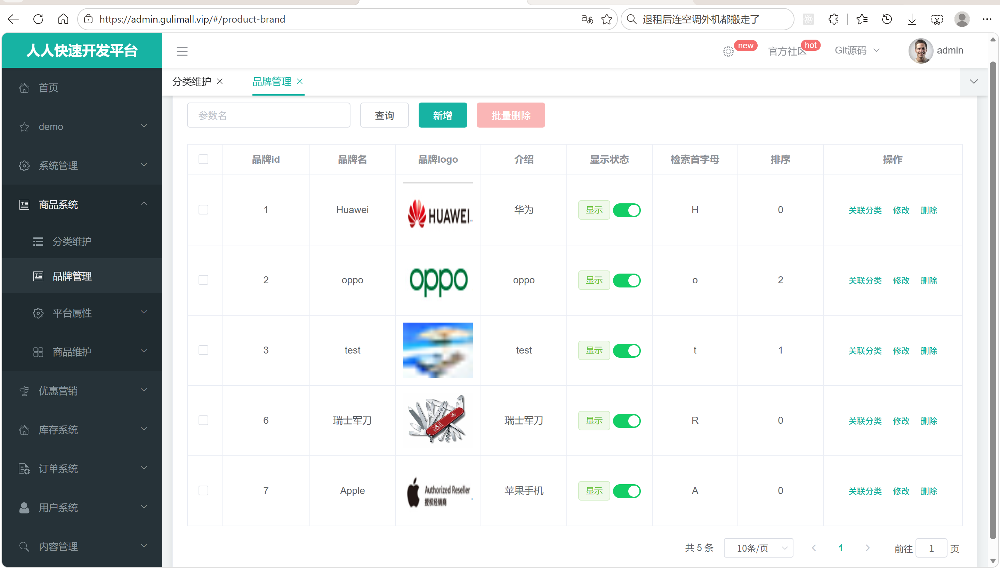
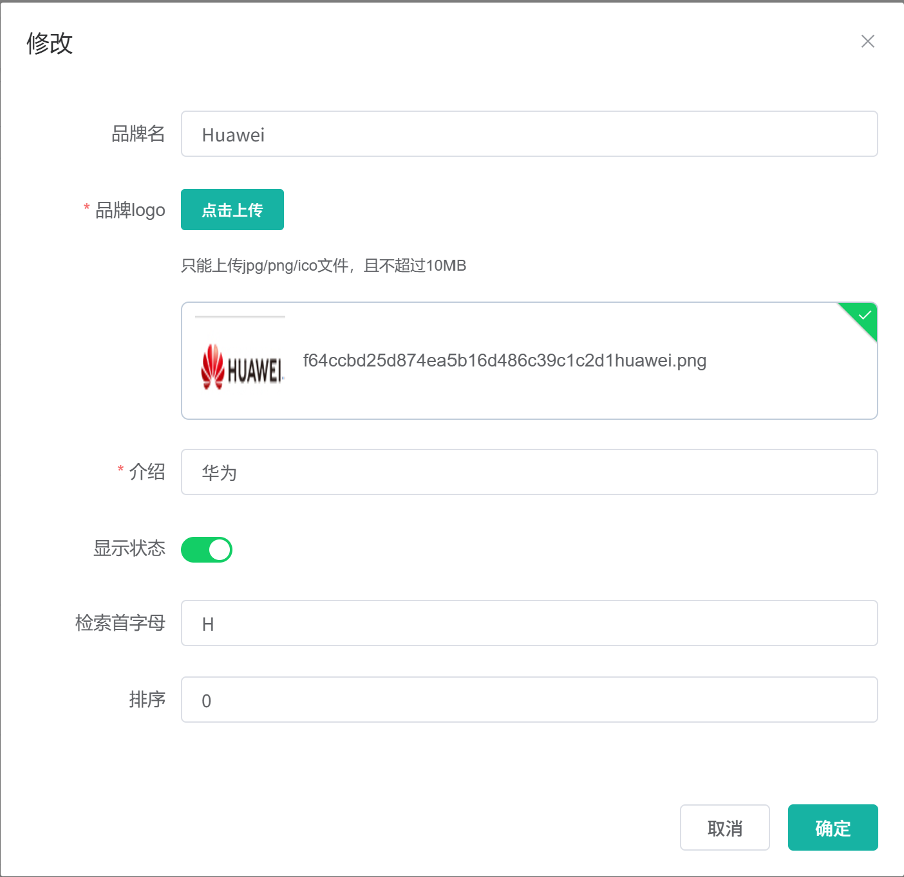
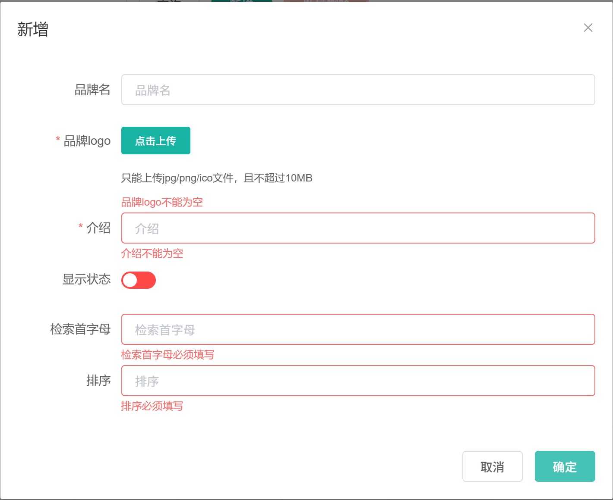
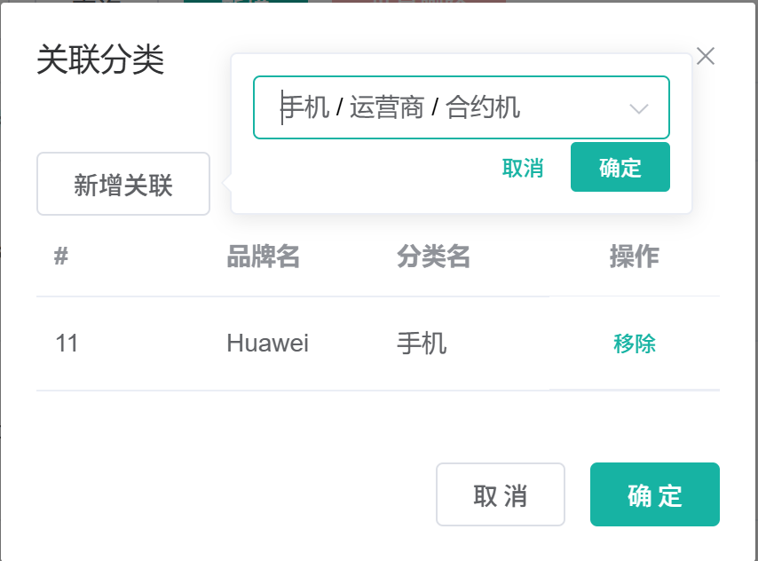
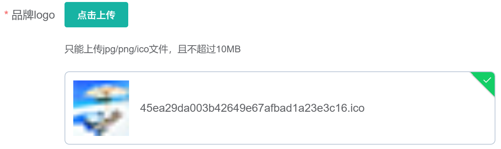

# 6.2 品牌管理-介绍

> 本篇介绍品牌管理：品牌在商城里的业务作用、管理员维护品牌的完整操作、品牌与分类的多对多关系、logo 为什么存根相对路径、JSR303 分组校验、自定义 `@ListValue` 校验、全局校验异常处理、品牌改名后的级联更新，以及品牌列表页和新增/修改弹窗的前端逻辑。

> 参数校验相关文档：[Jakarta Validation 参数校验](../参数校验/Jakarta%20Validation参数校验.md)。

---

## 1. 这个功能是干什么的

品牌是商品的牌子，例如华为、小米、苹果、三星。用户在商城里有几种典型行为都离不开品牌：

1. **买商品先认牌子**：手机、家电、化妆品这类商品，用户往往先确定品牌，再看具体型号。
2. **按品牌筛选**：搜索页、分类页的品牌筛选项来自品牌表。
3. **商品发布必须选品牌**：发布 SPU 时，分类和品牌是两个必填项，商品详情页也会展示品牌信息。
4. **后台统一维护品牌资料**：品牌名称、logo、介绍、检索首字母、排序、显示状态都由管理员维护。

品牌和分类是多对多关系：

```text
一个品牌可以属于多个分类：华为 → 手机、平板、笔记本、智能穿戴
一个分类也可以有多个品牌：手机 → 华为、小米、苹果、三星
```

因此品牌表 `pms_brand` 只存品牌自身的信息，品牌和分类的关系单独放在关联表 `pms_category_brand_relation`。品牌在后台的主要操作是：查询、新增、修改、切换显示状态、删除、关联分类。

## 2. 管理员怎么操作

入口：

```text
管理后台 → 商品系统 → 品牌管理
```



### 2.1 查看品牌列表

1. 打开页面，前端请求 `GET /product/brand/list`。
2. 请求参数带 `page`、`limit`、`key`。
3. 后端按 `key` 对品牌 id、品牌名、检索首字母做模糊查询。
4. 后端返回分页对象，前端把 `data.page.list` 赋给表格，把 `data.page.totalCount` 赋给分页器。
5. 表格展示品牌 id、品牌名、logo、介绍、显示状态、检索首字母、排序和操作列。

### 2.2 新增品牌

1. 点击“新增”，打开新增/修改弹窗。
2. 填写品牌名、介绍、检索首字母、排序。
3. 点击“点击上传”选择 logo，上传成功后表单里得到 logo 地址。
4. 选择显示状态，默认显示。
5. 点击“确定”，前端先做表单校验，再提交 `POST /product/brand/save`。
6. 后端用 `@Validated({AddGroup.class})` 校验参数，通过后插入 `pms_brand`。
7. 前端提示成功，关闭弹窗并刷新列表。



### 2.3 修改品牌

1. 在列表行点击“修改”，打开同一个弹窗。
2. 前端请求 `GET /product/brand/info/{brandId}`，把品牌数据回显到表单。
3. 修改品牌名、logo、介绍、状态、首字母、排序。
4. 点击“确定”，提交 `POST /product/brand/update`。
5. 后端用 `@Validated({UpdateGroup.class})` 校验参数，通过后调用 `updateDetails()`。
6. `updateDetails()` 先更新品牌表，再在品牌名非空时级联更新关联表里的 `brand_name`。
7. 前端刷新列表。

### 2.4 修改显示状态

1. 列表每一行的显示状态列有一个开关。
2. 打开或关闭开关，触发 `change` 事件。
3. 前端只提交 `brandId` 和 `showStatus` 两个字段到 `POST /product/brand/update/status`。
4. 后端用 `@Validated({UpdateGroupStatus.class})` 校验，只要求 `brandId` 和 `showStatus` 合法。
5. 后端调用 `updateById()` 更新显示状态，前端刷新列表。

单独做一个状态接口，是因为状态开关只提交两个字段。如果复用完整的修改接口，品牌名、logo、排序等字段没有提交，会被必填校验拦住。

### 2.5 删除品牌

1. 勾选一行或多行，点击“删除”或“批量删除”。
2. 前端二次确认后提交品牌 id 数组到 `POST /product/brand/delete`。
3. 后端调用 `removeByIds()` 删除 `pms_brand` 记录。
4. 前端刷新列表。

### 2.6 关联分类

1. 在列表行点击“关联分类”，打开关联分类弹窗。
2. 点击“新增关联”，用分类级联选择器选到三级分类。
3. 点击“确定”，提交品牌 id 和最后一级分类 id 到 `POST /product/categorybrandrelation/save`。
4. 弹窗表格展示这个品牌已经关联的分类，可以逐条“移除”。

## 3. 整体设计思路

### 3.1 业务上怎么设计

#### 3.1.1 品牌与分类多对多

品牌和分类不能直接在一张表里互相存 id，因为两边都是多对多。业务上拆成三张表：

```text
pms_brand
    └── pms_category_brand_relation（品牌 id + 分类 id）
            └── pms_category
```

关联表除了两个外键，还冗余保存 `brand_name` 和 `catelog_name`。这样品牌关联列表直接查关联表就能显示名称，不用每次再关联品牌表和分类表。代价是品牌改名、分类改名时要同步更新冗余字段。

#### 3.1.2 logo 存根相对路径

品牌 logo 在数据库里存的是：

```text
/oss/gulimall/brand/2026-09-07/443e...a901.png
```

不是 `http://<your-vm-host-ip>:19000/gulimall/...` 这种带 IP 和端口的绝对地址。原因是：

1. 以 `/` 开头的路径，浏览器会用当前页面的源自动补全。页面在 `admin.gulimall.vip`，图片就请求 `admin.gulimall.vip/oss/...`。
2. 以后换域名、上公网、加 CDN，数据库里的地址一个字都不用改。
3. 手机端走 IP + 端口、电脑端走域名时，图片都能跟着页面走。

代价是访问图片必须经过 Nginx，直接访问业务服务端口时 `/oss/...` 会打到业务服务上并返回 404。

#### 3.1.3 JSR303 分组校验

同一个 `BrandEntity` 在三种场景下提交的字段不同：

| 场景 | 提交字段 | 使用的分组 |
|---|---|---|
| 新增品牌 | 品牌名、logo、介绍、状态、首字母、排序 | `AddGroup` |
| 修改品牌 | 品牌 id 和完整品牌信息 | `UpdateGroup` |
| 只改状态 | 品牌 id、显示状态 | `UpdateGroupStatus` |

如果把所有校验都放在默认分组，状态开关只提交两个字段时，品牌名、logo、排序等必填校验会被触发，接口直接报错。分组校验让每个接口只校验自己场景需要的字段。

#### 3.1.4 改名级联

关联表冗余了 `brand_name`。品牌改名后，如果只更新 `pms_brand.name`，关联分类弹窗里仍然显示旧品牌名。因此业务要求：

1. 更新品牌表。
2. 品牌名非空时，同步更新 `pms_category_brand_relation.brand_name`。
3. 两步放在同一个事务里，任何一步失败都回滚。

#### 3.1.5 显示状态、排序、检索首字母

1. `showStatus` 只有 0 和 1 两个值：0 不显示，1 显示。
2. `sort` 必须大于等于 0，值越大越靠前。
3. `firstLetter` 必须是单个英文字母，用户搜索品牌时可以按首字母过滤。
4. 删除不做逻辑删除，品牌表没有 `@TableLogic`，删除会真正移除记录。

#### 3.1.6 删除规则

品牌删除后，`pms_category_brand_relation` 里可能还残留这个品牌的关联记录。当前数据库没有外键约束，删除品牌不会自动清理关联表。生产环境应在删除前校验：

1. 品牌是否已经被商品引用。
2. 是否要同时清理品牌分类关联。
3. 是否需要改成逻辑删除，保留历史商品的品牌信息。

### 3.2 技术上怎么设计

#### 3.2.1 品牌表 `pms_brand`

```text
pms_brand
├── brand_id      品牌 id，主键
├── name          品牌名
├── logo          品牌 logo，根相对路径
├── descript      品牌介绍
├── show_status   显示状态，0 不显示、1 显示
├── first_letter  检索首字母
└── sort          排序
```

`BrandEntity` 用 MyBatis-Plus 的 `@TableName("pms_brand")` 映射，`@TableId` 标记主键。项目没有给品牌配置逻辑删除，所以 `removeByIds()` 是物理删除。

#### 3.2.2 关联表 `pms_category_brand_relation`

```text
pms_category_brand_relation
├── id            关联记录 id
├── brand_id      品牌 id
├── catelog_id    分类 id
├── brand_name    冗余品牌名
└── catelog_name  冗余分类名
```

冗余名称是为了列表展示方便。品牌改名时更新 `brand_name`，分类改名时更新 `catelog_name`。

#### 3.2.3 校验链路

```text
BrandController 参数上的 @Validated({AddGroup.class})
    → Spring MVC 找到 Hibernate Validator
    → 只执行 groups 包含 AddGroup 的校验注解
    → 校验失败抛 MethodArgumentNotValidException
    → GulimallExceptionControllerAdvice 统一拦截
    → 返回 code=99001 和字段错误 Map
```

`@Validated` 是 Spring 的注解，支持分组；`@Valid` 是 Jakarta Validation 的注解，也支持分组，但项目统一用 `@Validated`。

#### 3.2.4 自定义 `@ListValue`

`showStatus` 只能取 0 或 1。虽然可以用 `@Min`、`@Max` 限制范围，但更准确的写法是枚举值校验。项目自定义了 `@ListValue(values = {0, 1})`：

1. 注解上通过 `@Constraint(validatedBy = {ListValueConstraintValidator.class})` 关联校验器。
2. 校验器初始化时把允许的值放进 `Set`。
3. 校验时判断提交的值是否在 `Set` 里。
4. 注解的 `groups`、`message`、`payload` 是 Jakarta Validation 规范要求的三个属性。

#### 3.2.5 全局异常处理

`@RestControllerAdvice(basePackages = "com.atguigu.gulimall.product.controller")` 只拦截商品服务的 Controller。校验失败返回字段错误 Map，其他异常返回统一的未知异常码，避免把堆栈直接暴露给前端。

#### 3.2.6 级联更新 SQL

`CategoryBrandRelationDao.updateBrandName()` 对应一条 `UPDATE pms_category_brand_relation SET brand_name = ? WHERE brand_id = ?`。它和品牌更新在同一个事务里执行。

#### 3.2.7 前端组件拆分

1. `brand.vue` 负责列表、搜索、分页、状态开关、删除、打开弹窗、关联分类。
2. `brand-add-or-update.vue` 负责新增/修改表单、回显、前端校验、提交。
3. `singleUpload.vue` 负责 logo 上传和回显，完整上传链路放在 6.3 介绍。

## 4. 详细代码、配置和解释

品牌管理的代码从浏览器表单一路走到 MySQL，途经实体绑定、分组校验、自定义枚举校验、Controller、Service、DAO 和全局异常处理，最后回到两个 Vue 组件。下面按调用顺序展开，每个类先说明它在链路里解决什么问题、由谁调用，再给关键字段与接口，然后把代码拆成块解释执行顺序，接着给出一次完整示例，最后说明边界和可优化点。

### 4.1 BrandEntity：品牌表映射与校验规则

#### 4.1.1 这个类解决什么问题

后台品牌页提交的每一份 JSON 最终都要落到 `pms_brand` 表。`BrandEntity` 是这条写入链路的落点，同时被三类代码使用：

1. 前端 `brand-add-or-update.vue` 提交 JSON，`BrandController` 用 `@RequestBody BrandEntity` 接住；
2. `BrandService` 和 `BrandDao` 依赖它完成 MyBatis-Plus 的增删改查；
3. `CategoryBrandRelationDao.updateBrandName()` 从它身上取 `brandId` 和 `name`，做品牌改名的级联更新。

因此字段定义要同时满足三件事：和表结构一致、能承载请求体、能声明校验规则。JSR303 注解和 MyBatis-Plus 注解混在同一个类里，是这三件事共同作用的结果。

它在链路里的位置：

```text
brand-add-or-update.vue 提交 JSON
  → BrandController 用 BrandEntity 接住请求体
  → @Validated 按分组执行字段校验
  → BrandServiceImpl / BrandDao 写入 pms_brand
  → 品牌改名时把 brandId、name 交给关联表级联
```

#### 4.1.2 字段与业务含义

| 字段 | 数据库列 | 业务含义 | 校验分组 |
|---|---|---|---|
| `brandId` | `brand_id` | 品牌主键 | 无，新增时为空，由数据库自增 |
| `name` | `name` | 品牌名 | `AddGroup`、`UpdateGroup` 的 `@NotBlank` |
| `logo` | `logo` | 品牌 logo，根相对路径 `/oss/gulimall/brand/...` | `AddGroup` 的 `@NotEmpty` |
| `descript` | `descript` | 品牌介绍 | 无 |
| `showStatus` | `show_status` | 0 不显示、1 显示 | 三个分组都要求非空，且只能是 0 或 1 |
| `firstLetter` | `first_letter` | 检索首字母 | `AddGroup` 非空；新增和修改都要求单个字母 |
| `sort` | `sort` | 排序，值越大越靠前 | `AddGroup` 非空；新增和修改都要求大于等于 0 |

`logo` 只在新增加 `@NotEmpty`，是因为修改时允许不重新上传 logo。`firstLetter` 的 `@NotEmpty` 只挂在新增分组，但 `@Pattern` 挂在新增和修改两个分组，修改时传 null 会被 `@Pattern` 放行，传空串才会报错。

#### 4.1.3 代码与解释

实体上的每个注解都对应一个业务场景。下面是完整定义：

```java
@Data
@TableName("pms_brand")
public class BrandEntity implements Serializable {
    @Serial
    private static final long serialVersionUID = 1L;

    /**
     * 品牌 id
     */
    @TableId
    private Long brandId;

    /**
     * 品牌名
     */
    @NotBlank(message = "品牌名必须提交", groups = {AddGroup.class, UpdateGroup.class})
    private String name;

    /**
     * 品牌 logo 地址，存根相对路径 /oss/gulimall/brand/xxx.png，不是完整 URL
     */
    @NotEmpty(groups = {AddGroup.class})
    private String logo;

    /**
     * 介绍
     */
    private String descript;

    /**
     * 显示状态[0-不显示；1-显示]
     */
    @NotNull(groups = {AddGroup.class, UpdateGroup.class, UpdateGroupStatus.class})
    @ListValue(values = {0, 1}, groups = {AddGroup.class, UpdateGroup.class, UpdateGroupStatus.class})
    private Integer showStatus;

    /**
     * 检索首字母
     */
    @NotEmpty(groups = {AddGroup.class})
    @Pattern(regexp = "^[a-zA-Z]$", message = "检索首字母必须是一个字母", groups = {AddGroup.class, UpdateGroup.class})
    private String firstLetter;

    /**
     * 排序
     */
    @NotNull(groups = {AddGroup.class})
    @Min(value = 0, message = "排序必须大于等于0", groups = {AddGroup.class, UpdateGroup.class})
    private Integer sort;
}
```

1. `@Data`：Lombok 生成 getter、setter、`toString()`、`equals()`、`hashCode()`，MyBatis-Plus 和 Spring MVC 都依赖这些方法读写字段。
2. `@TableName("pms_brand")`：告诉 MyBatis-Plus 实体对应哪张表；没有它，增删改查找不到表名。
3. `@TableId`：标记 `brandId` 是主键。新增时该字段为空，数据库自增后 MyBatis-Plus 会回填。
4. `@NotBlank`：品牌名不能为 null、空串或只含空白字符。新增和修改都要校验，因为改名是修改场景里最常见的操作。
5. `@NotEmpty`：logo 在新增时不能为 null 或空串。修改分组没有挂这个注解，所以修改时不重新上传 logo 也能通过校验。
6. `@NotNull`：显示状态在三个场景都必须提交；排序在新增时必须提交，修改时允许不传，避免只改 logo 时被排序拦住。
7. `@Pattern(regexp = "^[a-zA-Z]$")`：首字母必须正好是一个英文字母。`@Pattern` 对 null 视为通过，因此修改时不传首字母不会报错，传空串才报错。
8. `@ListValue(values = {0, 1})`：显示状态只能是 0 或 1，具体由 4.3 的校验器执行。
9. `groups`：指定注解在哪些分组下生效。没有写 `groups` 的注解属于默认分组，`@Validated({AddGroup.class})` 不会触发默认分组。

#### 4.1.4 一次保存示例

```text
新增请求体：
{
  "name": "华为",
  "logo": "/oss/gulimall/brand/2026-09-07/443e...a901.png",
  "descript": "华为",
  "showStatus": 1,
  "firstLetter": "H",
  "sort": 100
}
→ AddGroup 校验通过
→ INSERT INTO pms_brand (name, logo, descript, show_status, first_letter, sort)
→ 自增主键回填 brandId

非法请求体：
{
  "name": "",
  "logo": "",
  "showStatus": 2,
  "firstLetter": "HW",
  "sort": -1
}
→ name 触发 @NotBlank
→ logo 触发 @NotEmpty（AddGroup）
→ showStatus 触发 @ListValue
→ firstLetter 触发 @Pattern
→ sort 触发 @Min
→ 五条字段错误交给全局异常处理
```

#### 4.1.5 它不做什么

1. 不组装前端展示结构，列表和详情直接返回实体字段。
2. 不检查品牌名是否重复，数据库没有唯一约束，Service 也没有查重。
3. 不处理品牌和分类的关联，关联写入走 `CategoryBrandRelationController`。
4. 不校验未声明的分组。某个校验注解漏写 `groups` 时，带分组的接口不会执行它。

#### 4.1.6 边界与可优化点

1. 实体同时承担数据库映射和接口入参，字段少时成本低。字段变多后应拆成 `BrandEntity` 和 `BrandSaveVO`、`BrandUpdateVO`，避免数据库字段和接口字段互相牵制。
2. 品牌名没有长度限制，可以补 `@Size(max = 100)`，同时给数据库列留足长度。
3. 检索首字母区分大小写。可以在保存时统一转大写，并在查询时按大写匹配，减少重复数据。
4. logo 在修改分组没有非空约束。如果前端提交空串，会把数据库里的 logo 覆盖成空值，服务端应补一次“修改时 logo 为空则保留原值”的判断。
5. `showStatus` 同时有 `@NotNull` 和 `@ListValue`。前者保证有值，后者保证值合法，两条缺一不可。

### 4.2 AddGroup、UpdateGroup、UpdateGroupStatus：三个校验分组

#### 4.2.1 这个接口解决什么问题

同一个 `BrandEntity` 被三个接口复用，但三次提交的字段集合不同。状态开关只提交 `brandId` 和 `showStatus`；如果沿用新增的必填规则，品牌名、logo、首字母、排序都会报“不能为空”，开关永远改不了。三个空接口就是给校验注解贴场景标签，让每个接口只执行自己场景的规则。

调用方只有 `BrandController` 的三个方法参数：`save()` 用 `AddGroup`，`update()` 用 `UpdateGroup`，`updateStatus()` 用 `UpdateGroupStatus`。分组接口放在 `gulimall-common` 的 `valid` 包下，商品、会员、订单等模块都可以直接复用。

它在链路里的位置：

```text
BrandController.save          → @Validated({AddGroup.class})
BrandController.update        → @Validated({UpdateGroup.class})
BrandController.updateStatus  → @Validated({UpdateGroupStatus.class})
        ↓
Hibernate Validator 只执行 groups 包含当前分组的约束
        ↓
校验失败 → MethodArgumentNotValidException → 全局异常处理
```

#### 4.2.2 三个分组与提交场景

| 分组 | 使用接口 | 提交字段 | 校验目标 |
|---|---|---|---|
| `AddGroup` | `POST /product/brand/save` | 品牌名、logo、介绍、状态、首字母、排序 | 新增时所有必填项齐全 |
| `UpdateGroup` | `POST /product/brand/update` | 品牌 id、品牌名、介绍、状态、首字母、排序，logo 可选 | 修改时只校验允许缺省的字段 |
| `UpdateGroupStatus` | `POST /product/brand/update/status` | 品牌 id、显示状态 | 开关只要求 id 和状态合法 |

#### 4.2.3 代码与解释

三个分组本身没有任何方法，只作为类型标记：

```java
public interface AddGroup {
}

public interface UpdateGroup {
}

public interface UpdateGroupStatus {
}
```

1. 三个接口都是空接口，不定义常量和方法，只在 `@Validated` 和字段注解的 `groups` 里作为 `Class` 出现。
2. `@Validated({AddGroup.class})` 写在 Controller 方法参数上，表示这次请求只执行 groups 中包含 `AddGroup` 的约束。Hibernate Validator 按“请求分组和注解分组是否有交集”决定是否执行。
3. 分组接口放在公共模块，多个服务共享同一套分组名，避免每个模块各写一份。

`@Validated` 是 Spring 的注解，支持分组；`@Valid` 是 Jakarta Validation 的注解，也支持分组，但项目统一使用 `@Validated`，保证写法一致。

#### 4.2.4 一次状态开关示例

```text
管理员把品牌 1 从“显示”拨到“隐藏”
→ brand.vue 提交 { "brandId": 1, "showStatus": 0 }
→ BrandController.updateStatus() 使用 UpdateGroupStatus
→ 只执行 groups 包含 UpdateGroupStatus 的约束：
   showStatus 的 @NotNull 通过
   showStatus 的 @ListValue 通过
→ name、logo、firstLetter、sort 上的 AddGroup 约束不执行
→ brandService.updateById(brand)
→ UPDATE pms_brand SET show_status = 0 WHERE brand_id = 1
```

如果这次请求误用了 `UpdateGroup`，`name` 为 null 会触发 `@NotBlank`，`logo`、`sort` 的修改分组约束也会参与判断，开关请求会直接失败。

#### 4.2.5 它不做什么

1. 不执行校验，只提供分组标记。
2. 不决定错误信息，错误信息写在具体约束的 `message` 上。
3. 不把默认分组自动纳入。`@Validated({AddGroup.class})` 和默认分组是互斥的，没写 `groups` 的注解不会被触发。

#### 4.2.6 边界与可优化点

1. `AddGroup`、`UpdateGroup` 是通用名字，所有模块共用后容易互相影响。模块数量增多后可以细分出 `BrandAddGroup`、`BrandUpdateGroup`。
2. 需要控制校验顺序时，可以用 `@GroupSequence` 先校验必填、再校验格式。
3. 字段上的 `groups` 漏写是常见问题：注解看起来存在，接口却不校验。新增字段时应同时检查 Controller 使用的分组和字段上的 `groups`。
4. 分组只解决“校验哪些字段”，不解决“字段属于哪个接口”。接口字段差异变大后，拆 VO 比继续增加分组更清晰。

### 4.3 ListValue 与 ListValueConstraintValidator：枚举值校验

#### 4.3.1 这个类解决什么问题

`show_status` 只有 0 和 1 两个合法值。`@Min(0)` 加 `@Max(1)` 能限制范围，但表达不出“只能是这两个枚举值”，遇到 `{1, 3, 5}` 这种不连续取值也写不了。项目自定义 `@ListValue`，把允许值放在注解属性里，由校验器判断提交值是否在集合中。

它只服务 `BrandEntity.showStatus` 一个字段，但校验器由 Hibernate Validator 实例化，失败信息最终由 `GulimallExceptionControllerAdvice` 收集。上游是请求体，下游是字段错误 Map。

它在链路里的位置：

```text
BrandEntity.showStatus 标注 @ListValue(values = {0, 1})
  → Hibernate Validator 创建 ListValueConstraintValidator
  → initialize() 读取 values() 放进 Set
  → isValid() 判断提交值是否在 Set 内
  → 失败产生字段错误
  → GulimallExceptionControllerAdvice 转成 errorMap
```

#### 4.3.2 注解、校验器与错误的协作

| 角色 | 职责 | 位置 |
|---|---|---|
| `@ListValue` | 声明字段值必须在给定列表内，并携带 `values` | `gulimall-common` 的 `valid.showStatusValid` |
| `ListValueConstraintValidator` | 初始化允许值集合，执行包含判断 | 与注解同包 |
| `BrandEntity.showStatus` | 使用注解并指定分组 | `gulimall-product` |
| `GulimallExceptionControllerAdvice` | 把校验失败转成统一返回 | `gulimall-product` |

#### 4.3.3 注解定义与解释

```java
@Documented
@Constraint(validatedBy = {ListValueConstraintValidator.class})
@Target({ElementType.METHOD, ElementType.FIELD, ElementType.ANNOTATION_TYPE,
        ElementType.CONSTRUCTOR, ElementType.PARAMETER, ElementType.TYPE_USE})
@Retention(RetentionPolicy.RUNTIME)
public @interface ListValue {

    String message() default "{com.atguigu.gulimall.common.valid.ListValue.message}";

    Class<?>[] groups() default {};

    Class<? extends Payload>[] payload() default {};

    int[] values() default {};
}
```

1. `@Constraint(validatedBy = {...})`：把注解和校验器绑定。Hibernate Validator 遇到这个注解时，会找对应的 `ConstraintValidator`。
2. `@Target`：注解可以放在字段、方法、参数、构造器、注解类型和类型使用位置。当前只用在字段上，但保留其他位置方便复用。
3. `@Retention(RUNTIME)`：运行时保留，校验器才能通过反射读取 `values()`。
4. `message()`、`groups()`、`payload()`：Jakarta Validation 规范要求的三个属性，缺任何一个注解都无法通过编译检查或运行时校验。
5. `values()`：自定义属性，用来传允许的枚举值。默认空数组表示没有允许值，任何提交都会被判失败。

#### 4.3.4 校验器实现与解释

```java
public class ListValueConstraintValidator implements ConstraintValidator<ListValue, Integer> {

    private final Set<Integer> set = new HashSet<>();

    @Override
    public void initialize(ListValue constraintAnnotation) {
        int[] value = constraintAnnotation.values();
        for (int i : value) {
            set.add(i);
        }
    }

    @Override
    public boolean isValid(Integer value, ConstraintValidatorContext context) {
        return set.contains(value);
    }
}
```

1. 实现 `ConstraintValidator<ListValue, Integer>`，第一个泛型是注解类型，第二个是校验的值类型。
2. `Set<Integer> set` 保存允许值。每个校验器实例只初始化一次，之后 `isValid()` 只读不写。
3. `initialize()` 由 Hibernate Validator 在校验器创建后调用，从注解实例读出 `values()`。
4. 循环把每个允许值放进 `set`。允许值重复时 `Set` 自动去重。
5. `isValid()` 判断提交值是否在集合中，返回 false 时框架生成一条字段错误，错误信息取注解的 `message()`。

#### 4.3.5 一次校验示例

```text
提交 showStatus = 1
→ initialize() 已把 0、1 放进 set
→ set.contains(1) = true
→ 校验通过

提交 showStatus = 2
→ set.contains(2) = false
→ 生成字段错误：showStatus 对应的 message
→ 全局异常处理把错误放进 data.showStatus

提交 showStatus = null
→ @NotNull 先拦截
→ @ListValue 不会单独给出“值不在列表”的错误
```

#### 4.3.6 它不做什么

1. 不支持 `String`、`Long` 等其他类型，泛型固定为 `Integer`。
2. 不查数据库，只做内存集合判断。
3. 不处理 null，null 由同一个字段上的 `@NotNull` 负责。
4. 不执行分组，分组仍由注解的 `groups` 和 Controller 的 `@Validated` 决定。

#### 4.3.7 边界与可优化点

1. `message` 的默认 key 是 `com.atguigu.gulimall.common.valid.ListValue.message`，而 `ValidationMessages.properties` 里的 key 是 `com.atguigu.common.valid.showStatusValid.ListValue.message`。两个 key 不一致时，错误信息会直接显示 `{...}` 占位符。应统一 key，或者在注解上直接写 `message = "显示状态只能是0或1"`。
2. `set` 可以改成 `Collections.unmodifiableSet()`，避免校验器内部被误改。
3. 当前只支持整数枚举。可以改成泛型注解，或者再写一个 `StringListValue`，覆盖字符串枚举场景。
4. 校验器实例由框架管理，不要在 `isValid()` 里修改共享状态，否则并发校验会互相影响。当前实现只读 `set`，符合要求。

### 4.4 BrandController：接收品牌请求

#### 4.4.1 这个类解决什么问题

后台品牌页面把管理员操作翻译成六类 HTTP 请求：列表、详情、新增、修改、改状态、删除。页面不直连数据库，所有请求先经过 Nginx 和 Gateway，去掉 `/gulimall` 前缀后进入 `BrandController`。这个类只做三件事：接参数、校验权限、把 Service 返回值包装成统一结果 `R`。校验规则、级联更新、分页 SQL 都不在这里。

它在链路里的位置：

```text
admin.gulimall.vip → Nginx → Gateway /gulimall/product/brand/...
  → BrandController
  → BrandService（queryPage / save / getById / updateDetails / updateById / removeByIds）
  → BrandDao → MySQL pms_brand
```

#### 4.4.2 接口清单

| 操作 | 方法与路径 | 权限 | 调用的 Service 方法 |
|---|---|---|---|
| 分页列表 | `GET /product/brand/list` | `product:brand:list` | `queryPage()` |
| 详情回显 | `GET /product/brand/info/{brandId}` | `product:brand:info` | `getById()` |
| 新增品牌 | `POST /product/brand/save` | `product:brand:save` | `save()` |
| 修改品牌 | `POST /product/brand/update` | `product:brand:update` | `updateDetails()` |
| 修改显示状态 | `POST /product/brand/update/status` | `product:brand:update` | `updateById()` |
| 删除品牌 | `POST /product/brand/delete` | `product:brand:delete` | `removeByIds()` |

网关转发前会去掉 `/gulimall` 前缀，后台实际请求路径是 `/gulimall/product/brand/...`。

#### 4.4.3 代码与解释

```java
@RestController
@RequestMapping("product/brand")
public class BrandController {

    @Autowired
    private BrandService brandService;

    /**
     * 列表
     */
    @RequestMapping("/list")
    @RequiresPermissions("product:brand:list")
    public R list(@RequestParam Map<String, Object> params) {
        PageUtils page = brandService.queryPage(params);

        return R.ok().put("page", page);
    }

    /**
     * 信息
     */
    @RequestMapping("/info/{brandId}")
    @RequiresPermissions("product:brand:info")
    public R info(@PathVariable("brandId") Long brandId) {
        BrandEntity brand = brandService.getById(brandId);

        return R.ok().put("brand", brand);
    }

    /**
     * 保存
     */
    @RequestMapping("/save")
    @RequiresPermissions("product:brand:save")
    public R save(@Validated({AddGroup.class}) @RequestBody BrandEntity brand) {
        brandService.save(brand);

        return R.ok();
    }

    /**
     * 修改：存在品牌分类关联表，修改品牌需要级联更新
     */
    @RequestMapping("/update")
    @RequiresPermissions("product:brand:update")
    public R update(@Validated({UpdateGroup.class}) @RequestBody BrandEntity brand) {
        brandService.updateDetails(brand);
        return R.ok();
    }

    /**
     * 单独修改显示状态：只提交品牌 id 和 showStatus，使用独立分组
     */
    @RequestMapping("/update/status")
    @RequiresPermissions("product:brand:update")
    public R updateStatus(@Validated({UpdateGroupStatus.class}) @RequestBody BrandEntity brand) {
        brandService.updateById(brand);

        return R.ok();
    }

    /**
     * 删除
     */
    @RequestMapping("/delete")
    @RequiresPermissions("product:brand:delete")
    public R delete(@RequestBody Long[] brandIds) {
        brandService.removeByIds(Arrays.asList(brandIds));

        return R.ok();
    }
}
```

1. `@RestController` 加 `@RequestMapping("product/brand")`：所有接口共用 `/product/brand` 前缀，方法上的 `@RequestMapping` 再补具体路径。
2. `@RequiresPermissions`：Shiro 权限校验。请求先经过权限判断，没有对应权限时不会进入方法体。
3. `list()`：把 `page`、`limit`、`key` 原样装进 `Map` 交给 `queryPage()`，返回值放在 `page` 字段，前端取 `data.page`。
4. `info()`：按 id 调用 `getById()`，返回值放在 `brand` 字段，前端取 `data.brand`。修改弹窗靠这个接口回显。
5. `save()`：`@Validated({AddGroup.class})` 只执行新增分组校验，通过后调用 MyBatis-Plus 的 `save()` 插入 `pms_brand`。
6. `update()`：`@Validated({UpdateGroup.class})` 执行修改分组校验，调用 `updateDetails()` 而不是 `updateById()`，因为品牌改名还要同步关联表。
7. `updateStatus()`：`@Validated({UpdateGroupStatus.class})` 只校验 id 和状态，调用 `updateById()`。MyBatis-Plus 默认只更新非 null 字段，所以只提交两个字段时其他列保持原值。
8. `delete()`：接收 id 数组，转成 `List` 后调用 `removeByIds()`。品牌实体没有逻辑删除注解，实际执行物理删除。

#### 4.4.4 一次请求示例

管理员在列表里把品牌 1 的开关关掉：

```text
1. 浏览器提交 POST /gulimall/product/brand/update/status
2. 请求体：{ "brandId": 1, "showStatus": 0 }
3. Gateway 去掉 gulimall 前缀，进入 BrandController.updateStatus()
4. Shiro 校验 product:brand:update 权限
5. @Validated({UpdateGroupStatus.class}) 执行：
   brandId 无校验注解，直接通过
   showStatus 的 @NotNull 通过
   showStatus 的 @ListValue 通过
6. 调用 brandService.updateById(brand)
7. 返回 R.ok()
8. 前端收到 code=0，提示操作成功并刷新列表
```

#### 4.4.5 它不做什么

1. 不写 SQL，分页条件由 `BrandServiceImpl.queryPage()` 组装。
2. 不做级联更新，品牌改名走 `updateDetails()`。
3. 不校验品牌是否被商品引用，删除前没有业务检查。
4. 不处理异常，校验失败和未知异常都交给 `GulimallExceptionControllerAdvice`。
5. 不组装前端展示对象，直接返回实体字段。

#### 4.4.6 边界与可优化点

1. `list()` 直接接收 `Map<String, Object>`，参数类型不明确。可以定义 `BrandQuery`，字段包括 `page`、`limit`、`key`。
2. `delete()` 没有校验品牌是否被商品引用，也没有清理关联表。生产环境应在删除前补业务校验。
3. `save()` 和 `update()` 没有幂等控制，重复提交会插入重复品牌或重复执行更新。可以在前端加防重按钮，后端加唯一索引。
4. `update()` 和 `updateStatus()` 共用 `product:brand:update` 权限。如果需要区分“改完整资料”和“改开关”，应拆成两个权限点。
5. 所有接口都使用 `@RequestMapping` 而不限定方法，GET 和 POST 都能访问。生产环境应明确 `@GetMapping`、`@PostMapping`，减少误用。

### 4.5 BrandService：品牌业务接口

#### 4.5.1 这个接口解决什么问题

Controller 不关心品牌查询怎么拼 SQL、修改怎么做级联，这些约定由 `BrandService` 接口表达。它继承 `IService<BrandEntity>`，拿到 MyBatis-Plus 的标准 CRUD，再额外声明两个品牌自己的方法。调用方是 `BrandController`，实现方是 `BrandServiceImpl`，下游是 `BrandDao` 和 `CategoryBrandRelationDao`。

它在链路里的位置：

```text
BrandController
  → BrandService（接口，声明能力）
  → BrandServiceImpl（实现，写业务和事务）
  → BrandDao / CategoryBrandRelationDao（访问数据库）
```

#### 4.5.2 方法清单

| 方法 | 来源 | 作用 | 使用方 |
|---|---|---|---|
| `save()` | `IService` | 新增品牌 | `BrandController.save()` |
| `getById()` | `IService` | 按 id 查品牌 | `BrandController.info()` |
| `updateById()` | `IService` | 按非 null 字段更新 | `BrandController.updateStatus()` |
| `removeByIds()` | `IService` | 按 id 批量删除 | `BrandController.delete()` |
| `queryPage()` | 接口自定义 | 分页加关键字查询 | `BrandController.list()` |
| `updateDetails()` | 接口自定义 | 更新品牌并级联关联表 | `BrandController.update()` |

#### 4.5.3 代码与解释

```java
public interface BrandService extends IService<BrandEntity> {

    PageUtils queryPage(Map<String, Object> params);

    /**
     * 修改品牌，并级联更新品牌分类关联表中的冗余品牌名
     */
    void updateDetails(BrandEntity brand);
}
```

1. `IService<BrandEntity>` 提供 `save()`、`getById()`、`updateById()`、`removeByIds()`、`page()` 等通用方法，实现类不用重复写。
2. `queryPage()` 接收 Controller 传进来的分页和查询参数，返回项目统一的分页对象 `PageUtils`。
3. `updateDetails()` 是品牌修改的入口。方法名带 `Details`，提示调用方它不只更新一张表，内部还会同步关联表。

#### 4.5.4 它不做什么

1. 不定义 SQL，查询条件由实现类拼装。
2. 不声明事务，事务注解落在实现类方法上。
3. 不约束返回结构之外的行为，具体校验和级联由实现类决定。
4. 不处理权限，权限在 Controller 的 `@RequiresPermissions` 上。

#### 4.5.5 边界与可优化点

1. 目前只有修改有 `updateDetails()`，新增和删除没有对应的 `saveDetails()`、`removeDetails()`。如果新增或删除也要维护关联表，应补对称方法。
2. `queryPage()` 的参数是 `Map`，接口契约不清晰。可以改成明确的查询对象，减少实现类里的类型转换和空判断。
3. 接口继承了 MyBatis-Plus 的全部方法，调用方仍可以直接调用 `updateById()` 绕过级联。生产环境可以在实现类里重写这些方法，统一收口写入口。

### 4.6 BrandServiceImpl：分页查询与级联修改

#### 4.6.1 这个类解决什么问题

品牌列表查询和品牌修改是两条不同的链路。列表要支持分页和关键字模糊搜索；修改除了更新主表，还要在品牌名非空时同步关联表的冗余名称，两步必须在同一个事务里。`BrandServiceImpl` 是这两个方法的落点，上层由 `BrandController` 调用，下层落到 `pms_brand` 和 `pms_category_brand_relation`。

两条链路的结构：

```text
读链路：
BrandController.list()
  → BrandServiceImpl.queryPage()
  → new Query<BrandEntity>().getPage(params)
  → this.page() → BrandDao → MySQL pms_brand
  → PageUtils

写链路：
BrandController.update()
  → BrandServiceImpl.updateDetails()
  → this.updateById(brand) → UPDATE pms_brand
  → CategoryBrandRelationDao.updateBrandName()
  → UPDATE pms_category_brand_relation
  → 事务提交
```

#### 4.6.2 代码与解释

```java
@Service("brandService")
public class BrandServiceImpl extends ServiceImpl<BrandDao, BrandEntity> implements BrandService {

    @Autowired
    private CategoryBrandRelationDao categoryBrandRelationDao;

    @Override
    public PageUtils queryPage(Map<String, Object> params) {

        // 模糊查询功能
        String key = (String) params.get("key");
        QueryWrapper<BrandEntity> queryWrapper = new QueryWrapper<>();
        if (StringUtils.isNotEmpty(key)) {
            queryWrapper.like("brand_id", key).or().like("name", key).or().like("first_letter", key);
        }

        IPage<BrandEntity> page = this.page(
                new Query<BrandEntity>().getPage(params),
                queryWrapper
        );

        return new PageUtils(page);
    }

    /**
     * 修改品牌，并级联更新品牌分类关联表中的冗余品牌名
     */
    @Override
    @Transactional(rollbackFor = Exception.class)
    public void updateDetails(BrandEntity brand) {
        // 1.更新品牌基本信息
        this.updateById(brand);

        // 2.若品牌名发生变更，级联更新品牌分类关联表中的冗余 brand_name
        if (StringUtils.isNotBlank(brand.getName())) {
            categoryBrandRelationDao.updateBrandName(brand.getBrandId(), brand.getName());
        }
    }
}
```

`queryPage()` 的执行顺序：

1. 从 `params` 里取 `key`。前端没有输入关键字时，`key` 为空串或不存在。
2. `key` 非空时，用 `like` 拼接 `brand_id`、`name`、`first_letter` 三个模糊条件，三个条件之间是 `OR`。
3. `new Query<BrandEntity>().getPage(params)` 把 `page`、`limit` 转成 MyBatis-Plus 的 `IPage`，默认值和上限由 `Query` 统一处理。
4. `this.page()` 按 `IPage` 和 `QueryWrapper` 执行分页查询，先查总数再查当前页。
5. `new PageUtils(page)` 把 MyBatis-Plus 的分页结果转成前端约定的 `list`、`totalCount` 结构。

`updateDetails()` 的执行顺序：

1. `@Transactional(rollbackFor = Exception.class)` 开启事务，任何异常都回滚，包括受检异常。
2. `this.updateById(brand)` 更新 `pms_brand`。MyBatis-Plus 只把非 null 字段拼进 `SET`，没提交的字段保持原值。
3. 判断 `brand.getName()` 是否非空白。`isNotBlank()` 会排除 null、空串和只含空格的字符串。
4. 品牌名非空时，调用 `categoryBrandRelationDao.updateBrandName()`，按 `brandId` 批量更新关联表的 `brand_name`。
5. 方法正常返回后事务提交；第 2 步或第 4 步抛异常时，两步一起回滚。

#### 4.6.3 一次完整示例

管理员把品牌 1 的名称从“华为”改成“HUAWEI”，同时修改排序：

```text
1. 弹窗回显：GET /gulimall/product/brand/info/1
2. 提交：POST /gulimall/product/brand/update
3. 请求体：{ "brandId": 1, "name": "HUAWEI", "sort": 200, "showStatus": 1 }
4. BrandController.update() 执行 UpdateGroup 校验
5. brandService.updateDetails(brand) 开启事务
6. UPDATE pms_brand SET name='HUAWEI', sort=200, show_status=1 WHERE brand_id=1
7. name 非空，执行 UPDATE pms_category_brand_relation SET brand_name='HUAWEI' WHERE brand_id=1
8. 两条 SQL 都成功，事务提交
9. 返回 R.ok()，前端刷新列表
10. 再次打开关联分类弹窗，表格里的品牌名已经是 HUAWEI
```

第 7 步如果失败，第 6 步的更新也会回滚，不会出现“品牌表已经改名、关联表还是旧名”的中间状态。

#### 4.6.4 它不做什么

1. 不检查品牌名是否重复。
2. 不删除品牌关联，删除品牌时关联表可能残留记录。
3. 不写缓存，品牌数据每次直接读 MySQL。
4. 不做异步级联，关联表更新和主表更新在同一个事务里同步完成。
5. 不校验 `brandId` 是否存在于 `pms_brand`，更新不存在的 id 会影响 0 行但接口仍返回成功。

#### 4.6.5 边界与可优化点

1. `like("brand_id", key)` 对 bigint 字段做模糊查询，会让品牌 id 走全表扫描。品牌 id 精确查询应该用 `eq`，只有名称和首字母用 `like`。
2. 三个 `like` 用 `or` 连接时没有加括号。以后追加其他 `and` 条件时，容易出现 `A or B or C and D` 的优先级问题，应改用 `wrapper.and(w -> w.like(...).or().like(...))`。
3. 品牌名没有唯一约束，可以给 `name` 加唯一索引，或者在保存前查重。
4. 关联表数据量大时，同步级联更新会拖慢接口，可以改成消息队列异步处理，用最终一致换响应时间。
5. `updateDetails()` 只看品牌名是否非空，不看名称是否真的变化。名称和原值相同时也会执行一次关联表更新，可以先去重再更新。

### 4.7 GulimallExceptionControllerAdvice：统一处理校验异常

#### 4.7.1 这个类解决什么问题

参数校验失败时，Spring MVC 抛出 `MethodArgumentNotValidException`。如果每个 Controller 都自己 try-catch，错误格式会不统一，前端无法按字段渲染提示。这个全局通知类只拦截商品服务 Controller 的异常，把字段错误整理成“字段名 → 提示”的 Map，并给其他未捕获异常一个统一的兜底码。

它在链路里的位置：

```text
BrandController 参数校验失败
  → MethodArgumentNotValidException
  → GulimallExceptionControllerAdvice.handleValidException()
  → R.error(99001, 参数格式校验失败) + data(errorMap)
  → 前端读取 data.msg 提示，必要时按 data 里的字段名逐项展示
```

#### 4.7.2 代码与解释

```java
@RestControllerAdvice(basePackages = "com.atguigu.gulimall.product.controller")
@Slf4j
public class GulimallExceptionControllerAdvice {

    // 处理数据校验异常
    @ExceptionHandler(value = MethodArgumentNotValidException.class)
    public R handleValidException(MethodArgumentNotValidException e) {
        // @Validated 校验失败后会抛出 MethodArgumentNotValidException
        // 异常中携带 BindingResult，保存所有字段错误
        BindingResult bindingResult = e.getBindingResult();
        Map<String, String> errorMap = new HashMap<>();
        bindingResult.getFieldErrors().forEach((fieldError) -> {
            errorMap.put(fieldError.getField(), fieldError.getDefaultMessage());
        });

        log.error("数据校验出现问题：{}，异常类型：{}", e.getMessage(), e.getClass());
        return R.error(BizCodeEnum.VALID_EXCEPTION.getCode(), BizCodeEnum.VALID_EXCEPTION.getMsg()).put("data", errorMap);
    }

    // 处理全局异常
    @ExceptionHandler(value = Throwable.class)
    public R handleException(Throwable throwable) {
        log.error("系统出现异常：{}，异常类型：{}", throwable.getMessage(), throwable.getClass());
        return R.error(BizCodeEnum.UNKNOW_EXCEPTION.getCode(), BizCodeEnum.UNKNOW_EXCEPTION.getMsg());
    }
}
```

1. `@RestControllerAdvice(basePackages = "com.atguigu.gulimall.product.controller")`：只扫描商品服务的 Controller 包，其他服务的异常不会落到这里。
2. `@ExceptionHandler(MethodArgumentNotValidException.class)`：匹配参数校验失败。异常对象里带着 `BindingResult`。
3. `e.getBindingResult()` 取出绑定结果，里面保存每个字段的校验错误。
4. `getFieldErrors()` 遍历所有字段错误，`getField()` 是字段名，`getDefaultMessage()` 是注解上的错误信息。
5. `errorMap` 的 key 是 Java 字段名，例如 `firstLetter`，value 是“必须是一个字母”这类提示。
6. 返回 `R.error(99001, "参数格式校验失败")`，并把 `errorMap` 放在 `data` 字段。
7. 其他异常走 `handleException()`，记录日志后返回 `99000` 和“系统未知异常”，不把堆栈暴露给前端。

#### 4.7.3 校验失败返回结构

参数校验失败时，返回的 JSON 示例：

```json
{
  "msg": "参数格式校验失败",
  "code": 99001,
  "data": {
    "logo": "不能为空",
    "sort": "不能为null",
    "firstLetter": "不能为空"
  }
}
```



前端可以按 `data` 里的字段名把提示显示在对应表单项下面。当前新增/修改弹窗主要读取 `data.msg` 做统一提示，字段级展示需要前端再补一层映射。

#### 4.7.4 它不做什么

1. 不拦截其他服务的异常，`basePackages` 限定了商品服务。
2. 不把异常堆栈返回给前端，只返回错误码和提示。
3. 不区分业务异常和系统异常，当前统一按 `Throwable` 兜底。
4. 不记录请求路径和参数，只记录异常消息和类型。

#### 4.7.5 边界与可优化点

1. `@ExceptionHandler(Throwable.class)` 会拦截所有异常，包括业务主动抛出的异常。建议增加业务异常类，单独返回业务错误码。
2. 日志里没有请求路径、请求参数和用户信息，排查问题时可以补充 `HttpServletRequest` 信息。
3. `errorMap` 是普通 `HashMap`，字段错误顺序不固定。前端如果按顺序展示，应改成 `LinkedHashMap`。
4. 错误码目前按 `BizCodeEnum` 分段，新增模块时应继续沿用分段规则，避免不同模块的码冲突。
5. 同一个字段有多条错误时，`errorMap.put()` 会覆盖，只保留最后一条。需要完整错误列表时，应把 value 改成 `List<String>`。

### 4.8 CategoryBrandRelationDao：品牌改名级联更新

#### 4.8.1 这个类解决什么问题

关联表 `pms_category_brand_relation` 冗余保存了 `brand_name` 和 `catelog_name`，品牌关联列表直接查关联表显示名称，不再 join 品牌表和分类表。代价是品牌改名、分类改名时要同步冗余字段。`CategoryBrandRelationDao` 提供两条批量更新 SQL，被 `BrandServiceImpl.updateDetails()` 和 `CategoryServiceImpl.updateDetails()` 调用。

它在链路里的位置：

```text
BrandServiceImpl.updateDetails()
  → CategoryBrandRelationDao.updateBrandName()

CategoryServiceImpl.updateDetails()
  → CategoryBrandRelationDao.updateCatelogName()

两条 SQL 都落在 pms_category_brand_relation
```

#### 4.8.2 接口代码与解释

```java
@Mapper
public interface CategoryBrandRelationDao extends BaseMapper<CategoryBrandRelationEntity> {

    /**
     * 品牌改名时，级联更新品牌分类关联表中的冗余品牌名 brand_name
     */
    void updateBrandName(@Param("brandId") Long brandId, @Param("name") String name);

    /**
     * 分类改名时，级联更新品牌分类关联表中的冗余分类名 catelog_name
     */
    void updateCatelogName(@Param("catelogId") Long catelogId, @Param("name") String name);
}
```

1. `@Mapper`：让 MyBatis 扫描到接口并生成代理实现。
2. 继承 `BaseMapper<CategoryBrandRelationEntity>`：拿到 MyBatis-Plus 的标准增删改查，关联分类弹窗的查询和删除可以直接用。
3. `@Param` 给方法参数起名，XML 里用 `#{brandId}`、`#{name}` 取值。多参数方法必须加，否则 MyBatis 只能用 `arg0`、`param1` 这类默认名。
4. `updateBrandName` 按品牌 id 更新所有关联记录的品牌名，品牌和多个分类关联时会一次更新多行。
5. `updateCatelogName` 按分类 id 更新所有关联记录的分类名，和品牌改名逻辑对称。

#### 4.8.3 Mapper XML 与解释

```xml
<mapper namespace="com.atguigu.gulimall.product.dao.CategoryBrandRelationDao">

    <!-- 品牌改名时，级联更新关联表中的冗余品牌名 -->
    <update id="updateBrandName">
        UPDATE `pms_category_brand_relation`
        SET `brand_name` = #{name}
        WHERE `brand_id` = #{brandId}
    </update>

    <!-- 分类改名时，级联更新关联表中的冗余分类名 -->
    <update id="updateCatelogName">
        UPDATE `pms_category_brand_relation`
        SET `catelog_name` = #{name}
        WHERE `catelog_id` = #{catelogId}
    </update>

</mapper>
```

1. `namespace` 必须和 DAO 接口的全限定名一致，MyBatis 才能把接口方法和 SQL 对上。
2. `<update id="updateBrandName">` 的 id 和接口方法名一致。
3. `SET brand_name = #{name}` 用参数绑定，不拼接字符串，避免 SQL 注入。
4. `WHERE brand_id = #{brandId}` 命中这个品牌的所有关联记录。
5. `updateCatelogName` 的结构相同，只是按 `catelog_id` 过滤，更新 `catelog_name`。
6. SQL 没有 `LIMIT`，一个品牌关联多个分类时会更新多行；分类改名时同理。

#### 4.8.4 一次更新示例

```text
品牌 1 原名“华为”，关联了手机、平板、笔记本三个分类
→ 品牌改名提交 name = "HUAWEI"
→ UPDATE pms_category_brand_relation
   SET brand_name = 'HUAWEI'
   WHERE brand_id = 1
→ 影响 3 行
→ 关联分类弹窗重新查询，三行记录的品牌名都变成 HUAWEI
```

#### 4.8.5 它不做什么

1. 不删除关联，只更新名称。
2. 不检查影响行数，更新 0 行也正常返回。
3. 不开启事务，事务由调用它的 Service 方法负责。
4. 不校验分类层级，也不校验品牌和分类是否仍然有效。
5. 不同步其他冗余字段，只维护名称。

#### 4.8.6 边界与可优化点

1. 关联表数据量大时，`UPDATE ... WHERE brand_id = ?` 需要 `brand_id` 索引，`catelog_id` 也需要索引。
2. 可以给关联表加唯一索引 `(brand_id, catelog_id)`，防止同一品牌重复关联同一分类。
3. 级联更新没有记录影响行数。可以在 DAO 返回值里返回 `int`，由 Service 记录日志，方便排查“改名后关联表没变”的问题。
4. 关联表很大时，同步更新会拉长品牌修改接口的响应时间，可以改成异步任务，但要接受短暂不一致。
5. 冗余名称只适合展示。需要按名称精确查询时，仍应 join 品牌表或分类表，避免冗余字段成为查询条件的唯一来源。

### 4.9 brand.vue：列表、logo 回显、状态开关与删除

#### 4.9.1 这个页面解决什么问题

品牌列表页是管理员最常用的入口：查列表、按关键字搜索、翻页、切换显示状态、单条或批量删除、打开新增/修改弹窗、打开关联分类弹窗。`brand.vue` 负责把这些操作翻译成接口请求，并把结果渲染到 `el-table`。它不写数据库，也不做业务校验，只负责页面状态和请求编排。

它在链路里的位置：

```text
brand.vue
  → GET  /product/brand/list            列表和搜索
  → POST /product/brand/update/status   状态开关
  → POST /product/brand/delete          单条和批量删除
  → 子组件 brand-add-or-update.vue       新增和修改
  → 子组件 category-cascader             关联分类
```

#### 4.9.2 页面与接口的对应关系

| 用户操作 | 前端方法 | 后端接口 | 成功后动作 |
|---|---|---|---|
| 打开页面 | `activated()` → `getDataList()` | `GET /product/brand/list` | 渲染表格 |
| 点击查询 | `getDataList()` | `GET /product/brand/list` | 重新渲染第一页 |
| 切换状态 | `updateBrandShowStatus()` | `POST /product/brand/update/status` | 提示成功并刷新 |
| 单条删除 | `deleteHandle(id)` | `POST /product/brand/delete` | 提示成功并刷新 |
| 批量删除 | `deleteHandle()` | `POST /product/brand/delete` | 提示成功并刷新 |
| 新增/修改 | `addOrUpdateHandle(id)` | 子组件内部请求 | 子组件通知刷新 |
| 关联分类 | `updateCatelogHandle(brandId)` | 关联分类接口 | 打开弹窗并查询 |

#### 4.9.3 表格结构与 logo/状态列

表格里有两列需要单独处理：logo 是图片，状态是带开关的标签。对应模板片段：

```html
<el-table-column prop="logo" header-align="center" align="center" label="品牌logo">
  <template slot-scope="scope">
    
  </template>
</el-table-column>

<el-table-column prop="showStatus" header-align="center" align="center" label="显示状态">
  <template slot-scope="scope">
    <el-tag :type="scope.row.showStatus === 1 ? 'success' : 'danger'">
      {{ scope.row.showStatus === 1 ? '显示' : '隐藏' }}
    </el-tag>
    <el-switch v-model="scope.row.showStatus" active-color="#13ce66" inactive-color="#ff4949"
      @change="updateBrandShowStatus(scope.row)" :active-value="1" :inactive-value="0">
    </el-switch>
  </template>
</el-table-column>
```

1. `:src="scope.row.logo"` 直接使用后端返回的根相对路径。浏览器按当前页面的源补全，页面在 `admin.gulimall.vip` 时就请求 `admin.gulimall.vip/oss/...`。
2. `el-tag` 根据状态显示“显示”或“隐藏”，颜色跟着状态变化，管理员不用打开详情就能判断。
3. `el-switch` 的 `active-value` 和 `inactive-value` 使用数字 1 和 0，保证提交给后端的是整数，不是布尔值。
4. `@change` 在开关变化后立即调用 `updateBrandShowStatus()`，不需要额外的保存按钮。

#### 4.9.4 列表查询

打开页面或点击查询时，`getDataList()` 取当前页、每页条数和关键字：

```javascript
getDataList() {
  console.log('getDataList - request', { page: this.pageIndex, limit: this.pageSize, key: this.dataForm.key })
  this.dataListLoading = true
  /**
   * 请求：调用后端列表接口，adornParams 会包装公共参数（时间戳、签名等）
   */
  this.$http({
    url: this.$http.adornUrl('/product/brand/list'),
    method: 'get',
    params: this.$http.adornParams({
      'page': this.pageIndex,
      'limit': this.pageSize,
      'key': this.dataForm.key
    })
  }).then(({ data }) => {
    console.log(data);
    /**
     * 响应处理：打印后端原始返回结果，便于在控制台查看数据库返回内容
     */
    console.log('getDataList - response', data)
    if (data && data.code === 0) {
      this.dataList = data.page.list
      this.totalPage = data.page.totalCount
    } else {
      this.dataList = []
      this.totalPage = 0
    }
    this.dataListLoading = false
  })
}
```

1. 请求前把 `dataListLoading` 设为 true，表格进入加载状态。
2. `adornUrl` 拼接后端地址和网关前缀，`adornParams` 包装公共参数，例如时间戳和签名。
3. `page`、`limit`、`key` 三个参数和后端 `queryPage()` 的取值一一对应。
4. `data.code === 0` 表示成功，`data.page.list` 赋给表格，`data.page.totalCount` 赋给分页器；失败时清空列表，避免残留旧数据。
5. 请求结束后关闭加载状态。当前代码只在成功和业务失败分支关闭，网络异常时不会关闭，需要补 `catch` 或 `finally`。

#### 4.9.5 状态切换与删除

状态开关和删除按钮都直接调用后端，不打开弹窗：

```javascript
/**
 * 切换品牌显示状态
 * @param {Object} data - 行数据，至少包含 brandId 与 showStatus
 * 在控制台打印请求前后的信息，便于追踪更新是否在数据库生效
 */
updateBrandShowStatus(data) {
  console.log('updateBrandShowStatus - request', { brandId: data.brandId, showStatus: data.showStatus })
  // 或者解构数据发送
  // let { brandId, showStatus } = data
  this.$http({
    url: this.$http.adornUrl('/product/brand/update/status'),
    method: 'post',
    data: this.$http.adornData({
      'brandId': data.brandId,
      'showStatus': data.showStatus
    }, false)
  }).then(({ data }) => {
    console.log(data);
    /**
     * 后端返回：打印更新接口返回的完整数据
     */
    console.log('updateBrandShowStatus - response', data)
    if (data && data.code === 0) {
      this.$message({
        message: '操作成功',
        type: 'success',
        duration: 1500,
        onClose: () => {
          this.getDataList()
        }
      })
    } else {
      this.$message.error(data.msg)
    }
  })
},

/**
 * 删除单条或批量删除
 * @param {Number|undefined} id - 单条删除时传 id，批量删除时由 dataListSelections 计算 ids
 * 在控制台记录将要删除的 ids，并打印后端响应以便查看数据库删除结果
 */
deleteHandle(id) {
  var ids = id ? [id] : this.dataListSelections.map(item => {
    return item.brandId
  })
  console.log('deleteHandle - will delete ids', ids)
  this.$confirm(`确定对[id=${ids.join(',')}]进行[${id ? '删除' : '批量删除'}]操作?`, '提示', {
    confirmButtonText: '确定',
    cancelButtonText: '取消',
    type: 'warning'
  }).then(() => {
    this.$http({
      url: this.$http.adornUrl('/product/brand/delete'),
      method: 'post',
      data: this.$http.adornData(ids, false)
    }).then(({ data }) => {
      console.log(data);
      /**
       * 后端响应：打印删除接口返回内容
       */
      console.log('deleteHandle - response', data)
      if (data && data.code === 0) {
        this.$message({
          message: '操作成功',
          type: 'success',
          duration: 1500,
          onClose: () => {
            this.getDataList()
          }
        })
      } else {
        this.$message.error(data.msg)
      }
    })
  })
}
```

1. `updateBrandShowStatus()` 只提交 `brandId` 和 `showStatus`，`adornData` 的第二个参数 `false` 表示不包装成对象，直接按传入结构提交。
2. 开关的 `v-model` 已经先把行数据里的状态改掉，请求成功后提示并刷新列表，让页面以数据库为准。
3. `deleteHandle()` 根据是否传入 id 区分单条和批量：传入 id 时包成数组，不传时从 `dataListSelections` 取所有 `brandId`。
4. 删除前用 `$confirm` 二次确认，确认框里显示实际要删除的 id，避免误删。
5. 删除成功后关闭提示时刷新列表，保证分页数据和数据库一致。

#### 4.9.6 一次完整操作示例

管理员把品牌 1 从“显示”切换为“隐藏”：

```text
1. 页面加载：activated() 调 getDataList()
2. GET /gulimall/product/brand/list?page=1&limit=10&key=
3. 后端返回 data.page.list 和 data.page.totalCount
4. 表格渲染 10 条品牌，logo 用根相对路径显示
5. 管理员拨动品牌 1 的开关
6. updateBrandShowStatus() 提交 { brandId: 1, showStatus: 0 }
7. 后端更新 pms_brand.show_status = 0
8. 返回 code=0，前端提示“操作成功”
9. 关闭提示后 getDataList() 重新查询，列表显示“隐藏”
```

#### 4.9.7 它不做什么

1. 不校验品牌是否被商品引用，删除前只做二次确认。
2. 不缓存列表数据，每次进入页面或刷新都重新请求。
3. 不处理并发编辑，两个管理员同时修改同一条记录时，后提交的请求覆盖先提交的。
4. 不直接操作数据库，也不负责 logo 上传，上传由新增/修改弹窗里的 `singleUpload` 完成。
5. 不展示关联分类明细，关联分类由单独弹窗负责。

#### 4.9.8 边界与可优化点

1. `brand.vue` 里还有一个 `updateBrandStatus()` 方法，和 `updateBrandShowStatus()` 功能重复，可以删掉未使用的那个。
2. 状态切换失败时，开关已经被 `v-model` 改成新值，页面显示和后端不一致。应该在失败回调里把 `showStatus` 改回原值，或者重新查询列表。
3. 删除后没有处理当前页变空的情况。删除最后一页的最后一条记录时，页面会停在空页，应判断 `dataList.length` 后自动回到上一页。
4. 列表查询没有防抖，连续输入回车会发多次请求。可以加防抖或取消上一次未完成的请求。
5. `getDataList()` 没有 `catch`，网络异常时 `dataListLoading` 会一直为 true，表格一直转圈。
6. logo 如果被后端写成绝对地址，换域名后图片会失效，前端无法纠正。根相对路径必须由后端和上传组件共同保证。

### 4.10 brand.vue：关联分类弹窗

#### 4.10.1 这个页面解决什么问题

品牌和分类是多对多，列表页只能看到品牌，看不到它关联了哪些分类。关联分类弹窗负责三件事：查询当前品牌已关联的分类、从级联选择器新增关联、移除关联。它调用的是 `CategoryBrandRelationController`，不经过 `BrandController`。

它在链路里的位置：

```text
brand.vue 的关联分类弹窗
  → GET  /product/categorybrandrelation/catelog/list   查询已关联分类
  → POST /product/categorybrandrelation/save           新增关联
  → POST /product/categorybrandrelation/delete         移除关联
  → pms_category_brand_relation
```

#### 4.10.2 弹窗动作与接口

| 动作 | 前端方法 | 后端接口 | 提交内容 |
|---|---|---|---|
| 打开弹窗 | `updateCatelogHandle(brandId)` | 无，先记录品牌 id | 品牌 id |
| 查询已关联 | `getCateRelation()` | `GET /product/categorybrandrelation/catelog/list` | `brandId` |
| 新增关联 | `addCatelogSelect()` | `POST /product/categorybrandrelation/save` | `brandId`、最后一级 `catelogId` |
| 移除关联 | `deleteCateRelationHandle(id, brandId)` | `POST /product/categorybrandrelation/delete` | 关联记录 id 数组 |

#### 4.10.3 代码与解释

```javascript
addCatelogSelect() {
  //{"brandId":1,"catelogId":2}
  //未选择分类时 catelogPath 为空数组，直接取下标会得到 undefined，
  //既会污染其他页面（PubSub 广播），也会向后端写入 catelogId 为空的脏数据
  if (!this.brandId) {
    this.$message.warning('未获取到品牌信息，请重新打开弹窗');
    return;
  }
  if (!this.catelogPath || this.catelogPath.length === 0) {
    this.$message.warning('请先选择要关联的分类');
    return;
  }
  this.popCatelogSelectVisible = false;
  this.$http({
    url: this.$http.adornUrl("/product/categorybrandrelation/save"),
    method: "post",
    data: this.$http.adornData({
      brandId: this.brandId,
      catelogId: this.catelogPath[this.catelogPath.length - 1]
    }, false)
  }).then(({ data }) => {
    console.log(data);
    if (data && data.code === 0) {
      this.getCateRelation();
      this.$message({
        message: '操作成功',
        type: 'success',
        duration: 1500
      })
    } else {
      this.$message.error(data.msg)
    }
  });
},

getCateRelation() {
  this.$http({
    url: this.$http.adornUrl("/product/categorybrandrelation/catelog/list"),
    method: "get",
    params: this.$http.adornParams({
      brandId: this.brandId
    })
  }).then(({ data }) => {
    console.log(data);
    if (data && data.code === 0) {
      this.cateRelationTableData = data.data;
    } else {
      this.$message.error(data.msg)
    }
  });
},

deleteCateRelationHandle(id, brandId) {
  this.$http({
    url: this.$http.adornUrl("/product/categorybrandrelation/delete"),
    method: "post",
    data: this.$http.adornData([id], false)
  }).then(({ data }) => {
    console.log(data);
    if (data && data.code === 0) {
      this.getCateRelation();
      this.$message({
        message: '操作成功',
        type: 'success',
        duration: 1500
      })
    } else {
      this.$message.error(data.msg)
    }
  });
}
```

1. `addCatelogSelect()` 先检查 `brandId`。弹窗没有正确打开时，品牌 id 为 0，提交会写入无效关联，所以直接提示并返回。
2. 再检查 `catelogPath`。级联选择器没有选择分类时，数组为空，直接取最后一项会得到 `undefined`，必须提前拦截。
3. `catelogPath[this.catelogPath.length - 1]` 取最后一级分类 id。后端关联表只存三级分类，中间层级只用于选择器展示。
4. 保存成功后立即调用 `getCateRelation()` 重新查询，弹窗表格显示最新关联列表。
5. `getCateRelation()` 用 `brandId` 查询已关联分类，结果赋给 `cateRelationTableData`，表格直接渲染。
6. `deleteCateRelationHandle()` 只提交关联记录 id 数组，不提交品牌 id 和分类 id。删除成功后同样重新查询。

#### 4.10.4 一次关联示例

管理员给品牌 1 关联“手机通讯/智能手机”：

```text
1. 点击“关联分类”，updateCatelogHandle(1) 记录 brandId=1，打开弹窗
2. getCateRelation() 请求 catelog/list?brandId=1，返回已关联分类
3. 点击“新增关联”，在级联选择器里选到三级分类 143
4. catelogPath = [1, 2, 143]
5. 点击“确定”，addCatelogSelect() 校验 brandId 和 catelogPath
6. 提交 { "brandId": 1, "catelogId": 143 }
7. 后端写入 pms_category_brand_relation，并补齐品牌名、分类名
8. 前端重新查询，弹窗表格出现“华为 / 智能手机”
9. 点击“移除”，提交关联记录 id，后端删除后重新查询
```



#### 4.10.5 它不做什么

1. 不校验分类层级，级联选择器只负责展示，后端没有校验最后一级是否三级分类。
2. 不校验重复关联，重复点击“确定”会插入重复记录。
3. 不清理品牌删除后遗留的关联。
4. 不维护冗余品牌名和分类名，保存时由后端补齐。
5. 不缓存关联列表，每次打开弹窗都重新查询。

#### 4.10.6 边界与可优化点

1. `deleteCateRelationHandle(id, brandId)` 的 `brandId` 参数没有使用，可以去掉。
2. 关联保存接口没有在前端做重复校验，重复点击会产生重复关联，应该在数据库加 `(brand_id, catelog_id)` 唯一索引。
3. 级联选择器只允许选三级分类，前端要限制可选层级，后端也要校验分类层级和分类是否存在。
4. 弹窗关闭后没有清空 `cateRelationTableData`，下次打开会短暂显示上一次的数据。可以在 `@close` 回调里清空。
5. `getCateRelation()` 没有 `catch`，网络异常时弹窗表格保持旧数据，用户无法判断请求失败。
6. 新增关联成功后只靠消息条提示，连续操作时容易重复提交。

### 4.11 brand-add-or-update.vue：新增与修改弹窗

#### 4.11.1 这个页面解决什么问题

新增和修改共用同一个弹窗。管理员点“新增”时表单为空，点“修改”时先按 `brandId` 查详情回显。弹窗负责组装请求体、做前端校验、选择 `/save` 或 `/update`，提交成功后通知父组件刷新列表。它依赖 `singleUpload` 完成 logo 上传和回显。

它在链路里的位置：

```text
brand.vue 的 addOrUpdateHandle(id)
  → brand-add-or-update.vue init(id)
  → 修改时 GET /product/brand/info/{brandId}
  → 提交 POST /product/brand/save 或 /product/brand/update
  → 成功后 $emit('refreshDataList')
  → 父组件 getDataList() 刷新列表
```

#### 4.11.2 表单结构

表单里的 logo 使用 `singleUpload` 组件：

```html
<el-dialog :title="!dataForm.brandId ? '新增' : '修改'" :close-on-click-modal="false" :visible.sync="visible"
  @closed="$emit('closed')">
  <el-form :model="dataForm" :rules="dataRule" ref="dataForm" @keyup.enter.native="dataFormSubmit()"
    label-width="120px">
    <el-form-item label="品牌名" prop="name">
      <el-input v-model="dataForm.name" placeholder="品牌名"></el-input>
    </el-form-item>
    <el-form-item label="品牌logo" prop="logo">
      <singleUpload v-model="dataForm.logo" type="brand"></singleUpload>
    </el-form-item>
    <el-form-item label="介绍" prop="descript">
      <el-input v-model="dataForm.descript" placeholder="介绍"></el-input>
    </el-form-item>
    <el-form-item label="显示状态" prop="showStatus">
      <el-switch v-model="dataForm.showStatus" active-color="#13ce66" inactive-color="#ff4949"
        :active-value="1" :inactive-value="0">
      </el-switch>
    </el-form-item>
    <el-form-item label="检索首字母" prop="firstLetter">
      <el-input v-model="dataForm.firstLetter" placeholder="检索首字母"></el-input>
    </el-form-item>
    <el-form-item label="排序" prop="sort">
      <el-input v-model.number="dataForm.sort" placeholder="排序"></el-input>
    </el-form-item>
  </el-form>
  <span slot="footer" class="dialog-footer">
    <el-button @click="visible = false">取消</el-button>
    <el-button type="primary" @click="dataFormSubmit()">确定</el-button>
  </span>
</el-dialog>
```

1. `:title="!dataForm.brandId ? '新增' : '修改'"`：标题根据 `brandId` 是否为空切换，同一个弹窗承担两种模式。
2. `singleUpload` 通过 `v-model` 双向绑定 `dataForm.logo`，上传成功后自动把图片地址写回表单。
3. `type="brand"` 作为 `bucketPackageName` 传给后端，logo 会存到 `brand/` 目录。
4. `el-switch` 的 `active-value` 和 `inactive-value` 使用数字，保证提交的是 0 或 1。
5. `v-model.number` 让排序字段以数字提交，避免后端收到字符串后校验失败。
6. `@closed` 向父组件抛事件，父组件据此隐藏弹窗组件。

#### 4.11.3 初始化与回显

```javascript
/**
 * 初始化弹窗并回显数据（若传入 id，则为编辑）
 * @param {Number|undefined} id - 品牌 id，编辑时传值，新增时不传或传 0
 */
init(id) {
  this.dataForm.brandId = id || 0
  this.visible = true
  console.log('brand-add-or-update.init - called', { id: this.dataForm.brandId })
  this.$nextTick(() => {
    /** 重置表单校验状态，避免残留的验证错误 */
    this.$refs['dataForm'].resetFields()
    if (this.dataForm.brandId) {
      /** 请求后端获取品牌详情并回显 */
      console.log('brand-add-or-update.init - fetch brand info', { brandId: this.dataForm.brandId })
      this.$http({
        url: this.$http.adornUrl(`/product/brand/info/${this.dataForm.brandId}`),
        method: 'get',
        params: this.$http.adornParams()
      }).then(({ data }) => {
        console.log(data);
        console.log('brand-add-or-update.init - response', data)
        if (data && data.code === 0) {
          // 注意：data.brand 可能是后端接口的返回结构，请以接口实际字段为准
          this.dataForm.name = data.brand.name
          this.dataForm.logo = data.brand.logo
          this.dataForm.descript = data.brand.descript
          this.dataForm.showStatus = data.brand.showStatus
          this.dataForm.firstLetter = data.brand.firstLetter
          this.dataForm.sort = data.brand.sort
        }
      }).catch(err => {
        console.error('brand-add-or-update.init - fetch error', err)
      })
    }
  })
}
```

1. 父组件调用 `init(id)`，把传入的 id 写进 `dataForm.brandId`。新增时 id 为 undefined，最终变成 0。
2. 设置 `visible = true` 打开弹窗。
3. `$nextTick()` 等 DOM 更新后执行，保证 `this.$refs['dataForm']` 已经存在。
4. `resetFields()` 清掉上一次的校验错误和表单值，避免修改完一条后新增时残留旧 logo。
5. `brandId` 非 0 时请求详情接口，把返回的品牌字段逐个赋给 `dataForm`。
6. 新增时 `brandId` 为 0，不请求详情，表单保持初始值。
7. 请求失败只打印错误，没有提示用户，弹窗会显示空表单，管理员可能以为数据丢失。

#### 4.11.4 前端校验规则

```javascript
dataRule: {
  // name: [
  //   { required: true, message: '品牌名不能为空', trigger: 'blur' }
  // ],
  logo: [
    { required: true, message: '品牌logo不能为空', trigger: 'blur' }
  ],
  descript: [
    { required: true, message: '介绍不能为空', trigger: 'blur' }
  ],
  // 首字母：必须为单个字母
  firstLetter: [
    {
      validator: (rule, value, callback) => {
        if (value == '') {
          callback(new Error('检索首字母必须填写'))
        } else if (!/^[a-zA-Z]$/.test(value)) {
          callback(new Error('检索首字母必须是一个字母'))
        } else {
          callback()
        }
      }, trigger: 'blur'
    }
  ],
  // 排序：非负整数
  sort: [
    {
      validator: (rule, value, callback) => {
        if (value != '0' && value == '') {
          callback(new Error('排序必须填写'))
        } else if (!Number.isInteger(value) || value < 0) {
          callback(new Error('排序必须是一个非负整数'))
        } else {
          callback()
        }
      }, trigger: 'blur'
    }
  ]
}
```

1. logo 和介绍在前端必填，`trigger: 'blur'` 表示失焦时校验。
2. 品牌名的前端校验被注释掉了，依赖后端 `@NotBlank` 兜底。管理员不填品牌名也能点击提交，体验上会出现“请求后才知道失败”。
3. 首字母校验先判断空值，再用正则判断是否单个字母。空值和格式错误给出不同提示。
4. 排序校验允许 0，但不允许空值、小数和负数。`value != '0' && value == ''` 是为了放行 0 的同时拦截空串。
5. 前端校验只提升体验，不能替代后端校验。请求可以绕过页面直接发送，后端必须保留完整的 JSR303 规则。

#### 4.11.5 提交

```javascript
dataFormSubmit() {
  this.$refs['dataForm'].validate((valid) => {
    if (valid) {
      /** 组装提交数据 */
      const payload = {
        'brandId': this.dataForm.brandId || undefined,
        'name': this.dataForm.name,
        'logo': this.dataForm.logo,
        'descript': this.dataForm.descript,
        'showStatus': this.dataForm.showStatus,
        'firstLetter': this.dataForm.firstLetter,
        'sort': this.dataForm.sort
      }
      console.log('brand-add-or-update.dataFormSubmit - payload', payload)
      /** 发送请求：save 或 update */
      this.$http({
        url: this.$http.adornUrl(`/product/brand/${!this.dataForm.brandId ? 'save' : 'update'}`),
        method: 'post',
        data: this.$http.adornData(payload)
      }).then(({ data }) => {
        console.log(data);
        console.log('brand-add-or-update.dataFormSubmit - response', data)
        if (data && data.code === 0) {
          this.$message({
            message: '操作成功',
            type: 'success',
            duration: 1500,
            onClose: () => {
              // 关闭弹窗并通知父组件刷新列表
              this.visible = false
              this.$emit('refreshDataList')
            }
          })
        } else {
          this.$message.error(data.msg)
        }
      }).catch(err => {
        console.error('brand-add-or-update.dataFormSubmit - error', err)
        this.$message.error('请求失败')
      })
    }
  })
}
```

1. `validate()` 先执行前端校验，失败时直接返回，不发送请求。
2. 校验通过后组装 `payload`。新增时 `brandId` 为 0，转成 `undefined`，JSON 序列化时不会带这个字段。
3. 根据 `brandId` 是否存在选择 `/save` 或 `/update`。判断条件取反后放在模板字符串里，新增走 `save`，修改走 `update`。
4. `adornData(payload)` 包装公共参数后提交。
5. 后端返回 `code=0` 时提示成功，关闭提示时隐藏弹窗并触发 `refreshDataList`。
6. 后端返回业务失败时，用 `$message.error(data.msg)` 显示后端错误信息。
7. 网络异常走 `catch`，打印错误并提示“请求失败”。

#### 4.11.6 一次完整新增示例

管理员新增品牌“小米”：

```text
1. 点击“新增”，父组件 addOrUpdateHandle() 打开弹窗
2. 子组件 init(undefined) 把 brandId 设为 0，重置表单
3. 管理员填写品牌名“小米”、介绍、首字母“X”、排序 50
4. 点击“点击上传”，singleUpload 上传图片后把 /oss/gulimall/brand/... 写回 dataForm.logo
5. 点击“确定”，dataFormSubmit() 执行前端校验
6. logo、介绍、首字母、排序通过，品牌名没有前端规则
7. payload = { name: "小米", logo: "/oss/...", descript: "小米", showStatus: 1, firstLetter: "X", sort: 50 }
8. POST /gulimall/product/brand/save
9. 后端 AddGroup 校验通过，INSERT pms_brand
10. 返回 code=0，前端提示成功
11. 关闭提示后隐藏弹窗，触发 refreshDataList
12. 父组件 getDataList() 重新查询，列表出现新品牌
```

修改流程相同，只是第 2 步 `init(brandId)` 会先请求详情回显，第 8 步走 `/update`，后端调用 `updateDetails()`。



#### 4.11.7 它不做什么

1. 不做 logo 上传本身，上传由 `singleUpload` 组件完成。
2. 不做后端校验，品牌名、排序、logo 的最终合法性由 `BrandEntity` 上的注解保证。
3. 不直接刷新列表，只通过 `$emit('refreshDataList')` 通知父组件。
4. 不处理品牌和分类的关联，关联分类在列表页的另一个弹窗里完成。
5. 不做幂等控制，重复点击“确定”会重复提交。

#### 4.11.8 边界与可优化点

1. 品牌名的前端校验被注释掉了，管理员不填品牌名也能点提交。应恢复前端校验，后端校验继续作为兜底。
2. `resetFields()` 在 `$nextTick` 里执行，但 `dataForm.brandId` 已经设置，新增时可能残留上一次的 logo 数据。应在打开弹窗时手动重置所有字段。
3. 修改时逐个字段赋值，字段多了容易漏。可以用 `Object.assign(this.dataForm, data.brand)`。
4. 上传组件返回的地址如果是绝对地址，会和“根相对路径”的设计冲突。后端和上传组件都应保证返回 `/oss/...` 形式。
5. 提交没有防重，网络慢时连续点击“确定”会发出多次请求。可以在请求期间禁用按钮，或加提交中标记。
6. 详情请求失败只打印日志，弹窗仍然打开且表单为空。应提示失败并允许重新打开，避免管理员在空表单上继续提交。

## 5. 数据怎么流转

### 5.1 读品牌列表

```text
浏览器
  → Nginx（admin.gulimall.vip）
  → Gateway /gulimall/product/brand/list
  → product 服务 BrandController.list()
  → BrandServiceImpl.queryPage()
  → MySQL pms_brand
  → PageUtils 分页结果
  → 返回 JSON
```

### 5.2 写品牌

```text
BrandController.save()
  → BrandServiceImpl.save()
  → INSERT pms_brand

BrandController.update()
  → BrandServiceImpl.updateDetails()
  → UPDATE pms_brand
  → UPDATE pms_category_brand_relation（品牌名非空时）
  → 事务提交
```

### 5.3 改状态和删除

```text
BrandController.updateStatus()
  → BrandServiceImpl.updateById()
  → UPDATE pms_brand SET show_status = ?

BrandController.delete()
  → BrandServiceImpl.removeByIds()
  → DELETE FROM pms_brand WHERE brand_id IN (...)
```

### 5.4 关联分类

```text
brand.vue
  → POST /product/categorybrandrelation/save
  → CategoryBrandRelationController
  → INSERT pms_category_brand_relation
```

### 5.5 数据表

| 表 | 作用 |
|---|---|
| `pms_brand` | 品牌主表，存品牌名、logo、介绍、状态、首字母、排序 |
| `pms_category_brand_relation` | 品牌分类关联，冗余 `brand_name`、`catelog_name` |

### 5.6 Redis 和 MQ

品牌管理当前没有使用 Redis 缓存，也没有发送 MQ 消息。每次列表查询、详情查询都直接读 MySQL。品牌数据量小、后台访问频率低，这样处理可以接受。前台首页如果需要品牌数据，可以单独加缓存，但品牌改名后要同步失效。

### 5.7 接口清单

| 接口 | 作用 |
|---|---|
| `GET /product/brand/list` | 分页查询品牌 |
| `GET /product/brand/info/{brandId}` | 查询品牌详情 |
| `POST /product/brand/save` | 新增品牌 |
| `POST /product/brand/update` | 修改品牌并级联更新 |
| `POST /product/brand/update/status` | 修改显示状态 |
| `POST /product/brand/delete` | 删除品牌 |
| `GET /product/categorybrandrelation/catelog/list` | 查询品牌关联的分类 |
| `POST /product/categorybrandrelation/save` | 新增品牌分类关联 |
| `POST /product/categorybrandrelation/delete` | 删除品牌分类关联 |

## 6. 一次请求的完整执行流程

### 6.1 打开品牌列表页

1. 浏览器打开管理后台，点击“商品系统 → 品牌管理”。
2. 前端加载 `brand.vue`，`activated()` 调用 `getDataList()`。
3. 请求 `GET /gulimall/product/brand/list`，参数是 `page`、`limit`、`key`。
4. Nginx 按 `Host` 转发到 Gateway。
5. Gateway 匹配商品路由，去掉 `gulimall` 前缀。
6. 请求进入 `BrandController.list()`。
7. Controller 调用 `BrandServiceImpl.queryPage()`。
8. `queryPage()` 从参数里取 `key`，拼接 `QueryWrapper`。
9. `new Query<BrandEntity>().getPage(params)` 生成分页对象。
10. `this.page()` 查询 `pms_brand`。
11. `PageUtils` 包装分页结果。
12. Controller 返回 `R.ok().put("page", page)`。
13. 前端把 `data.page.list` 赋给 `dataList`，把 `data.page.totalCount` 赋给 `totalPage`。
14. 表格渲染品牌数据，logo 用 `` 显示。

### 6.2 新增品牌

1. 点击“新增”，`addOrUpdateHandle()` 打开弹窗。
2. 子组件 `init(undefined)` 把 `brandId` 设为 0，显示弹窗，重置表单。
3. 管理员填写品牌名、介绍、首字母、排序。
4. 点击上传 logo，`singleUpload` 先把文件上传到 MinIO，再把地址写回 `dataForm.logo`。
5. 点击“确定”，`dataFormSubmit()` 执行前端校验。
6. 校验通过后组装 `payload`，请求 `POST /product/brand/save`。
7. 请求进入 `BrandController.save()`。
8. `@Validated({AddGroup.class})` 执行新增分组校验。
9. 校验通过后调用 `BrandServiceImpl.save()`。
10. MyBatis-Plus 执行 `INSERT INTO pms_brand`。
11. Controller 返回 `R.ok()`。
12. 前端提示成功，关闭弹窗，触发 `refreshDataList`。
13. 父组件重新调用 `getDataList()` 刷新列表。

### 6.3 修改品牌

1. 点击“修改”，`addOrUpdateHandle(brandId)` 打开弹窗。
2. 子组件 `init(brandId)` 请求 `GET /product/brand/info/{brandId}`。
3. `BrandController.info()` 调用 `BrandServiceImpl.getById()`。
4. 返回品牌详情，前端把字段回显到表单。
5. 管理员修改品牌信息，点击“确定”。
6. `dataFormSubmit()` 请求 `POST /product/brand/update`。
7. `BrandController.update()` 执行 `@Validated({UpdateGroup.class})`。
8. 校验通过后调用 `BrandServiceImpl.updateDetails()`。
9. `updateDetails()` 开启事务。
10. `this.updateById(brand)` 更新 `pms_brand`。
11. 品牌名非空时，调用 `CategoryBrandRelationDao.updateBrandName()` 更新关联表。
12. 方法返回，事务提交。
13. Controller 返回 `R.ok()`，前端刷新列表。

### 6.4 修改显示状态

1. 管理员拨动状态开关，`updateBrandShowStatus()` 被触发。
2. 前端只提交 `brandId` 和 `showStatus`。
3. 请求 `POST /product/brand/update/status`。
4. `BrandController.updateStatus()` 执行 `@Validated({UpdateGroupStatus.class})`。
5. 校验通过后调用 `BrandServiceImpl.updateById()`。
6. MyBatis-Plus 只更新 `show_status`，其他字段保持原值。
7. Controller 返回 `R.ok()`。
8. 前端提示成功，关闭提示后刷新列表。

### 6.5 删除品牌

1. 勾选一行或多行，点击“删除”或“批量删除”。
2. `deleteHandle()` 组装 id 数组，弹出二次确认。
3. 确认后请求 `POST /product/brand/delete`。
4. `BrandController.delete()` 调用 `BrandServiceImpl.removeByIds()`。
5. MyBatis-Plus 执行 `DELETE FROM pms_brand WHERE brand_id IN (...)`。
6. Controller 返回 `R.ok()`。
7. 前端提示成功，刷新列表。

### 6.6 关联分类

1. 点击“关联分类”，`updateCatelogHandle()` 打开弹窗。
2. 调用 `getCateRelation()` 请求 `/product/categorybrandrelation/catelog/list`。
3. 返回已关联分类，渲染弹窗表格。
4. 点击“新增关联”，选择三级分类，点击“确定”。
5. `addCatelogSelect()` 校验品牌 id 和分类路径。
6. 请求 `POST /product/categorybrandrelation/save`，提交品牌 id 和三级分类 id。
7. 后端保存关联记录，补齐冗余品牌名和分类名。
8. 前端重新查询关联列表。
9. 点击“移除”时，`deleteCateRelationHandle()` 提交关联记录 id，后端删除记录后前端刷新。

## 7. 异常、边界、踩坑

1. **logo 用 `@URL` 校验会失败**：logo 存的是 `/oss/...` 根相对路径，`java.net.URL` 认为没有协议头，直接判定非法。实体上必须去掉 `@URL`，改用 `@NotEmpty`。
2. **分组校验不生效**：`@Validated` 必须写在 Controller 方法参数上，并且注解的 `groups` 必须和实体字段上的 `groups` 对得上。少写一个分组，对应字段就不会校验。
3. **默认分组和指定分组互斥**：`@Validated({AddGroup.class})` 不会执行没有写 groups 的默认分组注解。如果某个校验注解忘了写 groups，新增和修改都不会触发。
4. **状态开关被完整校验拦住**：状态接口只提交两个字段，如果复用 `UpdateGroup`，品牌名、logo、排序的必填校验会报错。状态接口必须用 `UpdateGroupStatus`。
5. **`updateById()` 只更新非 null 字段**：MyBatis-Plus 默认不更新 null。状态接口只传两个字段时，其他字段不会被覆盖成 null，这是状态接口能正常工作的前提。
6. **品牌改名没有级联**：只更新 `pms_brand` 时，关联表里的 `brand_name` 还是旧值。必须调用 `updateBrandName()`。
7. **级联更新没有事务**：品牌更新和关联表更新不在同一个事务里，品牌更新成功、关联表更新失败时会出现数据不一致。`updateDetails()` 必须加 `@Transactional`。
8. **品牌名为空白时不级联**：`StringUtils.isNotBlank()` 会排除 null、空串和空白字符。如果品牌名被改成空白，后端 `@NotBlank` 会先拦截，不会走到级联。
9. **删除品牌没有清理关联**：品牌删除后，关联表可能残留品牌 id。当前没有外键约束，数据库不会阻止。生产环境应在删除前检查关联和商品引用。
10. **品牌没有逻辑删除**：`BrandEntity` 没有 `@TableLogic`，`removeByIds()` 是物理删除。删除后无法恢复，也无法保留历史商品的品牌信息。
11. **品牌名没有唯一约束**：同名品牌可以重复插入。应在数据库加唯一索引，或在 Service 里查重。
12. **分页查询对品牌 id 做模糊匹配**：`like("brand_id", key)` 会让 bigint 字段走全表扫描。品牌 id 精确查询应该用 `eq`。
13. **`or` 条件没有括号**：当前只有三个 `or` 条件，结果正确。以后追加 `and` 条件时，运算符优先级会导致查询条件不符合预期。
14. **前端校验不是安全边界**：请求可以绕过页面直接发送，后端必须保留完整的 JSR303 校验。
15. **`ListValue` 的错误信息 key 不一致**：注解里的默认 key 和 `ValidationMessages.properties` 里的 key 不一致时，错误信息会显示占位符。应统一 key 或直接写 `message`。
16. **关联分类重复提交**：关联表没有唯一索引，重复点击“确定”会插入重复关联。应加 `(brand_id, catelog_id)` 唯一索引。
17. **关联分类空值**：级联选择器没选分类时，`catelogPath` 是空数组，直接取最后一项会得到 `undefined`。前端必须做非空校验。
18. **状态开关失败不回滚**：开关的 `v-model` 已经改成新值，接口失败时页面显示和后端不一致。失败回调里应恢复原值。

## 8. 本篇小结

1. 品牌是商品的基础数据，品牌和分类是多对多，关系放在 `pms_category_brand_relation`。
2. 品牌表存品牌名、logo、介绍、显示状态、检索首字母、排序。
3. logo 存 `/oss/gulimall/...` 根相对路径，不存 IP 和域名。
4. 新增、修改、改状态使用三套 JSR303 分组，避免不同场景的校验互相干扰。
5. `@ListValue` 通过自定义注解和 `ConstraintValidator` 校验枚举值。
6. `GulimallExceptionControllerAdvice` 把字段校验错误整理成 Map 返回前端。
7. 品牌改名必须级联更新关联表的 `brand_name`，并且和品牌更新放在同一个事务里。
8. 状态接口只提交 `brandId` 和 `showStatus`，依赖 MyBatis-Plus 只更新非 null 字段的特性。
9. 前端 `brand.vue` 负责列表、状态、删除、关联分类，`brand-add-or-update.vue` 负责新增/修改表单。
10. 当前主要优化点：品牌名唯一约束、删除前引用校验、分页查询类型、关联表唯一索引、状态开关失败回滚。
