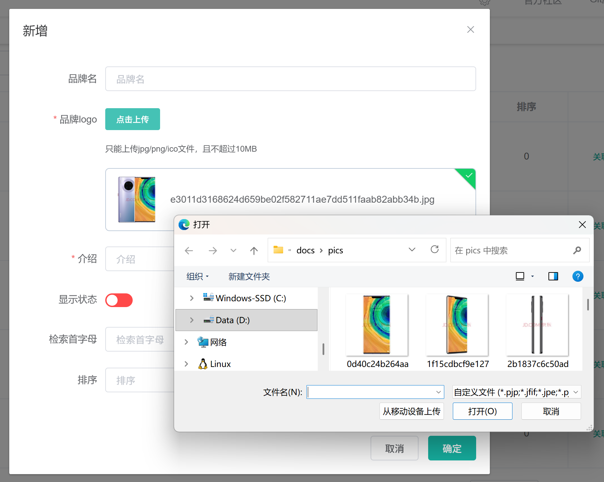
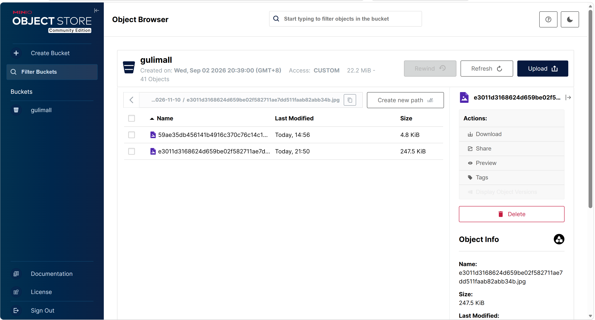
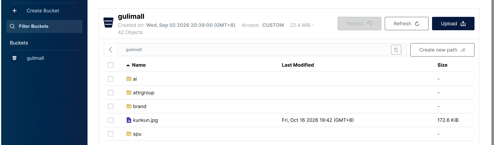
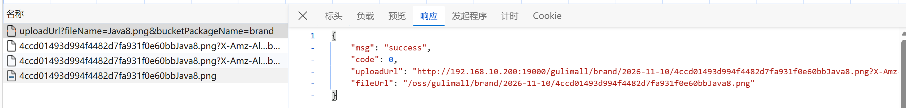

# 6.3 MinIO 文件上传-介绍

> 本篇介绍 MinIO 文件上传：为什么用对象存储、MinIO 在项目里的角色、管理员上传品牌 logo 的完整操作、前端直传的设计、预签名 PUT URL、桶的匿名只读策略、根相对路径、Nginx 的 `/oss` 转发，以及 `FileUploadController`、`FileUploadService`、`FileUploadServiceImpl`、`MinioProperties`、`MinioConfiguration`、`singleUpload.vue` 的完整实现。

---

## 1. 这个功能是干什么的

商城里的图片分两类：

1. **商品图片**：SPU 主图、SKU 图、详情图、图集。
2. **资料图片**：品牌 logo、分类图标、活动海报、用户头像。

这些图片不能只存在业务服务器的本地磁盘上，原因有四个：

1. **多实例不一致**：商品服务部署多个实例时，图片传到实例 A 的磁盘，实例 B 读不到。
2. **容量和备份麻烦**：图片越传越多，业务服务器的磁盘会满，备份和迁移都麻烦。
3. **带宽被占**：图片下载走业务服务器，会和接口请求抢带宽。
4. **无法直接接 CDN**：本地磁盘没有统一的 URL 和缓存策略，接 CDN 很麻烦。

对象存储把文件存到独立的存储服务里，业务服务只保存文件地址。MinIO 是一个兼容 Amazon S3 API 的开源对象存储，可以自己部署，适合学习和私有化环境。项目里 MinIO 负责三件事：

1. 保存图片二进制。
2. 给前端签发一次性上传地址。
3. 通过桶策略和 Nginx 提供稳定的图片访问地址。

数据库里只存图片路径，例如 `pms_brand.logo` 存 `/oss/gulimall/brand/2026-09-07/443e...a901.png`，不存图片二进制。

## 2. 管理员怎么操作

管理员上传品牌 logo 的入口在品牌新增/修改弹窗：

```text
管理后台 → 商品系统 → 品牌管理 → 新增 / 修改 → 品牌logo
```



操作步骤：

1. 打开品牌新增或修改弹窗。
2. 点击“点击上传”，选择本地图片。
3. 前端先校验文件类型和大小，只允许 `jpg`、`jpeg`、`png`、`gif`、`ico`，且不超过 10MB。
4. 校验通过后，前端向后端请求预签名上传地址。
5. 后端返回 `uploadUrl` 和 `fileUrl`。
6. 前端用原生 `axios.put` 把文件直接上传到 MinIO。
7. 上传成功后，`fileUrl` 写回表单的 `dataForm.logo`。
8. 弹窗里显示图片缩略图，可以点击预览或移除。
9. 点击“确定”，品牌保存接口把 logo 路径写入 `pms_brand.logo`。

上传过程中业务服务不接收文件流，只负责签名。图片二进制从浏览器直接进入 MinIO，业务服务的带宽和内存都不会被大文件占用。

## 3. 整体设计思路

### 3.1 业务上怎么设计

#### 3.1.1 前端直传

传统上传是“浏览器 → 业务服务 → 对象存储”，业务服务要接收文件、暂存文件、再转发。前端直传改成：

```text
浏览器 → 业务服务：申请上传地址
浏览器 → MinIO：直接 PUT 文件
浏览器 → 业务服务：提交图片路径
```

好处：

1. 业务服务不碰文件流，节省带宽和内存。
2. 上传链路短，大文件上传更快。
3. 业务服务只负责鉴权和签名，职责更单一。

代价：

1. 浏览器必须能访问 MinIO 的上传地址。
2. MinIO 要允许跨域 PUT。
3. 上传地址必须短时有效，防止被滥用。

#### 3.1.2 桶公共读

品牌 logo、商品图属于公开资源，任何能看到商品页面的人都应该能加载图片。因此桶策略设置为匿名只读：

1. 允许任何人 `s3:GetObject`。
2. 不允许 `s3:ListBucket`，拿到完整地址的人能看图，但不能列举桶里有哪些文件。
3. 不允许 `s3:PutObject`、`s3:DeleteObject`，上传和删除只能通过签名 URL 或后台账号完成。

这样图片访问不需要每次签名，数据库里存永久地址即可。

#### 3.1.3 根相对路径

数据库里存的是：

```text
/oss/gulimall/brand/2026-09-07/443e...a901.png
```

不是：

```text
http://<your-vm-host-ip>:19000/gulimall/brand/2026-09-07/443e...a901.png
```

原因：

1. 以 `/` 开头，浏览器用当前页面的源补全。页面在 `admin.gulimall.vip`，图片请求 `admin.gulimall.vip/oss/...`。
2. 换域名、上公网、加 CDN 时，数据库不用改。
3. 手机端走 IP + 端口、电脑端走域名，图片都能跟着页面走。

代价：必须经过 Nginx 访问。直接访问业务服务端口时，`/oss/...` 会打到业务服务上并返回 404。

#### 3.1.4 对象命名

对象 key 的格式是：

```text
业务目录/日期目录/uuid + 文件名
```

例如：

```text
brand/2026-09-07/443e2f7c9a1b4d6e8f0a2b3c4d5e6f7a.png
```

设计原因：

1. 业务目录区分品牌、商品、活动等模块，方便按目录管理。
2. 日期目录方便按时间归档和清理。
3. uuid 防止同名文件互相覆盖，也降低被猜到的概率。

#### 3.1.5 上传地址短时有效

预签名 PUT URL 的有效期是 10 分钟：

1. 管理员选完文件、点击上传，10 分钟内足够完成。
2. 即使 URL 泄露，过期后也无法继续上传。
3. 上传完成后 URL 不再使用，不需要长期保存。

访问地址则是永久的，因为桶是公共读，图片地址不需要签名。

#### 3.1.6 图片访问走 Nginx

图片访问链路：

```text
浏览器 /oss/gulimall/brand/xxx.png
  → Nginx location ^~ /oss/
  → proxy_pass http://minio:9000/
  → MinIO 收到 /gulimall/brand/xxx.png
  → 返回图片二进制
```

Nginx 负责：

1. 把根相对路径补全成完整请求。
2. 只放行 `GET`、`HEAD`，不允许通过 Nginx 写文件。
3. 给图片加 7 天浏览器缓存，减少回源。

### 3.2 技术上怎么设计

#### 3.2.1 MinIO 的 S3 模型

MinIO 使用 S3 的对象模型：

```text
Bucket（桶）
  └── Object（对象）
        ├── key：brand/2026-09-07/xxx.png
        └── value：文件二进制
```

项目里只有一个桶 `gulimall`，不同业务用对象 key 的目录前缀区分，不单独建桶。这样桶策略只维护一份，Nginx 转发规则也只需要一套。

#### 3.2.2 预签名 PUT URL

预签名 URL 是后端用 MinIO 的 accessKey、secretKey 对“方法 + 桶 + 对象 + 过期时间”做签名生成的。前端拿到 URL 后直接 PUT，MinIO 校验签名和过期时间，通过就允许写入。

特点：

1. 签名在 URL 的查询参数里，不需要把密钥发给前端。
2. 只对指定对象、指定方法有效。
3. 过期后签名失效。
4. 上传是写操作，必须签名；读取是公共读，不需要签名。

#### 3.2.3 桶策略

桶策略使用 AWS S3 的 Bucket Policy JSON 格式，MinIO 兼容 S3 API，语法一致。策略只授予：

```text
Principal: *
Action: s3:GetObject
Resource: arn:aws:s3:::gulimall/*
```

含义是：任何人可以读取 `gulimall` 桶里的对象，除此之外什么都不能做。

#### 3.2.4 后端组件

```text
MinioProperties      读取 gulimall.minio.* 配置
MinioConfiguration   创建 MinioClient
FileUploadController 接收申请上传地址的请求
FileUploadService    定义上传地址生成方法
FileUploadServiceImpl 生成预签名 URL、拼接公开地址、校正桶策略
```

#### 3.2.5 前端组件

`singleUpload.vue` 是一个单文件上传组件：

1. 用 `el-upload` 展示上传按钮、缩略图、预览弹窗。
2. `before-upload` 校验文件类型和大小。
3. `http-request` 覆盖默认上传行为，改为“先申请签名，再用原生 axios PUT”。
4. 上传成功后通过 `$emit('input', fileUrl)` 把地址写回父表单。

## 4. 详细代码、配置和解释

第 4 章按一次上传请求的实际调用顺序展开：配置 → 配置绑定 → 客户端 → 接口 → 服务契约 → 实现 → 前端组件 → 反向代理。每个小节先说明这段代码在业务链路里解决什么问题、由谁调用、依赖谁，再给出代码，最后按 1、2、3 解释执行顺序、条件和原因。

### 4.1 config/common.yaml：MinIO 连接配置

#### 4.1.1 这段配置解决什么问题

品牌 logo、商品图、分类图标最终都要落到对象存储。第三方服务要完成“签发上传地址”和“校正桶策略”两件事，必须先知道 MinIO 的地址、账号、密钥、桶名和对外访问前缀。这些值如果散落在各模块的 `application.yaml` 里，换环境时要改多处，密钥也会重复出现。

`config/common.yaml` 存放所有模块共用的中间件连接信息，和 MySQL、Redis、Nacos 放在同一层。MinIO 的五个键放在这里，第三方服务通过 `spring.config.import` 加载后，再由模块配置映射到 `MinioProperties`。

在链路里的位置：

```text
config/common.yaml（MINIO_* 原值）
  → Spring Environment
  → 模块配置里的 gulimall.minio.*
  → MinioProperties
  → MinioConfiguration（创建客户端）
  → FileUploadServiceImpl（桶名、公开前缀）
```

#### 4.1.2 关键字段

| 配置项 | 作用 | 使用方 |
|---|---|---|
| `MINIO_ENDPOINT` | MinIO 的 S3 API 地址，SDK 用它生成签名并发起请求；预签名 URL 的 host 也来自这里 | `MinioConfiguration` |
| `MINIO_ACCESS_KEY` | 访问账号 | `MinioConfiguration` |
| `MINIO_SECRET_KEY` | 访问密钥 | `MinioConfiguration` |
| `MINIO_BUCKET` | 对象桶名，桶策略、对象 key、公开地址都围绕它 | `FileUploadServiceImpl` |
| `MINIO_PUBLIC_PREFIX` | 浏览器访问图片的根相对路径前缀 | `FileUploadServiceImpl` |

#### 4.1.3 代码与解释

`common.yaml` 里保存 MinIO 的共用连接信息：

```yaml
  # ---------- MinIO 对象存储 ----------
MINIO_ENDPOINT: http://<your-vm-host-ip>:19000
MINIO_ACCESS_KEY: admin
MINIO_SECRET_KEY: ********
MINIO_BUCKET: gulimall
MINIO_PUBLIC_PREFIX: /oss
```

1. `MINIO_ENDPOINT`：MinIO 的 S3 API 地址。开发环境写 `<your-vm-host-ip>:19000`，其中 `19000` 是宿主机映射端口，容器内部监听的是 `9000`。
2. `MINIO_ACCESS_KEY`：SDK 调用桶操作和签名接口时使用的账号。
3. `MINIO_SECRET_KEY`：与账号配对的密钥。实际值保存在 `config/common.yaml`，文档里用星号代替。
4. `MINIO_BUCKET`：项目只使用一个桶 `gulimall`，不同业务通过对象 key 的目录前缀区分。
5. `MINIO_PUBLIC_PREFIX`：图片对外的根相对路径前缀，项目使用 `/oss`，与 Nginx 的 `location ^~ /oss/` 对应。

键名采用大写下划线，原因是 `config/*.yaml` 里的键会进入 Spring 的 `Environment`，模块配置再用 `${MINIO_ENDPOINT}` 这种形式引用。这些键不一定是操作系统环境变量，配置文件里定义的属性同样能被解析。

模块还需要把通用键映射到 `MinioProperties` 认的 `gulimall.minio` 前缀：

```yaml
gulimall:
  minio:
    endpoint-url: ${MINIO_ENDPOINT}
    access-key: ${MINIO_ACCESS_KEY}
    secre-key: ${MINIO_SECRET_KEY}
    bucket-name: ${MINIO_BUCKET}
    public-prefix: ${MINIO_PUBLIC_PREFIX}
```

1. `endpoint-url` 绑定到 `MinioProperties.endpointUrl`。
2. `access-key` 绑定到 `accessKey`。
3. `secre-key` 绑定到 `secreKey`。字段名少了一个 `t`，配置键必须跟着写 `secre-key`；写成 `secret-key` 时 Spring 找不到对应属性，运行时会拿到空密钥。
4. `bucket-name` 绑定到 `bucketName`。
5. `public-prefix` 绑定到 `publicPrefix`。

#### 4.1.4 一次配置加载示例

```text
1. gulimall-third-party 启动
2. application.yaml 的 spring.config.import 依次加载：
   optional:nacos:gulimall-third-party.yaml
   optional:file:./config/common.yaml
   optional:file:./config/gulimall-third-party.yaml
3. common.yaml 中的 MINIO_* 进入 Environment
4. 模块配置把 ${MINIO_ENDPOINT} 等占位符解析成真实值
5. @ConfigurationProperties 按前缀 gulimall.minio 绑定到 MinioProperties
6. MinioConfiguration 用 endpointUrl 和密钥创建 MinioClient
```

`optional:` 前缀表示文件不存在时不阻断启动，适合本地开发；生产环境应保证配置源可用，否则服务会带着空配置启动，直到第一次上传才暴露问题。

#### 4.1.5 它不做什么

1. 不创建桶，也不设置桶策略；这些动作在 `FileUploadServiceImpl` 启动和上传时执行。
2. 不区分开发、测试、生产环境，当前只有一份 `common.yaml`。
3. 不负责密钥加密，值以明文保存在配置文件里。
4. 不决定对象 key 的格式，只提供桶名和访问前缀。

#### 4.1.6 边界与可优化点

1. 密钥不应该明文提交到代码库。生产环境应使用环境变量、配置中心加密或密钥管理服务注入。
2. 不同环境应使用不同桶名，例如 `gulimall-dev`、`gulimall-prod`，避免开发数据污染生产。
3. `MINIO_ENDPOINT` 同时承担“SDK 调用地址”和“预签名 URL 的 host”。它必须是浏览器可达的地址，否则前端拿到签名 URL 也无法 PUT。若 MinIO 只在容器网络内可达，应改成让 Nginx 代理上传，或给 MinIO 配置外部访问域名。
4. `optional:` 让缺失配置不报错，开发方便，但生产环境应去掉可选标记或在启动时做必填校验。

### 4.2 MinioProperties：绑定 MinIO 配置

#### 4.2.1 这个类解决什么问题

上传链路里不止一个类需要 MinIO 配置：`MinioConfiguration` 要地址和凭据，`FileUploadServiceImpl` 要桶名和公开前缀。如果每个类都写 `@Value("${gulimall.minio.bucket-name}")`，配置键会散落在多处，改名时容易漏掉，类型也无法集中校验。

这个类用 `@ConfigurationProperties` 把 `gulimall.minio.*` 一次性绑成 Java 对象，其他类通过构造器注入直接使用字段。它本身不创建客户端，也不做业务判断，只承担“配置载体”这一个职责。

#### 4.2.2 字段与消费方

| 字段 | 配置键 | 业务含义 | 消费方 |
|---|---|---|---|
| `endpointUrl` | `gulimall.minio.endpoint-url` | MinIO S3 API 地址 | `MinioConfiguration` |
| `accessKey` | `gulimall.minio.access-key` | 访问账号 | `MinioConfiguration` |
| `secreKey` | `gulimall.minio.secre-key` | 访问密钥 | `MinioConfiguration` |
| `bucketName` | `gulimall.minio.bucket-name` | 对象桶名 | `FileUploadServiceImpl` |
| `publicPrefix` | `gulimall.minio.public-prefix` | 对外访问的根相对路径前缀 | `FileUploadServiceImpl` |

#### 4.2.3 代码与解释

```java
@Data
@ConfigurationProperties(prefix = "gulimall.minio")
public class MinioProperties {

    private String endpointUrl;
    private String accessKey;
    private String secreKey;
    private String bucketName;

    /**
     * 图片对外访问地址的前缀，是一个根相对路径（如 /oss）
     */
    private String publicPrefix;
}
```

1. `@ConfigurationProperties(prefix = "gulimall.minio")`：告诉 Spring 把 `gulimall.minio` 下的配置按字段名绑定，`endpoint-url` 会自动映射到 `endpointUrl`。
2. `@Data`：Lombok 生成 getter、setter、`toString`、`equals` 和 `hashCode`。`MinioConfiguration` 和 `FileUploadServiceImpl` 通过 getter 取值。
3. `endpointUrl`：创建 `MinioClient` 时传给 `builder().endpoint()`。
4. `accessKey`、`secreKey`：创建 `MinioClient` 时传给 `credentials()`。
5. `bucketName`、`publicPrefix`：生成对象 key 和拼接公开访问地址时使用。

类上没有 `@Component`，因为 `MinioConfiguration` 使用了 `@EnableConfigurationProperties(MinioProperties.class)`，由配置类负责把属性对象注册成 Bean。两种写法二选一，重复注册会出现两个实例。

#### 4.2.4 一次绑定示例

```text
配置值：
gulimall.minio.endpoint-url = http://<your-vm-host-ip>:19000
gulimall.minio.access-key = admin
gulimall.minio.secre-key = ******
gulimall.minio.bucket-name = gulimall
gulimall.minio.public-prefix = /oss

绑定结果：
MinioProperties.endpointUrl = http://<your-vm-host-ip>:19000
MinioProperties.accessKey = admin
MinioProperties.secreKey = ******
MinioProperties.bucketName = gulimall
MinioProperties.publicPrefix = /oss
```

绑定发生在 Spring 容器启动阶段。配置缺失时字段为 `null`，不会立即报错；真正使用到 `bucketName` 或 `endpointUrl` 时才会出现空指针或签名失败。

#### 4.2.5 它不做什么

1. 不创建 `MinioClient`，客户端由 `MinioConfiguration` 创建。
2. 不校验配置是否存在、是否为空。
3. 不处理配置热更新，值在启动时绑定一次。
4. 不拼接 URL，前缀和桶名的组合逻辑在 `FileUploadServiceImpl` 里。

#### 4.2.6 边界与可优化点

1. `secreKey` 拼写错误，建议改成 `secretKey`，同时修改配置键，消除易错点。
2. 可以加 `@Validated` 和 `@NotBlank`，启动时校验必填配置，避免运行到上传接口才发现配置缺失。
3. `@Data` 生成的 `toString` 会输出密钥。可以给密钥字段加 `@ToString.Exclude`，防止日志打印对象时泄露凭据。
4. 配置变更需要重启服务。对需要动态调整桶名的场景，可以接入配置刷新机制，同时处理客户端重建。

### 4.3 MinioConfiguration：创建 MinioClient

#### 4.3.1 这个配置解决什么问题

`MinioClient` 封装了 S3 请求、签名、连接池和重试逻辑，内部持有网络资源。每次上传都 `new` 一个客户端，会不断创建连接池，最终耗尽文件描述符。正确做法是在应用启动时创建一个单例，所有请求复用。

这个配置类同时负责开启 `MinioProperties` 的绑定，并把 `MinioClient` 注册成 Spring Bean。`FileUploadServiceImpl` 通过构造器拿到客户端，不关心它是怎么创建的。

在链路里的位置：

```text
MinioProperties（地址、账号、密钥）
  → MinioConfiguration.minioClient()
  → Spring 容器中的 MinioClient 单例
  → FileUploadServiceImpl 构造器注入
  → getPresignedObjectUrl / bucketExists / makeBucket / setBucketPolicy
```

#### 4.3.2 代码与解释

```java
@EnableConfigurationProperties(value = MinioProperties.class)
@Configuration
public class MinioConfiguration {

    /**
     * MinIO 客户端（全局复用）
     */
    @Bean
    public MinioClient minioClient(MinioProperties minioProperties) {
        return MinioClient.builder()
                .endpoint(minioProperties.getEndpointUrl())
                .credentials(minioProperties.getAccessKey(), minioProperties.getSecreKey())
                .build();
    }
}
```

1. `@Configuration`：声明这是一个配置类，Spring 启动时扫描其中的 `@Bean` 方法。
2. `@EnableConfigurationProperties(MinioProperties.class)`：把 `MinioProperties` 注册成 Bean 并开启属性绑定，效果相当于在属性类上加 `@Component`。
3. `@Bean`：把 `MinioClient` 交给 Spring 容器管理。默认是单例，整个应用共享一个实例。
4. `endpoint()`：设置 MinIO 的 S3 API 地址，来自 `gulimall.minio.endpoint-url`。
5. `credentials()`：设置账号和密钥，SDK 用它们计算请求签名。
6. `build()`：创建客户端。此时不会立即建立网络连接，第一次调用接口时才连接 MinIO。

`MinioClient` 是线程安全的，预签名、桶操作、对象操作都可以并发调用。把它做成单例不会造成请求之间的状态污染。

#### 4.3.3 一次启动示例

```text
1. Spring 扫描到 MinioConfiguration
2. @EnableConfigurationProperties 注册 MinioProperties Bean
3. 配置值绑定到 MinioProperties 字段
4. Spring 调用 minioClient(MinioProperties)
5. MinioClient.builder() 设置 endpoint 和 credentials
6. build() 返回客户端，放入单例池
7. FileUploadServiceImpl 构造时注入该客户端
8. @PostConstruct 触发 initBucketPolicy()
```

启动阶段只构建对象，不校验 MinIO 是否可达。MinIO 未启动时应用仍然能起来，桶初始化失败会记录警告，第一次上传时重试。

#### 4.3.4 它不做什么

1. 不检查 MinIO 是否在线，不建立连接。
2. 不创建桶，桶操作在 `FileUploadServiceImpl` 里执行。
3. 不读取业务配置，例如桶名和公开前缀。
4. 不处理签名，签名由 `getPresignedObjectUrl()` 在调用时生成。

#### 4.3.5 边界与可优化点

1. 可以给 `MinioClient` 设置超时、重试和连接池参数，避免 MinIO 故障时请求长时间挂起。
2. 生产环境可以使用多个 MinIO 节点做集群，`endpoint` 指向负载均衡地址或 Nginx upstream。
3. 可以增加健康检查，MinIO 不可用时在监控里告警，而不是等用户上传失败才发现。
4. 密钥来自 `MinioProperties`，日志或异常堆栈里不应打印完整客户端配置。

### 4.4 FileUploadController：申请上传地址

#### 4.4.1 这个类解决什么问题

管理后台的品牌新增、修改弹窗需要上传 logo。前端不能持有 MinIO 的 accessKey 和 secretKey，也不能自己决定文件写到哪个目录，所以要先向业务服务申请一个短时有效的上传地址。

这个 Controller 只暴露一个接口：接收文件名和业务目录，调用 Service 生成预签名 PUT URL 和公开访问 URL，再返回给前端。它不接收文件流，不做文件校验，也不保存图片路径。图片路径由前端在上传成功后写回品牌表单，随品牌保存接口进入 `pms_brand.logo`。

调用方与上下游：

```text
singleUpload.vue
  → POST /gulimall/thirdparty/admin/system/minio/uploadUrl
  → Gateway 匹配 /gulimall/thirdparty/**，去掉前缀
  → FileUploadController.getUploadUrl()
  → FileUploadService.getUploadUrl()
  → FileUploadServiceImpl
  → MinioClient
```

#### 4.4.2 接口清单

| 操作 | 方法与路径 | 参数 | 返回 |
|---|---|---|---|
| 申请上传地址 | `POST /admin/system/minio/uploadUrl` | `fileName` 必填，`bucketPackageName` 可选 | `R`，含 `uploadUrl` 和 `fileUrl` |

经过网关时完整路径是 `/gulimall/thirdparty/admin/system/minio/uploadUrl`。网关的 `RewritePath` 会去掉 `/gulimall/thirdparty`，进入服务的路径是 `/admin/system/minio/uploadUrl`。

#### 4.4.3 代码与解释

```java
@RestController
@RequestMapping("/admin/system/minio")
public class FileUploadController {

    @Autowired
    private FileUploadService fileUploadService;

    /**
     * 获取 MinIO 上传地址与文件访问地址（前端直传 MinIO，后端不碰文件流）
     */
    @PostMapping("/uploadUrl")
    public R getUploadUrl(@RequestParam("fileName") String fileName,
                          @RequestParam(value = "bucketPackageName", required = false) String bucketPackageName) {
        try {
            Map<String, String> urls = fileUploadService.getUploadUrl(fileName, bucketPackageName);
            return R.ok()
                    .put("uploadUrl", urls.get("putUrl"))
                    .put("fileUrl", urls.get("getUrl"));
        } catch (Exception e) {
            return R.error("生成上传地址失败：" + e.getMessage());
        }
    }
}
```

1. `@RestController`：所有方法返回 JSON，不经过视图解析。
2. `@RequestMapping("/admin/system/minio")`：接口统一挂在 `/admin/system/minio` 下，经过网关后对外是 `/gulimall/thirdparty/admin/system/minio`。
3. `@PostMapping("/uploadUrl")`：申请上传地址使用 POST。虽然操作只是生成签名，但语义上属于“创建一次上传凭证”，不用 GET 暴露在 URL 日志里。
4. `@RequestParam("fileName")`：必填参数，前端传原始文件名，Service 用它拼接对象 key。
5. `@RequestParam(value = "bucketPackageName", required = false)`：可选参数，表示业务目录，例如 `brand`、`product`。不传时 Service 使用 `default/`。
6. `fileUploadService.getUploadUrl(...)`：把参数原样交给 Service。Controller 不拼对象 key，也不接触 MinIO SDK。
7. `R.ok().put("uploadUrl", ...)`：把 Service 返回 Map 中的 `putUrl`、`getUrl` 转成前端约定的字段名。
8. `try-catch`：签名或桶操作抛出异常时返回 `R.error`，不让异常堆栈直接冒到前端。

返回结果的结构：

```text
{
  "code": 0,
  "msg": "success",
  "uploadUrl": "http://<your-vm-host-ip>:19000/gulimall/brand/...?X-Amz-...",
  "fileUrl": "/oss/gulimall/brand/..."
}
```

#### 4.4.4 一次请求示例

管理员在品牌弹窗选择 `logo.png` 并点击上传：

```text
1. 前端请求 POST /gulimall/thirdparty/admin/system/minio/uploadUrl
   ?fileName=logo.png&bucketPackageName=brand
2. 网关匹配 third-party 路由，去掉 /gulimall/thirdparty
3. Controller 收到 fileName=logo.png，bucketPackageName=brand
4. Service 生成 putUrl 和 getUrl
5. Controller 返回 code=0、uploadUrl、fileUrl
6. 前端用 axios.put 把文件发到 uploadUrl
```

#### 4.4.5 它不做什么

1. 不接收 `MultipartFile`，文件二进制不经过业务服务。
2. 不校验文件后缀、大小和真实格式，只透传文件名。
3. 不保存图片路径，路径由前端写入品牌表单，再由品牌保存接口落库。
4. 不做登录和权限判断，方法上没有 `@RequiresPermissions`。

#### 4.4.6 边界与可优化点

1. 接口没有登录和权限校验。生产环境应限制只有管理员能调用，或者加签名、限流。
2. `fileName` 没有做后缀和长度校验，恶意文件名可能拼出非法对象 key。后端应校验后缀白名单并过滤路径分隔符。
3. `catch (Exception e)` 把异常信息直接拼进返回消息，可能泄露内部细节。应返回统一错误码，详细异常只记日志。
4. 可以限制单个用户每分钟申请上传地址的次数，防止刷签名。
5. 直接使用 `@Autowired` 字段注入，可以改成构造器注入，方便单元测试替换 Service。

### 4.5 FileUploadService：上传地址接口

#### 4.5.1 这个接口解决什么问题

Controller 需要“生成上传地址”这个能力，但不应该依赖 MinIO SDK，也不应该知道对象 key 怎么拼、桶策略怎么设。接口把能力抽象成一个方法，Controller 只面向接口编程，实现类可以替换，单元测试也可以传入 mock。

接口只有一个方法，是因为上传场景只有“申请地址”这一个动作。删除、列举、下载都没有暴露给前端。

#### 4.5.2 方法契约

| 项 | 内容 |
|---|---|
| 方法 | `Map<String, String> getUploadUrl(String originalFilename, String socketPackageName)` |
| 入参 `originalFilename` | 原始文件名，Service 会在前面拼业务目录、日期目录和 uuid |
| 入参 `socketPackageName` | 业务目录名，用于区分品牌、商品等模块 |
| 返回值 | Map，key 为 `putUrl` 和 `getUrl` |
| 异常 | `throws Exception`，签名和桶操作可能失败 |

#### 4.5.3 代码与解释

```java
public interface FileUploadService {

    /**
     * 生成 MinIO presigned PUT 直传 URL 和公开访问 URL
     *
     * @param originalFilename   原始文件名，用于生成对象 key
     * @param socketPackageName  业务目录名，用于区分不同业务模块
     * @return map，含 putUrl 和 getUrl
     */
    Map<String, String> getUploadUrl(String originalFilename, String socketPackageName) throws Exception;
}
```

1. 接口没有继承任何父接口，只声明一个业务方法。
2. `originalFilename`：原始文件名。实现类会在前面加业务目录、日期目录和 uuid，前端不能直接指定完整对象路径。
3. `socketPackageName`：业务目录名。接口参数名和实现类的 `bucketPackageName` 不一致，Java 按位置传参，不影响运行，但阅读时容易混淆。
4. `throws Exception`：MinIO SDK 的签名、桶操作会抛出受检异常，接口直接声明抛出，由 Controller 统一捕获。
5. 返回值 Map 的 key 是 `putUrl` 和 `getUrl`。Controller 再把它们转成前端字段 `uploadUrl` 和 `fileUrl`。

#### 4.5.4 一次调用示例

```text
Controller.getUploadUrl("logo.png", "brand")
  → 接口方法 getUploadUrl("logo.png", "brand")
  → 实现类 getUploadUrl("logo.png", "brand")
  → 返回 { putUrl: "http://.../gulimall/brand/...?X-Amz-...",
           getUrl: "/oss/gulimall/brand/..." }
  → Controller 读取 putUrl、getUrl
  → 返回 uploadUrl、fileUrl
```

#### 4.5.5 它不做什么

1. 不定义签名算法，具体实现由 MinIO SDK 完成。
2. 不校验业务目录是否合法，调用方传什么就拼什么。
3. 不定义文件大小和类型限制。
4. 不负责保存上传结果。

#### 4.5.6 边界与可优化点

1. 参数名 `socketPackageName` 和实现类的 `bucketPackageName` 不一致，应统一命名。
2. 返回 Map 不如返回 `UploadUrlVO`，字段明确，前端和后端都好维护，也能避免拼错 key。
3. 接口注释里“getUrl 长时有效”与实际实现不一致。当前实现返回的是永久公开地址，不是签名地址，注释应同步。
4. `throws Exception` 过于宽泛，可以细化成自定义异常，方便 Controller 区分“配置错误”“MinIO 不可达”“权限不足”。

### 4.6 FileUploadServiceImpl：签名、路径和桶策略

#### 4.6.1 这个类解决什么问题

一次上传只有三个动作：申请地址、直传文件、保存路径。业务服务真正要做的只有第一步，但这一步包含四个必要条件：

1. 桶必须存在，并且允许匿名读取，否则上传后的图片访问会 403；
2. 对象 key 必须唯一，避免同名文件互相覆盖；
3. 必须签发短时有效的 PUT 地址，前端才能在没有密钥的情况下写入；
4. 必须返回一个永久可访问的地址，前端才能回显并写入数据库。

这个类是唯一直接调用 MinIO SDK 的业务类。它向上对 `FileUploadService` 提供方法，向下操作 `MinioClient` 和 `gulimall` 桶。启动时校正桶策略，上传时生成签名和公开地址。

#### 4.6.2 类结构与关键成员

| 成员 | 作用 |
|---|---|
| `PUT_EXPIRY_SECONDS` | 预签名 PUT URL 的有效期，10 分钟 |
| `minioProperties` | 读取桶名、公开前缀等配置 |
| `minioClient` | 执行桶操作和签名 |
| `initBucketPolicy()` | 启动时校正桶策略 |
| `getUploadUrl()` | 生成上传地址和公开地址 |
| `buildPublicUrl()` | 拼接根相对路径 |
| `ensureBucketWithPublicRead()` | 确保桶存在且公共读 |
| `publicReadPolicy()` | 生成桶策略 JSON |

#### 4.6.3 代码与解释

完整实现如下：

```java
@Service
public class FileUploadServiceImpl implements FileUploadService {

    private static final Logger log = LoggerFactory.getLogger(FileUploadServiceImpl.class);

    /** PUT 直传签名 URL 有效期（秒） */
    private static final int PUT_EXPIRY_SECONDS = 60 * 10;

    private final MinioProperties minioProperties;
    private final MinioClient minioClient;

    public FileUploadServiceImpl(MinioProperties minioProperties, MinioClient minioClient) {
        this.minioProperties = minioProperties;
        this.minioClient = minioClient;
    }

    /**
     * 应用启动时校正一次桶的公共读策略，失败只告警，不阻断启动
     */
    @PostConstruct
    public void initBucketPolicy() {
        try {
            ensureBucketWithPublicRead();
            log.info("MinIO 桶 [{}] 已就绪（公共读）", minioProperties.getBucketName());
        } catch (Exception e) {
            log.warn("MinIO 桶初始化失败，将在首次上传时重试：{}", e.getMessage());
        }
    }

    @Override
    public Map<String, String> getUploadUrl(String originalFilename, String bucketPackageName) throws Exception {
        // 1.确保桶存在且公共读
        ensureBucketWithPublicRead();

        // 2.对象 key：业务目录/日期目录/uuid+文件名
        String packageName = StringUtils.isNotBlank(bucketPackageName) ? bucketPackageName + "/" : "default/";
        String dateDir = LocalDate.now().format(DateTimeFormatter.ISO_DATE) + "/";
        String uuid = UUID.randomUUID().toString().replace("-", "");
        String objectName = packageName + dateDir + uuid + originalFilename;

        // 3.签发 PUT 直传 URL，短期有效
        String putUrl = minioClient.getPresignedObjectUrl(GetPresignedObjectUrlArgs.builder()
                .method(Method.PUT)
                .bucket(minioProperties.getBucketName())
                .object(objectName)
                .expiry(PUT_EXPIRY_SECONDS)
                .build());

        // 4.返回永久公开访问地址
        String publicUrl = buildPublicUrl(objectName);

        Map<String, String> result = new LinkedHashMap<>();
        result.put("putUrl", putUrl);
        result.put("getUrl", publicUrl);
        return result;
    }

    /**
     * 拼接对象的永久公开访问地址，根相对路径，不含 host
     */
    private String buildPublicUrl(String objectName) {
        String prefix = StringUtils.removeEnd(minioProperties.getPublicPrefix(), "/");
        String objectPath = UriUtils.encodePath(objectName, StandardCharsets.UTF_8);
        return prefix + "/" + minioProperties.getBucketName() + "/" + objectPath;
    }

    /**
     * 确保桶存在，且拥有匿名只读策略，幂等
     */
    private void ensureBucketWithPublicRead() throws Exception {
        String bucket = minioProperties.getBucketName();

        if (!minioClient.bucketExists(BucketExistsArgs.builder().bucket(bucket).build())) {
            minioClient.makeBucket(MakeBucketArgs.builder().bucket(bucket).build());
        }

        minioClient.setBucketPolicy(SetBucketPolicyArgs.builder()
                .bucket(bucket)
                .config(publicReadPolicy(bucket))
                .build());
    }

    private String publicReadPolicy(String bucket) {
        // JSON 原样发给 MinIO，文本块里不能写注释
        return """
                {
                  "Version": "2012-10-17",
                  "Statement": [
                    {
                      "Effect": "Allow",
                      "Principal": { "AWS": ["*"] },
                      "Action": ["s3:GetObject"],
                      "Resource": ["arn:aws:s3:::%s/*"]
                    }
                  ]
                }
                """.formatted(bucket);
    }
}
```

1. `PUT_EXPIRY_SECONDS` 固定为 600 秒，签名只用于单次上传，过期后 URL 失效，不会长期暴露写权限。
2. `minioProperties` 由构造器注入，提供桶名和公开前缀。
3. `minioClient` 由构造器注入，是 `MinioConfiguration` 创建的单例。
4. 构造器注入让依赖不可变，单元测试可以直接传入 mock，不需要反射改字段。
5. `initBucketPolicy()` 带 `@PostConstruct`，Spring 创建 Bean 后自动调用，负责启动时校正桶策略。
6. `getUploadUrl()` 是上传链路的入口，负责对象 key、签名和公开地址。
7. `buildPublicUrl()` 只拼接路径，不发网络请求，返回根相对地址。
8. `ensureBucketWithPublicRead()` 和 `publicReadPolicy()` 负责桶的存在性和匿名只读策略，两个方法配合完成幂等校正。

#### 4.6.4 启动校正 initBucketPolicy

`FileUploadServiceImpl` 创建完成后，Spring 调用带 `@PostConstruct` 的 `initBucketPolicy()`，把桶状态校正一次。

```java
@PostConstruct
public void initBucketPolicy() {
    try {
        ensureBucketWithPublicRead();
        log.info("MinIO 桶 [{}] 已就绪（公共读）", minioProperties.getBucketName());
    } catch (Exception e) {
        log.warn("MinIO 桶初始化失败，将在首次上传时重试：{}", e.getMessage());
    }
}
```

执行顺序：

1. Spring 完成依赖注入，构造器把 `MinioProperties` 和 `MinioClient` 赋给字段。
2. Spring 调用 `@PostConstruct` 标记的方法。
3. 方法进入 `try`，调用 `ensureBucketWithPublicRead()`。
4. 桶不存在就创建，桶存在就跳过创建。
5. 无论桶是否新建，都设置一次匿名只读策略。
6. 成功时记录“桶已就绪”日志；失败时只记录警告，异常不会继续向外抛。

为什么放在启动时：

1. 已有图片不需要重新上传，只要桶策略恢复公共读就能继续访问。
2. 新版本 MinIO 控制台移除了部分 Access Policy 设置入口，用代码设置最省事。
3. 桶被误改成私有后，所有图片会 403。启动时校正一次，可以把影响窗口缩短到一次重启。

为什么失败不阻断启动：

1. MinIO 可能比应用晚启动，启动时连不上不应该让整个第三方服务起不来。
2. 首次上传时 `getUploadUrl()` 会再次调用 `ensureBucketWithPublicRead()`，相当于重试。
3. 桶初始化只影响上传和图片访问，不影响短信、OAuth、地图等其他接口。

#### 4.6.5 生成上传地址 getUploadUrl

这是上传链路的核心方法。它先保证桶可用，再拼唯一对象 key，最后签发 PUT URL 并返回公开地址。

执行顺序：

1. 调用 `ensureBucketWithPublicRead()`，确保桶存在且公共读。
2. 判断 `bucketPackageName` 是否为空，非空时拼成 `brand/`，为空时使用 `default/`。
3. 用 `LocalDate.now()` 生成日期目录，格式是 `yyyy-MM-dd`。
4. 用 `UUID.randomUUID()` 生成 32 位无横线字符串。
5. 拼出对象 key：`业务目录/日期目录/uuid + 原始文件名`。
6. 调用 `getPresignedObjectUrl()`，方法指定 `PUT`、桶名、对象 key 和 600 秒有效期。
7. 调用 `buildPublicUrl()` 拼接永久公开地址。
8. 用 `LinkedHashMap` 保存 `putUrl` 和 `getUrl`，保持插入顺序。
9. 返回 Map，Controller 再把 key 转成前端字段。

对象 key 示例：

```text
原始文件名：logo.png
业务目录：brand
日期：2026-11-12
uuid：443e2f7c9a1b4d6e8f0a2b3c4d5e6f7a
对象 key：brand/2026-11-12/443e2f7c9a1b4d6e8f0a2b3c4d5e6f7alogo.png
```

签名 URL 示例：

```text
http://<your-vm-host-ip>:19000/gulimall/brand/2026-11-12/443e...logo.png
  ?X-Amz-Algorithm=AWS4-HMAC-SHA256
  &X-Amz-Date=20261112T080000Z
  &X-Amz-Expires=600
  &X-Amz-SignedHeaders=host
  &X-Amz-Signature=...
```

为什么每次上传都校正桶策略：

1. 桶策略可能被运维或其他程序改掉。
2. 校正操作是幂等的，重复设置相同策略不会产生副作用。
3. 相比图片全部 403 后再排查，每次多两次 MinIO 调用的成本更低。

#### 4.6.6 拼接公开地址 buildPublicUrl

```java
private String buildPublicUrl(String objectName) {
    String prefix = StringUtils.removeEnd(minioProperties.getPublicPrefix(), "/");
    String objectPath = UriUtils.encodePath(objectName, StandardCharsets.UTF_8);
    return prefix + "/" + minioProperties.getBucketName() + "/" + objectPath;
}
```

1. 取出 `publicPrefix`，用 `removeEnd` 去掉末尾的 `/`，避免拼出 `//`。
2. 用 `UriUtils.encodePath()` 对对象名做 URL 编码，保留 `/` 作为路径分隔符。
3. 按 `前缀 + 桶名 + 对象路径` 的顺序拼接。
4. 返回根相对路径，不带 `http://`、IP 或域名。

拼接示例：

```text
publicPrefix = /oss
bucketName = gulimall
objectName = brand/2026-11-12/443e...logo.png
结果 = /oss/gulimall/brand/2026-11-12/443e...logo.png
```

为什么用 `encodePath`：文件名可能包含中文、空格、`#`、`?` 等字符，不编码会拼出非法 URL。`encodePath` 会把每一段路径编码，但保留 `/`，不会把目录分隔符也编码掉。

为什么返回根相对路径：数据库不存 IP 和域名，浏览器按当前页面的源补全地址。页面在 `admin.gulimall.vip` 时，图片请求 `admin.gulimall.vip/oss/...`；换域名或上公网时，数据库不需要改。

#### 4.6.7 确保桶公共读 ensureBucketWithPublicRead

```java
private void ensureBucketWithPublicRead() throws Exception {
    String bucket = minioProperties.getBucketName();

    if (!minioClient.bucketExists(BucketExistsArgs.builder().bucket(bucket).build())) {
        minioClient.makeBucket(MakeBucketArgs.builder().bucket(bucket).build());
    }

    minioClient.setBucketPolicy(SetBucketPolicyArgs.builder()
            .bucket(bucket)
            .config(publicReadPolicy(bucket))
            .build());
}
```

执行顺序：

1. 从配置中取出桶名。
2. 调用 `bucketExists()` 判断桶是否存在。
3. 不存在时调用 `makeBucket()` 创建桶。
4. 调用 `setBucketPolicy()` 设置匿名只读策略。
5. 方法没有返回值，重复调用结果一致，属于幂等操作。

为什么先判断存在再创建：`makeBucket()` 对已存在的桶会抛异常，先判断可以避免重复创建导致的失败，也让“创建”和“设置策略”两步职责清楚。



并发场景下，两个实例可能同时判断桶不存在，其中一个 `makeBucket()` 会失败。当前没有捕获“桶已存在”的异常；可以在创建时捕获该异常并忽略，或者在部署阶段预先建桶。

#### 4.6.8 桶策略 publicReadPolicy

```java
private String publicReadPolicy(String bucket) {
    // JSON 原样发给 MinIO，文本块里不能写注释
    return """
            {
              "Version": "2012-10-17",
              "Statement": [
                {
                  "Effect": "Allow",
                  "Principal": { "AWS": ["*"] },
                  "Action": ["s3:GetObject"],
                  "Resource": ["arn:aws:s3:::%s/*"]
                }
              ]
            }
            """.formatted(bucket);
}
```

执行顺序：

1. 用文本块写一段 S3 Bucket Policy JSON。
2. 用 `%s` 占位桶名，避免把桶名硬编码进 JSON。
3. 调用 `formatted(bucket)` 把真实桶名填进去。
4. 返回 JSON 字符串，交给 `setBucketPolicy()` 发给 MinIO。

逐字段解释：

| 字段 | 含义 |
|---|---|
| `Version` | 策略语言版本，固定写 `2012-10-17`，不是日期 |
| `Statement` | 规则数组，一条策略可以有多条规则 |
| `Effect` | 这条规则的结论，只能是 `Allow` 或 `Deny` |
| `Principal` | 谁可以访问，`{"AWS": ["*"]}` 表示任何人，包括匿名请求 |
| `Action` | 能做什么，`s3:GetObject` 表示读取对象 |
| `Resource` | 对哪些资源生效，`arn:aws:s3:::gulimall/*` 表示桶内所有对象 |



为什么只给 `s3:GetObject`：

1. 品牌 logo、商品图是公开资源，任何人都应该能看。
2. 不给 `s3:PutObject`，匿名用户不能上传。
3. 不给 `s3:DeleteObject`，匿名用户不能删除。
4. 不给 `s3:ListBucket`，拿到完整地址的人能看图，但不能列举桶里有哪些文件。

为什么 `Resource` 必须带 `/*`：

1. `arn:aws:s3:::gulimall` 表示桶本身，对应 `s3:ListBucket` 这类桶级操作。
2. `arn:aws:s3:::gulimall/*` 表示桶内对象，对应 `s3:GetObject` 这类对象级操作。
3. 如果 `GetObject` 的 `Resource` 写成不带 `/*` 的形式，策略看起来正确，但访问图片一直 403。

文本块里不能写 `//` 或 `#` 注释，因为整段 JSON 会原样发给 MinIO，JSON 不支持注释，加上后策略解析失败。

#### 4.6.9 一次完整上传示例

以管理员上传品牌 logo 为例：

```text
1. 前端请求申请地址：fileName=logo.png，bucketPackageName=brand
2. getUploadUrl() 调用 ensureBucketWithPublicRead()
3. 桶存在，跳过 makeBucket，设置匿名只读策略
4. 拼接对象 key：
   brand/2026-11-12/443e2f7c...logo.png
5. getPresignedObjectUrl() 生成 PUT 签名 URL，有效期 600 秒
6. buildPublicUrl() 生成 /oss/gulimall/brand/2026-11-12/443e...logo.png
7. 返回 { putUrl, getUrl }
8. Controller 转成 { uploadUrl, fileUrl } 返回
9. 前端 axios.put(uploadUrl, file)
10. MinIO 校验签名和过期时间，写入对象
11. 前端把 fileUrl 写回品牌表单
12. 品牌保存接口把 fileUrl 写入 pms_brand.logo
```

#### 4.6.10 它不做什么

1. 不接收文件二进制，上传由浏览器直接发到 MinIO。
2. 不校验文件类型、大小和真实格式。
3. 不生成下载签名，公开地址依赖桶的匿名只读策略。
4. 不删除对象，替换 logo 后旧文件仍留在桶里。
5. 不保存图片路径，路径由品牌模块写入数据库。
6. 不保证多实例启动时只校正一次桶策略。

#### 4.6.11 边界与可优化点

1. 每次上传都调用 `bucketExists` 和 `setBucketPolicy`，增加两次 MinIO 往返。可以在启动成功后缓存状态，定时校正，而不是每个请求都检查。
2. 原始文件名直接拼进对象 key，可能包含特殊字符、路径分隔符或超长内容。应限制长度并过滤危险字符。
3. `UUID.randomUUID().toString().replace("-", "")` 能保证唯一，但文件名不可读。若需要可读性，可以保留部分原始名称并做清洗。
4. 并发创建同一个桶时，两个实例都可能判断为不存在，其中一个 `makeBucket()` 会失败。应捕获“桶已存在”的异常并忽略。
5. `publicPrefix` 为空时，拼接结果会以 `//` 开头，应在启动时校验非空。
6. 桶策略写错不会在编译期报错，应在设置后校验结果，并把失败写入告警。
7. 图片若涉及合同、发票等敏感内容，不能使用匿名只读策略。应改为桶私有，返回前动态签名，或由后端代理转发。
8. 可以给对象设置生命周期规则，自动清理长期未访问的孤儿文件。
9. 生产环境应部署分布式 MinIO，客户端 endpoint 指向负载均衡地址，避免单节点故障导致图片不可用。

### 4.7 singleUpload.vue：前端上传组件

#### 4.7.1 这个组件解决什么问题

品牌新增和修改弹窗需要“选一张图片、显示缩略图、允许移除和预览”。这些交互如果写在品牌表单里，表单会混入文件校验、签名请求和直传逻辑。`singleUpload.vue` 把这些细节封装成表单控件，父组件只需要写 `<singleUpload v-model="dataForm.logo" type="brand">`。

组件承担四件事：

1. 用 `el-upload` 展示上传按钮、缩略图和预览弹窗；
2. 上传前校验文件类型和大小；
3. 先向后端申请预签名地址，再用原生 axios 把文件 PUT 到 MinIO；
4. 上传成功后通过 `v-model` 把图片地址写回父表单。

上游是品牌表单，下游是第三方服务的签名接口和 MinIO 的 19000 端口。

#### 4.7.2 组件契约

| 名称 | 类型 | 作用 |
|---|---|---|
| `value` | prop，String | `v-model` 绑定的图片地址，用于回显 |
| `type` | prop，String，默认 `default` | 上传目录名，传给后端 `bucketPackageName` |
| `imageUrl` | computed | 当前图片地址 |
| `imageName` | computed | 从地址中截取文件名 |
| `fileList` | computed | 构造 `el-upload` 需要的文件列表 |
| `httpRequest` | method | 覆盖默认上传，完成签名和直传 |
| `beforeUpload` | method | 上传前校验类型和大小 |
| `handleRemove` | method | 移除图片时把 `value` 置空 |
| `handlePreview` | method | 打开预览弹窗 |
| `emitInput` | method | 通过 `$emit('input', val)` 更新 `v-model` |

#### 4.7.3 模板片段

模板负责展示上传控件和预览弹窗：

```html
<el-upload action="#" :show-file-list="showFileList" :file-list="fileList" :multiple="false"
  :http-request="httpRequest" :before-upload="beforeUpload" :on-remove="handleRemove" :on-preview="handlePreview"
  accept=".jpg,.jpeg,.png,.gif,.ico,image/jpeg,image/png,image/gif,image/x-icon,image/vnd.microsoft.icon"
  list-type="picture">
  <el-button size="small" type="primary">点击上传</el-button>
  <div slot="tip" class="el-upload__tip">只能上传jpg/png/ico文件，且不超过10MB</div>
</el-upload>
```

1. `action="#"`：不使用 `el-upload` 默认的上传地址，避免把文件发到当前页面。
2. `:http-request="httpRequest"`：用自定义方法覆盖默认上传行为，改为“申请签名 + 原生 axios PUT”。
3. `:before-upload="beforeUpload"`：文件进入上传流程前先校验，返回 `false` 会阻止上传。
4. `:on-remove`、`:on-preview`：处理移除和预览。
5. `:show-file-list`、`:file-list`：根据 `value` 决定是否显示缩略图，回显已有图片。
6. `accept`：文件选择框的过滤条件，只是浏览器提示，不能替代 `beforeUpload` 的校验。
7. `list-type="picture"`：以缩略图形式展示文件列表。

#### 4.7.4 自定义上传 httpRequest

`httpRequest` 是直传链路的核心，负责申请签名、上传文件和回写地址：

```javascript
async httpRequest(option) {
  const file = option.file;
  try {
    /** 请求后端签发 presigned PUT URL（该接口同时返回用于回显的 GET URL） */
    const bucketPackageName = this.type || 'default';
    console.log('singleUpload.httpRequest - request presigned url', { fileName: file.name, bucketPackageName })
    const res = await this.$http({
      url: this.$http.adornUrl('/thirdparty/admin/system/minio/uploadUrl'),
      method: 'post',
      params: {
        fileName: file.name,         // 后端 @RequestParam("fileName")
        bucketPackageName             // 上传到 MinIO 桶的目录名（不可为 undefined）
      }
    });
    const data = res.data || {};
    /** 后端返回签名信息（uploadUrl, fileUrl 等） */
    console.log('singleUpload.httpRequest - presigned response', data)
    if (data.code !== undefined && data.code !== 0) {
      this.$message.error(data.msg || '获取上传地址失败');
      option.onError(new Error(data.msg));
      return;
    }
    const uploadUrl = data.uploadUrl;   // PUT 直传地址
    const fileUrl = data.fileUrl;       // GET 可访问地址（私有桶下带签名才能显示）
    if (!uploadUrl) {
      this.$message.error('后端未返回上传地址');
      option.onError(new Error('no uploadUrl'));
      return;
    }
    /** 使用原生 axios 将文件二进制 PUT 到 minIO 的 presigned URL */
    console.log('singleUpload.httpRequest - uploading to minio', { uploadUrl })
    await axios.put(uploadUrl, file, {
      headers: { 'Content-Type': file.type || 'application/octet-stream' }
    });
    console.log('singleUpload.httpRequest - upload success')
    /** 回显：后端返回的 fileUrl 通常用于  展示（可能是带签名的 GET URL） */
    if (!fileUrl) {
      this.$message.error('后端未返回可访问地址');
      option.onError(new Error('no fileUrl'));
      return;
    }
    /** 上传成功后将要 emit 的 fileUrl（用于回显） */
    console.log('singleUpload.httpRequest - emit fileUrl', fileUrl)
    this.emitInput(fileUrl);
    option.onSuccess(fileUrl);
  } catch (e) {
    console.error('singleUpload.httpRequest - error', e);
    this.$message.error('上传失败');
    option.onError(e);
  }
}
```

1. 从 `option.file` 取出浏览器选择的 `File` 对象。
2. 业务目录取 `this.type`，没有传时使用 `default`，保证后端不会收到 `undefined`。
3. 通过 `this.$http` 请求 `/thirdparty/admin/system/minio/uploadUrl`，`adornUrl` 会补上网关前缀。
4. 参数只传文件名和业务目录，完整对象路径由后端拼接。
5. 判断返回的 `code`，非 0 时提示后端 `msg` 并调用 `option.onError()`，终止上传。
6. 取出 `uploadUrl` 和 `fileUrl`，任意一个缺失都报错并终止。
7. 用原生 `axios.put()` 把文件二进制发到 `uploadUrl`，`Content-Type` 取文件的 MIME 类型。
8. 上传成功后调用 `emitInput(fileUrl)`，通过 `v-model` 把地址写回父表单。
9. 调用 `option.onSuccess(fileUrl)` 通知 `el-upload` 上传完成，组件切换为成功状态。
10. 任意一步抛出异常，进入 `catch`，提示“上传失败”并调用 `option.onError(e)`。

为什么用原生 axios：

1. 项目的 `this.$http` 配置了全局拦截器，会自动加 token、统一处理响应和错误。
2. 预签名 URL 的签名由 MinIO 校验，额外注入的请求头可能让签名校验失败。
3. 原生 axios 不经过拦截器，请求干净，响应也不会被提前包装。

为什么先请求后端再上传：

1. 前端不能持有 MinIO 的 accessKey 和 secretKey。
2. 后端可以控制对象 key、有效期和桶策略。
3. 上传地址短时有效，泄露风险小。

#### 4.7.5 上传前校验 beforeUpload

```javascript
beforeUpload(file) {
  //允许的扩展名与 MIME 类型。.ico 在不同系统/浏览器下 MIME 可能是 image/x-icon、
  //image/vnd.microsoft.icon 甚至 application/octet-stream，因此同时按扩展名兜底判断
  const allowExts = ['jpg', 'jpeg', 'png', 'gif', 'ico'];
  const allowTypes = ['image/jpg', 'image/jpeg', 'image/png', 'image/gif', 'image/x-icon', 'image/vnd.microsoft.icon', 'image/ico'];
  const fileName = file.name || '';
  const ext = fileName.substring(fileName.lastIndexOf('.') + 1).toLowerCase();
  const typeOk = allowTypes.indexOf(file.type) !== -1;
  const extOk = allowExts.indexOf(ext) !== -1;
  if (!typeOk && !extOk) {
    this.$message.error('只支持jpg、png、gif、ico格式的文件！');
    console.warn('singleUpload.beforeUpload - invalid type', file.type, 'ext', ext)
    return false;
  }
  if (file.size > 10 * 1024 * 1024) {
    this.$message.error('文件大小不能超过10MB');
    console.warn('singleUpload.beforeUpload - file too large', file.size)
    return false;
  }
  return true;
}
```

1. 同时定义允许的扩展名列表和 MIME 类型列表。
2. 从文件名截取最后一个 `.` 后面的部分并转小写，得到扩展名。
3. 分别判断 MIME 和扩展名是否命中，两者都不命中才拒绝。
4. 文件超过 10MB 时提示并返回 `false`，`el-upload` 不会继续上传。
5. 校验通过返回 `true`，进入 `httpRequest`。

`.ico` 在不同系统和浏览器下的 MIME 可能是 `image/x-icon`、`image/vnd.microsoft.icon` 或 `application/octet-stream`，因此保留扩展名兜底。前端校验只能提升体验，请求可以绕过页面直接调用接口，后端仍应校验。

#### 4.7.6 一次完整操作示例

管理员在品牌弹窗上传 logo：

```text
1. 点击“点击上传”，选择 logo.png
2. beforeUpload() 判断扩展名 png、MIME image/png、大小 120KB，通过
3. el-upload 调用 httpRequest()
4. 请求 POST /gulimall/thirdparty/admin/system/minio/uploadUrl
5. 后端返回 uploadUrl 和 fileUrl
6. axios.put(uploadUrl, file) 直传 MinIO
7. MinIO 校验签名和过期时间，返回 200
8. emitInput(fileUrl) 写回 dataForm.logo
9. el-upload 显示缩略图
10. 点击“确定”，品牌保存接口把 logo 写入 pms_brand.logo
```

#### 4.7.7 它不做什么

1. 不持有 MinIO 密钥，不参与签名计算。
2. 不决定对象 key 和存储目录，只传业务目录名。
3. 不校验图片真实内容，只看 MIME 和扩展名。
4. 不负责删除 MinIO 里的文件，移除只清空表单值。
5. 不处理分片、断点续传和失败重试。

#### 4.7.8 边界与可优化点

1. 前端只校验类型和大小，没有校验图片真实内容。后端可以读取文件头判断真实格式。
2. 上传失败后没有重试机制，网络抖动时需要用户重新选择文件。
3. 大文件没有分片和断点续传，10MB 以内可以接受，更大的文件需要分片。
4. 组件注释里说“回显的 GET URL 可能是带签名的 URL”，当前实现返回的是永久公开地址，注释应同步。
5. 可以显示上传进度条，`axios` 的 `onUploadProgress` 可以拿到进度。
6. 移除图片时只清空表单值，不会删除已经上传到 MinIO 的对象，会留下孤儿文件。
7. `httpRequest` 里有较多 `console.log`，生产环境应关闭或改成可控的调试开关。

### 4.8 Nginx：`/oss` 转发到 MinIO

#### 4.8.1 这段配置解决什么问题

数据库里保存的是 `/oss/gulimall/brand/...` 这样的根相对路径，浏览器无法直接访问 MinIO 的容器地址，也不应该让每个页面都拼接 MinIO 的 IP 和端口。Nginx 负责把 `/oss/` 开头的请求转发到 MinIO，并在转发时去掉 `/oss` 前缀。

这段配置同时解决三件事：

1. 把根相对路径补全成 MinIO 能识别的“桶名/对象名”路径；
2. 只放行读请求，避免匿名用户通过 Nginx 写桶；
3. 给图片加浏览器缓存，减少回源。

配置片段 `img-proxy.inc` 被 `gulimall.vip`、`admin.gulimall.vip`、`search.gulimall.vip` 三个站点 include，`img.gulimall.vip` 使用整站反代，不引用这段。

#### 4.8.2 链路位置

```text
浏览器 
  → 浏览器用当前页面的源补全
  → Nginx 匹配 location ^~ /oss/
  → proxy_pass http://minio:9000/
  → MinIO 收到 /gulimall/brand/2026-11-12/xxx.png
  → 校验桶策略，返回图片二进制
```

`minio` 是 docker compose 网络内的服务名，容器之间直接访问 `9000` 端口。宿主机对外映射的是 `19000:9000`，前端直传走 `19000`，图片读取走 Nginx，两条路径互不影响。

#### 4.8.3 代码与解释

```text
location ^~ /oss/ {

    proxy_pass http://minio:9000/;

    proxy_http_version 1.1;

    proxy_set_header Host            $host;
    proxy_set_header X-Real-IP       $remote_addr;
    proxy_set_header X-Forwarded-For $proxy_add_x_forwarded_for;

    expires 7d;
    add_header Cache-Control "public";

    limit_except GET HEAD {
        deny all;
    }
}
```

1. `location ^~ /oss/`：匹配以 `/oss/` 开头的请求。
2. `^~`：前缀匹配成功后不再检查正则。站点里通常有 `location ~* \.(png|jpg|...)$` 这类静态资源正则，如果不加 `^~`，`/oss/xxx.png` 会被正则截走，当成本地静态文件处理，最后返回 404。
3. `proxy_pass http://minio:9000/;`：转发到 MinIO 容器。末尾的 `/` 会把 `/oss/` 前缀替换掉，MinIO 收到 `/gulimall/brand/xxx.png`，也就是“桶名/对象名”。
4. `proxy_http_version 1.1`：使用 HTTP/1.1，配合长连接和 `Host` 头传递。
5. `proxy_set_header Host $host`：把原始请求的 Host 传给 MinIO，方便日志和排查。
6. `proxy_set_header X-Real-IP`、`X-Forwarded-For`：传递客户端真实 IP。
7. `expires 7d`：给响应加 7 天浏览器缓存；`Cache-Control "public"` 允许公共缓存。
8. `limit_except GET HEAD { deny all; }`：只放行 GET 和 HEAD。上传走前端直传 MinIO 的 19000 端口，不经过这里，所以没有必要开放 PUT、DELETE。

如果 `proxy_pass` 少了末尾的 `/`，`/oss` 会一起转发过去，MinIO 收到 `/oss/gulimall/...`，返回 400 或 404。

#### 4.8.4 一次访问示例

```text
1. 浏览器渲染页面，遇到 
2. 页面源是 http://admin.gulimall.vip
3. 浏览器补全为 http://admin.gulimall.vip/oss/gulimall/brand/2026-11-12/xxx.png
4. Nginx 匹配 location ^~ /oss/
5. proxy_pass 末尾的 / 替换掉 /oss/
6. MinIO 收到 /gulimall/brand/2026-11-12/xxx.png
7. MinIO 校验桶策略，允许匿名 s3:GetObject
8. 返回图片二进制，Nginx 加 7 天缓存头
9. 浏览器缓存图片，后续访问直接命中本地缓存
```

#### 4.8.5 它不做什么

1. 不生成图片地址，地址由 `buildPublicUrl()` 拼接。
2. 不处理上传，上传由浏览器直传 MinIO。
3. 不修改图片内容，不做压缩、缩放和水印。
4. 不校验用户身份，图片是公开资源。
5. 不保证 MinIO 高可用，单节点故障时图片不可用。

#### 4.8.6 边界与可优化点

1. 必须经过 Nginx 访问，直接访问业务服务端口时 `/oss/...` 会 404。开发时应使用域名访问。
2. Nginx 启动时就要解析 `minio` 这个服务名，解析不了会启动失败。`docker-compose.yaml` 里用 `depends_on` 保证 MinIO 先启动。
3. 单节点 MinIO 可以改成 upstream 多节点，Nginx 轮询转发。分布式 MinIO 的任意节点都能服务任意对象，不需要一致性哈希。
4. 可以加 `proxy_cache`，把热点图片缓存在 Nginx 本地，进一步减少回源。
5. 前缀使用 `/oss` 而不是 `/img`。前端模板里有大量 `img/xxx.jpg` 的相对引用，页面在根路径下时会解析成 `/img/xxx.jpg`；如果图片前缀也用 `/img`，这些占位图请求会被转给 MinIO，MinIO 收到不含桶名的路径，返回 400。
6. 存根相对路径而不是绝对地址，换域名、上公网时数据库不用改；代价是必须经过 Nginx。
7. 可以按目录拆分缓存策略，例如品牌图缓存 7 天，活动图缓存 1 天。
8. 可以给 MinIO 配置 CORS，允许前端从管理后台域名直传；否则浏览器会拦截跨域 PUT。

## 5. 数据怎么流转

### 5.1 上传链路

```text
浏览器 singleUpload.vue
  → POST /gulimall/thirdparty/admin/system/minio/uploadUrl
  → Gateway 转发到 third-party
  → FileUploadController.getUploadUrl()
  → FileUploadServiceImpl.getUploadUrl()
  → MinioClient.getPresignedObjectUrl()
  → 返回 uploadUrl 和 fileUrl

浏览器
  → PUT uploadUrl（直接到 MinIO）
  → MinIO 校验签名和过期时间
  → 写入对象

浏览器
  → fileUrl 写回表单
  → 品牌保存接口把 fileUrl 写入 pms_brand.logo
```

### 5.2 访问链路

```text
浏览器 
  → Nginx location ^~ /oss/
  → proxy_pass http://minio:9000/
  → MinIO 读取对象
  → 返回图片二进制
```

### 5.3 数据表

| 表/字段 | 作用 |
|---|---|
| `pms_brand.logo` | 保存品牌 logo 的根相对路径 |
| `pms_spu_info` 等商品表 | 保存商品图片路径 |
| MinIO 桶 `gulimall` | 保存图片二进制 |

### 5.4 Redis 和 MQ

文件上传当前没有使用 Redis 缓存，也没有发送 MQ 消息。每次上传都是“申请签名 → 直传 → 保存路径”。图片访问由 Nginx 和浏览器缓存承担。

### 5.5 接口清单

| 接口 | 作用 |
|---|---|
| `POST /thirdparty/admin/system/minio/uploadUrl` | 申请预签名上传地址和公开访问地址 |
| `PUT <uploadUrl>` | 前端直接上传文件到 MinIO |
| `GET /oss/<bucket>/<对象>` | 通过 Nginx 访问图片 |

## 6. 一次请求的完整执行流程

### 6.1 申请上传地址

1. 管理员在品牌弹窗选择图片，`beforeUpload()` 校验类型和大小。
2. 校验通过后，`el-upload` 调用 `httpRequest()`。
3. `httpRequest()` 组装 `fileName` 和 `bucketPackageName`。
4. 请求 `POST /gulimall/thirdparty/admin/system/minio/uploadUrl`。
5. Nginx 按域名转发到 Gateway。
6. Gateway 匹配 third-party 路由，去掉 `gulimall` 前缀。
7. 请求进入 `FileUploadController.getUploadUrl()`。
8. Controller 调用 `FileUploadServiceImpl.getUploadUrl()`。
9. Service 调用 `ensureBucketWithPublicRead()`，确保桶存在且公共读。
10. Service 拼对象 key：`brand/2026-09-07/uuid + 文件名`。
11. Service 调用 `MinioClient.getPresignedObjectUrl()` 生成 PUT 签名 URL。
12. Service 调用 `buildPublicUrl()` 拼公开访问地址。
13. Service 返回 `putUrl` 和 `getUrl`。
14. Controller 转成 `uploadUrl` 和 `fileUrl`，返回给前端。

### 6.2 直传 MinIO

1. 前端从响应里取出 `uploadUrl` 和 `fileUrl`。
2. 判断 `code`、`uploadUrl`、`fileUrl` 是否有效。
3. 调用原生 `axios.put(uploadUrl, file)`。
4. 请求直接发到 MinIO 的 19000 端口，不经过 Gateway 和业务服务。
5. MinIO 校验 URL 里的签名、对象 key、过期时间。
6. 校验通过后写入对象。
7. 浏览器收到 200，`axios.put()` 返回。
8. 前端调用 `emitInput(fileUrl)`，把地址写回 `dataForm.logo`。
9. 前端调用 `option.onSuccess(fileUrl)`，`el-upload` 显示上传成功。



### 6.3 保存品牌

1. 管理员点击“确定”，`brand-add-or-update.vue` 执行 `dataFormSubmit()`。
2. 前端校验通过后组装 `payload`，`logo` 字段就是 `/oss/gulimall/brand/...`。
3. 请求 `POST /gulimall/product/brand/save` 或 `/update`。
4. `BrandController` 执行分组校验。
5. `BrandServiceImpl.save()` 或 `updateDetails()` 把 logo 路径写入 `pms_brand.logo`。
6. 事务提交，品牌保存完成。

### 6.4 访问图片

1. 浏览器渲染品牌列表或详情页，遇到 ``。
2. 浏览器用当前页面的源补全地址，例如 `http://admin.gulimall.vip/oss/gulimall/brand/xxx.png`。
3. 请求进入 Nginx，匹配 `location ^~ /oss/`。
4. Nginx 把 `/oss/` 替换掉，转发到 `http://minio:9000/gulimall/brand/xxx.png`。
5. MinIO 校验桶策略，发现允许匿名 `s3:GetObject`。
6. MinIO 返回图片二进制。
7. Nginx 加上 7 天缓存头，浏览器缓存图片。
8. 页面显示图片。

## 7. 异常、边界、踩坑

1. **桶被设为私有**：所有图片访问 403。`initBucketPolicy()` 启动时校正，`getUploadUrl()` 每次上传前再校正一次。
2. **桶策略 `Resource` 少写 `/*`**：`s3:GetObject` 对着桶本身而不是对象，策略看着正确但图片一直 403。
3. **桶策略给了 `s3:*`**：匿名用户可以上传、覆盖、删除文件，等于把桶交给全世界。只给 `s3:GetObject`。
4. **桶策略给了 `s3:ListBucket`**：任何人都能列举桶里的文件。对象名是 uuid，不列举就猜不到，攻击面更小。
5. **预签名 URL 过期**：PUT URL 只有 10 分钟有效期，管理员选完文件后停留太久再上传会失败，重新选择文件即可。
6. **全局 axios 拦截器破坏签名**：`this.$http` 会自动加 token 和统一处理响应，直传必须用原生 `axios.put()`。
7. **Content-Type 不一致**：上传时设置的 `Content-Type` 和签名时声明的不一致，MinIO 可能拒绝。当前只签方法和对象，不签 Content-Type，所以传 `file.type` 即可。
8. **浏览器跨域**：前端直传 MinIO 是跨域请求，MinIO 必须配置允许 PUT 的 CORS 规则，否则浏览器会拦截。
9. **`MINIO_ENDPOINT` 浏览器不可达**：预签名 URL 的 host 来自 `endpointUrl`。如果它是容器内网地址，浏览器无法访问。前端直传时，endpoint 必须是浏览器可达的地址，或者通过 Nginx 代理上传。
10. **Nginx 少了 `^~`**：`/oss/xxx.png` 会被静态资源正则截走，最后 404。必须用 `location ^~ /oss/`。
11. **`proxy_pass` 少了末尾斜杠**：`/oss` 会一起转发给 MinIO，MinIO 收到 `/oss/gulimall/...`，返回 400 或 404。
12. **直接访问业务服务端口**：`/oss/...` 会打到商品服务或第三方服务上，返回 404。图片必须经过 Nginx。
13. **Nginx 启动解析不到 minio**：Nginx 在加载配置时就要解析 `minio` 服务名，解析不了会直接启动失败。要用 `depends_on` 保证启动顺序。
14. **文件类型和大小只在前端校验**：请求可以绕过页面直接调接口，后端没有校验文件内容。生产环境应该在后端或上传网关补校验。
15. **取消表单留下孤儿文件**：图片已经上传成功，但管理员取消品牌保存，MinIO 里会留下没有被引用的文件。需要定期清理，或者改成“保存成功后再确认上传”。
16. **同名文件覆盖**：对象 key 里有 uuid，正常不会覆盖。如果去掉 uuid，同名文件会互相覆盖。
17. **中文和空格文件名**：`buildPublicUrl()` 用 `encodePath()` 编码，避免拼出非法 URL。对象 key 本身也建议限制字符集。
18. **启动时 MinIO 未就绪**：`initBucketPolicy()` 失败只告警，应用照常启动。首次上传时会再次校正，属于可接受的降级。
19. **`secreKey` 拼写错误**：字段名少了一个 `t`，配置 key 必须写 `secre-key`，写 `secret-key` 绑定不上，运行时会拿不到密钥。
20. **密钥明文入库**：`config/common.yaml` 里的密钥不应该提交到公开仓库，生产环境要用环境变量或密钥管理服务。
21. **公共读的安全边界**：任何人拿到完整 URL 都能访问图片。品牌 logo、商品图可以公开，合同、发票等敏感文件不能放公共读桶。
22. **删除对象没有接口**：当前只有上传和读取，没有删除。替换 logo 后旧文件会留在桶里，需要生命周期规则或定时任务清理。
23. **签名接口没有权限校验**：任何能访问接口的人都能申请上传地址。生产环境必须限制管理员身份，并加限流。
24. **单节点 MinIO 没有高可用**：MinIO 挂了图片就不可用。生产环境应部署分布式 MinIO，Nginx 用 upstream 转发多个节点。

## 8. 本篇小结

1. 对象存储解决多实例文件不共享、磁盘容量、带宽和 CDN 接入问题，项目用 MinIO 保存图片。
2. 上传采用前端直传：业务服务只签发预签名 PUT URL，文件二进制直接进 MinIO。
3. 预签名 PUT URL 有效期 10 分钟，泄露风险小；读取地址永久有效，因为桶是公共读。
4. 桶策略只授予匿名 `s3:GetObject`，不授予 `ListBucket`、`PutObject`、`DeleteObject`。
5. 数据库存根相对路径 `/oss/gulimall/...`，不存 IP 和域名，换入口不用改数据。
6. 对象 key 由业务目录、日期目录、uuid 和文件名组成，避免覆盖并方便归档。
7. `singleUpload.vue` 负责校验、申请签名、原生 axios 直传和回显。
8. Nginx 用 `location ^~ /oss/` 把图片请求转发到 MinIO，只放行 GET 和 HEAD。
9. 当前主要优化点：密钥管理、上传接口鉴权、后端文件校验、CORS、孤儿文件清理、分布式 MinIO 和 Nginx 缓存。
