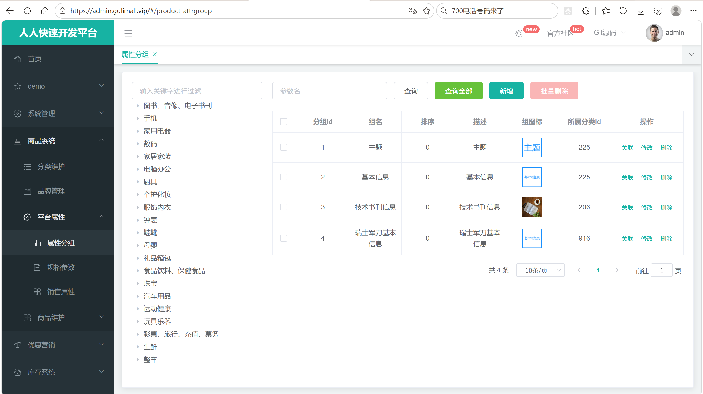
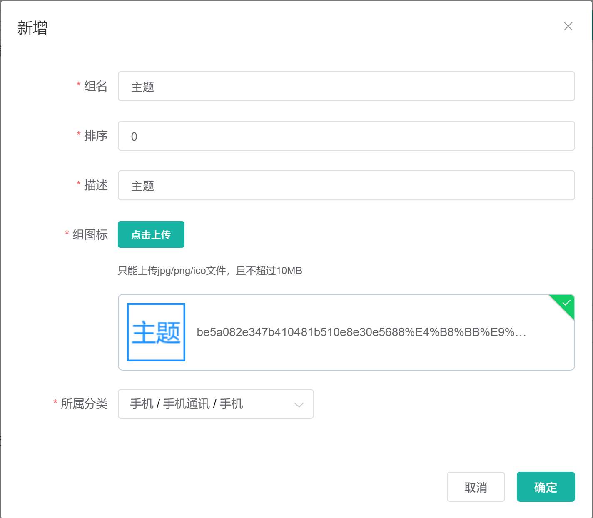
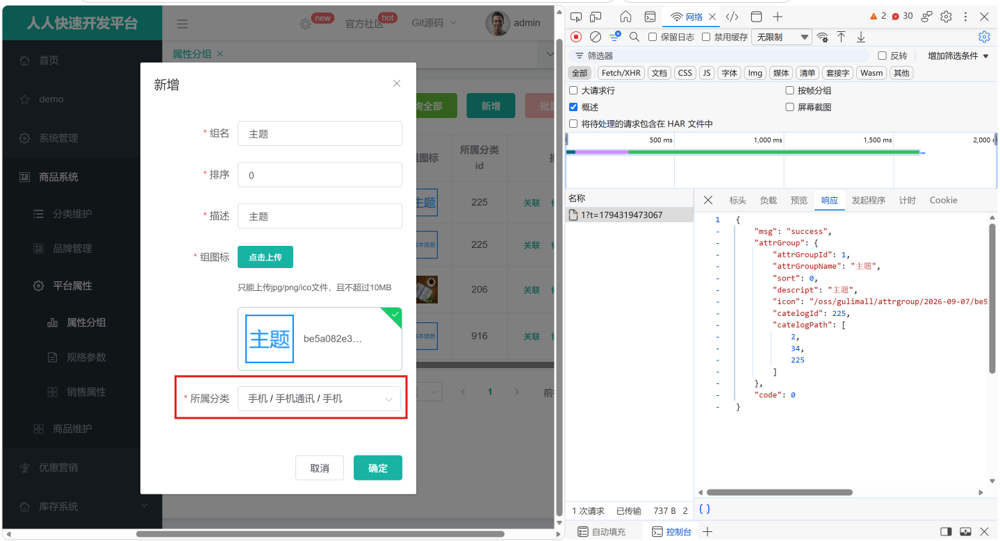
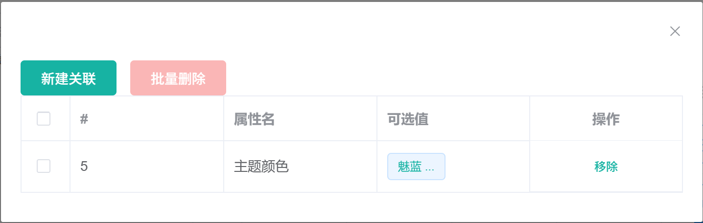
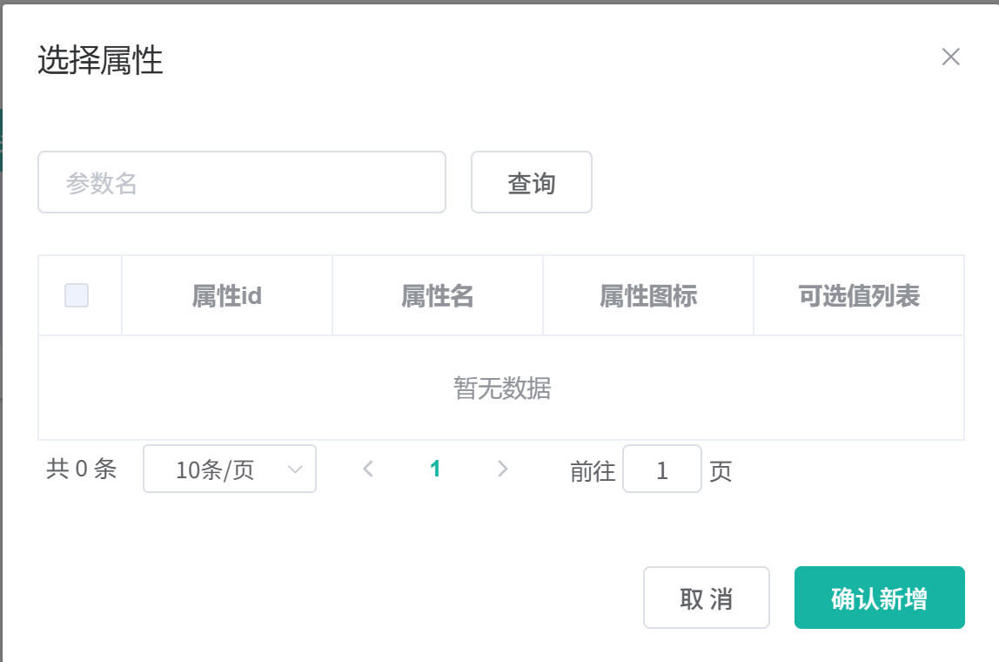

# 6.4 属性分组-介绍

> 本篇介绍属性分组：业务上怎么划分分组、管理员怎么维护、分组怎么挂到三级分类、分组和属性怎么关联、未关联属性怎么筛选，以及前后端数据怎么流转。

---

## 1. 这个功能是干什么的

属性分组是商品属性的容器。一个三级分类下往往有几十个属性，如果全部平铺在一页，商品发布页和商品详情页都会很长。属性分组把这些属性按语义归类，例如手机分类下可以分成“主体”“屏幕”“存储”“摄像头”。

属性分组在业务上有三个作用：

1. **组织属性**：把同一分类下的属性按展示位置分组，后台维护和前台展示都更清楚。
2. **驱动商品发布**：发布商品时，页面按分组逐块渲染属性输入项，商家按组填写参数。
3. **驱动商品详情**：商品详情页按分组展示规格参数，用户可以按组查看配置。

分组和属性的关系如下：

```text
pms_category（三级分类）
    └── pms_attr_group（属性分组，catelog_id 指向三级分类）
            └── pms_attr_attrgroup_relation（分组与属性的关联表）
                    └── pms_attr（属性，attr_type=1 基本属性）
```

一个分组可以关联多个属性，一个属性在业务上只属于一个分组。这样商品发布页不会把同一个属性重复渲染两次，商品详情页也不会出现两组相同的规格。

属性分组和平台属性是两个概念：

1. 属性分组是“盒子”，负责分组名称、图标、排序、所属分类。
2. 平台属性是“内容”，负责属性名、可选值、是否可检索、属性类型。
3. 关联表负责把盒子和内容连起来。

## 2. 管理员怎么操作

入口：

```text
管理后台 → 商品系统 → 平台属性 → 属性分组
```



属性分组页面分成左右两栏：左侧是分类树，右侧是分组列表。管理员可以完成六类操作。

### 2.1 选择分类查看分组

1. 打开页面，左侧加载 `/product/category/list/tree` 返回的三级分类树。
2. 点击树上的三级分类节点，前端记录 `catId`，请求 `/product/attrgroup/list/{catelogId}`。
3. 后端按 `catelog_id` 分页返回该分类下的分组。
4. 右侧表格展示分组 id、组名、排序、描述、组图标、所属分类 id。
5. 点击“查询全部”，前端把 `catId` 置为 0，再请求一次列表，后端返回所有分类下的分组。

左侧只有三级分类节点会触发查询，因为属性分组只挂在三级分类上。

### 2.2 按关键字搜索

1. 在搜索框输入分组 id 或组名。
2. 点击“查询”或按回车。
3. 前端把 `key` 和分页参数一起提交。
4. 后端在“分组 id 精确匹配”和“组名模糊匹配”之间做 `or` 查询。

搜索只在当前选中的三级分类内生效；“查询全部”时不限制分类。

### 2.3 新增分组

1. 点击“新增”。
2. 弹窗填写组名、排序、描述、组图标。
3. 通过级联选择器选择所属三级分类。
4. 点击“确定”。
5. 前端只提交级联路径的最后一级作为 `catelogId`。
6. 后端把分组插入 `pms_attr_group`。
7. 前端关闭弹窗并刷新列表。



组图标通过上传组件上传到 MinIO，表单里保存的是图片 URL。

### 2.4 修改分组

1. 点击某一行的“修改”。
2. 前端打开弹窗，请求 `/product/attrgroup/info/{attrGroupId}`。
3. 后端返回分组信息，并补上完整分类路径 `catelogPath`。
4. 前端把 `catelogPath` 交给级联组件，级联框自动展开到三级分类。
5. 修改后点击“确定”，后端更新 `pms_attr_group`。



保存时 `catelogPath` 不落库，因为实体里这个字段标记了 `@TableField(exist = false)`，它只用于前端回显。

### 2.5 删除分组

1. 勾选一行或多行分组。
2. 点击“删除”或“批量删除”。
3. 前端提交分组 id 数组。
4. 后端按 id 批量删除 `pms_attr_group`。
5. 前端刷新列表。

当前删除只删除分组本身，不会清理 `pms_attr_attrgroup_relation` 里对应的关联记录。删除分组后，关联表里会留下孤立数据。

### 2.6 关联属性

1. 点击某一行的“关联”，打开“关联属性”弹窗。
2. 弹窗上半部分展示该分组已关联的属性，支持单条“移除”和批量删除。
3. 点击“新建关联”，弹出“选择属性”内层弹窗。
4. 内层弹窗分页展示该分组所在分类下、尚未被任何分组关联的基本属性。
5. 勾选属性，点击“确认新增”，前端一次提交多组 `attrId + attrGroupId`。
6. 后端批量插入关联表。
7. 前端刷新已关联列表，同时刷新未关联列表。





关联弹窗里是两份数据：一份是已关联属性，来自 `/product/attrgroup/{attrgroupId}/attr/relation`；一份是未关联属性，来自 `/product/attrgroup/{attrgroupId}/noattr/relation`。两份数据分开查询，避免在前端做差集。

## 3. 整体设计思路

### 3.1 业务上怎么设计

#### 3.1.1 分组挂在三级分类下

属性分组的 `catelog_id` 必须指向三级分类，理由有三个：

1. 商品发布时必须选三级分类，属性分组也要按同一个粒度组织，商品发布页才能直接按三级分类取分组。
2. 一级、二级分类太宽，把分组挂在一级分类会让不同二级分类的属性混在一起。
3. 详情页和搜索页也按三级分类取规格，分组和属性保持同一分类粒度，查询条件一致。

因此后台左侧分类树只允许点击三级节点，前端 `treenodeclick()` 里判断 `node.level == 3` 才发请求。

#### 3.1.2 分组与属性多对多

一个分组包含多个属性，一个属性也可以被多个分组引用，所以用独立关联表 `pms_attr_attrgroup_relation`，而不是在 `pms_attr` 表里加 `attr_group_id` 字段。

关联表结构：

```text
pms_attr_attrgroup_relation
├── id            关联记录主键
├── attr_id       属性 id
├── attr_group_id 分组 id
└── attr_sort     属性在组内的排序
```

业务上约定一个属性只属于一个分组，但数据库层面没有唯一约束，关联表的多个分组 id 都可以指向同一个属性 id。

#### 3.1.3 未关联属性规则

“选择属性”弹窗只展示满足以下条件的属性：

1. 属性类型必须是基本属性，即 `attr_type = 1`。销售属性（`attr_type = 0`）不参与分组。
2. 属性所属分类必须等于当前分组所属分类。
3. 属性没有被任何分组关联，即 `pms_attr_attrgroup_relation` 里不存在这个 `attr_id` 的记录。
4. 搜索关键字可以按属性 id 精确匹配，或按属性名模糊匹配。

第三条是“一个属性只能属于一个分组”的筛选实现。只要属性已经被任意分组引用，它就不会再出现在未关联列表里。

#### 3.1.4 一个属性只能属于一个分组的约束方式

业务规则是“一个属性只属于一个分组”，但约束方式分两层：

1. **前端与查询层约束**：未关联查询用 `NOT EXISTS` 排除了所有已被引用的属性，管理员正常操作时选不到重复属性。
2. **写库层没有约束**：批量新增关联时后端不检查属性是否已属于其他分组，也不检查同一请求里是否有重复的 `attrId`。直接调用接口或并发提交仍可能写入重复关联。

生产环境应在关联表上补唯一索引或在后端补校验。

#### 3.1.5 删除规则

1. 删除分组：应先删除该分组下的所有关联记录，再删除分组。
2. 删除属性：应先删除该属性在所有分组下的关联记录，再删除属性。
3. 删除分类：分类是逻辑删除，分组和属性不会被物理删除，但会变成无法通过分类树访问的孤立数据。

当前代码只实现了“删除分组本身”，关联表清理没有做，属于需要补的业务规则。

#### 3.1.6 分类改名与分类删除的影响

分组表只存 `catelog_id`，不冗余分类名称，所以分类改名不会影响分组数据。分类被逻辑删除后，分组仍然存在，但左侧分类树看不到该节点，分组列表只能通过“查询全部”看到。

### 3.2 技术上怎么设计

#### 3.2.1 三张表配合

属性分组功能涉及三张表：

| 表 | 作用 |
|---|---|
| `pms_attr_group` | 分组主表，存组名、排序、描述、图标、所属分类 |
| `pms_attr_attrgroup_relation` | 分组与属性的关联表 |
| `pms_attr` | 属性主表，提供属性名、可选值、类型、所属分类 |

`pms_attr_group` 字段：

```text
pms_attr_group
├── attr_group_id    分组 id，主键
├── attr_group_name  组名
├── sort             组内排序
├── descript         描述
├── icon             组图标 URL
└── catelog_id       所属三级分类 id
```

分组表只存分类 id，不存分类名称，分类改名不会影响分组数据。

#### 3.2.2 分页统一走 Query 和 PageUtils

列表接口接收 `page`、`limit`、`key`，`Query` 把前端分页参数转成 MyBatis-Plus 的 `IPage`，`PageUtils` 把查询结果转成前端表格需要的 `list` 和 `totalCount`。

#### 3.2.3 分类路径用非映射字段承载

分组表只存三级分类 id。修改分组时，级联选择器需要完整路径 `[一级, 二级, 三级]`。后端在 `info` 接口里调用 `CategoryService.findCatelogPath()` 补出路径，塞进实体的 `catelogPath` 字段。

这个字段在实体上标记 `@TableField(exist = false)`，MyBatis-Plus 查询和更新都会忽略它，只在 JSON 序列化时返回前端。

#### 3.2.4 已关联属性分两步查

已关联属性查询分两步：

1. 按 `attr_group_id` 查关联表，拿到所有 `attr_id`。
2. 按 `attr_id` 批量查属性表。

这样比关联表直接 join 属性表更容易复用，也避免在 Mapper 里写多表 SQL。空集合时直接返回空列表，不执行 `in ()`。

#### 3.2.5 未关联属性用一条 SQL 完成

未关联查询把三个条件写进一条 SQL：

1. `attr_type = 1`。
2. `catelog_id` 等于当前分组所属分类。
3. `NOT EXISTS` 排除已被任意分组引用的属性。

一次数据库查询完成筛选和分页，比“先查分类、再查分组、再查关联、最后差集”的多次查询更直接。

#### 3.2.6 前端组件拆分

属性分组页面由四个组件组成：

1. `attrgroup.vue`：页面容器，左侧分类树，右侧分组列表。
2. `attrgroup-add-or-update.vue`：新增/修改弹窗，内含分类级联组件。
3. `attr-group-relation.vue`：已关联/未关联属性的关联弹窗。
4. `category-cascader.vue`：公共分类级联组件，负责加载分类树、回显路径、向父组件同步路径。

父组件通过 `ref` 调用子组件的 `init()`，子组件通过 `$emit("refreshDataList")` 或 `$emit("refreshData")` 通知父组件刷新列表。

#### 3.2.7 事务边界

1. `AttrGroupServiceImpl.queryPage()` 和 `getAttrGroupWithAttrsByCatelogId()` 只读，不需要事务。
2. `AttrGroupController.save()`、`update()`、`delete()` 调用 MyBatis-Plus 的通用方法，单条 SQL 自带原子性。
3. `AttrAttrgroupRelationServiceImpl.saveBatch()` 调用 `IService.saveBatch()` 批量插入。
4. `AttrServiceImpl.deleteRelation()` 一条 SQL 按 `attr_id + attr_group_id` 组合删除多条关联。

批量操作没有额外事务注解，失败时可能出现部分成功。

## 4. 详细代码、配置和解释

第 4 章按“类为什么存在 → 关键数据 → 读/写链路 → 代码分块解释 → 一次完整示例 → 边界”组织。每一块代码前面先说明它在链路里承担什么，代码后面再按 1、2、3 的顺序解释执行过程、条件和原因。

### 4.1 AttrGroupEntity：分组表映射

#### 4.1.1 这个类解决什么问题

管理后台的属性分组列表、新增弹窗、修改弹窗，以及商品发布页按分类取分组，都需要把 `pms_attr_group` 的一行数据带到 Java 层。数据库里只有 `catelog_id`，前端级联选择器却要 `[一级, 二级, 三级]` 的完整路径：修改分组时如果只返回三级分类 id，级联框只能显示最后一级，管理员无法确认分组挂在哪个一级分类下。

`AttrGroupEntity` 同时承担两个角色：

1. 数据库映射：字段与 `pms_attr_group` 一一对应，供 MyBatis-Plus 完成增删改查。
2. 详情回显载体：额外挂一个不落库的 `catelogPath`，由 `AttrGroupController.info()` 在返回前填好，前端直接绑定级联组件。

调用方有两类：后台页面通过 `AttrGroupController` 读写实体；商品发布页通过 `AttrGroupWithAttrsVo` 间接使用，不直接接触实体。实体本身不校验分类是否存在，也不保存分类名称。

#### 4.1.2 字段与业务含义

| 字段 | 数据库列 | 业务含义 | 说明 |
|---|---|---|---|
| `attrGroupId` | `attr_group_id` | 分组主键 | 表结构为自增列 |
| `attrGroupName` | `attr_group_name` | 组名 | 列表展示，也用于按名称模糊搜索 |
| `sort` | `sort` | 排序值 | 列表展示；当前分页查询没有按该字段排序 |
| `descript` | `descript` | 分组描述 | 后台弹窗填写 |
| `icon` | `icon` | 组图标 | 存上传后返回的完整 URL |
| `catelogId` | `catelog_id` | 所属三级分类 id | 分组只挂在三级分类下 |
| `catelogPath` | 无 | 分类完整路径 | `@TableField(exist = false)`，只在详情接口临时填充 |

#### 4.1.3 代码与解释

分组列表、详情、新增、修改四个接口都围绕这一份字段定义工作。列表和详情把表行读成对象，新增和修改把前端 JSON 反序列化成同一个对象。

```java
@Data
@TableName("pms_attr_group")
public class AttrGroupEntity implements Serializable {
	private static final long serialVersionUID = 1L;

	/**
	 * 分组id
	 */
	@TableId
	private Long attrGroupId;
	/**
	 * 组名
	 */
	private String attrGroupName;
	/**
	 * 排序
	 */
	private Integer sort;
	/**
	 * 描述
	 */
	private String descript;
	/**
	 * 组图标
	 */
	private String icon;
	/**
	 * 所属分类id
	 */
	private Long catelogId;
	/**
	 * 所属分类路径
	 */
	@TableField(exist = false)
	private Long[] catelogPath;

}
```

1. `@Data`：Lombok 生成 getter/setter，MyBatis-Plus 反射赋值和 Jackson 序列化都依赖这些访问器。
2. `@TableName("pms_attr_group")`：声明表名。缺少该注解时 MyBatis-Plus 会按类名推导成 `attr_group`，表名对不上。
3. `@TableId`：标记 `attrGroupId` 为主键。具体由数据库自增还是由 MyBatis-Plus 生成，取决于全局 `id-type` 配置；表结构里的 `attr_group_id` 是自增列。
4. `attrGroupName`、`sort`、`descript`、`icon`、`catelogId` 与表列按驼峰转下划线一一映射，分别承载组名、排序、描述、图标 URL 和所属三级分类。
5. `@TableField(exist = false)`：`catelogPath` 不是数据库列，查询时不会拼进 `SELECT`，更新时也不会写进 `UPDATE`。
6. `Long[] catelogPath`：级联组件按数组顺序展开，元素从一级到三级。用数组而不是 `List`，是为了与 `CategoryMethod.findCatelogPath()` 的返回类型一致，控制器可以原样塞回实体。

#### 4.1.4 一次读写示例

修改三级分类 225 下的分组 12，前端先请求详情：

```text
GET /gulimall/product/attrgroup/info/12

SELECT attr_group_id, attr_group_name, sort, descript, icon, catelog_id
FROM pms_attr_group
WHERE attr_group_id = 12;

返回：
{
  "attrGroupId": 12,
  "attrGroupName": "屏幕",
  "sort": 3,
  "descript": "屏幕参数",
  "icon": "http://minio/.../screen.png",
  "catelogId": 225,
  "catelogPath": [2, 34, 225]
}
```

管理员修改组名后提交 `POST /product/attrgroup/update`，请求体里的 `catelogPath` 会被忽略，实际执行：

```sql
UPDATE pms_attr_group
SET attr_group_name = ?, sort = ?, descript = ?, icon = ?, catelog_id = ?
WHERE attr_group_id = 12;
```

新增时前端不传 `attrGroupId`，主键由数据库自增或全局主键策略生成。

#### 4.1.5 它不做什么

1. 不校验 `catelogId` 是否存在、是否为三级分类，这条规则由前端级联选择器和业务约定保证。
2. 不保存分类名称，分类改名不会影响分组数据，分组和分类始终按 id 关联。
3. 不维护 `sort` 的默认值，新增时不传就是 null。
4. 不校验图标 URL 的来源和格式，`icon` 只是普通字符串。

#### 4.1.6 边界与可优化点

1. `catelogPath` 混在数据库实体上，接口返回和表映射耦合。长期可以拆出 `AttrGroupDetailVo`，实体只保留表字段。
2. `catelog_id` 是列表页的高频查询条件，应在该列建立索引；当前表结构里只有主键索引。
3. `sort` 为 null 时列表排序和前端展示需要额外兜底，新增时应给默认值。
4. `icon` 存完整 URL，域名或对象存储地址变化时需要批量改数据，生产环境更适合存对象 key，由前端拼接访问地址。
5. 实体直接接收请求体，`attrGroupId` 也允许前端传入。`updateById()` 按请求体里的主键更新，理论上可以改到其他分组，接口层应限制可更新字段。

### 4.2 AttrGroupWithAttrsVo：分组带属性的返回结构

#### 4.2.1 这个类解决什么问题

商品发布页选中三级分类后，要立刻渲染该分类下所有属性输入项；商品详情页也要按分组展示规格参数。页面需要的是“分组里带属性”的嵌套结构，而不是三张表的原始行。数据库没有对应表，这种结构只能在内存里组装。

上游调用方是 `AttrGroupController.getAttrGroupWithAttrs()`，它把分类 id 交给 `AttrGroupServiceImpl.getAttrGroupWithAttrsByCatelogId()`。Service 先查该分类下的分组，再逐组调用 `AttrMethod.getRelationAttr()` 取属性。下游消费方是商品发布页的属性录入和属性维护页，它们按 `attrs` 逐组渲染输入项。商品详情页的规格展示不走这个接口，而是由 `ProductAttrValueDao.getAttrGroupWithAttrsBySpuId()` 按 spu 聚合已选规格值。后台属性分组列表也不使用这个 VO，只关心分组本身。

#### 4.2.2 结构与字段

| 字段 | 含义 | 来源 |
|---|---|---|
| `attrGroupId` | 分组 id | `pms_attr_group` |
| `attrGroupName` | 组名 | `pms_attr_group` |
| `sort` | 排序 | `pms_attr_group` |
| `descript` | 描述 | `pms_attr_group` |
| `icon` | 组图标 | `pms_attr_group` |
| `catelogId` | 所属分类 id | `pms_attr_group` |
| `attrs` | 该分组下的属性列表 | `pms_attr_attrgroup_relation` + `pms_attr` |

#### 4.2.3 代码与解释

这份结构只在内存里存在，组装过程在 `AttrGroupServiceImpl` 中完成。

```java
@Data
public class AttrGroupWithAttrsVo {
    /**
     * 分组id
     */
    private Long attrGroupId;
    /**
     * 组名
     */
    private String attrGroupName;
    /**
     * 排序
     */
    private Integer sort;
    /**
     * 描述
     */
    private String descript;
    /**
     * 组图标
     */
    private String icon;
    /**
     * 所属分类id
     */
    private Long catelogId;

    private List<AttrEntity> attrs;
}
```

1. `@Data` 提供 getter/setter，`BeanUtils.copyProperties()` 依赖同名属性把实体字段拷进 VO。
2. 前六个字段与 `AttrGroupEntity` 同名同类型，拷贝后不需要逐个赋值。
3. `attrs` 是该分组下已关联的属性列表，元素直接复用 `AttrEntity`，商品页需要的属性名、可选值、类型都在里面。
4. 没有 `catelogPath`：商品页按分类 id 取数据，不需要回显路径，少一个字段也少一次分类查询。

#### 4.2.4 一次返回示例

商品发布页选择三级分类 225 后请求：

```text
GET /gulimall/product/attrgroup/225/withattr
```

返回的 `data` 是一个数组：

```json
[
  {
    "attrGroupId": 12,
    "attrGroupName": "屏幕",
    "sort": 3,
    "descript": "屏幕参数",
    "icon": "http://minio/.../screen.png",
    "catelogId": 225,
    "attrs": [
      { "attrId": 7, "attrName": "屏幕尺寸", "valueSelect": "6.1;6.7", "attrType": 1 },
      { "attrId": 8, "attrName": "刷新率", "valueSelect": "60;120", "attrType": 1 }
    ]
  }
]
```

#### 4.2.5 它不做什么

1. 不排序，`attrs` 的顺序取决于关联表和属性表的查询顺序。
2. 不裁剪属性字段，返回完整 `AttrEntity`。
3. 不跳过没有属性的分组，`attrs` 可能是空列表。

#### 4.2.6 边界与可优化点

1. 字段与实体重复，可以让 VO 继承实体或组合实体，减少同步成本。
2. `attrs` 没有使用关联表的 `attr_sort`，组内顺序不稳定。
3. 返回完整属性行，把 `showDesc`、`enable`、`searchType` 等商品页不需要的字段也带出去。
4. 每个分组查一次属性，分组多时是 N+1 查询，应改为一次查关联、一次批量查属性，再按 `attr_group_id` 归集。

### 4.3 AttrGroupController：属性分组接口层

#### 4.3.1 这个类解决什么问题

管理后台“商品系统 → 平台属性 → 属性分组”页面分成左右两栏：左侧分类树，右侧分组表格。表格上方有查询、查询全部、新增、批量删除，每行有修改、删除、关联。关联弹窗里还要新建关联、移除关联、查询可选属性。商品发布页另外要按分类取“分组带属性”。

这些操作全部通过 HTTP 进入后端。`AttrGroupController` 负责三件事：

1. 接收路径参数、查询参数和请求体；
2. 用 `@RequiresPermissions` 校验后台权限；
3. 把 Service 的返回值包装成统一结果 `R`。

树怎么组装、分组带属性怎么拼、关联记录怎么校验，都不在这个类里。

#### 4.3.2 接口清单

| 操作 | 方法与路径 | 权限 | 调用的方法 |
|---|---|---|---|
| 按分类分页查分组 | `GET /product/attrgroup/list/{catelogId}` | `product:attrgroup:list` | `AttrGroupService.queryPage(params, catelogId)` |
| 查分组详情 | `GET /product/attrgroup/info/{attrGroupId}` | `product:attrgroup:info` | `getById()` + `CategoryService.findCatelogPath()` |
| 新增分组 | `POST /product/attrgroup/save` | `product:attrgroup:save` | `save()` |
| 修改分组 | `POST /product/attrgroup/update` | `product:attrgroup:update` | `updateById()` |
| 删除分组 | `POST /product/attrgroup/delete` | `product:attrgroup:delete` | `removeByIds()` |
| 查已关联属性 | `GET /product/attrgroup/{attrgroupId}/attr/relation` | `product:attrgroup:list` | `AttrService.getRelationAttr()` |
| 批量新增关联 | `POST /product/attrgroup/attr/relation` | `product:attrgroup:save` | `AttrAttrgroupRelationService.saveBatch()` |
| 批量删除关联 | `POST /product/attrgroup/attr/relation/delete` | `product:attrgroup:delete` | `AttrService.deleteRelation()` |
| 分页查未关联属性 | `GET /product/attrgroup/{attrgroupId}/noattr/relation` | `product:attrgroup:list` | `AttrService.getNoRelationAttr()` |
| 查分类下分组带属性 | `GET /product/attrgroup/{catelogId}/withattr` | 无 | `AttrGroupService.getAttrGroupWithAttrsByCatelogId()` |

网关转发时去掉 `/gulimall` 前缀，后台实际请求路径是 `/gulimall/product/attrgroup/...`。

#### 4.3.3 请求链路

```text
浏览器（admin.gulimall.vip）
  → Nginx
  → Gateway /gulimall/product/attrgroup/**
  → AttrGroupController
  → AttrGroupService / AttrService / AttrAttrgroupRelationService
  → MySQL pms_attr_group / pms_attr_attrgroup_relation / pms_attr
  → R{ code, msg, page | data | attrGroup }
```

Controller 位于链路的入口，只决定“这个请求该交给谁”，不参与数据组装。

#### 4.3.4 代码与解释

这一块代码把十类请求分成三组：分组本身的 CRUD、分组与属性的关联维护、按分类取分组带属性。分组 CRUD 直接调用 MyBatis-Plus 通用方法；关联维护委托 `AttrService` 和关联 Service；详情接口额外调用分类 Service 补路径。

```java
@RestController
@RequestMapping("product/attrgroup")
@Slf4j
public class AttrGroupController {
    @Autowired
    private AttrGroupService attrGroupService;
    @Autowired
    private CategoryService categoryService;
    @Autowired
    private AttrService attrService;
    @Autowired
    private AttrAttrgroupRelationService relationService;

    /**
     * 列表
     */
    @RequestMapping("/list/{catelogId}")
    @RequiresPermissions("product:attrgroup:list")
    public R list(@PathVariable Long catelogId, @RequestParam Map<String, Object> params){
//        PageUtils page = attrGroupService.queryPage(params);

        PageUtils page = attrGroupService.queryPage(params, catelogId);

        return R.ok().put("page", page);
    }


    /**
     * 信息
     */
    @RequestMapping("/info/{attrGroupId}")
    @RequiresPermissions("product:attrgroup:info")
    public R info(@PathVariable("attrGroupId") Long attrGroupId){
		AttrGroupEntity attrGroup = attrGroupService.getById(attrGroupId);

        // 新增分组信息时，保存的是新增的三级分类id，重新修改分组信息时，需要回显出完整的三级分类路径
        Long catelogId = attrGroup.getCatelogId();
        log.info("catelogId: {}", catelogId);
        Long[] catelogPath = categoryService.findCatelogPath(catelogId);
        log.info("分类路径: {}", Arrays.toString(catelogPath));
        attrGroup.setCatelogPath(catelogPath);

        return R.ok().put("attrGroup", attrGroup);
    }

    /**
     * 保存
     */
    @RequestMapping("/save")
    @RequiresPermissions("product:attrgroup:save")
    public R save(@RequestBody AttrGroupEntity attrGroup){
		attrGroupService.save(attrGroup);

        return R.ok();
    }

    /**
     * 修改
     */
    @RequestMapping("/update")
    @RequiresPermissions("product:attrgroup:update")
    public R update(@RequestBody AttrGroupEntity attrGroup){
		attrGroupService.updateById(attrGroup);

        return R.ok();
    }

    /**
     * 删除
     */
    @RequestMapping("/delete")
    @RequiresPermissions("product:attrgroup:delete")
    public R delete(@RequestBody Long[] attrGroupIds){
		attrGroupService.removeByIds(Arrays.asList(attrGroupIds));

        return R.ok();
    }

    /**
     * 获取属性分组已关联的所有属性
     * URL：/product/attrgroup/{attrgroupId}/attr/relation
     */
    @GetMapping("/{attrgroupId}/attr/relation")
    @RequiresPermissions("product:attrgroup:list")
    public R attrRelation(@PathVariable("attrgroupId") Long attrgroupId) {
        // 查询该分组下已关联的所有属性
        List<AttrEntity> data = attrService.getRelationAttr(attrgroupId);
        return R.ok().put("data", data);
    }

    /**
     * 添加属性与属性分组的关联关系
     * URL：/product/attrgroup/attr/relation
     * @param vos 前端勾选的属性列表（attrId + attrGroupId）
     */
    @PostMapping("/attr/relation")
    @RequiresPermissions("product:attrgroup:save")
    public R attrRelationAdd(@RequestBody List<AttrGroupRelationVo> vos) {
        // 批量保存关联关系（Vo 转实体后批量插入）
        relationService.saveBatch(vos);
        return R.ok();
    }

    /**
     * 删除属性与属性分组的关联关系
     * URL：/product/attrgroup/attr/relation/delete
     * @param vos 待删除的关联关系数组（attrId + attrGroupId）
     */
    @PostMapping("/attr/relation/delete")
    @RequiresPermissions("product:attrgroup:delete")
    public R attrRelationDelete(@RequestBody AttrGroupRelationVo[] vos) {
        // 按 attrId + attrGroupId 批量删除关联
        attrService.deleteRelation(vos);
        return R.ok();
    }

    /**
     * 获取属性分组【未关联】的其他属性（分页），供“选择属性”弹窗
     * URL：/product/attrgroup/{attrgroupId}/noattr/relation
     */
    @GetMapping("/{attrgroupId}/noattr/relation")
    @RequiresPermissions("product:attrgroup:list")
    public R attrNoRelation(@PathVariable("attrgroupId") Long attrgroupId,
                            @RequestParam Map<String, Object> params) {
        // 查询该分组下还未关联的属性（同分类基本属性，且未被其它分组引用）
        PageUtils page = attrService.getNoRelationAttr(params, attrgroupId);
        return R.ok().put("page", page);
    }

    /**
     * 获取分类下所有分组以及属性
     * @param catelogId 分类id
     * @return 所有分组以及属性
     */
    @GetMapping("/{catelogId}/withattr")
    public R getAttrGroupWithAttrs(@PathVariable("catelogId") Long catelogId){
        //1、查出当前分类下的所有属性分组
        //2、查出每个属性分组的所有属性
        List<AttrGroupWithAttrsVo> vos = attrGroupService.getAttrGroupWithAttrsByCatelogId(catelogId);
        return R.ok().put("data", vos);

    }

}
```

1. `@RestController` + `@RequestMapping("product/attrgroup")`：十个接口共用 `/product/attrgroup` 前缀，返回值按 JSON 写出。
2. 四个 `@Autowired` 依赖分别负责分组读写、分类路径查询、属性查询和关联写入，控制器不直接访问 DAO。
3. `list()`：从路径取 `catelogId`，从查询参数取 `page`、`limit`、`key`，交给 `queryPage(params, catelogId)`，结果放在 `page` 字段。被注释掉的单参数调用是代码生成器的默认分页，不限制分类。
4. `info()`：先按 id 查分组，再取 `catelogId` 调用 `categoryService.findCatelogPath()`，把返回的 `Long[]` 塞进实体的 `catelogPath`。这是修改弹窗回显完整分类路径的唯一来源。
5. `save()`：直接调用 `IService.save()`。请求体里的 `catelogPath` 因 `exist = false` 不会写库。
6. `update()`：直接调用 `IService.updateById()`，按主键更新非空字段。请求体里的 `catelogPath` 同样被忽略。
7. `delete()`：接收 id 数组，转成 `List` 后调用 `removeByIds()`，一条 SQL 批量删除分组，不碰关联表。
8. `attrRelation()`：调用 `attrService.getRelationAttr()`，实现类再委托 `AttrMethod`，返回该分组已关联的属性列表。
9. `attrRelationAdd()`：接收 `List<AttrGroupRelationVo>`，每个元素只有 `attrId` 和 `attrGroupId`，交给 `AttrAttrgroupRelationService.saveBatch()` 批量插入。
10. `attrRelationDelete()`：接收数组，交给 `attrService.deleteRelation()`，按 `attrId + attrGroupId` 组合批量删除，单条移除和批量移除共用这个接口。
11. `attrNoRelation()`：接收分页参数和分组 id，调用 `attrService.getNoRelationAttr()`，返回同分类、未被任何分组关联的基本属性分页。
12. `getAttrGroupWithAttrs()`：按分类 id 取分组和属性，返回 `List<AttrGroupWithAttrsVo>`，供商品发布页、商品详情页使用。方法上没有权限注解，因为它面向用户端页面，不走后台权限体系。

#### 4.3.5 一次请求示例

管理员在关联弹窗里勾选两个属性，点击“确认新增”：

```text
POST /gulimall/product/attrgroup/attr/relation
Content-Type: application/json

[
  { "attrId": 7, "attrGroupId": 12 },
  { "attrId": 8, "attrGroupId": 12 }
]

1. Gateway 去掉 /gulimall 前缀
2. Controller 校验 product:attrgroup:save
3. attrRelationAdd() 把数组交给 relationService.saveBatch()
4. 实现类把 VO 拷成实体，调用 IService.saveBatch()
5. 返回 R.ok()
6. 前端重新请求已关联列表和未关联列表
```

#### 4.3.6 它不做什么

1. 不组装分类树，分类树由分类模块的 `CategoryController` 提供。
2. 不计算分类路径，路径由 `CategoryService.findCatelogPath()` 完成。
3. 不校验分组的分类归属、属性的分类归属、属性类型和重复关联。
4. 不清理分组的关联记录，删除分组只删主表。

#### 4.3.7 边界与可优化点

1. `info()` 没有判断 `getById()` 是否返回 null。分组 id 不存在时，`attrGroup.getCatelogId()` 直接抛空指针，应返回“分组不存在”。
2. `save()`、`update()` 没有 `@Valid` 或手工校验，组名、分类 id、排序都可以为空，也可以传非三级分类 id。
3. `delete()` 不校验分组下是否有关联属性，也不级联删除 `pms_attr_attrgroup_relation`，删除后关联表留下孤立记录。
4. `attrRelationAdd()` 不校验 `attrId` 是否属于同一分类、是否是基本属性、是否已被其他分组引用，直接调用接口可以写入不合规关联。
5. 空数组进入 `deleteRelation()` 或 `saveBatch()` 时，实现类有判空并直接返回，但接口仍返回成功，前端无法区分“没删到”和“删除成功”。
6. `list()`、`save()`、`update()`、`delete()` 使用 `@RequestMapping`，没有限定 HTTP 方法，同一个路径可以用 GET 触发写操作，生产环境应改成 `@GetMapping`、`@PostMapping`。
7. `getAttrGroupWithAttrs()` 没有权限注解，也没有校验分类是否存在，传入不存在的分类会返回空数组。

### 4.4 AttrGroupServiceImpl：分组分页与分组带属性

#### 4.4.1 这个类解决什么问题

属性分组有两个读入口：后台列表页按分类分页查分组，商品发布页按分类查“分组 + 属性”。两个入口查的都是 `pms_attr_group`，但过滤条件和返回结构不同，所以实现类提供两个方法。

这个类继承 `ServiceImpl<AttrGroupDao, AttrGroupEntity>`，分组的新增、修改、删除直接复用父类通用方法，没有额外事务和缓存逻辑。写关联表、查属性、补分类路径都不在这里。

#### 4.4.2 两条读链路

```text
后台列表：
GET /product/attrgroup/list/{catelogId}
  → queryPage(params, catelogId)
  → Query.getPage(params) 生成 IPage
  → this.page() 查 pms_attr_group
  → PageUtils 包装成 list + totalCount

商品发布页：
GET /product/attrgroup/{catelogId}/withattr
  → getAttrGroupWithAttrsByCatelogId(catelogId)
  → selectList 查该分类下所有分组
  → 逐组调用 AttrMethod.getRelationAttr()
  → 组装 List<AttrGroupWithAttrsVo>
```

两条链路都只读，不加事务，也不经过缓存。

#### 4.4.3 代码与解释

`queryPage` 处理列表页的分页和关键字；`getAttrGroupWithAttrsByCatelogId` 处理商品页的嵌套结构。两个方法一个查一层，一个逐组补属性，分别对应上面的两条链路。

```java
@Service("attrGroupService")
public class AttrGroupServiceImpl extends ServiceImpl<AttrGroupDao, AttrGroupEntity> implements AttrGroupService {

    @Autowired
    private AttrMethod attrMethod;

    @Override
    public PageUtils queryPage(Map<String, Object> params, Long catelogId) {
        String key = (String) params.get("key");
        if (catelogId == 0) {
            // 没有三级分类
            IPage<AttrGroupEntity> page = this.page(
                    new Query<AttrGroupEntity>().getPage(params),
                    new QueryWrapper<AttrGroupEntity>().and(w -> w.eq("attr_group_id", key).or().like("attr_group_name", key))
            );
            return new PageUtils(page);
        } else {
            // 有三级分类
            // select * from pms_attr_group where catelog_id = ? and (attr_group_id = ? or attr_group_name like ?)
            QueryWrapper<AttrGroupEntity> wrapper = new QueryWrapper<AttrGroupEntity>().eq("catelog_id", catelogId);
            if (StringUtils.isNotBlank(key)) {
                wrapper.and(w -> w.eq("attr_group_id", key).or().like("attr_group_name", key));
            }
            IPage<AttrGroupEntity> page = this.page(
                    new Query<AttrGroupEntity>().getPage(params),
                    wrapper
            );

            return new PageUtils(page);
        }
    }

    /**
     *根据分类id查出所有的分组以及这些分组里面的属性
     * @param:[catelogId]
     * @return:java.util.List<com.xmh.gulimall.product.vo.AttrGroupWithAttrsVo>
     */
    @Override
    public List<AttrGroupWithAttrsVo> getAttrGroupWithAttrsByCatelogId(Long catelogId) {
        List<AttrGroupEntity> attrGroupEntities = this.baseMapper.selectList(new QueryWrapper<AttrGroupEntity>().eq("catelog_id", catelogId));
        return attrGroupEntities.stream().map(item -> {
            AttrGroupWithAttrsVo attrsVo = new AttrGroupWithAttrsVo();
            BeanUtils.copyProperties(item, attrsVo);
            List<AttrEntity> relationAttr = attrMethod.getRelationAttr(item.getAttrGroupId());
            attrsVo.setAttrs(relationAttr);
            return attrsVo;
        }).collect(Collectors.toList());
    }
}
```

1. 无参的 `queryPage(Map)` 是代码生成器生成的基础分页方法，控制器没有调用；后台列表使用的是带 `catelogId` 的重载方法。
2. 重载方法先从参数里取 `key`，再判断 `catelogId` 是否等于 0。等于 0 表示“查询全部”，不限制分类。
3. “查询全部”分支用 `QueryWrapper.and(w -> ...)` 把 `attr_group_id = key OR attr_group_name LIKE %key%` 包成一个整体，防止 `or` 把其他条件短路。
4. `catelogId != 0` 时，先加 `eq("catelog_id", catelogId)`，再在 `key` 非空时用同样的 `and(...)` 追加 id 精确匹配或组名模糊匹配。关键字为空时只按分类过滤。
5. `Query.getPage(params)` 把前端的 `page`、`limit` 转成 `IPage`，`this.page()` 执行分页查询；`PageUtils` 再把结果转成前端表格需要的 `list` 和 `totalCount`。
6. `getAttrGroupWithAttrsByCatelogId()` 先按 `catelog_id` 查出该分类下所有分组，没有排序条件。
7. 用 `stream().map()` 遍历分组，每个分组创建 `AttrGroupWithAttrsVo`。
8. `BeanUtils.copyProperties(item, attrsVo)` 把同名分组字段拷进 VO。
9. 调用 `attrMethod.getRelationAttr(item.getAttrGroupId())` 查该分组的属性列表，塞进 `attrs`；分组没有属性时得到空列表。
10. `collect(Collectors.toList())` 汇总成返回值，控制器直接放进 `R.ok().put("data", vos)`。

#### 4.4.4 一次请求示例

后台点击三级分类 225：

```text
GET /gulimall/product/attrgroup/list/225?page=1&limit=10&key=

1. catelogId = 225，key = ""
2. catelog_id != 0，wrapper 先加 catelog_id = 225
3. key 为空，不追加 id/组名条件
4. 执行分页查询，等价于：
   SELECT * FROM pms_attr_group WHERE catelog_id = 225 LIMIT 0, 10
5. 返回 page.list 和 page.totalCount
```

点击“查询全部”时请求 `/list/0`，`catelogId == 0` 分支生效，SQL 变成：

```sql
SELECT * FROM pms_attr_group
WHERE (attr_group_id = '' OR attr_group_name LIKE '%%')
LIMIT 0, 10;
```

空字符串会匹配全部组名，效果等于不加过滤。

#### 4.4.5 它不做什么

1. 不写关联表，关联的增删在 `AttrAttrgroupRelationServiceImpl` 和 `AttrServiceImpl`。
2. 不计算分类路径，路径由分类模块负责。
3. 不校验 `catelogId` 是否为三级分类，也不校验分类是否存在。
4. 不按 `sort` 排序，列表顺序由数据库返回顺序决定。

#### 4.4.6 边界与可优化点

1. `catelogId == 0` 会对 `Long` 自动拆箱。前端传 null 时直接抛空指针，应先判空或给路径参数默认值。
2. “查询全部”分支不判断 `key` 是否为空，空字符串会生成 `LIKE '%%'`；接口直接传 null 时，`eq("attr_group_id", null)` 和 `like` 的语义会不可控。
3. 两个分支的 `key` 处理逻辑重复，可以统一成先拼 `catelog_id`，再按 `StringUtils.isNotBlank(key)` 追加条件。
4. `attr_group_id = key` 要求 `key` 是数字字符串，非数字时会依赖数据库隐式转换，可能报错，也可能让索引失效。
5. `catelog_id` 没有显式索引，分类下分组多时查询会扫更多行。
6. `getAttrGroupWithAttrsByCatelogId()` 每个分组查一次属性，分组多时是 N+1 查询。
7. 返回完整 `AttrEntity`，商品页用不到的字段也会进入 JSON。

### 4.5 AttrMethod：查询分组已关联属性

#### 4.5.1 这个类解决什么问题

“某个分组下已关联哪些属性”被两个业务同时需要：

1. 商品发布页组装“分组带属性”，调用方是 `AttrGroupServiceImpl`；
2. 后台关联弹窗展示已关联属性，调用方是 `AttrServiceImpl.getRelationAttr()`。

如果把这段查询放进 `AttrService`，`AttrGroupService` 调 `AttrService`，而 `AttrService` 又要处理分组和属性关系，两个 Service 容易形成互相依赖。把这层共享查询放到 `Method` 层，只依赖 `AttrAttrgroupRelationDao` 和 `AttrDao`，任何 Service 都可以安全调用。

#### 4.5.2 代码与解释

查询分两步：先从关联表拿到该分组的全部 `attr_id`，再按 id 批量查属性表。关联表只存关系，属性名、可选值、类型都在属性表里，所以必须二次查询。

```java
@Component
public class AttrMethod {

    @Autowired
    private AttrAttrgroupRelationDao attrAttrgroupRelationDao;
    @Autowired
    private AttrDao attrDao;

    /**
     * 获取指定属性分组下【已关联】的所有属性
     * 思路：先查关联表拿到该分组下所有 attr_id，再按 id 批量查属性
     *
     * @param attrgroupId 属性分组 id
     */
    public List<AttrEntity> getRelationAttr(Long attrgroupId) {
        // 1、查询该分组下的所有关联记录
        List<AttrAttrgroupRelationEntity> relationEntities = attrAttrgroupRelationDao.selectList(
                new QueryWrapper<AttrAttrgroupRelationEntity>().eq("attr_group_id", attrgroupId));

        // 2、取出关联的属性 id 集合
        List<Long> attrIds = relationEntities.stream()
                .map(AttrAttrgroupRelationEntity::getAttrId)
                .collect(Collectors.toList());

        // 3、按 id 批量查询属性详情（空集合会查空，直接返回）
        if (attrIds.isEmpty()) {
            return Collections.emptyList();
        }
        return attrDao.selectByIds(attrIds);
    }

}
```

1. 类上 `@Component`，由 Spring 管理，供其他 Bean 注入。
2. 依赖 `AttrAttrgroupRelationDao` 查关联记录，依赖 `AttrDao` 查属性详情，不依赖任何 Service。
3. 按 `attr_group_id` 查 `pms_attr_attrgroup_relation`，得到该分组的所有关联记录；每条记录包含 `attr_id` 和 `attr_sort`。
4. 用 Stream 取 `getAttrId()`，组成 `List<Long>`；`attr_sort` 在这里没有使用。
5. 关联记录为空时返回 `Collections.emptyList()`，避免执行 `WHERE attr_id IN ()` 这种非法 SQL。
6. 否则调用 `attrDao.selectByIds(attrIds)` 批量查属性，返回顺序由数据库决定，不保证与关联顺序一致。

#### 4.5.3 一次查询示例

分组 12 在关联表里有三条记录，属性表里有一条已被删除：

```text
SELECT * FROM pms_attr_attrgroup_relation WHERE attr_group_id = 12;
→ attr_id = 7, 8, 9

SELECT * FROM pms_attr WHERE attr_id IN (7, 8, 9);
→ 只返回 7、8 两行

结果：attrs = [属性7, 属性8]
```

关联表里的 9 成为孤立记录，已关联列表不会报错，但数量会比关联记录少。

#### 4.5.4 它不做什么

1. 不排序，关联表的 `attr_sort` 没有参与查询。
2. 不清理失效关联，属性被删除后关联记录仍然保留。
3. 不区分属性类型，只要在关联表里就查出来。
4. 不缓存，每次调用都查两次数据库。

#### 4.5.5 边界与可优化点

1. `selectByIds` 返回完整属性行，可以只查展示需要的列。
2. 两次查询可以合并成一次 `JOIN`，但拆开更利于复用，后续也方便分别加缓存。
3. 属性数量很多时 `IN` 列表会很长，应确认批大小或分批判量。
4. 关联表的 `attr_sort` 应参与排序，保证组内顺序稳定。
5. 属性被删除或禁用后仍会出现在关联关系里，生产环境应定期清理，或在查询时过滤 `enable`。

### 4.6 AttrAttrgroupRelationServiceImpl：批量保存关联

#### 4.6.1 这个类解决什么问题

关联弹窗的内层“选择属性”允许一次勾选多条属性，点击“确认新增”后前端提交一个数组，每个元素是 `attrId + attrGroupId`。后端需要把这些 VO 转成关联实体并批量写入 `pms_attr_attrgroup_relation`。

调用方是 `AttrGroupController.attrRelationAdd()`。这个 Service 只负责写关联表，不校验属性是否合法，也不刷新任何缓存。

#### 4.6.2 代码与解释

代码分两段：默认的 `queryPage` 是代码生成器产物，业务入口是接收 `List<AttrGroupRelationVo>` 的 `saveBatch` 重载。

```java
@Service("attrAttrgroupRelationService")
public class AttrAttrgroupRelationServiceImpl extends ServiceImpl<AttrAttrgroupRelationDao, AttrAttrgroupRelationEntity> implements AttrAttrgroupRelationService {

    @Override
    public PageUtils queryPage(Map<String, Object> params) {
        IPage<AttrAttrgroupRelationEntity> page = this.page(
                new Query<AttrAttrgroupRelationEntity>().getPage(params),
                new QueryWrapper<AttrAttrgroupRelationEntity>()
        );

        return new PageUtils(page);
    }

    /**
     * 批量保存 属性与属性分组的关联关系
     * 思路：前端传来的 Vo（attrId + attrGroupId）逐个转成关联实体，再调用 IService 自带的 saveBatch 批量插入
     * @param vos 关联关系列表（attrId + attrGroupId）
     */
    @Override
    public void saveBatch(List<AttrGroupRelationVo> vos) {
        if (vos == null || vos.isEmpty()) {
            return;
        }
        // Vo 转实体（字段同名直接拷贝）
        List<AttrAttrgroupRelationEntity> entities = vos.stream().map((vo) -> {
            AttrAttrgroupRelationEntity relationEntity = new AttrAttrgroupRelationEntity();
            BeanUtils.copyProperties(vo, relationEntity);
            return relationEntity;
        }).collect(Collectors.toList());
        // 批量插入关联关系
        this.saveBatch(entities);
    }

}
```

1. `@Service("attrAttrgroupRelationService")` 注册 Bean，控制器按接口类型注入。
2. 默认 `queryPage` 查整张关联表并分页，当前业务没有调用，保留自代码生成器。
3. 自定义 `saveBatch(List<AttrGroupRelationVo>)` 先判断入参是否为 null 或空列表，为空直接返回，避免拼出空 `VALUES`。
4. 遍历 VO，为每个元素创建 `AttrAttrgroupRelationEntity`，用 `BeanUtils.copyProperties()` 同名拷贝 `attrId` 和 `attrGroupId`。
5. 收集成实体列表后调用 `this.saveBatch(entities)`，解析到父类 `IService.saveBatch(Collection)`，由 MyBatis-Plus 按批拼接插入语句，减少网络往返。
6. 关联表的 `attr_sort` 没有赋值，插入后为 null，组内排序无从保证。

#### 4.6.3 一次批量关联示例

```text
POST /product/attrgroup/attr/relation
[{"attrId":7,"attrGroupId":12},{"attrId":8,"attrGroupId":12}]

1. 控制器转交 relationService.saveBatch(vos)
2. 入参非空，创建两个 AttrAttrgroupRelationEntity
3. BeanUtils 拷贝出 attrId=7/8，attrGroupId=12
4. this.saveBatch(entities) 生成批量 INSERT
5. 返回 R.ok()
```

实际 SQL 形如：

```sql
INSERT INTO pms_attr_attrgroup_relation (attr_id, attr_group_id)
VALUES (7, 12), (8, 12);
```

#### 4.6.4 它不做什么

1. 不去重，同一个 `attrId + attrGroupId` 在一次请求里重复出现会插入多条。
2. 不校验属性是否属于当前分类、是否是基本属性、是否已被其他分组引用。
3. 不返回成功条数，前端只能根据 `code` 判断。
4. 不设置 `attr_sort`，也不维护组内顺序。

#### 4.6.5 边界与可优化点

1. 自定义 `saveBatch(List<AttrGroupRelationVo>)` 与父类 `saveBatch(Collection<T>)` 同名重载，类内部 `this.saveBatch(entities)` 直接调用父类实现，不经过 Spring 代理，父类方法上的事务注解不会生效。
2. 可以给 `(attr_id, attr_group_id)` 加唯一索引，从数据库层阻止重复关联。
3. 批量插入的批大小由 MyBatis-Plus 配置控制，关联很多时应确认批大小和事务边界。
4. 写入前应校验属性分类与分组分类一致，避免跨分类关联。
5. 关联成功后，商品发布页下次读取才能看到新属性，当前没有缓存，不存在缓存一致性问题。

### 4.7 AttrServiceImpl：解除关联与未关联查询

#### 4.7.1 这个类解决什么问题

关联弹窗有两个后端动作落在属性 Service 上：

1. 单条“移除”和“批量删除”都要按 `attrId + attrGroupId` 删除关联记录；
2. 内层“选择属性”要分页列出当前分组还能关联哪些属性。

第一条要求精确到组合条件，避免误删同一属性在其他分组下的关联；第二条要求同时满足“同分类、基本属性、未被任何分组引用”三个条件，并且要分页。两个方法一个写关联表，一个读属性表，所以放在 `AttrServiceImpl` 中，控制器只负责转交。

#### 4.7.2 解除关联代码与解释

前端移除一条或勾选多条后，提交的都是数组，后端只保留 `attrId` 和 `attrGroupId` 两个字段，转成实体后交给自定义 DAO 批量删除。

```java
    /**
     * 删除属性与属性分组的关联关系
     * 思路：前端传的 Vo 转成实体后，按 attr_id + attr_group_id 批量精确删除
     *
     * @param vos 关联关系（attrId + attrGroupId），可批量
     */
    @Override
    public void deleteRelation(AttrGroupRelationVo[] vos) {
        if (vos == null || vos.length == 0) {
            return;
        }
        // 1、Vo 列表转成关联实体列表（字段同名直接拷贝）
        List<AttrGroupRelationVo> relationVos = Arrays.asList(vos);
        List<AttrAttrgroupRelationEntity> entities = relationVos.stream().map((relationVo) -> {
            AttrAttrgroupRelationEntity relationEntity = new AttrAttrgroupRelationEntity();
            BeanUtils.copyProperties(relationVo, relationEntity);
            return relationEntity;
        }).collect(Collectors.toList());

        // 2、根据 attrId + attrGroupId 批量删除关联关系（XML 中 deleteBatchRelation）
        attrAttrgroupRelationDao.deleteBatchRelation(entities);
    }
```

1. 入参为 null 或空数组时直接返回，避免拼出空 `WHERE` 或 `OR`。
2. `Arrays.asList(vos)` 把数组转成列表，便于 Stream 处理。
3. 每个 VO 创建 `AttrAttrgroupRelationEntity`，用 `BeanUtils.copyProperties()` 拷贝同名字段。
4. 只保留 `attrId` 和 `attrGroupId`，`id` 和 `attrSort` 不参与删除条件。
5. 调用 `attrAttrgroupRelationDao.deleteBatchRelation(entities)`，由 XML 拼接多个组合条件，一条 SQL 删除多条关联。

#### 4.7.3 删除关联的 SQL

删除条件由自定义 DAO 的 XML 拼接，Mapper 接口只接收实体列表。

```xml
    <delete id="deleteBatchRelation">
        DELETE FROM `pms_attr_attrgroup_relation` WHERE
        <foreach collection="entities" item="item" separator=" OR ">
            (attr_id = #{item.attrId} AND attr_group_id = #{item.attrGroupId})
        </foreach>
    </delete>
```

1. `foreach` 把每个实体拼成一个括号条件，括号保证 `AND` 的优先级正确。
2. 多个条件用 `OR` 连接，一条 SQL 删除多条关联。
3. 条件同时带 `attr_id` 和 `attr_group_id`，同一属性在其他分组下的关联不会被误删。
4. 集合为空时 XML 会生成 `WHERE` 后没有条件，属于非法 SQL；调用方已经做了判空。

#### 4.7.4 未关联属性查询代码与解释

未关联查询的入参是分页参数和分组 id。方法内部保留了两段设计说明和一份注释掉的单表实现，实际执行的是自定义 DAO 的多表联查。

```java
    /**
     * 获取指定属性分组下【未关联】的属性（分页）
     * 规则：
     * 1. 当前分组只能关联自己所属分类里的【基本属性】(attr_type=1)
     * 2. 当前分组只能关联【本分类下其它分组都未引用】的属性
     *
     * @param params      分页/模糊查询参数（key: 按属性id/属性名模糊）
     * @param attrgroupId 属性分组 id
     */
    @Override
    public PageUtils getNoRelationAttr(Map<String, Object> params, Long attrgroupId) {

        /*
            表设计的问题导致需要额外进行多次SQL查询
            可以直接删除分组属性关系表，在属性表中新增字段attr_group_id，null说明没有绑定分组
            关联功能分析
                1.新增
                    因为新增属性每次必须指定分组关联，因此属性必定有关联分组，此时新增功能只需额外设置attr_group_id即可
                2.删除
                    删除时设置attr_group_id=null即可
                3.关联查询
                    新增条件attr_group_id is not null过滤非关联的数据
                4.当前功能
                    无需进行多个SQL查询，只需要查询attr_group_id is null的记录即可
         */

        /*
            多表联查SQL
            SELECT *
            FROM pms_attr a
            WHERE a.attr_type = 1
              AND a.catelog_id IN (
                    SELECT g.catelog_id
                    FROM pms_attr_group g
                    WHERE g.attr_group_id = #{attrgroupId}
              )
              -- 这个属性没被任何分组关联
              AND NOT EXISTS (
                    SELECT 1
                    FROM pms_attr_attrgroup_relation r
                    WHERE r.attr_id = a.attr_id
              )
              AND ( a.attr_id = #{key} OR a.attr_name LIKE CONCAT('%', #{key}, '%')
         */
        IPage<AttrEntity> page = new Query<AttrEntity>().getPage(params);
        String key = (String) params.get("key");
        IPage<AttrEntity> result = this.baseMapper.selectNoRelationAttr(page, attrgroupId, key);
        return new PageUtils(result);

//        // 常规思路：单表查询实现
//        // 1、当前分组只能关联自己所属分类里面的所有属性
//        //    先查出当前分组所属的分类
//        AttrGroupEntity attrGroupEntity = attrGroupDao.selectById(attrgroupId);
//        Long catelogId = attrGroupEntity.getCatelogId();
//
//        // 2、当前分组只能关联别的分组没有引用的属性
//        // 2.1 查出当前分类下的所有分组
//        List<AttrGroupEntity> attrGroupEntities = attrGroupDao.selectList(
//                new QueryWrapper<AttrGroupEntity>().eq("catelog_id", catelogId));
//        List<Long> attrGroupIds = attrGroupEntities.stream()
//                .map(AttrGroupEntity::getAttrGroupId)
//                .collect(Collectors.toList());
//
//        // 2.2 查出这些分组（含当前分组自己）已关联的所有属性 id
//        List<AttrAttrgroupRelationEntity> relationEntities = attrAttrgroupRelationDao.selectList(
//                new QueryWrapper<AttrAttrgroupRelationEntity>()
//                        .in(!attrGroupIds.isEmpty(), "attr_group_id", attrGroupIds));
//        List<Long> attrIds = relationEntities.stream()
//                .map(AttrAttrgroupRelationEntity::getAttrId)
//                .collect(Collectors.toList());
//
//        // 3、查询同分类下的基本属性，并排除掉上面已被引用的属性
//        QueryWrapper<AttrEntity> wrapper = new QueryWrapper<AttrEntity>()
//                .eq("catelog_id", catelogId)
//                .eq("attr_type", AttrEnum.ATTR_TYPE_BASE.getCode());
//        if (!attrIds.isEmpty()) {
//            wrapper.notIn("attr_id", attrIds);
//        }
//
//        // 4、模糊查询（按属性 id 精确 or 属性名模糊）
//        String key = (String) params.get("key");
//        if (StringUtils.isNotEmpty(key)) {
//            wrapper.and((w) -> w.eq("attr_id", key).or().like("attr_name", key));
//        }
//
//        // 5、分页查询并返回
//        IPage<AttrEntity> page = this.page(new Query<AttrEntity>().getPage(params), wrapper);
//        return new PageUtils(page);
    }
```

1. 方法开头的注释说明表设计的取舍：关联表方案需要多几次查询；如果在 `pms_attr` 上加 `attr_group_id`，未关联查询只需要 `attr_group_id IS NULL`。
2. 第二段注释是等价的单表 SQL，列出 `attr_type`、分类子查询、`NOT EXISTS` 和关键字四个条件。
3. `new Query<AttrEntity>().getPage(params)` 把 `page`、`limit` 转成 `IPage`，分页参数由 MyBatis-Plus 分页插件在 SQL 外层包装。
4. 从参数里取 `key`，没有做非空判断，DAO 的 `<if>` 负责判断。
5. `this.baseMapper.selectNoRelationAttr(page, attrgroupId, key)` 把分页对象、分组 id、关键字交给自定义 SQL，一次查询完成筛选和分页。
6. `PageUtils` 包装成前端需要的 `list` 和 `totalCount`。
7. 被注释掉的实现是应用层分步查询：先查分组拿分类，再查同分类所有分组，再查这些分组的已关联属性 id，最后用 `notIn` 排除。步数多，但每步 SQL 简单。

#### 4.7.5 未关联属性的 SQL

筛选条件全部写在自定义 SQL 里，应用层只负责传分页对象、分组 id 和关键字。

```xml
    <select id="selectNoRelationAttr" resultMap="attrMap">
        # 太懒了直接a.*了
        SELECT a.*
        FROM pms_attr a
        WHERE a.attr_type = 1
          AND a.catelog_id IN (
                SELECT g.catelog_id
                FROM pms_attr_group g
                WHERE g.attr_group_id = #{attrGroupId}
          )
          AND NOT EXISTS (
                SELECT 1
                FROM pms_attr_attrgroup_relation r
                WHERE r.attr_id = a.attr_id
          )
        <if test="key != null and key != ''">
          AND ( a.attr_id = #{key} OR a.attr_name LIKE CONCAT('%', #{key}, '%') )
        </if>
    </select>
```

1. `a.attr_type = 1`：只查基本属性，销售属性不参与分组。这里依赖魔法数字，`AttrEnum.ATTR_TYPE_BASE` 没有用上。
2. `a.catelog_id IN (...)`：先用分组 id 找到它所属的分类，再限定属性属于同一分类。子查询只返回一行，`IN` 可以写成 `=`。
3. `NOT EXISTS (...)`：只要属性被任意分组关联过就排除；条件只有 `attr_id`，不限定分组，符合“一个属性只属于一个分组”的业务约定。
4. `<if test="key != null and key != ''">`：关键字非空时追加 id 精确匹配或属性名模糊匹配，空字符串不拼条件。
5. 分页由 MyBatis-Plus 分页插件处理，`SELECT a.*` 返回完整属性行。
6. `resultMap="attrMap"` 按属性表映射回 `AttrEntity`，子查询列不会混进结果。

#### 4.7.6 一次完整示例

**示例 A：移除一条关联**

```text
1. 弹窗点击“移除”，提交 [{attrId:7, attrGroupId:12}]
2. AttrGroupController.attrRelationDelete()
3. AttrServiceImpl.deleteRelation() 判空
4. VO 转 AttrAttrgroupRelationEntity
5. deleteBatchRelation() 执行：
   DELETE FROM pms_attr_attrgroup_relation
   WHERE (attr_id = 7 AND attr_group_id = 12);
6. 前端重新调用 init()，已关联列表刷新
```

**示例 B：打开“选择属性”弹窗**

```text
1. 请求 GET /product/attrgroup/12/noattr/relation?page=1&limit=10&key=
2. AttrServiceImpl.getNoRelationAttr() 生成分页对象
3. selectNoRelationAttr 执行：
   同分类 + attr_type=1 + NOT EXISTS 子查询 + 分页
4. 返回 page.list 和 page.totalCount
5. 内层表格渲染可选属性
```

#### 4.7.7 它不做什么

1. 删除时只按前端传来的组合条件删，不校验这些关联是否属于当前登录用户可操作的分组。
2. 删除不做事务控制，批量删除中途失败会留下部分已删除数据。
3. 未关联查询不校验分组是否存在；分组不存在时子查询返回空集，结果为 0 条。
4. 未关联查询不处理属性被禁用的情况，`enable = 0` 的属性仍会出现在可选列表。

#### 4.7.8 边界与可优化点

1. `deleteBatchRelation` 用 `OR` 拼接条件，关联数量大时 SQL 会很长，可以改成 `(attr_id, attr_group_id) IN ((?, ?), ...)` 或分批删除。
2. 删除前应查询关联是否真实存在，当前前端传什么就删什么，删除不存在的组合也返回成功。
3. 批量删除没有 `@Transactional`，部分失败时前后端状态不一致。
4. 未关联 SQL 的 `attr_type = 1` 应改为枚举或常量，避免魔法数字。
5. `SELECT a.*` 返回全部列，可以只查展示需要的字段。
6. `a.attr_id = #{key}` 在 `key` 非数字时会触发隐式类型转换，可能报错或让索引失效。
7. `NOT EXISTS` 的条件只有 `attr_id`，没有 `attr_group_id` 过滤，这是业务规则决定的；如果要允许属性属于多个分组，需要改成按分组排除。
8. 子查询 `IN` 只返回一行，改成 `=` 语义更直接，也少一层结果集处理。
9. 未关联列表没有按 `attr_id` 或分组排序，翻页顺序可能不稳定，建议显式 `ORDER BY`。

### 4.8 attrgroup.vue：左侧分类树与右侧分组列表

#### 4.8.1 这个页面解决什么问题

属性分组页面是管理员维护分组的入口。页面分成左右两栏：左边是分类树，右边是分组表格。管理员先点三级分类，再在右侧查看、搜索、新增、修改、删除分组，或者打开关联弹窗。

页面本身不做业务判断，只负责：

1. 调接口拿分类树和分组列表；
2. 把列表渲染成表格和分页器；
3. 把按钮操作转成接口请求或子组件调用；
4. 操作成功后刷新列表。

分类树由公共 `category` 组件加载，属性分组页面只监听它的节点点击事件。

#### 4.8.2 页面与接口对应关系

| 用户操作 | 前端方法 | 后端接口 | 成功后动作 |
|---|---|---|---|
| 打开页面 | `activated()` → `getDataList()` | `GET /product/attrgroup/list/0` | 渲染全部分组 |
| 点击三级分类 | `treenodeclick()` → `getDataList()` | `GET /product/attrgroup/list/{catId}` | 刷新当前分类分组 |
| 点击“查询全部” | `getAllDataList()` | `GET /product/attrgroup/list/0` | 刷新全部分组 |
| 输入关键字查询 | `getDataList()` | `GET /product/attrgroup/list/{catId}?key=...` | 刷新搜索结果 |
| 点击“新增” | `addOrUpdateHandle()` | 无 | 打开新增弹窗 |
| 点击“修改” | `addOrUpdateHandle(id)` | 无（弹窗内再查详情） | 打开修改弹窗 |
| 点击“关联” | `relationHandle(id)` | 无（弹窗内再查关联） | 打开关联弹窗 |
| 点击“删除” | 代码生成器的 `deleteHandle()` | `POST /product/attrgroup/delete` | 刷新列表 |

#### 4.8.3 模板代码与解释

模板只负责布局和事件绑定：左侧放分类树，右侧放查询表单、表格、分页器和两个弹窗。表格列与 `pms_attr_group` 字段对应，图标列把 `icon` 直接作为 `img` 的 `src`。

```html
<template>
  <el-row :gutter="20">
    <el-col :span="6">
      <category @tree-node-click="treenodeclick"></category>
    </el-col>
    <el-col :span="18">
      <div class="mod-config">
        <el-form :inline="true" :model="dataForm" @keyup.enter.native="getDataList()">
          <el-form-item>
            <el-input v-model="dataForm.key" placeholder="参数名" clearable></el-input>
          </el-form-item>
          <el-form-item>
            <el-button @click="getDataList()">查询</el-button>
            <el-button type="success" @click="getAllDataList()">查询全部</el-button>
            <el-button v-if="isAuth('product:attrgroup:save')" type="primary"
              @click="addOrUpdateHandle()">新增</el-button>
            <el-button v-if="isAuth('product:attrgroup:delete')" type="danger" @click="deleteHandle()"
              :disabled="dataListSelections.length <= 0">批量删除</el-button>
          </el-form-item>
        </el-form>
        <el-table :data="dataList" border v-loading="dataListLoading" @selection-change="selectionChangeHandle"
          style="width: 100%;">
          <el-table-column type="selection" header-align="center" align="center" width="50"></el-table-column>
          <el-table-column prop="attrGroupId" header-align="center" align="center" label="分组id"></el-table-column>
          <el-table-column prop="attrGroupName" header-align="center" align="center" label="组名"></el-table-column>
          <el-table-column prop="sort" header-align="center" align="center" label="排序"></el-table-column>
          <el-table-column prop="descript" header-align="center" align="center" label="描述"></el-table-column>
          <el-table-column prop="icon" header-align="center" align="center" label="组图标">
            <template slot-scope="scope">
              <!-- 组图标回显：字段是 icon（不是 logo），值为上传后返回的 URL，可能是 .ico/.png 等 -->
              <!-- 现代浏览器(Chrome/Edge/Firefox)的  原生支持显示 .ico，直接赋给 src 即可 -->
              
            </template>
          </el-table-column>
          <el-table-column prop="catelogId" header-align="center" align="center" label="所属分类id"></el-table-column>
          <el-table-column fixed="right" header-align="center" align="center" width="150" label="操作">
            <template slot-scope="scope">
              <el-button type="text" size="small" @click="relationHandle(scope.row.attrGroupId)">关联</el-button>
              <el-button type="text" size="small" @click="addOrUpdateHandle(scope.row.attrGroupId)">修改</el-button>
              <el-button type="text" size="small" @click="deleteHandle(scope.row.attrGroupId)">删除</el-button>
            </template>
          </el-table-column>
        </el-table>
        <el-pagination @size-change="sizeChangeHandle" @current-change="currentChangeHandle" :current-page="pageIndex"
          :page-sizes="[10, 20, 50, 100]" :page-size="pageSize" :total="totalPage"
          layout="total, sizes, prev, pager, next, jumper"></el-pagination>
        <!-- 弹窗, 新增 / 修改 -->
        <add-or-update v-if="addOrUpdateVisible" ref="addOrUpdate" @refreshDataList="getDataList"></add-or-update>

        <!-- 修改关联关系 -->
        <relation-update v-if="relationVisible" ref="relationUpdate" @refreshData="getDataList"></relation-update>
      </div>
    </el-col>
  </el-row>
</template>
```

1. 外层 `el-row` 分两列：左侧 `span=6` 放 `<category>`，右侧 `span=18` 放分组列表。
2. `<category>` 监听 `tree-node-click`，事件交给 `treenodeclick()`；分类树数据和展开状态由子组件自己维护。
3. 查询表单绑定 `dataForm.key`，回车和“查询”按钮都调用 `getDataList()`；“查询全部”调用 `getAllDataList()`，把分类重置为 0。
4. “新增”和“批量删除”用 `isAuth()` 控制显示，没有权限的账号看不到按钮；批量删除在未勾选时禁用。
5. 表格列依次展示分组 id、组名、排序、描述、图标、所属分类 id，最后一列固定操作按钮。
6. 图标列用 `` 直接显示，支持 `.ico`、`.png` 等浏览器可识别的格式，`object-fit: contain` 保证小图不变形。
7. 每行的“关联”“修改”“删除”分别把 `attrGroupId` 传给对应方法；分页器把页码和每页条数变化交给 `sizeChangeHandle()`、`currentChangeHandle()`。
8. 两个弹窗都用 `v-if` 控制，关闭后组件销毁；`<add-or-update>` 监听 `refreshDataList`，`<relation-update>` 监听 `refreshData`，与子组件的 `$emit` 事件名对应。

#### 4.8.4 脚本代码与解释

脚本分两部分：`data` 保存当前分类、查询条件、分页状态和弹窗可见性；`methods` 负责加载列表和打开弹窗。删除和分页的通用方法由代码生成器生成，这段代码没有展开。

```javascript
import Category from "../common/category";
import AddOrUpdate from "./attrgroup-add-or-update";
import RelationUpdate from "./attr-group-relation";
export default {
  components: { Category, AddOrUpdate, RelationUpdate },
  props: {},
  data() {
    return {
      catId: 0,
      dataForm: {
        key: ""
      },
      dataList: [],
      pageIndex: 1,
      pageSize: 10,
      totalPage: 0,
      dataListLoading: false,
      dataListSelections: [],
      addOrUpdateVisible: false,
      relationVisible: false
    };
  },
  activated() {
    this.getDataList();
  },
  methods: {
    //处理分组与属性的关联
    relationHandle(groupId) {
      this.relationVisible = true;
      this.$nextTick(() => {
        this.$refs.relationUpdate.init(groupId);
      });
    },
    //感知树节点被点击
    treenodeclick(data, node, component) {
      if (node.level == 3) {
        this.catId = data.catId;
        this.getDataList(); //重新查询
      }
    },
    getAllDataList() {
      this.catId = 0;
      this.getDataList();
    },
    // 获取数据列表
    getDataList() {
      this.dataListLoading = true;
      this.$http({
        url: this.$http.adornUrl(`/product/attrgroup/list/${this.catId}`),
        method: "get",
        params: this.$http.adornParams({
          page: this.pageIndex,
          limit: this.pageSize,
          key: this.dataForm.key
        })
      }).then(({ data }) => {
        console.log(data);
        console.log("获取数据列表", data);
        if (data && data.code === 0) {
          this.dataList = data.page.list;
          this.totalPage = data.page.totalCount;
        } else {
          this.dataList = [];
          this.totalPage = 0;
        }
        this.dataListLoading = false;
      });
    },
    // 新增 / 修改
    addOrUpdateHandle(id) {
      this.addOrUpdateVisible = true;
      this.$nextTick(() => {
        this.$refs.addOrUpdate.init(id);
      });
    }
  }
};
```

1. 引入分类树、新增修改弹窗、关联弹窗三个子组件，并在 `components` 中注册。
2. `catId` 初始为 0，表示“不限制分类”；`dataForm.key` 保存查询关键字；`pageIndex`、`pageSize`、`totalPage` 控制分页。
3. `activated()` 在页面首次进入和 keep-alive 再次激活时触发，调用 `getDataList()` 拉取数据。
4. `treenodeclick(data, node, component)` 只在 `node.level == 3` 时更新 `catId` 并重新查询，点击一级、二级节点不刷新列表。
5. `getAllDataList()` 把 `catId` 置 0 后调用 `getDataList()`，后端走“查询全部”分支。
6. `getDataList()` 拼接 `/product/attrgroup/list/{catId}`，带 `page`、`limit`、`key`；成功后把 `data.page.list` 赋给表格、`data.page.totalCount` 赋给分页器，失败时清空列表并把 `dataListLoading` 复位。
7. `relationHandle(groupId)` 先打开关联弹窗，再在 `$nextTick` 中调用子组件 `init(groupId)`，保证 `v-if` 渲染完成后 `$refs` 可用。
8. `addOrUpdateHandle(id)` 同样先打开弹窗，再在 `$nextTick` 中调用 `init(id)`；`id` 为空表示新增。

#### 4.8.5 一次操作示例

管理员打开页面并点击三级分类“智能手机”：

```text
1. 页面激活，activated() 调 getDataList()
2. catId = 0，请求 GET /product/attrgroup/list/0?page=1&limit=10&key=
3. 后端走“查询全部”分支，返回所有分组
4. 表格渲染 data.page.list
5. 点击左侧三级节点，触发 treenodeclick()
6. node.level == 3，catId = 225，再次调 getDataList()
7. 请求 GET /product/attrgroup/list/225?page=1&limit=10&key=
8. 后端加 catelog_id = 225 条件，返回该分类下的分组
```

#### 4.8.6 它不做什么

1. 不加载分类树，分类树由 `<category>` 组件请求 `/product/category/list/tree`。
2. 不校验节点层级以外的分类规则，只判断 `node.level == 3`。
3. 不在页面里组装分类路径，修改弹窗回显路径由详情接口返回。
4. 不处理关联数据的增删，关联操作全部交给 `attr-group-relation.vue`。

#### 4.8.7 边界与可优化点

1. `getDataList()` 没有 `catch`，网络异常时 `dataListLoading` 会一直是 true，表格停在加载状态。
2. `catId` 为 0 时路径是 `/list/0`，后端靠 `catelogId == 0` 识别“查询全部”，路径语义不直观，可以改成可选参数或单独的 `/list`。
3. 每次进入页面都重新请求列表，没有缓存；后台低频操作，影响不大。
4. `console.log` 留在生产代码里，会持续输出列表数据。
5. 删除、分页、勾选的方法由代码生成器提供，失败分支和二次确认需要单独确认。
6. 左侧只允许点三级分类，一级、二级节点没有提示，管理员点击后页面没有反应，交互上容易误解。

### 4.9 attrgroup-add-or-update.vue：新增、修改与分类级联回显

#### 4.9.1 这个弹窗解决什么问题

新增分组时，管理员要填组名、排序、描述、图标，并选择所属三级分类；修改分组时，除了回填这些字段，还要把级联选择器展开到当前三级分类。数据库只存 `catelogId`，级联组件要的是完整路径，所以修改前必须先请求详情接口拿 `catelogPath`。

弹窗由 `attrgroup.vue` 的 `addOrUpdateHandle()` 打开，父组件通过 `ref` 调用 `init(id)`，子组件保存成功后用 `$emit("refreshDataList")` 通知父组件刷新列表。

#### 4.9.2 模板代码与解释

模板里的分类字段没有直接输入框，而是交给公共级联组件；`.sync` 让路径在父子组件之间双向同步。

```html
      <el-form-item label="所属分类" prop="catelogId">
        <!-- <el-input v-model="dataForm.catelogId" placeholder="所属分类id"></el-input> @change="handleChange" -->
        <!-- <el-cascader filterable placeholder="试试搜索：手机" v-model="catelogPath" :options="categorys"  :props="props"></el-cascader> -->
        <!-- :catelogPath="catelogPath"自定义绑定的属性，可以给子组件传值 -->
        <category-cascader :catelogPath.sync="catelogPath"></category-cascader>
      </el-form-item>
```

1. 被注释掉的 `el-input` 和 `el-cascader` 是早期写法，直接输入分类 id 或手工拼级联，已被公共组件替代。
2. `<category-cascader :catelogPath.sync="catelogPath">` 把父组件的路径传给子组件用于回显。
3. `.sync` 是语法糖，等价于监听子组件的 `update:catelogPath` 事件并回写 `catelogPath`；子组件内部通过 `this.$emit("update:catelogPath", v)` 触发。
4. 表单校验规则仍绑在 `dataForm.catelogId` 上，但这段模板没有任何控件直接修改该字段，提交时用的是 `catelogPath` 的最后一级，校验和实际数据源存在偏差。

#### 4.9.3 脚本代码与解释

脚本负责初始化表单、加载分类树、请求详情回显路径、提交保存。新增和修改共用同一个 `init()`，用 `attrGroupId` 是否为 0 区分。

```javascript
  data() {
    return {
      props: {
        value: "catId",
        label: "name",
        children: "children"
      },
      visible: false,
      categorys: [],
      catelogPath: [],
      dataForm: {
        attrGroupId: 0,
        attrGroupName: "",
        sort: "",
        descript: "",
        icon: "",
        catelogId: 0
      },
      dataRule: {
        attrGroupName: [
          { required: true, message: "组名不能为空", trigger: "blur" }
        ],
        sort: [{ required: true, message: "排序不能为空", trigger: "blur" }],
        descript: [
          { required: true, message: "描述不能为空", trigger: "blur" }
        ],
        icon: [{ required: true, message: "组图标不能为空", trigger: "blur" }],
        catelogId: [
          { required: true, message: "所属分类id不能为空", trigger: "blur" }
        ]
      }
    };
  },
  methods: {
    dialogClose() {
      this.catelogPath = [];
    },
    getCategorys() {
      this.$http({
        url: this.$http.adornUrl("/product/category/list/tree"),
        method: "get"
      }).then(({ data }) => {
        console.log(data);
        this.categorys = data.data;
      }).catch((error) => {
        console.error(error);
        const msg = (error && error.response && error.response.data && error.response.data.msg) || (error && error.message) || "请求失败";
        this.$message.error(msg);
      });
    },
    init(id) {
      this.dataForm.attrGroupId = id || 0;
      this.visible = true;
      this.$nextTick(() => {
        this.$refs["dataForm"].resetFields();
        if (this.dataForm.attrGroupId) {
          this.$http({
            url: this.$http.adornUrl(
              `/product/attrgroup/info/${this.dataForm.attrGroupId}`
            ),
            method: "get",
            params: this.$http.adornParams()
          }).then(({ data }) => {
            console.log(data);
            if (data && data.code === 0) {
              this.dataForm.attrGroupName = data.attrGroup.attrGroupName;
              this.dataForm.sort = data.attrGroup.sort;
              this.dataForm.descript = data.attrGroup.descript;
              this.dataForm.icon = data.attrGroup.icon;
              this.dataForm.catelogId = data.attrGroup.catelogId;
              //查出catelogId的完整路径
              this.catelogPath = data.attrGroup.catelogPath;
            }
          }).catch((error) => {
            console.error(error);
            const msg = (error && error.response && error.response.data && error.response.data.msg) || (error && error.message) || "请求失败";
            this.$message.error(msg);
          });
        }
      });
    },
    // 表单提交
    dataFormSubmit() {
      this.$refs["dataForm"].validate(valid => {
        if (valid) {
          this.$http({
            url: this.$http.adornUrl(
              `/product/attrgroup/${!this.dataForm.attrGroupId ? "save" : "update"
              }`
            ),
            method: "post",
            data: this.$http.adornData({
              attrGroupId: this.dataForm.attrGroupId || undefined,
              attrGroupName: this.dataForm.attrGroupName,
              sort: this.dataForm.sort,
              descript: this.dataForm.descript,
              icon: this.dataForm.icon,
              catelogId: this.catelogPath[this.catelogPath.length - 1]
            })
          }).then(({ data }) => {
            console.log(data);
            if (data && data.code === 0) {
              this.$message({
                message: "操作成功",
                type: "success",
                duration: 1500,
                onClose: () => {
                  this.visible = false;
                  this.$emit("refreshDataList");
                }
              });
            } else {
              this.$message.error(data.msg);
            }
          });
        }
      });
    }
  },
  created() {
    this.getCategorys();
  }
```

1. `data` 中 `catelogPath` 是本地路径数组，`dataForm` 保存分组字段，`dataRule` 定义必填校验。
2. `getCategorys()` 请求 `/product/category/list/tree`，把结果放进 `categorys`；请求失败时优先显示后端 `msg`。
3. `init(id)` 先把 `attrGroupId` 设为 `id || 0`，再打开弹窗，在 `$nextTick` 中重置表单。
4. `attrGroupId` 非 0 时请求 `/product/attrgroup/info/{id}`，把组名、排序、描述、图标、`catelogId` 回填，并把后端返回的 `catelogPath` 赋给本地变量。
5. `dialogClose()` 清空 `catelogPath`，避免下一次打开新增弹窗时残留上一次的路径。
6. `dataFormSubmit()` 先执行 `validate`，校验通过后按 `attrGroupId` 是否为空选择 `save` 或 `update` 地址。
7. 提交体里 `attrGroupId` 为空时传 `undefined`，`catelogId` 取 `catelogPath` 的最后一个元素。
8. 成功后提示“操作成功”，关闭弹窗并 `$emit("refreshDataList")`；失败时显示后端 `msg`。

#### 4.9.4 一次新增与修改示例

**新增**：

```text
1. 父组件 addOrUpdateHandle() → init()，id 为空
2. attrGroupId = 0，visible = true
3. resetFields() 清空表单
4. 因为 attrGroupId 为 0，不请求详情
5. 填写组名、排序、描述、图标，级联选择“手机数码 / 手机通讯 / 智能手机”
6. catelogPath = [1, 2, 225]
7. 点击确定，提交 catelogId = 225
8. POST /product/attrgroup/save
9. 成功后 emit refreshDataList，父组件重新查列表
```

**修改回显**：

```text
1. 父组件传 id = 12 → init(12)
2. attrGroupId = 12，visible = true
3. GET /product/attrgroup/info/12
4. 后端返回字段和 catelogPath = [1, 2, 225]
5. 脚本回填 dataForm，把 catelogPath 交给 category-cascader
6. 级联组件按路径展开到“智能手机”
7. 修改后提交，地址选择 update，catelogId 仍取路径最后一级
```

#### 4.9.5 边界与可优化点

1. 没有校验 `catelogPath` 是否为空。未选择分类就提交时，`catelogPath[length - 1]` 是 `undefined`，会把空分类传给后端。
2. `catelogId` 的必填规则绑在 `dataForm` 上，但级联选择只更新 `catelogPath`，校验结果不能反映实际选择。
3. 提交没有 `catch`，网络失败时弹窗不关闭也没有提示。
4. `getCategorys()` 在 `created()` 中调用，每个弹窗实例都会请求一次分类树；分类树实际由子组件加载，这段请求可能重复。
5. 从这段代码看，`categorys` 和 `props` 没有传给子组件，属于历史遗留字段。
6. `sort` 的输入控件不在代码片段里，提交时按 JSON 反序列化成 `Integer`，传非数字会直接报错。
7. 图标上传成功后只保存 URL，没有校验文件类型和大小。

### 4.10 attr-group-relation.vue：已关联与未关联属性

#### 4.10.1 这个弹窗解决什么问题

属性分组的“关联”操作要同时展示两份数据：当前分组已经关联了哪些属性，以及同分类下还有哪些属性可以关联。管理员在已关联列表里移除属性，在未关联列表里勾选并批量新增。两份列表分开查询，前端不需要自己做差集。

弹窗由 `attrgroup.vue` 的 `relationHandle()` 打开。外层弹窗展示已关联属性，内层弹窗展示可选属性；保存成功后通知父组件刷新分组列表。

#### 4.10.2 模板代码与解释

模板用嵌套弹窗：外层承载已关联表格，内层承载未关联分页表格。两个表格的勾选事件分开，避免两份选择互相覆盖。

```html
<template>
  <div>
    <el-dialog :close-on-click-modal="false" :visible.sync="visible" @closed="dialogClose">
      <el-dialog width="40%" title="选择属性" :visible.sync="innerVisible" append-to-body>
        <div>
          <el-form :inline="true" :model="dataForm" @keyup.enter.native="getDataList()">
            <el-form-item>
              <el-input v-model="dataForm.key" placeholder="参数名" clearable></el-input>
            </el-form-item>
            <el-form-item>
              <el-button @click="getDataList()">查询</el-button>
            </el-form-item>
          </el-form>
          <el-table :data="dataList" border v-loading="dataListLoading" @selection-change="innerSelectionChangeHandle"
            style="width: 100%;">
            <el-table-column type="selection" header-align="center" align="center"></el-table-column>
            <el-table-column prop="attrId" header-align="center" align="center" label="属性id"></el-table-column>
            <el-table-column prop="attrName" header-align="center" align="center" label="属性名"></el-table-column>
            <el-table-column prop="icon" header-align="center" align="center" label="属性图标"></el-table-column>
            <el-table-column prop="valueSelect" header-align="center" align="center" label="可选值列表"></el-table-column>
          </el-table>
          <el-pagination @size-change="sizeChangeHandle" @current-change="currentChangeHandle" :current-page="pageIndex"
            :page-sizes="[10, 20, 50, 100]" :page-size="pageSize" :total="totalPage"
            layout="total, sizes, prev, pager, next, jumper"></el-pagination>
        </div>
        <div slot="footer" class="dialog-footer">
          <el-button @click="innerVisible = false">取 消</el-button>
          <el-button type="primary" @click="submitAddRealtion">确认新增</el-button>
        </div>
      </el-dialog>
      <el-row>
        <el-col :span="24">
          <el-button type="primary" @click="addRelation">新建关联</el-button>
          <el-button type="danger" @click="batchDeleteRelation"
            :disabled="dataListSelections.length <= 0">批量删除</el-button>
          <!--  -->
          <el-table :data="relationAttrs" style="width: 100%" @selection-change="selectionChangeHandle" border>
            <el-table-column type="selection" header-align="center" align="center" width="50"></el-table-column>
            <el-table-column prop="attrId" label="#"></el-table-column>
            <el-table-column prop="attrName" label="属性名"></el-table-column>
            <el-table-column prop="valueSelect" label="可选值">
              <template slot-scope="scope">
                <el-tooltip placement="top">
                  <div slot="content">
                    <span v-for="(i, index) in scope.row.valueSelect.split(';')" :key="index">
                      {{ i }}
                      <br />
                    </span>
                  </div>
                  <el-tag>{{ scope.row.valueSelect.split(";")[0] + " ..." }}</el-tag>
                </el-tooltip>
              </template>
            </el-table-column>
            <el-table-column fixed="right" header-align="center" align="center" label="操作">
              <template slot-scope="scope">
                <el-button type="text" size="small" @click="relationRemove(scope.row.attrId)">移除</el-button>
              </template>
            </el-table-column>
          </el-table>
        </el-col>
      </el-row>
    </el-dialog>
  </div>
</template>
```

1. 外层 `el-dialog` 展示已关联属性，关闭时触发 `dialogClose()`。
2. 内层 `el-dialog` 用 `append-to-body` 挂到 body 上，避免被外层弹窗的层级和滚动区域限制。
3. 内层表格的勾选事件是 `innerSelectionChangeHandle`，外层是 `selectionChangeHandle`，两份选择互不干扰。
4. “新建关联”按钮只打开内层弹窗，不直接提交；“确认新增”才把勾选行转成关联数据。
5. 已关联表格的“可选值”列用 `el-tooltip` 展开，`valueSelect.split(';')` 按分号拆分；`valueSelect` 为 null 时这里会报错。
6. “移除”按钮把当前行 `attrId` 传给 `relationRemove()`，`attrGroupId` 由组件保存的当前分组补充。

#### 4.10.3 脚本代码与解释

脚本持有两份列表：`relationAttrs` 存已关联属性，`dataList` 存未关联分页数据。`init()` 只加载已关联列表，`getDataList()` 加载未关联列表。

```javascript
  data() {
    return {
      attrGroupId: 0,
      visible: false,
      innerVisible: false,
      relationAttrs: [],
      dataListSelections: [],
      dataForm: {
        key: ""
      },
      dataList: [],
      pageIndex: 1,
      pageSize: 10,
      totalPage: 0,
      dataListLoading: false,
      innerdataListSelections: []
    };
  },
  methods: {
    selectionChangeHandle(val) {
      this.dataListSelections = val;
    },
    innerSelectionChangeHandle(val) {
      this.innerdataListSelections = val;
    },
    addRelation() {
      this.getDataList();
      this.innerVisible = true;
    },
    batchDeleteRelation(val) {
      let postData = [];
      this.dataListSelections.forEach(item => {
        postData.push({ attrId: item.attrId, attrGroupId: this.attrGroupId });
      });
      this.$http({
        url: this.$http.adornUrl("/product/attrgroup/attr/relation/delete"),
        method: "post",
        data: this.$http.adornData(postData, false)
      }).then(({ data }) => {
        console.log(data);
        if (data.code == 0) {
          this.$message({ type: "success", message: "删除成功" });
          this.init(this.attrGroupId);
        } else {
          this.$message({ type: "error", message: data.msg });
        }
      });
    },
    //移除关联
    relationRemove(attrId) {
      let data = [];
      data.push({ attrId, attrGroupId: this.attrGroupId });
      this.$http({
        url: this.$http.adornUrl("/product/attrgroup/attr/relation/delete"),
        method: "post",
        data: this.$http.adornData(data, false)
      }).then(({ data }) => {
        console.log(data);
        if (data.code == 0) {
          this.$message({ type: "success", message: "删除成功" });
          this.init(this.attrGroupId);
        } else {
          this.$message({ type: "error", message: data.msg });
        }
      });
    },
    submitAddRealtion() {
      this.innerVisible = false;
      //准备数据
      console.log("准备新增的数据", this.innerdataListSelections);
      if (this.innerdataListSelections.length > 0) {
        let postData = [];
        this.innerdataListSelections.forEach(item => {
          postData.push({ attrId: item.attrId, attrGroupId: this.attrGroupId });
        });
        this.$http({
          url: this.$http.adornUrl("/product/attrgroup/attr/relation"),
          method: "post",
          data: this.$http.adornData(postData, false)
        }).then(({ data }) => {
          console.log(data);
          if (data.code == 0) {
            this.$message({ type: "success", message: "新增关联成功" });
          }
          this.$emit("refreshData");
          this.init(this.attrGroupId);
        });
      } else {
      }
    },
    init(id) {
      this.attrGroupId = id || 0;
      this.visible = true;
      this.$http({
        url: this.$http.adornUrl(
          "/product/attrgroup/" + this.attrGroupId + "/attr/relation"
        ),
        method: "get",
        params: this.$http.adornParams({})
      }).then(({ data }) => {
        console.log(data);
        this.relationAttrs = data.data;
      }).catch((error) => {
        console.error(error);
        const msg = (error && error.response && error.response.data && error.response.data.msg) || (error && error.message) || "请求失败";
        this.$message.error(msg);
      });
    },
    dialogClose() { },

    //========
    // 获取数据列表
    getDataList() {
      this.dataListLoading = true;
      this.$http({
        url: this.$http.adornUrl(
          "/product/attrgroup/" + this.attrGroupId + "/noattr/relation"
        ),
        method: "get",
        params: this.$http.adornParams({
          page: this.pageIndex,
          limit: this.pageSize,
          key: this.dataForm.key
        })
      }).then(({ data }) => {
        console.log(data);
        if (data && data.code === 0) {
          this.dataList = data.page.list;
          this.totalPage = data.page.totalCount;
        } else {
          this.dataList = [];
          this.totalPage = 0;
        }
        this.dataListLoading = false;
      });
    },
    // 每页数
    sizeChangeHandle(val) {
      this.pageSize = val;
      this.pageIndex = 1;
      this.getDataList();
    },
    // 当前页
    currentChangeHandle(val) {
      this.pageIndex = val;
      this.getDataList();
    }
  }
```

1. `data` 中 `attrGroupId` 记录当前分组，`relationAttrs` 和 `dataListSelections` 对应外层表格，`dataList` 和 `innerdataListSelections` 对应内层表格。
2. `selectionChangeHandle()` 和 `innerSelectionChangeHandle()` 把两份勾选结果分别存入不同变量。
3. `init(id)` 记录分组 id、打开弹窗，并请求 `/product/attrgroup/{id}/attr/relation`，返回结果赋给 `relationAttrs`。
4. `getDataList()` 请求 `/product/attrgroup/{id}/noattr/relation`，带分页和关键字，返回结果赋给 `dataList` 和 `totalPage`。
5. `addRelation()` 先刷新未关联列表，再打开内层弹窗，保证每次打开都拿到最新可选属性。
6. `submitAddRealtion()` 关闭内层弹窗，把 `innerdataListSelections` 转成 `{attrId, attrGroupId}` 数组，提交到 `/product/attrgroup/attr/relation`，成功后通知父组件并重新 `init()`。
7. `relationRemove(attrId)` 组装单元素数组，提交到 `/product/attrgroup/attr/relation/delete`，成功后重新 `init()`。
8. `batchDeleteRelation()` 把外层勾选行转成数组，走同一个删除接口；单条移除和批量移除共用后端方法。
9. `sizeChangeHandle()` 和 `currentChangeHandle()` 重置页码或每页条数后重新查询未关联列表。

#### 4.10.4 一次关联示例

```text
1. 列表页点击“关联”，relationHandle(12)
2. relation-update 组件 init(12)，打开外层弹窗
3. GET /product/attrgroup/12/attr/relation → relationAttrs
4. 点击“新建关联”，getDataList() 请求 noattr/relation
5. 勾选属性 7、8，innerdataListSelections = [7, 8]
6. 点击“确认新增”，提交：
   POST /product/attrgroup/attr/relation
   [{"attrId":7,"attrGroupId":12},{"attrId":8,"attrGroupId":12}]
7. 后端批量插入关联表
8. 前端 emit refreshData 通知父页面，并重新 init(12) 刷新已关联列表
```

#### 4.10.5 它不做什么

1. 不在前端校验属性是否已被其他分组关联，依赖后端未关联查询的条件。
2. 不在前端清理关联表，删除只调用接口。
3. 不缓存列表，每次打开都重新查询。
4. 不处理跨分类关联，未关联列表的口径完全由后端 SQL 决定。

#### 4.10.6 边界与可优化点

1. `init()` 只刷新已关联列表，不刷新未关联列表。移除关联后未关联列表仍是旧数据，需要重新打开内层弹窗才会更新。
2. `addRelation()` 没有重置 `pageIndex` 和 `dataForm.key`，第二次打开会沿用上一次的分页和关键字。
3. `innerdataListSelections` 在关闭内层弹窗后没有清空，下一次打开仍保留上一次的勾选状态。
4. `submitAddRealtion()` 的空 `else` 分支没有提示，未选属性时点击确认没有任何反馈。
5. `batchDeleteRelation(val)` 的参数没有使用，删除数量来自 `dataListSelections`。
6. 新增和删除都没有二次确认，误点会直接改数据库。
7. `relationAttrs` 直接使用 `data.data`，接口失败或返回空时没有兜底，模板渲染可能报错。
8. 模板对 `valueSelect` 直接调用 `split(';')`，字段为 null 时整个表格渲染失败，应先判空。
9. 两个弹窗都常驻 `v-if` 控制的父组件中，关闭后状态不重置，建议在 `dialogClose()` 中清理勾选和分页。

### 4.11 category-cascader.vue：分类级联与路径同步

#### 4.11.1 这个组件解决什么问题

新增、修改属性分组时都要选择三级分类；品牌管理、商品发布也会用到同样的分类级联。每个页面各自请求分类树、各自维护路径，会出现重复请求和回显逻辑不一致。公共组件把三件事收在一起：

1. 请求 `/product/category/list/tree` 并渲染级联；
2. 接收父组件传入的完整路径，展开到对应层级；
3. 用户选择后把新路径同步回父组件，并通过 `PubSub` 广播给其他页面。

组件只负责“选路径”，不校验是否三级分类，也不提交业务数据。

#### 4.11.2 模板代码与解释

模板只有一个级联组件和一个隐藏的测量元素。级联组件绑定本地 `paths`，选项来自 `categorys`，字段映射来自 `setting`。

```html
<template>
  <div class="category-cascader">
    <el-cascader ref="cascader" filterable clearable placeholder="试试搜索：手机" v-model="paths" :options="categorys"
      :props="setting"></el-cascader>
    <!-- 隐藏的测量元素：用与输入框相同的字体测量文字宽度 -->
    <span ref="measure" class="category-cascader__measure"></span>
  </div>
</template>
```

1. `v-model="paths"` 绑定当前选中的路径数组，选择变化时触发 `watch.paths`。
2. `:options="categorys"` 是分类树数据，由组件自己请求。
3. `:props="setting"` 指定 `catId` 作为值字段、`name` 作为显示字段、`children` 作为子节点字段，与后端分类树结构对应。
4. `filterable` 支持按名称搜索，`clearable` 允许清空选择。
5. 隐藏的 `span` 用相同字体测量文字宽度，供 `resizeInput()` 调整输入框宽度，属于展示优化，不参与业务。

#### 4.11.3 脚本代码与解释

脚本维护父子两条数据流：父组件通过 `catelogPath` prop 下发路径，子组件通过 `update:catelogPath` 事件回传；同时用 `PubSub` 做跨页面广播。

```javascript
  //接受父组件传来的值
  props: {
    catelogPath: {
      type: Array,
      default() {
        return [];
      }
    }
  },
  data() {
    //这里存放数据
    return {
      setting: {
        value: "catId",
        label: "name",
        children: "children"
      },
      categorys: [],
      paths: this.catelogPath
    };
  },
  watch: {
    catelogPath(v) {
      this.paths = this.catelogPath;
    },
    paths(v) {
      this.$emit("update:catelogPath", v);
      //通过 pubsub-js 广播；PubSub 已在 main.js 全局注册，判空仅为容错
      if (this.PubSub && this.PubSub.publish) {
        this.PubSub.publish("catPath", v);
      }
      //选择完成后等界面更新再调整宽度
      this.$nextTick(() => {
        this.$nextTick(() => this.resizeInput());
      });
    }
  },
  methods: {
    getCategorys() {
      this.$http({
        url: this.$http.adornUrl("/product/category/list/tree"),
        method: "get"
      }).then(({ data }) => {
        this.categorys = data.data;
        console.log("category-cascader.getCategorys - categorys", this.categorys);
        //等级联数据渲染完成后再按当前文字调整一次宽度
        this.$nextTick(() => this.resizeInput());
      }).catch((error) => {
        console.error(error);
        const msg = (error && error.response && error.response.data && error.response.data.msg) || (error && error.message) || "请求失败";
        this.$message.error(msg);
      });
    }
  }
```

1. `props.catelogPath` 接收父组件的路径数组，默认返回空数组；默认值用函数返回，避免多个实例共享同一个数组。
2. `data.paths` 初始化为 `this.catelogPath`，级联组件直接绑定这个字段。
3. `watch.catelogPath` 在父组件更新路径时把新值同步给 `paths`，用于修改弹窗回显。
4. `watch.paths` 在用户选择后触发，先 `$emit("update:catelogPath", v)` 把路径回传父组件，`.sync` 修饰符负责接收。
5. 随后通过 `PubSub.publish("catPath", v)` 广播路径，其他页面可以订阅；`PubSub` 在 `main.js` 全局注册，判空只是容错。
6. 广播后连续两次 `$nextTick`，等 DOM 更新完成再调用 `resizeInput()`，按文字长度调整输入框宽度。
7. `getCategorys()` 请求分类树，成功后赋值 `categorys`，再在 `$nextTick` 中调整一次宽度；失败时显示后端 `msg`。

#### 4.11.4 一次回显示例

```text
1. 修改弹窗拿到 catelogPath = [1, 2, 225]
2. 父组件通过 :catelogPath.sync 传给组件
3. 组件初始化 paths = [1, 2, 225]
4. el-cascader 按数组展开三级，显示“智能手机”
5. 管理员改选“手机通讯 / 智能手机”另一条路径
6. watch.paths 触发，emit update:catelogPath
7. 父组件 catelogPath 更新，提交时取最后一级作为 catelogId
8. PubSub 广播 catPath，订阅方同步当前路径
```

#### 4.11.5 它不做什么

1. 不校验选中的是否三级分类，是否允许选择非叶子节点由 `el-cascader` 的默认行为决定。
2. 不把路径落库，路径只用于回显和提交时取最后一级。
3. 不缓存分类树，每个组件实例各请求一次。
4. 不订阅 `catPath`，只负责发布。

#### 4.11.6 边界与可优化点

1. `paths` 初始值直接引用 prop 数组，父子共享同一个引用，深层修改会互相影响，建议拷贝一份。
2. `watch.catelogPath` 把 prop 赋给 `paths` 后，`watch.paths` 又会 `emit update:catelogPath`，同值事件会重复触发一次，订阅方需要容忍重复广播。
3. 清空级联框时 `paths` 变成空数组，`PubSub` 会把空数组广播出去，订阅方必须判空。
4. 多个弹窗同时打开会重复请求分类树，可以缓存到 Vuex 或父组件。
5. 自动宽度逻辑与业务无关，可以拆成独立指令或样式。
6. 组件只发布不订阅，没有 `beforeDestroy` 取消订阅的问题；如果后续增加订阅，需要在销毁时取消。
7. `filterable` 搜索依赖 `label` 字段，分类名重复时搜索结果不易区分，可以在 `label` 中拼接层级。

## 5. 数据怎么流转

### 5.1 读分组列表

读分组列表的调用链如下：

```text
浏览器
  → Nginx（admin.gulimall.vip）
  → Gateway /gulimall/product/attrgroup/list/{catelogId}
  → product 服务 AttrGroupController.list()
  → AttrGroupServiceImpl.queryPage(params, catelogId)
  → MySQL pms_attr_group
  → PageUtils 包装分页
  → R.ok().put("page", page)
```

整条链路只读 `pms_attr_group`，不经过缓存。

### 5.2 读分组详情与分类路径

查详情的调用链如下：

```text
AttrGroupController.info()
  → AttrGroupServiceImpl.getById()
  → MySQL pms_attr_group
  → CategoryService.findCatelogPath(catelogId)
  → CategoryMethod.findCatelogPath()
  → MySQL pms_category（逐级查父分类）
  → 设置 attrGroup.catelogPath
  → R.ok().put("attrGroup", attrGroup)
```

详情接口比列表多一步分类路径查询，路径由分类 Service 逐级拼出。

### 5.3 新增、修改、删除分组

三个写操作的调用链如下：

```text
AttrGroupController.save()     → AttrGroupServiceImpl.save()        → INSERT pms_attr_group
AttrGroupController.update()   → AttrGroupServiceImpl.updateById()  → UPDATE pms_attr_group
AttrGroupController.delete()   → AttrGroupServiceImpl.removeByIds() → DELETE pms_attr_group
```

这三条路径都不会碰关联表。

### 5.4 关联与解除关联

关联和解除关联的调用链如下：

```text
新增关联：
AttrGroupController.attrRelationAdd()
  → AttrAttrgroupRelationServiceImpl.saveBatch()
  → INSERT pms_attr_attrgroup_relation（批量）

解除关联：
AttrGroupController.attrRelationDelete()
  → AttrServiceImpl.deleteRelation()
  → AttrAttrgroupRelationDao.deleteBatchRelation()
  → DELETE pms_attr_attrgroup_relation（按 attr_id + attr_group_id）

查已关联：
AttrGroupController.attrRelation()
  → AttrServiceImpl.getRelationAttr()
  → AttrMethod.getRelationAttr()
  → SELECT pms_attr_attrgroup_relation + SELECT pms_attr

查未关联：
AttrGroupController.attrNoRelation()
  → AttrServiceImpl.getNoRelationAttr()
  → AttrDao.selectNoRelationAttr()
  → SELECT pms_attr + 子查询 pms_attr_group / pms_attr_attrgroup_relation
```

关联数据全部落在关联表，已关联查询需要再查属性表。

### 5.5 表与中间件

| 存储 | 作用 |
|---|---|
| `pms_attr_group` | 分组主表 |
| `pms_attr_attrgroup_relation` | 分组与属性的关联表 |
| `pms_attr` | 属性主表，提供基本属性和分类信息 |
| `pms_category` | 分类表，提供级联路径 |
| Redis | 不使用 |
| MQ | 不使用 |

属性分组是后台低频操作，没有加缓存，也没有发消息。商品详情页每次按分类取分组和属性，直接查数据库。

### 5.6 接口清单

| 方法 | 路径 | 作用 | 返回 |
|---|---|---|---|
| GET | `/product/attrgroup/list/{catelogId}` | 按分类分页查分组 | `page` |
| GET | `/product/attrgroup/info/{attrGroupId}` | 查分组详情和分类路径 | `attrGroup` |
| POST | `/product/attrgroup/save` | 新增分组 | `R.ok()` |
| POST | `/product/attrgroup/update` | 修改分组 | `R.ok()` |
| POST | `/product/attrgroup/delete` | 删除分组 | `R.ok()` |
| GET | `/product/attrgroup/{attrgroupId}/attr/relation` | 查已关联属性 | `data` |
| POST | `/product/attrgroup/attr/relation` | 批量新增关联 | `R.ok()` |
| POST | `/product/attrgroup/attr/relation/delete` | 批量删除关联 | `R.ok()` |
| GET | `/product/attrgroup/{attrgroupId}/noattr/relation` | 分页查未关联属性 | `page` |
| GET | `/product/attrgroup/{catelogId}/withattr` | 查分类下分组和属性 | `data` |

## 6. 一次请求的完整执行流程

### 6.1 打开属性分组页

1. 浏览器访问管理后台，进入“商品系统 → 平台属性 → 属性分组”。
2. 前端加载 `attrgroup.vue`。
3. `activated()` 调用 `getDataList()`。
4. `catId` 初始为 0，请求 `GET /gulimall/product/attrgroup/list/0`。
5. Nginx 按 Host 转发到 Gateway。
6. Gateway 匹配商品服务路由，去掉 `gulimall` 前缀。
7. 请求进入 `AttrGroupController.list()`。
8. 调用 `AttrGroupServiceImpl.queryPage(params, 0)`。
9. 走 `catelogId == 0` 分支，用 `key` 拼组名和 id 条件。
10. `this.page()` 查询 `pms_attr_group`。
11. `PageUtils` 包装结果。
12. Controller 返回 `R.ok().put("page", page)`。
13. 前端把 `data.page.list` 赋给表格，`data.page.totalCount` 赋给分页器。

### 6.2 点击三级分类查询

1. 左侧分类树加载 `/product/category/list/tree`。
2. 点击三级节点，触发 `treenodeclick(data, node, component)`。
3. `node.level == 3` 成立，记录 `catId`。
4. `getDataList()` 请求 `GET /product/attrgroup/list/{catId}`。
5. Controller 调用 `queryPage(params, catelogId)`。
6. 走 `catelogId != 0` 分支，先加 `catelog_id` 条件，再按 `key` 追加条件。
7. 查询结果返回前端，表格刷新。

### 6.3 修改分组并回显分类

1. 点击行内“修改”，调用 `addOrUpdateHandle(attrGroupId)`。
2. 打开 `attrgroup-add-or-update.vue`，调用 `init(attrGroupId)`。
3. `init()` 请求 `GET /product/attrgroup/info/{attrGroupId}`。
4. `AttrGroupController.info()` 调用 `getById()` 查分组。
5. 调用 `CategoryService.findCatelogPath()` 查完整路径。
6. `CategoryMethod` 逐级查 `pms_category`，返回 `[一级, 二级, 三级]`。
7. Controller 把路径塞进 `attrGroup.catelogPath` 并返回。
8. 前端把字段回填表单，把 `catelogPath` 传给 `category-cascader`。
9. 级联组件按路径展开，显示当前三级分类。
10. 修改后点击“确定”，`dataFormSubmit()` 取路径最后一级作为 `catelogId`。
11. 请求 `POST /product/attrgroup/update`。
12. Controller 调用 `updateById()` 更新 `pms_attr_group`。
13. 成功后关闭弹窗，触发 `refreshDataList`，父组件重新查询列表。

### 6.4 打开关联弹窗

1. 点击行内“关联”，调用 `relationHandle(attrGroupId)`。
2. 打开 `attr-group-relation.vue`，调用 `init(attrGroupId)`。
3. 请求 `GET /product/attrgroup/{attrGroupId}/attr/relation`。
4. Controller 调用 `AttrService.getRelationAttr()`。
5. `AttrServiceImpl` 委托 `AttrMethod.getRelationAttr()`。
6. `AttrMethod` 先查 `pms_attr_attrgroup_relation`，拿到 `attrId` 列表。
7. 列表为空直接返回空列表，否则 `attrDao.selectByIds()` 批量查 `pms_attr`。
8. 返回属性列表，前端赋给 `relationAttrs`。

### 6.5 新建关联

1. 点击“新建关联”，调用 `addRelation()`。
2. 请求 `GET /product/attrgroup/{attrGroupId}/noattr/relation`。
3. Controller 调用 `AttrService.getNoRelationAttr()`。
4. `AttrDao.selectNoRelationAttr()` 执行带 `NOT EXISTS` 的分页 SQL。
5. 返回未关联属性分页，内层弹窗渲染。
6. 勾选属性，点击“确认新增”，调用 `submitAddRealtion()`。
7. 前端把选中行转成 `attrId + attrGroupId` 数组。
8. 请求 `POST /product/attrgroup/attr/relation`。
9. Controller 调用 `AttrAttrgroupRelationService.saveBatch()`。
10. 实现类把 VO 转成实体，调用 `IService.saveBatch()` 批量插入 `pms_attr_attrgroup_relation`。
11. 前端重新调用 `init()`，已关联列表刷新。

### 6.6 移除关联

1. 点击行内“移除”，调用 `relationRemove(attrId)`。
2. 组装 `{ attrId, attrGroupId }` 数组。
3. 请求 `POST /product/attrgroup/attr/relation/delete`。
4. Controller 调用 `AttrService.deleteRelation()`。
5. 实现类把 VO 转成实体，调用 `AttrAttrgroupRelationDao.deleteBatchRelation()`。
6. XML 用 `OR` 拼接多个 `(attr_id = ? AND attr_group_id = ?)` 条件。
7. 删除成功后前端重新调用 `init()`，已关联列表刷新。

## 7. 异常、边界、踩坑

1. **`catelogId` 为 null**：`queryPage()` 里 `catelogId == 0` 会自动拆箱，null 会抛空指针，接口应先判空或给路径参数默认值。
2. **“查询全部”分支的 key 为空**：前端初始 `key` 是空字符串，`LIKE '%%'` 能匹配全部；如果接口直接传 null，`eq` 和 `like` 的条件会变得不可控。
3. **`key` 不是数字**：`attr_group_id = key` 依赖数据库隐式转换，非数字字符串可能报错，也可能让索引失效。
4. **详情接口空指针**：分组 id 不存在时 `getById()` 返回 null，后续 `getCatelogId()` 直接空指针，应返回明确的“分组不存在”。
5. **删除分组留下关联**：`delete()` 只删 `pms_attr_group`，不做关联表清理。删除后的分组属性关联成为孤立数据。
6. **删除属性留下关联**：属性被删除后，关联表里的 `attr_id` 仍然存在，已关联查询会查不到属性，列表数量对不上。
7. **重复关联**：批量新增没有去重，同一 `attrId + attrGroupId` 可以插入多条；关联表没有唯一索引。
8. **跨分类关联**：后端没有校验 `attrId` 是否属于分组所在分类，直接调接口可以关联其他分类的属性。
9. **销售属性被关联**：后端没有校验 `attr_type = 1`，接口可以关联销售属性；前端未关联查询做了限制，正常操作选不到。
10. **“一个属性一个分组”没有写库约束**：这条规则只靠未关联查询和前端选择保证，并发提交或直接调接口仍可能破坏。
11. **批量保存事务**：自定义 `saveBatch()` 内部调用父类 `saveBatch()`，属于同类自调用，父类方法上的事务代理不生效，部分失败可能留下半批数据。
12. **批量删除 SQL 过长**：`deleteBatchRelation` 用 `OR` 拼接条件，关联很多时 SQL 可能超过数据库长度限制，应分批。
13. **关联弹窗刷新不完整**：移除关联后只刷新已关联列表，未关联列表仍是旧数据，需要重新打开选择弹窗才会更新。
14. **内层勾选残留**：`innerdataListSelections` 在弹窗关闭后没有清空，下一次打开会保留上一次的勾选。
15. **修改弹窗标题错误**：标题判断的是 `dataForm.id`，实际字段是 `attrGroupId`，修改时标题也显示“新增”。
16. **分类路径为空**：未选择分类时 `catelogPath` 是空数组，提交取最后一级得到 `undefined`，会把空分类传给后端。
17. **级联组件广播空路径**：清空级联框会通过 `PubSub` 广播空数组，订阅方需要判空，避免把空路径写进其他页面。
18. **N+1 查询**：`getAttrGroupWithAttrsByCatelogId()` 每个分组查一次属性，分组数量多时接口变慢。
19. **组内属性无排序**：关联表的 `attr_sort` 没有使用，属性展示顺序依赖数据库默认顺序。
20. **接口方法未限定 HTTP 动词**：`@RequestMapping` 同时接受 GET 和 POST，生产环境应明确限定。

## 8. 本篇小结

1. 属性分组是属性的容器，挂在三级分类下，一个分类可以有多个分组。
2. 分组与属性通过 `pms_attr_attrgroup_relation` 建立多对多关系，业务上约定一个属性只属于一个分组。
3. 未关联属性查询限定“同分类 + 基本属性 + 未被任何分组引用”，用一条带 `NOT EXISTS` 的 SQL 完成。
4. 已关联属性查询先查关联表拿 id，再批量查属性表，由 `AttrMethod.getRelationAttr()` 统一提供。
5. 修改分组时后端用 `findCatelogPath()` 补出 `[一级, 二级, 三级]` 路径，前端用 `category-cascader` 回显。
6. 提交分组时只取级联路径最后一级作为 `catelog_id`，`catelogPath` 是 `@TableField(exist = false)` 的临时字段。
7. 关联属性由 `attr-group-relation.vue` 维护两份列表，新增和删除都按 `attrId + attrGroupId` 精确提交。
8. 当前主要风险：删除分组或属性不清理关联、批量关联不去重不校验、写库层没有唯一约束、N+1 查询、前端路径为空没有拦截。
