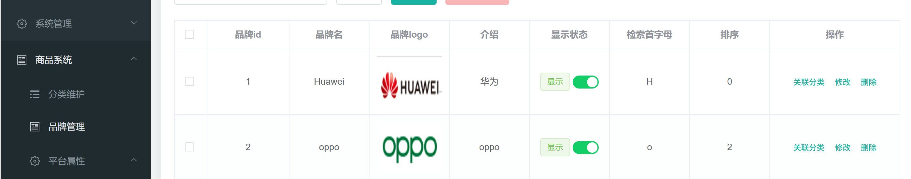
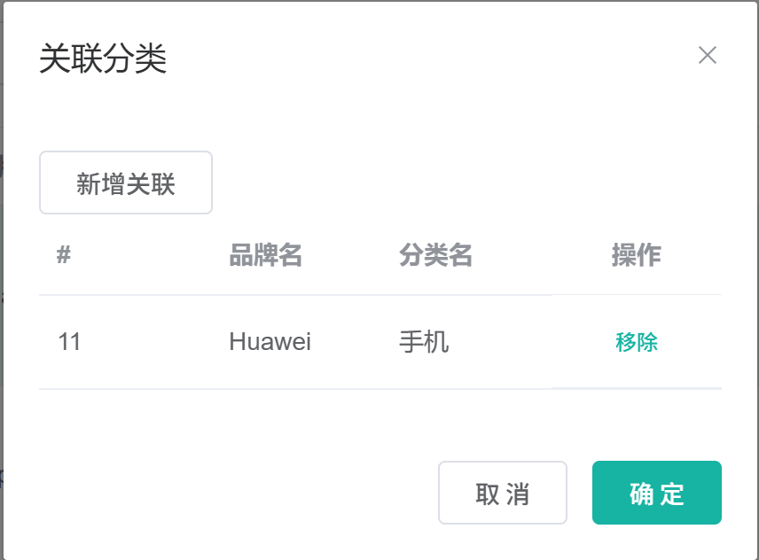
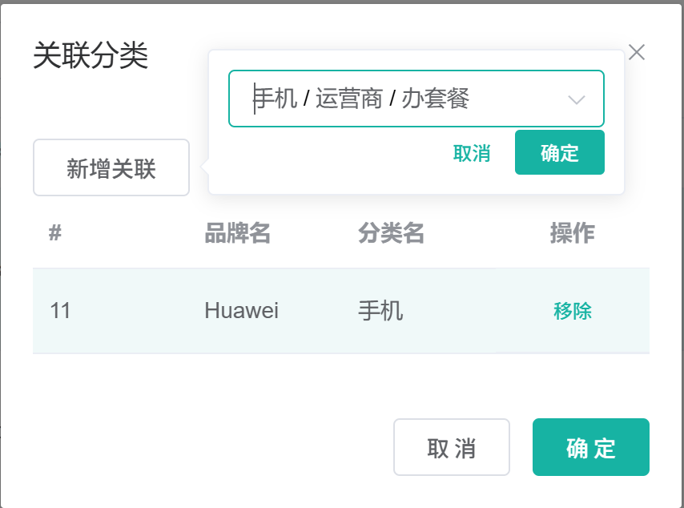

# 6.5 分类品牌关联-介绍

> 本篇介绍分类品牌关联：品牌与分类的多对多关系、管理员在品牌列表里的关联操作、关联表的冗余字段、重复关联校验、品牌改名与分类改名的双向级联，以及前后端数据怎么流转。

---

## 1. 这个功能是干什么的

品牌和分类是多对多关系。一个品牌可以卖多个分类的商品，例如“小米”同时属于“手机通讯”“智能穿戴”“电脑办公”；一个分类下也有多个品牌，例如“手机通讯”下有“小米”“华为”“苹果”。

分类品牌关联在业务上有三个作用：

1. **商品发布时按分类选品牌**：发布商品先选三级分类，再只能从该分类关联的品牌里选择，避免把“冰箱品牌”挂到“手机”分类下。
2. **用户端按分类筛品牌**：分类页、搜索页需要展示“当前分类有哪些品牌”，数据来自关联表。
3. **后台维护品牌经营范围**：管理员通过品牌列表的“关联分类”入口，维护某个品牌可以卖哪些分类。

关系示意：

```text
pms_brand（品牌）
    └── pms_category_brand_relation（品牌分类关联表）
            └── pms_category（三级分类）
```

关联表同时记录品牌 id、分类 id，以及品牌名、分类名两个冗余字段。冗余字段让关联列表可以直接展示名称，不需要每次 join 品牌表和分类表。

## 2. 管理员怎么操作

入口：

```text
管理后台 → 商品系统 → 品牌管理 → 品牌列表 → 关联分类
```



管理员在品牌列表的每一行点击“关联分类”，打开关联弹窗，可以完成四类操作。

### 2.1 打开关联分类弹窗

1. 在品牌列表找到目标品牌。
2. 点击该行操作列的“关联分类”。
3. 前端记录 `brandId`，打开“关联分类”弹窗。
4. 弹窗加载当前品牌已经关联的分类列表。

弹窗打开时不会自动选中任何分类，级联选择器保持空白。

### 2.2 查看已关联分类

1. 弹窗表格展示关联记录 id、品牌名、分类名。
2. 品牌名和分类名直接取关联表的 `brand_name`、`catelog_name`，不额外查品牌表和分类表。
3. 每一行有“移除”按钮，用于删除该条关联。



### 2.3 新增关联

1. 在弹窗里点击“新增关联”。
2. 弹出分类级联选择器。
3. 选择一级、二级、三级分类。
4. 点击“确定”。
5. 前端提交品牌 id 和级联路径最后一级的分类 id。
6. 后端先检查该品牌与该分类是否已经关联。
7. 没有重复记录时，补齐品牌名和分类名，写入 `pms_category_brand_relation`。
8. 前端刷新关联列表。



### 2.4 移除关联

1. 在已关联表格里点击某一行的“移除”。
2. 前端提交该关联记录的主键 id。
3. 后端按主键删除 `pms_category_brand_relation` 中的记录。
4. 前端刷新关联列表。

移除只删除关联记录，不会删除品牌，也不会删除分类。

### 2.5 重复关联提示

1. 对同一个品牌再次关联同一个分类。
2. 后端 `checkSameRecord()` 查到已存在记录。
3. Controller 返回业务错误码 `10001` 和提示“已存在相同的品牌和分类记录”。
4. 前端用错误提示展示后端 `msg`，不刷新列表。

## 3. 整体设计思路

### 3.1 业务上怎么设计

#### 3.1.1 品牌与分类多对多

一个品牌对应多个分类，一个分类对应多个品牌，所以单独建关联表 `pms_category_brand_relation`，而不是在品牌表里加 `catelog_id`，也不在分类表里加 `brand_id`。

如果直接在品牌表加 `catelog_id`：

1. 一个品牌只能属于一个分类，无法表达“小米同时卖手机和电脑”。
2. 一个分类只能关联一个品牌，无法表达“手机分类下有多个品牌”。

关联表用两列分别指向品牌和分类，一条记录表达一次关联。

#### 3.1.2 冗余品牌名和分类名

关联表除了 `brand_id`、`catelog_id`，还存 `brand_name`、`catelog_name`。这是有意的冗余：

1. 品牌关联分类列表要显示品牌名和分类名，冗余后一次查询就能返回。
2. 用户端按分类查品牌时，有时也需要品牌名，减少 join。
3. 品牌表和分类表数据量大时，冗余字段能减少关联查询。

冗余的代价是改名要级联：

1. 品牌改名时，要更新关联表里该品牌所有记录的 `brand_name`。
2. 分类改名时，要更新关联表里该分类所有记录的 `catelog_name`。

#### 3.1.3 重复关联去重

同一个品牌和同一个分类只允许一条关联记录。业务上在保存前做检查：

1. 按 `brand_id + catelog_id` 统计记录数。
2. 数量大于 0 说明已经关联过，返回业务错误。
3. 数量为 0 才允许保存。

当前去重是“先查再插”，数据库层没有唯一约束，并发提交仍可能插入两条相同记录。

#### 3.1.4 双向级联更新

品牌和分类是两个独立的主数据，改名发生在各自的模块：

1. 品牌改名走 `BrandServiceImpl.updateDetails()`，更新品牌表后调用 `CategoryBrandRelationDao.updateBrandName()`。
2. 分类改名走 `CategoryServiceImpl.updateDetails()`，更新分类表后调用 `CategoryBrandRelationDao.updateCatelogName()`。

两条级联都在各自的事务里执行，品牌或分类更新失败时，级联更新一起回滚。

#### 3.1.5 只关联三级分类

商品发布只选三级分类，品牌关联也按三级分类维护。前端级联选择器允许选到任意层级，但提交时只取路径最后一级。

如果管理员只选到一级或二级就点确定，提交的分类 id 就是一级或二级分类 id，后端不会校验层级。生产环境应确认路径长度为 3。

#### 3.1.6 删除规则

1. 删除关联记录：直接按关联表主键删除，品牌和分类不受影响。
2. 删除品牌：应先删除该品牌的所有关联记录，再删除品牌。
3. 删除分类：分类是逻辑删除，关联记录仍保留，但分类不会再出现在分类树里。

当前代码只实现了“删除关联记录”，品牌删除和分类删除都没有级联清理关联表。

### 3.2 技术上怎么设计

#### 3.2.1 关联表结构

关联表的字段组成如下：

```text
pms_category_brand_relation
├── id            关联记录主键
├── brand_id      品牌 id
├── catelog_id    分类 id
├── brand_name    品牌名，冗余字段
└── catelog_name  分类名，冗余字段
```

四个业务字段组成一条关联记录。`id` 由数据库生成，前端移除关联时提交的就是这个 `id`。

#### 3.2.2 三个核心接口

1. `GET /product/categorybrandrelation/catelog/list?brandId=...`：查品牌已关联的分类。
2. `POST /product/categorybrandrelation/save`：新增关联。
3. `GET /product/categorybrandrelation/brands/list?catId=...`：查分类已关联的品牌。

前两个接口服务后台品牌管理页，第三个接口服务用户端分类页和搜索页。

#### 3.2.3 先查重再插入

保存流程放在 Controller 和 Service 两段：

1. Controller 调 `checkSameRecord()` 统计重复记录。
2. 有重复直接返回 `BizCodeEnum.SAME_RECORD_EXCEPTION`。
3. 没有重复调 `saveDetails()`。
4. `saveDetails()` 查分类、查品牌、补名称、执行插入。

这样做的好处是业务错误码清晰，前端能区分“重复关联”和“其他异常”。

#### 3.2.4 保存前补全冗余名称

前端只传 `brandId` 和 `catelogId`，名称由后端补：

1. 按 `catelogId` 查 `pms_category`，取 `name` 作为 `catelogName`。
2. 按 `brandId` 查 `pms_brand`，取 `name` 作为 `brandName`。
3. 任一查不到就抛 `IllegalArgumentException`。
4. 名称补齐后调用 `this.save()` 真正插入。

这样前端不需要传名称，也避免管理员篡改名称导致冗余字段和主表不一致。

#### 3.2.5 级联更新用自定义 DAO

MyBatis-Plus 的通用更新适合按主键更新单条记录，不适合“按品牌 id 批量更新所有关联记录的名称”。所以 DAO 里单独定义两个方法：

1. `updateBrandName(brandId, name)`：一条 SQL 更新该品牌的所有关联记录。
2. `updateCatelogName(catelogId, name)`：一条 SQL 更新该分类的所有关联记录。

SQL 写在 `CategoryBrandRelationDao.xml` 里，用 `UPDATE ... WHERE brand_id = ?` 或 `WHERE catelog_id = ?`。

#### 3.2.6 前端弹窗与级联组件

品牌列表页里的关联操作由三部分组成：

1. “关联分类”按钮：把 `brandId` 传给 `updateCatelogHandle()`。
2. 关联弹窗：表格展示已关联分类，弹层里放分类级联组件。
3. 分类级联组件 `category-cascader`：加载分类树，通过 `.sync` 把选择路径同步给 `brand.vue`。

新增关联前，前端会检查 `brandId` 和 `catelogPath` 是否为空，避免提交空分类。

#### 3.2.7 事务边界

1. `checkSameRecord()` 只读，不需要事务。
2. `saveDetails()` 查分类、查品牌、插入关联，单条插入，没有显式事务。
3. 品牌改名级联在 `BrandServiceImpl.updateDetails()` 的 `@Transactional` 里。
4. 分类改名级联在 `CategoryServiceImpl.updateDetails()` 的 `@Transactional` 里。

保存关联的“查重 + 插入”没有放在同一个事务里，也没有加锁，并发时两个请求可能同时通过查重。

## 4. 详细代码、配置和解释

本章按“解决什么问题 → 关键概念 → 正常链路 → 代码分块 → 一次示例 → 边界”展开。每个类先交代它在分类品牌关联链路里的业务位置和上下游，再贴代码；代码按执行顺序分块解释，最后给出一次完整调用和当前实现的边界。

### 4.1 CategoryBrandRelationEntity：关联表映射

#### 4.1.1 这个类解决什么问题

管理员在品牌列表点“关联分类”，在级联框里选中“手机通讯 / 智能手机”后，页面只提交两个数字：`brandId` 和 `catelogId`。数据库需要把这次关联落成一行可查询的记录，`pms_category_brand_relation` 表是记录的容器，`CategoryBrandRelationEntity` 是它在 Java 侧的映射。

上游是 `CategoryBrandRelationController.save()`：请求体直接反序列化成这个实体，前端不传名称。下游是 `CategoryBrandRelationServiceImpl.saveDetails()`：补全 `brandName`、`catelogName` 后调用 `this.save()`，由 MyBatis-Plus 生成 `INSERT`。查询时同一个实体又作为 `catelog/list` 的响应元素返回给后台表格。

这个类同时承担三个角色：

1. 表映射：把五个列映射成 Java 字段，供通用增删改查使用；
2. 新增请求体：只接收 `brandId`、`catelogId`，名称由后端补；
3. 列表响应体：后台表格直接展示 `brandName`、`catelogName`，不需要再 join 品牌表和分类表。

关键概念：

1. 一条记录表达一次“某品牌可以卖某分类”的授权；
2. `brand_id`、`catelog_id` 是关系两端，`brand_name`、`catelog_name` 是冗余快照；
3. `id` 由数据库自增，移除关联时前端提交的就是这个主键。

#### 4.1.2 字段与业务含义

| 字段 | 数据库列 | 业务含义 | 说明 |
|---|---|---|---|
| `id` | `id` | 关联记录主键 | 数据库自增，移除关联时使用 |
| `brandId` | `brand_id` | 品牌 id | 关系的一端，指向 `pms_brand` |
| `catelogId` | `catelog_id` | 分类 id | 关系的另一端，指向 `pms_category` |
| `brandName` | `brand_name` | 品牌名 | 冗余字段，新增时由后端补齐 |
| `catelogName` | `catelog_name` | 分类名 | 冗余字段，新增时由后端补齐 |

#### 4.1.3 代码与解释

实体代码只做字段声明和 MyBatis-Plus 注解，没有业务方法：

```java
@Data
@TableName("pms_category_brand_relation")
public class CategoryBrandRelationEntity implements Serializable {
	private static final long serialVersionUID = 1L;

	/**
	 * 
	 */
	@TableId
	private Long id;
	/**
	 * 品牌id
	 */
	private Long brandId;
	/**
	 * 分类id
	 */
	private Long catelogId;
	/**
	 * 
	 */
	private String brandName;
	/**
	 * 
	 */
	private String catelogName;

}
```

1. `@Data`：Lombok 生成 getter、setter、`toString`、`equals`、`hashCode`，Controller 和 Service 可以直接读写字段。
2. `@TableName("pms_category_brand_relation")`：指定实体对应的表名。
3. `implements Serializable`：实体可以序列化，便于缓存和远程传输。
4. `@TableId`：标记 `id` 为主键；新增时不传 id，由数据库自增回填。
5. `brandId`、`catelogId`：关系两端，前端新增时只传这两个字段。
6. `brandName`、`catelogName`：冗余名称，前端不传，由 `saveDetails()` 按 id 查主表补齐。

#### 4.1.4 一次插入示例

管理员为“小米”关联“智能手机”：

```text
请求体：{ "brandId": 1, "catelogId": 143 }
Service 补名称：brandName=小米，catelogName=智能手机
INSERT INTO pms_category_brand_relation
  (brand_id, catelog_id, brand_name, catelog_name)
VALUES
  (1, 143, '小米', '智能手机');
```

插入后数据库生成 `id`，`catelog/list` 按 `brand_id=1` 查回这条记录，表格显示“小米 / 智能手机”，移除时提交生成的主键。

#### 4.1.5 它不做什么

1. 不校验 `brandId`、`catelogId` 是否存在，存在性检查在 `saveDetails()`。
2. 不校验分类层级，一级、二级分类 id 也能写进表。
3. 不生成关联 id，主键交给数据库。
4. 不拼接名称，冗余字段由 Service 补齐。

#### 4.1.6 边界与可优化点

1. 关联表没有 `(brand_id, catelog_id)` 唯一索引，数据库层无法阻止重复关联，只能靠 Controller 先查后插。
2. `brand_name`、`catelog_name` 没有非空约束，绕过 `saveDetails()` 直接调用通用接口时可以写入空名称。
3. 实体同时作为新增请求体和列表响应体，`update` 通用接口可以直接改名称、改 id，绕过“名称由后端补”的约定。
4. 缺少 `create_time`、`update_time` 等审计字段，排查关联关系何时建立、何时变更时没有时间依据。
5. 字段注释有两处为空，维护时无法从代码里判断字段用途。

### 4.2 CategoryBrandRelationController：接收关联请求

#### 4.2.1 这个类解决什么问题

后台“品牌管理 → 品牌列表 → 关联分类”弹窗要完成三件事：打开时查该品牌已关联的分类，点确定时新增关联，点移除时删除关联。用户端的分类页、搜索页还要按分类反查品牌。页面只认 HTTP 接口，这个 Controller 负责把这几类请求翻译成 Service 调用，并决定哪些入口需要后台权限。

上游请求从 Nginx 域名进入 Gateway，网关匹配 `/gulimall/product/**` 后去掉 `/gulimall` 前缀，落到本类的 `/product/categorybrandrelation/**`。下游是 `CategoryBrandRelationService`。

Controller 只做四件事：

1. 接收路径参数、查询参数和请求体；
2. 后台接口用 `@RequiresPermissions` 校验操作权限；
3. 把查重结果翻译成业务错误码；
4. 把 Service 返回值包装成统一结果 `R`。

#### 4.2.2 接口清单

| 操作 | 方法与路径 | 权限 | 调用的 Service 方法 |
|---|---|---|---|
| 查品牌已关联分类 | `GET /product/categorybrandrelation/catelog/list?brandId=...` | `product:categorybrandrelation:list` | `list(QueryWrapper)` |
| 新增关联 | `POST /product/categorybrandrelation/save` | `product:categorybrandrelation:save` | `checkSameRecord()`、`saveDetails()` |
| 查分类已关联品牌 | `GET /product/categorybrandrelation/brands/list?catId=...` | 无 | `getBrandsByCatId()` |
| 移除关联 | `POST /product/categorybrandrelation/delete` | `product:categorybrandrelation:delete` | 代码生成器生成的 CRUD 方法 |

`brands/list` 面向用户端商品页，不挂后台权限注解；另外三个接口服务于管理后台。网关转发后，后台实际请求路径带 `/gulimall` 前缀。

#### 4.2.3 代码与解释

三个手写业务入口的代码如下。`info`、`update`、`delete` 由代码生成器生成，业务页面主要使用删除，不在代码块里展开：

```java
@RestController
@RequestMapping("product/categorybrandrelation")
@Slf4j
public class CategoryBrandRelationController {
    @Autowired
    private CategoryBrandRelationService categoryBrandRelationService;
    @Autowired
    private CategoryService categoryService;
    @Autowired
    private BrandService brandService;

    /**
     * 获取当前品牌关联的所有分类列表
     */
    @GetMapping("/catelog/list")
    @RequiresPermissions("product:categorybrandrelation:list")
    public R list(@RequestParam("brandId") Long brandId){
        List<CategoryBrandRelationEntity> list = categoryBrandRelationService.list(
                new QueryWrapper<CategoryBrandRelationEntity>().eq("brand_id", brandId));

        return R.ok().put("data", list);
    }

    /**
     * 保存
     */
    @PostMapping("/save")
    @RequiresPermissions("product:categorybrandrelation:save")
    public R save(@RequestBody CategoryBrandRelationEntity categoryBrandRelation){

        log.info("categoryBrandRelation: {}", categoryBrandRelation);

        // 查询是否存在相同的品牌和分类记录
        long count = categoryBrandRelationService.checkSameRecord(
                categoryBrandRelation.getBrandId(), categoryBrandRelation.getCatelogId());
        log.info("checkSameRecord result: {}", count);
        if (count > 0) {
            // 如果存在相同的品牌和分类记录，返回错误响应
            return R.error(BizCodeEnum.SAME_RECORD_EXCEPTION.getCode(), BizCodeEnum.SAME_RECORD_EXCEPTION.getMsg());
        }

        // 保存品牌和分类关联关系的详细信息
        categoryBrandRelationService.saveDetails(categoryBrandRelation);
        return R.ok();
    }

    /**
     * 获取当前分类关联的所有品牌
     * 1、 Controller: 处理请求，接受和校验数据
     * 2、Service接受controller传来的数据，进行业务处理
     * 3、Controller接受Service处理完的数据，封装成页面指定的vo
     */
    @GetMapping("/brands/list")
    public R relationBrandsList(@RequestParam(value = "catId", required = true) Long catId){
        List<BrandEntity> vos = categoryBrandRelationService.getBrandsByCatId(catId);

        List<BrandVo> collect = vos.stream().map(item -> {
            BrandVo brandVo = new BrandVo();
            brandVo.setBrandId(item.getBrandId());
            brandVo.setBrandName(item.getName());
            return brandVo;
        }).collect(Collectors.toList());

        return R.ok().put("data", collect);
    }

}
```

1. `@RestController` + `@RequestMapping("product/categorybrandrelation")`：所有接口共用 `/product/categorybrandrelation` 前缀，返回 JSON。
2. `list()`：接收必填参数 `brandId`，用 `QueryWrapper.eq("brand_id", brandId)` 查关联表，结果放在 `data` 字段。实体里已经带 `brandName`、`catelogName`，前端表格可以直接渲染。
3. `save()`：先打印请求体，方便排查前端提交了什么；随后调用 `checkSameRecord(brandId, catelogId)` 统计相同品牌、相同分类的记录数。
4. 数量大于 0 时返回 `R.error(10001, "已存在相同的品牌和分类记录")`，不再进入保存，数据库不会多出一行。
5. 数量为 0 时调用 `saveDetails()`，由 Service 查主表补名称并真正插入。
6. `relationBrandsList()`：接收必填参数 `catId`，调用 `getBrandsByCatId()` 得到品牌实体列表。
7. 用 `stream().map()` 把每个 `BrandEntity` 转成 `BrandVo`，只保留 `brandId` 和 `brandName`。
8. 转换结果放进 `data` 返回，用户端按分类渲染品牌筛选列表。
9. 权限注解只覆盖后台入口：`list`、`save` 要求对应操作权限，`brands/list` 不要求，避免未登录用户打不开商品分类页。

#### 4.2.4 一次请求示例

管理员给品牌 1 新增分类 143：

```text
1. 前端提交 POST /gulimall/product/categorybrandrelation/save
2. 请求体：{ "brandId": 1, "catelogId": 143 }
3. Gateway 去掉 /gulimall，转发到 product 服务
4. Controller 校验 product:categorybrandrelation:save 权限
5. checkSameRecord(1, 143) 执行 SELECT COUNT(*)，结果为 0
6. 调用 saveDetails()
7. Service 补名称并 INSERT
8. 返回 R.ok()
9. 前端提示“操作成功”，重新请求 catelog/list 刷新表格
```

#### 4.2.5 它不做什么

1. 不拼查询条件以外的 SQL，关联表的读写由 Service 和 DAO 完成。
2. 不补品牌名、分类名，名称补全在 `saveDetails()`。
3. 不校验分类层级，也不校验路径长度。
4. 不开启事务，查重和插入是两次独立调用。
5. 不清理缓存，关联表本身没有缓存。

#### 4.2.6 边界与可优化点

1. `categoryService` 和 `brandService` 注入后没有使用，属于多余依赖。
2. `save()` 没有校验 `brandId`、`catelogId` 非空。传 null 时查重条件是 `brand_id = null`，查不到重复，最终在 `saveDetails()` 里抛异常。
3. 查重和插入不是原子操作，两个请求同时通过查重时会插入重复记录。应从数据库唯一索引兜底，并捕获唯一键冲突。
4. `brands/list` 没有分页，一个分类下品牌很多时一次返回全部。
5. `list()` 没有排序，关联列表顺序依赖数据库默认返回顺序。
6. 通用接口 `update` 直接更新关联表，不查重、不补名称，绕过业务规则。
7. `brands/list` 匿名可访问，如果网关没有额外限制，关联数据会暴露给未登录请求。

### 4.3 CategoryBrandRelationServiceImpl：查重、补名称、按分类查品牌

#### 4.3.1 这个类解决什么问题

Controller 只负责请求怎么进来、结果怎么返回，业务规则集中在这个 Service：同一品牌同一分类不能重复关联；前端只传两个 id，名称必须由后端从主表查回；用户端要按分类反查品牌。

上游是两个 Controller：`CategoryBrandRelationController.save()` 调查重和保存，`relationBrandsList()` 调查询。下游是 `CategoryDao`、`BrandDao` 和 `CategoryBrandRelationDao`，分别访问分类表、品牌表和关联表。

这个类承担四块工作：

1. `checkSameRecord()`：按品牌 id 和分类 id 统计已有关联数；
2. `saveDetails()`：查分类、查品牌、补名称、插入关联；
3. `getBrandsByCatId()`：按分类查关联记录，再查品牌实体；
4. `queryPage()`：代码生成器生成的分页查询，后台通用列表使用。

#### 4.3.2 正常链路

新增关联的链路：

```text
CategoryBrandRelationController.save()
  → checkSameRecord(brandId, catelogId)
  → SELECT COUNT(*) FROM pms_category_brand_relation
      WHERE brand_id = ? AND catelog_id = ?
  → 数量 > 0：Controller 返回 10001
  → 数量 = 0：saveDetails()
      → SELECT * FROM pms_category WHERE cat_id = ?
      → SELECT * FROM pms_brand WHERE brand_id = ?
      → 补 catelogName、brandName
      → INSERT INTO pms_category_brand_relation
```

按分类查品牌的链路：

```text
CategoryBrandRelationController.relationBrandsList()
  → getBrandsByCatId(catId)
  → SELECT * FROM pms_category_brand_relation WHERE catelog_id = ?
  → 对每条记录执行 SELECT * FROM pms_brand WHERE brand_id = ?
  → 返回品牌实体列表，Controller 再转成 BrandVo
```

#### 4.3.3 代码与解释

整个实现类如下，其中 `queryPage()` 是代码生成器产物，其余三个方法承担关联业务：

```java
@Service("categoryBrandRelationService")
@Slf4j
public class CategoryBrandRelationServiceImpl extends ServiceImpl<CategoryBrandRelationDao, CategoryBrandRelationEntity> implements CategoryBrandRelationService {

    @Autowired
    private CategoryDao categoryDao;
    @Autowired
    private BrandDao brandDao;

    @Override
    public PageUtils queryPage(Map<String, Object> params) {
        IPage<CategoryBrandRelationEntity> page = this.page(
                new Query<CategoryBrandRelationEntity>().getPage(params),
                new QueryWrapper<CategoryBrandRelationEntity>()
        );

        return new PageUtils(page);
    }

    /**
     * 检查是否存在相同的品牌和分类记录
     *
     * @param brandId   品牌ID
     * @param catelogId 分类ID
     * @return 相同记录的数量
     */
    @Override
    public long checkSameRecord(Long brandId, Long catelogId) {
        return this.count(
                new QueryWrapper<CategoryBrandRelationEntity>()
                        .eq("brand_id", brandId)
                        .eq("catelog_id", catelogId)
        );
    }

    /**
     * 保存品牌和分类关联关系的详细信息
     *
     * @param categoryBrandRelation 品牌分类关联实体对象
     */
    @Override
    public void saveDetails(CategoryBrandRelationEntity categoryBrandRelation) {
        CategoryEntity categoryEntity = categoryDao.selectById(categoryBrandRelation.getCatelogId());
        log.info("categoryEntity: {}", categoryEntity);
        if (categoryEntity == null) {
            throw new IllegalArgumentException("保存品牌分类关联失败：分类不存在，catelogId="
                    + categoryBrandRelation.getCatelogId());
        }
        categoryBrandRelation.setCatelogName(categoryEntity.getName());

        BrandEntity brandEntity = brandDao.selectById(categoryBrandRelation.getBrandId());
        log.info("brandEntity: {}", brandEntity);
        if (brandEntity == null) {
            throw new IllegalArgumentException("保存品牌分类关联失败：品牌不存在，brandId="
                    + categoryBrandRelation.getBrandId());
        }
        categoryBrandRelation.setBrandName(brandEntity.getName());

        // 关键修复：原实现只补全了名称字段，没有真正写库，
        // 导致接口返回成功但 pms_category_brand_relation 表里查不到新记录
        this.save(categoryBrandRelation);
    }

    // 获取分类关联的品牌
    @Override
    public List<BrandEntity> getBrandsByCatId(Long catId) {
        List<CategoryBrandRelationEntity> categoryBrandRelationEntities =
                this.list(new QueryWrapper<CategoryBrandRelationEntity>().eq("catelog_id", catId));
        return categoryBrandRelationEntities.stream()
                .map(entity -> brandDao.selectById(entity.getBrandId())).toList();
    }

}
```

1. `@Service("categoryBrandRelationService")`：注册为 Spring Bean，Bean 名与 Controller 的注入类型对应。
2. `extends ServiceImpl<CategoryBrandRelationDao, CategoryBrandRelationEntity>`：继承 MyBatis-Plus 通用实现，直接获得 `save`、`list`、`count`、`selectById` 等方法。
3. `categoryDao`、`brandDao`：分别用于按 id 查分类和品牌，补冗余名称时使用。
4. `queryPage()`：把分页参数交给 `Query` 解析，拼空 `QueryWrapper` 查全表，再由 `PageUtils` 包装，供后台通用列表使用。
5. `checkSameRecord()`：拼 `brand_id = ?` 和 `catelog_id = ?` 两个条件，调用 `this.count()` 执行 `SELECT COUNT(*)`。
6. 返回计数，0 表示没有关联过，大于 0 表示重复。
7. `saveDetails()` 先按 `catelogId` 调用 `categoryDao.selectById()` 查分类。
8. 查不到分类时抛 `IllegalArgumentException`，消息里带上 `catelogId`，避免写入指向不存在分类的关联。
9. 查到分类后，把 `categoryEntity.getName()` 写入实体的 `catelogName`。
10. 再按 `brandId` 调用 `brandDao.selectById()` 查品牌。
11. 查不到品牌时同样抛 `IllegalArgumentException`，消息里带上 `brandId`。
12. 查到品牌后，把 `brandEntity.getName()` 写入实体的 `brandName`。
13. 最后调用 `this.save(categoryBrandRelation)` 执行 `INSERT`。代码注释说明了这一步的关键性：只补名称不落库，接口会返回成功但表里没有新记录。
14. `getBrandsByCatId()` 先按 `catelog_id` 查出该分类下的所有关联记录。
15. 再用 `stream().map()` 对每条记录调用 `brandDao.selectById(entity.getBrandId())`，得到品牌实体。
16. `toList()` 收集成列表返回，调用方拿到的是品牌实体，不是关联实体。

#### 4.3.4 一次完整示例

新增关联成功：

```text
1. 请求体 { brandId: 1, catelogId: 143 }
2. checkSameRecord(1, 143)
3. SELECT COUNT(*) FROM pms_category_brand_relation WHERE brand_id=1 AND catelog_id=143
4. 返回 0，进入 saveDetails()
5. SELECT * FROM pms_category WHERE cat_id=143 → name=智能手机
6. catelogName 设为“智能手机”
7. SELECT * FROM pms_brand WHERE brand_id=1 → name=小米
8. brandName 设为“小米”
9. INSERT INTO pms_category_brand_relation (brand_id, catelog_id, brand_name, catelog_name) VALUES (1, 143, '小米', '智能手机')
10. 返回 R.ok()
```

重复关联：

```text
1. 同一品牌、同一分类再次提交
2. checkSameRecord(1, 143) 返回 1
3. Controller 返回 R.error(10001, "已存在相同的品牌和分类记录")
4. saveDetails() 不执行，数据库不新增记录
5. 前端展示 msg，表格不刷新
```

#### 4.3.5 它不做什么

1. 不负责把业务异常翻译成错误码，错误码处理在 Controller 和全局异常处理器。
2. 不开启事务，查分类、查品牌、插入三步没有放在同一个事务里。
3. 不校验分类是否三级，只校验分类 id 是否存在。
4. 不维护品牌删除、分类删除后的关联清理。
5. 不组装 `BrandVo`，VO 转换在 Controller。

#### 4.3.6 边界与可优化点

1. `getBrandsByCatId()` 是典型 N+1 查询：关联表有几条记录就查几次品牌表。可以一次 `selectBatchIds()` 查回全部品牌，再按关联顺序回填。
2. 品牌被删除后 `brandDao.selectById()` 返回 null，`stream.map` 会把 null 放进列表，Controller 遍历时调用 `item.getBrandId()` 会空指针。
3. `saveDetails()` 内部没有再查重，直接调用 Service 或走通用接口可以绕过 Controller 的去重。
4. `saveDetails()` 没有事务注解，不过三步是两次只读查询加一次单条插入，实际影响较小。
5. `IllegalArgumentException` 会被全局异常处理器兜底成“未知异常”，前端看不到“分类不存在”或“品牌不存在”的具体原因，详细信息只在日志里。
6. `checkSameRecord()` 和 `saveDetails()` 是两次独立调用，中间没有锁，并发提交仍可能插入重复记录。
7. `getBrandsByCatId()` 返回的顺序取决于关联表查询顺序和 `stream` 遍历顺序，没有显式排序。

### 4.4 CategoryBrandRelationDao：级联更新品牌名和分类名

#### 4.4.1 这个类解决什么问题

品牌名和分类名在关联表里是冗余快照。管理员在品牌管理页改名时，`pms_brand.name` 已经变化，关联表里该品牌的每条记录还留着旧名字，后台“关联分类”弹窗会继续显示旧品牌名；分类改名同理。通用 `BaseMapper` 只能按主键更新单条记录，无法表达“按 `brand_id` 批量改 `brand_name`”，所以 DAO 上单独声明两个更新方法。

上游调用方是 `BrandServiceImpl.updateDetails()` 和 `CategoryServiceImpl.updateDetails()`：前者在品牌改名后调用，后者在分类改名后调用。下游是 `CategoryBrandRelationDao.xml` 里的两条 `UPDATE`，按非主键条件批量修改冗余字段。

#### 4.4.2 代码与解释

DAO 接口只声明方法，通用增删改查由 `BaseMapper` 提供，两个级联更新方法交给 XML 实现：

```java
@Mapper
public interface CategoryBrandRelationDao extends BaseMapper<CategoryBrandRelationEntity> {

    /**
     * 品牌改名时，级联更新品牌分类关联表中的冗余品牌名 brand_name
     * @param brandId 品牌 id
     * @param name    新品牌名
     */
    void updateBrandName(@Param("brandId") Long brandId, @Param("name") String name);

    /**
     * 分类改名时，级联更新品牌分类关联表中的冗余分类名 catelog_name
     * @param catelogId 分类 id
     * @param name      新分类名
     */
    void updateCatelogName(@Param("catelogId") Long catelogId, @Param("name") String name);
}
```

1. `@Mapper`：让 MyBatis 扫描到这个接口并生成代理实现。
2. `extends BaseMapper<CategoryBrandRelationEntity>`：获得 `insert`、`selectById`、`selectList`、`updateById`、`deleteById` 等通用方法，常规增删改查不需要写 SQL。
3. `updateBrandName()`：按品牌 id 更新该品牌所有关联记录的 `brand_name`，方法签名用 `@Param` 标出两个参数名。
4. `updateCatelogName()`：按分类 id 更新该分类所有关联记录的 `catelog_name`。
5. `@Param("brandId")`、`@Param("name")`、`@Param("catelogId")`：给参数命名，XML 里用 `#{brandId}`、`#{name}`、`#{catelogId}` 引用；不写 `@Param` 时多参数只能用 `#{param1}`、`#{param2}`，可读性差。
6. 两个方法都返回 `void`，调用方拿不到影响行数。

#### 4.4.3 一次调用示例

品牌 1 从“小米”改名为“小米科技”：

```text
categoryBrandRelationDao.updateBrandName(1L, "小米科技")
→ UPDATE `pms_category_brand_relation`
  SET `brand_name` = '小米科技'
  WHERE `brand_id` = 1
→ 该品牌下所有关联记录的品牌名一起变化
```

分类 143 改名时调用 `updateCatelogName(143L, "智能手机 Pro")`，效果相同，只是条件换成 `catelog_id`。

#### 4.4.4 它不做什么

1. 不补名称、不查主表，名称由调用方传入。
2. 不判断新旧名称是否相同，相同也会执行更新。
3. 不校验品牌或分类是否存在。
4. 不做逻辑删除，关联表只做物理增删。

#### 4.4.5 边界与可优化点

1. 返回值是 `void`，调用方无法判断是否真的更新成功，也无法记录影响行数。
2. XML 里没有判断 `name` 是否为空，传入 null 会把整批 `brand_name` 或 `catelog_name` 更新成 null。
3. 批量更新按非主键条件执行，必须保证 `brand_id`、`catelog_id` 上有索引，否则每次改名都会扫全表并锁大量行。
4. 没有版本号或更新时间列，批量改名的影响范围无法追踪。
5. 关联记录特别多时，一条 `UPDATE` 会形成大事务，可以按主键分批处理。

### 4.5 CategoryBrandRelationDao.xml：级联更新 SQL

#### 4.5.1 这段配置解决什么问题

DAO 接口只有方法签名，真正执行的 SQL 在 MyBatis 映射文件里。两个级联更新方法没有 MyBatis-Plus 通用方法可以复用，必须在 XML 里写 `UPDATE`；实体字段和表列的下划线命名也需要一个 `resultMap` 来描述。

上游是 `CategoryBrandRelationDao` 的方法调用，下游是 `pms_category_brand_relation` 表。品牌改名和分类改名都会走到这里，每次执行影响该品牌或该分类下的全部关联记录。

#### 4.5.2 代码与解释

映射文件同时承担 resultMap 字段映射和两条级联更新语句：

```xml
<?xml version="1.0" encoding="UTF-8"?>
<!DOCTYPE mapper PUBLIC "-//mybatis.org//DTD Mapper 3.0//EN" "http://mybatis.org/dtd/mybatis-3-mapper.dtd">

<mapper namespace="com.atguigu.gulimall.product.dao.CategoryBrandRelationDao">

	<!-- 可根据自己的需求，是否要使用 -->
    <resultMap type="com.atguigu.gulimall.product.entity.CategoryBrandRelationEntity" id="categoryBrandRelationMap">
        <result property="id" column="id"/>
        <result property="brandId" column="brand_id"/>
        <result property="catelogId" column="catelog_id"/>
        <result property="brandName" column="brand_name"/>
        <result property="catelogName" column="catelog_name"/>
    </resultMap>

    <!-- 品牌改名时，级联更新关联表中的冗余品牌名 -->
    <update id="updateBrandName">
        UPDATE `pms_category_brand_relation`
        SET `brand_name` = #{name}
        WHERE `brand_id` = #{brandId}
    </update>

    <!-- 分类改名时，级联更新关联表中的冗余分类名 -->
    <update id="updateCatelogName">
        UPDATE `pms_category_brand_relation`
        SET `catelog_name` = #{name}
        WHERE `catelog_id` = #{catelogId}
    </update>

</mapper>
```

1. `namespace`：必须等于 DAO 接口的全限定名 `com.atguigu.gulimall.product.dao.CategoryBrandRelationDao`，MyBatis 才能把接口方法和 XML 语句绑定。
2. `resultMap`：把 `brand_id`、`catelog_id`、`brand_name`、`catelog_name` 这些下划线列映射到驼峰属性，供自定义查询使用。
3. `updateBrandName`：`SET brand_name = #{name}`，条件是 `brand_id = #{brandId}`，一条语句更新该品牌的所有关联记录。
4. `updateCatelogName`：`SET catelog_name = #{name}`，条件是 `catelog_id = #{catelogId}`，一条语句更新该分类的所有关联记录。
5. 表名、列名用反引号包住，避免和 MySQL 关键字冲突。
6. 两条语句都没有动态条件，传什么值就写什么值。

#### 4.5.3 一次执行示例

分类 143 改名为“智能手机 Pro”：

```text
1. CategoryServiceImpl.updateDetails() 调用 updateCatelogName(143L, "智能手机 Pro")
2. MyBatis 按 namespace + id 找到 updateCatelogName 语句
3. 执行：
   UPDATE `pms_category_brand_relation`
   SET `catelog_name` = '智能手机 Pro'
   WHERE `catelog_id` = 143
4. 影响行数等于该分类下的关联记录数
5. 与分类表更新在同一个事务里提交
```

#### 4.5.4 它不做什么

1. 不插入、不删除关联记录，只改冗余名称。
2. 不校验分类或品牌是否存在。
3. 不判断名称是否真的变化。
4. 不返回更新后的记录。

#### 4.5.5 边界与可优化点

1. 应确认 `brand_id`、`catelog_id` 上都有索引；更新条件走的是这两列，不是主键。
2. 可以加 `AND brand_name <> #{name}`，名称没变时不产生无意义的行更新和锁。
3. 大数据量下批量更新会锁很多行，可以按主键范围分批提交。
4. `resultMap` 当前没有被自定义查询引用，留着不影响功能。
5. 传入 null 时会把名称写成 null，应在 XML 或调用方加非空保护。

### 4.6 BrandServiceImpl.updateDetails：品牌改名级联

#### 4.6.1 这个方法解决什么问题

品牌管理页保存品牌时，可能只改 logo、排序，也可能改名称。名称一旦变化，关联表的 `brand_name` 必须同步，否则后台“关联分类”弹窗、用户端品牌筛选都会显示旧品牌名。

方法位于 `BrandServiceImpl`，上游是 `BrandController.update()`，下游一次更新两张表：`pms_brand` 和 `pms_category_brand_relation`。两张表必须在同一事务里提交，任何一步失败都一起回滚。

#### 4.6.2 代码与解释

方法体只有两步数据库操作，但它们必须在同一个事务里完成：

```java
    /**
     * 修改功能<br>
     * 因为存在品牌分类关联表，所以修改品牌信息需要级联更新<br>
     * @param brand 品牌实体
     */
    @Override
    @Transactional(rollbackFor = Exception.class)
    public void updateDetails(BrandEntity brand) {
        // 1.更新品牌基本信息
        this.updateById(brand);

        // 2.若品牌名发生变更，级联更新品牌分类关联表中的冗余 brand_name
        if (StringUtils.isNotBlank(brand.getName())) {
            categoryBrandRelationDao.updateBrandName(brand.getBrandId(), brand.getName());
        }
    }
```

1. `@Override`：重写 Service 接口中的 `updateDetails()`，Controller 调用接口方法时落到这里。
2. `@Transactional(rollbackFor = Exception.class)`：开启事务，任何异常（包括受检异常）都回滚。
3. `this.updateById(brand)`：按 `brandId` 更新 `pms_brand`，只更新实体里非 null 的字段。
4. `StringUtils.isNotBlank(brand.getName())`：只有前端传了非空名称才级联；只改 logo 或排序时，`name` 为空，不触发关联表更新。
5. `categoryBrandRelationDao.updateBrandName(...)`：调用 XML 里的批量更新，把该品牌所有关联记录的 `brand_name` 改成新名称。
6. 方法正常返回后事务提交，品牌表和关联表一起生效。
7. 任意一步抛异常，事务回滚，不会出现“品牌改名成功、关联表还是旧名”的中间状态。

#### 4.6.3 一次完整示例

```text
1. 管理员把品牌 1 的名称从“小米”改为“小米科技”
2. BrandController.update() 调用 updateDetails()
3. 开启事务
4. UPDATE pms_brand SET name='小米科技' WHERE brand_id=1
5. 名称非空，执行 UPDATE pms_category_brand_relation SET brand_name='小米科技' WHERE brand_id=1
6. 事务提交，两张表同时生效
7. 下一次打开关联分类弹窗，表格显示“小米科技”
```

#### 4.6.4 它不做什么

1. 不判断名称是否真的变化，名称相同也会执行一次关联表更新。
2. 不清理关联表缓存，关联表本身没有缓存。
3. 不处理品牌删除后的关联清理。
4. 不校验 `brandId` 是否为空或品牌是否存在，交给 `updateById()` 的 SQL 结果。
5. 不更新关联表的其他字段，只同步名称。

#### 4.6.5 边界与可优化点

1. 名称没变也级联，重复保存会多做一次批量更新。可以在更新前查一次旧名称，比较后再决定是否级联。
2. `brandId` 为空时 `updateById()` 会失败，方法没有提前校验。
3. 关联记录很多时，级联更新会拉长事务时间，可以改成异步最终一致或按批处理。
4. 品牌物理删除时不会清理关联表，会留下指向已删除品牌的记录。
5. 逻辑删除品牌时关联记录仍然有效，查询端需要自己过滤已删除品牌。

### 4.7 CategoryServiceImpl.updateDetails：分类改名级联

#### 4.7.1 这个方法解决什么问题

分类维护页改名时有两个下游：关联表的 `catelog_name` 冗余字段，以及分类树缓存。分类树被首页、后台分类树、属性分组、品牌关联共同读取，缓存分 Caffeine 本地缓存和 Redis 分布式缓存两层。只改数据库不清缓存，页面会继续显示旧分类名；在事务提交前清缓存，其他请求可能在“缓存已清、数据库未提交”的窗口里读到旧值并写回缓存。

方法位于 `CategoryServiceImpl`，上游是 `CategoryController.update()`，下游包括 `pms_category`、`pms_category_brand_relation`、Redisson 分布式锁和两层缓存。它和分类查询回源共用一把 `catelog-lock`，用来保证“更新数据库 + 清缓存”与“查数据库 + 写缓存”互斥。

#### 4.7.2 代码与解释

方法体按“加锁 → 改分类 → 改关联名称 → 注册清缓存 → 解锁”的顺序执行：

```java
    @Transactional(rollbackFor = Exception.class)
    @Override
    public void updateDetails(CategoryEntity category) {

        // 使用方案4优化，因为分类列表修改操作很少，因此加锁不会导致性能问题
        // 2.1 抢与查询路径同一把锁：保证「更新DB+清缓存」与「查DB+写缓存」互斥，否则查询线程可能把更新前的旧值重新写回缓存
        RLock lock = redissonClient.getLock(CATELOG_LOCK_NAME);
        lock.lock(30, TimeUnit.SECONDS);
        try {
            // 1.1 更新当前分类。
            //   走 super 而不是 this：本类重写了 updateById（会注册一次缓存清理），
            //   这里自己已经要清一次，走 this 会重复注册
            super.updateById(category);
            // 1.2 级联更新品牌分类关联表中的分类名称
            if (StringUtils.isNotEmpty(category.getName())) {
                categoryBrandRelationDao.updateCatelogName(category.getCatId(), category.getName());
            }
            // 2.2 失效模式：事务提交后清掉 L1(Caffeine) + L2(Redis)
            evictCacheAfterCommit();
        } finally {
            lock.unlock();
        }
    }
```

1. `@Transactional(rollbackFor = Exception.class)`：分类更新和关联名称更新在同一个事务里，异常时一起回滚。
2. `redissonClient.getLock(CATELOG_LOCK_NAME)`：获取分类缓存锁，锁名与查询回源、新增、删除共用。
3. `lock.lock(30, TimeUnit.SECONDS)`：最多持有 30 秒，防止异常情况下锁长期不释放。
4. `try` 块内先执行数据库更新，`finally` 保证任何分支都会解锁。
5. `super.updateById(category)`：更新 `pms_category`。走 `super` 而不是 `this`，因为本类重写了 `updateById()`，重写方法会注册一次缓存清理；这里自己已经要清一次，走 `this` 会重复注册。
6. `StringUtils.isNotEmpty(category.getName())`：只有传了非空名称才级联关联表，只改图标、排序时不触发。
7. `categoryBrandRelationDao.updateCatelogName(...)`：更新该分类所有关联记录的 `catelog_name`。
8. `evictCacheAfterCommit()`：注册事务提交后的回调，事务真正提交后才清 Caffeine 和 Redis。
9. `finally` 里解锁，保证锁一定释放。
10. 方法返回后事务提交，随后回调执行缓存清理；下一次查询分类树时重新从数据库加载新名称。

#### 4.7.3 一次完整示例

```text
1. 管理员把分类 143 从“智能手机”改为“智能手机 Pro”
2. CategoryController.update() 调用 updateDetails()
3. 开启事务
4. 抢 catelog-lock，租期 30 秒
5. UPDATE pms_category SET name='智能手机 Pro' WHERE cat_id=143
6. 名称非空，执行 UPDATE pms_category_brand_relation SET catelog_name='智能手机 Pro' WHERE catelog_id=143
7. 注册 afterCommit 回调
8. 事务提交
9. 回调清 Caffeine 的 catelogJson
10. 回调删除 Redis 的 catelogJSON
11. 解锁
12. 下一次首页或后台分类树请求重新加载，显示新名称
```

#### 4.7.4 它不做什么

1. 不判断名称是否真的变化，名称相同也会级联更新。
2. 不处理分类删除后的关联表清理，分类是逻辑删除，关联记录保留。
3. 不清其他应用实例的 Caffeine，本地缓存只在当前实例失效。
4. 不校验 `catId` 是否为空或分类是否存在。
5. 不更新关联表的品牌名，只同步分类名。

#### 4.7.5 边界与可优化点

1. 只判断名称非空，没有比较新旧名称，重复保存会多做一次批量更新。
2. 关联表很大时，级联更新会同时拉长持锁时间和事务时间，可以改成异步最终一致。
3. 多实例部署时，其他实例的 Caffeine 只能等 5 分钟自然过期，可以用 Redis Pub/Sub 广播清缓存。
4. 分类只做逻辑删除，删除时不清理关联表，会留下孤立关联。
5. 锁租期固定 30 秒，事务执行超过 30 秒时锁会提前释放，需要评估分类关联数据量。

### 4.8 BrandVo 与 BizCodeEnum：返回结构和重复错误码

#### 4.8.1 这个返回结构解决什么问题

用户端分类页和搜索页需要“当前分类下有哪些品牌”，页面只用品牌 id 和品牌名渲染筛选按钮与跳转链接。品牌表还有 logo、描述、检索首字母等后台字段，直接返回会暴露无关数据、增大响应体，所以用 `BrandVo` 裁剪。

后台新增关联时，重复提交需要一个前端能识别的业务结果，而不是 500 或“未知异常”，所以重复关联单独定义错误码 `10001`。

上游是 `CategoryBrandRelationController.relationBrandsList()` 和 `save()`，下游是前端品牌筛选列表和错误提示。

#### 4.8.2 BrandVo 代码与解释

VO 只保留用户端筛选需要的两个字段：

```java
@Data
public class BrandVo {
    private Long brandId;
    private String brandName;
}
```

1. 只有 `brandId` 和 `brandName` 两个字段，正好对应筛选按钮需要的值和显示文本。
2. `@Data` 生成 getter、setter，Controller 里可以逐字段赋值。
3. `relationBrandsList()` 遍历 `BrandEntity`，用 `setBrandId()`、`setBrandName()` 填充 VO。
4. VO 不包含 logo、描述等字段，响应体大小可控。
5. VO 不实现 `Serializable`，只用于单次 HTTP 响应，不参与缓存和远程调用。

#### 4.8.3 错误码代码与解释

重复关联的错误码定义在通用业务枚举里：

```java
    SAME_RECORD_EXCEPTION(10001, "已存在相同的品牌和分类记录"),
```

1. `10001` 是业务错误码，与系统异常码分开，前端可以按码判断。
2. 提示文案是“已存在相同的品牌和分类记录”，直接面向管理员。
3. `save()` 查重命中时调用 `R.error(code, msg)` 返回，HTTP 状态仍是 200，前端按 `code !== 0` 走错误分支。
4. 前端不自己拼提示语，文案调整只改枚举。

#### 4.8.4 一次响应示例

```text
按分类查品牌：
GET /gulimall/product/categorybrandrelation/brands/list?catId=143
→ {
    "code": 0,
    "data": [
      { "brandId": 1, "brandName": "小米" },
      { "brandId": 2, "brandName": "华为" }
    ]
  }

重复关联：
POST /gulimall/product/categorybrandrelation/save
→ { "code": 10001, "msg": "已存在相同的品牌和分类记录" }
```

#### 4.8.5 它不做什么

1. `BrandVo` 不承载分类信息，用户端需要分类上下文时由请求参数提供。
2. 不包含品牌 logo，页面需要展示 logo 时要再查品牌详情。
3. 错误码不覆盖“品牌不存在”“分类不存在”，这两类仍走通用异常。
4. 不负责前端提示样式，只提供码和文案。

#### 4.8.6 边界与可优化点

1. `BrandVo` 只有两个字段，品牌筛选如果要展示 logo 或首字母，需要扩字段。
2. 品牌不存在时 `brandName` 可能为 null，前端需要空值兜底。
3. 业务错误码只覆盖重复关联，分类不存在、品牌不存在的提示不够精确。
4. `BrandVo` 没有统一实现序列化接口，如果以后放进缓存或 RPC 返回需要补。

### 4.9 brand.vue：品牌列表的关联分类入口与弹窗

#### 4.9.1 这个页面解决什么问题

后台品牌列表每一行是一个品牌，管理员需要在不离开列表的情况下维护该品牌的经营范围。页面在操作列提供“关联分类”按钮，点击后打开弹窗：上半部分是“新增关联”和分类级联，下半部分是已关联分类表格，每行可以移除。

上游是品牌列表接口返回的行数据，行里带 `brandId`；下游是 4.10 里的四个方法和 `/product/categorybrandrelation/**` 接口。模板只绑定事件和数据，请求逻辑全部在脚本里。

#### 4.9.2 入口按钮

操作列的三个按钮如下：

```html
          <el-button type="text" size="small" @click="updateCatelogHandle(scope.row.brandId)">关联分类</el-button>
          <el-button type="text" size="small" @click="addOrUpdateHandle(scope.row.brandId)">修改</el-button>
          <el-button type="text" size="small" @click="deleteHandle(scope.row.brandId)">删除</el-button>
```

1. “关联分类”把当前行的 `brandId` 传给 `updateCatelogHandle()`，打开关联弹窗。
2. “修改”和“删除”是品牌自身的操作，不属于分类品牌关联，分别走 `addOrUpdateHandle()` 和 `deleteHandle()`。
3. 三个按钮都只传 `scope.row.brandId`，说明关联操作以品牌为入口，不需要管理员再选品牌。

#### 4.9.3 关联弹窗

弹窗模板如下：

```html
    <el-dialog title="关联分类" :visible.sync="cateRelationDialogVisible" width="30%" @close="dialogClose">
      <el-popover placement="right-end" v-model="popCatelogSelectVisible">
        <category-cascader :catelogPath.sync="catelogPath"></category-cascader>
        <div style="text-align: right; margin: 0">
          <el-button size="mini" type="text" @click="popCatelogSelectVisible = false">取消</el-button>
          <el-button type="primary" size="mini" @click="addCatelogSelect">确定</el-button>
        </div>
        <el-button slot="reference">新增关联</el-button>
      </el-popover>
      <el-table :data="cateRelationTableData" style="width: 100%">
        <el-table-column prop="id" label="#"></el-table-column>
        <el-table-column prop="brandName" label="品牌名"></el-table-column>
        <el-table-column prop="catelogName" label="分类名"></el-table-column>
        <el-table-column fixed="right" header-align="center" align="center" label="操作">
          <template slot-scope="scope">
            <el-button type="text" size="small"
              @click="deleteCateRelationHandle(scope.row.id, scope.row.brandId)">移除</el-button>
          </template>
        </el-table-column>
      </el-table>
      <span slot="footer" class="dialog-footer">
        <el-button @click="cateRelationDialogVisible = false">取 消</el-button>
        <el-button type="primary" @click="cateRelationDialogVisible = false">确 定</el-button>
      </span>
    </el-dialog>
```

1. `el-dialog` 由 `cateRelationDialogVisible` 控制显示，标题是“关联分类”，关闭时触发 `dialogClose`。
2. `el-popover` 承载“新增关联”按钮；点按钮展开分类选择区和“取消”“确定”两个操作。
3. `category-cascader` 通过 `:catelogPath.sync` 把选中的分类路径双向同步到 `brand.vue` 的 `catelogPath`。
4. 选择区的“确定”调用 `addCatelogSelect()`，提交关联；“取消”只收起选择区。
5. `el-table` 的数据源是 `cateRelationTableData`，三列分别是关联 id、品牌名、分类名。
6. 品牌名、分类名直接取关联实体的 `brandName`、`catelogName`，前端不需要按 id 再查主表。
7. 操作列的“移除”把关联记录 `id` 和 `brandId` 传给 `deleteCateRelationHandle()`。
8. 弹窗底部的“确 定”只关闭弹窗，不提交数据。

#### 4.9.4 一次打开示例

```text
1. 品牌列表渲染，每行数据带 brandId
2. 点击某行“关联分类”，调用 updateCatelogHandle(brandId)
3. cateRelationDialogVisible 设为 true，弹窗出现
4. getCateRelation() 请求 catelog/list
5. 返回的关联记录赋给 cateRelationTableData
6. 表格渲染 id、brandName、catelogName
7. 每行出现“移除”按钮，供管理员删除单条关联
```

#### 4.9.5 它不做什么

1. 不自己发请求，模板只负责绑定事件和展示数据。
2. 不校验分类路径，校验在 `addCatelogSelect()` 里。
3. 不保存弹窗底部“确 定”的结果，该按钮只关闭弹窗。
4. 不做关联列表分页。
5. 不做移除前的二次确认。

#### 4.9.6 边界与可优化点

1. 弹窗打开时没有重置 `catelogPath`，上一次选择的路径可能残留。
2. 弹窗底部“确 定”容易让管理员误以为选择会保存，实际不提交任何数据。
3. 移除操作没有二次确认，误点会直接删除关联记录。
4. 关联列表没有分页，一个品牌关联很多分类时表格会很长。
5. 弹窗宽度固定为 30%，分类名很长时表格列会被挤压。
6. `dialogClose` 的清理逻辑不在模板里，关闭后状态是否复位依赖脚本实现。

### 4.10 brand.vue：关联查询、新增与移除方法

#### 4.10.1 这段脚本解决什么问题

弹窗有三个动作：打开、新增、移除。脚本保存当前品牌 id 和分类选择路径，负责在动作发生时发请求、判断业务码、刷新列表。

上游是模板里的按钮和弹窗事件，下游是 `catelog/list`、`save`、`delete` 三个接口。脚本不做业务校验以外的规则，名称补全和去重都在后端。

#### 4.10.2 代码与解释

`data` 与方法代码如下：

```javascript
  data() {
    return {
      dataForm: {
        key: ''
      },
      brandId: 0,
      catelogPath: [],
      dataList: [],
      cateRelationTableData: [],
      pageIndex: 1,
      pageSize: 10,
      totalPage: 0,
      dataListLoading: false,
      dataListSelections: [],
      addOrUpdateVisible: false,
      cateRelationDialogVisible: false,
      popCatelogSelectVisible: false
    };
  },
  components: {
    AddOrUpdate,
    CategoryCascader
  },
  methods: {
    addCatelogSelect() {
      //{"brandId":1,"catelogId":2}
      //未选择分类时 catelogPath 为空数组，直接取下标会得到 undefined，
      //既会污染其他页面（PubSub 广播），也会向后端写入 catelogId 为空的脏数据
      if (!this.brandId) {
        this.$message.warning('未获取到品牌信息，请重新打开弹窗');
        return;
      }
      if (!this.catelogPath || this.catelogPath.length === 0) {
        this.$message.warning('请先选择要关联的分类');
        return;
      }
      this.popCatelogSelectVisible = false;
      this.$http({
        url: this.$http.adornUrl("/product/categorybrandrelation/save"),
        method: "post",
        data: this.$http.adornData({ brandId: this.brandId, catelogId: this.catelogPath[this.catelogPath.length - 1] }, false)
      }).then(({ data }) => {
        console.log(data);
        if (data && data.code === 0) {
          this.getCateRelation();
          this.$message({
            message: '操作成功',
            type: 'success',
            duration: 1500
          })
        } else {
          this.$message.error(data.msg)
        }
      });
    },
    deleteCateRelationHandle(id, brandId) {
      this.$http({
        url: this.$http.adornUrl("/product/categorybrandrelation/delete"),
        method: "post",
        data: this.$http.adornData([id], false)
      }).then(({ data }) => {
        console.log(data);
        if (data && data.code === 0) {
          this.getCateRelation();
          this.$message({
            message: '操作成功',
            type: 'success',
            duration: 1500
          })
        } else {
          this.$message.error(data.msg)
        }
      });
    },
    updateCatelogHandle(brandId) {
      this.cateRelationDialogVisible = true;
      this.brandId = brandId;
      this.getCateRelation();
    },
    getCateRelation() {
      this.$http({
        url: this.$http.adornUrl("/product/categorybrandrelation/catelog/list"),
        method: "get",
        params: this.$http.adornParams({
          brandId: this.brandId
        })
      }).then(({ data }) => {
        console.log(data);
        if (data && data.code === 0) {
          this.cateRelationTableData = data.data;
        } else {
          this.$message.error(data.msg)
        }
      });
    }
  }
```

1. `brandId`：当前操作的品牌 id，打开弹窗时由 `updateCatelogHandle()` 写入。
2. `catelogPath`：分类级联选择路径，由 `category-cascader` 通过 `.sync` 同步。
3. `cateRelationTableData`：已关联分类表格的数据源。
4. `cateRelationDialogVisible`、`popCatelogSelectVisible`：分别控制关联弹窗和分类选择弹层。
5. `components` 注册 `AddOrUpdate` 和 `CategoryCascader`，后者就是弹窗里的级联组件。

`updateCatelogHandle(brandId)`：

1. 先把 `cateRelationDialogVisible` 设为 true，弹窗立即出现。
2. 再记录当前品牌 id。
3. 调用 `getCateRelation()` 查询该品牌已关联的分类。

`getCateRelation()`：

1. 请求 `GET /product/categorybrandrelation/catelog/list`，参数是 `brandId`。
2. 返回 `code === 0` 时，把 `data.data` 赋给 `cateRelationTableData`，表格重新渲染。
3. 返回非 0 时用 `$message.error(data.msg)` 展示后端提示。

`addCatelogSelect()`：

1. 判断 `brandId` 是否存在，不存在提示“未获取到品牌信息，请重新打开弹窗”。
2. 判断 `catelogPath` 是否为空，为空提示“请先选择要关联的分类”。
3. 两项校验通过后，关闭分类选择弹层。
4. 提交 `{ brandId, catelogId }`，`catelogId` 取 `catelogPath` 的最后一级。
5. 返回 `code === 0` 时提示“操作成功”，并调用 `getCateRelation()` 刷新表格。
6. 返回非 0 时展示后端 `msg`，重复关联会显示“已存在相同的品牌和分类记录”。

`deleteCateRelationHandle(id, brandId)`：

1. 接收关联记录 id 和品牌 id。
2. 把 id 包成数组，提交到 `/product/categorybrandrelation/delete`。
3. 返回 `code === 0` 时提示“操作成功”，并刷新关联列表。
4. `brandId` 参数没有参与请求，删除只依赖关联记录 id。

#### 4.10.3 一次新增示例

```text
1. 打开弹窗，brandId=1
2. 选择 手机数码 / 手机通讯 / 智能手机，catelogPath=[1, 2, 143]
3. 点击选择区“确定”，调用 addCatelogSelect()
4. 校验 brandId 非空、catelogPath 非空
5. 关闭分类选择弹层
6. POST /gulimall/product/categorybrandrelation/save
   请求体：{ "brandId": 1, "catelogId": 143 }
7. 后端返回 code=0 → getCateRelation() 刷新表格，提示“操作成功”
8. 后端返回 code=10001 → 展示“已存在相同的品牌和分类记录”
```

#### 4.10.4 它不做什么

1. 不补品牌名、分类名，名称由后端补。
2. 不做去重判断，查重在后端。
3. 不校验分类层级，只拦空路径，不拦一级、二级分类。
4. 不处理网络异常，`then` 里只处理业务返回。
5. 不做移除前的二次确认。

#### 4.10.5 边界与可优化点

1. `deleteCateRelationHandle()` 的 `brandId` 参数没有使用，可以删掉。
2. 新增成功后没有清空 `catelogPath`，选择弹层再次打开时仍显示上一次路径。
3. 没有处理请求失败的网络异常，`then` 里只处理了业务失败。
4. `cateRelationTableData` 直接使用 `data.data`，接口返回 null 时表格可能报错。
5. 移除关联没有二次确认。
6. 打开弹窗时先显示弹窗再查数据，网络慢时表格会短暂空白。

### 4.11 category-cascader.vue：分类选择与路径同步

#### 4.11.1 这个组件解决什么问题

分类是三级树，品牌关联、商品发布、属性分组都需要选一个三级分类。把级联选择、分类树加载、路径同步封装成 `category-cascader`，各页面只绑定一个路径数组，不需要各自实现树加载和事件回传。

上游是 `brand.vue` 的 `:catelogPath.sync`，组件把用户选择写回父组件的 `catelogPath`；下游是分类树数据和 `PubSub` 订阅方。组件内部维护 `categorys` 和 `paths`，父组件只关心最终路径。

#### 4.11.2 模板与解释

模板如下：

```html
<template>
  <div class="category-cascader">
    <el-cascader ref="cascader" filterable clearable placeholder="试试搜索：手机" v-model="paths" :options="categorys"
      :props="setting"></el-cascader>
    <span ref="measure" class="category-cascader__measure"></span>
  </div>
</template>
```

1. `el-cascader` 是级联选择器，`v-model="paths"` 绑定组件内部选中的路径。
2. `:options="categorys"` 传入三级分类树。
3. `:props="setting"` 指定树字段的映射关系。
4. `filterable` 允许搜索，`clearable` 允许清空，`placeholder` 给出示例提示。
5. `ref="cascader"` 供脚本操作级联组件；`measure` 元素用于计算输入框宽度。

#### 4.11.3 脚本与解释

脚本核心逻辑如下：

```javascript
  props: {
    catelogPath: {
      type: Array,
      default() {
        return [];
      }
    }
  },
  data() {
    return {
      setting: {
        value: "catId",
        label: "name",
        children: "children"
      },
      categorys: [],
      paths: this.catelogPath
    };
  },
  watch: {
    catelogPath(v) {
      this.paths = this.catelogPath;
    },
    paths(v) {
      this.$emit("update:catelogPath", v);
      //通过 pubsub-js 广播；PubSub 已在 main.js 全局注册，判空仅为容错
      if (this.PubSub && this.PubSub.publish) {
        this.PubSub.publish("catPath", v);
      }
      //选择完成后等界面更新再调整宽度
      this.$nextTick(() => {
        this.$nextTick(() => this.resizeInput());
      });
    }
  }
```

1. `props.catelogPath`：父组件传入的路径数组，默认空数组，避免未传时得到 undefined。
2. `setting.value = "catId"`：每个节点的值取分类 id。
3. `setting.label = "name"`：每个节点的显示文本取分类名称。
4. `setting.children = "children"`：子节点列表字段，对应分类树实体的 `children`。
5. `categorys`：级联选择器的数据源，组件自己持有。
6. `paths`：内部选中路径，初始值取 `this.catelogPath`。
7. `watch.catelogPath`：父组件更新路径时，把新值同步到内部 `paths`，避免外部清空后组件仍显示旧选择。
8. `watch.paths`：用户选择变化时触发，通过 `$emit("update:catelogPath", v)` 把路径回传父组件，`.sync` 修饰符负责接收。
9. 同一个监听里通过 `PubSub.publish("catPath", v)` 广播路径，其他页面可以订阅同一个选择结果；判空是为了 PubSub 未注册时容错。
10. `$nextTick` 套两层，等界面更新完成后调用 `resizeInput()` 调整输入框宽度。

#### 4.11.4 一次选择示例

```text
1. 父组件传入 catelogPath=[]，组件内 paths 初始为空
2. 用户展开级联，依次选择 手机数码 / 手机通讯 / 智能手机
3. paths 变为 [1, 2, 143]
4. watch.paths 触发 $emit("update:catelogPath", [1, 2, 143])
5. 父组件 .sync 更新 catelogPath 为 [1, 2, 143]
6. PubSub 广播 catPath，订阅方收到同一路径
7. brand.vue 的 addCatelogSelect() 取最后一级 143 提交关联
```

#### 4.11.5 它不做什么

1. 不提交关联，只负责选择路径。
2. 不校验层级，允许选到一级或二级。
3. 不负责路径最后一级的截取，截取在 `brand.vue`。
4. 不清理父组件路径，只在父组件更新时同步。

#### 4.11.6 边界与可优化点

1. 每次打开弹窗都会创建组件并加载分类树，可以缓存分类树或复用组件实例。
2. 清空级联框会广播空数组，订阅方需要判空。
3. `paths` 直接引用 prop 数组，深层修改会互相影响。
4. 组件内部的自动宽度逻辑与关联业务无关，可以拆到通用组件。
5. `watch.paths` 在初始化赋值时也可能触发，需要确认广播时机不会造成重复请求。

## 5. 数据怎么流转

### 5.1 查品牌已关联分类

查品牌已关联分类的调用链如下：

```text
浏览器
  → Nginx（admin.gulimall.vip）
  → Gateway /gulimall/product/categorybrandrelation/catelog/list?brandId=...
  → product 服务 CategoryBrandRelationController.list()
  → CategoryBrandRelationServiceImpl.list(QueryWrapper eq brand_id)
  → MySQL pms_category_brand_relation
  → R.ok().put("data", list)
```

整条链路只查关联表，冗余名称直接返回给前端。

### 5.2 新增关联

新增关联的调用链如下：

```text
CategoryBrandRelationController.save()
  → checkSameRecord(brandId, catelogId)
  → SELECT COUNT(*) FROM pms_category_brand_relation
  → 数量 > 0：返回 10001
  → 数量 = 0：saveDetails()
      → SELECT pms_category WHERE cat_id = catelogId
      → SELECT pms_brand WHERE brand_id = brandId
      → 补 catelogName、brandName
      → INSERT pms_category_brand_relation
```

查重通过后才进入保存，保存前补齐品牌名和分类名。

### 5.3 移除关联

移除关联的调用链如下：

```text
CategoryBrandRelationController.delete()
  → CategoryBrandRelationServiceImpl.removeByIds()
  → DELETE pms_category_brand_relation WHERE id IN (...)
```

删除按关联记录主键执行，不触碰品牌表和分类表。

### 5.4 查分类已关联品牌

查分类已关联品牌的调用链如下：

```text
CategoryBrandRelationController.relationBrandsList()
  → CategoryBrandRelationServiceImpl.getBrandsByCatId(catId)
  → SELECT pms_category_brand_relation WHERE catelog_id = catId
  → 逐条 SELECT pms_brand WHERE brand_id = ...
  → 转成 BrandVo
  → R.ok().put("data", collect)
```

关联表查一次，品牌表按记录逐条查，品牌多时会出现 N+1 查询。

### 5.5 品牌改名级联

品牌改名级联的调用链如下：

```text
BrandController.update()
  → BrandServiceImpl.updateDetails()
  → UPDATE pms_brand
  → CategoryBrandRelationDao.updateBrandName()
  → UPDATE pms_category_brand_relation SET brand_name = ? WHERE brand_id = ?
  → 事务提交
```

品牌更新和关联表更新在同一个事务里提交。

### 5.6 分类改名级联

分类改名级联的调用链如下：

```text
CategoryController.update()
  → CategoryServiceImpl.updateDetails()
  → 抢 catelog-lock
  → UPDATE pms_category
  → CategoryBrandRelationDao.updateCatelogName()
  → UPDATE pms_category_brand_relation SET catelog_name = ? WHERE catelog_id = ?
  → 注册事务提交后清缓存
  → 事务提交
  → 清 Caffeine + Redis
  → 解锁
```

分类更新、关联表更新和缓存清理按顺序执行，缓存清理发生在事务提交之后。

### 5.7 表与中间件

| 存储 | 作用 |
|---|---|
| `pms_category_brand_relation` | 品牌分类关联主表，含冗余名称 |
| `pms_brand` | 品牌主表，提供品牌名 |
| `pms_category` | 分类主表，提供分类名 |
| Redis | 分类改名时会清理分类树缓存，关联表本身不缓存 |
| MQ | 不使用 |

### 5.8 接口清单

| 方法 | 路径 | 作用 | 返回 |
|---|---|---|---|
| GET | `/product/categorybrandrelation/catelog/list` | 查品牌已关联分类 | `data` |
| POST | `/product/categorybrandrelation/save` | 新增关联 | `R.ok()` 或 `10001` |
| GET | `/product/categorybrandrelation/brands/list` | 查分类已关联品牌 | `data` |
| GET | `/product/categorybrandrelation/info/{id}` | 查单条关联 | `categoryBrandRelation` |
| POST | `/product/categorybrandrelation/update` | 修改关联 | `R.ok()` |
| POST | `/product/categorybrandrelation/delete` | 删除关联 | `R.ok()` |

## 6. 一次请求的完整执行流程

### 6.1 打开关联分类弹窗

1. 管理员在品牌列表点击“关联分类”。
2. `updateCatelogHandle(brandId)` 记录品牌 id，打开弹窗。
3. 调用 `getCateRelation()`。
4. 请求 `GET /gulimall/product/categorybrandrelation/catelog/list?brandId=...`。
5. Nginx 按 Host 转发到 Gateway。
6. Gateway 匹配商品服务路由，去掉 `gulimall` 前缀。
7. 请求进入 `CategoryBrandRelationController.list()`。
8. 调用 `CategoryBrandRelationServiceImpl.list()`，按 `brand_id` 查关联表。
9. Controller 返回 `R.ok().put("data", list)`。
10. 前端把 `data.data` 赋给 `cateRelationTableData`，表格渲染品牌名和分类名。

### 6.2 新增关联成功

1. 点击“新增关联”，展开分类级联。
2. 选择一级、二级、三级分类，`catelogPath` 通过 `.sync` 同步到 `brand.vue`。
3. 点击“确定”，`addCatelogSelect()` 校验 `brandId` 和 `catelogPath`。
4. 提交 `POST /product/categorybrandrelation/save`，请求体是 `{ brandId, catelogId }`。
5. Controller 调用 `checkSameRecord(brandId, catelogId)`。
6. Service 执行 `SELECT COUNT(*)`，返回 0。
7. Controller 调用 `saveDetails()`。
8. Service 按 `catelogId` 查 `pms_category`，补 `catelogName`。
9. Service 按 `brandId` 查 `pms_brand`，补 `brandName`。
10. Service 调用 `this.save()` 插入 `pms_category_brand_relation`。
11. Controller 返回 `R.ok()`。
12. 前端提示“操作成功”，调用 `getCateRelation()` 刷新列表。

### 6.3 重复关联

1. 对同一品牌同一分类再次提交。
2. Controller 调用 `checkSameRecord()`，`SELECT COUNT(*)` 返回大于 0。
3. Controller 返回 `R.error(10001, "已存在相同的品牌和分类记录")`。
4. 不再调用 `saveDetails()`，数据库不写入。
5. 前端 `code !== 0`，用 `$message.error(data.msg)` 展示提示。

### 6.4 移除关联

1. 点击已关联表格行内“移除”。
2. `deleteCateRelationHandle(id, brandId)` 把关联记录 id 包成数组。
3. 请求 `POST /product/categorybrandrelation/delete`。
4. Controller 调用 `removeByIds()`。
5. MyBatis-Plus 执行 `DELETE FROM pms_category_brand_relation WHERE id IN (...)`。
6. 前端刷新关联列表。

### 6.5 品牌改名级联

1. 管理员在品牌管理页修改品牌名。
2. 请求进入 `BrandController.update()`。
3. Controller 调用 `BrandServiceImpl.updateDetails()`。
4. 方法开启事务，调用 `updateById()` 更新 `pms_brand`。
5. 品牌名非空时调用 `CategoryBrandRelationDao.updateBrandName()`。
6. XML 执行 `UPDATE pms_category_brand_relation SET brand_name = ? WHERE brand_id = ?`。
7. 事务提交，品牌表和关联表一起生效。

### 6.6 分类改名级联

1. 管理员在分类维护页修改分类名。
2. 请求进入 `CategoryController.update()`。
3. Controller 调用 `CategoryServiceImpl.updateDetails()`。
4. 方法开启事务并抢 `catelog-lock`。
5. 调用 `super.updateById()` 更新 `pms_category`。
6. 分类名非空时调用 `CategoryBrandRelationDao.updateCatelogName()`。
7. XML 执行 `UPDATE pms_category_brand_relation SET catelog_name = ? WHERE catelog_id = ?`。
8. 注册事务提交后清缓存，`finally` 解锁。
9. 事务提交后清理 Caffeine 和 Redis 中的分类树缓存。

### 6.7 用户端按分类查品牌

1. 用户打开某个分类页或搜索页。
2. 前端请求 `GET /gulimall/product/categorybrandrelation/brands/list?catId=...`。
3. 请求进入 `CategoryBrandRelationController.relationBrandsList()`。
4. 调用 `getBrandsByCatId(catId)`。
5. Service 按 `catelog_id` 查关联表。
6. 遍历关联记录，逐条按 `brand_id` 查品牌表。
7. 返回品牌实体列表，Controller 转成 `BrandVo`。
8. 返回 `data`，前端渲染品牌筛选列表。

## 7. 异常、边界、踩坑

1. **重复关联并发**：`checkSameRecord()` 和 `saveDetails()` 是两次独立请求内调用，没有锁也没有唯一索引，两个请求同时提交时都可能通过查重。
2. **没有唯一索引**：`pms_category_brand_relation` 的 `(brand_id, catelog_id)` 没有唯一约束，数据库层无法兜底。
3. **空参数**：`brandId` 或 `catelogId` 为 null 时，查重条件变成 `brand_id = null`，查不到重复，最终在 `saveDetails()` 里抛异常。
4. **分类不存在**：`saveDetails()` 抛 `IllegalArgumentException`，被全局异常处理器兜底成“未知异常”，前端只看到通用错误，具体原因在日志里。
5. **品牌不存在**：同上，事务中没有插入，但错误提示不精确。
6. **品牌被删除**：`getBrandsByCatId()` 逐条查品牌，品牌被删后返回 null，Controller 遍历时 `item.getBrandId()` 空指针。
7. **分类被逻辑删除**：关联记录仍保留，按分类查品牌仍能查到关联，但分类树里已经看不到该分类。
8. **品牌被删除不清理关联**：关联表留下指向已删除品牌的记录，列表仍显示旧的 `brand_name`。
9. **分类被删除不清理关联**：分类逻辑删除后关联记录保留，属于孤立数据。
10. **冗余名称漂移**：如果绕过 `BrandServiceImpl.updateDetails()` 或 `CategoryServiceImpl.updateDetails()` 直接改主表名称，关联表的 `brand_name`、`catelog_name` 不会同步。
11. **名称没变也级联**：两个级联方法只判断名称非空，不判断名称是否变化，重复保存会多执行一次关联表更新。
12. **N+1 查询**：`getBrandsByCatId()` 每条关联记录查一次品牌表，品牌多时接口变慢。
13. **没有分页**：`catelog/list` 和 `brands/list` 都一次返回全部，关联很多时响应体变大。
14. **级联路径为空**：`brand.vue` 已经拦截空 `catelogPath`，但直接调接口仍可以传空分类。
15. **只选到一级或二级**：前端取路径最后一级，后端不校验路径长度，直接调接口可以关联非三级分类。
16. **PubSub 广播空数组**：级联框清空会广播空路径，其他页面订阅时需要判空。
17. **“确定”按钮不提交**：关联弹窗底部的“确 定”只关闭弹窗，不保存选择，容易被误认为提交按钮。
18. **移除无二次确认**：误点“移除”会直接删除关联记录。
19. **注入未使用的 Service**：Controller 注入 `categoryService` 和 `brandService` 但没有使用，增加无意义依赖。
20. **通用 update 绕过规则**：`/update` 接口直接更新关联表，不查重、不补名称、不校验品牌和分类是否存在。
21. **`brands/list` 无权限注解**：面向用户端可以匿名访问，如果网关没有限制，内部关联数据会暴露给未登录请求。
22. **删除关联不做逻辑删除**：关联记录直接物理删除，无法恢复，也没有操作审计。

## 8. 本篇小结

1. 品牌和分类是多对多，用 `pms_category_brand_relation` 关联表表达。
2. 关联表冗余 `brand_name`、`catelog_name`，列表查询不用 join 品牌表和分类表。
3. 新增关联先按 `brand_id + catelog_id` 查重，重复时返回业务错误码 `10001`。
4. `saveDetails()` 按 id 查分类和品牌，补全名称后再真正插入。
5. 品牌改名由 `BrandServiceImpl.updateDetails()` 级联更新 `brand_name`。
6. 分类改名由 `CategoryServiceImpl.updateDetails()` 级联更新 `catelog_name`，并在事务提交后清分类缓存。
7. 后台入口在品牌列表的“关联分类”，弹窗里用 `category-cascader` 选择三级分类，提交路径最后一级。
8. 用户端通过 `brands/list` 按分类查品牌，返回精简的 `BrandVo`。
9. 当前主要风险：查重与插入不是原子操作、关联表没有唯一索引、品牌或分类删除不清理关联、按分类查品牌存在 N+1 查询、级联更新不判断名称是否变化。
