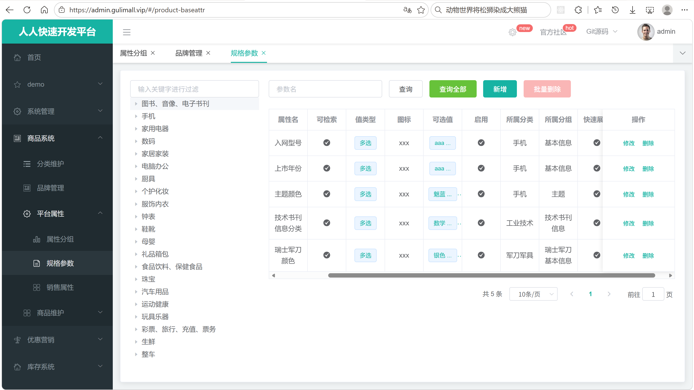
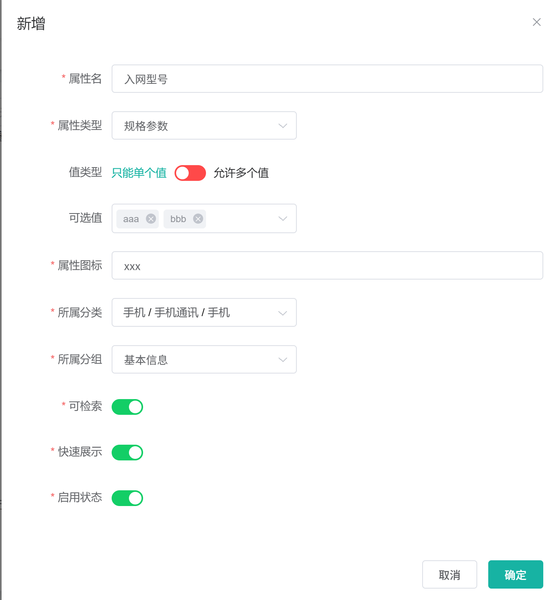
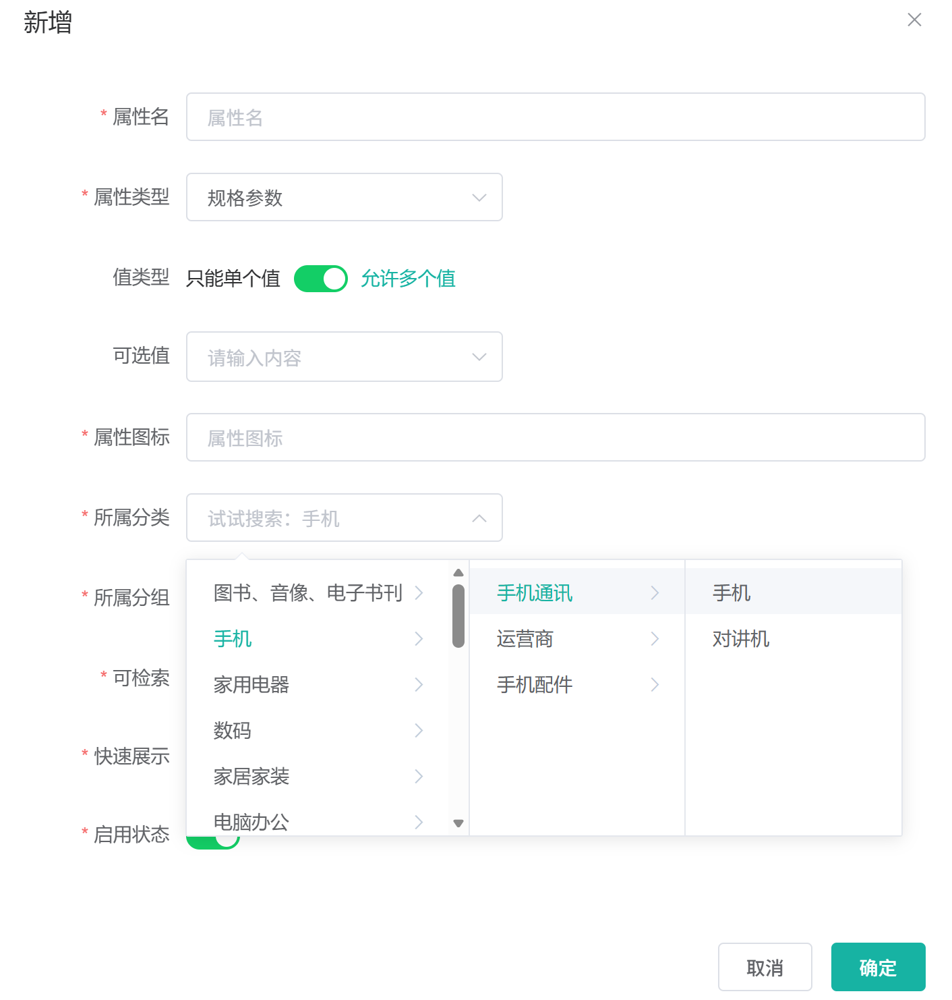
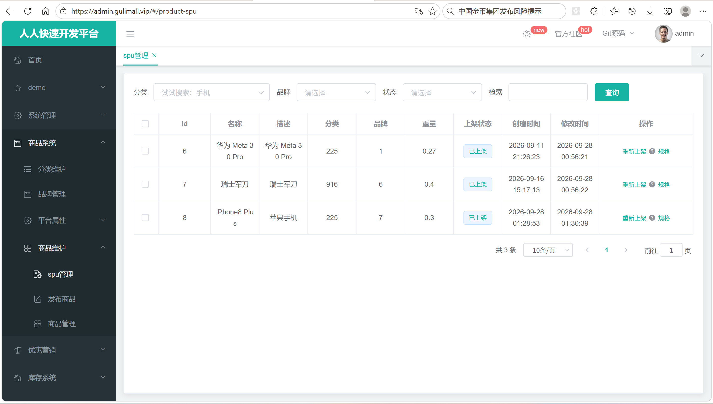
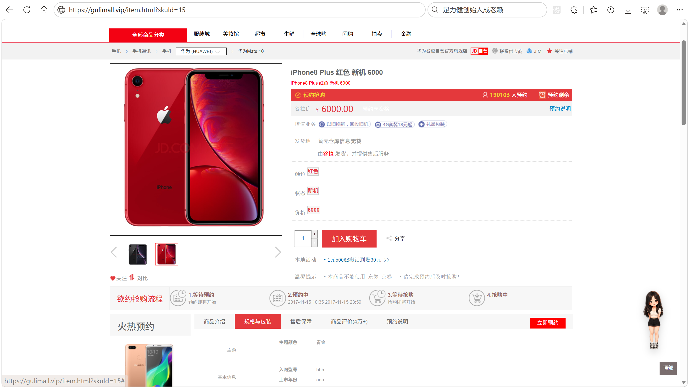

# 6.6 规格参数-介绍

> 本篇介绍规格参数：规格参数和销售属性的区别、管理员怎么维护、`attr_type` 和 `search_type` 的含义、规格参数怎么挂到 SPU、销售属性怎么挂到 SKU、基本属性怎么写入分组关联、SPU 规格值怎么保存和修改，以及商品上架和商品详情怎么使用这些数据。

> 参数校验相关文档：[Jakarta Validation 参数校验](../参数校验/Jakarta%20Validation参数校验.md)。

---

## 1. 这个功能是干什么的

规格参数是商品的固定配置描述。用户买手机时看到的“屏幕尺寸 6.7 英寸”“机身重量 190 克”“CPU 型号 骁龙 8 Gen 3”，就是规格参数。规格参数描述的是 SPU，也就是“这一款商品”，而不是某一个具体 SKU。

销售属性是用户下单时必须选择的购买维度。买手机时选择的“颜色：黑色”“内存：12GB+256GB”，就是销售属性。销售属性决定生成哪些 SKU，也决定下单时买的是哪一个 SKU。

两者在业务上的区别：

| 对比项 | 规格参数（基本属性） | 销售属性 |
|---|---|---|
| `attr_type` | 1 | 0 |
| 挂载对象 | SPU | SKU |
| 典型例子 | 屏幕尺寸、机身重量、CPU 型号 | 颜色、内存、版本 |
| 是否进属性分组 | 是，保存时写分组关联 | 否 |
| 是否参与检索 | 可以配置 `search_type` | 不参与 |
| 值存在哪里 | `pms_product_attr_value` | `pms_sku_sale_attr_value` |
| 是否影响 SKU 组合 | 不影响 | 影响，销售属性组合生成 SKU |

`pms_attr` 同时承载销售属性和规格参数，用 `attr_type` 区分：

| `attr_type` | 含义 | 归属 |
|---|---|---|
| 0 | 销售属性 | SKU，例如颜色、内存 |
| 1 | 基本属性（规格参数） | SPU，例如屏幕尺寸、机身重量 |
| 2 | 既是销售属性又是基本属性 | 业务上两者都可用 |

`search_type` 标记该属性是否进入检索：

- `0`：不需要检索。
- `1`：需要检索，商品上架时写入 Elasticsearch。

`show_desc` 标记该属性是否在商品详情页快速展示：

- `0`：不快速展示。
- `1`：快速展示。

规格参数在业务上有四个作用：

1. **描述商品**：告诉用户这款商品的硬件配置、性能参数、包装清单。
2. **支撑检索**：用户按“屏幕尺寸 6.7 英寸”筛选手机时，数据来源就是可检索的规格参数。
3. **组织商品发布**：商家发布商品时按属性分组逐块填写规格值。
4. **组织商品详情**：商品详情页按属性分组展示规格，用户按组查看配置。

数据关系如下：

```text
pms_category（三级分类）
    └── pms_attr（属性，attr_type=1 是规格参数，attr_type=0 是销售属性）
            ├── pms_attr_attrgroup_relation（基本属性与属性分组的关联）
            │       └── pms_attr_group（属性分组）
            └── pms_product_attr_value（SPU 的规格值快照）

pms_spu_info（SPU，一款商品）
    ├── pms_product_attr_value（这个 SPU 的规格参数值）
    └── pms_sku_info（SKU，具体可售卖单元）
            └── pms_sku_sale_attr_value（这个 SKU 的销售属性值）
```

为什么规格参数和销售属性不拆成两张表：两者都需要属性名、可选值、图标、所属分类、启用状态这些元数据，拆表会产生两套几乎相同的管理页面和两套重复代码。用 `attr_type` 区分，管理页面可以复用同一套列表和弹窗，代价是查询时必须始终带类型条件，否则规格参数和销售属性会混在一起。

## 2. 管理员怎么操作

入口：

```text
管理后台 → 商品系统 → 平台属性 → 规格参数
管理后台 → 商品系统 → 平台属性 → 销售属性
```

规格参数页面和销售属性页面共用 `baseattr.vue`，通过 `attrtype` 区分：

```text
规格参数：attrtype = 1，请求 /product/attr/base/list/{catelogId}
销售属性：attrtype = 0，请求 /product/attr/sale/list/{catelogId}
```



页面分为左右两栏：左侧是三级分类树，右侧是规格参数列表。管理员可以完成七类操作。

### 2.1 查看规格参数列表

1. 打开页面，左侧加载 `/product/category/list/tree` 返回的分类树。
2. 点击三级分类节点，前端记录 `catId`。
3. 请求 `GET /product/attr/base/list/{catelogId}`，带分页参数和关键字。
4. 后端按 `attr_type=1` 和 `catelog_id` 分页查询 `pms_attr`。
5. 每条记录补上分类名 `catelogName` 和分组名 `groupName`。
6. 右侧表格展示 id、属性名、可检索、值类型、图标、可选值、启用、所属分类、所属分组、快速展示。
7. 点击“查询全部”，前端把 `catId` 置为 0，再请求一次列表，后端返回所有分类下的规格参数。

左侧只有三级分类节点会触发查询，因为属性只挂在三级分类上。

### 2.2 按关键字搜索

1. 在搜索框输入属性 id 或属性名。
2. 点击“查询”或按回车。
3. 前端把 `key` 和分页参数一起提交。
4. 后端在“属性 id 精确匹配”和“属性名模糊匹配”之间做 `or` 查询。

搜索只在当前选中的三级分类内生效；“查询全部”时不限制分类。

### 2.3 新增规格参数

1. 点击“新增”。
2. 弹窗填写属性名、属性类型、值类型、可选值、属性图标。
3. 通过级联选择器选择所属三级分类。
4. 规格参数还要选择所属分组、是否可检索、是否快速展示。
5. 点击“确定”。
6. 前端提交 `POST /product/attr/save`，请求体是 `AttrVo`。
7. 后端先保存 `pms_attr`，如果 `attr_type=1`，再向 `pms_attr_attrgroup_relation` 写一条分组关联。
8. 前端关闭弹窗并刷新列表。



销售属性不需要选择分组，也不需要配置可检索和快速展示，弹窗里这三项用 `v-if="type == 1"` 控制，只在规格参数页面显示。

### 2.4 选择属性分组

1. 在弹窗里通过 `category-cascader` 选择一级、二级、三级分类。
2. 级联路径变化后，`watch` 监听 `catelogPath`。
3. 只有路径长度为 3 时才请求 `/product/attrgroup/list/{catelogId}`，一次取回该分类下最多 10000000 条分组。
4. 分组下拉框用返回的 `attrGroupId` 和 `attrGroupName` 渲染。
5. 选择分组后，提交时把 `attrGroupId` 一起传给后端。



属性分组和规格参数必须属于同一个三级分类，否则商品发布页按分类取分组时，会出现“分组里混进其他分类属性”的情况。当前这条规则主要靠页面联动保证，后端没有强校验。

### 2.5 修改规格参数

1. 点击某一行的“修改”。
2. 前端打开弹窗，请求 `GET /product/attr/info/{attrId}`。
3. 后端返回 `AttrRespVo`，包含属性字段、分类名 `catelogName`、分组名 `groupName`、分类完整路径 `catelogPath`，基本属性还会带 `attrGroupId`。
4. 前端把字段回填到表单，把 `catelogPath` 交给级联组件回显。
5. 修改后点击“确定”，请求 `POST /product/attr/update`。
6. 后端更新 `pms_attr`；如果属性类型是基本属性，再检查关联表，存在则更新分组，不存在则新增分组关联。

### 2.6 删除规格参数

1. 勾选一行或多行。
2. 点击“删除”或“批量删除”。
3. 前端提交属性 id 数组到 `POST /product/attr/delete`。
4. 后端按 id 批量删除 `pms_attr`。
5. 前端刷新列表。

当前删除只删除 `pms_attr` 本身，不会清理 `pms_attr_attrgroup_relation` 和 `pms_product_attr_value`。已经发布过的商品，规格值仍然留在 `pms_product_attr_value` 里；属性被删后，这些值会变成没有属性定义的孤立数据。

### 2.7 为 SPU 维护规格值

1. 进入“商品系统 → 商品管理 → 商品列表”。
2. 在商品行点击“规格”。
3. 前端跳转到 `/product-attrupdate?spuId=...&catelogId=...`。
4. 页面请求 `/product/attrgroup/{catelogId}/withattr`，按属性分组取回该分类下所有分组和分组内属性。
5. 页面请求 `/product/attr/base/listforspu/{spuId}`，取回这个 SPU 已经保存的规格值。
6. 页面用 `attrId` 把已有值回填到对应输入项。
7. 管理员按分组填写或修改规格值，勾选“快速展示”。
8. 点击“确认修改”，前端把非空属性值组装成数组，提交到 `POST /product/attr/update/{spuId}`。
9. 后端先删除这个 SPU 在 `pms_product_attr_value` 下的所有记录，再把前端提交的值重新批量插入。



### 2.8 商品详情展示规格

1. 用户打开商品详情页。
2. 后端按 SKU 找到 SPU，再按 `spu_id` 查 `pms_product_attr_value`。
3. 通过 `attr_id` 关联 `pms_attr_attrgroup_relation` 和 `pms_attr_group`。
4. 按分组名称聚合，返回“分组 → 属性名 → 属性值”的结构。
5. 前端按分组渲染规格参数表格。



## 3. 整体设计思路

### 3.1 业务上怎么设计

#### 3.1.1 规格参数挂 SPU，销售属性挂 SKU

规格参数描述“这一款商品”，同一款商品的所有 SKU 共享同一套规格参数，所以规格值按 `spu_id` 存储。

销售属性描述“具体买哪一个”，不同 SKU 的销售属性值不同，所以销售属性值按 `sku_id` 存储。

这条区分决定了两件事：

1. 修改规格参数时，改的是一个 SPU 下的整组值，不影响单个 SKU。
2. 修改销售属性时，改的是单个 SKU 的组合，可能影响价格、库存和上下架状态。

#### 3.1.2 `attr_type` 划分属性类型

1. `attr_type=0`：销售属性，只参与 SKU 生成，不写分组关联。
2. `attr_type=1`：基本属性，也就是规格参数，必须归属属性分组，参与商品发布和详情展示。
3. `attr_type=2`：既是销售属性又是基本属性，业务上两边都能用。

当前实现只按 `0` 和 `1` 查询：

- 规格参数列表只查 `attr_type=1`。
- 销售属性列表只查 `attr_type=0`。
- `attr_type=2` 不会出现在任何一个列表中。

因此 `attr_type=2` 在当前系统里是设计上的预留值，实际管理页面无法直接维护。

#### 3.1.3 `search_type` 决定是否进入检索

规格参数数量很多，全部写入 Elasticsearch 会让索引膨胀，也会让检索条件变得没有意义。所以每条属性单独配置 `search_type`：

1. `search_type=0`：只用于详情展示，不进入检索。
2. `search_type=1`：商品上架时写入 ES，用户可以在搜索页按这个属性筛选。

商品上架时不会重新判断属性类型，只按 `search_type=1` 过滤。这样商家调整检索配置后，重新上架就能生效。

#### 3.1.4 `show_desc` 与 `quick_show`

`pms_attr.show_desc` 是属性级别的默认值，表示这个属性是否适合在商品详情页快速展示。

`pms_product_attr_value.quick_show` 是 SPU 级别快照，表示这个 SPU 的这个属性是否快速展示。商品发布时把 `show_desc` 复制到 `quick_show`，修改 SPU 规格时还可以单独调整。

这样设计的原因：同一个属性在不同 SPU 上的展示需求可能不同，属性级默认值负责“通常怎么做”，SPU 级快照负责“这一款具体怎么做”。

#### 3.1.5 基本属性必须写入分组关联

规格参数页面按分组组织，商品发布页也按分组取属性。基本属性如果不写分组关联，会出现两个问题：

1. 商品发布页按分组取不到这个属性，商家无法填写。
2. 商品详情页按分组展示时，这个属性没有归属，无法显示。

所以 `saveAttr()` 在保存基本属性后，会向 `pms_attr_attrgroup_relation` 插入一条 `attr_id + attr_group_id` 记录。销售属性不写关联。

#### 3.1.6 可选值与值类型

`value_select` 保存可选值列表，前端用分号拼接和拆分。表结构注释写的是“用逗号分隔”，实际页面使用分号，这是一个注释和实现不一致的地方。

`value_type` 表示单选还是多选，但这个字段只存在于前端表单，`AttrEntity`、`AttrVo`、`AttrRespVo` 和 `pms_attr` 表都没有这个字段。因此：

1. 新增时选择的“值类型”不会落库。
2. 列表里的“值类型”列拿不到数据，会显示成多选。
3. 商品发布页判断 `attr.valueType == 1` 时永远不成立，多选属性也按单选渲染。

当前系统实际上只支持单选可选值。

#### 3.1.7 SPU 规格采用全量覆盖

修改 SPU 规格时，前端提交的是“当前页面上所有非空属性值”。后端无法区分哪一条是新增、哪一条是修改、哪一条是删除，所以采用“先按 `spu_id` 全删，再整体插入”的策略。

好处：

1. 不用做差异比较，逻辑简单。
2. 前端把某个值清空后，后端重新插入时自然就不包含它，等于删除。

代价：

1. 每次保存都会改变所有记录的主键。
2. 并发修改同一个 SPU 时，后提交的会覆盖先提交的。
3. 保存过程中如果失败，依赖事务回滚。

#### 3.1.8 删除规则

1. 删除属性：应同时清理分组关联和 SPU 规格值。
2. 删除分组：应清理分组下的关联记录。
3. 删除分类：分类是逻辑删除，属性不会物理删除，但会变成分类树上看不到的孤立数据。

当前代码只实现了“删除属性本身”和“删除分组本身”，关联表和规格值表都没有级联清理。

#### 3.1.9 分类边界

属性只挂在三级分类上，规格参数页面左侧只响应三级节点。商品发布、商品详情也按三级分类取属性分组。

当前后端没有校验 `catelog_id` 必须是三级分类，也没有校验 `attrGroupId` 必须属于同一个分类，直接调接口可以写入跨分类的关联。

### 3.2 技术上怎么设计

#### 3.2.1 三张核心表加一张快照表

| 表 | 作用 |
|---|---|
| `pms_attr` | 属性主表，存属性名、类型、可选值、检索标记、展示标记、所属分类 |
| `pms_attr_attrgroup_relation` | 基本属性与属性分组的关联表 |
| `pms_attr_group` | 属性分组，提供分组名 |
| `pms_product_attr_value` | SPU 规格值快照，按 `spu_id + attr_id` 存值 |

`pms_attr` 字段：

```text
pms_attr
├── attr_id       属性 id，主键
├── attr_name     属性名
├── search_type   是否需要检索：0 不需要，1 需要
├── icon          属性图标
├── value_select  可选值列表，页面用分号分隔
├── attr_type     属性类型：0 销售属性，1 基本属性，2 两者都是
├── enable        启用状态：0 禁用，1 启用
├── catelog_id    所属三级分类 id
└── show_desc     快速展示：0 否，1 是
```

这张表只存属性元数据，规格值不在这里，而是按 `spu_id + attr_id` 存到 `pms_product_attr_value`。属性、分组、规格值分表存放，查询时通过 id 关联。

#### 3.2.2 分页统一走 `Query` 和 `PageUtils`

列表接口接收 `page`、`limit`、`key`：

1. `Query.getPage(params)` 把前端分页参数转成 MyBatis-Plus 的 `IPage`。
2. `this.page(IPage, QueryWrapper)` 执行分页查询。
3. `PageUtils` 把结果转成前端表格需要的 `list` 和 `totalCount`。

#### 3.2.3 用 VO 补充分类名、分组名和分类路径

`pms_attr` 只存 `catelog_id`，不存分类名和分组名。列表和详情需要展示名称，所以用 `AttrRespVo`：

1. 继承 `AttrVo`，保留所有可写字段。
2. 增加 `catelogName`、`groupName`、`catelogPath` 三个展示字段。
3. `catelogPath` 用 `Long[]` 承载 `[一级, 二级, 三级]`，供级联组件回显。

#### 3.2.4 保存和修改在同一事务里写主表和关联表

`saveAttr()` 和 `updateAttr()` 都加了事务注解：

1. 先写 `pms_attr`。
2. 再写 `pms_attr_attrgroup_relation`。
3. 任一失败整体回滚。

#### 3.2.5 SPU 规格全删重插

`updateSpuAttr()` 在一个事务里完成：

1. `DELETE FROM pms_product_attr_value WHERE spu_id = ?`。
2. 前端提交的列表逐条把 `id` 置空、`spuId` 设置为当前 SPU。
3. `saveBatch()` 批量插入。

#### 3.2.6 上架时按 `search_type` 过滤

商品上架时：

1. 按 `spu_id` 查 `pms_product_attr_value`，拿到这个 SPU 的所有规格值。
2. 取出 `attr_id` 列表。
3. 调 `selectSearchAttrs()` 查出其中 `search_type=1` 的属性 id。
4. 用集合过滤规格值。
5. 把过滤后的属性列表放进 `SkuEsModel`，通过 Feign 发给 ES 服务保存。

#### 3.2.7 详情页用一次 JOIN 按分组返回

商品详情页按 `spu_id` 查规格值，并左连接关联表和分组表：

```text
pms_product_attr_value
    LEFT JOIN pms_attr_attrgroup_relation ON attr_id
    LEFT JOIN pms_attr_group ON attr_group_id
```

结果按分组名聚合，返回 `List<SpuItemAttrGroupVo>`，每个元素是“分组名 + 属性列表”。

#### 3.2.8 事务边界

| 方法 | 事务 | 说明 |
|---|---|---|
| `AttrServiceImpl.saveAttr()` | `@Transactional(rollbackFor = Exception.class)` | 主表 + 关联表 |
| `AttrServiceImpl.updateAttr()` | `@Transactional` | 主表 + 关联表，默认只回滚运行时异常 |
| `ProductAttrValueServiceImpl.updateSpuAttr()` | `@Transactional` | 全删 + 批量插入 |

列表查询、详情查询都是只读，不需要事务。

## 4. 详细代码、配置和解释

第 4 章按“类为什么存在 → 关键字段与接口 → 正常链路 → 代码分块解释 → 一次完整示例 → 它不做什么与边界”组织。每块代码前面先说明它在链路里承担什么，代码后面按 1、2、3、4 解释执行顺序、条件和原因。

### 4.1 AttrEntity：属性表映射

#### 4.1.1 这个类解决什么问题

规格参数和销售属性共用 `pms_attr` 表。管理后台的属性列表、新增弹窗、修改回显，商品发布页按属性分组读取属性，商品上架时按属性 id 过滤可检索项，数据都来自这张表。这个实体把表字段映射成 Java 对象，让 MyBatis-Plus 可以完成增删改查，同时作为 `AttrVo`、`AttrRespVo` 和 `ProductAttrValueEntity` 的字段来源。

这个类只承载属性定义，不承载某个 SPU 的具体规格值。规格值按 `spu_id + attr_id` 存在 `pms_product_attr_value`，由 `ProductAttrValueEntity` 映射。边界由此确定：属性改名只影响 `pms_attr`，历史规格值里的 `attr_name` 快照不会跟着变。

调用方有三类：

1. `AttrController` 的列表、详情、删除接口直接操作这个实体；
2. `AttrServiceImpl.saveAttr()`、`updateAttr()` 用它写主表；
3. 商品发布流程按 `attr_id` 查属性名，再把属性名复制到规格值快照。

#### 4.1.2 字段与业务含义

| 字段 | 数据库列 | 业务含义 | 说明 |
|---|---|---|---|
| `attrId` | `attr_id` | 属性 id | 主键，自增 |
| `attrName` | `attr_name` | 属性名 | 保存 SPU 规格值时复制一份作为快照 |
| `searchType` | `search_type` | 是否可检索 | 0 不检索，1 上架时写入 ES |
| `icon` | `icon` | 属性图标 | 后台列表展示 |
| `valueSelect` | `value_select` | 可选值列表 | 页面用分号分隔，表注释写的是逗号 |
| `attrType` | `attr_type` | 属性类型 | 0 销售属性，1 基本属性，2 两者都是 |
| `enable` | `enable` | 启用状态 | 0 禁用，1 启用 |
| `catelogId` | `catelog_id` | 所属三级分类 | 列表过滤和分组归属都依赖它 |
| `showDesc` | `show_desc` | 快速展示默认值 | 发布商品时复制到 `quick_show` |

#### 4.1.3 代码与解释

实体只做字段映射，没有计算字段和关联对象，代码与表结构一一对应：

```java
@Data
@TableName("pms_attr")
public class AttrEntity implements Serializable {
	private static final long serialVersionUID = 1L;

	/**
	 * 属性id
	 */
	@TableId
	private Long attrId;
	/**
	 * 属性名
	 */
	private String attrName;
	/**
	 * 是否需要检索[0-不需要，1-需要]
	 */
	private Integer searchType;
	/**
	 * 属性图标
	 */
	private String icon;
	/**
	 * 可选值列表[用逗号分隔]
	 */
	private String valueSelect;
	/**
	 * 属性类型[0-销售属性，1-基本属性，2-既是销售属性又是基本属性]
	 */
	private Integer attrType;
	/**
	 * 启用状态[0 - 禁用，1 - 启用]
	 */
	private Long enable;
	/**
	 * 所属分类
	 */
	private Long catelogId;
	/**
	 * 快速展示【是否展示在介绍上；0-否 1-是】，在sku中仍然可以调整
	 */
	private Integer showDesc;

}
```

1. `@TableName("pms_attr")`：声明实体对应 `pms_attr` 表，MyBatis-Plus 据此生成 SQL。
2. `@TableId`：标记 `attrId` 为主键。插入后数据库自增 id 会回填到实体，`saveAttr()` 紧接着写分组关联时能直接拿到这个 id。
3. `attrName`：属性名。商品发布时会被复制到 `pms_product_attr_value.attr_name`，详情页展示的是快照名。
4. `searchType`：决定属性是否进入 Elasticsearch。商品上架时 `selectSearchAttrs()` 按这个字段过滤。
5. `icon`：图标 URL，只在后台列表展示，商品详情不使用。
6. `valueSelect`：可选值字符串。管理页面用分号拼接和拆分，表注释写的是“用逗号分隔”，两者不一致。
7. `attrType`：属性类型。保存时用它判断是否写分组关联，列表查询时用它区分规格参数和销售属性。
8. `enable`：启用状态，类型是 `Long`，和同表 `searchType`、`showDesc` 的 `Integer` 不统一。
9. `catelogId`：属性归属的三级分类 id。后台按分类分页，商品发布按分类取分组，都从它出发。
10. `showDesc`：属性级快速展示默认值。它不是最终展示开关，最终值保存在每个 SPU 的 `quick_show` 里。

#### 4.1.4 一次读写示例

后台新增一条规格参数“机身重量”，落在 225 号三级分类，允许检索、默认快速展示、可选值为 `190g;200g`：

```text
INSERT INTO pms_attr
  (attr_name, search_type, icon, value_select, attr_type, enable, catelog_id, show_desc)
VALUES
  ('机身重量', 1, NULL, '190g;200g', 1, 1, 225, 1);
```

插入后自增主键假设为 88。规格参数列表按分类查询时执行：

```text
SELECT attr_id, attr_name, search_type, icon, value_select,
       attr_type, enable, catelog_id, show_desc
FROM pms_attr
WHERE attr_type = 1
  AND catelog_id = 225;
```

返回结果就是右侧表格的属性行。分类名和分组名不在这一行里，由 `AttrServiceImpl` 查询时补到 `AttrRespVo`。

#### 4.1.5 它不做什么

1. 不保存 SPU 的规格值，规格值在 `pms_product_attr_value`。
2. 不维护属性与分组的关系，关系在 `pms_attr_attrgroup_relation`。
3. 不校验分类层级，`catelog_id` 写一级或二级分类也能落库。
4. 不生成分类名、分组名，这些展示字段由 VO 在查询时补充。

#### 4.1.6 边界与可优化点

1. 没有 `value_type` 字段，前端提交的“值类型”无法落库，列表只能显示默认分支。
2. `value_select` 用字符分隔，值本身含分隔符时无法正确拆分，也无法统计单个可选值的使用次数。
3. `enable` 用 `Long`，同表其他状态字段用 `Integer`，映射和比较时容易出类型问题。
4. `catelog_id` 是高频率查询条件，表上没有显式索引，数据量大时按分类分页会走全表扫描。
5. 没有 `(catelog_id, attr_name)` 唯一约束，同一分类下可以出现同名属性。

### 4.2 AttrVo：写入接口的入参

#### 4.2.1 这个类解决什么问题

新增规格参数时，一次提交既要写 `pms_attr`，又要写 `pms_attr_attrgroup_relation`。如果拆成两个接口，前端需要先保存属性拿到 id，再调第二个接口写分组，中间失败会产生“属性存在但没有分组”的半成品。

`AttrVo` 把两组数据合并到一个请求体里，Controller 只暴露 `/save` 和 `/update` 两个写接口，Service 在一次事务里完成主表和关联表写入。这个类不映射数据库，只在 HTTP 入参这一层使用。

调用方是 `AttrController.save()`、`AttrController.update()`，以及前端 `attr-add-or-update.vue` 的提交逻辑。

#### 4.2.2 字段与业务含义

| 字段 | 来源 | 用途 |
|---|---|---|
| `attrId` | 前端回传 | 修改时定位记录，新增时为空 |
| `attrName` | 表单 | 属性名 |
| `searchType` | 表单开关 | 是否可检索 |
| `icon` | 表单 | 图标 URL |
| `valueSelect` | 多选下拉拼接 | 分号分隔的可选值 |
| `attrType` | 表单下拉 | 0 销售属性，1 基本属性 |
| `enable` | 表单开关 | 启用状态 |
| `catelogId` | 级联选择器最后一级 | 所属三级分类 |
| `showDesc` | 表单开关 | 属性级快速展示默认值 |
| `attrGroupId` | 分组下拉 | 只用于写关联表，不落 `pms_attr` |

#### 4.2.3 代码与解释

入参对象比实体多一个 `attrGroupId`，其余字段同名，方便 `BeanUtils.copyProperties()` 直接拷贝：

```java
@Data
public class AttrVo {

    /**
     * 属性id
     */
    private Long attrId;
    /**
     * 属性名
     */
    private String attrName;
    /**
     * 是否需要检索[0-不需要，1-需要]
     */
    private Integer searchType;
    /**
     * 属性图标
     */
    private String icon;
    /**
     * 可选值列表[用逗号分隔]
     */
    private String valueSelect;
    /**
     * 属性类型[0-销售属性，1-基本属性，2-既是销售属性又是基本属性]
     */
    private Integer attrType;
    /**
     * 启用状态[0 - 禁用，1 - 启用]
     */
    private Long enable;
    /**
     * 所属分类
     */
    private Long catelogId;
    /**
     * 快速展示【是否展示在介绍上；0-否 1-是】，在sku中仍然可以调整
     */
    private Integer showDesc;
    /**
     * 属性分组id
     */
    private Long attrGroupId;

}
```

1. 前九个字段和 `AttrEntity` 一一对应，Service 可以用 `BeanUtils.copyProperties(attrVo, attrEntity)` 一次性拷贝。
2. `attrGroupId` 不是 `pms_attr` 的列，只在 `attrType=1` 时用于插入或更新分组关联。
3. 销售属性提交时 `attrGroupId` 为空，Service 根据 `attrType` 决定是否使用它，而不是根据它是否为空判断类型。
4. 修改接口复用同一个 VO，`attrId` 有值时走更新，没有值时走新增。
5. 前端额外提交的 `valueType` 没有对应属性，Jackson 反序列化时会被忽略，不会进入业务逻辑。

#### 4.2.4 一次完整示例

新增一个基本属性“屏幕尺寸”，归入 225 号分类的“主体”分组：

```text
POST /gulimall/product/attr/save
Content-Type: application/json

{
  "attrName": "屏幕尺寸",
  "searchType": 1,
  "icon": "",
  "valueSelect": "6.1英寸;6.7英寸",
  "attrType": 1,
  "enable": 1,
  "catelogId": 225,
  "attrGroupId": 12,
  "showDesc": 1
}
```

Service 收到后先插入 `pms_attr` 得到 `attrId=88`，再插入 `pms_attr_attrgroup_relation(attr_id=88, attr_group_id=12)`。前端拿到的响应只有 `code=0`，随后刷新列表。

#### 4.2.5 它不做什么

1. 不映射数据库，不参与 MyBatis-Plus 的 CRUD。
2. 不带参数校验注解，字段是否合法由前端表单规则保证。
3. 不包含分类名、分组名、分类路径，这些只在回显接口的 `AttrRespVo` 里出现。
4. 不区分新增和修改的字段差异，两种场景共用同一组字段。

#### 4.2.6 边界与可优化点

1. `attrName`、`attrType`、`catelogId` 都没有非空校验，直接调接口可以写入残缺数据。
2. `valueType` 不在 VO 里，前端选择的“值类型”提交后被丢弃。
3. `attrGroupId` 和 `catelogId` 没有关联校验，可以提交“A 分类的属性挂到 B 分类分组”的组合。
4. 新增和修改共用一个 VO，修改时如果前端漏传字段，`BeanUtils.copyProperties()` 会把 null 覆盖进实体，存在误清空风险。

### 4.3 AttrRespVo：回显接口的出参

#### 4.3.1 这个类解决什么问题

列表页要显示“所属分类”和“所属分组”，修改弹窗还要用分类路径回显级联选择器。`pms_attr` 只存 `catelog_id`，分组关系在关联表里，分类路径需要逐级查 `pms_category`。如果让前端逐条补名称，一页十条就要多发几十次请求。

`AttrRespVo` 在 `AttrVo` 基础上补三个展示字段，由后端在查询时一次性补齐。它服务于 `AttrController.baseAttrList()` 和 `AttrController.info()`，不落库。

#### 4.3.2 结构与字段

| 字段 | 类型 | 含义 |
|---|---|---|
| 继承字段 | 同 `AttrVo` | 属性元数据和 `attrGroupId` |
| `catelogName` | `String` | 分类名称，列表和详情展示 |
| `groupName` | `String` | 分组名称，销售属性保持为空 |
| `catelogPath` | `Long[]` | `[一级, 二级, 三级]`，级联组件回显 |

#### 4.3.3 代码与解释

这个 VO 只增加三个字段，没有重写任何方法：

```java
@Data
public class AttrRespVo extends AttrVo {
    private String catelogName;
    private String groupName;
    private Long[] catelogPath;
}
```

1. `extends AttrVo`：继承全部属性字段和 `attrGroupId`，不用重复声明。
2. `catelogName`：由 `categoryDao.selectById(catelogId)` 或列表逐条查询后填入。
3. `groupName`：基本属性在关联表存在时按分组 id 查 `pms_attr_group` 填入；销售属性没有分组，保持 null。
4. `catelogPath`：由 `CategoryMethod.findCatelogPath()` 返回，类型和级联组件需要的数组一致。
5. 列表接口只填 `catelogName` 和 `groupName`，`catelogPath` 留空；详情接口三个字段都填。

#### 4.3.4 一次完整示例

修改弹窗请求属性 88 的详情：

```text
GET /gulimall/product/attr/info/88

{
  "attrId": 88,
  "attrName": "屏幕尺寸",
  "searchType": 1,
  "valueSelect": "6.1英寸;6.7英寸",
  "attrType": 1,
  "enable": 1,
  "catelogId": 225,
  "showDesc": 1,
  "attrGroupId": 12,
  "catelogName": "手机",
  "groupName": "主体",
  "catelogPath": [1, 2, 225]
}
```

前端把 `catelogPath` 交给 `category-cascader` 回显三级路径，把 `attrGroupId` 交给分组下拉框。

#### 4.3.5 它不做什么

1. 不负责查询，三个展示字段都由 Service 填充。
2. 不包含分组路径，分组只有一层，不需要路径。
3. 不区分列表和详情的字段裁剪，列表也会返回 `catelogPath` 的空字段。

#### 4.3.6 边界与可优化点

1. 实体、入参 VO、出参 VO 三层字段大量重复，属性新增时三处都要改。
2. `catelogPath` 只在详情有意义，列表里是 null，增加 JSON 体积。
3. `catelogName`、`groupName` 是查询时临时补的，不是数据库列，命名上可以加展示前缀区分。
4. 列表补名称采用逐条查询，一页十条最多产生三十次查询，属于 N+1。

### 4.4 AttrEnum：属性类型枚举

#### 4.4.1 这个类解决什么问题

属性类型只有三个取值，但判断分散在保存、修改、详情、列表四个方法里。直接写 `0`、`1` 时，读代码的人需要反复对照注释才能确认分支含义，改错一个数字也不会被编译器发现。

`AttrEnum` 把“基本属性”和“销售属性”定义为枚举，业务代码用 `getCode()` 和 `attrType` 比较。调用方是 `AttrServiceImpl` 的四个方法，当前没有其他模块使用。

#### 4.4.2 代码与解释

枚举只包含两个业务实际使用的值：

```java
public enum AttrEnum {
    ATTR_TYPE_BASE(1, "基本属性"), ATTR_TYPE_SALE(0, "销售属性");

    private final int code;
    private final String msg;

    AttrEnum(int code, String msg) {
        this.code = code;
        this.msg = msg;
    }

    public int getCode() {
        return code;
    }

    public String getMsg() {
        return msg;
    }
}
```

1. `ATTR_TYPE_BASE(1, "基本属性")`：规格参数，需要写分组关联，列表按 1 查询。
2. `ATTR_TYPE_SALE(0, "销售属性")`：销售属性，不写分组关联，列表按 0 查询。
3. `getCode()` 返回基本类型 `int`，和 `Integer attrType` 比较时会触发拆箱。
4. `getMsg()` 当前没有调用方，只在定义里保留。

#### 4.4.3 一次判断示例

`saveAttr()` 判断是否写分组关联：

```text
attrVo.attrType = 1
AttrEnum.ATTR_TYPE_BASE.getCode() = 1
1 == 1 成立
→ 进入关联表写入分支
```

如果 `attrType` 是 0，比较不成立，只保存主表。如果 `attrType` 是 2，比较同样不成立，这个类型不会写分组关联。

#### 4.4.4 它不做什么

1. 不包含 `attr_type=2`，数据库注释里的第三种类型没有对应枚举。
2. 不做字符串到枚举的转换，接口不接收枚举名。
3. 不承载校验逻辑，非法数字仍然可以进入数据库。

#### 4.4.5 边界与可优化点

1. 缺少 `ATTR_TYPE_BOTH(2, ...)`，导致“既是销售属性又是基本属性”的类型在代码里没有位置。
2. `getCode()` 返回 `int`，实体字段为 null 时比较会抛空指针，应该先判空或改成 `Integer` 比较。
3. 枚举可以补充 `fromCode()`，让 Controller 和前端传值都能统一转换。
4. 枚举放在业务模块内，其他模块使用时需要重复定义，可以上收到公共模块。

### 4.5 AttrController：接收属性请求

#### 4.5.1 这个类解决什么问题

规格参数页面、销售属性页面、SPU 规格修改页都要和属性打交道，但操作对象不同：前两个页面维护属性定义，后一个页面维护某个 SPU 的规格值。这个 Controller 把三类页面的 HTTP 请求统一收在 `/product/attr` 下，按路径分派给 `AttrService` 或 `ProductAttrValueService`。

这一层只做三件事：

1. 接收路径变量、查询参数和请求体；
2. 用 `@RequiresPermissions` 校验后台权限；
3. 把 Service 结果包装成统一响应 `R`。

属性怎么保存、分组怎么维护、SPU 规格怎么全删重插，都不在这一层。

#### 4.5.2 接口清单

| 操作 | 方法与路径 | 权限 | 调用的 Service 方法 |
|---|---|---|---|
| 规格参数列表 | `GET /product/attr/base/list/{catelogId}` | 无 | `queryBaseAttrPage()` |
| 销售属性列表 | `GET /product/attr/sale/list/{catelogId}` | 无 | `queryBaseAttrPage()` |
| SPU 规格回显 | `GET /product/attr/base/listforspu/{spuId}` | 无 | `baseAttrListForSpu()` |
| 修改 SPU 规格 | `POST /product/attr/update/{spuId}` | 无 | `updateSpuAttr()` |
| 属性详情 | `GET /product/attr/info/{attrId}` | 无 | `getAttrInfo()` |
| 新增属性 | `POST /product/attr/save` | `product:attr:save` | `saveAttr()` |
| 修改属性 | `POST /product/attr/update` | 无 | `updateAttr()` |
| 删除属性 | `POST /product/attr/delete` | `product:attr:delete` | `removeByIds()` |

网关转发前会去掉 `/gulimall` 前缀，浏览器实际请求路径是 `/gulimall/product/attr/...`。

#### 4.5.3 代码与解释

Controller 没有业务分支，方法体基本都是一行 Service 调用：

```java
@RestController
@RequestMapping("product/attr")
public class AttrController {

    @Autowired
    private AttrService attrService;

    @Autowired
    private ProductAttrValueService productAttrValueService;

    // product/attr/sale/list/0?
    // product/attr/base/list/{catelogId}
    @GetMapping("/{attrType}/list/{catelogId}")
    public R baseAttrList(@RequestParam Map<String, Object> params,
                          @PathVariable("catelogId") Long catelogId,
                          @PathVariable("attrType") String type) {

        PageUtils page = attrService.queryBaseAttrPage(params, catelogId, type);
        return R.ok().put("page", page);
    }

    /**
     * 获取 spu 的规格
     */
    @GetMapping("/base/listforspu/{spuId}")
    public R baseListForSpu(@PathVariable("spuId") Long spuId) {
        List<ProductAttrValueEntity> entityList = productAttrValueService.baseAttrListForSpu(spuId);

        return R.ok().put("data", entityList);
    }

    /**
     * 修改 spu 的规格
     */
    @PostMapping("/update/{spuId}")
    public R updateSpuAttr(@PathVariable("spuId") Long spuId,
                           @RequestBody List<ProductAttrValueEntity> entities) {
        productAttrValueService.updateSpuAttr(spuId, entities);

        return R.ok();
    }

    /**
     * 信息
     */
    @RequestMapping("/info/{attrId}")
    public R info(@PathVariable("attrId") Long attrId) {
        AttrRespVo attrRespVo = attrService.getAttrInfo(attrId);

        return R.ok().put("attr", attrRespVo);
    }

    /**
     * 保存
     */
    @RequestMapping("/save")
    @RequiresPermissions("product:attr:save")
    public R save(@RequestBody AttrVo attrVo) {
        attrService.saveAttr(attrVo);

        return R.ok();
    }

    /**
     * 修改
     */
    @RequestMapping("/update")
    public R update(@RequestBody AttrVo attr) {
        attrService.updateAttr(attr);

        return R.ok();
    }

    /**
     * 删除
     */
    @RequestMapping("/delete")
    @RequiresPermissions("product:attr:delete")
    public R delete(@RequestBody Long[] attrIds) {
        attrService.removeByIds(Arrays.asList(attrIds));

        return R.ok();
    }

}
```

1. `@RestController` + `@RequestMapping("product/attr")`：八个接口共用 `/product/attr` 前缀，返回值自动序列化为 JSON。
2. `baseAttrList()`：路径同时带 `attrType` 和 `catelogId`。`attrType` 为 `base` 时查规格参数，其他字符串都按销售属性查询。结果放在 `page` 字段。
3. `baseListForSpu()`：按 `spuId` 查规格值，返回 `data` 数组，供 SPU 规格修改页回显。
4. `updateSpuAttr()`：接收整个规格值数组，路径里的 `spuId` 会覆盖请求体里的 `spuId`。
5. `info()`：按属性 id 查详情，返回 `attr`，其中包含分类名、分组名和分类路径。
6. `save()`：接收 `AttrVo`，基本属性会同时写主表和分组关联。
7. `update()`：接收 `AttrVo`，基本属性会按“存在则更新、不存在则新增”维护分组关联。
8. `delete()`：接收 id 数组，直接调用 MyBatis-Plus 的 `removeByIds()` 删除主表记录。
9. 两个写接口加了权限注解，其余接口登录后即可调用。

#### 4.5.4 一次请求示例

管理员打开规格参数页面，点击 225 号三级分类：

```text
1. 浏览器：GET /gulimall/product/attr/base/list/225?page=1&limit=10&key=
2. 网关匹配 /gulimall/product/**，StripPrefix=1 去掉 gulimall
3. 商品服务收到 GET /product/attr/base/list/225
4. AttrController.baseAttrList() 读取 params、catelogId=225、type=base
5. 调用 attrService.queryBaseAttrPage(params, 225, "base")
6. Service 返回 PageUtils
7. Controller 返回 R.ok().put("page", page)
8. 前端取 data.page.list 渲染表格，取 data.page.totalCount 渲染分页
```

#### 4.5.5 它不做什么

1. 不组装 `AttrRespVo`，分类名、分组名由 Service 补。
2. 不判断属性类型是否合法，`base` 之外的字符串都当成销售属性。
3. 不做级联删除，删除属性只删主表。
4. 不处理分页参数，交给 `Query.getPage()` 和 `PageUtils`。

#### 4.5.6 边界与可优化点

1. `info()`、`update()`、`baseAttrList()`、SPU 规格接口都没有权限注解，登录后即可调用。
2. `baseAttrList()` 用 `"base".equalsIgnoreCase(type) ? 1 : 0` 判断，传 `sale`、`abc`、空串都会落到销售属性分支。
3. `save()`、`update()` 没有 `@Valid`，属性名、类型、分类 id 都没有后端校验。
4. `delete()` 只删主表，不清理 `pms_attr_attrgroup_relation` 和 `pms_product_attr_value`。
5. 多数接口用 `@RequestMapping`，没有限定 HTTP 方法，生产环境应改成 `@GetMapping`、`@PostMapping`。
6. `baseListForSpu()` 返回完整实体，包含 `id`、`spuId` 等前端不需要的字段。

### 4.6 AttrServiceImpl：属性业务

#### 4.6.1 这个类解决什么问题

属性管理有两个写入口和两个读入口：新增属性、修改属性；分页列表、详情回显。写入口的共同难点是“主表和分组关联表必须一起成功”，读入口的共同难点是“表里只有 id，页面要名称和路径”。

这个类把四件事收在一起：

1. 保存属性，基本属性同时写分组关联；
2. 按类型和分类分页，给每条记录补分类名和分组名；
3. 查询详情，补分组信息、分类名和分类路径；
4. 修改属性，按 `attr_id` 维护分组关联。

它不负责 SPU 规格值的读写，那部分在 `ProductAttrValueServiceImpl`。

#### 4.6.2 依赖字段

方法里用到的 DAO 和工具类都通过字段注入：

```java
@Service("attrService")
public class AttrServiceImpl extends ServiceImpl<AttrDao, AttrEntity> implements AttrService {

    @Autowired
    private AttrAttrgroupRelationDao attrAttrgroupRelationDao;
    @Autowired
    private AttrGroupDao attrGroupDao;
    @Autowired
    private CategoryDao categoryDao;
    @Autowired
    private CategoryMethod categoryMethod;
    @Autowired
    private AttrMethod attrMethod;
```

1. `attrAttrgroupRelationDao`：读写 `pms_attr_attrgroup_relation`，保存、修改、列表补分组名都依赖它。
2. `attrGroupDao`：按分组 id 查 `pms_attr_group`，拿分组名。
3. `categoryDao`：按分类 id 查 `pms_category`，拿分类名。
4. `categoryMethod`：查分类完整路径。路径查询放在独立 Method 层，避免分类 Service 与属性 Service 循环依赖。
5. `attrMethod`：查分组已关联属性，供平台属性关联功能使用，本类的四个方法没有直接调用。

#### 4.6.3 保存属性 `saveAttr`

新增属性时，主表必须先插入，拿到自增 `attrId` 后才能写关联表。两个操作必须同成败，所以放在一个事务里：

```java
    @Override
    @Transactional(rollbackFor = Exception.class)
    public void saveAttr(AttrVo attrVo) {
        AttrEntity attrEntity = new AttrEntity();
        // 将attrVo中的属性拷贝到attrEntity中
        BeanUtils.copyProperties(attrVo, attrEntity);
        // 保存基本数据
        this.save(attrEntity);
        // 保存关联关系
        if (AttrEnum.ATTR_TYPE_BASE.getCode() == attrVo.getAttrType()) {
            AttrAttrgroupRelationEntity attrAttrgroupRelationEntity = new AttrAttrgroupRelationEntity();
            attrAttrgroupRelationEntity.setAttrId(attrEntity.getAttrId());
            attrAttrgroupRelationEntity.setAttrGroupId(attrVo.getAttrGroupId());
            attrAttrgroupRelationDao.insert(attrAttrgroupRelationEntity);
        }
    }
```

1. 创建 `AttrEntity`，用 `BeanUtils.copyProperties()` 把 `AttrVo` 的同名字段拷贝过去，`attrGroupId` 不在实体里，不会被拷贝。
2. 调用 `this.save(attrEntity)` 插入 `pms_attr`。
3. MyBatis-Plus 把数据库自增主键回填到 `attrEntity.attrId`。
4. 判断 `attrVo.attrType` 是否等于基本属性 `1`。
5. 等于 1 时创建关联实体，`attrId` 用刚回填的主键，`attrGroupId` 用前端传的值，插入关联表。
6. 等于 0 或 2 时只保存主表，不写关联。
7. 任一步抛异常，事务回滚，主表和关联表都不会留下半条数据。

为什么先写主表：关联表需要 `attr_id`，而 `attr_id` 只有插入后才知道。为什么不按 `attrGroupId` 是否为空判断类型：销售属性也可以带一个无效分组 id，用 `attrType` 判断语义更明确。

完整示例：新增“屏幕尺寸”到 12 号分组。

```text
1. attrVo = {attrName:屏幕尺寸, attrType:1, catelogId:225, attrGroupId:12, ...}
2. copyProperties → attrEntity，attrId 为 null
3. this.save(attrEntity)
   → INSERT INTO pms_attr(attr_name, attr_type, catelog_id, ...) VALUES(...)
   → attrEntity.attrId = 88
4. 1 == 1 成立
5. INSERT INTO pms_attr_attrgroup_relation(attr_id, attr_group_id) VALUES(88, 12)
6. 事务提交
```

#### 4.6.4 分页查询 `queryBaseAttrPage`

列表页需要“按类型 + 按分类 + 关键字”过滤，并把当前页记录补成带分类名和分组名的 VO：

```java
    /**
     * 获取规格参数列表
     */
    @Override
    public PageUtils queryBaseAttrPage(Map<String, Object> params, Long catelogId, String type) {
        QueryWrapper<AttrEntity> queryWrapper = new QueryWrapper<AttrEntity>()
                .eq("attr_type", "base".equalsIgnoreCase(type) ?
                        AttrEnum.ATTR_TYPE_BASE.getCode() : AttrEnum.ATTR_TYPE_SALE.getCode());
        if (catelogId != 0) {
            queryWrapper.eq("catelog_id", catelogId);
        }
        String key = (String) params.get("key");
        if (StringUtils.isNotBlank(key)) {
            queryWrapper.and((wrapper) -> {
                wrapper.eq("attr_id", key).or().like("attr_name", key);
            });
        }
        IPage<AttrEntity> page = this.page(
                new Query<AttrEntity>().getPage(params),
                queryWrapper
        );
        //封装分页数据
        PageUtils pageUtils = new PageUtils(page);

        //查出新增的属性
        List<AttrEntity> records = page.getRecords();
        List<AttrRespVo> attrRespVoList = records.stream().map(attrEntity -> {
            AttrRespVo attrRespVo = new AttrRespVo();
            BeanUtils.copyProperties(attrEntity, attrRespVo);
            CategoryEntity categoryEntity = categoryDao.selectOne(
                    new QueryWrapper<CategoryEntity>().eq("cat_id", attrEntity.getCatelogId()));
            if (categoryEntity != null) {
                attrRespVo.setCatelogName(categoryEntity.getName());
            }

            AttrAttrgroupRelationEntity attrAttrgroupRelationEntity = attrAttrgroupRelationDao.selectOne(
                    new QueryWrapper<AttrAttrgroupRelationEntity>().eq("attr_id", attrEntity.getAttrId()));
            if (attrAttrgroupRelationEntity != null) {
                AttrGroupEntity attrGroupEntity = attrGroupDao.selectById(attrAttrgroupRelationEntity.getAttrGroupId());
                attrRespVo.setGroupName(attrGroupEntity.getAttrGroupName());
            }
            return attrRespVo;
        }).toList();
        pageUtils.setList(attrRespVoList);
        return pageUtils;
    }
```

1. 创建 `QueryWrapper`，先加 `attr_type` 条件：`base` 查 1，其他查 0。
2. `catelogId != 0` 时追加 `catelog_id` 条件；等于 0 表示“查询全部”，不加分类条件。
3. 取 `key`，非空时用 `and(...)` 包住 `attr_id = key OR attr_name LIKE %key%`，避免 `or` 把前面的类型和分类条件冲掉。
4. `Query.getPage(params)` 把 `page`、`limit` 转成 MyBatis-Plus 分页对象。
5. `this.page()` 执行分页查询，返回当前页实体和总数。
6. `PageUtils` 先包装原始实体分页结果。
7. 遍历当前页记录，为每条创建 `AttrRespVo`，拷贝同名字段。
8. 按 `catelogId` 查分类，补 `catelogName`。
9. 按 `attrId` 查关联表，有分组就按分组 id 查分组名，补 `groupName`。
10. 用 `pageUtils.setList()` 把实体列表替换成 VO 列表，返回给 Controller。

为什么类型条件放在最前面：`attr_type` 是区分两张业务页面的基础条件，必须始终存在。为什么 `key` 要用 `and()` 包一层：`A and (B or C)` 和 `A and B or C` 结果不同，前者只在本类型本分类内搜索，后者会把其他类型的数据带出来。

#### 4.6.5 查询详情 `getAttrInfo`

修改弹窗需要一次拿到属性字段、所属分组和分类路径，减少前端多次请求：

```java
    @Override
    public AttrRespVo getAttrInfo(Long attrId) {
        AttrRespVo respVo = new AttrRespVo();
        AttrEntity attrEntity = this.getById(attrId);
        BeanUtils.copyProperties(attrEntity, respVo);

        if (AttrEnum.ATTR_TYPE_BASE.getCode() == attrEntity.getAttrType()) {
            //1、设置分组信息
            AttrAttrgroupRelationEntity attrgroupRelation = attrAttrgroupRelationDao.selectOne(
                    new QueryWrapper<AttrAttrgroupRelationEntity>().eq("attr_id", attrId));
            if (attrgroupRelation != null) {
                respVo.setAttrGroupId(attrgroupRelation.getAttrGroupId());
                AttrGroupEntity attrGroupEntity = attrGroupDao.selectById(attrgroupRelation.getAttrGroupId());
                if (attrGroupEntity != null) {
                    respVo.setGroupName(attrGroupEntity.getAttrGroupName());
                }
            }
        }

        //2、设置分类信息
        Long catelogId = attrEntity.getCatelogId();
        Long[] catelogPath = categoryMethod.findCatelogPath(catelogId);
        respVo.setCatelogPath(catelogPath);

        CategoryEntity categoryEntity = categoryDao.selectById(catelogId);
        if (categoryEntity != null) {
            respVo.setCatelogName(categoryEntity.getName());
        }

        return respVo;
    }
```

1. 创建 `AttrRespVo`，按 id 查 `AttrEntity`，用 `BeanUtils.copyProperties()` 拷贝同名字段。
2. 判断属性类型是否等于基本属性 1。
3. 是基本属性时按 `attr_id` 查关联表，拿到分组 id。
4. 关联存在时设置 `attrGroupId`，再按分组 id 查分组名，设置 `groupName`。
5. 销售属性跳过分组查询，`attrGroupId` 和 `groupName` 保持为空。
6. 取 `catelogId`，调用 `categoryMethod.findCatelogPath()` 得到 `[一级, 二级, 三级]`。
7. 按 `catelogId` 查分类名，设置 `catelogName`。
8. 返回 VO，前端用 `catelogPath` 回显级联选择器，用 `attrGroupId` 回显分组下拉框。

为什么销售属性不查分组：销售属性不写关联表，查了也只会得到空结果，跳过可以少一次数据库往返。

#### 4.6.6 修改属性 `updateAttr`

修改时分组可能变，也可能原来没有分组。实现采用“存在则更新、不存在则新增”，兼容历史数据：

```java
    @Transactional
    @Override
    public void updateAttr(AttrVo attr) {
        AttrEntity attrEntity = new AttrEntity();
        BeanUtils.copyProperties(attr, attrEntity);
        this.updateById(attrEntity);

        if (AttrEnum.ATTR_TYPE_BASE.getCode() == attrEntity.getAttrType()) {
            // 修改分组关联
            AttrAttrgroupRelationEntity relationEntity = new AttrAttrgroupRelationEntity();

            relationEntity.setAttrGroupId(attr.getAttrGroupId());
            relationEntity.setAttrId(attr.getAttrId());

            Long count = attrAttrgroupRelationDao.selectCount(
                    new QueryWrapper<AttrAttrgroupRelationEntity>().eq("attr_id", attr.getAttrId()));
            if (count > 0) {
                attrAttrgroupRelationDao.update(relationEntity,
                        new UpdateWrapper<AttrAttrgroupRelationEntity>().eq("attr_id", attr.getAttrId()));
            } else {
                attrAttrgroupRelationDao.insert(relationEntity);
            }
        }

    }
```

1. `AttrVo` 拷贝到 `AttrEntity`，按主键更新 `pms_attr`。
2. 判断修改后的类型是否等于基本属性 1。
3. 创建关联实体，设置 `attrId` 和前端传的 `attrGroupId`。
4. 按 `attrId` 统计关联记录数。
5. 大于 0 说明已有分组，用 `UpdateWrapper` 按 `attr_id` 更新分组 id。
6. 等于 0 说明没有分组，插入一条新关联。
7. 主表更新和关联维护在同一个事务里，任一步失败整体回滚。

为什么更新条件只用 `attr_id`：业务约定一个属性只属于一个分组，`attr_id` 足以定位。代价是关联表如果已有重复记录，会一次更新多条。

#### 4.6.7 一次完整示例

管理员把属性 88 从“屏幕尺寸”改名为“屏幕尺寸（英寸）”，并把分组从 12 改到 13：

```text
1. 弹窗先 GET /product/attr/info/88，回显原字段、catelogPath、attrGroupId=12
2. 用户改名、改分组，提交 POST /product/attr/update
3. updateAttr() 拷贝字段，updateById 更新 pms_attr
4. attrType=1，进入分组维护分支
5. selectCount(attr_id=88) 返回 1
6. UPDATE pms_attr_attrgroup_relation SET attr_group_id=13 WHERE attr_id=88
7. 事务提交
8. 前端关闭弹窗，重新请求列表，显示新名称和新分组
```

#### 4.6.8 它不做什么

1. 不校验 `attrGroupId` 是否属于同一个 `catelogId`。
2. 不校验同一分类下属性名是否重复。
3. 不维护 SPU 规格值，属性改名不会同步 `pms_product_attr_value.attr_name`。
4. 不处理 `attr_type=2`，保存、详情、修改都按 0 或 1 分支。
5. 不删除孤立关联，属性从基本属性改成销售属性时旧关联保留。

#### 4.6.9 边界与可优化点

1. `saveAttr()` 没有校验 `attrGroupId` 非空，基本属性不选分组时会插入 `attr_group_id=null` 的记录。
2. `queryBaseAttrPage()` 每条记录查一次分类、一次关联、一次分组，一页十条最多三十次查询，可以改成批量查后内存填充。
3. `queryBaseAttrPage()` 里 `attrGroupEntity` 没有判空，分组被删后 `selectById()` 返回 null，再取分组名会空指针。
4. `catelogId != 0` 会触发 `Long` 拆箱，接口传 null 时抛空指针。
5. `getAttrInfo()` 里 `getById()` 可能返回 null，下一行取 `attrType` 会空指针。
6. `updateAttr()` 的 `@Transactional` 没有写 `rollbackFor`，默认只回滚运行时异常。
7. 修改类型时没有清理旧关联，关联表可能留下无效记录。
8. 列表查询没有排序，分页顺序不稳定。

### 4.7 AttrDao 与 AttrDao.xml：三条手写 SQL

#### 4.7.1 这个类解决什么问题

有三类查询用 MyBatis-Plus 的 `QueryWrapper` 表达不自然，或者需要多表条件，所以放在手写 SQL 里：

1. 平台属性关联功能要列出“某个分组下还没被任何分组关联的基本属性”，需要“同分类 + 基本属性 + 关联表不存在 + 关键字”四个条件；
2. 商品发布保存规格值时，要按属性 id 取属性名做快照；
3. 商品上架时，要从一批属性 id 中筛出 `search_type=1` 的属性。

调用方分别是 `AttrGroupServiceImpl`、`SpuInfoServiceImpl` 的保存流程和上架流程。DAO 继承 `BaseMapper`，三条手写 SQL 与 MyBatis-Plus 自带方法共存。

#### 4.7.2 接口定义

接口只声明三个方法，SQL 放在同名 XML 里：

```java
@Mapper
public interface AttrDao extends BaseMapper<AttrEntity> {

    /**
     * 分页查询指定属性分组【未关联】的属性
     * <p>条件：基本属性 + 属于该分组所属分类 + 关系表中没有任何关联记录</p>
     * @param page        MyBatis-Plus 分页对象（由分页插件自动拼接 LIMIT，并生成 COUNT）
     * @param attrGroupId 属性分组 id
     * @param key         模糊查询关键字（按属性 id / 属性名），可为 null
     * @return 未关联的属性分页结果
     */
    IPage<AttrEntity> selectNoRelationAttr(IPage<AttrEntity> page,
                                           @Param("attrGroupId") Long attrGroupId,
                                           @Param("key") String key);

    String getAttrNameById(@Param("attrId") Long attrId);

    /**
     * 根据attrId查询当前attr是否可被检索
     * @param attrIds
     * @return
     */
    List<Long> selectSearchAttrs(@Param("attrIds") List<Long> attrIds);
}
```

1. `selectNoRelationAttr()` 第一个参数是分页对象，MyBatis-Plus 分页插件会自动拼 `LIMIT` 并生成 `COUNT`。
2. `attrGroupId` 用来定位分组所属分类，`key` 是可选关键字。
3. `getAttrNameById()` 只返回属性名，不返回完整实体。
4. `selectSearchAttrs()` 接收属性 id 列表，返回其中可检索的属性 id。

#### 4.7.3 SQL 与解释

三条 SQL 各自对应一个业务动作：

```xml
	<!-- 分页查询指定属性分组【未关联】的属性（MyBatis-Plus 分页插件自动拼 LIMIT/COUNT） -->
    <select id="selectNoRelationAttr" resultMap="attrMap">
        # 太懒了直接a.*了
        SELECT a.*
        FROM pms_attr a
        WHERE a.attr_type = 1
          AND a.catelog_id IN (
                SELECT g.catelog_id
                FROM pms_attr_group g
                WHERE g.attr_group_id = #{attrGroupId}
          )
          AND NOT EXISTS (
                SELECT 1
                FROM pms_attr_attrgroup_relation r
                WHERE r.attr_id = a.attr_id
          )
        <if test="key != null and key != ''">
          AND ( a.attr_id = #{key} OR a.attr_name LIKE CONCAT('%', #{key}, '%') )
        </if>
    </select>

	<select id="getAttrNameById" resultType="java.lang.String">
        SELECT a.attr_name
        FROM pms_attr a
        WHERE a.attr_id = #{attrId}
	</select>

	<select id="selectSearchAttrs" resultType="java.lang.Long">
        SELECT a.attr_id
        FROM pms_attr a
        WHERE a.attr_id IN
        <foreach collection="attrIds" item="attrId" separator="," open="(" close=")">
            #{attrId}
        </foreach>
        AND a.search_type = 1
	</select>
```

`selectNoRelationAttr()` 的执行顺序：

1. `a.attr_type = 1` 限定只查基本属性，销售属性不参与分组。
2. 子查询用当前分组 id 找到分组所属的 `catelog_id`，再限定属性属于同一分类。
3. `NOT EXISTS` 检查关联表，只要这个属性被任意分组引用过就排除。
4. `key` 非空时追加“属性 id 精确匹配或属性名模糊匹配”。
5. 分页插件在最外层包 `LIMIT`，并生成总数查询。

`getAttrNameById()` 的执行顺序：

1. 按 `attr_id` 查 `pms_attr`。
2. 只返回 `attr_name` 一列。
3. 属性不存在时返回 null，调用方需要容忍。

`selectSearchAttrs()` 的执行顺序：

1. `foreach` 把属性 id 列表拼成 `IN (?, ?, ...)`。
2. 追加 `search_type = 1`。
3. 返回可检索属性 id 列表，顺序不保证。

为什么用 `NOT EXISTS` 而不是 `NOT IN`：关联表数据多时子查询能走索引，也不会因为 null 值出现空集问题。为什么不把检索过滤放到 Java 里：过滤下沉到 SQL 可以减少应用层遍历和网络传输。

#### 4.7.4 一次查询示例

平台属性关联页面在 5 号分组下搜索关键字“屏幕”：

```text
1. 请求 /product/attrgroup/5/noattr?page=1&limit=10&key=屏幕
2. 执行 selectNoRelationAttr，attrGroupId=5
3. 子查询找到 5 号分组的 catelog_id=225
4. 过滤 attr_type=1、catelog_id=225
5. NOT EXISTS 排除已被 12 号分组关联的属性
6. attr_name LIKE '%屏幕%'
7. 返回未被关联的属性页
```

#### 4.7.5 它不做什么

1. 不写入关联表，只查询候选属性，关联动作在 `AttrGroupServiceImpl`。
2. 不校验分组是否存在，分组 id 不存在时子查询返回空集。
3. 不过滤 `enable`，禁用属性也会出现在候选列表。

#### 4.7.6 边界与可优化点

1. `selectSearchAttrs()` 没有处理空列表，`attrIds` 为空时会生成 `IN ()`，SQL 语法错误。
2. `getAttrNameById()` 在保存商品时逐条调用，属性多时是 N+1 查询，可以改成一次 `IN` 查询返回 id 和名称。
3. `selectNoRelationAttr` 用 `a.*` 返回完整行，可以只查展示需要的列。
4. `key` 不是数字时 `a.attr_id = #{key}` 依赖数据库隐式转换，可能报错或让索引失效。
5. `catelog_id IN (子查询)` 的子查询只返回一个分类 id，可以改成 `=`。
6. `attr_type = 1` 是魔法数字，可以改为常量或参数。

### 4.8 ProductAttrValueEntity：SPU 规格值快照

#### 4.8.1 这个类解决什么问题

同一款商品的所有 SKU 共享一套规格参数，所以规格值按 SPU 存，不按 SKU 存。商品发布时把商家填写的规格值写入 `pms_product_attr_value`；SPU 规格修改页读取并整页覆盖；商品详情按 `spu_id` 查出规格值并按分组展示；商品上架从同一张表筛出可检索属性。

这个实体映射这张快照表。它保存属性名和快速展示标记的副本，让详情页不必每次回查 `pms_attr`。调用方包括 `ProductAttrValueServiceImpl`、`ProductAttrValueMethod`、商品详情查询和商品上架流程。

#### 4.8.2 字段与业务含义

| 字段 | 数据库列 | 业务含义 | 说明 |
|---|---|---|---|
| `id` | `id` | 记录主键 | 全量覆盖时重新生成 |
| `spuId` | `spu_id` | 所属 SPU | 同一 SPU 的所有规格值共享 |
| `attrId` | `attr_id` | 属性 id | 关联 `pms_attr` 和分组关系 |
| `attrName` | `attr_name` | 属性名快照 | 保存时从 `pms_attr` 复制 |
| `attrValue` | `attr_value` | 规格值 | 多选值用分号拼接 |
| `attrSort` | `attr_sort` | 组内排序 | 当前没有维护 |
| `quickShow` | `quick_show` | 快速展示 | 0 否，1 是 |

#### 4.8.3 代码与解释

实体字段与表列一一对应，没有关联对象：

```java
@Data
@TableName("pms_product_attr_value")
public class ProductAttrValueEntity implements Serializable {
	private static final long serialVersionUID = 1L;

	/**
	 * id
	 */
	@TableId
	private Long id;
	/**
	 * 商品id
	 */
	private Long spuId;
	/**
	 * 属性id
	 */
	private Long attrId;
	/**
	 * 属性名
	 */
	private String attrName;
	/**
	 * 属性值
	 */
	private String attrValue;
	/**
	 * 顺序
	 */
	private Integer attrSort;
	/**
	 * 快速展示【是否展示在介绍上；0-否 1-是】
	 */
	private Integer quickShow;

}
```

1. `id`：记录主键，采用数据库自增。全删重插时旧 id 全部失效，新记录重新生成。
2. `spuId`：这个值属于哪个 SPU。详情页、上架、修改页都按它查询。
3. `attrId`：对应 `pms_attr.attr_id`，详情页靠它关联分组关系。
4. `attrName`：属性名快照。属性改名后，历史商品仍显示保存时的名称。
5. `attrValue`：规格值。多选值在提交前用分号拼接成字符串，单选值直接存原值。
6. `attrSort`：组内排序字段，保存和修改都没有赋值，当前顺序依赖数据库默认顺序。
7. `quickShow`：SPU 级快速展示标记，来自商品发布页的 `showDesc` 或 SPU 规格修改页的勾选。

#### 4.8.4 一次读写示例

SPU 7 保存两条规格值：

```text
INSERT INTO pms_product_attr_value
  (spu_id, attr_id, attr_name, attr_value, attr_sort, quick_show)
VALUES
  (7, 88, '屏幕尺寸', '6.7英寸', NULL, 1),
  (7, 89, '机身重量', '190g', NULL, 0);
```

商品详情按 `spu_id=7` 查询时，再左连接分组关系，把两行折叠到“主体”分组下返回。

#### 4.8.5 它不做什么

1. 不校验 `attrId` 是否属于当前分类，也不校验是否是基本属性。
2. 不保存多个 SPU 之间的差异，每个 SPU 独立一份快照。
3. 不维护 `attr_sort`，组内排序没有业务入口。
4. 不做属性改名同步，`attr_name` 一旦写入就代表保存时的名称。

#### 4.8.6 边界与可优化点

1. 没有 `(spu_id, attr_id)` 唯一约束，同一 SPU 同一属性可能出现多条，当前靠全删重插规避。
2. `attr_name` 是冗余字段，属性改名后历史商品显示旧名称，需要接受快照语义或额外做同步。
3. `attr_sort` 没有维护，详情页组内顺序不稳定。
4. `attr_value` 长度有限，多选值很多时可能超长。
5. 没有 `enable` 或删除标记，属性被删除后规格值仍然保留。

### 4.9 ProductAttrValueMethod：SPU 规格值查询

#### 4.9.1 这个类解决什么问题

按 SPU 查规格值和按属性 id 筛可检索属性，这两个动作同时被 `ProductAttrValueServiceImpl` 和商品上架流程使用。如果把这两个查询写进某个 Service，商品上架流程就会依赖属性 Service，属性 Service 又可能依赖商品 Service，形成循环依赖。

这个 Method 层只依赖 DAO，不依赖任何 Service，两边都可以安全调用。它承担两个查询的转发和复用，不承载事务和业务判断。

#### 4.9.2 代码与解释

Method 里只有两个方法，分别委托给规格值 DAO 和属性 DAO：

```java
@Component
public class ProductAttrValueMethod {

    @Autowired
    private ProductAttrValueDao productAttrValueDao;
    @Autowired
    private AttrDao attrDao;

    public List<ProductAttrValueEntity> baseAttrListForSpu(Long spuId) {
        return productAttrValueDao.selectList(
                new QueryWrapper<ProductAttrValueEntity>().eq("spu_id", spuId));
    }

    /**
     * 根据attrId查询当前attr是否可被检索
     * @param attrIds
     * @return
     */
    public List<Long> selectSearchAttrs(List<Long> attrIds) {
        return attrDao.selectSearchAttrs(attrIds);
    }
}
```

1. `productAttrValueDao`：按 `spu_id` 查 `pms_product_attr_value`。
2. `attrDao`：执行 `selectSearchAttrs()` 的 SQL。
3. `baseAttrListForSpu()`：把 `spuId` 转成 `QueryWrapper` 的 `eq("spu_id", spuId)`，返回全部规格值。
4. `selectSearchAttrs()`：直接把属性 id 列表交给 DAO，Method 不做二次过滤。
5. 两个方法都没有事务注解，只读查询不需要事务。

#### 4.9.3 一次调用示例

商品上架时组装 `SkuEsModel.attrs`：

```text
1. productAttrValueMethod.baseAttrListForSpu(7)
   → SELECT * FROM pms_product_attr_value WHERE spu_id = 7
   → 返回 3 条规格值，attrId = [88, 89, 90]
2. productAttrValueMethod.selectSearchAttrs([88, 89, 90])
   → SELECT attr_id FROM pms_attr WHERE attr_id IN (88,89,90) AND search_type = 1
   → 返回 [88, 90]
3. 调用方用 [88, 90] 过滤规格值，只把这两条写进 ES
```

#### 4.9.4 它不做什么

1. 不判断 SPU 是否存在，查不到时返回空列表。
2. 不拆分多选值，`attr_value` 原样返回。
3. 不补属性名、分类名，只返回快照表已有字段。
4. 不排序，返回顺序由数据库决定。

#### 4.9.5 边界与可优化点

1. `selectSearchAttrs()` 没有判空，空列表会生成非法 SQL。
2. `baseAttrListForSpu()` 没有排序，详情页和修改页顺序不稳定。
3. 可以一次查出 `attr_id + attr_name`，避免保存商品时逐条调用 `getAttrNameById()`。
4. Method 只做转发，如果后续查询变多，可以考虑合并成一个规格值查询组件。

### 4.10 ProductAttrValueServiceImpl：SPU 规格值业务

#### 4.10.1 这个类解决什么问题

SPU 规格修改页提交的是“当前页面上所有非空属性值”。后端收到的列表没有新增、修改、删除的标记，无法逐条判断该 insert、update 还是 delete。这个 Service 采用“先按 `spu_id` 全删，再把提交列表整体插入”的策略，把三种操作统一成一次覆盖。

它继承 `ServiceImpl`，复用 MyBatis-Plus 的 `saveBatch()`，同时把按 SPU 查询委托给 `ProductAttrValueMethod`。调用方是 `AttrController.baseListForSpu()` 和 `AttrController.updateSpuAttr()`。

#### 4.10.2 代码与解释

查询直接转发，修改在一个事务里完成删除和批量插入：

```java
@Service("productAttrValueService")
public class ProductAttrValueServiceImpl extends ServiceImpl<ProductAttrValueDao, ProductAttrValueEntity> implements ProductAttrValueService {

    @Autowired
    private ProductAttrValueMethod productAttrValueMethod;

    @Override
    public List<ProductAttrValueEntity> baseAttrListForSpu(Long spuId) {
        return productAttrValueMethod.baseAttrListForSpu(spuId);
    }

    /**
     * 修改的时候有新增、有修改、有删除，分不清谁是谁，
     * 所以先把该 spuId 下的属性全删了再按前端传来的整体重新插入。
     */
    @Transactional
    @Override
    public void updateSpuAttr(Long spuId, List<ProductAttrValueEntity> entities) {
        // 1、删除这个 spuId 对应的所有属性
        this.baseMapper.delete(new QueryWrapper<ProductAttrValueEntity>().eq("spu_id", spuId));

        if (CollectionUtils.isEmpty(entities)) {
            return;
        }

        // 2、新增回去。id 置空，交给数据库自增，避免前端把旧 id 回传造成主键冲突
        for (ProductAttrValueEntity entity : entities) {
            entity.setId(null);
            entity.setSpuId(spuId);
        }
        this.saveBatch(entities);
    }

}
```

1. 类继承 `ServiceImpl<ProductAttrValueDao, ProductAttrValueEntity>`，获得 `baseMapper`、`saveBatch()` 等通用方法。
2. `baseAttrListForSpu()` 直接委托 `ProductAttrValueMethod`，Service 不重复写查询。
3. `updateSpuAttr()` 加 `@Transactional`，删除和插入同成败。
4. 第一步按 `spu_id` 删除这个 SPU 的全部规格值。
5. 提交列表为空时直接返回，效果是清空这个 SPU 的规格值。
6. 遍历提交实体，把 `id` 置空，避免前端回传旧主键造成冲突。
7. 把 `spuId` 强制改成路径里的 SPU，避免前端伪造 `spuId` 写到别的商品。
8. 调用 `saveBatch()` 批量插入，事务提交后新数据生效。

为什么 `id` 要置空：全删后旧主键已经不存在，如果前端把旧 id 带回来，插入会主键冲突，或者误覆盖其他记录。为什么 `spuId` 要覆盖：前端提交的数据不可信，路径里的 `spuId` 才是当前操作对象。

#### 4.10.3 一次完整示例

SPU 7 原来有 3 条规格值，管理员删掉一条、改了一条、新增一条后提交：

```text
1. 前端提交 POST /product/attr/update/7
   [
     {attrId:88, attrName:屏幕尺寸, attrValue:6.7英寸, quickShow:1},
     {attrId:89, attrName:机身重量, attrValue:195g, quickShow:0},
     {attrId:91, attrName:电池容量, attrValue:5000mAh, quickShow:1}
   ]
2. 事务开启
3. DELETE FROM pms_product_attr_value WHERE spu_id = 7
4. 三条实体的 id 全部置空，spuId 全部设为 7
5. saveBatch 插入三条新记录，id 由数据库重新生成
6. 事务提交
7. 前端提示修改成功，数据库里只剩提交的三条
```

#### 4.10.4 它不做什么

1. 不做差异比较，不区分新增、修改、删除。
2. 不校验 `attrId` 是否属于当前分类，也不校验是否是基本属性。
3. 不补 `attrName`，名称由前端提交或商品发布流程提前补好。
4. 不维护 `attrSort`。
5. 不处理并发修改，没有版本号或行锁。

#### 4.10.5 边界与可优化点

1. 并发修改同一个 SPU 时，后提交的事务会覆盖先提交的数据。
2. 全删重插会改变所有记录主键，依赖 `id` 的外部引用会失效。
3. 空列表会清空全部规格值，后端没有二次确认，依赖前端确认框。
4. `saveBatch()` 的批大小由 MyBatis-Plus 配置控制，属性很多时要确认批大小。
5. `@Transactional` 没有写 `rollbackFor`，默认只回滚运行时异常。
6. 可以在删除前校验 SPU 是否存在，避免对不存在的 SPU 做无效写操作。

### 4.11 ProductAttrValueDao 与 XML：商品详情按分组查规格

#### 4.11.1 这个类解决什么问题

商品详情页要按“分组 → 属性名 → 属性值”展示规格参数。规格值在 `pms_product_attr_value`，分组关系在 `pms_attr_attrgroup_relation`，分组名在 `pms_attr_group`，三张表需要一次关联后才能得到页面结构。

这个 DAO 用一条左连接 SQL 把三张表连起来，再用 MyBatis 的 `<collection>` 把同一分组的行折叠成一个对象。调用方是商品详情接口，结果直接返回给前端渲染规格表格。

#### 4.11.2 接口定义

接口只有一个方法，返回值是分组 VO 列表：

```java
@Mapper
public interface ProductAttrValueDao extends BaseMapper<ProductAttrValueEntity> {

    /**
     * 根据spuId查询属性分组名称和属性名称与属性值
     * @param spuId spuId
     * @return 属性分组名称和属性名称与属性值
     */
    List<SpuItemAttrGroupVo> getAttrGroupWithAttrsBySpuId(@Param("spuId") Long spuId);

}
```

1. 入参是 `spuId`，按 SPU 取这一款商品的全部规格值。
2. 返回值 `List<SpuItemAttrGroupVo>`，每个元素代表一个分组。
3. `SpuItemAttrGroupVo` 包含 `groupName` 和 `attrs`，`attrs` 是属性名和属性值列表。

#### 4.11.3 SQL 与解释

SQL 以规格值表为主表，左连接分组关系和分组表：

```xml
	<select id="getAttrGroupWithAttrsBySpuId" resultMap="spuItemAttrGroupVo">
		SELECT ag.attr_group_name, pav.attr_name, pav.attr_value
		FROM pms_product_attr_value pav
				 LEFT JOIN pms_attr_attrgroup_relation aar ON pav.attr_id = aar.attr_id
			     LEFT JOIN pms_attr_group ag ON aar.attr_group_id = ag.attr_group_id
		WHERE pav.spu_id = #{spuId}
	</select>

	<!-- 自定义结果集 -->
	<resultMap id="spuItemAttrGroupVo" type="com.atguigu.gulimall.product.vo.SpuItemAttrGroupVo">
		<result property="groupName" column="attr_group_name" />
		<collection property="attrs" ofType="com.atguigu.gulimall.product.vo.Attr">
			<result property="attrName" column="attr_name" />
			<result property="attrValue" column="attr_value" />
		</collection>
	</resultMap>
```

1. `FROM pms_product_attr_value pav` 以规格值表为主表，保证没有分组的属性也能返回。
2. `WHERE pav.spu_id = #{spuId}` 只取当前 SPU 的值。
3. `LEFT JOIN pms_attr_attrgroup_relation aar ON pav.attr_id = aar.attr_id` 按属性 id 找到分组关系。
4. `LEFT JOIN pms_attr_group ag ON aar.attr_group_id = ag.attr_group_id` 按分组 id 拿分组名。
5. `resultMap` 的 `<result property="groupName" column="attr_group_name"/>` 映射分组名。
6. `<collection property="attrs" ofType="...Attr">` 把同一分组的行折叠进 `attrs`，每行映射属性名和属性值。
7. 最终每个分组一个对象，对象里带属性数组。

为什么用左连接：属性可能没有写分组关联，内连接会把这些属性直接丢掉；左连接至少能返回规格值，分组名为 null 时前端仍可展示。

#### 4.11.4 一次完整示例

SPU 7 有三条规格值，其中两条属于“主体”分组，一条没有分组：

```text
查询结果（折叠前）：
主体 | 屏幕尺寸 | 6.7英寸
主体 | 机身重量 | 190g
NULL | 电池容量 | 5000mAh

MyBatis 折叠后：
[
  {
    "groupName": "主体",
    "attrs": [
      {"attrName": "屏幕尺寸", "attrValue": "6.7英寸"},
      {"attrName": "机身重量", "attrValue": "190g"}
    ]
  },
  {
    "groupName": null,
    "attrs": [
      {"attrName": "电池容量", "attrValue": "5000mAh"}
    ]
  }
]
```

前端按 `groupName` 渲染分组标题，没有分组的属性需要单独处理或隐藏。

#### 4.11.5 它不做什么

1. 不过滤 `attr_type`，规格值表里如果混入销售属性也会被查出来。
2. 不拆分多选值，`attr_value` 原样返回。
3. 不排序，分组和组内属性顺序由数据库决定。
4. 不处理空值，分组名为 null 时原样返回。

#### 4.11.6 边界与可优化点

1. `resultMap` 没有 `<id>` 标签，MyBatis 折叠同组数据时依赖列值比较，分组名为 null 时结果可能不稳定。
2. 左连接后没有 `ORDER BY`，详情页分组顺序不稳定。
3. 可以加 `ORDER BY ag.sort, aar.attr_sort`，让分组和属性按后台配置顺序展示。
4. 多选值没有拆分，前端需要自己按分号处理。
5. 没有分页，一个 SPU 的规格值通常不多，当前可以接受。

### 4.12 保存商品与上架时的属性处理

#### 4.12.1 这段代码解决什么问题

商品发布和商品上架是两个不同的链路，却都围绕规格值：

1. 发布商品时，商家按属性分组填写规格值，后端把值写入 `pms_product_attr_value`，并补上属性名快照；
2. 上架商品时，后端从规格值里筛出 `search_type=1` 的属性，组装进 `SkuEsModel`，通过 Feign 发给检索服务写入 Elasticsearch。

这段逻辑在 `SpuInfoServiceImpl` 里，上游是商品发布页和商品列表的“上架”按钮，下游是规格值表、属性表和检索服务。

#### 4.12.2 保存商品时的规格值写入

发布商品时，`SpuSaveVo.baseAttrs` 是前端提交的规格值数组。代码先建立“属性 id → 属性名”的映射，再逐条组装实体：

```java
        //4、保存spu的规格参数`pms_product_attr_value`
        List<BaseAttrs> baseAttrs = spuSaveVo.getBaseAttrs();
        // 解决循环DB调用
        Map<String, String> attrNameMap = baseAttrs.stream()
                .collect(Collectors.toMap(
                        baseAttr -> baseAttr.getAttrId().toString(),
                        baseAttr -> attrDao.getAttrNameById(baseAttr.getAttrId())
                ));

        List<ProductAttrValueEntity> productAttrValueEntityList = baseAttrs.stream().map(attr -> {
            ProductAttrValueEntity valueEntity = new ProductAttrValueEntity();
            valueEntity.setAttrId(attr.getAttrId());
//            AttrEntity byId = attrService.getById(attr.getAttrId());
//            valueEntity.setAttrName(byId.getAttrName());
            valueEntity.setAttrName(attrNameMap.get(attr.getAttrId().toString()));
            valueEntity.setAttrValue(attr.getAttrValues());
            valueEntity.setQuickShow(attr.getShowDesc());
            valueEntity.setSpuId(infoEntity.getId());
            return valueEntity;
        }).collect(Collectors.toList());
        productAttrValueService.saveBatch(productAttrValueEntityList);
```

1. 从 `SpuSaveVo` 取 `baseAttrs`，这是商品发布页按分组填写的规格值。
2. 用 `Collectors.toMap()` 建立“属性 id 字符串 → 属性名”的映射，value 里调用 `attrDao.getAttrNameById()`。
3. 遍历 `baseAttrs`，为每条规格值创建 `ProductAttrValueEntity`。
4. `attrId` 来自提交数据。
5. `attrName` 从映射里取，代替注释掉的 `attrService.getById()`。
6. `attrValue` 来自提交的 `attrValues`，多选值已经在前端用分号拼好。
7. `quickShow` 来自提交的 `showDesc`，保存为 SPU 级快照。
8. `spuId` 来自刚插入的 SPU 主键。
9. `productAttrValueService.saveBatch()` 批量插入规格值。

原始写法在循环里调用 `attrService.getById()`，每个属性查一次数据库。改成先建映射，仍然是一次属性一次查询，只是把查询提前，注释里的“解决循环 DB 调用”并没有真正减少查询次数。

#### 4.12.3 上架时的可检索属性过滤

上架时先按 SPU 取规格值，再筛出可检索属性，组装成 ES 文档里的 `attrs`：

```java
        // 2.4 查询当前sku所有可被检索的规格属性
        List<ProductAttrValueEntity> productAttrValueEntityList = productAttrValueMethod.baseAttrListForSpu(spuId);
        List<Long> attrIds = productAttrValueEntityList.stream().map(ProductAttrValueEntity::getAttrId).toList();
        List<Long> searchAttrIds = productAttrValueMethod.selectSearchAttrs(attrIds);
        Set<Long> sIds = new HashSet<>(searchAttrIds);
        List<Attr> searchlist = productAttrValueEntityList.stream()
                .filter(attr -> sIds.contains(attr.getAttrId()))
                .map(item -> {
                    Attr attr = new Attr();
                    BeanUtils.copyProperties(item, attr);
                    return attr;
                })
                .toList();
```

1. 按 `spuId` 查这个 SPU 的全部规格值。
2. 取出 `attrId` 列表。
3. 调用 `selectSearchAttrs()`，SQL 里按 `search_type=1` 过滤。
4. 把可检索 id 放进 `Set`，后续过滤是 O(1) 判断。
5. 遍历规格值，只保留 `attrId` 在集合里的记录。
6. 用 `BeanUtils.copyProperties()` 把规格值转成 `Attr` 对象。
7. 结果放进 `SkuEsModel.attrs`，等待发送给检索服务。

为什么先查全部再过滤：一次按 SPU 取回规格值，再在内存里用集合过滤，比逐条判断 `search_type` 少很多数据库往返。

#### 4.12.4 发送给检索服务

组装好的 SKU 文档通过 Feign 批量发送：

```java
        // 3.数据发送给ES保存
        R r = elasticSaveFeignClient.productStatusUp(skuEsModelList);
        if (r.getCode() == 0) {
            // 成功
            // 4.修改当前spu状态
            baseMapper.updateSpuStatus(spuId, StatusEnum.SPU_UP.getCode());
        } else {
            // 失败
            // TODO 重复调用？接口幂等性；重试机制
        }
```

1. `elasticSaveFeignClient.productStatusUp()` 把 SKU 文档列表发送给检索服务。
2. 返回 `code=0` 表示写入成功。
3. 成功后调用 `updateSpuStatus()` 把 SPU 状态改成“已上架”。
4. 失败分支只有 TODO，没有重试、幂等或补偿。
5. 注意先后顺序：先写 ES，再改状态，避免状态已上架但检索数据没写成功。

#### 4.12.5 一次完整示例

商家发布一款手机，填写三个规格值：屏幕尺寸（可检索）、机身重量（不可检索）、电池容量（可检索）。随后点击上架：

```text
发布：
1. 保存 SPU，得到 spuId=7
2. baseAttrs = [88:6.7英寸, 89:190g, 90:5000mAh]
3. getAttrNameById 分别取回 屏幕尺寸、机身重量、电池容量
4. 批量插入 3 条 pms_product_attr_value

上架：
5. baseAttrListForSpu(7) 返回 3 条
6. attrIds = [88, 89, 90]
7. selectSearchAttrs 返回 [88, 90]
8. 过滤后 attrs 只包含 屏幕尺寸、电池容量
9. SkuEsModel 通过 Feign 发给检索服务
10. code=0，SPU 状态改为已上架
```

#### 4.12.6 它不做什么

1. 不校验 `attrId` 是否属于当前分类，也不校验是否是基本属性。
2. 不补 `attrSort`，组内排序没有赋值。
3. 不处理 ES 写入失败的补偿。
4. 不把保存规格值和保存 SPU 放在同一个本地事务里。

#### 4.12.7 边界与可优化点

1. `attrNameMap` 的 value 仍然逐条查询，属性多时发布接口会变慢，可以改成一次 `IN` 查询。
2. `Collectors.toMap()` 遇到重复 `attrId` 会抛 `IllegalStateException`，遇到 null 属性名会抛空指针。
3. `attrIds` 为空时 `selectSearchAttrs()` 会生成 `IN ()`，SQL 报错。
4. ES 写入失败只有 TODO，没有重试、补偿或事务消息。
5. 上架流程不在本地事务里，ES 成功、状态更新失败时会出现数据不一致。
6. 发布和上架都没有校验 SPU 状态，重复上架可能重复写 ES。

### 4.13 baseattr.vue：规格参数与销售属性列表页

#### 4.13.1 这个页面解决什么问题

管理后台的“规格参数”和“销售属性”两个菜单需要几乎相同的页面：左侧三级分类树，右侧属性表格，带查询、新增、修改、删除和分页。如果各写一套，列表列、分页、弹窗都要重复维护。

`baseattr.vue` 用 `attrtype` 参数区分两种页面：规格参数传 1，请求 `/product/attr/base/list/{catelogId}`；销售属性传 0，请求 `/product/attr/sale/list/{catelogId}`。页面负责把用户操作转成接口请求，业务规则在后端。

#### 4.13.2 页面结构与操作

模板分为左右两栏：左侧 6 格放分类树，右侧 18 格放查询表单、表格、分页和弹窗。

```html
<template>
  <el-row :gutter="20">
    <el-col :span="6">
      <category @tree-node-click="treenodeclick"></category>
    </el-col>
    <el-col :span="18">
      <div class="mod-config">
        <el-form :inline="true" :model="dataForm" @keyup.enter.native="getDataList()">
          <el-form-item>
            <el-input v-model="dataForm.key" placeholder="参数名" clearable></el-input>
          </el-form-item>
          <el-form-item>
            <el-button @click="getDataList()">查询</el-button>
            <el-button type="success" @click="getAllDataList()">查询全部</el-button>
            <el-button v-if="isAuth('product:attr:save')" type="primary" @click="addOrUpdateHandle()">新增</el-button>
            <el-button v-if="isAuth('product:attr:delete')" type="danger" @click="deleteHandle()"
              :disabled="dataListSelections.length <= 0">批量删除</el-button>
          </el-form-item>
        </el-form>
        <el-table :data="dataList" border v-loading="dataListLoading" @selection-change="selectionChangeHandle"
          style="width: 100%;">
          <el-table-column type="selection" header-align="center" align="center" width="50"></el-table-column>
          <el-table-column prop="attrId" header-align="center" align="center" label="id"></el-table-column>
          <el-table-column prop="attrName" header-align="center" align="center" label="属性名"></el-table-column>
          <el-table-column v-if="attrtype == 1" prop="searchType" header-align="center" align="center" label="可检索">
            <template slot-scope="scope">
              <i class="el-icon-success" v-if="scope.row.searchType == 1"></i>
              <i class="el-icon-error" v-else></i>
            </template>
          </el-table-column>
          <el-table-column prop="valueType" header-align="center" align="center" label="值类型">
            <template slot-scope="scope">
              <el-tag type="success" v-if="scope.row.valueType == 0">单选</el-tag>
              <el-tag v-else>多选</el-tag>
            </template>
          </el-table-column>
          <el-table-column prop="icon" header-align="center" align="center" label="图标"></el-table-column>
          <el-table-column prop="valueSelect" header-align="center" align="center" label="可选值">
            <template slot-scope="scope">
              <el-tooltip placement="top">
                <div slot="content">
                  <span v-for="(i, index) in scope.row.valueSelect.split(';')" :key="index">{{ i }}<br /></span>
                </div>
                <el-tag>{{ scope.row.valueSelect.split(";")[0] + " ..." }}</el-tag>
              </el-tooltip>
            </template>
          </el-table-column>
          <el-table-column prop="enable" header-align="center" align="center" label="启用">
            <template slot-scope="scope">
              <i class="el-icon-success" v-if="scope.row.enable == 1"></i>
              <i class="el-icon-error" v-else></i>
            </template>
          </el-table-column>
          <el-table-column prop="catelogName" header-align="center" align="center" label="所属分类"></el-table-column>
          <el-table-column v-if="attrtype == 1" prop="groupName" header-align="center" align="center"
            label="所属分组"></el-table-column>
          <el-table-column v-if="attrtype == 1" prop="showDesc" header-align="center" align="center" label="快速展示">
            <template slot-scope="scope">
              <i class="el-icon-success" v-if="scope.row.showDesc == 1"></i>
              <i class="el-icon-error" v-else></i>
            </template>
          </el-table-column>
          <el-table-column fixed="right" header-align="center" align="center" width="150" label="操作">
            <template slot-scope="scope">
              <el-button type="text" size="small" @click="addOrUpdateHandle(scope.row.attrId)">修改</el-button>
              <el-button type="text" size="small" @click="deleteHandle(scope.row.attrId)">删除</el-button>
            </template>
          </el-table-column>
        </el-table>
        <el-pagination @size-change="sizeChangeHandle" @current-change="currentChangeHandle" :current-page="pageIndex"
          :page-sizes="[10, 20, 50, 100]" :page-size="pageSize" :total="totalPage"
          layout="total, sizes, prev, pager, next, jumper"></el-pagination>
        <!-- 弹窗, 新增 / 修改 -->
        <add-or-update :type="attrtype" v-if="addOrUpdateVisible" ref="addOrUpdate"
          @refreshDataList="getDataList"></add-or-update>
      </div>
    </el-col>
  </el-row>
</template>
```

1. `<category @tree-node-click="treenodeclick">` 渲染分类树，节点点击事件交给 `treenodeclick`。
2. 查询表单包含关键字、查询、查询全部、新增、批量删除五个入口。
3. 表格第一列是多选框，后续列依次是 id、属性名、可检索、值类型、图标、可选值、启用、所属分类、所属分组、快速展示、操作。
4. “可检索”“所属分组”“快速展示”三列用 `v-if="attrtype == 1"` 控制，只在规格参数页面显示。
5. “值类型”列读取 `scope.row.valueType`，后端 `AttrRespVo` 没有这个字段，永远走 `v-else` 显示“多选”。
6. “可选值”列用分号拆分，悬停显示全部值。
7. 分页组件绑定 `pageIndex`、`pageSize`、`totalPage`。
8. 新增/修改弹窗通过 `:type="attrtype"` 把页面类型传下去。

#### 4.13.3 脚本与解释

脚本负责分类树点击、列表查询、翻页、新增、删除：

```javascript
import Category from "../common/category";
import AddOrUpdate from "./attr-add-or-update";
export default {
  components: { Category, AddOrUpdate },
  props: {
    attrtype: {
      type: Number,
      default: 1
    }
  },
  data() {
    return {
      catId: 0,
      type: 1,
      dataForm: {
        key: ""
      },
      dataList: [],
      pageIndex: 1,
      pageSize: 10,
      totalPage: 0,
      dataListLoading: false,
      dataListSelections: [],
      addOrUpdateVisible: false
    };
  },
  activated() {
    this.getDataList();
  },
  methods: {
    //感知树节点被点击
    treenodeclick(data, node, component) {
      if (node.level == 3) {
        this.catId = data.catId;
        this.getDataList(); //重新查询
      }
    },
    getAllDataList() {
      this.catId = 0;
      this.getDataList();
    },
    // 获取数据列表
    getDataList() {
      this.dataListLoading = true;
      let type = this.attrtype == 0 ? "sale" : "base";
      this.$http({
        url: this.$http.adornUrl(`/product/attr/${type}/list/${this.catId}`),
        method: "get",
        params: this.$http.adornParams({
          page: this.pageIndex,
          limit: this.pageSize,
          key: this.dataForm.key
        })
      }).then(({ data }) => {
        console.log(data);
        if (data && data.code === 0) {
          this.dataList = data.page.list;
          this.totalPage = data.page.totalCount;
        } else {
          this.dataList = [];
          this.totalPage = 0;
        }
        this.dataListLoading = false;
      });
    },
    // 每页数
    sizeChangeHandle(val) {
      this.pageSize = val;
      this.pageIndex = 1;
      this.getDataList();
    },
    // 当前页
    currentChangeHandle(val) {
      this.pageIndex = val;
      this.getDataList();
    },
    // 多选
    selectionChangeHandle(val) {
      this.dataListSelections = val;
    },
    // 新增 / 修改
    addOrUpdateHandle(id) {
      this.addOrUpdateVisible = true;
      this.$nextTick(() => {
        this.$refs.addOrUpdate.init(id);
      });
    },
    // 删除
    deleteHandle(id) {
      var ids = id
        ? [id]
        : this.dataListSelections.map(item => {
          return item.attrId;
        });
      this.$confirm(
        `确定对[id=${ids.join(",")}]进行[${id ? "删除" : "批量删除"}]操作?`,
        "提示",
        {
          confirmButtonText: "确定",
          cancelButtonText: "取消",
          type: "warning"
        }
      ).then(() => {
        this.$http({
          url: this.$http.adornUrl("/product/attr/delete"),
          method: "post",
          data: this.$http.adornData(ids, false)
        }).then(({ data }) => {
          console.log(data);
          if (data && data.code === 0) {
            this.$message({
              message: "操作成功",
              type: "success",
              duration: 1500,
              onClose: () => {
                this.getDataList();
              }
            });
          } else {
            this.$message.error(data.msg);
          }
        });
      });
    }
  }
};
```

1. `components` 注册分类树和新增/修改弹窗。
2. `attrtype` 是父组件传入的页面类型，默认 1，也就是规格参数。
3. `catId` 初始为 0，首次进入查询全部属性。
4. `activated()` 在 keep-alive 页面再次进入时重新拉数据。
5. `treenodeclick()` 只在 `node.level == 3` 时更新 `catId` 并重新查询，因为属性只挂三级分类。
6. `getAllDataList()` 把 `catId` 置 0，请求全部数据。
7. `getDataList()` 根据 `attrtype` 选择 `sale` 或 `base`，拼出 `/product/attr/{type}/list/{catId}`，带分页和 `key`。
8. 请求成功用 `data.page.list` 渲染表格，用 `data.page.totalCount` 渲染分页；失败时清空列表。
9. `sizeChangeHandle()` 和 `currentChangeHandle()` 改分页参数后重新查询。
10. `addOrUpdateHandle()` 打开弹窗，用 `$nextTick` 等渲染完成后调用子组件 `init(id)`。
11. `deleteHandle()` 单条删除和批量删除共用，把 id 数组提交到 `/product/attr/delete`，成功后刷新列表。

#### 4.13.4 一次完整操作示例

管理员查看“手机”分类下的规格参数，并删除一条：

```text
1. 打开规格参数页面，attrtype=1，catId=0
2. activated() 调 getDataList()
3. GET /gulimall/product/attr/base/list/0?page=1&limit=10&key=
4. 点击左侧“手机”三级节点，node.level=3
5. catId=225，重新请求 /base/list/225
6. 勾选一行，点“删除”
7. deleteHandle 提交 POST /product/attr/delete，请求体 [88]
8. 后端 removeByIds 删除 pms_attr
9. 前端刷新当前分类列表
```

#### 4.13.5 它不做什么

1. 不维护分类树，树由 `<category>` 组件单独请求。
2. 不校验属性和分组是否同分类，只负责传 id。
3. 不做级联删除，删除动作完全交给后端。
4. 不区分销售属性和规格参数的接口权限。

#### 4.13.6 边界与可优化点

1. “值类型”列依赖后端不返回的 `valueType`，页面一直显示“多选”。
2. `valueSelect` 为空时，模板里的 `.split(';')` 会报错。
3. `getDataList()` 没有 `catch`，请求失败时 `dataListLoading` 会一直为 true。
4. `dataListSelections` 在列表刷新后不会自动清空，批量删除按钮的禁用状态可能滞后。
5. `data` 里的 `type: 1` 定义后没有使用。
6. `catId=0` 时路径是 `/list/0`，后端用 `catelogId != 0` 判断“查询全部”，语义不直观。

### 4.14 saleattr.vue：销售属性页面包装

#### 4.14.1 这个页面解决什么问题

菜单里“规格参数”和“销售属性”是两个独立路由，需要两个页面文件，但页面逻辑完全相同。`saleattr.vue` 只做一个包装：把 `baseattr.vue` 的 `attrtype` 固定为 0，菜单指向这个文件即可。

它没有自己的列表、弹窗和请求逻辑，所有操作都复用 `baseattr.vue`。这样菜单配置互不影响，代码只保留一份。

#### 4.14.2 代码与解释

包装组件只渲染 `base-attr`，并传入类型 0：

```html
<template>
  <div>
      <base-attr :attrtype="0"></base-attr>
  </div>
</template>

<script>
import BaseAttr from './baseattr'
export default {
  components: {BaseAttr},
  props: {},
  data() {
    return {};
  }
};
</script>
```

1. `<base-attr :attrtype="0">` 渲染列表页，0 表示销售属性。
2. `components` 注册 `BaseAttr`，模板里可以用 `base-attr` 标签。
3. `props` 和 `data` 都是空对象，包装组件不接收额外参数。
4. 页面没有业务方法，列表查询、新增、修改、删除都由子组件完成。

#### 4.14.3 一次访问示例

管理员打开销售属性菜单：

```text
1. 路由进入 saleattr.vue
2. 渲染 baseattr.vue，attrtype=0
3. 子组件请求 GET /gulimall/product/attr/sale/list/0
4. 表格隐藏可检索、所属分组、快速展示三列
5. 新增时提交的 attrType 默认为 0
```

#### 4.14.4 它不做什么

1. 不传分类 id，分类由子组件内部维护。
2. 不覆盖任何列或弹窗字段。
3. 不做权限判断，权限由菜单和后端接口控制。

#### 4.14.5 边界与可优化点

1. 销售属性和规格参数共用同一套接口权限，无法单独限制。
2. 后续销售属性需要不同列或不同弹窗时，包装组件需要增加差异化配置。
3. 包装组件只固定类型，无法从路由参数动态切换类型。

### 4.15 attr-add-or-update.vue：新增、修改与分组选择

#### 4.15.1 这个页面解决什么问题

规格参数和销售属性的新增、修改共用一个弹窗。规格参数需要选择属性分组、配置可检索和快速展示；销售属性不需要这三项。弹窗还承担分类级联选择，分类选到三级后要自动加载该分类下的分组。

这个组件被 `baseattr.vue` 引用，父组件传入 `type` 表示当前页面是规格参数还是销售属性，传入 `attrId` 表示修改还是新增。提交时统一组装成 `AttrVo`。

#### 4.15.2 模板与解释

弹窗表单包含属性名、属性类型、值类型、可选值、图标、所属分类、所属分组、可检索、快速展示、启用状态：

```html
<template>
  <el-dialog :title="!dataForm.id ? '新增' : '修改'" :close-on-click-modal="false" :visible.sync="visible"
    @closed="dialogClose">
    <el-form :model="dataForm" :rules="dataRule" ref="dataForm" label-width="120px">
      <!--       @keyup.enter.native="dataFormSubmit()" -->
      <el-form-item label="属性名" prop="attrName">
        <el-input v-model="dataForm.attrName" placeholder="属性名"></el-input>
      </el-form-item>
      <el-form-item label="属性类型" prop="attrType">
        <el-select v-model="dataForm.attrType" placeholder="请选择">
          <el-option label="规格参数" :value="1"></el-option>
          <el-option label="销售属性" :value="0"></el-option>
        </el-select>
      </el-form-item>

      <el-form-item label="值类型" prop="valueType">
        <el-switch v-model="dataForm.valueType" active-text="允许多个值" inactive-text="只能单个值" active-color="#13ce66"
          inactive-color="#ff4949" :inactive-value="0" :active-value="1"></el-switch>
      </el-form-item>
      <el-form-item label="可选值" prop="valueSelect">
        <!-- <el-input v-model="dataForm.valueSelect"></el-input> -->
        <el-select v-model="dataForm.valueSelect" multiple filterable allow-create placeholder="请输入内容"></el-select>
      </el-form-item>
      <el-form-item label="属性图标" prop="icon">
        <el-input v-model="dataForm.icon" placeholder="属性图标"></el-input>
      </el-form-item>
      <el-form-item label="所属分类" prop="catelogId">
        <category-cascader :catelogPath.sync="catelogPath"></category-cascader>
      </el-form-item>
      <el-form-item label="所属分组" prop="attrGroupId" v-if="type == 1">
        <el-select ref="groupSelect" v-model="dataForm.attrGroupId" placeholder="请选择">
          <el-option v-for="item in attrGroups" :key="item.attrGroupId" :label="item.attrGroupName"
            :value="item.attrGroupId"></el-option>
        </el-select>
      </el-form-item>
      <el-form-item label="可检索" prop="searchType" v-if="type == 1">
        <el-switch v-model="dataForm.searchType" active-color="#13ce66" inactive-color="#ff4949" :active-value="1"
          :inactive-value="0"></el-switch>
      </el-form-item>
      <el-form-item label="快速展示" prop="showDesc" v-if="type == 1">
        <el-switch v-model="dataForm.showDesc" active-color="#13ce66" inactive-color="#ff4949" :active-value="1"
          :inactive-value="0"></el-switch>
      </el-form-item>
      <el-form-item label="启用状态" prop="enable">
        <el-switch v-model="dataForm.enable" active-color="#13ce66" inactive-color="#ff4949" :active-value="1"
          :inactive-value="0"></el-switch>
      </el-form-item>
    </el-form>
    <span slot="footer" class="dialog-footer">
      <el-button @click="visible = false">取消</el-button>
      <el-button type="primary" @click="dataFormSubmit()">确定</el-button>
    </span>
  </el-dialog>
</template>
```

1. 弹窗标题绑定 `dataForm.id`，但表单字段实际是 `attrId`，所以新增和修改都显示“新增”。
2. “属性类型”下拉允许在弹窗里切换规格参数和销售属性。
3. “值类型”用开关绑定 `dataForm.valueType`，后端没有对应字段。
4. “可选值”用多选、可创建的 `el-select`，提交时用分号拼接。
5. “所属分类”由 `category-cascader` 选择，值通过 `catelogPath.sync` 双向绑定。
6. “所属分组”“可检索”“快速展示”用 `v-if="type == 1"` 控制，只在规格参数页面显示。
7. “启用状态”开关绑定 `enable`，1 启用、0 禁用。
8. 底部按钮关闭弹窗或触发 `dataFormSubmit()`。

#### 4.15.3 分类变化后加载分组

分类级联路径变化时，`watch` 负责清空旧分组并请求新分组：

```javascript
  props: {
    type: {
      type: Number,
      default: 1
    }
  },
  watch: {
    catelogPath(path) {
      //监听到路径变化需要查出这个三级分类的分组信息
      console.log("路径变了", path);
      this.attrGroups = [];
      this.dataForm.attrGroupId = "";
      this.dataForm.catelogId = path[path.length - 1];
      if (path && path.length == 3) {
        this.$http({
          url: this.$http.adornUrl(
            `/product/attrgroup/list/${path[path.length - 1]}`
          ),
          method: "get",
          params: this.$http.adornParams({ page: 1, limit: 10000000 })
        }).then(({ data }) => {
          console.log(data);
          if (data && data.code === 0) {
            this.attrGroups = data.page.list;
          } else {
            this.$message.error(data.msg);
          }
        });
      } else if (path.length == 0) {
        this.dataForm.catelogId = "";
      } else {
        this.$message.error("请选择正确的分类");
        this.dataForm.catelogId = "";
      }
    }
  },
```

1. `props.type` 接收父组件传入的页面类型，默认 1。
2. `watch.catelogPath(path)` 监听级联路径变化。
3. 先清空 `attrGroups` 和已选 `attrGroupId`，避免残留上一次分类的分组。
4. 把路径最后一个元素赋给 `dataForm.catelogId`。
5. 路径长度为 3 时请求 `/product/attrgroup/list/{catelogId}`，分页参数直接给 `limit=10000000`，一次取回全部分组。
6. 请求成功把 `data.page.list` 赋给 `attrGroups`，分组下拉框渲染。
7. 路径为空时把 `catelogId` 置空。
8. 路径长度不是 0 或 3 时提示“请选择正确的分类”，并清空 `catelogId`。

为什么只认长度 3：属性只能挂在三级分类，一级、二级选择过程中不触发分组查询，避免无意义请求。

#### 4.15.4 修改时的回显

`init(id)` 根据有没有 id 决定新增还是修改，修改时请求详情并回填：

```javascript
    init(id) {
      this.dataForm.attrId = id || 0;
      this.dataForm.attrType = this.type;
      this.visible = true;
      this.$nextTick(() => {
        this.$refs["dataForm"].resetFields();
        if (this.dataForm.attrId) {
          this.$http({
            url: this.$http.adornUrl(
              `/product/attr/info/${this.dataForm.attrId}`
            ),
            method: "get",
            params: this.$http.adornParams()
          }).then(({ data }) => {
            console.log(data);
            if (data && data.code === 0) {
              this.dataForm.attrName = data.attr.attrName;
              this.dataForm.searchType = data.attr.searchType;
              this.dataForm.valueType = data.attr.valueType;
              this.dataForm.icon = data.attr.icon;
              this.dataForm.valueSelect = data.attr.valueSelect.split(";");
              this.dataForm.attrType = data.attr.attrType;
              this.dataForm.enable = data.attr.enable;
              this.dataForm.catelogId = data.attr.catelogId;
              this.dataForm.showDesc = data.attr.showDesc;
              //attrGroupId
              //catelogPath
              this.catelogPath = data.attr.catelogPath;
              this.$nextTick(() => {
                this.dataForm.attrGroupId = data.attr.attrGroupId;
              }).catch((error) => {
                console.error(error);
                const msg = (error && error.response && error.response.data && error.response.data.msg) || (error && error.message) || "请求失败";
                this.$message.error(msg);
              });
            }
          });
        }
      });
    },
```

1. `init(id)` 把传入 id 或 0 写入 `dataForm.attrId`。
2. 把 `this.type` 写入 `attrType`，新增时默认使用当前页面类型。
3. 打开弹窗，在 `$nextTick` 里重置表单。
4. id 不为 0 时请求 `/product/attr/info/{attrId}`。
5. 依次回填属性名、可检索、值类型、图标、可选值、属性类型、启用状态、分类 id、快速展示。
6. `valueSelect` 用分号拆成数组，交给多选下拉框。
7. `catelogPath` 赋给本地变量，级联组件按路径回显。
8. 在下一个 `$nextTick` 里设置 `attrGroupId`，等分组下拉框渲染后选中对应分组。
9. 请求失败时优先显示后端 `msg`，没有就显示异常信息。

#### 4.15.5 提交

提交时按 `attrId` 是否为空选择 `save` 或 `update`，并把表单字段组装成请求体：

```javascript
    // 表单提交
    dataFormSubmit() {
      this.$refs["dataForm"].validate(valid => {
        if (valid) {
          this.$http({
            url: this.$http.adornUrl(
              `/product/attr/${!this.dataForm.attrId ? "save" : "update"}`
            ),
            method: "post",
            data: this.$http.adornData({
              attrId: this.dataForm.attrId || undefined,
              attrName: this.dataForm.attrName,
              searchType: this.dataForm.searchType,
              valueType: this.dataForm.valueType,
              icon: this.dataForm.icon,
              valueSelect: this.dataForm.valueSelect.join(";"),
              attrType: this.dataForm.attrType,
              enable: this.dataForm.enable,
              catelogId: this.dataForm.catelogId,
              attrGroupId: this.dataForm.attrGroupId,
              showDesc: this.dataForm.showDesc
            })
          }).then(({ data }) => {
            console.log(data);
            if (data && data.code === 0) {
              this.$message({
                message: "操作成功",
                type: "success",
                duration: 1500,
                onClose: () => {
                  this.visible = false;
                  this.$emit("refreshDataList");
                }
              });
            } else {
              this.$message.error(data.msg);
            }
          });
        }
      });
    },
    //dialogClose
    dialogClose() {
      this.catelogPath = [];
    }
```

1. 表单校验通过后，根据 `dataForm.attrId` 是否为空选择 `/save` 或 `/update`。
2. `attrId` 有值时传值，没有值时传 `undefined`，JSON 序列化后不出现。
3. 把属性名、可检索、值类型、图标、可选值、属性类型、启用状态、分类 id、分组 id、快速展示组装成请求体。
4. `valueSelect` 数组用分号拼成字符串。
5. `attrType` 使用弹窗里选择的类型，不再强制使用页面类型。
6. 提交成功后关闭弹窗，触发 `refreshDataList`，父组件刷新列表。
7. `dialogClose()` 在弹窗关闭时清空 `catelogPath`，避免下次打开残留路径。

#### 4.15.6 一次完整示例

在规格参数页面新增“电池容量”，归入 225 号分类的“续航”分组：

```text
1. 点击新增，父组件调 init()
2. attrId=0，attrType=1，visible=true
3. 选择三级分类“手机”，catelogPath=[1,2,225]
4. watch 触发，GET /product/attrgroup/list/225?page=1&limit=10000000
5. 分组下拉框渲染，选择“续航”
6. 填写属性名、可选值 5000mAh;6000mAh，打开可检索和快速展示
7. 点击确定，POST /product/attr/save
8. 请求体带 attrType=1、catelogId=225、attrGroupId=13
9. 后端插入 pms_attr 和分组关联，返回 code=0
10. 弹窗关闭，父组件刷新列表
```

#### 4.15.7 它不做什么

1. 不校验分组是否属于当前分类，完全信任后端返回的分组列表。
2. 不把 `valueType` 落库，提交后后端直接忽略。
3. 不处理分类选择到一半的中间状态，只提示“请选择正确的分类”。
4. 不做分页加载分组，一次取全部分组。

#### 4.15.8 边界与可优化点

1. 弹窗标题判断 `dataForm.id`，实际字段是 `attrId`，修改时也显示“新增”。
2. `valueType` 提交后没有对应字段，值类型不会落库。
3. `resetFields()` 会把表单重置成初始值，初始 `attrType` 是弹窗定义时的值，在销售属性页面新增时可能被重置回 1。
4. `valueSelect` 为空时，修改回显的 `.split(";")` 会报错。
5. 一次请求 `limit=10000000` 取全部分组，分组很多时拖慢接口并浪费带宽。
6. 没有校验 `catelogPath` 是否为空，未选分类就提交时 `catelogId` 是空字符串。
7. 销售属性页面虽然隐藏分组字段，`watch` 仍然会加载分组列表，产生无用请求。

### 4.16 attrupdate.vue：SPU 规格修改页

#### 4.16.1 这个页面解决什么问题

商品列表里点“规格”进入这个页面。页面要做三件事：

1. 按分类加载全部属性分组和分组内属性，决定表单有哪些输入项；
2. 按 SPU 加载已经保存的规格值，回填到对应属性；
3. 把整页非空值提交给后端，由后端全删重插。

页面用左侧标签页按分组组织属性，提交时把二维数组拍平成一维规格值列表。

#### 4.16.2 模板与解释

模板按分组渲染标签页，每个属性一个下拉框和一个快速展示复选框：

```html
<template>
  <div>
    <el-row :gutter="20">
      <el-col :span="16">
        <el-card class="box-card">
          <el-tabs tab-position="left" style="width:98%">
            <el-tab-pane :label="group.attrGroupName" v-for="(group, gidx) in dataResp.attrGroups"
              :key="group.attrGroupId">
              <!-- 遍历属性,每个tab-pane对应一个表单，每个属性是一个表单项  spu.baseAttrs[0] = [{attrId:xx,val:}]-->
              <el-form ref="form" :model="dataResp">
                <el-form-item :label="attr.attrName" v-for="(attr, aidx) in group.attrs" :key="attr.attrId">
                  <el-input v-model="dataResp.baseAttrs[gidx][aidx].attrId" type="hidden" v-show="false"></el-input>
                  <el-select v-model="dataResp.baseAttrs[gidx][aidx].attrValues" :multiple="attr.valueType == 1"
                    filterable allow-create default-first-option placeholder="请选择或输入值">
                    <el-option v-for="(val, vidx) in attr.valueSelect.split(';')" :key="vidx" :label="val"
                      :value="val"></el-option>
                  </el-select>
                  <el-checkbox v-model="dataResp.baseAttrs[gidx][aidx].showDesc" :true-label="1"
                    :false-label="0">快速展示</el-checkbox>
                </el-form-item>
              </el-form>
            </el-tab-pane>
          </el-tabs>
          <div style="margin:auto">
            <el-button type="success" style="float:right" @click="submitSpuAttrs">确认修改</el-button>
          </div>
        </el-card>
      </el-col>
    </el-row>
  </div>
</template>
```

1. `el-tabs` 按 `dataResp.attrGroups` 渲染分组标签页。
2. 每个分组内按 `group.attrs` 渲染属性表单项。
3. 属性 id 用隐藏输入框绑定到 `dataResp.baseAttrs[gidx][aidx].attrId`。
4. 属性值用 `el-select` 绑定到 `attrValues`，是否多选由 `attr.valueType == 1` 决定。
5. 可选值来自 `attr.valueSelect.split(';')`，同时允许手动输入新值。
6. 每个属性有“快速展示”复选框，绑定 `showDesc`，值为 1 或 0。
7. 底部“确认修改”按钮触发 `submitSpuAttrs()`。

#### 4.16.3 脚本与解释

脚本负责取路由参数、加载分组、加载已有值、回填和提交：

```javascript
export default {
  components: {},
  props: {},
  data() {
    return {
      spuId: "",
      catelogId: "",
      dataResp: {
        //后台返回的所有数据
        attrGroups: [],
        baseAttrs: []
      },
      spuAttrsMap: {}
    };
  },
  methods: {
    clearData() {
      this.dataResp.attrGroups = [];
      this.dataResp.baseAttrs = [];
      this.spuAttrsMap = {};
    },
    getSpuBaseAttrs() {
      this.$http({
        url: this.$http.adornUrl(`/product/attr/base/listforspu/${this.spuId}`),
        method: "get"
      }).then(({ data }) => {
        console.log(data);
        data.data.forEach(item => {
          this.spuAttrsMap["" + item.attrId] = item;
        });
        console.log("~~~~", this.spuAttrsMap);
      });
    },
    getQueryParams() {
      this.spuId = this.$route.query.spuId;
      this.catelogId = this.$route.query.catelogId;
      console.log("----", this.spuId, this.catelogId);
    },
    showBaseAttrs() {
      let _this = this;
      this.$http({
        url: this.$http.adornUrl(
          `/product/attrgroup/${this.catelogId}/withattr`
        ),
        method: "get",
        params: this.$http.adornParams({})
      }).then(({ data }) => {
        console.log(data);
        //先对表单的baseAttrs进行初始化
        data.data.forEach(item => {
          let attrArray = [];
          item.attrs.forEach(attr => {
            let v = "";
            if (_this.spuAttrsMap["" + attr.attrId]) {
              v = _this.spuAttrsMap["" + attr.attrId].attrValue.split(";");
              if (v.length == 1) {
                v = v[0] + "";
              }
            }
            attrArray.push({
              attrId: attr.attrId,
              attrName: attr.attrName,
              attrValues: v,
              showDesc: _this.spuAttrsMap["" + attr.attrId]
                ? _this.spuAttrsMap["" + attr.attrId].quickShow
                : attr.showDesc
            }).catch((error) => {
              console.error(error);
              const msg = (error && error.response && error.response.data && error.response.data.msg) || (error && error.message) || "请求失败";
              this.$message.error(msg);
            });
          });
          this.dataResp.baseAttrs.push(attrArray);
        });
        this.dataResp.attrGroups = data.data;
      });
    },
    submitSpuAttrs() {
      console.log("·····", this.dataResp.baseAttrs);
      //spu_id  attr_id  attr_name             attr_value             attr_sort  quick_show
      let submitData = [];
      this.dataResp.baseAttrs.forEach(item => {
        item.forEach(attr => {
          let val = "";
          if (attr.attrValues instanceof Array) {
            val = attr.attrValues.join(";");
          } else {
            val = attr.attrValues;
          }

          if (val != "") {
            submitData.push({
              attrId: attr.attrId,
              attrName: attr.attrName,
              attrValue: val,
              quickShow: attr.showDesc
            });
          }
        });
      });

      this.$confirm("修改商品规格信息, 是否继续?", "提示", {
        confirmButtonText: "确定",
        cancelButtonText: "取消",
        type: "warning"
      })
        .then(() => {
          this.$http({
            url: this.$http.adornUrl(`/product/attr/update/${this.spuId}`),
            method: "post",
            data: this.$http.adornData(submitData, false)
          }).then(({ data }) => {
            console.log(data);
            this.$message({
              type: "success",
              message: "属性修改成功!"
            });
          });
        })
        .catch((e) => {
          this.$message({
            type: "info",
            message: "已取消修改" + e
          });
        });
    }
  },
  activated() {
    this.clearData();
    this.getQueryParams();
    if (this.spuId && this.catelogId) {
      this.showBaseAttrs();
      this.getSpuBaseAttrs();
    }
  }
};
```

1. `data()` 保存 `spuId`、`catelogId`、分组属性 `attrGroups`、表单值 `baseAttrs` 和已有值映射 `spuAttrsMap`。
2. `clearData()` 清空上一次进入页面的数据。
3. `getQueryParams()` 从路由查询参数取 `spuId` 和 `catelogId`。
4. `getSpuBaseAttrs()` 请求 `/product/attr/base/listforspu/{spuId}`，把已有规格值按 `attrId` 放进 `spuAttrsMap`。
5. `showBaseAttrs()` 请求 `/product/attrgroup/{catelogId}/withattr`，拿到分组和属性。
6. 遍历分组和属性，用 `spuAttrsMap` 判断有没有已有值。
7. 已有值用分号拆分，只有一个值时转成字符串；没有已有值就留空。
8. 每个属性组装成 `{attrId, attrName, attrValues, showDesc}`，放进当前分组数组。
9. 所有分组数组放进 `dataResp.baseAttrs`，分组数据放进 `dataResp.attrGroups`。
10. `submitSpuAttrs()` 遍历二维数组，把数组值用分号拼接，只把非空值放进 `submitData`。
11. 弹出确认框，确认后请求 `POST /product/attr/update/{spuId}`。
12. `activated()` 在页面激活时清空数据、取参数，两个参数都存在才加载。

#### 4.16.4 一次完整示例

管理员给 SPU 7 修改“屏幕尺寸”和“电池容量”：

```text
1. 商品列表点“规格”，路由 /product-attrupdate?spuId=7&catelogId=225
2. activated() 清空旧数据，取到 spuId=7、catelogId=225
3. GET /product/attrgroup/225/withattr 拿到 3 个分组和属性
4. GET /product/attr/base/listforspu/7 拿到已有 2 条规格值
5. 已有值按 attrId 放进 spuAttrsMap
6. 渲染 3 个标签页，已有值回填，其余为空
7. 修改屏幕尺寸为 6.9英寸，新增电池容量 5000mAh
8. 点击确认修改，submitData 包含 2 条记录
9. POST /product/attr/update/7
10. 后端先删后插，返回成功
```

#### 4.16.5 它不做什么

1. 不补 `attrName` 之外的属性元数据，只提交 id、名称、值、快速展示。
2. 不删除单条记录，清空输入框等于不提交该属性。
3. 不区分新增、修改、删除，整页覆盖由后端完成。
4. 不刷新页面，提交成功后保持用户输入。

#### 4.16.6 边界与可优化点

1. `attrArray.push({...}).catch(...)` 写法错误：`push()` 返回数字，数字没有 `catch()` 方法，处理数据时会抛 `TypeError`，导致 `showBaseAttrs()` 中断。
2. `showBaseAttrs()` 和 `getSpuBaseAttrs()` 并发执行，回填可能早于 `spuAttrsMap` 填充，已有值显示不稳定。
3. `getSpuBaseAttrs()` 没有 `catch`，接口失败时没有提示。
4. `attr.valueSelect.split(';')` 没有判空，属性没有可选值时会报错。
5. `attr.valueType` 后端没有返回，多选属性也会按单选渲染。
6. `showBaseAttrs()` 没有判断 `data.data` 是否为空，接口失败或没有分组时可能报错。
7. 提交成功后没有刷新页面，页面值与数据库重新生成的主键不一致。
8. `spuAttrsMap` 的 key 用字符串拼接，`attrId` 为 Long 时需要关注前后端精度。

### 4.17 配置项

#### 4.17.1 这些配置解决什么问题

规格参数功能本身没有 Redis、MQ 专属配置，但有三组基础配置决定链路能不能走通：

1. 网关路由决定浏览器请求能不能转发到商品服务；
2. MyBatis-Plus 的 Mapper 扫描决定手写 XML 能不能加载；
3. 主键策略决定插入后能不能把自增 id 回填到实体，供关联表使用。

#### 4.17.2 网关路由

商品服务的所有接口都走同一条路由：

```yaml
            # ---------- product：短写法 + Query 参数断言 ----------
            - id: product-route
              uri: lb://gulimall-product
              predicates:
                - Path=/gulimall/product/**
              filters:
                - StripPrefix=1                    # 去掉虚拟前缀 gulimall
              order: 3
```

1. `Path=/gulimall/product/**` 匹配所有商品接口，属性接口也在其中。
2. `uri: lb://gulimall-product` 按服务名负载均衡到商品服务实例。
3. `StripPrefix=1` 去掉第一段路径 `gulimall`。
4. `order: 3` 控制路由匹配顺序。
5. 浏览器请求 `/gulimall/product/attr/base/list/0`，商品服务收到 `/product/attr/base/list/0`，与 Controller 的 `@RequestMapping("product/attr")` 对上。

#### 4.17.3 MyBatis-Plus 配置

公共配置负责 Mapper 扫描和主键策略：

```yaml
mybatis-plus:
  mapper-locations: classpath*:/mapper/**/*.xml
  global-config:
    db-config:
      id-type: auto                    # 主键策略：自增（数据库自增）
```

1. `mapper-locations: classpath*:/mapper/**/*.xml` 让 `AttrDao.xml`、`ProductAttrValueDao.xml` 能被加载。
2. `classpath*:` 会扫描所有依赖 jar 里的 mapper 目录，多模块共用时不会漏。
3. `id-type: auto` 让 `pms_attr.attr_id` 和 `pms_product_attr_value.id` 使用数据库自增。
4. 自增策略保证 `saveAttr()` 插入主表后能拿到 `attrId`，再写分组关联。
5. 分页插件由公共配置提供，`selectNoRelationAttr()` 的分页对象依赖它拼接 `LIMIT` 和 `COUNT`。

#### 4.17.4 一次请求路径示例

浏览器请求属性列表，完整路径经过网关后变成服务内路径：

```text
浏览器：GET https://admin.gulimall.vip/api/product/attr/base/list/225?page=1&limit=10
Nginx：转发到网关
网关：命中 /gulimall/product/**，StripPrefix=1
商品服务：GET /product/attr/base/list/225?page=1&limit=10
Controller：AttrController.baseAttrList()
MyBatis-Plus：分页查询 pms_attr，加载 AttrDao.xml 中的手写 SQL（如果走到对应方法）
```

#### 4.17.5 它不做什么

1. 没有为属性接口单独配置超时、限流或熔断。
2. 没有为规格参数配置缓存。
3. 没有配置属性表的读写分离或分库分表。

#### 4.17.6 边界与可优化点

1. 商品服务没有为规格参数接口单独配置超时和限流，属性列表和 SPU 规格查询都是高频后台操作。
2. 属性列表、分类名、分组名可以加只读缓存，但属性修改后需要同步清理。
3. 网关路由使用通配符，属性接口和商品其他接口共享同一条路由，无法单独限流。
4. MyBatis-Plus 配置是全局的，修改 `id-type` 会影响所有模块。

## 5. 数据怎么流转

### 5.1 数据表

| 表 | 作用 |
|---|---|
| `pms_attr` | 属性主表，存规格参数和销售属性的元数据 |
| `pms_attr_attrgroup_relation` | 基本属性与属性分组的关联表 |
| `pms_attr_group` | 属性分组，提供分组名 |
| `pms_product_attr_value` | SPU 规格值快照 |
| `pms_category` | 三级分类，提供分类名和分类路径 |
| `pms_sku_sale_attr_value` | SKU 销售属性值，规格参数流程不直接操作 |

### 5.2 读规格参数列表

读规格参数列表的调用链如下：

```text
浏览器
  → Nginx（admin.gulimall.vip）
  → Gateway /gulimall/product/attr/base/list/{catelogId}
  → product 服务 AttrController.baseAttrList()
  → AttrServiceImpl.queryBaseAttrPage()
  → MySQL pms_attr
  → 逐条查 pms_category、pms_attr_attrgroup_relation、pms_attr_group
  → PageUtils 包装
  → R.ok().put("page", page)
```

整条链路只读 MySQL，不经过 Redis 和 MQ。

### 5.3 保存和修改规格参数

保存和修改规格参数的调用链如下：

```text
保存：
AttrController.save()
  → AttrServiceImpl.saveAttr()
  → INSERT pms_attr
  → attrType=1 时 INSERT pms_attr_attrgroup_relation

修改：
AttrController.update()
  → AttrServiceImpl.updateAttr()
  → UPDATE pms_attr
  → attrType=1 时 UPDATE 或 INSERT pms_attr_attrgroup_relation
```

保存和修改都只操作属性主表和分组关联表，规格值不在这一步写入。规格值只在 SPU 规格修改和商品发布时写入。

### 5.4 读写 SPU 规格值

SPU 规格读写的调用链如下：

```text
回显：
AttrController.baseListForSpu()
  → ProductAttrValueServiceImpl.baseAttrListForSpu()
  → ProductAttrValueMethod.baseAttrListForSpu()
  → SELECT pms_product_attr_value WHERE spu_id = ?

修改：
AttrController.updateSpuAttr()
  → ProductAttrValueServiceImpl.updateSpuAttr()
  → DELETE pms_product_attr_value WHERE spu_id = ?
  → INSERT pms_product_attr_value（批量）
```

回显只读 `pms_product_attr_value`，修改先删后插，整个操作在 `updateSpuAttr()` 的事务里完成。

### 5.5 商品上架

商品上架的调用链如下：

```text
SpuInfoServiceImpl.up()
  → ProductAttrValueMethod.baseAttrListForSpu(spuId)
  → ProductAttrValueMethod.selectSearchAttrs(attrIds)
  → AttrDao.selectSearchAttrs()
  → 过滤 search_type=1 的属性
  → elasticSaveFeignClient.productStatusUp(skuEsModelList)
  → 更新 pms_spu_info.publish_status
```

上架链路只把 `search_type=1` 的属性写进 ES，未配置检索的属性只留在数据库，详情页仍然可以展示。

### 5.6 商品详情

商品详情的调用链如下：

```text
SkuInfoServiceImpl 查询商品详情
  → ProductAttrValueDao.getAttrGroupWithAttrsBySpuId(spuId)
  → LEFT JOIN pms_attr_attrgroup_relation、pms_attr_group
  → 按分组合并成 List<SpuItemAttrGroupVo>
  → 返回给详情页渲染
```

详情页不按属性逐个查询，而是一次 JOIN 后按分组合并，减少数据库往返。

### 5.7 Redis、MQ、ES

| 存储/中间件 | 用途 |
|---|---|
| Redis | 规格参数功能不使用 |
| RabbitMQ | 规格参数功能不使用 |
| Elasticsearch | 商品上架时写入 `search_type=1` 的规格参数，供搜索页筛选 |
| MinIO | 属性图标上传使用，保存的是图片 URL |

规格参数是后台低频操作，列表和详情直接查数据库，没有加缓存。商品上架是异步链路，当前通过 Feign 同步调用 ES 服务，没有使用 MQ 解耦。

### 5.8 接口清单

| 方法 | 路径 | 作用 | 返回 |
|---|---|---|---|
| GET | `/product/attr/{attrType}/list/{catelogId}` | 按类型和分类分页查属性 | `page` |
| GET | `/product/attr/base/listforspu/{spuId}` | 查 SPU 的规格值 | `data` |
| POST | `/product/attr/update/{spuId}` | 全量修改 SPU 规格值 | `R.ok()` |
| GET | `/product/attr/info/{attrId}` | 查属性详情和分类路径 | `attr` |
| POST | `/product/attr/save` | 新增属性，基本属性写分组关联 | `R.ok()` |
| POST | `/product/attr/update` | 修改属性，维护分组关联 | `R.ok()` |
| POST | `/product/attr/delete` | 批量删除属性 | `R.ok()` |
| GET | `/product/attrgroup/{catelogId}/withattr` | 按分类查分组和组内属性 | `data` |

## 6. 一次请求的完整执行流程

### 6.1 打开规格参数页

1. 浏览器进入“商品系统 → 平台属性 → 规格参数”。
2. 前端加载 `baseattr.vue`，`attrtype` 默认为 1。
3. `activated()` 调用 `getDataList()`。
4. `catId` 初始为 0，拼接 `/product/attr/base/list/0`。
5. Nginx 按 Host 转发到 Gateway。
6. Gateway 匹配 `product-route`，去掉 `gulimall` 前缀。
7. 请求进入 `AttrController.baseAttrList()`。
8. Controller 调用 `AttrServiceImpl.queryBaseAttrPage(params, 0, "base")`。
9. 判断 `base`，设置 `attr_type=1`；`catelogId=0` 不加分类条件。
10. `this.page()` 查询 `pms_attr`。
11. 遍历当前页记录，逐条查分类名、关联分组、分组名。
12. `PageUtils` 替换成 `AttrRespVo` 列表。
13. Controller 返回 `R.ok().put("page", page)`。
14. 前端把 `data.page.list` 赋给表格，`data.page.totalCount` 赋给分页器。

### 6.2 点击三级分类查询规格参数

1. 左侧分类树加载 `/product/category/list/tree`。
2. 点击三级节点，触发 `treenodeclick(data, node, component)`。
3. `node.level == 3` 成立，记录 `catId`。
4. `getDataList()` 请求 `/product/attr/base/list/{catId}`。
5. Controller 调用 `queryBaseAttrPage(params, catelogId, "base")`。
6. 先加 `attr_type=1`，再加 `catelog_id` 条件。
7. 分页查询并补分类名、分组名。
8. 前端刷新表格。

### 6.3 新增规格参数

1. 点击“新增”，打开 `attr-add-or-update.vue`。
2. `init()` 把 `attrId` 置 0，打开弹窗并重置表单。
3. 管理员填写属性名、可选值、图标，选择三级分类。
4. `watch catelogPath` 请求 `/product/attrgroup/list/{catelogId}`，加载分组。
5. 管理员选择分组，打开“可检索”或“快速展示”。
6. 点击“确定”，`dataFormSubmit()` 校验表单。
7. 因为 `attrId` 为空，地址选择 `/product/attr/save`。
8. 请求体包含 `attrName`、`searchType`、`valueSelect`、`attrType=1`、`enable`、`catelogId`、`attrGroupId`、`showDesc`。
9. Controller 调用 `AttrServiceImpl.saveAttr()`。
10. 先插入 `pms_attr`，拿到自增 `attrId`。
11. 因为 `attrType=1`，插入 `pms_attr_attrgroup_relation`。
12. 事务提交。
13. 前端关闭弹窗，触发 `refreshDataList`，父组件重新查询列表。

### 6.4 修改 SPU 规格值

1. 在商品列表点击“规格”，跳转 `/product-attrupdate?spuId=...&catelogId=...`。
2. `attrupdate.vue` 的 `activated()` 清空数据。
3. `getQueryParams()` 从路由取 `spuId`、`catelogId`。
4. `showBaseAttrs()` 请求 `/product/attrgroup/{catelogId}/withattr`，拿到分组和属性。
5. `getSpuBaseAttrs()` 请求 `/product/attr/base/listforspu/{spuId}`，拿到已有值。
6. 已有值按 `attrId` 放进 `spuAttrsMap`。
7. `showBaseAttrs()` 用 `spuAttrsMap` 把值和快速展示标记填进 `dataResp.baseAttrs`。
8. 页面按分组渲染标签页和输入项。
9. 管理员修改值，点击“确认修改”。
10. `submitSpuAttrs()` 只收集非空值，弹出确认框。
11. 确认后请求 `POST /product/attr/update/{spuId}`。
12. Controller 调用 `ProductAttrValueServiceImpl.updateSpuAttr()`。
13. 事务开始，按 `spu_id` 删除全部旧值。
14. 遍历提交列表，清空 `id`，设置 `spuId`。
15. `saveBatch()` 批量插入。
16. 事务提交，页面提示“属性修改成功”。

### 6.5 商品上架过滤检索属性

1. 管理员在商品列表点击“上架”。
2. 请求 `/product/spuinfo/{spuId}/up`。
3. `SpuInfoServiceImpl.up()` 先查当前 SPU 的所有 SKU。
4. 远程调用库存服务查询是否有货。
5. 调 `ProductAttrValueMethod.baseAttrListForSpu(spuId)` 查规格值。
6. 取出 `attrId` 列表。
7. 调 `ProductAttrValueMethod.selectSearchAttrs(attrIds)`。
8. `AttrDao.selectSearchAttrs()` 执行 `WHERE attr_id IN (...) AND search_type=1`。
9. 用返回的 id 集合过滤规格值，只保留可检索属性。
10. 把过滤后的属性放进每个 `SkuEsModel.attrs`。
11. 调用 `elasticSaveFeignClient.productStatusUp()` 写入 ES。
12. 返回 `code=0` 时更新 SPU 状态为已上架。

### 6.6 商品详情展示规格

1. 用户打开商品详情页。
2. `SkuInfoServiceImpl` 按 `skuId` 查 SKU 信息。
3. 用 SKU 的 `spuId` 调 `ProductAttrValueDao.getAttrGroupWithAttrsBySpuId()`。
4. SQL 查 `pms_product_attr_value`，左连接关联表和分组表。
5. MyBatis 用 `spuItemAttrGroupVo` 结果集按分组合并。
6. 返回 `List<SpuItemAttrGroupVo>`，每个元素是分组名和属性列表。
7. 详情页按分组渲染规格参数表格。

## 7. 异常、边界、踩坑

1. **`attr_type=2` 不可维护**：规格参数列表只查 1，销售属性列表只查 0，`attr_type=2` 不出现在任何页面。
2. **`valueType` 不落库**：`AttrEntity`、`AttrVo`、`pms_attr` 都没有 `value_type`，前端选择的值类型被丢弃，列表和商品发布页都按单选处理。
3. **可选值分隔符不一致**：表结构注释写逗号，前端用分号，直接按注释拼数据会导致页面拆分错误。
4. **基本属性不选分组**：`saveAttr()` 不校验 `attrGroupId`，会插入 `attr_group_id=null` 的关联。
5. **跨分类关联**：`attrGroupId` 和 `catelogId` 没有后端校验，可以关联其他分类的分组。
6. **删除属性不清理关联**：`delete()` 只删 `pms_attr`，关联表和 `pms_product_attr_value` 会留下孤立数据。
7. **删除分组不清理关联**：分组删除后，列表补分组名时 `selectById()` 返回 null，可能空指针。
8. **列表 N+1 查询**：每条属性查一次分类、一次关联、一次分组，一页 10 条最多 30 次查询。
9. **详情接口空指针**：`getAttrInfo()` 在属性不存在时直接使用 `attrEntity`，会空指针。
10. **`catelogId` 为 null**：`queryBaseAttrPage()` 里 `catelogId != 0` 会自动拆箱，null 会空指针。
11. **`key` 不是数字**：`attr_id = key` 依赖隐式转换，可能报错或让索引失效。
12. **`selectSearchAttrs` 空列表**：`attrIds` 为空时生成 `IN ()`，SQL 语法错误。
13. **属性名逐条查询**：保存商品和上架时每个属性调用一次 `getAttrNameById()`，属性多时接口变慢。
14. **`getAttrNameById` 返回 null**：`Collectors.toMap()` 不接受 null value，会抛空指针。
15. **`attrupdate.vue` 的 `push().catch()`**：`push()` 返回数字，调用 `.catch()` 会抛 `TypeError`，规格修改页可能加载失败。
16. **`attrupdate.vue` 并发加载**：分组属性和已有值并发请求，已有值可能在 Map 填充前被读取，回填不稳定。
17. **全删重插并发覆盖**：两个管理员同时修改同一个 SPU，后提交的会覆盖先提交的。
18. **全删重插清空全部**：前端提交空数组时，后端会删除该 SPU 的全部规格值；页面有确认框，但接口本身没有保护。
19. **缺少权限注解**：`info()`、`update()`、`baseAttrList()` 没有 `@RequiresPermissions`。
20. **HTTP 动词不明确**：`@RequestMapping` 同时接受 GET 和 POST，生产环境应明确限定。
21. **修改弹窗标题固定“新增”**：标题判断 `dataForm.id`，实际字段是 `attrId`。
22. **销售属性页面类型被重置**：`resetFields()` 可能把 `attrType` 重置成初始值 1，在销售属性页面新增时默认类型错误。
23. **ES 写入失败无补偿**：上架时 ES 调用失败只记录 TODO，没有重试、幂等和状态回滚。

## 8. 本篇小结

1. 规格参数和销售属性共用 `pms_attr`，用 `attr_type` 区分：1 是规格参数，0 是销售属性。
2. 规格参数挂 SPU，值存 `pms_product_attr_value`；销售属性挂 SKU，值存 `pms_sku_sale_attr_value`。
3. 基本属性保存时必须写 `pms_attr_attrgroup_relation`，销售属性不写分组关联。
4. `search_type=1` 的属性在商品上架时写入 Elasticsearch，供搜索页筛选。
5. `show_desc` 是属性级快速展示默认值，商品发布时复制到 `pms_product_attr_value.quick_show`。
6. 列表查询按 `attr_type` 和 `catelog_id` 分页，再逐条补分类名和分组名。
7. 详情查询用 `AttrRespVo` 返回属性字段、分类名、分组名和分类路径。
8. SPU 规格修改采用“先按 `spu_id` 全删、再批量插入”，用事务保证一致性。
9. 商品详情通过一次左连接 SQL，把规格值按分组合并成 `SpuItemAttrGroupVo`。
10. 当前主要风险：`valueType` 不落库、`attr_type=2` 不可维护、删除不清理关联、N+1 查询、空列表 SQL、SPU 规格并发覆盖、ES 写入无补偿。
