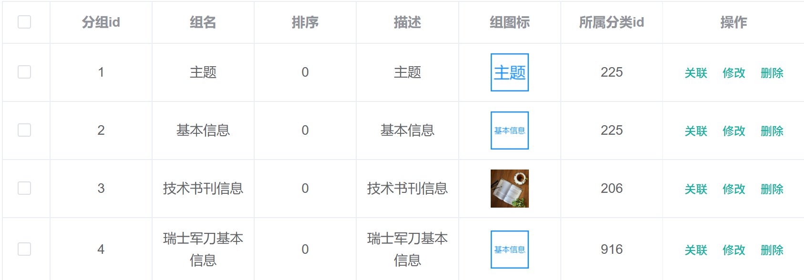
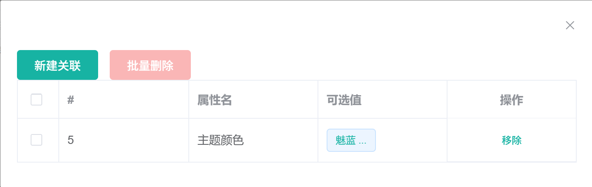
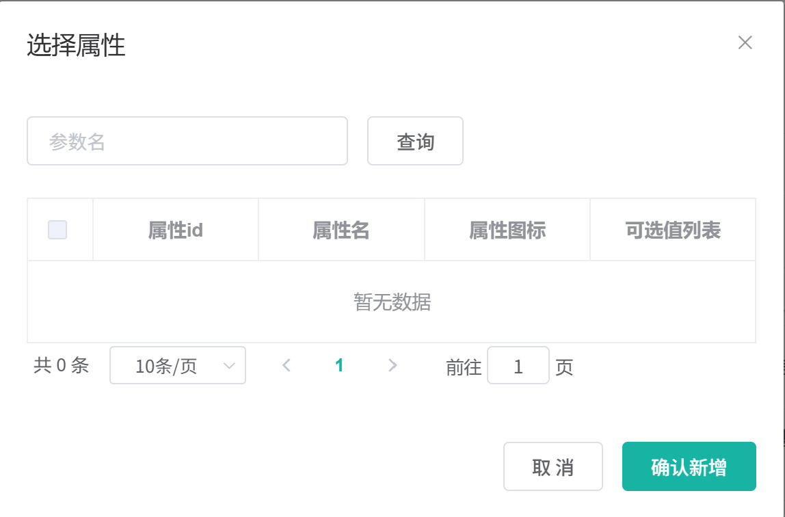
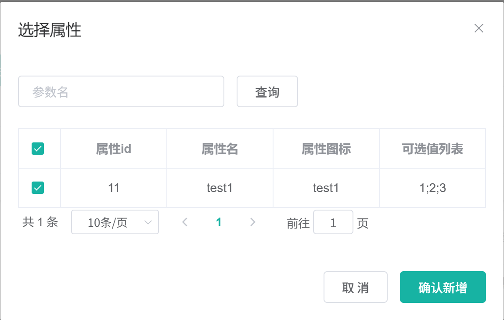

# 6.7 平台属性与分组关联-介绍

> 本篇介绍平台属性与属性分组的关联：关联表存什么、管理员怎么在属性分组弹窗里维护关联、已关联和未关联属性怎么查、一个属性为什么只能属于一个分组、销售属性和基本属性在关联时有什么区别、批量关联和批量移除怎么实现，以及前后端数据怎么流转。

---

## 1. 这个功能是干什么的

“平台属性”是管理后台商品系统下的一个菜单，菜单里包含属性分组、规格参数、销售属性三个页面。属性分组是“盒子”，规格参数和销售属性是“内容”，关联功能负责把盒子和内容连起来。

关联功能在业务上有三个作用：

1. **组织商品发布**：商品发布页按属性分组渲染规格参数输入项，分组里有哪些属性，由关联表决定。
2. **组织商品详情**：商品详情页按分组展示规格参数，规格值通过 `attr_id` 找到所属分组。
3. **控制属性唯一归属**：一个基本属性只属于一个分组，避免同一个属性在商品发布页重复出现。

关联表和属性表的关系：

```text
pms_attr（属性，attr_type=1 基本属性）
        │
        │  pms_attr_attrgroup_relation
        │  ├── attr_id       属性 id
        │  ├── attr_group_id 分组 id
        │  └── attr_sort     组内排序
        │
pms_attr_group（属性分组）
        │
pms_category（三级分类）
```

关联表只存 `attr_id` 和 `attr_group_id` 两个业务 id，不存属性名、分组名、分类 id。属性名和分组名查询时再关联，避免改名后出现两份不一致的数据。

平台属性页面管理的内容分两类：

1. **已关联属性**：当前分组下已经拥有的属性。管理员可以查看、单条移除、批量移除。
2. **未关联属性**：当前分组所在分类下、还没有被任何分组引用的基本属性。管理员可以分页查看、按关键字搜索、勾选后批量关联。

销售属性和基本属性在关联时的处理不同：

| 属性类型 | `attr_type` | 是否参与分组关联 | 原因 |
|---|---|---|---|
| 基本属性 | 1 | 参与 | 商品发布和详情按分组展示规格参数 |
| 销售属性 | 0 | 不参与 | 销售属性用于 SKU 组合，不按分组展示 |
| 两者都是 | 2 | 当前不参与 | 未关联查询只查 `attr_type=1` |

为什么关联表不直接在 `pms_attr` 表里加 `attr_group_id` 字段：独立关联表可以表达多对多，也可以保留 `attr_sort` 这种组内排序字段，后续一个属性如果允许进入多个分组，不需要改主表结构。代价是查询已关联属性需要多一次关联表查询，未关联属性需要用 `NOT EXISTS` 子查询。

## 2. 管理员怎么操作

入口：

```text
管理后台 → 商品系统 → 平台属性 → 属性分组 → 行内“关联”
```



属性分组页面右侧每行有一个“关联”按钮，点击后打开关联弹窗。关联弹窗分成外层“关联属性”和内层“选择属性”两个弹窗。管理员可以完成六类操作。

### 2.1 打开关联弹窗

1. 在属性分组列表点击某一行的“关联”。
2. 前端调用 `relationHandle(attrGroupId)`，打开 `attr-group-relation.vue`。
3. 外层弹窗变为可见，调用 `init(attrGroupId)`。
4. 请求 `GET /product/attrgroup/{attrGroupId}/attr/relation`。
5. 后端先查关联表拿到 `attr_id` 列表，再批量查属性表。
6. 返回已关联属性数组，前端赋给 `relationAttrs`，外层表格渲染。

### 2.2 查看已关联属性

1. 外层表格展示属性 id、属性名、可选值。
2. “可选值”列用分号拆分，鼠标悬停显示全部可选值。
3. 每行有“移除”按钮。
4. 表格支持多选，选中后可以点“批量删除”。



### 2.3 查看未关联属性

1. 点击“新建关联”，调用 `addRelation()`。
2. 前端先请求 `GET /product/attrgroup/{attrGroupId}/noattr/relation`，再打开内层弹窗。
3. 后端用一条带 `NOT EXISTS` 的 SQL 查询同分类、基本属性、没有被任何分组引用的属性。
4. 内层弹窗分页展示属性 id、属性名、属性图标、可选值。
5. 可以在搜索框按属性 id 或属性名查询。
6. 勾选属性，内层选择记录在 `innerdataListSelections`。



### 2.4 批量关联

1. 在内层弹窗勾选一个或多个属性。
2. 点击“确认新增”，调用 `submitAddRealtion()`。
3. 前端把每个选中属性转成 `{ attrId, attrGroupId }`。
4. 一次提交到 `POST /product/attrgroup/attr/relation`。
5. 后端把 VO 列表转成关联实体，批量插入 `pms_attr_attrgroup_relation`。
6. 前端重新调用 `init()`，已关联列表刷新。
7. 通知父组件刷新列表。



### 2.5 移除关联

1. 点击行内“移除”，调用 `relationRemove(attrId)`。
2. 前端组装只包含一个元素的数组 `{ attrId, attrGroupId }`。
3. 提交到 `POST /product/attrgroup/attr/relation/delete`。
4. 后端按 `attr_id + attr_group_id` 组合批量删除。
5. 成功后再调用 `init()`，已关联列表刷新。
6. 批量删除与单条删除走同一个接口，只是数组里有多个元素。

### 2.6 直接维护关联表

项目里还有一组代码生成器留下的关联表 CRUD 接口：

```text
/product/attrattrgrouprelation/list
/product/attrattrgrouprelation/info/{id}
/product/attrattrgrouprelation/save
/product/attrattrgrouprelation/update
/product/attrattrgrouprelation/delete
```

前端没有单独的关联表维护页面，这组接口主要用于直接读写 `pms_attr_attrgroup_relation`。它们不做分类校验、属性类型校验和重复校验，直接调用可以写入任意关联。

## 3. 整体设计思路

### 3.1 业务上怎么设计

#### 3.1.1 分组是容器，关联表是桥

属性分组负责“盒子”的信息：

```text
pms_attr_group
├── attr_group_id    分组 id
├── attr_group_name  组名
├── sort             组排序
├── descript         描述
├── icon             组图标
└── catelog_id       所属三级分类
```

属性负责“内容”的信息：

```text
pms_attr
├── attr_id       属性 id
├── attr_name     属性名
├── attr_type     0 销售属性，1 基本属性，2 两者都是
├── value_select  可选值
├── search_type   是否可检索
├── show_desc     是否快速展示
└── catelog_id    所属三级分类
```

关联表负责把两者连起来：

```text
pms_attr_attrgroup_relation
├── id            关联记录主键
├── attr_id       属性 id
├── attr_group_id 分组 id
└── attr_sort     属性在组内排序
```

一个分组可以关联多个属性。业务上约定一个属性只属于一个分组，但数据库层面没有唯一约束。

#### 3.1.2 已关联与未关联分开查

关联弹窗需要两份数据：

1. **已关联**：当前分组已经拥有的属性，允许移除。
2. **未关联**：当前分组可以添加的属性，允许勾选。

两份数据分开查询，不在前端做差集，原因有两个：

1. 未关联查询需要排除整个关联表，不只是排除当前分组，逻辑放在 SQL 里更准确。
2. 未关联数据需要分页，前端拿到全量属性再做差集会破坏分页语义。

#### 3.1.3 一个属性只能属于一个分组

业务规则是“一个属性只属于一个分组”。这条规则分两层实现：

1. **查询层约束**：未关联查询用 `NOT EXISTS` 排除所有已经被任意分组引用的属性。管理员在页面上正常操作时，选不到已经属于其他分组的属性。
2. **写库层没有约束**：批量新增关联时，后端不检查属性是否已经属于其他分组，也不检查同一请求里是否有重复的 `attrId`。

因此这条规则只在前端和查询层成立。并发提交、直接调用接口、重复点击确认，都可能写入重复关联。生产环境应在关联表上补 `(attr_id)` 唯一索引，或在 Service 里做写前校验。

#### 3.1.4 销售属性与基本属性的区别

未关联查询固定 `attr_type=1`：

1. 基本属性参与分组，商品发布页按分组渲染。
2. 销售属性不参与分组，商品发布页在销售属性步骤单独选择。
3. `attr_type=2` 当前不会出现在未关联列表里，因为 SQL 只查 `1`。

已关联查询没有过滤 `attr_type`，它只按关联表里的 `attr_id` 查属性。如果历史数据或直接调用接口把销售属性写进关联表，已关联列表会把销售属性也查出来。

#### 3.1.5 分类边界

未关联查询要求属性和分组属于同一个三级分类：

```sql
a.catelog_id IN (
    SELECT g.catelog_id
    FROM pms_attr_group g
    WHERE g.attr_group_id = #{attrGroupId}
)
```

原因：

1. 商品发布时按三级分类取分组和属性，跨分类的属性不会出现在发布页。
2. 不同分类可能有同名属性，限定分类可以避免把其他分类的属性关联进来。

批量新增时后端没有再次校验分类，直接调用接口可以绕过这条规则。

#### 3.1.6 删除规则

1. 删除分组：应先删除该分组下的所有关联记录，再删除分组。
2. 删除属性：应先删除该属性在所有分组下的关联记录，再删除属性。
3. 删除分类：分类是逻辑删除，分组和属性不会被物理删除，但会变成分类树上看不到的孤立数据。

当前代码只实现了“删除分组本身”和“删除属性本身”，关联表清理没有做。删除分组后，已关联查询仍然能查到属性，但分组已经不存在；删除属性后，关联表里会留下找不到属性的 `attr_id`。

#### 3.1.7 关联顺序与 `attr_sort`

关联表有 `attr_sort` 字段，但当前批量新增时不赋值，已关联查询也不排序。因此：

1. 属性在分组内的展示顺序不稳定。
2. 商品详情页按分组展示时，属性顺序依赖数据库默认顺序。
3. 业务上如果需要“组内排序”，应该在关联保存时维护 `attr_sort`，查询时按它排序。

### 3.2 技术上怎么设计

#### 3.2.1 独立关联表

`pms_attr_attrgroup_relation` 只存关联关系和组内排序：

1. 新增关联：插入一条 `attr_id + attr_group_id`。
2. 删除关联：按两个 id 精确删除。
3. 查已关联：按 `attr_group_id` 查 `attr_id`，再批量查属性。
4. 查未关联：用 `NOT EXISTS` 排除关联表里出现过的属性。

#### 3.2.2 已关联属性分两步查

已关联查询不直接 JOIN 属性表，而是：

1. 按 `attr_group_id` 查关联表，拿到 `attr_id` 列表。
2. 如果列表为空，直接返回空列表。
3. 否则用 `selectByIds()` 批量查 `pms_attr`。

这样拆分的原因：

1. 关联表查询和属性查询可以分别复用。
2. 避免在 Mapper 里写多表结果集，减少映射复杂度。
3. 空集合时提前返回，避免生成 `IN ()`。

#### 3.2.3 未关联属性用一条 SQL 完成

未关联查询把三个条件写进一条 SQL：

1. `attr_type = 1`：只查基本属性。
2. `catelog_id` 等于分组所属分类：只查同分类属性。
3. `NOT EXISTS` 排除已经被任意分组引用的属性。

分页由 MyBatis-Plus 分页插件在 SQL 外层拼接，`COUNT` 也自动生成。

#### 3.2.4 批量新增用 VO 转实体

前端只提交 `attrId + attrGroupId`，用 `AttrGroupRelationVo` 接收。Service 把 VO 逐个转成 `AttrAttrgroupRelationEntity`，再调用 `IService.saveBatch()` 批量插入。

这样设计的原因：

1. VO 比完整实体轻，前端不需要提交 `attr_sort` 等字段。
2. `BeanUtils.copyProperties()` 避免手写逐字段赋值。
3. `saveBatch()` 按批次拼接插入语句，比循环单条插入少很多数据库往返。

#### 3.2.5 批量删除用 `OR` 拼条件

MyBatis-Plus 的 `remove()` 不擅长表达多组 `(attr_id, attr_group_id)` 组合条件，所以使用自定义 XML：

```sql
DELETE FROM pms_attr_attrgroup_relation
WHERE (attr_id = ? AND attr_group_id = ?)
   OR (attr_id = ? AND attr_group_id = ?)
   ...
```

一条 SQL 删除多条关联，条件同时带两个 id，避免误删同一属性在其他分组下的关联。

#### 3.2.6 通用 CRUD 与业务接口并存

关联表有两套入口：

1. **业务接口**：`/product/attrgroup/{attrgroupId}/attr/relation`、`/noattr/relation`、`/attr/relation`、`/attr/relation/delete`。这些接口由属性分组页面使用，查询条件带分组和分类语义。
2. **通用 CRUD**：`/product/attrattrgrouprelation/list`、`/info`、`/save`、`/update`、`/delete`。这些接口由代码生成器生成，直接按主键操作关联表。

两套入口写同一张表，但校验强度不同。业务接口至少有“未关联查询”的筛选，通用 CRUD 没有任何业务校验。

#### 3.2.7 事务边界

| 方法 | 事务 | 说明 |
|---|---|---|
| `AttrAttrgroupRelationServiceImpl.saveBatch()` | 没有显式事务 | 内部调用父类 `saveBatch()`，同类自调用，父类方法上的事务代理不生效 |
| `AttrServiceImpl.deleteRelation()` | 没有显式事务 | 一条自定义删除 SQL，单条语句本身原子 |
| `AttrServiceImpl.getNoRelationAttr()` | 只读 | 不需要事务 |
| `AttrMethod.getRelationAttr()` | 只读 | 两次查询，不需要事务 |

批量插入和批量删除都没有额外事务注解，中途失败可能出现部分成功。

#### 3.2.8 查询逻辑放在 `AttrMethod`

`AttrMethod.getRelationAttr()` 被两处使用：

1. `AttrGroupServiceImpl.getAttrGroupWithAttrsByCatelogId()` 组装“分组带属性”。
2. `AttrServiceImpl.getRelationAttr()` 直接委托它。

把查询放在 Method 层，只依赖 `AttrAttrgroupRelationDao` 和 `AttrDao`，不依赖任何 Service，避免 `AttrGroupService` 和 `AttrService` 互相调用形成循环依赖。

## 4. 详细代码、配置和解释

关联功能从后台弹窗的一次点击，到 MySQL 里的一行记录，会经过页面、网关、Controller、Service、Method、DAO 和 MyBatis XML。下面按参与这条链路的类逐层展开：每个类先说明它在业务上解决什么问题、上游由谁调用、下游依赖什么，再给出代码并逐段解释，最后列出边界和可优化点。代码块按链路顺序排列，可以和前面的设计章节对照阅读。

### 4.1 AttrAttrgroupRelationEntity：关联表映射

#### 4.1.1 这个类解决什么问题

属性分组弹窗里的“已关联”“未关联”“批量关联”“批量移除”，最终都落到 `pms_attr_attrgroup_relation` 这一张表。管理员勾选属性点“确认新增”时，前端提交的是 `attrId + attrGroupId`，Service 需要把两个 id 变成一条数据库记录；点“移除”时，又要按这两个 id 找到并删除记录。这个实体就是关联表的 Java 映射，承担三件事：

1. 把 `pms_attr_attrgroup_relation` 的列映射成 Java 字段，供 MyBatis-Plus 增删改查；
2. 作为批量插入的载体，接收 VO 转换后的 `attrId`、`attrGroupId`；
3. 作为批量删除条件的载体，让删除 SQL 能同时拿到两个业务 id。

它的上游是 `AttrAttrgroupRelationServiceImpl.saveBatch()`、`AttrServiceImpl.deleteRelation()` 和 `AttrAttrgroupRelationController` 的通用 CRUD；下游是 MyBatis-Plus 的 `BaseMapper` 和 `AttrAttrgroupRelationDao.xml`。实体本身不做分类校验、类型校验和重复校验，这些规则要么在查询层完成，要么根本没有实现。

关联关系没有直接做成 `pms_attr.attr_group_id` 字段，原因有三点：分组和属性在表结构上按多对多设计；关联表可以单独保存 `attr_sort` 组内排序；属性换分组时只改关联表，不动属性主数据。代价是查询已关联属性要多访问一张表，未关联属性需要用 `NOT EXISTS` 排除已被引用的属性。

#### 4.1.2 字段与业务含义

| 字段 | 数据库列 | 业务含义 | 说明 |
|---|---|---|---|
| `id` | `id` | 关联记录主键 | 数据库自增，通用 CRUD 按它定位记录 |
| `attrId` | `attr_id` | 属性 id | 对应 `pms_attr.attr_id`，没有外键约束 |
| `attrGroupId` | `attr_group_id` | 属性分组 id | 对应 `pms_attr_group.attr_group_id`，没有外键约束 |
| `attrSort` | `attr_sort` | 属性在组内的排序 | 批量新增不赋值，已关联查询也不排序 |

表里只保存两个业务 id 和排序字段，不冗余属性名、分组名和分类 id。属性改名或分组改名后，关联表不需要同步，名称在查询时关联属性表获得。

#### 4.1.3 代码与解释

关联表实体只映射四个字段，下面这段代码定义实体、表名和主键的对应关系：

```java
@Data
@TableName("pms_attr_attrgroup_relation")
public class AttrAttrgroupRelationEntity implements Serializable {
	private static final long serialVersionUID = 1L;

	/**
	 * id
	 */
	@TableId
	private Long id;
	/**
	 * 属性id
	 */
	private Long attrId;
	/**
	 * 属性分组id
	 */
	private Long attrGroupId;
	/**
	 * 属性组内排序
	 */
	private Integer attrSort;

}
```

1. `@Data`：Lombok 生成 getter、setter、`toString`、`equals`、`hashCode`。MyBatis-Plus 写结果集、`BeanUtils.copyProperties()` 拷贝字段都依赖这些访问器。
2. `@TableName("pms_attr_attrgroup_relation")`：声明实体对应的表名，MyBatis-Plus 据此生成 `INSERT INTO pms_attr_attrgroup_relation ...`、`DELETE FROM pms_attr_attrgroup_relation ...` 等 SQL。
3. `implements Serializable` 和 `serialVersionUID`：实体可以序列化，便于缓存、远程传输和框架处理。
4. `@TableId` 标在 `id` 上：主键是 `id`，插入后能把数据库自增的主键回填到对象里；全局配置 `id-type: auto` 决定使用数据库自增。
5. `attrId`：要关联的属性 id。新增时由前端选择，删除时用于定位记录。
6. `attrGroupId`：关联到哪个分组，或者从哪个分组移除。分组 id 由弹窗打开时传入，前端不会让管理员改。
7. `attrSort`：组内排序字段。当前新增时不赋值，查询时也不使用，字段只作为后续扩展预留。

字段名和列名的对应关系由 MyBatis-Plus 的驼峰映射自动完成，不需要在每个字段上写 `@TableField`。

#### 4.1.4 一次读写示例

管理员在分组 10 下批量关联属性 1、2，Service 批量插入后实际执行：

```sql
INSERT INTO pms_attr_attrgroup_relation (attr_id, attr_group_id)
VALUES (1, 10), (2, 10);
```

`id` 由数据库自增，`attr_sort` 没有传值，写入 `NULL`。

打开弹窗查询已关联属性时，先按分组查关联表：

```sql
SELECT id, attr_id, attr_group_id, attr_sort
FROM pms_attr_attrgroup_relation
WHERE attr_group_id = 10;
```

拿到 `attr_id` 列表后，再用 `pms_attr` 查属性详情。关联表只负责“谁属于谁”，属性展示字段不在这张表里。

移除属性 1 时：

```sql
DELETE FROM pms_attr_attrgroup_relation
WHERE (attr_id = 1 AND attr_group_id = 10);
```

删除条件同时带两个 id，同一属性在其他分组下的关联不会被误删。

#### 4.1.5 它不做什么

1. 不校验 `attrId` 对应的属性是否存在。
2. 不校验 `attrGroupId` 对应的分组是否存在。
3. 不校验属性和分组是否属于同一个三级分类。
4. 不校验属性的 `attr_type` 是否为基本属性。
5. 不阻止同一个 `attrId + attrGroupId` 重复插入。
6. 不维护 `attrSort`，新增记录默认没有组内顺序。

#### 4.1.6 边界与可优化点

1. 表上没有 `(attr_id)` 唯一索引，业务规则“一个属性只属于一个分组”无法在写库层成立。
2. 表上没有 `(attr_id, attr_group_id)` 唯一索引，同一组合可以重复插入。
3. `attr_sort` 没有默认值，批量新增后是 `NULL`，按它排序时顺序不稳定。
4. 没有外键，删除属性或分组后关联记录会留下，形成孤立数据。
5. 通用 CRUD 直接写实体，可以写入任意 id 组合，实体层没有兜底校验。

### 4.2 AttrGroupRelationVo：关联关系的入参

#### 4.2.1 这个类解决什么问题

关联弹窗只有两个写操作：批量新增和批量移除。两边提交的请求体结构完全一样，都是“属性 id + 分组 id”的数组。这个 VO 是前后端之间的最小协议，不映射数据库表，只负责接住这两个字段。

它的上游是 `AttrGroupController.attrRelationAdd()` 和 `AttrGroupController.attrRelationDelete()`；下游是 `AttrAttrgroupRelationServiceImpl.saveBatch()` 和 `AttrServiceImpl.deleteRelation()`，两个 Service 都把 VO 转成实体。新增需要 `attrGroupId` 告诉后端关联到哪个分组，删除需要两个 id 一起才能精确删掉某一条关联。

为什么新增和删除共用一个 VO：前端组装数据的代码可以复用；后端转换逻辑一致；请求体只暴露必要的两个 id，属性名、分类 id、排序等字段不从前端接收。

#### 4.2.2 字段与请求体

| 字段 | 类型 | 新增时含义 | 删除时含义 |
|---|---|---|---|
| `attrId` | `Long` | 要关联的属性 id | 要解除关联的属性 id |
| `attrGroupId` | `Long` | 关联到哪个分组 | 从哪个分组解除关联 |

新增时前端提交：

```json
[
  { "attrId": 1, "attrGroupId": 10 },
  { "attrId": 2, "attrGroupId": 10 }
]
```

删除时提交的是同样的结构，只是数组里通常只有一个元素：

```json
[
  { "attrId": 1, "attrGroupId": 10 }
]
```

#### 4.2.3 代码与解释

VO 只有两个字段，下面这段代码定义新增和删除共用的请求结构：

```java
@Data
public class AttrGroupRelationVo {

    /** 属性 id */
    private Long attrId;

    /** 属性分组 id */
    private Long attrGroupId;
}
```

1. `@Data`：生成 getter 和 setter，Spring MVC 反序列化 JSON 时通过 setter 写字段。
2. `attrId`：属性 id，新增时来自内层“选择属性”表格的勾选行，删除时来自外层“已关联”表格的行。
3. `attrGroupId`：分组 id，来自弹窗打开时记录的 `attrGroupId`，不是管理员手工输入。
4. 类里没有 `id` 和 `attrSort`：前端不需要知道关联记录主键，也不需要维护组内排序；插入时主键由数据库生成，排序保持 `NULL`。

字段名和 JSON 属性名完全一致，Spring MVC 默认按名字绑定，不需要 `@JsonProperty`。

#### 4.2.4 一次请求示例

管理员在分组 10 的未关联弹窗里勾选属性 3、4，点击“确认新增”：

```text
POST /gulimall/product/attrgroup/attr/relation
Content-Type: application/json

[
  { "attrId": 3, "attrGroupId": 10 },
  { "attrId": 4, "attrGroupId": 10 }
]
```

Spring MVC 把它反序列化成 `List<AttrGroupRelationVo>`，Controller 原样交给 Service。Service 逐条转成 `AttrAttrgroupRelationEntity`，`attrSort` 保持 `null`。

#### 4.2.5 它不做什么

1. 不携带分类 id，后端无法凭请求体判断属性和分组是否同分类。
2. 不携带属性类型，后端无法凭请求体判断是否基本属性。
3. 不携带关联记录主键，删除只能按两个业务 id 组合匹配。
4. 不做参数校验，两个 id 都可以传 `null`。

#### 4.2.6 边界与可优化点

1. 可以在 `attrId` 和 `attrGroupId` 上加 `@NotNull`，并在 Controller 参数上加 `@Valid`，先挡住空值。
2. 可以增加 `catelogId` 字段，让后端在写库前校验分类一致性，但会增加前端组装成本。
3. 新增和删除共用 VO 减少了类型数量，但两边的校验需求不同；生产环境可以拆成 `AttrGroupRelationAddVo` 和 `AttrGroupRelationDeleteVo`。
4. VO 没有版本或幂等标识，重复提交同一批数据无法识别。

### 4.3 AttrAttrgroupRelationController：关联表通用 CRUD

#### 4.3.1 这个类解决什么问题

属性分组弹窗真正使用的四个接口在 `AttrGroupController` 里，这个 Controller 是代码生成器生成的通用 CRUD，用来直接维护 `pms_attr_attrgroup_relation`：分页列表、按主键查详情、新增一条、按主键修改、按主键批量删除。

它的上游是直接 HTTP 调用、接口调试工具，或者以后可能挂到后台菜单上的运维页面；下游是 `AttrAttrgroupRelationService` 和 MyBatis-Plus。它不处理属性分组页面的业务语义：没有“按分组查已关联”，没有“查未关联”，没有“按分类过滤”，也没有“属性和分组必须同分类”的校验。业务弹窗走的是 `AttrGroupController`，两边写同一张表，但规则强度不同。

这个类存在的主要价值是保留代码生成器的接口形状，方便在数据库层面排查和修复关联数据。生产环境如果不需要直接维护关联表，应该限制权限或下线这组接口。

#### 4.3.2 接口清单

| 操作 | 方法与路径 | 权限 | 调用的 Service 方法 |
|---|---|---|---|
| 分页列表 | `/product/attrattrgrouprelation/list` | `product:attrattrgrouprelation:list` | `queryPage()` |
| 按主键查详情 | `/product/attrattrgrouprelation/info/{id}` | `product:attrattrgrouprelation:info` | `getById()` |
| 新增一条 | `/product/attrattrgrouprelation/save` | `product:attrattrgrouprelation:save` | `save()` |
| 按主键修改 | `/product/attrattrgrouprelation/update` | `product:attrattrgrouprelation:update` | `updateById()` |
| 按主键批量删除 | `/product/attrattrgrouprelation/delete` | `product:attrattrgrouprelation:delete` | `removeByIds()` |

五个接口都使用 `@RequestMapping`，没有限定 GET 或 POST，实际访问时两种方法都能进入方法体。

#### 4.3.3 代码与解释

五个接口形状统一，下面这段代码是通用的分页、详情、新增、修改、删除入口：

```java
@RestController
@RequestMapping("product/attrattrgrouprelation")
public class AttrAttrgroupRelationController {
    @Autowired
    private AttrAttrgroupRelationService attrAttrgroupRelationService;

    /**
     * 列表
     */
    @RequestMapping("/list")
    @RequiresPermissions("product:attrattrgrouprelation:list")
    public R list(@RequestParam Map<String, Object> params){
        PageUtils page = attrAttrgroupRelationService.queryPage(params);

        return R.ok().put("page", page);
    }


    /**
     * 信息
     */
    @RequestMapping("/info/{id}")
    @RequiresPermissions("product:attrattrgrouprelation:info")
    public R info(@PathVariable("id") Long id){
		AttrAttrgroupRelationEntity attrAttrgroupRelation = attrAttrgroupRelationService.getById(id);

        return R.ok().put("attrAttrgroupRelation", attrAttrgroupRelation);
    }

    /**
     * 保存
     */
    @RequestMapping("/save")
    @RequiresPermissions("product:attrattrgrouprelation:save")
    public R save(@RequestBody AttrAttrgroupRelationEntity attrAttrgroupRelation){
		attrAttrgroupRelationService.save(attrAttrgroupRelation);

        return R.ok();
    }

    /**
     * 修改
     */
    @RequestMapping("/update")
    @RequiresPermissions("product:attrattrgrouprelation:update")
    public R update(@RequestBody AttrAttrgroupRelationEntity attrAttrgroupRelation){
		attrAttrgroupRelationService.updateById(attrAttrgroupRelation);

        return R.ok();
    }

    /**
     * 删除
     */
    @RequestMapping("/delete")
    @RequiresPermissions("product:attrattrgrouprelation:delete")
    public R delete(@RequestBody Long[] ids){
		attrAttrgroupRelationService.removeByIds(Arrays.asList(ids));

        return R.ok();
    }

}
```

1. `@RestController`：类中方法的返回值直接序列化成 JSON，不经过视图解析。
2. `@RequestMapping("product/attrattrgrouprelation")`：五个接口共用这个前缀，经过网关前完整路径是 `/gulimall/product/attrattrgrouprelation/...`。
3. `list()`：从查询参数里取 `page`、`limit` 等，交给 `queryPage()` 分页查询整张关联表，结果放在 `page` 字段。
4. `info()`：按路径里的 `id` 查一条记录，返回字段名是 `attrAttrgroupRelation`。记录不存在时返回 `null`，不会报错。
5. `save()`：接收完整实体，直接调用 `save()` 插入。没有传 `id` 时由数据库自增；没有传 `attrSort` 时写入 `NULL`。
6. `update()`：接收完整实体，调用 `updateById()` 按主键更新。主键为空时 MyBatis-Plus 会拒绝执行。
7. `delete()`：接收主键数组，转成列表后调用 `removeByIds()` 批量删除。删除只按主键，不按 `attr_id + attr_group_id`。
8. 每个方法上的 `@RequiresPermissions`：由 Shiro 校验后台权限，权限字符串和代码生成器的菜单权限对应。

五个方法都没有业务判断，参数进来后直接交给 MyBatis-Plus，属于典型的薄 Controller。

#### 4.3.4 一次请求示例

直接调用通用保存接口写入一条关联：

```text
POST /gulimall/product/attrattrgrouprelation/save
Content-Type: application/json

{ "attrId": 99, "attrGroupId": 88, "attrSort": 1 }
```

执行过程：

```text
1. 网关匹配 product-route，去掉 gulimall 前缀
2. 请求进入 AttrAttrgroupRelationController.save()
3. Shiro 校验 product:attrattrgrouprelation:save
4. attrAttrgroupRelationService.save() 插入
5. SQL：INSERT INTO pms_attr_attrgroup_relation (attr_id, attr_group_id, attr_sort) VALUES (99, 88, 1)
6. 返回 R.ok()
```

即使属性 99 不存在、分组 88 不存在，或者两者跨分类，这条记录仍然会写入成功。

#### 4.3.5 它不做什么

1. 不校验属性、分组是否存在。
2. 不校验属性和分组是否同分类。
3. 不校验 `attr_type` 是否基本属性。
4. 不检查重复关联。
5. 不维护 `attr_sort` 的业务语义。
6. 不按分组或分类过滤列表。
7. 不返回受影响行数，调用方只能根据 `R.ok()` 判断请求是否走通。

#### 4.3.6 边界与可优化点

1. 通用 CRUD 绕过未关联查询的筛选，可以写入任意关联，生产环境应限制权限或下线。
2. `info()` 没有判断记录是否存在，前端可能拿到 `attrAttrgroupRelation: null`。
3. `@RequestMapping` 没有限定 HTTP 方法，读接口也能被 POST 调用，写接口也能被 GET 调用。
4. `list()` 查询整张表，关联数据量大后没有业务意义，应补充分组、分类或属性过滤条件。
5. `save()` 和 `update()` 没有参数校验，`attrId`、`attrGroupId` 为空也会落库。
6. 这组接口和 `AttrGroupController` 的业务接口写同一张表，权限项却分开，审计时容易出现两套规则。

### 4.4 AttrAttrgroupRelationServiceImpl：关联表业务

#### 4.4.1 这个类解决什么问题

批量关联的写入口在这个类里。`AttrGroupController.attrRelationAdd()` 收到前端提交的 `List<AttrGroupRelationVo>` 后，调用 `relationService.saveBatch(vos)`；实现类负责把只有两个 id 的 VO 转成完整实体，再批量插入关联表。同一个类还实现通用 CRUD 的分页查询 `queryPage()`，供 `/product/attrattrgrouprelation/list` 使用。

它的上游有两个：属性分组弹窗的“确认新增”和通用关联表列表接口；下游是 `AttrAttrgroupRelationDao` 和 MySQL。它不做去重、不做分类校验、不做属性类型校验，也不维护 `attrSort`。

#### 4.4.2 方法清单

| 方法 | 调用方 | 作用 |
|---|---|---|
| `queryPage(Map)` | `AttrAttrgroupRelationController.list()` | 分页查询整张关联表 |
| `saveBatch(List<AttrGroupRelationVo>)` | `AttrGroupController.attrRelationAdd()` | VO 批量转实体并插入 |

`saveBatch` 是接口自定义的重载方法，和父类 `IService.saveBatch(Collection<T>)` 同名但参数不同。

#### 4.4.3 代码与解释

下面这段代码同时承担通用分页查询和批量新增两个入口：

```java
@Service("attrAttrgroupRelationService")
public class AttrAttrgroupRelationServiceImpl extends ServiceImpl<AttrAttrgroupRelationDao, AttrAttrgroupRelationEntity> implements AttrAttrgroupRelationService {

    @Override
    public PageUtils queryPage(Map<String, Object> params) {
        IPage<AttrAttrgroupRelationEntity> page = this.page(
                new Query<AttrAttrgroupRelationEntity>().getPage(params),
                new QueryWrapper<AttrAttrgroupRelationEntity>()
        );

        return new PageUtils(page);
    }

    /**
     * 批量保存 属性与属性分组的关联关系
     * 思路：前端传来的 Vo（attrId + attrGroupId）逐个转成关联实体，再调用 IService 自带的 saveBatch 批量插入
     * @param vos 关联关系列表（attrId + attrGroupId）
     */
    @Override
    public void saveBatch(List<AttrGroupRelationVo> vos) {
        if (vos == null || vos.isEmpty()) {
            return;
        }
        // Vo 转实体（字段同名直接拷贝）
        List<AttrAttrgroupRelationEntity> entities = vos.stream().map((vo) -> {
            AttrAttrgroupRelationEntity relationEntity = new AttrAttrgroupRelationEntity();
            BeanUtils.copyProperties(vo, relationEntity);
            return relationEntity;
        }).collect(Collectors.toList());
        // 批量插入关联关系
        this.saveBatch(entities);
    }

}
```

`queryPage` 的执行顺序：

1. `new Query<AttrAttrgroupRelationEntity>().getPage(params)` 把前端传来的 `page`、`limit` 转成 MyBatis-Plus 的 `IPage`。
2. `new QueryWrapper<>()` 没有任何条件，相当于查询整张 `pms_attr_attrgroup_relation`。
3. `this.page(...)` 执行分页查询，分页插件自动拼接 `LIMIT` 并生成 `COUNT`。
4. `new PageUtils(page)` 把 `IPage` 包装成前端需要的 `list` 和 `totalCount` 结构。

`saveBatch` 的执行顺序：

1. 判断入参是否为 `null` 或空列表，空列表直接返回，避免拼出空批量语句。
2. `vos.stream().map(...)` 遍历每个 VO。
3. 每个 VO 创建一个新的 `AttrAttrgroupRelationEntity`，用 `BeanUtils.copyProperties()` 把同名属性 `attrId`、`attrGroupId` 拷过去。
4. `id` 和 `attrSort` 没有被拷贝，保持 `null`，插入时由数据库和默认行为处理。
5. `collect(Collectors.toList())` 收集成实体列表。
6. `this.saveBatch(entities)` 调用父类 `ServiceImpl.saveBatch(Collection<T>)`。`entities` 的类型是 `List<AttrAttrgroupRelationEntity>`，编译期匹配的是父类方法，不是本类接收 `List<AttrGroupRelationVo>` 的重载。

`this.saveBatch(entities)` 属于同类自调用，不经过 Spring 代理，父类方法上的事务注解不会生效。批量插入的每条语句自动提交，中途失败会留下已经插入的部分。

#### 4.4.4 一次批量关联示例

管理员在分组 10 下勾选属性 11、12、13：

```text
1. 前端提交 [{"attrId":11,"attrGroupId":10}, {"attrId":12,"attrGroupId":10}, {"attrId":13,"attrGroupId":10}]
2. AttrGroupController.attrRelationAdd() 接收 List<AttrGroupRelationVo>
3. 调用 AttrAttrgroupRelationServiceImpl.saveBatch(vos)
4. 列表非空，逐个 VO 转成实体，attrSort 为 null
5. 调用父类 saveBatch，批量插入
6. SQL 形如 INSERT INTO pms_attr_attrgroup_relation (attr_id, attr_group_id) VALUES (11,10),(12,10),(13,10)
7. 返回 R.ok()
```

如果三个属性里有一个已经被其他分组关联，批量插入仍然会成功，未关联查询只能保证正常页面操作选不到它，不能保证接口层不写入。

#### 4.4.5 它不做什么

1. 不检查同一请求里是否有重复的 `attrId + attrGroupId`。
2. 不检查属性是否已经属于其他分组。
3. 不检查属性和分组是否属于同一分类。
4. 不检查属性的 `attr_type`。
5. 不写 `attrSort`。
6. 不开显式事务，不保证整批全成功或全失败。
7. 不返回插入条数，调用方无法知道实际写入多少行。

#### 4.4.6 边界与可优化点

1. 可以在写库前调用未关联查询校验 `attrId` 集合，保证正常流程下不会跨分组、跨分类。
2. 可以在关联表上加 `(attr_id, attr_group_id)` 唯一索引，从数据库层阻止重复。
3. 可以给自定义 `saveBatch` 加 `@Transactional(rollbackFor = Exception.class)`，并把批次拆小，避免大事务。
4. `queryPage()` 没有业务过滤条件，关联数据量大时列表接口没有意义。
5. 可以复用 `AttrMethod` 或单独的校验方法，避免 Service 之间重复实现分类判断。
6. 批量插入条数很大时可以按固定批次拆分，降低单条 SQL 的长度和锁持有时间。

### 4.5 AttrMethod：查询分组已关联属性

#### 4.5.1 这个类解决什么问题

已关联属性查询有两个调用方：属性分组弹窗的 `init()`，链路是 `AttrGroupController.attrRelation()` → `AttrServiceImpl.getRelationAttr()`；商品发布页和商品详情页的“分组带属性”接口，链路是 `AttrGroupController.getAttrGroupWithAttrs()` → `AttrGroupServiceImpl.getAttrGroupWithAttrsByCatelogId()`。两边都需要“某个分组下有哪些属性”。

如果这个查询写在 `AttrService` 里，`AttrGroupService` 调 `AttrService`，而 `AttrService` 又可能依赖分组数据，两个 Service 容易形成循环依赖。把它放在独立的 `AttrMethod` 里，只依赖 `AttrAttrgroupRelationDao` 和 `AttrDao`，任何 Service 都可以安全调用。

上游是两个 Service；下游是关联表和属性表。它只读，不写任何数据。

#### 4.5.2 两步查询的链路

```text
attrgroupId
  → 查 pms_attr_attrgroup_relation WHERE attr_group_id = ?
  → 取出 attr_id 列表
  → 列表为空：返回空集合
  → 列表非空：查 pms_attr WHERE attr_id IN (...)
  → 返回 List<AttrEntity>
```

拆成两步而不是写 JOIN，原因有三个：关联表查询和属性查询可以分别复用；Mapper 不需要维护多表结果集映射；空关联时提前返回，避免生成 `IN ()`。

#### 4.5.3 代码与解释

已关联查询只有两步，下面这段代码先查关联表，再批量查属性：

```java
@Component
public class AttrMethod {

    @Autowired
    private AttrAttrgroupRelationDao attrAttrgroupRelationDao;
    @Autowired
    private AttrDao attrDao;

    /**
     * 获取指定属性分组下【已关联】的所有属性
     * 思路：先查关联表拿到该分组下所有 attr_id，再按 id 批量查属性
     *
     * @param attrgroupId 属性分组 id
     */
    public List<AttrEntity> getRelationAttr(Long attrgroupId) {
        // 1、查询该分组下的所有关联记录
        List<AttrAttrgroupRelationEntity> relationEntities = attrAttrgroupRelationDao.selectList(
                new QueryWrapper<AttrAttrgroupRelationEntity>().eq("attr_group_id", attrgroupId));

        // 2、取出关联的属性 id 集合
        List<Long> attrIds = relationEntities.stream()
                .map(AttrAttrgroupRelationEntity::getAttrId)
                .collect(Collectors.toList());

        // 3、按 id 批量查询属性详情（空集合会查空，直接返回）
        if (attrIds.isEmpty()) {
            return Collections.emptyList();
        }
        return attrDao.selectByIds(attrIds);
    }

}
```

1. 注入 `AttrAttrgroupRelationDao` 和 `AttrDao`，只依赖数据访问层，不依赖任何 Service。
2. `selectList(new QueryWrapper<>().eq("attr_group_id", attrgroupId))` 查询当前分组下的所有关联记录。没有排序条件，返回顺序由数据库决定。
3. `relationEntities.stream().map(AttrAttrgroupRelationEntity::getAttrId)` 取出每条记录的属性 id。
4. `collect(Collectors.toList())` 收集成 `List<Long>`。
5. `attrIds.isEmpty()` 判断分组是否为空。空分组直接返回 `Collections.emptyList()`，调用方拿到的是不可变空列表。
6. `attrDao.selectByIds(attrIds)` 按主键批量查询属性。MyBatis-Plus 会生成 `WHERE attr_id IN (?, ?, ...)`。
7. 返回属性列表，顺序通常是数据库返回顺序，不保证和关联表顺序一致。

方法只查两张表，不查分组表。分组名由调用方自己持有，弹窗外层只需要属性列表。

#### 4.5.4 一次查询示例

分组 10 在关联表里有三条记录：`attr_id` 分别是 1、2、3，其中属性 3 已经被物理删除：

```text
1. SELECT * FROM pms_attr_attrgroup_relation WHERE attr_group_id = 10
   → 返回 3 条记录，attr_id = [1, 2, 3]
2. attrIds = [1, 2, 3]
3. SELECT * FROM pms_attr WHERE attr_id IN (1, 2, 3)
   → 只返回属性 1、2
4. 返回 [属性1, 属性2]
```

调用方拿到的属性数量少于关联记录数量，关联表里的 `attr_id=3` 成为孤立数据。

#### 4.5.5 它不做什么

1. 不写关联表，只读。
2. 不校验分组是否存在。分组不存在时，关联表查不到记录，返回空集合。
3. 不按 `attr_sort` 排序。
4. 不过滤 `attr_type`，关联表里有什么属性就查什么属性。
5. 不清理找不到属性的关联记录。

#### 4.5.6 边界与可优化点

1. 已关联属性没有组内排序，`attr_sort` 字段没有参与查询。
2. 两次查询可以合并成一次 JOIN，但拆开更利于复用；属性数量大时 JOIN 的中间结果也不小，需要按实际场景取舍。
3. 属性被删除后关联记录仍然保留，建议在删除属性时同步清理关联表。
4. `selectByIds()` 返回属性完整行，弹窗只展示 id、名称、可选值，可以只查需要的列。
5. 分组下属性很多时，`IN` 列表会很长，可以分页或分批查询。
6. 没有缓存，弹窗每次打开都会访问两次数据库；关联数据变化频率低，可以考虑短 TTL 缓存。

### 4.6 AttrServiceImpl：已关联、未关联与批量解除

#### 4.6.1 这个类解决什么问题

属性分组弹窗的三个读接口和删除接口，最终都落在这个类：

1. 打开弹窗查已关联属性：`AttrGroupController.attrRelation()` → `getRelationAttr()`；
2. 点击“新建关联”查未关联属性：`AttrGroupController.attrNoRelation()` → `getNoRelationAttr()`；
3. 单条移除或批量移除：`AttrGroupController.attrRelationDelete()` → `deleteRelation()`。

它处在 Controller 和数据访问之间，负责把 Controller 的请求参数转成查询条件、调用 Method 或 DAO、把结果包装成 `PageUtils` 或 `List`。它不拼未关联 SQL，SQL 在 `AttrDao.xml`；它不实现已关联的两步查询，逻辑在 `AttrMethod`。

上游是 `AttrGroupController`；下游是 `AttrMethod`、`AttrAttrgroupRelationDao` 和 `AttrDao`。

#### 4.6.2 已关联查询：转发 AttrMethod

属性分组弹窗打开时，`init()` 请求 `GET /product/attrgroup/{attrgroupId}/attr/relation`。Controller 调用的就是下面这个方法，它只做转发：

```java
    /**
     * 获取指定属性分组下【已关联】的所有属性
     * 思路：先查关联表拿到该分组下所有 attr_id，再按 id 批量查属性
     *
     * @param attrgroupId 属性分组 id
     */
    @Override
    public List<AttrEntity> getRelationAttr(Long attrgroupId) {
        return attrMethod.getRelationAttr(attrgroupId);
    }
```

1. 方法签名和 `AttrMethod.getRelationAttr()` 完全一致，入参是分组 id，返回属性列表。
2. 方法体只有一行 `attrMethod.getRelationAttr(attrgroupId)`，真正的两步查询在 Method 层。
3. 这样 `AttrGroupService` 和 `AttrService` 共用同一份实现，不需要各写一遍。

转发而不是复制实现，保证两个调用方看到同一套数据规则：都先查关联表，再批量查属性，空关联返回空列表。

#### 4.6.3 批量解除关联

移除关联时，前端提交一个 VO 数组，数组里可以有一个元素，也可以有多个。Service 需要把每个 VO 转成实体，再交给 DAO 按 `attr_id + attr_group_id` 组合删除。

```java
    /**
     * 删除属性与属性分组的关联关系
     * 思路：前端传的 Vo 转成实体后，按 attr_id + attr_group_id 批量精确删除
     *
     * @param vos 关联关系（attrId + attrGroupId），可批量
     */
    @Override
    public void deleteRelation(AttrGroupRelationVo[] vos) {
        if (vos == null || vos.length == 0) {
            return;
        }
        // 1、Vo 列表转成关联实体列表（字段同名直接拷贝）
        List<AttrGroupRelationVo> relationVos = Arrays.asList(vos);
        List<AttrAttrgroupRelationEntity> entities = relationVos.stream().map((relationVo) -> {
            AttrAttrgroupRelationEntity relationEntity = new AttrAttrgroupRelationEntity();
            BeanUtils.copyProperties(relationVo, relationEntity);
            return relationEntity;
        }).collect(Collectors.toList());

        // 2、根据 attrId + attrGroupId 批量删除关联关系（XML 中 deleteBatchRelation）
        attrAttrgroupRelationDao.deleteBatchRelation(entities);
    }
```

执行顺序：

1. `vos == null || vos.length == 0` 时直接返回。空数组如果继续往下走，XML 的 `<foreach>` 会拼出没有条件的 `DELETE`，导致 SQL 语法错误。
2. `Arrays.asList(vos)` 把数组转成列表，方便 Stream 处理。
3. `map` 遍历每个 VO，创建新的 `AttrAttrgroupRelationEntity`。
4. `BeanUtils.copyProperties()` 只拷贝同名的 `attrId` 和 `attrGroupId`，`id` 和 `attrSort` 保持 `null`。
5. `attrAttrgroupRelationDao.deleteBatchRelation(entities)` 调用自定义删除方法，XML 为每个实体拼一个 `(attr_id = ? AND attr_group_id = ?)` 条件，用 `OR` 连接。
6. 一条 `DELETE` 删除所有匹配记录，返回值为 `void`，调用方不知道实际删了多少行。

删除条件同时带两个 id，原因是一个属性可能被错误地写进多个分组；如果只按 `attr_id` 删除，会把其他分组的关联一起删掉。

#### 4.6.4 未关联属性查询

“新建关联”弹窗需要展示当前分组还能关联哪些属性。规则是三条：同分类、基本属性、没有被任何分组引用。这三条条件放在 SQL 里一次完成，Service 只负责分页对象和关键字。

```java
    /**
     * 获取指定属性分组下【未关联】的属性（分页）
     * 规则：
     * 1. 当前分组只能关联自己所属分类里的【基本属性】(attr_type=1)
     * 2. 当前分组只能关联【本分类下其它分组都未引用】的属性
     *
     * @param params      分页/模糊查询参数（key: 按属性id/属性名模糊）
     * @param attrgroupId 属性分组 id
     */
    @Override
    public PageUtils getNoRelationAttr(Map<String, Object> params, Long attrgroupId) {

        /*
            表设计的问题导致需要额外进行多次SQL查询
            可以直接删除分组属性关系表，在属性表中新增字段attr_group_id，null说明没有绑定分组
            关联功能分析
                1.新增
                    因为新增属性每次必须指定分组关联，因此属性必定有关联分组，此时新增功能只需额外设置attr_group_id即可
                2.删除
                    删除时设置attr_group_id=null即可
                3.关联查询
                    新增条件attr_group_id is not null过滤非关联的数据
                4.当前功能
                    无需进行多个SQL查询，只需要查询attr_group_id is null的记录即可
         */

        /*
            多表联查SQL
            SELECT *
            FROM pms_attr a
            WHERE a.attr_type = 1
              AND a.catelog_id IN (
                    SELECT g.catelog_id
                    FROM pms_attr_group g
                    WHERE g.attr_group_id = #{attrgroupId}
              )
              -- 这个属性没被任何分组关联
              AND NOT EXISTS (
                    SELECT 1
                    FROM pms_attr_attrgroup_relation r
                    WHERE r.attr_id = a.attr_id
              )
              AND ( a.attr_id = #{key} OR a.attr_name LIKE CONCAT('%', #{key}, '%')
         */
        IPage<AttrEntity> page = new Query<AttrEntity>().getPage(params);
        String key = (String) params.get("key");
        IPage<AttrEntity> result = this.baseMapper.selectNoRelationAttr(page, attrgroupId, key);
        return new PageUtils(result);

//        // 常规思路：单表查询实现
//        // 1、当前分组只能关联自己所属分类里面的所有属性
//        //    先查出当前分组所属的分类
//        AttrGroupEntity attrGroupEntity = attrGroupDao.selectById(attrgroupId);
//        Long catelogId = attrGroupEntity.getCatelogId();
//
//        // 2、当前分组只能关联别的分组没有引用的属性
//        // 2.1 查出当前分类下的所有分组
//        List<AttrGroupEntity> attrGroupEntities = attrGroupDao.selectList(
//                new QueryWrapper<AttrGroupEntity>().eq("catelog_id", catelogId));
//        List<Long> attrGroupIds = attrGroupEntities.stream()
//                .map(AttrGroupEntity::getAttrGroupId)
//                .collect(Collectors.toList());
//
//        // 2.2 查出这些分组（含当前分组自己）已关联的所有属性 id
//        List<AttrAttrgroupRelationEntity> relationEntities = attrAttrgroupRelationDao.selectList(
//                new QueryWrapper<AttrAttrgroupRelationEntity>()
//                        .in(!attrGroupIds.isEmpty(), "attr_group_id", attrGroupIds));
//        List<Long> attrIds = relationEntities.stream()
//                .map(AttrAttrgroupRelationEntity::getAttrId)
//                .collect(Collectors.toList());
//
//        // 3、查询同分类下的基本属性，并排除掉上面已被引用的属性
//        QueryWrapper<AttrEntity> wrapper = new QueryWrapper<AttrEntity>()
//                .eq("catelog_id", catelogId)
//                .eq("attr_type", AttrEnum.ATTR_TYPE_BASE.getCode());
//        if (!attrIds.isEmpty()) {
//            wrapper.notIn("attr_id", attrIds);
//        }
//
//        // 4、模糊查询（按属性 id 精确 or 属性名模糊）
//        String key = (String) params.get("key");
//        if (StringUtils.isNotEmpty(key)) {
//            wrapper.and((w) -> w.eq("attr_id", key).or().like("attr_name", key));
//        }
//
//        // 5、分页查询并返回
//        IPage<AttrEntity> page = this.page(new Query<AttrEntity>().getPage(params), wrapper);
//        return new PageUtils(page);
    }
```

执行顺序：

1. 方法体开头保留了一段表设计说明，记录“把 `attr_group_id` 放进属性表、用 `NULL` 表示未关联”的另一种方案。当前表结构采用独立关联表，所以未关联查询需要排除关联表里出现过的属性。
2. 第二段注释是等价的多表联查 SQL，说明筛选条件的来源。
3. `new Query<AttrEntity>().getPage(params)` 把 `page`、`limit` 转成 `IPage`。
4. `params.get("key")` 取出关键字，前端搜索框按属性 id 或属性名查询。
5. `this.baseMapper.selectNoRelationAttr(page, attrgroupId, key)` 调用 `AttrDao` 的专用分页方法，SQL 在 XML 里。
6. `new PageUtils(result)` 包装成前端需要的分页结构，Controller 再放进 `R.ok().put("page", page)`。
7. 后面大段注释是“先查分类、再查分组、再查已关联、最后 `notIn` 排除”的单表实现。当前没有启用，实际走一条 SQL。

为什么用 SQL 联查：应用层实现需要查分组、查同分类分组、查已关联属性、再分页查属性，至少四次数据库往返；一条 SQL 把筛选和分页都交给数据库，减少往返，也避免把大量属性 id 拉到内存做 `notIn`。

`NOT EXISTS` 只按 `attr_id` 判断，不限定分类和分组。这意味着属性只要被任意分组引用过，就不会出现在未关联列表里，符合“一个属性只属于一个分组”的业务约定。

#### 4.6.5 一次未关联查询示例

分组 10 属于三级分类 225，搜索关键字“内存”：

```text
1. 前端请求 GET /gulimall/product/attrgroup/10/noattr/relation?page=1&limit=10&key=内存
2. AttrGroupController.attrNoRelation() 接收参数
3. AttrServiceImpl.getNoRelationAttr(params, 10)
4. 生成 IPage，取出 key = 内存
5. AttrDao.selectNoRelationAttr(page, 10, 内存)
6. SQL：
   SELECT a.*
   FROM pms_attr a
   WHERE a.attr_type = 1
     AND a.catelog_id IN (SELECT g.catelog_id FROM pms_attr_group g WHERE g.attr_group_id = 10)
     AND NOT EXISTS (SELECT 1 FROM pms_attr_attrgroup_relation r WHERE r.attr_id = a.attr_id)
     AND (a.attr_id = '内存' OR a.attr_name LIKE '%内存%')
   LIMIT 0, 10
7. 返回分页结果，前端渲染内层表格
```

`a.attr_id = '内存'` 依赖数据库的隐式类型转换，通常不会报错，但会让 `attr_id` 上的索引失效。

#### 4.6.6 它不做什么

1. 不实现已关联的两步查询，只转发给 `AttrMethod`。
2. 不拼未关联 SQL，筛选逻辑在 `AttrDao.xml`。
3. 不校验删除的关联是否属于当前操作人所在分组。
4. 不清理删除属性或分组后留下的孤立关联。
5. 不维护 `attr_sort`。
6. 不缓存查询结果。

#### 4.6.7 边界与可优化点

1. `deleteRelation()` 没有事务注解，批量删除中途失败会留下部分已删除数据。
2. `deleteRelation()` 没有校验数组元素是否为 `null`，直接调用 DAO 时可能生成空条件。
3. 删除用多个 `OR` 拼接，关联数量大时 SQL 会很长，应分批或改成元组 `IN`。
4. 未关联 SQL 的 `catelog_id IN (子查询)` 结果只有一个分类 id，可以改成 `=`。
5. 未关联 SQL 的 `attr_type = 1` 是魔法数字，可以改成枚举常量。
6. 未关联查询没有 `ORDER BY`，分页结果顺序不稳定，翻页时可能看到重复或遗漏。
7. 方法体里保留了大段注释代码和设计说明，长期应移到设计文档，减少方法体积。

### 4.7 AttrDao 与 AttrDao.xml：未关联属性查询

#### 4.7.1 这个类解决什么问题

未关联属性列表需要同时满足四个条件：属于当前分组所在的三级分类、是基本属性、没有被任何分组引用、支持按属性 id 或名称搜索，并且要分页。把条件拆到应用层会变成多次查询和内存过滤，分页也会失真，所以由 `AttrDao` 提供一个专用分页方法，SQL 在 `AttrDao.xml` 里一次完成。

它的上游是 `AttrServiceImpl.getNoRelationAttr()`；下游是三张表：`pms_attr`、`pms_attr_group`、`pms_attr_attrgroup_relation`。接口本身只声明方法，真正的筛选、分页和结果映射都在 XML 和 MyBatis-Plus 分页插件里。

#### 4.7.2 接口约定

接口只声明方法签名，下面这段代码定义分页参数和两个查询参数：

```java
    /**
     * 分页查询指定属性分组【未关联】的属性
     * <p>条件：基本属性 + 属于该分组所属分类 + 关系表中没有任何关联记录</p>
     * @param page        MyBatis-Plus 分页对象（由分页插件自动拼接 LIMIT，并生成 COUNT）
     * @param attrGroupId 属性分组 id
     * @param key         模糊查询关键字（按属性 id / 属性名），可为 null
     * @return 未关联的属性分页结果
     */
    IPage<AttrEntity> selectNoRelationAttr(IPage<AttrEntity> page,
                                           @Param("attrGroupId") Long attrGroupId,
                                           @Param("key") String key);
```

1. 第一个参数是 `IPage<AttrEntity>`，MyBatis-Plus 分页插件识别到它后，会在 SQL 外层拼接 `LIMIT`，并自动生成 `COUNT` 查询。
2. `@Param("attrGroupId")` 给分组 id 起名，XML 里用 `#{attrGroupId}` 引用。
3. `@Param("key")` 给关键字起名，XML 里用 `#{key}` 引用；关键字可以为 `null`。
4. 返回类型是 `IPage<AttrEntity>`，分页插件会把查询结果和总数写回这个对象。

接口没有写 `@Mapper` 注解，Mapper 注册依赖启动类上的 `@MapperScan` 或 MyBatis-Plus 的扫描配置。

#### 4.7.3 SQL 与解释

筛选和分页条件都写在 XML 里，下面这段 SQL 负责未关联属性的完整查询：

```xml
    <!-- 分页查询指定属性分组【未关联】的属性（MyBatis-Plus 分页插件自动拼 LIMIT/COUNT） -->
    <select id="selectNoRelationAttr" resultMap="attrMap">
        # 太懒了直接a.*了
        SELECT a.*
        FROM pms_attr a
        WHERE a.attr_type = 1
          AND a.catelog_id IN (
                SELECT g.catelog_id
                FROM pms_attr_group g
                WHERE g.attr_group_id = #{attrGroupId}
          )
          AND NOT EXISTS (
                SELECT 1
                FROM pms_attr_attrgroup_relation r
                WHERE r.attr_id = a.attr_id
          )
        <if test="key != null and key != ''">
          AND ( a.attr_id = #{key} OR a.attr_name LIKE CONCAT('%', #{key}, '%') )
        </if>
    </select>
```

1. `<select id="selectNoRelationAttr" resultMap="attrMap">`：方法名和 XML 的 `id` 对应，结果按 `attrMap` 映射成 `AttrEntity`。
2. `SELECT a.*`：返回属性表的所有列，前端表格实际只用到 id、名称、图标和可选值。
3. `a.attr_type = 1`：只查基本属性。销售属性用于 SKU 组合，不参与分组；`attr_type=2`（两者都是）也不会出现在这里。
4. `a.catelog_id IN (SELECT g.catelog_id FROM pms_attr_group g WHERE g.attr_group_id = #{attrGroupId})`：先用当前分组找到所属分类，再限定属性属于同一分类。
5. `NOT EXISTS (SELECT 1 FROM pms_attr_attrgroup_relation r WHERE r.attr_id = a.attr_id)`：属性只要被任意分组引用过就排除，保证一个属性不会同时出现在两个分组的可选列表里。
6. `<if test="key != null and key != ''">`：关键字非空时追加条件，`a.attr_id = #{key}` 做 id 精确匹配，`a.attr_name LIKE CONCAT('%', #{key}, '%')` 做名称模糊匹配。
7. 分页不在 XML 里写，MyBatis-Plus 分页插件在 SQL 外层包装 `LIMIT` 和 `COUNT`。

SQL 里使用了 `#` 开头的注释，MyBatis 解析 XML 时按 SQL 注释处理，不会影响执行计划。

#### 4.7.4 一次查询示例

分组 10 属于分类 225，关键字为空，分页 1 页 10 条：

```text
1. Service 创建 IPage(page=1, size=10)
2. 调用 selectNoRelationAttr(page, 10L, null)
3. 分页插件先执行 COUNT：
   SELECT COUNT(*) FROM pms_attr a
   WHERE a.attr_type = 1
     AND a.catelog_id IN (SELECT g.catelog_id FROM pms_attr_group g WHERE g.attr_group_id = 10)
     AND NOT EXISTS (SELECT 1 FROM pms_attr_attrgroup_relation r WHERE r.attr_id = a.attr_id)
4. 再执行数据查询，追加 LIMIT 0, 10
5. 结果写回 IPage，PageUtils 包装后返回前端
```

如果分组 id 不存在，子查询返回空集，`catelog_id IN (空集)` 不匹配任何行，接口返回空分页，不会报错。

#### 4.7.5 它不做什么

1. 不校验分组是否存在，分组不存在时返回空列表。
2. 不返回 `attr_type=2` 的属性。
3. 不按 `attr_sort` 或创建时间排序。
4. 不区分“被当前分组引用”和“被其他分组引用”，只要被引用过就排除。
5. 不清理关联表里的孤立记录。

#### 4.7.6 边界与可优化点

1. `SELECT a.*` 返回完整属性行，可以改成只查展示需要的列。
2. `catelog_id IN (子查询)` 的结果只有一个分类 id，可以改成 `=`，语义更直接。
3. `attr_type = 1` 应改成枚举或常量，避免魔法数字。
4. 关键字不是数字时，`a.attr_id = #{key}` 依赖隐式类型转换，可能让索引失效。
5. 没有 `ORDER BY`，分页结果不稳定，建议补 `ORDER BY a.attr_id`。
6. `NOT EXISTS` 只按 `attr_id` 判断，不限定分类；这是业务规则的要求，但也意味着其他分类的错误关联会挡住本分类的属性。
7. XML 里保留了 `#` 注释，正式环境可以移除，减少解析噪音。

### 4.8 AttrAttrgroupRelationDao 与 XML：批量删除关联

#### 4.8.1 这个类解决什么问题

移除关联时，前端提交的是一组 `(attrId, attrGroupId)`。MyBatis-Plus 的 `remove()` 适合简单条件，不适合动态拼多组两字段组合条件，所以 `AttrAttrgroupRelationDao` 增加了一个自定义批量删除方法。单条移除和批量移除走同一个方法，只是集合里元素个数不同。

它的上游是 `AttrServiceImpl.deleteRelation()`；下游是 `pms_attr_attrgroup_relation`。它只负责删除，不校验记录归属，也不返回删除行数。

#### 4.8.2 接口定义

接口在通用 Mapper 之外增加一个批量删除方法，下面这段代码定义方法签名：

```java
@Mapper
public interface AttrAttrgroupRelationDao extends BaseMapper<AttrAttrgroupRelationEntity> {

    /**
     * 批量删除属性与属性分组的关联关系（按 attr_id + attr_group_id 精确匹配删除）
     * @param entities 待删除的关联实体集合
     */
    void deleteBatchRelation(@Param("entities") List<AttrAttrgroupRelationEntity> entities);

}
```

1. `@Mapper`：把接口注册成 MyBatis Mapper，Spring 启动时生成代理对象。
2. `extends BaseMapper<AttrAttrgroupRelationEntity>`：继承 MyBatis-Plus 的通用增删改查，`selectList()`、`insert()`、`deleteById()` 等方法可以直接使用。
3. `deleteBatchRelation()`：自定义批量删除方法，方法名和 XML 的 `<delete id>` 对应。
4. `@Param("entities")`：给集合参数起名，XML 的 `<foreach collection="entities">` 引用这个名字。
5. 入参是实体列表，每个实体只用到 `attrId` 和 `attrGroupId`，其他字段不参与删除条件。
6. 返回 `void`：不返回删除行数，Service 无法判断实际删了多少条。

#### 4.8.3 SQL 与解释

下面这段 XML 把实体集合展开成多组条件，一条 SQL 完成批量删除：

```xml
    <!-- 批量删除关联：用 OR 连接每个 (attr_id, attr_group_id) 组合，一条 SQL 删多条 -->
    <delete id="deleteBatchRelation">
        DELETE FROM `pms_attr_attrgroup_relation` WHERE
        <foreach collection="entities" item="item" separator=" OR ">
            (attr_id = #{item.attrId} AND attr_group_id = #{item.attrGroupId})
        </foreach>
    </delete>
```

1. `DELETE FROM pms_attr_attrgroup_relation WHERE` 是固定前缀。
2. `<foreach collection="entities" item="item" separator=" OR ">` 遍历实体集合，每个元素生成一个条件片段。
3. 每个片段是 `(attr_id = #{item.attrId} AND attr_group_id = #{item.attrGroupId})`，两个字段同时匹配才删除。
4. 多个片段用 `OR` 连接，一条 SQL 删除多条关联。

为什么不用主键删除：前端只有两个业务 id，没有关联记录主键；即使有，主键也只能定位一行，批量删除仍然要拼多个 id。

为什么同时带两个 id：同一属性可能被错误地写进多个分组，只按 `attr_id` 删除会误伤其他分组的关联。

#### 4.8.4 一次删除示例

从分组 10 中移除属性 1 和属性 2：

```text
1. 前端提交 [{"attrId":1,"attrGroupId":10}, {"attrId":2,"attrGroupId":10}]
2. AttrServiceImpl.deleteRelation() 转成两个实体
3. AttrAttrgroupRelationDao.deleteBatchRelation(entities)
4. XML 生成：
   DELETE FROM pms_attr_attrgroup_relation
   WHERE (attr_id = 1 AND attr_group_id = 10)
      OR (attr_id = 2 AND attr_group_id = 10)
5. 两条记录被删除，其他分组下 attr_id=1 或 2 的记录不受影响
```

#### 4.8.5 它不做什么

1. 不校验关联记录是否属于当前分组。
2. 不校验关联记录是否存在，删除不存在的组合不报错。
3. 不返回删除行数。
4. 不清理属性或分组主表。
5. 不开事务。

#### 4.8.6 边界与可优化点

1. 多个 `OR` 条件在关联数量大时 SQL 会很长，可能超过数据库的 SQL 长度限制，应分批处理。
2. 可以改成 `WHERE (attr_id, attr_group_id) IN ((?, ?), (?, ?))`，语义更清楚，部分数据库的优化器也更容易处理。
3. 空集合会生成没有条件的 `DELETE`，SQL 语法错误；Service 入口已经判空，直接调用 DAO 时仍需注意。
4. 没有事务注解，批量删除中途失败会留下部分已删除数据。
5. 可以在删除前用同一组条件查一次，记录实际删除数量，便于审计。
6. 关联表数据量大时，应确保 `attr_group_id` 或 `(attr_id, attr_group_id)` 上有索引，否则每个 `OR` 片段都会扫表。

### 4.9 attr-group-relation.vue：关联弹窗

#### 4.9.1 这个页面解决什么问题

属性分组列表每行有一个“关联”按钮，点击后打开这个弹窗。弹窗要同时完成两件事：展示当前分组已经关联的属性，展示当前分组还能关联的属性；并支持批量新增、单条移除、批量移除。页面不判断“一个属性是否只能属于一个分组”，这个规则由后端的未关联查询保证；页面只负责调接口、渲染表格、把管理员操作转成请求。

它的上游是 `attr-group.vue` 的 `relationHandle(attrGroupId)`；下游是 `AttrGroupController` 的四个接口。弹窗关闭或操作成功后，还需要通知父组件刷新分组列表。

弹窗分成两层：

1. 外层“关联属性”：展示已关联属性，数据源是 `relationAttrs`，支持勾选后批量删除和行内移除。
2. 内层“选择属性”：分页展示未关联属性，数据源是 `dataList`，支持搜索、勾选和确认新增。

#### 4.9.2 页面与接口的对应关系

| 用户操作 | 前端方法 | 后端接口 | 成功后动作 |
|---|---|---|---|
| 打开关联弹窗 | `init(attrGroupId)` | `GET /product/attrgroup/{attrGroupId}/attr/relation` | 渲染外层已关联表格 |
| 点击“新建关联” | `addRelation()` | `GET /product/attrgroup/{attrGroupId}/noattr/relation` | 打开内层选择弹窗 |
| 内层搜索/翻页 | `getDataList()` | 同上，带 `key`、`page`、`limit` | 刷新内层表格 |
| 点击“确认新增” | `submitAddRealtion()` | `POST /product/attrgroup/attr/relation` | 刷新已关联列表，通知父组件 |
| 点击行内“移除” | `relationRemove(attrId)` | `POST /product/attrgroup/attr/relation/delete` | 刷新已关联列表 |
| 点击“批量删除” | `batchDeleteRelation()` | 同上，数组多个元素 | 刷新已关联列表 |

外层和内层使用不同的勾选变量：外层是 `dataListSelections`，内层是 `innerdataListSelections`，避免两份选择互相覆盖。

#### 4.9.3 模板代码与解释

模板负责两层弹窗的结构，下面这段代码定义外层已关联表格和内层选择表格：

```html
<template>
  <div>
    <el-dialog :close-on-click-modal="false" :visible.sync="visible" @closed="dialogClose">
      <el-dialog width="40%" title="选择属性" :visible.sync="innerVisible" append-to-body>
        <div>
          <el-form :inline="true" :model="dataForm" @keyup.enter.native="getDataList()">
            <el-form-item>
              <el-input v-model="dataForm.key" placeholder="参数名" clearable></el-input>
            </el-form-item>
            <el-form-item>
              <el-button @click="getDataList()">查询</el-button>
            </el-form-item>
          </el-form>
          <el-table :data="dataList" border v-loading="dataListLoading" @selection-change="innerSelectionChangeHandle"
            style="width: 100%;">
            <el-table-column type="selection" header-align="center" align="center"></el-table-column>
            <el-table-column prop="attrId" header-align="center" align="center" label="属性id"></el-table-column>
            <el-table-column prop="attrName" header-align="center" align="center" label="属性名"></el-table-column>
            <el-table-column prop="icon" header-align="center" align="center" label="属性图标"></el-table-column>
            <el-table-column prop="valueSelect" header-align="center" align="center" label="可选值列表"></el-table-column>
          </el-table>
          <el-pagination @size-change="sizeChangeHandle" @current-change="currentChangeHandle" :current-page="pageIndex"
            :page-sizes="[10, 20, 50, 100]" :page-size="pageSize" :total="totalPage"
            layout="total, sizes, prev, pager, next, jumper"></el-pagination>
        </div>
        <div slot="footer" class="dialog-footer">
          <el-button @click="innerVisible = false">取 消</el-button>
          <el-button type="primary" @click="submitAddRealtion">确认新增</el-button>
        </div>
      </el-dialog>
      <el-row>
        <el-col :span="24">
          <el-button type="primary" @click="addRelation">新建关联</el-button>
          <el-button type="danger" @click="batchDeleteRelation"
            :disabled="dataListSelections.length <= 0">批量删除</el-button>
          <!--  -->
          <el-table :data="relationAttrs" style="width: 100%" @selection-change="selectionChangeHandle" border>
            <el-table-column type="selection" header-align="center" align="center" width="50"></el-table-column>
            <el-table-column prop="attrId" label="#"></el-table-column>
            <el-table-column prop="attrName" label="属性名"></el-table-column>
            <el-table-column prop="valueSelect" label="可选值">
              <template slot-scope="scope">
                <el-tooltip placement="top">
                  <div slot="content">
                    <span v-for="(i, index) in scope.row.valueSelect.split(';')" :key="index">
                      {{ i }}
                      <br />
                    </span>
                  </div>
                  <el-tag>{{ scope.row.valueSelect.split(";")[0] + " ..." }}</el-tag>
                </el-tooltip>
              </template>
            </el-table-column>
            <el-table-column fixed="right" header-align="center" align="center" label="操作">
              <template slot-scope="scope">
                <el-button type="text" size="small" @click="relationRemove(scope.row.attrId)">移除</el-button>
              </template>
            </el-table-column>
          </el-table>
        </el-col>
      </el-row>
    </el-dialog>
  </div>
</template>
```

1. 外层 `<el-dialog>` 绑定 `visible`，由 `init()` 打开；`close-on-click-modal="false"` 防止点遮罩误关闭。
2. 内层 `<el-dialog>` 绑定 `innerVisible`，用 `append-to-body` 挂到 `body` 上，避免被外层弹窗的层级和滚动区域限制。
3. 内层搜索表单绑定 `dataForm.key`，回车和“查询”按钮都调用 `getDataList()`。
4. 内层表格绑定 `dataList`，勾选事件是 `innerSelectionChangeHandle`；分页器绑定 `pageIndex`、`pageSize`、`totalPage`。
5. 外层“新建关联”只打开内层弹窗，不直接提交；“批量删除”的可用状态取决于 `dataListSelections.length`。
6. 外层表格绑定 `relationAttrs`，勾选事件是 `selectionChangeHandle`；“可选值”列用分号拆分，鼠标悬停显示全部值；行内“移除”调用 `relationRemove(scope.row.attrId)`。

“可选值”列直接调用 `scope.row.valueSelect.split(';')`，属性没有可选值时 `valueSelect` 为 `null`，渲染会报错。

#### 4.9.4 脚本代码与解释

脚本负责数据状态和接口调用，下面这段代码包含弹窗的全部分页变量和方法：

```javascript
export default {
  components: {},
  props: {},
  data() {
    return {
      attrGroupId: 0,
      visible: false,
      innerVisible: false,
      relationAttrs: [],
      dataListSelections: [],
      dataForm: {
        key: ""
      },
      dataList: [],
      pageIndex: 1,
      pageSize: 10,
      totalPage: 0,
      dataListLoading: false,
      innerdataListSelections: []
    };
  },
  methods: {
    selectionChangeHandle(val) {
      this.dataListSelections = val;
    },
    innerSelectionChangeHandle(val) {
      this.innerdataListSelections = val;
    },
    addRelation() {
      this.getDataList();
      this.innerVisible = true;
    },
    batchDeleteRelation(val) {
      let postData = [];
      this.dataListSelections.forEach(item => {
        postData.push({ attrId: item.attrId, attrGroupId: this.attrGroupId });
      });
      this.$http({
        url: this.$http.adornUrl("/product/attrgroup/attr/relation/delete"),
        method: "post",
        data: this.$http.adornData(postData, false)
      }).then(({ data }) => {
        console.log(data);
        if (data.code == 0) {
          this.$message({ type: "success", message: "删除成功" });
          this.init(this.attrGroupId);
        } else {
          this.$message({ type: "error", message: data.msg });
        }
      });
    },
    //移除关联
    relationRemove(attrId) {
      let data = [];
      data.push({ attrId, attrGroupId: this.attrGroupId });
      this.$http({
        url: this.$http.adornUrl("/product/attrgroup/attr/relation/delete"),
        method: "post",
        data: this.$http.adornData(data, false)
      }).then(({ data }) => {
        console.log(data);
        if (data.code == 0) {
          this.$message({ type: "success", message: "删除成功" });
          this.init(this.attrGroupId);
        } else {
          this.$message({ type: "error", message: data.msg });
        }
      });
    },
    submitAddRealtion() {
      this.innerVisible = false;
      //准备数据
      console.log("准备新增的数据", this.innerdataListSelections);
      if (this.innerdataListSelections.length > 0) {
        let postData = [];
        this.innerdataListSelections.forEach(item => {
          postData.push({ attrId: item.attrId, attrGroupId: this.attrGroupId });
        });
        this.$http({
          url: this.$http.adornUrl("/product/attrgroup/attr/relation"),
          method: "post",
          data: this.$http.adornData(postData, false)
        }).then(({ data }) => {
          console.log(data);
          if (data.code == 0) {
            this.$message({ type: "success", message: "新增关联成功" });
          }
          this.$emit("refreshData");
          this.init(this.attrGroupId);
        });
      } else {
      }
    },
    init(id) {
      this.attrGroupId = id || 0;
      this.visible = true;
      this.$http({
        url: this.$http.adornUrl(
          "/product/attrgroup/" + this.attrGroupId + "/attr/relation"
        ),
        method: "get",
        params: this.$http.adornParams({})
      }).then(({ data }) => {
        console.log(data);
        this.relationAttrs = data.data;
      }).catch((error) => {
        console.error(error);
        const msg = (error && error.response && error.response.data && error.response.data.msg) || (error && error.message) || "请求失败";
        this.$message.error(msg);
      });
    },
    dialogClose() { },

    //========
    // 获取数据列表
    getDataList() {
      this.dataListLoading = true;
      this.$http({
        url: this.$http.adornUrl(
          "/product/attrgroup/" + this.attrGroupId + "/noattr/relation"
        ),
        method: "get",
        params: this.$http.adornParams({
          page: this.pageIndex,
          limit: this.pageSize,
          key: this.dataForm.key
        })
      }).then(({ data }) => {
        console.log(data);
        if (data && data.code === 0) {
          this.dataList = data.page.list;
          this.totalPage = data.page.totalCount;
        } else {
          this.dataList = [];
          this.totalPage = 0;
        }
        this.dataListLoading = false;
      });
    },
    // 每页数
    sizeChangeHandle(val) {
      this.pageSize = val;
      this.pageIndex = 1;
      this.getDataList();
    },
    // 当前页
    currentChangeHandle(val) {
      this.pageIndex = val;
      this.getDataList();
    }
  }
};
```

数据字段：

1. `attrGroupId`：当前操作的分组 id，打开弹窗时由 `init(id)` 写入，后续新增和删除都带这个值。
2. `visible`、`innerVisible`：外层和内层弹窗的显示状态。
3. `relationAttrs`：已关联属性数组，外层表格的数据源。
4. `dataListSelections`、`innerdataListSelections`：外层和内层表格的勾选行，分开保存。
5. `dataForm.key`：内层搜索关键字。
6. `dataList`、`pageIndex`、`pageSize`、`totalPage`、`dataListLoading`：内层未关联表格的分页和加载状态。

查询已关联 `init(id)`：

1. `this.attrGroupId = id || 0` 记录分组 id，没有传 id 时用 0。
2. `this.visible = true` 打开外层弹窗。
3. 请求 `/product/attrgroup/{attrGroupId}/attr/relation`。
4. 成功后把 `data.data` 赋给 `relationAttrs`，外层表格渲染。
5. 失败时从 `error.response.data.msg`、`error.message` 或“请求失败”里取提示。

查询未关联 `getDataList()`：

1. `dataListLoading = true` 打开加载状态。
2. 请求 `/product/attrgroup/{attrGroupId}/noattr/relation`，带 `page`、`limit`、`key`。
3. `code === 0` 时把 `data.page.list` 赋给 `dataList`，`data.page.totalCount` 赋给 `totalPage`。
4. 返回码不是 0 时清空列表和总数。
5. 最后关闭加载状态；没有 `catch`，请求失败时加载状态不会复位。

打开选择弹窗 `addRelation()`：

1. 先调用 `getDataList()` 拉取未关联属性。
2. 再设置 `innerVisible = true` 打开内层弹窗。

批量新增 `submitAddRealtion()`：

1. 先关闭内层弹窗。
2. 判断 `innerdataListSelections.length > 0`。
3. 非空时遍历勾选行，组装 `{ attrId, attrGroupId }` 数组。
4. POST 到 `/product/attrgroup/attr/relation`。
5. `code == 0` 时提示“新增关联成功”。
6. 无论成功与否都执行 `$emit("refreshData")` 和 `init(this.attrGroupId)`，通知父组件并刷新已关联列表。
7. 勾选列表为空时进入空 `else` 分支，没有任何提示。

单条移除 `relationRemove(attrId)`：

1. 组装只有一个元素的数组 `{ attrId, attrGroupId }`。
2. POST 到 `/product/attrgroup/attr/relation/delete`。
3. 成功后提示“删除成功”，重新调用 `init()` 刷新已关联列表。

批量移除 `batchDeleteRelation(val)`：

1. 遍历 `dataListSelections`，把每个勾选行转成 `{ attrId, attrGroupId }`。
2. POST 到同一个删除接口。
3. 成功后提示“删除成功”，重新调用 `init()` 刷新已关联列表。
4. 参数 `val` 没有使用，删除数据来自 `dataListSelections`。

分页 `sizeChangeHandle(val)`、`currentChangeHandle(val)`：修改每页条数或当前页后，重置页码并重新调用 `getDataList()`。

#### 4.9.5 一次完整操作示例

管理员在分组 10 下关联属性 21、22，再移除属性 21：

```text
1. 分组列表点击“关联”，父组件调用 init(10)
2. visible=true，GET /gulimall/product/attrgroup/10/attr/relation
3. 后端返回已关联属性，relationAttrs 渲染外层表格
4. 点击“新建关联”，addRelation() 先请求 noattr/relation，再打开内层弹窗
5. 内层勾选属性 21、22，innerdataListSelections 记录两行
6. 点击“确认新增”，组装 [{21,10},{22,10}]，POST /gulimall/product/attrgroup/attr/relation
7. 后端批量插入两条关联，返回 R.ok()
8. 前端提示“新增关联成功”，触发 refreshData，调用 init(10) 刷新外层表格
9. 外层表格点击属性 21 行的“移除”，组装 [{21,10}]，POST /gulimall/product/attrgroup/attr/relation/delete
10. 后端按 attr_id + attr_group_id 删除，前端重新调用 init(10)
11. 外层表格只剩属性 22；内层弹窗如果尚未关闭，列表仍是旧数据
```

#### 4.9.6 它不做什么

1. 不判断属性是否已经被其他分组关联，这个筛选在未关联 SQL 里。
2. 不校验属性和分组是否同分类。
3. 不维护组内排序。
4. 不在删除前做二次确认。
5. 不刷新未关联列表，只刷新已关联列表。
6. 不处理内层勾选在弹窗关闭后的清理。

#### 4.9.7 边界与可优化点

1. `init()` 只刷新已关联列表，不刷新未关联列表；移除后重新打开内层弹窗，刚移除的属性才重新出现。
2. `addRelation()` 没有重置 `pageIndex` 和 `dataForm.key`，第二次打开会沿用上一次的分页和关键字。
3. `innerdataListSelections` 在关闭内层弹窗后没有清空，下一次打开仍保留上一次的勾选。
4. `submitAddRealtion()` 的空 `else` 分支没有提示，没选属性时点击确认没有反馈。
5. `batchDeleteRelation(val)` 的参数没有使用，可以去掉参数。
6. 新增和删除都没有二次确认，误点会直接改数据库。
7. `relationAttrs = data.data` 没有兜底，接口返回结构异常时表格数据可能为 `undefined`。
8. `getDataList()` 没有 `catch`，请求失败时 `dataListLoading` 一直为 `true`。
9. 外层“可选值”列对 `null` 直接调用 `split`，没有可选值的属性会报错。
10. 批量新增成功后只刷新已关联列表，未关联列表仍显示刚关联过的属性，直到重新打开内层弹窗。
11. 前端没有禁用重复点击“确认新增”，连续点击会提交多批相同数据，后端也没有去重。

### 4.10 配置与接口

#### 4.10.1 这段配置解决什么问题

关联功能不依赖 Redis、RabbitMQ 或 Elasticsearch，但必须有两段配置才能从后台访问到、并正确映射数据库：

1. 网关路由：把浏览器发到 `/gulimall/product/**` 的请求转到商品服务，并去掉虚拟前缀；
2. MyBatis-Plus 配置：扫描 Mapper XML，指定主键生成策略，让关联表实体和自定义 SQL 能被加载和执行。

上游是浏览器和 Nginx，下游是 Gateway、`gulimall-product` 服务和 MySQL。配置错了，接口会出现 404、Mapper 找不到 XML，或者主键回填失败。

#### 4.10.2 网关路由

商品服务的所有后台接口都经过这条路由，下面这段配置定义网关的匹配和前缀处理：

```yaml
            # ---------- product：短写法 + Query 参数断言 ----------
            - id: product-route
              uri: lb://gulimall-product
              predicates:
                - Path=/gulimall/product/**
              filters:
                - StripPrefix=1                    # 去掉虚拟前缀 gulimall
              order: 3
```

1. `id: product-route`：路由标识，网关内部用来区分不同路由。
2. `uri: lb://gulimall-product`：转发到注册中心里的 `gulimall-product` 服务实例，`lb` 表示按服务名负载均衡。
3. `predicates: - Path=/gulimall/product/**`：只有路径匹配 `/gulimall/product/**` 的请求才走这条路由。
4. `filters: - StripPrefix=1`：去掉路径第一段 `gulimall`，商品服务收到的是 `/product/...`。
5. `order: 3`：路由顺序，数值越小优先级越高；这里保证商品路由优先于其他更宽泛的路由匹配。

完整链路示例：

```text
浏览器请求 /gulimall/product/attrgroup/10/attr/relation
  → Nginx 按 Host 转发到 Gateway
  → Gateway 匹配 product-route
  → StripPrefix=1 去掉 gulimall
  → 商品服务收到 /product/attrgroup/10/attr/relation
  → AttrGroupController.attrRelation()
```

通用 CRUD 的路径 `/gulimall/product/attrattrgrouprelation/save` 走同一条路由，去掉前缀后进入 `AttrAttrgroupRelationController`。

#### 4.10.3 MyBatis-Plus 配置

实体和 XML 的加载依赖下面这段 MyBatis-Plus 配置：

```yaml
mybatis-plus:
  mapper-locations: classpath*:/mapper/**/*.xml
  global-config:
    db-config:
      id-type: auto                    # 主键策略：自增（数据库自增）
```

1. `mapper-locations: classpath*:/mapper/**/*.xml`：扫描类路径下 `mapper` 目录里的所有 XML，`AttrDao.xml` 和 `AttrAttrgroupRelationDao.xml` 靠它加载。
2. `classpath*:` 会扫描所有 jar 和模块，不只是当前模块的 `classes` 目录。
3. `id-type: auto`：主键使用数据库自增。关联表插入时不传 `id`，插入后 MyBatis-Plus 回填自增主键。
4. `global-config.db-config` 是全局默认值，实体上没有单独指定主键策略时使用这里的配置。

`AttrDao.xml` 里的 `selectNoRelationAttr` 和 `AttrAttrgroupRelationDao.xml` 里的 `deleteBatchRelation` 都依赖这段配置。XML 的 `namespace` 必须和 DAO 接口全限定名一致，否则启动时报绑定异常。

#### 4.10.4 它不做什么

1. 不为关联接口单独配置超时、限流和熔断。
2. 不配置关联表的缓存。
3. 不配置读写分离或分库分表。
4. 不校验前端传来的分组 id 和属性 id。
5. 不为通用 CRUD 单独收紧权限。

#### 4.10.5 边界与可优化点

1. 关联功能没有缓存和消息，后台低频操作直接查库；如果商品发布页频繁读取分组属性，可以为“分组带属性”加短 TTL 缓存。
2. 通用 CRUD 的 `list` 查询全表，关联数据量增长后应加业务过滤条件或下线接口。
3. `mapper-locations` 使用 `classpath*:` 会扫描所有依赖，启动略慢；可以收窄到具体模块路径。
4. `id-type: auto` 要求数据库表主键确实是自增，如果后续改成雪花 id，需要同时调整表和配置。
5. 网关路由没有针对关联接口的独立限流，后台误操作或脚本刷接口会直接压到数据库。
6. 删除和批量插入没有事务配置，生产环境应在 Service 层补充事务边界。

## 5. 数据怎么流转

### 5.1 数据表

| 表 | 作用 |
|---|---|
| `pms_attr_attrgroup_relation` | 属性与分组的关联表，存 `attr_id`、`attr_group_id`、`attr_sort` |
| `pms_attr` | 属性主表，提供属性名、类型、分类、可选值 |
| `pms_attr_group` | 属性分组，提供分组名和所属分类 |
| `pms_category` | 分类表，提供分类树和级联路径 |

### 5.2 查已关联属性

查已关联属性的调用链如下：

```text
浏览器
  → Nginx（admin.gulimall.vip）
  → Gateway /gulimall/product/attrgroup/{attrgroupId}/attr/relation
  → product 服务 AttrGroupController.attrRelation()
  → AttrServiceImpl.getRelationAttr()
  → AttrMethod.getRelationAttr()
  → SELECT pms_attr_attrgroup_relation WHERE attr_group_id = ?
  → SELECT pms_attr WHERE attr_id IN (...)
  → R.ok().put("data", data)
```

已关联查询只依赖关联表和属性表，不经过分组表；分组名由属性分组页面单独展示。

### 5.3 查未关联属性

查未关联属性的调用链如下：

```text
浏览器
  → Gateway /gulimall/product/attrgroup/{attrgroupId}/noattr/relation
  → AttrGroupController.attrNoRelation()
  → AttrServiceImpl.getNoRelationAttr()
  → AttrDao.selectNoRelationAttr()
  → SELECT pms_attr
    WHERE attr_type = 1
      AND catelog_id = 分组所属分类
      AND NOT EXISTS (关联表里没有这个 attr_id)
    LIMIT ...
  → PageUtils 包装
  → R.ok().put("page", page)
```

未关联查询只读，不写任何表；筛选条件全部由 SQL 完成，应用层只负责分页包装。

### 5.4 批量新增关联

批量新增关联的调用链如下：

```text
浏览器
  → Gateway /gulimall/product/attrgroup/attr/relation
  → AttrGroupController.attrRelationAdd()
  → AttrAttrgroupRelationServiceImpl.saveBatch()
  → VO 转 AttrAttrgroupRelationEntity
  → INSERT pms_attr_attrgroup_relation（批量）
```

新增关联只写关联表，不改 `pms_attr` 和 `pms_attr_group`；属性和分组本身已经存在。

### 5.5 批量删除关联

批量删除关联的调用链如下：

```text
浏览器
  → Gateway /gulimall/product/attrgroup/attr/relation/delete
  → AttrGroupController.attrRelationDelete()
  → AttrServiceImpl.deleteRelation()
  → AttrAttrgroupRelationDao.deleteBatchRelation()
  → DELETE pms_attr_attrgroup_relation
    WHERE (attr_id = ? AND attr_group_id = ?) OR ...
```

删除关联只删关联表，不删属性，也不删分组；移除后属性会重新出现在未关联列表里。

### 5.6 Redis、MQ、ES

| 存储/中间件 | 用途 |
|---|---|
| Redis | 关联功能不使用 |
| RabbitMQ | 关联功能不使用 |
| Elasticsearch | 关联功能不直接使用；商品上架时规格参数写入 ES 的链路会间接依赖属性数据 |
| MySQL | 关联表、属性表、分组表、分类表 |

关联功能是后台低频操作，没有加缓存，也没有发消息。前端每次打开弹窗、每次分页、每次新增删除都直接请求数据库。

### 5.7 接口清单

| 方法 | 路径 | 作用 | 返回 |
|---|---|---|---|
| GET | `/product/attrgroup/{attrgroupId}/attr/relation` | 查分组已关联属性 | `data` |
| GET | `/product/attrgroup/{attrgroupId}/noattr/relation` | 分页查未关联属性 | `page` |
| POST | `/product/attrgroup/attr/relation` | 批量新增关联 | `R.ok()` |
| POST | `/product/attrgroup/attr/relation/delete` | 批量删除关联 | `R.ok()` |
| GET | `/product/attrattrgrouprelation/list` | 关联表通用分页 | `page` |
| GET | `/product/attrattrgrouprelation/info/{id}` | 按主键查关联 | `attrAttrgroupRelation` |
| POST | `/product/attrattrgrouprelation/save` | 新增一条关联 | `R.ok()` |
| POST | `/product/attrattrgrouprelation/update` | 按主键修改关联 | `R.ok()` |
| POST | `/product/attrattrgrouprelation/delete` | 按主键批量删除关联 | `R.ok()` |

## 6. 一次请求的完整执行流程

### 6.1 打开关联弹窗

1. 在属性分组列表点击“关联”，调用 `relationHandle(attrGroupId)`。
2. 打开 `attr-group-relation.vue`，调用子组件 `init(attrGroupId)`。
3. `init()` 记录分组 id，`visible = true` 打开外层弹窗。
4. 请求 `GET /gulimall/product/attrgroup/{attrGroupId}/attr/relation`。
5. Nginx 按 Host 转发到 Gateway。
6. Gateway 匹配 `product-route`，去掉 `gulimall` 前缀。
7. 请求进入 `AttrGroupController.attrRelation()`。
8. Controller 调用 `AttrService.getRelationAttr()`。
9. `AttrServiceImpl` 委托 `AttrMethod.getRelationAttr()`。
10. `AttrMethod` 按 `attr_group_id` 查 `pms_attr_attrgroup_relation`。
11. 取出 `attrId` 列表，空列表直接返回空集合。
12. 非空时用 `attrDao.selectByIds()` 批量查 `pms_attr`。
13. Controller 返回 `R.ok().put("data", data)`。
14. 前端把 `data.data` 赋给 `relationAttrs`，外层表格渲染。

### 6.2 打开选择属性弹窗

1. 点击“新建关联”，调用 `addRelation()`。
2. 先调用 `getDataList()`，请求 `GET /gulimall/product/attrgroup/{attrGroupId}/noattr/relation`。
3. Controller 调用 `AttrService.getNoRelationAttr()`。
4. `getNoRelationAttr()` 用 `Query.getPage(params)` 生成分页对象。
5. 从参数里取 `key`。
6. 调用 `AttrDao.selectNoRelationAttr(page, attrgroupId, key)`。
7. XML 执行带 `NOT EXISTS` 的分页 SQL。
8. 结果用 `PageUtils` 包装。
9. Controller 返回 `R.ok().put("page", page)`。
10. 前端把 `data.page.list` 赋给 `dataList`，把总数赋给分页器。
11. `innerVisible = true` 打开内层弹窗，表格渲染可选属性。

### 6.3 批量关联

1. 在内层表格勾选属性，`innerSelectionChangeHandle()` 记录选择。
2. 点击“确认新增”，调用 `submitAddRealtion()`。
3. 关闭内层弹窗，判断勾选列表是否为空。
4. 非空时遍历勾选行，组装 `{ attrId, attrGroupId }` 数组。
5. 请求 `POST /gulimall/product/attrgroup/attr/relation`。
6. Controller 调用 `AttrAttrgroupRelationService.saveBatch()`。
7. 实现类判断列表为空，非空时把 VO 转成实体。
8. 调用父类 `saveBatch()` 批量插入 `pms_attr_attrgroup_relation`。
9. Controller 返回 `R.ok()`。
10. 前端提示“新增关联成功”，触发 `refreshData`，并调用 `init()` 刷新已关联列表。
11. 未关联列表此时不会自动刷新，需要重新打开内层弹窗才会重新查询。

### 6.4 移除关联

1. 点击行内“移除”，调用 `relationRemove(attrId)`。
2. 组装 `{ attrId, attrGroupId }` 数组。
3. 请求 `POST /gulimall/product/attrgroup/attr/relation/delete`。
4. Controller 调用 `AttrService.deleteRelation()`。
5. 实现类判断数组为空，非空时转成实体列表。
6. 调用 `AttrAttrgroupRelationDao.deleteBatchRelation()`。
7. XML 用 `OR` 拼接多个 `(attr_id = ? AND attr_group_id = ?)` 条件。
8. 一条 SQL 删除多条关联。
9. Controller 返回 `R.ok()`。
10. 前端提示“删除成功”，重新调用 `init()` 刷新已关联列表。

### 6.5 直接调用通用 CRUD

1. 请求 `/gulimall/product/attrattrgrouprelation/save`。
2. Gateway 去掉 `gulimall` 前缀。
3. 请求进入 `AttrAttrgroupRelationController.save()`。
4. Controller 调用 `attrAttrgroupRelationService.save()`。
5. MyBatis-Plus 直接插入 `pms_attr_attrgroup_relation`。
6. 不校验属性是否存在、分组是否存在、是否重复、是否跨分类。
7. 返回 `R.ok()`。

## 7. 异常、边界、踩坑

1. **重复关联**：批量新增没有去重，同一 `attrId + attrGroupId` 可以插入多条；关联表没有唯一索引。
2. **跨分类关联**：后端没有校验 `attrId` 是否属于分组所在分类，直接调接口可以关联其他分类的属性。
3. **销售属性被关联**：批量新增没有校验 `attr_type=1`，接口可以关联销售属性；未关联查询做了限制，正常操作选不到。
4. **“一个属性一个分组”没有写库约束**：这条规则只靠未关联查询和前端选择保证，并发提交或直接调接口仍可能破坏。
5. **删除分组留下关联**：属性分组删除只删 `pms_attr_group`，不清理关联表，留下孤立数据。
6. **删除属性留下关联**：属性删除只删 `pms_attr`，关联表里的 `attr_id` 仍然存在，已关联查询会查不到属性，列表数量对不上。
7. **批量保存事务**：自定义 `saveBatch()` 内部调用父类 `saveBatch()`，属于同类自调用，父类方法上的事务代理不生效，部分失败可能留下半批数据。
8. **批量删除 SQL 过长**：`deleteBatchRelation` 用 `OR` 拼接条件，关联很多时 SQL 可能超过数据库长度限制，应分批。
9. **空集合删除**：直接调用 DAO 传空列表时，XML 会生成没有条件的 `DELETE`，SQL 语法错误；Service 入口已经判空。
10. **已关联查询空指针**：关联表里的属性被物理删除后，`selectByIds()` 查不到对应属性，返回列表数量会少于关联记录数。
11. **组内属性无排序**：关联表的 `attr_sort` 没有使用，属性展示顺序依赖数据库默认顺序。
12. **关联弹窗刷新不完整**：移除关联后只刷新已关联列表，未关联列表仍是旧数据，需要重新打开选择弹窗才会更新。
13. **内层勾选残留**：`innerdataListSelections` 在弹窗关闭后没有清空，下一次打开会保留上一次的勾选。
14. **空选择无提示**：`submitAddRealtion()` 的 `else` 分支为空，没选属性时点击确认没有任何反馈。
15. **批量删除参数未使用**：`batchDeleteRelation(val)` 的参数 `val` 没有使用，删除数量来自 `dataListSelections`。
16. **通用 CRUD 绕过业务校验**：`/product/attrattrgrouprelation/save` 可以插入任意 `attr_id` 和 `attr_group_id`，不经过未关联查询和分类校验。
17. **通用 CRUD 查询全表**：`queryPage()` 没有业务过滤条件，关联表数据量大时列表接口没有意义。
18. **详情接口返回 null**：关联 id 不存在时 `info()` 返回 null，前端需要自己判断。
19. **接口方法未限定 HTTP 动词**：`@RequestMapping` 同时接受 GET 和 POST，生产环境应明确限定。
20. **分类路径为空**：属性分组页面未选择分类时，属性分组列表的 `catId` 为 0，关联入口只对已有分组开放，正常操作不会触发；但直接调用接口仍可以传任意分组 id。

## 8. 本篇小结

1. 平台属性与分组关联用独立表 `pms_attr_attrgroup_relation`，只存 `attr_id`、`attr_group_id`、`attr_sort`。
2. 已关联属性先查关联表拿 `attr_id`，再批量查属性表，由 `AttrMethod.getRelationAttr()` 统一提供。
3. 未关联属性用一条 `NOT EXISTS` SQL，限定“同分类 + 基本属性 + 未被任何分组引用”。
4. 一个属性只能属于一个分组，这条规则靠未关联查询和前端选择保证，写库层没有唯一约束。
5. 销售属性不参与分组，未关联查询固定 `attr_type=1`；`attr_type=2` 当前不会出现在未关联列表。
6. 批量新增由 `AttrAttrgroupRelationServiceImpl.saveBatch()` 把 VO 转成实体后批量插入，没有去重和校验。
7. 批量删除由 `deleteBatchRelation` XML 用 `OR` 拼接多组 `(attr_id, attr_group_id)` 条件，一条 SQL 删除多条。
8. 关联弹窗用 `init()` 查已关联、`getDataList()` 查未关联，`addRelation()`/`submitAddRealtion()` 新增，`relationRemove()`/`batchDeleteRelation()` 删除。
9. 通用 CRUD 接口直接读写关联表，不经过业务校验，生产环境应限制权限或下线。
10. 当前主要风险：重复关联、跨分类关联、销售属性被关联、删除不清理关联、批量保存事务不生效、批量删除 SQL 过长、未关联列表刷新不完整。
