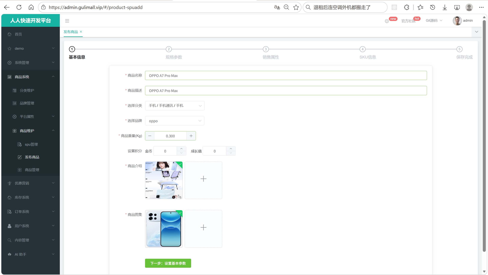
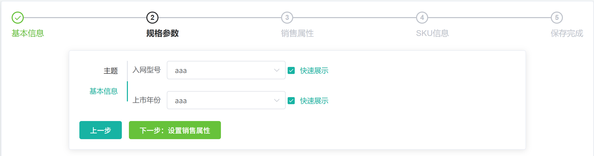
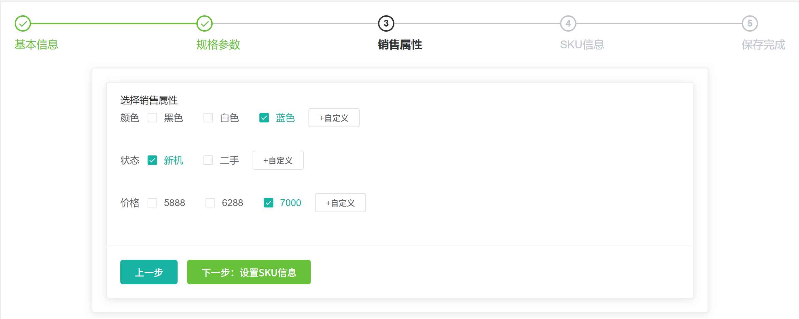
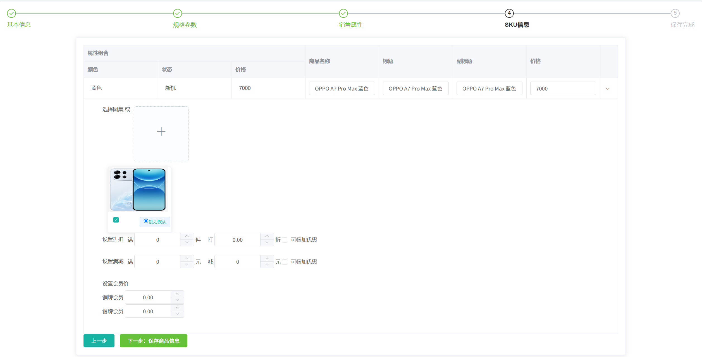
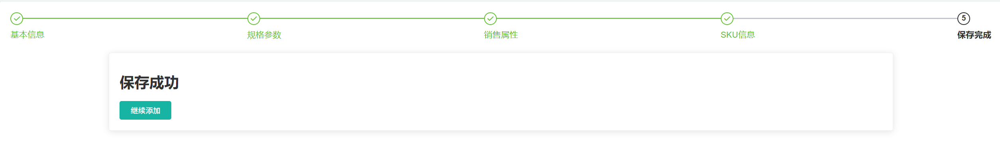
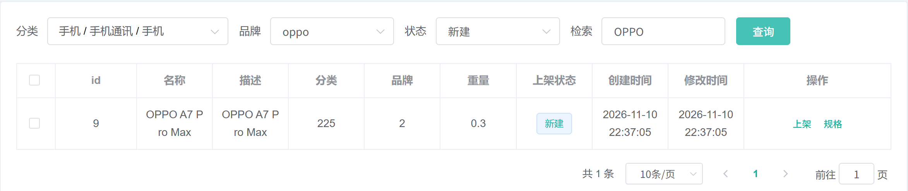

# 7.1 新增商品-介绍

> 本篇介绍发布商品的完整链路：业务上 SPU 与 SKU 怎么划分、管理员在五步向导里做什么、笛卡尔积怎么生成 SKU、默认图怎么选、积分和满减为什么要跨库、后端怎么用一个 VO 和一次本地事务写完商品数据。

---

## 1. 这个功能是干什么的

发布商品是商城后台最核心的录入功能。一次发布要同时生成商品档案、商品图集、规格参数、多个 SKU、SKU 图集、销售属性，以及跨库的积分、满减和会员价：

```text
SPU 基本信息             pms_spu_info
SPU 详情描述             pms_spu_info_desc
SPU 图集                 pms_spu_images
SPU 规格参数             pms_product_attr_value
SKU 基本信息             pms_sku_info
SKU 图集                 pms_sku_images
SKU 销售属性             pms_sku_sale_attr_value
SPU 积分                 gulimall_sms.sms_spu_bounds
SKU 满件打折             gulimall_sms.sms_sku_ladder
SKU 满额减               gulimall_sms.sms_sku_full_reduction
SKU 会员价               gulimall_sms.sms_member_price
```

SPU 和 SKU 的关系：

1. **SPU**（Standard Product Unit）是商品聚合，描述“这是什么商品”，例如“某品牌手机 12”。
2. **SKU**（Stock Keeping Unit）是具体可售单元，描述“哪一个具体规格”，例如“黑色 256G 移动版”。
3. 一个 SPU 下可以挂多个 SKU；加购物车、下单、扣库存、算价格都以 SKU 为单位。
4. 商品列表、搜索页展示 SPU 级别的信息，用户点进详情页后再选择具体 SKU。

发布商品只建立商品档案，不写库存。库存属于 `gulimall_wms`，由仓库管理、采购入库、库存锁定产生。发布完成后 SPU 的 `publish_status` 是 0（新建），管理员在商品管理页点上架后，商品才会写入 Elasticsearch，搜索页才能检索到；是否有货则在上架时远程查询库存服务得到。

## 2. 管理员怎么操作

入口：

```text
管理后台 → 商品系统 → 商品管理 → 新增商品
```



页面顶部是 `el-steps` 五步向导，`step` 从 0 到 4，分别对应基本信息、规格参数、销售属性、SKU 信息、保存完成。管理员只能按顺序前进，也可以点“上一步”回到前面修改。

### 2.1 第 1 步：填写基本信息

1. 填写商品名称 `spuName`。
2. 填写商品描述 `spuDescription`。
3. 通过分类级联选择器选三级分类，结果写入 `catelogId`。
4. 通过品牌下拉框选品牌，结果写入 `brandId`。
5. 填写商品重量 `weight`，单位是千克，保留三位小数。
6. 设置积分：购物金币 `bounds.buyBounds`、成长值 `bounds.growBounds`。
7. 上传商品介绍图 `decript`，多张图按顺序保存。
8. 上传商品图集 `images`，图集同时也是后面 SKU 选图的来源。

前端在点“下一步”时先执行 `spuBaseForm` 校验：商品名、描述、分类、品牌、介绍图、图集、重量都是必填。校验通过后才把 `step` 改成 1，并调用 `showBaseAttrs()` 加载规格参数。

商品介绍图最终会被 `String.join(",", decript)` 拼成一个字符串存进 `pms_spu_info_desc.decript`；商品图集则一图一行存进 `pms_spu_images`。

### 2.2 第 2 步：选择规格参数

1. 页面按属性分组渲染左侧标签页，每个标签页是一组属性，例如“主体”“屏幕”“摄像头”。
2. 每个属性是一个表单项，属性来源是 `pms_attr`，只包含基本属性，不包含销售属性。
3. 如果属性是可多选类型 `valueType=1`，下拉框允许多选；否则只能选一个。
4. 属性值可以从 `valueSelect` 里选，也可以直接输入自定义值。
5. 每个属性可以勾选“快速展示”，勾选后 `showDesc=1`，商品详情页会直接展示这个属性。
6. 点“下一步”时，前端只收集填了值的属性，属性值用分号拼成一个字符串，放进 `spu.baseAttrs`。



规格参数描述 SPU 的共性，例如屏幕尺寸、电池容量、机身颜色说明。它们不会生成 SKU，只存进 `pms_product_attr_value`，供商品详情页展示和搜索筛选使用。

### 2.3 第 3 步：选择销售属性

1. 页面请求当前三级分类下的销售属性，例如颜色、内存、网络制式。
2. 每个销售属性渲染成一组复选框。
3. 管理员勾选这个商品要卖哪些属性值，例如颜色勾“黑色、白色”，内存勾“128G、256G”。
4. 如果预设值不够用，可以点“+自定义”追加新值，追加的值会写回该属性的 `valueSelect`。
5. 点“下一步”时，前端把每个销售属性选中的值收集到 `tempSaleAttrs`，再调用 `generateSkus()` 做笛卡尔积。



销售属性是生成 SKU 的维度。没有选任何值的属性不会参与组合；只选了一个值的属性仍然参与组合，只是这一维只有一种取值。

### 2.4 第 4 步：填写 SKU 表格

1. 前端根据销售属性的取值集合做笛卡尔积，每一组组合生成一行 SKU。
2. 每行自动生成 SKU 名称和标题，默认是“SPU 名称 + 各属性值”。
3. 管理员填写每行的价格 `price`、标题 `skuTitle`、副标题 `skuSubtitle`。
4. 展开某一行，可以从 SPU 图集里勾选这个 SKU 要展示的图片。
5. 每行通过单选按钮指定一张默认图，默认图会写进 `pms_sku_info.sku_default_img`。
6. 展开行还可以设置满件打折、满额减、会员价：满几件打几折、满多少元减多少元、每个会员等级的价格。
7. 点“下一步：保存商品信息”时，前端把整个 `spu` 对象提交给后端。



SKU 表格是发布商品里数据量最大的一步。颜色 3 种、内存 2 种、网络 2 种，就会生成 12 行 SKU；每一行都会写一条 `pms_sku_info`，并各写一组 `pms_sku_images`、`pms_sku_sale_attr_value`，以及可能的满减、会员价记录。

### 2.5 第 5 步：保存并查看列表

1. 点“下一步：保存商品信息”，弹出确认框。
2. 确认后调用 `POST /product/spuinfo/save`，请求体是整个 `spu` 对象。
3. 后端返回 `code=0` 时，前端把 `step` 改成 4，显示“保存成功”。
4. 点“继续添加”会重置表单并回到第 1 步。
5. 打开商品管理列表，可以看到刚发布的 SPU，`publishStatus` 是 0（新建）。
6. 在列表点“上架”后，SPU 才会进入搜索索引。





## 3. 整体设计思路

### 3.1 业务上怎么设计

#### 3.1.1 SPU 与 SKU 的职责划分

```text
SPU：商品是什么
├── 名称、描述、分类、品牌、重量
├── 详情图、商品图集
├── 规格参数（屏幕、电池等）
└── 积分（购物金币、成长值）

SKU：具体卖哪一个
├── 销售属性组合（颜色、内存、网络）
├── 价格、标题、副标题
├── SKU 图集、默认图
└── 满件打折、满额减、会员价
```

这样划分的原因：

1. 商品详情页只需要 SPU 信息，不用重复存多份。
2. 搜索页、购物车、订单都以 SKU 为单位，价格和库存必须精确到 SKU。
3. 销售属性只在 SKU 上才有意义，颜色、内存的差异本质上是 SKU 差异。
4. 规格参数是 SPU 共性，不应该在每个 SKU 上重复。

#### 3.1.2 五步向导的字段归属

| 步骤 | 前端字段 | 落库表 |
|---|---|---|
| 第 1 步 | `spuName`、`spuDescription`、`catelogId`、`brandId`、`weight`、`publishStatus` | `pms_spu_info` |
| 第 1 步 | `decript` | `pms_spu_info_desc` |
| 第 1 步 | `images` | `pms_spu_images` |
| 第 1 步 | `bounds` | `gulimall_sms.sms_spu_bounds` |
| 第 2 步 | `baseAttrs` | `pms_product_attr_value` |
| 第 3 步 | `tempSaleAttrs` | 不直接落库，只作为生成 SKU 的维度 |
| 第 4 步 | `skus[].attr` | `pms_sku_sale_attr_value` |
| 第 4 步 | `skus[]`、`skus[].images` | `pms_sku_info`、`pms_sku_images` |
| 第 4 步 | `fullCount`、`discount`、`fullPrice`、`reducePrice`、`memberPrice` | `gulimall_sms.sms_sku_ladder`、`sms_sku_full_reduction`、`sms_member_price` |

第 3 步选择的销售属性本身不落库，落库的是第 4 步每个 SKU 上的属性值。例如选了“颜色=黑色”，最终存的是“这个 SKU 的颜色属性值是黑色”，而不是“这个 SPU 选了颜色”。

#### 3.1.3 笛卡尔积生成 SKU

假设销售属性选中：

```text
颜色：黑色、白色
内存：128G、256G
```

笛卡尔积结果：

```text
黑色 + 128G
黑色 + 256G
白色 + 128G
白色 + 256G
```

规则：

1. 每个选中的销售属性是一个维度。
2. SKU 数量等于各维度取值数量的乘积：2 × 2 = 4。
3. 三个维度就是 3 × 2 × 2 = 12，四个维度继续相乘。
4. 没有勾选任何值的维度不参与组合。
5. 只勾选一个值的维度仍然是一维，只是这一维只有一种取值。
6. 组合结果决定 SKU 行数，管理员不能手工增删行，只能通过返回第 3 步调整属性值来改变行数。

笛卡尔积放在前端做，原因是管理员需要在提交前看到每一行并填写价格、图片、满减；如果放到后端生成，前端还要再查一次结果，交互会变复杂。

#### 3.1.4 默认图规则

1. 第 1 步上传的商品图集会带到第 4 步。
2. 每个 SKU 展开后，可以从图集里勾选这个 SKU 展示哪些图。
3. 勾选的图会写进 `pms_sku_images`，`imgUrl` 是图片地址，`defaultImg` 是 0 或 1。
4. 每个 SKU 通过单选按钮指定一张默认图，写进 `pms_sku_info.sku_default_img`。
5. 默认图用于商品列表、购物车、订单、搜索页的缩略图，避免每次查询都去 `pms_sku_images` 找默认图。
6. 如果管理员没有指定默认图，`sku_default_img` 是空字符串，前端显示占位图。

后端保存时只遍历 `item.getImages()`，把 `defaultImg == 1` 的图片地址赋给 `defaultImg` 变量。如果前端传了多张默认图，后遍历到的会覆盖先遍历到的；最终以最后一张为准。

#### 3.1.5 积分、满减、会员价为什么跨库

商品数据在 `gulimall_pms`，优惠数据在 `gulimall_sms`：

```text
gulimall_pms
├── pms_spu_info
├── pms_spu_info_desc
├── pms_spu_images
├── pms_product_attr_value
├── pms_sku_info
├── pms_sku_images
└── pms_sku_sale_attr_value

gulimall_sms
├── sms_spu_bounds              SPU 积分
├── sms_sku_ladder              SKU 满件打折
├── sms_sku_full_reduction      SKU 满额减
└── sms_member_price            SKU 会员价
```

业务上这样划分的原因：

1. 优惠是独立的营销域，后续还会被优惠券、秒杀、会员活动复用。
2. 商品服务只负责商品档案，不应该直接访问优惠库。
3. 优惠规则变化频繁，单独一个库便于独立发布和扩容。
4. 订单结算时订单服务会同时读取商品价格和优惠规则，跨库是既定架构。

跨库带来的代价：本地事务管不到 `gulimall_sms`，远程写入失败只能记日志或补偿。

#### 3.1.6 事务边界

`saveSpuSaveVo` 上的 `@Transactional(rollbackFor = Exception.class)` 只覆盖 `gulimall_pms` 的本地事务：

```text
本地事务内：
1. pms_spu_info
2. pms_spu_info_desc
3. pms_spu_images
4. pms_product_attr_value
6.1 pms_sku_info
6.2 pms_sku_images
6.3 pms_sku_sale_attr_value

本地事务外，走 Feign：
5. sms_spu_bounds
6.4 sms_sku_ladder、sms_sku_full_reduction、sms_member_price
```

这样设计的原因：

1. 商品主数据必须整体成功或整体回滚，否则会出现有 SPU 没 SKU、有 SKU 没图片的半成品。
2. 优惠数据是附属数据，远程失败不应该阻断商品发布。
3. 不使用全局事务：项目里订单、库存使用 Seata，但发布商品没有引入，因为优惠写入失败可以靠重试或后台补偿修复，商品发布不能因为优惠服务不可用而失败。
4. 当前实现仍然把 Feign 调用写在事务方法内，事务时间会被网络等待拉长，数据库连接和行锁在等待期间一直占用；这是当前实现的代价，优化方向是事务提交后调用或消息补偿。

代价是可能出现两种不一致：

1. 本地事务提交成功，远程优惠失败：商品能卖，但没有积分、满减或会员价。
2. 远程优惠先成功，本地事务后续失败回滚：`gulimall_sms` 留下孤立的优惠记录。

当前实现只记录远程失败日志，没有自动补偿。

#### 3.1.7 发布状态

`pms_spu_info.publish_status` 有三个业务值：

| 值 | 含义 | 产生方式 |
|---|---|---|
| 0 | 新建 | 发布商品时前端固定传 0 |
| 1 | 已上架 | 商品管理页点“上架”后由 `up()` 更新 |
| 2 | 已下架 | 页面有选项，后端没有下架接口 |

发布商品只产生 0。商品要出现在搜索页，必须再执行上架，上架会把 SKU 数据写入 Elasticsearch。下架功能在当前代码里没有实现，状态 2 只是页面预留。

### 3.2 技术上怎么设计

#### 3.2.1 一个 VO 接收整棵树

发布商品涉及 SPU、图集、规格参数、SKU、SKU 图集、销售属性、满减、会员价，如果拆成多个接口，前端要按顺序调用七八次，任何一次失败都会留下半成品。当前做法是用一个 `SpuSaveVo` 接收整棵 JSON 树，后端一次接收、一次事务处理。

```text
SpuSaveVo
├── 基本字段
├── List<String> decript
├── List<String> images
├── Bounds bounds
├── List<BaseAttrs> baseAttrs
└── List<Skus> skus
        ├── List<Attr> attr
        ├── List<Images> images
        └── List<MemberPrice> memberPrice
```

优点：

1. 前端一次提交，交互简单。
2. 后端能在一个事务里控制写入顺序。
3. 参数结构就是页面结构，排查问题时一眼能对上。

#### 3.2.2 一个本地事务按依赖顺序写

写入顺序由主键依赖决定：

```text
先写 SPU，拿到自增 id
    → 用 spuId 写描述、图集、规格参数、积分
    → 用 spuId 写每个 SKU，拿到 skuId
        → 用 skuId 写 SKU 图集、销售属性、满减、会员价
```

如果顺序反过来，子表拿不到父表主键。`this.save(infoEntity)` 之后 MyBatis-Plus 会把自增主键回填到 `infoEntity.id`，`skuInfoService.save(skuInfoEntity)` 之后会把 `skuId` 回填到实体。

#### 3.2.3 Feign 跨服务写优惠

商品服务通过 `@FeignClient("gulimall-coupon")` 调优惠服务：

1. 服务名由 Nacos 解析成实际地址。
2. 请求体是 `SpuBoundTo`、`SkuReductionTo`，由 Jackson 序列化成 JSON。
3. 优惠服务用 `SpuBoundsEntity`、`SkuReductionTo` 接收，只要 JSON 字段兼容即可，双方不需要共享实体类。
4. 公共 Feign 超时配置是连接 2 秒、读取 5 秒，避免下游卡住时商品服务线程被长时间占用。

#### 3.2.4 批量写入

图集、规格参数、SKU 图集、销售属性都用 `saveBatch`：

1. `saveBatch` 把多条 insert 合并成批量 SQL，减少网络往返。
2. 列表先由 stream 转换，再一次性提交。
3. SKU 图集在批量前过滤掉 `imgUrl` 为空的占位数据，避免写入空图片行。

#### 3.2.5 属性名查询

保存规格参数时需要 `attr_name`，而前端只传 `attrId`、`attrValues`、`showDesc`。当前实现先用 `Collectors.toMap` 建立 `attrId -> attrName` 的映射，再构造 `ProductAttrValueEntity`：

1. 构造实体时不再逐条查库。
2. 相同 `attrId` 只保留一个映射。
3. 但映射的 value 仍然是逐个调用 `attrDao.getAttrNameById` 查出来的，SQL 次数没有实质下降。

真正的批量优化是用 `selectBatchIds` 一次查出所有属性，再在内存里建映射。

#### 3.2.6 前端数据分层

`spuadd.vue` 把数据分成三块：

1. `spu`：最终提交给后端的数据，结构和 `SpuSaveVo` 一一对应。
2. `dataResp`：页面辅助数据，包括属性组、基本属性表单、销售属性、SKU 列定义、会员等级、加载标记。
3. `inputVisible`、`inputValue`：自定义销售属性值的输入框状态。

这样分层的原因是：页面需要大量临时状态，不能全部塞进提交对象，否则请求体里会混入 `attrGroups`、`steped` 这类后端不认识的字段。

## 4. 详细代码、配置和解释

发布商品的链路按调用顺序分四层：前端五步向导收集数据，`SpuSaveVo` 接住整棵请求树，`SpuInfoController` 提供 HTTP 入口，`SpuInfoServiceImpl` 在本地事务里按主键依赖顺序写商品库，并通过 Feign 写优惠库。下面按调用顺序展开：先看入参结构和嵌套 VO，再看 Controller、主流程、跨库客户端、优惠接收端、库存客户端和重量查询，最后看前端页面与配置。每一块代码先说明在链路中的位置，再给出代码，最后按编号说明执行顺序、条件和原因。

### 4.1 SpuSaveVo：发布商品入参

#### 4.1.1 这个类解决什么问题

管理员在五步向导里填完基本信息、规格参数、销售属性、SKU 表格后，浏览器把整个 `spu` 对象一次性提交到 `POST /product/spuinfo/save`。这次提交同时包含商品主档、详情图、图集、规格参数、多个 SKU、每个 SKU 的图片与销售属性，以及积分、满减、会员价。后端如果直接用 `SpuInfoEntity` 接，只能接住主表字段，其余数据会被丢弃；如果拆成多个接口，前端要按顺序调用七八次，任何一次失败都会在库里留下半成品。

`SpuSaveVo` 是请求边界上的容器，负责把整棵树原样接住，供 `SpuInfoServiceImpl.saveSpuSaveVo()` 按层次拆开。它不被任何表直接映射，也不承担校验和转换。上游是 `spuadd.vue` 的 `submitSkus()`，下游是商品库和优惠库的各个 Service。

#### 4.1.2 结构与字段

```text
SpuSaveVo
├── 基本字段：spuName、spuDescription、catelogId、brandId、weight、publishStatus
├── 图片字段：decript（详情图）、images（图集）
├── 嵌套对象：bounds（积分）
├── 嵌套列表：baseAttrs（规格参数）
└── 嵌套列表：skus（每个 SKU 一行）
```

| 字段 | 类型 | 业务含义 | 落库位置 |
|---|---|---|---|
| `spuName` | String | 商品名称 | `pms_spu_info.spu_name` |
| `spuDescription` | String | 商品描述 | `pms_spu_info.spu_description` |
| `catelogId` | Long | 三级分类 id | `pms_spu_info.catelog_id`，并复制到每个 SKU |
| `brandId` | Long | 品牌 id | `pms_spu_info.brand_id`，并复制到每个 SKU |
| `weight` | BigDecimal | 商品重量，单位千克 | `pms_spu_info.weight` |
| `publishStatus` | int | 发布状态 | `pms_spu_info.publish_status` |
| `decript` | `List<String>` | 商品介绍图地址 | 逗号拼接后写入 `pms_spu_info_desc.decript` |
| `images` | `List<String>` | 商品图集地址 | 一图一行写入 `pms_spu_images` |
| `bounds` | Bounds | 购物金币、成长值 | `gulimall_sms.sms_spu_bounds` |
| `baseAttrs` | `List<BaseAttrs>` | 规格参数 | `pms_product_attr_value` |
| `skus` | `List<Skus>` | SKU 列表 | `pms_sku_info` 及子表、优惠表 |

#### 4.1.3 代码与解释

这段代码定义请求体的一级结构。Jackson 反序列化时按字段名匹配，未传的引用类型为 null，`int` 为 0；字段名必须与前端 `spu` 对象保持一致，否则接收不到值。

```java
@Data
public class SpuSaveVo {

    private String spuName;
    private String spuDescription;
    private Long catelogId;
    private Long brandId;
    private BigDecimal weight;
    private int publishStatus;
    private List<String> decript;
    private List<String> images;
    private Bounds bounds;
    private List<BaseAttrs> baseAttrs;
    private List<Skus> skus;

}
```

1. `@Data`：Lombok 生成 getter、setter、`toString`、`equals`、`hashCode`，供 Jackson 反序列化和 Service 读取。
2. `spuName`、`spuDescription`、`catelogId`、`brandId`、`weight`、`publishStatus` 与 `SpuInfoEntity` 同名，第 1 段用 `BeanUtils.copyProperties` 可以直接复制。
3. `catelogId` 和 `brandId` 不只属于 SPU，每个 SKU 也要冗余保存一份，因为购物车、订单、搜索都按 SKU 查询分类和品牌。
4. `decript` 故意沿用前端拼写，保证历史页面和历史数据不用改字段名。
5. `images` 是 SPU 图集，第 3 段写入 `pms_spu_images`，同时作为第 4 步给 SKU 选图的来源。
6. `bounds` 是对象而不是平铺字段，前端把两个积分值放在一个子对象里提交。
7. `baseAttrs` 是列表而不是 Map，因为同一属性可能出现在不同分组，顺序也要保留。
8. `skus` 是整棵树里唯一会继续向下嵌套的字段，每个元素还带 `attr`、`images`、`memberPrice` 三个列表。
9. 类里没有 `@NotBlank`、`@NotNull`、`@Valid`，Controller 也没有加 `@Valid`，空商品名、空 SKU、负数重量都能进入 Service。
10. 类里没有 `createTime`、`updateTime`，这两个字段由 Service 在落库前补上，避免信任前端时间。
11. 类里没有描述图片的排序字段，`decript` 的顺序就是列表顺序，最终拼接字符串的顺序也由这个列表决定。

#### 4.1.4 一次完整示例

管理员提交“某品牌手机 12”，选择黑色、256G 一个组合：

```json
{
  "spuName": "某品牌手机 12",
  "spuDescription": "6.7 英寸屏幕，双卡双待",
  "catelogId": 225,
  "brandId": 7,
  "weight": 0.5,
  "publishStatus": 0,
  "decript": ["https://oss.example.com/spu/101/desc-1.jpg"],
  "images": ["https://oss.example.com/spu/101/1.jpg", "https://oss.example.com/spu/101/2.jpg"],
  "bounds": { "buyBounds": 10, "growBounds": 20 },
  "baseAttrs": [
    { "attrId": 11, "attrValues": "6.7;OLED", "showDesc": 1 }
  ],
  "skus": [
    {
      "attr": [{ "attrId": 21, "attrName": "颜色", "attrValue": "黑色" }],
      "skuName": "某品牌手机 12 黑色 256G",
      "price": 4999.00,
      "skuTitle": "某品牌手机 12 黑色 256G",
      "skuSubtitle": "现货",
      "images": [
        { "imgUrl": "https://oss.example.com/spu/101/1.jpg", "defaultImg": 1 },
        { "imgUrl": "https://oss.example.com/spu/101/2.jpg", "defaultImg": 0 }
      ],
      "descar": ["黑色"],
      "fullCount": 0,
      "discount": 0,
      "countStatus": 0,
      "fullPrice": 0.0,
      "reducePrice": 0.0,
      "priceStatus": 0,
      "memberPrice": []
    }
  ]
}
```

Controller 收到后原样转成 `SpuSaveVo`，Service 第 1 段先写 `pms_spu_info` 拿到自增 id，后续所有子表都用这个 id 做外键。

#### 4.1.5 它不做什么

1. 不校验必填项、长度、数值范围，校验责任完全在前端表单和 Controller 之外。
2. 不生成 SKU 组合，`skus` 由前端笛卡尔积算好后提交。
3. 不转换实体，字段映射由 Service 里的 `BeanUtils.copyProperties` 完成。
4. 不写库，也不判断分类、品牌是否真实存在。
5. 不限制数组长度，SKU 数量、图片数量由请求体大小隐式约束。

#### 4.1.6 边界与可优化点

1. 没有参数校验注解，生产环境应在 VO 上补 `@NotBlank`、`@NotNull`、`@DecimalMin`，并在 Controller 加 `@Valid`。
2. `publishStatus` 由前端传入，Service 没有强制改成 0，构造请求可以把新商品直接标成已上架。
3. `decript` 拼写不规范，长期应改成 `descriptionImages`，但需要同步改前端、历史数据和表字段。
4. `decript` 为空时 `String.join` 会抛空指针，Controller 和 Service 都没有兜底。
5. 一个请求承载整棵商品树，SKU 很多时请求体可达数 MB，网关和 Tomcat 都需要相应放宽限制。

### 4.2 嵌套 VO：Skus 与五个子结构

#### 4.2.1 这组类解决什么问题

五步向导的数据不是一张平表：第 4 步的 SKU 表格每一行有价格、标题、图片、满减、会员价；每个 SKU 又对应若干条销售属性；第 2 步的规格参数是另一组独立列表；第 1 步的积分是一个单独对象。后端要按页面结构一次接住这些数据，就需要一组与页面结构对应的嵌套 VO。

这组类位于请求树的不同层级，作用各不相同：`Skus` 对应表格一行，`Attr` 对应一个 SKU 上的一个销售属性值，`BaseAttrs` 对应规格参数表单的一行，`Images` 对应 SKU 图集里的一张图，`Bounds` 对应 SPU 积分，`MemberPrice` 对应一个会员等级的价格。它们只负责承载数据，字段名同时服务于 Jackson 反序列化和 `BeanUtils.copyProperties` 的同名复制。

调用关系是：`SpuSaveVo.skus` 持有 `List<Skus>`；`Skus.attr` 持有 `List<Attr>`；`Skus.images` 持有 `List<Images>`；`Skus.memberPrice` 持有 `List<MemberPrice>`；`SpuSaveVo.baseAttrs` 持有 `List<BaseAttrs>`；`SpuSaveVo.bounds` 持有 `Bounds`。

#### 4.2.2 Skus：一行 SKU

这段代码是 SKU 表格一行的完整结构，既承载商品字段，也承载这个 SKU 的优惠字段。Service 第 6 段从 `item` 里生成 `SkuInfoEntity`、`SkuImagesEntity`、`SkuSaleAttrValueEntity` 和 `SkuReductionTo` 四种对象，四种对象的数据都来自这个类。

```java
@Data
public class Skus {

    private List<Attr> attr;
    private String skuName;
    private BigDecimal price;
    private String skuTitle;
    private String skuSubtitle;
    private List<Images> images;
    private List<String> descar;
    private int fullCount;
    private BigDecimal discount;
    private int countStatus;
    private BigDecimal fullPrice;
    private BigDecimal reducePrice;
    private int priceStatus;
    private List<MemberPrice> memberPrice;

}
```

1. `attr`：这个 SKU 的销售属性组合，6.3 转成 `SkuSaleAttrValueEntity` 写入 `pms_sku_sale_attr_value`。
2. `skuName`：SKU 名称，复制到 `SkuInfoEntity.skuName`，写入 `pms_sku_info.sku_name`。
3. `price`：SKU 售价，复制到 `SkuInfoEntity.price`，下单和搜索都以这个价格为准。
4. `skuTitle`、`skuSubtitle`：列表和详情页展示用的标题、副标题，复制到同名实体字段。
5. `images`：这个 SKU 的图集占位列表，长度与 SPU 图集一致，空 `imgUrl` 表示该位置未选图。
6. `descar`：前端笛卡尔积生成的组合原值，只用于前端回退时识别同一组合，后端不落库。
7. `fullCount`：满几件，复制到 `SkuReductionTo.fullCount`，优惠服务据此写 `sms_sku_ladder.full_count`。
8. `discount`：折扣，写入 `sms_sku_ladder.discount`，例如 0.9 表示九折。
9. `countStatus`：满件折扣是否可与其他优惠叠加，写入 `sms_sku_ladder.add_other`。
10. `fullPrice`：满多少元，6.4 用它判断是否调用远程接口，并写入 `sms_sku_full_reduction.full_price`。
11. `reducePrice`：减多少元，写入 `sms_sku_full_reduction.reduce_price`。
12. `priceStatus`：满减是否可叠加，写入 `sms_sku_full_reduction.add_other`。
13. `memberPrice`：各会员等级的价格列表，优惠服务逐条写入 `sms_member_price`。
14. `BeanUtils.copyProperties(item, skuInfoEntity)` 只复制同名且类型兼容的字段，`attr`、`images`、`descar` 和优惠字段会被忽略。

#### 4.2.3 Attr：SKU 销售属性

这个类表示“某个 SKU 的某个销售属性取什么值”，例如“SKU 2001 的颜色是黑色”。第 3 步勾选的销售属性本身不落库，真正落库的是第 4 步每个 SKU 上的这组属性值，6.3 把它们批量写入 `pms_sku_sale_attr_value`。

```java
@Data
public class Attr {

    private Long attrId;
    private String attrName;
    private String attrValue;

}
```

1. `attrId`：销售属性 id，对应 `pms_attr.attr_id`，详情页按它切换 SKU。
2. `attrName`：属性名，例如“颜色”，写入 `pms_sku_sale_attr_value.attr_name`。
3. `attrValue`：这个 SKU 上的取值，例如“黑色”，同一个 SPU 的不同 SKU 取值不同。
4. 属性名由前端直接传入，详情页展示时不用再关联 `pms_attr`，代价是属性改名后历史 SKU 记录不会同步。
5. 类里没有 `attrSort`，属性在详情页的展示顺序只能按插入顺序。

#### 4.2.4 BaseAttrs：SPU 规格参数

这个类对应第 2 步“规格参数”表单的一行。规格参数描述 SPU 的共性，例如屏幕尺寸、电池容量，不随 SKU 变化，Service 第 4 段把它转成 `ProductAttrValueEntity` 写入 `pms_product_attr_value`。

```java
@Data
public class BaseAttrs {

    private Long attrId;
    private String attrValues;
    private int showDesc;

}
```

1. `attrId`：规格参数 id，对应 `pms_attr.attr_id`。
2. `attrValues`：属性值，多选值由前端用分号拼接成一个字符串，与 `pms_product_attr_value.attr_value` 的字符串类型一致。
3. `showDesc`：是否在详情页快速展示，1 展示、0 不展示，写入 `quick_show`。
4. 前端提交前会跳过没有填写值的属性，因此列表里的每一项都应当有值；后端没有再校验空值。

#### 4.2.5 Images：SKU 图片

这个类表示 SKU 图集里的一张图。前端为每个 SKU 初始化一组与 SPU 图集等长的占位项，管理员勾选哪张图就填入 `imgUrl`，并用 `defaultImg` 标记默认图；Service 用它同时决定 `pms_sku_images` 的行和 `pms_sku_info.sku_default_img` 的值。

```java
@Data
public class Images {

    private String imgUrl;
    private int defaultImg;

}
```

1. `imgUrl`：图片地址，空字符串表示这个位置没有选图，6.2 会把它过滤掉。
2. `defaultImg`：是否默认图，1 是、0 不是；默认图用于商品列表、购物车、订单和搜索结果的缩略图。
3. 默认图从图集里选，不再单独上传，避免同一张图在对象存储里存两份。

#### 4.2.6 Bounds：SPU 积分

这个类承载第 1 步填写的购物金币和成长值。积分属于 SPU 级别，一个商品只有一组，Service 第 5 段把它复制成 `SpuBoundTo`，通过 Feign 写入优惠库的 `sms_spu_bounds`。

```java
@Data
public class Bounds {

    private BigDecimal buyBounds;
    private BigDecimal growBounds;

}
```

1. `buyBounds`：购物赠送金币，用户下单后按规则发放。
2. `growBounds`：购物赠送成长值，用于会员等级成长。
3. 两个字段都用 `BigDecimal`，避免浮点精度问题；前端的默认值是 0，所以不填也会提交 0 而不是 null。
4. 积分与优惠强相关，放在优惠库而不是商品库，商品服务只负责转发。

#### 4.2.7 MemberPrice：会员价

这个类表示一个会员等级购买某个 SKU 的价格。第 4 步展开 SKU 行时，页面按会员等级生成一组价格输入框，提交时放在 `Skus.memberPrice` 里，6.4 随 `SkuReductionTo` 一起发往优惠服务，最终落到 `sms_member_price`。

```java
@Data
public class MemberPrice {

    private Long id;
    private String name;
    private BigDecimal price;

}
```

1. `id`：会员等级 id，对应 `ums_member_level.id`。
2. `name`：会员等级名称，直接冗余到 `sms_member_price.member_level_name`，优惠库不再查会员服务。
3. `price`：这个等级购买当前 SKU 的价格，优惠服务只保留大于 0 的记录。
4. 会员价按“SKU + 会员等级”一条记录，不同 SKU、不同等级的组合各自独立。

#### 4.2.8 一次完整示例

一个 SKU 在请求树里的完整形态：

```text
Skus
├── attr:        [{attrId: 21, attrName: "颜色", attrValue: "黑色"}]
├── skuName:     "某品牌手机 12 黑色 256G"
├── price:       4999.00
├── skuTitle:    "某品牌手机 12 黑色 256G"
├── skuSubtitle: "现货"
├── images:      [{imgUrl: ".../1.jpg", defaultImg: 1}, {imgUrl: ".../2.jpg", defaultImg: 0}]
├── descar:      ["黑色", "256G"]
├── fullCount:   2
├── discount:    0.9
├── countStatus: 0
├── fullPrice:   5000.00
├── reducePrice: 200.00
├── priceStatus: 0
└── memberPrice: [{id: 1, name: "黄金会员", price: 4899.00}]
```

Service 第 6 段处理这个对象后，`pms_sku_info` 得到一行，`pms_sku_images` 得到两行（默认图那行 `default_img=1`），`pms_sku_sale_attr_value` 得到一行，优惠服务再往 `sms_sku_ladder`、`sms_sku_full_reduction`、`sms_member_price` 各写一条。

#### 4.2.9 边界与可优化点

1. `fullPrice`、`discount`、`reducePrice` 是包装类型，请求里漏传就是 null，6.4 的 `compareTo` 和优惠服务的条件判断都会空指针。
2. `int` 类型字段不传时默认 0，业务上无法区分“没填”和“明确填 0”。
3. `descar` 与后端无关，长期可以在序列化时排除，减少请求体体积。
4. 优惠字段和商品字段混在一个 VO 里，后续可以把优惠部分抽成独立的 `SkuReductionVo`。
5. 这组类没有校验注解，数值范围、会员等级是否有效都依赖前端和优惠服务。
6. `memberPrice` 的等级名称是冗余字段，等级改名后历史数据不会跟着变。

### 4.3 SpuInfoController：发布与商品入口

#### 4.3.1 这个类解决什么问题

商品管理页的“新增商品”“修改商品”“上架”按钮，以及购物车服务查询重量的 Feign 调用，最终都落在这个 Controller。它位于 HTTP 协议与业务层之间，负责把请求体反序列化成 VO 或实体、校验后台权限、调用 Service、把结果包装成统一返回结构 `R`。

上游有三类调用方：后台浏览器经过 Nginx 和网关访问 `/gulimall/product/spuinfo/...`；购物车服务通过 Feign 调重量接口；其他内部服务按需调用上架接口。下游只有 `SpuInfoService`，事务、写库、远程调用都在 Service 里，Controller 不参与。

网关转发前会去掉 `/gulimall` 前缀，服务内实际匹配的是 `/product/spuinfo/...`。

#### 4.3.2 接口清单

| 操作 | 方法与路径 | 权限 | 调用的 Service 方法 |
|---|---|---|---|
| 保存商品 | `POST /product/spuinfo/save` | `product:spuinfo:save` | `saveSpuSaveVo()` |
| 修改商品 | `POST /product/spuinfo/update` | `product:spuinfo:update` | `updateById()` |
| 商品上架 | `POST /product/spuinfo/{spuId}/up` | 无 | `up()` |
| 查 SKU 重量 | `GET /product/spuinfo/{skuId}/weight` | 无 | `getSkuWeight()` |

`SpuInfoController` 还提供列表、详情、删除三个后台接口，分别服务商品管理页的查询和编辑，与发布链路的主干无关。

#### 4.3.3 代码与解释

这段代码是发布链路的 HTTP 入口。四个方法分别对应保存、修改、上架和重量查询，其中 `save()` 是五步向导的终点，`getSkuWeight()` 是购物车加入商品时的远程调用目标。

```java
@RestController
@RequestMapping("product/spuinfo")
public class SpuInfoController {

    @Autowired
    private SpuInfoService spuInfoService;

    /**
     * 根据skuId查询当前商品的重量
     * @param skuId
     * @return
     */
    @GetMapping(value = "/{skuId}/weight")
    public BigDecimal getSkuWeight(@PathVariable Long skuId) {
        return spuInfoService.getSkuWeight(skuId);
    }

    /**
     * 保存
     */
    @RequestMapping("/save")
    @RequiresPermissions("product:spuinfo:save")
    public R save(@RequestBody SpuSaveVo spuSaveVo){
		spuInfoService.saveSpuSaveVo(spuSaveVo);

        return R.ok();
    }

    /**
     * 修改
     */
    @RequestMapping("/update")
    @RequiresPermissions("product:spuinfo:update")
    public R update(@RequestBody SpuInfoEntity spuInfo){
		spuInfoService.updateById(spuInfo);

        return R.ok();
    }

    /**
     * 商品上架
     *
     */
    @PostMapping("/{spuId}/up")
    public R setUp(@PathVariable("spuId") Long spuId) {
        spuInfoService.up(spuId);
        return R.ok();
    }

}
```

1. `@RestController` + `@RequestMapping("product/spuinfo")`：类内所有接口共用 `/product/spuinfo` 前缀，返回值默认按 JSON 序列化。
2. `getSkuWeight()`：路径里的 `{skuId}` 由 `@PathVariable` 绑定，返回裸 `BigDecimal` 而不是 `R`，因为调用方只关心重量数值。
3. `save()`：`@RequestBody` 把整棵 JSON 反序列化成 `SpuSaveVo`，`@RequiresPermissions` 做后台权限校验，然后交给 `saveSpuSaveVo()`。
4. `update()`：接收 `SpuInfoEntity` 而不是 VO，因为后台修改只涉及 SPU 主表字段，不涉及图集和 SKU。
5. `setUp()`：从路径取 `spuId`，调用 `up()` 完成 SKU 组装、库存查询和 ES 写入。
6. `save()` 和 `update()` 返回固定的 `R.ok()`，不返回新生成的 id，前端保存成功后要靠列表刷新才能拿到。
7. 权限注解由 Shiro 的方法级拦截生效，只在开启 `gulimall.shiro.enabled` 的模块里真正校验。

#### 4.3.4 一次发布请求

```text
1. 浏览器提交 POST /gulimall/product/spuinfo/save
2. 网关去掉 /gulimall 前缀，转发到 gulimall-product
3. Spring MVC 把请求体反序列化成 SpuSaveVo
4. Shiro 校验 product:spuinfo:save
5. 调用 spuInfoService.saveSpuSaveVo(spuSaveVo)
6. Service 在本地事务里写完商品库，并通过 Feign 写优惠库
7. Controller 返回 {"code":0,"msg":"success"}
8. 前端把 step 改成 4，显示保存成功
```

#### 4.3.5 它不做什么

1. 不做参数校验，空商品名、空 SKU 列表都能进入 Service。
2. 不开启事务，`@Transactional` 在 Service 实现类上，Controller 不持有事务上下文。
3. 不组装任何实体，VO 到实体的转换在 Service 里完成。
4. 不处理远程调用的失败补偿，失败只由 Service 记日志。
5. 不返回新商品 id，也不触发上架。

#### 4.3.6 边界与可优化点

1. `update()` 只能改 SPU 主表，改不了图集、规格参数和 SKU，后台编辑能力不完整。
2. `setUp()` 和 `getSkuWeight()` 没有权限注解，任何能访问网关的请求都能调用。
3. 权限注解依赖 Shiro 开关；Feign 内部调用没有登录上下文，开启鉴权后需要单独放行内部接口。
4. 保存接口没有幂等键，浏览器重复提交会生成重复 SPU。
5. 保存接口耗时长，网关和 Feign 的超时都要大于一次发布的最坏耗时。

### 4.4 SpuInfoServiceImpl.saveSpuSaveVo：发布商品主流程

#### 4.4.1 这个方法解决什么问题

一次发布要写 `gulimall_pms` 的 7 张表和 `gulimall_sms` 的 4 张表。表之间有主键依赖：描述、图集、规格参数、积分都挂 SPU id；SKU 图集、销售属性、优惠都挂 SKU id。写入顺序一旦颠倒，子表就拿不到父表主键。

这个方法承担三件事：按依赖顺序编排 11 张表的写入；用本地事务保证商品主数据的原子性；在事务内通过 Feign 写优惠库，并对远程失败做降级。它是整条发布链路的主干，上游是 `SpuInfoController.save()`，下游是多个本地 Service、2 个 Feign 客户端和 1 个 DAO。

#### 4.4.2 链路位置与事务边界

```text
Controller.save(SpuSaveVo)
  → saveSpuSaveVo()
      本地事务（gulimall_pms，可回滚）
        1. pms_spu_info
        2. pms_spu_info_desc
        3. pms_spu_images
        4. pms_product_attr_value
        6.1 pms_sku_info
        6.2 pms_sku_images
        6.3 pms_sku_sale_attr_value
      Feign（gulimall_sms，不回滚）
        5. sms_spu_bounds
        6.4 sms_sku_ladder / sms_sku_full_reduction / sms_member_price
```

本地事务和远程调用在同一个方法体里，远程调用失败不会抛异常，只记日志；本地事务失败时，已经写入的优惠记录不会回滚。这是“商品必须能发布、优惠可以后补”的业务取舍，代价是可能出现短暂不一致。

#### 4.4.3 写入顺序

```text
1. this.save(infoEntity) 插入 SPU，自增 id 回填到 infoEntity.id
2. 用 spuId 写描述
3. 用 spuId 写图集
4. 用 spuId 写规格参数
5. 用 spuId 写积分（远程）
6. 遍历 SKU：
   6.1 插入 SKU，自增 id 回填到 skuInfoEntity.skuId
   6.2 用 skuId 写 SKU 图集
   6.3 用 skuId 写销售属性
   6.4 用 skuId 写优惠（远程）
```

MyBatis-Plus 的 `save()` 在插入后会把自增主键回填到实体，所以第 2 到第 5 步可以直接使用 `infoEntity.getId()`，第 6.2 到 6.4 步可以直接使用 `skuInfoEntity.getSkuId()`。

#### 4.4.4 代码与解释

这段代码是发布商品的主干。方法体按编号分成 6 段，前 4 段和 6.1 到 6.3 写商品库，第 5 段和 6.4 段走 Feign 写优惠库；6.1 到 6.4 在 `skus.forEach` 里对每个 SKU 重复执行。

```java
@Service("spuInfoService")
@Builder
@Slf4j
public class SpuInfoServiceImpl extends ServiceImpl<SpuInfoDao, SpuInfoEntity> implements SpuInfoService {

    private SpuInfoDao spuInfoDao;
    /*
        service层之间相互调用时，必须确保不会出现循环依赖，否则必须额外创建method层编写共通业务方法
        实际大型项目生产时禁止同级间相互调用，必须下沉共通层避免循环依赖！

        像一些大型项目还会有usecase层，用于调用service，编排流程和实现事务，controller层只负责与http交互
        对于vo实体类的业务检查，在service中新增check方法，usecase调用即可
     */
    private SpuInfoDescService spuInfoDescService;
    private SpuImagesService spuImagesService;
    private AttrService attrService;
    private ProductAttrValueService productAttrValueService;
    private SkuInfoService skuInfoService;
    private SkuImagesService skuImagesService;
    private SkuSaleAttrValueService skuSaleAttrValueService;
    private BrandService brandService;
    private CategoryService categoryService;
    private ProductAttrValueMethod productAttrValueMethod;
    private CouponFeignClient couponFeignClient;
    private WareSkuFeignClient wareSkuFeignClient;
    private ElasticSaveFeignClient elasticSaveFeignClient;
    private AttrDao attrDao;

    @Transactional(rollbackFor = Exception.class)
    @Override
    public void saveSpuSaveVo(SpuSaveVo spuSaveVo) {
        //1、保存spu基本信息`pms_spu_info`
        SpuInfoEntity infoEntity = new SpuInfoEntity();
        BeanUtils.copyProperties(spuSaveVo, infoEntity);
        infoEntity.setCreateTime(new Date());
        infoEntity.setUpdateTime(new Date());
        this.save(infoEntity);

        //2、保存spu的描述图片`pms_spu_info_desc`
        List<String> decript = spuSaveVo.getDecript();
        SpuInfoDescEntity descEntity = new SpuInfoDescEntity();
        descEntity.setSpuId(infoEntity.getId());
        descEntity.setDecript(String.join(",", decript));
        spuInfoDescService.save(descEntity);

        //3、保存spu的图片集`pms_spu_images`
        List<String> images = spuSaveVo.getImages();
        if (images != null && !images.isEmpty()) {
            List<SpuImagesEntity> collect = images.stream().map(image -> {
                SpuImagesEntity imagesEntity = new SpuImagesEntity();
                imagesEntity.setSpuId(infoEntity.getId());
                imagesEntity.setImgUrl(image);
                return imagesEntity;
            }).toList();
            spuImagesService.saveBatch(collect);
        }

        //4、保存spu的规格参数`pms_product_attr_value`
        List<BaseAttrs> baseAttrs = spuSaveVo.getBaseAttrs();
        // 解决循环DB调用
        Map<String, String> attrNameMap = baseAttrs.stream()
                .collect(Collectors.toMap(
                        baseAttr -> baseAttr.getAttrId().toString(),
                        baseAttr -> attrDao.getAttrNameById(baseAttr.getAttrId())
                ));

        List<ProductAttrValueEntity> productAttrValueEntityList = baseAttrs.stream().map(attr -> {
            ProductAttrValueEntity valueEntity = new ProductAttrValueEntity();
            valueEntity.setAttrId(attr.getAttrId());
//            AttrEntity byId = attrService.getById(attr.getAttrId());
//            valueEntity.setAttrName(byId.getAttrName());
            valueEntity.setAttrName(attrNameMap.get(attr.getAttrId().toString()));
            valueEntity.setAttrValue(attr.getAttrValues());
            valueEntity.setQuickShow(attr.getShowDesc());
            valueEntity.setSpuId(infoEntity.getId());
            return valueEntity;
        }).collect(Collectors.toList());
        productAttrValueService.saveBatch(productAttrValueEntityList);

        //5、保存spu的积分信息`gulimall_sms`->`sms_spu_bounds`
        Bounds bounds = spuSaveVo.getBounds();
        SpuBoundTo spuBoundTo = new SpuBoundTo();
        BeanUtils.copyProperties(bounds, spuBoundTo);
        spuBoundTo.setSpuId(infoEntity.getId());
        R r = couponFeignClient.saveSpuBounds(spuBoundTo);
        if (r.getCode() != 0) {
            log.error("远程保存spu积分信息失败");
        }

        //6、保存spu对应的所有sku信息
        List<Skus> skus = spuSaveVo.getSkus();
        if (skus != null && !skus.isEmpty()) {
            skus.forEach(item -> {
                String defaultImg = "";
                //查找出默认图片
                for (Images image : item.getImages()) {
                    if (image.getDefaultImg() == 1) {
                        defaultImg = image.getImgUrl();
                    }
                }
                SkuInfoEntity skuInfoEntity = new SkuInfoEntity();
                BeanUtils.copyProperties(item, skuInfoEntity);
                skuInfoEntity.setSpuId(infoEntity.getId());
                skuInfoEntity.setBrandId(infoEntity.getBrandId());
                skuInfoEntity.setCatelogId(infoEntity.getCatelogId());
                skuInfoEntity.setSaleCount(0L);
                skuInfoEntity.setSkuDefaultImg(defaultImg);
                //6.1、sku的基本信息`pms_sku_info`
                skuInfoService.save(skuInfoEntity);

                //6.2、sku的图片信息`pms_sku_images`
                Long skuId = skuInfoEntity.getSkuId();

                List<SkuImagesEntity> skuImagesEntities = item.getImages().stream().map(img -> {
                    SkuImagesEntity skuImagesEntity = new SkuImagesEntity();
                    skuImagesEntity.setSkuId(skuId);
                    skuImagesEntity.setImgUrl(img.getImgUrl());
                    skuImagesEntity.setDefaultImg(img.getDefaultImg());
                    return skuImagesEntity;
                }).filter(entity -> {
                    //返回true是需要，返回false是过滤掉
                    return StringUtils.isNotEmpty(entity.getImgUrl());
                }).collect(Collectors.toList());
                skuImagesService.saveBatch(skuImagesEntities);

                //6.3、sku的销售属性信息`pms_sku_sale_attr_value`
                List<com.atguigu.gulimall.product.vo.Attr> attr = item.getAttr();
                List<SkuSaleAttrValueEntity> skuSaleAttrValueEntities = attr.stream().map(a -> {
                    SkuSaleAttrValueEntity skuSaleAttrValueEntity = new SkuSaleAttrValueEntity();
                    skuSaleAttrValueEntity.setSkuId(skuId);
                    BeanUtils.copyProperties(a, skuSaleAttrValueEntity);
                    return skuSaleAttrValueEntity;
                }).collect(Collectors.toList());
                skuSaleAttrValueService.saveBatch(skuSaleAttrValueEntities);


                //6.4、sku的优惠、满减等信息`gulimall_sms`->`sms_sku_ladder`/`sms_sku_full_reduction`/`sms_member_price`
                SkuReductionTo skuReductionTo = new SkuReductionTo();
                BeanUtils.copyProperties(item, skuReductionTo);
                skuReductionTo.setSkuId(skuId);
                if (skuReductionTo.getFullCount() > 0 || skuReductionTo.getFullPrice().compareTo(BigDecimal.ZERO) > 0) {
                    R r1 = couponFeignClient.saveSkuReduction(skuReductionTo);
                    if (r1.getCode() != 0) {
                        log.error("远程保存优惠信息失败");
                    }
                }
            });
        }
    }

}
```

1. 第 1 段先创建 `SpuInfoEntity`，用 `BeanUtils.copyProperties` 把 VO 里同名的 6 个基本字段复制过来，补上创建时间和更新时间，再调用 `this.save()`。这一步必须在最前面，因为后面所有子表都要用回填的 `infoEntity.id`。
2. 第 2 段取出 `decript` 列表，用逗号拼成一个字符串写入 `pms_spu_info_desc`。`String.join` 不跳过 null 元素，列表里出现 null 会拼出字面量 "null"；`decript` 本身为 null 时直接空指针。
3. 第 3 段处理 SPU 图集。先判断 `images` 非空，再逐张构造 `SpuImagesEntity`，设置 `spuId` 和 `imgUrl`，最后用 `saveBatch` 一次提交。判断非空是为了避免空列表也走一次批量 SQL。
4. 第 4 段处理规格参数。先遍历 `baseAttrs`，用 `Collectors.toMap` 建立 `attrId -> attrName` 的映射，key 是属性 id 的字符串，value 是 `attrDao.getAttrNameById()` 查出的属性名。映射的 value 在每个元素上都会查一次库，注释里的“解决循环DB调用”只解决了重复取值，没有解决查询次数。
5. 第 4 段后半部分再遍历一次 `baseAttrs`，为每条属性构造 `ProductAttrValueEntity`，设置属性 id、从映射里取属性名、属性值、快速展示标记和 `spuId`，最后批量写入 `pms_product_attr_value`。用两次流式遍历是为了先建映射再赋值，避免在实体构造过程中反复查库。
6. 第 5 段处理积分。把 `bounds` 复制到 `SpuBoundTo`，补上 `spuId`，调用 `couponFeignClient.saveSpuBounds()`。返回码不是 0 时只记错误日志，不抛异常，所以积分写入失败不会回滚商品主数据。
7. 第 6 段先判断 `skus` 非空，再逐个 SKU 处理。每个 SKU 的第一步是找默认图：遍历 `item.getImages()`，遇到 `defaultImg == 1` 就把 `imgUrl` 记到 `defaultImg` 变量；循环不 break，多张默认图时最后一张生效，一张都没有时默认图是空字符串。
8. 6.1 构造 `SkuInfoEntity`，复制同名商品字段，补 `spuId`、`brandId`、`catelogId`，销量置 0，默认图写入 `skuDefaultImg`，然后 `skuInfoService.save()`。这一步必须先于 6.2 到 6.4 执行，因为后面要用回填的 `skuId`。
9. 6.2 把 `item.getImages()` 逐张转成 `SkuImagesEntity`，设置 `skuId`、`imgUrl`、`defaultImg`，再用 `filter` 去掉 `imgUrl` 为空的占位项，最后批量写入 `pms_sku_images`。过滤放在转换之后、落库前，空占位不会产生空行。
10. 6.3 把 `item.getAttr()` 逐条转成 `SkuSaleAttrValueEntity`，先设置 `skuId`，再用 `BeanUtils.copyProperties` 复制 `attrId`、`attrName`、`attrValue`，最后批量写入 `pms_sku_sale_attr_value`。
11. 6.4 把当前 `item` 复制到 `SkuReductionTo`，补上 `skuId`，然后判断 `fullCount > 0` 或 `fullPrice > 0`。两个条件满足任意一个才调用 `saveSkuReduction()`，目的是减少无意义的跨服务请求，也避免在优惠库写入全 0 的空记录。
12. 远程保存优惠返回非 0 时同样只记日志。商品库事务不会因为优惠库失败而回滚，这与第 5 段的处理保持一致。
13. `@Transactional(rollbackFor = Exception.class)` 覆盖整个方法，本地任何一次写库抛异常都会回滚前面已经执行的商品库写入；但 Feign 已经成功的优惠记录不在这个事务里，无法一起回滚。
14. 类上的 `@Builder` 在没有显式构造器时会生成一个全参构造器，Spring 用这个唯一构造器完成依赖注入，所以字段上不需要逐个写 `@Autowired`。

#### 4.4.5 一次完整示例

发布“某品牌手机 12”，只选黑色 256G 一个 SKU，SPU 自增 id 为 101，SKU 自增 id 为 2001：

```text
1. pms_spu_info 插入 1 行：id=101，spu_name=某品牌手机 12，publish_status=0
2. pms_spu_info_desc 插入 1 行：spu_id=101，decript=".../desc-1.jpg"
3. pms_spu_images 插入 2 行：spu_id=101，img_url 分别为 .../1.jpg、.../2.jpg
4. pms_product_attr_value 插入 1 行：spu_id=101，attr_id=11，attr_name=屏幕尺寸，attr_value="6.7;OLED"
5. Feign 写 sms_spu_bounds：spu_id=101，buy_bounds=10，grow_bounds=20
6.1 pms_sku_info 插入 1 行：sku_id=2001，spu_id=101，price=4999.00，sku_default_img=".../1.jpg"
6.2 pms_sku_images 插入 2 行：sku_id=2001，其中 1.jpg 的 default_img=1
6.3 pms_sku_sale_attr_value 插入 1 行：sku_id=2001，attr_name=颜色，attr_value=黑色
6.4 fullCount=0 且 fullPrice=0，跳过 Feign 调用，sms_sku_ladder、sms_sku_full_reduction、sms_member_price 不写记录
```

如果这个 SKU 填了满 2 件九折、满 5000 减 200、黄金会员价 4899，6.4 就会调用一次 `saveSkuReduction()`，优惠服务再分别写三张表。

#### 4.4.6 它不做什么

1. 不生成 SKU 组合，组合由前端笛卡尔积算好后提交。
2. 不写库存，库存属于 `gulimall_wms`，由仓库和采购产生。
3. 不写上架状态和 ES 索引，上架由 `up()` 单独完成。
4. 不校验分类、品牌、属性是否属于当前分类，也不校验会员等级是否存在。
5. 不做远程调用的补偿、重试和幂等，失败只记日志。
6. 不返回新商品 id，Controller 只返回固定成功。

#### 4.4.7 边界与可优化点

1. `baseAttrs`、`bounds`、`item.getImages()`、`item.getAttr()` 都没有空判断，前端漏传任意一个都会空指针。
2. `Collectors.toMap` 遇到重复 `attrId` 会抛 `IllegalStateException`，同一属性出现两次时整笔发布失败。
3. `attrNameMap` 的 value 仍然逐条查库，属性多时 SQL 次数线性增长，应改成 `selectBatchIds` 一次查出后在内存建映射。
4. 每个 SKU 调一次 `saveSkuReduction`，SKU 多时远程调用次数线性增长，应合并成批量接口。
5. 远程调用写在本地事务内，事务时间被网络等待拉长，数据库连接和行锁在等待期间一直占用；优化方向是事务提交后调用或消息补偿。
6. 没有幂等控制，同一请求重复提交会产生重复 SPU、重复 SKU 和重复优惠记录。
7. `BeanUtils.copyProperties` 是全量同名复制，后续 VO 和实体出现同名字段但语义不同时容易复制错。
8. 大批量 SKU 时 `saveBatch` 的默认分批大小和单事务时长需要评估，SKU 上千时可能触发长事务和锁等待。

### 4.5 CouponFeignClient：跨库写入优惠

#### 4.5.1 这个接口解决什么问题

商品数据在 `gulimall_pms`，积分、满减、会员价在 `gulimall_sms`。商品服务只连接商品库，不能直接访问优惠库，也不应该引入优惠服务的实体和 Mapper。跨库写入需要一个远程调用入口，这个接口就是商品服务访问优惠服务的声明式客户端。

上游是 `SpuInfoServiceImpl.saveSpuSaveVo()` 的第 5 段和 6.4 段，下游是 `gulimall-coupon` 的两个 Controller。接口本身没有实现类，方法体由 Spring Cloud OpenFeign 在启动时生成的代理提供。

#### 4.5.2 调用链

```text
saveSpuBounds(spuBoundTo)
  → Feign 代理把 SpuBoundTo 序列化成 JSON
  → 向 Nacos 查询 gulimall-coupon 的实例地址
  → POST coupon/spubounds/save
  → 优惠服务把 JSON 反序列化成 SpuBoundsEntity
  → spuBoundsService.save() 写入 sms_spu_bounds
  → 返回 R
```

双方不共享实体类，只要求 JSON 字段名兼容：生产方用 `SpuBoundTo`、`SkuReductionTo`，消费方用 `SpuBoundsEntity`、`SkuReductionTo`，Jackson 按字段名映射。公共 Feign 配置的连接超时 2 秒、读取超时 5 秒，避免下游卡住时商品服务线程被长时间占用。

#### 4.5.3 代码与解释

这段代码只声明两个 POST 接口和请求体类型，不写任何 HTTP 细节。方法签名决定了 Feign 生成代理时使用的路径、方法和序列化方式。

```java
@FeignClient("gulimall-coupon")
public interface CouponFeignClient {

    @PostMapping("coupon/spubounds/save")
    R saveSpuBounds(@RequestBody SpuBoundTo spuBoundTo);

    @PostMapping("coupon/skufullreduction/saveInfo")
    R saveSkuReduction(@RequestBody SkuReductionTo skuReductionTo);
}
```

1. `@FeignClient("gulimall-coupon")`：声明目标服务名，Feign 通过 Nacos 的服务发现拿到实例列表，并自带负载均衡。
2. `saveSpuBounds()`：映射到 `coupon/spubounds/save`，请求体是 `SpuBoundTo`，返回值是统一结果 `R`。
3. `saveSkuReduction()`：映射到 `coupon/skufullreduction/saveInfo`，请求体是 `SkuReductionTo`，一个 SKU 的全部优惠数据一次发过去。
4. `@RequestBody` 让 Feign 把对象序列化成 JSON 放进请求体，消费方用 `@RequestBody` 反序列化，双方不需要共享类。
5. 两个方法都返回 `R`，调用方只能根据 `code` 判断业务成功或失败，无法区分网络异常和业务拒绝。
6. 接口没有 `fallback`、`fallbackFactory` 和重试配置，远程异常会直接抛给调用方，由调用方决定是否捕获。

#### 4.5.4 一次调用示例

```text
1. 第 5 段构造 SpuBoundTo：spuId=101，buyBounds=10，growBounds=20
2. 调用 saveSpuBounds(spuBoundTo)
3. Feign 序列化：{"spuId":101,"buyBounds":10,"growBounds":20}
4. Nacos 返回 gulimall-coupon 的实例 <your-windows-host-ip>:8080
5. 发送 POST http://<your-windows-host-ip>:8080/coupon/spubounds/save
6. 优惠服务反序列化成 SpuBoundsEntity，调用 save()
7. 返回 {"code":0,"msg":"success"}
8. 调用方判断 code == 0，不满足时只记错误日志
```

#### 4.5.5 边界与可优化点

1. 没有 `fallback`，优惠服务不可用时调用方只能靠日志发现数据缺失。
2. 没有幂等键，重复调用会重复写入积分、满减和会员价。
3. 没有重试策略，远程失败后数据直接缺失，也没有补偿任务。
4. 两个接口的返回都是 `R`，调用方只判断 `code`，网络异常和业务失败混在一起。
5. Feign 超时是全局默认值，发布商品这种长链路可能需要单独配置更长的读取超时。
6. 远程调用发生在本地事务内，事务时长受优惠服务响应时间影响。

### 4.6 优惠服务接收接口

#### 4.6.1 这组接口解决什么问题

优惠库 `gulimall_sms` 的写入口在 `gulimall-coupon`。发布商品时，商品服务不能直接连这个库，只能通过 HTTP 把积分和 SKU 优惠发过来；后台的优惠管理页也会调用同一组接口做增删改查。这组接口负责把 JSON 恢复成优惠实体，再交给优惠服务落库。

调用链位置是：`SpuInfoServiceImpl` → `CouponFeignClient` → `SpuBoundsController` / `SkuFullReductionController` → 优惠 Service → `gulimall_sms` 的四张表。商品服务与优惠服务之间只靠 JSON 字段兼容，双方不共享实体类。

#### 4.6.2 SpuBoundsController.save：接收 SPU 积分

这个方法接收商品服务发来的 SPU 积分，写一行 `sms_spu_bounds`。它在链路里是第 5 段的落点，上游是 `CouponFeignClient.saveSpuBounds()`。

```java
@RestController
@RequestMapping("coupon/spubounds")
public class SpuBoundsController {
    @Autowired
    private SpuBoundsService spuBoundsService;

    /**
     * 保存
     */
    @RequestMapping("/save")
    @RequiresPermissions("coupon:spubounds:save")
    public R save(@RequestBody SpuBoundsEntity spuBounds){
		spuBoundsService.save(spuBounds);

        return R.ok();
    }
}
```

1. `@RestController` + `@RequestMapping("coupon/spubounds")`：积分接口统一挂在 `/coupon/spubounds` 下。
2. `@RequestMapping("/save")`：实际路径是 `coupon/spubounds/save`，与 Feign 声明一致。
3. `@RequestBody SpuBoundsEntity spuBounds`：Spring 把请求体 JSON 按字段名转成实体，`spuId`、`buyBounds`、`growBounds` 与 `SpuBoundTo` 的字段名兼容。
4. `@RequiresPermissions("coupon:spubounds:save")`：声明后台权限，权限校验是否生效取决于 `gulimall.shiro.enabled` 开关。
5. `spuBoundsService.save()`：MyBatis-Plus 生成 insert 语句写入 `sms_spu_bounds`，然后返回 `R.ok()`。

示例：商品服务提交 `{"spuId":101,"buyBounds":10,"growBounds":20}`，落库后 `sms_spu_bounds` 多一行，`spu_id=101`。

边界：接口没有校验 `spuId` 是否存在、是否已经写过积分，重复发布会写重复记录；Feign 内部调用没有后台登录上下文，开启 Shiro 后需要放行内部路径，否则会返回权限错误。

#### 4.6.3 SkuFullReductionController.saveInfo：接收 SKU 优惠

这个方法接收一个 SKU 的全部优惠数据，交给 `SkuFullReductionService.saveSkuReduction()` 拆分写三张表。它在链路里是 6.4 段的落点，上游是 `CouponFeignClient.saveSkuReduction()`。

```java
@RestController
@RequestMapping("coupon/skufullreduction")
public class SkuFullReductionController {
    @Autowired
    private SkuFullReductionService skuFullReductionService;

    @PostMapping("/saveInfo")
    public R saveInfo(@RequestBody SkuReductionTo skuReductionTo){
        skuFullReductionService.saveSkuReduction(skuReductionTo);
        return R.ok();
    }
}
```

1. `@PostMapping("/saveInfo")`：实际路径是 `coupon/skufullreduction/saveInfo`，只接受 POST。
2. `@RequestBody SkuReductionTo`：一个对象同时携带满件、满额、会员价三组数据，商品服务每个 SKU 只调一次。
3. `skuFullReductionService.saveSkuReduction()`：控制器不做拆分，三张表的写入条件全部在 Service 里判断。
4. 返回固定 `R.ok()`，不返回各表的主键，调用方只关心是否成功。

边界：Controller 和 Service 都没有 `@Transactional`，三张表写入过程中失败会留下部分数据；没有幂等控制，重复调用会重复写满减和会员价；没有校验 `skuId` 是否真实存在。

#### 4.6.4 SkuFullReductionServiceImpl.saveSkuReduction：拆分三张表

商品服务发来的是一个 SKU 的混合优惠数据，优惠库却按规则类型拆成三张表：满件打折、满额减、会员价。这个方法负责按条件拆分，只有满足条件的部分才落库。

```java
@Service("skuFullReductionService")
public class SkuFullReductionServiceImpl extends ServiceImpl<SkuFullReductionDao, SkuFullReductionEntity> implements SkuFullReductionService {

    @Autowired
    private SkuLadderService skuLadderService;
    @Autowired
    private MemberPriceService memberPriceService;

    public void saveSkuReduction(SkuReductionTo skuReductionTo) {
        //1、保存满减打折，会员价 sms_sku_ladder
        if (skuReductionTo.getFullCount() > 0) {
            SkuLadderEntity skuLadderEntity = new SkuLadderEntity();
            skuLadderEntity.setSkuId(skuReductionTo.getSkuId());
            skuLadderEntity.setAddOther(skuReductionTo.getCountStatus());
            skuLadderEntity.setFullCount(skuReductionTo.getFullCount());
            skuLadderEntity.setDiscount(skuReductionTo.getDiscount());
            skuLadderService.save(skuLadderEntity);
        }

        //2、保存满减信息 sms_sku_full_reduction
        if (skuReductionTo.getFullPrice().compareTo(BigDecimal.ZERO) > 0) {
            SkuFullReductionEntity skuFullReductionEntity = new SkuFullReductionEntity();
            skuFullReductionEntity.setSkuId(skuReductionTo.getSkuId());
            skuFullReductionEntity.setFullPrice(skuReductionTo.getFullPrice());
            skuFullReductionEntity.setReducePrice(skuReductionTo.getReducePrice());
            skuFullReductionEntity.setAddOther(skuReductionTo.getPriceStatus());
            this.save(skuFullReductionEntity);
        }

        //3、保存会员价格 sms_member_price
        List<MemberPriceTo> memberPrice = skuReductionTo.getMemberPrice();
        if (memberPrice != null) {
            List<MemberPriceEntity> collect = memberPrice.stream().map(item -> {
                MemberPriceEntity memberPriceEntity = new MemberPriceEntity();
                memberPriceEntity.setSkuId(skuReductionTo.getSkuId());
                memberPriceEntity.setMemberLevelId(item.getId());
                memberPriceEntity.setMemberPrice(item.getPrice());
                memberPriceEntity.setMemberLevelName(item.getName());
                memberPriceEntity.setAddOther(1);
                return memberPriceEntity;
            }).filter(
                    item -> (item.getMemberPrice().compareTo(BigDecimal.ZERO) > 0)
            ).collect(Collectors.toList());
            memberPriceService.saveBatch(collect);
        }

    }

}
```

1. 第 1 段判断 `fullCount > 0`。满足时构造 `SkuLadderEntity`，设置 `skuId`、是否可叠加、满件数和折扣，调用 `skuLadderService.save()` 写入 `sms_sku_ladder`。满件数为 0 时整条记录跳过，避免产生“满 0 件打 0 折”的无效数据。
2. 第 2 段判断 `fullPrice > 0`。满足时构造 `SkuFullReductionEntity`，设置 `skuId`、满额、减额和是否可叠加，调用 `this.save()` 写入 `sms_sku_full_reduction`。`fullPrice` 是 `BigDecimal`，为 null 时 `compareTo` 直接空指针。
3. 第 3 段先判断 `memberPrice` 非 null，再把每个会员等级转成 `MemberPriceEntity`：`skuId` 取当前 SKU，`memberLevelId` 和 `memberLevelName` 取前端带来的等级信息，`memberPrice` 取价格，`addOther` 固定为 1。
4. 第 3 段在落库前用 `filter` 过滤掉价格不大于 0 的等级，再 `saveBatch` 写入 `sms_member_price`。过滤目的是避免管理员没有填写的等级也生成一条 0 元记录。
5. 三个条件互相独立，可以只写一张表，也可以三张都写；没有任何优惠时，三张表都不产生记录。
6. 方法没有 `@Transactional`，三张表的写入不在同一个事务里，中途异常会留下前面已经写入的数据。

示例：一个 SKU 满 2 件九折、满 5000 减 200、黄金会员价 4899，调用一次会写三行：`sms_sku_ladder` 一行、`sms_sku_full_reduction` 一行、`sms_member_price` 一行。

边界：`fullPrice` 为 null 时空指针；`discount` 为 null 时会把 null 写进 `sms_sku_ladder.discount`；会员价没有校验是否低于原价；重复调用会重复写记录，应加 `(sku_id, member_level_id)` 唯一约束或改成先删后插。

#### 4.6.5 一次完整示例

```text
1. 商品服务 6.4 段构造 SkuReductionTo：
   skuId=2001，fullCount=2，discount=0.9，countStatus=0，
   fullPrice=5000.00，reducePrice=200.00，priceStatus=0，
   memberPrice=[{id:1,name:"黄金会员",price:4899.00}]
2. Feign 发送 POST /coupon/skufullreduction/saveInfo
3. Controller 反序列化成 SkuReductionTo，调用 saveSkuReduction()
4. fullCount=2 > 0：
   INSERT sms_sku_ladder(sku_id, full_count, discount, add_other) VALUES (2001, 2, 0.9, 0)
5. fullPrice=5000 > 0：
   INSERT sms_sku_full_reduction(sku_id, full_price, reduce_price, add_other) VALUES (2001, 5000.00, 200.00, 0)
6. memberPrice 非空，黄金会员价格 4899 > 0：
   INSERT sms_member_price(sku_id, member_level_id, member_level_name, member_price, add_other)
   VALUES (2001, 1, '黄金会员', 4899.00, 1)
7. 返回 {"code":0,"msg":"success"}
```

#### 4.6.6 它不做什么与边界

1. 不校验 SKU 是否属于商品服务、是否已经写过优惠，重复调用会产生重复记录。
2. 不校验会员价是否低于原价，只过滤掉不大于 0 的价格，其余数值完全信任商品服务。
3. 不开启事务，三张表不具备原子性，中途失败会留下部分优惠。
4. 不同步修改商品库，优惠和商品是两套独立数据。
5. 会员等级名称是冗余字段，等级改名后历史记录不会跟着变。

### 4.7 WareSkuFeignClient：库存查询客户端

#### 4.7.1 这个接口解决什么问题

库存属于 `gulimall_wms`，商品服务只保存商品档案，不保存库存。发布商品时不查库存，因为商品还没上架，库存服务里可能没有对应记录；真正需要库存的时机有两个：商品上架时把“是否有货”写进 Elasticsearch，商品详情页计算可发货仓库。

这个接口声明商品服务访问库存服务的两个方法：`hasStock` 供上架流程批量判断 SKU 是否有货，`getShippingFrom` 供详情页查询可发货仓库和可用库存。它在 `SpuInfoServiceImpl` 里作为字段声明，`up()` 方法调用 `hasStock`；发布主流程 `saveSpuSaveVo()` 不调用它。

#### 4.7.2 代码与解释

这段代码只声明两个 POST 接口。上架流程用第一个，详情页用第二个，发布商品不经过这个客户端。

```java
@FeignClient("gulimall-ware")
public interface WareSkuFeignClient {

    @PostMapping("ware/waresku/hasStock")
    Map<Long, Boolean> hasStock(@RequestBody List<Long> skuIds);

    /**
     * 查询 SKU 可发货的仓库及可用库存。
     */
    @PostMapping("ware/wareinfo/shippingFrom")
    List<SkuShippingFromVo> getShippingFrom(@RequestBody List<FareRequestVo.Item> items);

}
```

1. `@FeignClient("gulimall-ware")`：目标服务是库存服务，通过 Nacos 解析实例地址。
2. `hasStock()`：接收 SKU id 列表，返回 `Map<Long, Boolean>`，key 是 SKU id，value 表示是否有货。批量接收是为了避免上架时每个 SKU 调一次。
3. `getShippingFrom()`：接收 SKU、数量、地址组成的明细列表，返回可发货仓库和运费信息，供详情页展示配送范围。
4. 两个方法都用 `@RequestBody` 传列表，返回类型都是业务对象，不包统一结果 `R`。

#### 4.7.3 一次上架调用示例

```text
1. 后台点“上架”，Controller 调用 spuInfoService.up(spuId)
2. up() 查出当前 SPU 的所有 SKU
3. 收集 skuId 列表，调用 wareSkuFeignClient.hasStock(skuIds)
4. 库存服务按仓库汇总可用库存，返回 Map<skuId, Boolean>
5. up() 把结果写进 SkuEsModel.hasStock
6. 组装分类名、品牌名、可检索属性，发往搜索服务写 ES
7. 搜索服务成功后，up() 把 publish_status 改成 1
```

`up()` 对库存查询做了异常捕获：远程失败时 `hasStock` 保持 null，后续所有 SKU 的 `hasStock` 都按 false 处理。这样商品仍能上架，但在搜索页会显示无货，直到重新上架或库存恢复。

#### 4.7.4 它不做什么与边界

1. 发布商品不调用库存接口，也不写库存记录。
2. 没有 `fallback`，库存服务超时只能由 `up()` 里的 try-catch 降级。
3. `hasStock` 没有分批，SKU 数量很大时一次请求体过大。
4. 返回的 Map 可能缺少某些 SKU，调用方直接 `get` 会得到 null，需要自己兜底。
5. 上架流程把库存查询失败统一当成无货，可能把实际有货的商品标成无货。

### 4.8 按 SKU 查重量：getSkuWeight 与 SpuInfoDao

#### 4.8.1 这段代码解决什么问题

购物车服务在加入商品时要拿到这个 SKU 的重量。重量属于 SPU，不存在 SKU 上，因为同一个 SPU 的不同规格重量一致，重复存会让多个 SKU 的重量不一致。购物车服务通过 Feign 调商品服务的 `GET /product/spuinfo/{skuId}/weight`，商品服务再按“SKU → SPU → 重量”查一次库。

调用方是 `gulimall-cart` 的 `CartServiceImpl`：加入购物车时用 `CompletableFuture` 与商品信息、销售属性、实时库存并行查询重量，结果放进 `CartItemVo.weight`；订单确认时购物车项随请求带到订单服务，用于运费试算。上游是购物车，下游是 `pms_sku_info` 和 `pms_spu_info`。

#### 4.8.2 Service 代码与解释

这段代码是重量查询的 Service 入口，只做一次 DAO 调用和空值兜底。真正的两层查询在 DAO 的 XML 里。

```java
@Override
public BigDecimal getSkuWeight(Long skuId) {
    BigDecimal weight = spuInfoDao.getSkuWeight(skuId);
    return weight != null ? weight : BigDecimal.ZERO;
}
```

1. 调用 `spuInfoDao.getSkuWeight(skuId)`，把 `skuId` 交给 DAO。
2. DAO 返回 null 说明 SKU 不存在或对应 SPU 没有重量，Service 返回 `BigDecimal.ZERO`，避免调用方做空判断。
3. 不缓存结果，每次加入购物车都会查一次库；重量变更频率低，后续可以按 SKU 做短 TTL 缓存。

#### 4.8.3 DAO 接口与 SQL

DAO 继承 `BaseMapper`，同时声明两个自定义方法。`getSkuWeight` 的 SQL 不写在注解里，而是写在同名的 XML 映射文件中。

```java
@Mapper
public interface SpuInfoDao extends BaseMapper<SpuInfoEntity> {

    void updateSpuStatus(@Param("spuId") Long spuId, @Param("code") int code);

    BigDecimal getSkuWeight(Long skuId);

}
```

1. `@Mapper`：让 MyBatis 扫描到这个接口并生成代理。
2. `updateSpuStatus()`：上架成功后按 `spuId` 更新 `publish_status`，属于上架链路，与重量查询共用一个 DAO。
3. `getSkuWeight()`：单参数查询，返回单个 `BigDecimal`；单参数方法不需要 `@Param`，XML 里的 `#{skuId}` 会绑定到这个唯一参数。

XML 用两层查询完成“SKU → SPU → 重量”，`resultType` 声明成 `BigDecimal`，MyBatis 把单列结果转成数值。

```xml
<select id="getSkuWeight" resultType="java.math.BigDecimal">
    SELECT spu.weight
    FROM pms_spu_info spu
    WHERE spu.id = (
        SELECT sku.spu_id
        FROM pms_sku_info sku
        WHERE sku_id = #{skuId}
    )
</select>
```

1. 外层查 `pms_spu_info.weight`，条件是 `spu.id` 等于子查询的结果。
2. 子查询按主键 `sku_id` 查 `pms_sku_info.spu_id`，一个 SKU 只对应一个 SPU，子查询最多返回一行。
3. 用子查询而不是在 Java 里查两次，减少一次数据库往返，也避免 Service 里出现两段查询逻辑。
4. 如果 `skuId` 不存在，子查询返回空，外层查询没有结果，MyBatis 返回 null，再由 Service 转成 0。

#### 4.8.4 一次查询示例

```text
1. 购物车加入 skuId=2001
2. CartServiceImpl 并行调用 GET /product/spuinfo/2001/weight
3. Service 调用 spuInfoDao.getSkuWeight(2001)
4. SQL 子查询：SELECT spu_id FROM pms_sku_info WHERE sku_id=2001 → 101
5. 外层查询：SELECT weight FROM pms_spu_info WHERE id=101 → 0.500
6. Service 返回 0.500，购物车项记录重量
7. 订单确认时按 0.500 × 数量计算运费重量
```

如果 SKU 2001 已被删除或从未存在，SQL 返回 null，Service 返回 0，购物车项重量为 0。

#### 4.8.5 边界与可优化点

1. 不存在的 `skuId` 返回 0，订单可能按 0 重量算运费，业务上无法区分“重量为 0”和“商品不存在”。
2. 每次加入购物车都查库，热门商品可以按 SKU 缓存重量，变更时清缓存。
3. 重量只在 SPU 上维护，如果后续允许 SKU 独立重量，需要在 `pms_sku_info` 增加字段并调整查询优先级。
4. 子查询依赖 `pms_sku_info.sku_id` 主键和 `pms_spu_info.id` 主键，索引没有问题；如果改成按 `spu_id` 反查多个 SKU，需要补索引。
5. 接口没有权限注解，任何能访问网关的请求都能查重量。

### 4.9 spuadd.vue：五步向导

#### 4.9.1 这个页面解决什么问题

发布商品的数据量大、步骤多，后台用 `el-steps` 把录入拆成五步：基本信息、规格参数、销售属性、SKU 表格、保存完成。页面负责收集管理员输入、按分类加载属性和销售属性、用笛卡尔积生成 SKU 行、控制每行 SKU 的图片和优惠，最后把整棵 `spu` 对象提交给后端。

页面处于链路最上游，调用商品服务的属性分组、销售属性、SPU 保存接口，以及会员服务的等级列表接口。后端返回的数据被分成“提交对象 `spu`”和“页面辅助数据 `dataResp`”两块：`spu` 与 `SpuSaveVo` 一一对应，`dataResp` 只服务于渲染和步骤切换。

#### 4.9.2 页面方法与后端接口

| 步骤 | 前端方法 | 后端接口 | 作用 |
|---|---|---|---|
| 页面挂载 | `getMemberLevels()` | `GET /member/memberlevel/list` | 加载会员等级，生成会员价输入项 |
| 第 1 步 → 第 2 步 | `showBaseAttrs()` | `GET /product/attrgroup/{catelogId}/withattr` | 加载属性分组和规格参数表单 |
| 第 2 步 → 第 3 步 | `generateSaleAttrs()` / `getShowSaleAttr()` | `GET /product/attr/sale/list/{catelogId}` | 收集规格参数，加载销售属性 |
| 第 3 步 → 第 4 步 | `generateSkus()` | 无 | 笛卡尔积生成 SKU 行 |
| 第 4 步 → 保存 | `submitSkus()` | `POST /product/spuinfo/save` | 提交整棵商品数据 |

#### 4.9.3 数据模型

这段代码定义页面的初始状态。`spu` 是最终提交对象，`dataResp` 是页面辅助数据，`inputVisible`、`inputValue` 控制自定义销售属性输入框。

```javascript
data() {
  return {
    catPathSub: null,
    brandIdSub: null,
    uploadDialogVisible: false,
    uploadImages: [],
    step: 0,
    //spu_name  spu_description  catelog_id  brand_id  weight  publish_status
    spu: {
      //要提交的数据
      spuName: "",
      spuDescription: "",
      catelogId: 0,
      brandId: "",
      weight: "",
      publishStatus: 0,
      decript: [], //商品详情
      images: [], //商品图集，最后sku也可以新增
      bounds: {
        //积分
        buyBounds: 0,
        growBounds: 0
      },
      baseAttrs: [], //基本属性
      skus: [] //所有sku信息
    },
    spuBaseInfoRules: {
      spuName: [
        { required: true, message: "请输入商品名字", trigger: "blur" }
      ],
      spuDescription: [
        { required: true, message: "请编写一个简单描述", trigger: "blur" }
      ],
      catelogId: [
        { required: true, message: "请选择一个分类", trigger: "blur" }
      ],
      brandId: [
        { required: true, message: "请选择一个品牌", trigger: "blur" }
      ],
      decript: [
        { required: true, message: "请上传商品详情图集", trigger: "blur" }
      ],
      images: [
        { required: true, message: "请上传商品图片集", trigger: "blur" }
      ],
      weight: [
        {
          type: "number",
          required: true,
          message: "请填写正确的重量值",
          trigger: "blur"
        }
      ]
    },
    dataResp: {
      //后台返回的所有数据
      attrGroups: [],
      baseAttrs: [],
      saleAttrs: [],
      tempSaleAttrs: [],
      tableAttrColumn: [],
      memberLevels: [],
      steped: [false, false, false, false, false]
    },
    inputVisible: [],
    inputValue: []
  };
}
```

1. `step`：当前步骤，0 到 4，对应五步向导。
2. `spu`：提交对象，一级字段与 `SpuSaveVo` 对齐，`bounds`、`baseAttrs`、`skus` 是嵌套结构。
3. `spuBaseInfoRules`：第 1 步的表单校验规则，商品名、描述、分类、品牌、详情图、图集、重量七项必填。
4. `dataResp.attrGroups`：属性分组列表，第 2 步按它渲染左侧标签页。
5. `dataResp.baseAttrs`：二维数组，第一维对应分组，第二维对应组内属性，表单按 `baseAttrs[gidx][aidx]` 绑定。
6. `dataResp.saleAttrs`：销售属性定义；`dataResp.tempSaleAttrs`：管理员勾选的属性值。
7. `dataResp.tableAttrColumn`：参与笛卡尔积的维度定义，顺序与组合值的下标一一对应。
8. `dataResp.memberLevels`：会员等级列表；`dataResp.steped`：各步骤是否已经加载过数据。
9. `inputVisible`、`inputValue`：每个销售属性一个自定义值输入框的显示状态和输入内容。
10. `catPathSub`、`brandIdSub`：分类和品牌选择组件通过 PubSub 发布的值，页面在 `mounted` 里订阅、在 `beforeDestroy` 里取消订阅。

#### 4.9.4 会员等级加载

页面挂载时就要知道有哪些会员等级，因为第 4 步生成 SKU 行时，每个 SKU 的会员价输入项要按等级一次性建好。这段代码请求会员等级列表，把结果放进 `dataResp.memberLevels`。

```javascript
getMemberLevels() {
  this.$http({
    url: this.$http.adornUrl("/member/memberlevel/list"),
    method: "get",
    params: this.$http.adornParams({
      page: 1,
      limit: 500
    })
  })
    .then(({ data }) => {
      console.log(data);
      this.dataResp.memberLevels = data.page.list;
    }).catch((error) => {
      console.error(error);
      const msg = (error && error.response && error.response.data && error.response.data.msg) || (error && error.message) || "请求失败";
      this.$message.error(msg);
    })
}
```

1. `mounted()` 调用 `getMemberLevels()`，页面一打开就发请求。
2. 请求 `GET /member/memberlevel/list`，分页参数 `page=1`、`limit=500`，一次性取足够多的等级。
3. 成功后把 `data.page.list` 赋给 `dataResp.memberLevels`，第 4 步按这个列表生成会员价。
4. 失败时从响应体里取 `msg`，取不到就用异常信息，最后兜底“请求失败”，只提示不阻断发布。

边界：`limit=500` 是硬编码，等级超过 500 会漏；没有处理 `data.page` 为空的情况；会员等级是低频数据，但每次进入页面都会重新请求。

#### 4.9.5 基本属性加载

第 1 步校验通过后进入第 2 步，页面需要按当前三级分类拿到属性分组和组内的规格参数。这段代码请求属性分组接口，并把返回结构转换成可直接双向绑定的二维表单模型。

```javascript
showBaseAttrs() {
  if (!this.dataResp.steped[0]) {
    this.$http({
      url: this.$http.adornUrl(
        `/product/attrgroup/${this.spu.catelogId}/withattr`
      ),
      method: "get",
      params: this.$http.adornParams({})
    }).then(({ data }) => {
      console.log(data);
      //先对表单的baseAttrs进行初始化
      data.data.forEach(item => {
        let attrArray = [];
        item.attrs.forEach(attr => {
          attrArray.push({
            attrId: attr.attrId,
            attrValues: "",
            showDesc: attr.showDesc
          })
        });
        this.dataResp.baseAttrs.push(attrArray);
      });
      this.dataResp.steped[0] = 0;
      this.dataResp.attrGroups = data.data;
    });
  }
}
```

1. 用 `steped[0]` 做加载标记，本意是避免每次进入第 2 步都重复请求。
2. 请求 `GET /product/attrgroup/{catelogId}/withattr`，路径里的分类 id 来自第 1 步选择的 `spu.catelogId`。
3. 遍历返回的属性分组，每个分组新建一个 `attrArray`。
4. 遍历组内属性，把 `attrId`、空字符串 `attrValues`、默认 `showDesc` 推进 `attrArray`，形成“分组 → 属性”的二维结构。
5. 把 `attrArray` 推进 `dataResp.baseAttrs`，把整个返回赋给 `dataResp.attrGroups`。
6. 页面按 `attrGroups` 渲染标签页，按 `baseAttrs[gidx][aidx]` 绑定每个表单项。
7. `steped[0]` 被赋成 0 而不是 `true`，下一次进入第 2 步判断仍然为假，会再次请求并继续追加 `baseAttrs`。

边界：分类切换后没有清空 `dataResp.baseAttrs`，连续选择不同分类会不断追加；接口返回空数组时页面没有提示；`steped[0]` 的类型混用让加载标记失效。

#### 4.9.6 销售属性加载

第 2 步点“下一步”时，页面先把填了值的规格参数收集到 `spu.baseAttrs`，再进入第 3 步加载当前分类可用的销售属性。这段代码负责拿到销售属性定义，并为每个属性初始化复选框、自定义值输入框和选中值数组。

```javascript
getShowSaleAttr() {
  //获取当前分类可以使用的销售属性
  if (!this.dataResp.steped[1]) {
    this.$http({
      url: this.$http.adornUrl(
        `/product/attr/sale/list/${this.spu.catelogId}`
      ),
      method: "get",
      params: this.$http.adornParams({
        page: 1,
        limit: 500
      })
    }).then(({ data }) => {
      console.log(data);
      this.dataResp.saleAttrs = data.page.list;
      data.page.list.forEach(item => {
        this.dataResp.tempSaleAttrs.push({
          attrId: item.attrId,
          attrValues: [],
          attrName: item.attrName
        })
        this.inputVisible.push({ view: false });
        this.inputValue.push({ val: "" });
      });
      this.dataResp.steped[1] = true;
    });
  }
}
```

1. 用 `steped[1]` 判断是否已经加载过，避免重复请求。
2. 请求 `GET /product/attr/sale/list/{catelogId}`，分页取 500 条销售属性。
3. 把返回列表赋给 `dataResp.saleAttrs`，页面按它渲染每个属性的复选框组。
4. 遍历每个销售属性，向 `tempSaleAttrs` 推入 `attrId`、空数组 `attrValues`、`attrName`；`attrValues` 用数组是为了配合 `el-checkbox-group` 双向绑定。
5. 同时为每个属性推入一个 `inputVisible` 和一个 `inputValue`，控制“+自定义”输入框。
6. 加载完成后把 `steped[1]` 设为 `true`，下次进入第 3 步不再请求。

边界：`limit=500` 硬编码；分类切换后 `tempSaleAttrs` 没有清空；自定义值没有去重，重复输入会产生重复复选框。

#### 4.9.7 笛卡尔积 descartes

第 3 步管理员勾选销售属性值后，页面要把每个维度的取值组合成所有可能的 SKU。这段代码接收多个数组，返回所有组合，是第 4 步 SKU 行数的来源。

```javascript
//笛卡尔积运算
descartes(list) {
  //parent上一级索引;count指针计数
  var point = {};

  var result = [];
  var pIndex = null;
  var tempCount = 0;
  var temp = [];

  //根据参数列生成指针对象
  for (var index in list) {
    if (typeof list[index] == "object") {
      point[index] = { parent: pIndex, count: 0 };
      pIndex = index;
    }
  }

  //单维度数据结构直接返回
  if (pIndex == null) {
    return list;
  }

  //动态生成笛卡尔积
  while (true) {
    for (var index in list) {
      tempCount = point[index]["count"];
      temp.push(list[index][tempCount]);
    }

    //压入结果数组
    result.push(temp);
    temp = [];

    //检查指针最大值问题
    while (true) {
      if (point[index]["count"] + 1 >= list[index].length) {
        point[index]["count"] = 0;
        pIndex = point[index]["parent"];
        if (pIndex == null) {
          return result;
        }

        //赋值parent进行再次检查
        index = pIndex;
      } else {
        point[index]["count"]++;
        break;
      }
    }
  }
}
```

1. 遍历 `list`，为每个数组维度建立一个 `point` 节点，节点里记录 `parent` 和 `count`：`parent` 指向上一个维度，`count` 是当前取值的下标。
2. `pIndex` 最终指向最后一个维度；如果 `list` 里没有数组，直接返回原列表，表示只有单维度。
3. 外层 `while` 每轮按各维度的 `count` 取一个值，拼成 `temp`，压入 `result`。
4. 内层 `while` 从最后一个维度开始进位：`count + 1` 没到长度就加 1 并跳出；到了长度就归零，沿 `parent` 向前一维进位。
5. 一直进位到没有父维度，说明所有组合都生成完，返回 `result`。
6. 组合数量等于各维度长度的乘积，例如 3 种颜色 × 2 种内存 × 2 种网络 = 12 组。

边界：`typeof list[index] == "object"` 会把 null 也当成数组；某一维长度为 0 时内层循环会访问 `undefined`；组合数量没有上限，维度多时页面会生成大量行；变量用 `var` 声明，作用域是函数级。

#### 4.9.8 generateSkus：生成 SKU 行

第 3 步点“下一步”时，页面把勾选的销售属性做笛卡尔积，再把每个组合转换成一行 SKU。这段代码决定表格有多少行、每行的属性组合、默认名称、图片占位和会员价占位。

```javascript
generateSkus() {
  this.step = 3;

  //根据笛卡尔积运算进行生成sku
  let selectValues = [];
  this.dataResp.tableAttrColumn = [];
  this.dataResp.tempSaleAttrs.forEach(item => {
    if (item.attrValues.length > 0) {
      selectValues.push(item.attrValues);
      this.dataResp.tableAttrColumn.push(item);
    }
  });

  let descartes = this.descartes(selectValues);
  //[["黑色","6GB","移动"],["黑色","6GB","联通"],["黑色","8GB","移动"],["黑色","8GB","联通"],
  //["白色","6GB","移动"],["白色","6GB","联通"],["白色","8GB","移动"],["白色","8GB","联通"],
  //["蓝色","6GB","移动"],["蓝色","6GB","联通"],["蓝色","8GB","移动"],["蓝色","8GB","联通"]]
  console.log("生成的组合", JSON.stringify(descartes));
  //有多少descartes就有多少sku
  let skus = [];

  descartes.forEach((descar, descaridx) => {
    let attrArray = []; //sku属性组
    descar.forEach((de, index) => {
      //构造saleAttr信息
      let saleAttrItem = {
        attrId: this.dataResp.tableAttrColumn[index].attrId,
        attrName: this.dataResp.tableAttrColumn[index].attrName,
        attrValue: de
      };
      attrArray.push(saleAttrItem);
    });
    //先初始化几个images，后面的上传还要加
    let imgs = [];
    this.spu.images.forEach((img, idx) => {
      imgs.push({ imgUrl: "", defaultImg: 0 });
    });

    //会员价，也必须在循环里面生成，否则会导致数据绑定问题
    let memberPrices = [];
    if (this.dataResp.memberLevels.length > 0) {
      for (let i = 0; i < this.dataResp.memberLevels.length; i++) {
        if (this.dataResp.memberLevels[i].priviledgeMemberPrice == 1) {
          memberPrices.push({
            id: this.dataResp.memberLevels[i].id,
            name: this.dataResp.memberLevels[i].name,
            price: 0
          });
        }
      }
    }
    //判断是否已有相同组合的 SKU，有就复用旧行
    let res = this.hasAndReturnSku(this.spu.skus, descar);
    if (res === null) {
      skus.push({
        attr: attrArray,
        skuName: this.spu.spuName + " " + descar.join(" "),
        price: 0,
        skuTitle: this.spu.spuName + " " + descar.join(" "),
        skuSubtitle: "",
        images: imgs,
        descar: descar,
        fullCount: 0,
        discount: 0,
        countStatus: 0,
        fullPrice: 0.0,
        reducePrice: 0.0,
        priceStatus: 0,
        memberPrice: new Array().concat(memberPrices)
      });
    } else {
      skus.push(res);
    }
  });
  this.spu.skus = skus;
  console.log("结果!!!", this.spu.skus, this.dataResp.tableAttrColumn);
}
```

1. 先把 `step` 设为 3，进入第 4 步。
2. 清空 `tableAttrColumn`，遍历 `tempSaleAttrs`，只把 `attrValues` 非空的维度放进 `selectValues`，同时把维度定义按相同顺序放进 `tableAttrColumn`。两个数组下标对齐，后面才能按位置找回属性 id 和名称。
3. 调用 `descartes(selectValues)` 生成所有组合，组合数量就是 SKU 行数。
4. 遍历每个组合：按位置从 `tableAttrColumn` 取 `attrId`、`attrName`，和组合值一起组成 `attrArray`，这就是这个 SKU 的销售属性。
5. 按 `spu.images` 的数量初始化 `imgs`，每张图先放一个 `{imgUrl:"", defaultImg:0}` 占位，等管理员在第 4 步勾选。
6. 按 `dataResp.memberLevels` 初始化 `memberPrices`，只保留 `priviledgeMemberPrice == 1` 的等级；会员价数组必须每个 SKU 单独创建，不能共享引用。
7. 调用 `hasAndReturnSku(this.spu.skus, descar)` 查找是否已有相同组合的 SKU。有就复用旧对象，没有就新建一行。
8. 新建行时填默认名称和标题“SPU 名称 + 组合值”、价格 0、空副标题、图片占位、组合原值 `descar`、优惠默认值，会员价用 `new Array().concat(memberPrices)` 复制一份。
9. 把生成的 `skus` 赋给 `spu.skus`，表格重新渲染；管理员再逐行填价格、标题、图片和优惠。

边界：没有 SKU 数量上限；`attrValues` 有重复值会生成重复 SKU；`descar` 只用于前端比对，后端不落库；`new Array().concat(memberPrices)` 可以用展开运算符简化。

#### 4.9.9 hasAndReturnSku：复用已有 SKU

管理员从第 4 步返回第 3 步调整属性再前进时，已经填过的价格、图片、满减不能丢。这段代码在旧 SKU 列表里查找相同属性组合，找到就返回旧对象，让表格继续绑定同一份数据。

```javascript
//判断如果包含已有sku的descar组合，就返回这个sku的详细信息；
hasAndReturnSku(skus, descar) {
  let res = null;
  if (skus.length > 0) {
    for (let i = 0; i < skus.length; i++) {
      if (skus[i].descar.join(" ") == descar.join(" ")) {
        res = skus[i];
      }
    }
  }
  return res;
}
```

1. `res` 初始为 null，表示没有找到。
2. 旧 SKU 列表不为空时逐个遍历。
3. 把每个旧 SKU 的 `descar` 和当前组合都用空格拼成字符串，比较是否相同。
4. 相同就把这个 SKU 赋给 `res`，循环不提前退出，最终返回最后一个匹配项。
5. 没有匹配项时返回 null，调用方新建 SKU。

边界：找到后仍会遍历完整个列表；空格拼接不是严格的组合比较，属性值本身带空格时可能误判；没有按 `attrId` 排序，两个组合顺序不同会被当成不同 SKU。

#### 4.9.10 checkDefaultImg：选择默认图

每个 SKU 只能有一张默认图，默认图用于列表、购物车、订单的缩略图。这段代码在管理员点某张图的“设为默认”时，设置当前图并清除同一 SKU 其他图的默认标记。

```javascript
checkDefaultImg(row, index, img) {
  console.log("默认图片", row, index);
  //这个图片被选中了，
  row.images[index].imgUrl = img; //默认选中
  row.images[index].defaultImg = 1; //修改标志位;
  //修改其他人的标志位
  row.images.forEach((item, idx) => {
    if (idx != index) {
      row.images[idx].defaultImg = 0;
    }
  });
}
```

1. 入参 `row` 是当前 SKU 行，`index` 是图片在行内的位置，`img` 是图片地址。
2. 把该位置的 `imgUrl` 设为图片地址，同时把 `defaultImg` 设为 1，避免只点默认但没有选图。
3. 遍历这个 SKU 的其他图片，把 `defaultImg` 全部设为 0，保证默认图互斥。
4. 提交后后端在 6.1 段遍历 `images`，取 `defaultImg == 1` 的地址写入 `pms_sku_info.sku_default_img`。

边界：没有校验图片是否已经勾选；如果多个位置共享同一个对象引用，清标记会影响其他位置；后端遇到多张默认图时取最后一张。

#### 4.9.11 submitSkus：提交保存

第 4 步填完后，页面要把整棵 `spu` 对象提交给后端，并根据返回码切换页面状态。这段代码是五步向导与后端发布接口的唯一连接点。

```javascript
submitSkus() {
  console.log("~~~~~", JSON.stringify(this.spu));
  this.$confirm("将要提交商品数据，需要一小段时间，是否继续?", "提示", {
    confirmButtonText: "确定",
    cancelButtonText: "取消",
    type: "warning"
  })
    .then(() => {
      this.$http({
        url: this.$http.adornUrl("/product/spuinfo/save"),
        method: "post",
        data: this.$http.adornData(this.spu, false)
      }).then(({ data }) => {
        console.log(data);
        if (data.code == 0) {
          this.$message({
            type: "success",
            message: "新增商品成功!"
          });
          this.step = 4;
        } else {
          this.$message({
            type: "error",
            message: "保存失败，原因【" + data.msg + "】"
          });
        }
      });
    })
    .catch(e => {
      console.log(e);
      this.$message({
        type: "info",
        message: "已取消"
      });
    });
}
```

1. 点“下一步：保存商品信息”时弹出确认框，提示提交需要一小段时间。
2. 确认后发送 `POST /product/spuinfo/save`，请求体是 `this.spu`，由 `adornData` 序列化。
3. 返回 `code == 0` 时提示“新增商品成功”，把 `step` 设为 4，显示保存完成页。
4. 返回其他码时提示失败原因，停留在第 4 步，管理员可以修改后重试。
5. 取消确认框时提示“已取消”，不发送请求。

边界：没有提交中的 loading 状态，重复点击会产生重复请求；没有防重复提交标记，后端也没有幂等键，重复请求会生成重复 SPU；成功后没有返回 `spuId`，无法直接跳到详情或上架。

#### 4.9.12 一次完整操作示例

```text
1. 打开新增商品页：getMemberLevels() 加载会员等级
2. 第 1 步填写名称、分类、品牌、重量、详情图、图集，点“下一步”
3. spuBaseForm 校验通过，step=1，showBaseAttrs() 加载属性分组
4. 第 2 步填写规格参数，点“下一步”
5. generateSaleAttrs() 收集有值的规格参数到 spu.baseAttrs，step=2，getShowSaleAttr() 加载销售属性
6. 第 3 步勾选颜色=黑色、白色，内存=128G、256G，点“下一步”
7. generateSkus() 生成 2×2=4 行 SKU，初始化名称、图片占位、会员价占位
8. 第 4 步逐行填价格、标题，勾选图片并设置默认图，填写满减和会员价
9. submitSkus() 二次确认后 POST /product/spuinfo/save
10. 后端返回 code=0，step=4，页面显示保存成功
```

#### 4.9.13 它不做什么

1. 不把数据拆成多个接口分批提交，整棵商品树一次提交。
2. 不在前端写库存和上架逻辑，保存成功后商品仍是新建状态。
3. 不校验销售属性是否属于当前分类，属性列表完全信任后端接口。
4. 不生成 SKU 的服务端副本，后端只接收前端算好的行。
5. 不做失败重试，保存失败后由管理员手动再次提交。

#### 4.9.14 边界与可优化点

1. `showBaseAttrs()` 把 `steped[0]` 设成 0，加载标记失效，重复进入第 2 步会重复请求并追加表单数据。
2. `getShowSaleAttr()` 在分类切换后没有清空 `tempSaleAttrs` 和 `saleAttrs`，会混入上一个分类的属性。
3. `limit=500` 在两处硬编码，数据超过 500 条会漏。
4. 笛卡尔积没有数量上限，维度多、取值多时会生成上千行 SKU，页面渲染和提交都会变慢。
5. 提交没有 loading 和防重复提交，网络慢时管理员容易重复点击。
6. 保存成功后没有拿到 `spuId`，无法直接跳转详情或触发上架。
7. `watch uploadImages` 会给已有 SKU 行补图片占位，但补位时用 `fill` 填充同一个对象引用，后续修改可能互相影响。

### 4.10 配置项

#### 4.10.1 这段配置解决什么问题

发布商品依赖三组运行配置：Feign 超时决定商品服务等待优惠服务和库存服务多久；Nacos 地址决定服务能否注册和被 `@FeignClient` 发现；数据源决定商品服务连接哪个库。配置错误时，服务可能启动成功但远程调用全部超时，或者连到错误的数据库。

配置分两层：`config/common.yaml` 放所有模块共用的中间件地址、凭据、Feign 超时和 Nacos 参数；`config/gulimall-product.yaml` 放商品模块私有的端口、数据源、缓存等。模块的 `application.yaml` 通过 `spring.config.import` 把这两层导入 Environment，`${MYSQL_HOST}` 这类占位符从导入的属性里解析，不一定是操作系统环境变量。

#### 4.10.2 Feign 与 Nacos 配置

这段配置决定商品服务如何调用其他微服务，以及如何被发现。Feign 的 `default` 配置对所有客户端生效，包括优惠服务和库存服务。

```yaml
spring:
  cloud:
    openfeign:
      client:
        config:
          default:
            connect-timeout: 2000
            read-timeout: 5000

    nacos:
      server-addr: ${NACOS_ADDR}
      username: ${NACOS_USERNAME}
      password: ${NACOS_PASSWORD}
      discovery:
        enabled: true
```

1. `spring.cloud.openfeign.client.config.default`：给所有 Feign 客户端设置默认参数，不需要每个接口单独配。
2. `connect-timeout: 2000`：建立 TCP 连接最多等 2 秒，避免下游地址不可达时线程长时间阻塞。
3. `read-timeout: 5000`：连接建立后等待响应最多 5 秒。默认值是 60 秒，发布商品时每个远程调用都按这个上限等待，SKU 多时总耗时会被放大。
4. `spring.cloud.nacos.server-addr`：Nacos 地址，`${NACOS_ADDR}` 从 `common.yaml` 解析。
5. `username`、`password`：Nacos 开启鉴权后的登录凭据，服务注册和配置拉取都要用。
6. `discovery.enabled: true`：把商品服务注册到 Nacos，同时允许发现 `gulimall-coupon`、`gulimall-ware` 等实例。

#### 4.10.3 数据源配置

商品服务只连 `gulimall_pms`，不连优惠库。数据源配置决定 SPU、SKU、图集、规格参数、销售属性写到哪个库。

```yaml
spring:
  datasource:
    username: ${MYSQL_USERNAME}
    password: ${MYSQL_PASSWORD}
    url: jdbc:mysql://${MYSQL_HOST}:${MYSQL_PORT}/gulimall_pms?useUnicode=true&characterEncoding=UTF-8&serverTimezone=Asia/Shanghai&allowPublicKeyRetrieval=true
    driver-class-name: com.mysql.cj.jdbc.Driver
```

1. `username`、`password`：MySQL 账号密码，从 `common.yaml` 的 `${MYSQL_USERNAME}`、`${MYSQL_PASSWORD}` 解析。
2. `url` 固定指向 `gulimall_pms`，与优惠库 `gulimall_sms` 完全分开，跨库写入只能走 Feign。
3. `useUnicode=true&characterEncoding=UTF-8`：保证中文商品名、描述、属性值不乱码。
4. `serverTimezone=Asia/Shanghai`：指定会话时区，避免创建时间和更新时间差 8 小时。
5. `allowPublicKeyRetrieval=true`：MySQL 8 使用 `caching_sha2_password` 时允许客户端获取公钥，否则连接报错。
6. `driver-class-name` 指定 MySQL 8 驱动，和连接串的协议一致。

#### 4.10.4 一次发布中的配置生效路径

```text
1. 应用启动，application.yaml 导入 config/common.yaml 和 config/gulimall-product.yaml
2. 数据源读取 MYSQL_HOST、MYSQL_PORT、gulimall_pms，建立连接池
3. Nacos 客户端用 NACOS_ADDR、NACOS_USERNAME、NACOS_PASSWORD 注册商品服务
4. 发布请求进入 Controller，Service 写本地库时使用第 2 步的数据源
5. 第 5 段调用 CouponFeignClient，Feign 用 2 秒连接超时、5 秒读取超时
6. Feign 向 Nacos 查询 gulimall-coupon 实例，发送 HTTP 请求
7. 远程返回后继续执行 6.1 到 6.4，整个过程受本地事务和远程超时共同约束
```

#### 4.10.5 接口汇总

| 用途 | 方法 | 路径 | 服务 |
|---|---|---|---|
| 保存商品 | POST | `/product/spuinfo/save` | product |
| 保存积分 | POST | `/coupon/spubounds/save` | coupon |
| 保存满减会员价 | POST | `/coupon/skufullreduction/saveInfo` | coupon |
| 查 SKU 重量 | GET | `/product/spuinfo/{skuId}/weight` | product |
| 查库存 | POST | `/ware/waresku/hasStock` | ware |
| SPU 列表 | GET | `/product/spuinfo/list` | product |

网关转发时会先去掉 `/gulimall` 前缀，浏览器实际访问路径是 `/gulimall/product/spuinfo/save`。

#### 4.10.6 边界与可优化点

1. Feign 超时是全局默认值，发布商品、上架、查库存的耗时差异大，按客户端单独配置更合理。
2. 没有配置 Feign 重试和 fallback，远程失败只能靠调用方捕获或日志。
3. 数据库密码、Nacos 密码写在 `config` 目录的 yaml 里，生产环境应改由密钥管理或环境变量注入。
4. `allowPublicKeyRetrieval=true` 方便开发，生产环境应配合 TLS 使用，避免公钥被中间人替换。
5. 数据源没有显式配置连接池上限，并发发布时可能受默认连接数限制。
6. 网关前缀写死在所有前端请求里，路径变更需要同时改前端和网关。

## 5. 数据怎么流转

### 5.1 数据表

| 表 | 作用 | 写入时机 |
|---|---|---|
| `gulimall_pms.pms_spu_info` | SPU 主表 | 第 1 步 |
| `gulimall_pms.pms_spu_info_desc` | SPU 详情描述 | 第 2 步 |
| `gulimall_pms.pms_spu_images` | SPU 图集 | 第 3 步 |
| `gulimall_pms.pms_product_attr_value` | SPU 规格参数值 | 第 4 步 |
| `gulimall_pms.pms_sku_info` | SKU 主表 | 第 6.1 步 |
| `gulimall_pms.pms_sku_images` | SKU 图集 | 第 6.2 步 |
| `gulimall_pms.pms_sku_sale_attr_value` | SKU 销售属性值 | 第 6.3 步 |
| `gulimall_sms.sms_spu_bounds` | SPU 积分 | 第 5 步，Feign |
| `gulimall_sms.sms_sku_ladder` | SKU 满件打折 | 第 6.4 步，Feign |
| `gulimall_sms.sms_sku_full_reduction` | SKU 满额减 | 第 6.4 步，Feign |
| `gulimall_sms.sms_member_price` | SKU 会员价 | 第 6.4 步，Feign |

### 5.2 Redis

发布商品不写 Redis。原因：

1. 发布是低频后台写操作，数据不需要缓存。
2. 商品主数据以 MySQL 为准，上架后由 ES 提供检索。
3. 分类缓存 `catelogJson` 只服务首页和商品详情，和发布流程无关。
4. 分布式锁 `catelog-lock` 只保护分类写操作，发布商品不涉及。

如果后续要做发布草稿缓存，可以按 `spu:save:{userId}` 存临时 JSON，但要设置过期时间，并在提交成功后删除。

### 5.3 MQ

发布商品不经过 MQ，积分和满减是同步 Feign 调用。原因：

1. 优惠写入需要同步返回结果，方便页面立刻提示失败。
2. 当前优惠数据量小，同步调用耗时可以接受。
3. 引入 MQ 需要额外处理消息丢失、重复消费、顺序问题。

代价：

1. 优惠服务不可用时，数据直接缺失。
2. 本地事务和远程写入不在同一个事务里，可能不一致。
3. SKU 多时远程调用次数多，发布耗时随 SKU 数量增长。

### 5.4 接口调用链

```text
浏览器
  → Nginx（admin.gulimall.vip）
  → Gateway（去掉 /gulimall 前缀）
  → SpuInfoController.save(SpuSaveVo)
  → SpuInfoServiceImpl.saveSpuSaveVo()
      → pms_spu_info
      → pms_spu_info_desc
      → pms_spu_images
      → pms_product_attr_value
      → CouponFeignClient.saveSpuBounds() → coupon/spubounds/save → sms_spu_bounds
      → 每个 SKU：
          → pms_sku_info
          → pms_sku_images
          → pms_sku_sale_attr_value
          → CouponFeignClient.saveSkuReduction() → coupon/skufullreduction/saveInfo
              → sms_sku_ladder
              → sms_sku_full_reduction
              → sms_member_price
```

### 5.5 重量查询链

```text
order 服务
  → GET /product/spuinfo/{skuId}/weight
  → SpuInfoController.getSkuWeight()
  → SpuInfoServiceImpl.getSkuWeight()
  → SpuInfoDao.getSkuWeight()
  → pms_sku_info（sku_id → spu_id）
  → pms_spu_info（spu_id → weight）
```

## 6. 一次请求的完整执行流程

### 6.1 打开新增商品页

1. 管理员点击“商品系统 → 商品管理 → 新增商品”。
2. 前端加载 `spuadd.vue`，`step` 初始为 0。
3. `mounted()` 订阅 `catPath`、`brandId` 两个 PubSub 消息。
4. `mounted()` 调用 `getMemberLevels()`。
5. 请求 `GET /member/memberlevel/list`，把会员等级放进 `dataResp.memberLevels`。
6. 页面显示第 1 步表单。

### 6.2 第 1 步进入第 2 步

1. 管理员填写名称、描述、分类、品牌、重量、积分、介绍图、图集。
2. 点击“下一步：设置基本参数”。
3. `collectSpuBaseInfo()` 调用 `spuBaseForm.validate()`。
4. 校验通过，`step` 设为 1。
5. 调用 `showBaseAttrs()`。
6. 请求 `GET /product/attrgroup/{catelogId}/withattr`。
7. 初始化 `dataResp.attrGroups` 和 `dataResp.baseAttrs`。
8. 页面按属性分组渲染标签页。

### 6.3 第 2 步进入第 3 步

1. 管理员填写规格参数，勾选快速展示。
2. 点击“下一步：设置销售属性”。
3. `generateSaleAttrs()` 遍历 `dataResp.baseAttrs`，只保留有值的属性。
4. 多选值用分号拼接，放进 `spu.baseAttrs`。
5. `step` 设为 2。
6. 调用 `getShowSaleAttr()`。
7. 请求 `GET /product/attr/sale/list/{catelogId}`。
8. 初始化 `dataResp.saleAttrs`、`dataResp.tempSaleAttrs`、`inputVisible`、`inputValue`。
9. 页面渲染销售属性复选框。

### 6.4 第 3 步进入第 4 步

1. 管理员勾选销售属性值，可以追加自定义值。
2. 点击“下一步：设置SKU信息”。
3. `generateSkus()` 过滤有值的维度。
4. 调用 `descartes()` 生成组合。
5. 遍历组合，构造 `attr`、`images`、`memberPrice`、`descar`。
6. 调用 `hasAndReturnSku()` 复用已有 SKU。
7. 把结果赋给 `spu.skus`。
8. `step` 设为 3，页面渲染 SKU 表格。

### 6.5 第 4 步提交保存

1. 管理员填写价格、标题、副标题，勾选图片，设置默认图、满减、会员价。
2. 点击“下一步：保存商品信息”。
3. `submitSkus()` 弹出确认框。
4. 确认后发送 `POST /product/spuinfo/save`，请求体是 `spu`。
5. 请求进入 `SpuInfoController.save()`。
6. Controller 调用 `SpuInfoServiceImpl.saveSpuSaveVo()`。
7. Service 开启本地事务。
8. 保存 `pms_spu_info`，拿到 `spuId`。
9. 保存 `pms_spu_info_desc`。
10. 批量保存 `pms_spu_images`。
11. 批量保存 `pms_product_attr_value`。
12. 调 `CouponFeignClient.saveSpuBounds()` 写 `sms_spu_bounds`。
13. 遍历 SKU，保存 `pms_sku_info`，拿到 `skuId`。
14. 批量保存 `pms_sku_images`。
15. 批量保存 `pms_sku_sale_attr_value`。
16. 调 `CouponFeignClient.saveSkuReduction()` 写满减和会员价。
17. 本地事务提交。
18. Controller 返回 `R.ok()`。
19. 前端 `code=0`，`step` 设为 4，显示保存成功。

### 6.6 查询 SKU 重量

1. 订单服务计算运费时调用 `GET /product/spuinfo/{skuId}/weight`。
2. 请求进入 `SpuInfoController.getSkuWeight()`。
3. Controller 调用 `SpuInfoServiceImpl.getSkuWeight()`。
4. Service 调用 `SpuInfoDao.getSkuWeight()`。
5. SQL 从 `pms_sku_info` 找 `spu_id`，再从 `pms_spu_info` 取 `weight`。
6. Service 判断是否为 null，null 返回 0。
7. Controller 直接返回重量数值。

## 7. 异常、边界、踩坑

1. **远程积分或满减失败**：`saveSpuSaveVo` 只记录 `log.error`，不抛异常，本地事务照常提交。结果是商品发布成功，但优惠库没有对应数据。
2. **远程成功、本地回滚**：第 5 步或第 6.4 步先写入 `gulimall_sms`，后续 SKU 保存失败导致本地事务回滚，优惠库留下孤立记录。当前没有补偿任务。
3. **Feign 超时**：公共配置连接 2 秒、读取 5 秒。SKU 多时每个 SKU 一次远程调用，总耗时会线性增长，容易触发超时。
4. **`fullPrice` 为空**：`skuReductionTo.getFullPrice().compareTo(BigDecimal.ZERO)` 在前端漏传时会空指针。前端默认值是 `0.0`，正常页面不会触发，但构造请求可以触发。
5. **只填会员价、不填满减**：外层条件是 `fullCount > 0 || fullPrice > 0`，两者都为 0 时不会调用优惠服务，`memberPrice` 不会落库。
6. **`baseAttrs` 为空**：第 4 步直接 `baseAttrs.stream()`，没有判空，会空指针。
7. **`attrId` 重复**：`Collectors.toMap` 遇到重复 key 会抛 `IllegalStateException`，整个发布回滚。
8. **SKU 图片为空**：`for (Images image : item.getImages())` 没有判空，SKU 没有图片数组时空指针。
9. **没有默认图**：`defaultImg` 保持空字符串，`pms_sku_info.sku_default_img` 为空，列表页没有缩略图。
10. **多张默认图**：后端循环取最后一个 `defaultImg == 1` 的图片，前端如果没有互斥，最终默认图不可预期。
11. **`skuId` 与 `spuId` 混用**：早期实现把 `SkuReductionTo.skuId` 设成 `infoEntity.getId()`，导致所有 SKU 的满减、会员价都挂在 SPU id 上，订单按 SKU 查优惠查不到。当前代码已改为 `skuReductionTo.setSkuId(skuId)`，必须使用 SKU 主键。
12. **重复提交**：接口没有幂等键，网络重试或连续点击会生成重复 SPU、重复 SKU、重复优惠记录。
13. **`publishStatus` 可伪造**：后端没有强制改成 0，构造请求可以直接传 1，但 ES 里没有数据，搜索页仍然查不到。
14. **商品主数据没有校验**：分类层级、品牌是否存在、价格是否为负、重量是否为负，后端都没有校验。
15. **长事务**：Feign 调用发生在 `@Transactional` 方法内，数据库连接和行锁在等待网络期间一直占用，高并发发布时连接池容易耗尽。
16. **前端图片占位共享对象**：上传新图时 `new Array(len).fill({ imgUrl: "", defaultImg: 0 })` 会让多个占位项指向同一个对象，勾选一个可能影响同一 SKU 的其他占位项。
17. **详情图用逗号拼接**：图片地址里如果包含逗号，`String.join(",")` 和后续拆分会产生歧义。
18. **不写库存**：发布商品只建档案，`pms_sku_info` 没有库存字段，库存必须去 `gulimall_wms` 维护。

## 8. 本篇小结

1. 发布商品一次生成 SPU、详情、图集、规格参数、多个 SKU、SKU 图集、销售属性，以及跨库的积分、满减、会员价。
2. SPU 描述“商品是什么”，SKU 描述“具体卖哪一个”，价格、库存、购物车、订单都以 SKU 为单位。
3. 管理员按五步向导操作：基本信息、规格参数、销售属性、SKU 表格、保存完成。
4. 销售属性是生成 SKU 的维度，前端用笛卡尔积把各维取值组合成 SKU 行。
5. 默认图跟着 SKU 图片一起传，后端取 `defaultImg == 1` 的图片写入 `pms_sku_info.sku_default_img`。
6. 后端用一个 `SpuSaveVo` 接收整棵树，在一个本地事务里按“先父后子”的顺序写商品库。
7. 积分、满减、会员价属于 `gulimall_sms`，通过 `CouponFeignClient` 跨服务写入，失败只记日志。
8. `skuReductionTo.setSkuId(skuId)` 必须使用 SKU 主键，不能用 SPU 主键，否则优惠挂错对象。
9. 重量属于 SPU，订单按 SKU 查重量时通过 `pms_sku_info` 找到 `spu_id`，再取 `pms_spu_info.weight`。
10. 主要优化点：参数校验、批量属性查询、远程调用移出事务、幂等控制、SKU 数量上限、前后端一致的补偿机制。
