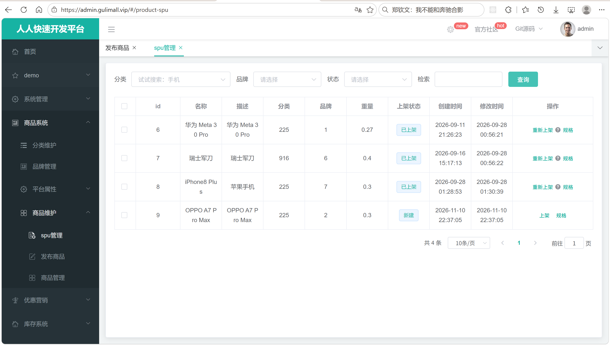
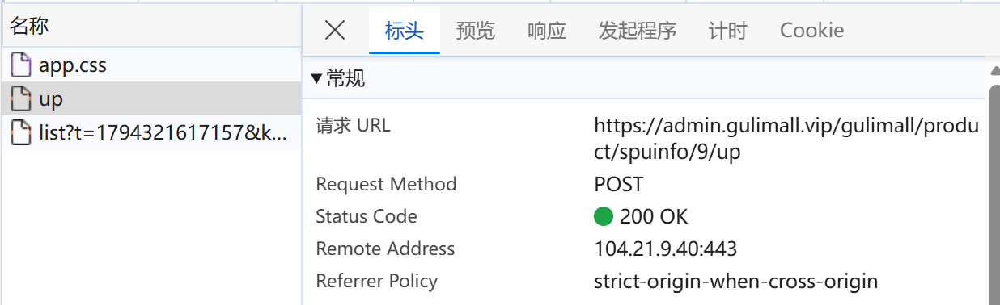
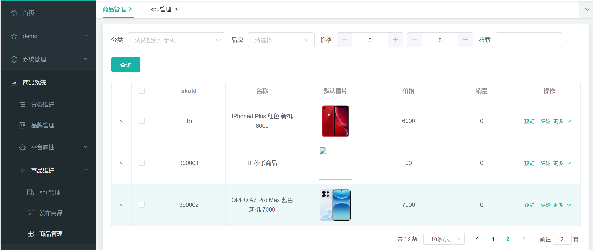

# 7.2 商品管理-介绍

> 本篇介绍商品管理的两条主线：SPU 管理负责商品档案、条件查询、上架和规格修改；SKU 管理负责具体规格的查询、价格查询和下单快照。重点说明条件分页怎么拼、上架时怎么把 SKU 数据写进 Elasticsearch、规格修改为什么需要重新上架、后台列表为什么不走缓存。

---

## 1. 这个功能是干什么的

商品管理是发布商品之后的维护入口，分为 SPU 管理和 SKU 管理：

1. **SPU 管理**：查看商品档案，按分类、品牌、上架状态、关键字筛选；对上架新商品；对已上架商品重新上架；修改商品规格参数。
2. **SKU 管理**：查看具体规格，按分类、品牌、价格区间、关键字筛选；查看 SKU 明细、价格、销量；跳转到库存管理、营销设置。
3. **商品上架**：把 SPU 下的所有 SKU 组装成 `SkuEsModel`，补充库存、品牌名、分类名、可检索规格属性，通过 Feign 批量写入 Elasticsearch，写入成功后把 `pms_spu_info.publish_status` 改成 1。
4. **规格修改**：按 SPU 重新加载属性分组，把已有规格值回填到表单，提交后更新 `pms_product_attr_value`。

SPU 和 SKU 在管理页面上分工不同：

```text
SPU 管理：商品是什么
├── 名称、描述、分类、品牌、重量
├── 上架状态
├── 上架 / 重新上架
└── 规格参数修改

SKU 管理：具体卖哪一个
├── SKU 名称、默认图、价格、销量
├── 分类、品牌、SPU 归属
├── 预览、评论
└── 库存、秒杀、满减、折扣、会员价、优惠券入口
```

管理页面不写库存。库存属于 `gulimall_wms`，SKU 管理页的“库存管理”只是跳转到仓库页面，真正的库存数量、锁定、释放由库存服务负责。

当前代码只实现了上架，没有实现下架。页面虽然有“下架”状态选项，但后端没有对应接口，`publish_status=2` 没有产生路径。

## 2. 管理员怎么操作

入口：

```text
管理后台 → 商品系统 → 商品管理
```



### 2.1 查看 SPU 列表

1. 打开页面，`spu.vue` 渲染筛选表单，下面挂载 `spuinfo.vue` 列表组件。
2. 列表请求 `GET /product/spuinfo/list`，分页参数是 `page`、`limit`。
3. 表格展示 id、名称、描述、分类、品牌、重量、上架状态、创建时间、修改时间。
4. 上架状态用标签展示：0 新建、1 已上架、2 已下架。
5. 操作列根据状态显示“上架”或“重新上架”，另外始终显示“规格”。

### 2.2 按条件查询

1. 分类级联选择器选择三级分类，结果写入 `dataForm.catelogId`。
2. 品牌下拉框选择品牌，结果写入 `dataForm.brandId`。
3. 状态下拉框选择新建、上架、下架，结果写入 `dataForm.status`。
4. 检索框输入关键字，结果写入 `dataForm.key`。
5. 点“查询”，`searchSpuInfo()` 通过 PubSub 把 `dataForm` 发给列表组件。
6. 列表组件收到消息后重新请求 `GET /product/spuinfo/list`，把筛选条件一起带上。


查询条件规则：

1. 关键字同时匹配 SPU id 精确值和商品名称模糊值。
2. 分类和品牌传 0 表示全部，后端不加条件。
3. 状态只要非空就精确匹配 `publish_status`。
4. 分页参数由 `Query.getPage(params)` 解析。

### 2.3 上架与重新上架

1. 新建商品在列表里显示“上架”按钮。
2. 已上架商品显示“重新上架”按钮，旁边有提示“sku信息修改后重新上架商品，例如新增库存”。
3. 点“上架”，`productUp(id)` 发送 `POST /product/spuinfo/{id}/up`。
4. 后端查这个 SPU 下所有 SKU。
5. 远程查询库存服务，得到每个 SKU 是否有货。
6. 查询 SPU 的可检索规格属性。
7. 组装 `SkuEsModel`，补充品牌名、品牌 logo、分类名。
8. 通过 Feign 调搜索服务，批量写入 ES。
9. ES 写入成功后，把 `pms_spu_info.publish_status` 改成 1。
10. 前端提示“操作成功”，重新请求列表。



重新上架和首次上架调用同一个接口。ES 文档 id 使用 `skuId`，重复写入是覆盖，不会产生重复文档。修改 SKU 价格、库存、规格后，重新上架可以刷新 ES 里的检索数据。

### 2.4 查看 SKU 列表

1. 打开 SKU 管理页，`manager.vue` 渲染筛选表单和表格。
2. 分类、品牌、价格区间、关键字是查询条件。
3. 表格展示 skuId、名称、默认图片、价格、销量。
4. 展开某一行，显示标题、副标题、描述、分类 id、SPU id、品牌 id。
5. 操作列有“预览”“评论”和“更多”下拉菜单。
6. “更多”里的库存管理会跳转到 `/ware-sku`，并带上 `skuId`。



### 2.5 修改 SPU 规格

1. 在 SPU 列表点“规格”，`attrUpdateShow(row)` 跳转到 `/product-attrupdate`，URL 带上 `spuId` 和 `catelogId`。
2. 规格修改页 `activated()` 读取 URL 参数。
3. 请求 `GET /product/attr/base/listforspu/{spuId}`，拿到这个 SPU 已有的规格值。
4. 请求 `GET /product/attrgroup/{catelogId}/withattr`，拿到这个分类的属性分组和属性定义。
5. 两者按 `attrId` 合并，已有值回填到表单，没有值显示空。
6. 修改后点“确认修改”，`submitSpuAttrs()` 把有值的属性整理成数组。
7. 发送 `POST /product/attr/update/{spuId}`，更新 `pms_product_attr_value`。
8. 页面提示“属性修改成功”。


规格修改只改 SPU 的基本属性，不改 SKU 的销售属性，也不改 SKU 价格。修改后 ES 里的文档不会自动更新，需要回 SPU 列表点“重新上架”，把新规格重新写入 ES。

## 3. 整体设计思路

### 3.1 业务上怎么设计

#### 3.1.1 SPU 查询条件

| 条件 | 前端字段 | 后端处理 | 业务含义 |
|---|---|---|---|
| 关键字 | `key` | `id = key` 或 `spu_name like %key%` | 支持按商品 id 精确查，也支持按名称模糊查 |
| 分类 | `catelogId` | 非 0 时 `catelog_id = ?` | 只看某个三级分类下的商品 |
| 品牌 | `brandId` | 非 0 时 `brand_id = ?` | 只看某个品牌的商品 |
| 状态 | `status` | 非空时 `publish_status = ?` | 只看新建、已上架或已下架 |
| 分页 | `page`、`limit` | `Query.getPage(params)` | 控制页码和每页条数 |

关键字用 `and(...or...)` 包起来，避免 OR 条件把分类、品牌、状态条件冲掉。正确结构是：

```text
(catelog_id = ? AND brand_id = ? AND publish_status = ?)
AND (id = ? OR spu_name LIKE ?)
```

如果 OR 不包在 `and` 里，会变成：

```text
catelog_id = ? AND brand_id = ? AND publish_status = ? AND id = ? OR spu_name LIKE ?
```

这样只要名称匹配，分类、品牌、状态条件就全部失效。

#### 3.1.2 SKU 查询条件

| 条件 | 前端字段 | 后端处理 | 业务含义 |
|---|---|---|---|
| 关键字 | `key` | `sku_id = key` 或 `sku_name like %key%` | 按 SKU id 精确查或按名称模糊查 |
| 分类 | `catelogId` | 非 0 时 `catelog_id = ?` | 只看某个三级分类下的 SKU |
| 品牌 | `brandId` | 非 0 时 `brand_id = ?` | 只看某个品牌的 SKU |
| 价格区间 | `min`、`max` | 两者都非空且不同时为 0 时 `price between ? and ?` | 按价格筛选 |
| 分页 | `page`、`limit` | `Query.getPage(params)` | 控制页码和每页条数 |

价格区间的边界：

1. `min`、`max` 都为 0 表示不限价格。
2. 只填 `min` 不填 `max`，当前后端不加价格条件。
3. 只填 `max` 不填 `min`，当前后端也不加价格条件。
4. `min > max` 时查询结果为空。
5. `between` 是闭区间，包含最小值和最大值。

#### 3.1.3 上架状态

| 值 | 业务含义 | 页面展示 | 产生方式 |
|---|---|---|---|
| 0 | 新建 | 新建 | 发布商品时写入 |
| 1 | 已上架 | 已上架 | 上架成功后更新 |
| 2 | 已下架 | 已下架 | 页面有选项，后端没有下架接口 |

当前状态机只完成了 0 → 1：

```text
发布商品 → 0 新建
    → 点上架 → 查 SKU、查库存、写 ES → 1 已上架
    → 点重新上架 → 再次写 ES → 仍然 1
```

没有 1 → 2 的下架接口。页面显示 2 只是为了以后扩展，数据库里不会被当前代码写成 2。

上架和重新上架共用一个接口，原因是：

1. ES 文档以 `skuId` 为 id，重复写入是覆盖，天然幂等。
2. 重新上架就是重新组装一次 `SkuEsModel`，逻辑和首次上架完全一致。
3. 不需要为“刷新 ES”单独写一个接口。

#### 3.1.4 上架的业务前置

上架前业务上要求：

1. SPU 已存在，且至少有一个 SKU。
2. SKU 至少有一个销售属性组合，否则搜索页无法按规格筛选。
3. 每个 SKU 有价格和默认图，否则搜索结果没有价格和图片。
4. 品牌和分类存在，否则补充品牌名、分类名时会空指针。
5. 库存服务可访问，否则所有 SKU 都会被当成无货。
6. 搜索服务可访问，否则 ES 写不进去，SPU 不能变成已上架。

当前代码只检查了“SKU 列表是否为空”这一层，其他条件靠数据本身保证，没有显式校验。

#### 3.1.5 规格修改的边界

规格修改页只处理 SPU 的基本属性：

1. 可以改属性值，例如屏幕尺寸、电池容量。
2. 可以改“快速展示”标记。
3. 不能改 SKU 的销售属性，例如颜色、内存。
4. 不能改 SKU 价格、图片、满减、会员价。
5. 修改后不会自动同步 ES，需要重新上架。

为什么销售属性不能在规格修改页改：

1. 销售属性决定 SKU 的组合，改一个值可能要让 SKU 增加、删除或重新组合。
2. 已经上架的 SKU 可能已经被购物车、订单、库存引用，直接改属性会导致历史数据对不上。
3. 页面提示“sku信息修改后重新上架商品”，业务上通过重新上架刷新检索数据，而不是改历史 SKU。

#### 3.1.6 SKU 与库存、营销的关系

SKU 管理页展示的价格来自 `pms_sku_info.price`，库存不来自商品库：

```text
商品库 gulimall_pms
├── pms_sku_info.price          商品售价
├── pms_sku_info.sku_default_img 默认图
└── pms_sku_info.sale_count     销量

库存库 gulimall_wms
├── wms_ware_sku.stock          某仓库的库存
├── wms_ware_sku.stock_locked   锁定库存
└── wms_ware_sku.stock_unlock   可解锁库存

优惠库 gulimall_sms
├── sms_sku_ladder              满件打折
├── sms_sku_full_reduction      满额减
└── sms_member_price            会员价
```

因此 SKU 列表只查商品库，不展示库存；要看库存必须跳库存页。订单下单时会分别查商品价格、库存、优惠，再把结果做成订单快照。

### 3.2 技术上怎么设计

#### 3.2.1 条件分页

所有列表都走同一套模式：

```text
Controller 接收 Map<String, Object> params
    → Service 用 QueryWrapper 拼条件
    → Query.getPage(params) 解析 page、limit
    → this.page(page, wrapper) 执行分页
    → PageUtils 包装成前端需要的结构
```

优点：

1. 前端统一传 `page`、`limit`，后端统一用 `Query` 解析。
2. 条件按需拼接，没有条件就不加 SQL。
3. `PageUtils` 统一返回 `list`、`totalCount`、`pageSize`、`currPage` 等字段。

#### 3.2.2 上架聚合

上架要跨四个数据来源组装一个 ES 文档：

```text
pms_sku_info                 SKU 基本信息、价格、默认图、销量
pms_product_attr_value       SPU 规格参数
pms_attr.search_type = 1     哪些规格可被检索
pms_brand                   品牌名称、logo
pms_category                分类名称
gulimall_ware               是否有货
```

组装顺序：

1. 先查 SKU 列表，拿到所有 SKU。
2. 批量查库存，拿到 `skuId -> 是否有货`。
3. 查 SPU 规格值，再筛出可检索属性。
4. 每个 SKU 复制基本信息，补充价格、图片、库存、热度、品牌、分类、规格属性。
5. 批量写 ES。

#### 3.2.3 Feign 写 ES

商品服务不直接连 Elasticsearch，而是通过 `ElasticSaveFeignClient` 调搜索服务：

```text
product 服务
  → ElasticSaveFeignClient.productStatusUp(List<SkuEsModel>)
  → search 服务 ElasticSaveController
  → ProductSaveServiceImpl
  → ElasticsearchClient.bulk()
  → 索引 product，文档 id = skuId
```

这样设计的原因：

1. 只有搜索服务需要维护 ES 客户端和索引 mapping。
2. 商品服务只依赖 API 模块里的 `SkuEsModel`，不引入 ES 客户端。
3. 搜索服务可以对批量写入做统一的重试、日志、错误处理。

#### 3.2.4 状态更新

`up()` 先写 ES，再更新状态：

1. ES 返回 `code=0`，才执行 `updateSpuStatus(spuId, 1)`。
2. ES 返回其他码，走失败分支，状态保持 0，当前没有记录失败日志。
3. 写 ES 抛异常时，异常向外传播，状态不会更新。

为什么先写 ES 再改状态：

1. 状态是“已上架”的承诺，只有 ES 里真的有数据，搜索页才能查到。
2. 如果先改状态再写 ES，ES 失败时会出现“页面显示已上架，但搜索不到”的假上架。
3. 重新上架可以修复“ES 写了一半”的情况，因为文档 id 固定是 `skuId`。

#### 3.2.5 缓存策略

商品管理页的列表查询不走缓存：

1. 后台管理是低频操作，直接查 MySQL 能保证管理员看到最新状态。
2. 上架后状态刚更新，如果读缓存可能看到旧状态。
3. 条件组合多，缓存 key 设计复杂，命中率低。

真正承担“读加速”的是两个东西：

1. **Elasticsearch**：商品检索的读模型，上架时写入，搜索页直接查 ES，不查商品库。
2. **分类缓存**：首页分类树使用 Caffeine + Redis，减少分类查询压力；它只服务展示，不影响商品管理列表。

所以商品管理的缓存策略是“管理端不缓存，检索端用 ES 读模型，字典数据用本地 + Redis 缓存”。

#### 3.2.6 批量查询

SKU 价格和 SKU 详情都提供批量接口：

1. `getPriceBatch()` 一次查多个 SKU 的价格，返回 `Map<skuId, price>`。
2. `getSkuDetails()` 一次查多个 SKU 的概要，返回 `List<SkuDetailVo>`。
3. 购物车、订单不需要逐个 SKU 调接口，减少网络往返。

`getSkuDetails()` 内部用三次批量查询代替逐行查询：

```text
一次查 SKU
一次查 SPU
一次查品牌
内存拼装 SkuDetailVo
```

#### 3.2.7 规格修改链路

规格修改分两步加载：

1. 按 `spuId` 查已有规格值，得到 `attrId -> ProductAttrValueEntity`。
2. 按 `catelogId` 查属性分组和属性定义，得到页面表单结构。
3. 用已有值回填表单，没有值的属性显示空。
4. 提交时只提交有值的属性，拼成 `attrId`、`attrName`、`attrValue`、`quickShow`。

#### 3.2.8 没有 MQ 的同步取舍

上架是同步调用搜索服务，没有走 MQ：

1. 管理员点“上架”后需要立刻知道结果。
2. 同步调用能直接拿到 ES 写入结果，失败时状态不改。
3. 引入 MQ 后要处理消息丢失、重复消费、顺序和最终一致，当前阶段没有引入。

代价：

1. 搜索服务不可用时上架失败。
2. ES 写入慢时会拖长上架请求。
3. SKU 数量多时，一次批量请求体可能很大。

## 4. 详细代码、配置和解释

本章按“类为什么存在 → 关键数据 → 链路位置 → 代码分块解释 → 一次完整示例 → 边界”组织。每一块代码前面先说明它在链路里承担什么，代码后面再按 1、2、3 的顺序解释执行过程和原因。

### 4.1 SpuInfoController：列表与上架入口

#### 4.1.1 这个类解决什么问题

后台商品管理页有两类请求落在 SPU 上：列表页按条件翻页查看商品档案，操作列触发上架或重新上架。页面只认 HTTP 接口，`SpuInfoController` 负责把这两类请求翻译成 `SpuInfoService` 调用。

链路位置：

```text
spuinfo.vue
  → GET  /gulimall/product/spuinfo/list
  → POST /gulimall/product/spuinfo/{spuId}/up
  → 网关去掉 /gulimall 前缀
  → SpuInfoController
  → SpuInfoService
```

Controller 只做三件事：接收参数、校验后台权限、把 Service 的返回值包装成统一结果 `R`。ES 文档怎么组装、库存怎么查、状态怎么更新，都不在这个类里。

#### 4.1.2 接口清单

| 操作 | 方法与路径 | 权限 | 调用的 Service 方法 |
|---|---|---|---|
| SPU 条件分页 | `GET /product/spuinfo/list` | `product:spuinfo:list` | `queryPageByCondition()` |
| 商品上架 | `POST /product/spuinfo/{spuId}/up` | 无 | `up()` |

网关转发前会去掉 `/gulimall` 前缀，浏览器实际请求的是 `/gulimall/product/spuinfo/...`。

#### 4.1.3 代码与解释

这段代码是后台列表和上架两个入口的全部实现，负责参数接收与结果包装。

```java
@RestController
@RequestMapping("product/spuinfo")
public class SpuInfoController {
    @Autowired
    private SpuInfoService spuInfoService;

    /**
     * 列表
     */
    @RequestMapping("/list")
    @RequiresPermissions("product:spuinfo:list")
    public R list(@RequestParam Map<String, Object> params){
        PageUtils page = spuInfoService.queryPageByCondition(params);

        return R.ok().put("page", page);
    }

    /**
     * 商品上架
     *
     */
    @PostMapping("/{spuId}/up")
    public R setUp(@PathVariable("spuId") Long spuId) {
        spuInfoService.up(spuId);
        return R.ok();
    }

}
```

1. `@RestController` + `@RequestMapping("product/spuinfo")`：两个接口共用 `/product/spuinfo` 前缀，返回体按 JSON 序列化。
2. `list()` 用 `@RequestParam Map<String, Object> params` 接收全部查询参数，包括 `page`、`limit`、`key`、`catelogId`、`brandId`、`status`；新增筛选条件时不需要改方法签名。
3. `spuInfoService.queryPageByCondition(params)` 完成条件拼接和分页，返回 `PageUtils`；Controller 把结果放在 `page` 字段，前端从 `data.page.list` 和 `data.page.totalCount` 取值。
4. `setUp()` 从路径变量取 `spuId`，调用 `spuInfoService.up(spuId)`；请求体为空，所有数据由 Service 按 `spuId` 查库组装。
5. `setUp()` 没有 `@RequiresPermissions`，权限校验只覆盖列表接口。
6. 上架成功返回 `R.ok()`；Service 内部写 ES 失败时只走失败分支并保留原状态，Controller 仍然返回成功结果。

#### 4.1.4 一次请求示例

管理员在列表里对 `spuId=6` 的商品点“上架”：

```text
1. spuinfo.vue 调 productUp(6)
2. POST /gulimall/product/spuinfo/6/up
3. 网关转发到 product 服务，路径变为 /product/spuinfo/6/up
4. SpuInfoController.setUp(6)
5. spuInfoService.up(6) 查 SKU、查库存、组装 ES 文档、调搜索服务
6. ES 返回 code=0 时更新 pms_spu_info.publish_status=1
7. Controller 返回 R.ok()
8. 前端提示“操作成功”，关闭提示后刷新列表
```

#### 4.1.5 它不做什么

1. 不组装 `SkuEsModel`，组装逻辑在 `SpuInfoServiceImpl.up()`。
2. 不直接更新 `publish_status`，状态更新由 Service 调 DAO 完成。
3. 不检查 SPU 是否存在、是否有 SKU，这些判断不在 Controller 层。
4. 不处理失败重试，ES 写入失败时只保留原状态。

#### 4.1.6 边界与可优化点

1. `setUp()` 缺少权限注解，任何能访问网关的请求都能触发上架。
2. `setUp()` 固定返回 `R.ok()`，前端无法区分“ES 全部写入成功”和“走失败分支但状态未改”。
3. 上架是同步耗时操作，SKU 多或搜索服务慢时会长时间占用请求线程，可以改成异步任务并由前端轮询状态。
4. 列表没有强制排序，分页翻页时可能出现顺序不稳定。

### 4.2 SpuInfoServiceImpl.queryPageByCondition：SPU 条件分页

#### 4.2.1 这个类解决什么问题

后台 SPU 列表需要同时支持关键字、分类、品牌、上架状态四类筛选，并配合分页使用。数据源只有 `pms_spu_info` 一张表，查询本身不复杂，难点在于条件必须按需拼接，并且关键字里的 OR 不能破坏其他条件。

调用方是 `SpuInfoController.list()`；下游直接执行 MyBatis-Plus 分页 SQL，不经过缓存，也不经过 ES。

#### 4.2.2 查询条件

| 前端字段 | 后端条件 | 生效规则 |
|---|---|---|
| `key` | `id = ? OR spu_name LIKE ?` | 非空时生效，整体用括号包住 |
| `catelogId` | `catelog_id = ?` | 非空且不等于 0 |
| `brandId` | `brand_id = ?` | 非空且不等于 0 |
| `status` | `publish_status = ?` | 非空即生效，0 也是有效值 |
| `page`、`limit` | 分页 | 由 `Query.getPage(params)` 解析 |

分类和品牌用 0 表示“全部”，状态不做这个约定，因为 0 本身表示“新建”。

#### 4.2.3 代码与解释

这段代码负责把页面传来的参数翻译成 `WHERE` 条件，并执行分页查询。

```java
@Override
public PageUtils queryPageByCondition(Map<String, Object> params) {
    // status=0, key=6, brandId=1, catelogId=225
    QueryWrapper<SpuInfoEntity> queryWrapper = new QueryWrapper<>();
    String key = (String) params.get("key");
    if (StringUtils.isNotEmpty(key)) {
        queryWrapper.and(w -> w.eq("id", key).or().like("spu_name", key));
    }
    String catelogId = (String) params.get("catelogId");
    if (StringUtils.isNotEmpty(catelogId) && !"0".equalsIgnoreCase(catelogId)) {
        queryWrapper.eq("catelog_id", catelogId);
    }

    String brandId = (String) params.get("brandId");
    if (StringUtils.isNotEmpty(brandId) && !"0".equalsIgnoreCase(brandId)) {
        queryWrapper.eq("brand_id", brandId);
    }

    String status = (String) params.get("status");
    if (StringUtils.isNotEmpty(status)) {
        queryWrapper.eq("publish_status", status);
    }
    IPage<SpuInfoEntity> page = this.page(
            new Query<SpuInfoEntity>().getPage(params),
            queryWrapper
    );
    return new PageUtils(page);
}
```

1. 创建 `QueryWrapper<SpuInfoEntity>`，后续条件都挂在这个对象上。
2. 取 `key`，非空时用 `and(w -> w.eq("id", key).or().like("spu_name", key))` 拼出一个括号分组，保证关键字条件整体和其他条件用 AND 连接。
3. 取 `catelogId`，非空且不等于 0 时追加 `catelog_id = ?`。
4. 取 `brandId`，非空且不等于 0 时追加 `brand_id = ?`。
5. 取 `status`，非空时追加 `publish_status = ?`，传入 0 也会生效。
6. `new Query<SpuInfoEntity>().getPage(params)` 从 `page`、`limit` 解析页码和每页条数，得到 `IPage`。
7. `this.page(page, queryWrapper)` 执行分页查询，结果交给 `PageUtils` 包装成前端统一结构。

关键字用 `and()` 包起来的原因：如果直接写成 `eq("id", key).or().like("spu_name", key)`，OR 会和后面的分类、品牌、状态平级，只要名称匹配，其他筛选条件就全部失效。

#### 4.2.4 一次查询示例

请求参数：

```text
GET /product/spuinfo/list?page=1&limit=10&key=手机&catelogId=0&brandId=1&status=1
```

生成的 SQL 结构：

```sql
SELECT *
FROM pms_spu_info
WHERE (id = '手机' OR spu_name LIKE '%手机%')
  AND brand_id = 1
  AND publish_status = 1
LIMIT 0, 10;
```

`catelogId=0` 不追加分类条件，`brandId=1` 和 `status=1` 正常生效。

#### 4.2.5 边界与可优化点

1. `key` 没有校验是否为数字，非数字传给 `id = ?` 时 MySQL 会做隐式转换，可能导致索引失效。
2. `id = key` 和 `spu_name LIKE '%key%'` 用 OR 连接，前者能走主键索引，后者无法走索引，数据量大时性能下降。
3. 没有按 `id` 或 `create_time` 排序，分页结果顺序不稳定。
4. 状态使用魔法值 0、1、2，可以统一收敛到 `StatusEnum`。
5. `key` 没有去掉前后空格，用户输入空格时会拼出无意义的模糊条件。

### 4.3 SpuInfoServiceImpl.up：商品上架

#### 4.3.1 这个类解决什么问题

商品上架要把商品库里的 SPU、SKU、规格参数，和库存服务、品牌表、分类表的数据合并成搜索索引文档，再交给搜索服务写入 Elasticsearch。搜索页只查 ES，不查商品库，所以上架这一步决定了商品在搜索页能否被看到、看到的价格、图片、品牌、分类和可筛选规格是什么。

调用方是 `SpuInfoController.setUp()`，对应后台的“上架”和“重新上架”按钮。下游依赖：

1. `SkuInfoService.getSkuBySpuId()`：查 SPU 下所有 SKU。
2. `WareSkuFeignClient.hasStock()`：远程查库存。
3. `ProductAttrValueMethod`：查 SPU 规格值，并筛出可检索属性。
4. `BrandService`、`CategoryService`：补品牌名、品牌 logo、分类名。
5. `ElasticSaveFeignClient.productStatusUp()`：批量写 ES。
6. `SpuInfoDao.updateSpuStatus()`：ES 成功后更新上架状态。

#### 4.3.2 数据来源与链路位置

上架需要从以下数据源收集字段：

```text
pms_sku_info                   SKU 基本信息、价格、默认图、销量
pms_product_attr_value         SPU 规格值
pms_attr.search_type = 1       哪些规格可以被检索
pms_brand                      品牌名称、logo
pms_category                   分类名称
gulimall_ware                  每个 SKU 是否有货
```

链路：

```text
SpuInfoController.setUp(spuId)
  → up(spuId)
  → 查 SKU
  → 查库存
  → 查规格值并筛可检索属性
  → 组装 List<SkuEsModel>
  → Feign 调 gulimall-search
  → ES 写入成功
  → updateSpuStatus(spuId, 1)
```

#### 4.3.3 代码与解释

这段代码承担整个上架的编排：先收集数据，再组装文档，最后写 ES 并按结果更新状态。

```java
/**
 * 商品上架
 *
 * @param spuId
 */
@Override
public void up(Long spuId) {

    // 1.查询当前spu对应的所有sku信息
    List<SkuInfoEntity> skuInfoEntityList = skuInfoService.getSkuBySpuId(spuId);

    // 2.1 远程调用ware库存系统，查询是否有库存
    Map<Long, Boolean> hasStock = null;
    try {
        hasStock = wareSkuFeignClient.hasStock(
                skuInfoEntityList.stream().map(SkuInfoEntity::getSkuId).toList());
    } catch (Exception e) {
        log.error("库存服务查询异常，原因：", e);
    }

    // 2.4 查询当前sku所有可被检索的规格属性
    List<ProductAttrValueEntity> productAttrValueEntityList = productAttrValueMethod.baseAttrListForSpu(spuId);
    List<Long> attrIds = productAttrValueEntityList.stream().map(ProductAttrValueEntity::getAttrId).toList();
    List<Long> searchAttrIds = productAttrValueMethod.selectSearchAttrs(attrIds);
    Set<Long> sIds = new HashSet<>(searchAttrIds);
    List<Attr> searchlist = productAttrValueEntityList.stream()
            .filter(attr -> sIds.contains(attr.getAttrId()))
            .map(item -> {
                Attr attr = new Attr();
                BeanUtils.copyProperties(item, attr);
                return attr;
            })
            .toList();

    // 2.封装sku信息
    Map<Long, Boolean> finalHasStock = hasStock;
    List<SkuEsModel> skuEsModelList = skuInfoEntityList.stream().map(skuInfo -> {
                SkuEsModel skuEsModel = new SkuEsModel();
                BeanUtils.copyProperties(skuInfo, skuEsModel);
                skuEsModel.setSkuPrice(skuInfo.getPrice());
                skuEsModel.setSkuImg(skuInfo.getSkuDefaultImg());
                // 2.1 查询失败设置为false没有库存
                skuEsModel.setHasStock(finalHasStock != null ? finalHasStock.get(skuInfo.getSkuId()) : false);
                // 2.2 热度评分 默认0
                skuEsModel.setHotScore(0L);
                // 2.3 查询品牌和分类的名字信息
                BrandEntity brandEntity = brandService.getById(skuInfo.getBrandId());
                skuEsModel.setBrandName(brandEntity.getName());
                skuEsModel.setBrandImg(brandEntity.getLogo());
                CategoryEntity categoryEntity = categoryService.getById(skuInfo.getCatelogId());
                skuEsModel.setCatelogName(categoryEntity.getName());
                // 2.4
                skuEsModel.setAttrs(searchlist);

                return skuEsModel;
            }
    ).toList();

    // 3.数据发送给ES保存
    R r = elasticSaveFeignClient.productStatusUp(skuEsModelList);
    if (r.getCode() == 0) {
        // 成功
        // 4.修改当前spu状态
        baseMapper.updateSpuStatus(spuId, StatusEnum.SPU_UP.getCode());
    } else {
        // 失败
        // TODO 重复调用？接口幂等性；重试机制
        /*
          1、构造请求数据，将对象转为json;
          RequestTemplate template = buildTemplateFromArgs.create(argv);
          2、发送请求进行执行（执行成功会解码响应数据）：
          executeAndDecode（template）;
          3、执行请求会有重试机制
          while(true)(
            try{
                executeAndDecode（template）;
            } catch() {
                try{
                    retryer.continueOrPropagate(e);
                } catch () {
                    throw ex;
                }
                continue;
            }
         */
    }

}
```

1. `skuInfoService.getSkuBySpuId(spuId)` 从 `pms_sku_info` 查出这个 SPU 下所有 SKU。后续所有文档都以 SKU 为粒度，一个 SKU 对应 ES 里的一篇文档。
2. 提取所有 `skuId`，调 `wareSkuFeignClient.hasStock()` 批量查库存，返回 `Map<skuId, 是否有货>`。远程调用包在 `try/catch` 里，异常时只记录日志，`hasStock` 保持 null。
3. `productAttrValueMethod.baseAttrListForSpu(spuId)` 从 `pms_product_attr_value` 查出这个 SPU 的全部规格值。
4. 提取 `attrId`，调 `productAttrValueMethod.selectSearchAttrs(attrIds)`，从 `pms_attr` 筛出 `search_type=1` 的属性 id，再放进 `Set` 用于快速判断。
5. 遍历规格值，只保留可检索属性，并用 `BeanUtils.copyProperties` 转成搜索模块的 `Attr` 对象，得到 `searchlist`。这个列表被同一个 SPU 下的所有 SKU 共用。
6. `skuInfoEntityList.stream().map(...)` 逐条构造 `SkuEsModel`：
   - 先复制 SKU 的同名字段；
   - `skuPrice` 取 `price`，`skuImg` 取 `skuDefaultImg`；
   - `hasStock` 取库存结果，库存查询失败时统一按 false 处理；
   - `hotScore` 初始化为 0；
   - 按 `brandId` 查品牌，填 `brandName` 和 `brandImg`；
   - 按 `catelogId` 查分类，填 `catelogName`；
   - `attrs` 设置为第 5 步的 `searchlist`。
7. `elasticSaveFeignClient.productStatusUp(skuEsModelList)` 把整个 SKU 文档列表发给搜索服务，返回值 `R` 的 `code` 表示这次批量写入是否全部成功。
8. `r.getCode() == 0` 时调用 `baseMapper.updateSpuStatus(spuId, StatusEnum.SPU_UP.getCode())`，把 `pms_spu_info.publish_status` 改成 1；否则进入失败分支，状态保持不变，分支里只留下重试和幂等的 TODO 注释。

为什么先写 ES 再改状态：状态改成“已上架”代表商品已经可以被搜索到。如果先改状态再写 ES，搜索服务失败时页面会显示已上架，但搜索页查不到，形成假上架。

#### 4.3.4 一次上架示例

`spuId=6` 下有 2 个 SKU，其中 SKU 7 有货、SKU 8 无货：

```text
1. getSkuBySpuId(6) 返回 [skuId=7, skuId=8]
2. hasStock([7, 8]) 返回 {7=true, 8=false}
3. 查到规格值：颜色=黑色，屏幕=6.7 英寸，其中只有屏幕 search_type=1
4. searchlist = [Attr(attrId=屏幕, attrValue=6.7 英寸)]
5. 组装两个 SkuEsModel：
   skuId=7，price=3999，hasStock=true，brandName=小米，catelogName=智能手机，attrs=[屏幕]
   skuId=8，price=4299，hasStock=false，其余字段相同
6. POST search/save/product，文档 id 分别是 7 和 8
7. 搜索服务 bulk 写入索引 product，返回全部成功
8. updateSpuStatus(6, 1)，publish_status 从 0 变成 1
```

之后再点“重新上架”，流程完全相同，文档 id 不变，ES 里是覆盖写入。

#### 4.3.5 它不做什么

1. 不修改 SKU 价格、库存、图片，只读取商品库和库存服务的当前值。
2. 不计算销量和热度，`saleCount` 来自 SKU 表，`hotScore` 固定为 0。
3. 不同步更新分类缓存，分类名直接从 `pms_category` 读取。
4. 不处理下架，状态只从新建进入已上架。
5. 不保证 ES 与数据库强一致，写 ES 和改状态不在同一个事务里。

#### 4.3.6 边界与可优化点

1. 每个 SKU 都调用一次 `brandService.getById()` 和 `categoryService.getById()`，同一 SPU 下品牌和分类相同，属于重复查询；应先按 `brandId`、`catelogId` 去重批量查询，再在内存里映射。
2. `finalHasStock.get(skuId)` 可能返回 null，`SkuEsModel.hasStock` 是基本类型 `boolean`，自动拆箱会抛空指针。库存服务返回的 Map 缺少某个 key 时就会触发。
3. 没有校验 SKU 列表是否为空，空列表仍然会调用搜索服务。
4. 搜索服务部分失败时，`code` 非 0，状态不更新，但 ES 里可能已经写入部分文档，需要重新上架修复。
5. 写 ES 是同步调用，搜索服务慢会拖长上架请求，可以改成异步任务或 MQ 补偿。
6. 没有幂等记录，连续点击上架会重复组装、重复写 ES。
7. 失败分支只有注释，没有重试、告警和失败明细记录。

#### 4.3.7 StatusEnum：上架状态枚举

上架状态既要写进 `pms_spu_info.publish_status`，又要在页面上显示成“新建、已上架、已下架”。枚举的作用是把状态码和含义放在一处，避免 Service 里直接写 0、1、2。

```java
public enum StatusEnum {
    NEW_SPU(0, "新建"),
    SPU_UP(1, "商品上架"),
    SPU_DOWN(1, "商品下架");

    private final int code;
    private final String msg;

    StatusEnum(int code, String msg) {
        this.code = code;
        this.msg = msg;
    }

    public int getCode() {
        return code;
    }

    public String getMsg() {
        return msg;
    }
}
```

1. `NEW_SPU(0, "新建")` 对应发布商品后的初始状态，页面显示“新建”。
2. `SPU_UP(1, "商品上架")` 对应上架成功后的状态，页面显示“已上架”。
3. `SPU_DOWN(1, "商品下架")` 的码值也是 1，和 `SPU_UP` 重复；页面把 2 当作已下架，枚举和页面约定不一致。
4. `up()` 只使用 `SPU_UP.getCode()`，当前没有代码使用 `SPU_DOWN`。
5. 枚举提供 `getCode()` 和 `getMsg()`，日志和页面展示都能直接取到中文含义。

边界：状态码没有和前端统一成 0 新建、1 上架、2 下架，后续增加下架接口时需要先调整 `SPU_DOWN` 的码值，否则下架会写成已上架。

#### 4.3.8 SpuInfoDao.updateSpuStatus：更新上架状态

ES 写入成功后，需要把 `pms_spu_info.publish_status` 从 0 改成 1，同时刷新 `update_time`，让列表能看出最近一次上架时间。这个更新只改两列，不需要先查实体再整行更新。

DAO 接口只声明方法，两个参数用 `@Param` 绑定到 XML 占位符：

```java
void updateSpuStatus(@Param("spuId") Long spuId, @Param("code") int code);
```

真正的 SQL 在 `SpuInfoDao.xml` 里：

```xml
<update id="updateSpuStatus">
    UPDATE pms_spu_info
    SET publish_status=#{code}, update_time=NOW()
    WHERE id = #{spuId}
</update>
```

1. `@Param("spuId")` 和 `@Param("code")` 让 XML 可以通过 `#{spuId}`、`#{code}` 取值，不依赖参数顺序。
2. `<update id="updateSpuStatus">` 的 id 必须和接口方法名一致，MyBatis 才能完成绑定。
3. `SET publish_status=#{code}, update_time=NOW()` 只更新状态和修改时间，不改其他列。
4. `WHERE id = #{spuId}` 走主键索引，更新成本很低。
5. `update_time` 使用数据库的 `NOW()`，多个应用实例部署时时间基准一致。
6. 调用点是 `up()` 里 ES 返回 `code=0` 的分支，ES 失败时不会执行。

边界：没有校验当前状态，重复上架会重复刷新 `update_time`；没有记录操作人和状态变更历史，排查时只能看到最后一次修改时间；没有独立的下架入口，上架和重新上架共用同一个方法。

### 4.4 SkuInfoController：SKU 列表、价格与详情

#### 4.4.1 这个类解决什么问题

SKU 是具体可售单元。后台要按条件查看 SKU 列表，购物车和订单要按一批 `skuId` 取价格，订单创建还要取 SKU 的概要信息做快照。三类调用的数据量和使用场景不同，所以拆成三个接口。

链路位置：

```text
manager.vue                  → GET  /product/skuinfo/list
购物车、订单服务              → GET  /product/skuinfo/skuIds/price
订单服务                      → POST /product/skuinfo/details
```

列表接口查 `pms_sku_info`；价格接口用 `listByIds()` 批量查同一张表；详情接口委托 `SkuInfoMethod` 跨 SKU、SPU、品牌三张表组装。

#### 4.4.2 接口清单

| 用途 | 方法与路径 | 权限 | 返回 |
|---|---|---|---|
| SKU 条件分页 | `GET /product/skuinfo/list` | `product:skuinfo:list` | `R` 包装的 `PageUtils` |
| 批量价格 | `GET /product/skuinfo/skuIds/price` | 无 | `Map<skuId, price>` |
| 批量概要 | `POST /product/skuinfo/details` | 无 | `List<SkuDetailVo>` |

#### 4.4.3 代码与解释

这段代码把三个使用场景分别映射到三个 Service 方法，Controller 不做数据拼装。

```java
@RestController
@RequestMapping("product/skuinfo")
public class SkuInfoController {
    @Autowired
    private SkuInfoService skuInfoService;

    /**
     * 根据skuId查询当前商品的价格
     * @param skuIds
     * @return
     */
    @GetMapping(value = "/skuIds/price")
    public Map<Long, BigDecimal> getPriceBatch(@RequestParam List<Long> skuIds) {
        //获取当前商品的信息
        List<SkuInfoEntity> skuInfo = skuInfoService.listByIds(skuIds);
        return skuInfo.stream().collect(Collectors.toMap(
                SkuInfoEntity::getSkuId,
                SkuInfoEntity::getPrice
        ));
    }

    /**
     * 批量查询 sku 的 spu 概要信息（spu 名称、品牌、分类），下单时给订单明细做快照
     */
    @PostMapping("/details")
    public List<SkuDetailVo> getSkuDetails(@RequestBody List<Long> skuIds) {
        return skuInfoService.getSkuDetails(skuIds);
    }

    /**
     * 列表
     */
    @RequestMapping("/list")
    @RequiresPermissions("product:skuinfo:list")
    public R list(@RequestParam Map<String, Object> params){
        PageUtils page = skuInfoService.queryPageByCondition(params);

        return R.ok().put("page", page);
    }

}
```

1. `@RestController` + `@RequestMapping("product/skuinfo")`：三个接口共用前缀。
2. `getPriceBatch()` 用 GET 接收 URL 上的 `skuIds` 列表，调 `skuInfoService.listByIds(skuIds)` 一次查出多个 SKU。
3. 用 `Collectors.toMap()` 把结果收集成 `Map<skuId, price>`，调用方按 `skuId` 直接取价格，不需要遍历列表。
4. `getSkuDetails()` 用 POST 接收请求体里的 id 列表，id 数量多时不会撑爆 URL。
5. 详情结果由 `skuInfoService.getSkuDetails()` 返回 `List<SkuDetailVo>`，只包含下单快照需要的字段。
6. `list()` 用 `Map<String, Object>` 接收分页和筛选参数，调用 `queryPageByCondition()`，结果放在 `page` 字段。

#### 4.4.4 一次调用示例

购物车结算前查询 3 个 SKU 的价格：

```text
GET /gulimall/product/skuinfo/skuIds/price?skuIds=7,8,9
→ SkuInfoController.getPriceBatch([7, 8, 9])
→ SELECT * FROM pms_sku_info WHERE sku_id IN (7, 8, 9)
→ 返回 {7: 3999.00, 8: 4299.00, 9: 1999.00}
```

调用方拿到 Map 后直接用 `map.get(skuId)` 计算购物车金额。

#### 4.4.5 边界与可优化点

1. `getPriceBatch()` 和 `getSkuDetails()` 没有权限注解，也没有校验 id 列表是否为空。
2. `Collectors.toMap()` 遇到重复 `skuId` 会抛异常；`listByIds()` 正常不会返回重复行，但入参重复时仍有风险。
3. 不存在的 `skuId` 不会出现在 Map 里，调用方必须处理 null。
4. `getSkuDetails()` 没有限制批量大小，id 太多时 `IN` 列表会很长。
5. 价格接口返回的是商品库当前价，不含优惠计算；订单最终价格还要叠加营销服务的结果。

### 4.5 SkuInfoServiceImpl.queryPageByCondition：SKU 条件分页

#### 4.5.1 这个类解决什么问题

后台 SKU 列表比 SPU 列表多一个价格区间筛选，条件同样要按需拼接。调用方是 `SkuInfoController.list()`，数据源是 `pms_sku_info`，查询结果直接返回给 `manager.vue`。

#### 4.5.2 查询条件

| 前端字段 | 后端条件 | 生效规则 |
|---|---|---|
| `key` | `sku_id = ? OR sku_name LIKE ?` | 非空时生效，整体用括号包住 |
| `catelogId` | `catelog_id = ?` | 非空且不等于 0 |
| `brandId` | `brand_id = ?` | 非空且不等于 0 |
| `min`、`max` | `price BETWEEN ? AND ?` | 两者都非空且不同时为 0 |
| `page`、`limit` | 分页 | 由 `Query.getPage(params)` 解析 |

#### 4.5.3 代码与解释

这段代码在 SPU 分页的基础上增加价格区间，其他条件的处理方式保持一致。

```java
@Override
public PageUtils queryPageByCondition(Map<String, Object> params) {
    // key=5, catelogId=225, brandId=1, min=0, max=0
    QueryWrapper<SkuInfoEntity> queryWrapper = new QueryWrapper<>();
    String key = (String) params.get("key");
    if (StringUtils.isNotEmpty(key)) {
        queryWrapper.and(w -> w.eq("sku_id", key).or().like("sku_name", key));
    }
    String catelogId = (String) params.get("catelogId");
    if (StringUtils.isNotEmpty(catelogId) && !"0".equalsIgnoreCase(catelogId)) {
        queryWrapper.eq("catelog_id", catelogId);
    }

    String brandId = (String) params.get("brandId");
    if (StringUtils.isNotEmpty(brandId) && !"0".equalsIgnoreCase(brandId)) {
        queryWrapper.eq("brand_id", brandId);
    }

    String min = (String) params.get("min");
    String max = (String) params.get("max");
    if (StringUtils.isNotEmpty(min) && StringUtils.isNotEmpty(max)
            && !("0".equals(min) && "0".equals(max))) {
        queryWrapper.between("price", min, max);
    }
    IPage<SkuInfoEntity> page = this.page(
            new Query<SkuInfoEntity>().getPage(params),
            queryWrapper
    );

    return new PageUtils(page);
}
```

1. 创建 `QueryWrapper<SkuInfoEntity>`。
2. `key` 非空时拼 `(sku_id = ? OR sku_name LIKE ?)`，规则和 SPU 列表一致。
3. `catelogId` 非空且非 0 时追加 `catelog_id = ?`。
4. `brandId` 非空且非 0 时追加 `brand_id = ?`。
5. 读取 `min` 和 `max`，只有两者都非空，并且不是同时为 0 时，才追加 `price BETWEEN ? AND ?`。
6. `Query.getPage(params)` 解析分页参数，`this.page()` 执行查询。
7. `PageUtils` 包装分页结果，保留 `list`、`totalCount` 等字段。

价格条件要求两端都填写，原因是单边区间在业务上没有约定；只填一边时查询会被当成“不限价格”，而不是“大于某个值”。

#### 4.5.4 一次查询示例

请求参数：

```text
GET /product/skuinfo/list?page=1&limit=20&key=小米&catelogId=225&brandId=1&min=1000&max=5000
```

生成的 SQL 结构：

```sql
SELECT *
FROM pms_sku_info
WHERE (sku_id = '小米' OR sku_name LIKE '%小米%')
  AND catelog_id = 225
  AND brand_id = 1
  AND price BETWEEN 1000 AND 5000
LIMIT 0, 20;
```

#### 4.5.5 边界与可优化点

1. 价格字符串没有转成 `BigDecimal`，数据库会隐式转换；非法价格会报错或查不到。
2. 只填最小价或只填最大价时条件不生效，业务上可能需要支持单边区间。
3. 没有校验 `min <= max`，反向区间会返回空列表。
4. 没有排序，分页结果顺序不稳定。
5. `key` 非数字时 `sku_id = ?` 会做隐式转换，可能导致索引失效。

### 4.6 SkuInfoServiceImpl.getSkuBySpuId：查 SPU 下的 SKU

#### 4.6.1 这个类解决什么问题

上架流程以 SPU 为入口，但 ES 文档以 SKU 为粒度，所以第一步要把一个 SPU 下的所有 SKU 查出来。商品详情页、库存页也有按 SPU 查 SKU 的需求，因此单独抽成一个方法。

调用链：`SpuInfoServiceImpl.up()` → `skuInfoService.getSkuBySpuId(spuId)` → `pms_sku_info`。

#### 4.6.2 代码与解释

这段代码只做一次等值查询，返回 SKU 列表。

```java
/**
 * 查询当前spu对应的所有sku信息
 *
 * @param spuId spuId
 * @return 当前spu对应的所有sku信息
 */
@Override
public List<SkuInfoEntity> getSkuBySpuId(Long spuId) {
    return this.list(new QueryWrapper<SkuInfoEntity>().eq("spu_id", spuId));
}
```

1. 创建 `QueryWrapper<SkuInfoEntity>`，条件只有 `spu_id = ?`。
2. 调 MyBatis-Plus 的 `list()`，查询 `pms_sku_info`。
3. 没有数据时返回空列表，不返回 null，调用方可以直接遍历。
4. 返回结果保持数据库返回顺序，没有额外排序。

#### 4.6.3 一次查询示例

按 `spuId` 查询：

```text
spuId=6
→ SELECT * FROM pms_sku_info WHERE spu_id = 6
→ 返回 2 条：sku_id=7、sku_id=8
```

上架流程拿到这两个 SKU 后，分别组装成两篇 ES 文档。

#### 4.6.4 边界与可优化点

1. 没有排序，SKU 在列表和 ES 里的顺序不稳定。
2. 没有分页，SKU 特别多时一次查全量。
3. 没有过滤已删除或无效 SKU，停售 SKU 也会被写进 ES。
4. `spu_id` 需要索引，否则大表查询会变慢。

### 4.7 SkuInfoMethod.getSkuDetails：批量 SKU 概要

#### 4.7.1 这个类解决什么问题

订单创建时要把商品信息做成快照，快照需要 SKU id、SPU id、SPU 名称、品牌名称、默认图、分类 id。这些字段分布在 `pms_sku_info`、`pms_spu_info`、`pms_brand` 三张表里，逐个 SKU 查询会产生 N+1 问题。

订单服务一次会带多个 `skuId`，所以需要批量查询。查询本身要被多个 Service 复用，放在 `SkuInfoService` 里容易造成 Service 之间的循环依赖，因此放到只依赖 DAO 的 `SkuInfoMethod`。

链路位置：

```text
订单服务
  → SkuInfoController.getSkuDetails(skuIds)
  → SkuInfoServiceImpl.getSkuDetails()
  → SkuInfoMethod.getSkuDetails()
  → pms_sku_info + pms_spu_info + pms_brand
```

#### 4.7.2 返回字段

| 字段 | 来源 | 用途 |
|---|---|---|
| `skuId` | `pms_sku_info.sku_id` | 订单明细关联 SKU |
| `spuId` | `pms_sku_info.spu_id` | 关联 SPU |
| `spuName` | `pms_spu_info.spu_name` | 订单快照展示商品名 |
| `spuBrand` | `pms_brand.name` | 订单快照展示品牌 |
| `spuPic` | `pms_sku_info.sku_default_img` | 订单快照展示图片 |
| `categoryId` | `pms_sku_info.catelog_id` | 订单快照记录分类 |

#### 4.7.3 代码与解释

这段代码用三次批量查询替代逐行查询，再把结果拼成 VO 列表。

```java
@Component
public class SkuInfoMethod {

    @Autowired
    private SkuInfoDao skuInfoDao;
    @Autowired
    private SpuInfoDao spuInfoDao;
    @Autowired
    private BrandDao brandDao;

    public List<SkuDetailVo> getSkuDetails(List<Long> skuIds) {
        if (skuIds == null || skuIds.isEmpty()) {
            return List.of();
        }

        List<SkuInfoEntity> skuInfos = skuInfoDao.selectByIds(skuIds);
        if (skuInfos.isEmpty()) {
            return List.of();
        }

        Map<Long, SpuInfoEntity> spuMap = spuInfoDao
                .selectByIds(skuInfos.stream().map(SkuInfoEntity::getSpuId).distinct().toList())
                .stream()
                .collect(Collectors.toMap(SpuInfoEntity::getId, Function.identity()));

        Map<Long, BrandEntity> brandMap = brandDao
                .selectByIds(skuInfos.stream().map(SkuInfoEntity::getBrandId).distinct().toList())
                .stream()
                .collect(Collectors.toMap(BrandEntity::getBrandId, Function.identity()));

        return skuInfos.stream().map(sku -> {
            SkuDetailVo vo = new SkuDetailVo();
            vo.setSkuId(sku.getSkuId());
            vo.setSpuId(sku.getSpuId());
            vo.setSpuPic(sku.getSkuDefaultImg());
            vo.setCategoryId(sku.getCatelogId());

            SpuInfoEntity spu = spuMap.get(sku.getSpuId());
            if (spu != null) {
                vo.setSpuName(spu.getSpuName());
            }

            BrandEntity brand = brandMap.get(sku.getBrandId());
            if (brand != null) {
                vo.setSpuBrand(brand.getName());
            }

            return vo;
        }).toList();
    }

}
```

1. 入参为 null 或空列表时直接返回空列表，避免后面拼出非法的 `IN ()`。
2. `skuInfoDao.selectByIds(skuIds)` 一次查出所有 SKU。
3. 如果 SKU 一条都没查到，直接返回空列表。
4. 提取去重后的 `spuId`，一次查出所有 SPU，建立 `spuId -> SpuInfoEntity` 映射。
5. 提取去重后的 `brandId`，一次查出所有品牌，建立 `brandId -> BrandEntity` 映射。
6. 遍历 SKU，创建 `SkuDetailVo`：`skuId`、`spuId` 直接取；`spuPic` 用 SKU 默认图；`categoryId` 用 SKU 的 `catelog_id`。
7. 从 SPU 映射取 `spuName`，从品牌映射取 `spuBrand`，取不到时字段保持 null，不抛异常。
8. 返回 VO 列表，顺序和 SKU 查询结果一致。

为什么批量：一个订单可能包含多个 SKU，逐个查 SPU 和品牌会产生 1 + N + N 次查询；三次批量查询把网络往返固定为 3 次。

#### 4.7.4 一次批量查询示例

一次传入三个 SKU：

```text
入参：[7, 8, 9]
1. 查 SKU：sku 7、8 属于 spu 6，sku 9 属于 spu 10
2. 查 SPU：spu 6、spu 10，建立两条映射
3. 查品牌：sku 7、8 的品牌 id 是 1，sku 9 的品牌 id 是 2
4. 组装 3 个 SkuDetailVo
```

#### 4.7.5 边界与可优化点

1. `brandId` 为 null 时，去重列表里会出现 null，`selectByIds()` 可能拼出 `IN (?, null)`，需要在提取时过滤。
2. 没有补分类名称，订单快照如果需要分类名，还要再查一次。
3. 没有限制 `skuIds` 的数量，`IN` 列表过长会影响性能，应分批。
4. 价格不在 VO 里，订单还需要调用价格接口或另外查 `pms_sku_info.price`。
5. 快照只包含当前值，订单落库后商品改名不会影响历史订单，这是快照应有的行为。

#### 4.7.6 SkuInfoServiceImpl.getSkuDetails：委托 Method 层

Controller 只认识 `SkuInfoService`，不直接依赖 `SkuInfoMethod`。Service 保留同名方法，把请求转给 Method 层，这样分层接口不变，同时避免 Service 之间互相依赖。

这段代码是纯委托，没有额外逻辑：

```java
@Override
public List<SkuDetailVo> getSkuDetails(List<Long> skuIds) {
    return skuInfoMethod.getSkuDetails(skuIds);
}
```

1. Controller 调用 `skuInfoService.getSkuDetails(skuIds)`。
2. Service 把请求原样转给 `skuInfoMethod.getSkuDetails(skuIds)`。
3. Method 完成三次批量查询和 VO 拼装。
4. Service 把结果原样返回给 Controller。

边界：委托层没有参数校验、缓存或降级，后续需要加这些能力时可以放在这一层，不影响 Controller 和 Method。

### 4.8 SkuInfoDao.xml：SKU 映射文件

#### 4.8.1 这个类解决什么问题

MyBatis-Plus 的 `BaseMapper` 已经提供单表 CRUD，但项目里的 DAO 仍然保留 XML 映射文件，用来显式声明数据库列和实体属性的对应关系。`SkuInfoDao.xml` 当前只包含 `resultMap`，没有自定义 SQL。

链路位置：`application.yaml` 的 `mapper-locations` 扫描到这个文件，`SkuInfoDao` 继承 `BaseMapper<SkuInfoEntity>`，普通查询由 MyBatis-Plus 生成 SQL，结果按 `resultMap` 或自动映射落到实体。

#### 4.8.2 代码与解释

这个文件当前只负责声明映射结构。

```xml
<?xml version="1.0" encoding="UTF-8"?>
<!DOCTYPE mapper PUBLIC "-//mybatis.org//DTD Mapper 3.0//EN" "http://mybatis.org/dtd/mybatis-3-mapper.dtd">

<mapper namespace="com.atguigu.gulimall.product.dao.SkuInfoDao">

	<!-- 可根据自己的需求，是否要使用 -->
    <resultMap type="com.atguigu.gulimall.product.entity.SkuInfoEntity" id="skuInfoMap">
        <result property="skuId" column="sku_id"/>
        <result property="spuId" column="spu_id"/>
        <result property="skuName" column="sku_name"/>
        <result property="skuDesc" column="sku_desc"/>
        <result property="catelogId" column="catelog_id"/>
        <result property="brandId" column="brand_id"/>
        <result property="skuDefaultImg" column="sku_default_img"/>
        <result property="skuTitle" column="sku_title"/>
        <result property="skuSubtitle" column="sku_subtitle"/>
        <result property="price" column="price"/>
        <result property="saleCount" column="sale_count"/>
    </resultMap>


</mapper>
```

1. `namespace` 必须是 `SkuInfoDao` 的全限定名，MyBatis 才能把 XML 和接口绑定。
2. `resultMap` 的 `type` 是 `SkuInfoEntity`，`id` 是 `skuInfoMap`，后续自定义 SQL 可以引用这个 id。
3. 每个 `<result>` 把数据库列名映射到实体属性名，例如 `sku_id` 对应 `skuId`、`sku_default_img` 对应 `skuDefaultImg`。
4. XML 里没有 `<select>`、`<insert>`、`<update>`、`<delete>`，所有 CRUD 都由 `BaseMapper` 提供。
5. `mapper-locations: classpath*:/mapper/**/*.xml` 会扫描到这个文件，启动时完成解析。

#### 4.8.3 一次映射示例

一条 SKU 记录的映射过程：

```text
数据库行：sku_id=7, spu_id=6, sku_name=小米 13 黑色, price=3999.00
        ↓ resultMap
实体：SkuInfoEntity(skuId=7, spuId=6, skuName=小米 13 黑色, price=3999.00)
```

#### 4.8.4 边界与可优化点

1. 当前只有 `resultMap`，没有实际 SQL，文件可以暂时删除；删除前要确认没有其他地方引用 `skuInfoMap`。
2. 如果全部字段符合驼峰转下划线规则，可以省略 `resultMap`，交给 MyBatis-Plus 自动映射。
3. 后续增加联表或统计查询时，建议把常用条件写成 `<sql>` 片段复用。
4. `resultMap` 只列了 11 个字段，新增列后如果依赖这个映射，需要同步补充。

### 4.9 SkuEsModel：写入 ES 的 SKU 文档

#### 4.9.1 这个类解决什么问题

搜索页只查 Elasticsearch，不查商品库。为了让搜索结果直接展示价格、图片、品牌、分类，并支持品牌筛选、分类筛选、规格筛选，上架时要把这些字段冗余进 ES 文档。`SkuEsModel` 就是这个文档的 Java 结构，也是商品服务和搜索服务之间的契约。

类放在 API 模块，商品服务负责组装并发送，搜索服务负责反序列化并写入索引 `product`，双方共享同一份字段定义。

#### 4.9.2 字段与用途

| 字段 | 业务含义 | 搜索页用途 |
|---|---|---|
| `skuId` | SKU 主键 | 作为 ES 文档 id |
| `spuId` | 所属 SPU | 点击商品后回查 SPU |
| `skuTitle` | SKU 标题 | 搜索结果展示 |
| `skuPrice` | 价格 | 展示和价格排序 |
| `skuImg` | 默认图 | 搜索结果缩略图 |
| `saleCount` | 销量 | 销量排序 |
| `hasStock` | 是否有货 | 展示和库存筛选 |
| `hotScore` | 热度评分 | 综合排序 |
| `brandId` | 品牌 id | 品牌筛选 |
| `catelogId` | 分类 id | 分类筛选 |
| `brandName` | 品牌名称 | 展示 |
| `brandImg` | 品牌 logo | 展示 |
| `catelogName` | 分类名称 | 展示 |
| `attrs` | 可检索规格属性 | 规格筛选 |

#### 4.9.3 代码与解释

这个类只定义字段，不包含业务方法。

```java
@Data
public class SkuEsModel {
    private Long skuId;
    private Long spuId;
    private String skuTitle;
    private BigDecimal skuPrice;
    private String skuImg;
    private Long saleCount;
    private boolean hasStock;
    private Long hotScore;
    private Long brandId;
    private Long catelogId;
    private String brandName;
    private String brandImg;
    private String catelogName;
    private List<Attr> attrs;
}
```

1. `skuId` 同时是文档主键，重复上架按同一个 id 覆盖，不会产生重复文档。
2. `spuId` 让搜索页在点击商品后能回查 SPU 详情。
3. `skuTitle`、`skuPrice`、`skuImg`、`saleCount` 是搜索结果卡片的基础展示字段。
4. `hasStock` 是布尔值，只表达有无货，不表达具体库存数量。
5. `hotScore` 为综合排序预留，上架时固定写 0。
6. `brandId`、`catelogId` 用于筛选和聚合。
7. `brandName`、`brandImg`、`catelogName` 是冗余展示字段，避免搜索页回查商品库。
8. `attrs` 是可检索规格列表，支持按属性名和属性值筛选。

#### 4.9.4 一次文档示例

`skuId=7` 写入 ES 的文档示例：

```json
{
  "skuId": 7,
  "spuId": 6,
  "skuTitle": "小米 13 黑色 8+256",
  "skuPrice": 3999.00,
  "skuImg": "https://example.com/sku-7.jpg",
  "saleCount": 120,
  "hasStock": true,
  "hotScore": 0,
  "brandId": 1,
  "catelogId": 225,
  "brandName": "小米",
  "brandImg": "https://example.com/brand-1.png",
  "catelogName": "智能手机",
  "attrs": [
    { "attrId": 9, "attrName": "屏幕尺寸", "attrValue": "6.7 英寸" }
  ]
}
```

#### 4.9.5 边界与可优化点

1. 没有分类路径，搜索页要展示“一级/二级/三级”时还得回查分类。
2. 没有库存数量，只有布尔值，无法按库存量排序。
3. 没有上架时间、更新时间，无法按新品排序。
4. 没有版本号，商品信息变更时无法判断 ES 文档是否最新。
5. `brandImg` 存相对路径还是完整 URL，需要和前端约定。

### 4.10 ElasticSaveFeignClient：写 ES 的 Feign 客户端

#### 4.10.1 这个类解决什么问题

商品服务需要把 `List<SkuEsModel>` 写进 ES，但商品服务不引入 Elasticsearch 客户端，也不维护索引 mapping。写入动作统一交给搜索服务，商品服务只声明一个 Feign 接口，按服务名调用。

链路位置：

```text
SpuInfoServiceImpl.up()
  → ElasticSaveFeignClient.productStatusUp()
  → Nacos 解析 gulimall-search
  → ElasticSaveController
  → ProductSaveService
  → ElasticsearchClient.bulk()
```

#### 4.10.2 代码与解释

这个接口只声明远程调用的方法和路径。

```java
@FeignClient("gulimall-search")
public interface ElasticSaveFeignClient {

    @PostMapping("search/save/product")
    R productStatusUp(@RequestBody List<SkuEsModel> skuEsModels);

}
```

1. `@FeignClient("gulimall-search")` 指定目标服务名，Spring 启动时生成代理实现。
2. `@PostMapping("search/save/product")` 声明搜索服务的接收路径。
3. `@RequestBody List<SkuEsModel> skuEsModels` 把整个列表序列化成 JSON 放在请求体里。
4. 返回类型是 `R`，调用方通过 `getCode()` 判断写入结果。

#### 4.10.3 一次调用示例

一次上架产生的远程调用：

```text
product 服务调用 productStatusUp([doc7, doc8])
→ Feign 代理查 Nacos 得到 gulimall-search 的实例地址
→ POST http://gulimall-search/search/save/product
→ 请求体是 [doc7, doc8] 的 JSON 数组
→ 搜索服务返回 {"code":0,"msg":"success"}
→ product 服务据此更新 SPU 状态
```

#### 4.10.4 边界与可优化点

1. 没有 fallback，搜索服务不可用时上架直接失败。
2. 没有重试，网络抖动会导致整次上架失败。
3. 没有分批，SKU 多时请求体过大，可能触发网关或 Feign 的体积限制。
4. 没有幂等键，虽然 ES 文档 id 固定，但重复请求仍会重复组装和传输。
5. 超时依赖全局 Feign 配置，见 4.15。

#### 4.10.5 搜索服务接收接口 ElasticSaveController

搜索服务需要把商品服务发来的列表交给写入逻辑，并把异常、部分失败统一转换成 `R`。这个 Controller 是上架链路在搜索侧的入口。

```java
@RequestMapping("search/save")
@RestController
@Slf4j
public class ElasticSaveController {

    @Autowired
    private ProductSaveService productSaveService;

    @PostMapping("/product")
    public R productStatusUp(@RequestBody List<SkuEsModel> skuEsModels) {
        boolean b = false;
        try {
            b = productSaveService.productStatusUp(skuEsModels);
        } catch (Exception e) {
            log.error("ElasticSaveController商品上架错误", e);
            return R.error(BizCodeEnum.PRODUCT_UP_EXCEPTION.getCode(), BizCodeEnum.PRODUCT_UP_EXCEPTION.getMsg());
        }
        if (!b) {
            return R.ok();
        } else {
            return R.error(BizCodeEnum.PRODUCT_UP_EXCEPTION.getCode(), BizCodeEnum.PRODUCT_UP_EXCEPTION.getMsg());
        }
    }

}
```

1. `@RequestMapping("search/save")` + `@PostMapping("/product")` 对应商品服务声明的 `search/save/product`。
2. 请求体 JSON 被反序列化成 `List<SkuEsModel>`。
3. `boolean b = false` 是初始值，`try` 里调用 `productSaveService.productStatusUp()` 后覆盖。
4. 抛异常时记录“商品上架错误”日志，返回 `PRODUCT_UP_EXCEPTION` 错误码。
5. Service 返回 `false` 表示全部成功，接口返回 `R.ok()`。
6. Service 返回 `true` 表示存在失败项，接口返回 `PRODUCT_UP_EXCEPTION` 错误码。

边界：`true` 表示失败、`false` 表示成功，和常规“成功为 true”相反，阅读代码时容易判断错；部分失败时没有返回失败 `skuId` 列表。

#### 4.10.6 搜索服务写入实现 ProductSaveServiceImpl

写入实现负责把 `SkuEsModel` 列表转成 Elasticsearch 批量请求，用 `skuId` 作为文档 id，并检查每条操作的结果。

```java
@Service("productSaveService")
@Slf4j
public class ProductSaveServiceImpl implements ProductSaveService {

    @Autowired
    private ElasticsearchClient elasticsearchClient;

    // GET product/_search
    @Override
    public boolean productStatusUp(List<SkuEsModel> skuEsModels) throws IOException {

        // 1、索引 mapping 要【预先建好】（见 product-mapping.txt），不要在代码里动态建
        //    —— 动态映射推断出的字段类型往往不是业务想要的，比如价格会被推断成 float 丢失精度

        // 2、批量保存：新客户端用 BulkRequest.Builder + 一组 operation
        BulkRequest.Builder br = new BulkRequest.Builder();
        for (SkuEsModel skuEsModel : skuEsModels) {
            br.operations(op -> op.index(idx -> idx
                    .index(EsConstant.PRODUCT_INDEX)          // 索引名
                    .id(skuEsModel.getSkuId().toString())     // 用 skuId 作为文档 id
                    .document(skuEsModel)                     // 直接传对象，Jackson 自动序列化
            ));
        }

        // 3、执行
        BulkResponse result = elasticsearchClient.bulk(br.build());

        // 4、检查结果
        if (result.errors()) {
            log.error("商品上架出错：");
            for (BulkResponseItem item : result.items()) {
                if (item.error() != null) {
                    log.error("skuId={} 上架失败，原因：{}", item.id(), item.error().reason());
                }
            }
            return true;    // 有失败
        }

        List<String> ids = result.items().stream()
                .map(BulkResponseItem::id)
                .collect(Collectors.toList());
        log.info("商品上架成功:{}", ids);
        return false;       // 全部成功
    }
}
```

1. 注释强调索引 mapping 要预先建好，不能依赖动态映射；动态映射可能把价格推断成 float，丢失精度。
2. 创建 `BulkRequest.Builder`，一次请求可以包含多个写入操作。
3. 遍历 `SkuEsModel`，每个文档添加一个 `index` 操作。
4. `.index(EsConstant.PRODUCT_INDEX)` 指定索引名 `product`。
5. `.id(skuEsModel.getSkuId().toString())` 指定文档 id，重复上架会覆盖同一篇文档。
6. `.document(skuEsModel)` 把对象交给 Jackson 序列化成文档内容。
7. `elasticsearchClient.bulk(br.build())` 执行批量写入，返回 `BulkResponse`。
8. `result.errors()` 为 true 时逐条检查 `item.error()`，记录失败的 `skuId` 和原因，然后返回 `true` 表示有失败。
9. 全部成功时收集所有文档 id 记日志，返回 `false`。

边界：部分失败只记日志，没有把失败 id 返回给商品服务；没有设置 `refresh` 策略，写入后搜索页可能短暂查不到；没有分批和重试；没有使用索引别名，重建索引时需要停写。

### 4.11 spu.vue：SPU 查询页面

#### 4.11.1 这个页面解决什么问题

SPU 管理页的筛选表单和列表是两个组件：`spu.vue` 负责分类、品牌、状态、关键字四类条件，`spuinfo.vue` 负责表格和分页。两个组件不是父子关系，需要一种方式把筛选条件从表单传给列表。

页面选择 PubSub：表单点“查询”时发布 `dataForm` 消息，列表组件订阅后重新请求接口。分类级联选择和品牌下拉也通过 PubSub 把结果回填到表单。

链路位置：

```text
用户选择条件
  → spu.vue 更新 dataForm
  → PubSub.publish("dataForm")
  → spuinfo.vue 收到消息
  → GET /product/spuinfo/list
```

#### 4.11.2 页面与事件

| 用户操作 | 前端动作 | 发布或绑定 |
|---|---|---|
| 选择分类 | `category-cascader` 发布 `catPath` | `mounted()` 订阅后写入 `catelogId` |
| 选择品牌 | `brand-select` 发布 `brandId` | `mounted()` 订阅后写入 `brandId` |
| 选择状态 | `v-model` 绑定 | `dataForm.status` |
| 输入关键字 | `v-model` 绑定 | `dataForm.key` |
| 点查询 | `searchSpuInfo()` | 发布 `dataForm` |

#### 4.11.3 代码与解释

第一段是筛选表单模板，负责渲染四类条件并为查询按钮绑定方法。

```html
<el-form :inline="true" :model="dataForm">
  <el-form-item label="分类">
    <category-cascader :catelogPath.sync="catelogPath"></category-cascader>
  </el-form-item>
  <el-form-item label="品牌">
    <brand-select style="width:160px"></brand-select>
  </el-form-item>
  <el-form-item label="状态">
    <el-select style="width:160px" v-model="dataForm.status" clearable>
      <el-option label="新建" :value="0"></el-option>
      <el-option label="上架" :value="1"></el-option>
      <el-option label="下架" :value="2"></el-option>
    </el-select>
  </el-form-item>
  <el-form-item label="检索">
    <el-input style="width:160px" v-model="dataForm.key" clearable></el-input>
  </el-form-item>
  <el-form-item>
    <el-button type="primary" @click="searchSpuInfo">查询</el-button>
  </el-form-item>
</el-form>
```

1. 分类使用 `category-cascader`，选中的分类路径通过 `.sync` 绑定到 `catelogPath`。
2. 品牌使用 `brand-select`，组件内部通过 PubSub 发布品牌 id。
3. 状态下拉框有“新建、上架、下架”三个选项，值分别是 0、1、2，直接绑定 `dataForm.status`。
4. 关键字输入框绑定 `dataForm.key`，`clearable` 允许一键清空。
5. 查询按钮只绑定 `searchSpuInfo()`，不直接发请求。

第二段是查询按钮的处理逻辑：

```javascript
searchSpuInfo() {
  console.log("搜索条件", this.dataForm);
  this.PubSub.publish("dataForm", this.dataForm);
}
```

1. 打印当前筛选条件，便于开发期确认参数。
2. `PubSub.publish("dataForm", this.dataForm)` 把整个表单对象发布出去。
3. 列表组件订阅同一个主题，收到后重新请求接口。

第三段是页面挂载时的订阅逻辑：

```javascript
mounted() {
  this.catPathSub = PubSub.subscribe("catPath", (msg, val) => {
    //val 可能为空数组（清空选择），此时回落到 0，避免把 undefined 传进筛选条件
    this.dataForm.catelogId = val && val.length > 0 ? val[val.length - 1] : 0;
  });
  this.brandIdSub = PubSub.subscribe("brandId", (msg, val) => {
    this.dataForm.brandId = val;
  });
}
```

1. `mounted()` 在页面挂载后执行，建立两个订阅。
2. `catPath` 消息带回分类路径数组，代码取最后一个元素作为三级分类 id，写入 `dataForm.catelogId`。
3. 路径为空数组时回落到 0，表示不限分类，避免把 `undefined` 传进请求。
4. `brandId` 消息直接把品牌 id 写入 `dataForm.brandId`。
5. 两个订阅返回的句柄保存在 `catPathSub`、`brandIdSub`，页面销毁时可以用来取消订阅。

#### 4.11.4 一次查询示例

一次完整筛选：

```text
1. 管理员选择“手机数码/手机通讯/智能手机”，catPath 发布，catelogId=225
2. 选择品牌“小米”，brandId 发布，brandId=1
3. 状态选择“上架”，dataForm.status=1
4. 关键字输入“13”，dataForm.key=13
5. 点“查询”，searchSpuInfo() 发布 dataForm
6. spuinfo.vue 收到消息，请求 GET /product/spuinfo/list
7. 请求参数带上 catelogId=225、brandId=1、status=1、key=13、page=1、limit=10
```

#### 4.11.5 边界与可优化点

1. 点查询时没有把 `pageIndex` 重置为 1，当前停在第 5 页时查询可能直接显示空列表。
2. 关键字没有防抖，也没有在输入时自动查询，只有点按钮才触发。
3. 清空分类时回落到 0，清空品牌时没有类似处理，品牌组件需要自己保证传 0 或空值。
4. 没有错误提示，列表请求失败时看不到原因。
5. 订阅在 `mounted()` 里建立，如果组件被缓存，重复进入可能重复订阅，需要在销毁时取消。

### 4.12 spuinfo.vue：SPU 表格、上架与规格入口

#### 4.12.1 这个页面解决什么问题

`spuinfo.vue` 是 SPU 管理页的列表组件，负责展示表格、分页、上架状态和操作按钮。它不渲染筛选表单，筛选条件由 `spu.vue` 通过 PubSub 传进来。

页面承担三类操作：

1. 按分页和筛选条件请求 SPU 列表。
2. 对上架状态不同的商品显示“上架”或“重新上架”，点击后调用同一个接口。
3. 点击“规格”跳转到规格修改页。

#### 4.12.2 页面与接口

| 操作 | 前端方法 | 后端接口 | 成功后动作 |
|---|---|---|---|
| 加载列表 | `getDataList()` | `GET /product/spuinfo/list` | 填充表格和分页 |
| 上架或重新上架 | `productUp(id)` | `POST /product/spuinfo/{id}/up` | 提示并刷新列表 |
| 打开规格页 | `attrUpdateShow(row)` | 无 | 路由跳转并携带 `spuId`、`catelogId` |
| 接收筛选条件 | `mounted()` 订阅 | 无 | 更新 `dataForm` 并重新查询 |

#### 4.12.3 代码与解释

第一段是表格的状态列和操作列模板：

```html
<el-table-column prop="publishStatus" header-align="center" align="center" label="上架状态">
  <template slot-scope="scope">
    <el-tag v-if="scope.row.publishStatus == 0">新建</el-tag>
    <el-tag v-if="scope.row.publishStatus == 1">已上架</el-tag>
    <el-tag v-if="scope.row.publishStatus == 2">已下架</el-tag>
  </template>
</el-table-column>
<el-table-column fixed="right" header-align="center" align="center" width="190" label="操作">
  <template slot-scope="scope">
    <el-button v-if="scope.row.publishStatus == 0" type="text" size="small"
      @click="productUp(scope.row.id)">上架</el-button>
    <!-- sku上架后，所有信息无法修改，应新增重新上架功能以便修改sku信息 -->
    <el-button v-if="scope.row.publishStatus == 1" type="text" size="small"
      @click="productUp(scope.row.id)">重新上架</el-button>
    <el-tooltip v-if="scope.row.publishStatus == 1" effect="dark" placement="top" :open-delay="500"
      content="sku信息修改后重新上架商品，例如新增库存">
      <i class="el-icon-question" style="color: #909399; cursor: pointer;"></i>
    </el-tooltip>
    <el-button type="text" size="small" @click="attrUpdateShow(scope.row)">规格</el-button>
  </template>
</el-table-column>
```

1. 状态列用 `publishStatus` 判断显示哪个标签：0 新建、1 已上架、2 已下架。
2. 状态为 0 时显示“上架”按钮，点击调用 `productUp(row.id)`。
3. 状态为 1 时显示“重新上架”按钮，调用同一个方法；注释说明 SKU 上架后信息不能直接修改，需要通过重新上架刷新。
4. 状态为 1 时旁边有提示图标，说明修改 SKU 信息或新增库存后要重新上架。
5. “规格”按钮始终显示，点击调用 `attrUpdateShow(row)`。

第二段是上架请求：

```javascript
productUp(id) {
  this.$http({
    url: this.$http.adornUrl("/product/spuinfo/" + id + "/up"),
    method: "post"
  }).then(({ data }) => {
    console.log(data);
    if (data && data.code === 0) {
      this.$message({
        message: "操作成功",
        type: "success",
        duration: 1500,
        onClose: () => {
          this.getDataList();
        }
      });
    } else {
      this.$message.error(data.msg);
    }
  });
}
```

1. `productUp(id)` 拼接 `/product/spuinfo/{id}/up`，用 POST 发送。
2. 返回 `code === 0` 时显示“操作成功”。
3. 提示框关闭时执行 `onClose` 回调，调用 `getDataList()` 刷新列表，避免提示还没消失时看到旧状态。
4. 返回码不是 0 时用 `$message.error` 显示后端 `msg`。
5. 页面不处理 ES 的具体逻辑，所有组装和写入都在后端。

第三段是规格入口：

```javascript
attrUpdateShow(row) {
  console.log(row);
  this.$router.push({
    path: "/product-attrupdate",
    query: { spuId: row.id, catelogId: row.catelogId }
  });
}
```

1. `attrUpdateShow(row)` 从行数据取 `spuId` 和 `catelogId`。
2. 路由跳转到 `/product-attrupdate`。
3. `query` 里带 `spuId` 和 `catelogId`，规格修改页不用再查 SPU 就能加载属性分组。

第四段是列表加载：

```javascript
getDataList() {
  this.dataListLoading = true;
  let param = {};
  Object.assign(param, this.dataForm, {
    page: this.pageIndex,
    limit: this.pageSize
  });
  this.$http({
    url: this.$http.adornUrl("/product/spuinfo/list"),
    method: "get",
    params: this.$http.adornParams(param)
  }).then(({ data }) => {
    console.log(data);
    if (data && data.code === 0) {
      this.dataList = data.page.list;
      this.totalPage = data.page.totalCount;
    } else {
      this.dataList = [];
      this.totalPage = 0;
    }
    this.dataListLoading = false;
  });
}
```

1. 打开 loading 标记。
2. `Object.assign(param, this.dataForm, { page, limit })` 把筛选条件和分页参数合并成一个对象。
3. 请求 `GET /product/spuinfo/list`，参数由 `adornParams` 处理。
4. `code === 0` 时把 `data.page.list` 赋给表格数据，`data.page.totalCount` 赋给总条数。
5. 返回码不是 0 时清空表格和分页，避免显示上一次的数据。
6. 请求结束后关闭 loading。

第五段是筛选条件订阅：

```javascript
mounted() {
  this.dataSub = PubSub.subscribe("dataForm", (msg, val) => {
    console.log("~~~~~", val);
    this.dataForm = val;
    this.getDataList();
  });
}
```

1. `mounted()` 里订阅 `dataForm` 消息。
2. 收到消息后把 `val` 赋给 `this.dataForm`。
3. 立即调用 `getDataList()`，按新条件重新查询。
4. 订阅句柄保存在 `dataSub`，页面销毁时可以取消。

#### 4.12.4 一次上架操作示例

一次上架操作：

```text
1. 列表里 spuId=6 的商品状态为 0，显示“上架”
2. 点击按钮，productUp(6)
3. POST /gulimall/product/spuinfo/6/up
4. 后端查 SKU、查库存、组装文档、写 ES、更新 publish_status=1
5. 返回 code=0
6. 前端提示“操作成功”
7. 提示关闭后 getDataList() 重新请求列表
8. 表格里该商品状态变为“已上架”，操作列变为“重新上架”
```

#### 4.12.5 边界与可优化点

1. 上架没有二次确认，误点会直接触发耗时操作。
2. 没有提交中的 loading，连续点击会重复调用上架接口。
3. 上架接口固定返回 `R.ok()`，Service 内部写 ES 失败时前端仍然看到成功。
4. 页面没有下架按钮，状态 2 无法产生。
5. 规格入口没有校验 `catelogId` 是否为空，缺少参数时规格页加载不出分组。
6. 初始列表由 `activated()` 调用 `getDataList()` 加载，模板片段里没有展示这段代码。

### 4.13 manager.vue：SKU 列表

#### 4.13.1 这个页面解决什么问题

SKU 管理页要在同一个页面里展示筛选表单和表格，按分类、品牌、价格区间、关键字查询 SKU。表格展示价格、销量、默认图，操作列提供库存管理跳转。

链路位置：

```text
manager.vue
  → GET /product/skuinfo/list
  → SkuInfoController.list()
  → SkuInfoServiceImpl.queryPageByCondition()
  → pms_sku_info
```

页面不查库存，库存管理只是跳转到仓库页面。

#### 4.13.2 页面与接口

| 操作 | 前端方法 | 后端接口 | 说明 |
|---|---|---|---|
| 查询 | `searchSkuInfo()` | `GET /product/skuinfo/list` | 内部调用 `getDataList()` |
| 分页 | `getDataList()` | `GET /product/skuinfo/list` | 带 `page`、`limit` |
| 库存管理 | `handleCommand()` | 无 | 跳转 `/ware-sku` 并携带 `skuId` |

#### 4.13.3 代码与解释

第一段是筛选表单模板：

```html
<el-form :inline="true" :model="dataForm">
  <el-form-item label="分类">
    <category-cascader :catelogPath.sync="catelogPath"></category-cascader>
  </el-form-item>
  <el-form-item label="品牌">
    <brand-select style="width:160px"></brand-select>
  </el-form-item>
  <el-form-item label="价格">
    <el-input-number style="width:160px" v-model="dataForm.price.min" :min="0"></el-input-number>-
    <el-input-number style="width:160px" v-model="dataForm.price.max" :min="0"></el-input-number>
  </el-form-item>
  <el-form-item label="检索">
    <el-input style="width:160px" v-model="dataForm.key" clearable></el-input>
  </el-form-item>
  <el-form-item>
    <el-button type="primary" @click="searchSkuInfo">查询</el-button>
  </el-form-item>
</el-form>
```

1. 分类使用 `category-cascader`，选择结果通过 `catelogPath` 带回。
2. 品牌使用 `brand-select`。
3. 价格区间用两个 `el-input-number`，分别绑定 `dataForm.price.min` 和 `dataForm.price.max`，最小值限制为 0。
4. 关键字输入框绑定 `dataForm.key`。
5. 查询按钮绑定 `searchSkuInfo()`。

第二段是查询方法：

```javascript
searchSkuInfo() {
  this.getDataList();
}
```

1. 方法本身不处理条件，直接调用 `getDataList()`。
2. 价格、分类、品牌、关键字都由 `getDataList()` 从 `dataForm` 里取。

第三段是列表请求：

```javascript
getDataList() {
  this.dataListLoading = true;
  this.$http({
    url: this.$http.adornUrl("/product/skuinfo/list"),
    method: "get",
    params: this.$http.adornParams({
      page: this.pageIndex,
      limit: this.pageSize,
      key: this.dataForm.key,
      catelogId: this.dataForm.catelogId,
      brandId: this.dataForm.brandId,
      min: this.dataForm.price.min,
      max: this.dataForm.price.max
    })
  }).then(({ data }) => {
    console.log(data);
    if (data && data.code === 0) {
      this.dataList = data.page.list;
      this.totalPage = data.page.totalCount;
    } else {
      this.dataList = [];
      this.totalPage = 0;
    }
    this.dataListLoading = false;
  });
}
```

1. 打开 loading 标记。
2. 请求 `GET /product/skuinfo/list`。
3. 参数包括分页、关键字、分类、品牌，以及从 `dataForm.price` 拆出的 `min`、`max`。
4. `code === 0` 时填充表格和总条数。
5. 返回码不是 0 时清空列表和分页。
6. 请求结束后关闭 loading。

第四段是“更多”菜单处理：

```javascript
handleCommand(row, command) {
  console.log("~~~~~", row, command);
  if ("stockSettings" == command) {
    this.$router.push({ path: "/ware-sku", query: { skuId: row.skuId } });
  }
}
```

1. 打印行数据和命令，便于开发期确认。
2. 命令为 `stockSettings` 时跳转 `/ware-sku`。
3. 跳转时带上 `skuId`，库存页可以直接定位到对应 SKU。
4. 其他命令没有处理。

#### 4.13.4 一次查询示例

一次 SKU 查询：

```text
1. 选择分类“智能手机”，catelogId=225
2. 选择品牌“小米”，brandId=1
3. 价格输入 1000 到 5000
4. 关键字输入“13”
5. 点“查询”，searchSkuInfo() 调 getDataList()
6. GET /product/skuinfo/list?page=1&limit=10&key=13&catelogId=225&brandId=1&min=1000&max=5000
7. 返回 data.page.list 填充表格，data.page.totalCount 填充分页
```

#### 4.13.5 边界与可优化点

1. 价格区间没有校验 `min <= max`，反向区间查不到数据。
2. 点查询没有重置 `pageIndex`，停留在后面的页码时可能查到空页。
3. `getSkuDetails(row, expand)` 只打印日志，展开行没有真正查询详情。
4. 只有“库存管理”有实现，其他“更多”菜单项没有处理。
5. 请求失败只清空列表，没有错误提示。
6. 价格输入允许小数，后端按字符串拼 `BETWEEN`，非法值会导致 SQL 转换异常或查不到。

### 4.14 attrupdate.vue：SPU 规格修改

#### 4.14.1 这个页面解决什么问题

SPU 规格修改要同时加载两份数据：这个 SPU 已经填过的规格值，以及这个分类下定义了哪些属性和属性分组。前者决定表单回显什么，后者决定表单长什么样。两份数据按 `attrId` 合并后，页面才能显示“属性名 + 当前值 + 快速展示标记”。

链路位置：

```text
spuinfo.vue 点“规格”
  → /product-attrupdate?spuId=6&catelogId=225
  → attrupdate.vue
  → GET /product/attr/base/listforspu/6      已有规格值
  → GET /product/attrgroup/225/withattr      属性分组和属性定义
  → 合并回填
  → POST /product/attr/update/6              提交修改
```

#### 4.14.2 两次加载的分工

| 请求 | 返回 | 用途 |
|---|---|---|
| `GET /product/attr/base/listforspu/{spuId}` | `List<ProductAttrValueEntity>` | 按 `attrId` 建映射，提供已有值 |
| `GET /product/attrgroup/{catelogId}/withattr` | 属性分组列表，每组带属性定义 | 渲染标签页、表单项和可选值 |

#### 4.14.3 代码与解释

第一段是表单模板：

```html
<el-tabs tab-position="left" style="width:98%">
  <el-tab-pane :label="group.attrGroupName" v-for="(group, gidx) in dataResp.attrGroups"
    :key="group.attrGroupId">
    <!-- 遍历属性,每个tab-pane对应一个表单，每个属性是一个表单项  spu.baseAttrs[0] = [{attrId:xx,val:}]-->
    <el-form ref="form" :model="dataResp">
      <el-form-item :label="attr.attrName" v-for="(attr, aidx) in group.attrs" :key="attr.attrId">
        <el-input v-model="dataResp.baseAttrs[gidx][aidx].attrId" type="hidden" v-show="false"></el-input>
        <el-select v-model="dataResp.baseAttrs[gidx][aidx].attrValues" :multiple="attr.valueType == 1"
          filterable allow-create default-first-option placeholder="请选择或输入值">
          <el-option v-for="(val, vidx) in attr.valueSelect.split(';')" :key="vidx" :label="val"
            :value="val"></el-option>
        </el-select>
        <el-checkbox v-model="dataResp.baseAttrs[gidx][aidx].showDesc" :true-label="1"
          :false-label="0">快速展示</el-checkbox>
      </el-form-item>
    </el-form>
  </el-tab-pane>
</el-tabs>
<div style="margin:auto">
  <el-button type="success" style="float:right" @click="submitSpuAttrs">确认修改</el-button>
</div>
```

1. 外层 `el-tabs` 按属性分组渲染标签页，`group.attrGroupName` 是标签名。
2. 每个标签页里放一个表单，`dataResp.baseAttrs[gidx][aidx]` 对应第 `gidx` 组第 `aidx` 个属性的提交数据。
3. 每个属性渲染一个下拉框，绑定 `attrValues`；`attr.valueType == 1` 时允许多选。
4. `filterable allow-create default-first-option` 允许用户选择已有值或直接输入新值。
5. 下拉选项来自 `attr.valueSelect.split(';')`，可选值在数据库里用分号分隔。
6. “快速展示”复选框绑定 `showDesc`，选中写 1，未选中写 0。
7. 底部“确认修改”按钮调用 `submitSpuAttrs()`。

第二段加载已有规格值：

```javascript
getSpuBaseAttrs() {
  this.$http({
    url: this.$http.adornUrl(`/product/attr/base/listforspu/${this.spuId}`),
    method: "get"
  }).then(({ data }) => {
    console.log(data);
    data.data.forEach(item => {
      this.spuAttrsMap["" + item.attrId] = item;
    });
    console.log("~~~~", this.spuAttrsMap);
  });
}
```

1. 请求 `GET /product/attr/base/listforspu/{spuId}`。
2. 返回的每条记录按 `attrId` 放进 `spuAttrsMap`，key 转成字符串。
3. 后续合并时可以直接用 `spuAttrsMap["" + attrId]` 判断有没有已有值。
4. 请求没有错误处理，失败时映射保持为空。

第三段读取路由参数：

```javascript
getQueryParams() {
  this.spuId = this.$route.query.spuId;
  this.catelogId = this.$route.query.catelogId;
  console.log("----", this.spuId, this.catelogId);
}
```

1. `spuId` 从 `$route.query.spuId` 取。
2. `catelogId` 从 `$route.query.catelogId` 取。
3. 两个参数都由 `spuinfo.vue` 的“规格”按钮带过来。

第四段加载属性分组并合并已有值：

```javascript
showBaseAttrs() {
  let _this = this;
  this.$http({
    url: this.$http.adornUrl(
      `/product/attrgroup/${this.catelogId}/withattr`
    ),
    method: "get",
    params: this.$http.adornParams({})
  }).then(({ data }) => {
    console.log(data);
    //先对表单的baseAttrs进行初始化
    data.data.forEach(item => {
      let attrArray = [];
      item.attrs.forEach(attr => {
        let v = "";
        if (_this.spuAttrsMap["" + attr.attrId]) {
          v = _this.spuAttrsMap["" + attr.attrId].attrValue.split(";");
          if (v.length == 1) {
            v = v[0] + "";
          }
        }
        attrArray.push({
          attrId: attr.attrId,
          attrName: attr.attrName,
          attrValues: v,
          showDesc: _this.spuAttrsMap["" + attr.attrId]
            ? _this.spuAttrsMap["" + attr.attrId].quickShow
            : attr.showDesc
        }).catch((error) => {
          console.error(error);
          const msg = (error && error.response && error.response.data && error.response.data.msg) || (error && error.message) || "请求失败";
          this.$message.error(msg);
        });
      });
      this.dataResp.baseAttrs.push(attrArray);
    });
    this.dataResp.attrGroups = data.data;
  });
}
```

1. 请求 `GET /product/attrgroup/{catelogId}/withattr`。
2. 遍历返回的每个属性分组。
3. 对分组里的每个属性，先在 `spuAttrsMap` 里找已有值。
4. 找到时把 `attrValue` 按分号拆成数组；只有一个值时转成字符串，方便单选下拉框显示。
5. 找不到时初始值为空字符串。
6. `showDesc` 优先取已有值的 `quickShow`，没有已有值时取属性定义的 `showDesc`。
7. 把属性项推进 `attrArray`，再把整组推进 `dataResp.baseAttrs`。
8. 最后把分组列表赋给 `dataResp.attrGroups`，模板据此渲染标签页。

第五段提交修改：

```javascript
submitSpuAttrs() {
  console.log("·····", this.dataResp.baseAttrs);
  //spu_id  attr_id  attr_name             attr_value             attr_sort  quick_show
  let submitData = [];
  this.dataResp.baseAttrs.forEach(item => {
    item.forEach(attr => {
      let val = "";
      if (attr.attrValues instanceof Array) {
        val = attr.attrValues.join(";");
      } else {
        val = attr.attrValues;
      }

      if (val != "") {
        submitData.push({
          attrId: attr.attrId,
          attrName: attr.attrName,
          attrValue: val,
          quickShow: attr.showDesc
        });
      }
    });
  });

  this.$confirm("修改商品规格信息, 是否继续?", "提示", {
    confirmButtonText: "确定",
    cancelButtonText: "取消",
    type: "warning"
  })
    .then(() => {
      this.$http({
        url: this.$http.adornUrl(`/product/attr/update/${this.spuId}`),
        method: "post",
        data: this.$http.adornData(submitData, false)
      }).then(({ data }) => {
        console.log(data);
        this.$message({
          type: "success",
          message: "属性修改成功!"
        });
      });
    })
    .catch((e) => {
      this.$message({
        type: "info",
        message: "已取消修改" + e
      });
    });
}
```

1. 遍历 `dataResp.baseAttrs` 的每个分组、每个属性。
2. `attrValues` 是数组时用分号拼接，单个值时直接使用。
3. 值为空字符串的属性跳过，不提交空值。
4. 有值的属性组装成 `{attrId, attrName, attrValue, quickShow}`。
5. 提交前弹二次确认框。
6. 确认后 `POST /product/attr/update/{spuId}`，请求体是 `submitData` 数组。
7. 成功后提示“属性修改成功”。
8. 取消时提示“已取消修改”。

第六段是页面激活逻辑：

```javascript
activated() {
  this.clearData();
  this.getQueryParams();
  if (this.spuId && this.catelogId) {
    this.showBaseAttrs();
    this.getSpuBaseAttrs();
  }
}
```

1. `activated()` 在页面激活时执行。
2. `clearData()` 清空上一次的 `baseAttrs`、`attrGroups` 和 `spuAttrsMap`。
3. `getQueryParams()` 读取 `spuId` 和 `catelogId`。
4. 两个参数都存在时，调用 `showBaseAttrs()` 和 `getSpuBaseAttrs()`。

#### 4.14.4 一次完整修改示例

一次规格修改：

```text
1. SPU 列表点“规格”，跳转 /product-attrupdate?spuId=6&catelogId=225
2. activated() 清空旧数据，读取 spuId=6、catelogId=225
3. GET /product/attr/base/listforspu/6 返回屏幕尺寸=6.7 英寸、电池=4500mAh
4. GET /product/attrgroup/225/withattr 返回“屏幕”“电池”两个分组及属性定义
5. 合并：屏幕尺寸回显 6.7 英寸，快速展示取已有值；其他属性为空
6. 管理员把屏幕尺寸改成 6.8 英寸，并勾选快速展示
7. 点“确认修改”，submitSpuAttrs() 只提交屏幕尺寸和电池两个有值属性
8. POST /product/attr/update/6，更新 pms_product_attr_value
9. 提示“属性修改成功”
10. ES 不会自动更新，回列表点“重新上架”后新规格才进入搜索索引
```

#### 4.14.5 边界与可优化点

1. `attrArray.push({...}).catch(...)` 是错误写法：`Array.push()` 返回数字，数字没有 `catch` 方法，运行时会抛 `TypeError`，后面的 `dataResp.baseAttrs.push(attrArray)` 和 `dataResp.attrGroups = data.data` 都不会执行，页面加载不出属性。错误处理应挂在 HTTP 请求的 Promise 上。
2. `showBaseAttrs()` 和 `getSpuBaseAttrs()` 同时发出，`showBaseAttrs()` 可能先返回，此时 `spuAttrsMap` 还是空的，已有值回填不上。应先等 `getSpuBaseAttrs()` 完成再加载属性分组。
3. 没有 loading 状态，接口慢时页面看起来是空白。
4. 提交成功后没有刷新或返回列表，也没有处理失败返回码。
5. 多选值用分号拼接，和 `pms_product_attr_value.attr_value` 的存储格式一致；如果属性值本身包含分号，拆分回显会出错。
6. `_this` 可以改成箭头函数，少一层变量。

### 4.15 配置项

#### 4.15.1 这些配置解决什么问题

商品管理依赖四组配置：Feign 控制商品服务调用库存服务和搜索服务的超时；Nacos 提供服务注册与发现，Feign 才能按服务名找到目标实例；MyBatis-Plus 的 `mapper-locations` 决定 XML 映射文件能否被加载；ES 索引常量决定上架写入哪个索引。配置错了，上架会在远程调用、SQL 映射或索引写入阶段失败。

#### 4.15.2 Feign 与 Nacos

这段配置控制 Feign 连接和读取超时，并把商品服务注册到 Nacos。

```yaml
spring:
  cloud:
    openfeign:
      client:
        config:
          default:
            connect-timeout: 2000
            read-timeout: 5000

    nacos:
      server-addr: ${NACOS_ADDR}
      username: ${NACOS_USERNAME}
      password: ${NACOS_PASSWORD}
      discovery:
        enabled: true
```

1. `connect-timeout: 2000`：连接库存服务、搜索服务最多等 2 秒，避免目标实例不可达时长时间占用线程。
2. `read-timeout: 5000`：等待响应最多 5 秒。上架涉及批量写 ES，超时时间要覆盖正常写入耗时。
3. `nacos.server-addr`：Nacos 地址从环境变量 `NACOS_ADDR` 读取，不写死在配置文件里。
4. `nacos.username`、`nacos.password`：注册和发现使用的账号，从环境变量读取。
5. `nacos.discovery.enabled: true`：商品服务注册到 Nacos，`@FeignClient("gulimall-search")` 和 `@FeignClient("gulimall-ware")` 才能解析到实例。

#### 4.15.3 MyBatis-Plus

这段配置指定 Mapper XML 的扫描路径和主键生成策略。

```yaml
mybatis-plus:
  mapper-locations: classpath*:/mapper/**/*.xml
  global-config:
    db-config:
      id-type: auto
```

1. `mapper-locations: classpath*:/mapper/**/*.xml`：扫描所有模块 classpath 下的 Mapper XML，`SkuInfoDao.xml`、`SpuInfoDao.xml` 都靠这个通配符加载。
2. `id-type: auto`：主键使用数据库自增，`pms_sku_info.sku_id` 和 `pms_spu_info.id` 都由数据库生成。
3. 如果 XML 路径写错，启动时不会报错，但自定义 SQL 会在调用时提示找不到语句，`resultMap` 也不会生效。

#### 4.15.4 ES 索引

这个常量固定搜索索引名，供商品服务和搜索服务共用。

```java
public class EsConstant {

    // sku数据在ES中的索引名称
    public static final String PRODUCT_INDEX = "product";
}
```

1. `PRODUCT_INDEX = "product"` 固定搜索索引名，商品服务和搜索服务共用同一个常量。
2. 文档 id 使用 `skuId`，重复上架是覆盖写入。
3. 索引 mapping 需要预先建好，避免动态映射把价格推断成 float。

#### 4.15.5 接口汇总

| 用途 | 方法 | 路径 | 服务 |
|---|---|---|---|
| SPU 列表 | GET | `/product/spuinfo/list` | product |
| 商品上架 | POST | `/product/spuinfo/{spuId}/up` | product |
| SKU 列表 | GET | `/product/skuinfo/list` | product |
| 批量价格 | GET | `/product/skuinfo/skuIds/price` | product |
| 批量详情 | POST | `/product/skuinfo/details` | product |
| 写 ES | POST | `/search/save/product` | search |
| 查库存 | POST | `/ware/waresku/hasStock` | ware |
| SPU 规格值 | GET | `/product/attr/base/listforspu/{spuId}` | product |
| 属性分组 | GET | `/product/attrgroup/{catelogId}/withattr` | product |
| 修改规格 | POST | `/product/attr/update/{spuId}` | product |

网关转发时会去掉 `/gulimall` 前缀，浏览器实际访问路径是 `/gulimall/product/spuinfo/list` 这类形式。

#### 4.15.6 边界与可优化点

1. Feign 超时是全局默认值，上架和普通查询共用同一组超时，无法按接口区分。
2. 没有配置 Feign 重试，网络抖动会直接失败。
3. Nacos 账号密码放在环境变量里，部署时需要保证环境变量文件权限。
4. `mapper-locations` 使用通配符扫描所有 XML，模块多时启动解析成本会增加。
5. ES 索引名是常量，没有使用别名，后续重建索引需要停写。

## 5. 数据怎么流转

### 5.1 数据表

| 表 | 作用 | 使用场景 |
|---|---|---|
| `gulimall_pms.pms_spu_info` | SPU 主表 | 列表、上架状态、商品名称、重量 |
| `gulimall_pms.pms_sku_info` | SKU 主表 | SKU 列表、上架、价格、默认图、销量 |
| `gulimall_pms.pms_product_attr_value` | SPU 规格值 | 上架时筛选可检索属性、规格修改 |
| `gulimall_pms.pms_attr` | 属性定义 | `search_type=1` 决定哪些属性写进 ES |
| `gulimall_pms.pms_brand` | 品牌 | 上架时补品牌名、品牌 logo |
| `gulimall_pms.pms_category` | 分类 | 上架时补分类名 |
| `gulimall_pms.pms_sku_images` | SKU 图集 | SKU 详情页，上架只用默认图 |

### 5.2 Redis

商品管理列表和上架流程都不写 Redis：

1. 后台列表直接查 MySQL，保证看到最新状态。
2. 上架流程只写 MySQL 和 ES。
3. 分类缓存 `catelogJson` 服务首页展示，和商品管理无关。
4. Redis 还用于 Spring Session，保存登录态，不保存商品数据。

如果后续要做上架任务队列，可以用 Redis List 或 Stream 存待上架任务，但当前没有。

### 5.3 MQ

商品管理不经过 MQ：

1. 上架是同步 Feign 调用搜索服务。
2. 库存查询是同步 Feign 调用库存服务。
3. 规格修改是同步 HTTP 调用属性接口。

代价：

1. 搜索服务不可用时上架失败。
2. 库存服务不可用时所有 SKU 按无货处理。
3. 没有异步重试和补偿。

### 5.4 接口调用链

```text
SPU 列表
浏览器
  → Gateway
  → SpuInfoController.list()
  → SpuInfoServiceImpl.queryPageByCondition()
  → pms_spu_info
  → PageUtils

商品上架
浏览器
  → Gateway
  → SpuInfoController.setUp()
  → SpuInfoServiceImpl.up()
  → SkuInfoServiceImpl.getSkuBySpuId()
      → pms_sku_info
  → WareSkuFeignClient.hasStock()
      → gulimall-ware
  → ProductAttrValueMethod.baseAttrListForSpu()
      → pms_product_attr_value
  → ProductAttrValueMethod.selectSearchAttrs()
      → pms_attr（search_type=1）
  → pms_brand、pms_category
  → ElasticSaveFeignClient.productStatusUp()
      → gulimall-search
      → ElasticSaveController.productStatusUp()
      → ProductSaveServiceImpl.productStatusUp()
      → ES product 索引
  → SpuInfoDao.updateSpuStatus()
      → pms_spu_info.publish_status=1

SKU 价格
购物车 / 订单
  → SkuInfoController.getPriceBatch()
  → SkuInfoServiceImpl.listByIds()
  → pms_sku_info
  → Map<skuId, price>

SKU 详情
订单
  → SkuInfoController.getSkuDetails()
  → SkuInfoServiceImpl.getSkuDetails()
  → SkuInfoMethod.getSkuDetails()
  → pms_sku_info + pms_spu_info + pms_brand
  → List<SkuDetailVo>
```

### 5.5 ES 文档结构

上架后 `product` 索引里的一个文档大致是：

```text
skuId           SKU 主键
spuId           所属 SPU
skuTitle        SKU 标题
skuPrice        价格
skuImg          默认图
saleCount       销量
hasStock        是否有货
hotScore        热度
brandId         品牌 id
catelogId       分类 id
brandName       品牌名
brandImg        品牌 logo
catelogName     分类名
attrs           可检索规格属性列表
```

`attrs` 里每个元素包含 `attrId`、`attrName`、`attrValue`，搜索页可以按属性名和属性值做筛选。

## 6. 一次请求的完整执行流程

### 6.1 打开 SPU 管理页

1. 管理员点击“商品系统 → 商品管理”。
2. 前端加载 `spu.vue`，渲染筛选表单。
3. `spu.vue` 挂载 `spuinfo.vue` 列表组件。
4. `spuinfo.vue` 的 `activated()` 调用 `getDataList()`。
5. 请求 `GET /product/spuinfo/list`。
6. 请求进入 `SpuInfoController.list()`。
7. Controller 调用 `SpuInfoServiceImpl.queryPageByCondition()`。
8. Service 拼查询条件，执行分页，查 `pms_spu_info`。
9. Controller 返回 `R.ok().put("page", page)`。
10. 前端把 `data.page.list` 赋给表格，`data.page.totalCount` 赋给分页。

### 6.2 按条件查询 SPU

1. 管理员选择分类、品牌、状态，输入关键字。
2. 点“查询”，`searchSpuInfo()` 发布 `dataForm` 消息。
3. `spuinfo.vue` 的 `mounted()` 订阅收到消息，更新 `this.dataForm`。
4. 调用 `getDataList()`，把条件和分页参数发给后端。
5. Controller 调用 `queryPageByCondition()`。
6. Service 按 `key`、`catelogId`、`brandId`、`status` 拼 `QueryWrapper`。
7. 执行 `this.page()` 查 `pms_spu_info`。
8. 返回分页结果，前端刷新表格。

### 6.3 首次上架

1. 管理员在 SPU 列表点“上架”。
2. `productUp(id)` 发送 `POST /product/spuinfo/{id}/up`。
3. 请求进入 `SpuInfoController.setUp()`。
4. Controller 调用 `SpuInfoServiceImpl.up()`。
5. Service 调 `getSkuBySpuId()` 查 `pms_sku_info`。
6. Service 调 `WareSkuFeignClient.hasStock()` 查库存。
7. Service 调 `baseAttrListForSpu()` 查 `pms_product_attr_value`。
8. Service 调 `selectSearchAttrs()` 查 `pms_attr`，筛出可检索属性。
9. Service 遍历 SKU，查品牌和分类，组装 `SkuEsModel`。
10. Service 调 `ElasticSaveFeignClient.productStatusUp()`。
11. 搜索服务 `ElasticSaveController` 接收请求。
12. `ProductSaveServiceImpl` 组装 BulkRequest，写 `product` 索引。
13. 搜索服务返回 `R`。
14. 商品服务判断 `code=0`，调 `SpuInfoDao.updateSpuStatus()` 把 `publish_status` 改成 1。
15. Controller 返回 `R.ok()`。
16. 前端提示“操作成功”，重新加载列表。

### 6.4 重新上架

1. 管理员修改了 SKU 价格或库存，在列表点“重新上架”。
2. 前端调用同一个 `POST /product/spuinfo/{id}/up`。
3. 后端重新查 SKU、库存、规格属性、品牌、分类。
4. 重新组装 `SkuEsModel`。
5. 再次调用搜索服务写 ES。
6. 由于文档 id 还是 `skuId`，ES 覆盖旧文档。
7. 状态本来就是 1，再次更新为 1。
8. 前端刷新列表。

### 6.5 查询 SKU 列表

1. 管理员打开 SKU 管理页。
2. `manager.vue` 的 `activated()` 调用 `getDataList()`。
3. 请求 `GET /product/skuinfo/list`。
4. 请求进入 `SkuInfoController.list()`。
5. Controller 调用 `SkuInfoServiceImpl.queryPageByCondition()`。
6. Service 按关键字、分类、品牌、价格区间拼 `QueryWrapper`。
7. 执行分页，查 `pms_sku_info`。
8. 返回 `R.ok().put("page", page)`。
9. 前端渲染表格。

### 6.6 批量查询 SKU 价格

1. 购物车或订单调用 `GET /product/skuinfo/skuIds/price?skuIds=1,2,3`。
2. 请求进入 `SkuInfoController.getPriceBatch()`。
3. Controller 调 `skuInfoService.listByIds(skuIds)`。
4. 查 `pms_sku_info`，返回 SKU 列表。
5. 用 stream 收集成 `Map<skuId, price>`。
6. Controller 直接返回 Map。

### 6.7 批量查询 SKU 详情

1. 订单调用 `POST /product/skuinfo/details`，请求体是 SKU id 列表。
2. 请求进入 `SkuInfoController.getSkuDetails()`。
3. Controller 调 `skuInfoService.getSkuDetails()`。
4. Service 调 `SkuInfoMethod.getSkuDetails()`。
5. Method 一次查 `pms_sku_info`。
6. 提取 `spuId`，一次查 `pms_spu_info`。
7. 提取 `brandId`，一次查 `pms_brand`。
8. 内存拼装 `SkuDetailVo`，返回列表。

### 6.8 修改 SPU 规格

1. 管理员在 SPU 列表点“规格”。
2. `attrUpdateShow(row)` 跳转 `/product-attrupdate?spuId=...&catelogId=...`。
3. `attrupdate.vue` 的 `activated()` 清空数据并读取 URL 参数。
4. 调 `showBaseAttrs()` 请求 `GET /product/attrgroup/{catelogId}/withattr`。
5. 调 `getSpuBaseAttrs()` 请求 `GET /product/attr/base/listforspu/{spuId}`。
6. 把已有规格值按 `attrId` 放进 `spuAttrsMap`。
7. 属性分组和已有值合并，回填表单。
8. 管理员修改后点“确认修改”。
9. `submitSpuAttrs()` 收集有值的属性，发送 `POST /product/attr/update/{spuId}`。
10. 后端更新 `pms_product_attr_value`。
11. 前端提示“属性修改成功”。
12. 管理员回列表点“重新上架”，刷新 ES。

## 7. 异常、边界、踩坑

1. **搜索服务不可用**：`elasticSaveFeignClient.productStatusUp()` 抛异常，`up()` 没有捕获，异常传到 Controller，上架失败，状态保持 0。
2. **ES 批量部分失败**：搜索服务返回错误码，商品服务走失败分支，不更新状态，也没有记录失败日志；但 ES 里可能已经写入部分文档，需要重新上架覆盖。
3. **库存服务不可用**：`hasStock` 捕获异常后保持 null，所有 SKU 的 `hasStock` 都设成 false，商品能上架但全部显示无货。
4. **库存 Map 缺 key**：`finalHasStock.get(skuId)` 返回 null，`setHasStock(Boolean)` 自动拆箱会空指针。
5. **SPU 没有 SKU**：`skuInfoEntityList` 为空，仍然会调用 ES，批量请求没有文档，状态可能被更新。
6. **品牌或分类不存在**：`brandService.getById()` 或 `categoryService.getById()` 返回 null，`getName()` 空指针。
7. **SKU 没有可检索属性**：`searchlist` 为空，ES 文档里 `attrs` 为空，搜索页无法按规格筛选。
8. **没有下架接口**：页面状态 2 无法产生，`StatusEnum.SPU_DOWN` 的码值还是 1，和 `SPU_UP` 重复。
9. **上架接口没有权限注解**：任何能访问网关的请求都能触发上架，存在越权风险。
10. **上架固定返回成功**：Service 内部 ES 失败走失败分支且没有日志，Controller 仍然返回 `R.ok()`，前端看到成功但状态可能没变。
11. **列表没有排序**：SPU 和 SKU 分页没有 `order by`，翻页时顺序可能变化，出现重复或漏数据。
12. **关键字隐式转换**：`key` 非数字时 `id = ?` 会做类型转换，可能导致全表扫描。
13. **价格区间单边失效**：只填 `min` 或只填 `max` 时后端不加条件，用户以为筛选了实际没筛选。
14. **价格区间反向**：`min > max` 时 `between` 查不到数据，页面没有提示。
15. **`getPriceBatch` 缺 id**：不存在的 `skuId` 不会出现在返回 Map 里，调用方直接 `get()` 可能空指针。
16. **`getSkuDetails` 品牌为空**：`brandId` 为 null 时 `selectByIds()` 的入参包含 null，可能报错或查不到。
17. **规格修改页 `.catch` 写法错误**：`attrArray.push({...}).catch(...)` 中 `push()` 返回数字，数字没有 `catch`，运行时抛 `TypeError`，属性分组加载中断。
18. **规格修改页并行加载**：`showBaseAttrs()` 和 `getSpuBaseAttrs()` 同时发出，属性分组可能先返回，已有值回填不上。
19. **规格修改不同步 ES**：修改 `pms_product_attr_value` 后，ES 文档还是旧值，必须重新上架才刷新。
20. **重新上架不是重新发布**：重新上架只刷新 ES，不会改 SKU 价格、图片、销售属性；要改这些必须走商品编辑或重新发布。
21. **上架同步调用**：搜索服务慢会拖长请求，SKU 多时批量请求体大，Feign 读取超时 5 秒可能不够。
22. **商品管理不缓存**：列表直接查库，管理员能看到最新状态；搜索页读 ES，ES 没刷新就会看到旧数据。

## 8. 本篇小结

1. 商品管理分 SPU 管理和 SKU 管理：SPU 看商品档案、上架、规格；SKU 看具体规格、价格、库存入口。
2. SPU 列表按关键字、分类、品牌、状态筛选；SKU 列表按关键字、分类、品牌、价格区间筛选。
3. 关键字条件必须用 `and(...or...)` 包起来，否则 OR 会让其他筛选条件失效。
4. 上架流程是：查 SKU、查库存、查可检索规格、补品牌和分类、组装 `SkuEsModel`、Feign 写 ES、更新 `publish_status=1`。
5. ES 文档 id 使用 `skuId`，重新上架是覆盖写入，天然幂等。
6. 状态更新必须在 ES 写入成功之后，避免“显示已上架但搜索不到”。
7. 当前没有下架接口，页面状态 2 和 `StatusEnum.SPU_DOWN` 都没有实际产生路径。
8. 规格修改只改 SPU 基本属性，不改 SKU 销售属性；修改后需要重新上架刷新 ES。
9. 商品管理列表不缓存，直接查 MySQL；检索读模型是 ES，字典数据用 Caffeine + Redis。
10. 主要优化点：上架异常处理、库存 Map 空值、品牌分类批量查询、ES 部分失败重试、列表排序、价格区间单边支持、规格修改页 `.catch` 写法、加载顺序。
