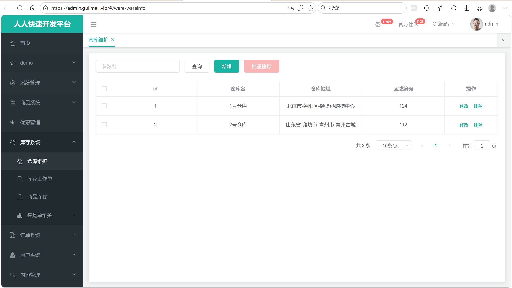
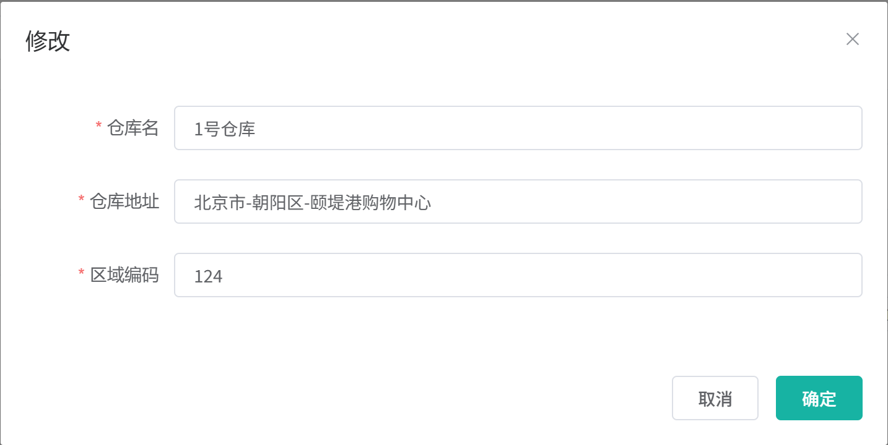
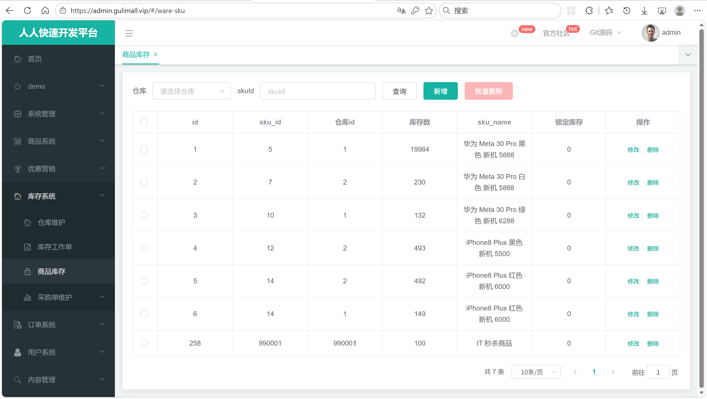
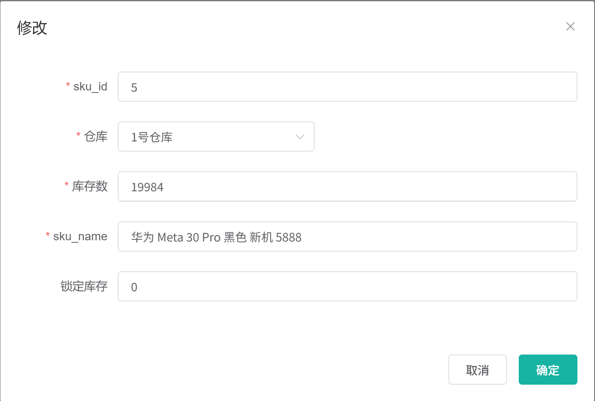

# 7.3 仓库与库存管理-介绍

> 本篇介绍仓库与库存管理：仓库信息怎么维护、一个 SKU 在多仓的库存怎么表示、可用库存怎么计算、管理员改库存为什么要加读写锁、库存查询为什么要用 SUM 聚合、库存数量怎么缓存到 Redis，以及商品详情页的“发货地”数据从哪里来。

---

## 1. 这个功能是干什么的

仓库与库存是商城的实物基础。商品在页面上只是一个 SKU，真正发到用户手里的货放在某个仓库里。仓库管理负责回答两个问题：

1. **货放在哪里**：系统里有哪些仓库，每个仓库的地址和区域编码是什么。
2. **每个仓库里有多少货**：某个 SKU 在某个仓库里有多少库存、有多少被订单锁住、有多少被秒杀活动锁住。

业务上有三类角色会用到这份数据：

1. **仓库管理员**：维护仓库信息，录入或调整 SKU 库存。
2. **普通用户**：打开商品详情页，看到“发货地”和“有货/无货”；提交订单时系统要锁库存。
3. **采购和订单系统**：采购完成要把货入库，订单支付要把锁定库存转成真实扣减，秒杀活动要单独占用库存。

一个 SKU 可以放在多个仓库，所以库存表的主键不是 SKU，而是“SKU + 仓库”这一行记录。多仓带来的直接问题是：用户问“这个商品有没有货”，系统不能只看某一个仓库，而要把所有仓库的可用库存加起来；用户问“从哪里发货”，系统要返回有货仓库的地址和各自可用数量。

库存表里一共有三个数量字段：

```text
stock                 仓库里实际有多少件
stock_locked          已被普通订单锁住、还没支付或还没释放的件数
seckill_stock_locked  已被秒杀活动锁住、还没转成订单或还没释放的件数
```

可用库存的计算口径固定为：

```text
可用库存 = stock - stock_locked - seckill_stock_locked
```

这个口径贯穿仓库列表、商品详情、下单校验、秒杀校验和 Redis 缓存。所有入口必须用同一个公式，否则会出现“页面显示有货，下单提示无货”的矛盾。

本节只覆盖仓库管理页面使用的仓库增删改查、库存增删改查、库存查询和可用库存回写。`WareSkuController` 的 `/lockStock`、`/markPaid`、`/returnStock`、`/seckill/**` 属于订单与秒杀章节，本节只列入口，不展开内部实现。

## 2. 用户/管理员怎么操作

入口：

```text
管理后台 → 库存系统 → 仓库维护 / 商品库存 / 采购单 / 采购需求
```

### 2.1 查看仓库列表



1. 打开“库存系统 → 仓库维护”。
2. 页面加载时请求 `GET /ware/wareinfo/list`，带 `page`、`limit`、`key`。
3. 后端按 `key` 同时匹配仓库 id、仓库名、仓库地址、区域编码。
4. 前端把 `data.page.list` 渲染成表格，`data.page.totalCount` 交给分页组件。
5. 表格展示仓库 id、仓库名、仓库地址、区域编码，以及“修改”“删除”操作。

`key` 的匹配规则是“或”关系：输入一个数字，既可能命中 id，也可能命中地址里的数字。这样管理员不需要先判断自己输的是哪种字段。

### 2.2 新增和编辑仓库



1. 点击“新增”或某一行的“修改”，打开同一个弹窗。
2. 编辑时先请求 `GET /ware/wareinfo/info/{id}`，把仓库名、地址、区域编码回显。
3. 填写三个字段：仓库名、仓库地址、区域编码。
4. 点击“确定”，新增调 `/ware/wareinfo/save`，编辑调 `/ware/wareinfo/update`。
5. 成功后关闭弹窗，父页面重新请求列表。

区域编码不是展示用的装饰字段。商品详情页显示发货地、算运费时都会用到仓库地址，区域编码用于区分仓库所在区域。仓库名、地址、区域编码都是必填项。

### 2.3 查看库存列表



1. 打开“库存系统 → 商品库存”。
2. 页面先请求 `GET /ware/wareinfo/list?page=1&limit=500`，把仓库下拉框填满。
3. 再请求 `GET /ware/waresku/list`，带 `page`、`limit`、`skuId`、`wareId`。
4. 后端按 `wareId`、`skuId` 做等值过滤，再分页返回。
5. 表格展示 id、sku_id、仓库 id、库存数、sku_name、锁定库存。
6. 如果页面是从商品管理跳转过来的，路由里带 `skuId`，库存页会自动把 `skuId` 填进查询条件。

库存列表只有两个筛选条件，都是精确查询，不做模糊匹配。原因是库存行数可能很多，`like` 查询无法命中索引，而且管理员查库存时通常已经知道 SKU 或仓库。

### 2.4 新增和编辑库存



1. 点击“新增”或某一行的“修改”，打开同一个弹窗。
2. 编辑时先请求 `GET /ware/waresku/info/{id}`，回显 sku_id、仓库、库存数、sku_name、锁定库存。
3. 填写 sku_id、选择仓库、填写库存数、sku_name、锁定库存。
4. 点击“确定”，新增调 `/ware/waresku/save`，编辑调 `/ware/waresku/update`。
5. 后端在库存写锁内保存数据，并立即把该 SKU 的最新可用库存写回 Redis。
6. 成功后关闭弹窗，父页面重新请求列表。

库存新增和修改都必须走写锁。下单时订单服务持有同一把读写锁的读锁，多个下单可以并发；管理员保存库存时持有写锁，和所有下单互斥，避免管理员刚改完库存就被下单线程用旧值覆盖。

### 2.5 商品详情页查看发货地和库存


1. 用户打开商品详情页。
2. 商品服务查询 SKU 详情，同时通过 Feign 调 `POST /ware/wareinfo/shippingFrom`，请求体是该 SKU 的清单。
3. 仓库服务按 SKU 查到所有仓库的库存行，关联仓库信息，算出每个仓库的可用库存。
4. 仓库服务过滤掉可用库存小于等于 0 的仓库，只返回真正能发货的仓库。
5. 商品详情页取第一个仓库地址显示“发货地”；仓库多于一个时显示“更多”，展开后逐个显示“仓库地址（可用 N）”。
6. 页面同时根据 `hasStock` 显示“有货”或“无货”。

商品详情页不直接读数据库，也不直接读 Redis，而是走仓库服务的发货地接口。这样仓储数据变化时，页面只需要重新请求接口，不需要商品服务理解库存公式。

### 2.6 下单、支付、取消和秒杀入口

库存页面之外，库存还会被订单和秒杀流程调用：

| 入口 | 调用方 | 作用 |
|---|---|---|
| `POST /ware/waresku/lockStock` | 订单提交 | 锁定普通订单库存并写工作单 |
| `POST /ware/waresku/markPaid` | 支付成功 | 锁定库存转真实扣减 |
| `POST /ware/waresku/returnStock` | 售后退货 | 把退货数量回补到原发货仓 |
| `POST /ware/waresku/seckill/**` | 秒杀模块 | 秒杀活动锁定、释放和转订单 |

这些入口的内部实现涉及库存工作单、延时消息、幂等状态机，放在订单章节和秒杀章节展开。

## 3. 整体设计思路

### 3.1 业务上怎么设计

#### 3.1.1 仓库信息

仓库是最基础的物理节点，字段很少：

```text
wms_ware_info
├── id        仓库 id
├── name      仓库名
├── address   仓库地址
└── areacode  区域编码
```

仓库本身不保存库存，只保存“在哪里”。所有库存都落到 `wms_ware_sku`，通过 `ware_id` 关联仓库。这样新增仓库不需要改库存表结构，删除仓库时也能单独检查是否还有库存。

#### 3.1.2 SKU 多仓库存

同一个 SKU 可以分布在多个仓库：

```text
SKU 1001
├── 北京仓：stock=100，stock_locked=10，seckill_stock_locked=0
├── 上海仓：stock=50， stock_locked=0， seckill_stock_locked=5
└── 广州仓：stock=0，  stock_locked=0， seckill_stock_locked=0
```

业务上要求：

1. 一个 SKU 在一个仓库最多只有一条有效库存记录。
2. 判断“有没有货”时看所有仓库的可用库存之和。
3. 判断“从哪个仓发货”时看单个仓库的可用库存。
4. 锁定库存时必须落到具体仓库，不能只写一个总数。

数据库没有给 `(sku_id, ware_id)` 加唯一约束，只在 `sku_id`、`ware_id` 上各建了普通索引。因此代码里查询库存行时不能假设只有一条，取“第一条”是当前实现的兜底约定。

#### 3.1.3 stock、stock_locked、seckill_stock_locked

三个字段分别对应库存的三个阶段：

```text
stock
  仓库实际库存。采购入库时增加，支付成功时减少，退货时增加。

stock_locked
  普通订单占用。提交订单时增加，取消或超时释放时减少，支付成功时和 stock 一起减少。

seckill_stock_locked
  秒杀活动占用。关联秒杀商品时增加，活动结束或取消时释放，秒杀建单时转成 stock_locked。
```

三者的关系：

```text
可用库存 = stock - stock_locked - seckill_stock_locked
```

为什么秒杀要单独一个字段：秒杀活动的库存是提前从可售库存里划走的。活动期间这部分货不能卖给普通订单，但也不能直接从 `stock` 里扣掉，否则活动结束、商品下架时无法准确还回去。单独记一个 `seckill_stock_locked`，释放时只要把这个字段减回去，`stock` 始终表示仓库里实际有多少货。

#### 3.1.4 可用库存的业务口径

可用库存必须满足三个场景：

1. **商品详情**：用户看到“有货”，表示所有仓库加起来至少有一件可卖。
2. **下单校验**：按用户选中的仓库校验，不能用所有仓库的总和代替单仓库存。
3. **秒杀校验**：秒杀占用要算进不可用部分，否则普通订单会把秒杀预留的货卖掉。

因此代码里同时存在两种口径：

| 方法 | 口径 | 用途 |
|---|---|---|
| `sumAvailableStock(skuId)` | 所有仓库可用库存之和 | 商品是否有货、库存总量 |
| `availableOf(row)` | 单行库存的可用数量 | 按仓库校验、秒杀选仓 |

两个口径不能混用。下单时如果拿总量去校验单仓，会出现“总库存够、所选仓库不够”的超卖。

#### 3.1.5 管理员操作和读写锁

管理员对库存的操作包括新增、修改、删除。这些操作和下单是并发的：

```text
下单线程：读可用库存 -> 锁定库存 -> 写回 Redis
管理员线程：改 stock 或 stock_locked -> 写回 Redis
```

如果两边同时执行，可能出现：

1. 下单线程读到旧库存，锁定量算错。
2. 管理员改完库存后，下单线程用旧值覆盖 Redis。
3. 删除库存行时，下单线程刚好在锁这一行。

业务上用一个读写锁解决：

```text
下单、释放库存：加读锁，多个下单可以并发
管理员增删改库存、库存对账：加写锁，与所有下单互斥
```

读锁和写锁的名字必须相同，跨模块也必须相同，所以锁名放在 `gulimall-common` 的 `WareConstant`，订单服务和仓库服务引用同一个常量。

#### 3.1.6 库存缓存规则

库存是高频读取的数据：

- 商品详情、购物车、下单确认页都要判断有没有货。
- 下单时要快速预扣 Redis 里的可用库存。
- 数据库每次都要做 SUM 聚合，成本比读 Redis 高。

所以库存数量允许缓存在 Redis，但要求：

1. 管理员改完库存后立即回写缓存。
2. 缓存不设过期时间，库存是长期有效的业务数据。
3. 缓存丢失或数据不一致时，有定时对账任务用数据库覆盖。
4. Redis 里的值只表示“可用库存数量”，不保存锁定明细。

#### 3.1.7 采购入库与库存的关系

采购完成时会把采购数量加到 `wms_ware_sku.stock`：

```text
采购单完成 -> 采购需求状态改为已完成 -> addStock(skuId, wareId, skuName, skuNum)
```

如果该 SKU 在该仓库已有库存行，就累加 `stock`；没有就新建一行。当前实现只更新数据库，`PurchaseServiceImpl.done()` 没有调用 `refreshStockCache()`，Redis 里的可用库存会滞后，直到下一次管理员操作或定时对账才恢复。采购的完整流程在 7.4 展开，本节只说明库存的增加来源。

### 3.2 技术上怎么设计

#### 3.2.1 两张核心表

```text
wms_ware_info
├── id          bigint 主键
├── name        varchar(255) 仓库名
├── address     varchar(255) 仓库地址
└── areacode    varchar(20)  区域编码

wms_ware_sku
├── id                    bigint 主键
├── sku_id                bigint SKU id，普通索引
├── ware_id               bigint 仓库 id，普通索引
├── stock                 int 实际库存，允许 null
├── sku_name              varchar(200) SKU 名称，冗余字段
├── stock_locked          int 订单锁定库存，默认 0
└── seckill_stock_locked  int 秒杀锁定库存，默认 0
```

`sku_name` 是冗余字段。库存列表要显示 SKU 名称，如果每次都远程调商品服务，页面会变慢。所以在采购入库时顺便把 `skuName` 落库，列表直接查本表。

表结构上没有唯一约束，原因是历史数据已经允许重复行，直接加唯一索引会失败。代码里用“取第一条”兼容重复数据，长期应清洗数据后再加 `(sku_id, ware_id)` 唯一索引。

#### 3.2.2 精确查询

库存列表的查询条件是等值查询：

```java
if (wareId 非空) wrapper.eq("ware_id", wareId);
if (skuId  非空) wrapper.eq("sku_id", skuId);
```

这样能命中 `ware_id`、`sku_id` 的普通索引。库存表数据量大时，模糊查询会全表扫描，所以页面只提供仓库和 SKU 两个精确条件。

仓库列表的查询是另一种情况。仓库数量少，管理员经常只记得名字或地址的一部分，所以用 `key` 做多字段“或”匹配：

```text
id = key OR name like key OR address like key OR areacode like key
```

#### 3.2.3 SUM 聚合

判断 SKU 有没有货，最直接的写法是：

```sql
SELECT stock - stock_locked - seckill_stock_locked
FROM wms_ware_sku
WHERE sku_id = ?
```

问题是一个 SKU 可能在多个仓库有记录，这条 SQL 会返回多行。MyBatis-Plus 的 `getMap()` 只接受一行，遇到多行会抛 `TooManyResultsException`。

正确写法是把多行聚合成一行：

```sql
SELECT SUM(COALESCE(stock, 0) - COALESCE(stock_locked, 0)
           - COALESCE(seckill_stock_locked, 0)) AS available_stock
FROM wms_ware_sku
WHERE sku_id = ?
```

`COALESCE` 处理 null，`SUM` 保证只返回一行。没有这个 SKU 的任何记录时，`SUM` 返回一行且值为 null，代码里按 0 处理。

#### 3.2.4 Redis 库存缓存

缓存 key 统一为：

```text
gulimall:ware:stock:{skuId}
```

value 是可用库存数量的字符串。写入时机：

1. 管理员新增库存后。
2. 管理员修改库存后。
3. 管理员删除库存后。
4. 采购入库后由 `addStock` 的调用方刷新；当前采购完成流程没有调用刷新方法，属于待补点。
5. 订单释放、退货回补后。
6. 定时对账任务用数据库覆盖。

缓存不设 TTL。库存是长期有效的数据，设了 TTL 到期后 key 消失，下单时反而要多查一次数据库。缓存与数据库不一致时，由 `StockReconcileTask` 在凌晨分批对账修复。

#### 3.2.5 读写锁的实现

Redisson 的 `RReadWriteLock` 提供读写锁：

```java
RLock lock = redissonClient.getReadWriteLock(WareConstant.STOCK_LOCK).writeLock();
```

管理员操作使用 `tryLock(3, 30, TimeUnit.SECONDS)`：

1. 最多等 3 秒拿锁。
2. 拿到后租约 30 秒。
3. 3 秒内拿不到锁，抛“库存正在被操作”的业务异常。

下单和释放库存使用读锁，可以并发。管理员和库存对账使用写锁，和所有读锁互斥。

为什么管理员操作用 `tryLock` 而不是一直阻塞：管理后台是人工操作，等太久页面会卡住。3 秒拿不到锁直接提示重试，比长时间挂起更符合后台使用习惯。

#### 3.2.6 发货地查询

商品详情页要返回“SKU 在哪些仓库有货、每个仓库可用多少”。这需要库存表和仓库表关联：

```text
wms_ware_sku INNER JOIN wms_ware_info
```

SQL 直接计算可用库存并过滤：

```text
availableStock = stock - stock_locked - seckill_stock_locked
```

Java 层再过滤一次 `availableStock > 0`，避免把零库存仓库返回给页面。这样页面永远只展示能发货的仓库。

#### 3.2.7 分页和自动填充

仓库列表、库存列表都用 MyBatis-Plus 分页：

```java
IPage<WareInfoEntity> page = this.page(
        new Query<WareInfoEntity>().getPage(params),
        wrapper
);
```

分页插件必须在 `MybatisPlusConfig` 里显式注册，否则 `Page` 参数不会拼进 SQL，查询会退化成全表查询。

采购单有 `createTime`、`updateTime` 两个时间字段，插入和更新由 `MyMetaObjectHandler` 自动填充。库存表没有时间字段，所以库存的增删改不需要自动填充。

## 4. 详细代码、配置和解释

仓库与库存模块的代码分成数据载体、接口入口、业务实现、SQL 与基础配置、后台页面几层。每个小节先说明该类、该段配置或该页面在请求链路中的位置，解决什么业务问题，上下游是谁，再给出代码位置和代码，最后按编号解释执行顺序、判断条件和设计原因。

### 4.1 WareInfoEntity：仓库表映射

#### 4.1.1 这个类解决什么问题

仓库是发货的物理节点。后台“仓库维护”页面要展示仓库列表、回显仓库详情；商品详情页要显示发货地；运费计算要拿仓库地址去算距离。这些场景对仓库数据的共同需求只有四项：id、名称、地址、区域编码。

`WareInfoEntity` 是 `gulimall_wms.wms_ware_info` 的唯一 Java 映射。上游是 `WareInfoController` 的列表、详情、新增、修改、删除接口，下游是 `WareInfoDao` 和发货地关联 SQL。仓库列表直接返回实体；发货地查询在 XML 里用 `wms_ware_info` 关联库存表，再把地址放进 `SkuShippingFromVo`。仓库本身不保存库存，库存全部落在 `wms_ware_sku`，通过 `ware_id` 关联。这样仓库表可以保持很薄，新增仓库不需要改库存表结构。

链路位置：管理后台 → 网关 → `WareInfoController` → `WareInfoService` → `WareInfoDao` → `gulimall_wms.wms_ware_info`。

#### 4.1.2 字段与业务含义

| 字段 | 数据库列 | 业务含义 | 说明 |
|---|---|---|---|
| `id` | `id` | 仓库主键 | 库存表用 `ware_id` 引用 |
| `name` | `name` | 仓库名称 | 后台维护，列表展示 |
| `address` | `address` | 仓库地址 | 商品详情“发货地”直接展示，运费计算用它算距离 |
| `areacode` | `areacode` | 区域编码 | 用字符串保存，不同地区编码规则不完全一致 |

四个字段没有时间戳，也没有逻辑删除标记。仓库记录一旦创建就不会自动填充创建时间，删除也是物理删除。

#### 4.1.3 代码与解释

代码位置：`D:\SoftwareInstallation\gulimall\gulimall-ware\src\main\java\com\atguigu\gulimall\ware\entity\WareInfoEntity.java:17-40`。

```java
@Data
@TableName("wms_ware_info")
public class WareInfoEntity implements Serializable {
    private static final long serialVersionUID = 1L;

    @TableId
    private Long id;
    private String name;
    private String address;
    private String areacode;
}
```

1. `@Data` 生成 getter、setter、`toString`、`equals` 和 `hashCode`，Controller 接收请求体、Service 填字段、前端回显都依赖这些方法。
2. `@TableName("wms_ware_info")` 把类和表绑定。没有这行，MyBatis-Plus 会按类名推导表名，实际表名前缀 `wms_` 对不上。
3. `@TableId` 标记 `id` 是主键。`getById()`、`updateById()`、`removeByIds()` 都靠它生成主键条件。
4. `id`、`name`、`address`、`areacode` 按驼峰转下划线的默认规则映射。`areacode` 本身没有下划线，列名和字段名一致。
5. `serialVersionUID` 保证实体在序列化、Feign 传输或缓存时版本稳定。

#### 4.1.4 一次读写示例

新增北京仓：

```sql
INSERT INTO gulimall_wms.wms_ware_info (name, address, areacode)
VALUES ('北京仓', '北京市大兴区物流园 1 号', '110000');
```

后台在搜索框输入“北京”，`queryPageByCondition()` 生成的条件是：

```sql
WHERE id = '北京'
   OR name LIKE '%北京%'
   OR address LIKE '%北京%'
   OR areacode LIKE '%北京%'
```

北京仓的 `name` 命中模糊条件，记录被返回。列表页展示 `id`、`name`、`address`、`areacode`，编辑弹窗再用 `getById()` 按 id 取同一条记录回显。

#### 4.1.5 边界与可优化点

1. 没有参数校验，仓库名、地址、区域编码都可能在数据库里落成空串。应在 Service 层或 Controller 上用 `@Valid` 校验非空和长度。
2. 没有逻辑删除字段，`removeByIds()` 执行物理删除。历史订单如果还引用仓库 id，删除后无法还原，应改成逻辑删除并保留历史展示能力。
3. 删除仓库前没有检查 `wms_ware_sku` 是否还有该仓库的库存行，删完会产生孤儿库存，发货地查询因为内连接不到仓库而直接丢行。
4. 表上没有仓库名唯一约束，同一名称可以重复创建，后台只能靠人工辨认。
5. 区域编码是自由字符串，没有字典校验，录入错误的编码不会在保存时暴露。

### 4.2 WareInfoController：仓库接口入口

#### 4.2.1 这个类解决什么问题

仓库数据有两类使用方。第一类是管理后台的“仓库维护”页面，需要列表、详情、新增、修改、删除五个接口；第二类是商品详情页，商品服务需要知道某个 SKU 在哪些仓库有货、每个仓库的地址和可用数量。`WareInfoController` 把这两类需求翻译成 Service 调用。

上游有两个：`wareinfo.vue` / `waresku.vue` 等后台页面，以及商品服务的 `WareSkuFeignClient`。下游统一是 `WareInfoService`。Controller 自己不做查询拼接、不计算库存、不校验业务规则，只接收参数、校验后台权限、包装返回值。

链路位置：后台页面或商品服务 Feign → 网关（去掉 `/gulimall` 前缀）→ `WareInfoController` → `WareInfoServiceImpl`。

#### 4.2.2 接口清单

| 操作 | 方法与路径 | 权限 | 调用的 Service 方法 |
|---|---|---|---|
| 仓库分页列表 | `GET /ware/wareinfo/list` | `ware:wareinfo:list` | `queryPageByCondition()` |
| 仓库详情 | `GET /ware/wareinfo/info/{id}` | `ware:wareinfo:info` | `getById()` |
| 新增仓库 | `POST /ware/wareinfo/save` | `ware:wareinfo:save` | `save()` |
| 修改仓库 | `POST /ware/wareinfo/update` | `ware:wareinfo:update` | `updateById()` |
| 删除仓库 | `POST /ware/wareinfo/delete` | `ware:wareinfo:delete` | `removeByIds()` |
| 发货地查询 | `POST /ware/wareinfo/shippingFrom` | 无 | `getShippingFrom()` |

`shippingFrom` 面向商品服务，不加后台权限注解。`/fare` 运费接口也在该类中，内部调用选仓和第三方距离服务，属于选仓与运费部分，代码块只列出仓库维护和发货地相关方法。

#### 4.2.3 代码与解释

代码位置：`D:\SoftwareInstallation\gulimall\gulimall-ware\src\main\java\com\atguigu\gulimall\ware\controller\WareInfoController.java:29-117`。

```java
@RestController
@RequestMapping("ware/wareinfo")
public class WareInfoController {
    @Autowired
    private WareInfoService wareInfoService;

    /**
     * 商品详情页的“发货地”：返回该 SKU 有货的仓库和可用库存。
     */
    @PostMapping("/shippingFrom")
    public List<SkuShippingFromVo> shippingFrom(@RequestBody List<FareRequestVo.Item> items) {
        return wareInfoService.getShippingFrom(items);
    }

    /**
     * 列表
     */
    @RequestMapping("/list")
    @RequiresPermissions("ware:wareinfo:list")
    public R list(@RequestParam Map<String, Object> params){
        PageUtils page = wareInfoService.queryPageByCondition(params);

        return R.ok().put("page", page);
    }

    /**
     * 信息
     */
    @RequestMapping("/info/{id}")
    @RequiresPermissions("ware:wareinfo:info")
    public R info(@PathVariable("id") Long id){
        WareInfoEntity wareInfo = wareInfoService.getById(id);

        return R.ok().put("wareInfo", wareInfo);
    }

    /**
     * 保存
     */
    @RequestMapping("/save")
    @RequiresPermissions("ware:wareinfo:save")
    public R save(@RequestBody WareInfoEntity wareInfo){
        wareInfoService.save(wareInfo);

        return R.ok();
    }

    /**
     * 修改
     */
    @RequestMapping("/update")
    @RequiresPermissions("ware:wareinfo:update")
    public R update(@RequestBody WareInfoEntity wareInfo){
        wareInfoService.updateById(wareInfo);

        return R.ok();
    }

    /**
     * 删除
     */
    @RequestMapping("/delete")
    @RequiresPermissions("ware:wareinfo:delete")
    public R delete(@RequestBody Long[] ids){
        wareInfoService.removeByIds(Arrays.asList(ids));

        return R.ok();
    }
}
```

1. `@RestController` 让每个方法的返回值直接序列化成 JSON，不需要再写 `@ResponseBody`。
2. `@RequestMapping("ware/wareinfo")` 给所有接口加统一前缀。网关转发时会去掉 `/gulimall`，服务内匹配到的就是 `ware/wareinfo/...`。
3. `shippingFrom()` 接收 `List<FareRequestVo.Item>`，直接返回 `List<SkuShippingFromVo>`，不包 `R`。商品服务把响应体反序列化成列表，失败由调用方的 try-catch 兜底。
4. `list()` 把 `page`、`limit`、`key` 原样装进 `Map` 交给 `queryPageByCondition()`，结果放在 `page` 字段，前端取 `data.page.list` 和 `data.page.totalCount`。
5. `info()` 按路径变量 `id` 调 `getById()`，结果放在 `wareInfo` 字段，供编辑弹窗回显。
6. `save()` 直接调 MyBatis-Plus 的 `save()`，执行一次 `INSERT`。
7. `update()` 调 `updateById()`，只更新请求体里非 null 的字段。
8. `delete()` 接收数组，转成 `List` 后调 `removeByIds()`。单条删除和批量删除共用同一个接口。
9. 每个后台接口上的 `@RequiresPermissions` 由 Shiro 在进入方法前校验，权限不足直接抛异常，不会走到 Service。

#### 4.2.4 一次请求示例

商品详情页查询发货地：

```text
1. 商品服务 SkuInfoServiceImpl 查询 SKU 详情
2. 通过 WareSkuFeignClient.getShippingFrom() 发起 POST /ware/wareinfo/shippingFrom
3. 请求体：[{"skuId":1001,"count":1}]
4. Controller.shippingFrom() 调 wareInfoService.getShippingFrom(items)
5. Service 判空后调 WareInfoDao.getShippingFromList()
6. SQL 关联 wms_ware_sku 和 wms_ware_info，算出每个仓库的可用库存
7. Service 过滤掉可用库存小于等于 0 的仓库
8. 返回 [{"skuId":1001,"wareId":1,"address":"北京市大兴区...","availableStock":90}]
9. 商品服务把列表放进 SkuItemVo.shippingFroms
10. 详情页取第一个仓库地址显示“发货地”，多个仓库时显示“更多”
```

商品服务调用失败时会把 `shippingFroms` 置为空列表，详情页仍然能打开，只是不显示发货地。

#### 4.2.5 它不做什么

1. 不校验仓库名、地址、区域编码是否为空，直接交给数据库。
2. 不检查删除的仓库是否还有库存行或历史订单引用。
3. 不组装发货地的分页或排序，Service 返回什么就返回什么。
4. 不计算可用库存，计算公式在 XML 的 SQL 里。
5. 不处理运费和选仓，`getFare()` 属于另一条链路。

#### 4.2.6 边界与可优化点

1. `save()`、`update()` 没有 `@Valid`，空仓库名也能保存，生产环境应补字段校验。
2. `delete()` 没有引用检查，仓库被删后 `wms_ware_sku.ware_id` 变成孤儿。
3. `shippingFrom()` 没有服务间鉴权，任何能访问网关的请求都能调用。生产环境应校验调用方身份或做限流。
4. `list()` 的返回结构固定为 `page`，没有额外的汇总信息；后台如果需要仓库总数、库存总量，需要另加接口。
5. 接口没有限制批量删除的数量，一次传过多 id 会生成很长的 `IN` 条件。

### 4.3 WareInfoServiceImpl：仓库查询与发货地

#### 4.3.1 这个类解决什么问题

仓库维护页面需要一个带关键字搜索的分页列表；商品详情页需要在一次调用里拿到“哪些仓库能发这个 SKU、每个仓库还能发多少”。这两个读场景的数据来源不同：列表只查仓库表，发货地要同时查库存表和仓库表。

`WareInfoServiceImpl` 负责把 Controller 的请求转成查询条件，并对发货地结果做最后一道过滤。上游是 `WareInfoController`，下游是 `WareInfoDao` 和 `wms_ware_sku`、`wms_ware_info`。运费计算 `getFare()` 也在这个类里，内部会调会员地址服务和第三方距离服务，实现属于选仓与运费部分。

链路位置：`WareInfoController.list()` → `queryPageByCondition()` → `this.page()`；`WareInfoController.shippingFrom()` → `getShippingFrom()` → `WareInfoDao.getShippingFromList()`。

#### 4.3.2 读链路

仓库列表：

```text
后台带 page、limit、key
  → queryPageByCondition() 拼 key 条件
  → Query.getPage(params) 解析分页
  → MyBatis-Plus 分页插件生成 COUNT 和 LIMIT
  → 查 wms_ware_info
  → PageUtils 包装
```

发货地：

```text
商品服务传 SKU 清单
  → getShippingFrom() 判空
  → WareInfoDao.getShippingFromList() 关联库存表和仓库表
  → 过滤 availableStock <= 0 的仓库
  → 返回 List<SkuShippingFromVo>
```

#### 4.3.3 代码与解释

代码位置：`D:\SoftwareInstallation\gulimall\gulimall-ware\src\main\java\com\atguigu\gulimall\ware\service\impl\WareInfoServiceImpl.java:66-93`。

```java
@Override
public PageUtils queryPageByCondition(Map<String, Object> params) {
    QueryWrapper<WareInfoEntity> wrapper = new QueryWrapper<>();
    String key = (String) params.get("key");
    if (StringUtils.isNotEmpty(key)) {
        wrapper.eq("id", key)
                .or().like("name", key)
                .or().like("address", key)
                .or().like("areacode", key);
    }

    IPage<WareInfoEntity> page = this.page(
            new Query<WareInfoEntity>().getPage(params),
            wrapper
    );

    return new PageUtils(page);
}

@Override
public List<SkuShippingFromVo> getShippingFrom(List<FareRequestVo.Item> items) {
    if (items == null || items.isEmpty()) {
        return List.of();
    }
    return wareInfoDao.getShippingFromList(items).stream()
            .filter(w -> w.getAvailableStock() != null && w.getAvailableStock() > 0)
            .toList();
}
```

1. `queryPageByCondition()` 从参数里取 `key`，后台搜索框只有一个输入口，管理员不需要区分自己输的是 id、名称、地址还是区域编码。
2. `StringUtils.isNotEmpty(key)` 判断 `key` 是否为空，空字符串和 null 都不拼条件，列表返回全部仓库。
3. `wrapper.eq("id", key)` 先把 `key` 当仓库 id 做等值匹配，命中主键索引。
4. 后面三个 `or().like(...)` 分别匹配名称、地址、区域编码，`like` 使用 `%key%`，所以输入地址的一部分也能搜到仓库。
5. `new Query<WareInfoEntity>().getPage(params)` 从 `page`、`limit` 参数构造分页对象，默认值和上限由 `Query` 统一处理。
6. `this.page(page, wrapper)` 执行分页查询，返回的 `IPage` 同时包含当前页数据和总条数。
7. `new PageUtils(page)` 把 `IPage` 转换成后台页面统一使用的分页结构，包含 `list`、`totalCount`、`pageSize`、`currPage`。
8. `getShippingFrom()` 先判断商品清单是否为空。`null` 或空列表直接返回空列表，避免 XML 拼出 `IN ()` 这种非法 SQL。
9. `wareInfoDao.getShippingFromList(items)` 执行关联查询，SQL 里已经算好每个仓库的 `availableStock`。
10. `filter` 再次判断 `availableStock` 不为 null 且大于 0，把零库存和负库存仓库挡在返回结果之外。
11. `toList()` 收集成不可变列表，调用方只读，不会误改。

#### 4.3.4 一次查询示例

后台搜索“北京”：

```text
1. 请求 GET /ware/wareinfo/list?page=1&limit=10&key=北京
2. queryPageByCondition() 取出 key=北京
3. 生成条件：
   id = '北京' OR name LIKE '%北京%' OR address LIKE '%北京%' OR areacode LIKE '%北京%'
4. 分页插件生成 COUNT 查询得到 totalCount
5. 生成 LIMIT 0,10 的数据查询
6. 返回北京仓、华北北京转运仓等命中记录
```

商品详情查询 SKU 1001 的发货地：

```text
1. 商品服务传 [{skuId:1001,count:1}]
2. getShippingFrom() 判空通过
3. getShippingFromList() 返回 3 个仓库：北京仓 90、上海仓 0、广州仓 25
4. Java 层过滤掉上海仓
5. 返回北京仓和广州仓两条记录
6. 详情页显示“北京市大兴区...（有货）”，点“更多”看到广州仓
```

#### 4.3.5 它不做什么

1. 不计算运费，`getFare()` 才负责选仓和运费。
2. 不验证 `key` 的类型，纯数字也按字符串比较。
3. 不限制 `key` 的长度，超长输入会拼进四个 `LIKE`。
4. 不保证发货地列表有序，数据库返回什么顺序就返回什么顺序。
5. 不缓存仓库数据，每次列表和发货地都实时查库。

#### 4.3.6 边界与可优化点

1. `or()` 条件没有括号保护。当前只有这一组条件，SQL 语义正确；以后追加 `and` 条件时必须改成 `wrapper.and(w -> w.eq(...).or().like(...))`，否则条件优先级会错。
2. `id` 是 bigint，代码用字符串做等值比较。输入纯数字时可能无法命中索引，较长时还会发生隐式类型转换。可以按“纯数字走 id、否则只走模糊”分流。
3. 四个 `like` 都无法命中索引，仓库数量大时会全表扫描。仓库表通常很小，当前可以接受。
4. `getShippingFrom()` 一次返回所有有货仓库，商品详情只展示第一个和“更多”。仓库很多时可以限制数量或按距离、库存排序。
5. 可用库存过滤放在 Java 层，数据库仍然返回零库存行。数据量大时可以把 `availableStock > 0` 下推到 SQL。

### 4.4 WareInfoDao 与 WareInfoDao.xml：发货地 SQL

#### 4.4.1 这段代码解决什么问题

商品详情页要回答“这个 SKU 在哪些仓库有货，每个仓库还能发多少”。仓库信息在 `wms_ware_info`，库存信息在 `wms_ware_sku`，单查任何一张表都拿不到完整结果。`WareInfoDao` 声明方法，`WareInfoDao.xml` 写关联 SQL，把两张表拼成页面能直接使用的 `SkuShippingFromVo`。

上游是 `WareInfoServiceImpl.getShippingFrom()`，下游是 `gulimall_wms` 的两张表。这个查询只服务于商品详情，不参与后台仓库维护，也不参与下单锁库存。

链路位置：商品服务 Feign → `WareInfoController.shippingFrom()` → `WareInfoServiceImpl.getShippingFrom()` → `WareInfoDao.getShippingFromList()` → XML SQL。

#### 4.4.2 关键字段与口径

| 字段 | 来源 | 含义 |
|---|---|---|
| `skuId` | `wms_ware_sku.sku_id` | 商品 SKU |
| `wareId` | `wms_ware_sku.ware_id` | 仓库 id |
| `address` | `wms_ware_info.address` | 发货地展示 |
| `availableStock` | `stock - stock_locked - seckill_stock_locked` | 该仓库还能卖多少 |

可用库存必须减去两类锁定：普通订单占用的 `stock_locked` 和秒杀活动占用的 `seckill_stock_locked`。只减 `stock_locked` 会把秒杀预留的货当成可卖，普通订单可能超卖。

#### 4.4.3 代码与解释

代码位置：`D:\SoftwareInstallation\gulimall\gulimall-ware\src\main\java\com\atguigu\gulimall\ware\dao\WareInfoDao.java:19-24`、`D:\SoftwareInstallation\gulimall\gulimall-ware\src\main\resources\mapper\ware\WareInfoDao.xml:14-26`。

先看 Dao 接口。它只声明一个方法，把 XML 里的 SQL 和 Java 调用连起来：

```java
@Mapper
public interface WareInfoDao extends BaseMapper<WareInfoEntity> {

    List<SkuShippingFromVo> getShippingFromList(@Param("items") List<FareRequestVo.Item> items);

}
```

再看 XML。这段 SQL 负责关联两张表并计算每个仓库的可用库存：

```xml
<select id="getShippingFromList" resultType="com.atguigu.gulimall.api.ware.vo.SkuShippingFromVo">
    SELECT ws.sku_id AS skuId,
           ws.ware_id AS wareId,
           wi.address AS address,
           COALESCE(ws.stock, 0) - COALESCE(ws.stock_locked, 0)
               - COALESCE(ws.seckill_stock_locked, 0) AS availableStock
    FROM wms_ware_sku ws
    INNER JOIN wms_ware_info wi ON ws.ware_id = wi.id
    WHERE ws.sku_id IN
    <foreach collection="items" item="item" open="(" separator="," close=")">
        #{item.skuId}
    </foreach>
</select>
```

1. `@Mapper` 让 MyBatis 扫描到这个接口并生成代理实现。
2. `extends BaseMapper<WareInfoEntity>` 继承仓库表的通用增删改查，仓库维护接口直接复用。
3. `getShippingFromList()` 的入参用 `@Param("items")` 命名，XML 里通过 `items` 引用。
4. `<select>` 的 `id` 与接口方法名一致，`resultType` 指向 `SkuShippingFromVo`，MyBatis 按字段名自动映射。
5. `SELECT` 第一列 `ws.sku_id AS skuId`，把下划线列名转成 VO 的驼峰字段。
6. 第二列 `ws.ware_id AS wareId`，前端用它标识仓库。
7. 第三列 `wi.address AS address`，取仓库表地址，商品详情直接展示。
8. 第四列用 `COALESCE` 把三个数量字段的 null 都当 0，再做减法，得到 `availableStock`。
9. `FROM wms_ware_sku ws` 以库存表为主表，因为一个 SKU 在多个仓库有多行。
10. `INNER JOIN wms_ware_info wi ON ws.ware_id = wi.id` 关联仓库表。库存行找不到仓库时整行被丢弃，避免返回没有地址的发货地。
11. `WHERE ws.sku_id IN` 后面用 `<foreach>` 展开请求里的 SKU 清单，生成 `IN (?, ?, ...)`。
12. `#{item.skuId}` 是预编译参数，不是字符串拼接，能防止 SQL 注入。

#### 4.4.4 一次查询示例

请求清单是 `[{skuId:1001},{skuId:1002}]`，生成的 SQL 等价于：

```sql
SELECT ws.sku_id AS skuId,
       ws.ware_id AS wareId,
       wi.address AS address,
       COALESCE(ws.stock, 0) - COALESCE(ws.stock_locked, 0)
           - COALESCE(ws.seckill_stock_locked, 0) AS availableStock
FROM wms_ware_sku ws
INNER JOIN wms_ware_info wi ON ws.ware_id = wi.id
WHERE ws.sku_id IN (1001, 1002);
```

返回结果：

| skuId | wareId | address | availableStock |
|---|---|---|---|
| 1001 | 1 | 北京市大兴区物流园 1 号 | 90 |
| 1001 | 3 | 广州市白云区物流园 8 号 | 25 |
| 1002 | 1 | 北京市大兴区物流园 1 号 | 0 |

Service 过滤 `availableStock > 0` 后，1002 北京仓不会出现在商品详情页。

#### 4.4.5 它不做什么

1. 不判断 `items` 是否为空，空清单的保护在 Service 层。
2. 不按仓库排序，也不限制返回条数。
3. 不返回 `stock`、`stock_locked`、`seckill_stock_locked` 原值，页面只关心可用数量。
4. 不处理仓库被删除但库存行还在的情况，内连接会直接丢掉这些行。

#### 4.4.6 边界与可优化点

1. `<foreach>` 没有分批，清单几千条时会生成超长 SQL，可能超过 `max_allowed_packet`。应按 500 或 1000 分批查询再合并。
2. 没有 `availableStock > 0` 的 SQL 条件，数据库先算出所有行，再由 Java 过滤。数据量大时可以把条件下推到 SQL。
3. 没有排序，商品详情默认取第一条。可以按可用库存降序或距离升序，保证展示稳定。
4. `INNER JOIN` 会丢掉仓库缺失的库存行。如果希望页面提示“仓库信息缺失”，应改成 `LEFT JOIN` 并在 Java 层处理空地址。
5. `COALESCE` 保证了 null 安全，但字段本身允许 null 说明数据质量有问题，长期应在表上设默认值和非空约束。

### 4.5 WareSkuEntity：库存表映射

#### 4.5.1 这个类解决什么问题

库存的粒度不是 SKU，而是“SKU + 仓库”。同一个 SKU 可以同时放在北京仓、上海仓、广州仓，每个仓库的到货量、被订单锁定的数量、被秒杀锁定的数量都不同。`WareSkuEntity` 映射 `gulimall_wms.wms_ware_sku`，一行代表某个 SKU 在某个仓库的库存状态。

上游有三类使用方：后台库存列表和编辑弹窗直接读写实体；`WareSkuServiceImpl` 的聚合查询按 `sku_id` 汇总多行；采购入库 `addStock()` 按 `(sku_id, ware_id)` 查找或新增一行。下游统一是 `WareSkuDao` 和 `wms_ware_sku`。

链路位置：后台库存页或采购完成流程 → `WareSkuController` / `PurchaseServiceImpl` → `WareSkuService` → `WareSkuDao` → `wms_ware_sku`。

#### 4.5.2 字段与业务含义

| 字段 | 数据库列 | 业务含义 | 说明 |
|---|---|---|---|
| `id` | `id` | 库存行主键 | 后台删除、详情按它定位 |
| `skuId` | `sku_id` | 商品 SKU | 普通索引 |
| `wareId` | `ware_id` | 仓库 id | 普通索引 |
| `stock` | `stock` | 仓库实际库存 | 采购入库增加，支付成功减少，退货回补增加 |
| `skuName` | `sku_name` | SKU 名称 | 冗余字段，列表展示用 |
| `stockLocked` | `stock_locked` | 普通订单锁定库存 | 提交订单增加，取消、超时、支付后减少 |
| `seckillStockLocked` | `seckill_stock_locked` | 秒杀活动锁定库存 | 关联秒杀商品时增加，释放或转单时减少 |

可用库存公式固定为 `stock - stock_locked - seckill_stock_locked`。三个数量分别代表“实际有多少”“普通订单占了多少”“秒杀占了多少”，任何一处漏减都会导致可售数量偏大。

#### 4.5.3 代码与解释

代码位置：`D:\SoftwareInstallation\gulimall\gulimall-ware\src\main\java\com\atguigu\gulimall\ware\entity\WareSkuEntity.java:18-54`。

```java
@Data
@TableName("wms_ware_sku")
public class WareSkuEntity implements Serializable {
    private static final long serialVersionUID = 1L;

    @TableId
    private Long id;
    private Long skuId;
    private Long wareId;
    private Integer stock;
    private String skuName;
    private Integer stockLocked;

    @TableField("seckill_stock_locked")
    private Integer seckillStockLocked;
}
```

1. `@TableName("wms_ware_sku")` 绑定库存表。
2. `@TableId` 标记 `id` 为主键，后台按行删除和回显都依赖它。
3. `skuId`、`wareId`、`stock`、`skuName`、`stockLocked` 按驼峰转下划线映射到 `sku_id`、`ware_id`、`stock`、`sku_name`、`stock_locked`。
4. `seckillStockLocked` 默认也能映射成 `seckill_stock_locked`，这里用 `@TableField` 显式写明列名，避免命名策略调整后失效，也让字段和列的对应关系一眼可见。
5. 三个数量字段都用包装类型 `Integer` 而不是 `int`，因为历史数据允许 null，查询出来必须能表示“没有值”。

#### 4.5.4 一次读写示例

数据库里 SKU 1001 有三行：

```text
id=1  sku_id=1001  ware_id=1  stock=100  stock_locked=10  seckill_stock_locked=0
id=2  sku_id=1001  ware_id=2  stock=50   stock_locked=0   seckill_stock_locked=5
id=3  sku_id=1001  ware_id=3  stock=0    stock_locked=0   seckill_stock_locked=0
```

按行计算可用库存：

```text
北京仓：100 - 10 - 0 = 90
上海仓：50 - 0 - 5 = 45
广州仓：0 - 0 - 0 = 0
```

按 SKU 汇总：90 + 45 + 0 = 135。商品详情判断“有没有货”用 135，按仓库校验时用单行的 90 或 45，两个口径不能互换。

#### 4.5.5 边界与可优化点

1. 表上没有 `(sku_id, ware_id)` 唯一约束，同一 SKU 同一仓库可能出现重复行。查询只能取第一条，汇总会把重复行一起加进去，导致可用库存偏大。
2. 三个数量字段允许 null，所有计算都必须先转成 0。历史数据应清洗后再加非空约束和默认值。
3. 没有乐观锁版本号，两个管理员同时修改同一行时后写覆盖先写。
4. `skuName` 是采购入库时写入的冗余字段，商品改名后不会同步，列表会显示旧名称。
5. `stock` 没有非负约束，管理员可以录入负数，可用库存会变成负值。

### 4.6 WareSkuController：库存接口与写锁

#### 4.6.1 这个类解决什么问题

库存有两类读者。后台库存页面要列表、详情、新增、修改、删除；商品详情、购物车、订单在判断有没有货时要调 `hasStock` 和 `stockNums`。管理员改库存和用户下单是并发的，如果两边同时读写同一批库存行，下单可能基于旧值锁定，或者管理员的修改被下单线程的缓存回写覆盖。

`WareSkuController` 因此承担三件事：暴露库存读写接口；对管理员的新增、修改、删除加库存写锁；把查询类请求直接转给 Service。上游是 `sku.vue`、`waresku-add-or-update.vue` 以及商品、购物车、订单服务的 Feign 客户端；下游是 `WareSkuService` 和 Redisson。

链路位置：后台页面 / 商品、购物车、订单 Feign → 网关 → `WareSkuController` → `WareSkuServiceImpl` → `WareSkuDao` / Redis。

#### 4.6.2 接口与链路

| 操作 | 方法与路径 | 权限 | 调用方 |
|---|---|---|---|
| 库存分页列表 | `GET /ware/waresku/list` | `ware:waresku:list` | 后台库存页 |
| 库存详情 | `GET /ware/waresku/info/{id}` | `ware:waresku:info` | 后台编辑弹窗 |
| 新增库存 | `POST /ware/waresku/save` | `ware:waresku:save` | 后台库存页 |
| 修改库存 | `POST /ware/waresku/update` | `ware:waresku:update` | 后台库存页 |
| 删除库存 | `POST /ware/waresku/delete` | `ware:waresku:delete` | 后台库存页 |
| 批量判断有货 | `POST /ware/waresku/hasStock` | `ware:waresku:hasStock` | 商品详情、购物车、订单 |
| 批量查询可用量 | `POST /ware/waresku/stockNums` | `ware:waresku:stockNums` | 购物车、订单、内部接口 |

下单锁库存、支付扣减、退货回补、秒杀库存入口也定义在同一个 Controller 里，内部实现属于订单与秒杀部分。代码块只列出库存管理页面和查询类接口。

#### 4.6.3 代码与解释

代码位置：`D:\SoftwareInstallation\gulimall\gulimall-ware\src\main\java\com\atguigu\gulimall\ware\controller\WareSkuController.java:49-152、314-333`。

```java
@Slf4j
@RestController
@RequestMapping("ware/waresku")
public class WareSkuController {
    @Autowired
    private WareSkuService wareSkuService;
    @Autowired
    private RedissonClient redissonClient;

    /**
     * 列表
     */
    @RequestMapping("/list")
    @RequiresPermissions("ware:waresku:list")
    public R list(@RequestParam Map<String, Object> params) {
        PageUtils page = wareSkuService.queryPage(params);

        return R.ok().put("page", page);
    }

    /**
     * 信息
     */
    @RequestMapping("/info/{id}")
    @RequiresPermissions("ware:waresku:info")
    public R info(@PathVariable("id") Long id) {
        WareSkuEntity wareSku = wareSkuService.getById(id);

        return R.ok().put("wareSku", wareSku);
    }

    /**
     * 保存
     */
    @RequestMapping("/save")
    @RequiresPermissions("ware:waresku:save")
    public R save(@RequestBody WareSkuEntity wareSku) {
        executeWithStockLock(() -> {
            wareSkuService.save(wareSku);
            // 库存变了，立刻把最新的可用库存写回 Redis
            wareSkuService.refreshStockCache(wareSku.getSkuId());
        });

        return R.ok();
    }

    /**
     * 修改
     */
    @RequestMapping("/update")
    @RequiresPermissions("ware:waresku:update")
    public R update(@RequestBody WareSkuEntity wareSku) {
        executeWithStockLock(() -> {
            wareSkuService.updateById(wareSku);
            wareSkuService.refreshStockCache(wareSku.getSkuId());
        });

        return R.ok();
    }

    /**
     * 删除
     */
    @RequestMapping("/delete")
    @RequiresPermissions("ware:waresku:delete")
    public R delete(@RequestBody Long[] ids) {
        executeWithStockLock(() -> {
            // 删除前先记住这些记录对应的 skuId —— 删完就查不到了，没法回写缓存
            List<WareSkuEntity> rows = wareSkuService.listByIds(Arrays.asList(ids));

            wareSkuService.removeByIds(Arrays.asList(ids));

            rows.stream()
                    .map(WareSkuEntity::getSkuId)
                    .distinct()
                    .forEach(wareSkuService::refreshStockCache);
        });

        return R.ok();
    }

    /**
     * 查询sku是否有库存
     */
    @PostMapping("/hasStock")
    @RequiresPermissions("ware:waresku:hasStock")
    public Map<Long, Boolean> hasStock(@RequestBody List<Long> skuIds) {
        return wareSkuService.getSkuHasStock(skuIds);
    }

    /**
     * 查询sku库存数量
     */
    @PostMapping("/stockNums")
    @RequiresPermissions("ware:waresku:stockNums")
    public Map<Long, Long> getStockNums(@RequestBody List<Long> skuIds) {
        return wareSkuService.getStockNums(skuIds);
    }

    /** 管理员改库存：加库存写锁（独占，与所有下单读锁互斥） */
    private void executeWithStockLock(Runnable action) {
        RLock lock = redissonClient.getReadWriteLock(WareConstant.STOCK_LOCK).writeLock();
        boolean locked = false;
        try {
            locked = lock.tryLock(3, 30, TimeUnit.SECONDS);
            if (!locked) {
                throw new RRException(BizCodeEnum.WARE_STOCK_BUSY);
            }
            action.run();
        } catch (InterruptedException e) {
            Thread.currentThread().interrupt();
            throw new RRException(BizCodeEnum.WARE_STOCK_OPERATE_INTERRUPTED);
        } finally {
            // tryLock 超时那条路根本没拿到锁，不能 unlock（会抛 IllegalMonitorStateException）
            if (locked && lock.isHeldByCurrentThread()) {
                lock.unlock();
            }
        }
    }
}
```

1. `@Slf4j` 让类里可以使用 `log`，锁失败和异常路径可以记录日志。
2. `@RequestMapping("ware/waresku")` 给库存接口加统一前缀。
3. `list()` 把分页参数交给 `queryPage()`，后台库存页拿 `page.list` 渲染表格。
4. `info()` 按 id 查一行，编辑弹窗用返回的 `wareSku` 回显。
5. `save()` 在写锁内先 `save()` 插入库存行，再调 `refreshStockCache(skuId)` 重算并写回 Redis。
6. `update()` 在写锁内先 `updateById()` 更新库存行，再刷新同一个 SKU 的缓存。
7. `delete()` 在写锁内先 `listByIds()` 查出待删除行，拿到 `skuId`；再 `removeByIds()` 删除；最后对去重后的 `skuId` 逐个刷新缓存。
8. `distinct()` 用来避免一次删除多行同一 SKU 的库存时重复刷新缓存。
9. `hasStock()` 返回 `Map<skuId, Boolean>`，调用方只需要知道“有没有货”。
10. `getStockNums()` 返回 `Map<skuId, Long>`，调用方需要具体可用数量，例如购物车显示库存、订单校验。
11. `executeWithStockLock()` 从 Redisson 拿到 `gulimall:ware:stock:lock` 的写锁。读写锁在读锁存在时阻止写锁，保证管理员操作和所有下单互斥。
12. `tryLock(3, 30, TimeUnit.SECONDS)` 最多等 3 秒，拿到后租约 30 秒。后台是人工操作，等待过久页面会卡住，3 秒拿不到直接提示重试。
13. `lock.tryLock()` 抛出 `InterruptedException` 时，恢复线程中断标记，再转换成业务异常，避免中断状态被吞掉。
14. `finally` 里先判断 `locked`，再判断 `isHeldByCurrentThread()`。`tryLock` 超时没有拿到锁，直接 `unlock()` 会抛 `IllegalMonitorStateException`；租约到期后锁可能已被其他线程持有，也要避免误删。
15. `Runnable` 把“加锁、执行业务、异常转换、解锁”抽成一个模板，新增、修改、删除只关心自己的业务动作。

#### 4.6.4 一次操作示例

管理员把 SKU 1001 在北京仓的库存从 100 改成 120：

```text
1. 后台提交 POST /ware/waresku/update，请求体带 id、skuId=1001、stock=120
2. Controller 进入 executeWithStockLock()
3. 尝试获取 gulimall:ware:stock:lock 写锁，最多等 3 秒
4. 下单线程持有读锁时，写锁等待；3 秒内读锁不释放则抛“库存正在被操作”
5. 拿到写锁后执行 wareSkuService.updateById()
6. update 成功后调 refreshStockCache(1001)
7. Service 用 SUM 重算所有仓库可用库存，写入 gulimall:ware:stock:1001
8. finally 判断锁仍由当前线程持有，释放写锁
9. 返回 R.ok()，后台刷新列表
```

如果第 3 步超时，`locked` 为 false，抛出业务异常，`finally` 不会执行 `unlock()`。

#### 4.6.5 它不做什么

1. 不校验 `skuId`、`wareId` 是否为空，也不检查 `(skuId, wareId)` 是否重复。
2. 不校验 `stock`、`stockLocked` 是否为负数。
3. 不负责采购入库加锁，采购完成直接调 Service 的 `addStock()`。
4. 不实现订单锁库存、支付扣减、退货回补的内部逻辑，只提供入口。
5. 不在写锁内重新读取库存行，写操作以请求体为准。

#### 4.6.6 边界与可优化点

1. `save()` 没有防重，同一 `(skuId, wareId)` 重复提交会插入多行。
2. `save()`、`update()` 的 `skuId` 来自请求体，为空时 `refreshStockCache(null)` 会拼出 `gulimall:ware:stock:null`，应在入口校验。
3. 锁租约固定 30 秒，批量删除很多行或刷新很多 SKU 时可能超时。可以改成看门狗续期，或限制批量大小。
4. 采购入库 `addStock()` 没有经过 `executeWithStockLock()`，和下单并发时仍有窗口，应统一收口到写锁。
5. `hasStock()` 和 `getStockNums()` 没有限制列表长度，一次传大量 SKU 会触发大量聚合查询。
6. 锁失败只返回业务码，没有区分“锁被占用”和“Redisson 连接失败”，排查时信息不足。

### 4.7 WareSkuServiceImpl：库存业务与聚合

#### 4.7.1 这个类解决什么问题

库存数据有两个来源、两个出口。来源一是管理员在后台新增、修改、删除库存行；来源二是采购完成时 `addStock()` 把采购数量累加进 `stock`。出口一是后台库存列表分页；出口二是商品详情、购物车、订单查询“有没有货、还有多少”。

这个类还要把数据库里的库存汇总成 Redis 里的可用数量。判断有没有货看的是所有仓库之和，按仓库校验看的是单行可用量，两个口径都在这里实现。上游是 `WareSkuController` 和 `PurchaseServiceImpl`，下游是 `WareSkuDao`、`wms_ware_sku` 和 `StringRedisTemplate`。

链路位置：`WareSkuController` / `PurchaseServiceImpl` → `WareSkuServiceImpl` → `WareSkuDao` → `wms_ware_sku`；缓存方向 → `gulimall:ware:stock:{skuId}`。

#### 4.7.2 两种口径

| 方法 | 口径 | 使用场景 |
|---|---|---|
| `sumAvailableStock(skuId)` | 所有仓库可用库存之和 | `hasStock`、`stockNums`、`refreshStockCache` |
| `availableOf(row)` | 单行库存的可用数量 | 按仓库校验、秒杀选仓 |

`sumAvailableStock()` 用 SQL 的 `SUM` 把多行合成一行；`availableOf()` 在 Java 里对一行做减法。下单时必须用单仓口径，否则会出现“总库存够、所选仓库不够”的超卖。

#### 4.7.3 代码与解释

代码位置：`D:\SoftwareInstallation\gulimall\gulimall-ware\src\main\java\com\atguigu\gulimall\ware\service\impl\WareSkuServiceImpl.java:77-217`。

```java
@Override
public PageUtils queryPage(Map<String, Object> params) {
    QueryWrapper<WareSkuEntity> wrapper = new QueryWrapper<>();

    String wareId = (String) params.get("wareId");
    if (!StringUtils.isNullOrEmpty(wareId)) {
        wrapper.eq("ware_id", wareId);
    }

    String skuId = (String) params.get("skuId");
    if (!StringUtils.isNullOrEmpty(skuId)) {
        wrapper.eq("sku_id", skuId);
    }

    IPage<WareSkuEntity> page = this.page(
            new Query<WareSkuEntity>().getPage(params),
            wrapper
    );

    return new PageUtils(page);
}

@Override
public void addStock(Long skuId, Long wareId, String skuName, Integer skuNum) {
    // wms_ware_sku 上 (sku_id, ware_id) 只有普通索引、没有唯一约束，
    // 用 selectOne 一旦出现重复行会抛 TooManyResultsException，所以取第一条即可
    List<WareSkuEntity> exist = this.baseMapper.selectList(new QueryWrapper<WareSkuEntity>()
            .eq("sku_id", skuId)
            .eq("ware_id", wareId));
    WareSkuEntity wareSkuEntity = exist.isEmpty() ? null : exist.get(0);

    if (wareSkuEntity == null) {
        // 新增
        wareSkuEntity = new WareSkuEntity();
        wareSkuEntity.setStock(skuNum);
        wareSkuEntity.setStockLocked(0);
    } else {
        // 累加；老数据 stock 可能为 null
        Integer stock = wareSkuEntity.getStock();
        wareSkuEntity.setStock(stock == null ? skuNum : stock + skuNum);
    }

    // skuName 远程获取失败时是空串，别把库里已有的名字覆盖掉
    if (!StringUtils.isNullOrEmpty(skuName)) {
        wareSkuEntity.setSkuName(skuName);
    }
    wareSkuEntity.setWareId(wareId);
    wareSkuEntity.setSkuId(skuId);

    this.saveOrUpdate(wareSkuEntity);
}

/**
 * 查询sku是否有库存
 */
@Override
public Map<Long, Boolean> getSkuHasStock(List<Long> skuIds) {
    // 一个 sku 可能在多个仓库都有记录，要按「所有仓库的可用库存之和」判断有没有货
    return skuIds.stream().collect(Collectors.toMap(
            sku -> sku,
            skuId -> sumAvailableStock(skuId) > 0
    ));
}

@Override
public Map<Long, Long> getStockNums(List<Long> skuIds) {
    return skuIds.stream().collect(Collectors.toMap(
            skuId -> skuId,
            this::sumAvailableStock
    ));
}

private long sumAvailableStock(Long skuId) {
    Map<String, Object> row = getMap(new QueryWrapper<WareSkuEntity>()
            .select("SUM(COALESCE(stock, 0) - COALESCE(stock_locked, 0) " +
                    "- COALESCE(seckill_stock_locked, 0)) AS available_stock")
            .eq("sku_id", skuId));

    // 没有这个 sku 的任何记录时，SUM 会返回一行 {available_stock: null}
    if (row == null || row.get("available_stock") == null) {
        return 0L;
    }
    // MySQL 的 SUM 可能给 BigDecimal / Long，统一按 Number 取
    return ((Number) row.get("available_stock")).longValue();
}

/** 一行库存的可用数量：stock - stock_locked - seckill_stock_locked */
private long availableOf(WareSkuEntity row) {
    int stock = row.getStock() == null ? 0 : row.getStock();
    int locked = row.getStockLocked() == null ? 0 : row.getStockLocked();
    int seckillLocked = row.getSeckillStockLocked() == null ? 0 : row.getSeckillStockLocked();
    return (long) stock - locked - seckillLocked;
}

@Override
public void refreshStockCache(Long skuId) {
    // 和 getStockNums / hasStock 用同一个口径：所有仓库的可用库存之和
    long available = sumAvailableStock(skuId);

    // 刻意【不设过期时间】：库存是长期有效的业务数据，
    // 设了 TTL 到期后会变成"没有缓存"，下单时反而多查一次库
    stringRedisTemplate.opsForValue()
            .set(WareConstant.STOCK_CACHE_PREFIX + skuId, String.valueOf(available));

    log.info("[stock] skuId={} 可用库存已回写 Redis：{}", skuId, available);
}
```

1. `queryPage()` 从参数里取 `wareId`。
2. `wareId` 非空时拼 `ware_id = ?` 等值条件，命中 `ware_id` 索引。
3. 再取 `skuId`，非空时拼 `sku_id = ?` 等值条件，命中 `sku_id` 索引。
4. `this.page()` 执行分页，`Query` 负责解析页码和每页条数，分页插件负责生成 `COUNT` 和 `LIMIT`。
5. `addStock()` 按 `(sku_id, ware_id)` 用 `selectList()` 查已有库存行，取第一条。
6. 查不到说明这个 SKU 第一次进这个仓库，新建实体，`stock` 设为入库数量，`stock_locked` 设为 0。
7. 查到了就在原 `stock` 上累加。历史数据 `stock` 为 null 时按 0 加，避免空指针。
8. `skuName` 只有非空才覆盖。采购流程远程取 SKU 名称失败时会传空串，不能把库里已有的名称清掉。
9. 补齐 `wareId`、`skuId` 后调 `saveOrUpdate()`。实体有 id 时更新，没有 id 时插入。
10. `getSkuHasStock()` 用 `Collectors.toMap()` 把每个 SKU 映射成布尔值，判断依据是 `sumAvailableStock() > 0`。
11. `getStockNums()` 同样收集成 Map，值是具体可用库存数量。
12. `sumAvailableStock()` 用 `SUM` 聚合该 SKU 的所有库存行，`COALESCE` 把三个字段的 null 都当 0。
13. `COUNT` 之类的聚合在没有行时返回一行 null，`SUM` 也一样。这里判断 `available_stock` 为 null 时返回 0。
14. MySQL 的 `SUM` 返回类型可能是 `BigDecimal` 也可能是 `Long`，统一按 `Number` 取 `longValue()`。
15. `availableOf()` 处理单行，三个字段分别判空后相减，返回单仓可用量。
16. `refreshStockCache()` 先按总量口径重算，再把结果写入 `gulimall:ware:stock:{skuId}`，不设置过期时间。
17. 写入后打印一行日志，记录 SKU 和回写的数量，便于对账和排查。

#### 4.7.4 一次完整示例

采购完成，入库 50 件到北京仓：

```text
1. PurchaseServiceImpl.done() 调用 addStock(1001, 1, "小米手机", 50)
2. 按 sku_id=1001、ware_id=1 查到已有行，stock=100
3. stock 累加为 150
4. skuName 非空，更新为“小米手机”
5. saveOrUpdate() 执行 UPDATE wms_ware_sku SET stock=150 WHERE id=...
6. 该流程当前没有调用 refreshStockCache()
7. Redis 里的 gulimall:ware:stock:1001 仍然是旧值
8. 下一次管理员修改库存或定时对账任务执行后，缓存才恢复
```

管理员修改库存：

```text
1. 后台提交 POST /ware/waresku/update
2. Controller 获取写锁
3. updateById() 更新 wms_ware_sku
4. refreshStockCache(1001)
5. SUM 查出所有仓库可用库存 135
6. SET gulimall:ware:stock:1001 = "135"
7. 释放写锁
8. 商品详情、购物车、订单下一次读取缓存时看到 135
```

#### 4.7.5 它不做什么

1. 不在 `addStock()` 内部加库存写锁，锁由调用方决定。
2. 不批量聚合多个 SKU，`getSkuHasStock()` 和 `getStockNums()` 都是逐个 SKU 查一次。
3. 不维护 `stock_locked`、`seckill_stock_locked` 的锁定和释放，这两类操作在订单与秒杀流程里。
4. 不在缓存写入失败时重试或补偿，只依赖对账任务。
5. 不校验 `skuNum` 是否为正数，采购传负数会减少库存。

#### 4.7.6 边界与可优化点

1. `addStock()` 的“先查再写”不是原子操作，两个采购线程同时入库可能插入两条新行。应加 `(sku_id, ware_id)` 唯一索引，并使用 `INSERT ... ON DUPLICATE KEY UPDATE`。
2. `addStock()` 没有加写锁，和下单、管理员操作可能并发。
3. `getSkuHasStock()`、`getStockNums()` 是 N+1 查询，列表大时数据库压力明显。可以改成一次 `GROUP BY sku_id` 批量查询。
4. `sumAvailableStock()` 每次刷新都做一次全表聚合，SKU 库存行多时较慢。可以维护汇总字段或批量刷新。
5. `refreshStockCache()` 写 Redis 失败没有重试，缓存会停留在旧值，直到对账任务修复。
6. `queryPage()` 只支持等值过滤，后台没有按 `sku_name` 模糊搜索的能力。
7. `availableOf()` 当前没有被上面的聚合方法直接使用，保留它是为了单仓校验场景，调用方需要保证传入的是最新行。

### 4.8 WareConstant：两处常量

#### 4.8.1 这些常量解决什么问题

库存工作单有状态，采购单和采购需求也有各自的状态；库存缓存有固定的 key 前缀，库存读写锁有固定的锁名。状态值如果散落在各个 Service 里写魔法数字，改一个值就要全项目搜索；锁名如果各模块各写一份字符串，拼错等于没加锁。

项目里有两个同名的 `WareConstant`：`gulimall-ware` 模块内部的那个保存库存工作单状态、业务类型和采购状态枚举；`gulimall-common` 里的那个保存跨模块共用的 Redis key 前缀和库存读写锁名。上游是仓库、订单、秒杀、对账任务，下游是数据库状态字段、Redis key 和 Redisson 锁。

链路位置：任何写库存工作单、判断业务类型、拼库存缓存 key、获取库存锁的代码，都引用这两个常量类。

#### 4.8.2 常量清单

| 常量 | 值 | 含义 | 使用方 |
|---|---|---|---|
| `TASK_STATUS_LOCKED` | 1 | 库存已锁定 | 订单锁库存、仓库工作单 |
| `TASK_STATUS_RELEASED` | 2 | 库存已解锁 | 订单取消、超时释放 |
| `TASK_STATUS_DEDUCTED` | 3 | 锁定库存已扣减 | 支付成功 |
| `TASK_STATUS_RETURNED` | 4 | 退货已回补 | 售后 |
| `BIZ_TYPE_NORMAL` | 0 | 普通订单 | 普通订单释放 |
| `BIZ_TYPE_SECKILL` | 1 | 秒杀订单 | 秒杀释放、转单 |
| `STOCK_CACHE_PREFIX` | `gulimall:ware:stock:` | 库存缓存前缀 | 仓库、订单、对账 |
| `STOCK_LOCK` | `gulimall:ware:stock:lock` | 库存读写锁名 | 仓库、订单 |

#### 4.8.3 代码与解释

先看 `gulimall-ware` 模块内部的状态常量：

```java
public class WareConstant {

    /** 已锁定：库存已经锁住，等待支付或超时解锁 */
    public static final int TASK_STATUS_LOCKED = 1;

    /** 已解锁：订单超时/取消，锁定库存已经还回去 */
    public static final int TASK_STATUS_RELEASED = 2;

    /** 已扣减：支付成功，锁定库存转成真实扣减 */
    public static final int TASK_STATUS_DEDUCTED = 3;

    /** 已退货：售后退货处理完成，库存已经回补（同一明细只回补一次） */
    public static final int TASK_STATUS_RETURNED = 4;

    /** 普通订单：超时/取消走 ware 自己的延时消息释放 */
    public static final int BIZ_TYPE_NORMAL = 0;

    /** 秒杀订单：超时/取消由 seckill 决定回秒杀池还是普通池 */
    public static final int BIZ_TYPE_SECKILL = 1;

    /** 采购单状态枚举 */
    public enum PurchaseStatusEnum {
        CREATED(0, "新建"),
        ASSIGNED(1, "已分配"),
        RECEIVE(2, "已领取"),
        FINISH(3, "已完成"),
        HASERROR(4, "有异常");

        private int code;
        private String msg;

        PurchaseStatusEnum(int code, String msg) {
            this.code = code;
            this.msg = msg;
        }

        public int getCode() {
            return code;
        }

        public String getMsg() {
            return msg;
        }
    }

    /** 采购需求枚举 */
    public enum PurchaseDetailStatusEnum {
        CREATED(0, "新建"),
        ASSIGNED(1, "已分配"),
        BUYING(2, "正在采购"),
        FINISH(3, "已完成"),
        HASERROR(4, "采购失败");

        private int code;
        private String msg;

        PurchaseDetailStatusEnum(int code, String msg) {
            this.code = code;
            this.msg = msg;
        }

        public int getCode() {
            return code;
        }

        public String getMsg() {
            return msg;
        }
    }
}
```

再看 `gulimall-common` 里跨模块共享的 key 和锁名：

```java
public class WareConstant {

    /**
     * 库存缓存 key 前缀，完整 key = gulimall:ware:stock:{skuId}，值是「可用库存数量」
     */
    public static final String STOCK_CACHE_PREFIX = "gulimall:ware:stock:";

    /** 库存操作的读写锁：下单加读锁（可并发），管理员增删改库存加写锁（与所有下单互斥） */
    public static final String STOCK_LOCK = "gulimall:ware:stock:lock";

    private WareConstant() {
    }

}
```

1. `TASK_STATUS_LOCKED` 到 `TASK_STATUS_RETURNED` 描述一张库存工作单从锁定到释放、扣减、退货的生命周期，订单流程写状态时引用这些常量。
2. `BIZ_TYPE_NORMAL` 和 `BIZ_TYPE_SECKILL` 区分订单来源，释放库存时要根据它决定回到普通池还是秒杀池。
3. `PurchaseStatusEnum` 描述采购单状态，`PurchaseDetailStatusEnum` 描述采购需求状态，两者状态集合不同，不能共用一个枚举。
4. 枚举的 `code` 落库，`msg` 用于后台展示，构造函数和 getter 让枚举值可以双向读取。
5. `STOCK_CACHE_PREFIX` 统一缓存 key 的拼法，调用方只需要拼 `skuId`，避免有的地方写 `ware:stock:`、有的地方写 `stock:`。
6. `STOCK_LOCK` 是读写锁的名字，订单加读锁和管理员加写锁必须用同一个字符串。
7. `private WareConstant() {}` 阻止实例化，常量类只提供静态成员。

#### 4.8.4 一次锁协同示例

```text
订单提交：
  Redisson.getReadWriteLock(WareConstant.STOCK_LOCK).readLock()
  → 读锁可以多个订单同时持有

管理员修改库存：
  Redisson.getReadWriteLock(WareConstant.STOCK_LOCK).writeLock()
  → 写锁与所有读锁互斥

库存对账任务：
  Redisson.getReadWriteLock(WareConstant.STOCK_LOCK).writeLock()
  → 与下单和管理员操作都互斥
```

如果订单模块自己写 `"stock-lock"`、仓库模块写 `"gulimall:ware:stock:lock"`，两把锁互不相干，管理员改库存时下单仍能并发，读锁就失去意义。

#### 4.8.5 它不做什么

1. 不定义库存业务异常码，`BizCodeEnum` 负责。
2. 不定义 Redis 连接配置，`application.yml` 和 Redisson 配置负责。
3. 不定义采购流程，只给采购状态提供枚举值。
4. 不把状态值转成数据库字典，状态仍然以整数落库。

#### 4.8.6 边界与可优化点

1. 两个类同名不同包，阅读代码时容易看错 import，可以改名为 `WareStatusConstant` 和 `WareRedisConstant`。
2. 状态值用 `int`，没有类型安全，传入任意数字也能编译通过。
3. 采购状态和库存工作单状态混在同一个类里，类会随业务增长越来越长。
4. 状态值和数据库字段没有约束，非法值也能写入。
5. `STOCK_CACHE_PREFIX` 与 `STOCK_LOCK` 放在同一个类里，前者是缓存 key，后者是锁名，职责略有混杂。

### 4.9 MybatisPlusConfig 与 MyMetaObjectHandler：分页和自动填充

#### 4.9.1 这段配置解决什么问题

仓库列表、库存列表都通过 MyBatis-Plus 的 `this.page()` 分页。分页插件不注册时，`Page` 对象仍然能构造，但 SQL 不会带 `LIMIT`，查询会把全表数据读进内存再截取。采购单需要记录创建时间和更新时间，如果每次插入、更新都在业务代码里手动 `set`，容易漏。

`MybatisPlusConfig` 注册分页内部拦截器，`MyMetaObjectHandler` 在插入和更新时自动填时间字段。上游是所有分页查询和采购单写入，下游是 MyBatis 执行器和实体字段。

链路位置：任意分页接口 → `this.page()` → `PaginationInnerInterceptor` → SQL；采购单写入 → MyBatis-Plus 填充器 → `PurchaseEntity.createTime` / `updateTime`。

#### 4.9.2 代码与解释

代码位置：`D:\SoftwareInstallation\gulimall\gulimall-ware\src\main\java\com\atguigu\gulimall\ware\config\MybatisPlusConfig.java:20-29`、`D:\SoftwareInstallation\gulimall\gulimall-ware\src\main\java\com\atguigu\gulimall\ware\config\MyMetaObjectHandler.java:18-36`。

分页配置负责把 `Page` 翻译成 `LIMIT` 和 `COUNT`：

```java
@Configuration
public class MybatisPlusConfig {

    @Bean
    public MybatisPlusInterceptor mybatisPlusInterceptor() {
        MybatisPlusInterceptor interceptor = new MybatisPlusInterceptor();
        interceptor.addInnerInterceptor(new PaginationInnerInterceptor(DbType.MYSQL));
        return interceptor;
    }
}
```

自动填充处理器负责在写入时补时间：

```java
@Slf4j
@Component
public class MyMetaObjectHandler implements MetaObjectHandler {

    /** 插入时的填充策略 */
    @Override
    public void insertFill(MetaObject metaObject) {
        log.info("start insert fill.....");
        this.setFieldValByName("createTime", new Date(), metaObject);
        this.setFieldValByName("updateTime", new Date(), metaObject);
    }

    /** 更新时的填充策略 */
    @Override
    public void updateFill(MetaObject metaObject) {
        log.info("start update fill.....");
        this.setFieldValByName("updateTime", new Date(), metaObject);
    }
}
```

1. `@Configuration` 让 `MybatisPlusConfig` 成为配置类，`@Bean` 把拦截器注册到 Spring 容器。
2. `MybatisPlusInterceptor` 是 MyBatis-Plus 的插件容器，可以挂多个内部拦截器。
3. `PaginationInnerInterceptor(DbType.MYSQL)` 让分页按 MySQL 方言生成 `LIMIT`，同时先执行一次 `COUNT` 得到总条数。
4. 没有这个 Bean，`this.page()` 仍然返回 `Page` 对象，但 SQL 不带分页，属于最容易忽略的配置缺失。
5. `@Component` 让 `MyMetaObjectHandler` 被 MyBatis-Plus 自动发现，实现 `MetaObjectHandler` 后插入、更新时自动回调。
6. `insertFill()` 在每次 `INSERT` 时把 `createTime` 和 `updateTime` 都设置成当前时间。
7. `updateFill()` 在每次 `UPDATE` 时只更新 `updateTime`，创建时间保持不变。
8. `setFieldValByName()` 只对实体上标注了对应 `@TableField(fill = ...)` 的字段生效，库存表没有时间字段，所以库存增删改不会被填充。
9. 两个方法开头的 `log.info` 用来确认填充确实执行过，排查时间字段为空时可以快速定位。

#### 4.9.3 一次查询与一次写入示例

后台查询库存列表：

```text
1. 请求 GET /ware/waresku/list?page=2&limit=10
2. Query.getPage(params) 构造 Page(2, 10)
3. this.page(page, wrapper) 进入分页拦截器
4. 拦截器生成 SELECT COUNT(*) FROM wms_ware_sku WHERE ...
5. 拦截器生成 SELECT ... FROM wms_ware_sku WHERE ... LIMIT 10,10
6. 返回当前页数据和 totalCount
```

新增采购单：

```text
1. PurchaseEntity 设置业务字段
2. 调 save(purchaseEntity)
3. MyBatis-Plus 触发 insertFill()
4. createTime、updateTime 都被设置为当前时间
5. 生成 INSERT INTO wms_purchase (..., create_time, update_time) VALUES (...)
```

修改采购单状态：

```text
1. 修改 status 后调 updateById()
2. 触发 updateFill()
3. 只把 updateTime 更新为当前时间
4. createTime 保持原值
```

#### 4.9.4 它不做什么

1. 不设置单页最大条数，`limit` 传多大都会接受。
2. 不处理库存表的时间字段，库存表本身没有时间字段。
3. 不校验分页参数，`page`、`limit` 由 `Query` 的默认值兜底。
4. 不填充操作人、租户等业务字段。

#### 4.9.5 边界与可优化点

1. 自动填充每次插入、更新都打印 `info` 日志，生产环境日志量会很大，应降为 `debug`。
2. 时间字段使用 `java.util.Date`，可以改成 `LocalDateTime`，避免时区和可变对象问题。
3. 分页插件没有配置 `maxLimit`，恶意传 `limit=100000` 会拖慢数据库。
4. `setFieldValByName()` 对没有对应字段的实体会静默跳过，填充不生效时不容易发现。
5. 自动填充只覆盖时间字段，操作人、来源系统等信息需要额外机制。

### 4.10 wareinfo.vue：仓库列表页面

#### 4.10.1 这个页面解决什么问题

仓库维护是仓库数据的唯一录入入口。管理员需要看到所有仓库、按关键字搜索、打开新增和编辑弹窗、单条删除或批量删除。页面不保存业务规则，只负责调接口、渲染表格、把操作转成 HTTP 请求，并在成功后刷新列表。

上游是管理后台的操作人员，下游是 `/ware/wareinfo` 下的五个接口。页面与后端的分页结构约定是 `data.page.list` 和 `data.page.totalCount`。

链路位置：浏览器 → `wareinfo.vue` → `/ware/wareinfo/list`、`/info/{id}`、`/delete` 等接口 → `WareInfoController`。

#### 4.10.2 页面与接口的对应关系

| 用户操作 | 前端方法 | 后端接口 | 成功后动作 |
|---|---|---|---|
| 打开页面 | `getDataList()` | `GET /ware/wareinfo/list` | 渲染表格和分页 |
| 输入关键字搜索 | `getDataList()` | `GET /ware/wareinfo/list` | 重新渲染第一页 |
| 点新增 | `addOrUpdateHandle()` | 无 | 打开空弹窗 |
| 点修改 | `addOrUpdateHandle(id)` | `GET /ware/wareinfo/info/{id}` | 弹窗回显 |
| 单条删除 | `deleteHandle(id)` | `POST /ware/wareinfo/delete` | 重新查列表 |
| 批量删除 | `deleteHandle()` | `POST /ware/wareinfo/delete` | 重新查列表 |

#### 4.10.3 代码与解释

代码位置：`D:\SoftwareInstallation\gulimall\renren-fast-vue\src\views\modules\ware\wareinfo.vue:100-172`。

```javascript
// 获取数据列表
getDataList () {
  this.dataListLoading = true
  this.$http({
    url: this.$http.adornUrl('/ware/wareinfo/list'),
    method: 'get',
    params: this.$http.adornParams({
      'page': this.pageIndex,
      'limit': this.pageSize,
      'key': this.dataForm.key
    })
  }).then(({data}) => {
    if (data && data.code === 0) {
      this.dataList = data.page.list
      this.totalPage = data.page.totalCount
    } else {
      this.dataList = []
      this.totalPage = 0
    }
    this.dataListLoading = false
  })
},

// 新增 / 修改
addOrUpdateHandle (id) {
  this.addOrUpdateVisible = true
  this.$nextTick(() => {
    this.$refs.addOrUpdate.init(id)
  })
},

// 删除
deleteHandle (id) {
  var ids = id ? [id] : this.dataListSelections.map(item => {
    return item.id
  })
  this.$confirm(`确定对[id=${ids.join(',')}]进行[${id ? '删除' : '批量删除'}]操作?`, '提示', {
    confirmButtonText: '确定',
    cancelButtonText: '取消',
    type: 'warning'
  }).then(() => {
    this.$http({
      url: this.$http.adornUrl('/ware/wareinfo/delete'),
      method: 'post',
      data: this.$http.adornData(ids, false)
    }).then(({data}) => {
      if (data && data.code === 0) {
        this.$message({
          message: '操作成功',
          type: 'success',
          duration: 1500,
          onClose: () => {
            this.getDataList()
          }
        })
      } else {
        this.$message.error(data.msg)
      }
    })
  })
}
```

1. `getDataList()` 先把 `dataListLoading` 置为 true，表格显示加载状态。
2. 请求参数包含 `page`、`limit`、`key`，`adornParams` 会统一加上令牌等公共参数。
3. 响应 `code === 0` 时，把 `data.page.list` 赋给表格数据，`totalCount` 赋给分页组件。
4. 响应失败时清空表格和总数，避免页面残留上一次查询的数据。
5. 请求结束后把 `dataListLoading` 置回 false。
6. `addOrUpdateHandle(id)` 先打开弹窗，再在 `$nextTick` 里调用子组件的 `init(id)`。必须等弹窗渲染完成，子组件的表单引用才存在。
7. `deleteHandle(id)` 收到单个 id 时包成数组，没有 id 时从勾选行里取 id 集合，单条和批量共用一条提交路径。
8. `$confirm` 弹出二次确认，提示里带上要删除的 id 列表，避免误删。
9. 确认后请求 `POST /ware/wareinfo/delete`，请求体是 id 数组，`adornData(ids, false)` 表示不做表单编码。
10. 删除成功后关闭提示框并调用 `getDataList()` 重新查询，表格不再显示已删除仓库。
11. 后端返回非 0 时用 `$message.error(data.msg)` 展示业务错误。

#### 4.10.4 一次删除示例

```text
1. 管理员勾选北京仓和上海仓两行
2. 点击批量删除，deleteHandle() 从勾选行取到 [1, 2]
3. 弹出“确定对[id=1,2]进行[批量删除]操作?”
4. 点击确定，POST /ware/wareinfo/delete，请求体 [1,2]
5. 后端 removeByIds() 删除两行
6. 返回 {code:0, msg:"success"}
7. 提示“操作成功”，关闭后调用 getDataList()
8. 表格重新请求列表，两行消失
```

#### 4.10.5 它不做什么

1. 不在前端校验仓库名、地址、区域编码，校验交给后端。
2. 不检查仓库是否还有库存行，删除请求直接发出。
3. 不缓存列表，每次操作后都重新请求。
4. 不处理分页越界，删除最后一页的全部数据后仍停留在当前页。

#### 4.10.6 边界与可优化点

1. `getDataList()` 没有失败回调，网络异常时 `dataListLoading` 会一直为 true，表格一直转圈。
2. 删除成功后没有判断当前页是否已经为空，可能停在空页。
3. 批量删除前没有显示已选条数，误选时不容易发现。
4. 搜索没有防抖，连续输入会连续发请求。
5. 表格没有展示库存总量，管理员无法从仓库列表判断仓库负载。

### 4.11 sku.vue：库存列表页面

#### 4.11.1 这个页面解决什么问题

库存列表按“仓库 + SKU”展示每一行库存。管理员需要先选仓库、再按 SKU 过滤；从商品管理页跳转过来时，路由里带 `skuId`，页面要自动填进查询条件，省去手工输入。页面还负责加载仓库下拉框，保证筛选条件可用。

上游是后台库存菜单和商品管理页的跳转，下游是 `/ware/wareinfo/list` 和 `/ware/waresku/list` 两个接口。仓库下拉使用仓库列表接口，库存表格使用库存列表接口。

链路位置：浏览器 → `sku.vue` → `GET /ware/wareinfo/list` 填下拉框，`GET /ware/waresku/list` 查库存。

#### 4.11.2 页面与接口的对应关系

| 页面动作 | 前端方法 | 后端接口 | 说明 |
|---|---|---|---|
| 页面激活 | `activated()` | 无 | 读取路由 `skuId`，初始化查询 |
| 加载仓库下拉 | `getWares()` | `GET /ware/wareinfo/list` | 一次拉 500 条 |
| 查询库存列表 | `getDataList()` | `GET /ware/waresku/list` | 带 `skuId`、`wareId` |
| 新增 / 修改 | 通用弹窗 | `/ware/waresku/save` / `update` | 见库存编辑弹窗 |
| 删除 | 通用确认 | `POST /ware/waresku/delete` | 写锁内删除并刷新缓存 |

#### 4.11.3 代码与解释

代码位置：`D:\SoftwareInstallation\gulimall\renren-fast-vue\src\views\modules\ware\sku.vue:80-123、140-181`。

```javascript
activated() {
  console.log("接收到", this.$route.query.skuId);
  if (this.$route.query.skuId) {
    this.dataForm.skuId = this.$route.query.skuId;
  }
  this.getWares();
  this.getDataList();
},

getWares() {
  this.$http({
    url: this.$http.adornUrl("/ware/wareinfo/list"),
    method: "get",
    params: this.$http.adornParams({
      page: 1,
      limit: 500
    })
  }).then(({ data }) => {
    this.wareList = data.page.list;
  });
},

// 获取数据列表
getDataList() {
  this.dataListLoading = true;
  this.$http({
    url: this.$http.adornUrl("/ware/waresku/list"),
    method: "get",
    params: this.$http.adornParams({
      page: this.pageIndex,
      limit: this.pageSize,
      skuId: this.dataForm.skuId,
      wareId: this.dataForm.wareId
    })
  }).then(({ data }) => {
    if (data && data.code === 0) {
      this.dataList = data.page.list;
      this.totalPage = data.page.totalCount;
    } else {
      this.dataList = [];
      this.totalPage = 0;
    }
    this.dataListLoading = false;
  });
}
```

1. `activated()` 是 keep-alive 页面的生命周期方法，每次进入页面都会执行，保证从商品管理跳转回来时重新读取路由参数。
2. `this.$route.query.skuId` 判断路由里是否带 SKU。有值时填进 `dataForm.skuId`，库存列表会按该 SKU 过滤。
3. `getWares()` 请求仓库列表，`page=1`、`limit=500`，一次把仓库下拉框填满。
4. 仓库请求成功后把 `data.page.list` 赋给 `wareList`，下拉框的选项来自这里。
5. `getDataList()` 打开加载状态，参数带分页、`skuId`、`wareId`。
6. `skuId`、`wareId` 为空时后端不拼条件，返回全部库存；有值时后端做等值过滤。
7. 响应成功时把列表和总数写入页面数据。
8. 响应失败时清空数据，避免旧结果残留。
9. 请求结束关闭加载状态。

#### 4.11.4 一次跳转查询示例

```text
1. 管理员在商品管理页点击某个 SKU 的“库存”
2. 路由跳转到库存页，query 里带 skuId=1001
3. sku.vue 触发 activated()
4. dataForm.skuId 被设置为 1001
5. getWares() 请求仓库列表，下拉框显示北京仓、上海仓、广州仓
6. getDataList() 请求 /ware/waresku/list?skuId=1001&page=1&limit=10
7. 后端按 sku_id=1001 过滤，返回该 SKU 在所有仓库的库存行
8. 表格展示北京仓 100、上海仓 50、广州仓 0
```

#### 4.11.5 它不做什么

1. 不计算可用库存，表格展示的是数据库原始字段。
2. 不校验 `skuId` 格式，输入字母也会传给后端。
3. 不监听路由参数变化，页面已经打开时再次跳转不会重新触发 `activated()`。
4. 不限制仓库下拉的条数，超过 500 个仓库会截断。

#### 4.11.6 边界与可优化点

1. `getWares()` 没有判断 `data.code`，接口失败时 `data.page` 可能为 undefined，下拉框会报错。
2. `console.log` 是调试代码，生产环境应删除。
3. 列表没有展示 `seckill_stock_locked`，管理员只看到 `stock_locked`，会误判可用库存。
4. 仓库超过 500 个时下拉框不全，应改成远程搜索或分页加载。
5. 查询条件没有重置按钮，管理员需要手动清空才能恢复全量列表。
6. 从商品管理跳转后没有清理路由参数，刷新页面会继续按旧 `skuId` 过滤。

### 4.12 waresku-add-or-update.vue：库存编辑弹窗

#### 4.12.1 这个组件解决什么问题

库存的新增和编辑字段完全相同：SKU、仓库、库存数、SKU 名称、锁定库存。如果拆成两个弹窗，字段和校验规则要维护两份，容易出现新增能填的字段编辑不能填。这个组件用同一个表单承载两种操作，只根据有没有 id 决定调用 `save` 还是 `update`。

上游是 `sku.vue` 的新增、修改按钮，下游是 `/ware/waresku/info/{id}`、`/ware/waresku/save`、`/ware/waresku/update` 三个接口。提交成功后通过 `refreshDataList` 事件通知父页面刷新列表。

链路位置：`sku.vue` → 弹窗组件 `init(id)` → 详情接口回显 → 表单提交 → `WareSkuController`。

#### 4.12.2 页面与接口的对应关系

| 动作 | 前端方法 | 后端接口 | 说明 |
|---|---|---|---|
| 加载仓库下拉 | `getWares()` | `GET /ware/wareinfo/list` | 一次拉 500 条 |
| 打开弹窗 | `init(id)` | 无 | 有 id 进入编辑，无 id 进入新增 |
| 编辑回显 | `init(id)` | `GET /ware/waresku/info/{id}` | 回显 skuId、wareId、stock、skuName、stockLocked |
| 新增提交 | `dataFormSubmit()` | `POST /ware/waresku/save` | 写锁内保存并刷新缓存 |
| 编辑提交 | `dataFormSubmit()` | `POST /ware/waresku/update` | 写锁内更新并刷新缓存 |

#### 4.12.3 代码与解释

代码位置：`D:\SoftwareInstallation\gulimall\renren-fast-vue\src\views\modules\ware\waresku-add-or-update.vue:69-137`。

```javascript
getWares() {
  this.$http({
    url: this.$http.adornUrl("/ware/wareinfo/list"),
    method: "get",
    params: this.$http.adornParams({
      page: 1,
      limit: 500
    })
  }).then(({ data }) => {
    this.wareList = data.page.list;
  });
},

init(id) {
  this.dataForm.id = id || 0;
  this.visible = true;
  this.$nextTick(() => {
    this.$refs["dataForm"].resetFields();
    if (this.dataForm.id) {
      this.$http({
        url: this.$http.adornUrl(`/ware/waresku/info/${this.dataForm.id}`),
        method: "get",
        params: this.$http.adornParams()
      }).then(({ data }) => {
        if (data && data.code === 0) {
          this.dataForm.skuId = data.wareSku.skuId;
          this.dataForm.wareId = data.wareSku.wareId;
          this.dataForm.stock = data.wareSku.stock;
          this.dataForm.skuName = data.wareSku.skuName;
          this.dataForm.stockLocked = data.wareSku.stockLocked;
        }
      });
    }
  });
},

// 表单提交
dataFormSubmit() {
  this.$refs["dataForm"].validate(valid => {
    if (valid) {
      this.$http({
        url: this.$http.adornUrl(
          `/ware/waresku/${!this.dataForm.id ? "save" : "update"}`
        ),
        method: "post",
        data: this.$http.adornData({
          id: this.dataForm.id || undefined,
          skuId: this.dataForm.skuId,
          wareId: this.dataForm.wareId,
          stock: this.dataForm.stock,
          skuName: this.dataForm.skuName,
          stockLocked: this.dataForm.stockLocked
        })
      }).then(({ data }) => {
        if (data && data.code === 0) {
          this.$message({
            message: "操作成功",
            type: "success",
            duration: 1500,
            onClose: () => {
              this.visible = false;
              this.$emit("refreshDataList");
            }
          });
        } else {
          this.$message.error(data.msg);
        }
      });
    }
  });
}
```

1. `getWares()` 在组件创建时请求仓库列表，把 `data.page.list` 放进 `wareList`，供仓库下拉框使用。
2. `init(id)` 把 id 写入 `dataForm`，没有 id 时用 0 表示新增。
3. `this.visible = true` 打开弹窗。
4. `$nextTick` 等弹窗 DOM 渲染完成后再操作表单。
5. `resetFields()` 清空上一次的校验状态和字段值，避免编辑另一行时残留旧数据。
6. 有 id 时请求库存详情，把 `skuId`、`wareId`、`stock`、`skuName`、`stockLocked` 五个字段回显。
7. 没有 id 时只重置表单，管理员从空白表格开始填写。
8. `dataFormSubmit()` 先调用 Element UI 的表单校验，校验不通过不会发请求。
9. URL 根据 `dataForm.id` 是否为空决定用 `save` 还是 `update`。
10. 请求体里 `id` 为空时传 `undefined`，JSON 序列化后不会出现 `id` 字段，后端按新增处理。
11. 请求体只包含五个业务字段，不包含 `seckillStockLocked`。管理页面不能修改秒杀锁定量，MyBatis-Plus 更新时也不会把 null 字段写进 SQL。
12. 提交成功后关闭弹窗，并 `$emit("refreshDataList")` 通知父页面重新查询库存列表。
13. 后端返回非 0 时用 `$message.error(data.msg)` 显示错误。

#### 4.12.4 一次编辑示例

```text
1. 管理员在库存列表点击北京仓那一行的“修改”
2. 父页面调用 init(1)
3. 弹窗打开，resetFields() 清空旧值
4. GET /ware/waresku/info/1 返回 {skuId:1001, wareId:1, stock:100, ...}
5. 表单回显五个字段
6. 管理员把 stock 改成 120，点击确定
7. dataFormSubmit() 校验通过
8. 请求 POST /ware/waresku/update，请求体带 id=1、stock=120
9. Controller 获取库存写锁，执行 updateById()
10. refreshStockCache(1001) 重算并写回 Redis
11. 返回成功，弹窗关闭，父页面刷新列表
```

#### 4.12.5 它不做什么

1. 不校验 `stock`、`stockLocked` 是否为负数，Element UI 的规则里没有数值范围。
2. 不回显、不提交 `seckillStockLocked`，秒杀锁定量由秒杀流程维护。
3. 不检查 `(skuId, wareId)` 是否已经存在，重复新增由后端接受。
4. 不计算可用库存，提交的是原始字段。
5. 不处理接口失败后的重试，只提示错误。

#### 4.12.6 边界与可优化点

1. `stock`、`stockLocked` 用 `el-input` 接收，没有限制只能输入数字，提交前应转成数字或改用 `el-input-number`。
2. 表单没有校验 `stock >= 0`、`stockLocked >= 0`，负数会直接落库。
3. 编辑时没有回显 `seckillStockLocked`，管理员看不到秒杀占用，容易误判可用库存。
4. `init()` 关闭弹窗后没有清空 `dataForm`，下次新增时可能残留上一次编辑的值。
5. 新增时没有防重提交，连续点击确定会发出多个 `save` 请求。
6. 仓库下拉超过 500 条会截断，和库存列表页存在同样的问题。

## 5. 数据怎么流转

### 5.1 数据表

| 表 | 作用 | 关键字段 |
|---|---|---|
| `gulimall_wms.wms_ware_info` | 仓库信息 | `id`、`name`、`address`、`areacode` |
| `gulimall_wms.wms_ware_sku` | SKU 多仓库存 | `sku_id`、`ware_id`、`stock`、`stock_locked`、`seckill_stock_locked`、`sku_name` |

### 5.2 Redis

| key | 类型 | 值 | TTL |
|---|---|---|---|
| `gulimall:ware:stock:{skuId}` | String | 所有仓库可用库存之和 | 不设置 |
| `gulimall:ware:stock:lock` | Redisson 读写锁 | 无 | 写锁租约 30 秒 |
| `gulimall:ware:reconcile:cursor` | String | 对账游标 skuId | 一轮结束后删除 |

库存缓存的写入来源：

```text
管理员新增/修改/删除库存
  → WareSkuController.executeWithStockLock()
  → WareSkuService.refreshStockCache(skuId)
  → SUM 查数据库
  → SET gulimall:ware:stock:{skuId}

采购完成入库
  → PurchaseServiceImpl.done()
  → WareSkuService.addStock()
  → 当前只更新数据库，没有刷新 Redis，等待对账任务修复

订单释放、退货回补
  → 库存事务提交后回补 Redis
  → 由订单章节展开

定时对账
  → StockReconcileTask
  → 写锁内按批次用数据库覆盖 Redis
```

### 5.3 MQ

仓库管理页面本身不发 MQ。库存相关的延时释放消息发生在订单提交之后：

```text
订单提交 → 锁库存 → 写工作单 → 登记延时消息
消息到期 → 判断订单是否支付 → 未支付则解锁库存
```

这部分属于订单章节，仓库管理页面只负责库存数据本身。

### 5.4 接口

| 接口 | 方法 | 作用 |
|---|---|---|
| `/ware/wareinfo/list` | GET | 仓库分页查询 |
| `/ware/wareinfo/info/{id}` | GET | 仓库详情 |
| `/ware/wareinfo/save` | POST | 新增仓库 |
| `/ware/wareinfo/update` | POST | 修改仓库 |
| `/ware/wareinfo/delete` | POST | 删除仓库 |
| `/ware/wareinfo/shippingFrom` | POST | 查询 SKU 可发货仓库 |
| `/ware/waresku/list` | GET | 库存分页查询 |
| `/ware/waresku/info/{id}` | GET | 库存详情 |
| `/ware/waresku/save` | POST | 新增库存 |
| `/ware/waresku/update` | POST | 修改库存 |
| `/ware/waresku/delete` | POST | 删除库存 |
| `/ware/waresku/hasStock` | POST | 批量判断是否有货 |
| `/ware/waresku/stockNums` | POST | 批量查询可用库存数量 |
| `/ware/waresku/lockStock` | POST | 订单锁库存，订单章节展开 |
| `/ware/waresku/markPaid` | POST | 支付扣减，订单章节展开 |
| `/ware/waresku/returnStock` | POST | 退货回补，订单章节展开 |
| `/ware/waresku/seckill/**` | POST | 秒杀库存，秒杀章节展开 |

## 6. 一次请求的完整执行流程

### 6.1 打开仓库列表页

1. 管理员点击“库存系统 → 仓库维护”。
2. 浏览器加载 `wareinfo.vue`。
3. `activated()` 调用 `getDataList()`。
4. 请求 `GET /gulimall/ware/wareinfo/list`，带 `page`、`limit`、`key`。
5. Nginx 按 `Host` 转发到 Gateway。
6. Gateway 匹配 ware 路由，去掉 `gulimall` 前缀。
7. 请求进入 `WareInfoController.list()`。
8. Controller 调 `WareInfoServiceImpl.queryPageByCondition()`。
9. Service 根据 `key` 拼接条件，调用 `this.page()`。
10. MyBatis-Plus 分页插件生成 `COUNT` 和 `LIMIT` SQL。
11. 查询 `gulimall_wms.wms_ware_info`。
12. Controller 返回 `R.ok().put("page", page)`。
13. 前端把 `data.page.list` 赋给 `dataList`，表格渲染。

### 6.2 新增仓库

1. 管理员点击“新增”。
2. `addOrUpdateHandle()` 打开弹窗，调用子组件 `init(undefined)`。
3. 子组件重置表单，因为没有 id，不发详情请求。
4. 管理员填写仓库名、地址、区域编码，点击“确定”。
5. 子组件校验通过后请求 `POST /ware/wareinfo/save`。
6. 请求进入 `WareInfoController.save()`。
7. Controller 调 `wareInfoService.save(wareInfo)`。
8. MyBatis-Plus 执行 `INSERT INTO wms_ware_info`。
9. 返回成功，弹窗关闭，触发父页面 `getDataList()`。
10. 列表重新查询并显示新仓库。

### 6.3 新增库存

1. 管理员在库存页点击“新增”。
2. 弹窗加载仓库下拉框，管理员填写 sku_id、选择仓库、填写库存数。
3. 点击“确定”，请求 `POST /ware/waresku/save`。
4. 请求进入 `WareSkuController.save()`。
5. Controller 调 `executeWithStockLock()`。
6. `executeWithStockLock()` 获取 `gulimall:ware:stock:lock` 的写锁，最多等 3 秒。
7. 拿到锁后执行 `wareSkuService.save(wareSku)`，插入 `wms_ware_sku`。
8. 调 `wareSkuService.refreshStockCache(skuId)`。
9. `refreshStockCache()` 调 `sumAvailableStock()` 用 SUM 聚合该 SKU 所有仓库的可用库存。
10. 把结果写入 `gulimall:ware:stock:{skuId}`。
11. finally 释放写锁。
12. Controller 返回成功，弹窗关闭，列表刷新。

### 6.4 商品详情页查询发货地

1. 用户打开商品详情页。
2. 商品服务查询 SKU 详情。
3. 商品服务通过 `WareSkuFeignClient.getShippingFrom()` 调 `POST /ware/wareinfo/shippingFrom`。
4. 请求进入 `WareInfoController.shippingFrom()`。
5. Controller 调 `WareInfoServiceImpl.getShippingFrom()`。
6. Service 判断清单为空，空清单直接返回空列表。
7. 非空时调 `WareInfoDao.getShippingFromList()`。
8. MyBatis 执行库存表与仓库表的关联 SQL，算出每个仓库的可用库存。
9. Service 过滤掉可用库存小于等于 0 的仓库。
10. 返回 `List<SkuShippingFromVo>`。
11. 商品服务把结果放进 `SkuItemVo.shippingFroms`。
12. 商品详情页取第一个仓库地址显示“发货地”，多个仓库时显示“更多”。

### 6.5 查询 SKU 是否有货

1. 页面请求 `POST /ware/waresku/hasStock`，请求体是 skuId 数组。
2. 请求进入 `WareSkuController.hasStock()`。
3. Controller 调 `WareSkuServiceImpl.getSkuHasStock()`。
4. Service 对每个 skuId 调 `sumAvailableStock()`。
5. `sumAvailableStock()` 执行 SUM 聚合 SQL，得到该 SKU 所有仓库的可用库存总量。
6. 总量大于 0 记为 true，否则记为 false。
7. 返回 `Map<skuId, Boolean>`。

### 6.6 管理员删除库存

1. 管理员勾选库存行，点击“删除”。
2. 前端二次确认后请求 `POST /ware/waresku/delete`，请求体是 id 数组。
3. 请求进入 `WareSkuController.delete()`。
4. Controller 调 `executeWithStockLock()` 获取写锁。
5. 先调 `wareSkuService.listByIds()` 查出要删除的行，拿到 skuId。
6. 调 `wareSkuService.removeByIds()` 删除库存行。
7. 对去重后的 skuId 逐个调 `refreshStockCache()`。
8. `refreshStockCache()` 重新 SUM 聚合并写 Redis。
9. finally 释放写锁。
10. 返回成功，前端刷新列表。

## 7. 异常、边界、踩坑

1. **同一 SKU 同一仓库出现重复行**：表上没有唯一约束，`selectOne` 会抛 `TooManyResultsException`。`addStock()` 用 `selectList` 取第一条兼容，长期应清洗数据并加唯一索引。
2. **`stock` 为 null**：历史数据可能没有库存数。所有计算都要用 `COALESCE` 或代码判空，否则减法是 null，页面显示异常。
3. **SUM 返回 null**：SKU 没有任何库存行时，`SUM` 返回一行 null。`sumAvailableStock()` 必须判空并返回 0，否则拆箱会空指针。
4. **SUM 返回类型不固定**：MySQL 的 `SUM` 可能返回 `BigDecimal` 或 `Long`，统一按 `Number` 取值再 `longValue()`。
5. **多仓总量和单仓库存混用**：商品详情看总量，下单必须看单仓。混用会导致超卖。
6. **Redis 缓存丢失**：管理员没操作过的 SKU 可能没有缓存。下单侧会回源数据库预热，库存页的 `refreshStockCache()` 也会补写。
7. **Redis 缓存过期**：库存缓存刻意不设 TTL，避免过期后误判为无缓存。长时间不一致由对账任务修复。
8. **写锁等待超时**：管理员操作最多等 3 秒，超时抛“库存正在被操作”。页面应提示稍后重试。
9. **`finally` 误解锁**：`tryLock` 超时没有拿到锁，直接 `unlock()` 会抛 `IllegalMonitorStateException`。必须先判断 `locked` 和 `isHeldByCurrentThread()`。
10. **删除后无法刷新缓存**：删除前必须先查 skuId，删除后查不到对应 SKU。
11. **采购入库没有加写锁**：`PurchaseServiceImpl.done()` 直接调 `addStock()`，没有走 `executeWithStockLock()`，可能和下单并发。应在采购完成流程补写锁。
12. **库存写锁和订单读锁不是同一把**：锁名必须引用 `common` 模块的 `WareConstant.STOCK_LOCK`，各模块各写字符串会失效。
13. **发货地清单过长**：`shippingFrom` 的 `<foreach>` 没有分批，一次传太多 SKU 会生成超长 SQL。
14. **仓库删除没有引用校验**：删除仓库后库存行会成为孤儿数据，页面查不到仓库地址。删除前应检查库存行。
15. **分页插件未注册**：没有 `PaginationInnerInterceptor` 时，分页查询会退化成全表查询。
16. **秒杀锁定库存未展示**：库存页面只展示 `stock_locked`，管理员看不到 `seckill_stock_locked`，容易误判可用库存。

## 8. 本篇小结

1. 仓库信息存 `wms_ware_info`，库存存 `wms_ware_sku`，库存的粒度是“SKU + 仓库”。
2. 库存有三个数量：`stock`、`stock_locked`、`seckill_stock_locked`，可用库存统一按三者相减计算。
3. 判断 SKU 有没有货用所有仓库的 SUM 聚合；按仓库校验用单行可用库存。
4. 管理员新增、修改、删除库存必须加库存写锁，和下单的读锁互斥。
5. 库存变化后立即回写 Redis，缓存不设过期时间，由定时对账任务兜底。
6. 商品详情页的“发货地”通过 `shippingFrom` 接口查询，库存表关联仓库表，过滤零库存仓库。
7. 采购入库是库存增加的主要来源，采购完成时累加或新增库存行。
8. 当前主要优化点：唯一索引、批量聚合、采购入库加锁、仓库删除校验、秒杀库存展示、分页上限。
