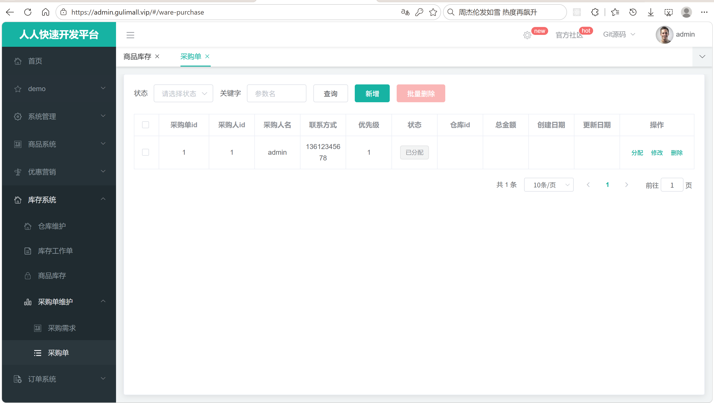
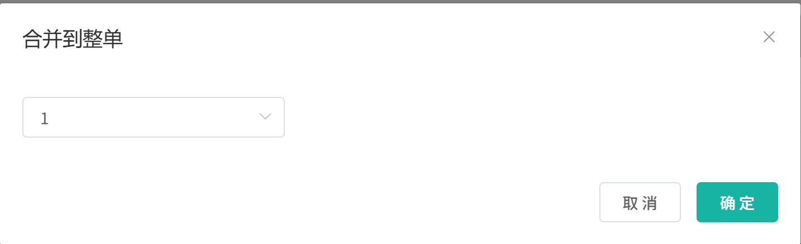
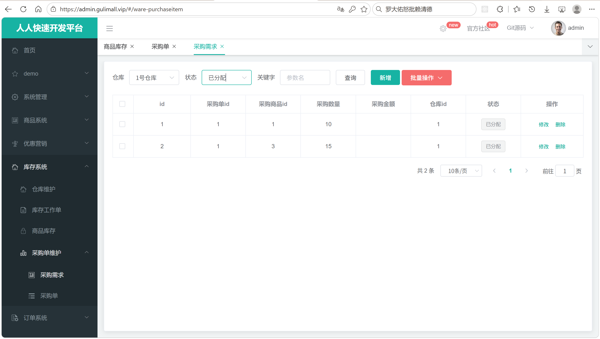
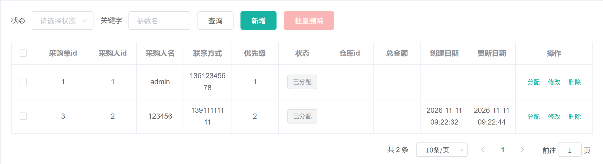

# 7.4 采购管理-介绍

> 本篇介绍采购管理：采购需求怎么产生、多张需求怎么合并成采购单、采购单怎么分配给采购人员、采购人员怎么领取和完成采购、采购成功后怎么入库、采购失败怎么标记，以及采购单和采购需求两套状态怎么流转。

---

## 1. 这个功能是干什么的

采购管理解决的是“仓库里的货不够卖了，怎么补货”的问题。库存表 `wms_ware_sku.stock` 只会因为采购入库而增加，采购就是库存的源头。

采购业务分成两层：

```text
采购需求 wms_purchase_detail
  一条需求 = 要采购哪个 SKU、采购多少件、放到哪个仓库、采购单价多少

采购单 wms_purchase
  一张采购单 = 一组采购需求的集合，也是分配给某个采购人员的工作单位
```

两条业务线会产生采购需求：

1. **人工创建**：管理员发现某个商品缺货，手动新增一条采购需求。
2. **库存预警创建**：库存低于阈值时，系统按 SKU 生成采购需求。

采购需求不能直接交给采购人员，要先合并成采购单。合并的意义：

1. 一次采购可能包含多个 SKU，采购人员拿一张单子去谈价、下单更方便。
2. 一张采购单可以统一分配给一个采购人员，责任明确。
3. 整单完成或整单异常可以批量判断，不需要逐条跟踪。

完整流程：

```text
创建采购需求
  → 合并到采购单
  → 分配采购人员
  → 采购人员领取
  → 逐项采购
  → 完成采购
      ├── 成功项：入库，增加 wms_ware_sku.stock
      └── 失败项：标记采购失败，可以重新合并
```

采购完成后，成功项会调用库存服务的 `addStock()`，把货加到指定仓库。库存的可用数量、锁定数量、秒杀锁定数量在 7.3 已经介绍，本节只说明采购怎么把货送进库存表。

## 2. 管理员怎么操作

入口：

```text
管理后台 → 库存系统 → 采购单 / 采购需求
```

### 2.1 查看采购单并分配采购人员



1. 打开“库存系统 → 采购单”。
2. 页面请求 `GET /ware/purchase/list`，带分页参数。
3. 表格展示采购单 id、采购人 id、采购人名、联系方式、优先级、状态、仓库 id、总金额、创建日期、更新日期。
4. 状态列用不同颜色的标签展示：新建、已分配、已领取、已完成、有异常。
5. 状态为“新建”或“已分配”的采购单，操作列显示“分配”按钮。
6. 点击“分配”，弹窗加载系统用户列表，选择采购人员。
7. 点击“确定”，请求 `POST /ware/purchase/update`，把 `assigneeId`、`assigneeName`、`phone`、`status=1` 写回采购单。

分配采购人员本质上是更新采购单的四个字段，并把状态从新建改成已分配。前端只在状态为 0 或 1 时显示“分配”按钮，避免给已领取或已完成的单子重新分配。

### 2.2 查看采购需求列表


1. 打开“库存系统 → 采购需求”。
2. 页面同时加载仓库下拉框和采购需求列表。
3. 查询条件包括仓库、状态、关键字。
4. 关键字 `key` 同时匹配 `sku_id` 和 `purchase_id`。
5. 状态可选新建、已分配、正在采购、已完成、采购失败。
6. 表格展示需求 id、采购单 id、采购商品 id、采购数量、采购金额、仓库 id、状态。
7. 操作列提供“修改”“删除”，顶部提供“新增”和“批量操作”。

采购需求列表是采购人员的核心工作台：既能看某张采购单下的所有需求，也能按状态筛出还没分配、正在采购或采购失败的需求。

### 2.3 合并整单



1. 在采购需求列表勾选一条或多条需求。
2. 点击“批量操作 → 合并整单”。
3. 页面请求 `GET /ware/purchase/unreceive/list`，加载还没被领取的采购单。
4. 弹窗里可以选择一张已有采购单，也可以不选。
5. 不选采购单时，页面提示“将自动创建新单进行合并”，确认后只提交 `items`。
6. 选择采购单时，提交 `purchaseId` 和 `items`。
7. 请求 `POST /ware/purchase/merge`。
8. 后端把选中的采购需求挂到采购单上，需求状态改为“已分配”。
9. 成功后刷新采购需求列表。

合并只处理“还没开始采购”或“采购失败”的需求。已经在采购中的需求不会被重复分配，已完成的更不会。

### 2.4 查看未领取的采购单



`GET /ware/purchase/unreceive/list` 返回状态为“新建”或“已分配”的采购单：

```text
status = 0 新建
或
status = 1 已分配
```

“新建”表示采购单刚由合并操作创建，还没有分配采购人员；“已分配”表示已经指定采购人员，但采购人员还没领取。这两种状态都属于“未领取”，都可以作为合并的目标单。

### 2.5 完成采购与入库结果



1. 采购人员拿到采购单后，逐项采购。
2. 每项采购需求会得到一个最终结果：成功或失败。
3. 完成采购时调用 `POST /ware/purchase/done`，请求体包含采购单 id 和每项需求的结果。
4. 后端逐项处理：
   - 成功项：调商品服务取 `skuName`，再调库存服务 `addStock()` 入库。
   - 失败项：只更新需求状态为“采购失败”，不入库。
5. 所有需求都更新完后，按整体结果更新采购单：
   - 全部成功：采购单状态改为“已完成”。
   - 任意一项失败：采购单状态改为“有异常”。
6. 页面刷新，采购单显示完成或有异常，采购需求显示已完成或采购失败。

采购失败的需求状态是 4，后续可以重新被合并到新的采购单，再次尝试采购。

## 3. 整体设计思路

### 3.1 业务上怎么设计

#### 3.1.1 采购单和采购需求的两层结构

```text
wms_purchase（采购单）
├── id            采购单 id
├── assignee_id   采购人员 id
├── assignee_name 采购人员姓名
├── phone         联系方式
├── priority      优先级
├── status        采购单状态
├── ware_id       仓库 id
├── amount        总金额
├── create_time   创建时间
└── update_time   更新时间

wms_purchase_detail（采购需求）
├── id          需求 id
├── purchase_id 所属采购单 id，可为空
├── sku_id      采购商品 id
├── sku_num     采购数量
├── sku_price   采购金额
├── ware_id     入库仓库 id
└── status      需求状态
```

采购需求先独立存在，`purchase_id` 为空表示还没合并。合并时把 `purchase_id` 指向某张采购单，需求才成为单据的一部分。

为什么不让采购需求直接引用采购人员：采购人员是采购单级别的属性，一张单子只分配给一个人。需求级别只关心“买什么、买多少、放哪个仓”。

#### 3.1.2 采购需求状态机

```text
0 新建 CREATED
  需求刚创建，还没合并到采购单

1 已分配 ASSIGNED
  需求已经挂到某张采购单上

2 正在采购 BUYING
  采购人员已经领取该采购单，需求开始采购

3 已完成 FINISH
  采购成功，货已经入库

4 采购失败 HASERROR
  采购失败，可以重新合并
```

允许的流转：

```text
0 新建 ──合并──> 1 已分配 ──领取──> 2 正在采购 ──完成──> 3 已完成
                                      └──失败──> 4 采购失败
4 采购失败 ──重新合并──> 1 已分配
```

#### 3.1.3 采购单状态机

```text
0 新建 CREATED
  合并时自动创建，还没有分配采购人员

1 已分配 ASSIGNED
  已经指定采购人员

2 已领取 RECEIVE
  采购人员已经领取，开始采购

3 已完成 FINISH
  该单下所有需求都采购成功

4 有异常 HASERROR
  该单下至少有一条需求采购失败
```

允许的流转：

```text
0 新建 ──分配──> 1 已分配 ──领取──> 2 已领取 ──全部成功──> 3 已完成
                                 └──任意失败──> 4 有异常
```

采购单状态是“聚合结果”，不是由采购人员手动维护的。它由该单下所有采购需求的结果决定。

#### 3.1.4 合并规则

合并采购需求时遵循以下规则：

1. `items` 为空直接返回，不做任何写操作。
2. `purchaseId` 为空时新建采购单，状态为 0 新建。
3. `purchaseId` 不为空时直接使用该采购单，不校验采购单是否存在、状态是否允许合并。
4. 只合并状态小于 2（新建、已分配）或等于 4（采购失败）的需求。
5. 已处于正在采购（2）或已完成（3）的需求直接跳过。
6. 被合并的需求状态改为 1 已分配，`purchase_id` 改为目标采购单 id。
7. 批量更新需求。

为什么不合并正在采购的需求：采购人员可能已经在供应商那里下单，改采购单会让工作重复或丢失。采购失败的需求没有进行中的采购动作，可以安全地重新分配。

#### 3.1.5 分配采购人员

分配动作只改采购单：

```text
assignee_id   = 采购人员 id
assignee_name = 采购人员姓名
phone         = 联系方式
status        = 1 已分配
```

业务上要求：

1. 只有新建、已分配状态可以分配。
2. 分配后采购人员信息要能在列表直接看到，不用再查用户表。
3. 采购人员联系方式要落库，采购过程中可能离线联系。

前端通过操作列的显示条件控制“只有 0、1 状态显示分配按钮”。后端更新接口没有做状态校验，直接按 id 更新。

#### 3.1.6 领取采购单

领取是采购人员的动作，表示这单已经被接下，开始采购。

```text
采购单：0 新建 / 1 已分配 → 2 已领取
采购需求：该单下所有需求 → 2 正在采购
```

业务上要求：

1. 只有状态小于等于 1 的采购单才能领取。
2. 领取后该单下所有需求一起进入正在采购，不需要逐条领取。
3. 重复领取已领取的单子不应改变状态。

#### 3.1.7 完成采购和入库

完成采购时，前端把每项需求的结果传回来：

```text
itemId  采购需求 id
status  3 已完成 / 4 采购失败
reason  失败原因
```

后端按项处理：

1. 状态为 4：该需求采购失败，整单标记为有异常。
2. 状态不是 4：按成功处理，远程取 `skuName`，调库存入库。
3. 所有需求更新完后，按 `flag` 更新采购单：
   - `flag=true`：采购单已完成。
   - `flag=false`：采购单有异常。

入库规则：

```text
wms_ware_sku 存在 (sku_id, ware_id) 记录
  → stock 累加该次采购数量

wms_ware_sku 不存在
  → 新建一行，stock=该次采购数量，stock_locked=0
```

`skuName` 从商品服务远程获取，失败时留空，不影响入库。库存表里的 `sku_name` 是冗余字段，空值不会阻塞库存增加。

#### 3.1.8 失败处理和重试

采购失败不是终态：

```text
需求状态 4 采购失败
  → 可以重新合并到采购单
  → 状态回到 1 已分配
  → 再次领取、采购、完成
```

采购单状态 4 有异常也是可重试的入口。管理员看到有异常的采购单后，可以把失败的需求挑出来重新合并。

#### 3.1.9 采购和库存的关系

采购完成只影响库存表的 `stock`，不影响 `stock_locked` 和 `seckill_stock_locked`：

```text
addStock(skuId, wareId, skuName, skuNum)
  → 已有行：stock += skuNum
  → 没有行：新增 stock=skuNum, stock_locked=0
```

当前采购完成流程没有调用 `refreshStockCache()`，数据库库存增加后 Redis 里的可用库存会滞后。管理员下一次修改库存或定时对账任务执行后，缓存才会恢复一致。这是一个待补点。

### 3.2 技术上怎么设计

#### 3.2.1 两张表

```text
wms_purchase
├── id             bigint 主键，自增
├── assignee_id    bigint 采购人员 id
├── assignee_name  varchar(255) 采购人员姓名
├── phone          char(13) 联系方式
├── priority       int 优先级
├── status         int 采购单状态
├── ware_id        bigint 仓库 id
├── amount         decimal(18,4) 总金额
├── create_time    datetime 创建时间
└── update_time    datetime 更新时间

wms_purchase_detail
├── id           bigint 主键，自增
├── purchase_id  bigint 所属采购单 id
├── sku_id       bigint 采购商品 id
├── sku_num      int 采购数量
├── sku_price    decimal(18,4) 采购金额
├── ware_id      bigint 入库仓库 id
└── status       int 采购需求状态
```

两张表没有外键，`purchase_id` 只是一个普通字段。合并、领取、完成都靠业务代码维护关系。

#### 3.2.2 状态条件更新

代码里没有为状态机单独建表，而是用状态值加条件过滤：

1. 合并时用 `status < BUYING || status == HASERROR` 过滤可合并需求。
2. 领取时用 `status <= ASSIGNED` 过滤可领取采购单。
3. 完成后用 `flag` 决定采购单最终状态。

优点：

1. 实现简单，不需要额外的状态流转表。
2. 状态值直接存在业务表里，查询和展示都方便。

缺点：

1. 状态流转规则散落在多个方法里，没有统一校验。
2. 更新时没有带“原状态”条件，并发下可能出现状态覆盖。
3. 状态值用 `int`，没有类型约束，非法值也能写进去。

#### 3.2.3 批量更新

采购需求和采购单都用 MyBatis-Plus 的批量方法：

```java
detailService.updateBatchById(list);
this.updateBatchById(list);
detailService.update(purchaseDetailEntity, updateWrapper);
```

三种方式分别用于不同场景：

| 方法 | 场景 | 特点 |
|---|---|---|
| `updateBatchById` | 合并、领取、完成 | 按 id 逐条更新，实体里的 null 字段被忽略 |
| `update(entity, wrapper)` | 领取时批量改需求状态 | 用条件一次更新多行，实体只带 status |
| `selectBatchIds` | 合并、领取 | 按 id 集合一次查出多条 |

`update(entity, wrapper)` 里实体只设置 `status`，其余字段为 null。MyBatis-Plus 默认忽略 null 字段，所以只生成 `UPDATE status = ? WHERE purchase_id IN (...)`，不会把其他字段清空。

#### 3.2.4 Feign 获取 skuName

采购完成时，库存表需要 `sku_name`。采购表里只有 `sku_id`，没有商品名称，所以调用商品服务：

```text
PurchaseServiceImpl.done()
  → ProductFeignClient.info(skuId)
  → product 服务 /product/skuinfo/info/{skuId}
  → 返回 R，data 里的 skuInfo 包含 skuName
```

远程调用放在 try-catch 里：

1. 调用成功且 `code=0`：从 `skuInfo` 里取 `skuName`。
2. 调用失败、超时或返回异常：记录警告日志，`skuName` 保持空串。
3. 空 `skuName` 不会覆盖库存表里已有的名称。

为什么远程失败不影响入库：采购入库的核心是增加库存数量，商品名称只是展示字段。不能因为商品服务短暂不可用就让采购完成失败。

#### 3.2.5 事务边界

`mergePurchase()`、`received()`、`done()` 都标了 `@Transactional`：

1. 合并：新建采购单和批量更新需求在同一个事务里。中途失败会回滚，不会出现“采购单建了但需求没挂上”。
2. 领取：更新采购单和更新需求在同一个事务里。
3. 完成：更新需求、入库、更新采购单在同一个事务里。任何一步抛异常，数据库操作一起回滚。

远程调用也在事务内。Feign 调用商品服务耗时较长时会拉长事务，生产环境可以把 `skuName` 查询前置到事务外，或改成异步补全。

#### 3.2.6 查询和分页

采购单列表：

```java
this.page(new Query<PurchaseEntity>().getPage(params),
        new QueryWrapper<PurchaseEntity>());
```

当前 `queryPage()` 没有拼接任何查询条件，前端传的 `key`、`status` 都不会生效。采购单列表实际是全量分页。

采购需求列表：

```java
key      → sku_id = key OR purchase_id = key
status   → status = key
wareId   → ware_id = key
```

关键字用 `and(w -> w.eq(...).or().eq(...))` 包起来，保证和其他条件组合时优先级正确。

#### 3.2.7 时间字段自动填充

`PurchaseEntity` 的 `createTime`、`updateTime` 标了自动填充：

```java
@TableField(fill = FieldFill.INSERT)
private Date createTime;

@TableField(fill = FieldFill.INSERT_UPDATE)
private Date updateTime;
```

插入采购单时，`MyMetaObjectHandler.insertFill()` 填充两个时间；更新时只填充 `updateTime`。采购需求表没有时间字段，不需要自动填充。

#### 3.2.8 状态校验的缺口

当前实现依赖前端控制按钮显示，后端没有完整的转态校验：

1. 分配采购人员直接调 `updateById()`，没有判断采购单当前状态。
2. 领取只过滤了采购单状态，但更新需求时没有只更新当前真正领取的采购单。
3. 完成采购没有校验采购单是否处于已领取状态，也没有校验需求是否属于该采购单。

生产环境应把状态流转收口到 Service，并在更新条件里带原状态，保证并发下只有一次流转生效。

## 4. 详细代码、配置和解释

第 4 章按“类为什么存在 → 关键字段与接口 → 正常链路 → 代码分块解释 → 一次完整示例 → 边界”组织。每个类先说明它在采购链路里的位置和调用方，再保留原始代码，代码之后按 1、2、3、4 逐段解释执行顺序、条件和原因。

### 4.1 PurchaseEntity：采购单表映射

#### 4.1.1 这个类解决什么问题

采购管理以采购单为聚合单位：合并时创建采购单，分配时写入采购人员，领取时推进状态，完成时按整单汇总结果。这些动作都围绕 `gulimall_wms.wms_purchase` 的一行数据展开，`PurchaseEntity` 就是这行数据在 Java 侧的载体。

它同时承担三件事：

1. 把表字段映射成属性，供 MyBatis-Plus 生成增删改查 SQL；
2. 承载采购人员、状态、仓库、金额和时间，供列表页和详情接口直接返回；
3. 作为 `PurchaseServiceImpl` 各写方法的入参和出参，向上承接 Controller，向下对接 Mapper。

调用关系是：`PurchaseController` 接收 HTTP 请求，`PurchaseServiceImpl` 处理状态流转，最后 MyBatis-Plus 把实体写进 `gulimall_wms.wms_purchase`。合并、分配、领取、完成四个动作都会经过这个实体。

#### 4.1.2 字段与业务含义

| 字段 | 数据库列 | 业务含义 | 说明 |
|---|---|---|---|
| `id` | `id` | 采购单 id | 主键，自增 |
| `assigneeId` | `assignee_id` | 采购人员 id | 分配时写入 |
| `assigneeName` | `assignee_name` | 采购人员姓名 | 冗余字段，列表直接展示 |
| `phone` | `phone` | 联系方式 | 冗余字段，采购过程中线下联系 |
| `priority` | `priority` | 优先级 | 编辑弹窗可调整 |
| `status` | `status` | 采购单状态 | 0 新建、1 已分配、2 已领取、3 已完成、4 有异常 |
| `wareId` | `ware_id` | 仓库 id | 采购入库的目标仓库 |
| `amount` | `amount` | 总金额 | 预留字段，当前没有汇总逻辑 |
| `createTime` | `create_time` | 创建时间 | 插入时自动填充 |
| `updateTime` | `update_time` | 更新时间 | 插入和更新时自动填充 |

代码位置：`D:\SoftwareInstallation\gulimall\gulimall-ware\src\main\java\com\atguigu\gulimall\ware\entity\PurchaseEntity.java:20-69`。

这个实体没有业务方法，代码只表达表映射关系：

```java
@Data
@TableName("wms_purchase")
public class PurchaseEntity implements Serializable {
    private static final long serialVersionUID = 1L;

    @TableId
    private Long id;
    private Long assigneeId;
    private String assigneeName;
    private String phone;
    private Integer priority;
    private Integer status;
    private Long wareId;
    private BigDecimal amount;

    /**
     * 创建日期：插入时由 MyMetaObjectHandler 自动填充
     */
    @TableField(fill = FieldFill.INSERT)
    private Date createTime;

    /**
     * 更新日期：插入和更新时由 MyMetaObjectHandler 自动填充
     */
    @TableField(fill = FieldFill.INSERT_UPDATE)
    private Date updateTime;
}
```

1. `@Data`：生成 getter、setter、`toString` 等方法，MyBatis-Plus 反射取值和前端 JSON 序列化都依赖这些访问器。
2. `@TableName("wms_purchase")`：把类绑定到采购单表，`selectById`、`updateById` 等方法才能定位到正确表名。
3. `@TableId`：标记 `id` 是主键。合并新建采购单后，`save()` 会把数据库自增 id 回填到实体，后续用它更新采购需求。
4. 普通字段按驼峰转下划线映射：`assigneeName` 对应 `assignee_name`，`wareId` 对应 `ware_id`，不需要逐个写 `@TableField`。
5. `createTime` 上的 `@TableField(fill = FieldFill.INSERT)`：只在插入时交给 `MyMetaObjectHandler` 填充，更新时不动创建时间。
6. `updateTime` 上的 `fill = FieldFill.INSERT_UPDATE`：插入时和每次更新时都重新填充，分配、领取、完成都会刷新这个时间。

为什么把采购人员姓名和电话冗余到采购单：采购单列表要直接展示采购人员和联系方式。如果只存 `assignee_id`，列表每一行都要调用户服务，性能和稳定性都受影响。姓名和电话在分配时一次写入，后续列表直接读本表，采购人员离线时也能从单据上找到联系方式。

#### 4.1.3 一次完整示例

合并操作新建采购单时，实体从空对象到落库的过程：

```text
1. mergePurchase() 执行 new PurchaseEntity()
2. 只设置 status = 0，表示新建
3. save() 生成 INSERT INTO wms_purchase (status) VALUES (0)
4. MyMetaObjectHandler.insertFill() 补上 create_time、update_time
5. 数据库返回自增 id，实体 id 被回填
6. 该 id 写入被合并需求的 purchase_id
7. 此时 assignee_id、assignee_name、phone、ware_id、amount 都是 null，属于“新建未分配”的正常状态
```

#### 4.1.4 这个类不做什么

1. 不校验状态值是否合法，`status` 可以写入任意整数。
2. 不计算 `amount`，采购单总金额需要额外汇总。
3. 不维护采购人员与当前登录用户的关系，分配只是写字段。
4. 不检查仓库是否存在，`ware_id` 只是普通列。

#### 4.1.5 边界与可优化点

1. `status` 用 `Integer`，允许 null。业务代码里 `entity.getStatus() <= ASSIGNED` 这类比较会拆箱空指针，历史数据需要清洗或给默认值。
2. `amount` 没有在完成采购时计算，当前只是预留字段。
3. 没有版本号或带原状态的更新条件，并发分配和领取可能互相覆盖。
4. `phone` 在表里是 `char(13)`，超长号码会被截断或报错，业务层应做长度校验。
5. `createTime`、`updateTime` 使用 `java.util.Date`，可以改成 `LocalDateTime`，与时区处理更清晰。

### 4.2 PurchaseDetailEntity：采购需求表映射

#### 4.2.1 这个类解决什么问题

采购需求是采购业务的最小单元：一条需求对应一个 SKU、一个采购数量、一个入库仓库和一次采购结果。需求先独立存在，`purchase_id` 为空表示还没有合并；合并后才挂到某张采购单上，成为整单的一部分。

这个实体承担三件事：

1. 映射 `gulimall_wms.wms_purchase_detail`，供 MyBatis-Plus 读写；
2. 承载 SKU、数量、单价、仓库和状态，是采购人员实际执行的粒度；
3. 作为合并、领取、完成三个动作的处理单元：合并改 `purchase_id` 和状态，领取按 `purchase_id` 批量改状态，完成逐条改结果并触发入库。

调用方集中在 `PurchaseServiceImpl`，查询方是 `PurchaseDetailServiceImpl`。上游采购需求由人工新增或库存预警生成，下游完成时把成功项交给 `WareSkuService.addStock()` 入库。

#### 4.2.2 字段与业务含义

| 字段 | 数据库列 | 业务含义 | 说明 |
|---|---|---|---|
| `id` | `id` | 需求 id | 主键，自增 |
| `purchaseId` | `purchase_id` | 所属采购单 id | 为空表示未合并 |
| `skuId` | `sku_id` | 采购商品 id | 对应 `pms_sku_info` |
| `skuNum` | `sku_num` | 采购数量 | 入库时累加到库存 |
| `skuPrice` | `sku_price` | 采购金额 | 单价或小计，按业务约定 |
| `wareId` | `ware_id` | 入库仓库 id | 完成时传给 `addStock()` |
| `status` | `status` | 需求状态 | 0 新建、1 已分配、2 正在采购、3 已完成、4 采购失败 |

代码位置：`D:\SoftwareInstallation\gulimall\gulimall-ware\src\main\java\com\atguigu\gulimall\ware\entity\PurchaseDetailEntity.java:18-53`。

实体只做映射，没有业务方法：

```java
@Data
@TableName("wms_purchase_detail")
public class PurchaseDetailEntity implements Serializable {
    private static final long serialVersionUID = 1L;

    @TableId
    private Long id;
    private Long purchaseId;
    private Long skuId;
    private Integer skuNum;
    private BigDecimal skuPrice;
    private Long wareId;
    private Integer status;
}
```

1. `@Data`：生成访问器，列表序列化、`peek` 里设置字段都依赖它。
2. `@TableName("wms_purchase_detail")`：绑定采购需求表。
3. `@TableId`：标记主键。合并时用 `selectBatchIds(items)` 按 id 批量取需求，靠的就是这个主键。
4. `purchaseId` 为 null 表示需求还没合并；合并时把它改成目标采购单 id，需求才成为单据的一部分。
5. `wareId` 是入库仓库，完成采购时和 `skuId`、`skuNum` 一起传给库存服务，决定货加到哪里。
6. `status` 对应 0 到 4 五个状态，合并、领取、完成都围绕它做过滤和更新。

为什么需求和采购单分开：需求是采购的最小单元，采购单是工作分配单元。分开后可以先把多个需求合并，再整单分配；也可以把失败的需求单独挑出来重新合并，不影响原采购单的历史记录。若把需求字段直接平铺到采购单，一张单只能买一个 SKU，无法表达“一次采购多个商品”。

#### 4.2.3 一次完整示例

一条需求从创建到完成，字段变化如下：

```text
创建：INSERT wms_purchase_detail
      sku_id=11, sku_num=100, sku_price=25.00, ware_id=1, status=0, purchase_id=null
合并：UPDATE ... SET purchase_id=8, status=1 WHERE id=3
领取：UPDATE ... SET status=2 WHERE purchase_id=8
完成成功：UPDATE ... SET status=3 WHERE id=3
      → addStock(skuId=11, wareId=1, skuName="Apple iPhone", skuNum=100)
完成失败：UPDATE ... SET status=4 WHERE id=3，reason 不落库
```

#### 4.2.4 这个类不做什么

1. 不维护与采购单的外键关系，`purchase_id` 只是普通列。
2. 不记录失败原因、采购时间、采购人员，失败信息只存在于请求里。
3. 不校验 `purchase_id` 指向的采购单是否存在。
4. 不限制同一 SKU 只能出现在一条需求里，合并时可能产生重复采购项。

#### 4.2.5 边界与可优化点

1. 没有外键或级联删除，采购单删除后需求会变成孤儿数据。
2. 没有记录失败原因，`PurchaseItemDoneVo.reason` 传上来后没有落库，重试时无法判断上次失败原因。
3. `status` 没有非空约束，合并时 `entity.getStatus() < 2` 会触发空指针。
4. `skuPrice` 的语义没有在表结构上约束为单价还是小计，金额汇总容易算错。
5. 没有采购时间字段，无法统计采购周期。

### 4.3 WareConstant：采购状态枚举

#### 4.3.1 这个类解决什么问题

采购单和采购需求各有五个状态，状态值会出现在合并、领取、完成、列表查询和前端按钮判断里。如果到处写 `0`、`1`、`2`，阅读代码时无法判断数字含义，改动状态顺序时也容易漏改。

`WareConstant` 里的两个枚举把状态码和中文含义放在一起：

1. `PurchaseStatusEnum` 描述采购单状态；
2. `PurchaseDetailStatusEnum` 描述采购需求状态。

枚举的使用方是 `PurchaseServiceImpl` 和 `PurchaseDetailServiceImpl`：Service 写入状态时使用 `getCode()`，生成查询条件时也使用 `getCode()`。前端页面通过接口拿到同样的数字状态，按数字判断按钮是否显示，按中文名称渲染状态标签。

#### 4.3.2 两套状态与流转

| 状态值 | 采购单 `PurchaseStatusEnum` | 采购需求 `PurchaseDetailStatusEnum` |
|---|---|---|
| 0 | 新建 `CREATED` | 新建 `CREATED` |
| 1 | 已分配 `ASSIGNED` | 已分配 `ASSIGNED` |
| 2 | 已领取 `RECEIVE` | 正在采购 `BUYING` |
| 3 | 已完成 `FINISH` | 已完成 `FINISH` |
| 4 | 有异常 `HASERROR` | 采购失败 `HASERROR` |

两套状态值相同，语义不同：采购单的 2 表示“采购人员已接单”，需求的 2 表示“这一项正在采购”；采购单的 4 表示整单有异常，需求的 4 表示单项失败。

代码位置：`D:\SoftwareInstallation\gulimall\gulimall-ware\src\main\java\com\atguigu\gulimall\ware\constant\WareConstant.java:32-80`。

枚举结构相同，只有常量不同：

```java
/** 采购单状态枚举 */
public enum PurchaseStatusEnum {
    CREATED(0, "新建"),
    ASSIGNED(1, "已分配"),
    RECEIVE(2, "已领取"),
    FINISH(3, "已完成"),
    HASERROR(4, "有异常");

    private int code;
    private String msg;

    PurchaseStatusEnum(int code, String msg) {
        this.code = code;
        this.msg = msg;
    }

    public int getCode() {
        return code;
    }

    public String getMsg() {
        return msg;
    }
}

/** 采购需求枚举 */
public enum PurchaseDetailStatusEnum {
    CREATED(0, "新建"),
    ASSIGNED(1, "已分配"),
    BUYING(2, "正在采购"),
    FINISH(3, "已完成"),
    HASERROR(4, "采购失败");

    private int code;
    private String msg;

    PurchaseDetailStatusEnum(int code, String msg) {
        this.code = code;
        this.msg = msg;
    }

    public int getCode() {
        return code;
    }

    public String getMsg() {
        return msg;
    }
}
```

1. 每个常量由 `code` 和 `msg` 两部分组成，`code` 落库，`msg` 用于日志和页面展示。
2. 构造器私有语义，外部只能使用预定义常量，不能随手 `new` 一个状态。
3. `getCode()` 返回 `int`，供 Service 写入实体和拼查询条件。
4. `getMsg()` 返回中文名称，便于日志排查和接口返回。
5. 两个枚举的代码完全同构，差别只在常量集合，维护时要注意不要改错其中一个。

这些枚举在链路中的使用位置：

1. 合并：新建采购单用 `PurchaseStatusEnum.CREATED`，被合并需求用 `PurchaseDetailStatusEnum.ASSIGNED`。
2. 领取：采购单用 `PurchaseStatusEnum.RECEIVE`，需求用 `PurchaseDetailStatusEnum.BUYING`。
3. 完成：采购单用 `FINISH` 或 `HASERROR`，需求状态由前端传入，值为 3 或 4。
4. 查询：未领取列表用 `CREATED` 和 `ASSIGNED` 的 code 拼 `OR` 条件。

#### 4.3.3 一次状态流转示例

```text
合并：purchase.status=0(CREATED)，detail.status=1(ASSIGNED)
分配：purchase.status=1(ASSIGNED)，detail.status 不变
领取：purchase.status=2(RECEIVE)，detail.status=2(BUYING)
完成：detail.status=3(FINISH) 或 4(HASERROR)
     purchase.status=3(FINISH) 或 4(HASERROR)
```

采购单和需求的状态不是一一对应：一张单下只要有一条需求失败，采购单就是 4 有异常，其余需求仍可能是 3 已完成。

#### 4.3.4 边界与可优化点

1. 枚举只有 `code` 和 `msg`，没有 `fromCode()` 反查方法，页面展示中文时需要自己映射。
2. `code` 是基本类型 `int`，数据库字段允许 null，比较时仍有拆箱风险。
3. 两个枚举和库存工作单状态常量混在同一个类里，类职责偏多，可以拆成独立的采购常量类。
4. 枚举没有实现统一的接口，采购单和需求状态无法用同一套方法处理。
5. 状态流转规则没有写进枚举，非法流转仍可被直接写入。

### 4.4 PurchaseController：采购接口入口

#### 4.4.1 这个类解决什么问题

采购管理有两个操作端：后台管理页面负责查看采购单、分配采购人员、勾选需求合并整单；采购人员手机端负责领取采购单、提交采购结果。两个端都通过 HTTP 访问库存服务，`PurchaseController` 就是这些请求的统一入口。

它只做三件事：

1. 接收路径参数、查询参数和 JSON 请求体；
2. 用 `@RequiresPermissions` 校验后台权限；
3. 调用 `PurchaseService`，把结果包装成统一响应 `R`。

采购单怎么合并、状态怎么流转、库存怎么增加，都不在这个类里。上游是网关转发的页面请求，下游是 `PurchaseServiceImpl` 和 MyBatis-Plus。

#### 4.4.2 接口清单

| 操作 | 方法与路径 | 权限注解 | 调用的 Service 方法 |
|---|---|---|---|
| 采购单分页 | `GET /ware/purchase/list` | `ware:purchase:list` | `queryPage()` |
| 采购单详情 | `GET /ware/purchase/info/{id}` | `ware:purchase:info` | `getById()` |
| 新增采购单 | `POST /ware/purchase/save` | `ware:purchase:save` | `save()` |
| 修改采购单 | `POST /ware/purchase/update` | `ware:purchase:update` | `updateById()` |
| 删除采购单 | `POST /ware/purchase/delete` | `ware:purchase:delete` | `removeByIds()` |
| 未领取采购单 | `GET /ware/purchase/unreceive/list` | 已注释 | `queryPageUnreceive()` |
| 合并整单 | `POST /ware/purchase/merge` | 已注释 | `mergePurchase()` |
| 领取采购单 | `POST /ware/purchase/received` | 已注释 | `received()` |
| 完成采购 | `POST /ware/purchase/done` | 已注释 | `done()` |

网关转发前会去掉 `/gulimall` 前缀，后台实际请求路径是 `/gulimall/ware/purchase/...`。

代码位置：`D:\SoftwareInstallation\gulimall\gulimall-ware\src\main\java\com\atguigu\gulimall\ware\controller\PurchaseController.java:32-137`。

代码按通用 CRUD、未领取查询、三个业务动作三组排列：

```java
@RestController
@RequestMapping("ware/purchase")
public class PurchaseController {
    @Autowired
    private PurchaseService purchaseService;

    /**
     * 列表
     */
    @RequestMapping("/list")
    @RequiresPermissions("ware:purchase:list")
    public R list(@RequestParam Map<String, Object> params){
        PageUtils page = purchaseService.queryPage(params);

        return R.ok().put("page", page);
    }

    /**
     * 信息
     */
    @RequestMapping("/info/{id}")
    @RequiresPermissions("ware:purchase:info")
    public R info(@PathVariable("id") Long id){
        PurchaseEntity purchase = purchaseService.getById(id);

        return R.ok().put("purchase", purchase);
    }

    /**
     * 保存
     */
    @RequestMapping("/save")
    @RequiresPermissions("ware:purchase:save")
    public R save(@RequestBody PurchaseEntity purchase){
        purchaseService.save(purchase);

        return R.ok();
    }

    /**
     * 修改
     */
    @RequestMapping("/update")
    @RequiresPermissions("ware:purchase:update")
    public R update(@RequestBody PurchaseEntity purchase){
        purchaseService.updateById(purchase);

        return R.ok();
    }

    /**
     * 删除
     */
    @RequestMapping("/delete")
    @RequiresPermissions("ware:purchase:delete")
    public R delete(@RequestBody Long[] ids){
        purchaseService.removeByIds(Arrays.asList(ids));

        return R.ok();
    }

    /**
     * 查询未领取的采购单（新建、已分配）
     */
    @RequestMapping("/unreceive/list")
    //@RequiresPermissions("ware:purchase:list")
    public R unreceiveList(@RequestParam Map<String, Object> params){
        PageUtils page = purchaseService.queryPageUnreceive(params);

        return R.ok().put("page", page);
    }

    /**
     * 合并采购需求：选中的采购需求合并到指定采购单，未指定则新建采购单
     */
    @PostMapping("/merge")
    //@RequiresPermissions("ware:purchase:update")
    public R merge(@RequestBody MergeVo mergeVo){
        purchaseService.mergePurchase(mergeVo);

        return R.ok();
    }

    /**
     * 领取采购单（采购人员在手机端操作）
     */
    @PostMapping("/received")
    //@RequiresPermissions("ware:purchase:update")
    public R received(@RequestBody List<Long> ids){
        purchaseService.received(ids);

        return R.ok();
    }

    /**
     * 完成采购
     */
    @PostMapping("/done")
    //@RequiresPermissions("ware:purchase:update")
    public R done(@RequestBody PurchaseDoneVo vo){
        purchaseService.done(vo);

        return R.ok();
    }
}
```

1. `@RestController` + `@RequestMapping("ware/purchase")`：九个接口共用 `/ware/purchase` 前缀，返回值自动序列化成 JSON。
2. `list()`：分页参数放在 `Map` 里，原样交给 `queryPage()`，结果以 `page` 字段返回，前端取 `data.page.list` 和 `data.page.totalCount`。
3. `info()`：按 id 查单条采购单，用于编辑弹窗回显。
4. `save()`、`update()`、`delete()`：直接调用 MyBatis-Plus 通用方法，没有额外业务逻辑。分配采购人员复用的就是 `update()`。
5. `unreceiveList()`：调 `queryPageUnreceive()`，只返回新建和已分配状态，供合并弹窗选择目标采购单。
6. `merge()`：请求体是 `MergeVo`，包含可选的采购单 id 和需求 id 集合。
7. `received()`：请求体是采购单 id 数组，采购人员在手机端一次领取一张或多张单。
8. `done()`：请求体是 `PurchaseDoneVo`，包含采购单 id 和每项需求的最终结果。

为什么合并、领取、完成用 POST：这三个动作都会修改数据，而且请求体是对象或数组，不适合放在查询参数里。POST 能承载 JSON 请求体，也符合写操作的语义。

为什么 `unreceive/list`、`merge`、`received`、`done` 的权限注解被注释掉：当前实现为了便于后台联调和采购人员手机端调用，暂时关闭了 Shiro 权限校验。生产环境应恢复权限注解，或改用服务间鉴权。

#### 4.4.3 一次请求示例

管理员在采购需求页勾选两条需求并合并到已有采购单 8：

```text
1. 前端提交 POST /gulimall/ware/purchase/merge
2. 请求体：{"purchaseId":8,"items":[3,4]}
3. 网关去掉 /gulimall，转发到库存服务 /ware/purchase/merge
4. PurchaseController.merge() 反序列化成 MergeVo
5. 调用 purchaseService.mergePurchase(mergeVo)
6. Service 完成合并后 Controller 返回 R.ok()
7. 前端收到 code=0，刷新采购需求列表
```

#### 4.4.4 它不做什么

1. 不判断采购单当前状态，分配、合并、完成的状态校验都依赖 Service 或前端按钮。
2. 不校验请求体字段，`MergeVo`、`PurchaseDoneVo` 都没有 `@Valid`。
3. 不处理异常，参数错误或 Service 抛异常时依赖全局异常处理。
4. 不组装分页条件，查询条件全部由 Service 拼接。

#### 4.4.5 边界与可优化点

1. 四个业务接口没有权限注解，存在越权调用风险。
2. `received()` 没有校验采购单是否属于当前登录用户，任何调用方都能领取任意采购单。
3. `done()` 没有校验采购单状态和明细归属，传任意 `detailId` 都可能触发入库。
4. 基础 CRUD 直接暴露，生产环境应限制为管理员或内部调用。
5. 没有对批量参数做大小限制，一次提交过多 id 会生成大事务。

### 4.5 PurchaseServiceImpl：采购核心业务

#### 4.5.1 这个类解决什么问题

采购管理的五个业务动作最终都落在这个类里：查采购单、查未领取单、合并需求、领取采购单、完成采购并入库。Controller 只做转发，真正决定“哪些需求能合并、哪些单能领取、完成后库存加多少”的逻辑都在这里。

它在链路中的位置：

```text
PurchaseController
  → PurchaseServiceImpl
      ├── PurchaseDetailService：批量查需求、批量改需求
      ├── WareSkuService.addStock()：采购成功项入库
      └── ProductFeignClient.info()：取 skuName 写库存表
```

这个类依赖三个下游：

1. `detailService`：采购需求的查询和更新；
2. `wareSkuService`：完成采购时增加库存；
3. `productFeignService`：远程查询商品名称。

#### 4.5.2 方法与链路

| 方法 | 触发方 | 作用 | 事务 |
|---|---|---|---|
| `queryPage()` | 后台采购单列表 | 分页查采购单，当前无查询条件 | 无 |
| `queryPageUnreceive()` | 合并弹窗 | 查新建、已分配的采购单 | 无 |
| `mergePurchase()` | 合并整单 | 新建或复用采购单，把选中需求挂上去 | `@Transactional` |
| `received()` | 采购人员领取 | 采购单改为已领取，需求改为正在采购 | `@Transactional` |
| `done()` | 完成采购 | 逐项更新结果，成功项入库，整单汇总状态 | `@Transactional` |

合并、领取、完成都是多表写操作，所以标注了 `@Transactional`。查询方法只读，不开启事务。

代码位置：`D:\SoftwareInstallation\gulimall\gulimall-ware\src\main\java\com\atguigu\gulimall\ware\service\impl\PurchaseServiceImpl.java:47-181`。

代码按“查询、合并、领取、完成”四组排列，第一组是分页查询：

```java
@Override
public PageUtils queryPage(Map<String, Object> params) {
    IPage<PurchaseEntity> page = this.page(
            new Query<PurchaseEntity>().getPage(params),
            new QueryWrapper<PurchaseEntity>()
    );

    return new PageUtils(page);
}

@Override
public PageUtils queryPageUnreceive(Map<String, Object> params) {
    QueryWrapper<PurchaseEntity> wrapper = new QueryWrapper<>();
    // 新建 或 已分配 的采购单都还没被领取
    // 这里 or() 是平级的，只因为当前没有任何其它条件才安全；
    // 以后要再加条件，必须改成 wrapper.and(w -> w.eq(...).or().eq(...))
    wrapper.eq("status", WareConstant.PurchaseStatusEnum.CREATED.getCode())
            .or()
            .eq("status", WareConstant.PurchaseStatusEnum.ASSIGNED.getCode());

    IPage<PurchaseEntity> page = this.page(
            new Query<PurchaseEntity>().getPage(params),
            wrapper
    );

    return new PageUtils(page);
}

@Transactional
@Override
public void mergePurchase(MergeVo mergeVo) {
    List<Long> items = mergeVo.getItems();
    if (CollectionUtils.isEmpty(items)) {
        return;
    }

    Long purchaseId = mergeVo.getPurchaseId();
    // 采购单id为 null 说明没选采购单，新建一个
    if (purchaseId == null) {
        PurchaseEntity purchaseEntity = new PurchaseEntity();
        purchaseEntity.setStatus(WareConstant.PurchaseStatusEnum.CREATED.getCode());
        this.save(purchaseEntity);
        purchaseId = purchaseEntity.getId();
    }

    // 分配：就是改采购需求的【采购单id】和【状态】
    // 不能把采购需求重复分配给不同的采购单，所以只挑还没去采购、或者采购失败的
    Long finalPurchaseId = purchaseId;
    List<PurchaseDetailEntity> list = detailService.getBaseMapper().selectBatchIds(items)
            .stream()
            .filter(entity -> entity.getStatus() < WareConstant.PurchaseDetailStatusEnum.BUYING.getCode()
                    || entity.getStatus() == WareConstant.PurchaseDetailStatusEnum.HASERROR.getCode())
            .peek(entity -> {
                entity.setStatus(WareConstant.PurchaseDetailStatusEnum.ASSIGNED.getCode());
                entity.setPurchaseId(finalPurchaseId);
            })
            .collect(Collectors.toList());

    detailService.updateBatchById(list);
}

@Transactional
@Override
public void received(List<Long> ids) {
    // 没有采购单id直接返回，否则下面 in() 空集合会破坏采购单状态
    if (CollectionUtils.isEmpty(ids)) {
        return;
    }

    // 1、确认当前采购单是新建或者已分配状态，然后改成已领取
    List<PurchaseEntity> list = this.getBaseMapper().selectBatchIds(ids)
            .stream()
            .filter(entity -> entity.getStatus() <= WareConstant.PurchaseStatusEnum.ASSIGNED.getCode())
            .map(entity -> {
                entity.setStatus(WareConstant.PurchaseStatusEnum.RECEIVE.getCode());
                return entity;
            })
            .collect(Collectors.toList());
    this.updateBatchById(list);

    // 2、把该采购单下的所有采购需求改成正在采购
    UpdateWrapper<PurchaseDetailEntity> updateWrapper = new UpdateWrapper<>();
    updateWrapper.in("purchase_id", ids);
    PurchaseDetailEntity purchaseDetailEntity = new PurchaseDetailEntity();
    purchaseDetailEntity.setStatus(WareConstant.PurchaseDetailStatusEnum.BUYING.getCode());
    // 实体里只有 status 非空，MyBatis-Plus 默认会忽略 null 字段，所以只会 update status
    detailService.update(purchaseDetailEntity, updateWrapper);
}

@Transactional
@Override
public void done(PurchaseDoneVo vo) {
    List<PurchaseItemDoneVo> items = vo.getItems();
    if (CollectionUtils.isEmpty(items)) {
        return;
    }

    // 1、根据前端发过来的信息，更新采购需求的状态
    List<PurchaseDetailEntity> updateList = new ArrayList<>();
    boolean flag = true;
    for (PurchaseItemDoneVo item : items) {
        Long detailId = item.getItemId();
        PurchaseDetailEntity detailEntity = detailService.getById(detailId);
        detailEntity.setStatus(item.getStatus());

        if (item.getStatus() == WareConstant.PurchaseDetailStatusEnum.HASERROR.getCode()) {
            // 只要有任意一项采购失败，整单就是有异常
            flag = false;
        } else {
            // 2、采购项完成，入库（调用远程服务拿 skuName）
            String skuName = "";
            try {
                R info = productFeignService.info(detailEntity.getSkuId());
                if (info.getCode() == 0) {
                    Map<String, Object> data = (Map<String, Object>) info.get("skuInfo");
                    skuName = (String) data.get("skuName");
                }
            } catch (Exception e) {
                // 远程调用失败不影响入库，skuName 留空即可
                log.warn("远程获取 skuName 失败，skuId={}", detailEntity.getSkuId(), e);
            }
            wareSkuService.addStock(detailEntity.getSkuId(), detailEntity.getWareId(), skuName,
                    detailEntity.getSkuNum());
        }
        updateList.add(detailEntity);
    }
    detailService.updateBatchById(updateList);

    // 3、所有采购需求都完成了，采购单才算完成，否则整单标记为有异常
    PurchaseEntity purchaseEntity = new PurchaseEntity();
    purchaseEntity.setId(vo.getId());
    purchaseEntity.setStatus(flag ? WareConstant.PurchaseStatusEnum.FINISH.getCode()
            : WareConstant.PurchaseStatusEnum.HASERROR.getCode());
    this.updateById(purchaseEntity);
}
```

1. `queryPage()`：用 `new QueryWrapper<>()` 作为空条件，把分页参数交给 `this.page()`。当前没有拼接任何筛选条件，前端传的 `key`、`status` 都不会进入 SQL，采购单列表实际是全量分页。
2. `queryPageUnreceive()`：拼 `status = 0 OR status = 1`，再分页。这里 `or()` 是平级的，只因为当前没有其他条件才安全；以后追加条件必须改成 `and(w -> w.eq(...).or().eq(...))`，否则会变成“条件 A 或 条件 B 且 条件 C”。
3. `mergePurchase()` 第一步判断 `items` 是否为空。空集合直接返回，避免后面 `selectBatchIds` 生成非法或全表 SQL。
4. `purchaseId` 为 null 时说明没有选择已有采购单，新建一个 `PurchaseEntity`，状态设为 0 新建，`save()` 后自增 id 回填到实体。
5. 用 `selectBatchIds(items)` 按 id 批量查需求，一次 SQL 取回所有被勾选的记录。
6. 过滤条件是 `status < BUYING(2) || status == HASERROR(4)`：状态 0、1 还没开始采购，状态 4 采购失败可以重试；状态 2 正在采购、状态 3 已完成的需求被跳过，避免采购人员重复下单或丢失已完成记录。
7. `peek` 对通过过滤的需求设置两个字段：`status = 1` 已分配，`purchaseId = 目标采购单`。这两个字段就是“合并”的全部语义。
8. `detailService.updateBatchById(list)` 按 id 逐条更新需求。`list` 只包含过滤后的需求，被跳过的需求不会产生写操作。
9. `received()` 先判断采购单 id 集合是否为空。空集合直接返回，否则下面 `in("purchase_id", ids)` 会生成非法 SQL。
10. 用 `selectBatchIds(ids)` 批量查采购单，过滤出 `status <= 1` 的单子。已领取、已完成、有异常的单子不能被再次领取。
11. 对过滤后的采购单设置 `status = 2` 已领取，`updateBatchById()` 批量更新。重复调用时，已领取的单子不在过滤结果里，状态不会被改回。
12. 需求状态用 `UpdateWrapper.in("purchase_id", ids)` 一次更新：实体只设置 `status = 2`，其余字段为 null，MyBatis-Plus 默认忽略 null，所以 SQL 只改状态。逐条查再逐条更新会产生大量 SQL，条件更新更高效。
13. `done()` 先判断完成项集合是否为空。空集合直接返回，避免后续按空集合更新采购单。
14. 遍历每个 `PurchaseItemDoneVo`，用 `detailService.getById(itemId)` 查出需求，再把前端传入的结果写入 `status`。
15. 状态为 4 采购失败时，把 `flag` 置为 false。`flag` 的初始值是 true，只要有一项失败就变 false，代表整单不能算完整完成。
16. 状态不是 4 时按成功处理：先通过 Feign 取 `skuName`，再从 `R` 的 `skuInfo` 里取值，最后调用 `wareSkuService.addStock(skuId, wareId, skuName, skuNum)` 入库。
17. Feign 调用包在 try-catch 里：成功且 `code=0` 才取名称；超时、异常或返回错误只记警告日志，`skuName` 保持空串。商品名称只用于展示，不能因为它取不到就让采购完成失败。
18. 循环结束后 `detailService.updateBatchById(updateList)` 批量写回所有需求状态。成功项和失败项在同一个列表里，一次提交。
19. 最后更新采购单：`flag=true` 写 3 已完成，`flag=false` 写 4 有异常。采购单状态是整单结果的聚合，不由采购人员手动选择。

为什么合并时只过滤状态：`status < BUYING` 覆盖新建和已分配，`status == HASERROR` 覆盖采购失败。正在采购和已完成的需求不会被重新挂到别的采购单，避免采购人员重复下单或丢失已完成记录。

为什么领取时先过滤采购单再更新：已经领取、已完成、有异常的采购单不应该再被领取。过滤后只把新建和已分配的单子改成已领取，重复调用不会把已完成改回已领取。

为什么完成采购按任意失败标记整单异常：一张采购单通常对应一次供应商下单。只要有一项没买到，整单就不能算完整完成。把整单标记为有异常，管理员能快速发现需要补采的单子。

#### 4.5.3 一次完整示例

合并两条需求到采购单 8：

```text
1. mergePurchase({purchaseId: 8, items: [3, 4]})
2. items 非空，不新建采购单，目标 id = 8
3. selectBatchIds([3, 4])
4. 需求 3 status=0，通过过滤；需求 4 status=2，跳过
5. 需求 3 设置 purchaseId=8、status=1
6. updateBatchById([需求3])
7. 事务提交，需求 3 出现在采购单 8 下
```

领取采购单 8 并完成：

```text
1. received([8])
2. selectBatchIds([8])，采购单 status=1，通过过滤
3. 采购单 8 改为 status=2，批量更新
4. UPDATE wms_purchase_detail SET status=2 WHERE purchase_id IN (8)
5. done({id:8, items:[{itemId:3,status:3},{itemId:5,status:4,reason:"缺货"}]})
6. 需求 3：status=3，取 skuName，addStock() 入库，flag 保持 true
7. 需求 5：status=4，flag=false，不入库
8. 批量更新需求 3、5
9. 采购单 8 因 flag=false 更新为 status=4 有异常
```

#### 4.5.4 它不做什么

1. 不校验采购单是否存在、状态是否允许合并，`mergePurchase()` 直接信任传入的 `purchaseId`。
2. 不校验领取人身份，`received()` 只认采购单 id。
3. 不校验需求是否属于当前采购单，`done()` 可以给任意 `detailId` 入库。
4. 不做幂等控制，重复调用完成接口会把库存加两次。
5. 不刷新 Redis 库存缓存，入库后可用库存显示会滞后。
6. 不计算采购单金额，`amount` 始终为空。

#### 4.5.5 边界与可优化点

1. `mergePurchase()` 中 `entity.getStatus()` 可能为 null，直接和 int 比较会空指针。应先判空或给数据库默认值。
2. 合并时没有校验 `purchaseId` 是否存在、状态是否允许合并。
3. `received()` 中过滤后的采购单列表可能为空，但下面仍然按原始 `ids` 更新需求，会把不符合领取条件的单子下的需求也改成正在采购。
4. `received()` 没有校验采购人员身份，任何调用方都能领取。
5. `done()` 中 `detailService.getById(detailId)` 可能返回 null，直接 `setStatus()` 会空指针。
6. `done()` 中 `item.getStatus()` 可能为 null，和 int 比较会空指针。
7. `done()` 没有校验需求是否属于当前采购单，传任意 `detailId` 都能入库。
8. `done()` 调用 `addStock()` 没有加库存写锁，也没有刷新 Redis 缓存。
9. `done()` 没有把 `reason` 落库，采购失败原因丢失。
10. `done()` 没有更新采购单总金额 `amount`。
11. 状态更新没有带原状态条件，并发完成同一张采购单时后写覆盖先写。
12. 完成接口没有幂等键，重复提交会重复入库，应在需求或采购单上做状态抢占。
13. `queryPage()` 忽略所有查询条件，采购单列表无法按状态、关键字筛选。

### 4.6 PurchaseDetailController：采购需求接口入口

#### 4.6.1 这个类解决什么问题

采购需求页面是采购人员的核心工作台：按仓库、状态、关键字筛选需求，勾选后合并整单，也支持单条新增、修改、删除。这些操作都需要 HTTP 入口，`PurchaseDetailController` 负责把页面请求转成 `PurchaseDetailService` 调用。

链路位置：

```text
purchaseitem.vue
  → GET/POST /ware/purchasedetail/...
  → PurchaseDetailController
  → PurchaseDetailService
  → PurchaseDetailServiceImpl.queryPage()
  → wms_purchase_detail
```

Controller 只做参数接收、权限校验和 `R` 包装。列表查询的条件拼接在 `PurchaseDetailServiceImpl.queryPage()`，其余 CRUD 直接走 MyBatis-Plus。

代码位置：`D:\SoftwareInstallation\gulimall\gulimall-ware\src\main\java\com\atguigu\gulimall\ware\controller\PurchaseDetailController.java:28-90`。

#### 4.6.2 代码与解释

代码只保留列表接口，其余 CRUD 由代码生成器生成：

```java
@RestController
@RequestMapping("ware/purchasedetail")
public class PurchaseDetailController {
    @Autowired
    private PurchaseDetailService purchaseDetailService;

    /**
     * 列表
     */
    @RequestMapping("/list")
    @RequiresPermissions("ware:purchasedetail:list")
    public R list(@RequestParam Map<String, Object> params){
        PageUtils page = purchaseDetailService.queryPage(params);

        return R.ok().put("page", page);
    }
}
```

1. `@RestController` + `@RequestMapping("ware/purchasedetail")`：采购需求接口统一前缀。
2. `list()` 接收 `@RequestParam Map<String, Object> params`，分页参数和筛选参数都在这个 Map 里。
3. `purchaseDetailService.queryPage(params)` 返回已经组装好的 `PageUtils`。
4. `R.ok().put("page", page)`：前端统一从 `data.page.list` 取数据、`data.page.totalCount` 取总数。
5. 其余 `info`、`save`、`update`、`delete` 由代码生成器生成，直接调用通用 CRUD，没有额外校验。

为什么列表单独抽 Service：采购需求列表有条件查询（关键字、状态、仓库），不能直接用通用分页。抽到 `queryPage()` 后，Controller 保持简单，查询条件集中在一个方法里，前端只需要记住一组参数名。

#### 4.6.3 一次请求示例

采购需求页面按仓库 1、状态 2、关键字 11 查询：

```text
1. 前端请求 GET /gulimall/ware/purchasedetail/list
   ?page=1&limit=10&key=11&status=2&wareId=1
2. 网关转发到 /ware/purchasedetail/list
3. Controller 把参数原样传给 queryPage()
4. Service 拼出 (sku_id=11 OR purchase_id=11) AND status=2 AND ware_id=1
5. 分页查询 wms_purchase_detail
6. 返回 page，前端渲染表格
```

#### 4.6.4 它不做什么

1. 不校验新增或修改的字段，`skuNum`、`wareId` 可以为空。
2. 不校验需求状态，任何状态都能直接更新或删除。
3. 不检查需求是否已经属于采购单，删除正在采购的需求也不会被阻止。
4. 不提供按采购单 id 精确查询的专用接口。

#### 4.6.5 边界与可优化点

1. 基础 CRUD 没有业务校验，可以直接新增或删除任意状态的需求。
2. 删除采购需求不会检查它是否已经属于采购单或正在采购。
3. 没有按采购单 id 查询明细的专用接口，前端只能靠关键字等值匹配。
4. 接口没有限制分页大小，`limit` 传很大时会一次拉取过多数据。
5. 新增需求时状态由前端传入，可以绕过状态机直接写成已完成。

### 4.7 PurchaseDetailServiceImpl：采购需求查询

#### 4.7.1 这个类解决什么问题

采购需求页面的筛选区有三个条件：关键字、状态、仓库。关键字既可能输入 SKU id，也可能输入采购单 id，需要同时匹配两列；三个条件还可能任意组合。通用分页方法无法表达这些规则，所以列表查询单独实现。

调用链是：`purchaseitem.vue` 的筛选表单 → `GET /ware/purchasedetail/list` → `PurchaseDetailController.list()` → `queryPage()` → `wms_purchase_detail`。

这个类只解决查询组装，不负责需求的写操作。写操作由 `PurchaseServiceImpl` 在合并、领取、完成时直接调用 `detailService` 完成。

#### 4.7.2 查询条件

| 参数 | 匹配列 | 组合方式 | 说明 |
|---|---|---|---|
| `key` | `sku_id` 或 `purchase_id` | 括号内 `OR` | 两个 id 都等值匹配 |
| `status` | `status` | 与关键字 `AND` | 需求状态 |
| `wareId` | `ware_id` | 与前两个条件 `AND` | 入库仓库 |

关键字必须用括号包起来，否则 `AND` 的优先级高于 `OR`，条件含义会变错。

代码位置：`D:\SoftwareInstallation\gulimall\gulimall-ware\src\main\java\com\atguigu\gulimall\ware\service\impl\PurchaseDetailServiceImpl.java:20-47`。

代码按“关键字、状态、仓库、分页”四段顺序执行：

```java
@Override
public PageUtils queryPage(Map<String, Object> params) {
    QueryWrapper<PurchaseDetailEntity> wrapper = new QueryWrapper<>();

    String key  = (String) params.get("key");
    if (!StringUtils.isNullOrEmpty(key)){
        wrapper.and(w -> {
            w.eq("sku_id", key).or().eq("purchase_id", key);
        });
    }

    String status  = (String) params.get("status");
    if (!StringUtils.isNullOrEmpty(status)){
        wrapper.eq("status", status);
    }

    String wareId  = (String) params.get("wareId");
    if (!StringUtils.isNullOrEmpty(wareId)){
        wrapper.eq("ware_id", wareId);
    }

    IPage<PurchaseDetailEntity> page = this.page(
            new Query<PurchaseDetailEntity>().getPage(params),
            wrapper
    );

    return new PageUtils(page);
}
```

1. 从 `params` 里取 `key`，用 `StringUtils.isNullOrEmpty()` 判断是否为空。为空就不拼条件，避免生成 `sku_id = null`。
2. 关键字非空时用 `wrapper.and(w -> w.eq("sku_id", key).or().eq("purchase_id", key))`。外面的 `and` 负责加括号，里面的 `or` 负责两列任一匹配。
3. 取 `status`，非空时追加 `eq("status", status)`。它和前面的关键字条件是 `AND` 关系。
4. 取 `wareId`，非空时追加 `eq("ware_id", wareId)`。三个条件全部非空时，SQL 是“关键字括号条件 AND 状态 AND 仓库”。
5. 用 `new Query<PurchaseDetailEntity>().getPage(params)` 解析分页参数，交给 `this.page()` 执行查询。
6. `PageUtils` 把 MyBatis-Plus 的分页结果转换成项目统一的分页结构，前端不需要感知底层类型。

为什么关键字要用 `and(...)` 包起来：如果不加括号，SQL 会变成：

```sql
sku_id = ? OR purchase_id = ? AND status = ? AND ware_id = ?
```

`AND` 优先级高于 `OR`，条件会变成“sku_id 匹配，或者 purchase_id 匹配且状态仓库都匹配”，语义错误。加上括号后变成：

```sql
(sku_id = ? OR purchase_id = ?) AND status = ? AND ware_id = ?
```

三个条件才是正确的组合关系。

为什么使用 `com.mysql.cj.util.StringUtils`：当前实现引用了 MySQL 驱动自带的字符串工具类。它能判断 null 和空串，但把业务代码和数据库驱动绑定在一起。更合适的做法是使用 Spring 的 `StringUtils` 或 Apache Commons Lang。

#### 4.7.3 一次查询示例

输入 `key=11&status=2&wareId=1`：

```text
1. key 非空 → (sku_id = '11' OR purchase_id = '11')
2. status 非空 → AND status = '2'
3. wareId 非空 → AND ware_id = '1'
4. SQL: SELECT * FROM wms_purchase_detail
        WHERE (sku_id = '11' OR purchase_id = '11')
          AND status = '2' AND ware_id = '1'
        LIMIT 0, 10
5. 返回该仓库下、正在采购、且 SKU 或采购单 id 为 11 的需求
```

只输入 `status=4` 时，没有关键字括号，SQL 只有 `WHERE status = '4'`，列出所有采购失败的需求。

#### 4.7.4 它不做什么

1. 不做模糊搜索，关键字只做等值匹配。
2. 不校验状态值是否合法，非法值直接进 SQL。
3. 不处理排序，结果顺序由数据库决定。
4. 不校验仓库 id 是否属于当前用户或当前组织。

#### 4.7.5 边界与可优化点

1. 关键字对 `sku_id`、`purchase_id` 都是等值匹配，不能按商品名称搜索。
2. `status` 和 `wareId` 以字符串形式传给 SQL，类型转换依赖数据库，非法值可能报错。
3. 没有按 `purchase_id` 精确查询的专用条件，关键字匹配可能同时命中多个采购单。
4. 没有排序，默认按主键顺序返回，采购人员查看时不够直观。
5. 每次查询都在 Service 里手工拼条件，条件增多后建议抽成查询对象。

### 4.8 MergeVo、PurchaseDoneVo、PurchaseItemDoneVo：采购参数

#### 4.8.1 这三个类解决什么问题

合并和完成是两个结构不同的写动作，请求体不能复用同一个实体：

1. 合并请求只关心“合并到哪张采购单”和“合并哪些需求”，不需要完整的采购单字段；
2. 完成请求先表达整单，再表达每项需求的结果，是两层结构。

如果直接用 `PurchaseEntity` 或 `PurchaseDetailEntity` 接收请求体，前端必须构造大量无关字段，Service 也无法区分“字段没传”和“字段传了 null”。三个 VO 把接口契约固定下来，Controller 反序列化后直接交给 Service。

链路位置：

```text
POST /ware/purchase/merge   → MergeVo          → mergePurchase()
POST /ware/purchase/done    → PurchaseDoneVo   → done()
                                  └── PurchaseItemDoneVo（每项需求）
```

代码位置：`D:\SoftwareInstallation\gulimall\gulimall-ware\src\main\java\com\atguigu\gulimall\ware\vo\MergeVo.java:12-20`、`PurchaseDoneVo.java:12-20`、`PurchaseItemDoneVo.java:10-21`。

#### 4.8.2 代码与解释

三个类都是纯数据对象，只包含字段和 Lombok 访问器：

```java
@Data
public class MergeVo {

    /** 整单id：为空表示没有选中已有采购单，需要新建一个 */
    private Long purchaseId;

    /** 要合并的采购需求（wms_purchase_detail 的 id）集合 */
    private List<Long> items;
}
```

```java
@Data
public class PurchaseDoneVo {

    /** 采购单 id（wms_purchase.id） */
    private Long id;

    /** 该采购单下各采购需求的完成情况 */
    private List<PurchaseItemDoneVo> items;
}
```

```java
@Data
public class PurchaseItemDoneVo {

    /** 采购需求 id（wms_purchase_detail.id） */
    private Long itemId;

    /** 采购需求最终状态：3 已完成 / 4 采购失败 */
    private Integer status;

    /** 失败原因 */
    private String reason;
}
```

`MergeVo`：

1. `purchaseId`：目标采购单 id。为 null 表示没有选择已有采购单，Service 会新建一张。
2. `items`：要合并的采购需求 id 集合。空集合时 Service 直接返回，不产生任何写操作。
3. 只有两个字段，因为采购人员、仓库、金额都不在合并时确定，合并只改变需求归属。

`PurchaseDoneVo`：

1. `id`：采购单 id，决定最终更新哪张单的状态。
2. `items`：该单下每项需求的结果列表，Service 逐项遍历。
3. 外层负责“整单”，内层负责“单项”，状态汇总时才能做到任意一项失败即整单异常。

`PurchaseItemDoneVo`：

1. `itemId`：采购需求 id，Service 用它查出需求记录。
2. `status`：该项最终状态，约定 3 已完成、4 采购失败。
3. `reason`：失败原因，当前只用于接口传输，没有落库。

#### 4.8.3 一次请求示例

合并请求：

```json
{
  "purchaseId": 8,
  "items": [3, 4]
}
```

完成请求：

```json
{
  "id": 8,
  "items": [
    { "itemId": 3, "status": 3, "reason": "" },
    { "itemId": 5, "status": 4, "reason": "供应商缺货" }
  ]
}
```

Service 收到后：需求 3 入库并把 `flag` 保持为 true，需求 5 标记失败并把 `flag` 置为 false，采购单 8 最终写 4 有异常。

#### 4.8.4 它不做什么

1. 不做参数校验，字段可以为 null 或空集合。
2. 不限制 `status` 的取值范围。
3. 不校验 `purchaseId`、`itemId` 是否存在或是否属于同一张单。
4. 不记录 `reason`，失败原因只在当前请求内有效。

#### 4.8.5 边界与可优化点

1. `reason` 传上来后没有落库，失败原因丢失。
2. `status` 没有校验只能是 3 或 4，传其他值也会被当成成功处理并入库。
3. `items` 没有非空校验注解，空集合在 Service 里才判断。
4. `PurchaseDoneVo.id` 没有校验是否属于当前采购人员。
5. `MergeVo.purchaseId` 没有校验目标采购单是否存在、状态是否允许合并。

### 4.9 ProductFeignClient：远程获取商品信息

#### 4.9.1 这个类解决什么问题

库存表 `wms_ware_sku` 有 `sku_name` 列，但采购域只保存 `sku_id`，没有商品名称。采购完成入库时需要把名称一起写进去，否则库存列表只能显示一串数字 id。

商品数据属于 `gulimall-product` 服务，库存服务不能直接查它的库，所以通过 Feign 调用商品服务的 SKU 详情接口。调用发生在 `PurchaseServiceImpl.done()` 的成功分支里，位置在 `addStock()` 调用前。

链路位置：

```text
PurchaseServiceImpl.done()
  → ProductFeignClient.info(skuId)
  → GET /product/skuinfo/info/{skuId}
  → gulimall-product 返回 R
  → 从 skuInfo 取 skuName
  → WareSkuService.addStock(skuId, wareId, skuName, skuNum)
```

这个接口只读商品信息，不修改商品数据。商品服务短暂不可用时，采购入库仍应继续。

代码位置：`D:\SoftwareInstallation\gulimall\gulimall-ware\src\main\java\com\atguigu\gulimall\ware\feign\ProductFeignClient.java:13-24`。

#### 4.9.2 代码与解释

接口只有一个方法：

```java
@FeignClient("gulimall-product")
public interface ProductFeignClient {

    /**
     * 查询 sku 信息，用于取 skuName 落库到 wms_ware_sku
     *
     * @param skuId sku id
     * @return R，其中 skuInfo 为 SkuInfoEntity
     */
    @RequestMapping("/product/skuinfo/info/{skuId}")
    R info(@PathVariable("skuId") Long skuId);
}
```

1. `@FeignClient("gulimall-product")`：声明这是调用商品服务的客户端，服务名由 Nacos 解析成实例地址。
2. `@RequestMapping("/product/skuinfo/info/{skuId}")`：与被调用服务的路径保持一致，Feign 按占位符替换参数。
3. `@PathVariable("skuId")`：把方法入参填进 URL 占位符。
4. 返回类型是 `R`：项目统一响应结构，包含 `code`、`msg` 和业务数据，采购 Service 可以先判断成功与否。
5. 方法本身没有实现，运行时由 Feign 生成代理发起 HTTP 请求。

为什么用 Feign 而不是把商品名冗余到采购需求：采购需求创建时可能还没有商品名称，或者商品名称后来会改。完成采购时实时取一次，能拿到最新名称。库存表的 `sku_name` 也只需要在入库时写一次。

为什么返回 `R` 而不是直接返回商品实体：`R` 包含状态码，采购 Service 可以先判断 `code=0`，再决定是否取 `skuName`，避免商品服务返回错误时把错误信息当成商品数据。

#### 4.9.3 一次调用示例

```text
1. done() 处理需求 3，skuId=11
2. 调 productFeignService.info(11L)
3. Feign 组装 GET http://gulimall-product/product/skuinfo/info/11
4. 商品服务返回 {"code":0,"skuInfo":{"skuName":"Apple iPhone 15"}}
5. 代码判断 code=0，从 skuInfo 取 skuName
6. 调 addStock(11, 1, "Apple iPhone 15", 100)
7. 库存表 sku_name 写入商品名称
```

商品服务超时或报错时，`info()` 抛异常，被 `done()` 的 try-catch 捕获，日志记录警告，`skuName` 保持空串，`addStock()` 继续执行。

#### 4.9.4 它不做什么

1. 不做降级返回，失败由调用方捕获处理。
2. 不缓存商品名称，每条成功需求都会调用一次。
3. 不批量查询，循环里逐条远程调用。
4. 不校验 `skuId` 是否有效，无效 id 由商品服务返回错误。

#### 4.9.5 边界与可优化点

1. Feign 调用没有设置超时和降级，商品服务慢时会拖长采购事务。
2. 返回类型是 `R`，内部用 `Map` 强转，字段改名时编译期发现不了。
3. 可以改成批量查询 `skuId` 列表，减少循环里的远程调用次数。
4. 远程调用在事务内，建议把名称查询前置到事务外，或改成异步补全。
5. 商品名称变化后库存表的冗余名称不会自动更新，需要额外同步机制。

### 4.10 MyMetaObjectHandler：采购单时间填充

#### 4.10.1 这个类解决什么问题

采购单的创建和更新分散在多个方法里：合并时 `save()` 新建，分配时 `updateById()` 更新，领取和完成也会更新状态。如果每个方法都手动写 `setCreateTime()`、`setUpdateTime()`，容易漏写，时间格式也不统一。

MyBatis-Plus 提供自动填充机制：实体字段标上 `FieldFill`，插入或更新时由 `MetaObjectHandler` 统一赋值。这个类就是库存服务里的填充实现，服务于所有带填充注解的实体。

链路位置：

```text
PurchaseServiceImpl.save()/updateById()
  → MyBatis-Plus 生成 INSERT/UPDATE
  → MyMetaObjectHandler.insertFill()/updateFill()
  → 实体时间字段被赋值
  → SQL 落库
```

调用方不是业务代码，而是 MyBatis-Plus 在执行 SQL 前的拦截点。业务方法不需要感知这个类的存在。

代码位置：`D:\SoftwareInstallation\gulimall\gulimall-ware\src\main\java\com\atguigu\gulimall\ware\config\MyMetaObjectHandler.java:18-36`。

#### 4.10.2 代码与解释

代码只有插入和更新两个回调：

```java
@Slf4j
@Component
public class MyMetaObjectHandler implements MetaObjectHandler {

    /** 插入时的填充策略 */
    @Override
    public void insertFill(MetaObject metaObject) {
        log.info("start insert fill.....");
        this.setFieldValByName("createTime", new Date(), metaObject);
        this.setFieldValByName("updateTime", new Date(), metaObject);
    }

    /** 更新时的填充策略 */
    @Override
    public void updateFill(MetaObject metaObject) {
        log.info("start update fill.....");
        this.setFieldValByName("updateTime", new Date(), metaObject);
    }
}
```

1. `@Component`：把处理器注册成 Spring Bean，MyBatis-Plus 启动时会自动发现。
2. `implements MetaObjectHandler`：实现插入和更新两个填充回调。
3. `insertFill()`：实体插入前执行，用 `setFieldValByName` 给 `createTime`、`updateTime` 都赋当前时间。
4. `updateFill()`：实体更新前执行，只给 `updateTime` 赋值，创建时间保持不变。
5. 两个方法都先打日志，便于确认填充是否触发。
6. 只有实体字段上标了 `fill = FieldFill.INSERT` 或 `INSERT_UPDATE`，对应回调才会作用于该字段；没有注解的字段不受影响。

为什么用自动填充：采购单的创建和更新发生在多个方法里，手动设置时间容易漏。自动填充把时间维护收口到框架层，业务代码只关注状态和业务字段。

#### 4.10.3 一次填充示例

```text
合并新建采购单：
1. save(purchaseEntity)
2. insertFill() 触发
3. createTime = 2026-11-12 10:00:00
4. updateTime = 2026-11-12 10:00:00
5. INSERT 落库

分配采购人员：
1. updateById(purchaseEntity)，实体只有 id 和采购人员字段
2. updateFill() 触发
3. updateTime = 2026-11-12 10:05:00
4. createTime 不变
5. UPDATE 落库
```

#### 4.10.4 它不做什么

1. 不填充采购需求表，需求表没有时间字段。
2. 不处理业务时间，例如领取时间、完成时间都没有单独记录。
3. 不校验实体类型，按字段名查找，找不到就跳过。
4. 不控制时区，使用 JVM 默认时区。

#### 4.10.5 边界与可优化点

1. `updateFill()` 只按字段名设置值，如果实体没有该字段会静默跳过。
2. 日志级别是 info，采购频繁时日志量大，可以降为 debug。
3. 时间使用 `java.util.Date`，可以改成 `LocalDateTime`。
4. 批量更新时每个实体都会触发一次填充，数据量大时有一定开销。
5. 没有记录操作人，审计场景需要额外字段和上下文。

### 4.11 purchase.vue：采购单列表和分配采购人员

#### 4.11.1 这个页面解决什么问题

后台采购单页面承担两个操作：查看采购单列表，把未分配的单子交给某个采购人员。页面本身不保存业务规则，只负责调接口、渲染表格、收集用户选择。

链路位置：

```text
管理员点击“库存系统 → 采购单”
  → getDataList()        GET /ware/purchase/list
  → opendrawer()         GET /sys/user/list
  → assignUser()         POST /ware/purchase/update
  → getDataList()        刷新列表
```

它对接的后端只有 `PurchaseController` 的 `list` 和 `update`，用户列表来自后台权限服务的 `/sys/user/list`。

#### 4.11.2 页面方法与接口

| 用户操作 | 前端方法 | 后端接口 | 成功后动作 |
|---|---|---|---|
| 打开页面 | `getDataList()` | `GET /ware/purchase/list` | 渲染表格和分页 |
| 点击分配 | `opendrawer(row)` | `GET /sys/user/list` | 打开分配弹窗 |
| 点击确定 | `assignUser()` | `POST /ware/purchase/update` | 刷新列表 |

代码位置：`D:\SoftwareInstallation\gulimall\renren-fast-vue\src\views\modules\ware\purchase.vue:130-204`。

代码依次是打开弹窗、提交分配、加载用户、加载列表：

```javascript
opendrawer(row){
  this.getUserList();
  this.currentRow = row;
  this.caigoudialogVisible = true;
},
assignUser() {
  let _this = this;
  let user = {};
  this.userList.forEach(item=>{
    if(item.userId == _this.userId){
        user = item;
    }
  });
  this.caigoudialogVisible = false;
  this.$http({
    url: this.$http.adornUrl(
      `/ware/purchase/update`
    ),
    method: "post",
    data: this.$http.adornData({
      id: this.currentRow.id || undefined,
      assigneeId: user.userId,
      assigneeName: user.username,
      phone: user.mobile,
      status: 1
    })
  }).then(({ data }) => {
    if (data && data.code === 0) {
      this.$message({
        message: "操作成功",
        type: "success",
        duration: 1500
      });

      this.userId = "";
      this.getDataList();
    } else {
      this.$message.error(data.msg);
    }
  });
},
getUserList() {
  this.$http({
    url: this.$http.adornUrl("/sys/user/list"),
    method: "get",
    params: this.$http.adornParams({
      page: 1,
      limit: 500
    })
  }).then(({ data }) => {
    this.userList = data.page.list;
  });
},
// 获取数据列表
getDataList() {
  this.dataListLoading = true;
  this.$http({
    url: this.$http.adornUrl("/ware/purchase/list"),
    method: "get",
    params: this.$http.adornParams({
      page: this.pageIndex,
      limit: this.pageSize,
      key: this.dataForm.key
    })
  }).then(({ data }) => {
    if (data && data.code === 0) {
      this.dataList = data.page.list;
      this.totalPage = data.page.totalCount;
    } else {
      this.dataList = [];
      this.totalPage = 0;
    }
    this.dataListLoading = false;
  });
}
```

1. `opendrawer(row)`：先把当前行保存到 `currentRow`，再加载用户列表，最后打开弹窗。三步顺序不能反，否则弹窗打开时下拉框还没有数据。
2. `assignUser()` 先遍历 `userList`，用 `item.userId == this.userId` 找到选中用户。选中值存在 `this.userId`，用户对象其余字段从这里取。
3. 关闭弹窗后请求 `/ware/purchase/update`，请求体带 `id`、`assigneeId`、`assigneeName`、`phone`、`status: 1`。
4. `status` 固定写 1：后端更新接口是通用更新，不会自己推导状态，前端必须明确表示“已分配”。
5. 成功后清空选中用户，调用 `getDataList()` 重新查询，列表显示新的采购人员。
6. `getUserList()` 一次请求 `/sys/user/list`，`page=1`、`limit=500`，把返回的 `data.page.list` 存进 `userList`。
7. `getDataList()` 用分页参数和关键字 `key` 请求采购单列表，成功时写入 `dataList` 和 `totalPage`，失败时清空列表并重置总数。

为什么用户列表一次拉 500 条：后台用户数量通常不多，一次拉完可以直接本地过滤，避免下拉框每次输入都发请求。500 是当前页面的上限约定。

#### 4.11.3 一次完整示例

```text
1. 管理员打开采购单页面，getDataList() 返回 10 条采购单
2. 某行 status=0，页面显示“分配”按钮
3. 点击分配，opendrawer(row) 记录该行，getUserList() 加载 500 个用户
4. 下拉框选择张三（userId=7）
5. 点击确定，assignUser() 找到 userId=7 的用户对象
6. POST /ware/purchase/update
   {"id":8,"assigneeId":7,"assigneeName":"张三","phone":"138...","status":1}
7. 后端 updateById() 更新四列并自动填充 updateTime
8. 前端刷新列表，该行状态显示“已分配”，采购人显示张三
```

#### 4.11.4 它不做什么

1. 不校验采购单当前状态，按钮显示由模板控制，接口本身不拦。
2. 不校验是否真的选中了用户。
3. 不做服务端搜索，用户列表一次性拉取后在本地匹配。
4. 不处理请求失败后的回滚，弹窗已经关闭。

#### 4.11.5 边界与可优化点

1. `assignUser()` 没有校验是否真的选中了用户，`user` 可能为空对象，提交后采购人员字段为空。
2. 用户列表没有失败处理，`data.page` 可能为 undefined。
3. 列表查询只传 `key`，后端 `queryPage()` 也没有使用 `key`，所以关键字筛选实际不生效。
4. 状态筛选下拉框没有参与查询，后端也没有状态条件。
5. 分配接口没有先校验采购单当前状态，重复分配会覆盖原采购人员。
6. 用户数量超过 500 时下拉框会缺人，应按用户名远程搜索。

### 4.12 purchaseitem.vue：采购需求列表和合并整单

#### 4.12.1 这个页面解决什么问题

采购需求页面是采购人员和管理员的日常工作台：先按仓库、状态、关键字筛出需求，再勾选若干条合并成采购单。页面还要支持批量删除和新增需求。

链路位置：

```text
打开页面
  → getDataList()            GET /ware/purchasedetail/list
  → getWares()               GET /ware/wareinfo/list（仓库下拉框）

勾选需求 → 批量操作 → 合并整单
  → getUnreceivedPurchase()  GET /ware/purchase/unreceive/list
  → mergeItem()              POST /ware/purchase/merge
  → getDataList()            刷新列表
```

后端对应 `PurchaseDetailController`、`PurchaseController` 和 `WareInfoController`。合并只处理还没开始采购或采购失败的需求，判断逻辑在 `PurchaseServiceImpl.mergePurchase()`。

#### 4.12.2 页面方法与接口

| 用户操作 | 前端方法 | 后端接口 | 说明 |
|---|---|---|---|
| 打开页面 | `getDataList()` | `GET /ware/purchasedetail/list` | 带关键字、状态、仓库 |
| 加载仓库 | `getWares()` | `GET /ware/wareinfo/list` | 下拉框数据 |
| 点批量操作 | `handleBatchCommand()` | 无 | 分发删除或合并 |
| 选合并整单 | `getUnreceivedPurchase()` | `GET /ware/purchase/unreceive/list` | 加载可合并的采购单 |
| 确认合并 | `mergeItem()` | `POST /ware/purchase/merge` | 提交采购单 id 和需求 id |

代码位置：`D:\SoftwareInstallation\gulimall\renren-fast-vue\src\views\modules\ware\purchaseitem.vue:135-233`。

代码依次是合并提交、加载未领取单、批量命令分发、加载仓库、加载需求列表：

```javascript
mergeItem() {
  let items = this.dataListSelections.map(item => {
    return item.id;
  });
  if (!this.purchaseId) {
    this.$confirm(
      "没有选择任何【采购单】，将自动创建新单进行合并。确认吗？",
      "提示",
      {
        confirmButtonText: "确定",
        cancelButtonText: "取消",
        type: "warning"
      }
    )
      .then(() => {
        this.$http({
          url: this.$http.adornUrl("/ware/purchase/merge"),
          method: "post",
          data: this.$http.adornData({ items: items }, false)
        }).then(({ data }) => {
          this.getDataList();
        });
      })
      .catch(() => {});
  } else {
    this.$http({
      url: this.$http.adornUrl("/ware/purchase/merge"),
      method: "post",
      data: this.$http.adornData(
        { purchaseId: this.purchaseId, items: items },
        false
      )
    }).then(({ data }) => {
      this.getDataList();
    });
  }
  this.mergedialogVisible = false;
},
getUnreceivedPurchase() {
  this.$http({
    url: this.$http.adornUrl("/ware/purchase/unreceive/list"),
    method: "get",
    params: this.$http.adornParams({})
  }).then(({ data }) => {
    this.purchasetableData = data.page.list;
  });
},
handleBatchCommand(cmd) {
  if (cmd == "delete") {
    this.deleteHandle();
  }
  if (cmd == "merge") {
    if (this.dataListSelections.length != 0) {
      this.getUnreceivedPurchase();
      this.mergedialogVisible = true;
    } else {
      this.$alert("请先选择需要合并的需求", "提示", {
        confirmButtonText: "确定",
        callback: action => {}
      });
    }
  }
},
getWares() {
  this.$http({
    url: this.$http.adornUrl("/ware/wareinfo/list"),
    method: "get",
    params: this.$http.adornParams({
      page: 1,
      limit: 500
    })
  }).then(({ data }) => {
    this.wareList = data.page.list;
  });
},
// 获取数据列表
getDataList() {
  this.dataListLoading = true;
  this.$http({
    url: this.$http.adornUrl("/ware/purchasedetail/list"),
    method: "get",
    params: this.$http.adornParams({
      page: this.pageIndex,
      limit: this.pageSize,
      key: this.dataForm.key,
      status: this.dataForm.status,
      wareId: this.dataForm.wareId
    })
  }).then(({ data }) => {
    if (data && data.code === 0) {
      this.dataList = data.page.list;
      this.totalPage = data.page.totalCount;
    } else {
      this.dataList = [];
      this.totalPage = 0;
    }
    this.dataListLoading = false;
  });
}
```

1. `mergeItem()` 把勾选行的 id 收集成 `items`，这是合并请求的核心参数。
2. 判断 `this.purchaseId` 是否为空。为空表示没有选择已有采购单，会新建一张。
3. 没有选采购单时先弹 `$confirm`，提示“将自动创建新单进行合并”。这是隐式创建，必须让管理员确认。
4. 确认后只提交 `{ items }`，后端 `purchaseId` 为 null，走新建分支。
5. 选了采购单时直接提交 `{ purchaseId, items }`，后端复用该单。
6. 两个分支都请求 `POST /ware/purchase/merge`，成功后调用 `getDataList()` 刷新。
7. `mergedialogVisible = false` 在请求发出后立即执行，弹窗先关闭，请求结果不影响弹窗。
8. `getUnreceivedPurchase()` 请求 `/ware/purchase/unreceive/list`，把返回的 `data.page.list` 存进 `purchasetableData`，供合并弹窗下拉框使用。
9. `handleBatchCommand("delete")` 调 `deleteHandle()`；`handleBatchCommand("merge")` 先检查勾选数量。
10. 勾选为空时弹提示“请先选择需要合并的需求”，不打开弹窗。
11. 勾选非空时先加载未领取采购单，再打开弹窗，保证弹窗里的下拉框有数据。
12. `getWares()` 一次拉 500 个仓库，`getDataList()` 带分页、关键字、状态、仓库查询需求。

为什么没选采购单要二次确认：不选采购单会新建一张单，属于隐式创建操作。二次确认让管理员明确知道会新增采购单，避免误操作产生空单。

为什么合并后只刷新列表：合并会改变需求的 `purchase_id` 和状态，列表需要重新查询才能看到归属采购单和状态变化。弹窗本身不需要保留数据。

#### 4.12.3 一次完整操作示例

```text
1. 管理员在采购需求页勾选需求 3、4
2. 点击“批量操作 → 合并整单”
3. handleBatchCommand("merge") 检查勾选数量为 2
4. getUnreceivedPurchase() 返回采购单 8、9（状态 0 或 1）
5. 打开合并弹窗，管理员不选采购单，直接点确定
6. $confirm 提示“将自动创建新单进行合并”，管理员确认
7. mergeItem() 提交 {"items":[3,4]}
8. 后端新建采购单 10，把需求 3、4 挂到 10 上，状态改为 1
9. 前端刷新列表，两条需求显示采购单 id=10、状态“已分配”
```

#### 4.12.4 它不做什么

1. 不校验需求当前状态，勾选状态 2 或 3 的需求也能提交，由后端过滤。
2. 不校验目标采购单是否允许合并，下拉框只展示未领取的单子。
3. 不在前端计算合并后的数量或金额。
4. 不处理合并失败的业务错误，只刷新列表。

#### 4.12.5 边界与可优化点

1. `mergeItem()` 没有判断后端返回的 `code`，失败时也刷新列表，管理员看不到错误原因。
2. `getUnreceivedPurchase()` 没有失败处理，`data.page` 可能为 undefined。
3. `mergeItem()` 在异步请求发出后立即关闭弹窗，请求失败时用户已经看不到弹窗。
4. 状态筛选和仓库筛选已传给后端，采购需求列表能生效；采购单列表则没有同样的条件处理。
5. 批量删除和合并共用一个下拉菜单，删除没有二次状态校验，可能删掉正在采购的需求。
6. 仓库下拉框一次拉 500 条，仓库数量增长后会缺项，应改成远程搜索。

### 4.13 purchase-add-or-update.vue：采购单编辑弹窗

#### 4.13.1 这个页面解决什么问题

采购单需要一个人工编辑入口：调整优先级，或者补录采购人员、仓库、金额等字段。新增和编辑的字段完全一样，所以共用一个弹窗，用 `id` 是否存在区分保存还是更新。

链路位置：

```text
列表页点击“新增” → init()               → 空表单
列表页点击“修改” → init(id)             → GET /ware/purchase/info/{id}
点击保存         → dataFormSubmit()
                    ├── id 为空 → POST /ware/purchase/save
                    └── id 存在 → POST /ware/purchase/update
```

弹窗只依赖 `PurchaseController` 的三个接口：`info`、`save`、`update`。保存成功后通知父组件刷新列表。

代码位置：`D:\SoftwareInstallation\gulimall\renren-fast-vue\src\views\modules\ware\purchase-add-or-update.vue:67-130`。

#### 4.13.2 代码与解释

代码分为打开弹窗和提交表单两段：

```javascript
init (id) {
  this.dataForm.id = id || 0
  this.visible = true
  this.$nextTick(() => {
    this.$refs['dataForm'].resetFields()
    if (this.dataForm.id) {
      this.$http({
        url: this.$http.adornUrl(`/ware/purchase/info/${this.dataForm.id}`),
        method: 'get',
        params: this.$http.adornParams()
      }).then(({data}) => {
        if (data && data.code === 0) {
          this.dataForm.assigneeId = data.purchase.assigneeId
          this.dataForm.assigneeName = data.purchase.assigneeName
          this.dataForm.phone = data.purchase.phone
          this.dataForm.priority = data.purchase.priority
          this.dataForm.status = data.purchase.status
          this.dataForm.wareId = data.purchase.wareId
          this.dataForm.amount = data.purchase.amount
          this.dataForm.createTime = data.purchase.createTime
          this.dataForm.updateTime = data.purchase.updateTime
        }
      })
    }
  })
},
// 表单提交
dataFormSubmit () {
  this.$refs['dataForm'].validate((valid) => {
    if (valid) {
      this.$http({
        url: this.$http.adornUrl(`/ware/purchase/${!this.dataForm.id ? 'save' : 'update'}`),
        method: 'post',
        data: this.$http.adornData({
          'id': this.dataForm.id || undefined,
          'assigneeId': this.dataForm.assigneeId,
          'assigneeName': this.dataForm.assigneeName,
          'phone': this.dataForm.phone,
          'priority': this.dataForm.priority,
          'status': this.dataForm.status,
          'wareId': this.dataForm.wareId,
          'amount': this.dataForm.amount,
          'createTime': this.dataForm.createTime,
          'updateTime': this.dataForm.updateTime
        })
      }).then(({data}) => {
        if (data && data.code === 0) {
          this.$message({
            message: '操作成功',
            type: 'success',
            duration: 1500,
            onClose: () => {
              this.visible = false
              this.$emit('refreshDataList')
            }
          })
        } else {
          this.$message.error(data.msg)
        }
      })
    }
  })
}
```

1. `init(id)`：`id` 为空表示新增，有值表示编辑；先把 id 写进 `dataForm`，再设置 `visible=true` 打开弹窗。
2. `$nextTick` 保证弹窗渲染完成后再操作表单，先 `resetFields()` 清掉上一次的残留。
3. 有 id 时请求 `GET /ware/purchase/info/{id}`，把采购人员、状态、仓库、金额、时间逐字段回显。
4. 回显逐字段赋值而不是整体替换，避免接口多返回的字段污染表单对象。
5. `dataFormSubmit()` 先执行 `validate()`，校验不通过直接结束，不发请求。
6. URL 根据 `dataForm.id` 是否存在拼成 `save` 或 `update`，新增和编辑共用一个方法。
7. 请求体包含所有表单字段，`id` 为空时传 `undefined`，序列化后不出现该字段。
8. 成功提示后关闭弹窗，并 `$emit('refreshDataList')` 通知父列表重新查询。

为什么弹窗只暴露优先级输入：模板里只保留“优先级”一个输入框，采购人员分配在列表页完成，状态由业务动作维护，仓库和金额由其他流程决定。弹窗主要用于调整优先级。

为什么提交时把所有字段都带上：通用更新接口按实体更新，未传的字段会保持 null 并被 MyBatis-Plus 忽略。把所有字段带上可以保证编辑时不会意外清空某个字段，也方便以后在弹窗里增加字段。

#### 4.13.3 一次完整示例

```text
1. 列表页点击“修改”，init(8)
2. dataForm.id=8，visible=true
3. $nextTick 重置表单，请求 /ware/purchase/info/8
4. 回显 assigneeId=7、assigneeName=张三、status=1、wareId=1、amount=null
5. 管理员把 priority 改成 10，点击保存
6. validate() 通过
7. 因为 id=8，请求 POST /ware/purchase/update
8. 后端 updateById() 更新，updateTime 自动填充
9. 提示成功后关闭弹窗，列表刷新
```

#### 4.13.4 它不做什么

1. 不校验状态流转，`status` 可以由前端随意提交。
2. 不计算金额，`amount` 只是回显和提交。
3. 不校验采购人员是否真实存在。
4. 不处理并发编辑，两个管理员同时改同一张单会后写覆盖先写。

#### 4.13.5 边界与可优化点

1. 模板只显示优先级，但 `dataRule` 仍要求采购人、电话、仓库、金额、时间非空，实际校验和界面不一致。
2. 新增时没有填采购人员和仓库，直接提交会触发必填校验失败。
3. `status` 可以从前端直接提交，存在绕过状态机的风险。
4. 没有对 `priority` 做数字范围校验。
5. 提交成功只刷新列表，不回读详情，无法确认后端是否按预期保存。

## 5. 数据怎么流转

### 5.1 数据表

| 表 | 作用 | 关键字段 |
|---|---|---|
| `gulimall_wms.wms_purchase` | 采购单 | `id`、`assignee_id`、`assignee_name`、`phone`、`priority`、`status`、`ware_id`、`amount` |
| `gulimall_wms.wms_purchase_detail` | 采购需求 | `id`、`purchase_id`、`sku_id`、`sku_num`、`sku_price`、`ware_id`、`status` |
| `gulimall_wms.wms_ware_sku` | 库存 | `sku_id`、`ware_id`、`stock`、`sku_name`、`stock_locked`、`seckill_stock_locked` |

### 5.2 表之间的流转

```text
创建采购需求
  → INSERT wms_purchase_detail，status=0，purchase_id 为空

合并
  → purchaseId 为空：INSERT wms_purchase，status=0
  → UPDATE wms_purchase_detail
      SET purchase_id = 目标采购单, status = 1
      WHERE id IN (选中需求)
        AND (status < 2 OR status = 4)

分配采购人员
  → UPDATE wms_purchase
      SET assignee_id, assignee_name, phone, status = 1
      WHERE id = 采购单

领取
  → UPDATE wms_purchase SET status = 2 WHERE id IN (...) AND status <= 1
  → UPDATE wms_purchase_detail SET status = 2 WHERE purchase_id IN (...)

完成
  → 成功项：UPDATE wms_ware_sku SET stock = stock + sku_num
  → 失败项：只改需求状态
  → UPDATE wms_purchase_detail SET status = 3 或 4
  → UPDATE wms_purchase SET status = 3 或 4
```

### 5.3 Redis

采购管理本身不直接操作 Redis。完成采购调用 `addStock()` 后：

1. 数据库 `wms_ware_sku.stock` 增加。
2. 当前实现没有调用 `refreshStockCache()`，`gulimall:ware:stock:{skuId}` 不会立即更新。
3. 管理员下一次修改库存、订单释放回补或 `StockReconcileTask` 对账后，Redis 才会恢复一致。

设计上采购入库后应立即刷新 Redis，当前实现缺这一步，属于待补点。

### 5.4 MQ

采购管理不发送 MQ。采购完成是同步调用库存入库，没有异步消息。

库存释放的延时消息发生在订单流程：

```text
订单提交 → 锁库存 → 登记延时消息 → 到期未支付则解锁
```

这部分属于订单章节，和采购单的状态流转无关。

### 5.5 接口

| 接口 | 方法 | 作用 |
|---|---|---|
| `/ware/purchase/list` | GET | 采购单分页查询 |
| `/ware/purchase/info/{id}` | GET | 采购单详情 |
| `/ware/purchase/save` | POST | 新增采购单 |
| `/ware/purchase/update` | POST | 修改采购单，也用于分配采购人员 |
| `/ware/purchase/delete` | POST | 删除采购单 |
| `/ware/purchase/unreceive/list` | GET | 查询未领取采购单 |
| `/ware/purchase/merge` | POST | 合并采购需求 |
| `/ware/purchase/received` | POST | 领取采购单 |
| `/ware/purchase/done` | POST | 完成采购 |
| `/ware/purchasedetail/list` | GET | 采购需求分页查询 |
| `/ware/purchasedetail/info/{id}` | GET | 采购需求详情 |
| `/ware/purchasedetail/save` | POST | 新增采购需求 |
| `/ware/purchasedetail/update` | POST | 修改采购需求 |
| `/ware/purchasedetail/delete` | POST | 删除采购需求 |

### 5.6 Feign 调用

```text
PurchaseServiceImpl.done()
  → ProductFeignClient.info(skuId)
  → GET /product/skuinfo/info/{skuId}
  → 返回 R
  → 从 skuInfo 里取 skuName
```

远程调用只读取商品名称，不修改商品数据。失败时降级为空串，采购入库继续执行。

## 6. 一次请求的完整执行流程

### 6.1 创建采购需求

1. 管理员在采购需求页点击“新增”。
2. 弹窗填写 sku_id、采购数量、采购金额、仓库。
3. 提交 `POST /ware/purchasedetail/save`。
4. 请求进入 `PurchaseDetailController.save()`。
5. Controller 调 `purchaseDetailService.save(purchaseDetail)`。
6. MyBatis-Plus 执行 `INSERT INTO wms_purchase_detail`。
7. 需求状态由前端或默认值决定，通常是 0 新建，`purchase_id` 为空。
8. 返回成功，列表刷新。

### 6.2 合并采购需求

1. 管理员在采购需求列表勾选需求。
2. 点击“批量操作 → 合并整单”。
3. `handleBatchCommand()` 调 `getUnreceivedPurchase()` 加载未领取采购单。
4. 打开合并弹窗，选择或不选择采购单。
5. 点击“确定”，`mergeItem()` 组装 `items` 和可选的 `purchaseId`。
6. 请求 `POST /ware/purchase/merge`。
7. 请求进入 `PurchaseController.merge()`。
8. Controller 调 `PurchaseServiceImpl.mergePurchase()`。
9. Service 判断 `items` 为空，空则直接返回。
10. `purchaseId` 为空时新建采购单，状态 0，保存后拿到自增 id。
11. 按 id 批量查询采购需求。
12. 过滤出状态小于 2 或等于 4 的需求。
13. 设置 `status=1`、`purchaseId=目标采购单`。
14. `detailService.updateBatchById()` 批量更新需求。
15. 事务提交，返回成功，前端刷新采购需求列表。

### 6.3 分配采购人员

1. 采购单列表里，状态为 0 或 1 的行显示“分配”。
2. 点击“分配”，`opendrawer()` 加载用户列表并打开弹窗。
3. 选择采购人员，点击“确定”。
4. `assignUser()` 组装 `id`、`assigneeId`、`assigneeName`、`phone`、`status=1`。
5. 请求 `POST /ware/purchase/update`。
6. 请求进入 `PurchaseController.update()`。
7. Controller 调 `purchaseService.updateById(purchase)`。
8. MyBatis-Plus 生成 `UPDATE wms_purchase SET ... WHERE id = ?`。
9. `MyMetaObjectHandler.updateFill()` 自动填充 `updateTime`。
10. 返回成功，采购单列表刷新，状态显示“已分配”。

### 6.4 查看未领取采购单

1. 合并弹窗打开时请求 `GET /ware/purchase/unreceive/list`。
2. 请求进入 `PurchaseController.unreceiveList()`。
3. Controller 调 `PurchaseServiceImpl.queryPageUnreceive()`。
4. Service 拼接 `status = 0 OR status = 1`。
5. 分页查询 `wms_purchase`。
6. 返回未领取的采购单列表，前端渲染到合并弹窗的下拉框。

### 6.5 领取采购单

1. 采购人员提交采购单 id 数组，请求 `POST /ware/purchase/received`。
2. 请求进入 `PurchaseController.received()`。
3. Controller 调 `PurchaseServiceImpl.received()`。
4. Service 判断 id 集合为空，空则直接返回。
5. 按 id 批量查询采购单。
6. 过滤出状态小于等于 1 的采购单。
7. 把这些采购单状态改为 2 已领取，批量更新。
8. 用 `UPDATE wms_purchase_detail SET status = 2 WHERE purchase_id IN (ids)` 更新需求。
9. 事务提交，返回成功。

### 6.6 完成采购

1. 采购人员逐项采购后，提交采购单 id 和每项结果。
2. 请求 `POST /ware/purchase/done`。
3. 请求进入 `PurchaseController.done()`。
4. Controller 调 `PurchaseServiceImpl.done()`。
5. Service 判断完成项集合为空，空则直接返回。
6. 遍历每项结果，按 `itemId` 查采购需求。
7. 设置需求状态为前端传入的状态。
8. 状态为 4 时把 `flag` 置为 false。
9. 状态不是 4 时调 `ProductFeignClient.info()` 取 `skuName`。
10. 远程失败只记日志，`skuName` 留空。
11. 调 `WareSkuService.addStock()`：
    - 已有库存行：累加 `stock`。
    - 没有库存行：新建一行。
12. 把需求加入待更新列表。
13. 循环结束后 `detailService.updateBatchById()` 批量更新需求。
14. 按 `flag` 更新采购单状态：全部成功为 3 已完成，任意失败为 4 有异常。
15. 事务提交，返回成功，前端刷新列表。

### 6.7 查询采购需求列表

1. 页面加载时 `activated()` 调 `getDataList()` 和 `getWares()`。
2. `getWares()` 请求 `/ware/wareinfo/list`，加载仓库下拉框。
3. `getDataList()` 请求 `GET /ware/purchasedetail/list`，带分页、关键字、状态、仓库。
4. 请求进入 `PurchaseDetailController.list()`。
5. Controller 调 `PurchaseDetailServiceImpl.queryPage()`。
6. Service 用 `and(...)` 组装关键字条件，再追加状态和仓库条件。
7. 分页查询 `wms_purchase_detail`。
8. 返回 `page`，前端渲染表格和分页。

## 7. 异常、边界、踩坑

1. **采购需求状态为 null**：合并时 `entity.getStatus()` 直接和 int 比较会空指针。数据库应给默认值 0，代码也应先判空。
2. **采购单状态为 null**：领取时 `entity.getStatus() <= ASSIGNED` 会空指针。历史数据需要清洗。
3. **`purchaseId` 指向不存在的采购单**：合并时没有校验，需求会挂到一个不存在的单子上。应在合并前查采购单是否存在。
4. **重复合并正在采购的需求**：过滤条件会跳过状态 2 和 3，但并发下两个请求可能同时通过过滤。应加状态条件更新或行锁。
5. **领取时更新了不该领取的需求**：`received()` 只按过滤后的采购单更新状态，但需求更新用的是原始 `ids`，可能把未成功领取的采购单下的需求也改成正在采购。
6. **重复领取已领取的采购单**：采购单过滤后不会重复改状态，但需求仍会被再次更新为 2，影响不大但会产生无意义的写操作。
7. **采购单 id 集合为空**：`received()` 已提前返回，避免 `IN ()` 非法 SQL。
8. **完成时需求不存在**：`detailService.getById(detailId)` 返回 null，`detailEntity.setStatus()` 会空指针。应判空并抛出业务异常。
9. **完成时状态为 null**：`item.getStatus() == HASERROR` 会拆箱空指针。应校验状态只能是 3 或 4。
10. **完成时传入不支持的状态**：只要不是 4 就会入库，例如传 2 也会加库存。应只允许 3 和 4。
11. **完成时需求不属于该采购单**：没有校验 `detailEntity.getPurchaseId()` 是否等于 `vo.getId()`，可以给任意采购单入库。
12. **采购单状态未校验**：没有检查采购单是否处于已领取状态，新建或有异常的单子也能直接完成。
13. **远程获取 skuName 失败**：try-catch 后继续入库，商品名称留空。库存表已有名称不会被覆盖。
14. **Feign 返回结构变化**：`R.get("skuInfo")` 强转 `Map`，如果商品服务返回结构变化，会抛 `ClassCastException`，但会被 catch 住，入库继续。
15. **采购入库没有加库存写锁**：`done()` 直接调 `addStock()`，没有走 `executeWithStockLock()`，可能和下单并发。
16. **采购入库没有刷新 Redis**：数据库库存增加后，`gulimall:ware:stock:{skuId}` 不会立即更新，可用库存显示滞后。
17. **同一 SKU 同一仓库重复行**：`addStock()` 用 `selectList` 取第一条，重复行会导致入库只加到其中一行。
18. **采购完成事务过长**：Feign 调用在事务内，商品服务慢时会长时间占用数据库连接。
19. **并发完成同一采购单**：没有带原状态条件更新，两个请求都可能执行入库。虽然 `addStock()` 会累加，但可能重复加库存。
20. **重复调用完成接口**：没有幂等控制，重复提交会把库存加两次。应在采购单或需求上做状态抢占。
21. **采购单列表条件不生效**：前端传 `key`，后端 `queryPage()` 没有拼接条件，状态筛选也没有传给后端。
22. **采购需求删除无校验**：正在采购的需求可以被直接删除，采购人员会丢失工作项。
23. **采购失败原因丢失**：`PurchaseItemDoneVo.reason` 没有落库。
24. **采购单金额不更新**：完成采购后 `amount` 仍是空值，需要额外汇总逻辑。
25. **权限注解被注释**：合并、领取、完成接口没有 Shiro 校验，存在越权风险。
26. **采购人员和当前登录用户没有绑定**：领取接口只接收采购单 id，不校验操作人。

## 8. 本篇小结

1. 采购分两层：`wms_purchase_detail` 是采购需求，`wms_purchase` 是采购单。
2. 采购需求状态：0 新建 → 1 已分配 → 2 正在采购 → 3 已完成 / 4 采购失败。
3. 采购单状态：0 新建 → 1 已分配 → 2 已领取 → 3 已完成 / 4 有异常。
4. 合并只处理新建、已分配和采购失败的需求，正在采购和已完成的需求不会被重复分配。
5. 分配采购人员通过通用更新接口写 `assignee_id`、`assignee_name`、`phone` 和 `status=1`。
6. 领取时采购单改为已领取，该单下所有需求改为正在采购。
7. 完成采购时成功项调用 `addStock()` 入库，失败项只改状态；任意失败整单标记为有异常。
8. 入库按 `(sku_id, ware_id)` 判断：已有行累加 `stock`，没有行新建。
9. `skuName` 通过 Feign 远程获取，失败时降级为空串，不影响入库。
10. 当前主要优化点：状态机后端校验、完成接口幂等、库存写锁、Redis 刷新、失败原因落库、采购单金额汇总、权限恢复。
