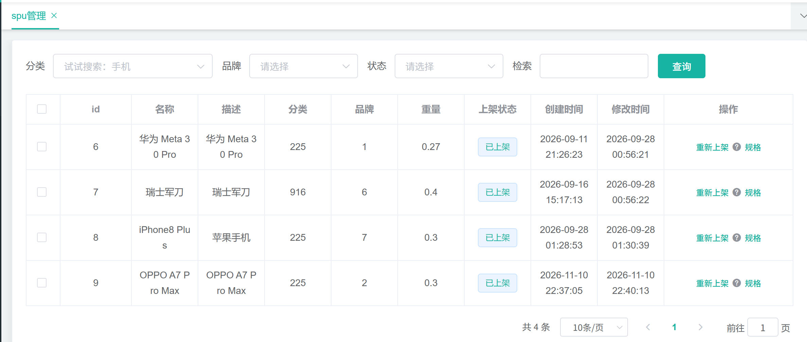
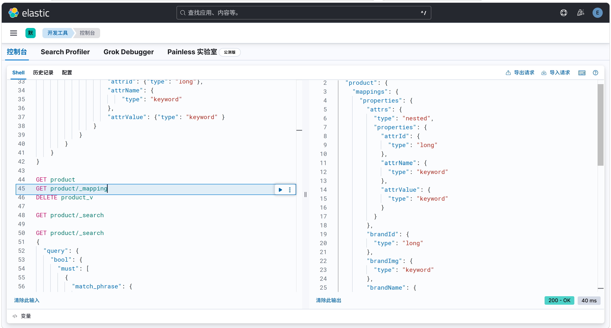
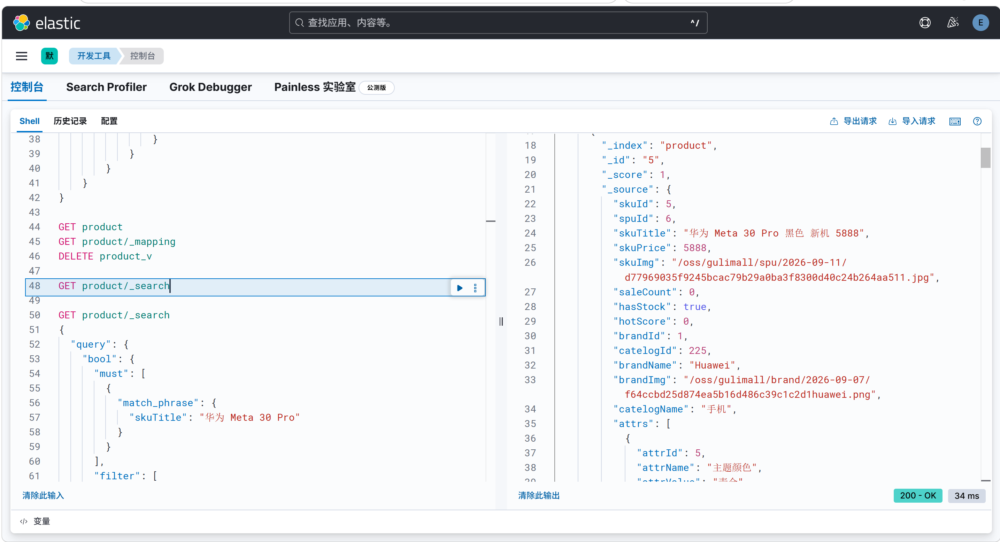
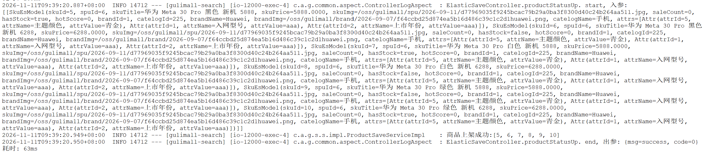

# 8.1 商品上架与 ES 索引-介绍

> 商品在 MySQL 里录入完成后，用户还搜不到。上架就是把 SPU 下的全部 SKU 组装成检索文档，写进 Elasticsearch 的 `product` 索引，并把 SPU 标记为已上架。本篇讲清这条链路的业务规则、索引设计、批量写入、跨服务调用和常见故障。

> ES 相关文档与配置：[ES 安装与运维](../ES/ES.md)、[ES 整合 Spring Boot](../ES/ES整合SpringBoot.md)、[ES 控制台脚本](../ES/ES-console.sh)、[elasticsearch.yml](../../deploy/es/config/elasticsearch.yml)、[IK 分词器](../../deploy/es/elasticsearch-analysis-ik-8.18.8.zip)、[kibana.yml](../../deploy/kibana/config/kibana.yml)。

---

## 1. 这个功能是干什么的

商品上架是把“商品域的数据”转成“搜索域的数据”。

商品录入时，数据写在 `gulimall_pms` 库：SPU 表、SKU 表、图片表、属性值表、品牌表、分类表。搜索页不查这些表，只查 Elasticsearch 的 `product` 索引。没有上架动作，商品就只存在于后台，前台搜索不到。

上架的实质是三步：

1. 按 `spuId` 找到这个 SPU 下的所有 SKU。
2. 每个 SKU 组装一条 `SkuEsModel`，补齐库存、品牌名、分类名、可检索属性。
3. 把整批文档写入 ES，写入成功后把 `pms_spu_info.publish_status` 改成 1。

索引 `product` 的文档粒度是 SKU，不是 SPU。用户在搜索页看到的每一张商品卡片，都是一个可独立下单的 SKU。这样搜索结果的图片、价格、库存都能直接对应到购物车里的商品。

上架在业务上有三个作用：

1. **进入搜索池**：只有写入 ES 的 SKU 才能被关键词、分类、品牌、属性检索到。
2. **建立筛选字段**：品牌、分类、价格区间、库存、规格属性都在上架时写进文档，搜索页的筛选栏依赖这些字段。
3. **提供列表快照**：搜索卡片需要的标题、价格、图片、品牌名、分类名都在文档里，搜索页不用再回 MySQL 拼接。

商品详情页则相反，它按 `skuId` 回 MySQL 查权威数据，并实时问库存。搜索页读 ES，详情页读 MySQL，这是两条不同的读链路。

---

## 2. 管理员怎么操作

入口：

```text
管理后台 → 商品系统 → spu管理
```

spu管理页按 SPU 展示，列表里有一条或多条商品记录，每条记录后面有“上架”按钮。



操作步骤：

1. 在spu管理页找到需要上架的商品，确认 `publish_status` 是“新建”或“未上架”。
2. 点击该商品的“上架”按钮。
3. 前端调用 `POST /product/spuinfo/{spuId}/up`。
4. 后端查这个 SPU 下的全部 SKU，逐条组装检索文档。
5. 后端通过 Feign 把文档批量发给 search 服务。
6. search 服务用 `BulkRequest` 写入 `product` 索引。
7. 写入成功后，product 服务更新 `pms_spu_info.publish_status=1`。
8. 前端提示上架成功，刷新列表后状态变成“已上架”。


重复上架是允许的。文档 id 固定为 `skuId`，同一个 SKU 再次上架会覆盖同一条文档，不会产生重复数据。管理员可以在商品信息修改后重新点一次“上架”，把最新数据写进 ES。

上架失败时，`publish_status` 不会更新，商品仍然停在未上架状态。管理员排查 search 服务、ES 连接或库存服务后，可以再次点击“上架”。

当前spu管理页只提供上架入口，下架链路没有在这个页面落地。`StatusEnum` 里有 `SPU_DOWN`，但它的编码与上架相同，具体问题写在第 7 节。

---

## 3. 整体设计思路

### 3.1 业务上怎么设计

#### 3.1.1 上架状态

`pms_spu_info.publish_status` 是 SPU 级别的上下架标记：

- `0`：新建或未上架。
- `1`：已上架。

状态只在 ES 写入成功后修改。这样做的原因是：ES 是搜索页的唯一数据源，如果先改状态再写 ES，ES 写失败时后台会显示“已上架”，但前台搜不到，排查时很难判断真实状态。

状态放在 SPU 上，而不是 SKU 上。一个 SPU 下的 SKU 一起上架，业务上不拆开。若以后需要按 SKU 单独控制，需要把状态下沉到 `pms_sku_info`。

#### 3.1.2 可检索属性白名单

SPU 的属性值存放在 `pms_product_attr_value`，属性定义在 `pms_attr`。不是所有属性都适合放进 ES：

- 规格参数可能很多，全量写入会让文档膨胀。
- 有些属性只用于详情页展示，不参与筛选。
- 只有 `pms_attr.search_type=1` 的属性才允许被检索。

上架时先查这个 SPU 的全部属性值，再用 `selectSearchAttrs(attrIds)` 查出可检索的 `attrId` 集合，最后在 Java 里过滤。过滤后的属性才放进 `SkuEsModel.attrs`。

这样做把“是否可检索”的配置留在属性表里，商品上架时不用改代码。运营在后台把某个属性的“可检索”打开，下次上架就会带上这个属性。

#### 3.1.3 库存快照

搜索页的“有货/无货”不是实时库存，而是上架时的快照。

上架时把所有 SKU 的 id 发给 ware 服务，ware 返回 `Map<skuId, Boolean>`：该 SKU 在所有仓库的可用库存之和是否大于 0。

这个结果写进 `hasStock` 字段。搜索页按 `hasStock=1` 过滤时，用的是这个快照。

业务上允许快照存在的原因是：库存变化频繁，如果搜索页每次都实时查库存，一次列表 20 条就要 20 次远程调用，搜索页会被库存服务拖垮。代价是上架后库存变化不会自动反映到搜索页，需要重新上架或增量同步。

库存服务调用失败时，上架流程不中断，所有 SKU 按“无货”处理。这样商品仍然能上架，搜索结果只是暂时显示无货，不会因为库存服务抖动导致整个上架失败。

#### 3.1.4 品牌分类冗余

`SkuEsModel` 里保存了 `brandName`、`brandImg`、`catelogName`。

这些字段在 MySQL 里可以通过 `brandId`、`catelogId` 关联查出来，但搜索页一次要渲染 20 张卡片，如果每条都回 MySQL 查品牌和分类，会形成 N+1 查询。

上架时把品牌名、品牌 logo、分类名一起写进文档，搜索页直接展示。筛选栏的品牌聚合和分类聚合也依赖这些字段。

冗余的代价是数据变更后需要重新上架。品牌改名、分类改名后，已有索引文档仍然是旧名字，直到重新上架或做增量同步。

#### 3.1.5 文档粒度与幂等

一个 SKU 一条文档，文档 id 用 `skuId`。

这样设计有三个好处：

1. 搜索结果是可下单的 SKU，价格、图片、库存都能直接对应购物车。
2. 重复上架是覆盖写，不会产生重复文档。
3. 增量同步时可以按 `skuId` 精确更新或删除。

如果按 SPU 建文档，一个 SPU 下多个 SKU 的价格、图片、库存就要塞进数组，搜索页还得在前端选 SKU，列表页会变复杂。

#### 3.1.6 同步双写的取舍

当前实现是 product 同步 Feign 调用 search，等 search 写完 ES 才更新状态。

优点：

1. 一致性好把握，上架接口返回成功时，ES 已经写完。
2. 失败能立即反馈给管理员，不需要等异步补偿。

缺点：

1. search 或 ES 慢时，上架接口会被拖慢。
2. search 挂掉时，上架直接失败。
3. 没有重试和补偿，网络抖动只能人工重新上架。
4. 上架后价格、库存、标题变化不会自动同步。

生产上更合适的方案是本地消息表加 MQ，或者用 Canal 订阅 binlog。当前实现适合学习链路，把同步双写作为最小可用版本。

### 3.2 技术上怎么设计

#### 3.2.1 索引与 mapping

索引名固定为 `product`，通过 `EsConstant.PRODUCT_INDEX` 引用。

mapping 预先用 `product-mapping.txt` 创建，不在代码里动态建索引。原因是动态映射会按第一条文档推断字段类型，价格可能被推断成 `float`，后面想改类型只能重建索引。

字段设计的关键点：

1. `skuTitle` 用 `text` 加 `ik_smart`，它是唯一参与全文检索的字段。
2. `skuPrice` 用 `keyword`，避免数值精度问题，但价格区间查询会变成字符串比较，这是当前 mapping 的已知取舍。
3. `brandId`、`catelogId`、`saleCount`、`hotScore` 用数值类型，支持排序和 `terms` 聚合。
4. `brandName`、`brandImg`、`catelogName`、`attrName` 用 `keyword`，保持可索引、可聚合。
5. `attrs` 用 `nested`，每个属性对象独立存储，避免跨对象匹配。

#### 3.2.2 Bulk 写入

search 侧用 `BulkRequest` 批量写入，每一条都是 `index` 操作：

- 索引名来自 `EsConstant.PRODUCT_INDEX`。
- 文档 id 是 `skuId.toString()`。
- 文档对象直接传 `SkuEsModel`，由 Jackson 序列化。

批量写入比逐条写入少很多网络往返。一个 SPU 可能有很多 SKU，批量写能把整批商品放在一次请求里。

写入后检查 `BulkResponse.errors()`。只要有任意一条失败，整个批量结果就按失败处理，product 侧不更新状态。

#### 3.2.3 Feign 同步

product 通过 `ElasticSaveFeignClient` 调用 search 的 `POST search/save/product`。

Feign 的返回类型是公共 `R`。product 只看 `r.getCode() == 0`：

- `0`：整批写入成功，更新 `publish_status`。
- 非 `0`：整批失败，保持未上架。

单条文档失败的原因由 search 侧记录日志。product 侧拿不到具体是哪条 SKU 失败，这是当前接口粒度的限制。

#### 3.2.4 ES 客户端

search 模块使用 Elasticsearch 官方 Java Client：

```text
RestClient（HTTP 连接、Basic 认证）
    → RestClientTransport（传输层）
    → JacksonJsonpMapper（JSON 序列化）
    → ElasticsearchClient（业务注入的客户端）
```

服务端开了 `xpack.security`，所以客户端必须带用户名和密码。

#### 3.2.5 索引创建约定

1. mapping 通过 `product-mapping.txt` 手工执行，应用启动时不做动态创建。
2. 索引名固定为 `product`，读写两侧都通过常量引用。
3. 需要改字段类型时，新建 `product_v2`，全量导入后切别名，不能直接修改已有字段类型。

---

## 4. 详细代码、配置和解释

本章沿上架调用链展开：先说明每个类或配置在链路中的位置、上游调用方和下游依赖，再给出关键字段与接口，再贴代码并逐段说明执行顺序和原因，最后用一次完整示例串起整条链路，并标出边界与可优化点。代码保留与上架直接相关的部分，基础 CRUD 和无关 import 不展开。

### 4.1 SpuInfoController：上架入口

#### 4.1.1 这个类解决什么问题

管理后台的 spu 管理页按 SPU 展示商品，每条记录后面有“上架”按钮。按钮最终要变成一个 HTTP 请求，交给 product 服务的上架逻辑。这个 Controller 是协议边界：接收请求、绑定路径参数、调用 Service、包装统一返回。

上游是管理后台前端。请求经 Nginx 和管理网关转发，网关去掉 `/gulimall` 前缀后进入 product 服务。下游是 `SpuInfoService.up`，查 SKU、查库存、组装文档、写 search、改状态都在 Service 里完成。Controller 不查库，也不判断商品是否满足上架条件。

#### 4.1.2 接口在链路中的位置

| 项 | 内容 |
|---|---|
| 调用方 | 管理后台 spu 管理页 |
| HTTP 方法与路径 | `POST /product/spuinfo/{spuId}/up` |
| 经过网关的路径 | `POST /gulimall/product/spuinfo/{spuId}/up` |
| 下游 | `SpuInfoServiceImpl.up(spuId)` |
| 返回 | 统一结果 `R`，`code=0` 表示请求处理完成 |

上架是状态变更，所以用 POST 而不是 GET。路径把动作 `up` 写在最后，`spuId` 放在路径里，和 spu 的列表、详情、保存接口共用 `product/spuinfo` 前缀。

#### 4.1.3 代码与解释

这一段是 HTTP 入口，只负责把 URL 里的 `spuId` 交给 Service，并把结果包成 `R`。

```java
@RestController
@RequestMapping("product/spuinfo")
public class SpuInfoController {
    @Autowired
    private SpuInfoService spuInfoService;

    /**
     * 商品上架
     */
    @PostMapping("/{spuId}/up")
    public R setUp(@PathVariable("spuId") Long spuId) {
        spuInfoService.up(spuId);
        return R.ok();
    }
}
```

1. `@RestController` 把返回值直接序列化成 JSON，不需要视图解析。
2. `@RequestMapping("product/spuinfo")` 定义类级前缀，下面的方法路径都相对这个前缀。
3. `@PostMapping("/{spuId}/up")` 把上架定义为 POST，路径变量用花括号声明；`up` 放在最后，读路径就能知道动作。
4. `@PathVariable("spuId")` 把 URL 中的 `spuId` 绑定到 `Long` 参数，Spring 负责类型转换。
5. `spuInfoService.up(spuId)` 是同步调用。请求线程会一直等待 SKU 查询、库存查询、search 写入和状态更新全部结束。
6. `return R.ok()` 只说明 Controller 没有捕获到异常。上架失败如果被 Service 吞掉，这里仍然返回成功；如果 Feign 抛异常，异常会向上抛出，最终由全局异常处理或容器返回错误。

#### 4.1.4 一次请求示例

管理员对 `spuId=1` 的商品点击“上架”：

```text
1. 浏览器发起 POST /gulimall/product/spuinfo/1/up
2. 网关匹配 product 路由，去掉 /gulimall 前缀
3. 请求进入 SpuInfoController.setUp
4. @PathVariable 把 spuId 绑定为 1
5. 调用 spuInfoService.up(1)，当前线程阻塞等待
6. up 内部完成查库、远程调用和 ES 写入
7. 没有异常时返回 R.ok()
8. 前端提示上架成功，重新请求 spu 列表
```

#### 4.1.5 它不做什么

1. 不校验权限。列表、修改、删除接口都有 `@RequiresPermissions`，上架接口没有。
2. 不判断 `spuId` 是否存在，也不判断这个 SPU 当前是不是已上架。
3. 不检查 SKU 列表是否为空，空列表会一路传到 search 侧。
4. 不返回写入的文档数量、失败 SKU 或失败原因，前端只能看到统一的 `R`。
5. 不做异步化，上架耗时直接等于整条链路的耗时。

#### 4.1.6 边界与可优化点

1. 生产环境应补 `@RequiresPermissions("product:spuinfo:up")`，避免任何能访问 product 服务的请求触发上架。
2. 应校验 `spuId` 非空、存在且属于当前操作者可见的品牌或店铺。
3. 重复点击会重复执行整条链路。写 ES 是覆盖写，但库存、品牌、分类查询会重复，状态更新也会重复。
4. 上架链路包含两次远程调用，接口耗时不稳定。管理端可以改成提交任务后轮询状态，避免 HTTP 请求长时间挂起。

### 4.2 SpuInfoServiceImpl.up：上架主流程

#### 4.2.1 这个方法解决什么问题

商品在 MySQL 里以 SPU 和 SKU 两层存储：SPU 描述“这是一款什么商品”，SKU 描述“这个商品的具体规格和价格”。搜索页展示的每一张卡片对应一个可下单的 SKU，所以上架要把一个 SPU 下的全部 SKU 转成检索文档。

这个方法负责整条组装链路：查 SKU、查库存快照、筛可检索属性、补品牌名和分类名、拼成 `SkuEsModel`、通过 Feign 写给 search、在写入成功后修改 SPU 状态。上游是 `SpuInfoController.setUp`，下游包括 product 库、ware 服务和 search 服务。

#### 4.2.2 正常链路

```text
SpuInfoController.setUp(spuId)
  → getSkuBySpuId(spuId)                     查 pms_sku_info
  → WareSkuFeignClient.hasStock(skuIds)      查 gulimall-ware
  → baseAttrListForSpu(spuId)                查 pms_product_attr_value
  → selectSearchAttrs(attrIds)               查 pms_attr.search_type=1
  → 逐 SKU 组装 SkuEsModel                   循环内查 pms_brand、pms_category
  → ElasticSaveFeignClient.productStatusUp   调 gulimall-search
  → ProductSaveServiceImpl 写 ES product 索引
  → updateSpuStatus(spuId, 1)                改 pms_spu_info.publish_status
```

整条链路有三次数据库查询组、两次 Feign 调用和一次状态更新。库存查询失败不阻断流程，search 写入失败会阻断状态更新。

#### 4.2.3 关键数据

| 数据 | 来源 | 作用 |
|---|---|---|
| `List<SkuInfoEntity>` | `pms_sku_info` | 上架的输入，一个 SPU 下可能有多条 |
| `Map<Long, Boolean> hasStock` | ware 服务 | SKU 是否有货的快照，写入文档的 `hasStock` |
| `List<ProductAttrValueEntity>` | `pms_product_attr_value` | SPU 级属性值，包含可检索和仅展示的属性 |
| `List<Long> searchAttrIds` | `pms_attr` | 可检索属性白名单，`search_type=1` |
| `List<Attr>` | 内存过滤 | 文档里的 `attrs` 数组，所有 SKU 共用 |
| `List<SkuEsModel>` | 内存组装 | 发给 search 的整批文档 |
| `R.code` | search 返回 | `0` 表示整批写入成功，其他值表示失败 |

#### 4.2.4 代码与解释

下面这段代码按“查 SKU → 查库存 → 查属性白名单 → 组装文档 → 写 search → 改状态”的顺序执行，每一步的失败策略不同。

```java
@Override
public void up(Long spuId) {

    // 1.查询当前spu对应的所有sku信息
    List<SkuInfoEntity> skuInfoEntityList = skuInfoService.getSkuBySpuId(spuId);

    // 2.1 远程调用ware库存系统，查询是否有库存
    Map<Long, Boolean> hasStock = null;
    try {
        hasStock = wareSkuFeignClient.hasStock(
                skuInfoEntityList.stream().map(SkuInfoEntity::getSkuId).toList());
    } catch (Exception e) {
        log.error("库存服务查询异常，原因：", e);
    }

    // 2.4 查询当前sku所有可被检索的规格属性
    List<ProductAttrValueEntity> productAttrValueEntityList = productAttrValueMethod.baseAttrListForSpu(spuId);
    List<Long> attrIds = productAttrValueEntityList.stream().map(ProductAttrValueEntity::getAttrId).toList();
    List<Long> searchAttrIds = productAttrValueMethod.selectSearchAttrs(attrIds);
    Set<Long> sIds = new HashSet<>(searchAttrIds);
    List<Attr> searchlist = productAttrValueEntityList.stream()
            .filter(attr -> sIds.contains(attr.getAttrId()))
            .map(item -> {
                Attr attr = new Attr();
                BeanUtils.copyProperties(item, attr);
                return attr;
            })
            .toList();

    // 2.封装sku信息
    Map<Long, Boolean> finalHasStock = hasStock;
    List<SkuEsModel> skuEsModelList = skuInfoEntityList.stream().map(skuInfo -> {
                SkuEsModel skuEsModel = new SkuEsModel();
                BeanUtils.copyProperties(skuInfo, skuEsModel);
                skuEsModel.setSkuPrice(skuInfo.getPrice());
                skuEsModel.setSkuImg(skuInfo.getSkuDefaultImg());
                // 2.1 查询失败设置为false没有库存
                skuEsModel.setHasStock(finalHasStock != null ? finalHasStock.get(skuInfo.getSkuId()) : false);
                // 2.2 热度评分 默认0
                skuEsModel.setHotScore(0L);
                // 2.3 查询品牌和分类的名字信息
                BrandEntity brandEntity = brandService.getById(skuInfo.getBrandId());
                skuEsModel.setBrandName(brandEntity.getName());
                skuEsModel.setBrandImg(brandEntity.getLogo());
                CategoryEntity categoryEntity = categoryService.getById(skuInfo.getCatelogId());
                skuEsModel.setCatelogName(categoryEntity.getName());
                // 2.4
                skuEsModel.setAttrs(searchlist);

                return skuEsModel;
            }
    ).toList();

    // 3.数据发送给ES保存
    R r = elasticSaveFeignClient.productStatusUp(skuEsModelList);
    if (r.getCode() == 0) {
        // 成功
        // 4.修改当前spu状态
        baseMapper.updateSpuStatus(spuId, StatusEnum.SPU_UP.getCode());
    } else {
        // 失败
        // TODO 重复调用？接口幂等性；重试机制
        /*
          1、构造请求数据，将对象转为json;
          RequestTemplate template = buildTemplateFromArgs.create(argv);
          2、发送请求进行执行（执行成功会解码响应数据）：
          executeAndDecode（template）;
          3、执行请求会有重试机制
          while(true)(
            try{
                executeAndDecode（template）;
            } catch() {
                try{
                    retryer.continueOrPropagate(e);
                } catch () {
                    throw ex;
                }
                continue;
            }
         */
    }

}
```

1. `getSkuBySpuId(spuId)` 是唯一一次 SKU 查询，返回这个 SPU 下的全部 SKU。没有 SKU 时返回空列表，后面会构造一个空的批量请求。
2. 从 SKU 列表提取 `skuId`，一次远程调用 `hasStock` 把整批 SKU 发给 ware。ware 按 SKU 汇总所有仓库的可用库存，返回 `skuId → 是否大于 0`。
3. 库存调用被 `try/catch` 包住。远程失败时只记日志，`hasStock` 保持 `null`，上架继续。这样做的原因是库存只是搜索页的筛选和展示字段，不应该让库存服务抖动阻断商品上架；代价是该次上架的所有 SKU 都会按无货写入。
4. `baseAttrListForSpu(spuId)` 查这个 SPU 的全部属性值。属性值表按 `spu_id` 关联，查询结果里既有参与检索的规格，也有只用于详情页展示的参数。
5. `selectSearchAttrs(attrIds)` 拿全部属性 id 去 `pms_attr` 换回可检索的 id。只有 `search_type=1` 的属性会返回。
6. `new HashSet<>(searchAttrIds)` 把白名单转成集合，后面的 `contains` 判断是 O(1)，避免每个属性都遍历一次列表。
7. 用白名单过滤属性值，再用 `BeanUtils.copyProperties` 复制成 `Attr`。过滤掉的是不可检索属性，保留的进入文档的 `attrs`。这份列表是 SPU 级的，所有 SKU 共用同一个引用。
8. `finalHasStock` 是 `hasStock` 的别名。lambda 只能捕获 effectively final 的局部变量，而 `hasStock` 在 try/catch 里被重新赋值，直接捕获会编译失败。
9. 遍历 SKU，先 `BeanUtils.copyProperties` 复制 `skuId`、`spuId`、`skuTitle`、`saleCount`、`brandId`、`catelogId` 等同名字段。
10. 再单独补 `skuPrice` 和 `skuImg`，因为实体字段是 `price`、`skuDefaultImg`，文档字段是 `skuPrice`、`skuImg`，名字对不上，自动复制不会生效。
11. `hasStock` 分两种情况：库存调用失败时 `finalHasStock` 为 `null`，写 `false`；调用成功时从 map 取当前 SKU 的结果。map 缺少某个 `skuId` 时 `get` 返回 `null`，三元表达式会拆箱成 `boolean` 并抛空指针，这是当前实现的隐患。
12. `hotScore` 固定写 0，销量 `saleCount` 来自 SKU 表。热度排序需要的点击、转化、收藏数据还没有接入，所以排序字段暂时是占位值。
13. 每个 SKU 在循环里查一次品牌、一次分类，补 `brandName`、`brandImg`、`catelogName`。品牌或分类被删除时 `getById` 返回 `null`，紧接着的 `getName()` 会抛空指针，整个上架失败。
14. `setAttrs(searchlist)` 把同一份属性列表挂到每个 SKU 上。属性是 SPU 级的，这样做语义正确；但所有文档共享同一个对象引用，后续如果按 SKU 修改属性，需要先复制。
15. `elasticSaveFeignClient.productStatusUp(skuEsModelList)` 把整批文档同步发给 search。product 线程会等待 search 完成 Bulk 写入并返回结果。
16. `r.getCode() == 0` 时才调用 `baseMapper.updateSpuStatus` 改状态。非 0 分支只有 TODO，没有重试、补偿、告警；状态更新和 ES 写入也不在同一个事务里。

#### 4.2.5 一次完整示例

SPU 1 下有 2 个 SKU，属性有颜色和内存，只有颜色配置为可检索：

```text
1. getSkuBySpuId(1) 返回 skuId=11、skuId=12
2. hasStock 收到 [11, 12]，返回 {11=true, 12=false}
3. baseAttrListForSpu(1) 返回 颜色=亮黑色、内存=6GB
4. selectSearchAttrs([5, 6]) 返回 [5]，只有颜色可检索
5. 过滤后 searchlist = [Attr(5, 颜色, 亮黑色)]
6. 组装 SKU 11：
   skuTitle=华为 Mate 10 6GB+128GB 亮黑色
   skuPrice=4499.00，skuImg=默认图
   hasStock=true，hotScore=0
   brandName=华为，catelogName=智能手机
   attrs=[颜色=亮黑色]
7. 组装 SKU 12：价格、图片、品牌、分类同理，hasStock=false
8. Feign 把 2 条文档发给 search
9. ProductSaveServiceImpl 执行 2 条 index 操作，文档 id 分别是 11、12
10. ES 返回 errors=false，Controller 返回 R.ok()
11. up 看到 code=0，执行 UPDATE pms_spu_info SET publish_status=1 WHERE id=1
12. 管理端刷新列表，SPU 1 显示已上架
```

#### 4.2.6 它不做什么

1. 不拆分批次。一个 SPU 下 SKU 很多时，整批文档放在一次 Feign 请求里。
2. 不做增量同步。上架只做全量重建，上架后价格、库存、标题变化不会自动写回 ES。
3. 不计算热度，也不维护销量。`hotScore` 写 0，`saleCount` 直接取 SKU 表当前值。
4. 不保证跨服务事务。ES 写入和状态更新是两次独立操作，没有本地事务能同时覆盖。
5. 不重试、不补偿、不告警。失败分支只留下 TODO。
6. 不校验库存 map 的完整性，也不校验品牌、分类是否存在。

#### 4.2.7 边界与可优化点

1. `finalHasStock.get(skuInfo.getSkuId())` 在 map 缺 key 时返回 `null`，自动拆箱会抛空指针。应改成 `Boolean.TRUE.equals(finalHasStock.get(skuId))`，或者给缺失 key 补默认值。
2. `brandEntity`、`categoryEntity` 没有判空。品牌或分类被删除后，`getName()` 会中断整批上架。应判空并给默认名称，或者提前批量校验。
3. SKU 列表为空时仍会调用 search。`BulkRequest` 没有任何 operation，ES 可能返回参数错误。应在方法入口判断空列表并直接返回。
4. 品牌和分类在 SKU 循环里逐个查询，复杂度是 2N 次数据库往返。可以先收集 `brandId`、`catelogId`，各查一次并转成 `Map`，把 2N 次降为 2 次。
5. ES 写入成功但状态更新失败时，ES 已有文档、后台仍显示未上架。重新上架可以修复，但生产环境应有补偿任务或本地消息表。
6. `up` 没有 `@Transactional`，也覆盖不了 search 和 ES。应把状态更新做成可重试的最终一致操作，而不是依赖一次同步调用。
7. Feign 默认读超时 5 秒。SKU 多或 ES 慢时，product 侧会先超时，search 侧可能仍在写入，形成状态不一致。应按批拆分，并给写索引接口单独配置更长超时。
8. 全量重建适合商品量小的场景。生产环境更常见的是上架发消息、search 消费后写 ES，或者用 Canal 订阅 binlog 做增量同步。

### 4.3 上架用到的查询与远程接口

#### 4.3.1 这些查询解决什么问题

`up` 方法本身只做编排，真正的数据来自四个能力：按 SPU 查 SKU、查 SPU 属性值、查可检索属性 id、查库存。四个能力的调用顺序就是数据依赖顺序：先有 SKU 才能查库存，先有属性值才能筛白名单。四个能力分别对应一张表或一个远程服务，任何一个返回空或失败，组装出的文档都会不完整。

#### 4.3.2 按 SPU 查 SKU

这个查询解决的是上架输入问题：文档粒度是 SKU，第一步必须拿到这个 SPU 下的全部可售单元。这个方法被 `up` 调用，数据来自 `pms_sku_info`。

```java
@Override
public List<SkuInfoEntity> getSkuBySpuId(Long spuId) {
    return this.list(new QueryWrapper<SkuInfoEntity>().eq("spu_id", spuId));
}
```

1. `this.list(...)` 是 MyBatis-Plus 的通用列表查询，不需要手写 SQL。
2. `new QueryWrapper<SkuInfoEntity>().eq("spu_id", spuId)` 生成 `WHERE spu_id = ?`，`spuId` 作为参数传入，不存在拼接注入。
3. 返回列表而不是单个对象。没有匹配记录时返回空列表，不会返回 `null`。
4. 查询取实体全部字段。上架只需要 `skuId`、`spuId`、`skuTitle`、`price`、`skuDefaultImg`、`saleCount`、`brandId`、`catelogId`，其余字段也会一并查出来。

实际执行的 SQL 类似：

```sql
SELECT sku_id, spu_id, sku_name, sku_desc, catelog_id, brand_id,
       sku_default_img, sku_title, sku_subtitle, price, sale_count
FROM pms_sku_info
WHERE spu_id = 1;
```

边界：查询没有过滤上下架状态，也没有排序。一个 SPU 下 SKU 很多时，列表会一次性全部加载到内存；生产环境可以只查上架需要的列，并按批处理。

#### 4.3.3 查 SPU 属性值

这个查询解决的是属性来源问题：搜索页的规格筛选依赖属性，属性值按 SPU 存储。这个方法被 `up` 调用，数据来自 `pms_product_attr_value`。

```java
public List<ProductAttrValueEntity> baseAttrListForSpu(Long spuId) {
    return productAttrValueDao.selectList(
            new QueryWrapper<ProductAttrValueEntity>().eq("spu_id", spuId));
}
```

1. `productAttrValueDao.selectList(...)` 直接走 DAO，不经过 Service，避免 `up` 所在的 Service 再依赖属性值 Service 形成环。
2. `eq("spu_id", spuId)` 限定当前 SPU，一个 SPU 可以有多条属性值。
3. 返回结果既包含可检索属性，也包含只用于详情页展示的属性，过滤动作留给下一步的白名单。
4. 查询按主键表全字段返回，没有分页，也没有排序。

边界：属性值表没有 `search_type` 字段，是否可检索由属性定义表决定，所以必须再查一次 `pms_attr`。如果 SPU 属性很多，返回列表会比较大，可以在 SQL 层只查 `attr_id`、`attr_name`、`attr_value`。

#### 4.3.4 查可检索属性 id

这个查询解决的是属性范围问题：不是所有属性都应该进入 ES。规格参数全部写入会让文档膨胀，也会让筛选栏出现大量无意义选项。可检索开关配置在 `pms_attr.search_type`，这个方法负责把属性 id 列表换成白名单。

`ProductAttrValueMethod` 只做转发，真正的 SQL 在 `AttrDao.xml`：

```java
public List<Long> selectSearchAttrs(List<Long> attrIds) {
    return attrDao.selectSearchAttrs(attrIds);
}
```

```xml
<select id="selectSearchAttrs" resultType="java.lang.Long">
    SELECT a.attr_id
    FROM pms_attr a
    WHERE a.attr_id IN
    <foreach collection="attrIds" item="attrId" separator="," open="(" close=")">
        #{attrId}
    </foreach>
    AND a.search_type = 1
</select>
```

1. `selectSearchAttrs(attrIds)` 把当前 SPU 的全部属性 id 交给 DAO。
2. `foreach` 把列表展开成 `IN (?, ?, ...)`，每个 id 一个占位符。
3. `AND a.search_type = 1` 只保留可检索属性。`search_type` 为 0 的属性只用于详情页展示。
4. `resultType="java.lang.Long"` 表示只返回 `attr_id` 一列，不返回整行。
5. 返回的 id 列表在 `up` 里转成 `HashSet`，用于过滤属性值。

示例：属性 id 是 `[5, 6, 7]`，`pms_attr` 中 5 和 6 的 `search_type=1`，7 是 0，返回 `[5, 6]`。

边界：`attrIds` 为空时，`foreach` 会生成 `IN ()`，SQL 语法错误。调用方应先判断空集合，空集合直接返回空列表。`attrIds` 很大时，`IN` 列表会很长，可以分批查询。`pms_attr(attr_id, search_type)` 上有索引时，这个查询很快。

#### 4.3.5 库存查询 Feign

这个查询解决的是库存快照问题：搜索页的“有货/无货”不是实时库存，而是上架时的快照，`up` 把所有 SKU id 一次发给 ware，ware 汇总每个 SKU 在所有仓库的可用库存，返回布尔值。

```java
@FeignClient("gulimall-ware")
public interface WareSkuFeignClient {

    @PostMapping("ware/waresku/hasStock")
    Map<Long, Boolean> hasStock(@RequestBody List<Long> skuIds);

    /**
     * 查询 SKU 可发货的仓库及可用库存。
     */
    @PostMapping("ware/wareinfo/shippingFrom")
    List<SkuShippingFromVo> getShippingFrom(@RequestBody List<FareRequestVo.Item> items);

}
```

1. `@FeignClient("gulimall-ware")` 按服务名寻址，Nacos 中注册的 ware 实例参与负载均衡，代码里不出现 IP 和端口。
2. `@PostMapping("ware/waresku/hasStock")` 对应 ware 侧 `WareSkuController.hasStock`，请求体是 SKU id 列表。
3. 返回 `Map<Long, Boolean>`，key 是 `skuId`，value 是该 SKU 所有仓库可用库存之和是否大于 0。
4. `getShippingFrom` 是商品详情页计算运费和发货仓时使用的接口，上架链路只调用 `hasStock`。
5. OpenFeign 的默认读超时由 `config/common.yaml` 统一配置为 5 秒，库存查询和 search 写入共用这个超时。

一次调用的请求和响应：

```text
POST /ware/waresku/hasStock
请求体：[11, 12, 13]
响应体：{"11": true, "12": false, "13": true}
```

边界：一个 SPU 的 SKU 很多时，请求体会变大，Feign 和 HTTP 层都有限制。库存服务失败时 `up` 捕获异常并按全部无货处理，搜索页会暂时全部显示无货。返回的 map 可能缺少某个 `skuId`，调用方必须防止空指针。

### 4.4 SkuEsModel 与 Attr：跨模块文档模型

#### 4.4.1 这个类解决什么问题

product 负责组装文档，search 负责写入和查询文档。两边如果各自定义一份模型，字段改名时容易只改一边，运行期才暴露问题。`SkuEsModel` 放在 `gulimall-api`，同时作为 Feign 请求体和 ES 文档结构，两个服务引用同一个类。

上游是 `SpuInfoServiceImpl.up`，负责逐字段填值；下游是 `ElasticSaveFeignClient`、`ProductSaveServiceImpl` 和搜索查询服务。Jackson 按字段名把对象序列化成 JSON，ES 再按 mapping 解释字段。

#### 4.4.2 字段与索引映射

| 字段 | 数据来源 | ES 类型 | 用途 |
|---|---|---|---|
| `skuId` | `pms_sku_info.sku_id` | `long` | 文档 id，详情页跳转参数 |
| `spuId` | `pms_sku_info.spu_id` | `keyword` | 回溯 SPU，搜索页不展示 |
| `skuTitle` | `pms_sku_info.sku_title` | `text` + `ik_smart` | 全文检索和高亮 |
| `skuPrice` | `pms_sku_info.price` | `keyword` | 价格展示和区间过滤 |
| `skuImg` | `pms_sku_info.sku_default_img` | `keyword` | 列表主图 |
| `saleCount` | `pms_sku_info.sale_count` | `long` | 销量排序 |
| `hasStock` | ware 库存快照 | `boolean` | 有货筛选 |
| `hotScore` | 固定 0 | `long` | 综合排序 |
| `brandId` | `pms_sku_info.brand_id` | `long` | 品牌过滤和聚合 |
| `catelogId` | `pms_sku_info.catelog_id` | `long` | 分类过滤和聚合 |
| `brandName` | `pms_brand.name` | `keyword` | 卡片展示、品牌聚合 |
| `brandImg` | `pms_brand.logo` | `keyword` | 卡片展示 |
| `catelogName` | `pms_category.name` | `keyword` | 面包屑、分类聚合 |
| `attrs` | `pms_product_attr_value` | `nested` | 规格筛选 |

#### 4.4.3 代码与解释

文档模型本身没有业务逻辑，只有字段。字段名必须和 `product-mapping.txt` 完全一致，否则 ES 会按动态映射处理。

```java
@Data
public class SkuEsModel {
    private Long skuId;
    private Long spuId;
    private String skuTitle;
    private BigDecimal skuPrice;
    private String skuImg;
    private Long saleCount;
    private boolean hasStock;
    private Long hotScore;
    private Long brandId;
    private Long catelogId;
    private String brandName;
    private String brandImg;
    private String catelogName;
    private List<Attr> attrs;
}
```

嵌套属性对象定义在同一个 API 模块：

```java
@Data
public class Attr{
    private Long attrId;
    private String attrName;
    private String attrValue;
}
```

1. `@Data` 生成 getter、setter、`toString`、`equals`、`hashCode`，序列化和单元测试都依赖这些方法。
2. `skuId` 用 `Long`，写入 ES 时在 `ProductSaveServiceImpl` 里转成字符串作为文档 id。
3. `spuId` 在 mapping 里是 `keyword`，Java 侧却是 `Long`。Jackson 会序列化成数字，ES 接受数字并转成字符串，语义上只用于精确匹配。
4. `skuPrice` 用 `BigDecimal`，避免 Java 侧浮点误差。写入 ES 后映射为 `keyword`，展示没问题，但范围查询会按字符串比较。
5. `hasStock` 用基本类型 `boolean`，JSON 里一定是 `true` 或 `false`，不会出现 `null`。这要求组装时不能把 `null` 直接赋给它。
6. `attrs` 是 `List<Attr>`，对应 mapping 里的 `nested`。每个 `Attr` 对象独立存储，查询时可以要求多个条件命中同一个对象。
7. `Attr` 的 `attrId`、`attrName`、`attrValue` 与属性值表字段同名，`BeanUtils.copyProperties` 可以直接复制。
8. 两个类都没有加 Jackson 注解，字段名就是 JSON 字段名，和 mapping 一一对应。

#### 4.4.4 一次序列化示例

```json
{
  "skuId": 11,
  "spuId": 1,
  "skuTitle": "华为 HUAWEI Mate 10 6GB+128GB 亮黑色",
  "skuPrice": 4499.00,
  "skuImg": "https://gulimall-oss.oss-cn-xxx.aliyuncs.com/xxx.jpg",
  "saleCount": 0,
  "hasStock": true,
  "hotScore": 0,
  "brandId": 1,
  "catelogId": 225,
  "brandName": "华为",
  "brandImg": "https://gulimall-oss.oss-cn-xxx.aliyuncs.com/brand.png",
  "catelogName": "智能手机",
  "attrs": [
    { "attrId": 5, "attrName": "颜色", "attrValue": "亮黑色" }
  ]
}
```

#### 4.4.5 边界与可优化点

1. `skuPrice` 用 `BigDecimal` 写入 `keyword`，精度安全但排序和范围查询都变成字符串比较。长期应改成以“分”为单位的 `long`。
2. `hasStock` 是基本类型，组装时任何 `null` 都会在赋值阶段抛空指针。调用方必须先把 `null` 转成 `false`。
3. `hotScore` 当前固定 0，综合排序没有实际效果。可以接离线任务，用销量、点击、转化率计算。
4. `saleCount` 直接取 SKU 表当前值，但下单后没有同步更新，搜索页销量会滞后。
5. 文档没有 `createTime`、`updateTime`、`publishStatus`，排查数据新旧和做增量同步时缺少依据。
6. 模型没有参数校验注解，`skuId`、`skuTitle`、`brandId` 为空时只能在 ES 写入阶段暴露。

### 4.5 ElasticSaveFeignClient：product 调 search

#### 4.5.1 这个接口解决什么问题

product 服务不能把 search 的地址写死在代码里，实例扩缩容后地址会变。这个 Feign 接口声明“调用 search 的哪个路径、传什么、返回什么”，由 OpenFeign 结合 Nacos 完成服务发现、负载均衡和 JSON 序列化。

上游是 `SpuInfoServiceImpl.up`，下游是 search 的 `ElasticSaveController`。接口没有实现类，方法签名就是双方的服务契约。

#### 4.5.2 代码与解释

这一段声明跨服务写入入口，方法名表达的是“更新商品上架状态”，实际动作是批量写 ES 文档。

```java
@FeignClient("gulimall-search")
public interface ElasticSaveFeignClient {

    @PostMapping("search/save/product")
    R productStatusUp(@RequestBody List<SkuEsModel> skuEsModels);

}
```

1. `@FeignClient("gulimall-search")` 指定目标服务名。Nacos 里有多个 search 实例时，Feign 默认按轮询负载均衡。
2. `@PostMapping("search/save/product")` 声明相对路径。路径没有前导 `/`，Feign 会按服务地址拼成 `search/save/product`。
3. `@RequestBody List<SkuEsModel>` 表示整个列表作为 JSON 请求体，由 Jackson 序列化。
4. 返回类型是公共 `R`，product 只关心 `code`，不解析 search 的内部数据结构。
5. 方法没有声明 `throws`，Feign 的调用异常会以运行时异常向上抛，由 `up` 的调用方或全局异常处理接管。

#### 4.5.3 一次调用示例

```text
product 侧调用 productStatusUp([doc11, doc12])
  → Feign 从 Nacos 取 gulimall-search 实例
  → POST http://search实例:端口/search/save/product
  → 请求体是两条文档的 JSON 数组
  → search 返回 {"code":0,"msg":"success"}
  → Feign 反序列化成 R
  → up 判断 r.getCode() == 0
```

#### 4.5.4 边界与可优化点

1. 整批文档放在一个请求里，SKU 多时会超过 Feign 或 HTTP 层限制，应按每批 500 条左右拆分。
2. 写 ES 比读接口慢，默认 5 秒读超时可能不够。应给这个客户端单独配置连接超时和读超时。
3. 没有重试。文档 id 是 `skuId`，重试是安全的覆盖写，可以增加有限次重试。
4. 没有降级。search 不可用时上架直接失败，可以改成写本地消息表后异步重试。
5. 返回值只有整批的 `code`，拿不到失败 SKU 列表，排查要依赖 search 日志。

### 4.6 ElasticSaveController：search 侧的接收入口

#### 4.6.1 这个类解决什么问题

search 服务需要一个 HTTP 入口接收 product 发来的文档。这个 Controller 负责反序列化请求体、调用写入 Service、把布尔结果转换成统一 `R`，并在异常时返回固定业务错误码。

上游是 product 的 `ElasticSaveFeignClient`，下游是 `ProductSaveService.productStatusUp`。ES 客户端、Bulk 请求、失败明细都在 Service 里，Controller 不直接接触 ES。

#### 4.6.2 代码与解释

这一段是 search 侧的协议边界，重点是异常和布尔返回值的转换。

```java
@RequestMapping("search/save")
@RestController
@Slf4j
public class ElasticSaveController {

    @Autowired
    private ProductSaveService productSaveService;

    @PostMapping("/product")
    public R productStatusUp(@RequestBody List<SkuEsModel> skuEsModels) {
        boolean b = false;
        try {
            b = productSaveService.productStatusUp(skuEsModels);
        } catch (Exception e) {
            log.error("ElasticSaveController商品上架错误", e);
            return R.error(BizCodeEnum.PRODUCT_UP_EXCEPTION.getCode(), BizCodeEnum.PRODUCT_UP_EXCEPTION.getMsg());
        }
        if (!b) {
            return R.ok();
        } else {
            return R.error(BizCodeEnum.PRODUCT_UP_EXCEPTION.getCode(), BizCodeEnum.PRODUCT_UP_EXCEPTION.getMsg());
        }
    }

}
```

1. `@RequestMapping("search/save")` 定义前缀，和 Feign 声明的路径一致。
2. `@PostMapping("/product")` 对应 `search/save/product`，方法只接受 POST。
3. `@RequestBody List<SkuEsModel>` 把 JSON 数组反序列化成文档列表，字段名必须和 `SkuEsModel` 一致。
4. `boolean b = false` 是默认值，Service 正常返回后会覆盖它。
5. `try/catch` 包住 Service 调用。`ProductSaveServiceImpl` 声明的 `IOException` 和其他运行时异常都在这里转成 `PRODUCT_UP_EXCEPTION`，避免异常直接变成 500 页面。
6. `if (!b)` 判断的是“是否有失败”。`b=false` 表示全部成功，返回 `R.ok()`；`b=true` 表示至少一条失败，返回错误码。
7. 错误码 `10002` 和文案“商品上架异常”来自 `BizCodeEnum`，product 侧按 `code != 0` 判断失败。

#### 4.6.3 一次请求与返回示例

全部成功：

```text
POST /search/save/product
请求体：[{"skuId":11,...},{"skuId":12,...}]
Service 返回 false
响应：{"code":0,"msg":"success"}
```

部分失败：

```text
Service 发现至少一条 item.error() 非空，返回 true
响应：{"code":10002,"msg":"商品上架异常"}
product 侧不更新 publish_status
```

#### 4.6.4 它不做什么

1. 不构造 Bulk 请求，不决定索引名和文档 id。
2. 不解析每一条失败原因，只把整批失败转成一个错误码。
3. 不校验请求体是否为空，也不限制批量大小。
4. 不做内部鉴权，任何能访问 search 服务的请求都能写索引。

#### 4.6.5 边界与可优化点

1. 布尔返回值的语义是“有失败”，判断写成 `!b`，可读性差且容易写反。可以返回失败条数或专门的响应对象。
2. 单条失败原因没有回传，product 只能看到整批失败。响应里可以带失败 `skuId` 列表。
3. `catch (Exception e)` 捕获过宽，参数错误、序列化错误和 ES 故障都变成同一个错误码，排查困难。
4. 接口没有鉴权，生产环境应校验内部调用凭证或放在不对外暴露的内网端口。
5. 没有空列表保护。空数组会继续传到 ES，可能返回参数错误。

### 4.7 ProductSaveServiceImpl：Bulk 批量写入

#### 4.7.1 这个类解决什么问题

一个 SPU 下可能有很多 SKU，逐条写 ES 会产生同样多的网络往返。这个类把整批文档组装成一个 `BulkRequest`，一次 HTTP 请求写入 `product` 索引，再逐条检查返回结果。

上游是 `ElasticSaveController`，下游是 Elasticsearch。写入的粒度是文档，文档 id 用 `skuId`，所以重复上架是覆盖写而不是新增。

#### 4.7.2 关键概念

| 概念 | 含义 |
|---|---|
| `BulkRequest.Builder` | 批量请求构造器，一次可以放多条操作 |
| `operations(op -> op.index(...))` | 添加一条 `index` 操作，存在则覆盖，不存在则创建 |
| `index(EsConstant.PRODUCT_INDEX)` | 指定目标索引 `product` |
| `id(skuId.toString())` | 指定文档 id，保证同一 SKU 只有一条文档 |
| `document(skuEsModel)` | 指定文档内容，由 Jackson 序列化 |
| `BulkResponse.errors()` | 整批是否有任意一条失败 |
| `BulkResponseItem.error()` | 单条失败原因，成功时为 `null` |

#### 4.7.3 代码与解释

这一段执行真正的 ES 写入，并把“整批成功/有失败”转换成布尔值返回给 Controller。

```java
@Service("productSaveService")
@Slf4j
public class ProductSaveServiceImpl implements ProductSaveService {

    @Autowired
    private ElasticsearchClient elasticsearchClient;

    // GET product/_search
    @Override
    public boolean productStatusUp(List<SkuEsModel> skuEsModels) throws IOException {

        // 1、索引 mapping 要【预先建好】（见 product-mapping.txt），不要在代码里动态建

        // 2、批量保存：新客户端用 BulkRequest.Builder + 一组 operation
        BulkRequest.Builder br = new BulkRequest.Builder();
        for (SkuEsModel skuEsModel : skuEsModels) {
            br.operations(op -> op.index(idx -> idx
                    .index(EsConstant.PRODUCT_INDEX)          // 索引名
                    .id(skuEsModel.getSkuId().toString())     // 用 skuId 作为文档 id
                    .document(skuEsModel)                     // 直接传对象，Jackson 自动序列化
            ));
        }

        // 3、执行
        BulkResponse result = elasticsearchClient.bulk(br.build());

        // 4、检查结果
        if (result.errors()) {
            log.error("商品上架出错：");
            for (BulkResponseItem item : result.items()) {
                if (item.error() != null) {
                    log.error("skuId={} 上架失败，原因：{}", item.id(), item.error().reason());
                }
            }
            return true;    // 有失败
        }

        List<String> ids = result.items().stream()
                .map(BulkResponseItem::id)
                .collect(Collectors.toList());
        log.info("商品上架成功:{}", ids);
        return false;       // 全部成功
    }
}
```

1. 方法声明 `throws IOException`。`elasticsearchClient.bulk(...)` 在连接失败、序列化失败时抛受检异常，交给 Controller 统一转成业务错误。
2. 创建 `BulkRequest.Builder`，后面所有操作都挂在这个构造器上。
3. 遍历文档列表，每个 `SkuEsModel` 添加一条 `index` 操作。`index` 的语义是“按 id 覆盖写”，不是“必须不存在才创建”。
4. `.index(EsConstant.PRODUCT_INDEX)` 固定写 `product` 索引，索引必须提前按 mapping 建好。
5. `.id(skuEsModel.getSkuId().toString())` 用业务主键做文档 id。重复上架时同 id 文档被替换，不会产生重复数据。
6. `.document(skuEsModel)` 直接把对象交给客户端，`JacksonJsonpMapper` 按字段名序列化，不需要先转成字符串。
7. `elasticsearchClient.bulk(br.build())` 发送一次批量请求，等待 ES 返回整批结果。
8. `result.errors()` 为 `true` 时，遍历所有 item，只对有 `error` 的条目记日志。日志里的 `item.id()` 就是 `skuId`，可以定位具体商品。
9. 有失败返回 `true`，全部成功返回 `false`。Controller 按这个布尔值决定返回 `R.ok()` 还是错误码。
10. 成功分支把所有文档 id 收集起来打一条日志，方便确认该次写了哪些 SKU。

#### 4.7.4 一次批量写入示例

写入 3 条文档，第 2 条因为字段类型不匹配失败：

```text
1. BulkRequest 包含 3 条 index 操作：id=11、12、13
2. ES 一次执行，返回 items 3 条
3. item(11).error() = null
4. item(12).error().reason() = "failed to parse field [skuPrice]"
5. item(13).error() = null
6. result.errors() = true
7. 日志：商品上架出错；skuId=12 上架失败，原因：failed to parse field [skuPrice]
8. 方法返回 true
9. Controller 返回 code=10002
10. product 不更新 publish_status
11. 文档 11、13 已经写入 ES，重新上架会覆盖，最终可以恢复一致
```

#### 4.7.5 边界与可优化点

1. 空列表没有保护。没有任何 operation 的 Bulk 请求可能被 ES 拒绝，方法入口应直接返回成功。
2. 单批文档过大时，请求体和 ES 的批量上限都会成为问题，应按每批 500 到 1000 条拆分。
3. 没有设置 refresh 策略。ES 默认按刷新间隔让文档可见，写入成功后搜索页不保证立刻能搜到；需要立即可见时可以显式 `refresh`，但会增加索引开销。
4. 只要有一条失败就整批返回失败，已经成功的文档不会回滚。product 侧看到失败不会改状态，但 ES 里已有部分新文档。
5. 布尔返回值不携带失败 id，调用方无法做针对性重试。可以返回失败列表，只重试失败的文档。
6. 文档 id 固定为 `skuId` 是幂等的基础，不能改成 ES 自动生成 id，否则重复上架会产生重复文档。

### 4.8 product-mapping.txt：索引结构

#### 4.8.1 这段配置解决什么问题

Elasticsearch 在写入前需要知道每个字段的类型和分词方式。如果索引不存在且没有预先建 mapping，ES 会按第一条文档动态推断：价格可能被推断成 `float` 丢失精度，属性对象可能被扁平化而不是 `nested`，后续想改类型只能重建索引。

这个文件是 `product` 索引的唯一结构定义，由运维或开发人员在创建索引时手工执行。上游是部署动作，下游同时约束写入侧 `ProductSaveServiceImpl` 和查询侧 `MallSearchServiceImpl`。

#### 4.8.2 字段类型与查询的对应关系

| 字段 | 类型 | 查询侧用途 | 选择原因 |
|---|---|---|---|
| `skuTitle` | `text` + `ik_smart` | `match_phrase` 全文检索、高亮 | 中文需要分词，短语查询要保留顺序 |
| `skuPrice` | `keyword` | 展示、价格区间 | 保留原始小数格式，代价是范围查询按字符串比较 |
| `brandId`、`catelogId` | `long` | `term`、`terms` 过滤和聚合 | 数值类型，聚合效率高 |
| `brandName`、`brandImg`、`catelogName` | `keyword` | 卡片展示、品牌和分类聚合 | 精确值，不需要分词 |
| `saleCount`、`hotScore` | `long` | 销量排序、综合排序 | 数值排序 |
| `hasStock` | `boolean` | 有货过滤 | 只有两种状态 |
| `attrs` | `nested` | 规格条件组合筛选 | 每个属性对象独立，避免跨对象匹配 |

#### 4.8.3 代码与解释

这一段是建索引脚本，`PUT product` 之后的 JSON 就是 mapping 全文。

```text
# 文件：gulimall-search/src/main/resources/es/product-mapping.txt
# skuImg、brandName，brandImg、catelogName，attrName 不再设置 index:false / doc_values:false，因为聚合要取
PUT product
{
    "mappings":{
        "properties": {
            "skuId":{ "type": "long" },
            "spuId":{ "type": "keyword" },
            "skuTitle": {
                "type": "text",
                "analyzer": "ik_smart"
            },
            "skuPrice": { "type": "keyword" },
            "skuImg"  : {
                "type": "keyword"
            },
            "saleCount":{ "type":"long" },
            "hasStock": { "type": "boolean" },
            "hotScore": { "type": "long"  },
            "brandId":  { "type": "long" },
            "catelogId": { "type": "long"  },
            "brandName": {
              "type": "keyword"
            },
            "brandImg":{
                "type": "keyword"
            },
            "catelogName": {
              "type": "keyword"
            },
            "attrs": {
                "type": "nested",
                "properties": {
                    "attrId": {"type": "long"},
                    "attrName": {
                        "type": "keyword"
                    },
                    "attrValue": {"type": "keyword" }
                }
            }
        }
    }
}
```

1. `PUT product` 创建名为 `product` 的索引。索引已存在时执行会报 `resource_already_exists_exception`，不会覆盖原结构。
2. `mappings.properties` 定义字段树。没有显式配置 `dynamic`，默认允许写入新字段并自动推断类型。
3. `skuId` 用 `long`，它是文档主键，也用于详情页跳转和精确查询。
4. `spuId` 用 `keyword`，只做精确匹配和回溯，不参与数值计算。用字符串可以避免大整数在 JavaScript 前端丢精度。
5. `skuTitle` 用 `text` 加 `ik_smart`，写入时按中文语义切分；查询侧用 `match_phrase` 保证关键词顺序。
6. `skuPrice` 用 `keyword`，写入时保留 `4499.00` 这样的原始格式。搜索页展示没问题，但 `range` 查询会按字典序比较。
7. `skuImg`、`brandName`、`brandImg`、`catelogName` 用 `keyword`，保留 `doc_values`，因为卡片展示和聚合都要取这些字段。
8. `saleCount`、`hotScore`、`brandId`、`catelogId` 用 `long`，支持排序、范围过滤和 `terms` 聚合。
9. `hasStock` 用 `boolean`，搜索页按有货筛选时直接 `term` 查询。
10. `attrs` 用 `nested`，每个属性对象单独存储。查询“颜色=亮黑色 且 内存=6GB”时，`nested` 保证两个条件命中同一个属性对象，而不是一个对象的颜色加另一个对象的内存。
11. `attrs.properties` 下 `attrId` 用 `long`，`attrName`、`attrValue` 用 `keyword`。规格筛选是精确值匹配，不需要分词。

建好索引后，可以在 Kibana 里确认字段类型：



#### 4.8.4 一次建索引与写入示例

```text
1. 在 Kibana Dev Tools 执行 product-mapping.txt 中的 PUT product
2. ES 返回 {"acknowledged":true,"shards_acknowledged":true,"index":"product"}
3. GET product/_mapping 确认 skuTitle 是 text + ik_smart，attrs 是 nested
4. product 上架时 Bulk 写入文档
5. GET product/_search 能看到 skuId、skuTitle、attrs 等字段
```

#### 4.8.5 边界与可优化点

1. `skuPrice` 用 `keyword`，跨位数价格区间会出错，例如字符串序里 `"999"` 大于 `"1000"`。应改为以分为单位的 `long`。
2. `spuId` 用 `keyword`，如果后续要按 SPU 做数值范围或聚合统计，需要改成 `long`。
3. 没有 `createTime`、`updateTime`、`publishStatus`，增量同步和问题排查缺少时间依据。
4. 没有设置 `"dynamic": "strict"`，拼错字段名会被动态映射接受，错误不会在写入时暴露。
5. 索引名写死为 `product`，没有版本和别名。改 mapping 时需要停写、删索引、重建，生产环境应使用 `product_v1` 加别名切换。
6. `skuTitle` 只配了写入分词器，没有 `search_analyzer`。需要更细粒度查询时可以单独配置查询分词器。

### 4.9 GulimallElasticSearchConfig：ES 客户端

#### 4.9.1 这段配置解决什么问题

search 服务需要访问开启了 `xpack.security` 的 Elasticsearch，每个请求都要带用户名和密码。Spring Boot 的默认客户端配置不会自动带上项目需要的认证方式，所以这里显式创建一个 `ElasticsearchClient`。

上游是 Spring 容器启动和配置文件，下游是 `ProductSaveServiceImpl` 和搜索查询服务。业务代码只注入 `ElasticsearchClient`，不关心 HTTP 连接、认证和 JSON 序列化怎么组装。

#### 4.9.2 客户端分层

```text
RestClient                 底层 HTTP 连接，负责发请求、带 Basic 认证
  → RestClientTransport    把 REST 响应包装成传输层
  → JacksonJsonpMapper     负责 Java 对象与 JSON 的互转
  → ElasticsearchClient    业务注入的客户端，提供 bulk、search 等 API
```

#### 4.9.3 代码与解释

这一段把认证信息、HTTP 客户端、JSON 映射器和最终客户端串起来。

```java
@Configuration
public class GulimallElasticSearchConfig {

    @Value("${spring.elasticsearch.uris}")
    private String uris;

    @Value("${spring.elasticsearch.username}")
    private String username;

    @Value("${spring.elasticsearch.password}")
    private String password;


    @Bean
    public ElasticsearchClient elasticsearchClient() {
        // 1、HTTP Basic 认证（服务端开了 xpack.security，必须带账号密码）
        CredentialsProvider credentialsProvider = new BasicCredentialsProvider();
        credentialsProvider.setCredentials(AuthScope.ANY,
                new UsernamePasswordCredentials(username, password));

        // 2、底层 REST 传输层
        RestClient restClient = RestClient.builder(HttpHost.create(uris))
                .setHttpClientConfigCallback(b -> b.setDefaultCredentialsProvider(credentialsProvider))
                .build();

        // 3、JSON 映射器 + 传输层 → 最终客户端
        ElasticsearchTransport transport = new RestClientTransport(
                restClient, new JacksonJsonpMapper());

        return new ElasticsearchClient(transport);
    }

}
```

1. `@Configuration` 声明这是一个配置类，`@Bean` 方法返回的对象交给 Spring 容器管理。
2. `@Value("${spring.elasticsearch.uris}")` 读取 ES 地址。配置缺失时应用启动阶段就会失败，不会静默连到默认地址。
3. `@Value("${spring.elasticsearch.username}")` 和 `password` 读取认证信息。服务端开了 `xpack.security`，不带认证会被拒绝。
4. `BasicCredentialsProvider` 保存账号密码，`AuthScope.ANY` 表示对所有目标主机生效。
5. `RestClient.builder(HttpHost.create(uris))` 创建底层 HTTP 客户端，`setDefaultCredentialsProvider` 把认证器挂到每次请求上。
6. `RestClientTransport(restClient, new JacksonJsonpMapper())` 把 HTTP 客户端和 JSON 映射器组合成传输层。
7. `new ElasticsearchClient(transport)` 生成业务客户端，`bulk`、`search` 等方法都通过这个对象调用。

#### 4.9.4 一次启动与请求示例

```text
1. search 启动，读取 spring.elasticsearch.uris/username/password
2. 创建 BasicCredentialsProvider，注册账号密码
3. 创建 RestClient，绑定认证提供者
4. 包装成 RestClientTransport，再生成 ElasticsearchClient
5. ProductSaveServiceImpl 注入该客户端
6. 调用 bulk 时，HTTP 请求头带上 Authorization: Basic ...
7. ES 校验通过后执行批量写入
```

#### 4.9.5 边界与可优化点

1. `RestClient` 没有注册成独立 Bean，应用关闭时不会显式关闭连接。可以把它也交给 Spring 管理，利用生命周期回调。
2. 没有配置连接超时、socket 超时和连接池大小，默认值在高并发下可能不够。
3. 只支持一个 URI。生产环境应配置多个节点，利用客户端轮询和故障转移。
4. 用户名密码来自配置文件，仓库里是明文。生产环境应使用密钥管理或环境变量注入。
5. 当前是 HTTP，没有 TLS。生产环境应开启 HTTPS，避免账号密码和文档内容明文传输。
6. 使用 `elastic` 超级用户连接服务，权限过大。应为 search 服务创建最小权限账号，只允许读写 `product` 索引。

### 4.10 EsConstant：索引名常量

#### 4.10.1 这个类解决什么问题

索引名同时出现在写入侧和查询侧。如果两边各写一个字符串，改索引名或拼错时会出现“写进 A 索引、查 B 索引”的问题，接口不报错但搜不到数据。这个常量类把索引名收口到一处。

上游是 `ProductSaveServiceImpl` 的 Bulk 写入和 `MallSearchServiceImpl` 的查询，下游是 ES 的 `product` 索引。两个方向引用同一个常量，改名时只需要改一处。

#### 4.10.2 代码与解释

```java
public class EsConstant {

    // sku数据在ES中的索引名称
    public static final String PRODUCT_INDEX = "product";

}
```

1. `public static final String PRODUCT_INDEX = "product"` 定义唯一的索引名。
2. 写入侧 `ProductSaveServiceImpl` 用 `EsConstant.PRODUCT_INDEX` 指定 Bulk 的目标索引。
3. 查询侧 `MallSearchServiceImpl` 用同一个常量构造 `SearchRequest`，保证读写指向同一索引。
4. 常量类没有私有构造器，可以被实例化，但项目里只通过类名访问静态字段。

#### 4.10.3 边界与可优化点

1. 索引名写死在代码里，改索引需要重新发版。可以改成配置项，配合别名做无感切换。
2. 只维护了索引名，字段名仍然是查询侧手写字符串，拼错只能在运行期发现。可以补字段名常量或查询构造器。
3. 没有索引版本概念。需要改 mapping 时，常量的值要跟着切到新索引，旧索引还得手工清理。

### 4.11 SpuInfoDao.xml 与 StatusEnum：状态更新

#### 4.11.1 这段配置解决什么问题

`pms_spu_info.publish_status` 是管理后台看到的上下架状态。这个状态只有在 ES 写入成功后才会改成 1，否则后台会显示“已上架”但前台搜不到。状态更新由一条按主键的 UPDATE 和一组状态码组成。

上游是 `SpuInfoServiceImpl.up` 的成功分支，下游是 `pms_spu_info` 表和 spu 管理页的列表查询。SQL 只改状态和更新时间，不碰商品其他字段。

#### 4.11.2 代码与解释

这一段是按主键更新状态，参数由 DAO 接口的 `@Param` 绑定：

```xml
<update id="updateSpuStatus">
    UPDATE pms_spu_info
    SET publish_status=#{code}, update_time=NOW()
    WHERE id = #{spuId}
</update>
```

1. `updateSpuStatus` 对应 `SpuInfoDao.updateSpuStatus(@Param("spuId") Long spuId, @Param("code") int code)`。
2. `SET publish_status=#{code}` 把状态改成传入的编码，上架时传 1。
3. `update_time=NOW()` 同时刷新更新时间，管理端按更新时间排序时能看到这次操作。
4. `WHERE id = #{spuId}` 按主键更新，一次只影响一行。
5. SQL 没有 `publish_status` 条件，重复上架会重复把同一个值写一遍。

状态码由枚举统一维护：

```java
public enum StatusEnum {
    NEW_SPU(0, "新建"),
    SPU_UP(1, "商品上架"),
    SPU_DOWN(1, "商品下架");

    private final int code;
    private final String msg;

    StatusEnum(int code, String msg) {
        this.code = code;
        this.msg = msg;
    }

    public int getCode() {
        return code;
    }

    public String getMsg() {
        return msg;
    }
}
```

6. `NEW_SPU(0, "新建")` 表示商品刚创建、还没有上架。
7. `SPU_UP(1, "商品上架")` 是 `up` 成功后写入的状态。
8. `SPU_DOWN(1, "商品下架")` 的编码也是 1，和上架冲突。当前没有下架功能，所以问题没有暴露；实现下架前必须把编码改成 0 或 2。

#### 4.11.3 一次状态更新示例

```text
1. ES Bulk 返回 errors=false
2. ElasticSaveController 返回 code=0
3. up 进入成功分支
4. 调用 updateSpuStatus(1, 1)
5. 执行 UPDATE pms_spu_info SET publish_status=1, update_time=NOW() WHERE id=1
6. 管理端重新查询 spu 列表
7. 列表按 publish_status 显示“已上架”
```

#### 4.11.4 边界与可优化点

1. `SPU_DOWN` 的编码与 `SPU_UP` 相同，下架和上架无法区分。实现下架前必须调整枚举。
2. 状态更新没有条件，重复上架会重复写。可以加 `AND publish_status <> 1`，减少无意义更新。
3. 状态更新和 ES 写入不在同一个事务里。ES 成功、状态失败时需要补偿；状态成功、ES 失败在当前顺序下不会发生。
4. 状态变更没有操作人、操作时间流水，排查“谁在什么时候上架”只能依赖应用日志。
5. 枚举只有编码和文案，没有 `fromCode` 之类的反查方法，前端或后台需要自己维护映射。

### 4.12 ES 配置与依赖

#### 4.12.1 这段配置解决什么问题

search 模块要能编译、启动并连上 ES，需要三部分信息：官方客户端依赖、配置加载顺序、连接地址和认证。依赖决定能用哪些 API，配置加载顺序决定哪个文件的值最终生效，连接信息决定客户端连到哪台 ES。

上游是 Maven 构建和部署环境的配置文件，下游是 `GulimallElasticSearchConfig` 创建的客户端，以及 `ProductSaveServiceImpl` 的写入和查询服务的读取。

#### 4.12.2 依赖

search 模块只引入官方 Java 客户端和 Jackson，版本由 Spring Boot BOM 管理：

```xml
<!-- ES 官方客户端，版本由 Spring Boot BOM 管理，无需写 version -->
<dependency>
    <groupId>co.elastic.clients</groupId>
    <artifactId>elasticsearch-java</artifactId>
</dependency>
<!-- 新客户端用 Jackson 做 JSON 序列化 -->
<dependency>
    <groupId>com.fasterxml.jackson.core</groupId>
    <artifactId>jackson-databind</artifactId>
</dependency>
```

1. `co.elastic.clients:elasticsearch-java` 是官方新客户端，提供 `ElasticsearchClient`、`BulkRequest` 等类型安全 API。
2. 依赖没有写 `version`，由 Spring Boot 的依赖管理统一决定，避免客户端版本和 Spring Boot 版本不匹配。
3. `jackson-databind` 负责对象与 JSON 的互转，`SkuEsModel` 不需要额外注解。
4. 底层 `RestClient` 由 `elasticsearch-java` 传递引入，所以配置类可以直接 import `org.elasticsearch.client.RestClient`。

#### 4.12.3 配置加载

search 的启动配置决定从哪些文件读取配置：

```yaml
# 文件：gulimall-search/src/main/resources/application.yaml
spring:
  application:
    name: gulimall-search

  # Nacos配置服务指定配置源
  config:
    import:
      # 指定data-id
      - optional:nacos:gulimall-search.yaml
      - optional:file:./config/common.yaml
      - optional:file:./config/${spring.application.name}.yaml
      - optional:file:../config/common.yaml
      - optional:file:../config/${spring.application.name}.yaml
```

1. `spring.application.name: gulimall-search` 是服务名，Nacos 注册和配置 data-id 都依赖它。
2. `spring.config.import` 按列表顺序加载配置源，后面的源覆盖前面的同名键。
3. `optional:nacos:gulimall-search.yaml` 从 Nacos 读取服务私有配置，`optional` 表示文件不存在时不阻断启动。
4. `optional:file:./config/common.yaml` 和 `../config/common.yaml` 兼容从模块目录或项目根目录启动。
5. `${spring.application.name}.yaml` 会展开成 `gulimall-search.yaml`，用于读取服务私有配置。

仓库里的 `common.yaml` 只定义源值：

```yaml
# 文件：config/common.yaml
# ---------- Elasticsearch ----------
ES_URIS: http://<your-vm-host-ip>:9200
ES_USERNAME: elastic
ES_PASSWORD: <your-password>
```

6. `ES_URIS`、`ES_USERNAME`、`ES_PASSWORD` 是部署环境提供的原始值，统一放在公共配置里，多个模块可以复用。
7. 这三个键不会自动映射成 Spring Boot 的 `spring.elasticsearch.*`，需要显式转换。

客户端读取的是另一组键：

```yaml
spring:
  elasticsearch:
    uris: ${ES_URIS}
    username: ${ES_USERNAME}
    password: ${ES_PASSWORD}
```

8. `spring.elasticsearch.uris` 对应配置类里的 `uris`，值来自 `${ES_URIS}`。
9. `spring.elasticsearch.username` 和 `password` 同理，值来自环境或 Nacos 中的源值。
10. 这段映射可以放在 Nacos 的 `gulimall-search.yaml`，也可以放在环境变量或启动参数里。

#### 4.12.4 一次配置生效示例

```text
1. search 启动，读取 application.yaml
2. 按顺序加载 Nacos 配置、当前目录 config、上级目录 config
3. 从 common.yaml 拿到 ES_URIS、ES_USERNAME、ES_PASSWORD
4. 从 gulimall-search.yaml 拿到 spring.elasticsearch.uris/username/password
5. GulimallElasticSearchConfig 注入三个值
6. 创建带 Basic 认证的 ElasticsearchClient
7. ProductSaveServiceImpl 注入客户端，上架时执行 bulk
```

#### 4.12.5 边界与可优化点

1. `common.yaml` 使用 `elastic` 超级用户，权限过大。生产环境应为 search 创建只读写 `product` 索引的最小权限账号。
2. 密码以明文写在配置文件里，仓库和部署目录都能看到。应通过密钥管理、环境变量或启动参数注入。
3. 连接使用 HTTP，没有 TLS。生产环境应开启 HTTPS，并配置证书信任。
4. 配置分成源值和 `spring.elasticsearch.*` 两套键，容易漏配。可以在公共配置里直接定义 `spring.elasticsearch.*`，或者用配置类绑定源值。
5. 客户端没有配置超时和连接池，ES 慢时请求会一直占用线程。
6. 没有多节点地址，ES 单点故障会导致 search 不可用。生产环境应配置多个节点或前面的负载均衡。

---

## 5. 数据怎么流转

### 5.1 涉及的表和组件

| 表/组件 | 作用 | 上架时的操作 |
|---|---|---|
| `pms_spu_info` | SPU 主表，保存 `publish_status` | 读 SPU 状态，最后更新为 1 |
| `pms_sku_info` | SKU 主表，保存价格、图片、品牌、分类 | 按 `spu_id` 查全部 SKU |
| `pms_product_attr_value` | SPU 属性值 | 按 `spu_id` 查全部属性值 |
| `pms_attr` | 属性定义，保存 `search_type` | 按 `attr_id` 筛出可检索属性 |
| `pms_brand` | 品牌表，保存名称和 logo | 按 `brand_id` 查名称和 logo |
| `pms_category` | 分类表，保存分类名 | 按 `catelog_id` 查分类名 |
| `gulimall_wms.wms_ware_sku` | 仓库库存 | ware 服务按 `sku_id` 聚合，Feign 返回布尔值 |
| Elasticsearch `product` | 搜索索引 | Bulk 写入文档，id 为 `skuId` |

### 5.2 接口链路

```text
管理后台
  → POST /product/spuinfo/{spuId}/up
  → product 服务 SpuInfoController.setUp
  → SpuInfoServiceImpl.up
  → pms_sku_info、pms_product_attr_value、pms_attr、pms_brand、pms_category
  → Feign ware/waresku/hasStock
  → Feign search/save/product
  → search 服务 ElasticSaveController
  → ProductSaveServiceImpl
  → Elasticsearch product 索引
  → 回到 product，更新 pms_spu_info.publish_status
```

### 5.3 Redis 与 MQ

上架链路不经过 Redis，也不经过 MQ。

- Redis 不参与文档组装，也不缓存上架状态。
- MQ 当前没有接入，跨服务同步完全依赖 Feign。
- 只有在生产改造方案里才会引入 MQ 或 Canal。

### 5.4 ES 文档结构

一条文档的结构大致如下：

```json
{
  "skuId": 1,
  "spuId": 1,
  "skuTitle": "华为 HUAWEI Mate 10 6GB+128GB 亮黑色",
  "skuPrice": 4499.00,
  "skuImg": "https://gulimall-oss.oss-cn-xxx.aliyuncs.com/xxx.jpg",
  "saleCount": 0,
  "hasStock": true,
  "hotScore": 0,
  "brandId": 1,
  "catelogId": 225,
  "brandName": "华为",
  "brandImg": "https://gulimall-oss.oss-cn-xxx.aliyuncs.com/brand.png",
  "catelogName": "智能手机",
  "attrs": [
    {
      "attrId": 5,
      "attrName": "颜色",
      "attrValue": "亮黑色"
    },
    {
      "attrId": 6,
      "attrName": "内存",
      "attrValue": "6GB"
    }
  ]
}
```

文档里的字段来自多张表，不是 MySQL 单表的镜像。品牌名、分类名、库存、可检索属性都是上架时拼装进去的冗余数据。



---

## 6. 一次请求的完整执行流程

### 6.1 管理员点击上架

1. 管理端商品列表点击“上架”。
2. 浏览器请求 `POST /product/spuinfo/{spuId}/up`。
3. Nginx 按管理端域名转发到 Gateway。
4. Gateway 匹配 product 路由，去掉 `/gulimall` 前缀。
5. 请求进入 `SpuInfoController.setUp()`。
6. Controller 调用 `SpuInfoServiceImpl.up(spuId)`。
7. `up` 调用 `SkuInfoServiceImpl.getSkuBySpuId(spuId)`，查 `pms_sku_info`。
8. 收集 SKU id，调用 `WareSkuFeignClient.hasStock(...)`。
9. ware 服务按 SKU 聚合库存，返回 `Map<Long, Boolean>`。
10. `up` 调用 `ProductAttrValueMethod.baseAttrListForSpu(spuId)`，查 `pms_product_attr_value`。
11. 收集 `attrId`，调用 `ProductAttrValueMethod.selectSearchAttrs(attrIds)`。
12. `AttrDao.selectSearchAttrs` 查 `pms_attr`，只返回 `search_type=1` 的 id。
13. `up` 在内存里过滤属性值，转成 `List<Attr>`。
14. 遍历 SKU，逐个组装 `SkuEsModel`，查品牌和分类补名称。
15. `up` 调用 `ElasticSaveFeignClient.productStatusUp(skuEsModelList)`。
16. 请求进入 search 的 `ElasticSaveController.productStatusUp(...)`。
17. Controller 调用 `ProductSaveServiceImpl.productStatusUp(...)`。
18. Service 构造 `BulkRequest`，每条 `index` 操作指定 `product` 和 `skuId`。
19. `ElasticsearchClient.bulk(...)` 写入 ES。
20. Service 检查 `BulkResponse.errors()`，记录失败条目。
21. Controller 把布尔结果转成 `R` 返回。
22. product 收到 `R`，`code == 0` 时调用 `SpuInfoDao.updateSpuStatus(spuId, 1)`。
23. 更新 `pms_spu_info.publish_status` 和 `update_time`。
24. Controller 返回 `R.ok()`，管理端刷新列表。

### 6.2 重复上架

1. 管理员再次点击“上架”。
2. `up` 重新查 SKU、库存、属性、品牌、分类。
3. `BulkRequest` 仍然使用 `skuId` 作为文档 id。
4. ES 中同 id 文档被覆盖，不会新增重复文档。
5. 状态更新重复执行，结果仍然是 1。



---

## 7. 异常、边界、踩坑

1. **库存服务失败**：`hasStock` 保持 `null`，组装时全部按无货处理，上架继续。这是有意的降级，但搜索页会暂时全部显示无货。

2. **库存 Map 缺 key**：`finalHasStock.get(skuInfo.getSkuId())` 在 key 不存在时返回 `null`，三元表达式会把它拆箱成 `boolean`，抛 `NullPointerException`。应改成 `Boolean.TRUE.equals(finalHasStock.get(...))`。

3. **品牌或分类被删除**：`brandService.getById(...)` 或 `categoryService.getById(...)` 返回 `null`，随后 `getName()` 抛空指针，整个上架失败。应判空并给默认值。

4. **SKU 列表为空**：没有 SKU 时 `BulkRequest` 没有任何 operation，ES 可能返回参数错误。应在 `up` 入口判断空列表并直接返回。

5. **部分文档写入失败**：`BulkResponse.errors()` 为 `true` 时，`ProductSaveServiceImpl` 返回 `true`，Controller 返回错误，product 不更新状态。但已经成功的文档留在 ES 里，重新上架会覆盖，最终一致。

6. **状态更新失败**：ES 写成功、状态更新失败时，ES 有文档但后台显示未上架。重新上架可以修复，当前没有自动补偿。

7. **没有事务**：`up` 不是 `@Transactional`。跨服务写 ES 也无法用本地事务覆盖，需要靠幂等和重试。

8. **Feign 读超时**：`config/common.yaml` 把默认读超时设为 5 秒。SKU 很多或 ES 很慢时，上架请求可能超时。应按批拆分或给这个客户端单独配置超时。

9. **价格用 keyword**：`skuPrice` 映射为 `keyword`，搜索侧 `range` 查询会按字符串比较。`"999"` 在字符串序上大于 `"1000"`，跨位数价格区间会出错。生产环境应改成以分为单位的 `long`。

10. **动态 mapping 风险**：如果忘记执行 `product-mapping.txt`，ES 会按第一条文档动态推断类型，价格可能变成 `float`，`attrs` 可能变成普通对象而不是 `nested`。

11. **索引没有别名**：索引名写死为 `product`，改 mapping 时需要停写、删索引、重建。生产环境应使用 `product_v1` 加别名。

12. **`StatusEnum.SPU_DOWN` 编码冲突**：下架的 code 也是 1，和上架相同。实现下架功能前必须调整编码，否则状态无法区分。

13. **单条失败信息不回传**：product 只知道整批失败，不知道哪条 SKU 失败。排查时要看 search 日志里的 `skuId`。

14. **没有权限校验**：上架接口没有 `@RequiresPermissions`，任何能访问 product 服务的请求都能触发上架。生产环境应补权限。

15. **属性 id 列表为空**：`selectSearchAttrs` 生成 `IN ()` 会报 SQL 语法错误。调用方应先判断空集合。

---

## 8. 本篇小结

1. 上架是把 MySQL 商品数据转成 ES 检索文档的过程，文档粒度是 SKU。
2. 状态 `publish_status` 在 ES 写入成功后才改成 1，避免后台状态和搜索数据不一致。
3. 只有 `pms_attr.search_type=1` 的属性进入 `attrs`，控制文档体积和筛选范围。
4. 库存是上架时的快照，库存服务失败时按无货处理，不阻断上架。
5. 品牌名、分类名、品牌 logo 冗余进文档，搜索页不需要回表。
6. 文档 id 固定为 `skuId`，重复上架是覆盖写，天然幂等。
7. `BulkRequest` 批量写入，逐条检查错误，失败时整批按失败处理。
8. product 通过 Feign 同步调用 search，优点是状态好判断，缺点是可用性受 ES 影响。
9. mapping 预先创建，`skuTitle` 用 `ik_smart`，`attrs` 用 `nested`，价格当前用 `keyword`。
10. 主要优化方向：批量查品牌分类、处理空集合和缺 key、价格改数值类型、引入批处理与重试、增加 MQ 或 Canal 增量同步、索引别名化。
