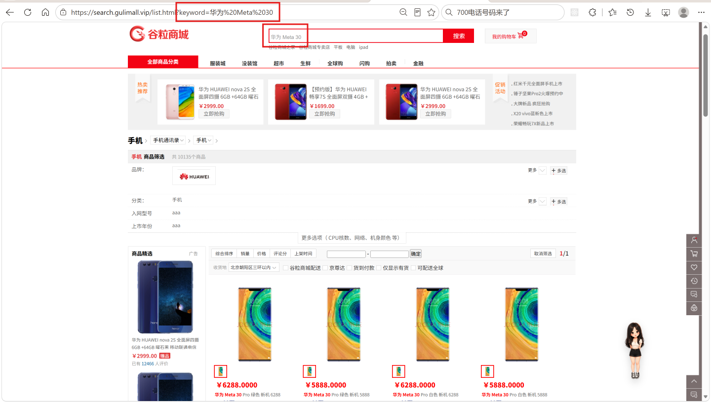
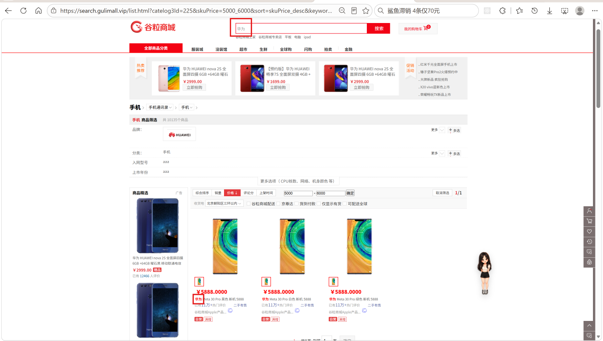

# 8.2 搜索接口与搜索页-介绍

> 搜索页是商城的第一个导购入口。用户在搜索框输入关键词，或在首页点击三级分类，都会落到 `list.html`。页面上的商品列表、品牌筛选、分类筛选、属性筛选、价格区间、有货筛选、排序和分页，全部来自一次 Elasticsearch 查询。本篇讲清参数怎么进、查询怎么拼、结果怎么解析、页面怎么渲染。

---

## 1. 这个功能是干什么的

搜索页解决“用户想找商品”的问题。

用户在搜索框输入“华为手机”，或者在首页点击“手机通讯 → 智能手机”，搜索页要返回：

1. 符合条件的商品列表，每条包含图片、标题、价格、详情页链接。
2. 命中结果里涉及到的品牌，供用户继续缩小范围。
3. 命中结果里涉及到的三级分类。
4. 命中结果里涉及到的规格属性，例如颜色、内存、机身存储。
5. 当前页码、总条数、总页数。
6. 已选条件的面包屑和取消入口。

搜索页不查 MySQL 商品表，只查 Elasticsearch 的 `product` 索引。商品数据在上架时写入索引，搜索页按索引里的字段做过滤、聚合、排序和高亮。

搜索页和商品详情页的职责不同：

- 搜索页读 ES，负责“找商品”和“筛商品”。
- 详情页读 MySQL，负责“看一个 SKU 的完整信息”。

搜索页的查询有一个特点：用户每改一个条件，商品列表和左侧筛选项都会变化。因此页面不做局部刷新，而是改 URL 参数后整页重载。这样商品列表、聚合结果、面包屑、分页始终来自同一次查询，不会出现列表已经变了、筛选栏还是旧数据的情况。

---

## 2. 用户怎么操作

入口有三个：

1. 首页搜索框输入关键词，跳转 `http://search.gulimall.vip/list.html?keyword=关键词`。
2. 首页左侧三级分类，跳转 `http://search.gulimall.vip/list.html?catelog3Id=分类id`。
3. 商品详情页顶部的搜索框。


### 2.1 输入关键词

1. 用户在搜索框输入关键词。
2. 点击“搜索”或按回车。
3. 前端把 `keyword` 拼到 URL 上。
4. 后端用 `match_phrase` 查 `skuTitle`。
5. 返回标题命中的商品，标题里的关键词用红色加粗高亮。



关键词查询要求短语整体出现。输入“华为 Mate 30”，会匹配标题里连续出现这个短语的商品，而不是“华为”“Mate”“30”任意命中一个。

### 2.2 按品牌筛选

1. 左侧“品牌”区域展示当前结果里涉及到的品牌 logo 和名称。
2. 点击某个品牌，URL 增加 `brandId=品牌id`。
3. 后端用 `terms` 查 `brandId`，支持多选。
4. 商品列表缩小到该品牌，左侧分类和属性聚合同步缩小。

### 2.3 按分类筛选

1. 左侧“分类”区域展示当前结果里涉及到的三级分类。
2. 点击某个分类，URL 增加 `catelog3Id=分类id`。
3. 后端用 `term` 查 `catelogId`。
4. 分类筛选通常和首页三级分类入口配合使用。


### 2.4 按规格属性筛选

1. 左侧每个属性一行，例如“颜色”“内存”“机身存储”。
2. 每个属性下面列出当前结果里出现的属性值。
3. 点击某个值，URL 增加 `attrs=属性id_属性值`。
4. 后端为每个 `attrs` 参数生成一个独立的 `nested` 查询。
5. 多个属性之间是“并且”关系，同一个属性多选是“或者”关系。


### 2.5 排序、价格区间、有货、分页

1. 点击“综合排序”“销量”“价格”，URL 的 `sort` 变成 `hotScore_desc`、`saleCount_desc`、`skuPrice_asc` 等。
2. 价格区间填两个输入框，点击“确定”，URL 增加 `skuPrice=1000_3000`。
3. 点击“仅显示有货”，URL 增加 `hasStock=1`。
4. 点击页码或“上一页”“下一页”，URL 的 `pageNum` 变化。
5. 点击“取消筛选”，清空除 `catelog3Id` 以外的全部条件。


### 2.6 取消筛选与面包屑

1. 已选的属性会在页面顶部生成面包屑。
2. 面包屑显示属性名和属性值。
3. 点击面包屑，会把当前 `attrs` 参数从 URL 里删掉，重新查询。



---

## 3. 整体设计思路

### 3.1 业务上怎么设计

#### 3.1.1 关键词

关键词是唯一的全文检索条件，作用在 `skuTitle` 上。

业务要求：

1. 关键词是“短语匹配”，不是单词任意命中。
2. 关键词命中后，标题里命中的部分要标红。
3. 没有关键词时，仍然要能按分类、品牌、属性浏览。

#### 3.1.2 筛选条件

筛选条件分五类：

| 条件 | 业务含义 | URL 参数 |
|---|---|---|
| 分类 | 只看某个三级分类 | `catelog3Id` |
| 品牌 | 只看一个或多个品牌 | `brandId` |
| 属性 | 只看满足规格值的商品 | `attrs` |
| 库存 | 只看有货或无货 | `hasStock` |
| 价格 | 只看某个价格区间 | `skuPrice` |

这些条件都是“是/否”判断，不参与相关性打分，所以放在 `filter` 里。

#### 3.1.3 排序

页面提供三种排序：

1. 综合排序：按 `hotScore` 倒序。
2. 销量：按 `saleCount` 倒序。
3. 价格：按 `skuPrice` 升序或降序。

排序字段必须与 ES mapping 一致。页面传参不能直接拼进 ES，必须先过白名单。

默认排序用 `skuId` 倒序。没有关键词时，所有文档的相关性得分相同，如果不给默认排序，返回顺序由分片决定，翻页会出现重复或遗漏。

#### 3.1.4 分页

每页固定 20 条。页码从 1 开始，`from = (pageNum - 1) * 20`。

总页数按 `total / 20` 向上取整。页码导航当前返回完整页码列表，生产环境应改成当前页附近的窗口。

#### 3.1.5 聚合

聚合的目的不是统计全索引，而是告诉用户“当前结果里还有哪些可选项”。

1. 品牌聚合：按 `brandId` 分组，组内取品牌名和 logo。
2. 分类聚合：按 `catelogId` 分组，组内取分类名。
3. 属性聚合：先进入 `nested`，再按 `attrId` 分组，组内取属性名和全部属性值。

用户勾选品牌后，分类和属性聚合会随结果缩小。这样左侧筛选项不会出现“点了也没结果”的选项。

#### 3.1.6 面包屑与取消筛选

面包屑只在有 `attrs` 参数时生成。每个属性生成一条，显示“属性名：属性值”，点击后从查询串里删掉当前属性参数。

“取消筛选”保留 `catelog3Id`，清空关键词、品牌、属性、排序、库存、价格和页码。保留分类是因为用户通常还在同一个分类下浏览。

### 3.2 技术上怎么设计

#### 3.2.1 bool 查询

整个查询是一个 `bool` 查询：

- `must` 放关键词，参与打分。
- `filter` 放分类、品牌、属性、库存、价格，不参与打分，可以被 ES 缓存。

`must` 和 `filter` 分开的原因是：关键词需要相关性排序，结构化条件只需要是/否判断。把结构化条件放进 `must` 会污染得分，也会失去缓存优化。

#### 3.2.2 nested 查询

`attrs` 是 `nested` 字段。每个属性对象独立存储：

```text
文档
  attrs[0] = { attrId: 5, attrName: 颜色, attrValue: 青金 }
  attrs[1] = { attrId: 6, attrName: 内存, attrValue: 64G }
```

查询“颜色=青金 且 内存=64G”时，必须用两个独立的 `nested` 查询。如果塞进同一个 `nested`，语义会变成“存在一个属性对象同时满足颜色和内存”，永远匹配不到。

#### 3.2.3 聚合

品牌和分类是普通 `terms` 聚合。属性是 `nested` 聚合，最外层先 `nested(path="attrs")`，里面再 `terms(attrs.attrId)`。

品牌和分类的子聚合用 `firstStringKey` 取第一个 bucket。因为一个 `brandId` 只对应一个品牌名，组内子聚合只有一个 bucket。

#### 3.2.4 高亮

高亮配置在 `skuTitle` 上，前置标签是 `<b style='color:red'>`，后置标签是 `</b>`。

解析结果时，如果 `hit.highlight()` 里有 `skuTitle`，就用高亮片段替换原始的 `skuTitle`。模板必须用 `th:utext` 渲染，否则 `<b>` 会被转义成文本。

#### 3.2.5 排序白名单

`sort` 来自页面，不能直接当 ES 字段名。传一个不存在的字段会让 ES 抛 `No mapping found for [xxx] in order to sort on`，整个检索接口 500。

白名单只允许 `skuId`、`skuPrice`、`saleCount`、`hotScore`。不在白名单里的值退回 `skuId desc`。

#### 3.2.6 结果模型

查询结果统一放进 `SearchResult`：

- `product`：商品列表。
- `pageNum`、`total`、`totalPages`、`pageNavs`：分页。
- `brands`、`catelogs`、`attrs`：聚合。
- `navs`：面包屑。

Controller 把 `SearchResult` 放进 Model，模板直接渲染。

---

## 4. 详细代码、配置和解释

搜索页的一次请求要经过五个环节：URL 参数绑定、Controller 组装、Service 翻译成 ES 查询、结果解析、模板渲染。每个环节的数据结构不同，职责也不同。下面的内容按链路上的类和文件逐个拆开：先说明它解决什么问题、谁调用它、它依赖什么，再看关键字段和代码，最后给出完整示例和边界。

### 4.1 SearchParam：搜索入参

#### 4.1.1 这个类解决什么问题

搜索页的所有筛选条件都放在 URL 上：关键词、品牌、分类、属性、库存、价格、排序、页码。用户每点一次筛选，浏览器就带着一组长短不一的参数重新请求 `list.html`。

Controller 如果逐个写 `@RequestParam`，方法签名会很长，Service 也要接收一堆散参数。`SearchParam` 把这些参数收成一个对象：Spring MVC 按字段名自动绑定 URL 参数，Service 只接收这一个入参。上游是浏览器地址栏，下游是 `MallSearchServiceImpl.search()`，中间的转换由 Spring MVC 完成。

这个类不校验参数是否合法，也不决定参数怎么翻译成 ES 查询。它只负责把 URL 上的值带进 Java 层，以及保留一份原始查询串给面包屑使用。

#### 4.1.2 字段与 URL 对应关系

| URL 参数 | 字段 | 示例 | 说明 |
|---|---|---|---|
| `keyword` | `keyword` | `keyword=华为` | 全文检索词，作用在 `skuTitle` |
| `brandId` | `brandId` | `brandId=1&brandId=2` | 品牌多选，绑定成列表 |
| `catelog3Id` | `catelog3Id` | `catelog3Id=225` | 三级分类，ES 字段名是 `catelogId` |
| `sort` | `sort` | `sort=skuPrice_asc` | 排序表达式，格式 `字段_方向` |
| `hasStock` | `hasStock` | `hasStock=1` | 1 只看有货，不传不筛选 |
| `skuPrice` | `skuPrice` | `skuPrice=1000_3000` | 价格区间，允许只写一端 |
| `attrs` | `attrs` | `attrs=5_青金` | 每个元素是 `属性id_属性值` |
| `pageNum` | `pageNum` | `pageNum=2` | 页码，默认 1 |
| 完整查询串 | `_queryString` | `keyword=华为&brandId=1` | Controller 从 `request.getQueryString()` 写入 |

几个字段的形态直接决定了后续查询怎么写：

1. `brandId` 是 `List<Long>`，所以品牌可以多选，查询用 `terms` 而不是 `term`。
2. `attrs` 是 `List<String>`，每个元素表示一个属性条件，Service 要为每个元素单独生成一个 `nested` 查询。
3. `pageNum` 给了默认值 1，页面不传页码时也能正常查询。
4. `_queryString` 保存的是未经解析的原始查询串，面包屑删除某个属性参数时直接在字符串上做替换。

#### 4.1.3 代码与解释

```java
@Data
public class SearchParam {

    /**
     * 页面传递过来的全文匹配关键字
     */
    private String keyword;

    /**
     * 品牌id,可以多选
     */
    private List<Long> brandId;

    /**
     * 三级分类id
     */
    private Long catelog3Id;

    /**
     * 排序条件：sort=price/salecount/hotscore_desc/asc
     */
    private String sort;

    /**
     * 是否显示有货
     */
    private Integer hasStock;

    /**
     * 价格区间查询
     */
    private String skuPrice;

    /**
     * 按照属性进行筛选
     */
    private List<String> attrs;

    /**
     * 页码
     */
    private Integer pageNum = 1;

    /**
     * 原生的所有查询条件
     */
    private String _queryString;


}
```

1. `@Data`：Lombok 生成 getter、setter、`toString`，Service 和日志都依赖这些方法。
2. `keyword`：唯一的全文检索字段，对应 `match_phrase` 查询。
3. `brandId`：用 `List<Long>` 接收重复参数，支持一次勾选多个品牌。
4. `catelog3Id`：页面和 URL 使用三级分类语义，ES 文档里叫 `catelogId`，翻译查询时要做一次名称映射。
5. `sort`：页面拼好的排序表达式，Service 负责拆分并校验，Controller 不做处理。
6. `hasStock`：用 `Integer` 而不是 `boolean`，因为“不传”和“传 0”是两种语义，`null` 表示不筛选。
7. `skuPrice`：保留字符串形态，把区间解析交给 Service，因为要同时兼容 `最小值_最大值`、`_最大值`、`最小值_` 三种写法。
8. `attrs`：一个元素对应一个属性条件，元素内部再用冒号分隔同一属性的多个值。
9. `pageNum`：默认 1，Service 还会再做一次负数兜底。
10. `_queryString`：不是 URL 上的业务参数，由 Controller 主动写入，供面包屑拼接取消链接。

#### 4.1.4 一次绑定示例

```text
请求地址：
/list.html?keyword=华为&brandId=1&brandId=2&attrs=5_青金&attrs=6_64G&hasStock=1&skuPrice=1000_3000&sort=skuPrice_asc&pageNum=2

绑定结果：
keyword      = "华为"
brandId      = [1, 2]
catelog3Id   = null
sort         = "skuPrice_asc"
hasStock     = 1
skuPrice     = "1000_3000"
attrs        = ["5_青金", "6_64G"]
pageNum      = 2
_queryString = "keyword=华为&brandId=1&brandId=2&attrs=5_青金&attrs=6_64G&..."
```

#### 4.1.5 它不做什么与边界

1. 不做参数校验。`pageNum` 传 0 或负数、`attrs` 传 `abc_def`，都能绑定成功，问题会推迟到 Service 里暴露。
2. 不解析 `skuPrice` 和 `sort` 的语义，Service 是唯一解释这些字符串的地方。
3. `_queryString` 以大写字母开头的下划线命名，不符合 Java 字段命名习惯，可以改成 `queryString` 并用 `@RequestParam(name = "_queryString")` 绑定。
4. `keyword` 没有长度限制，超长关键词会直接带给 ES。

### 4.2 SearchResult：搜索返回结构

#### 4.2.1 这个类解决什么问题

一次搜索不只是返回商品列表。页面左侧要展示“当前结果里出现了哪些品牌、哪些分类、哪些属性值”，底部要展示总条数和页码，顶部要展示已选条件的面包屑。这些数据来自同一次 ES 查询，必须一起返回，否则列表和筛选项会对不上。

`SearchResult` 是 Service 与模板之间的唯一数据契约：Service 往里面填，Controller 把它放进 Model，`list.html` 从里面取。上游是 `MallSearchServiceImpl.search()`，下游是 Thymeleaf 模板。

#### 4.2.2 结构与内部类

| 字段 | 类型 | 页面用途 |
|---|---|---|
| `product` | `List<SkuEsModel>` | 商品卡片列表 |
| `pageNum` | `Integer` | 当前页码 |
| `total` | `Long` | 总记录数 |
| `totalPages` | `Integer` | 总页数 |
| `pageNavs` | `List<Integer>` | 页码导航 |
| `brands` | `List<BrandVo>` | 左侧品牌筛选 |
| `attrs` | `List<AttrVo>` | 左侧属性筛选 |
| `catelogs` | `List<CatelogVo>` | 左侧分类筛选 |
| `navs` | `List<NavVo>` | 顶部面包屑 |

内部类只服务于搜索结果，不参与其他业务：

1. `BrandVo`：品牌 id、名称、logo。
2. `CatelogVo`：分类 id、名称。
3. `AttrVo`：属性 id、名称、全部可选值。
4. `NavVo`：面包屑名称、值、取消链接。

#### 4.2.3 代码与解释

```java
@Data
public class SearchResult {

    /**
     * 查询到的所有商品信息
     */
    private List<SkuEsModel> product;

    /**
     * 当前页码
     */
    private Integer pageNum;

    /**
     * 总记录数
     */
    private Long total;

    /**
     * 总页码
     */
    private Integer totalPages;

    private List<Integer> pageNavs;

    /**
     * 当前查询到的结果，所有涉及到的品牌
     */
    private List<BrandVo> brands;

    /**
     * 当前查询到的结果，所有涉及到的所有属性
     */
    private List<AttrVo> attrs;

    /**
     * 当前查询到的结果，所有涉及到的所有分类
     */
    private List<CatelogVo> catelogs;


//    private Long[] attrIds;
    //===========================以上是返回给页面的所有信息============================//


    /* 面包屑导航数据 */
    private List<NavVo> navs = new ArrayList<>();
    private List<Long> attrIds = new ArrayList<>();

    @Data
    public static class NavVo {
        private String navName;
        private String navValue;
        private String link;
    }


    @Data
    public static class BrandVo {

        private Long brandId;

        private String brandName;

        private String brandImg;
    }


    @Data
    public static class AttrVo {

        private Long attrId;

        private String attrName;

        private List<String> attrValue;
    }


    @Data
    public static class CatelogVo {

        private Long catelogId;

        private String catelogName;
    }
}
```

1. `product`：ES 命中的文档，已经转换成 `SkuEsModel`，模板直接取图片、标题、价格。
2. `pageNum`、`total`、`totalPages`：分页信息，Service 解析 `hits.total` 后写入。
3. `pageNavs`：页码导航集合，模板遍历渲染页码。
4. `brands`、`catelogs`、`attrs`：聚合结果，决定左侧筛选项显示什么。
5. `navs`：面包屑，只有请求里带 `attrs` 时才会生成。
6. `attrIds`：预留字段，当前没有参与查询和渲染。
7. 四个内部类都是静态内部类：不持有外部类引用，序列化和反序列化都更简单，也不会污染公共 vo 包。
8. `BrandVo` 和 `CatelogVo` 只放页面需要的三个字段或两个字段，避免把 ES 聚合对象直接暴露给模板。

#### 4.2.4 一次返回示例

```json
{
  "product": [
    { "skuId": 11, "skuTitle": "华为 Mate 30 <b style='color:red'>华为</b>", "skuPrice": 3999 }
  ],
  "pageNum": 1,
  "total": 135,
  "totalPages": 7,
  "pageNavs": [1, 2, 3, 4, 5, 6, 7],
  "brands": [
    { "brandId": 1, "brandName": "华为", "brandImg": "https://.../huawei.png" }
  ],
  "catelogs": [
    { "catelogId": 225, "catelogName": "智能手机" }
  ],
  "attrs": [
    { "attrId": 5, "attrName": "颜色", "attrValue": ["青金", "黑色"] }
  ],
  "navs": [
    { "navName": "颜色", "navValue": "青金", "link": "http://search.gulimall.com/list.html?..." }
  ]
}
```

#### 4.2.5 它不做什么与边界

1. 不负责查询，所有字段都由 Service 填充。
2. 不做类型转换，ES 的 bucket 到 VO 的转换在 Service 里完成。
3. `attrIds` 当前没有使用，可以删除，减少模板和调用方的理解成本。
4. `pageNavs` 目前是全量页码，商品量大时会很长，应改成当前页附近的窗口。
5. `brands`、`catelogs` 没有记录“当前已选”状态，模板无法直接高亮选中项，只能靠 URL 参数自行判断。

### 4.3 SearchController：搜索页入口

#### 4.3.1 这个类解决什么问题

浏览器访问搜索页时只认 HTTP 地址：`/` 和 `/list.html`。这个 Controller 是 HTTP 层与检索服务之间的边界，负责把请求参数交给 Spring 绑定、把原始查询串补进 `SearchParam`、调用检索服务、把结果放进 Model，最后返回视图名。

上游是 Nginx 和 Gateway 转发过来的请求，下游是 `MallSearchService` 和购物车服务。它不拼 ES 查询，也不解析聚合结果，这些都在 Service 里完成。

#### 4.3.2 接口与依赖

| 方法 | 路径 | 作用 |
|---|---|---|
| GET | `/` | 搜索模块根路径，渲染搜索页 |
| GET | `/list.html` | 搜索页标准入口 |

依赖两个远程能力：

1. `MallSearchService`：执行检索，返回 `SearchResult`。
2. `CartFeignClient`：查询当前登录用户的购物车明细，用于页头显示购物车数量。

#### 4.3.3 代码与解释

```java
@Controller
public class SearchController {

    @Autowired
    private MallSearchService mallSearchService;

    /**
     * 商城前台首页地址，值来自 application.yaml 的 gulimall.shop-home-url
     * <p>
     * 为什么不直接在模板里写 ${@environment.getProperty(...)}：
     * Thymeleaf 3.1 出于防 SpEL 注入的安全考虑，默认禁止在模板表达式里
     * 引用 bean（@beanName 语法）、实例化对象（new）和访问静态类（T(...)）。
     * 写成那样会在渲染时直接抛 TemplateProcessingException：
     * "Instantiation of new objects and access to static classes or parameters is forbidden"，
     * 表现为整个页面 500。
     * <p>
     * 所以值必须由 Controller 放进 Model，模板只负责展示。
     * 这样也更规范：模板里不出现任何"取数据"的逻辑。
     */

    @Autowired
    private CartFeignClient cartFeignClient;

    @GetMapping({"/", "/list.html"})
    public String listPage(SearchParam searchParam, Model model, HttpServletRequest request) {

        // 获取所有查询条件，便于面包屑清空
        searchParam.set_queryString(request.getQueryString());
        SearchResult result = mallSearchService.search(searchParam);

        model.addAttribute("result", result);
        List<OrderItemVo> cartItems = cartItems();
        model.addAttribute("cartItems", cartItems);
        model.addAttribute("cartCount", cartItems.size());

        return "list";      // → templates/list.html
    }

    /**
     * 购物车商品明细：购物车服务挂了也不能让搜索页打不开，失败就当空车
     */
    private List<OrderItemVo> cartItems() {
        try {
            List<OrderItemVo> items = cartFeignClient.getCurrentCartItems();
            return items == null ? List.of() : items;
        } catch (Exception e) {
            return List.of();
        }
    }

}
```

1. `@Controller`：返回视图名而不是 JSON，由 Thymeleaf 渲染页面。
2. `@GetMapping({"/", "/list.html"})`：两个地址映射到同一个方法，首页跳转和直接访问都能进来。
3. `listPage()` 的第一个参数是 `SearchParam`，Spring MVC 自动把同名 URL 参数绑定进去。
4. `request.getQueryString()` 取出原始查询串写入 `_queryString`，面包屑后续用它删除参数。
5. `mallSearchService.search(searchParam)` 是唯一一次检索调用，返回完整结果。
6. `model.addAttribute("result", result)` 把结果交给模板，模板里用 `result.xxx` 访问。
7. `cartItems()` 单独封装购物车查询，内部捕获所有异常并返回空列表，购物车服务故障不影响搜索页打开。
8. `cartItems.size()` 作为购物车数量放进 Model，页头直接显示。
9. 返回 `"list"`，视图解析器拼成 `classpath:/templates/list.html`。

#### 4.3.4 一次请求示例

```text
浏览器：GET http://search.gulimall.vip/list.html?keyword=华为

1. Nginx 按域名转发到 Gateway
2. Gateway 去掉 /gulimall 前缀，转发到 search 服务
3. SearchController.listPage() 接收请求
4. Spring MVC 把 keyword=华为 绑定到 SearchParam.keyword
5. request.getQueryString() 返回 "keyword=华为"，写入 _queryString
6. 调用 mallSearchService.search(searchParam)
7. 返回 SearchResult
8. Model 增加 result、cartItems、cartCount
9. 返回视图 "list"
10. Thymeleaf 渲染 templates/list.html
```

#### 4.3.5 页面公共数据

`shopHomeUrl`、`authUrl`、`cartUrl`、`orderUrl`、`memberUrl`、`loginUser`、`currentCity`、`provinces` 不在 `SearchController` 里设置，而是由 `gulimall-common` 的 `GlobalModelAdvice` 通过 `@ModelAttribute` 统一注入。搜索页、商品页、首页共用同一套页头和登录态数据，改一处即可全部生效。

#### 4.3.6 它不做什么与边界

1. 不构造查询条件，URL 参数到 ES DSL 的翻译全部在 Service。
2. 不处理检索异常，Service 内部已经把 ES 的 `IOException` 降级成空结果。
3. 不做权限校验，搜索页对未登录用户开放。
4. 每次请求都同步调用购物车服务，搜索页 QPS 高时会把这部分压力放大，可以改成前端异步加载或加短 TTL 缓存。
5. `getQueryString()` 可能返回 `null`，Service 生成面包屑时直接调用 `replace` 会空指针，边界处理应在 Service 内完成。

### 4.4 MallSearchServiceImpl：检索实现

#### 4.4.1 这个类解决什么问题

搜索页的业务语义是“按条件找商品，同时告诉用户还能怎么继续筛”。落到 Elasticsearch 上，这两件事必须在一次请求里完成：查询负责筛商品，聚合同样基于这批命中结果计算可选筛选项，高亮负责把关键词标出来，排序和分页负责控制返回范围。

`MallSearchServiceImpl` 是唯一把这些语义翻译成 ES DSL 的地方。上游是 `SearchController`，下游是 `ElasticsearchClient` 和 `ProductFeignClient`：前者执行检索，后者只在生成面包屑时查属性名。

一次检索的链路：

```text
SearchController.listPage
  → SearchParam
  → search()
      → 页码兜底、排序白名单
      → client.search(...)
          → index = product
          → from / size
          → sort
          → bool.query
              must：match_phrase(skuTitle)
              filter：catelogId / brandId / attrs(nested) / hasStock / skuPrice
          → aggregations：brand_agg / catelog_agg / attrs_agg
          → highlight：skuTitle
      → hits 解析（高亮替换标题）
      → 分页解析
      → 聚合解析（品牌、分类、属性）
      → 面包屑（ProductFeignClient.attrInfo）
  → SearchResult
```

#### 4.4.2 关键常量与字段

| 成员 | 作用 |
|---|---|
| `PAGE_SIZE` | 每页 20 条，`from` 和 `size` 共用 |
| `SORTABLE_FIELDS` | 排序字段白名单，挡住页面传来的非法字段 |
| `AGG_*` | 聚合名称，构造查询和解析响应必须使用同一组常量 |
| `productFeignClient` | 面包屑查属性名 |
| `ElasticsearchClient` | 执行检索 |
| `firstStringKey()` | 从 terms 子聚合里取第一个 key |

#### 4.4.3 常量与 `firstStringKey`

这一段代码在链路里承担两件事：把易错的字符串集中管理，以及提供聚合解析的公共方法。常量在类加载时确定，`firstStringKey()` 在解析聚合响应时被反复调用。

```java
@Slf4j
@Service("mallSearchService")
public class MallSearchServiceImpl implements MallSearchService {

    /**
     * 每页展示的商品数（对应 product-get.txt 里的 "size": 20）
     */
    private static final int PAGE_SIZE = 20;
    /**
     * 允许排序的字段白名单 —— 值必须与 ES mapping 里的字段名一致。
     * <p>
     * 为什么必须做白名单：sort 是【页面传参】，而下面这段代码会把它原样当成 ES 字段名
     * 去 <code>.field(sortField)</code>。传一个不存在的字段（或页面拼错、属性缺失导致
     * 传了 "undefined"）时，ES 直接抛：
     * <pre>
     *   No mapping found for [undefined] in order to sort on
     *   → search_phase_execution_exception: all shards failed
     * </pre>
     * 表现为整个检索接口 500、页面全白 —— 一个脏参数就把列表页打挂了。
     * 白名单把这类值挡在 ES 外面，退回默认排序（而不是报错）。
     * <p>
     * 对应页面上三个排序链接的 sort 属性（list.html 的 .sort_a）。
     */
    private static final Set<String> SORTABLE_FIELDS = Set.of("skuId", "skuPrice", "saleCount", "hotScore");
    /**
     * 聚合结果里各聚合的名字
     */
    private static final String AGG_BRAND = "brand_agg";
    private static final String AGG_BRAND_NAME = "brand_name_agg";
    private static final String AGG_BRAND_IMG = "brand_img_agg";
    private static final String AGG_CATELOG = "catelog_agg";
    private static final String AGG_CATELOG_NAME = "catelog_name_agg";
    private static final String AGG_ATTRS = "attrs_agg";
    private static final String AGG_ATTR_ID = "attr_id_agg";
    private static final String AGG_ATTR_NAME = "attr_name_agg";
    private static final String AGG_ATTR_VALUE = "attr_value_agg";
    @Autowired
    private ProductFeignClient productFeignClient;
    @Autowired
    private ElasticsearchClient client;

    /**
     * 取 terms 子聚合里【第一个 bucket 的 key】。
     * <p>
     * 用途：brandId 分组后，组内再按 brandName 分组 —— 因为一个 brandId 只会对应一个品牌名，
     * 所以组内必然只有一个 bucket，取第 0 个就是该品牌的名称（catelogName、attrName 同理）。
     * <p>
     * 为什么用 .sterms()：ES 响应里没有类型标记，客户端按推断出的 key 类型拆成三个强类型变体
     * （sterms/lterms/dterms），这里聚合的都是 keyword 字段，所以是 sterms，
     * 取到的 key 是 FieldValue，要 .stringValue() 转成字符串。
     */
    private static String firstStringKey(Map<String, Aggregate> aggs, String aggName) {
        Aggregate agg = aggs.get(aggName);
        if (agg == null) {
            return null;
        }
        List<StringTermsBucket> buckets = agg.sterms().buckets().array();
        return buckets.isEmpty() ? null : buckets.getFirst().key().stringValue();
    }
```

1. `PAGE_SIZE = 20`：固定每页条数，分页计算和 ES 的 `size` 使用同一个值，避免两处不一致。
2. `SORTABLE_FIELDS`：只允许 `skuId`、`skuPrice`、`saleCount`、`hotScore`。页面传 `undefined_desc` 或拼错字段时，如果没有白名单，ES 会抛 `No mapping found for [...] in order to sort on`，整个检索接口 500。
3. `AGG_*` 常量：聚合名在请求构造和响应解析两处出现，抽成常量可以避免一边写 `brand_agg`、另一边写 `brandAgg` 这类低级错误。
4. 两个客户端依赖：`ElasticsearchClient` 是检索主依赖，`ProductFeignClient` 只服务于面包屑。
5. `firstStringKey()` 先按名称取聚合，聚合不存在时返回 `null`，避免空指针。
6. 取到聚合后调用 `agg.sterms().buckets().array()`。`brandName`、`catelogName`、`attrName` 都是 keyword 字段，响应类型是 `sterms`；`brandId`、`catelogId` 是数值字段，响应类型是 `lterms`，两者的取法不同。
7. 组内 bucket 为空时返回 `null`，调用方拿到的品牌名或分类名就是空值，页面仍能渲染，不会抛异常。

#### 4.4.4 `search` 主方法

`search()` 是整个搜索页的核心：先处理分页和排序参数，再构造并执行查询，最后把 ES 响应解析成 `SearchResult`。下面整段代码按“查询构造 → 结果解析”分成两大块，代码里的注释标出了每一块的边界。

```java
/**
 * 将页面全部检索条件封装为对象
 *
 * @param searchParam 检索的所有参数
 * @return 返回检索的结果
 */
@Override
public SearchResult search(SearchParam searchParam) {

    SearchResult result = new SearchResult();

    // 页码兜底：SearchParam 里默认是 1，但页面传个负数/0 过来也得能扛住
    final int pageNum = (searchParam.getPageNum() == null || searchParam.getPageNum() < 1)
            ? 1 : searchParam.getPageNum();

    // 解析排序参数（sort=skuPrice_asc / saleCount_desc / hotScore_desc）
    // 解析放在 lambda 外面，是为了让 lambda 里能直接捕获 final 变量
    final String sortField;
    final SortOrder sortOrder;
    String[] sortSplit = StringUtils.hasText(searchParam.getSort())
            ? searchParam.getSort().split("_") : new String[0];
    // 必须校验字段名在【白名单】里（原因见 SORTABLE_FIELDS 注释）：
    //    只判断 length == 2 是不够的 —— "undefined_desc"、"abc_asc" 都会通过，
    //    然后在 ES 那边炸成 all shards failed。
    if (sortSplit.length == 2 && SORTABLE_FIELDS.contains(sortSplit[0])) {
        sortField = sortSplit[0];
        sortOrder = "asc".equalsIgnoreCase(sortSplit[1]) ? SortOrder.Asc : SortOrder.Desc;
    } else {
        // 默认排序：按 skuId 倒序（对应 product-get.txt 里的 "sort": [{"skuId": {"order": "desc"}}]）
        // 给个默认排序的意义：不写的话按 _score 排，而"没有关键词"时所有文档得分都一样，
        // 返回顺序由分片决定、每次可能不同 —— 翻页会看到重复/漏掉的商品
        sortField = "skuId";
        sortOrder = SortOrder.Desc;
    }

    try {
        // ============================================================
        // 一、构造并执行检索请求
        //     s -> {...} 这个 lambda 就是对 SearchRequest.Builder 的配置，
        //     与 product-get.txt 里那段 JSON 的每一行一一对应
        // ============================================================
        SearchResponse<SkuEsModel> response = client.search(s -> {

            // 查哪个索引
            s.index(EsConstant.PRODUCT_INDEX);

            // 分页：from 从 0 开始，第 n 页的起点是 (n-1)*size
            s.from((pageNum - 1) * PAGE_SIZE);
            s.size(PAGE_SIZE);

            // 排序
            s.sort(so -> so.field(f -> f.field(sortField).order(sortOrder)));

            // ---------- 1、query：bool 把 must 和 filter 包在一起 ----------
            s.query(q -> q.bool(b -> {

                // ---------- must：全文检索关键词（参与打分） ----------
                if (StringUtils.hasText(searchParam.getKeyword())) {
                    // match_phrase：短语匹配，要求"华为 Meta 30 Pro"这一整个子串出现，
                    // 而不是分成"华为""Meta""30""Pro"任意命中一个
                    b.must(m -> m.matchPhrase(mp -> mp
                            .field("skuTitle")
                            .query(searchParam.getKeyword())));
                }

                // ---------- filter ①：三级分类 ----------
                // 注：SearchParam 里叫 catelog3Id，ES 里的字段叫 catelogId（拼写不一致，别写错）
                if (searchParam.getCatelog3Id() != null) {
                    final long catelogId = searchParam.getCatelog3Id();
                    b.filter(f -> f.term(t -> t
                            .field("catelogId")
                            .value(catelogId)));
                }

                // ---------- filter ②：品牌（多选） ----------
                if (searchParam.getBrandId() != null && !searchParam.getBrandId().isEmpty()) {
                    final List<FieldValue> brandIds = searchParam.getBrandId().stream()
                            .map(FieldValue::of)
                            .collect(Collectors.toList());
                    b.filter(f -> f.terms(t -> t
                            .field("brandId")
                            .terms(tf -> tf.value(brandIds))));
                }

                // ---------- filter ③：规格属性（nested） ----------
                // 页面传参格式：attrs=<attrId>_<值1>:<值2>&attrs=<attrId>_<值>
                //   例：attrs=5_青金&attrs=1_aaa:bbb
                // 每个 attrs 参数要生成【一个独立的 nested 查询】，而不是把所有属性塞进
                // 同一个 nested —— 塞一起会变成"存在某个对象同时满足所有属性"，语义完全不同
                if (searchParam.getAttrs() != null && !searchParam.getAttrs().isEmpty()) {
                    for (String attr : searchParam.getAttrs()) {
                        String[] idAndValues = attr.split("_");
                        if (idAndValues.length != 2) {
                            // 参数格式不对就跳过，别让一个脏参数把整个检索打挂
                            continue;
                        }
                        final long attrId = Long.parseLong(idAndValues[0]);
                        final List<FieldValue> attrValues = java.util.Arrays
                                .stream(idAndValues[1].split(":"))
                                .map(FieldValue::of)
                                .collect(Collectors.toList());

                        b.filter(f -> f.nested(n -> n
                                .path("attrs")
                                .query(nq -> nq.bool(nb -> nb
                                        // 同一个 attrs 对象里：attrId 相等 且 attrValue 是其中一个
                                        .must(m -> m.term(t -> t
                                                .field("attrs.attrId")
                                                .value(attrId)))
                                        .must(m -> m.terms(t -> t
                                                .field("attrs.attrValue")
                                                .terms(tf -> tf.value(attrValues))))))));
                    }
                }

                // ---------- filter ④：是否有货 ----------
                // 页面传 hasStock=1 表示"只看有货"；不传则不筛选
                if (searchParam.getHasStock() != null) {
                    final boolean hasStock = searchParam.getHasStock() == 1;
                    b.filter(f -> f.term(t -> t
                            .field("hasStock")
                            .value(hasStock)));
                }

                // ---------- filter ⑤：价格区间 ----------
                // 页面传参格式：skuPrice=1000_3000，允许只写一端：
                //   "_3000" → lte 3000     "1000_" → gte 1000
                if (StringUtils.hasText(searchParam.getSkuPrice())) {
                    final String skuPrice = searchParam.getSkuPrice();
                    final String[] range = skuPrice.split("_");

                    // range 要先 .untyped(...) 再写 field：
                    //    RangeQuery 在客户端里是个 union builder，只能在其一的分支里写条件，
                    //    分支有 date / number / term / untyped 四个。
                    //    skuPrice 映射是 keyword（字符串），所以要选 untyped 分支。
                    if (range.length == 2) {
                        final String gte = range[0];
                        final String lte = range[1];
                        b.filter(f -> f.range(r -> r.untyped(u -> u
                                .field("skuPrice")
                                .gte(JsonData.of(gte))
                                .lte(JsonData.of(lte)))));
                    } else if (range.length == 1) {
                        final String only = range[0];
                        if (skuPrice.startsWith("_")) {
                            b.filter(f -> f.range(r -> r.untyped(u -> u
                                    .field("skuPrice")
                                    .lte(JsonData.of(only)))));
                        } else {
                            b.filter(f -> f.range(r -> r.untyped(u -> u
                                    .field("skuPrice")
                                    .gte(JsonData.of(only)))));
                        }
                    }
                }

                return b;
            }));

            // ---------- 2、聚合：品牌 / 分类 / 属性 ----------
            // 聚合的意义："命中结果里实际涉及到了哪些品牌、哪些分类、哪些属性值"，
            // 页面据此渲染左侧筛选条件 —— 没命中的品牌不该出现在筛选项里
            s.aggregations(AGG_BRAND, a -> a
                    .terms(t -> t.field("brandId").size(10))
                    // 子聚合：brandId 是数字，页面上要显示品牌名和 logo，
                    // 所以按 brandId 分组后，在组内再取一次 brandName / brandImg
                    .aggregations(AGG_BRAND_NAME, sa -> sa.terms(t -> t.field("brandName").size(10)))
                    .aggregations(AGG_BRAND_IMG, sa -> sa.terms(t -> t.field("brandImg").size(10))));

            s.aggregations(AGG_CATELOG, a -> a
                    .terms(t -> t.field("catelogId").size(10))
                    .aggregations(AGG_CATELOG_NAME, sa -> sa.terms(t -> t.field("catelogName").size(10))));

            // attrs 是 nested 字段：聚合前必须先"钻进去"，所以最外层是 nested 聚合，
            // 里面才是 terms —— 这一层结构不能省（对应 product-get.txt 的 attrs_agg）
            s.aggregations(AGG_ATTRS, a -> a
                    .nested(n -> n.path("attrs"))
                    .aggregations(AGG_ATTR_ID, sa -> sa
                            .terms(t -> t.field("attrs.attrId").size(10))
                            .aggregations(AGG_ATTR_NAME, ssa -> ssa.terms(t -> t.field("attrs.attrName").size(10)))
                            .aggregations(AGG_ATTR_VALUE, ssa -> ssa.terms(t -> t.field("attrs.attrValue").size(10)))));

            // ---------- 3、高亮：把关键词在 skuTitle 里标红 ----------
            // postTags 必须是 </b>，写成 <b/> 会把整个列表页的布局搞崩：
            //    HTML 的自闭合语法对 <b> 这类非空元素【无效】，<b/> 会被解析成
            //    "又开了一个 <b>"，而这个 <b> 永远不会被关闭 —— 按 HTML5 的
            //    「活动格式化元素」规则，它会泄漏到后面所有兄弟节点上（含下一张卡片的 <div>）。
            //    后果：CSS 里的 .rig_tab > div 等【子选择器】失效（div 不再是直接子元素），
            //          图片失去 205x210 限制被撑成原始大小，且整张卡片继承 color:red 全变红。
            //    模板侧对应 <a th:utext="..."> —— 用 th:text 看不出来，因为标签被转义了。
            s.highlight(h -> h
                    .fields("skuTitle", f -> f)
                    .preTags("<b style='color:red'>")
                    .postTags("</b>"));

            return s;
        }, SkuEsModel.class);

        // ============================================================
        // 二、解析结果
        // ============================================================

        // ---------- 1、商品列表 ----------
        List<SkuEsModel> skuList = new ArrayList<>();
        for (Hit<SkuEsModel> hit : response.hits().hits()) {
            SkuEsModel sku = hit.source();
            if (sku == null) {
                // source() 可能为 null（比如用了 _source 过滤），防御一下别 NPE
                continue;
            }
            // 高亮命中的话，用带 <b> 标签的片段替换原标题，页面才能标红；
            // 没命中时 highlight 里根本没有这个 key，保持原标题不变
            Map<String, List<String>> highlight = hit.highlight();
            if (highlight != null && highlight.containsKey("skuTitle")) {
                sku.setSkuTitle(highlight.get("skuTitle").getFirst());
            }
            skuList.add(sku);
        }
        result.setProduct(skuList);

        // ---------- 2、分页信息 ----------
        long total = response.hits().total() == null ? 0L : response.hits().total().value();
        result.setTotal(total);
        result.setPageNum(pageNum);
        // 总页数 = ceil(total / PAGE_SIZE)，用整除 + 取余避免引入 Math.ceil 的浮点误差
        int totalPages = (int) (total / PAGE_SIZE + (total % PAGE_SIZE == 0 ? 0 : 1));
        result.setTotalPages(totalPages);

        // 页码导航条。这里是全量 1..totalPages，商品量大时前端会渲染出几百上千个页码，
        //    生产上应改成只出当前页附近的窗口（如 pageNum±2 + 首尾页）
        List<Integer> pageNavs = new ArrayList<>();
        for (int i = 1; i <= totalPages; i++) {
            pageNavs.add(i);
        }
        result.setPageNavs(pageNavs);

        // ---------- 3、聚合结果 ----------
        Map<String, Aggregate> aggs = response.aggregations();

        // 品牌：terms(brandId) → 组内子聚合取品牌名/图标
        List<SearchResult.BrandVo> brands = new ArrayList<>();
        Aggregate brandAgg = aggs.get(AGG_BRAND);
        if (brandAgg != null) {
            for (LongTermsBucket bucket : brandAgg.lterms().buckets().array()) {
                SearchResult.BrandVo vo = new SearchResult.BrandVo();
                vo.setBrandId(bucket.key());
                vo.setBrandName(firstStringKey(bucket.aggregations(), AGG_BRAND_NAME));
                vo.setBrandImg(firstStringKey(bucket.aggregations(), AGG_BRAND_IMG));
                brands.add(vo);
            }
        }
        result.setBrands(brands);

        // 分类：同上
        List<SearchResult.CatelogVo> catelogs = new ArrayList<>();
        Aggregate catelogAgg = aggs.get(AGG_CATELOG);
        if (catelogAgg != null) {
            for (LongTermsBucket bucket : catelogAgg.lterms().buckets().array()) {
                SearchResult.CatelogVo vo = new SearchResult.CatelogVo();
                vo.setCatelogId(bucket.key());
                vo.setCatelogName(firstStringKey(bucket.aggregations(), AGG_CATELOG_NAME));
                catelogs.add(vo);
            }
        }
        result.setCatelogs(catelogs);

        // 属性：nested 聚合比上面多一层，取子聚合时要先 .nested() 钻进去
        List<SearchResult.AttrVo> attrVos = new ArrayList<>();
        Aggregate attrsAgg = aggs.get(AGG_ATTRS);
        if (attrsAgg != null) {
            Aggregate attrIdAgg = attrsAgg.nested().aggregations().get(AGG_ATTR_ID);
            if (attrIdAgg != null) {
                for (LongTermsBucket bucket : attrIdAgg.lterms().buckets().array()) {
                    SearchResult.AttrVo vo = new SearchResult.AttrVo();
                    vo.setAttrId(bucket.key());
                    vo.setAttrName(firstStringKey(bucket.aggregations(), AGG_ATTR_NAME));

                    // 一个属性下有多个可选值，要【全部】取出来 —— 页面上是多选
                    // （比如"颜色"下面有 青金/黑色/白色，不能只取第一个）
                    List<String> values = new ArrayList<>();
                    Aggregate valueAgg = bucket.aggregations().get(AGG_ATTR_VALUE);
                    if (valueAgg != null) {
                        for (StringTermsBucket valueBucket : valueAgg.sterms().buckets().array()) {
                            values.add(valueBucket.key().stringValue());
                        }
                    }
                    vo.setAttrValue(values);
                    attrVos.add(vo);
                }
            }
        }
        result.setAttrs(attrVos);

        // ---------- 4、面包屑导航 ----------
        if (searchParam.getAttrs() != null && !searchParam.getAttrs().isEmpty()) {
            List<SearchResult.NavVo> navVoList = searchParam.getAttrs().stream().map(attr -> {
                        SearchResult.NavVo navVo = new SearchResult.NavVo();
                        String[] s = attr.split("_");
                        navVo.setNavValue(s[1]);
                        R r = productFeignClient.attrInfo(Long.parseLong(s[0]));
                        if (r.getCode() == 0) {
                            AttrRespVo attrRespVo = r.getData("attr", new TypeReference<AttrRespVo>() {
                            });
                            navVo.setNavName(attrRespVo.getAttrName());
                        } else {
                            navVo.setNavName(s[0]);
                        }

                        String encode;
                        encode = URLEncoder.encode(attr, StandardCharsets.UTF_8);
                        encode = encode.replace("+", "%20");
                        String replace = searchParam.get_queryString().replace("&attrs=" + encode, "");
                        navVo.setLink("http://search.gulimall.com/list.html?catelog3Id=225&" + replace);
                        return navVo;
                    }
            ).toList();
            result.setNavs(navVoList);
        }

    } catch (IOException e) {
        // ES 客户端的所有请求方法都抛受检 IOException（网络/序列化失败）
        // 检索失败不该把整个列表页打挂成 500，返回空结果让页面正常渲染
        log.error("商品检索失败，检索参数：{}", searchParam, e);
    }

    return result;
}
```

#### 4.4.5 逐段解释

1. 方法入口先创建空的 `SearchResult`。即使后面 ES 抛异常，方法也会返回这个对象，模板拿到的是空列表而不是 `null`。
2. 页码兜底：`pageNum` 为 `null` 或小于 1 时统一按 1 处理。`SearchParam` 虽然给了默认值 1，但页面可以显式传 0 或负数。
3. 解析排序参数：按 `_` 拆成字段和方向，字段必须在 `SORTABLE_FIELDS` 里，方向只认 `asc`，其余一律 `desc`。
4. 排序不合法时退回 `skuId desc`。没有关键词时所有文档得分相同，不指定排序会让返回顺序由分片决定，翻页出现重复或遗漏。
5. 进入 `client.search()`，第一步指定索引 `EsConstant.PRODUCT_INDEX`，搜索页只查 `product` 索引。
6. 设置分页：`from = (pageNum - 1) * PAGE_SIZE`，`size = PAGE_SIZE`。`from` 从 0 开始，第 2 页的起点是 20。
7. 设置排序：`field(sortField).order(sortOrder)`，字段名来自白名单，方向来自第 3 步。
8. 构造 `bool` 查询。关键词放 `must`，结构化条件放 `filter`：前者参与相关性打分，后者只做是/否判断并能被 ES 缓存。
9. `keyword` 非空时加 `match_phrase(skuTitle)`。短语匹配要求整个关键词连续出现，而不是拆词后任意命中。
10. `catelog3Id` 非空时加 `term(catelogId)`。注意参数名和 ES 字段名拼写不同，这里写的是 `catelogId`。
11. `brandId` 非空且列表不为空时加 `terms(brandId)`。先判空再转换，避免空列表生成非法查询。
12. `attrs` 非空时逐个处理：先按 `_` 拆出属性 id 和属性值，段数不是 2 就跳过；同一属性的多个值再按 `:` 拆分。每个属性生成一个独立的 `nested` 查询，内部用 `bool.must` 同时约束 `attrs.attrId` 和 `attrs.attrValue`。如果把多个属性塞进同一个 `nested`，语义会变成“存在一个属性对象同时满足所有条件”，永远匹配不到。
13. `hasStock` 非空时加 `term(hasStock)`，`1` 转成 `true`，其余转成 `false`。
14. `skuPrice` 非空时加 `range`。区间先按 `_` 拆成两端：两段都在时同时设置 `gte` 和 `lte`；只有一段时，以 `_` 开头说明只给了上限，用 `lte`，否则用 `gte`。`skuPrice` 在 mapping 里是 keyword，所以 `RangeQuery` 要选 `untyped` 分支。
15. 添加三类聚合。品牌按 `brandId` 分组，组内用子聚合取 `brandName` 和 `brandImg`；分类按 `catelogId` 分组，组内取 `catelogName`；属性是 `nested` 字段，最外层必须是 `nested(path="attrs")`，里面再按 `attrId` 分组，组内取属性名和全部属性值。聚合的作用是只返回当前命中结果里实际存在的筛选项。
16. 设置高亮：字段 `skuTitle`，前置标签 `<b style='color:red'>`，后置标签 `</b>`。后置标签不能写成自闭合形式，否则 `<b>` 不会闭合，红色样式会泄漏到后续所有卡片。
17. 执行查询，结果类型指定为 `SkuEsModel`，客户端负责把 `_source` 反序列化成对象。
18. 解析商品列表：遍历 `hits`，`source()` 为 `null` 时跳过；`highlight` 里有 `skuTitle` 时用高亮片段替换原标题，没有命中高亮时保留原标题。
19. 解析分页：总条数取 `hits.total().value()`，总页数用整除加取余计算，避免浮点误差。页码导航当前生成 1 到总页数的全量列表。
20. 解析品牌聚合：遍历 `lterms` bucket，`key` 是品牌 id，组内子聚合取品牌名和 logo。品牌 id 是数值，所以用 `LongTermsBucket`。
21. 解析分类聚合：结构与品牌相同，同样使用 `lterms` 和子聚合。
22. 解析属性聚合：先通过 `attrsAgg.nested().aggregations()` 钻进 nested 层，再取 `attr_id_agg`；每个属性下要遍历全部 `attrValue` bucket，因为页面上的属性值是多选，不能只取第一个。
23. 生成面包屑：只处理 `attrs` 参数，每个元素生成一条。属性名通过 `ProductFeignClient.attrInfo(attrId)` 查询，查不到时退回属性 id。取消链接从 `_queryString` 里删掉当前 `attrs` 参数后重新拼出完整地址。
24. 捕获 `IOException`：ES 客户端所有请求方法都抛受检异常，检索失败时记录日志并返回已经创建的空 `SearchResult`，页面展示空列表而不是 500。

#### 4.4.6 一次完整示例

用户搜索“华为”，同时选择品牌 1、颜色青金、价格 1000 到 3000、只看有货、按价格升序、第 2 页：

```text
URL：
/list.html?keyword=华为&brandId=1&attrs=5_青金&skuPrice=1000_3000&hasStock=1&sort=skuPrice_asc&pageNum=2

1. 页码 = 2，from = 20，size = 20
2. 排序字段 skuPrice 在白名单内，方向 asc
3. bool.must    = match_phrase(skuTitle, "华为")
4. bool.filter += term(catelogId)        —— 没传，不加
5. bool.filter += terms(brandId, [1])
6. bool.filter += nested(attrs) {
       bool.must = term(attrs.attrId, 5)
       bool.must = terms(attrs.attrValue, ["青金"])
   }
7. bool.filter += term(hasStock, true)
8. bool.filter += range(skuPrice, gte=1000, lte=3000)
9. 聚合：brand_agg、catelog_agg、attrs_agg
10. 高亮：skuTitle
11. ES 返回第 21 到 40 条
12. 命中标题里的“华为”替换成 <b style='color:red'>华为</b>
13. 计算 total、totalPages、pageNavs
14. 解析品牌、分类、属性聚合
15. 为 attrs=5_青金 生成一条面包屑
16. SearchResult 交给 Controller
```

#### 4.4.7 它不做什么

1. 不校验属性 id 是不是数字，`Long.parseLong()` 遇到非数字仍然会抛异常。
2. 不保证价格区间两端都有值，空串会原样传给 ES。
3. 不缓存查询结果，每次请求都实时查 ES。
4. 不把 `keyword` 转义成 HTML，模板用 `th:utext` 输出高亮片段。
5. 不限制最大页码，深分页仍会触发 ES 的 `max_result_window`。

#### 4.4.8 边界与可优化点

1. 价格字段在 mapping 里是 keyword，`range` 按字符串比较，`"999"` 会大于 `"1000"`，跨位数区间会筛错。应把 `skuPrice` 改成数值类型。
2. 只填上限时，Java 的 `split("_")` 对 `"_3000"` 会保留前面的空串，走 `length == 2` 分支，`gte` 变成空串。应显式判断 `startsWith("_")` 和 `endsWith("_")`。
3. 面包屑链接硬编码了 `catelog3Id=225`，在其他分类下取消属性会被带到 225 分类，应读取当前请求的分类。
4. 面包屑删除参数只匹配 `&attrs=...`，`attrs` 是第一个参数时前缀是 `?`，删不掉。应同时处理两种前缀，或改用 `URLSearchParams`。
5. 页码导航返回全部页码，深分页会触发 `max_result_window` 限制，默认 10000 条，应限制最大页码或改用 `search_after`。
6. `NumberFormatException`、`IllegalArgumentException` 不在 `catch (IOException)` 范围内，脏参数仍可能让接口 500。
7. 聚合 size 固定 10，品牌或分类超过 10 个时会被截断。
8. `firstStringKey()` 假设子聚合一定是 `sterms`，字段类型改成数值后会抛类型转换异常。
9. 每次带属性筛选的请求都会同步调用 `ProductFeignClient` 查属性名，属性多时 Feign 调用次数等于面包屑条数，可以批量查询或加缓存。

### 4.5 EsConstant：索引名

#### 4.5.1 这个类解决什么问题

商品数据由 `product` 服务写入 ES，由 `search` 服务读取。两侧如果各写各的索引名字符串，改索引名时容易漏改一处，出现“写入一个索引、查询另一个索引”的问题。

`EsConstant` 把索引名收成一个常量，读侧和写侧共用。上游是商品上架流程和搜索查询流程，下游是 Elasticsearch 的 `product` 索引。

#### 4.5.2 代码与解释

```java
public class EsConstant {

    // sku数据在ES中的索引名称
    public static final String PRODUCT_INDEX = "product";

}
```

1. `PRODUCT_INDEX = "product"`：商品 SKU 文档所在的索引名。
2. `MallSearchServiceImpl` 用 `s.index(EsConstant.PRODUCT_INDEX)` 指定查询索引。
3. `ProductSaveServiceImpl` 用同一个常量写入文档。
4. 索引名只维护一处，改名时两个服务一起生效。

#### 4.5.3 一次使用示例

```text
上架：ProductSaveServiceImpl → IndexRequest.index("product") → 写入 SKU 文档
搜索：MallSearchServiceImpl → SearchRequest.index("product") → 读取 SKU 文档
```

#### 4.5.4 边界与可优化点

1. 索引名写死在代码里，切换索引需要重新发布。生产环境通常使用 `product_v1` 加别名 `product`，通过别名完成无感重建。
2. 只抽了索引名，字段名仍是散落的字符串，拼错字段只有运行到 ES 才会发现。
3. 没有版本概念，索引结构变更时无法同时保留新旧两份数据。

### 4.6 list.html：搜索页渲染

#### 4.6.1 这个页面解决什么问题

`SearchResult` 放进 Model 之后，页面要把商品列表、品牌、分类、属性、面包屑、排序、分页全部渲染出来。页面本身不查数据库，也不查 ES，所有数据都来自 Controller 放进去的 `result`。

页面的交互方式是“改 URL 后整页重载”，而不是局部刷新。原因是商品列表和左侧聚合来自同一次 ES 查询，局部刷新容易出现列表已经变了、筛选项还是旧数据。整页重载保证列表、聚合、面包屑、分页始终一致。

#### 4.6.2 搜索框与面包屑

搜索框负责回显当前关键词，并把新关键词写回 URL；面包屑负责展示已选属性，并提供取消入口。两块数据分别来自 `param.keyword` 和 `result.navs`。

```html
<div class="header_sous">
    <div class="logo">
        <a th:href="${shopHomeUrl}"></a>
    </div>
    <div class="header_form">
        <input id="keyword_input" type="text" placeholder="手机" th:value="${param.keyword}"/>
        <a href="javascript:searchByKeyword()">搜索</a>
    </div>
</div>
```

面包屑只展示已选属性，每条显示“属性名：属性值”，点击后跳转到删掉当前属性参数的地址。

```html
<div class="JD_ipone_one c">
    <a th:href="${nav.link}" th:each="nav:${result.navs}">
        <span th:text="${nav.navName}"></span>：
        <span th:text="${nav.navValue}"></span> x
    </a>
</div>
```

1. `th:value="${param.keyword}"` 直接读 URL 参数，刷新后输入框仍然显示当前关键词。
2. `searchByKeyword()` 读取输入框的值，调用 `searchProducts` 修改 URL，具体逻辑在页面底部的脚本里。
3. 面包屑通过 `th:each="nav:${result.navs}"` 遍历，每个 `NavVo` 渲染一条。
4. `nav.link` 是 Service 生成的完整地址，已经去掉当前属性参数，点击即可取消该条件。

#### 4.6.3 品牌、分类、属性筛选

左侧三块筛选项都来自聚合结果：`result.brands`、`result.catelogs`、`result.attrs`。每点一个值，脚本把对应参数写进 URL，整页重新查询。

```html
<li th:each="brand:${result.getBrands()}">
    <a th:href="${'javascript:searchProducts(&quot;brandId&quot;,&quot;' + brand.getBrandId() + '&quot;)'}"
       th:title="${brand.getBrandName()}">
        
        <span th:text="${brand.getBrandName()}"></span>
    </a>
</li>

<li th:each="catelog:${result.getCatelogs()}">
    <a th:href="${'javascript:searchProducts(&quot;catelog3Id&quot;,&quot;' + catelog.getCatelogId() + '&quot;)'}"
       th:text="${catelog.getCatelogName()}"></a>
</li>

<div class="JD_pre" th:each="attr:${result.getAttrs()}">
    <div class="sl_key">
        <span th:text="${attr.getAttrName()}"></span>
    </div>
    <div class="sl_value">
        <ul>
            <li th:each="val:${attr.getAttrValue()}">
                <a th:href="${'javascript:searchProducts(&quot;attrs&quot;,&quot;' + attr.getAttrId() + '_' + val + '&quot;)'}"
                   th:text="${val}"></a>
            </li>
        </ul>
    </div>
</div>
```

1. 品牌列表遍历 `result.getBrands()`，每个品牌渲染 logo、名称和一个链接。
2. 点击品牌调用 `searchProducts("brandId", id)`，URL 增加或替换 `brandId` 参数。
3. 分类列表遍历 `result.getCatelogs()`，点击后把 `catelog3Id` 写进 URL。
4. 属性列表遍历 `result.getAttrs()`，外层是属性名，内层是该属性的全部可选值。
5. 点击属性值把参数拼成 `属性id_属性值`，交给 `searchProducts("attrs", ...)`。
6. 参数值用 `&quot;` 包成字符串字面量，避免 `1_aaa` 这类值被 JavaScript 当成数字表达式解析。

#### 4.6.4 排序、价格区间、有货

排序链接把 ES 字段名放在 `sort` 属性上，由脚本拼成 `字段_方向`；价格区间把两个输入框的值拼成 `最小值_最大值`；有货按钮在 URL 上增加或删除 `hasStock=1`。

```html
<div class="filter_top_left" th:with="priceRange=${param.skuPrice}">
    <a class="sort_a" href="#" th:with="f='hotScore'"
       th:attr="sort=${f}"
       th:classappend="${param.sort == null ? '' : (#strings.startsWith(param.sort, f) ? (#strings.endsWith(param.sort, '_desc') ? 'active desc' : 'active asc') : '')}">综合排序</a>
    <a class="sort_a" href="#" th:with="f='saleCount'"
       th:attr="sort=${f}"
       th:classappend="${param.sort == null ? '' : (#strings.startsWith(param.sort, f) ? (#strings.endsWith(param.sort, '_desc') ? 'active desc' : 'active asc') : '')}">销量</a>
    <a class="sort_a" href="#" th:with="f='skuPrice'"
       th:attr="sort=${f}"
       th:classappend="${param.sort == null ? '' : (#strings.startsWith(param.sort, f) ? (#strings.endsWith(param.sort, '_desc') ? 'active desc' : 'active asc') : '')}">价格</a>

    <input id="skuPriceFrom" type="number"
           th:value="${priceRange == null ? '' : #strings.substringBefore(priceRange, '_')}"
           style="width: 100px; margin-left: 30px">
    -
    <input id="skuPriceTo" type="number"
           th:value="${priceRange == null ? '' : #strings.substringAfter(priceRange, '_')}"
           style="width: 100px">
    <button id="skuPriceSearchBtn">确定</button>
</div>
```

有货筛选单独一段，激活态由服务端根据 URL 参数渲染：

```html
<a href="javascript:;" class="has_stock_a"
   th:with="stock=${param.hasStock}"
   th:classappend="${stock == null ? '' : (stock[0] == '1' ? 'active' : '')}">
    <i></i>
    仅显示有货
</a>
```

1. 三个排序链接分别对应 `hotScore`、`saleCount`、`skuPrice`，`th:attr="sort=${f}"` 把字段名写进 DOM。
2. 激活态由服务端按 `param.sort` 计算：字段前缀匹配且以 `_desc` 结尾显示降序样式，否则显示升序样式。点击会整页跳转，不能依赖 DOM 上临时添加的 class。
3. 价格输入框用 `#strings.substringBefore` 和 `substringAfter` 回显当前区间。
4. `priceRange == null` 先兜一层，避免 `#strings` 方法接收 `null` 抛异常。
5. 有货按钮通过 `param.hasStock` 判断激活态。`param.hasStock` 是数组，所以用 `stock[0] == '1'`。
6. 价格区间为空时链接里可能拼出 `skuPrice=_`，后端会把它当成两端都是空串，边界应在脚本里拦掉。

#### 4.6.5 商品卡片与高亮

每个 `SkuEsModel` 渲染成一张商品卡片，图片、标题、价格全部来自 ES 文档，不需要再查 MySQL。标题必须用 `th:utext` 渲染，因为高亮片段里带 `<b>` 标签。

```html
<div th:each="product:${result.getProduct()}">
    <div class="ico">
        <i class="iconfont icon-weiguanzhu"></i>
        <a href="#">关注</a>
    </div>
    <p class="da">
        <a th:href="|${shopHomeUrl}/item.html?skuId=${product.getSkuId()}|">
            
        </a>
    </p>
    <ul class="tab_im">
        <li><a th:href="|${shopHomeUrl}/item.html?skuId=${product.getSkuId()}|" title="黑色">
            </a></li>
    </ul>
    <p class="tab_R">
        <span th:text="'￥'+${product.skuPrice}"></span>
    </p>
    <p class="tab_JE">
        <a th:href="|${shopHomeUrl}/item.html?skuId=${product.getSkuId()}|" th:utext="${product.skuTitle}"></a>
    </p>
</div>
```

1. 外层 `th:each` 遍历 `result.getProduct()`，一条文档一张卡片。
2. 图片地址取 `product.getSkuImg()`，点击跳转到商品详情页 `item.html?skuId=...`。
3. 价格取 `product.skuPrice`，直接展示 ES 里的值。
4. 标题用 `th:utext` 输出，`<b style='color:red'>` 才会被浏览器解析成红色加粗。用 `th:text` 会把标签转义成普通文本。
5. `th:utext` 同时意味着关键词里的 HTML 会被浏览器解析，存在 XSS 风险。生产环境应只信任 ES 生成的高亮片段，或对关键词做转义。

#### 4.6.6 分页

分页区域包括“上一页”“页码列表”“下一页”和“跳转到第几页”。页码通过 `pn` 属性交给脚本，脚本再改 URL。

```html
<div class="filter_page">
    <div class="page_wrap">
        <span class="page_span1">
            <a class="page_a" th:attr="pn=${result.getPageNum() - 1}"
               th:if="${result.getPageNum()>1}">
                < 上一页
            </a>
            <a class="page_a"
               th:attr="pn=${nav},style=${nav == result.getPageNum() ? 'border: 0;color:#ee2222;background: #fff' :''}"
               style="" th:each="nav:${result.getPageNum()}">[[${nav}]]</a>
            <a class="page_a" th:attr="pn=${result.getPageNum() + 1}"
               th:if="${result.getPageNum()<result.getTotalPages()}">
                下一页 >
            </a>
        </span>
        <span class="page_span2">
            <em>共<b>[[${result.totalPages}]]</b>页&nbsp;&nbsp;到第</em>
            <input type="number" th:value="${result.getPageNum()}">
            <em>页</em>
            <a class="page_submit" th:attr="total=${result.totalPages}">确定</a>
        </span>
    </div>
</div>
```

1. “上一页”只在当前页大于 1 时渲染，`pn` 是当前页减 1。
2. 页码循环用 `th:attr="pn=${nav}"` 把目标页码写进 DOM。
3. 当前页单独设置样式，边框去掉、文字变红、背景变白。
4. “下一页”只在当前页小于总页数时渲染。
5. 页码输入框默认值是当前页，“确定”按钮通过 `total` 属性把总页数交给脚本做范围校验。

#### 4.6.7 URL 参数操作

页面所有筛选、排序、分页、取消操作都落到同一组脚本函数：先算出新的 URL，再整页跳转。这一段是搜索页交互的核心，前端不改 DOM 状态，只改地址栏。

```javascript
function searchProducts(name, value) {
    location.href = replaceParamVal(location.href, name, value);
}

function searchByKeyword() {
    // 必须写 .val() —— 不带括号的 .val 是【函数对象本身】，
    // 传进去会被拼成 ?keyword=function%20()%20%7B... 这种地址
    searchProducts("keyword", $("#keyword_input").val());
}

function replaceParamVal(url, paramName, replaceVal, forceAdd) {
    const oUrl = url.toString();
    let nUrl;
    if (oUrl.indexOf(paramName) !== -1) {
        if (forceAdd) {
            if (oUrl.indexOf("?") !== -1) {
                nUrl = oUrl + "&" + paramName + "=" + replaceVal;
            } else {
                nUrl = oUrl + "?" + paramName + "=" + replaceVal;
            }
        } else {
            // 用 new RegExp 而不是 eval('...')：eval 会被页面 CSP 拦、性能差、lint 也报。
            // 这里只是拿字符串拼一个正则，new RegExp 就够了，不需要 eval 的求值能力。
            const re = new RegExp('(' + paramName + '=)([^&]*)', 'gi');
            nUrl = oUrl.replace(re, paramName + '=' + replaceVal);
        }
    } else {
        if (oUrl.indexOf("?") !== -1) {
            nUrl = oUrl + "&" + paramName + "=" + replaceVal;
        } else {
            nUrl = oUrl + "?" + paramName + "=" + replaceVal;
        }
    }
    return nUrl;
}

$(".sort_a").click(function () {
    const field = $(this).attr("sort");
    const cur = new URL(location.href).searchParams.get("sort") || "";

    // 方向判断必须【从 URL 里读】，不能看 DOM 上的 class：
    // 点击会整页跳转，原来 changeStyle 在元素上 toggle 的 .desc 只存在于跳转前那份 DOM。
    //   点的就是当前排序字段 且 当前是降序 → 切成升序
    //   否则（换字段 / 当前是升序）   → 用降序
    const dir = (cur.split("_")[0] === field && cur.endsWith("_desc")) ? "_asc" : "_desc";

    location.href = replaceParamVal(location.href, "sort", field + dir);
    return false;
});

$("#skuPriceSearchBtn").click(function () {
    const from = $("#skuPriceFrom").val();
    const to = $("#skuPriceTo").val();
    location.href = replaceParamVal(location.href, "skuPrice", from + "_" + to);
});

$(".has_stock_a").click(function () {
    const url = new URL(location.href);
    if (url.searchParams.get("hasStock") === "1") {
        url.searchParams.delete("hasStock");
    } else {
        url.searchParams.set("hasStock", "1");
    }
    location.href = url.toString();
    return false;
});

$(".page_a").click(function () {
    location.href = replaceParamVal(location.href, "pageNum", $(this).attr("pn"));
    return false;
})

$(".clear_filter_a").click(function () {
    const url = new URL(location.href);
    const catelog3Id = url.searchParams.get("catelog3Id");
    url.search = "";
    url.hash = "";
    if (catelog3Id !== null) {
        url.searchParams.set("catelog3Id", catelog3Id);
    }
    location.href = url.toString();
    return false;
});
```

1. `searchProducts(name, value)` 是所有筛选的统一入口，内部调用 `replaceParamVal` 并跳转。
2. `searchByKeyword()` 读取输入框的值，必须写成 `.val()`。不带括号的 `.val` 是函数对象本身，会被拼进 URL。
3. `replaceParamVal()` 判断参数是否存在：存在就替换值，不存在就追加。`forceAdd` 为真时允许同一参数重复出现。
4. 替换用 `new RegExp` 拼正则，没有使用 `eval`，避免 CSP 拦截和性能问题。
5. 排序点击时从 URL 读取当前 `sort`，而不是读 DOM 上的 class。点击会整页跳转，DOM 上的临时样式不会保留。
6. 方向切换规则：点的就是当前排序字段且当前是降序，则切成升序；换字段或当前是升序，则用降序。
7. 价格“确定”把两个输入框拼成 `最小值_最大值` 后写入 `skuPrice`。
8. 有货按钮用 `URLSearchParams` 判断：已经是 `1` 就删除参数，否则设置为 `1`。
9. 页码点击复用 `replaceParamVal` 修改 `pageNum`。
10. 取消筛选清空整个 query，只把 `catelog3Id` 加回来，让用户仍然停留在当前分类下。

#### 4.6.8 它不做什么与边界

1. 不负责查询，页面只消费 `SearchResult`。
2. 不做局部刷新，所有操作都会整页重载。
3. 页码循环的集合写成了 `result.getPageNum()`，正确写法是 `result.getPageNavs()`，当前写法无法按 `pageNavs` 渲染完整页码列表。
4. `replaceParamVal` 用 `indexOf(paramName)` 判断参数是否存在，可能误判参数名出现在某个值里的情况。
5. 价格为空时拼出 `"_"`，后端拆分后得到两个空串，查询条件不明确。
6. 关键词直接拼进 URL，没有调用 `encodeURIComponent`，特殊字符会破坏查询串。
7. 排序、筛选、分页都依赖整页跳转，交互体验一般。改成 AJAX 必须同时更新商品列表和聚合结果，否则会出现数据不一致。

### 4.7 搜索页静态资源

#### 4.7.1 这段配置解决什么问题

搜索模块是独立部署的服务，页面需要的样式、字体、脚本、图片必须由 search 服务自己提供，不能依赖商品服务或外部 CDN。Spring Boot 默认把 `classpath:/static/` 映射到根路径，所以 `static/search/` 下的文件可以直接通过 `/search/...` 访问。

模板里统一使用 `./search/...` 相对路径，`/` 和 `/list.html` 两个入口都能解析到同一批资源。

#### 4.7.2 目录与引用

搜索模块的静态资源目录：

```text
gulimall-search/src/main/resources/static/search/
  css/index.css
  font/iconfont.css
  js/jquery-1.12.4.js
  image/
  img/
```

模板里的引用：

```html
<link rel="stylesheet" href="./search/css/index.css">
<link rel="stylesheet" type="text/css" href="./search/font/iconfont.css">
<script src="./search/js/jquery-1.12.4.js"></script>

```

1. `static/search/css/index.css` 对应 URL `/search/css/index.css`。
2. `static/search/font/iconfont.css` 提供页面图标字体。
3. `static/search/js/jquery-1.12.4.js` 是页面脚本依赖的 jQuery。
4. `./search/...` 是相对当前路径的写法，在 `/list.html` 和 `/` 下都能定位到 `/search/...`。
5. 资源放在 search 模块自己的静态目录，部署时不需要额外配置 Nginx 静态目录。

#### 4.7.3 边界与可优化点

1. 静态资源没有版本号或内容哈希，浏览器可能长期使用旧样式，改样式后需要手动清缓存。
2. jQuery 版本较旧，且直接放在模块里，多个页面重复加载同一份文件。
3. 图片、字体、样式没有做压缩和合并，首屏请求数偏多。
4. 如果后续把页面放到 CDN，`./search/...` 这类相对路径需要统一改成带域名的绝对路径。

### 4.8 首页入口与三级分类异步加载

#### 4.8.1 这个类解决什么问题

搜索页有相当一部分流量来自首页：用户在首页搜索框输入关键词，或者点击左侧三级分类。首页如果一次性渲染完整的三级分类树，HTML 会很大，首屏变慢。

`IndexController` 因此把首页拆成两部分：首屏只同步查询一级分类，二三级分类通过 `index/catelog.json` 异步返回。上游是浏览器访问首页，下游是分类服务和购物车服务，最终的三级分类链接指向搜索页 `list.html?catelog3Id=...`。

#### 4.8.2 IndexController

这一段代码在链路里承担首页首屏渲染和分类树接口两个职责：`indexPage()` 只查一级分类，`getCatelogJson()` 返回完整的二三级分类树。

```java
@Slf4j
@Controller
public class IndexController {

    @Autowired
    private CategoryService categoryService;
    @Autowired
    private CartFeignClient cartFeignClient;

    @Value("${gulimall.seckill-url}")
    private String seckillUrl;
    @Value("${gulimall.member-url}")
    private String memberUrl;

    @GetMapping({"/", "/index.html"})
    public String indexPage(Model model) {

        // 1.查询一级分类
        List<CategoryEntity> categoryEntityList = categoryService.getLevel1CategoryList();

        model.addAttribute("category_list", categoryEntityList);
        List<OrderItemVo> cartItems = cartItems();
        model.addAttribute("cartItems", cartItems);
        model.addAttribute("cartCount", cartItems.size());

        // 2. 秒杀信息统一放秒杀页，首页只保留顶部导航入口
        model.addAttribute("seckillUrl", seckillUrl);
        model.addAttribute("memberUrl", memberUrl);

        // prefix前缀classpath:/templates/ suffix后缀为.html
        // 视图解析器自动拼接
        return "index";
    }

    // index/catelog.json
    @ResponseBody
    @GetMapping("index/catelog.json")
    public Map<String, List<Catelog2Vo>> getCatelogJson() {
        return categoryService.getCatelogJson();
    }

    /**
     * 购物车商品明细：购物车服务挂了也不能让商品页打不开，失败就当空车
     */
    private List<OrderItemVo> cartItems() {
        try {
            List<OrderItemVo> items = cartFeignClient.getCurrentCartItems();
            return items == null ? List.of() : items;
        } catch (Exception e) {
            return List.of();
        }
    }

}
```

1. `@GetMapping({"/", "/index.html"})`：首页两个入口映射到同一个方法。
2. `categoryService.getLevel1CategoryList()` 只查一级分类，查询量小，首屏渲染快。
3. 一级分类放进 `category_list`，模板用它渲染左侧一级菜单。
4. `cartItems()` 查询购物车，失败时返回空列表，首页不因为购物车服务故障而打不开。
5. 秒杀页和会员页地址从配置读取，放进 Model 供页头导航使用。
6. 返回 `"index"`，视图解析器拼成 `templates/index.html`。
7. `index/catelog.json` 是异步接口，`@ResponseBody` 直接返回 JSON。
8. `getCatelogJson()` 返回 `Map<一级分类id, List<二级分类>>`，每个二级分类下挂 `catelog3List`，具体缓存逻辑在分类功能里实现。

#### 4.8.3 index.html 分类菜单

首屏只渲染一级分类，每个一级分类把自己的 id 放在 `ctg-data` 属性上，脚本据此异步填充二三级菜单。

```html
<div class="header_main_left">
    <ul>
        <li th:each="category : ${category_list}">
            <a href="#" class="header_main_left_a" th:attr="ctg-data=${category.catId}">
                <b th:text="${category.name}">分类名称</b>
            </a>
        </li>
    </ul>
</div>

<script type="text/javascript" src="index/js/catelogLoader.js"></script>
```

1. `category_list` 是 Controller 查出来的一级分类。
2. `ctg-data` 保存一级分类 id，供 `catelogLoader.js` 读取。
3. `catelogLoader.js` 在页面加载完成后请求 `index/catelog.json`。
4. 二三级分类不进入首屏 HTML，减少首屏体积。

#### 4.8.4 catelogLoader.js

脚本负责把异步拿到的分类树拼成 DOM，并生成指向搜索页的三级分类链接。

```javascript
$(function () {
    $.getJSON("index/catelog.json", function (data) {

        var ctgall = data;
        $(".header_main_left_a").each(function () {
            var ctgnums = $(this).attr("ctg-data");
            if (ctgnums) {
                var panel = $("<div class='header_main_left_main'></div>");
                var panelol = $("<ol class='header_ol'></ol>");
                var ctgnumArray = ctgnums.split(",");
                $.each(ctgnumArray, function (i, ctg1Id) {
                    var ctg2list = ctgall[ctg1Id];
                    $.each(ctg2list, function (i, ctg2) {
                        var cata2link = $("<a href='#' style= 'color: #111;' class='aaa'>" + ctg2.name + "  ></a>");


                        console.log(cata2link.html());
                        var li = $("<li></li>");
                        var ctg3List = ctg2["catelog3List"];
                        var len = 0;
                        $.each(ctg3List, function (i, ctg3) {
                            var cata3link = $("<a href=\"http://search.gulimall.vip/list.html?catelog3Id=" + ctg3.id + "\" style=\"color: #999;\">" + ctg3.name + "</a>");
                            li.append(cata3link);
                            len = len + 1 + ctg3.name.length;
                        });
                        if (len >= 46 && len < 92) {
                            li.attr("style", "height: 60px;");
                        } else if (len >= 92) {
                            li.attr("style", "height: 90px;");
                        }
                        panelol.append(cata2link).append(li);

                    });

                });
                panel.append(panelol);
                $(this).after(panel);
                $(this).parent().addClass("header_li2");
                console.log($(".header_main_left").html());
            }
        });
    });
});
```

1. `$(function(){...})` 在 DOM 加载完成后执行。
2. `$.getJSON("index/catelog.json", ...)` 请求分类树接口。
3. 遍历每个一级分类链接，读取 `ctg-data` 里的一级分类 id。
4. 用一级分类 id 从返回的 Map 里取二级分类列表。
5. 每个二级分类创建一个名称链接。
6. 每个三级分类创建一个指向 `list.html?catelog3Id=三级分类id` 的链接。
7. 根据三级分类名称的总长度设置容器高度，名称较长时多留一行到两行空间。
8. 把拼好的面板插到一级分类后面，并给父节点加上 `header_li2` 样式。
9. 三级分类链接直接带 `catelog3Id`，用户点击后搜索页按分类过滤。

#### 4.8.5 一次完整链路

```text
1. 浏览器打开首页
2. IndexController.indexPage() 查一级分类
3. 返回 index.html，首屏只有一级分类
4. 浏览器加载 catelogLoader.js
5. 脚本请求 /index/catelog.json
6. IndexController.getCatelogJson() 返回完整分类树
7. 脚本填充二级、三级分类
8. 用户点击“智能手机”
9. 浏览器跳转 list.html?catelog3Id=225
10. 搜索页按 catelog3Id 过滤商品
```

#### 4.8.6 它不做什么与边界

1. 首页不渲染完整分类树，二三级分类完全由脚本生成。
2. `IndexController` 不直接操作缓存，分类树的缓存逻辑在 `CategoryService` 里。
3. `$.getJSON` 没有失败回调，接口异常时二三级菜单为空，一级分类仍然显示。
4. 脚本用字符串拼接 HTML，分类名里有特殊字符时可能破坏结构，应做转义。
5. `ctg2list` 没有判空，返回的 Map 缺少某个一级分类时，`$.each` 会报错。
6. 搜索页地址写死为 `http://search.gulimall.vip`，换域名或本地调试需要改代码，应改成配置项或相对地址。
7. 每个一级分类都会提前创建 DOM，分类很多时性能一般，可以改成只渲染当前悬停的一级分类。
8. 首页每次请求都同步查购物车，流量大时应改成前端异步加载。

## 5. 数据怎么流转

### 5.1 读侧数据源

| 存储/组件 | 作用 | 搜索页的操作 |
|---|---|---|
| Elasticsearch `product` | 商品检索索引 | 一次查询返回商品、聚合、高亮 |
| `gulimall_pms.pms_attr` | 属性定义 | 面包屑通过 Feign 查属性名 |
| Redis | Spring Session、购物车 | 读取登录态和购物车数量 |
| MySQL `gulimall_pms` | 分类、品牌等基础数据 | 首页加载分类时使用，搜索列表不查 |

### 5.2 请求链路

```text
浏览器
  → Nginx（search.gulimall.vip）
  → Gateway /gulimall/search/list.html
  → search 服务 SearchController.listPage
  → MallSearchServiceImpl.search
  → Elasticsearch product 索引
  → 返回 SearchResult
  → templates/list.html
```

面包屑查属性名时多一条链路：

```text
MallSearchServiceImpl
  → ProductFeignClient.attrInfo(attrId)
  → product 服务 AttrController.info
  → pms_attr
```

### 5.3 参数流转

参数从 URL 进入后，先绑定成 `SearchParam`，再被翻译成 ES 查询，结果解析成 `SearchResult`，最后交给模板：

```text
URL 参数
  → SearchParam
  → bool 查询 must/filter
  → ES 查询
  → SearchResult
  → Model
  → list.html
```

### 5.4 缓存

搜索页本身不缓存查询结果。每次请求都实时查 ES，保证筛选、排序、分页的结果一致。

Redis 在搜索页只承担两件事：

1. Spring Session 保存登录态，用于页头显示用户名。
2. 购物车服务的购物车数据。

分类树在首页走缓存，搜索页只接收 `catelog3Id` 参数，不加载整棵分类树。

---

## 6. 一次请求的完整执行流程

### 6.1 关键词搜索

1. 用户在首页搜索框输入关键词，点击搜索。
2. 浏览器跳转 `http://search.gulimall.vip/list.html?keyword=华为`。
3. Nginx 按域名转发到 Gateway。
4. Gateway 匹配 search 路由，去掉 `/gulimall` 前缀。
5. 请求进入 `SearchController.listPage()`。
6. Spring MVC 把 `keyword` 绑定到 `SearchParam`。
7. Controller 调 `request.getQueryString()`，写入 `_queryString`。
8. Controller 调 `MallSearchServiceImpl.search(searchParam)`。
9. `search` 兜底页码，解析排序，默认 `skuId desc`。
10. 构造 `bool` 查询，`keyword` 走 `match_phrase` 查 `skuTitle`。
11. 添加品牌、分类、属性聚合。
12. 设置高亮标签。
13. `ElasticsearchClient.search` 查询 `product` 索引。
14. 遍历 `hits`，用高亮片段替换 `skuTitle`。
15. 解析总条数、总页数、页码。
16. 解析品牌、分类、属性聚合。
17. 返回 `SearchResult`。
18. Controller 把结果放进 Model，查购物车。
19. 返回 `list` 视图。
20. Thymeleaf 渲染 `list.html`，标题用 `th:utext` 输出高亮。

### 6.2 品牌筛选

1. 用户点击左侧品牌。
2. `searchProducts("brandId", 1)` 修改 URL。
3. 页面整页刷新。
4. 请求进入 `SearchController.listPage()`。
5. `SearchParam.brandId` 收到 `[1]`。
6. `search` 添加 `terms` 查询到 `filter`。
7. ES 返回该品牌商品。
8. 聚合结果只包含这些商品涉及的品牌、分类、属性。
9. 页面重新渲染商品列表和筛选栏。

### 6.3 属性筛选

1. 用户点击“颜色：青金”。
2. URL 增加 `attrs=5_青金`。
3. `SearchParam.attrs` 收到 `["5_青金"]`。
4. `search` 拆分出 `attrId=5`、`attrValue=青金`。
5. 生成一个 `nested` 查询，路径 `attrs`。
6. `nested` 内部用 `bool` 组合 `term(attrs.attrId)` 和 `terms(attrs.attrValue)`。
7. ES 返回同时满足属性 id 和值的商品。
8. 面包屑根据 `attrs` 生成。
9. 面包屑查询 `ProductFeignClient.attrInfo(5)` 拿属性名。
10. 页面渲染面包屑和筛选后的列表。

### 6.4 分页

1. 用户点击第 2 页。
2. `page_a` 的点击事件把 `pageNum=2` 写进 URL。
3. `search` 计算 `from = (2 - 1) * 20 = 20`。
4. ES 返回第 21 到 40 条。
5. 总页数按总条数计算。
6. 页面渲染第 2 页。

### 6.5 首页三级分类进入搜索页

1. 用户打开首页。
2. `IndexController.indexPage()` 查一级分类并渲染 `index.html`。
3. 浏览器加载 `catelogLoader.js`。
4. `catelogLoader.js` 请求 `index/catelog.json`。
5. `IndexController.getCatelogJson()` 返回分类树。
6. 前端填充二级、三级分类。
7. 用户点击三级分类。
8. 浏览器跳转 `list.html?catelog3Id=三级分类id`。
9. 搜索页按 `catelog3Id` 过滤。

---

## 7. 异常、边界、踩坑

1. **排序字段非法**：页面传 `undefined_desc`、拼错字段名时，ES 会报 `No mapping found for [...] in order to sort on`。白名单把非法字段退回 `skuId desc`。

2. **属性参数格式错误**：`attrs` 不是“id_值”两段时直接跳过。但只校验了段数，没有校验 id 是否是数字，`Long.parseLong("abc")` 会抛 `NumberFormatException`，不在 `catch (IOException)` 范围内，仍然会 500。

3. **价格只填一端**：`"_3000"` 经 `split("_")` 会得到两个元素，走 `length == 2` 分支，`gte` 变成空串。`"1000_"` 因为尾部空串被丢弃，走 `length == 1` 分支，`gte=1000` 正常。两端都不填时 URL 里可能出现 `skuPrice=_`。

4. **价格字段是 keyword**：`range` 查询按字符串比较，`"999"` 大于 `"1000"`，跨位数价格区间会筛错。生产环境应改成数值字段。

5. **`brandId` 为空**：`brandId != null` 但列表为空时，`terms` 查询没有值，ES 会报错。代码已加 `!isEmpty()` 判断。

6. **聚合字段缺失**：`aggs.get(...)` 返回 `null` 时已做判空，返回空列表。

7. **子聚合类型**：`firstStringKey` 直接调用 `agg.sterms()`。如果字段映射改成数值，响应会是 `lterms`，这里会抛类型异常。

8. **面包屑删除参数**：只匹配 `&attrs=...`，`attrs` 是第一个参数时前面是 `?`，删不掉。应同时处理两种前缀。

9. **面包屑链接硬编码分类**：链接固定拼 `catelog3Id=225`，用户在其他分类下取消属性会被带到 225 分类。应读取当前请求的 `catelog3Id`。

10. **`_queryString` 为空**：直接调用 Service 或请求没有 query string 时，`searchParam.get_queryString()` 为 `null`，`replace` 会空指针。

11. **深分页**：`from + size` 超过 `index.max_result_window`（默认 10000）时，ES 会报错。应按业务限制最大页码，或用 `search_after`。

12. **总页数为 0**：没有结果时 `totalPages=0`，页码导航为空，页面显示“共 0 页”。

13. **高亮 XSS**：模板用 `th:utext` 输出标题，关键词里的 HTML 可能被浏览器执行。生产环境应转义关键词或只信任 ES 返回的高亮片段。

14. **ES 异常**：只捕获 `IOException`，返回空结果。其他运行时异常仍然会 500，应增加更宽的兜底。

15. **购物车服务失败**：`cartItems()` 捕获所有异常返回空列表，搜索页正常渲染，页头显示 0 件商品。

16. **页码循环集合错误**：模板里 `th:each="nav:${result.getPageNum()}"` 用的是当前页码，不是 `pageNavs`，无法按页码列表渲染。应改成 `result.getPageNavs()`。

17. **分类入口地址写死**：`catelogLoader.js` 里写死 `http://search.gulimall.vip`，换域名或本地调试时要改代码。应改成配置或相对地址。

18. **首页分类接口失败**：`$.getJSON` 没有失败回调，接口异常时左侧二三级菜单为空，一级分类仍然显示。

---

## 8. 本篇小结

1. 搜索页只查 ES 的 `product` 索引，商品卡片、筛选、排序、分页都来自一次查询。
2. 查询用 `bool`，关键词放 `must` 参与打分，分类、品牌、属性、库存、价格放 `filter`。
3. 属性是 `nested` 字段，每个属性参数生成独立的 `nested` 查询，避免跨对象匹配。
4. 聚合基于当前命中结果，品牌、分类、属性筛选项随结果缩小。
5. 排序字段必须过白名单，非法值退回 `skuId desc`，保证翻页稳定。
6. 高亮在前端用 `th:utext` 渲染，标题里的关键词标红。
7. 页面所有筛选都通过改 URL 参数后整页刷新，保证列表、聚合、面包屑一致。
8. 首页一级分类同步渲染，二三级分类走 `index/catelog.json` 异步加载。
9. 购物车、登录态走 Redis，搜索查询本身不缓存。
10. 主要优化方向：价格改数值类型、修复单边价格区间、面包屑动态分类、限制深分页、页码窗口化、属性参数数字校验、关键词转义。
