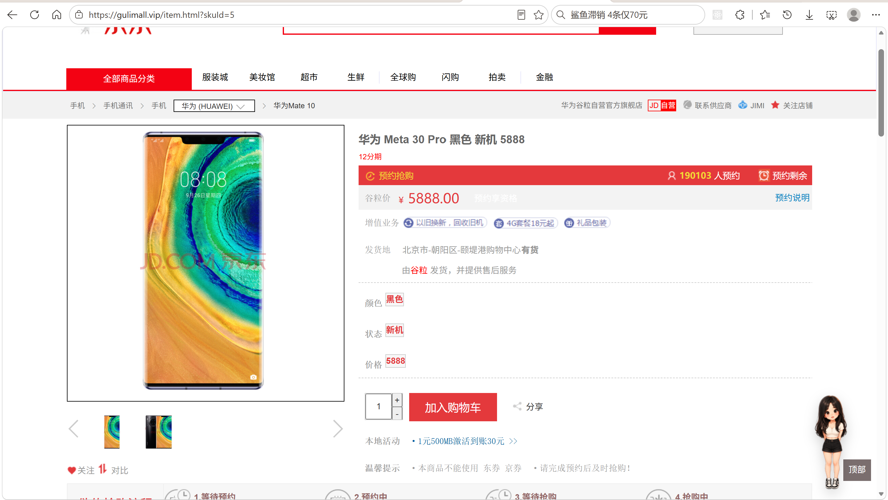
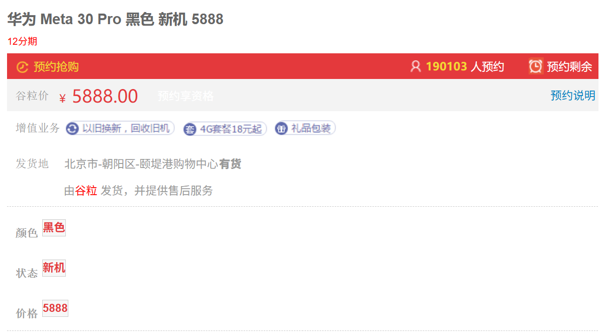
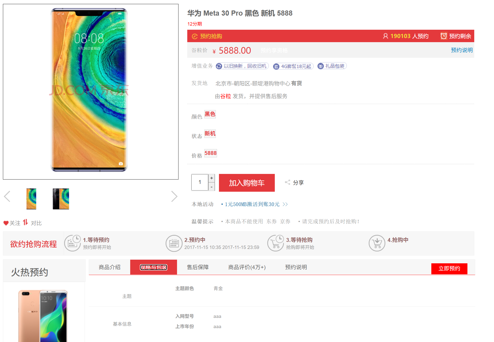
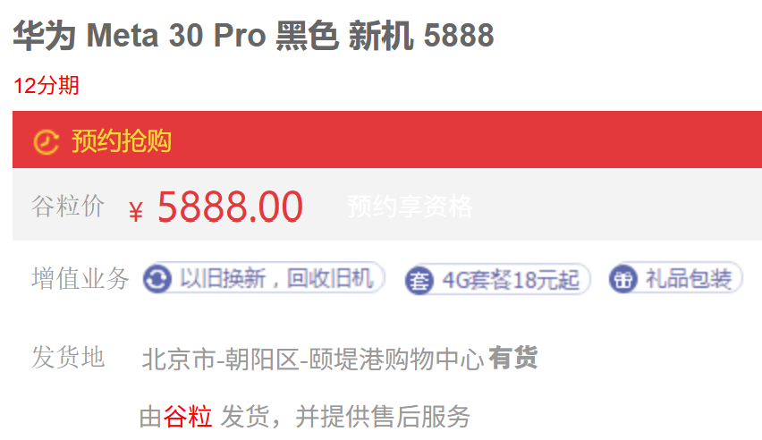
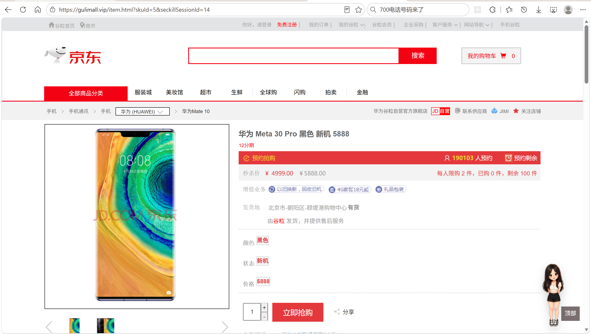
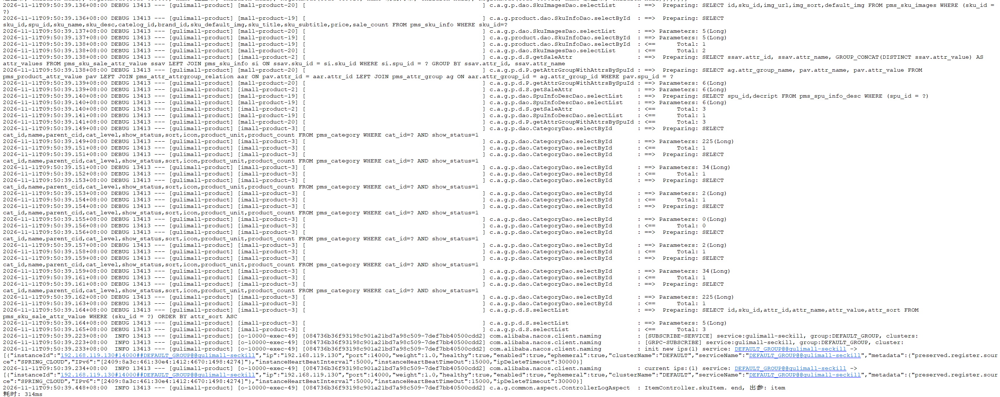

# 8.3 商品详情页与异步编排-介绍

> 商品详情页是下单前的最后一站。一个页面要同时拿到 SKU 基本信息、图集、SPU 销售属性、SPU 介绍、规格参数、库存、发货地、分类路径、秒杀信息。这些数据分布在多张表和一个远程服务里，串行查会让页面变慢。本篇讲清详情页的数据构成、六路并发编排、线程池参数、SQL 分组和页面渲染。

---

## 1. 这个功能是干什么的

商品详情页解决“看清一个 SKU”的问题。

用户在搜索页点击商品卡片，跳转：

```text
http://gulimall.vip/item.html?skuId=1
```

详情页按 `skuId` 回 MySQL 查权威数据，并实时问库存。它不读 ES，因为 ES 是检索用的宽文档，详情页需要完整的 SKU 信息、SPU 介绍、规格参数分组和可发货仓库，这些数据不适合全部塞进索引。

一个详情页需要十块数据：

| 数据 | 来源 | 页面位置 |
|---|---|---|
| SKU 基本信息 | `pms_sku_info` | 标题、副标题、价格、默认图 |
| SKU 图集 | `pms_sku_images` | 左侧缩略图 |
| SPU 销售属性组合 | `pms_sku_sale_attr_value` 关联 `pms_sku_info` | SKU 切换区域的数据基础 |
| SPU 介绍 | `pms_spu_info_desc` | 商品详情长图 |
| SPU 规格参数 | `pms_product_attr_value`、`pms_attr_attrgroup_relation`、`pms_attr_group` | 规格参数分组 |
| 是否有货 | ware 服务 `wms_ware_sku` | 有货/无货 |
| 秒杀信息 | seckill 服务 | 秒杀价、限购、剩余 |
| 分类路径 | `pms_category` | 面包屑 |
| 当前 SKU 销售属性 | `pms_sku_sale_attr_value` | 颜色、内存等展示 |
| 可发货仓库 | ware 服务 | 发货地、可用库存 |

这些数据里，只有 SKU 基本信息是“必须先有”的。销售属性、SPU 介绍、规格参数都依赖 SKU 上的 `spuId`；图集和库存只依赖 `skuId`。因此可以做并发编排。

---

## 2. 用户怎么操作

入口有两个：

1. 搜索页点击商品卡片。
2. 首页推荐位或秒杀页跳转详情页。



### 2.1 查看商品基本信息

1. 用户进入 `item.html?skuId=...`。
2. 后端按 `skuId` 查 SKU。
3. 页面展示默认图、标题、副标题、价格。
4. 图集区域展示 `pms_sku_images` 里的图片。
5. 面包屑展示三级分类路径。

### 2.2 查看销售属性

1. 页面展示当前 SKU 自己的销售属性，例如颜色、内存、机身存储。
2. 这些值来自 `pms_sku_sale_attr_value`，按 `attr_sort` 排序。
3. 页面只展示当前 SKU 的属性，不在前端做 SKU 切换。

后端还返回了 SPU 级的销售属性组合 `saleAttr`，用于“同一个 SPU 下不同 SKU 的选择”。当前 `item.html` 没有渲染这块数据，`SkuInfoServiceImpl.item` 的注释已经指出这是业务设计问题：搜索页展示的是 SKU，点进去却还能选择同一 SPU 的其他 SKU，交互上不一致。



### 2.3 查看规格参数

1. 页面下半部分按“分组”展示规格参数。
2. 每个分组有组名，例如“主体”“屏幕”“存储”。
3. 组内是属性名和属性值。
4. 数据来自 `pms_product_attr_value`、`pms_attr_attrgroup_relation`、`pms_attr_group` 三表关联。



### 2.4 查看库存与发货地

1. 页面显示“有货/无货”。
2. 有货来自 ware 服务返回的 `Map<skuId, Boolean>`。
3. 发货地显示第一个可发货仓库的地址。
4. 如果有多个仓库，点击“更多”展开，显示每个仓库的可用库存。
5. 仓库服务失败时显示“暂无仓库信息”，页面不报错。



### 2.5 秒杀入口

1. 从秒杀页跳转时，URL 带 `seckillSessionId`。
2. 后端调 seckill 服务拿秒杀 SKU 信息。
3. 页面价格切换成秒杀价，原价加删除线。
4. 显示每人限购、已购、剩余数量。
5. 购买按钮变成“立即抢购”，数量输入框受 `seckillMaxQuantity` 限制。
6. seckill 服务失败时退化成普通商品页。



### 2.6 加入购物车

1. 用户调整购买数量。
2. 点击“加入购物车”。
3. 前端判断 `hasStock`，无货时弹窗提示。
4. 有货时跳转购物车服务的 `addToCart` 接口。
5. 购物车按 Cookie 区分用户，需要 Feign 或浏览器带上 Cookie。

---

## 3. 整体设计思路

### 3.1 业务上怎么设计

#### 3.1.1 SKU 与 SPU 的关系

详情页以 SKU 为主体：

- SKU 决定价格、图片、库存、销售属性。
- SPU 决定标题体系、介绍、规格参数、销售属性组合。

一个 SPU 可以有多个 SKU。用户从搜索页点进来时，已经确定了一个 SKU，所以详情页展示的是这个 SKU 的价格和库存。SPU 级的介绍和规格参数是共享的。

#### 3.1.2 销售属性

销售属性分两份：

1. **当前 SKU 的销售属性**：`pms_sku_sale_attr_value` 按 `sku_id` 查，用于页面直接展示。
2. **SPU 的销售属性组合**：按 `spu_id` 查，`GROUP_CONCAT` 把同一属性的所有值合并，用于切换不同 SKU。

当前页面只渲染第一份。第二份已经查出来，但模板没有使用。业务上若要支持 SKU 切换，需要前端根据 `saleAttr` 生成可选按钮，点击后重新请求详情页。

#### 3.1.3 规格参数分组

规格参数不是平铺的，而是按属性组展示。

一个 SPU 的属性值在 `pms_product_attr_value`，属性定义在 `pms_attr`，属性与属性组的关联在 `pms_attr_attrgroup_relation`，组名在 `pms_attr_group`。

查询时用三表关联，把 `attr_group_name`、`attr_name`、`attr_value` 一起查出来，再用 `resultMap` 的 `<collection>` 把同一组的属性收进 `attrs` 列表。

页面按组渲染，用户看到的是“主体”“屏幕”“存储”这样的分组，而不是一长串属性。

#### 3.1.4 库存与发货地

库存分两个层次：

1. **是否有货**：所有仓库可用库存之和大于 0。
2. **发货地**：每个可发货仓库的地址和可用库存。

有货是布尔值，发货地是列表。页面先展示第一个仓库的地址，多个仓库时提供“更多”展开。

库存和发货地都来自 ware 服务。调用失败时，有货按 `false` 处理，发货地按空列表处理。详情页不能因为仓库服务抖动而打不开。

#### 3.1.5 秒杀模式

详情页有两种模式：

- 普通模式：价格来自 `pms_sku_info.price`，购买按钮是“加入购物车”。
- 秒杀模式：URL 带 `seckillSessionId`，价格、限购、已购、剩余都来自 seckill 服务。

秒杀模式不信任 URL 里的价格和数量，全部由 seckill 服务返回。可购买数量取“限购剩余”和“库存”的较小值：

```text
maxQuantity = min(max(limit - bought, 0), max(stock, 0))
```

seckill 服务不可用时返回 `null`，页面退化成普通商品页。

#### 3.1.6 缓存

详情页当前没有做 Redis 缓存。

原因：

1. 详情页数据依赖实时库存和发货地，缓存后容易显示旧库存。
2. 详情页数据块多，缓存整个 `SkuItemVo` 的序列化和失效逻辑复杂。
3. 商品价格、标题修改后需要及时生效。

当前只有分类树在首页走缓存，详情页的 `categoryService.findCatelogPath` 和 `getById` 直接查 MySQL。

Redis 在详情页主要承担 Spring Session：登录态跨服务共享。购物车数据也在 Redis 里，但由购物车服务管理。

可选的优化是按 `skuId` 缓存非实时部分，例如介绍、规格参数、图集，库存和秒杀仍然实时查。热点商品可以用本地缓存加短 TTL。

### 3.2 技术上怎么设计

#### 3.2.1 六路并发

详情页的数据依赖关系：

```text
skuId
  ├── 第 1 路：查 pms_sku_info，得到 SkuInfoEntity
  │       ├── 第 3 路：用 spuId 查销售属性组合
  │       ├── 第 4 路：用 spuId 查 SPU 介绍
  │       └── 第 5 路：用 spuId 查规格参数分组
  ├── 第 2 路：查 pms_sku_images（只依赖 skuId）
  └── 第 6 路：Feign 查库存（只依赖 skuId）
```

第 1 路先执行。第 3、4、5 路用 `thenApplyAsync` 挂到第 1 路的结果上。第 2、6 路用 `supplyAsync` 直接并发。

六路全部完成后，用 `allOf` 等齐，再统一组装 `SkuItemVo`。

组装阶段还补了三块数据：

1. 分类路径：`findCatelogPath` 加逐级 `getById`。
2. 当前 SKU 的销售属性：按 `sku_id` 查，按 `attr_sort` 排序。
3. 可发货仓库：Feign 调 ware。

这三块是串行补查，失败时各自退化成空列表。

#### 3.2.2 CompletableFuture

使用的方法：

- `supplyAsync`：提交有返回值的异步任务。
- `thenApplyAsync`：上一个任务完成后，用其结果执行下一个异步任务。
- `allOf`：等所有任务完成。
- `thenApply`：所有任务完成后，执行组装。
- `join`：阻塞等待最终结果，不抛受检异常。

`thenApplyAsync` 的第二个参数是线程池，保证后续任务仍然在业务线程池里执行，不会跑到公共 `ForkJoinPool`。

#### 3.2.3 线程池

使用 Spring 的 `ThreadPoolTaskExecutor`，不用裸 `ThreadPoolExecutor`。

参数：

| 参数 | 值 | 说明 |
|---|---|---|
| 核心线程数 | 20 | 常驻线程 |
| 最大线程数 | 200 | 峰值线程 |
| 空闲存活 | 60 秒 | 超过核心数的线程空闲回收 |
| 队列容量 | 1000 | 核心线程忙时排队 |
| 拒绝策略 | `CallerRunsPolicy` | 队列满时让调用线程执行，形成背压 |
| 线程名前缀 | `gulimall-product-` | 便于日志和调用链排查 |
| 优雅关闭 | 等待 60 秒 | 关闭时先等在途任务 |

一次详情请求提交 6 个任务。并发 200 时是 1200 个任务，核心 20 个线程不够，任务会先排队，队列满后继续开线程到 200，再满才走拒绝策略。

#### 3.2.4 结果组装与容错

`allOf` 本身不返回结果，需要 `join` 每一路再组装。

前六路没有单独的 `exceptionally`。任意一路抛异常，`allOf` 都会异常完成，最终 `join` 抛 `CompletionException`，整个详情页 500。

后补的三块数据各自有 `try/catch`：

- 分类路径失败：`categoryPath` 为空列表。
- 当前 SKU 销售属性失败：`skuSaleAttrs` 为空列表。
- 可发货仓库失败：`shippingFroms` 为空列表。

这样页面主体仍然能渲染，只是局部缺失。

#### 3.2.5 自定义 SQL

两条 SQL 分别解决两个页面区域：

1. 销售属性组合按 `attr_id` 分组，`GROUP_CONCAT` 合并同一属性的所有值。
2. 规格参数三表关联，`resultMap` 的 `<collection>` 把同组属性收进列表。

#### 3.2.6 Feign 与 Cookie

购物车按 Cookie 区分“用户的购物车”。服务端 Feign 调用默认不带 Cookie，购物车服务会把请求当成新游客。

`FeignCookieConfig` 在远程调用发起时，从当前线程的 `RequestContextHolder` 取 `HttpServletRequest`，把 `Cookie` 头复制到 Feign 请求。

异步线程没有主线程的 `RequestContextHolder`。当前详情页的库存和仓库 Feign 调用不需要 Cookie，所以能正常工作。若以后在异步线程里调购物车或需要登录态的接口，必须给线程池加任务装饰器，把请求上下文复制到子线程。

---

## 4. 详细代码、配置和解释

商品详情页的代码分布在入口层、聚合层、配置层和模板层。入口层只认 HTTP，聚合层负责把十块数据拼成一个对象，配置层决定并发能力和远程调用的容忍时间，模板层把对象渲染成页面。每一小块都先说明它在请求链路里的位置、调用方和上下游，再给出代码与执行顺序。

### 4.1 ItemController：详情页入口

#### 4.1.1 这个类解决什么问题

搜索页、首页推荐位、秒杀页最终都把浏览器送到同一个地址：`/item.html?skuId=...`。浏览器只认识 HTML，不认识 `SkuItemVo`，也不认识 Feign。`ItemController` 处在请求链路的第一站，负责把 HTTP 参数翻译成 Service 调用，再把结果摊平成 Thymeleaf 能取到的模型属性。

详情页是服务端渲染页面，不是 REST 接口。方法返回视图名 `item`，由 Thymeleaf 找到 `templates/item.html` 并渲染，因此模型里放什么、键名怎么起，直接决定模板能不能取到数据。

调用关系如下：

| 方向 | 对象 | 作用 |
|---|---|---|
| 上游 | 浏览器、Nginx、Gateway | 把 `/gulimall/product/item.html` 转发到 product 服务的 `/item.html` |
| 下游 | `SkuInfoService.item(skuId)` | 返回详情聚合对象 `SkuItemVo`，是页面的主体数据 |
| 下游 | `CartFeignClient.getCurrentCartItems()` | 查页头小购物车的商品明细和数量 |
| 下游 | `SeckillFeignClient.getSkuInfo()` | 秒杀模式下查秒杀价、限购、已购、剩余 |
| 下游 | `GlobalModelAdvice` | 在所有 Controller 方法执行前注入站点地址、城市、省份和登录态 |
| 下游 | `item` 视图 | 交给 Thymeleaf 渲染 |

这个类只做四件事：接收参数、调用聚合服务、按需补充秒杀和购物车信息、把模型交给视图。表怎么查、六路任务怎么并发、线程池怎么配，都不在这里。

#### 4.1.2 请求参数与模型契约

方法接收四个参数：

| 参数 | 来源 | 是否必填 | 用途 |
|---|---|---|---|
| `skuId` | 查询串 | 否 | 当前展示的 SKU 主键 |
| `seckillSessionId` | 查询串 | 否 | 秒杀场次 id，有值才进入秒杀模式 |
| `session` | 容器注入 | 是 | 读取登录用户，登录态由 Spring Session 存在 Redis |
| `model` | 容器注入 | 是 | 收集模板可访问的属性 |

模型里写入的属性：

| 键名 | 内容 | 消费方 |
|---|---|---|
| `item` | `SkuItemVo` 聚合对象 | 页面主体所有区域 |
| `cartItems` | 购物车商品明细列表 | 页头小购物车 |
| `cartCount` | 购物车商品种类数 | 页头角标和浮动提示 |
| `seckillSku` | 秒杀 SKU 信息，普通模式为 `null` | 价格、限购、按钮的条件判断 |
| `seckillMaxQuantity` | 秒杀模式最大可购买数量 | 数量输入框 `max` 和抢购按钮 |
| `seckillUrl`、`authUrl`、`orderUrl` | 各站点地址 | 页面跳转链接 |
| `loginUser` | 登录用户，未登录为 `null` | 页头登录区 |

`GlobalModelAdvice` 已经统一注入 `shopHomeUrl`、`authUrl`、`cartUrl`、`orderUrl`、`memberUrl`、`currentCity`、`provinces` 和 `loginUser`。Controller 里再次写入 `authUrl`、`orderUrl`、`loginUser` 属于重复赋值，值相同，不影响结果。

#### 4.1.3 代码与解释

先看类声明和注入的依赖。这一段决定入口层能调用哪些下游服务。

```java
@Controller
public class ItemController {


    @Autowired
    private SkuInfoService skuInfoService;
    @Autowired
    private CartFeignClient cartFeignClient;
    @Autowired
    private SeckillFeignClient seckillFeignClient;

    @Value("${gulimall.seckill-url}")
    private String seckillUrl;
    @Value("${gulimall.auth-url}")
    private String authUrl;
    @Value("${gulimall.order-url}")
    private String orderUrl;
```

1. `@Controller` 而不是 `@RestController`：方法返回视图名，不是 JSON。
2. `SkuInfoService`：详情页主体数据的唯一入口，真正的六路并发在实现类里。
3. `CartFeignClient`：调用购物车服务，购物车服务按 Cookie 识别用户。
4. `SeckillFeignClient`：调用秒杀服务，只有秒杀模式才会用到。
5. 三个 `@Value`：从 `common.yaml` 的 `gulimall.*` 读取站点地址，避免把域名写死在页面里。
6. 依赖全部字段注入，没有构造器注入；依赖关系简单，但单元测试时需要反射注入。

详情页主方法负责参数绑定、调用聚合服务、按条件加载秒杀信息，并计算可购买数量。

```java
    /**
     * 展示当前sku详情
     *
     * @param skuId   skuId
     * @param model   model
     * @return sku信息
     */
    @GetMapping("/item.html")
    public String skuItem(@RequestParam(value = "skuId", required = false) Long skuId,
                          @RequestParam(value = "seckillSessionId", required = false) Long seckillSessionId,
                          HttpSession session,
                          Model model) {

        SkuItemVo skuItemVo = skuInfoService.item(skuId);
        model.addAttribute("item", skuItemVo);
        List<OrderItemVo> cartItems = cartItems();
        model.addAttribute("cartItems", cartItems);
        model.addAttribute("cartCount", cartItems.size());

        // 1. 从秒杀页跳过来时，价格/限购/已购都由 seckill 提供，不信任 URL 参数
        SeckillSkuInfoVo seckillSku = seckillSessionId == null
                ? null : loadSeckillSku(seckillSessionId, skuId);
        int seckillMaxQuantity = 0;
        if (seckillSku != null) {
            seckillMaxQuantity = Math.min(
                    Math.max(seckillSku.getLimit() - seckillSku.getBought(), 0),
                    Math.max(seckillSku.getStock(), 0));
        }
        model.addAttribute("seckillSku", seckillSku);
        model.addAttribute("seckillMaxQuantity", seckillMaxQuantity);
        model.addAttribute("seckillUrl", seckillUrl);
        model.addAttribute("authUrl", authUrl);
        model.addAttribute("orderUrl", orderUrl);
        model.addAttribute("loginUser", session == null ? null
                : session.getAttribute(AuthServerConstant.LOGIN_USER));

        return "item";
    }
```

1. `@GetMapping("/item.html")`：只接受 GET，浏览器直接访问和页面跳转都走这个入口。
2. `skuId`、`seckillSessionId` 都设置 `required = false`，缺少参数不会在绑定阶段报 400。
3. 先调 `skuInfoService.item(skuId)`，拿到页面主体；这一步没有降级，抛异常会直接 500。
4. 把聚合对象放进 `item` 键，模板统一用 `item.xxx` 取数。
5. 调 `cartItems()` 查页头购物车。该方法内部捕获异常，购物车服务不可用时返回空列表。
6. `cartItems.size()` 作为商品种类数写入 `cartCount`，页头角标和浮动提示都用它。
7. 只有 `seckillSessionId` 不为空才调用 `loadSeckillSku()`，普通商品详情不访问秒杀服务。
8. 秒杀信息非空时计算 `seckillMaxQuantity`：限购剩余 `limit - bought` 先归零，再和库存 `stock` 取较小值，两个负数都不会传成可购买数量。
9. 秒杀信息、站点地址、登录用户依次写入模型；`session == null` 时登录用户为 `null`，模板按未登录渲染。
10. 返回视图名 `item`，由 Thymeleaf 渲染 `templates/item.html`。

两个辅助方法承担降级：秒杀服务失败退成普通商品页，购物车服务失败退成空车。

```java
    /**
     * 商品详情页秒杀模式：seckill 不可用时退化成普通商品页
     */
    private SeckillSkuInfoVo loadSeckillSku(Long sessionId, Long skuId) {
        try {
            R result = seckillFeignClient.getSkuInfo(sessionId, skuId);
            if (result == null || !Integer.valueOf(0).equals(result.getCode())) {
                return null;
            }
            return result.getData("seckillSkuInfo", new TypeReference<SeckillSkuInfoVo>() {
            });
        } catch (Exception e) {
            return null;
        }
    }

    /**
     * 购物车商品明细：购物车服务挂了也不能让商品页打不开，失败就当空车
     */
    private List<OrderItemVo> cartItems() {
        try {
            List<OrderItemVo> items = cartFeignClient.getCurrentCartItems();
            return items == null ? List.of() : items;
        } catch (Exception e) {
            return List.of();
        }
    }

}
```

1. `loadSeckillSku()` 调用秒杀服务的 `/seckill/sku/info`，参数是场次 id 和 SKU id。
2. 返回码不是 0 时返回 `null`，把“秒杀不可用”和“不是秒杀商品”统一成同一种表现。
3. `result.getData("seckillSkuInfo", ...)` 按约定键名反序列化成 `SeckillSkuInfoVo`。
4. 网络超时、服务未启动、反序列化失败都被 `catch (Exception)` 吞掉，返回 `null`，页面退化成普通商品页。
5. `cartItems()` 调用购物车的 `/currentUserCartItems`，失败返回空列表。
6. `items == null` 时也转成空列表，模板不需要判空两次。
7. 两个方法都不记录异常日志，排障时只能从页面表现推断，属于可改进点。
8. 代码块末尾的右括号关闭 `ItemController` 类。

#### 4.1.4 一次请求示例

普通商品详情：

```text
1. 浏览器访问 GET /gulimall/product/item.html?skuId=1
2. Gateway 去掉 /gulimall 前缀，转发到 product 服务
3. skuItem() 绑定 skuId=1，seckillSessionId=null
4. skuInfoService.item(1) 返回 SkuItemVo
5. model["item"] = SkuItemVo
6. cartItems() 调购物车服务，返回 2 条明细
7. model["cartItems"] = 2 条，model["cartCount"] = 2
8. seckillSessionId 为空，seckillSku=null，seckillMaxQuantity=0
9. model 写入站点地址和 loginUser
10. 返回 "item"，Thymeleaf 渲染普通价格和“加入购物车”按钮
```

秒杀商品详情：

```text
1. 浏览器访问 GET /item.html?skuId=1&seckillSessionId=2
2. skuItem() 先照常加载详情主体和购物车
3. loadSeckillSku(2, 1) 调 seckill 服务
4. 返回 limit=2、bought=1、stock=5
5. seckillMaxQuantity = min(max(2-1,0), max(5,0)) = 1
6. model["seckillSku"] 非空，模板显示秒杀价、限购、已购、剩余
7. 购买按钮变成“立即抢购”，数量输入框 max=1
```

#### 4.1.5 它不做什么

1. 不查任何数据库，详情数据全部由 `SkuInfoService` 聚合。
2. 不组装 `SkuItemVo`，字段含义和填充顺序由 Service 负责。
3. 不渲染 HTML，模板由 Thymeleaf 处理。
4. 不校验 `skuId` 是否为空、是否存在，参数直接传给下层。
5. 不管理缓存和会话，登录态读取自 Spring Session。
6. 不处理页面 404、500 的友好提示，异常直接抛给容器。

#### 4.1.6 边界与可优化点

1. `skuId` 允许为空，`skuInfoService.item(null)` 的 `getById(null)` 行为不确定，后续 `skuInfoEntity.getSpuId()` 可能空指针。入口应校验并返回 400 或错误页。
2. 秒杀查询和购物车查询是串行执行，两者互不依赖，可以合并成并行任务，缩短页面首字节时间。
3. `seckillUrl`、`authUrl`、`orderUrl` 与 `GlobalModelAdvice` 的注入重复，可以收敛到公共 Advice，Controller 只保留 `seckillUrl` 这类特有配置。
4. `loadSeckillSku()` 和 `cartItems()` 都不打日志，服务异常时页面只是缺一块数据，排障困难。应至少记录 `warn` 级别日志。
5. 没有超时控制，Feign 的读超时由 `common.yaml` 统一配置为 5 秒，秒杀服务慢时页面会等满 5 秒。
6. 没有异常页面，`item()` 抛异常时返回容器默认 500 页面。

### 4.2 SkuItemVo：详情聚合对象

#### 4.2.1 这个类解决什么问题

详情页需要同时展示 SKU 基本信息、图集、SPU 销售属性组合、SPU 介绍、规格参数、是否有货、分类路径、当前 SKU 销售属性、可发货仓库，后续还预留了秒杀字段。这些数据来自六张表和一个远程仓库服务，查询方式、返回类型都不一样。

如果每块数据都单独放进 `Model`，Controller 要写十几次 `addAttribute`，模板要记住十几个键名，Service 也无法一次性把数据交给调用方。`SkuItemVo` 把十块数据收进一个对象，作为聚合层与模板层之间的唯一契约：`SkuInfoServiceImpl.item()` 负责填，`ItemController` 负责放进 `item` 键，`item.html` 只认 `item.xxx`。

它同时决定了六路并发的汇合点：六路任务的结果都往这个对象里 set，字段类型就是各路的返回类型。

#### 4.2.2 字段与数据来源

| 字段 | 类型 | 数据来源 | 页面位置 | 当前是否使用 |
|---|---|---|---|---|
| `info` | `SkuInfoEntity` | `pms_sku_info` 按 `sku_id` | 标题、副标题、价格、默认图、分类 id | 是 |
| `images` | `List<SkuImagesEntity>` | `pms_sku_images` 按 `sku_id` | 左侧缩略图 | 是 |
| `saleAttr` | `List<SkuItemSaleAttrVo>` | 销售属性组合 SQL，按 `spu_id` | SKU 切换区域 | 否 |
| `desc` | `SpuInfoDescEntity` | `pms_spu_info_desc` 按 `spu_id` | 商品介绍长图 | 是 |
| `groupAttrs` | `List<SpuItemAttrGroupVo>` | 规格参数三表关联 SQL | 规格与包装 | 是 |
| `hasStock` | `boolean` | ware 服务 `hasStock` | 有货/无货 | 是 |
| `seckillSkuVo` | `SeckillSkuVo` | 设计上来自 seckill 服务 | 秒杀信息 | 否，字段未赋值 |
| `categoryPath` | `List<CategoryEntity>` | `pms_category` 逐级查询 | 面包屑 | 是 |
| `skuSaleAttrs` | `List<SkuSaleAttrValueEntity>` | `pms_sku_sale_attr_value` 按 `sku_id` | 颜色、内存等销售属性 | 是 |
| `shippingFroms` | `List<SkuShippingFromVo>` | ware 服务 `shippingFrom` | 发货地和仓库库存 | 是 |

#### 4.2.3 代码与解释

```java
@ToString
@Data
public class SkuItemVo {

    //1、sku基本信息的获取  pms_sku_info
    private SkuInfoEntity info;

    //2、sku的图片信息    pms_sku_images
    private List<SkuImagesEntity> images;

    //3、获取spu的销售属性组合
    private List<SkuItemSaleAttrVo> saleAttr;

    //4、获取spu的介绍
    private SpuInfoDescEntity desc;

    //5、获取spu的规格参数信息
    private List<SpuItemAttrGroupVo> groupAttrs;

    //6、商品是否有货
    private boolean hasStock;

    //7、秒杀商品的优惠信息
    private SeckillSkuVo seckillSkuVo;

    //8、当前 SKU 的三级分类路径（一级 -> 二级 -> 三级）
    private List<CategoryEntity> categoryPath;

    //9、当前 SKU 自己的销售属性（颜色/状态/价格等，直接展示）
    private List<SkuSaleAttrValueEntity> skuSaleAttrs;

    //10、可发货仓库及可用库存
    private List<SkuShippingFromVo> shippingFroms;

}
```

1. `@Data`：为每个字段生成 getter/setter，聚合过程大量调用 setter。
2. `@ToString`：日志里打印整个对象时能看到字段值，排查聚合结果时有用。
3. `info`：唯一一个“必须先查”的字段，其他依赖 `spuId` 的任务都从它取输入。
4. `images`：只依赖 `skuId`，和 `info` 没有依赖关系，可以并发查。
5. `saleAttr`：SPU 级销售属性组合，`attrValues` 是逗号拼接的字符串。
6. `desc`：SPU 介绍，`decript` 字段是逗号分隔的图片地址。
7. `groupAttrs`：按属性组聚合的规格参数，组内是属性名和属性值列表。
8. `hasStock`：基本类型 `boolean`，默认 `false`。用基本类型意味着汇总结果不能是 `null`，否则 `setHasStock` 自动拆箱会空指针。
9. `seckillSkuVo`：预留字段，当前聚合方法没有赋值；秒杀信息实际由 Controller 单独放进 `seckillSku`。
10. `categoryPath`：按一级、二级、三级排列的分类实体列表，模板按顺序渲染面包屑。
11. `skuSaleAttrs`：当前 SKU 自己的销售属性，按 `attr_sort` 升序。
12. `shippingFroms`：仓库地址和可用库存，页面只显示第一个，多个时提供展开。

#### 4.2.4 模板取数示例

聚合对象放进 `item` 键后，模板的取数路径如下：

```text
item.info.skuTitle            → 商品标题
item.info.skuSubtitle         → 副标题
item.info.price               → 普通价格
item.info.skuDefaultImg       → 主图
item.images                   → 缩略图列表
item.hasStock                 → 有货/无货
item.shippingFroms[0].address → 第一个仓库地址
item.skuSaleAttrs             → 当前 SKU 的销售属性
item.desc.decript             → 介绍长图地址串
item.groupAttrs               → 规格参数分组
```

字段名一旦改动，模板会静默取不到值，Thymeleaf 不会在编译期报错，所以这个 VO 同时是 Service 与模板之间的隐形接口。

#### 4.2.5 边界与可优化点

1. `seckillSkuVo` 没有赋值，属于死字段。可以删除，或者改成由 `item()` 统一填充，避免同一份数据存在两个来源。
2. `saleAttr` 和 `skuSaleAttrs` 名字接近，前者是 SPU 级组合，后者是 SKU 级直显，容易混淆。可以改名为 `spuSaleAttrs` 和 `skuSaleAttrs`。
3. `info`、`images`、`desc` 直接暴露实体类，模板可以访问到数据库字段，后续表结构变化会影响页面。生产环境更适合定义详情专用 VO。
4. `hasStock` 用基本类型，聚合层必须保证永不为 `null`；当前 `hasStock.join()` 返回 `Boolean`，存在拆箱风险。
5. 聚合对象没有版本或来源标记，无法判断某块数据是查询成功、查询为空，还是降级后的空列表。
6. 十块数据混在一个对象里，后续新增区域只能继续加字段，对象会越来越胖，可以考虑按页面区域拆成多个子 VO。

### 4.3 SkuInfoServiceImpl.item：六路编排

#### 4.3.1 这个方法解决什么问题

`ItemController` 只调用一次 `item(skuId)`，但页面要的十块数据分散在六张表和一个远程仓库服务里。按顺序查的耗时是所有查询之和：SKU 信息查完查图集，图集查完查销售属性，销售属性查完查介绍，再查规格参数、库存、仓库。数据库单次查询可能只有十几毫秒，远程调用可能几十毫秒，串行叠加后页面首屏会明显变慢。

这个方法把互不依赖的查询拆成六路并行任务，用 `CompletableFuture` 提交到业务线程池，最后用 `allOf` 等齐，再统一组装 `SkuItemVo`。总耗时从“所有查询之和”降到“最慢一路加上组装时间”。

调用关系：

| 方向 | 对象 | 作用 |
|---|---|---|
| 上游 | `ItemController.skuItem()` | 唯一的页面调用方 |
| 下游 | `SkuInfoDao`（MyBatis-Plus `getById`） | 查 `pms_sku_info` |
| 下游 | `SkuImagesDao` | 查 `pms_sku_images` |
| 下游 | `SkuSaleAttrValueDao.getSaleAttr` | 查 SPU 销售属性组合 |
| 下游 | `SpuInfoDescService.getOne` | 查 `pms_spu_info_desc` |
| 下游 | `ProductAttrValueDao.getAttrGroupWithAttrsBySpuId` | 查规格参数分组 |
| 下游 | `WareSkuFeignClient.hasStock` | 查是否有货 |
| 下游 | `CategoryService.findCatelogPath`、`getById` | 查分类路径 |
| 下游 | `WareSkuFeignClient.getShippingFrom` | 查可发货仓库 |
| 资源 | `ThreadPoolTaskExecutor` | 六路任务和后续依赖任务的执行线程 |

#### 4.3.2 六路任务与依赖关系

```text
skuId
  ├── 第 1 路：查 pms_sku_info，得到 SkuInfoEntity
  │       ├── 第 3 路：用 spuId 查销售属性组合
  │       ├── 第 4 路：用 spuId 查 SPU 介绍
  │       └── 第 5 路：用 spuId 查规格参数分组
  ├── 第 2 路：查 pms_sku_images（只依赖 skuId）
  └── 第 6 路：Feign 查库存（只依赖 skuId）
```

第 1 路是入口，必须先拿到 `SkuInfoEntity`，才能从里面取 `spuId`。第 3、4、5 路通过 `thenApplyAsync` 挂到第 1 路的结果上，第 1 路完成后三者并行。第 2、6 路只依赖 `skuId`，从方法一开始就和第 1 路并行。

六路全部提交后，`allOf` 只负责等待，不携带结果。真正的结果在 `thenApply` 里逐路 `join` 取出，再补查分类路径、当前 SKU 销售属性和可发货仓库。

线程使用有两个细节：

1. `supplyAsync` 和 `thenApplyAsync` 的第二个参数都传了同一个业务线程池，任务不会落到公共 `ForkJoinPool`。
2. 最后统一组装的 `thenApply` 没有指定线程池，它在“最后完成的那一路任务”的线程里执行，仍然属于业务线程池。

#### 4.3.3 代码分块一：提交六路任务

这一段负责把六个独立查询提交出去，并建立第 1 路与第 3、4、5 路的依赖。

```java
/**
 * sku详情查询
 *
 * @param skuId skuId
 * @return sku详情
 */
@Override
public SkuItemVo item(Long skuId) {

    /*
        注意：当前功能存在业务逻辑bug，此处为了演示暂不修改。
            画面http://search.gulimall.vip/list.html?catelog3Id=225上展示的是每个商品的sku信息
            但是点击sku信息跳转后还可以选择spu的全部sku属性，设计不合理
            如果这样的话，那么画面应该显示spu信息（只有spu_name和默认图片），点进去再选择sku
     */

    /*
    CompletableFuture接口的主要方法包括：
        - thenApply(): 在异步计算完成后，对结果进行转换。
        - thenAccept(): 在异步计算完成后，对结果进行消费。
        - thenRun(): 在异步计算完成后，执行一个Runnable任务。
        - whenComplete(): 在异步计算完成后，提供一个处理结果和异常的函数。
        - exceptionally(): 在异步计算过程中发生异常时，提供一个处理异常的函数。
        - allOf(): 等待多个CompletableFuture都完成。
        - anyOf(): 等待任意一个CompletableFuture完成。
        - handle(): 在异步计算完成后，提供一个处理结果和异常的函数。
        - thenCombine(): 将两个CompletableFuture的结果进行组合。
        - thenCompose(): 将一个CompletableFuture的结果作为另一个CompletableFuture的输入。
        - complete(): 手动完成一个CompletableFuture，设置其结果或异常。
        - completeExceptionally(): 手动完成一个CompletableFuture，设置一个异常。
        - obtrudeValue(): 强制设置一个CompletableFuture的结果，无论它是否已经完成。
        - obtrudeException(): 强制设置一个CompletableFuture的异常，无论它是否已经完成。
        - getNow(): 获取异步计算的结果，如果计算尚未完成，则返回一个默认值。
        - get(): 获取异步计算的结果，如果计算尚未完成，则会阻塞当前线程直到计算完成。
        - join(): 获取异步计算的结果，如果计算尚未完成，则会阻塞当前线程直到计算完成（无需捕获异常）。
    */

    // 1.sku基本信息 pms_sku_info
    CompletableFuture<SkuInfoEntity> skuInfo = CompletableFuture.supplyAsync(() -> getById(skuId), threadPoolExecutor);

    // 3.spu销售属性组合
    CompletableFuture<List<SkuItemSaleAttrVo>> saleAttrVoList = skuInfo.thenApplyAsync(
            skuInfoEntity -> skuSaleAttrValueDao.getSaleAttr(skuInfoEntity.getSpuId()), threadPoolExecutor);

    // 4.spu介绍 pms_spu_info_desc (spu_id在这张表中不是主键，使用默认的getById方法会因为没有主键无法生成sql报错)
    CompletableFuture<SpuInfoDescEntity> spuInfoDesc =
            skuInfo.thenApplyAsync(skuInfoEntity -> spuInfoDescService.getOne(
                    new QueryWrapper<SpuInfoDescEntity>().eq("spu_id", skuInfoEntity.getSpuId())), threadPoolExecutor);

    // 5.spu的规格参数
    CompletableFuture<List<SpuItemAttrGroupVo>> spuItemAttrGroupVoList = skuInfo.thenApplyAsync(
            skuInfoEntity -> productAttrValueDao.getAttrGroupWithAttrsBySpuId(skuInfoEntity.getSpuId()), threadPoolExecutor);

    // 2.sku图片信息 pms_sku_images
    CompletableFuture<List<SkuImagesEntity>> skuImagesEntityList = CompletableFuture.supplyAsync(() ->
            skuImagesDao.selectList(new QueryWrapper<SkuImagesEntity>().eq("sku_id", skuId)), threadPoolExecutor);

    // 6.商品sku是否有货
    CompletableFuture<Boolean> hasStock = CompletableFuture.supplyAsync(() ->
            wareSkuFeignClient.hasStock(Collections.singletonList(skuId)).get(skuId), threadPoolExecutor);
```

1. 方法第一段注释说明了业务层遗留问题：搜索页展示的是 SKU，详情页却还允许选择同一 SPU 下的其他 SKU，交互不一致。这个问题不影响查询编排，代码保持原样。
2. 第二段注释是 `CompletableFuture` 的方法速查表，列出转换、消费、异常、组合、汇合等常用 API，方便阅读时对照。
3. 第 1 路 `supplyAsync(() -> getById(skuId))`：调用 MyBatis-Plus 默认的 `getById`，按主键查 `pms_sku_info`，返回 `SkuInfoEntity`。
4. 第 3 路 `skuInfo.thenApplyAsync(...)`：等第 1 路完成，取 `spuId` 后调用自定义 SQL `getSaleAttr`，返回销售属性组合列表。
5. 第 4 路同样挂在第 1 路上，用 `QueryWrapper.eq("spu_id", ...)` 调 `getOne`。原因是 `pms_spu_info_desc` 的 `spu_id` 不是主键，默认 `getById` 生成不了正确的 SQL。
6. 第 5 路挂在第 1 路上，调用 `getAttrGroupWithAttrsBySpuId`，返回按属性组聚合的规格参数。
7. 第 2 路独立 `supplyAsync`：只依赖 `skuId`，用 `selectList` 查 `pms_sku_images`。
8. 第 6 路独立 `supplyAsync`：调 ware 服务的 `hasStock`，传入单元素列表，再从返回的 `Map<Long, Boolean>` 里取当前 `skuId` 的结果。
9. 每路都传了 `threadPoolExecutor`，避免默认使用公共 `ForkJoinPool`，也避免与并行流争抢线程。
10. 六路任务提交顺序是 1、3、4、5、2、6，实际开始执行顺序由线程池调度决定，第 3、4、5 路会等第 1 路完成才真正开始。

#### 4.3.4 代码分块二：汇合、组装与三块补查

这一段负责等六路完成、逐路取结果、补查页面辅助数据，并返回最终对象。

```java
    // 合并结果集
    return CompletableFuture.allOf(
                    skuInfo, saleAttrVoList, spuInfoDesc, spuItemAttrGroupVoList, skuImagesEntityList, hasStock)
            .thenApply(vo -> {
                        SkuInfoEntity skuInfoEntity = skuInfo.join();
                        SkuItemVo skuItemVo = new SkuItemVo();
                        skuItemVo.setInfo(skuInfoEntity);
                        skuItemVo.setSaleAttr(saleAttrVoList.join());
                        skuItemVo.setDesc(spuInfoDesc.join());
                        skuItemVo.setGroupAttrs(spuItemAttrGroupVoList.join());
                        skuItemVo.setImages(skuImagesEntityList.join());
                        skuItemVo.setHasStock(hasStock.join());

                        // 8、三级分类路径：一级 -> 二级 -> 三级
                        try {
                            Long catelogId = skuInfoEntity.getCatelogId();
                            if (catelogId == null) {
                                skuItemVo.setCategoryPath(List.of());
                            } else {
                                Long[] path = categoryService.findCatelogPath(catelogId);
                                skuItemVo.setCategoryPath(Arrays.stream(path)
                                        .map(categoryService::getById)
                                        .filter(Objects::nonNull)
                                        .toList());
                            }
                        } catch (Exception e) {
                            skuItemVo.setCategoryPath(List.of());
                        }

                        // 9、当前 SKU 自己的销售属性，页面只展示不切换
                        try {
                            skuItemVo.setSkuSaleAttrs(skuSaleAttrValueDao.selectList(
                                    new QueryWrapper<SkuSaleAttrValueEntity>()
                                            .eq("sku_id", skuId)
                                            .orderByAsc("attr_sort")));
                        } catch (Exception e) {
                            skuItemVo.setSkuSaleAttrs(List.of());
                        }

                        // 10、可发货仓库
                        try {
                            List<SkuShippingFromVo> shippingFroms =
                                    wareSkuFeignClient.getShippingFrom(List.of(
                                            new FareRequestVo.Item(skuId, 1, null)));
                            skuItemVo.setShippingFroms(shippingFroms == null
                                    ? List.of() : shippingFroms);
                        } catch (Exception e) {
                            skuItemVo.setShippingFroms(List.of());
                        }

                        return skuItemVo;
                    }
            )
            .join();

}
```

1. `CompletableFuture.allOf(...)` 接收六个任务，返回一个新的 `CompletableFuture<Void>`。它只表示“全部完成”，不携带六路的结果。
2. 任意一路异常完成，`allOf` 都会异常完成，后面的 `thenApply` 不再执行。
3. `.thenApply(vo -> {...})` 在六路都正常完成后执行，参数 `vo` 没有使用，真正的数据从各个 `CompletableFuture` 里 `join`。
4. 先 `skuInfo.join()` 取 SKU 实体，再 `new SkuItemVo()`，保证后续补查能拿到 `catelogId`。
5. 依次 `join` 销售属性、介绍、规格参数、图集、库存，并 set 进聚合对象。六路任务此时都已完成，`join` 立即返回，不会长时间阻塞。
6. `setHasStock(hasStock.join())` 把包装类型 `Boolean` 传给基本类型 `boolean`，如果库存 Map 缺 key 导致结果为 `null`，这里会空指针。
7. 补查分类路径：先取 `catelogId`，为空直接置空列表；不为空则 `findCatelogPath` 得到 id 数组，再逐级 `getById` 转成分类实体，过滤掉查不到的节点。
8. 分类路径整段包在 `try/catch` 里，任何异常都退化成空列表，页面面包屑为空但主体不受影响。
9. 补查当前 SKU 销售属性：按 `sku_id` 查 `pms_sku_sale_attr_value`，按 `attr_sort` 升序，页面直接展示颜色、内存等属性。
10. 当前 SKU 销售属性失败同样退化成空列表，模板用 `#lists.isEmpty` 判断后整块不渲染。
11. 补查可发货仓库：`FareRequestVo.Item(skuId, 1, null)` 表示数量 1、重量未知，ware 服务返回仓库地址和可用库存。
12. 仓库返回 `null` 时转成空列表，异常时也置空列表，页面显示“暂无仓库信息”。
13. 返回组装完成的 `SkuItemVo`。
14. 最外层 `.join()` 把异步链转成同步结果，`item()` 的调用方拿到最终对象；`join` 抛的是非受检的 `CompletionException`。

#### 4.3.5 一次完整调用示例

```text
1. ItemController 调 item(1)
2. 第 1 路提交：查 pms_sku_info，得到 spuId=2、catelogId=225
3. 第 2 路提交：查 pms_sku_images
4. 第 6 路提交：调 ware hasStock
5. 第 1 路完成，第 3、4、5 路同时启动
6. 第 3 路：查 pms_sku_sale_attr_value，得到颜色、内存组合
7. 第 4 路：查 pms_spu_info_desc，得到介绍长图地址串
8. 第 5 路：三表关联查规格参数，按属性组聚合
9. 六路全部完成，allOf 完成
10. thenApply 执行：逐路 join，填充 info、saleAttr、desc、groupAttrs、images、hasStock
11. 补查分类路径：findCatelogPath(225) 得到 [1,2,225]，再逐级 getById
12. 补查当前 SKU 销售属性：按 sku_id=1 查，按 attr_sort 排序
13. 补查仓库：getShippingFrom([(1,1,null)]) 返回仓库列表
14. 返回 SkuItemVo，Controller 放入 model["item"]
```

六路并发的收益取决于最慢的一路。若每路耗时接近，总耗时约等于单路耗时；若某一路是远程调用且明显更慢，总耗时由该远程调用决定。补查的三块是串行执行，会在这之后继续增加耗时。

#### 4.3.6 它不做什么

1. 不校验 `skuId` 是否存在，`getById` 查不到时返回 `null`，后续取 `spuId` 会空指针。
2. 不缓存任何结果，每次请求都实时查六张表和 ware 服务。
3. 不给前六路设置降级，任意一路失败整个详情页失败。
4. 不并行补查分类路径、当前 SKU 销售属性和仓库，这三块在组装阶段串行完成。
5. 不负责秒杀信息和购物车信息，这两块由 Controller 补充。
6. 不处理销售属性组合的后续使用，查出来后只放进对象，模板没有消费。

#### 4.3.7 边界与可优化点

1. 前六路没有 `exceptionally`。任意一路抛异常，`allOf` 异常完成，外层 `join` 抛 `CompletionException`，详情页 500。库存查询尤其应该单独降级为 `false`，仓库查询已经用 `try/catch` 做了类似处理。
2. `hasStock(...).get(skuId)` 在 ware 返回的 Map 缺少该 key 时返回 `null`，`CompletableFuture<Boolean>` 完成值是 `null`，`setHasStock(hasStock.join())` 自动拆箱空指针。应改成 `Boolean.TRUE.equals(...)`。
3. `spuInfoDescService.getOne(wrapper)` 在同一 `spu_id` 有多条记录时抛 `TooManyResultsException`。应改成 `getOne(wrapper, false)` 或加 `last("limit 1")`。
4. 分类路径、当前 SKU 销售属性、可发货仓库是串行补查，可以继续并发，进一步压缩耗时。
5. 分类路径逐级 `getById` 是 N 次查询，三层分类最多 3 次，可以一次查完再用 Map 组装，或者缓存整棵分类树。
6. 没有缓存。热点商品的图集、介绍、规格参数变化不频繁，可以按 `skuId` 做短 TTL 缓存，库存和秒杀仍然实时查。
7. `skuId` 为空时 `getById(null)` 行为不确定，应在 Controller 入口校验。
8. `saleAttr` 查出来后模板没有使用，多了一次无效查询。若要保留，应补前端 SKU 切换；若不补，可以删除这一路。
9. 第 4 路的 `getOne` 没有排序和条数限制，数据异常时会放大为整个页面失败。
10. 线程池满时 `CallerRunsPolicy` 会让 Tomcat 请求线程执行查询，详情页的响应时间会被进一步拉长，需要结合限流和超时。

### 4.4 MyThreadConfig：业务线程池

#### 4.4.1 这个配置解决什么问题

一次详情请求会提交六个异步任务，并发量上来后，线程资源就是瓶颈。如果使用 `CompletableFuture` 不带线程池的重载，任务会落到公共 `ForkJoinPool.commonPool()`：这个池的线程数是 CPU 核数减一，被所有并行流、其他异步任务共享，任何一个业务把池占满，详情页任务就会排队。

`MyThreadConfig` 定义一个独立的 `ThreadPoolTaskExecutor`，只服务业务异步任务。`SkuInfoServiceImpl.item()` 的六路任务都提交到这个池，池的参数集中在一处配置，线程名带服务前缀，日志和调用链能直接看出任务来自哪个服务。

调用关系：

| 方向 | 对象 | 作用 |
|---|---|---|
| 上游 | Spring 容器启动 | 读取 `@Configuration`，创建线程池 Bean |
| 上游 | `ThreadPoolConfigProperties` | 提供核心线程、最大线程、空闲时间、线程名前缀 |
| 下游 | `SkuInfoServiceImpl` | 注入线程池，提交六路详情任务 |
| 下游 | 其他异步业务 | 同一模块内需要异步执行的任务共用这个池 |

#### 4.4.2 线程池参数与工作顺序

| 参数 | 值 | 说明 |
|---|---|---|
| 核心线程数 | 20 | 常驻线程，任务少时也不回收 |
| 最大线程数 | 200 | 队列满后继续扩容的上限 |
| 空闲存活 | 60 秒 | 超过核心数的线程空闲 60 秒后回收 |
| 队列容量 | 1000 | 核心线程忙时任务先入队 |
| 拒绝策略 | `CallerRunsPolicy` | 队列和线程都满时，由提交任务的线程自己执行 |
| 线程名前缀 | `gulimall-product-` | 由 `spring.application.name` 加连字符组成 |
| 优雅关闭 | 等待 60 秒 | 关闭时先等在途任务，超时再强制中断 |

任务提交后的处理顺序：

```text
1. 核心线程未满 → 创建核心线程执行
2. 核心线程全忙 → 任务进入队列（最多 1000 个）
3. 队列满 → 继续创建线程，最多到 200
4. 线程也到 200 → 执行拒绝策略 CallerRunsPolicy
5. 任务变少 → 超过 20 个的空闲线程在 60 秒后回收
```

举例：同时提交 1200 个详情任务，每个任务占用一个线程。20 个核心线程先执行，1000 个任务进入队列，再扩容 180 个线程执行到 200 个上限，剩余 1000 个任务仍在队列里等待。队列和线程都满后，新任务由调用线程执行，调用线程被占住，提交速度自然下降，形成背压。

#### 4.4.3 代码与解释

```java
@Configuration
@EnableConfigurationProperties(ThreadPoolConfigProperties.class)
public class MyThreadConfig {

    /**
     * 业务线程池
     *
     * <p><b>为什么用 Spring 的 {@link ThreadPoolTaskExecutor}，而不是自己 new ThreadPoolExecutor：</b>
     * 它内部就是一个 ThreadPoolExecutor（需要原生对象时用 {@code getThreadPoolExecutor()} 取），
     * 但多了两样东西 ——
     * <ol>
     *   <li>实现了 {@code DisposableBean}：容器关闭时<b>自动</b>走优雅关闭流程，
     *       不需要自己写 {@code @PreDestroy} + {@code awaitTermination}</li>
     *   <li>优雅关闭的两个行为可配置（见下面「优雅关闭」两行）</li>
     * </ol>
     *
     * <p><b>七大参数：</b>
     * <pre>
     *   corePoolSize    核心线程数，一直存活（除非开 allowCoreThreadTimeOut）
     *   maximumPoolSize 最大线程数
     *   keepAliveTime   空闲存活时间：线程数超过 core 后，空闲这么久就回收
     *   unit            时间单位
     *   workQueue       阻塞队列：核心线程忙时，新任务先排队
     *   threadFactory   线程工厂：决定线程怎么创建、叫什么名字
     *   handler         拒绝策略：队列满且线程也满时怎么办
     * </pre>
     *
     * <p><b>工作顺序：</b>
     * <ol>
     *   <li>先创建 core 个核心线程接收任务</li>
     *   <li>核心线程忙 → 新任务进队列</li>
     *   <li>队列满 → 继续开线程，最多开到 max</li>
     *   <li>max 也满 → 走拒绝策略</li>
     *   <li>任务变少 → 超过 core 的空闲线程在 keepAliveTime 后被回收</li>
     * </ol>
     *
     * <p>举例：core=7、max=20、queue=50，同时来 100 个任务 →
     * 7 个立即执行、50 个进队列、再开 13 个执行，剩下 30 个被拒绝。
     */
    @Bean
    public ThreadPoolTaskExecutor threadPoolExecutor(ThreadPoolConfigProperties props) {

        ThreadPoolTaskExecutor executor = new ThreadPoolTaskExecutor();

        // ---------- 七大参数 ----------
        executor.setCorePoolSize(props.getCorePoolSize());
        executor.setMaxPoolSize(props.getMaxPoolSize());
        executor.setKeepAliveSeconds(props.getKeepAliveTime());
        executor.setQueueCapacity(1000);
        // 线程名前缀：框架会自动补序号（gulimall-thread-1、gulimall-thread-2 …）
        executor.setThreadNamePrefix(props.getThreadNamePrefix() + "-");
        /* 拒绝策略：
             AbortPolicy         抛出异常（默认）—— 队列一满就直接报错给用户，压测时最先炸
             CallerRunsPolicy    调用者线程自己执行 —— 跑不动就让调用线程慢下来（背压），任务不丢
             DiscardPolicy       静默丢弃
             DiscardOldestPolicy 丢弃最旧的任务
         */
        executor.setRejectedExecutionHandler(new ThreadPoolExecutor.CallerRunsPolicy());

        // ---------- 优雅关闭 ----------
        // 这两行等价于原来手写的 @PreDestroy + shutdownAndAwait：
        //   关闭时先 shutdown()，等在途任务跑完；超时再 shutdownNow() 强制中断
        executor.setWaitForTasksToCompleteOnShutdown(true);   // 等任务跑完，而不是立刻关
        executor.setAwaitTerminationSeconds(60);              // 最多等 60 秒

        // 必须调用：不调的话线程池不会真正创建，第一次提交任务时才初始化
        executor.initialize();

        return executor;
    }

}
```

1. `@Configuration`：把类标记为配置类，Spring 启动时解析其中的 `@Bean`。
2. `@EnableConfigurationProperties(ThreadPoolConfigProperties.class)`：把 `gulimall.threadpool` 前缀的配置绑定到属性类，并注册成 Bean。
3. `threadPoolExecutor` 方法参数 `props` 由 Spring 注入，方法返回的 `ThreadPoolTaskExecutor` 成为容器内唯一的业务线程池 Bean。
4. `setCorePoolSize`、`setMaxPoolSize`、`setKeepAliveSeconds` 分别来自配置文件，环境不同可以调整。
5. `setQueueCapacity(1000)`：队列容量写死在代码里，核心线程忙时最多积压 1000 个任务。
6. `setThreadNamePrefix(props.getThreadNamePrefix() + "-")`：前缀来自 `spring.application.name`，拼接后形如 `gulimall-product-1`。
7. `CallerRunsPolicy`：队列和线程都满时，任务退回提交者线程执行。任务不会丢，但提交者会被阻塞，页面线程可能因此变慢。
8. `setWaitForTasksToCompleteOnShutdown(true)`：容器关闭时先停止接收新任务，等待在途任务完成。
9. `setAwaitTerminationSeconds(60)`：最多等 60 秒，超过后强制关闭。
10. `initialize()`：按参数真正创建线程池。不调用时，第一次提交任务才初始化，启动阶段看不到线程状态。
11. `ThreadPoolTaskExecutor` 内部仍然是 `ThreadPoolExecutor`，需要原生对象时用 `getThreadPoolExecutor()` 获取。

#### 4.4.4 一次任务提交示例

```text
1. 详情请求进入 item(1)
2. 第 1 路 supplyAsync 提交任务，线程池创建核心线程 gulimall-product-1
3. 第 1 路执行完成，thenApplyAsync 提交第 3、4、5 路
4. 第 2、6 路同时在线程池中执行
5. 六路全部完成，thenApply 在最后完成的线程里组装结果
6. 最外层 join 返回，Tomcat 线程继续渲染页面
7. 空闲 60 秒后，超过 20 个的线程被回收，核心线程保留
```

#### 4.4.5 它不做什么

1. 不限制单个请求提交多少任务，六路任务全部直接提交。
2. 不做请求上下文传递，异步线程拿不到主线程的 `RequestContextHolder`。
3. 不做任务级超时，单路查询慢会一直占用线程。
4. 不采集监控指标，活跃线程数、队列长度、拒绝次数都看不到。
5. 不区分任务类型，详情查询、其他异步业务共用同一个池。
6. 不负责限流，入口流量多大就提交多少任务。

#### 4.4.6 边界与可优化点

1. 队列容量写死 1000，应改成配置项，方便按机器规格调整。
2. 没有开启 `allowCoreThreadTimeOut`，20 个核心线程长期存活，低峰期也占资源。
3. 没有监控指标，应暴露活跃线程数、队列长度、拒绝次数，接入监控面板。
4. `CallerRunsPolicy` 在高并发下会让 Tomcat 线程执行详情查询，可能拖慢整个请求链路，需要结合入口限流和 Feign 超时。
5. 没有任务装饰器。若以后在异步线程里调用需要登录态或 Cookie 的服务，必须用 `TaskDecorator` 把请求属性复制到子线程。
6. 线程池参数是单机维度的，多实例部署时总线程数是实例数乘以 200，数据库和下游服务的实际承受能力需要一起评估。
7. 没有按业务隔离，详情页任务和其他异步任务互相影响，重要业务可以单独建池。

### 4.5 ThreadPoolConfigProperties：线程池参数

#### 4.5.1 这个类解决什么问题

线程池的核心线程数、最大线程数、空闲时间、线程名前缀不应该写死在 Java 代码里。开发机、测试环境、生产环境的 CPU 和流量不同，参数需要能通过配置文件调整，且改完后由 Spring 在启动时绑定。

`ThreadPoolConfigProperties` 只做一件事：把 `gulimall.threadpool` 前缀下的配置项映射成 Java 字段。它是 `MyThreadConfig` 的上游，`@EnableConfigurationProperties` 负责把它注册成 Bean，`MyThreadConfig` 创建线程池时读取这些字段。

调用关系：

| 方向 | 对象 | 作用 |
|---|---|---|
| 上游 | `config/common.yaml` | 提供 `core-pool-size`、`max-pool-size`、`keep-alive-time`、`thread-name-prefix` |
| 下游 | `MyThreadConfig` | 注入属性类，设置线程池参数 |
| 下游 | 线程名 | 前缀拼进线程名，日志和链路追踪按前缀识别服务 |

#### 4.5.2 代码与配置来源

```java
@ConfigurationProperties(prefix = "gulimall.threadpool")
@Data
public class ThreadPoolConfigProperties {

    private Integer corePoolSize;
    private Integer maxPoolSize;
    private Integer keepAliveTime;
    private String threadNamePrefix;

}
```

```yaml
# 文件：config/common.yaml
gulimall:
  # 线程池配置
  threadpool:
    core-pool-size: 20
    max-pool-size: 200
    keep-alive-time: 60
    thread-name-prefix: ${spring.application.name}
```

1. `@ConfigurationProperties(prefix = "gulimall.threadpool")`：声明配置前缀，Spring Boot 把该前缀下的键值绑定到同名字段。
2. `corePoolSize` 对应 `core-pool-size`：宽松绑定会把中划线命名转成驼峰命名。
3. `maxPoolSize` 对应 `max-pool-size`：最大线程数，队列满后才使用。
4. `keepAliveTime` 对应 `keep-alive-time`：单位是秒，绑定到 `setKeepAliveSeconds`。
5. `threadNamePrefix` 对应 `thread-name-prefix`：配置值是 `${spring.application.name}`，product 服务解析后是 `gulimall-product`。
6. `@Data` 生成 getter/setter，`MyThreadConfig` 通过 getter 读取参数。
7. 该配置文件被多个模块共用，每个模块启动时按自己的 `spring.application.name` 解析线程名前缀，因此不同服务的线程名不会混淆。

#### 4.5.3 绑定示例

product 服务的配置解析过程：

```text
spring.application.name = gulimall-product
gulimall.threadpool.core-pool-size = 20
gulimall.threadpool.max-pool-size = 200
gulimall.threadpool.keep-alive-time = 60
gulimall.threadpool.thread-name-prefix = gulimall-product

→ ThreadPoolConfigProperties.corePoolSize = 20
→ ThreadPoolConfigProperties.maxPoolSize = 200
→ ThreadPoolConfigProperties.keepAliveTime = 60
→ ThreadPoolConfigProperties.threadNamePrefix = "gulimall-product"

→ MyThreadConfig 设置线程名前缀 "gulimall-product-"
→ 实际线程名 gulimall-product-1、gulimall-product-2
```

#### 4.5.4 边界与可优化点

1. 没有参数校验。`corePoolSize` 大于 `maxPoolSize` 时，`ThreadPoolTaskExecutor` 初始化会失败，错误信息不一定直观。可以用 `@Min`、`@Max` 配合 `@Validated` 校验。
2. 没有设置默认值。配置缺失时字段为 `null`，`setCorePoolSize(null)` 会抛空指针，启动直接失败。
3. 队列容量、拒绝策略、是否允许核心线程超时都没有做成配置项，调整时需要改代码。
4. `keep-alive-time` 的单位没有在字段名或注释里体现，当前按秒使用，换实现时容易误用。
5. 配置放在公共文件里，所有模块共享同一组线程数；流量差异大的模块应允许覆盖。

### 4.6 自定义 SQL

#### 4.6.1 这两条 SQL 解决什么问题

这两条 SQL 解决的是详情页两个区域的聚合查询问题。一个区域要把同一属性的多个值合并成一行，另一个区域要把扁平的三表关联结果聚成“组 → 属性列表”的树形结构，MyBatis-Plus 的 `QueryWrapper` 表达不了这两种结果。两条 SQL 分别由 `SkuSaleAttrValueDao` 和 `ProductAttrValueDao` 提供，在 `item()` 的第 3 路和第 5 路被调用。

#### 4.6.2 销售属性组合

这段 SQL 解决的是“同一个 SPU 下有哪些销售属性、每个属性有哪些可选值”的问题。页面要展示当前 SKU 的颜色、内存等信息，同时预留了同一 SPU 下其他 SKU 的切换能力，因此需要把一个 SPU 下所有 SKU 的销售属性按属性维度合并。

调用方是 `SkuInfoServiceImpl.item()` 的第 3 路，输入是 `spuId`，输出是 `List<SkuItemSaleAttrVo>`。表关系如下：

```text
pms_sku_sale_attr_value（sku_id, attr_id, attr_name, attr_value, attr_sort）
        │ sku_id
        ▼
pms_sku_info（sku_id, spu_id, ...）
```

销售属性表只有 `sku_id`，没有 `spu_id`，所以要先关联 `pms_sku_info` 才能按 SPU 过滤。

**代码与解释**

```xml
<select id="getSaleAttr" resultType="com.atguigu.gulimall.product.vo.SkuItemSaleAttrVo">
    SELECT ssav.attr_id, ssav.attr_name, GROUP_CONCAT(DISTINCT ssav.attr_value) AS attr_values
    FROM pms_sku_sale_attr_value ssav
             LEFT JOIN pms_sku_info si ON ssav.sku_id = si.sku_id
    WHERE si.spu_id = #{spuId}
    GROUP BY ssav.attr_id, ssav.attr_name
</select>
```

1. `FROM pms_sku_sale_attr_value ssav`：以销售属性表为起点，一行是一个 SKU 的一个属性值。
2. `LEFT JOIN pms_sku_info si ON ssav.sku_id = si.sku_id`：补出所属的 `spu_id`，用于按 SPU 过滤。
3. `WHERE si.spu_id = #{spuId}`：只取当前 SPU 下所有 SKU 的销售属性。
4. `GROUP BY ssav.attr_id, ssav.attr_name`：按属性分组，一个属性只保留一行。
5. `GROUP_CONCAT(DISTINCT ssav.attr_value)`：把同一属性在不同 SKU 上的值去重后拼成一个字符串，默认用逗号分隔，例如 `青金,黑色,白色`。
6. `AS attr_values`：别名与 VO 字段 `attrValues` 的驼峰形式对应，MyBatis 自动映射。
7. `resultType` 直接指定 VO，不需要额外 `resultMap`。

结果对象：

```java
@Data
public class SkuItemSaleAttrVo {

    private Long attrId;

    private String attrName;

    private String attrValues;

}
```

1. `attrId`：属性 id，用于区分颜色、内存等不同属性。
2. `attrName`：属性名，页面显示在切换按钮旁边。
3. `attrValues`：逗号拼接的可选值字符串，前端需要再拆分。

**一次查询示例**

```text
pms_sku_info：
  sku_id=1, spu_id=2
  sku_id=3, spu_id=2

pms_sku_sale_attr_value：
  sku_id=1, attr_id=1, attr_name=颜色, attr_value=青金
  sku_id=1, attr_id=2, attr_name=内存, attr_value=6GB
  sku_id=3, attr_id=1, attr_name=颜色, attr_value=黑色
  sku_id=3, attr_id=2, attr_name=内存, attr_value=8GB

getSaleAttr(2) 返回：
  { attrId=1, attrName=颜色, attrValues="青金,黑色" }
  { attrId=2, attrName=内存, attrValues="6GB,8GB" }
```

**边界与可优化点**

1. `GROUP_CONCAT` 默认受 `group_concat_max_len` 限制，可选值很多时会被截断。生产环境需要调大参数或改成分批查询。
2. 拼接成字符串后前端还要按逗号拆分；属性值本身包含逗号时会产生歧义。更稳妥的方式是返回列表，由 `resultMap` 的 `collection` 聚合。
3. 当前模板没有渲染 `saleAttr`，这次查询属于无效开销。在补齐 SKU 切换功能前，可以暂时去掉这一路。
4. `LEFT JOIN` 在销售属性找不到对应 SKU 时会产生 `spu_id` 为 `null` 的行，虽然 `WHERE` 会过滤掉，但用 `INNER JOIN` 语义更准确。
5. 没有排序字段，返回的属性顺序由数据库决定，页面展示顺序不稳定。
6. 查询没有限制 SPU 下的 SKU 数量，SKU 特别多时 `GROUP_CONCAT` 的结果会很长。

#### 4.6.3 规格参数分组

这段 SQL 解决的是“一个 SPU 的规格参数如何按属性组展示”的问题。页面下半部分不是一长串属性，而是“主体”“屏幕”“存储”这样的分组，每组下面挂属性名和属性值。数据库里属性值、属性与属性组的关联、组名分在三张表，需要一次关联查出来，再在 Java 侧聚合成分组结构。

调用方是 `item()` 的第 5 路，输入是 `spuId`，输出是 `List<SpuItemAttrGroupVo>`。表关系如下：

```text
pms_product_attr_value（spu_id, attr_id, attr_name, attr_value）
        │ attr_id
        ▼
pms_attr_attrgroup_relation（attr_id, attr_group_id）
        │ attr_group_id
        ▼
pms_attr_group（attr_group_id, attr_group_name）
```

**代码与解释**

```xml
<select id="getAttrGroupWithAttrsBySpuId" resultMap="spuItemAttrGroupVo">
    SELECT ag.attr_group_name, pav.attr_name, pav.attr_value
    FROM pms_product_attr_value pav
             LEFT JOIN pms_attr_attrgroup_relation aar ON pav.attr_id = aar.attr_id
             LEFT JOIN pms_attr_group ag ON aar.attr_group_id = ag.attr_group_id
    WHERE pav.spu_id = #{spuId}
</select>

<!-- 自定义结果集 -->
<resultMap id="spuItemAttrGroupVo" type="com.atguigu.gulimall.product.vo.SpuItemAttrGroupVo">
    <result property="groupName" column="attr_group_name" />
    <collection property="attrs" ofType="com.atguigu.gulimall.product.vo.Attr">
        <result property="attrName" column="attr_name" />
        <result property="attrValue" column="attr_value" />
    </collection>
</resultMap>
```

1. `FROM pms_product_attr_value pav`：从当前 SPU 的属性值出发，一行是一个属性值。
2. `LEFT JOIN pms_attr_attrgroup_relation aar ON pav.attr_id = aar.attr_id`：找到属性所属的属性组 id。
3. `LEFT JOIN pms_attr_group ag ON aar.attr_group_id = ag.attr_group_id`：取出组名。
4. `WHERE pav.spu_id = #{spuId}`：限定当前 SPU。
5. `resultMap="spuItemAttrGroupVo"`：指定自定义结果映射，不再按列名自动映射。
6. `<result property="groupName" column="attr_group_name" />`：把组名映射到 VO 的 `groupName`。
7. `<collection property="attrs" ofType="...">`：声明 `attrs` 是一个集合，集合元素类型是 `Attr`。
8. 集合内的两个 `<result>` 把属性名、属性值映射到 `Attr` 的字段。
9. MyBatis 按 `groupName` 判断是否同一组，相同组名的行会收进同一个 `SpuItemAttrGroupVo.attrs`，最终得到“组 → 属性列表”的树形结构。

**一次查询示例**

```text
三表关联后的扁平结果：
  attr_group_name=主体, attr_name=上市年份, attr_value=2024
  attr_group_name=主体, attr_name=机身颜色, attr_value=亮黑色
  attr_group_name=屏幕, attr_name=屏幕尺寸, attr_value=6.7英寸

resultMap 聚合后：
  [
    { groupName=主体, attrs=[{上市年份,2024}, {机身颜色,亮黑色}] },
    { groupName=屏幕, attrs=[{屏幕尺寸,6.7英寸}] }
  ]
```

**边界与可优化点**

1. `LEFT JOIN` 可能产生属性组为 `null` 的行，`resultMap` 会生成 `groupName=null` 的分组，页面渲染出空标题。应改成 `INNER JOIN` 或过滤空组。
2. 同一属性如果关联了多个属性组，会在多个分组里重复出现。关联表应加唯一约束，或者在业务层校验。
3. 没有 `ORDER BY`，分组顺序和组内属性顺序由数据库决定，页面顺序不稳定。应加 `attr_sort` 或组排序字段。
4. 结果直接映射到 `Attr`，字段较少时可以接受；属性增多后建议定义专用 VO，避免复用实体语义。
5. 每次详情请求都查一次三表关联，规格参数变化不频繁，可以按 `spuId` 缓存。

### 4.7 item.html：详情页渲染

#### 4.7.1 这个页面解决什么问题

`ItemController` 返回视图名 `item` 后，Thymeleaf 用 `templates/item.html` 把模型渲染成 HTML。页面需要完成五类展示：面包屑和图集、标题价格和秒杀信息、库存发货地和销售属性、购买按钮、商品介绍和规格参数。

模板不查数据库、不算业务规则，只做三件事：

1. 从 `item`、`seckillSku`、`cartItems` 等模型属性里取数；
2. 用 `th:if` 在普通模式和秒杀模式之间切换；
3. 把用户操作转成跳转链接或前端校验。

模板与后端的契约就是模型键名和 `SkuItemVo` 字段名。键名写错时 Thymeleaf 不会在启动阶段报错，只会在页面上显示空白，所以模型属性和模板变量必须成对维护。

#### 4.7.2 面包屑与图集

商品详情页左上角要告诉用户“当前商品属于哪个分类”，同时展示主图和缩略图。数据分别来自 `item.categoryPath` 和 `item.images`。

面包屑：

```html
<div class="crumb">
    <th:block th:each="cat, stat : ${item.categoryPath}">
        <div class="crumb-item">
            <a th:if="${stat.last}"
               th:href="|https://search.gulimall.vip/list.html?catelog3Id=${cat.catId}|"
               th:text="${cat.name}">分类</a>
            <a th:unless="${stat.last}"
               href="https://search.gulimall.vip/list.html"
               th:text="${cat.name}">分类</a>
        </div>
        <div class="crumb-item sep" th:if="${!stat.last}">></div>
    </th:block>
</div>
```

主图与图集：

```html
<div class="imgbox">
    <div class="probox">
        
        <div class="hoverbox"></div>
    </div>
    <div class="showbox">
        
    </div>
</div>

<div class="box-lh-one">
    <ul>
        <li th:each="img : ${item.images}" th:if="${!#strings.isEmpty(img.imgUrl)}">
            
        </li>
    </ul>
</div>
```

1. `th:each="cat, stat : ${item.categoryPath}"`：按顺序遍历一级、二级、三级分类，`stat` 携带循环状态。
2. `stat.last` 为真表示最后一级，链接带上 `catelog3Id`，点击后进入该分类的搜索页。
3. 非最后一级链接只到搜索首页，不带分类参数。
4. `th:if="${!stat.last}"` 控制分隔符 `>` 只在非最后一级之后出现。
5. 主图和大图都用 `item.info.skuDefaultImg`，即 SKU 的默认图。
6. 缩略图遍历 `item.images`，`th:if="${!#strings.isEmpty(img.imgUrl)}"` 过滤空地址，避免渲染破图。
7. 图片地址来自 MinIO 的公开访问前缀，模板直接输出。
8. 主图放大镜、左右切换依赖页面自带脚本，不在数据渲染范围内。

**边界与可优化点**

1. 面包屑的搜索地址写死在模板里，域名变化时需要改 HTML。
2. 非最后一级的分类链接没有分类参数，点进去是搜索首页，和用户预期不一致。
3. 图片没有懒加载，图集较多时首屏会一次性请求所有缩略图。
4. `categoryPath` 为空时面包屑整块为空，没有兜底文案。

#### 4.7.3 标题、价格与秒杀

标题、副标题、价格区域要同时支持普通模式和秒杀模式。普通模式价格来自 `item.info.price`，秒杀模式价格、限购、已购、剩余都来自 `seckillSku`。

```html
<div class="box-name" th:text="${item.info.skuTitle}"></div>
<div class="box-hide" th:text="${item.info.skuSubtitle}"></div>

<div class="box-summary clear">
    <ul>
        <li th:if="${seckillSku == null}">谷粒价</li>
        <li th:if="${seckillSku != null}">秒杀价</li>
        <li>
            <span>￥</span>
            <span th:if="${seckillSku == null}"
                  th:text="${#numbers.formatDecimal(item.info.price, 3, 2)}">4499.00</span>
            <span th:if="${seckillSku != null}" style="color:#E4393C;"
                  th:text="${#numbers.formatDecimal(seckillSku.sku.seckillPrice, 1, 2)}">0.00</span>
            <s th:if="${seckillSku != null}" style="color:#999;margin-left:8px;"
               th:text="'￥' + ${#numbers.formatDecimal(seckillSku.sku.skuPrice, 1, 2)}"></s>
        </li>
        <li th:if="${seckillSku != null}" style="color:#E4393C;">
            每人限购 <span th:text="${seckillSku.limit}">1</span> 件，已购
            <span th:text="${seckillSku.bought}">0</span> 件，剩余
            <span th:text="${seckillSku.stock}">0</span> 件
        </li>
    </ul>
</div>
```

1. 标题、副标题直接取 SKU 字段，没有做空值兜底。
2. 价格标签按 `seckillSku` 是否为 `null` 切换“谷粒价”和“秒杀价”。
3. 普通模式用 `item.info.price`，格式化保留两位小数。
4. 秒杀模式用 `seckillSku.sku.seckillPrice`，红色加粗显示。
5. 秒杀模式同时用 `<s>` 展示原价 `seckillSku.sku.skuPrice`，带删除线。
6. 限购、已购、剩余直接取秒杀服务返回的值，页面不做二次计算。
7. 可购买数量的计算在 Controller 完成，模板只负责展示和限制输入框，两边使用的是同一个结果。

**边界与可优化点**

1. `#numbers.formatDecimal(item.info.price, 3, 2)` 的整数位最少 3 位，价格小于 100 时显示成 `099.00` 一类格式，应改成 `1, 2`。
2. 秒杀信息为空时没有“秒杀已结束”提示，用户只看到普通价格。
3. 价格、限购、库存都直接输出，没有金额单位和小数位兜底，数据异常时页面会显示异常格式。
4. 秒杀价和原价可能相同，页面仍然显示删除线，观感不一致。

#### 4.7.4 库存、发货地与销售属性

用户下单前最关心“有没有货、从哪里发”。库存布尔值和仓库列表来自 `item.hasStock` 与 `item.shippingFroms`，销售属性来自 `item.skuSaleAttrs`。

```html
<div class="box-stock">
    <ul class="box-ul">
        <li>发货地</li>
        <li class="box-stock-li">
            <div class="box-stock-one"
                 th:if="${item.shippingFroms != null and !#lists.isEmpty(item.shippingFroms)}"
                 th:text="${item.shippingFroms[0].address}">仓库地址</div>
            <div class="box-stock-one"
                 th:if="${item.shippingFroms == null or #lists.isEmpty(item.shippingFroms)}">
                暂无仓库信息
            </div>
            <div th:if="${item.shippingFroms != null and #lists.size(item.shippingFroms) > 1}"
                 style="margin-top:6px;">
                <a href="javascript:;" onclick="$('.shipping-more').toggle();">更多</a>
                <div class="shipping-more" style="display:none;margin-top:6px;">
                    <div th:each="w : ${item.shippingFroms}"
                         th:text="|${w.address}（可用 ${w.availableStock}）|">仓库</div>
                </div>
            </div>
        </li>
        <li>
            <span th:text="${item.hasStock ? '有货' : '无货'}">有货</span>
        </li>
    </ul>
</div>

<div class="box-attr-3"
     th:if="${item.skuSaleAttrs != null and !#lists.isEmpty(item.skuSaleAttrs)}">
    <div class="box-attr clear" th:each="attr : ${item.skuSaleAttrs}">
        <dl>
            <dt th:text="${attr.attrName}">属性名</dt>
            <dd><span style="color:#E4393C;font-weight:600;"
                      th:text="${attr.attrValue}">属性值</span></dd>
        </dl>
    </div>
</div>
```

1. 发货地区域先判断列表非空，非空时显示第一个仓库的地址。
2. 列表为空或 `null` 时显示“暂无仓库信息”，仓库服务失败时页面仍然完整。
3. 仓库数量大于 1 时显示“更多”，点击后展开隐藏的仓库列表。
4. 展开区域遍历 `item.shippingFroms`，每行显示地址和可用库存。
5. 有货/无货由 `item.hasStock` 三元表达式输出。
6. 销售属性整块只在 `skuSaleAttrs` 非空时渲染，避免空标题。
7. 每条销售属性显示属性名和属性值，属性值用强调色标出。

**边界与可优化点**

1. 只显示第一个仓库，用户不能选择发货地；有多个仓库时默认仓库不一定最优。
2. 只展示“有货/无货”，没有展示可用库存数量。
3. `onclick` 使用内联 jQuery，模板与脚本耦合，事件绑定可以移到独立脚本。
4. 仓库地址没有做长度处理，长地址会撑破布局。
5. 销售属性没有排序兜底，聚合层排序字段变化会直接影响展示顺序。

#### 4.7.5 加入购物车与秒杀按钮

页面的最终目的是让用户下单。普通模式提供“加入购物车”，秒杀模式提供“立即抢购”，两种模式的入口、数量限制和跳转地址都不同。

```html
<div class="box-btns">
    <div class="box-btns-one">
        <input type="text" name="" id="numInput" value="1"
               th:attr="max=${seckillSku != null ? seckillMaxQuantity : null}"/>
    </div>
    <div class="box-btns-two" th:if="${seckillSku == null}">
        <a id="addToCartA" th:attr="cartUrl=${cartUrl},skuId=${item.info.skuId},hasStock=${item.hasStock}">
            加入购物车
        </a>
    </div>
    <div class="box-btns-two" th:if="${seckillSku != null}">
        <a id="seckillBuyA" href="javascript:;"
           style="background:#E4393C;color:#fff;"
           th:text="${seckillMaxQuantity > 0 ? '立即抢购' : '已抢光'}">
            立即抢购
        </a>
    </div>
</div>
```

加入购物车的前端判断：

```javascript
$("#addToCartA").click(function () {
    if ($(this).attr("hasStock") === "false") {
        alert("当前商品暂时无货！");
        return false;
    }
    const cartUrl = $(this).attr("cartUrl");
    const skuId = $(this).attr("skuId");
    const num = $('#numInput').val();
    location.href = cartUrl + '/addToCart?skuId=' + skuId + '&num=' + num;
    return false;
})
```

1. 数量输入框默认 1，秒杀模式下 `max` 属性绑定 `seckillMaxQuantity`。
2. 普通模式渲染“加入购物车”链接，`th:attr` 把购物车地址、SKU id、是否有货写到自定义属性上。
3. 秒杀模式不渲染加购链接，改为“立即抢购”按钮。
4. 秒杀按钮文案由 `seckillMaxQuantity > 0` 决定，可购买数量为 0 时显示“已抢光”。
5. 点击加购时先读 `hasStock` 属性，值为字符串 `"false"` 时弹窗提示并阻止跳转。
6. 有货时拼接 `cartUrl + '/addToCart?skuId=...&num=...'`，浏览器跳转到购物车服务。
7. `cartUrl` 来自 `GlobalModelAdvice` 注入的 `gulimall.cart-url`，不是详情页 Controller 设置。
8. 前端校验只是体验优化，真正的库存和数量校验仍在购物车与订单服务里。

**边界与可优化点**

1. 无货只在前端判断，后端加购接口仍需校验库存，不能依赖页面属性。
2. 数量没有做上下限校验，用户可以输入非数字、负数或超过库存的值。
3. `cartUrl` 为空时会跳成相对路径，页面直接 404。
4. 秒杀按钮的登录检查、数量检查在页面末尾的脚本里完成，与加购脚本分离，两个入口的校验规则不一致。
5. 秒杀模式没有隐藏“加入购物车”之外的普通购买入口，页面其他按钮仍然可点。

#### 4.7.6 商品介绍与规格参数

页面下半部分展示商品详情长图和规格参数。介绍来自 `item.desc.decript`，规格参数来自 `item.groupAttrs`。

```html
<li class="jieshoa actives" id="li1" th:if="${item.desc != null}">
    <div class="shanpinsssss" th:each="desc : ${#strings.listSplit(item.desc.decript, ',')}">
        
    </div>
</li>

<li class="baozhuang actives" id="li2">
    <div class="guiGebox">
        <div th:each="group:${item.groupAttrs}" class="guiGe">
            <h3 th:text="${group.groupName}"></h3>
            <dl>
                <div th:each="attr:${group.attrs}">
                    <dt th:text="${attr.attrName}"></dt>
                    <dd th:text="${attr.attrValue}"></dd>
                </div>
            </dl>
        </div>
    </div>
</li>
```

1. 介绍区域只在 `item.desc` 非空时渲染。
2. `#strings.listSplit(item.desc.decript, ',')` 把逗号分隔的图片地址拆成列表。
3. 每个地址渲染一张长图，图片顺序与数据库里的拼接顺序一致。
4. 规格参数区域遍历 `item.groupAttrs`，每个元素是一个属性组。
5. `group.groupName` 渲染成组标题，例如“主体”“屏幕”。
6. `group.attrs` 是组内属性列表，由 SQL 的 `resultMap` 聚合得到。
7. 每个属性渲染属性名和属性值两列。

**边界与可优化点**

1. 介绍图片没有空值过滤，`decript` 里出现连续逗号会产生空地址，渲染破图。
2. 规格参数没有排序，分组和组内属性顺序依赖数据库返回顺序。
3. 长图较多时首屏加载慢，可以加懒加载或分页加载。
4. `item.desc` 为 `null` 时介绍整块消失，页面没有“暂无介绍”的兜底。
5. 规格参数组为空时仍渲染“规格与包装”标签页，点开后内容为空。

#### 4.7.7 一次渲染示例

```text
1. Controller 返回 "item"
2. Thymeleaf 找到 templates/item.html
3. 页头读取 loginUser，未登录显示“请登录”
4. 页头读取 cartItems 和 cartCount，显示前两件商品和总数
5. 面包屑遍历 categoryPath，最后一级带 catelog3Id
6. 主图取 info.skuDefaultImg，缩略图遍历 images
7. 标题、副标题取 info 字段
8. seckillSku 为 null，价格显示 info.price，按钮显示“加入购物车”
9. 发货地取 shippingFroms[0].address，有货状态取 hasStock
10. 销售属性遍历 skuSaleAttrs
11. 介绍按逗号拆分 desc.decript 渲染长图
12. 规格参数按 groupAttrs 分组渲染
```

秒杀模式下，第 8 步切换成秒杀价、限购信息和“立即抢购”，其余区域不变。

#### 4.7.8 它不做什么

1. 不查询数据，所有内容来自模型属性。
2. 不计算可购买数量，`seckillMaxQuantity` 由 Controller 算好。
3. 不校验库存真伪，前端只做提示。
4. 不处理登录流程，只跳转 auth 服务。
5. 不组装分类树、规格参数分组，结构由后端提供。
6. 不负责下单和支付，购买按钮只做跳转。

#### 4.7.9 边界与可优化点

1. 模板里硬编码了搜索域名、商品详情链接和大量静态图片路径，环境切换需要改 HTML。
2. 模板直接依赖实体字段，字段改名不会在启动时报错，只会在页面空白。
3. 秒杀和普通模式的判断分散在多个 `th:if` 里，规则变化时容易漏改某一块。
4. 页面没有统一的空状态处理，介绍、规格参数、仓库列表为空时表现不一致。
5. 前端脚本分散在模板底部，建议抽到独立文件并做统一的数量、登录校验。

### 4.8 FeignCookieConfig：远程调用带 Cookie

#### 4.8.1 这个类解决什么问题

购物车服务按 Cookie 区分“谁的购物车”：未登录用户靠 `user-key`，登录用户靠会话 Cookie。浏览器访问详情页时会自动带上 Cookie，但 product 服务再用 Feign 调购物车时，默认不会把浏览器的 Cookie 复制过去，购物车服务会把这次调用当成一个新游客，返回空购物车。页面表现就是“购物车里有商品，详情页页头却显示 0 件”。

`FeignCookieConfig` 注册一个 `RequestInterceptor`，在每次 Feign 请求发出前，从当前线程的 `RequestContextHolder` 取出原始 `HttpServletRequest`，把 `Cookie` 头原样复制到远程请求。这样详情页的购物车查询和浏览器看到的是同一个购物车。

调用关系：

| 方向 | 对象 | 作用 |
|---|---|---|
| 上游 | 浏览器请求 | 携带 `user-key` 或会话 Cookie |
| 上游 | `RequestContextHolder` | 保存当前线程的请求属性 |
| 下游 | Feign 请求模板 | 复制 `Cookie` 头到远程调用 |
| 下游 | 购物车服务 | 按 Cookie 识别用户，返回对应购物车 |

#### 4.8.2 调用链与 Cookie 来源

```text
浏览器
  → GET /item.html，请求头带 Cookie
  → ItemController.cartItems()
  → CartFeignClient.getCurrentCartItems()
  → FeignCookieConfig 拦截器
  → 从 RequestContextHolder 取当前请求
  → 取请求头 Cookie
  → 写入 Feign 请求模板
  → 购物车服务收到同一个 Cookie
  → 返回当前用户的购物车
```

关键点：拦截器依赖 `RequestContextHolder` 的线程本地变量。同步调用时，Feign 调用发生在 Tomcat 请求线程里，能取到请求属性；异步调用时，任务在子线程执行，子线程没有主线程的请求属性，拦截器会直接返回，Cookie 不会带过去。

#### 4.8.3 代码与解释

```java
@Configuration
public class FeignCookieConfig {

    /**
     * 购物车是按 cookie 区分"谁的购物车"的：没登录用 user-key，登录了用会话 cookie。
     * <p>服务端发起的 feign 调用默认不带 Cookie，购物车服务每次都当成一个新游客，
     * 查到的永远是一个空购物车 —— 表现就是"购物车里有商品，页头却显示没有商品（0 件）"。
     * <p>这里把当前请求的 Cookie 原样带过去，两边说的就是同一个购物车了。
     */
    @Bean
    public RequestInterceptor cookieForwardInterceptor() {
        /*
          调用时机；远程调用发起时
            1.当前线程发起远程调用时，拦截器生效，拦截远程请求
            2.从当前线程中依次获取attributes -> request -> cookie（这里面包含当前线程的用户登录信息）
            3.将cookie设置到远程调用方的请求头中，其它远程模块就可以获取cookie信息
          调用异常：异步调用
            问题：例如CompletableFuture会开启子线程执行，子线程中没有主线程的attributes，因此无法设置cookie，请求异常
            解决：线程池ThreadPoolTaskExecutor加装饰器，将主线程的attributes设置到线程中
         */
        return (RequestTemplate template) -> {
            ServletRequestAttributes attributes =
                    (ServletRequestAttributes) RequestContextHolder.getRequestAttributes();
            if (attributes == null) {
                return;
            }
            HttpServletRequest request = attributes.getRequest();
            String cookie = request.getHeader("Cookie");
            if (cookie != null && !cookie.isEmpty()) {
                template.header("Cookie", cookie);
            }
        };
    }

}
```

1. `@Configuration`：配置类，启动时解析 `@Bean`。
2. `RequestInterceptor` 是 Feign 的请求拦截器接口，所有 Feign 客户端默认都会经过它。
3. 注释说明了问题来源：购物车按 Cookie 识别用户，服务端调用默认不带 Cookie，导致查到空购物车。
4. 注释同时说明了异步调用的限制：`CompletableFuture` 子线程没有主线程的请求属性，解决方式是给线程池加任务装饰器。
5. `RequestContextHolder.getRequestAttributes()` 取当前线程绑定的请求属性。
6. `attributes == null` 时直接返回，异步线程或非 Web 线程不会空指针，只是不带 Cookie。
7. `attributes.getRequest()` 拿到原始 `HttpServletRequest`。
8. `request.getHeader("Cookie")` 读取浏览器带来的完整 Cookie 串。
9. Cookie 非空时调用 `template.header("Cookie", cookie)` 写入 Feign 请求头。
10. 拦截器对所有 Feign 客户端生效，不只是购物车客户端。

#### 4.8.4 一次调用示例

```text
1. 浏览器请求 /item.html，Cookie: GULIMALLSESSION=abc; user-key=xyz
2. ItemController 调 cartItems()
3. CartFeignClient 发起远程调用
4. 拦截器执行，RequestContextHolder 不为空
5. 读取 Cookie 头，写入 Feign 请求模板
6. 购物车服务收到 GULIMALLSESSION=abc; user-key=xyz
7. 按 Cookie 找到同一个购物车，返回商品明细
8. 详情页页头显示正确的购物车数量
```

异步场景：

```text
1. CompletableFuture 子线程发起 Feign 调用
2. 子线程的 RequestContextHolder 为空
3. 拦截器直接返回，不设置 Cookie
4. 购物车服务把请求当成新游客
5. 返回空购物车或错误数据
```

#### 4.8.5 它不做什么

1. 不生成 Cookie，只复制现有 Cookie。
2. 不解析 Cookie 内容，不区分 `user-key` 和会话 Cookie。
3. 不处理异步线程的上下文传递。
4. 不做 Cookie 过滤，所有 Feign 请求都会带完整的 Cookie 串。
5. 不处理 Cookie 过长、非法字符等异常情况。

#### 4.8.6 边界与可优化点

1. 异步线程没有 `RequestContextHolder`，拦截器拿不到 Cookie。需要给 `ThreadPoolTaskExecutor` 加 `TaskDecorator`，把主线程请求属性复制到子线程。
2. Cookie 可能很长，复制到每个 Feign 请求会增加请求头大小，必要时要裁剪。
3. 拦截器全局生效，调用不依赖 Cookie 的服务也会带上 Cookie。可以只给购物车相关的 Feign 客户端配置。
4. 没有处理多值 Cookie 头和 URL 编码，特殊字符可能被远程服务解析错误。
5. 当前详情页的库存和仓库调用不需要 Cookie，所以异步场景暂时没有暴露问题；后续在异步线程里调购物车或需要登录态的接口时会直接踩到。

### 4.9 配置汇总

#### 4.9.1 这些配置解决什么问题

详情页的响应时间由两部分决定：六路并发能不能跑起来，以及远程调用失败时能等多久。线程池参数决定并发能力，Feign 超时决定单次远程调用的最坏等待时间。两组配置都放在 `config/common.yaml`，所有业务模块共用，改一处即可对所有模块生效。

相关的调用方：

| 配置 | 消费方 | 影响 |
|---|---|---|
| `gulimall.threadpool.*` | `MyThreadConfig` | 详情页六路任务的核心线程、最大线程、空闲回收、线程名 |
| `spring.cloud.openfeign.client.config.default.*` | 所有 Feign 客户端 | 库存、仓库、秒杀、购物车调用的连接和读取超时 |
| `gulimall.seckill-url`、`gulimall.auth-url`、`gulimall.order-url` | `ItemController` | 页面跳转地址 |

#### 4.9.2 线程池配置

```yaml
# 文件：config/common.yaml
gulimall:
  # 线程池配置
  threadpool:
    core-pool-size: 20
    max-pool-size: 200
    keep-alive-time: 60
    thread-name-prefix: ${spring.application.name}
```

1. `core-pool-size: 20`：常驻 20 个线程，一次详情请求占 6 个任务，理论上同时支撑 3 到 4 个完全并发的详情请求不排队。
2. `max-pool-size: 200`：队列满后最多扩到 200 个线程。
3. `keep-alive-time: 60`：超过 20 个的线程空闲 60 秒后回收。
4. `thread-name-prefix` 取服务名，product 服务下线程名为 `gulimall-product-1` 一类，日志和调用链按线程名即可定位来源。
5. 队列容量 1000 没有配置项，写死在 `MyThreadConfig`。

#### 4.9.3 Feign 超时

```yaml
# 文件：config/common.yaml
# ---------- OpenFeign 超时（10 个业务模块都 import 了这个文件，一处生效） ----------
# 默认 readTimeout 是 60 秒：下游一卡，调用方的请求线程就被吊住 60 秒。
# 购物车那边更要短 —— 加购的远程调用在分布式锁里，会把锁一起占住
spring:
  cloud:
    openfeign:
      client:
        config:
          default:
            connect-timeout: 2000
            read-timeout: 5000
```

1. `default` 表示对所有 Feign 客户端生效，除非某个客户端单独覆盖。
2. `connect-timeout: 2000`：建立 TCP 连接最多等 2 秒，服务没启动或网络不通时快速失败。
3. `read-timeout: 5000`：连接建立后等待响应最多 5 秒，下游处理慢时不会无限等待。
4. 详情页的库存、仓库、秒杀、购物车调用都受这组超时约束。
5. 注释说明了收紧超时的原因：默认 60 秒会把调用方请求线程吊住，购物车加购还在分布式锁里，等待时间会连带占锁。

#### 4.9.4 配置对详情页的影响

```text
1. 详情请求进入 item()
2. 六路任务提交到 threadPoolExecutor
3. 第 6 路调 ware hasStock，走 Feign 超时：连接 2 秒、读取 5 秒
4. 第 4 路、第 5 路查 MySQL，不受 Feign 超时约束
5. 补查仓库调 ware shippingFrom，同样受 5 秒读取超时约束
6. Controller 调购物车，同样受 5 秒读取超时约束

最坏情况：库存或仓库服务卡住，页面最多等待 5 秒后抛异常或降级
```

线程池和超时需要一起看：线程池决定能同时处理多少请求，超时决定每个远程调用占用线程多久。超时过长会把线程池拖满，超时过短会把正常但稍慢的请求判为失败。

#### 4.9.5 边界与可优化点

1. 线程池参数全模块共用，流量差异大的模块没有独立配置。
2. Feign 超时也是全局默认值，详情页的库存、仓库调用可以单独配置更短的超时，避免慢调用拖住页面。
3. 秒杀调用可以单独配置超时和降级，秒杀服务不可用时页面应快速退回普通模式。
4. 配置没有启动校验，线程数写反或超时写成负数时，错误要到运行期才暴露。
5. 线程池队列容量、拒绝策略不可配置，调整需要改代码并重新发布。
6. 没有把线程池指标和 Feign 耗时接入监控，配置是否合理只能靠压测和日志判断。

---

## 5. 数据怎么流转

### 5.1 涉及的表和组件

| 表/组件 | 作用 | 详情页的操作 |
|---|---|---|
| `pms_sku_info` | SKU 主表 | 按 `sku_id` 查基本信息 |
| `pms_sku_images` | SKU 图集 | 按 `sku_id` 查图片 |
| `pms_sku_sale_attr_value` | SKU 销售属性 | 按 `spu_id` 查组合，按 `sku_id` 查当前 SKU |
| `pms_spu_info_desc` | SPU 介绍 | 按 `spu_id` 查介绍长图 |
| `pms_product_attr_value` | SPU 属性值 | 按 `spu_id` 查规格参数 |
| `pms_attr_attrgroup_relation` | 属性与属性组关联 | 规格参数分组 |
| `pms_attr_group` | 属性组 | 取组名 |
| `pms_category` | 分类 | 查面包屑路径 |
| ware 服务 `wms_ware_sku` | 仓库库存 | 查是否有货、可发货仓库 |
| seckill 服务 | 秒杀信息 | 按 `sessionId` 和 `skuId` 查秒杀价、限购、库存 |
| Redis | Spring Session、购物车 | 登录态、购物车数量 |

### 5.2 请求链路

```text
浏览器
  → Nginx（gulimall.vip）
  → Gateway /gulimall/product/item.html
  → product 服务 ItemController.skuItem
  → SkuInfoServiceImpl.item
  → 六路并发：
       pms_sku_info
       pms_sku_images
       pms_sku_sale_attr_value（按 spuId）
       pms_spu_info_desc
       pms_product_attr_value + 属性组
       Feign ware hasStock
  → 组装 SkuItemVo
  → 补查分类路径、当前 SKU 销售属性、Feign ware shippingFrom
  → templates/item.html
```

秒杀模式多一条链路：

```text
ItemController
  → SeckillFeignClient.getSkuInfo(sessionId, skuId)
  → seckill 服务
  → 返回秒杀价、限购、已购、库存
```

### 5.3 缓存与 MQ

- 详情页主体数据不缓存，每次请求实时查 MySQL 和 ware。
- Redis 只承担 Spring Session 和购物车数据。
- 详情页不经过 MQ。
- 分类树缓存只在首页使用，详情页的面包屑直接查 `pms_category`。

---

## 6. 一次请求的完整执行流程

### 6.1 普通商品详情

1. 用户在搜索页点击商品卡片。
2. 浏览器访问 `GET /product/item.html?skuId=1`。
3. Nginx 按域名转发到 Gateway。
4. Gateway 匹配 product 路由，去掉 `/gulimall` 前缀。
5. 请求进入 `ItemController.skuItem()`。
6. 参数绑定 `skuId`，`seckillSessionId` 为空。
7. Controller 调用 `SkuInfoService.item(skuId)`。
8. `item` 第 1 路 `supplyAsync` 查 `pms_sku_info`。
9. 第 3、4、5 路基于第 1 路的 `spuId` 并发查销售属性、介绍、规格参数。
10. 第 2 路并发查 `pms_sku_images`。
11. 第 6 路并发调 `WareSkuFeignClient.hasStock` 查库存。
12. `allOf` 等六路完成。
13. `thenApply` 里 `join` 六路结果，组装 `SkuItemVo`。
14. 补查分类路径：`CategoryService.findCatelogPath`，再逐级 `getById`。
15. 补查当前 SKU 销售属性：`SkuSaleAttrValueDao.selectList`，按 `attr_sort` 排序。
16. 补查可发货仓库：`WareSkuFeignClient.getShippingFrom`。
17. 返回 `SkuItemVo`。
18. Controller 放进 Model，调 `CartFeignClient.getCurrentCartItems()` 查购物车。
19. `seckillSessionId` 为空，`seckillSku` 为 `null`。
20. 返回 `item` 视图。
21. Thymeleaf 渲染标题、价格、图集、库存、发货地、销售属性、介绍、规格参数。

### 6.2 秒杀商品详情

1. 用户从秒杀页点击商品，跳转 `item.html?skuId=1&seckillSessionId=2`。
2. 请求进入 `ItemController.skuItem()`。
3. `skuId` 和 `seckillSessionId` 都绑定成功。
4. Controller 调 `SkuInfoService.item(skuId)`，详情主体照常查询。
5. Controller 调 `loadSeckillSku(2, 1)`。
6. `SeckillFeignClient.getSkuInfo` 请求 seckill 服务。
7. seckill 返回秒杀 SKU 信息。
8. Controller 计算 `seckillMaxQuantity = min(limit - bought, stock)`，负数归零。
9. 把 `seckillSku`、`seckillMaxQuantity` 放进 Model。
10. 返回 `item` 视图。
11. 模板切换到秒杀价，显示限购、已购、剩余。
12. 购买按钮变成“立即抢购”，数量输入框受 `max` 限制。
13. 用户点击“立即抢购”，前端检查登录态和数量，跳转秒杀确认页。

### 6.3 库存服务失败

1. `WareSkuFeignClient.hasStock` 超时或抛异常。
2. 第 6 路 `CompletableFuture` 异常完成。
3. `allOf` 异常完成。
4. 外层 `join` 抛 `CompletionException`。
5. 详情页 500。

这是当前实现的边界：库存查询没有单独降级。应给第 6 路加 `exceptionally`，返回 `false`。

### 6.4 仓库服务失败

1. `WareSkuFeignClient.getShippingFrom` 超时或抛异常。
2. 补查仓库的 `try/catch` 捕获异常。
3. `shippingFroms` 设为空列表。
4. 页面显示“暂无仓库信息”。
5. 详情页正常渲染。



---

## 7. 异常、边界、踩坑

1. **`skuId` 为空**：`@RequestParam(required = false)` 允许不传。`getById(null)` 可能返回 `null` 或抛异常，后续 `skuInfoEntity.getSpuId()` 会空指针。应在入口校验。

2. **任意一路异步失败**：前六路没有 `exceptionally`，任意一路抛异常，`allOf` 异常完成，`join` 抛 `CompletionException`，整个详情页 500。应给关键路径加降级。

3. **库存 Map 缺 key**：`hasStock(...).get(skuId)` 返回 `null` 时，`CompletableFuture<Boolean>` 的结果是 `null`，`setHasStock(hasStock.join())` 自动拆箱抛空指针。应改成 `Boolean.TRUE.equals(...)`。

4. **SPU 介绍多条记录**：`spuInfoDescService.getOne(wrapper)` 在有多条 `spu_id` 相同记录时抛 `TooManyResultsException`。应改成 `getOne(wrapper, false)` 或加 `limit 1`。

5. **分类路径查询次数多**：`findCatelogPath` 逐级查，三层最多 3 次，再加 `getById` 3 次。分类多时可以考虑缓存整棵树。

6. **补查串行**：分类路径、当前 SKU 销售属性、可发货仓库在 `thenApply` 里串行执行，增加了总耗时。可以继续并发。

7. **`saleAttr` 未被使用**：`getSaleAttr` 查出了 SPU 销售属性组合，但模板没有渲染。多了一次无效查询，SKU 切换也没有实现。

8. **页面展示 SKU，却允许选 SPU 属性**：`item` 方法注释已经指出这个业务问题。搜索结果展示 SKU，详情页再让用户选 SPU 下的其他 SKU，交互不一致。要么搜索页展示 SPU，要么详情页固定 SKU。

9. **线程池排队**：一次详情请求提交 6 个任务，并发高时任务会排队。队列 1000，核心 20，最大 200，超过后走 `CallerRunsPolicy`，Tomcat 线程会执行查询，可能拖慢整个请求。

10. **`CallerRunsPolicy` 的副作用**：任务不丢，但调用线程被占住。详情页本身就在 Tomcat 线程里等待，线程池满时会让更多 Tomcat 线程参与计算，形成级联变慢。

11. **异步线程没有 Cookie**：`FeignCookieConfig` 只能从当前线程取 `RequestContextHolder`。`CompletableFuture` 子线程拿不到主线程请求上下文。当前库存和仓库调用不需要 Cookie，若以后在子线程调购物车，需要给线程池加任务装饰器。

12. **Feign 读超时 5 秒**：库存、仓库、秒杀、购物车共用默认超时。一个慢调用会拖住页面 5 秒。

13. **秒杀数量为负**：`limit - bought` 可能为负，代码已经用 `Math.max(..., 0)` 归零，再用 `Math.min` 和库存取小。

14. **秒杀服务失败**：`loadSeckillSku` 捕获所有异常返回 `null`，页面退化成普通商品页，价格和按钮都变回普通模式。

15. **购物车服务失败**：`cartItems()` 返回空列表，页头显示 0 件商品，详情页正常。

16. **详情页没有缓存**：热点商品每次请求都查六张表加两个远程服务，数据库和 ware 压力大。可以缓存非实时部分。

17. **规格参数分组为空**：`LEFT JOIN` 可能产生 `groupName=null` 的分组，页面会渲染空标题。应过滤或改成 `INNER JOIN`。

18. **销售属性字符串截断**：`GROUP_CONCAT` 有长度限制，属性值多时会被截断。

19. **价格格式**：`#numbers.formatDecimal(item.info.price, 3, 2)` 整数位最少 3 位，价格小于 100 时显示成 `099.00` 一类格式。应改成 `1, 2`。

20. **图片空地址**：图集用 `!#strings.isEmpty` 过滤，商品介绍没有过滤，空地址会渲染破图。

---

## 8. 本篇小结

1. 详情页以 SKU 为主体，读 MySQL 和 ware，不读 ES。
2. 一个页面需要十块数据，分别来自 SKU、图集、销售属性、介绍、规格参数、库存、仓库、分类、秒杀、购物车。
3. 六路 `CompletableFuture` 并发：第 1 路查 SKU，第 3、4、5 路依赖 `spuId`，第 2、6 路只依赖 `skuId`。
4. `allOf` 等六路完成，`thenApply` 统一组装 `SkuItemVo`，外层 `join` 取结果。
5. 线程池核心 20、最大 200、队列 1000、`CallerRunsPolicy`，支持优雅关闭。
6. 分类路径、当前 SKU 销售属性、可发货仓库在组装阶段补查，失败时退化为空列表。
7. 销售属性 SQL 用 `GROUP_CONCAT` 合并同一属性的值。
8. 规格参数 SQL 三表关联，`resultMap` 的 `<collection>` 按组收属性。
9. 秒杀模式按 `seckillSessionId` 加载，失败时退化成普通商品页。
10. 主要优化方向：给六路加降级、修复库存空值、修复介绍多条记录、补 SKU 切换、补详情缓存、异步线程传递请求上下文、缩短远程超时。
