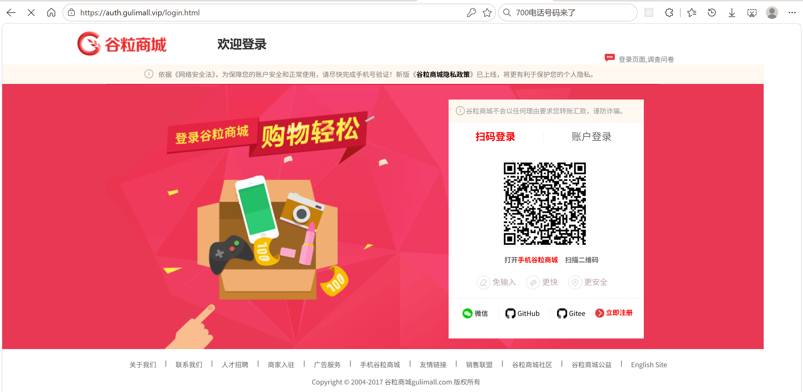
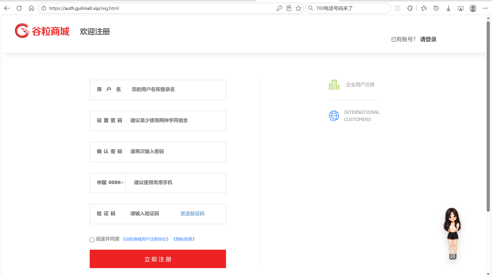
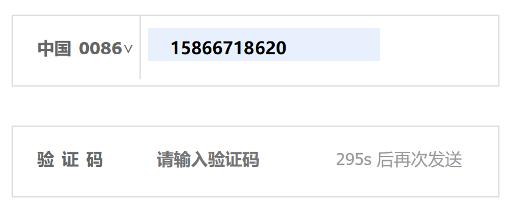
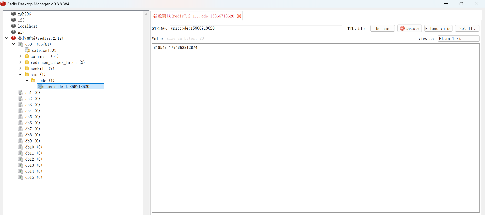
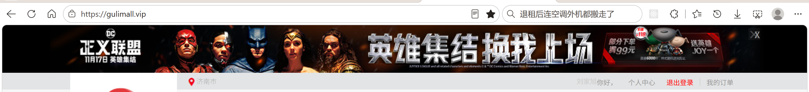
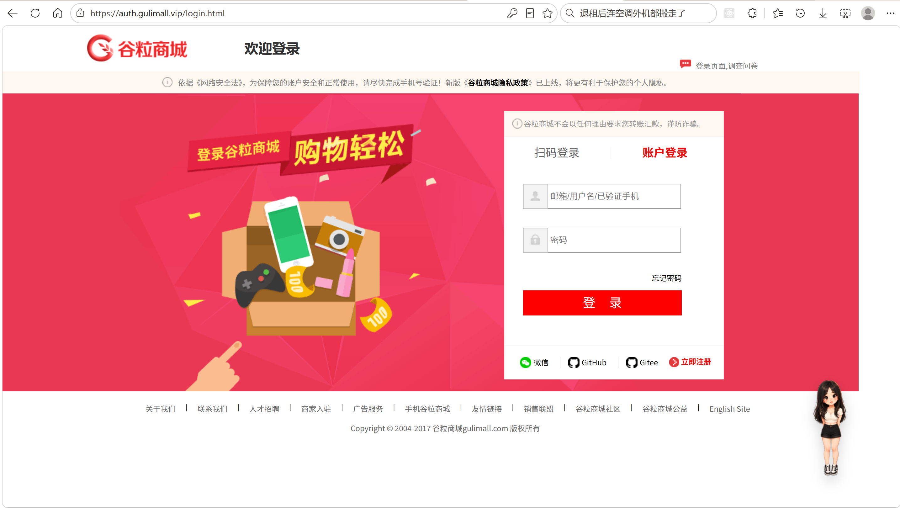

# 9.1 登录与短信注册-介绍

> 用户端登录由账号密码和短信验证码注册两部分组成。本篇讲清登录页的入口、短信验证码的发送与频控、注册参数校验、会员落库、密码加密、登录态写入 Spring Session，以及登录成功后的重定向与失败回填。

---

## 1. 这个功能是干什么的

登录解决“证明这个请求属于哪个会员”的问题。注册解决“会员第一次进入系统时怎么创建账号”的问题。

用户端把这两件事拆成两条独立通道：

| 通道 | 入口 | 凭证 | 结果 |
|---|---|---|---|
| 账号密码登录 | `POST /login` | 用户名或手机号 + 密码 | 会员信息写入会话 |
| 短信验证码注册 | `GET /sms/sendCode` + `POST /regist` | 手机号 + 短信验证码 | 新增 `ums_member` 记录 |

登录成功后，登录态由三部分组成：

```text
凭证    账号密码
会话    MemberResponseVo 写入 HttpSession，由 Spring Session 落到 Redis
共享    Cookie GULIMALLSESSION，Domain=gulimall.vip，所有子域共用
```

登录页部署在 `auth.gulimall.vip`，商城首页在 `gulimall.vip`，购物车、订单、秒杀、个人中心分别在自己的子域。登录动作只在 auth-server 完成，其他子域从 Redis 读取同一份会话。

模块分工：

| 模块 | 职责 |
|---|---|
| gulimall-auth-server | 登录页、注册页、验证码发送、注册提交、写会话 |
| gulimall-member | 会员落库、账号密码校验、默认会员等级 |
| gulimall-third-party | 调用阿里云云市场发送短信 |
| gulimall-common | 统一返回 `R`、错误码、会话常量、公共模型注入 |

## 2. 用户怎么操作

### 2.1 账号密码登录

1. 浏览器打开 `http://auth.gulimall.vip/login.html`。
2. 页面显示账号登录表单，输入用户名或已验证手机号、密码。
3. 点击“登录”，表单提交到 `POST /login`。
4. auth-server 通过 Feign 调 member 校验账号密码。
5. 校验通过后写入会话，签发用户端 agent JWT，再按目标地址重定向。
6. 校验失败时回到登录页，页面顶部显示失败原因。



登录表单同时带一个隐藏字段 `returnUrl`。从秒杀确认页、购物车跳到登录页时，这个字段保存原页面地址，登录成功后可以回到原页面。

### 2.2 短信验证码注册

1. 在登录页点击“立即注册”，进入 `http://auth.gulimall.vip/reg.html`。
2. 填写用户名、密码、确认密码、手机号。
3. 点击“发送验证码”，按钮先变成“发送中...”，成功后进入 300 秒倒计时。
4. 手机收到 6 位验证码，填回页面。
5. 勾选注册协议，点击“立即注册”。
6. 后端校验参数、两次密码、验证码，全部通过后调用 member 新增会员。
7. 注册成功回到登录页，用刚设置的账号密码登录。



### 2.3 注册失败后的回填

1. 参数校验失败、两次密码不一致、验证码错误、用户名或手机号重复时，后端不直接渲染错误页。
2. 后端把错误提示和需要回填的用户名、手机号写入 Redis，生成一次性 token。
3. 浏览器被重定向到 `reg.html?errors={token}`。
4. 注册页用 token 取出提示，显示在对应字段下方，并回填用户名和手机号。
5. 如果手机号还在 5 分钟发送冷却期内，按钮一进入页面就是倒计时状态。

### 2.4 退出登录

1. 点击页面上的“退出登录”，请求 `GET /logout.html`。
2. auth-server 调 `session.invalidate()`，删除 Redis 里的会话并下发过期 Cookie。
3. 同时清除 agent JWT Cookie。
4. 浏览器回到登录页。

## 3. 整体设计思路

### 3.1 业务上怎么设计

#### 3.1.1 注册与登录分开

短信验证码只用于注册，不用于登录。注册成功后回到登录页，用账号密码进入系统。这样设计的原因：

1. 登录通道只有一条主路径，账号密码校验逻辑集中，排查问题简单。
2. 短信验证码只承担“证明手机号属于注册人”的职责，不参与日常登录，减少短信成本和被刷风险。
3. 注册成功后的账号就是普通账号，后续可以走社交绑定、改密码、个人中心等通用流程。

#### 3.1.2 验证码频控

1. 同一个手机号 5 分钟内只能发送一次。
2. 验证码在 Redis 里保留 10 分钟。
3. 验证码由服务端生成，用户只填手机号。
4. 只有发送成功才写缓存，发送失败允许立即重试。
5. 只有注册成功才删除验证码，注册失败保留，用户改完信息可以继续用。

频控和验证码共用一个 Redis key，值为“验证码_发送时间”：

```text
key    sms:code:{phone}
value  {6位验证码}_{发送时间毫秒值}
TTL    10 分钟
```

发送前读 key，用当前时间减发送时间，小于 5 分钟就拒绝。超过 10 分钟 key 自动过期，视为从未发送。

#### 3.1.3 密码加密

1. 注册时使用 BCrypt，cost=12。
2. 数据库只存哈希串，不存明文，也无法还原明文。
3. 同一密码每次 `encode()` 结果不同，因为 BCrypt 自带随机盐。
4. 登录时用 `matches()` 比对，不能用字符串相等。

密码长度限制为 6 到 18 位。用户名限制为 6 到 19 位，提示文案写的是 6-18，实际校验以注解参数为准。

#### 3.1.4 登录态写入 Session

1. 登录成功后把会员信息转成 `MemberResponseVo`。
2. `MemberResponseVo` 只保留 id、用户名、昵称、头像、手机号、邮箱、等级、积分、成长值，不带密码。
3. 会员信息写入 `HttpSession`，Spring Session 再序列化到 Redis。
4. 浏览器只拿到 `GULIMALLSESSION` 这个会话 id，不拿到会员明文。

#### 3.1.5 登录失败回填

登录失败只需要一条提示，使用 `RedirectAttributes.addFlashAttribute("msg", ...)`，由 Spring 在重定向后取出并显示。

注册失败需要回填多个字段，且要避免密码进入会话或浏览器历史，所以改成“Redis + 一次性 token”。URL 上只有随机 token，内容留在服务端，用户按 F5 刷新时提示已经被取走。

#### 3.1.6 登录后的跳转

1. `returnUrl` 只接受商城自己的域名，防止开放重定向。
2. 没有默认收货地址的会员，先去个人中心补地址。
3. 补完地址后回到原目标页。
4. 已有默认地址的会员，直接回目标页。

### 3.2 技术上怎么设计

#### 3.2.1 auth-server 只做入口

auth-server 负责页面渲染、验证码收发、参数校验、会话写入。会员查询、密码比对、会员落库都放在 member 服务。这样 auth-server 不需要连 `gulimall_ums` 库，职责边界清晰。

#### 3.2.2 Feign 调 member

auth-server 通过 `MemberFeignClient` 调 member：

```text
POST member/member/login    账号密码登录
POST member/member/regist   注册
```

Feign 是同步客户端，返回普通对象 `R`，不返回 `Mono`。`Mono` 是 Reactor 内部类型，Jackson 无法反序列化。

#### 3.2.3 Redis 验证码

验证码由 auth-server 生成并校验。third-party 只负责把“手机号 + 验证码”发给阿里云，不生成、不存储、不校验。这样验证码的归属权在 auth-server，第三方服务不持有业务状态。

#### 3.2.4 BCrypt

member 的 `regist` 使用 `new BCryptPasswordEncoder(12)` 加密。登录使用 `new BCryptPasswordEncoder()` 比对，cost 从数据库里的哈希串读取，不需要在登录时指定。

#### 3.2.5 Spring Session

auth-server 和 member 都引入 `spring-session-data-redis`。三个配置必须完全一致：

```text
spring.session.redis.namespace       gulimall:session
server.servlet.session.cookie.name   GULIMALLSESSION
server.servlet.session.cookie.domain gulimall.vip
```

auth-server 写入会话后，member、product、cart、order、seckill 都能从 Redis 读到同一个 `loginUser`。

#### 3.2.6 短信发送

third-party 使用 Spring 6 的声明式 HTTP Interface + WebClient 调阿里云云市场。请求体是表单，鉴权头是 `Authorization: APPCODE {appCode}`。auth-server 通过 `SmsFeignClient` 调 third-party 的 `/sms/send`。

#### 3.2.7 前端倒计时

发送成功后按钮进入 300 秒倒计时。注册失败回跳时，服务端会算出剩余冷却秒数，通过 `data-cooldown` 传给页面，页面一加载就恢复倒计时，避免按钮看起来可点、点击却报频率过高。

## 4. 详细代码、配置和解释

登录与短信注册横跨三个服务：auth-server 负责页面、验证码和会话，member 负责会员数据与密码校验，third-party 负责短信出口。第 4 章按“类为什么存在 → 关键字段与接口 → 正常链路 → 代码分块解释 → 一次完整示例 → 边界”组织。每个小节先说明它在登录或注册链路中的位置，再进入代码。

### 4.1 UserLoginVo 与 UserRegisterVo：登录注册入参

#### 4.1.1 这两个类解决什么问题

登录页和注册页都是浏览器原生表单，提交内容是 `application/x-www-form-urlencoded`。auth-server 如果用零散的 `@RequestParam` 接收，字段名、校验规则和提示文案会散落在多个 Controller 方法里；member 又需要同一份注册字段做落库。两个 VO 把表单契约固定下来，放在 `gulimall-api`，auth-server 与 member 共用同一份定义。

`UserLoginVo` 只承载登录的两个字段，不承担业务校验，账号是否存在、密码是否正确由 member 判断。`UserRegisterVo` 承载注册字段，并在字段上放 Jakarta Validation 注解，作为第一层参数校验。

调用链路：

```text
login.html → LoginController → MemberFeignClient → MemberController → MemberServiceImpl
reg.html   → RegController  → MemberFeignClient → MemberController → MemberServiceImpl
```

#### 4.1.2 字段与校验规则

| 字段 | 所属 VO | 校验注解 | 业务含义 |
|---|---|---|---|
| `loginacct` | `UserLoginVo` | 无 | 登录账号，可以是用户名或已验证手机号 |
| `password` | `UserLoginVo` | 无 | 登录密码 |
| `userName` | `UserRegisterVo` | `@NotEmpty`、`@Length(6,19)` | 注册用户名，落库到 `ums_member.username` |
| `password` | `UserRegisterVo` | `@NotEmpty`、`@Length(6,18)` | 注册密码，最终以 BCrypt 哈希落库 |
| `password2` | `UserRegisterVo` | `@NotEmpty`、`@Length(6,18)` | 确认密码，只用于两次输入比对 |
| `phone` | `UserRegisterVo` | `@NotEmpty`、`@Pattern` | 手机号，落库到 `ums_member.mobile` |
| `code` | `UserRegisterVo` | `@NotEmpty` | 短信验证码，与 Redis 中的值比对 |
| `agreement` | `UserRegisterVo` | `@NotEmpty`、`@Pattern("^on$")` | 注册协议复选框，勾选后浏览器提交 `on` |

校验注解只解决“字段是否为空、长度和格式是否合法”。用户名与手机号是否重复、验证码是否正确、两次密码是否一致，都在后续链路中判断。

#### 4.1.3 代码与解释

登录 VO 是 auth-server 与 member 之间的登录契约，字段名必须和登录页的 `name` 属性一致。

```java
@Data
public class UserLoginVo {

    private String loginacct;

    private String password;
}
```

1. `loginacct` 对应登录页输入框的 `name="loginacct"`，Spring MVC 按字段名绑定。
2. `password` 对应密码输入框，原样传给 member。
3. 两个字段都没有校验注解，空账号也会进入远程调用，入口层不拦截。
4. 类放在 `gulimall-api`，auth-server 组装、member 接收，不需要各自复制一份。

注册 VO 除了承载字段，还承担第一层格式校验。校验结果由 `@Valid` 触发，错误进入 `BindingResult`。

```java
@Data
public class UserRegisterVo {

    @NotEmpty(message = "用户名不能为空")
    @Length(min = 6, max = 19, message="用户名长度在6-18字符")
    private String userName;

    @NotEmpty(message = "密码必须填写")
    @Length(min = 6,max = 18,message = "密码必须是6—18位字符")
    private String password;

    @NotEmpty(message = "密码必须填写")
    @Length(min = 6,max = 18,message = "密码必须是6—18位字符")
    private String password2;

    @NotEmpty(message = "手机号不能为空")
    @Pattern(regexp = "^1([3-9])[0-9]{9}$", message = "手机号格式不正确")
    private String phone;

    @NotEmpty(message = "验证码不能为空")
    private String code;

    @NotEmpty(message = "必须同意协议")
    @Pattern(regexp = "^on$", message = "必须同意协议")
    private String agreement;

}
```

1. `userName`：非空，长度 6 到 19。提示文案写的是 6-18，和注解上限不一致。
2. `password`：非空，长度 6 到 18。
3. `password2`：规则与 `password` 相同，非空和长度在进入 Controller 方法体前就会被检查。
4. `phone`：非空，并且匹配 `^1([3-9])[0-9]{9}$`，即 11 位、第二位为 3 到 9 的手机号。
5. `code`：只校验非空，是否正确由 RegController 查 Redis 判断。
6. `agreement`：非空，并且必须等于 `on`。浏览器复选框勾选后提交的默认值就是 `on`，未勾选时字段不存在。
7. 多个注解同时命中时，同一个字段会产生多条错误，RegController 需要合并，不能直接 `toMap`。

#### 4.1.4 一次表单绑定示例

```text
1. reg.html 提交：
   userName=zhangsan&password=123456&password2=123456&phone=13800138000&code=123456&agreement=on
2. Spring MVC 按字段名把参数绑定到 UserRegisterVo
3. @Valid 触发注解校验，全部通过，BindingResult 无错误
4. 如果 agreement 没勾选：
   该字段不存在 → @NotEmpty 报“必须同意协议” → BindingResult 记录错误
5. 如果 phone 填了 123：
   @Pattern 报“手机号格式不正确” → 同一个字段可能同时出现“不能为空”和“格式不正确”
6. RegController 读取 BindingResult，按字段名把错误放进 Map，再走失败回填
```

#### 4.1.5 边界与可优化点

1. `userName` 的 `@Length(max = 19)` 和提示文案“6-18”不一致，上限应以一处为准。
2. 密码只校验长度，没有大小写、数字、特殊字符的组合要求，弱密码可以直接注册。
3. `agreement` 用字符串加正则表达布尔语义，改成 `Boolean` 加 `@AssertTrue` 更直接，也不依赖浏览器提交值。
4. `UserLoginVo` 没有入口层校验，空账号会直接进入 member 查询，错误只能在远程调用返回后暴露。
5. 注册 VO 的校验提示直接作为页面文案返回，文案调整会牵动前端展示位置。

### 4.2 LoginController：登录、退出与安全跳转

#### 4.2.1 这个类解决什么问题

登录页部署在 `auth.gulimall.vip`，浏览器提交的登录请求必须先落到 auth-server。`LoginController` 是账号密码通道的入口：渲染登录页、接收表单、调 member 校验、把会员写进共享会话、签发 agent JWT、决定登录后去哪里、处理退出。

调用方是浏览器和 `login.html`；下游是 `MemberFeignClient`、`LoginRedirectService`、`AgentJwtService` 和 Spring Session。Controller 本身不查数据库，也不比对密码，这两件事都在 member。

#### 4.2.2 接口清单

| 操作 | 方法与路径 | 输入 | 下游动作 | 输出 |
|---|---|---|---|---|
| 打开登录页 | `GET /login.html` | `returnUrl`（可选） | 无 | 渲染 `login` 模板 |
| 提交登录 | `POST /login` | `UserLoginVo`、`returnUrl` | 调 member 校验、写 Session、签 JWT、决定跳转 | 重定向或回登录页 |
| 退出登录 | `GET /logout.html` | 当前 Session | 作废会话、清 JWT Cookie | 重定向登录页 |

#### 4.2.3 正常登录链路

```text
浏览器 GET /login.html?returnUrl=...
  → Controller 把 returnUrl 放进 Model
  → Thymeleaf 渲染登录表单
  → 用户提交 POST /login
  → MemberFeignClient.login(UserLoginVo)
  → member 返回 R，code=0 表示账号密码正确
  → 从 data 取出 MemberResponseVo
  → 写入 HttpSession，key=loginUser
  → 签发 agent JWT，写入 HttpOnly Cookie
  → 校验 returnUrl 是否属于商城域名
  → LoginRedirectService 决定回目标页还是先去个人中心
```

#### 4.2.4 代码与解释

Controller 的代码可以分成配置字段、登录页渲染、登录提交、安全地址校验、退出五块。登录提交只做编排，具体规则交给下游组件。

```java
@Controller
public class LoginController {

    /** 登录成功后重定向要用 */
    @Value("${gulimall.shop-home-url}")
    private String shopHomeUrl;
    @Value("${gulimall.auth-url}")
    private String authUrl;
    @Value("${gulimall.order-url}")
    private String orderUrl;
    @Value("${gulimall.cart-url}")
    private String cartUrl;
    @Value("${gulimall.seckill-url}")
    private String seckillUrl;
    @Value("${gulimall.member-url}")
    private String memberUrl;

    @Autowired
    private MemberFeignClient memberFeignClient;

    @Autowired
    private LoginRedirectService loginRedirectService;

    @Autowired
    private AgentJwtService agentJwtService;

    @GetMapping(path = {"", "/login.html"})
    public String login(@RequestParam(value = "returnUrl", required = false) String returnUrl,
                        Model model) {
        // 从秒杀/购物车跳过来时带上原地址，登录后可以回去
        model.addAttribute("returnUrl", returnUrl);
        return "login";
    }

    /**
     * 用户密码登录，成功后写入 Spring Session 和用户端 agent JWT Cookie。
     *
     * @param userLoginVo 登录表单
     * @param returnUrl 登录后要返回的站内地址，可为空
     * @param redirectAttributes 登录失败时的提示参数
     * @param session 当前用户 Session
     * @param response 当前 HTTP 响应，用于写 agent JWT Cookie
     * @return 登录成功后的重定向地址
     */
    @PostMapping("/login")
    public String login(UserLoginVo userLoginVo,
                        @RequestParam(value = "returnUrl", required = false) String returnUrl,
                        RedirectAttributes redirectAttributes,
                        HttpSession session,
                        HttpServletResponse response) {

        R login = memberFeignClient.login(userLoginVo);
        if (login.getCode() == 0) {
            // 登录成功：把会员信息写进 session（Spring Session → Redis）。
            // 前台 gulimall.com 才读得到 —— 和社交登录走的是同一条路，
            // 只是前面拿凭证的方式不同
            MemberResponseVo member = login.getData("data", new TypeReference<MemberResponseVo>() {
            });
            session.setAttribute(AuthServerConstant.LOGIN_USER, member);
            // 登录成功同时签发 agent 专用 JWT，写入 HttpOnly Cookie
            agentJwtService.issue(member, response);
            // 只允许跳回商城自己的域名，防止开放重定向
            String target = isSafeReturnUrl(returnUrl) ? returnUrl : shopHomeUrl;
            // 没有默认地址先去个人中心设置，设置完再回目标页
            return loginRedirectService.afterLogin(member, target);
        } else {
            // 登录失败
            redirectAttributes.addFlashAttribute("msg", login.get("msg").toString());
            return "redirect:" + authUrl + "/login.html";
        }

    }

    private boolean isSafeReturnUrl(String returnUrl) {
        if (returnUrl == null || returnUrl.isBlank()) {
            return false;
        }
        return returnUrl.startsWith(shopHomeUrl)
                || returnUrl.startsWith(authUrl)
                || returnUrl.startsWith(orderUrl)
                || returnUrl.startsWith(cartUrl)
                || returnUrl.startsWith(seckillUrl)
                || returnUrl.startsWith(memberUrl);
    }

    /**
     * 退出登录
     *
     * <p>{@code invalidate()} 会把整个会话作废 —— 对 Spring Session 而言，
     * 就是删掉 Redis 里那条会话记录，同时下发一个过期的 cookie。
     * 之后前台再读到这个 cookie 也查不到会话，等同于未登录。
     *
     * @param session 当前用户 Session
     * @param response 当前 HTTP 响应，用于清除 agent JWT Cookie
     * @return 退出后的登录页地址
     */
    @GetMapping("/logout.html")
    public String logout(HttpSession session, HttpServletResponse response) {
        session.invalidate();
        agentJwtService.clear(response);
        return "redirect:" + authUrl + "/login.html";
    }

}
```

1. `@Value` 注入商城首页、登录页、订单、购物车、秒杀、个人中心的地址。登录成功后的重定向和 `returnUrl` 白名单都依赖这些配置，地址不能在代码里写死。
2. `GET /login.html` 把 `returnUrl` 放进 Model。没有该参数时传 `null`，模板仍能渲染空隐藏字段。
3. `POST /login` 第一行调用 `memberFeignClient.login()`。Feign 是同步调用，返回时 member 的结果已经拿到。
4. `login.getCode() == 0` 表示账号密码校验通过。`getData("data", TypeReference)` 把 `R` 里的 `data` 反序列化成 `MemberResponseVo`，而不是会员实体。
5. `session.setAttribute(AuthServerConstant.LOGIN_USER, member)` 把会员写进会话。Spring Session 会把会话序列化到 Redis，Cookie 里只有会话 id。
6. `agentJwtService.issue(member, response)` 另发一个 agent 专用 JWT，写进 HttpOnly Cookie，供后续需要 JWT 的链路使用。
7. `isSafeReturnUrl(returnUrl) ? returnUrl : shopHomeUrl` 决定重定向目标。原地址不在白名单时回首页，避免开放重定向。
8. `loginRedirectService.afterLogin(member, target)` 继续判断会员有没有默认收货地址。没有默认地址先去个人中心，有则直接回目标页。
9. 登录失败时，把 member 返回的 `msg` 放进 Flash 属性，重定向回登录页。Flash 属性只在下一次请求可见。
10. `isSafeReturnUrl` 先排除 `null` 和空白串，再用六个站点的地址做前缀匹配。`//evil.com`、`javascript:` 没有协议和域名前缀，不会匹配。
11. `logout` 调 `session.invalidate()` 作废会话。对 Spring Session 而言就是删除 Redis 里的会话记录，并下发过期 Cookie；随后清理 agent JWT Cookie。

#### 4.2.5 一次登录示例

```text
1. 用户从购物车跳到登录页：
   GET http://auth.gulimall.vip/login.html?returnUrl=http://cart.gulimall.vip/cart.html
2. 页面隐藏字段 returnUrl 保存该地址
3. 用户输入 zhangsan / 123456，提交 POST /login
4. memberFeignClient.login 返回 code=0、data=MemberResponseVo
5. session 写入 loginUser，Redis 生成 gulimall:session 记录
6. agentJwtService 写入 JWT Cookie
7. isSafeReturnUrl 判断 cart 地址在白名单内
8. LoginRedirectService 检查默认地址：
   有默认地址 → 302 到购物车
   没有默认地址 → 302 到个人中心地址页，补完再回购物车
9. 如果密码错误：Flash 写入 msg，302 回 /login.html，页面顶部显示提示
```

#### 4.2.6 它不做什么

1. 不查询会员表，账号是否存在由 member 判断。
2. 不比对密码，BCrypt 校验在 `MemberServiceImpl.login()`。
3. 不判断默认地址的具体规则，交给 `LoginRedirectService`。
4. 不处理注册，注册入口在 `RegController`。
5. 不生成 JWT 内容，签发和清理都封装在 `AgentJwtService`。

#### 4.2.7 边界与可优化点

1. 登录接口没有图形验证码、登录失败次数限制和账号锁定，生产环境容易被撞库。
2. `isSafeReturnUrl` 用 `startsWith` 比较字符串。若配置地址是 `http://gulimall.vip`，`http://gulimall.vip.evil.com` 仍会通过前缀判断，严格做法是解析 URL 后比较 host。
3. 登录失败提示直接使用 member 返回的 `msg`，需要保证该文案不含内部异常和 SQL 信息。
4. 会话与 JWT 同时存在，退出时两处都要清理；新增登录态载体时容易遗漏。
5. 会话固定攻击需要确认登录后会话 id 是否重新生成，当前代码没有显式处理。

### 4.3 RegController：发送短信验证码

#### 4.3.1 这个方法解决什么问题

注册页的“发送验证码”是公开接口，任何人都能按手机号调用。没有限制时，脚本可以反复请求，产生真实短信费用。`sendCode` 要同时完成四件事：按手机号做 5 分钟频控、服务端生成 6 位验证码、调用 third-party 真正发短信、发送成功后把验证码和发送时间写入 Redis。

调用方是 `reg.html` 的 jQuery GET；下游是 `SmsFeignClient` 和 third-party；Redis 保存 `sms:code:{phone}`。验证码不落数据库，注册成功后由提交方法删除。

#### 4.3.2 关键概念：一个 key 承担两件事

| 项目 | 内容 |
|---|---|
| key | `sms:code:{phone}` |
| value | `{6位验证码}_{发送时间毫秒值}` |
| TTL | 10 分钟 |
| 发送间隔 | 5 分钟 |
| 写入方 | `sendCode` |
| 读取方 | `sendCode` 频控、`regist` 校验、`reg` 恢复倒计时 |

频控和验证码共用一个 key，读一次既能拿到验证码，也能算出发送间隔。值里的时间戳是频控依据，下划线前的部分是验证码。超过 10 分钟 key 自动过期，视为从未发送。

#### 4.3.3 正常发送链路

```text
reg.html 点击发送验证码
  → GET /sms/sendCode?phone=...
  → 读 Redis sms:code:{phone}
  → 存在且距上次发送不足 5 分钟 → 返回 20001
  → 否则生成 6 位验证码
  → SmsFeignClient.send(phone, code)
  → third-party 调阿里云云市场
  → 响应内容包含 "status":"OK" 才视为成功
  → 写 Redis，value=验证码_当前时间，TTL 10 分钟
  → 返回 R.ok()
```

#### 4.3.4 代码与解释

方法按“读缓存判断频控 → 生成验证码 → 调短信服务 → 校验响应 → 写缓存”五段展开。顺序不能调整，尤其是发送和写缓存的先后关系。

```java
/**
 * 获取短信验证码
 *
 * <p>注意：<b>用户只输入手机号</b>，验证码由本服务生成后发给用户，
 * 用户从短信里看到再填回来。
 */
@ResponseBody
@GetMapping(value = "/sms/sendCode")
public R sendCode(@RequestParam("phone") String phone) {

    // 1、接口防刷：同一个手机号 5 分钟内只能发一次
    String redisCode = stringRedisTemplate.opsForValue()
            .get(AuthServerConstant.SMS_CODE_CACHE_PREFIX + phone);
    if (StringUtils.isNotEmpty(redisCode)) {
        // 缓存里存的是 "验证码_发送时间"，用当前时间减一下就知道隔了多久
        long lastSendTime = Long.parseLong(redisCode.split("_")[1]);
        if (System.currentTimeMillis() - lastSendTime < SEND_INTERVAL_MS) {
            return R.error(BizCodeEnum.SMS_CODE_EXCEPTION.getCode(),
                    BizCodeEnum.SMS_CODE_EXCEPTION.getMsg());
        }
    }

    // 2、生成 6 位验证码（服务端生成，用户不需要输入）
    String codeNum = String.valueOf((int) ((Math.random() * 9 + 1) * 100000));

    // 3、先发短信、再写缓存 —— 顺序不能反：
    //    若先写缓存，一旦发送失败，用户收不到码却要干等 5 分钟才能重发
    String response;
    try {
        // ⚠️ Feign 是【同步】调用 —— 这一行返回时结果已经拿到了，不需要额外等待
        //    （和 WebFlux 的 Mono 不同，那个才需要 block/订阅）
        response = smsFeignClient.send(phone, codeNum);
    } catch (Exception e) {
        log.error("调用短信服务失败，phone={}", phone, e);
        return R.error(BizCodeEnum.SMS_SEND_EXCEPTION.getCode(),
                BizCodeEnum.SMS_SEND_EXCEPTION.getMsg());
    }

    // 4、第三方把阿里云的原始报文透传回来了，成功时形如 {"status":"OK", ...}
    //    它也可能返回 HTTP 200 但内容是错误，所以要看内容、不能只看状态码
    if (StringUtils.isEmpty(response) || !response.contains("\"status\":\"OK\"")) {
        log.error("短信发送失败，phone={}，第三方响应={}", phone, response);
        return R.error(BizCodeEnum.SMS_SEND_EXCEPTION.getCode(),
                BizCodeEnum.SMS_SEND_EXCEPTION.getMsg());
    }

    // 5、发送成功才写缓存：值为 "验证码_发送时间"
    //    验证码用于后续校验，时间戳用于上面那段的 5 分钟冷却判断
    stringRedisTemplate.opsForValue().set(
            AuthServerConstant.SMS_CODE_CACHE_PREFIX + phone,
            codeNum + "_" + System.currentTimeMillis(),
            CODE_TTL_MINUTES, TimeUnit.MINUTES);

    return R.ok();
}
```

1. 按 `SMS_CODE_CACHE_PREFIX + phone` 读取缓存。前缀来自 `AuthServerConstant`，值为空说明没有发送记录。
2. 值存在时用下划线切分，取第二段作为上次发送时间。`System.currentTimeMillis() - lastSendTime < SEND_INTERVAL_MS` 表示还在 5 分钟冷却期，直接返回 20001。
3. 生成 6 位验证码：`Math.random() * 9 + 1` 得到 1 到 10 之间的小数，乘 100000 后取整，范围是 100000 到 999999。
4. 通过 `SmsFeignClient` 调 third-party。Feign 是同步客户端，方法返回时短信结果已经拿到；抛异常说明网络或服务调用失败，返回 20002。
5. 第三方可能返回 HTTP 200 但业务失败，所以检查响应内容是否包含 `"status":"OK"`，而不是只看状态码。内容为空或不包含该标记都按失败处理。
6. 只有发送成功才写缓存，值为 `验证码_当前时间`，TTL 10 分钟。
7. 返回 `R.ok()`。前端只看 `code` 是否为 0。

先发短信再写缓存的顺序有明确原因：如果先写缓存，发送失败时用户收不到短信，却要等 5 分钟才能重发；当前顺序下，发送失败不占冷却，可以立即重试。

#### 4.3.5 一次发送示例

```text
1. 手机号 13800138000 首次发送，Redis 无 sms:code:13800138000
2. 生成验证码 483920
3. third-party 返回 {"status":"OK","data":...}
4. 写 Redis：sms:code:13800138000 = "483920_1731200000000"，TTL 10 分钟
5. 用户 2 分钟后再次点击：
   elapsed=120000，小于 300000 → 返回 20001
6. 用户 6 分钟后再点：
   elapsed=360000，大于 300000 → 允许重发，旧验证码被新值覆盖
```

#### 4.3.6 它不做什么

1. 不校验验证码，校验发生在注册提交时。
2. 不创建会员，注册落库在 member。
3. 不把验证码写入数据库，只有 Redis 一份。
4. 不做图形验证码、IP 限流和设备指纹。
5. 不判断手机号是否已经注册，重复注册由 member 的唯一性检查拦截。

#### 4.3.7 边界与可优化点

1. `Math.random()` 不是密码学安全随机数，验证码应改用 `SecureRandom`。
2. 频控只按手机号，攻击者可以换手机号继续刷；生产环境应同时按 IP、设备、接口维度限流。
3. 发送入口没有图形验证码或行为验证，批量脚本可以直接消耗短信额度。
4. 5 分钟间隔依赖 Redis 里的时间戳，多实例机器时钟偏差会影响边界判断。
5. 第三方响应通过字符串包含判断，报文格式调整时会误判，解析 JSON 更稳妥。
6. 验证码 TTL 10 分钟、冷却 5 分钟，重发会覆盖旧验证码，用户手里的旧短信立即失效。

### 4.4 RegController：注册页、注册提交与失败回填

#### 4.4.1 这段代码解决什么问题

注册提交可能失败在很多点：参数格式、两次密码、验证码、用户名重复、手机号重复。失败后要让用户看到原因并保留已填内容，但密码不能回填，也不能进入 URL。`RegController` 用三个方法配合解决这件事：

1. `GET /reg.html` 渲染页面、恢复验证码冷却、取出一次性错误提示；
2. `POST /regist` 按顺序校验并调用 member 落库；
3. `redirectWithErrors` 把错误提示和需要回填的字段写进 Redis，再带 token 重定向。

上游是 `reg.html`；下游是 `MemberFeignClient.regist` 和 Redis。验证码只在注册成功后删除，失败保留，用户改完信息可以继续用。

#### 4.4.2 关键概念：一次性 token 与冷却恢复

| 项目 | 内容 |
|---|---|
| URL 参数 | `reg.html?errors={token}` |
| Redis key | `REG_ERROR_CACHE_PREFIX + token` |
| payload | `errors`、`userName`、`phone` |
| TTL | 5 分钟 |
| 取出方式 | `getAndDelete`，原子取出并删除 |
| 冷却来源 | `sms:code:{phone}` 里的发送时间戳 |

URL 上只有随机 UUID，错误内容和回填内容留在服务端。`getAndDelete` 保证一组提示只被消费一次，用户按 F5 刷新时不会重复显示。payload 里不放 `password` 和 `password2`，密码不进入 Redis，也不进入浏览器历史。

#### 4.4.3 正常注册链路

```text
reg.html 提交 POST /regist
  → @Valid 校验 UserRegisterVo
  → 有错误 → redirectWithErrors → Redis 存提示 → 302 回 reg.html?errors=token
  → 校验两次密码
  → 读 Redis 验证码，判断存在与匹配
  → MemberFeignClient.regist
  → member 返回非 0 → redirectWithErrors
  → 全部通过 → 删除验证码 → 302 登录页
```

#### 4.4.4 代码与解释

注册页渲染方法承担两件事：把失败提示和已填字段放回 Model，以及根据手机号算出验证码冷却剩余秒数。

```java
@GetMapping(path = "/reg.html")
public String reg(Model model,
                  @RequestParam(value = "errors", required = false) String errorToken) {

    // 验证码冷却剩余秒数，默认 0（不在冷却期）。
    // 模板据此决定要不要一进来就把按钮切成倒计时状态
    model.addAttribute("smsCooldownSeconds", 0);

    // 注册失败重定向回来时，URL 上带着一次性 token。
    // getAndDelete 是【原子】的"取出并删除" —— 所以这组数据只会被取到一次，
    // 用户按 F5 刷新时已经取不到了（符合预期：提示看完就该消失）
    if (StringUtils.isNotEmpty(errorToken)) {
        String json = stringRedisTemplate.opsForValue()
                .getAndDelete(REG_ERROR_CACHE_PREFIX + errorToken);
        if (StringUtils.isNotEmpty(json)) {
            Map<String, Object> payload = JSON.parseObject(
                    json, new TypeReference<Map<String, Object>>() {
                    });

            // 错误提示：字段名 -> 提示语。模板用 #maps.containsKey(errors, 'xxx') 取
            model.addAttribute("errors", payload.get("errors"));

            // 回填用户提交过的内容。
            // ⚠️ 只有用户名和手机号 —— 密码类字段【不在 payload 里】（见 redirectWithErrors）
            model.addAttribute("userName", payload.get("userName"));
            String phone = (String) payload.get("phone");
            model.addAttribute("phone", phone);

            // 顺手算一下这个手机号的验证码冷却还剩多久。
            // 不算的话，注册失败回跳后按钮看起来可点，用户一点却被告知
            // "验证码获取频率太高" —— 在用户眼里就是个 bug
            model.addAttribute("smsCooldownSeconds", remainingCooldownSeconds(phone));
        }
    }

    return "reg";
}

/**
 * 某个手机号的验证码冷却还剩多少秒（不在冷却期返回 0）
 *
 * <p>Redis 里存的是 "验证码_发送时间"，用当前时间减一下就知道隔了多久 ——
 * 判断逻辑与 {@link #sendCode} 里的防刷完全一致，两边别写岔了。
 */
private int remainingCooldownSeconds(String phone) {
    if (StringUtils.isEmpty(phone)) {
        return 0;
    }
    String redisCode = stringRedisTemplate.opsForValue()
            .get(AuthServerConstant.SMS_CODE_CACHE_PREFIX + phone);
    if (StringUtils.isEmpty(redisCode)) {
        return 0;
    }
    long lastSendTime = Long.parseLong(redisCode.split("_")[1]);
    long elapsed = System.currentTimeMillis() - lastSendTime;
    if (elapsed >= SEND_INTERVAL_MS) {
        return 0;
    }
    return (int) ((SEND_INTERVAL_MS - elapsed) / 1000);
}
```

1. `smsCooldownSeconds` 默认设为 0。不在冷却期时，模板里的按钮保持可点状态。
2. URL 带 `errors` 时，用 `getAndDelete` 从 Redis 原子取出 JSON 并删除。第二次访问同一个 token 取不到内容。
3. 解析 JSON 成 `Map<String, Object>`，包含 `errors`、`userName`、`phone` 三个键。
4. `errors` 放进 Model，模板按字段名判断并显示对应提示。
5. 只回填 `userName` 和 `phone`。密码字段不在 payload 里，页面上密码输入框始终为空。
6. `remainingCooldownSeconds(phone)` 读同一个验证码 key，用发送时间计算剩余秒数。计算方式和 `sendCode` 的频控判断一致。
7. 返回 `reg` 模板，页面加载时用剩余秒数恢复倒计时。

注册提交方法按“参数校验 → 两次密码 → 验证码存在 → 验证码匹配 → 远程注册 → 删除验证码”的顺序短路，每一步失败都走同一个回填出口。

```java
/**
 * 注册功能
 *
 * <p>任何一步失败都是「存提示 → 带 token 重定向回注册页」，不再用
 * {@code RedirectAttributes.addFlashAttribute()}（原因见 {@link #redirectWithErrors}）。
 *
 * @param userRegisterVo 注册页用户信息
 * @param result         参数校验结果
 * @return 成功跳登录页，失败跳回注册页
 */
@PostMapping("/regist")
public String regist(@Valid UserRegisterVo userRegisterVo, BindingResult result) {

    // 1、校验参数（也可以写全局异常处理）
    if (result.hasErrors()) {
        Map<String, String> errorMap = result.getFieldErrors().stream().collect(Collectors.toMap(
                FieldError::getField,
                fieldError -> fieldError.getDefaultMessage() != null
                        ? fieldError.getDefaultMessage()
                        : "存在参数校验失败，请检查！",
                // ⚠️ 合并函数：同一个字段可能有多条校验错误，不能省。
                //    典型场景 —— 手机号为空时，@NotEmpty 和 @Pattern 会【同时】报错：
                //        phone -> "手机号不能为空"
                //        phone -> "手机号格式不正确"
                //    这里用 "&" 把多条错误拼起来，信息一条都不丢。
                (existing, replacement) -> existing + "&" + replacement
        ));
        return redirectWithErrors(userRegisterVo, errorMap);
    }

    // 2、两次密码必须一致。
    //    前端也可以先比一遍给用户即时反馈，但后端这一道【必须有】——
    //    请求可以绕过页面直接构造，前端校验只是体验，不是防线
    if (!userRegisterVo.getPassword().equals(userRegisterVo.getPassword2())) {
        return redirectWithErrors(userRegisterVo, Map.of("password2", "两次输入的密码不一致"));
    }

    // 3、校验验证码
    String codeKey = AuthServerConstant.SMS_CODE_CACHE_PREFIX + userRegisterVo.getPhone();
    String codeValue = stringRedisTemplate.opsForValue().get(codeKey);
    if (StringUtils.isEmpty(codeValue)) {
        return redirectWithErrors(userRegisterVo, Map.of("code", "验证码不存在或已过期"));
    }

    String code = codeValue.split("_")[0];
    if (!code.equals(userRegisterVo.getCode())) {
        return redirectWithErrors(userRegisterVo, Map.of("code", "验证码不匹配"));
    }

    // 3、调用会员服务进行注册
    R registResult = memberFeignClient.regist(userRegisterVo);
    if (registResult.getCode() != 0) {
        return redirectWithErrors(userRegisterVo, Map.of("msg", registResult.get("msg").toString()));
    }

    // 4、注册成功才删除验证码。
    //    删在前面的话，注册失败（比如用户名重复）时验证码已经没了，
    //    用户改完用户名重试会直接撞上"验证码不存在或已过期"，还得重新发短信
    stringRedisTemplate.delete(codeKey);

    // 注册成功回到登录页
    return "redirect:" + authUrl + "/login.html";
}
```

1. `result.hasErrors()` 为真时，把字段错误收集成 `Map<字段名, 提示>`。
2. `Collectors.toMap` 必须带合并函数。手机号为空时，`@NotEmpty` 和 `@Pattern` 会同时产生两条错误，合并函数用 `&` 拼接，避免抛 `IllegalStateException`。
3. 两次密码在服务端再比一次。前端校验只影响体验，请求可以绕过页面直接构造。
4. 读 `sms:code:{phone}`。值为空说明验证码没发过或已过期，返回“验证码不存在或已过期”。
5. 用下划线切出验证码，和用户输入比较。不匹配返回“验证码不匹配”。
6. 调 `memberFeignClient.regist`。返回码非 0 时，把 member 的提示转成 `msg` 错误回填。
7. 注册成功后才删除验证码。删除放在远程调用前会导致用户名重复时验证码已经消失，用户改完用户名还得重新发短信。
8. 全部通过后重定向登录页，注册流程结束，用户再用刚设置的账号密码登录。

失败回填方法只负责生成 token、挑选字段、写 Redis 和拼重定向地址，不参与业务判断。

```java
/**
 * 注册失败：把「错误提示 + 要回填的用户输入」存进 Redis，再带着一次性 token 重定向回注册页
 *
 * <p><b>为什么不用 {@code RedirectAttributes.addFlashAttribute()}？</b>
 * 那是把数据塞进<b>会话</b>里，由框架在重定向后取出并清除 —— 数据存在哪儿、
 * 什么时候被取走、被谁取走，对业务代码都是不透明的；一旦会话机制变动
 * （比如换成不共享的本地会话），行为就跟着变。
 *
 * <p>这里改成显式的「Redis + 一次性 token」：URL 上传的只是 token，内容存服务端，
 * 天然分布式友好、不受 cookie 限制；{@code getAndDelete} 保证"取一次就删"；
 * TTL（{@value #REG_ERROR_TTL_MINUTES} 分钟）兜底，用户不回来也不会残留。
 *
 * <p><b>安全性上有三点把握：</b>
 * <ol>
 *   <li>payload 里<b>只放需要回填的非敏感字段</b>（用户名、手机号）——
 *       密码类字段一个都不放，用户密码连 Redis 都不进</li>
 *   <li>URL 上只有随机 UUID，猜不到；内容在服务端，不在浏览器历史/日志里</li>
 *   <li>回填走 Thymeleaf 的 {@code th:value}，默认做 HTML 转义 ——
 *       即使用户名里塞了 {@code "><script>} 也只会被当成普通文本显示</li>
 * </ol>
 *
 * @param vo       提交的表单（用于挑出要回填的字段）
 * @param errorMap 字段名 -> 错误提示
 */
private String redirectWithErrors(UserRegisterVo vo, Map<String, String> errorMap) {
    String token = UUID.randomUUID().toString().replace("-", "");

    // ⚠️ 只挑【需要回填的字段】，绝不能图省事把整个 UserRegisterVo 塞进去 ——
    //    那里面带着 password / password2 的【明文】，等于把用户密码写进 Redis
    //    和可能被打进日志的序列化内容里
    Map<String, Object> payload = new HashMap<>();
    payload.put("errors", errorMap);
    payload.put("userName", vo.getUserName());
    payload.put("phone", vo.getPhone());

    stringRedisTemplate.opsForValue().set(
            REG_ERROR_CACHE_PREFIX + token,
            JSON.toJSONString(payload),
            REG_ERROR_TTL_MINUTES, TimeUnit.MINUTES);

    return "redirect:" + authUrl + "/reg.html?errors=" + token;
}
```

1. `UUID.randomUUID()` 生成一次性 token，去掉横线后作为 URL 参数。
2. payload 只放 `errors`、`userName`、`phone`。整个 VO 塞进去会把明文密码写进 Redis 和序列化日志。
3. payload 序列化成 JSON。
4. 以 `REG_ERROR_CACHE_PREFIX + token` 为 key 写入 Redis，TTL 5 分钟。
5. 拼出 `reg.html?errors={token}` 并重定向。浏览器只看到 token，看不到错误内容。

#### 4.4.5 一次失败与一次成功示例

失败示例：

```text
1. 用户提交 userName=zhangsan、password=123456、password2=654321、phone=13800138000、code=483920
2. @Valid 通过
3. 两次密码不一致 → redirectWithErrors(vo, {password2: "两次输入的密码不一致"})
4. 生成 token 7f3a...，Redis 写入 payload，TTL 5 分钟
5. 302 到 reg.html?errors=7f3a...
6. reg() 用 getAndDelete 取出 payload，并把 key 删除
7. 页面显示密码不一致提示，用户名和手机号回填，密码为空
8. 用户按 F5，token 已失效，提示不再显示
```

成功示例：

```text
1. 参数、两次密码、验证码全部通过
2. memberFeignClient.regist 返回 code=0
3. 删除 sms:code:13800138000
4. 302 到 login.html
5. 用户用 zhangsan / 123456 登录
```

#### 4.4.6 它不做什么

1. 不加密密码，BCrypt 加密在 member。
2. 不写会员表，落库由 member 完成。
3. 不做唯一性查询，用户名和手机号是否重复由 member 判断。
4. 不自动登录，注册成功后回登录页。
5. 不回填密码，payload 从设计上就不包含密码字段。
6. 不限制验证码尝试次数，只校验当前值是否匹配。

#### 4.4.7 边界与可优化点

1. `payload.get("errors")` 返回 `Object`，模板按 Map 结构取值，字段名和类型没有编译期约束。
2. token 没有和浏览器绑定，拿到 URL 的人在 5 分钟内也能看到提示；由于提示不含敏感信息，风险可控。
3. 错误 Map 的键来自注解所在的字段名，模板新增或删除字段时要同步调整展示位置。
4. 注册成功后没有自动登录，用户需要再输入一次密码；产品上可以改成注册即登录。
5. 验证码只判断“是否存在且匹配”，没有累计失败次数限制。6 位验证码在 10 分钟有效期内理论上可以被暴力尝试。
6. Redis 不可用时，注册页渲染和失败回填都会失败；当前没有降级到会话或本地缓存的方案。
7. 参数错误合并用 `&` 拼接，前端展示时是长字符串，字段多时提示可读性下降。

### 4.5 MemberFeignClient 与 SmsFeignClient：服务间调用

#### 4.5.1 这两个接口解决什么问题

auth-server 不连 `gulimall_ums` 库，登录和注册都必须通过 HTTP 调 member；短信必须通过 third-party。两个 Feign 接口把远程调用声明成 Java 方法，业务代码不关心服务发现、负载均衡、URL 拼接和 JSON 编解码。

调用方是 `LoginController`、`RegController`；下游分别是 `gulimall-member` 和 `gulimall-third-party`。接口本身没有业务逻辑，只定义方法签名、路径和参数位置。

#### 4.5.2 接口清单

| 接口 | 方法 | 路径 | 参数 | 返回值 | 使用方 |
|---|---|---|---|---|---|
| `MemberFeignClient` | `regist` | `POST member/member/regist` | `UserRegisterVo` | `R` | `RegController.regist` |
| `MemberFeignClient` | `login` | `POST member/member/login` | `UserLoginVo` | `R` | `LoginController.login` |
| `MemberFeignClient` | `oauthLogin` | `POST member/member/oauth2/login` | `code`、`source` | `R` | 社交登录链路 |
| `MemberFeignClient` | `getAddress` | `GET member/memberreceiveaddress/{memberId}/address` | `memberId` | `List<MemberAddressVo>` | 登录后判断默认地址 |
| `SmsFeignClient` | `send` | `GET /sms/send` | `phone`、`code` | `String` | `RegController.sendCode` |

#### 4.5.3 代码与解释

会员客户端覆盖注册、登录、社交登录和地址查询四个调用，方法名和 member 的 Controller 路径一一对应。

```java
@FeignClient("gulimall-member")
public interface MemberFeignClient {

    @PostMapping("member/member/regist")
    R regist(@RequestBody UserRegisterVo vo);

    @PostMapping("member/member/login")
    R login(@RequestBody UserLoginVo vo);

    /**
     * 社交登录：把授权码交给 member，由它去换社交用户 + 查/建会员
     *
     * @param code   社交平台回调带回来的授权码
     * @param source 渠道标识：github / wechat
     * @return 成功时 {@code data} 里是 MemberResponseVo
     */
    @PostMapping("member/member/oauth2/login")
    R oauthLogin(@RequestParam("code") String code, @RequestParam("source") String source);

    /**
     * 登录后判断会员有没有默认收货地址。
     */
    @GetMapping("member/memberreceiveaddress/{memberId}/address")
    List<MemberAddressVo> getAddress(@PathVariable("memberId") Long memberId);

}
```

1. `@FeignClient("gulimall-member")` 指定服务名，OpenFeign 从注册中心取实例，不写 IP 和端口。
2. `regist` 用 `@PostMapping` + `@RequestBody`，注册 VO 以 JSON 发送。
3. `login` 同样以 JSON 发送账号密码，返回统一 `R`。
4. `oauthLogin` 的 `code` 和 `source` 用 `@RequestParam`，拼在 URL 查询参数上。
5. `getAddress` 的 `memberId` 是路径变量，返回地址 VO 列表。登录回跳只关心有没有默认地址，不需要完整实体。
6. 接口只声明，不实现；实现由 OpenFeign 在启动时生成代理。

短信客户端只声明一个发送方法，关键点在返回类型。

```java
@FeignClient("gulimall-third-party")
public interface SmsFeignClient {

    /**
     * 发送短信验证码
     *
     * <p>⚠️ <b>返回类型不能写 {@code Mono<String>}</b>：
     * Feign 是【同步】客户端，拿到响应后交给 Jackson 反序列化成声明的返回类型；
     * 而 {@code Mono} 是 Reactor 的内部类型，Jackson 构造不出来 —— 调用时会直接报反序列化失败。
     * <p>
     * 返回类型用普通类型（String / R / 自定义 DTO）即可，<b>调用方拿到的就是最终结果，不需要再等</b>。
     *
     * @param phone 手机号
     * @param code  要发送的验证码（由 <b>auth-server 自己生成</b>，不是用户输入的）
     * @return 第三方返回的原始报文，成功时形如 {@code {"status":"OK", ...}}
     */
    @GetMapping("/sms/send")
    String send(@RequestParam("phone") String phone, @RequestParam("code") String code);

}
```

1. `@FeignClient("gulimall-third-party")` 指定 third-party 服务。
2. `@GetMapping("/sms/send")` 对应 third-party 的 `SmsController.send`。
3. 返回类型必须是普通类型。Feign 是同步客户端，拿到响应后交给 Jackson 反序列化；`Mono` 是 Reactor 类型，Jackson 无法构造，声明成 `Mono<String>` 会在调用时反序列化失败。
4. `phone` 和 `code` 都是查询参数。`code` 由 auth-server 生成，不是用户输入。
5. 返回值是第三方原始报文，成功时包含 `"status":"OK"`，调用方按内容判断成功与否。

#### 4.5.4 一次调用示例

```text
1. LoginController 注入 MemberFeignClient
2. 调用 login(userLoginVo)
3. OpenFeign 按服务名找到 gulimall-member 实例
4. 拼接 POST http://gulimall-member/member/member/login
5. UserLoginVo 序列化成 JSON 请求体
6. MemberController 返回 R{code,msg,data}
7. OpenFeign 反序列化成 R
8. Controller 判断 code，取 data
```

#### 4.5.5 它不做什么

1. 不实现重试、熔断和降级，使用 OpenFeign 默认行为。
2. 不处理业务异常，异常在对方服务的 Controller 里转成 `R`。
3. 不做异步调用，所有方法都是同步阻塞。
4. 不做服务间鉴权，默认信任内网调用。
5. 不定义降级方法，member 不可用时调用直接失败。

#### 4.5.6 边界与可优化点

1. Feign 默认超时偏短，auth-server 在配置里单独调到连接 5 秒、读取 20 秒。
2. 缺少熔断降级，member 或 third-party 不可用时登录、注册直接失败；生产环境可以接 Sentinel。
3. `regist` 不是幂等操作，失败重试要谨慎，避免重复创建会员；`login` 是只读操作，重试风险低。
4. 路径字符串和对方 Controller 的 `@RequestMapping` 重复维护，改路径时两边都要改。
5. VO 放在 `gulimall-api` 让两个服务共享契约，但也会让 API 模块随业务字段变化频繁发版。
6. 没有统一的服务间认证，内网其他服务也能调用 member 的注册接口。

### 4.6 MemberServiceImpl：注册与登录

#### 4.6.1 这个类解决什么问题

member 是会员数据的唯一归属。auth-server 只做入口，真正的唯一性校验、密码加密、默认等级分配、密码比对都在 `MemberServiceImpl`。它同时服务注册和登录两条链路。

上游是 `MemberController`；下游是 `ums_member` 表和 `member_level` 表。注册链路负责把表单转成会员记录，登录链路负责把账号密码转成会员实体。

#### 4.6.2 注册与登录的关键规则

| 规则 | 注册 | 登录 |
|---|---|---|
| 账号唯一 | 先查 `username`，再查 `mobile` | 不检查 |
| 密码处理 | BCrypt cost=12 加密后落库 | BCrypt `matches()` 比对 |
| 昵称 | 默认取用户名 | 不修改 |
| 会员等级 | 查默认等级写入 `level_id` | 不修改 |
| 失败提示 | 用户名/手机号已存在 | 统一“账号或密码错误” |
| 返回值 | 无 | 会员实体 |

#### 4.6.3 代码与解释

注册方法按“检查唯一 → 填充字段 → 加密密码 → 取默认等级 → 落库”执行。登录方法按“查账号 → 判空密码 → 比对密码”执行。

```java
@Override
public void regist(UserRegisterVo vo) {
    MemberEntity memberEntity = new MemberEntity();

    // 1.检查用户名与手机号是否唯一
    boolean usernameExists = this.exists(new QueryWrapper<MemberEntity>().eq("username", vo.getUserName()));
    if (usernameExists) {
        throw new RRException(BizCodeEnum.USER_NAME_EXISTS, vo.getUserName());
    }
    boolean phoneExists = this.exists(new QueryWrapper<MemberEntity>().eq("mobile", vo.getPhone()));
    if (phoneExists) {
        throw new RRException(BizCodeEnum.PHONE_EXISTS, vo.getPhone());
    }
    memberEntity.setUsername(vo.getUserName());
    // 昵称默认取用户名 —— 不设的话首页欢迎语是空的
    memberEntity.setNickname(vo.getUserName());
    memberEntity.setMobile(vo.getPhone());

    // 2.密码加密处理
    /*
      BCrypt —— 当前密码存储的主流选择，也是 Spring Security 的默认算法。

      注意 BCrypt 不是 MD5，两者毫无关系：
        - BCrypt 基于 Blowfish 派生（EksBlowfish），自带随机盐，故意设计得很慢（cost 因子 = 2^cost 轮）
        - MD5 是快速摘要，早已被破解，即使自己加盐也不该用于密码

      核心特性：同一密码每次 encode() 结果都不同（盐是随机的），所以只能靠 matches() 校验，存储后无法再获取原密码。
      存库只需一个 varchar(60) 字段，盐和 cost 都编在哈希串里（格式：$2a$12$...）。
     */
    PasswordEncoder encoder = new BCryptPasswordEncoder(12);
    memberEntity.setPassword(encoder.encode(vo.getPassword()));

    // 3.获取默认会员等级
    MemberLevelEntity memberLevelEntity = memberLevelDao.getDefaultLevelId();
    memberEntity.setLevelId(memberLevelEntity.getId());
    this.save(memberEntity);
}

/**
 * 账号密码登录
 *
 * @param vo 用户登录信息
 * @return 登录成功的会员
 * @throws RRException 用户名或密码错误时抛出
 */
@Override
public MemberEntity login(UserLoginVo vo) {
    String loginAcct = vo.getLoginacct();
    String password = vo.getPassword();

    // 账号既可能是用户名，也可能是手机号
    MemberEntity memberEntity = this.getOne(new QueryWrapper<MemberEntity>()
            .eq("username", loginAcct).or().eq("mobile", loginAcct));

    if (memberEntity == null) {
        // 注意这里和下面的密码错误抛的是【同一个】异常、同一条消息 ——
        // 不能让调用方从错误信息里分辨出"用户不存在"还是"密码错了"，
        // 否则等于送给攻击者一个批量枚举用户名的接口
        throw new RRException(BizCodeEnum.LOGIN_ACCT_PASSWORD_INVALID);
    }

    // 社交登录注册的账号没有密码（password 为空），只能用社交方式进 ——
    // 不走这一步的话，空密码会一路走到 BCrypt.matches(null)，
    // 虽然它返回 false 不会崩，但会刷一堆 "Empty encoded password" 警告
    if (!StringUtils.hasText(memberEntity.getPassword())) {
        throw new RRException(BizCodeEnum.LOGIN_ACCT_PASSWORD_INVALID);
    }

    PasswordEncoder encoder = new BCryptPasswordEncoder();
    if (!encoder.matches(password, memberEntity.getPassword())) {
        throw new RRException(BizCodeEnum.LOGIN_ACCT_PASSWORD_INVALID);
    }

    return memberEntity;
}
```

1. 先按 `username` 查是否存在。存在时抛 `RRException(USER_NAME_EXISTS)`，提示里带上用户名。
2. 再按 `mobile` 查是否存在。存在时抛 `RRException(PHONE_EXISTS)`。
3. 用户名、手机号写入实体。字段名和数据库列由 MyBatis-Plus 映射。
4. 昵称默认取用户名，避免首页欢迎语为空。
5. 创建 cost=12 的 `BCryptPasswordEncoder`，对明文密码做 `encode()`。同一密码每次结果不同，因为盐是随机的。
6. 调 `memberLevelDao.getDefaultLevelId()` 取默认等级，把等级 id 写入会员。
7. `this.save(memberEntity)` 插入 `ums_member`，主键由数据库生成。
8. 登录按 `username = 账号 OR mobile = 账号` 查一条记录，账号既可以是用户名也可以是手机号。
9. 查不到会员时抛统一错误 `LOGIN_ACCT_PASSWORD_INVALID`，不暴露“用户不存在”。
10. 密码为空说明是社交登录创建的账号，直接按统一错误拒绝，避免空密码进入 BCrypt 比对。
11. `BCryptPasswordEncoder.matches()` 用数据库里的哈希串校验明文。cost 和盐都从哈希串里读取，不需要在登录时指定。
12. 校验通过返回会员实体，包含密码哈希；后续由 Controller 转成 `R`，auth-server 再转成 `MemberResponseVo`。

BCrypt 与 MD5 不是一类算法。BCrypt 基于 Blowfish 派生，自带随机盐，并按 cost 因子故意放慢计算；MD5 是快速摘要，不适合存密码。BCrypt 哈希串固定 60 个字符，cost、盐和摘要都编码在串里。

#### 4.6.4 一次注册与一次登录示例

注册：

```text
1. 提交 userName=zhangsan、phone=13800138000、password=123456
2. username 不存在，mobile 不存在
3. nickname=zhangsan
4. BCrypt(12) 生成 $2a$12$... 哈希串
5. 默认等级 id=1
6. INSERT ums_member(username,nickname,mobile,password,level_id,...)
7. 返回 R.ok()
```

登录：

```text
1. 输入 loginacct=13800138000、password=123456
2. 查询 username='13800138000' OR mobile='13800138000'
3. 查到 zhangsan，password 哈希非空
4. matches('123456', '$2a$12$...') 返回 true
5. 返回 MemberEntity
6. auth-server 转成 MemberResponseVo 写会话
```

#### 4.6.5 它不做什么

1. 不校验短信验证码，验证码在 auth-server 校验。
2. 不写会话、不签 JWT，登录态由 auth-server 处理。
3. 不做参数格式校验，`@Valid` 在 auth-server 的注册方法上。
4. 不处理注册请求的幂等，重复请求可能重复插入（受唯一索引约束时除外）。
5. 不判断会员是否被锁定、是否禁用，当前没有账号状态检查。

#### 4.6.6 边界与可优化点

1. 唯一性检查是“先查再插”，并发注册同一用户名时两个请求可能都通过检查。数据库应加 `username`、`mobile` 唯一索引，并捕获唯一键冲突。
2. `login` 的 `.or()` 没有加括号，当前只有两个条件没有问题；后续继续拼条件时必须用 `and(w -> ...)` 包住 OR 部分，否则查询范围会扩大。
3. 默认等级查询没有判空，`member_level` 缺默认等级时会空指针。
4. `regist` 没有 `@Transactional`，唯一性检查、等级查询和插入不在同一事务里；当前只有一次写库，影响有限，但业务扩展后需要补事务。
5. BCrypt cost=12 每次登录约几十毫秒，高并发登录会占用 CPU，需要按压测结果评估。
6. 用户名和手机号可能交叉冲突：一个会员的用户名恰好等于另一个会员的手机号时，`getOne` 可能返回两条记录并抛异常。更稳妥的做法是先按用户名查，查不到再按手机号查。
7. 返回实体包含密码哈希，虽然 auth-server 会转成 VO，但 Feign 响应体里仍然带着哈希串。

### 4.7 MemberController：会员服务入口

#### 4.7.1 这个类解决什么问题

`MemberController` 是 member 服务对外唯一入口，把 HTTP JSON 请求转成 Service 调用，把 `RRException` 转成统一 `R`。auth-server 的 Feign 接口最终落到这些方法。

它不处理页面，不做参数格式校验，不写会话。调用方是 Feign 代理；下游是 `MemberService`。

#### 4.7.2 接口清单

| 方法 | 路径 | 输入 | 输出 | 调用方 |
|---|---|---|---|---|
| `oauthLogin` | `POST /member/member/oauth2/login` | `code`、`source` | `R` + 会员 | 社交登录 |
| `login` | `POST /member/member/login` | `UserLoginVo` | `R` + 会员 | `LoginController` |
| `regist` | `POST /member/member/regist` | `UserRegisterVo` | `R` | `RegController` |

#### 4.7.3 代码与解释

三个方法结构一致：调用 Service、成功包装 `R.ok()`、捕获 `RRException` 转成错误码。

```java
@PostMapping("/oauth2/login")
public R oauthLogin(@RequestParam("code") String code,
                    @RequestParam(value = "source", defaultValue = "github") String source) {
    try {
        MemberEntity member = memberService.oauthLogin(code, source);
        return R.ok().put("data", member);
    } catch (RRException e) {
        return R.error(e.getCode(), e.getMsg());
    }
}

@PostMapping("/login")
public R login(@RequestBody UserLoginVo vo) {
    try {
        MemberEntity member = memberService.login(vo);
        return R.ok().put("data", member);
    } catch (RRException e) {
        return R.error(e.getCode(), e.getMsg());
    }
}

@PostMapping("/regist")
public R regist(@RequestBody UserRegisterVo vo) {
    try {
        memberService.regist(vo);
    } catch (RRException e) {
        return R.error(e.getCode(), e.getMsg());
    }
    return R.ok();
}
```

1. `oauthLogin` 接收授权码和渠道，调 `memberService.oauthLogin()`，成功把会员放进 `data`。
2. `login` 接收登录 VO，调 `memberService.login()`，成功返回会员实体。
3. `regist` 调 `memberService.regist()`，成功只返回 `R.ok()`，不返回会员信息。
4. `R.ok().put("data", member)` 统一成功结构，auth-server 按 `data` 取值。
5. `catch (RRException e)` 把业务异常转成 `R.error(code,msg)`，HTTP 状态仍是 200。
6. 三个方法各自捕获异常，没有统一异常处理器。

#### 4.7.4 一次调用示例

```text
1. auth-server 调 POST /member/member/login
2. 请求体 {"loginacct":"zhangsan","password":"123456"}
3. Controller 调 memberService.login(vo)
4. 密码正确 → R.ok().put("data", member)
5. JSON 返回 {"code":0,"msg":"success","data":{...}}
6. 密码错误 → 捕获 RRException → {"code":8003,"msg":"账号或密码错误"}
```

#### 4.7.5 它不做什么

1. 不渲染页面，只返回 JSON。
2. 不做服务间鉴权，内网可访问。
3. 不做参数校验，依赖 auth-server 的 `@Valid`。
4. 不处理事务，事务边界在 Service。
5. 不区分 HTTP 状态码，业务失败也返回 200。

#### 4.7.6 边界与可优化点

1. 三个方法都手写 `try/catch`，可以抽成全局异常处理器，减少重复。
2. 返回的 `MemberEntity` 包含 `password` 字段，JSON 里可能出现 BCrypt 哈希。应在实体上忽略敏感字段，或统一返回 `MemberResponseVo`。
3. `oauthLogin` 的 `source` 默认值是 `github`，属于历史兼容，新调用方应显式传值。
4. 业务失败统一 HTTP 200，Feign 调用方必须检查 `code`，否则会把失败当成功。
5. 没有记录登录失败日志，排查撞库或异常登录时缺少依据。

### 4.8 third-party：短信发送出口

#### 4.8.1 这段代码解决什么问题

third-party 是短信出口，只做协议适配：把 auth-server 传来的手机号和验证码组装成阿里云云市场要求的表单，带上 APPCODE 鉴权头，用 WebClient 发出，把原始响应返回。它不生成、不存储、不校验验证码，也不判断短信业务是否成功。

上游是 `SmsFeignClient`；下游是云市场的 `/data/send_sms`。验证码的归属权在 auth-server，third-party 不持有业务状态。

#### 4.8.2 接口与配置项

| 项目 | 内容 |
|---|---|
| 对外接口 | `GET /sms/send?phone=...&code=...` |
| 下游接口 | `POST {base-url}/data/send_sms` |
| 请求体 | 表单字段 `content`、`template_id`、`phone_number` |
| 鉴权头 | `Authorization: APPCODE {appCode}` |
| 返回值 | 云市场原始报文，成功时含 `"status":"OK"` |

#### 4.8.3 代码与解释

Controller 只负责组装表单和转发，不解析业务结果。

```java
@RestController
@RequestMapping("/sms")
public class SmsController {

    @Autowired
    private SmsInterface smsInterface;

    /**
     * 报备的专属模板 ID（调期用云市场给的 CST_ptdie100）
     */
    @Value("${aliyun.apis.sms.template-id}")
    private String templateId;

    /**
     * 发送短信验证码
     *
     * <p>⚠️ <b>{@code code} 不是用户输入的</b>，而是<b>调用方（auth-server）自己生成的随机码</b>。
     * 本接口只负责「把码发出去」，<b>不生成、不存储、不校验</b>。
     *
     * <p>完整链路：
     * <pre>
     *   前端只填手机号
     *     → auth-server：随机生成 6 位码 + 存 Redis（key=手机号, TTL=5分钟）
     *     → Feign 调本接口(phone, code)
     *     → 阿里云发短信
     *   用户收到短信后把码填回页面
     *     → auth-server：拿用户填的码和 Redis 里的比对
     * </pre>
     *
     * @param phone 接收手机号
     * @param code  <b>服务端生成的</b>验证码（不是用户输入的）
     * @return 云市场原始响应（成功时含 "status":"OK"）
     */
    @GetMapping("/send")
    public Mono<String> send(@RequestParam("phone") String phone,
                             @RequestParam("code") String code) {

        // 云市场要求这三个字段放在【请求体的表单】里，
        // 写成 @RequestParam 会被当成 URL 查询参数 → 阿里云收到空表单 → 400
        MultiValueMap<String, String> form = new LinkedMultiValueMap<>();
        form.add("content", "code:" + code);   // 云市场约定的格式就是 "code:1234"
        form.add("template_id", templateId);
        form.add("phone_number", phone);

        return smsInterface.sendSms(form);
    }

}
```

1. `@RestController` + `@RequestMapping("/sms")` 暴露短信接口。
2. `templateId` 从配置读取，是云市场报备的模板 ID。
3. 构造 `MultiValueMap`，放入 `content="code:" + code`、`template_id`、`phone_number` 三个表单字段。
4. 调 `smsInterface.sendSms(form)`，把表单交给声明式 HTTP 接口。
5. 云市场要求这三个字段在请求体里；写成查询参数会导致对方收到空表单并返回 400。
6. 返回值是 `Mono<String>`，由 WebClient 异步发出，调用方拿到的是响应报文。

声明式接口定义下游地址、请求方法和内容类型。

```java
public interface SmsInterface {

    @PostExchange(
            url = "/data/send_sms",
            contentType = "application/x-www-form-urlencoded; charset=UTF-8")
    Mono<String> sendSms(@RequestBody MultiValueMap<String, String> form);

}
```

1. `@PostExchange` 声明 POST 请求，路径 `/data/send_sms`。
2. `contentType` 指定表单提交，和云市场要求一致。
3. `@RequestBody MultiValueMap` 把表单放在请求体，不是 URL 查询参数。
4. 返回 `Mono<String>`，表示响应体是字符串流，由 WebClient 适配。

配置类负责 WebClient 的基地址、鉴权头和代理工厂。

```java
@Configuration
public class SmsConfiguration {

    @Bean
    public WebClient smsWebClient(@Value("${aliyun.apis.sms.base-url}") String baseUrl,
                                  @Value("${aliyun.apis.sms.app-code}") String appCode) {
        return WebClient.builder()
                .baseUrl(baseUrl)
                // 云市场网关的鉴权头：值必须是 "APPCODE <AppCode>"，其中 APPCODE 全大写
                .defaultHeader("Authorization", "APPCODE " + appCode)
                // 响应体超过默认缓冲会报错，这里放宽（短信响应很小，属于防御性设置）
                .codecs(c -> c.defaultCodecs().maxInMemorySize(256 * 1024 * 1024))
                .build();
    }

    @Bean
    public SmsInterface smsInterface(@Qualifier("smsWebClient") WebClient smsWebClient) {
        return HttpServiceProxyFactory
                .builderFor(WebClientAdapter.create(smsWebClient))
                .build()
                .createClient(SmsInterface.class);
    }

}
```

1. `baseUrl` 从配置读取，云市场地址不写死。
2. `Authorization` 头固定为 `APPCODE ` 加配置里的 AppCode，`APPCODE` 必须大写，值中间有一个空格。
3. `maxInMemorySize` 放宽响应缓冲。短信响应很小，这一项属于防御性设置。
4. `HttpServiceProxyFactory` 用 `WebClientAdapter` 把 WebClient 适配成 HTTP 接口代理。
5. `createClient(SmsInterface.class)` 生成 `SmsInterface` 的实现，业务代码只依赖接口。
6. `smsInterface` Bean 注入时用 `@Qualifier("smsWebClient")` 指定 WebClient，避免和其他 WebClient 混淆。

#### 4.8.4 一次发送示例

```text
1. auth-server 调 GET /sms/send?phone=13800138000&code=483920
2. SmsController 组装表单：
   content=code:483920
   template_id=CST_ptdie100
   phone_number=13800138000
3. SmsInterface 代理向 {base-url}/data/send_sms 发 POST
4. 请求头带 Authorization: APPCODE xxxx
5. 云市场返回 {"status":"OK",...}
6. 响应字符串原样返回 auth-server
7. auth-server 检查内容包含 "status":"OK" 后写 Redis
```

#### 4.8.5 它不做什么

1. 不生成验证码，验证码由 auth-server 生成。
2. 不存储验证码，Redis 由 auth-server 维护。
3. 不校验验证码，注册校验在 auth-server。
4. 不判断短信是否真正送达，只转发云市场响应。
5. 不做重试、限流和熔断。

#### 4.8.6 边界与可优化点

1. `/sms/send` 没有服务间鉴权，只能靠内网和网关隔离，生产环境应补认证。
2. 没有发送频率限制，内网其他服务误调用会放大短信成本。
3. `maxInMemorySize` 设为 256MB 偏大，短信响应很小，可以调小。
4. 响应成功判断在 auth-server 用字符串包含完成，云市场报文格式变化时会误判。
5. third-party 的 Controller 返回 `Mono<String>`，Feign 客户端声明 `String`，依赖实际 HTTP 响应体是字符串；两端返回类型约定应写清楚，避免后续改动破坏兼容。
6. AppCode 通过配置注入，需要确认部署环境的配置文件和密钥管理权限。
7. 模板 ID 和短信内容格式固定为 `code:{code}`，更换模板时要同时改配置和组装逻辑。

### 4.9 AuthServerConstant：会话与缓存 key

#### 4.9.1 这个类解决什么问题

登录态跨子域、验证码跨服务，全靠字符串 key 约定。`AuthServerConstant` 把这些约定集中到一个类，避免 auth-server、member、product 等模块各写一份字符串写错。

调用方包括 `sendCode`、`regist`、`LoginController` 以及所有读取会话的子域；下游是 Redis 和浏览器 Cookie。常量本身没有逻辑，价值在于“只定义一次”。

#### 4.9.2 常量清单

| 常量 | 值 | 存储位置 | 用途 |
|---|---|---|---|
| `SMS_CODE_CACHE_PREFIX` | `sms:code:` | Redis | 短信验证码与发送时间 |
| `LOGIN_USER` | `loginUser` | Spring Session | 会话里的会员信息 |
| `CURRENT_CITY` | `currentCity` | Spring Session | 当前定位城市 |
| `CITY_COOKIE` | `gulimall_city` | 浏览器 Cookie | 城市持久化兜底 |
| `VISITOR_COOKIE` | `gulimall_visitor` | 浏览器 Cookie | 匿名访问者 ID |

#### 4.9.3 代码与解释

```java
public class AuthServerConstant {

    public static final String SMS_CODE_CACHE_PREFIX = "sms:code:";

    public static final String LOGIN_USER = "loginUser";

    /**
     * 当前定位城市，存在 Spring Session（Redis）里。
     * 所有子域共用同一个 session cookie（domain=gulimall.vip），
     * 所以首页定位一次后，搜索、订单、商品详情等页面都能直接复用。
     */
    public static final String CURRENT_CITY = "currentCity";

    /**
     * 当前城市的持久化 cookie（Domain=gulimall.vip，30 天）。
     * Session 30 分钟不活跃会过期，cookie 用来兜底，避免隔天访问又弹定位。
     */
    public static final String CITY_COOKIE = "gulimall_city";

    /**
     * 匿名访问者 ID（30 天）。只用来作为 Redis 城市记录的 key，
     * 不参与登录态，也不会创建 Spring Session。
     */
    public static final String VISITOR_COOKIE = "gulimall_visitor";

}
```

1. `SMS_CODE_CACHE_PREFIX` 是验证码 key 的固定前缀，发送、校验、恢复倒计时三处共用。
2. `LOGIN_USER` 是会话属性名，auth-server 写入，其他子域读取。
3. `CURRENT_CITY` 存当前定位城市，依赖所有子域共享同一个 Session Cookie。
4. `CITY_COOKIE` 是城市持久化 Cookie，Session 过期后用它兜底，避免隔天访问重新定位。
5. `VISITOR_COOKIE` 是匿名访问者 ID，只作为 Redis 城市记录的 key，不参与登录态，也不会主动创建 Session。

#### 4.9.4 一次跨子域读取示例

```text
1. auth-server 登录成功，session.setAttribute("loginUser", member)
2. Spring Session 在 Redis 写入 gulimall:session:{id}
3. 浏览器拿到 GULIMALLSESSION，Domain=gulimall.vip
4. 用户访问 product.gulimall.vip
5. 浏览器带上同一个 Cookie
6. product 从 Spring Session 读出 loginUser
7. 两个子域看到同一个会员，不需要重新登录
```

#### 4.9.5 边界与可优化点

1. 常量类没有声明为 `final`，也没有私有构造器，可以被继承或实例化。
2. 登录态、验证码、城市、匿名访问者放在同一个类里，长期可以按领域拆开。
3. 常量只定义 key，不定义 TTL。验证码 10 分钟、会话 7 天、城市 Cookie 30 天分散在配置和代码里。
4. Cookie 名必须和 `server.servlet.session.cookie.name`、`SESSION_COOKIE_NAME` 保持一致，改一处要全局搜索。
5. 修改常量值会导致已有 Redis 数据读不到，发版前需要评估兼容。

### 4.10 login.html：登录表单

#### 4.10.1 这个页面解决什么问题

`login.html` 是账号密码通道的浏览器端入口。它只做三件事：收集账号密码、把 `returnUrl` 带回后端、显示登录失败原因。登录逻辑全部在 `LoginController`，页面不判断账号是否存在，也不加密密码。

上游是浏览器；下游是 `POST /login`。登录失败时，服务端通过 Flash 属性把提示带回页面。

#### 4.10.2 页面字段与后端对应

| 页面元素 | `name` | 后端接收 | 说明 |
|---|---|---|---|
| 账号输入框 | `loginacct` | `UserLoginVo.loginacct` | 用户名或已验证手机号 |
| 密码输入框 | `password` | `UserLoginVo.password` | 明文提交，依赖 HTTPS |
| 隐藏字段 | `returnUrl` | `@RequestParam returnUrl` | 登录后要回到的站内地址 |
| 失败提示 | 无 | Flash `msg` | 从 Session 读取，显示一次 |

#### 4.10.3 代码与解释

表单是原生 POST，提交内容为 `application/x-www-form-urlencoded`。

```html
<form action="/login" method="post">
    <!-- 从秒杀/购物车跳过来时，登录成功后回到原页面 -->
    <input type="hidden" name="returnUrl" th:value="${returnUrl}"/>
    <ul>
        <li class="top_1">
            
            <input type="text" name="loginacct" placeholder=" 邮箱/用户名/已验证手机" class="user"/>
        </li>
        <li>
            
            <input type="password" name="password" placeholder=" 密码" class="password"/>
        </li>
        <li class="bri">
            <a href="">忘记密码</a>
        </li>
        <li class="ent">
            <button class="btn2" type="submit"><a class="a">登 &nbsp; &nbsp;录</a></button>
        </li>
    </ul>
</form>
```

1. `action="/login"`、`method="post"`，浏览器直接提交到 auth-server。
2. 隐藏字段 `returnUrl` 用 Thymeleaf 的 `th:value` 写入。从秒杀或购物车跳转时，该字段保存原页面地址。
3. 账号输入框 `name="loginacct"`，与 `UserLoginVo` 字段名一致。
4. 密码输入框 `name="password"`，类型是 `password`，但传输仍是明文，安全依赖 HTTPS。
5. 提交按钮是 `type="submit"`，点击后由浏览器完成表单提交，不经过 JavaScript。

失败提示由服务端放进 Flash 属性，页面顶部读取。

```html
<p th:if="${session.msg != null}"
   th:text="${session.msg}"
   style="color: #e74c3c; font-size: 14px; background: #fdecea;
          border: 1px solid #f5c6cb; border-radius: 4px;
          padding: 6px 12px; margin: 0;">
</p>
```

1. `th:if="${session.msg != null}"` 判断 Flash 属性是否存在。
2. `th:text="${session.msg}"` 输出提示内容，Thymeleaf 默认做 HTML 转义。
3. 样式把提示显示成红字浅红底，放在表单上方。
4. Flash 属性只在下一次请求有效，刷新页面后提示消失。

#### 4.10.4 一次登录示例

```text
1. 浏览器访问 login.html?returnUrl=http://cart.gulimall.vip/cart.html
2. Controller 把 returnUrl 放进 Model
3. 页面隐藏字段 value=http://cart.gulimall.vip/cart.html
4. 用户输入账号密码，点击登录
5. 浏览器 POST /login，表单包含 loginacct、password、returnUrl
6. Controller 调 member 校验，成功后重定向购物车
7. 失败时 Flash 写入 msg，重定向回 login.html，页面顶部显示提示
```

#### 4.10.5 它不做什么

1. 不做前端非空校验，空账号密码也会提交。
2. 不在浏览器加密密码，依赖 HTTPS 保护传输。
3. 不处理注册，注册入口是“立即注册”链接。
4. 不提供自动登录，会话有效期由服务端配置决定。
5. 不显示图形验证码。

#### 4.10.6 边界与可优化点

1. 隐藏字段的 `returnUrl` 可以被用户篡改，后端必须有白名单校验。
2. 登录按钮内部再包一个 `<a>`，语义不规范，建议直接用 `<button>` 文本。
3. 输入框没有 `required`、`maxlength` 等前端约束，错误要等后端返回。
4. 没有 CSRF Token，若后续启用 Spring Security，需要补隐藏字段。
5. 失败提示依赖 Session 中的 Flash 属性，多标签页同时登录时可能互相覆盖。

### 4.11 reg.html：注册表单与验证码倒计时

#### 4.11.1 这个页面解决什么问题

`reg.html` 要收集六个字段、显示服务端回填和字段级错误、在发送验证码后进入 300 秒倒计时，并在因注册失败回到页面时恢复剩余倒计时。页面不生成验证码，也不校验验证码，只发请求和展示状态。

上游是浏览器；下游是 `GET /sms/sendCode` 和 `POST /regist`。页面加载时的 `data-cooldown` 由服务端计算，前端只负责倒计时展示。

#### 4.11.2 页面字段与服务端约定

| 页面元素 | `name` / 属性 | 服务端来源 | 说明 |
|---|---|---|---|
| 用户名 | `userName` | `UserRegisterVo.userName` | 失败时回填 |
| 密码 | `password` | `UserRegisterVo.password` | 失败时不回填 |
| 确认密码 | `password2` | `UserRegisterVo.password2` | 失败时不回填 |
| 手机号 | `phone` | `UserRegisterVo.phone` | 失败时回填 |
| 验证码 | `code` | `UserRegisterVo.code` | 失败时不回填 |
| 协议 | `agreement` | `UserRegisterVo.agreement` | 勾选后值为 `on` |
| 发送按钮 | `data-cooldown` | Model `smsCooldownSeconds` | 页面加载时恢复倒计时 |
| 错误提示 | `errors` | Model `errors` | 字段名到提示的 Map |

#### 4.11.3 代码与解释

表单负责字段收集和错误展示，`th:value` 只出现在允许回填的字段上。

```html
<form action="/regist" method="post" class="one">
    <div class="tips" style="color: red;"
         th:text="${errors!=null?(#maps.containsKey(errors, 'msg')?errors.msg:''):''}">
    </div>
    <div class="register-box">
        <label class="username_label">用 户 名
            <input name="userName" maxlength="20" type="text" placeholder="您的用户名和登录名"
                   th:value="${userName}">
        </label>
        <div class="tips" style="color: red;"
             th:text="${errors!=null?(#maps.containsKey(errors, 'userName')?errors.userName:''):''}">
        </div>
    </div>
    <div class="register-box">
        <label class="other_label">设 置 密 码
            <input name="password" maxlength="20" type="password" placeholder="建议至少使用两种字符组合">
        </label>
        <div class="tips" style="color: red;"
             th:text="${errors!=null?(#maps.containsKey(errors, 'password')?errors.password:''):''}">
        </div>
    </div>
    <div class="register-box">
        <label class="other_label">确 认 密 码
            <input name="password2" maxlength="20" type="password" placeholder="请再次输入密码">
        </label>
        <div class="tips" style="color: red;">
        </div>
    </div>
    <div class="register-box">
        <label class="other_label">
            <span>中国 0086∨</span>
            <input name="phone" id="phoneNum" class="phone" maxlength="20" type="text"
                   placeholder="建议使用常用手机" th:value="${phone}">
        </label>
        <div class="tips" style="color: red;"
             th:text="${errors!=null?(#maps.containsKey(errors, 'phone')?errors.phone:''):''}">
        </div>
    </div>
    <div class="register-box">
        <label class="other_label">验 证 码
            <input name="code" maxlength="20" type="text" placeholder="请输入验证码" class="caa">
        </label>
        <!-- data-cooldown：服务端算好的剩余冷却秒数，页面加载时用它恢复倒计时 -->
        <a id="sendCode" th:data-cooldown="${smsCooldownSeconds}"> 发送验证码 </a>
        <div class="tips" style="color: red;"
             th:text="${errors!=null?(#maps.containsKey(errors, 'code')?errors.code:''):''}">
        </div>
    </div>
    <div class="arguement">
        <input type="checkbox" id="xieyi" name="agreement"> 阅读并同意
        <a href="#">《谷粒商城用户注册协议》</a>
        <a href="#">《隐私政策》</a>
        <div class="tips" style="color: red;"
             th:text="${errors!=null?(#maps.containsKey(errors, 'agreement')?errors.agreement:''):''}">
        </div>
        <br/>
        <div class="submit_btn">
            <button type="submit" id="submit_btn">立 即 注 册</button>
        </div>
    </div>
</form>
```

1. `action="/regist"`、`method="post"`，提交到注册接口。
2. 顶部 `msg` 提示显示 member 返回的整体错误，例如用户名已存在。
3. `userName` 用 `th:value="${userName}"` 回填，同时显示字段级错误。
4. `password` 和 `password2` 没有 `th:value`，失败回跳后始终为空，密码不进入页面输出。
5. `phone` 用 `th:value="${phone}"` 回填，并显示手机号相关错误。
6. `code` 为空，验证码需要重新输入；页面只显示验证码错误。
7. 发送按钮的 `th:data-cooldown` 写入服务端算好的剩余秒数。
8. 协议复选框 `name="agreement"`，勾选后浏览器提交 `on`，后端用 `@Pattern("^on$")` 校验。
9. 每个字段下方都有独立的 `errors` 判断，模板按字段名取提示，没有该字段时显示空串。

倒计时脚本负责发送请求、按钮状态和秒数递减。

```javascript
$(function () {

    // ① 页面加载时：如果服务端说这个手机号还在冷却期，直接进入倒计时状态。
    //    场景 —— 用户点了发送验证码，随后注册失败被重定向回注册页；
    //    服务端的冷却还在，页面却是全新的。不恢复的话按钮看起来可点，
    //    一点却报"验证码获取频率太高"，用户会以为是个 bug
    var serverCooldown = parseInt($("#sendCode").attr("data-cooldown"), 10) || 0;
    if (serverCooldown > 0) {
        countdownNum = serverCooldown;   // 覆盖默认的 300
        timeoutChangeStyle();
    }

    $("#sendCode").click(function () {
        var $btn = $(this);

        // 倒计时中（CSS 的 pointer-events 已经挡住了点击，这里是双保险）
        if ($btn.hasClass("disabled")) {
            return;
        }

        var phone = $("#phoneNum").val();
        if (!/^1([3-9])[0-9]{9}$/.test(phone)) {
            alert("手机号码非法！");
            return;
        }

        // ② 关键：先把按钮切成"发送中"，再去发请求。
        //    否则用户要盯着页面等好几秒才有任何反馈，会以为没点上而反复点击
        $btn.attr("class", "disabled").text("发送中...");

        $.get("/sms/sendCode?phone=" + phone, function (data) {
            if (data.code !== 0) {
                // 失败：恢复成可点，并把原因告诉用户。
                //    失败【不占】冷却 —— 否则用户没收到短信还要干等 5 分钟
                resetSendCode($btn);
                alert(data.msg);
            } else {
                // 成功：开始 5 分钟倒计时
                timeoutChangeStyle();
            }
        }).fail(function () {
            // ③ 网络异常也要恢复，否则按钮会永远卡在"发送中"
            resetSendCode($btn);
            alert("网络异常，请稍后重试");
        });
    });
});

/** 把「发送验证码」按钮恢复成可点击状态 */
function resetSendCode(btn) {
    btn.attr("class", "");
    btn.text("发送验证码");
}

// ⚠️ 剩余秒数必须放在函数【外面】。
//    写在函数里的话，每次递归进来都会被重新初始化成 300，数字就永远不动了。
//    300 秒 = 5 分钟，与后端 LoginController.SEND_INTERVAL_MS 保持一致。
let countdownNum = 300;

function timeoutChangeStyle() {
    const btn = $("#sendCode");

    if (countdownNum <= 0) {
        btn.text("发送验证码");
        btn.attr("class", "");
        countdownNum = 300;               // 重置，下次还能用
        return;
    }

    btn.attr("class", "disabled");
    btn.text(countdownNum + "s 后再次发送");
    countdownNum--;

    // 传【函数引用】而不是字符串：字符串形式会走 eval，慢、且在 CSP 环境下会被浏览器拦掉
    setTimeout(timeoutChangeStyle, 1000);
}
```

1. 页面加载时读取 `data-cooldown`。服务端算出剩余秒数，解析成整数，空值按 0 处理。
2. 剩余秒数大于 0 时，覆盖默认的 300，立即进入倒计时状态。典型场景是注册失败重定向回页面，服务端冷却还在。
3. 点击发送按钮时先判断 `disabled` 类。CSS 的 `pointer-events` 已经挡住点击，这里是双保险。
4. 用正则校验手机号，格式不对直接提示，不发请求。
5. 请求发出前先把按钮切成“发送中...”，避免用户以为没点上而连续点击。
6. 调 `GET /sms/sendCode?phone=...`。
7. 返回 `code !== 0` 时恢复按钮并提示原因。发送失败不占冷却，用户可以立即重试。
8. 返回 `code === 0` 时进入倒计时。
9. 网络异常走 `fail` 分支，同样恢复按钮，避免按钮永久卡在“发送中...”。
10. `resetSendCode` 把按钮恢复成可点击状态和原始文案。
11. `countdownNum` 定义在函数外。写在函数内部会每次递归重新初始化成 300，数字不会递减。
12. `timeoutChangeStyle` 在秒数小于等于 0 时恢复按钮并重置为 300；否则显示剩余秒数、递减并用 `setTimeout` 继续。传入函数引用而不是字符串，避免 `eval` 和 CSP 限制。



#### 4.11.4 一次倒计时示例

```text
1. 页面首次加载，data-cooldown=0，按钮可点
2. 用户输入 13800138000，点击发送
3. 按钮变成“发送中...”，请求 /sms/sendCode
4. 成功，进入倒计时：300s、299s、298s...
5. 用户填写其余字段，提交注册
6. 用户名重复，后端重定向回 reg.html?errors=token
7. 服务端读取验证码 key，算出剩余 240 秒
8. 页面 data-cooldown=240，加载后直接显示 240s，不再从 300 开始
9. 剩余秒数到 0，按钮恢复“发送验证码”
```

#### 4.11.5 它不做什么

1. 不生成验证码，生成逻辑在 auth-server。
2. 不校验验证码，校验发生在注册提交时。
3. 不加密密码，BCrypt 在 member。
4. 不渲染后端错误页，错误通过 Redis 和 token 回填。
5. 不在多个标签页之间同步倒计时。

#### 4.11.6 边界与可优化点

1. 多个标签页同时打开时各自倒计时，不会互相同步；服务端频控仍是最终防线。
2. `alert` 体验一般，可以换成页面内提示。
3. 手机号正则同时写在前端和后端，修改规则时容易漏掉一处。
4. 倒计时只影响按钮展示，服务端始终按 Redis 时间戳判断，前端绕过不影响频控。
5. `maxlength="20"` 和用户名上限 19、密码上限 18 不一致，输入框允许的字符数比后端校验宽。
6. 发送按钮是 `<a>` 而不是 `<button>`，键盘操作和无障碍支持较弱。
7. 脚本依赖 jQuery，和页面的其他交互强绑定，迁移框架时需要整体替换。

### 4.12 配置项

#### 4.12.1 这些配置解决什么问题

auth-server 要存验证码和会话，还要在登录时调 member；member 要读同一个会话；所有子域要共用同一个 Cookie。配置不一致时会出现“登录成功但其他子域读不到”“验证码写进去读不出来”“Feign 超时导致登录失败”。

这组配置解决三件事：Redis 连接、Spring Session 的命名空间与 Cookie、OpenFeign 超时。配置值通过环境变量注入，端口和地址不写死在代码里。

#### 4.12.2 auth-server 配置

```yaml
server:
  port: 20000

spring:
  # Redis —— 存短信验证码（连接信息在 config/common.yaml）
  data:
    redis:
      host: ${REDIS_HOST}
      port: ${REDIS_PORT}
      password: ${REDIS_PASSWORD}

  session:
    timeout: 7d
    redis:
      # 必须与其它模块一致，否则查不到同一个会话
      namespace: ${SESSION_REDIS_NAMESPACE}

  # OpenFeign 超时：登录时调 member 的登录接口，登录后还会再查一次默认地址
  cloud:
    openfeign:
      client:
        config:
          default:
            connect-timeout: 5000
            read-timeout: 20000
```

1. `server.port: 20000` 是 auth-server 的固定端口，网关按这个端口转发。
2. `spring.data.redis` 配置验证码和会话共用的 Redis 连接。
3. `spring.session.timeout: 7d` 表示会话 7 天不活跃后过期。
4. `spring.session.redis.namespace` 是会话 key 前缀，必须和其他模块一致。
5. `openfeign.client.config.default.connect-timeout: 5000` 是建立连接的超时时间。
6. `read-timeout: 20000` 是等待响应的超时时间。登录调用 member、登录后再查默认地址都在这个超时范围内。

#### 4.12.3 会话 Cookie 公共配置

```yaml
# Redis 里会话的 key 前缀
SESSION_REDIS_NAMESPACE: gulimall:session
# 会话 cookie 的 domain —— 对 gulimall.vip 及其所有子域生效
SESSION_COOKIE_DOMAIN: gulimall.vip
# 会话 cookie 的名字
SESSION_COOKIE_NAME: GULIMALLSESSION

server:
  servlet:
    session:
      cookie:
        domain: ${SESSION_COOKIE_DOMAIN}
        name: ${SESSION_COOKIE_NAME}
        http-only: true
```

1. `SESSION_REDIS_NAMESPACE` 统一 Redis 里的会话 key 前缀，auth-server 和 member 必须取同一个值。
2. `SESSION_COOKIE_DOMAIN` 设为 `gulimall.vip`，对根域和所有子域生效，不能写前导点。
3. `SESSION_COOKIE_NAME` 设为 `GULIMALLSESSION`，浏览器按这个名字携带会话 id。
4. `server.servlet.session.cookie.domain` 和 `name` 引用上面的环境变量，避免配置分叉。
5. `http-only: true` 让 JavaScript 读不到会话 Cookie，降低 XSS 窃取会话的风险。

#### 4.12.4 member 配置

```yaml
spring:
  data:
    redis:
      host: ${REDIS_HOST}
      port: ${REDIS_PORT}
      password: ${REDIS_PASSWORD}

  session:
    timeout: 7d
    redis:
      namespace: ${SESSION_REDIS_NAMESPACE}
```

1. member 使用同一个 Redis，登录会话和验证码才能跨服务读取。
2. `spring.session.timeout: 7d` 必须和 auth-server 一致，否则两个服务对会话过期时间的判断不同。
3. `namespace` 必须是同一个值，否则 member 会去另一个前缀下找会话。
4. member 不需要配置验证码相关 key，但需要能读到 auth-server 写入的会话。

#### 4.12.5 配置一致性清单

| 配置项 | auth-server | member | 不一致的后果 |
|---|---|---|---|
| `spring.session.redis.namespace` | `gulimall:session` | `gulimall:session` | 读不到同一个会话 |
| `server.servlet.session.cookie.name` | `GULIMALLSESSION` | 由公共配置决定 | 浏览器带错 Cookie |
| `server.servlet.session.cookie.domain` | `gulimall.vip` | 由公共配置决定 | 子域之间不共享登录态 |
| `spring.session.timeout` | 7d | 7d | 过期时间判断不一致 |
| Redis 地址 | 同一实例 | 同一实例 | 会话和验证码分裂 |

#### 4.12.6 边界与可优化点

1. 7 天会话偏长，敏感业务可以缩短到 30 分钟并加滑动续期。
2. Feign 读取超时 20 秒偏长，应根据压测结果调整。
3. Cookie 没有设置 `SameSite`，跨子域场景要确认浏览器默认策略。
4. 本地开发使用 HTTP，Cookie 没有设置 `Secure`；生产环境应在 HTTPS 下开启。
5. 多个模块重复维护 Redis 和 Session 配置，可以抽到公共配置文件或配置中心。
6. 命名空间写错不会报错，只会表现为“登录成功但读不到用户”，部署后需要做一次跨子域登录验证。

### 4.13 错误码

#### 4.13.1 这套错误码解决什么问题

登录与注册的错误要跨三个服务传递：member 抛 `RRException`，`MemberController` 转成 `R`，auth-server 判断 `code` 并决定提示或回填。错误码给前端和调用方一个稳定判断依据，提示文案可以调整，`code` 保持不变。

调用方按 `code` 分支，不解析 `msg`。`msg` 面向用户展示，`code` 面向程序判断。

#### 4.13.2 错误码表

| 场景 | 枚举 | 码值 | 提示 |
|---|---|---|---|
| 验证码发送过快 | `SMS_CODE_EXCEPTION` | 20001 | 验证码获取频率太高，请稍后再试 |
| 短信发送失败 | `SMS_SEND_EXCEPTION` | 20002 | 短信发送失败，请稍后重试 |
| 用户名已存在 | `USER_NAME_EXISTS` | 8001 | 用户名{0}已存在 |
| 手机号已存在 | `PHONE_EXISTS` | 8002 | 手机号{0}已存在 |
| 账号或密码错误 | `LOGIN_ACCT_PASSWORD_INVALID` | 8003 | 账号或密码错误 |
| 未登录 | `MEMBER_NOT_LOGIN` | 8004 | 请先登录 |
| 参数不合法 | `VALID_EXCEPTION` | 99001 | 参数格式校验失败 |

#### 4.13.3 一次错误传递示例

```text
1. 用户注册时提交已存在的用户名 zhangsan
2. MemberServiceImpl.regist 抛 RRException(USER_NAME_EXISTS, "zhangsan")
3. MemberController 捕获，返回 {"code":8001,"msg":"用户名zhangsan已存在"}
4. auth-server 的 regist 判断 code != 0
5. redirectWithErrors 把 {"msg":"用户名zhangsan已存在"} 写入 Redis
6. 浏览器回到 reg.html?errors=token
7. 页面顶部显示提示，用户名和手机号回填
```

#### 4.13.4 边界与可优化点

1. 错误码分散在两个服务：20001、20002 在 auth-server，8001 到 8004 在 member，99001 属于公共校验。缺少统一号段说明，新增错误码时容易冲突。
2. 带占位符的提示需要确认 `RRException` 是否执行格式化，否则页面会直接显示 `{0}`。
3. 部分错误码可能只在历史链路使用，代码里没有调用点，清理前需要全局搜索。
4. HTTP 状态码始终是 200，监控系统无法只按状态码统计失败，需要解析响应体。
5. 前端应按 `code` 分支，不能按 `msg` 文案判断，否则文案调整会导致逻辑失效。
6. 登录失败统一返回 8003 是安全设计，但也让运营无法从错误码区分“账号不存在”和“密码错误”，需要结合日志排查。

## 5. 数据怎么流转

### 5.1 数据库表

| 表 | 作用 | 关键字段 |
|---|---|---|
| `ums_member` | 会员主表 | id、username、password、nickname、mobile、level_id、status |
| `ums_member_level` | 会员等级 | id、name、default_status |

注册时新增 `ums_member`，登录时按 `username` 或 `mobile` 查询。

### 5.2 Redis

| 用途 | key | 值 | TTL |
|---|---|---|---|
| 短信验证码 | `sms:code:{phone}` | `{code}_{timestamp}` | 10 分钟 |
| 注册失败回填 | `reg:error:{token}` | JSON（errors、userName、phone） | 5 分钟 |
| 登录会话 | `gulimall:session:sessions:{sessionId}` | 序列化后的会话 | 7 天 |



### 5.3 接口与 Feign

```text
浏览器
  → auth-server LoginController
  → MemberFeignClient.login
  → member MemberController.login
  → member MemberServiceImpl.login
  → MySQL ums_member
```

注册链路：

```text
浏览器
  → auth-server RegController.sendCode
  → SmsFeignClient.send
  → third-party SmsController.send
  → 阿里云云市场

浏览器
  → auth-server RegController.regist
  → MemberFeignClient.regist
  → member MemberController.regist
  → member MemberServiceImpl.regist
  → MySQL ums_member
```

### 5.4 MQ

登录和注册链路不使用消息队列。验证码发送是同步 Feign 调用，注册是同步数据库写入。这样处理的原因：

1. 用户点击“发送验证码”后需要立即知道是否发送成功。
2. 注册需要立即返回唯一性校验结果。
3. 当前流量下同步调用足够，引入 MQ 会增加最终一致性的复杂度。

### 5.5 会话与 Cookie

```text
auth-server 登录成功
  → session.setAttribute("loginUser", MemberResponseVo)
  → Spring Session 序列化到 Redis
  → 响应头 Set-Cookie: GULIMALLSESSION=...; Domain=gulimall.vip; HttpOnly
  → 浏览器访问其他子域时自动携带
  → 各子域从 Redis 读取同一个会话
```

## 6. 一次请求的完整执行流程

### 6.1 账号密码登录

1. 浏览器打开 `login.html`，`LoginController.login` 把 `returnUrl` 放进 model。
2. 用户填写账号密码，提交 `POST /login`。
3. `LoginController.login` 调 `MemberFeignClient.login`。
4. OpenFeign 把请求发到 `gulimall-member` 的 `/member/member/login`。
5. `MemberController.login` 调 `MemberServiceImpl.login`。
6. `MemberServiceImpl.login` 按 `username` 或 `mobile` 查 `ums_member`。
7. 会员不存在、密码为空、BCrypt 不匹配，都抛 `RRException`。
8. `MemberController` 捕获异常，返回 `R.error`。
9. 登录成功时返回 `R.ok().put("data", member)`。
10. `LoginController` 取出 `MemberResponseVo`，写入 `session`。
11. `AgentJwtService.issue` 签发用户端 JWT，写 HttpOnly Cookie。
12. `isSafeReturnUrl` 校验 `returnUrl`，不合法就换成首页地址。
13. `LoginRedirectService.afterLogin` 查默认地址，决定回目标页还是去个人中心。
14. 浏览器跳到目标页，页面通过会话显示会员昵称。



### 6.2 发送短信验证码

1. 用户在注册页点击“发送验证码”。
2. 前端校验手机号格式，按钮切成“发送中...”。
3. 请求 `GET /sms/sendCode?phone=...`。
4. `RegController.sendCode` 读 Redis `sms:code:{phone}`。
5. key 存在且距上次发送不足 5 分钟，返回 `20001`。
6. 未超频则生成 6 位验证码。
7. `SmsFeignClient.send` 调 third-party 的 `/sms/send`。
8. `SmsController.send` 组装表单，调 `SmsInterface.sendSms`。
9. WebClient 带 AppCode 请求阿里云云市场。
10. 响应返回 auth-server，内容不含 `"status":"OK"` 则返回 `20002`。
11. 发送成功写入 `sms:code:{phone}`，值为“验证码_时间戳”，TTL 10 分钟。
12. 前端收到 `code=0`，进入 300 秒倒计时。
13. 用户手机收到短信。

### 6.3 提交注册

1. 用户填完表单，点击“立即注册”。
2. 浏览器提交 `POST /regist`。
3. `RegController.regist` 先看 `BindingResult`，有错误就调用 `redirectWithErrors`。
4. 两次密码不一致、验证码不存在、验证码不匹配，分别调用 `redirectWithErrors`。
5. 全部通过后调 `MemberFeignClient.regist`。
6. `MemberController.regist` 调 `MemberServiceImpl.regist`。
7. `MemberServiceImpl.regist` 检查用户名、手机号唯一。
8. 用 BCrypt 加密密码，查默认会员等级，写 `ums_member`。
9. member 返回 `R.ok()`。
10. auth-server 删除 Redis 验证码。
11. `RegController.regist` 返回 `redirect:{authUrl}/login.html`。
12. 浏览器回到登录页，用户用新账号登录。



## 7. 异常、边界、踩坑

1. **验证码 5 分钟频控和 10 分钟 TTL 的关系**：5 分钟是发送间隔，10 分钟是验证码有效期。发送后 5 到 10 分钟之间可以重发，旧验证码被新值覆盖。
2. **发送失败不写缓存**：如果先写缓存再发短信，发送失败时用户收不到验证码却要等 5 分钟，属于明显体验问题。
3. **注册成功才删验证码**：注册失败时保留验证码，用户改用户名或密码后可以继续用。
4. **同一字段多条校验错误**：`Collectors.toMap` 不带合并函数会抛 `IllegalStateException`，手机号为空时 `@NotEmpty` 和 `@Pattern` 会同时报错。
5. **用户名长度不一致**：`@Length(max = 19)` 与提示“6-18”不一致，用户可能收到与实际规则不符的提示。
6. **唯一性并发**：先查再插不是原子操作，数据库必须有唯一索引兜底。
7. **BCrypt cost**：注册用 cost=12，登录用默认构造器从哈希串读取 cost，不能写死。
8. **社交账号空密码**：社交注册的会员 password 为空，账号密码登录必须显式拒绝，否则会走到 `matches(null)`。
9. **用户名枚举**：用户不存在和密码错误必须返回同一条提示。
10. **Flash 属性与 Redis token**：登录失败一条提示可以用 Flash；注册失败要回填多个字段，用 Redis + 一次性 token 更可控。
11. **密码不能进 Redis**：`redirectWithErrors` 只存用户名和手机号，密码明文不能进缓存和日志。
12. **Feign 返回类型**：`SmsFeignClient.send` 不能声明 `Mono<String>`，Feign 是同步客户端，Jackson 无法构造 Reactor 类型。
13. **第三方响应判断**：短信接口可能 HTTP 200 但业务失败，必须检查响应内容。
14. **Cookie 域**：`server.servlet.session.cookie.domain` 写 `gulimall.vip`，不能写 `.gulimall.vip`。
15. **会话序列化**：各模块必须使用同一种 `RedisSerializer`，否则一个模块写入的会话另一个模块读不出来。
16. **returnUrl 开放重定向**：只接受白名单前缀，外部地址、`javascript:`、`data:`、协议相对地址都应拒绝。
17. **登录失败次数**：当前没有失败次数限制和图形验证码，生产环境要补。

## 8. 本篇小结

1. 用户端登录只有账号密码一条主路径，短信验证码只负责注册。
2. 验证码由 auth-server 生成，Redis 存“验证码_发送时间”，5 分钟频控、10 分钟有效。
3. 发送短信先调 third-party，成功后才写缓存，失败允许立即重试。
4. 注册参数、两次密码、验证码、用户名手机号唯一性必须全部校验。
5. 密码用 BCrypt cost=12 加密，登录用 `matches()` 比对。
6. 注册失败用 Redis + 一次性 token 回填，密码不进缓存。
7. 登录成功后会员信息写入 Spring Session，Cookie 名 `GULIMALLSESSION`，域 `gulimall.vip`。
8. `returnUrl` 必须做白名单校验，登录后没有默认地址先去个人中心补地址。
9. 前端倒计时从服务端剩余秒数恢复，避免重定向后按钮状态错乱。
10. 当前主要优化点：图形验证码、登录失败限流、唯一索引兜底、SecureRandom、鉴权与限流、Feign 熔断。
