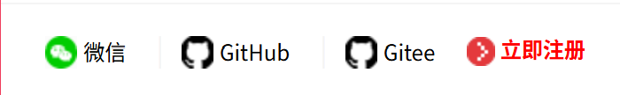
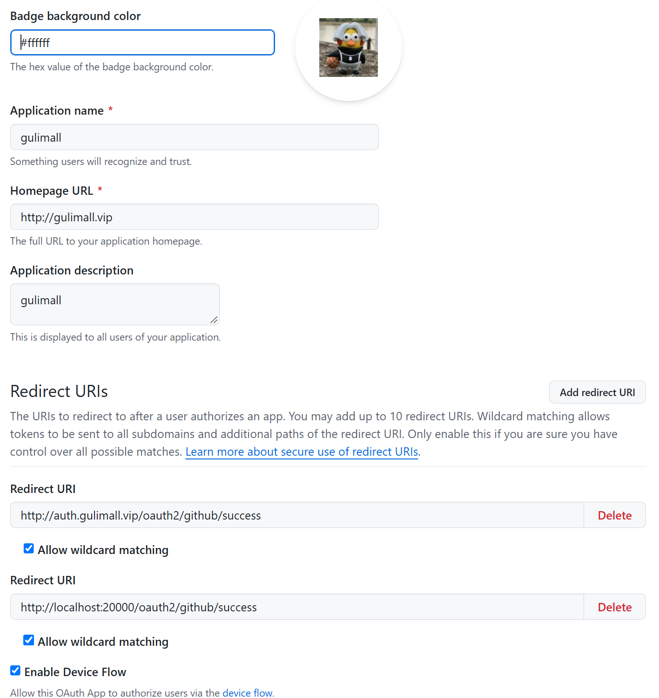
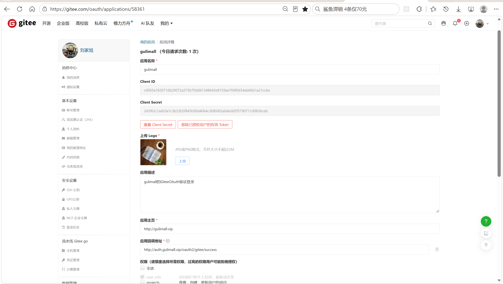
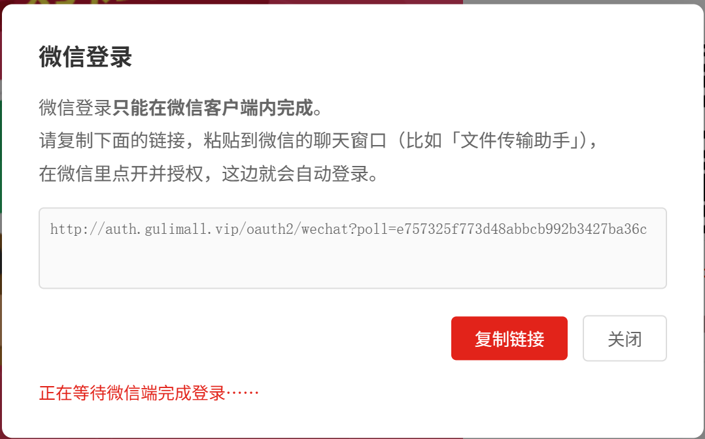
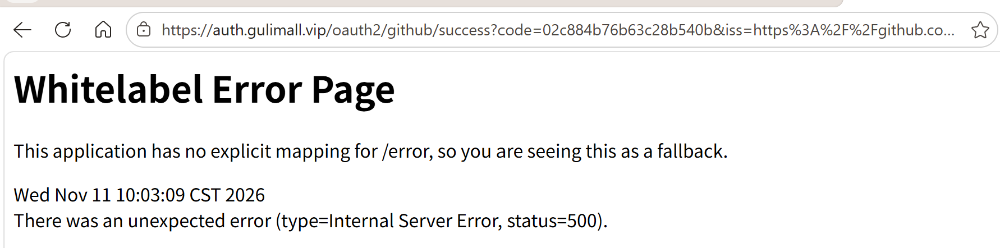
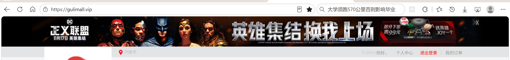

# 9.2 OAuth2 社交登录-介绍

> 社交登录让用户用 GitHub、Gitee、微信账号进入商城。本篇讲清三条渠道的授权码流程、state 防 CSRF、third-party 换 token 与拉用户、member 按社交唯一标识查会员或自动注册、微信 H5 授权与跨浏览器轮询。

> OAuth2 相关文档：[GitHub OAuth 接口定义](../OAuth2/github-oauth-apifox.json)、[Spring Session + Redis 接入](../SpringSession/Spring%20Session%20%2B%20Redis%20接入.md)。

---

## 1. 这个功能是干什么的

社交登录解决“用户不想再记一套账号密码”的问题。用户授权第三方平台后，商城拿到一个稳定唯一标识，按这个标识找到或创建会员，再写入登录会话。

三条渠道：

| 渠道 | 授权页 | 换 token | 拉用户 | 唯一标识 |
|---|---|---|---|---|
| GitHub | `github.com/login/oauth/authorize` | `POST /login/oauth/access_token`，表单 | `GET api.github.com/user`，Bearer 头 | 数字 `id` |
| Gitee | `gitee.com/oauth/authorize` | `POST /oauth/token`，JSON | `GET /api/v5/user`，query 参数 | 数字 `id` |
| 微信 H5 | `open.weixin.qq.com/connect/oauth2/authorize` | `GET /sns/oauth2/access_token` | `GET /sns/userinfo` | `openid` |

三套流程最终都落到同一个会员入口：

```text
第三方授权码 code
  → auth-server 校验 state
  → member 调 third-party 换 SocialUser
  → member 按 social_uid 查会员
  → 没有就自动注册
  → auth-server 写会话
```

登录页底部同时放微信、GitHub、Gitee 三个入口。三个渠道写入的是同一份 Spring Session，商城首页不关心用户从哪个渠道进入。

## 2. 用户怎么操作

### 2.1 GitHub 登录

1. 打开登录页，点击底部的 GitHub 图标。
2. 浏览器跳到 GitHub 授权页，页面显示应用名和申请的范围。
3. 用户登录 GitHub 并点击同意授权。
4. GitHub 回调 `http://auth.gulimall.vip/oauth2/github/success?code=...&state=...&iss=...`。
5. auth-server 校验 state、iss，调 member 完成登录。
6. 回调成功后写入会话，跳到商城首页或默认地址设置页。

### 2.2 Gitee 登录

1. 点击登录页底部的 Gitee 图标。
2. 浏览器跳到 Gitee 授权页。
3. 用户同意授权，Gitee 回调 `/oauth2/gitee/success?code=...&state=...`。
4. auth-server 校验 state，调 member 完成登录。
5. 写入会话，跳回商城。

### 2.3 微信 H5 登录

微信网页授权只能在微信内置浏览器里运行。

1. 在微信里打开登录页，点击微信图标。
2. 页面检测到 `MicroMessenger`，直接请求 `/oauth2/wechat`。
3. auth-server 生成 state，302 到微信授权页。
4. 用户同意授权，微信回调 `/oauth2/wechat/success?code=...&state=...`。
5. auth-server 校验 state，调 member 完成登录。
6. 写入微信内置浏览器的会话，跳首页并带 `?wechatLogin=1`。

### 2.4 微信跨浏览器登录

普通浏览器的 Cookie 和微信内置浏览器不共享。普通浏览器点击微信时走下面这套：

1. 页面请求 `/oauth2/wechat/prepare`。
2. auth-server 生成一次性 `pollToken`，Redis 写入 `PENDING`，返回一个带 token 的链接。
3. 页面弹层展示链接，用户复制到微信里打开。
4. 微信内完成授权，auth-server 把会员信息写入 `oauth:wechat:poll:{pollToken}`。
5. 普通浏览器每 2 秒轮询 `/oauth2/wechat/poll?token=...`。
6. 轮询发现已登录，在**当前这次轮询请求**的会话里写入会员信息，再跳首页。



## 3. 整体设计思路

### 3.1 业务上怎么设计

#### 3.1.1 三条渠道，一个会员体系

GitHub、Gitee、微信在授权协议、接口路径、参数格式、返回结构上都不同，但业务结果相同：拿到一个稳定的第三方用户标识。三条渠道最终都映射成 `SocialUser`，member 只按 `social_uid` 查会员，不区分渠道。

这样设计的原因：

1. 新增渠道只需要在 third-party 增加一个换 token 的实现，member 不改。
2. 会员表只有一个 `social_uid` 字段，不需要为每个平台加一列。
3. 登录后的会话结构完全一致，前台页面不用判断来源。

#### 3.1.2 state 防 CSRF

state 是 OAuth2 授权码流程里的防伪参数：

1. 发起授权前随机生成 state。
2. state 写入 Redis，TTL 10 分钟。
3. 授权 URL 带上 state。
4. 第三方回调时原样带回 state。
5. 回调先用 `delete` 删除 state，删除成功才算校验通过。

“删除即消费”保证同一个 state 只能使用一次。攻击者拿着自己的授权码构造回调链接时，如果没有对应的 state，登录不会完成。

#### 3.1.3 首次自动注册

1. 按 `social_uid` 查 `ums_member`。
2. 命中则刷新 `access_token`、`expires_in`，直接登录。
3. 未命中则创建会员：写入 `social_uid`、昵称、头像、邮箱、默认等级。
4. 社交注册的会员不设密码，只能继续用社交方式登录。
5. `username` 取社交平台的登录名，撞名时加 6 位随机后缀。

#### 3.1.4 第三方唯一标识

1. GitHub、Gitee 使用数字 `id`，用户改名后 `id` 不变。
2. 微信使用 `openid`，只在当前公众号下唯一。
3. 不使用 `login`、`nickname` 作为唯一键，因为这些字段用户可以随时修改。
4. 如果要跨公众号、小程序、App 识别同一个人，应使用微信 `unionid`。

#### 3.1.5 微信跨浏览器

微信内置浏览器和普通浏览器各自保存 Cookie，两边的会话不互通。业务上不能让用户在普通浏览器里反复刷新等登录态出现，所以设计成：

1. 普通浏览器发起登录，拿到一个一次性 token。
2. 用户把链接复制到微信里完成授权。
3. 微信侧把会员信息写入 Redis。
4. 普通浏览器轮询 Redis，拿到会员信息后在自己的会话里重建登录态。

#### 3.1.6 登录后的统一处理

三条渠道登录成功后都调用 `LoginRedirectService.afterLogin`：

1. 有默认地址直接回目标页。
2. 没有默认地址先去个人中心补地址。
3. 地址查询失败时不阻断登录，按已有默认地址处理。

### 3.2 技术上怎么设计

#### 3.2.1 OAuth2 授权码流程

```text
① 浏览器请求授权入口
② auth-server 生成 state，存 Redis，302 到第三方授权页
③ 用户同意授权
④ 第三方回调 auth-server，带 code 和 state
⑤ auth-server 校验 state，把 code 交给 member
⑥ member 调 third-party
⑦ third-party 用 client_id + client_secret + code 换 access_token
⑧ third-party 用 access_token 拉用户信息
⑨ third-party 组装 SocialUser 返回 member
⑩ member 查会员或自动注册，返回会员
⑪ auth-server 写会话，重定向
```

client_secret 只在 third-party 持有。auth-server 发起授权只需要 `client_id` 和 `redirect_uri`，拿不到 secret，减少泄露面。

#### 3.2.2 职责分层

| 模块 | 职责 |
|---|---|
| auth-server | 发起授权、接收回调、校验 state、写会话 |
| member | 按 `social_uid` 查会员、自动注册、刷新 token |
| third-party | 换 access_token、拉用户信息、组装 `SocialUser` |
| common | 统一返回 `R`、错误码、会话常量 |

#### 3.2.3 Redis 中的状态

| 用途 | key | 值 | TTL |
|---|---|---|---|
| GitHub state | `oauth:github:state:{state}` | `1` | 10 分钟 |
| Gitee state | `oauth:gitee:state:{state}` | `1` | 10 分钟 |
| 微信 state | `oauth:wechat:state:{state}` | `pollToken` 或空串 | 10 分钟 |
| 微信轮询 | `oauth:wechat:poll:{pollToken}` | `PENDING` 或会员 JSON | 10 分钟 |

#### 3.2.4 HTTP Interface + WebClient

third-party 调第三方平台使用 Spring 6 的声明式 HTTP Interface：

1. 接口方法用 `@GetExchange`、`@PostExchange` 声明路径和媒体类型。
2. `HttpServiceProxyFactory` 为接口生成代理。
3. WebClient 负责实际请求、编解码、代理。

每个平台一个 `WebClient`：

1. GitHub 需要两个 baseUrl：`https://github.com` 换 token，`https://api.github.com` 拉用户。
2. Gitee 换 token 和拉用户都在 `https://gitee.com`，用一个。
3. 微信换 token 和拉用户都在 `https://api.weixin.qq.com`，用一个。

#### 3.2.5 媒体类型差异

1. GitHub 换 token 要求表单提交，并且 `Accept: application/json`，否则返回 form 格式。
2. Gitee 换 token 要求 JSON 提交。
3. 微信两个接口返回 `Content-Type: text/plain`，但响应体是 JSON。WebClient 默认 Jackson 解码器只认 `application/json`，必须把 `text/plain` 加进解码器。

#### 3.2.6 微信跨浏览器轮询

1. `prepare` 生成 `pollToken`，Redis 写 `PENDING`。
2. 微信内授权成功，`success` 把会员 JSON 写到同一个 key。
3. `poll` 读到非 `PENDING` 的值，把会员写进当前请求的会话。
4. 写入后删除 key，保证 token 只能消费一次。
5. 前端每 2 秒轮询一次，成功后跳首页。

## 4. 详细代码、配置和解释

第 4 章按“类为什么存在 → 关键数据 → 调用链路 → 代码分块解释 → 一次完整示例 → 边界”组织。每一块代码前面先说明它在链路里承担什么，代码后面按 1、2、3 的顺序解释执行过程和原因。社交登录横跨 auth-server、member、third-party 三个服务，阅读顺序按一次登录请求的走向排列：统一模型 → 授权入口 → 服务间调用 → 会员落库 → 第三方适配 → 页面 → 配置。

### 4.1 SocialUser：统一社交用户

#### 4.1.1 这个类解决什么问题

GitHub 返回 `id`、`login`、`avatar_url`，Gitee 返回 `id`、`login`、`avatar_url` 但 JSON 字段和嵌套结构不同，微信返回 `openid`、`nickname`、`headimgurl`。三个平台对“用户唯一标识”“昵称”“头像”的叫法都不一样。member 如果直接解析三种响应，查会员和自动注册就要写三套分支。

`SocialUser` 是三条渠道收敛后的中间模型。third-party 把平台响应翻译成它，member 只认它。它承担三件事：

1. 屏蔽平台返回差异，member 不需要知道字段来自 GitHub 还是微信；
2. 承载第三方唯一标识、访问令牌、有效期、昵称、头像、邮箱、登录名；
3. 同时作为 third-party 的返回体和 member 自动注册的数据来源。

调用方是 member 的 `oauthLogin`，提供方是 third-party 的三个 OAuth Controller。它不落库，字段最终映射到 `ums_member`。

#### 4.1.2 字段与业务含义

| 字段 | 类型 | 来源 | 业务含义 |
|---|---|---|---|
| `uid` | String | GitHub/Gitee 的数字 `id`，微信的 `openid` | 写入 `ums_member.social_uid`，查会员的唯一键 |
| `access_token` | String | 换 token 接口 | 后续调第三方接口的令牌，同时写入会员表 |
| `expires_in` | long | 换 token 接口，GitHub 不返回 | 令牌有效期，写入会员表时转成字符串 |
| `nickname` | String | 用户信息接口 | 会员昵称，可能为空 |
| `header` | String | 用户信息接口 | 会员头像地址 |
| `email` | String | 用户信息接口，微信不返回 | 会员邮箱 |
| `login` | String | GitHub/Gitee 的 `login`，微信的 `openid` | 生成会员 `username` 的原料 |

#### 4.1.3 代码与解释

这个类没有行为，只定义字段。字段名直接沿用第三方返回的下划线风格，减少逐字段映射的代码量。

```java
@Data
public class SocialUser {

    /**
     * 社交平台的用户唯一标识
     *
     * <p>GitHub 用 {@code id}（数字，用户改名也不会变）；
     * <b>不要</b>用 login / nickname —— 那些用户可以随时改，
     * 一旦拿它当唯一键，用户改名后就会变成另一个人。
     */
    private String uid;

    /** 访问令牌 */
    private String access_token;

    /** 令牌有效期（秒）。GitHub 不返回该字段，这里保持 0 */
    private long expires_in;

    /** 昵称 */
    private String nickname;

    /** 头像地址 */
    private String header;

    /** 邮箱（GitHub 需要额外调 /user/emails 才有，可能为空） */
    private String email;

    /** 登录名（GitHub 的 login），用于生成会员 username */
    private String login;

}
```

1. `@Data` 由 Lombok 生成 getter/setter，third-party 逐个赋值，member 逐个取值。
2. `uid` 是唯一键。注释明确不能拿 `login`、`nickname` 当唯一键，因为用户随时可以改这些展示字段，改名后会被当成另一个人。
3. `access_token` 原样保存换到的令牌，member 更新到会员表，后续调平台接口时使用。
4. `expires_in` 用基本类型 `long`，平台不返回时只能填 0，无法表达“未知”。
5. `nickname` 允许为空，third-party 在组装时做兜底。
6. `header` 保存头像 URL，不做下载和转存。
7. `email` 只有 GitHub 申请了 `user:email` 范围才可能拿到，微信接口不返回。
8. `login` 只用于生成会员 `username`，不参与登录校验。

#### 4.1.4 一次完整转换示例

GitHub 的用户接口返回：

```text
id=123456
login=octocat
name=The Octocat
avatar_url=https://avatars.githubusercontent.com/u/123456
email=octocat@github.com
```

third-party 组装出的 `SocialUser`：

```text
uid=123456
access_token=gho_xxxxxxxx
expires_in=0
nickname=The Octocat
header=https://avatars.githubusercontent.com/u/123456
email=octocat@github.com
login=octocat
```

`name` 为空时，`nickname` 回退到 `login`，保证会员昵称不是空串。member 拿 `uid` 查 `ums_member.social_uid`，其余字段用于新会员建档。

#### 4.1.5 它不做什么与边界

1. 不校验 `uid` 是否为空，校验放在 member 的 `oauthLogin`。
2. 不区分渠道，没有 `source` 字段，排查问题时无法直接看出会员来自哪个平台。
3. 不做长度校验，昵称、头像、邮箱超长时会在写库阶段失败。
4. `expires_in` 无法表达“令牌永不过期”，GitHub 的 0 同时代表“未知”和“不适用”。
5. 字段名带下划线，与 Java 命名规范不一致，这样做是为了少写一层第三方响应的字段映射。

### 4.2 GitHubOAuthController：发起授权与接收回调

#### 4.2.1 这个类解决什么问题

GitHub 登录由登录页的图标触发。浏览器先离开商城去 GitHub 授权，再带着一次性 `code` 回到商城。这个 Controller 是 auth-server 侧的入口，负责把两次跳转接起来，并在回调时确认请求确实由当前这次授权产生。

上游是 `login.html` 的 GitHub 链接和 GitHub 授权页；下游是 `MemberFeignClient`（换用户、查或建会员）、`AgentJwtService`（写 JWT Cookie）、`LoginRedirectService`（决定登录后的落点）。`client_secret` 不在这个类里，换 token 发生在 third-party。

#### 4.2.2 关键概念与接口

1. `state`：发起授权前随机生成，存 Redis，回调时删除。删除成功才算校验通过，同时保证只能使用一次。
2. `iss`：RFC 9207 规定的 issuer 标识。GitHub 回调会带回，用来确认 code 由 GitHub 发出，防止把其他平台的 code 发到 GitHub 的 token 接口。
3. `redirect_uri`：必须与 GitHub 后台登记的地址完全一致，差一个字符就报 `redirect_uri_mismatch`。
4. `scope`：`read:user user:email`，前者读公开资料，后者读邮箱。
5. 会话：登录成功后写 `AuthServerConstant.LOGIN_USER`，由 Spring Session 落到 Redis。

| 操作 | 方法与路径 | 上游 | 下游 |
|---|---|---|---|
| 发起授权 | `GET /oauth2/github` | 登录页 GitHub 图标 | GitHub 授权页 |
| 接收回调 | `GET /oauth2/github/success` | GitHub 回调 | member、会话、跳转服务 |

#### 4.2.3 正常链路

```text
① 浏览器 GET /oauth2/github
② 生成 state，写 oauth:github:state:{state}，TTL 10 分钟
③ 拼授权 URL，302 到 github.com/login/oauth/authorize
④ 用户在 GitHub 同意授权
⑤ GitHub 回调 /oauth2/github/success?code=...&state=...&iss=...
⑥ 删除 state，删除失败回登录页
⑦ 校验 iss
⑧ Feign 调 member，member 调 third-party 换用户并查或建会员
⑨ 写 session，签发 JWT Cookie
⑩ afterLogin 决定去首页还是默认地址设置页
```

#### 4.2.4 代码与解释

这段代码包含发起和回调两个入口。常量与注入字段负责地址、凭据和依赖，`github()` 只生成 state 和拼授权地址，`success()` 负责校验、调 member 和收尾。

```java
@Controller
@Slf4j
public class GitHubOAuthController {

    /** RFC 9207 规定的 GitHub issuer 固定值 */
    private static final String GITHUB_ISSUER = "https://github.com/login/oauth";

    /** state 在 Redis 里的 key 前缀 */
    private static final String STATE_CACHE_PREFIX = "oauth:github:state:";

    /** state 有效期（分钟） */
    private static final long STATE_TTL_MINUTES = 10;

    @Value("${gulimall.auth-url}")
    private String authUrl;

    @Value("${gulimall.shop-home-url}")
    private String shopHomeUrl;

    @Value("${oauth.github.client-id}")
    private String clientId;

    @Value("${oauth.github.redirect-uri}")
    private String redirectUri;

    @Autowired
    private StringRedisTemplate stringRedisTemplate;

    @Autowired
    private MemberFeignClient memberFeignClient;

    @Autowired
    private LoginRedirectService loginRedirectService;

    @Autowired
    private AgentJwtService agentJwtService;

    /**
     * 发起 GitHub 授权
     *
     * <p>登录页上的 "GitHub" 图标指向这里，浏览器会被 302 到 GitHub 的授权页。
     */
    @GetMapping("/oauth2/github")
    public String github() {

        // state：防 CSRF。随机生成 → 存 Redis → 回调时比对，且只能用一次。
        String state = UUID.randomUUID().toString().replace("-", "");
        stringRedisTemplate.opsForValue().set(
                STATE_CACHE_PREFIX + state, "1", STATE_TTL_MINUTES, TimeUnit.MINUTES);

        // UriComponentsBuilder 负责把 redirect_uri 里的 :// 正确编码成 %3A%2F%2F，
        // 手写字符串拼接很容易漏（漏了就报 redirect_uri 参数错误）
        String authorizeUrl = UriComponentsBuilder
                .fromUriString("https://github.com/login/oauth/authorize")
                .queryParam("client_id", clientId)
                .queryParam("redirect_uri", redirectUri)
                .queryParam("scope", "read:user user:email")
                .queryParam("state", state)
                .build()
                .encode()
                .toUriString();

        return "redirect:" + authorizeUrl;
    }

    /**
     * GitHub 授权回调
     *
     * @param code  GitHub 发的一次性授权码
     * @param state 上面发起时生成的随机串，用于校验请求来源
     * @param iss   GitHub 新加的 issuer 标识（RFC 9207），防 mix-up 攻击
     * @param session 当前用户 Session
     * @param response 当前 HTTP 响应，用于写 agent JWT Cookie
     */
    @GetMapping("/oauth2/github/success")
    public String success(@RequestParam("code") String code,
                          @RequestParam(value = "state", required = false) String state,
                          @RequestParam(value = "iss", required = false) String iss,
                          HttpSession session,
                          HttpServletResponse response) {

        // 1、state 必须存在，且只能消费一次。
        //    delete 返回 true 表示"这个 key 确实存在，并且已经被删除" ——
        //    既完成了比对，又天然保证了一次性（重放第二次时已经不存在了）
        if (!StringUtils.hasText(state)
                || !stringRedisTemplate.delete(STATE_CACHE_PREFIX + state)) {
            log.warn("GitHub 回调 state 校验失败（可能被 CSRF 或 state 已过期）：{}", state);
            return "redirect:" + authUrl + "/login.html";
        }

        // 2、iss 校验（RFC 9207）：确认这个 code 确实由 GitHub 发出。
        //    以后登录页上同时有 GitHub / 微信 / QQ 时，这一步是防止
        //    "把 A 平台的 code 发到 B 平台的 token 接口" 的关键
        if (StringUtils.hasText(iss) && !GITHUB_ISSUER.equals(iss)) {
            log.warn("GitHub 回调 iss 不是预期值，拒绝处理：{}", iss);
            return "redirect:" + authUrl + "/login.html";
        }

        // 3、把 code 交给 member：由它调 third-party 换用户、查/建会员
        //    source=github 决定 third-party 那边走 GitHub 的接口
        R r = memberFeignClient.oauthLogin(code, "github");
        if (r.getCode() != 0) {
            log.warn("社交登录失败：{}", r.get("msg"));
            return "redirect:" + authUrl + "/login.html";
        }
        MemberResponseVo member = r.getData("data", new TypeReference<>() {
        });

        // 4、写入会话。这里是 Spring Session 的 session —— 底层落 Redis，
        // 见document/SpringSession/Spring Session + Redis 接入.md
        session.setAttribute(AuthServerConstant.LOGIN_USER, member);
        agentJwtService.issue(member, response);

        return loginRedirectService.afterLogin(member, shopHomeUrl);
    }

}
```

1. `@Controller` 而不是 `@RestController`：两个方法返回的是 `redirect:` 字符串，由 Spring MVC 转成 302，不返回 JSON。
2. `GITHUB_ISSUER` 固定为 `https://github.com/login/oauth`，与 GitHub 返回的 `iss` 做等值比较。
3. `STATE_CACHE_PREFIX` 是 `oauth:github:state:`，后面拼随机 state，避免和 Gitee、微信的 key 混在一起。
4. `STATE_TTL_MINUTES` 为 10，用户停留在授权页超过 10 分钟，回调时 state 已过期。
5. `@Value` 注入 auth-server 自己的地址、商城首页地址、`client_id` 和 `redirect_uri`。这里没有 `client_secret`。
6. `github()` 用 `UUID.randomUUID()` 生成 state，去掉横线后是 32 位十六进制字符串。
7. `opsForValue().set()` 把 state 写入 Redis，值为 `"1"`，TTL 10 分钟。
8. `UriComponentsBuilder.fromUriString()` 从 GitHub 授权地址开始拼参数。
9. `queryParam` 依次加入 `client_id`、`redirect_uri`、`scope`、`state`。
10. `build().encode().toUriString()` 对参数做 URL 编码，`redirect_uri` 里的 `://` 会变成 `%3A%2F%2F`，手写拼接容易漏。
11. `return "redirect:" + authorizeUrl` 让浏览器跳到 GitHub 授权页。
12. `success()` 接收 `code`、可选的 `state`、可选的 `iss`、当前会话和响应对象。
13. 先判断 state 非空，再执行 `stringRedisTemplate.delete()`。`delete` 返回 `true` 表示 key 存在且已被删除，既完成比对，又完成一次性消费；返回 `false` 说明 state 不存在或已过期。
14. `iss` 存在且不等于 `GITHUB_ISSUER` 时拒绝处理，避免 mix-up 攻击。
15. `memberFeignClient.oauthLogin(code, "github")` 把 code 和渠道交给 member。返回码不为 0 时回登录页。
16. 成功响应里的 `data` 反序列化成 `MemberResponseVo`，这是会员在会话里的精简模型。
17. `session.setAttribute(AuthServerConstant.LOGIN_USER, member)` 写登录会话，底层由 Spring Session 存 Redis。
18. `agentJwtService.issue(member, response)` 额外签发 JWT 并写入 Cookie，供 Agent 等无会话场景使用。
19. `loginRedirectService.afterLogin(member, shopHomeUrl)` 根据会员是否有默认地址决定最终跳转。

#### 4.2.5 一次完整示例

用户在登录页点击 GitHub 图标：

```text
1. 浏览器请求 http://auth.gulimall.vip/oauth2/github
2. 生成 state=3f2a9c...，Redis 写 oauth:github:state:3f2a9c...
3. 302 到 https://github.com/login/oauth/authorize?client_id=...&redirect_uri=...
4. 用户登录 GitHub 并同意授权
5. GitHub 回调 http://auth.gulimall.vip/oauth2/github/success?code=abc&state=3f2a9c...&iss=https://github.com/login/oauth
6. delete 成功，iss 相等
7. member 返回 memberId=18、nickname=octocat
8. 会话写入 LOGIN_USER，响应增加 JWT Cookie
9. 会员没有默认地址，跳个人中心地址页；有默认地址则回首页
```



#### 4.2.6 它不做什么与边界

1. 不持有 `client_secret`，不直接调 GitHub 的 token 接口，换 token 全部在 third-party。
2. 不查会员表，会员是否存在由 member 判断；auth-server 只接收结果。
3. 不主动拉邮箱，邮箱是否为空取决于 scope 和 third-party 的组装结果。
4. state 只存 `"1"`，没有绑定浏览器会话。攻击者如果先拿到 state 再诱导回调，仍有窗口；更严格的做法是把 state 与当前 session 关联。
5. `iss` 是可选参数，缺失时不校验；GitHub 新版本都会返回，可以改成必填。
6. 回调失败只记日志并回登录页，用户看不到具体原因。
7. GitHub 与 Gitee 的发起、回调结构高度重复，可以抽公共模板方法。

### 4.3 GiteeOAuthController：与 GitHub 对称的渠道

#### 4.3.1 这个类解决什么问题

Gitee 提供国内可直连的 OAuth2 入口。GitHub 在网络不稳定时经常打不开授权页，登录页同时放 Gitee 图标，给用户一条替代路径。协议与 GitHub 基本一致，差异集中在授权地址、是否返回 `iss`、换 token 的参数格式，以及第三方接口的返回结构。

这个 Controller 的上游是 `login.html` 的 Gitee 图标和 Gitee 授权页；下游与 GitHub 相同：member、会话、JWT、跳转服务。它只负责授权和回调，不接触 `client_secret`。

#### 4.3.2 接口与差异

| 项目 | GitHub | Gitee |
|---|---|---|
| 授权地址 | 代码写死 `https://github.com/login/oauth/authorize` | 从 `oauth.gitee.authorize-url` 读取 |
| 授权参数 | `client_id`、`redirect_uri`、`scope`、`state` | 额外带 `response_type=code` |
| 回调校验 | state + `iss` | 只校验 state |
| 换 token | 表单，`Accept: application/json` | JSON 体 |
| 拉用户 | Bearer 头 | query 参数 `access_token` |
| 唯一标识 | 数字 `id` | 数字 `id` |

#### 4.3.3 正常链路

```text
① 浏览器 GET /oauth2/gitee
② 生成 state，写 oauth:gitee:state:{state}
③ 拼授权 URL，302 到 Gitee 授权页
④ 用户同意授权
⑤ Gitee 回调 /oauth2/gitee/success?code=...&state=...
⑥ 删除 state
⑦ Feign 调 member
⑧ member 调 third-party /oauth2/gitee/token
⑨ 写 session，签发 JWT
⑩ afterLogin 决定落点
```

#### 4.3.4 代码与解释

这段代码与 GitHub 控制器结构一致，少了 `iss` 校验，多了授权地址配置和 `response_type` 参数。

```java
@Controller
@Slf4j
public class GiteeOAuthController {

    /** state 在 Redis 里的 key 前缀 */
    private static final String STATE_CACHE_PREFIX = "oauth:gitee:state:";

    /** state 有效期（分钟） */
    private static final long STATE_TTL_MINUTES = 10;

    @Value("${gulimall.auth-url}")
    private String authUrl;

    @Value("${gulimall.shop-home-url}")
    private String shopHomeUrl;

    @Value("${oauth.gitee.client-id}")
    private String clientId;

    @Value("${oauth.gitee.redirect-uri}")
    private String redirectUri;

    /** Gitee 的授权页地址（配在 common.yaml，方便以后换服务商） */
    @Value("${oauth.gitee.authorize-url}")
    private String authorizeUrl;

    @Autowired
    private StringRedisTemplate stringRedisTemplate;

    @Autowired
    private MemberFeignClient memberFeignClient;

    @Autowired
    private LoginRedirectService loginRedirectService;

    @Autowired
    private AgentJwtService agentJwtService;

    /**
     * 发起 Gitee 授权
     *
     * <p>登录页上的 "Gitee" 图标指向这里，浏览器会被 302 到 Gitee 的授权页。
     */
    @GetMapping("/oauth2/gitee")
    public String gitee() {

        // state：防 CSRF。随机生成 → 存 Redis → 回调时比对，且只能用一次
        String state = UUID.randomUUID().toString().replace("-", "");
        stringRedisTemplate.opsForValue().set(
                STATE_CACHE_PREFIX + state, "1", STATE_TTL_MINUTES, TimeUnit.MINUTES);

        String url = UriComponentsBuilder
                .fromUriString(authorizeUrl)
                .queryParam("client_id", clientId)
                .queryParam("redirect_uri", redirectUri)
                .queryParam("response_type", "code")
                .queryParam("state", state)
                .build()
                .encode()
                .toUriString();

        return "redirect:" + url;
    }

    /**
     * Gitee 授权回调
     *
     * @param code  Gitee 发的一次性授权码
     * @param state 上面发起时生成的随机串，用于校验请求来源
     * @param session 当前用户 Session
     * @param response 当前 HTTP 响应，用于写 agent JWT Cookie
     */
    @GetMapping("/oauth2/gitee/success")
    public String success(@RequestParam("code") String code,
                          @RequestParam(value = "state", required = false) String state,
                          HttpSession session,
                          HttpServletResponse response) {

        // 1、state 必须存在，且只能消费一次（delete 返回 true 表示确实存在过、现已删除）
        //
        //    注意这里【没有】iss 校验 —— Gitee 不返回那个参数。
        //    iss（RFC 9207）是 GitHub 后来加的，用来防 mix-up 攻击；
        //    以后如果登录页上接了多个 Gitee 兼容的服务商，要记得补上等价校验
        if (!StringUtils.hasText(state)
                || !stringRedisTemplate.delete(STATE_CACHE_PREFIX + state)) {
            log.warn("Gitee 回调 state 校验失败（可能被 CSRF 或 state 已过期）：{}", state);
            return "redirect:" + authUrl + "/login.html";
        }

        // 2、把 code 交给 member。source=gitee 会让它去调 third-party 的 Gitee 接口，
        //    后面「查会员 / 自动注册」的流程和 GitHub、微信完全一样
        R r = memberFeignClient.oauthLogin(code, "gitee");
        if (r.getCode() != 0) {
            log.warn("Gitee 登录失败：{}", r.get("msg"));
            return "redirect:" + authUrl + "/login.html";
        }
        MemberResponseVo member = r.getData("data", new TypeReference<MemberResponseVo>() {
        });

        // 3、写会话。走的还是同一份 session（Spring Session → Redis），
        //    前台 gulimall.vip 不关心用户是从哪个渠道登进来的
        session.setAttribute(AuthServerConstant.LOGIN_USER, member);
        agentJwtService.issue(member, response);

        return loginRedirectService.afterLogin(member, shopHomeUrl);
    }

}
```

1. `@Controller` + `@Slf4j`：返回重定向字符串，异常和校验失败写日志。
2. `STATE_CACHE_PREFIX` 为 `oauth:gitee:state:`，与 GitHub 的 key 隔离。
3. `STATE_TTL_MINUTES` 同样为 10 分钟。
4. `authUrl` 和 `shopHomeUrl` 分别用于失败回跳和成功落点。
5. `clientId`、`redirectUri` 来自 `oauth.gitee` 配置，secret 不在这里。
6. `authorizeUrl` 来自 `oauth.gitee.authorize-url`，换服务商时只改配置。
7. 注入 Redis、member Feign、跳转服务和 JWT 服务。
8. `gitee()` 生成随机 state 并写入 Redis，值同样为 `"1"`。
9. 授权 URL 额外加入 `response_type=code`，这是 Gitee 的要求。
10. `.encode()` 对 `redirect_uri` 编码，最后 302。
11. `success()` 先判断 state 非空，再执行 `delete`；删除失败直接回登录页。
12. 没有 `iss` 校验，因为 Gitee 不返回该参数。
13. `oauthLogin(code, "gitee")` 把渠道标识传给 member，third-party 据此走 Gitee 的换 token 实现。
14. 成功响应反序列化成 `MemberResponseVo`，写入会话。
15. `agentJwtService.issue` 写 JWT Cookie。
16. `afterLogin` 统一决定跳转。

#### 4.3.5 一次完整示例

```text
1. 浏览器请求 http://auth.gulimall.vip/oauth2/gitee
2. 生成 state=8b7d1e...，Redis 写 oauth:gitee:state:8b7d1e...
3. 302 到 https://gitee.com/oauth/authorize?client_id=...&redirect_uri=...&response_type=code&state=...
4. 用户同意授权，Gitee 回调 /oauth2/gitee/success
5. delete 成功
6. member 调 third-party，third-party 用 JSON 换 token、用 query 拉用户
7. 会话写入会员，JWT Cookie 返回
8. 跳首页或默认地址设置页
```



#### 4.3.6 它不做什么与边界

1. 不校验 `iss`，缺少 mix-up 防护；接入多个兼容 Gitee 协议的服务商时需要补等价校验。
2. 不持有 `client_secret`，换 token 在 third-party。
3. 授权地址走配置，但回调地址仍然必须与 Gitee 后台登记值完全一致。
4. 与 GitHub 控制器的重复代码较多，可以抽公共模板方法。
5. 回调失败没有给用户提示，只回登录页。

### 4.4 WechatOAuthController：H5 授权与跨浏览器轮询

#### 4.4.1 这个类解决什么问题

微信网页授权只能在微信内置浏览器里完成，而用户经常在普通浏览器打开登录页。普通浏览器和微信内置浏览器各自保存 Cookie，微信里建立的会话无法直接带到普通浏览器。这个 Controller 同时处理两种场景：

1. 微信内打开登录页，直接走 H5 授权；
2. 普通浏览器生成一次性 `pollToken`，用户把链接复制到微信完成授权，普通浏览器轮询取回登录态。

上游是 `login.html` 的微信图标和微信授权页；下游是 member、会话、JWT、跳转服务。Redis 在这里承担两个职责：state 防 CSRF、`pollToken` 在两个浏览器之间传递会员信息。

#### 4.4.2 四个接口与 Redis 状态

| 接口 | 路径 | 调用方 | 作用 |
|---|---|---|---|
| `prepare` | `GET /oauth2/wechat/prepare` | 普通浏览器 | 生成 `pollToken`，返回可复制链接 |
| `poll` | `GET /oauth2/wechat/poll` | 普通浏览器 | 查询微信侧是否登录，并在当前浏览器建会话 |
| `wechat` | `GET /oauth2/wechat` | 微信内或复制链接 | 生成 state，302 到微信授权页 |
| `success` | `GET /oauth2/wechat/success` | 微信回调 | 校验 state，调 member，写会话和轮询结果 |

| key | 值 | TTL | 作用 |
|---|---|---|---|
| `oauth:wechat:state:{state}` | `pollToken` 或空串 | 10 分钟 | 防 CSRF，同时携带轮询 token |
| `oauth:wechat:poll:{pollToken}` | `PENDING` 或会员 JSON | 10 分钟 | 普通浏览器等待登录结果 |

#### 4.4.3 正常链路

微信内直接授权：

```text
① 微信内置浏览器打开登录页，点击微信图标
② 前端识别 MicroMessenger，跳 /oauth2/wechat
③ 生成 state，值里不带 pollToken
④ 302 到微信授权页，URL 末尾拼 #wechat_redirect
⑤ 微信回调 /oauth2/wechat/success
⑥ getAndDelete 取出 state
⑦ 调 member 完成登录
⑧ 写微信内置浏览器会话
⑨ 跳首页并带 ?wechatLogin=1
```

普通浏览器跨浏览器：

```text
① 点击微信，前端请求 /oauth2/wechat/prepare
② 生成 pollToken，Redis 写 PENDING
③ 弹层展示链接，用户复制到微信打开
④ 微信内走上面的授权流程，state 的值里带着 pollToken
⑤ success 把会员 JSON 写入 oauth:wechat:poll:{pollToken}
⑥ 普通浏览器每 2 秒轮询 /oauth2/wechat/poll
⑦ poll 读到非 PENDING，在当前请求的会话里写会员
⑧ poll 删除 key，返回 SUCCESS
⑨ 前端跳首页
```

#### 4.4.4 代码与解释

这个类包含四个入口。四个常量定义 key 前缀、占位值和 TTL；`prepare` 和 `poll` 服务普通浏览器，`wechat` 和 `success` 服务微信侧。

```java
@Controller
@Slf4j
public class WechatOAuthController {

    /** state 在 Redis 里的 key 前缀。值存的是 pollToken（没有则为空串） */
    private static final String STATE_CACHE_PREFIX = "oauth:wechat:state:";

    /** 轮询 token 在 Redis 里的 key 前缀 */
    private static final String POLL_CACHE_PREFIX = "oauth:wechat:poll:";

    /** 还没完成登录时的占位值 */
    private static final String POLL_PENDING = "PENDING";

    /** state / pollToken 的有效期（分钟） */
    private static final long TTL_MINUTES = 10;

    @Value("${gulimall.auth-url}")
    private String authUrl;

    @Value("${gulimall.shop-home-url}")
    private String shopHomeUrl;

    @Value("${oauth.wechat.app-id}")
    private String appId;

    @Value("${oauth.wechat.redirect-uri}")
    private String redirectUri;

    @Value("${oauth.wechat.scope}")
    private String scope;

    @Autowired
    private StringRedisTemplate stringRedisTemplate;

    @Autowired
    private MemberFeignClient memberFeignClient;

    @Autowired
    private LoginRedirectService loginRedirectService;

    @Autowired
    private AgentJwtService agentJwtService;

    /**
     * 为非微信浏览器准备一个"拿去微信里打开"的链接
     *
     * <p>登录页发现当前不是微信环境时会调这个接口，拿到链接后弹层给用户复制。
     *
     * @return {@code url} 给用户在微信里打开的链接，{@code token} 给前端轮询用
     */
    @ResponseBody
    @GetMapping("/oauth2/wechat/prepare")
    public R prepare() {

        String pollToken = UUID.randomUUID().toString().replace("-", "");

        // 先占个位，表示"这个 token 还没登录"。微信那边成功后会覆盖成会员信息
        stringRedisTemplate.opsForValue().set(
                POLL_CACHE_PREFIX + pollToken, POLL_PENDING, TTL_MINUTES, TimeUnit.MINUTES);

        // 注意这里带的是 poll 参数，不是 state ——
        // state 是给"这一次授权"防 CSRF 用的，会由 wechat() 现生成
        String url = authUrl + "/oauth2/wechat?poll=" + pollToken;

        return R.ok().put("token", pollToken).put("url", url);
    }

    /**
     * 轮询"微信那边登录好了没"
     *
     * <p>★ 这个接口是整个跨浏览器方案的关键：当它发现微信那边已经登录成功时，
     * <b>会把会员信息写进当前这次请求的 session</b> —— 也就是发起轮询的那个浏览器。
     * 微信内置浏览器里那份 session 属于微信，没法直接拿过来，只能这样重建一份。
     *
     * @param pollToken prepare 时发的那个 token
     * @param session 当前用户 Session
     * @param response 当前 HTTP 响应，用于写 agent JWT Cookie
     * @return {@code status}：PENDING 还没好 / SUCCESS 已登录（此时 session 已建立）
     */
    @ResponseBody
    @GetMapping("/oauth2/wechat/poll")
    public R poll(@RequestParam("token") String pollToken, HttpSession session,
                  HttpServletResponse response) {

        String json = stringRedisTemplate.opsForValue().get(POLL_CACHE_PREFIX + pollToken);

        // 还没登录，或者 token 已过期 —— 前端继续轮询即可
        if (!StringUtils.hasText(json) || POLL_PENDING.equals(json)) {
            return R.ok().put("status", "PENDING");
        }

        // 微信那边登录好了。把会员信息写进【当前浏览器】的 session ——
        // 这一步之后，当前浏览器的 cookie 就绑定了一份有效会话
        MemberResponseVo member = JSON.parseObject(json, MemberResponseVo.class);
        session.setAttribute(AuthServerConstant.LOGIN_USER, member);
        agentJwtService.issue(member, response);

        // 用完即删：同一个 token 只能被消费一次，防止别人拿到链接后重复换登录态
        stringRedisTemplate.delete(POLL_CACHE_PREFIX + pollToken);

        log.info("微信跨浏览器登录完成，已为轮询方建立会话：memberId={}", member.getId());

        return R.ok().put("status", "SUCCESS");
    }

    /**
     * 发起微信授权
     *
     * @param pollToken 可选。非微信环境发起的登录会带上它，
     *                  这样授权成功后能把会员信息"送"回等待中的那个浏览器
     */
    @GetMapping("/oauth2/wechat")
    public String wechat(@RequestParam(value = "poll", required = false) String pollToken) {

        // state 防 CSRF，顺便把 pollToken 捎上 ——
        // 回调时通过 state 就能把 pollToken 找回来
        String state = UUID.randomUUID().toString().replace("-", "");
        stringRedisTemplate.opsForValue().set(
                STATE_CACHE_PREFIX + state,
                pollToken == null ? "" : pollToken,
                TTL_MINUTES, TimeUnit.MINUTES);

        String authorizeUrl = UriComponentsBuilder
                .fromUriString("https://open.weixin.qq.com/connect/oauth2/authorize")
                .queryParam("appid", appId)
                .queryParam("redirect_uri", redirectUri)
                .queryParam("response_type", "code")
                .queryParam("scope", scope)
                .queryParam("state", state)
                .build()
                .encode()
                // ⚠️ #wechat_redirect 必须拼在 encode 【之后】——
                //    写在 queryParam 里会被编码成 %23wechat_redirect，微信会报错
                .toUriString() + "#wechat_redirect";

        return "redirect:" + authorizeUrl;
    }

    /**
     * 微信授权回调
     *
     * @param code  微信发的一次性授权码（5 分钟有效）
     * @param state 上面发起时生成的随机串，用于校验请求来源；它的值里带着 pollToken
     * @param session 当前用户 Session
     * @param response 当前 HTTP 响应，用于写 agent JWT Cookie
     */
    @GetMapping("/oauth2/wechat/success")
    public String success(@RequestParam("code") String code,
                          @RequestParam(value = "state", required = false) String state,
                          HttpSession session,
                          HttpServletResponse response) {

        // 1、取出并删除 state。getAndDelete 是【原子】的：
        //    返回 null 就说明这个 state 根本不存在（被 CSRF 或已过期），
        //    返回非 null 说明这个 state 确实由本服务发出，而且现在已经删掉了 —— 天然只能消费一次
        String pollToken = StringUtils.hasText(state)
                ? stringRedisTemplate.opsForValue().getAndDelete(STATE_CACHE_PREFIX + state)
                : null;

        if (pollToken == null) {
            log.warn("微信回调 state 校验失败（可能被 CSRF 或 state 已过期）：{}", state);
            return "redirect:" + authUrl + "/login.html";
        }

        // 2、把 code 交给 member。source=wechat 会让它去调 third-party 的微信接口
        R r = memberFeignClient.oauthLogin(code, "wechat");
        if (r.getCode() != 0) {
            log.warn("微信登录失败：{}", r.get("msg"));
            return "redirect:" + authUrl + "/login.html";
        }
        MemberResponseVo member = r.getData("data", new TypeReference<MemberResponseVo>() {
        });

        // 3、写当前会话（微信内置浏览器的会话）
        session.setAttribute(AuthServerConstant.LOGIN_USER, member);
        agentJwtService.issue(member, response);

        // 4、如果这次登录是从【另一个浏览器】发起的（带了 pollToken），
        //    就把会员信息放进 Redis，让那边轮询取走 ——
        //    浏览器之间 cookie 不共享，只能这样"隔空"把登录态递过去
        if (StringUtils.hasText(pollToken)) {
            stringRedisTemplate.opsForValue().set(
                    POLL_CACHE_PREFIX + pollToken,
                    JSON.toJSONString(member),
                    TTL_MINUTES, TimeUnit.MINUTES);
        }

        // 5、跳首页时带个标记，首页据此弹「登录成功，请返回浏览器查看」。
        //
        //    这个标记【只会出现在微信里的那次跳转】上 —— 浏览器那边是轮询到结果后
        //    自己 location.href 跳的，压根不经过这个方法，所以不会弹提示
        //    （浏览器本来就是登录成功了，不需要再提醒他"回浏览器看"）
        return loginRedirectService.afterLogin(member, shopHomeUrl + "?wechatLogin=1");
    }

}
```

1. `STATE_CACHE_PREFIX` 为 `oauth:wechat:state:`，值存 `pollToken` 或空串，与 GitHub、Gitee 的 state 结构不同。
2. `POLL_CACHE_PREFIX` 为 `oauth:wechat:poll:`，普通浏览器按 `pollToken` 读取。
3. `POLL_PENDING` 是占位值，表示微信侧还没完成登录。
4. `TTL_MINUTES` 为 10，state 和 `pollToken` 使用同一有效期。
5. `@Value` 注入 auth-server 地址、商城首页、微信 `app-id`、`redirect-uri`、`scope`。
6. 注入 Redis、member Feign、跳转服务、JWT 服务。
7. `prepare()` 用 `@ResponseBody` 返回 JSON，生成 32 位 `pollToken`。
8. 写入 `oauth:wechat:poll:{pollToken}`，值为 `PENDING`，TTL 10 分钟。
9. 拼出的链接带 `?poll=`，不是 `state`；state 由 `wechat()` 在真正发起授权时生成。
10. 返回 `token` 和 `url`，前端用 `token` 轮询，用 `url` 弹层展示。
11. `poll()` 读取 `pollToken` 对应的值。
12. 值为空或仍是 `PENDING` 时返回 `PENDING`，前端继续轮询。
13. 读到非 `PENDING` 时，把 JSON 反序列化成 `MemberResponseVo`。
14. 在当前轮询请求的 `session` 里写入会员，这一步决定 Cookie 落到哪个浏览器。
15. `agentJwtService.issue` 为当前浏览器签发 JWT。
16. 删除 `pollToken`，保证同一个链接只能消费一次。
17. 返回 `SUCCESS`，前端停止轮询并跳首页。
18. `wechat()` 接收可选的 `poll` 参数，微信内直接访问时为空。
19. 生成 state，写入 Redis，值为 `pollToken` 或空串。
20. 授权 URL 加入 `appid`、`redirect_uri`、`response_type`、`scope`、`state`。
21. `.encode()` 之后再拼 `#wechat_redirect`；写进 `queryParam` 会被编码成 `%23`，微信直接报错。
22. `success()` 用 `getAndDelete` 取出 state 对应的值，这个操作是原子的，state 只能消费一次。
23. 返回 `null` 说明 state 不存在或已过期，回登录页。
24. `oauthLogin(code, "wechat")` 调 member，`source=wechat` 让 third-party 走微信接口。
25. 写微信内置浏览器的会话，并签发 JWT。
26. 如果有 `pollToken`，把会员 JSON 写入 `oauth:wechat:poll:{pollToken}`，让另一个浏览器取走。
27. `afterLogin` 的落点带 `?wechatLogin=1`，首页据此提示“登录成功，请返回浏览器查看”。



#### 4.4.5 一次完整示例

普通浏览器发起微信登录：

```text
1. 用户点击微信图标，前端发现不是 MicroMessenger
2. GET /oauth2/wechat/prepare
3. 返回 token=p1q2r3、url=http://auth.gulimall.vip/oauth2/wechat?poll=p1q2r3
4. 弹层展示链接，用户复制到微信
5. 微信打开链接，GET /oauth2/wechat?poll=p1q2r3
6. 生成 state=s9t8u7，Redis 写 oauth:wechat:state:s9t8u7 -> p1q2r3
7. 302 到微信授权页，URL 末尾 #wechat_redirect
8. 用户同意授权，微信回调 /oauth2/wechat/success?code=wxcode&state=s9t8u7
9. getAndDelete 得到 p1q2r3
10. member 完成登录，返回 memberId=18
11. 写微信内会话，Redis 写 oauth:wechat:poll:p1q2r3 -> 会员 JSON
12. 微信内跳首页 ?wechatLogin=1
13. 普通浏览器轮询 /oauth2/wechat/poll?token=p1q2r3
14. 读到会员 JSON，在当前浏览器的 session 里写会员，签发 JWT
15. 删除 poll key，返回 SUCCESS
16. 前端跳首页，普通浏览器已处于登录态
```

#### 4.4.6 它不做什么与边界

1. 不生成二维码，普通浏览器只展示可复制链接。
2. 不共享两个浏览器的 Cookie，只通过 Redis 传递会员信息。
3. 轮询没有次数和超时限制，用户不授权时会持续请求到 token 过期。
4. 弹层关闭只清前端定时器，Redis 里的 `PENDING` 会保留到 10 分钟过期。
5. `poll` 接口不校验请求来源，拿到 token 的人都能消费；token 一次性，风险有限。
6. 微信 `openid` 只在当前公众号下唯一，多应用识别同一个人需要 `unionid`。
7. 会员 JSON 直接序列化进 Redis，后续会员字段变化时要考虑旧数据兼容。

### 4.5 MemberFeignClient 与 ThirdPartyFeignClient：两次跨服务调用

#### 4.5.1 这两个接口解决什么问题

社交登录有两次跨服务调用：auth-server 把 `code` 交给 member；member 把 `code` 交给 third-party。如果每个服务各写一套 HTTP 客户端，路径、参数和错误处理会散落在业务代码里。两个 Feign 接口把调用关系声明成方法，调用方只依赖接口。

`MemberFeignClient` 是 auth-server 对 member 的入口，除了社交登录，还承担普通注册、登录和默认地址查询。`ThirdPartyFeignClient` 是 member 对 third-party 的入口，用 `{source}` 路径变量覆盖 GitHub、Gitee、微信三个渠道。

#### 4.5.2 MemberFeignClient

这个接口把 auth-server 需要的会员能力集中声明。社交登录只用到 `oauthLogin`，普通账号登录和默认地址查询复用同一个客户端。

```java
@FeignClient("gulimall-member")
public interface MemberFeignClient {

    @PostMapping("member/member/regist")
    R regist(@RequestBody UserRegisterVo vo);

    @PostMapping("member/member/login")
    R login(@RequestBody UserLoginVo vo);

    /**
     * 社交登录：把授权码交给 member，由它去换社交用户 + 查/建会员
     *
     * @param code   社交平台回调带回来的授权码
     * @param source 渠道标识：github / wechat
     * @return 成功时 {@code data} 里是 MemberResponseVo
     */
    @PostMapping("member/member/oauth2/login")
    R oauthLogin(@RequestParam("code") String code, @RequestParam("source") String source);

    /**
     * 登录后判断会员有没有默认收货地址。
     */
    @GetMapping("member/memberreceiveaddress/{memberId}/address")
    List<MemberAddressVo> getAddress(@PathVariable("memberId") Long memberId);

}
```

1. `@FeignClient("gulimall-member")` 按服务名寻址，实际地址由 Nacos 注册表提供。
2. `regist` 和 `login` 是普通账号体系的方法，与社交登录共用会员服务。
3. `oauthLogin` 用 `@PostMapping` 声明 `member/member/oauth2/login`，参数放在表单里，不是 JSON 体。
4. `code` 是第三方回调带回的一次性授权码，`source` 是渠道标识。
5. 返回统一 `R`，成功时 `data` 里是 `MemberResponseVo`。
6. `getAddress` 在登录后查询默认收货地址，决定跳首页还是地址设置页。
7. 接口没有 fallback，member 不可用时调用方直接收到异常。

#### 4.5.3 ThirdPartyFeignClient

这个接口把 member 对 third-party 的调用收敛成一个方法。`{source}` 直接对应 third-party 的 Controller 路径，新增渠道时不需要改 member 的代码。

```java
@FeignClient("gulimall-third-party")
public interface ThirdPartyFeignClient {

    /**
     * 用授权码换取社交用户信息（GitHub / 微信共用这一个入口）
     *
     * <p>路径里的 {@code source} 直接对应 third-party 那边的两个 Controller：
     * {@code /oauth2/github/token} 和 {@code /oauth2/wechat/token}。
     * 两个渠道换到的用户信息都统一封装成 {@code SocialUser}，member 侧无需区分。
     *
     * @param source 渠道标识：github / wechat
     * @param code   社交平台回调带回来的授权码（一次性）
     * @return 成功时 {@code data} 里是 {@code SocialUser}
     */
    @GetMapping("/oauth2/{source}/token")
    R oauthToken(@PathVariable("source") String source, @RequestParam("code") String code);

}
```

1. `@FeignClient("gulimall-third-party")` 指向 third-party 服务。
2. `oauthToken` 用 `@GetMapping` 声明 `/oauth2/{source}/token`。
3. OpenFeign 把 `{source}` 替换成 `github`、`gitee` 或 `wechat`，对应三个 Controller 的 `/token` 方法。
4. `code` 作为 query 参数传递，与 third-party 的 `@RequestParam` 对齐。
5. 返回统一 `R`，成功时 `data` 里是 `SocialUser`。

#### 4.5.4 一次调用示例

```text
auth-server
  → MemberFeignClient.oauthLogin("abc123", "github")
  → POST http://gulimall-member/member/member/oauth2/login
  → member 内部
  → ThirdPartyFeignClient.oauthToken("github", "abc123")
  → GET http://gulimall-third-party/oauth2/github/token?code=abc123
  → third-party 返回 R(data=SocialUser)
```

#### 4.5.5 它不做什么与边界

1. 不做重试和熔断，第三方平台超时会沿着 Feign 调用链向上传递。
2. `source` 没有枚举约束，传错值会在 third-party 得到 404。
3. 注释只列了 GitHub 和微信，实际还有 Gitee，新增渠道时要同步维护。
4. Feign 默认超时可能短于第三方平台的响应时间，网络慢时登录会失败。
5. 不负责参数校验，`code` 为空时由 third-party 的平台接口报错。

### 4.6 MemberServiceImpl：按 social_uid 查会员与自动注册

#### 4.6.1 这个类解决什么问题

member 是社交登录的会员事实来源。它要回答两个问题：这个第三方用户是否已经注册？没有注册时用什么资料建会员？会员表 `ums_member` 用 `social_uid` 关联第三方身份，`username` 是唯一展示名，社交账号的 `password` 为空。

上游是 `MemberController` 和 auth-server 的 Feign 调用；下游是 third-party、`ums_member`、`ums_member_level`。member 不解析平台响应，只处理 `SocialUser`。

#### 4.6.2 写入会员的字段

| 字段 | 老会员 | 新会员 | 说明 |
|---|---|---|---|
| `social_uid` | 不改 | 写入 | 第三方唯一标识 |
| `access_token` | 刷新 | 写入 | 最新令牌 |
| `expires_in` | 刷新 | 写入 | 有效期，字符串存储 |
| `nickname` | 不改 | 写入 | 平台昵称 |
| `header` | 不改 | 写入 | 平台头像 |
| `email` | 不改 | 写入 | 可能为空 |
| `username` | 不改 | 生成 | 数据库唯一 |
| `level_id` | 不改 | 默认等级 | 来自 `ums_member_level` |
| `password` | 不改 | 不写 | 社交账号不能用密码登录 |

#### 4.6.3 正常链路

```text
① member 收到 code 和 source
② 调 third-party 换 SocialUser
③ 校验 uid
④ 按 social_uid 查 ums_member
⑤ 命中：刷新 access_token、expires_in，返回会员
⑥ 未命中：填社交字段，生成唯一 username，取默认等级，落库
⑦ 返回会员给 auth-server
```

#### 4.6.4 代码与解释

这段代码包含三个方法：`oauthLogin` 是入口，`registerBySocialUser` 负责首次建档，`generateUniqueUsername` 负责处理用户名冲突。

```java
@Override
public MemberEntity oauthLogin(String code, String source) {

    // 1、拿授权码去 third-party 换社交用户信息（GitHub 还是微信，由 source 分派）
    R r = thirdPartyFeignClient.oauthToken(source, code);
    if (r.getCode() != 0) {
        throw new RRException(BizCodeEnum.OAUTH_LOGIN_EXCEPTION);
    }
    SocialUser socialUser = r.getData("data", new TypeReference<SocialUser>() {
    });
    if (socialUser == null || !StringUtils.hasText(socialUser.getUid())) {
        // third-party 说成功但内容不对，按失败处理，别让脏数据进库
        throw new RRException(BizCodeEnum.OAUTH_LOGIN_EXCEPTION);
    }

    // 2、按 social_uid 查会员（uid 是平台侧稳定不变的 ID）
    MemberEntity memberEntity = this.getOne(
            new QueryWrapper<MemberEntity>().eq("social_uid", socialUser.getUid()));

    if (memberEntity != null) {
        // 老用户：刷新令牌后直接登录
        memberEntity.setAccessToken(socialUser.getAccess_token());
        memberEntity.setExpiresIn(String.valueOf(socialUser.getExpires_in()));
        this.updateById(memberEntity);
        return memberEntity;
    }

    // 3、新用户：自动注册
    return registerBySocialUser(socialUser);
}

/**
 * 首次社交登录时自动建会员
 *
 * <p>注意：这里<b>不设 password</b> —— 该账号只能用社交方式登录，
 * 密码留空即"无法用账号密码登录"。若给个默认密码，等于所有社交注册
 * 的用户共用同一把钥匙。
 */
private MemberEntity registerBySocialUser(SocialUser socialUser) {

    MemberEntity memberEntity = new MemberEntity();
    memberEntity.setSocialUid(socialUser.getUid());
    memberEntity.setAccessToken(socialUser.getAccess_token());
    memberEntity.setExpiresIn(String.valueOf(socialUser.getExpires_in()));
    memberEntity.setNickname(socialUser.getNickname());
    memberEntity.setHeader(socialUser.getHeader());
    memberEntity.setEmail(socialUser.getEmail());

    // username 在库里唯一；GitHub 的 login 可能和已有用户撞名，撞了就加随机后缀
    memberEntity.setUsername(generateUniqueUsername(socialUser.getLogin()));

    // 默认会员等级
    MemberLevelEntity memberLevelEntity = memberLevelDao.getDefaultLevelId();
    memberEntity.setLevelId(memberLevelEntity.getId());

    memberEntity.setStatus(1);
    memberEntity.setCreateTime(new Date());

    this.save(memberEntity);
    return memberEntity;
}

/**
 * 生成一个库里不存在的 username
 *
 * <p>优先用社交平台的 login 原名；撞名了拼 6 位随机串重试；
 * 连续撞 5 次（几乎不可能）用时间戳兜底。
 */
private String generateUniqueUsername(String login) {
    String base = StringUtils.hasText(login) ? login : "gh_user";
    // 库里 username 有长度上限，先截断留出后缀的位置
    if (base.length() > 24) {
        base = base.substring(0, 24);
    }

    if (!this.exists(new QueryWrapper<MemberEntity>().eq("username", base))) {
        return base;
    }

    for (int i = 0; i < 5; i++) {
        String candidate = base + "_" + UUID.randomUUID().toString().substring(0, 6);
        if (!this.exists(new QueryWrapper<MemberEntity>().eq("username", candidate))) {
            return candidate;
        }
    }

    return base + "_" + System.currentTimeMillis();
}
```

1. `oauthLogin` 第一步调 `thirdPartyFeignClient.oauthToken(source, code)`，把渠道和授权码交给 third-party。
2. 返回码不为 0 时抛 `OAUTH_LOGIN_EXCEPTION`，不继续查库。
3. 把 `data` 反序列化成 `SocialUser`。
4. `socialUser` 为空或 `uid` 为空时按失败处理，避免脏数据进库。
5. 用 `social_uid` 查会员，`uid` 是平台侧稳定不变的标识。
6. 命中老会员时，只刷新 `access_token` 和 `expires_in`，不覆盖昵称、头像、邮箱。
7. `updateById` 更新后返回会员，登录流程继续。
8. 未命中时进入 `registerBySocialUser`，开始自动注册。
9. 新建 `MemberEntity`，写入 `social_uid`、令牌、有效期、昵称、头像、邮箱。
10. `username` 由 `generateUniqueUsername(socialUser.getLogin())` 生成，保证库里唯一。
11. 从 `memberLevelDao.getDefaultLevelId()` 取默认等级，写入 `level_id`。
12. `status=1` 表示正常，`createTime` 写当前时间。
13. `this.save()` 落库，返回新会员。
14. `generateUniqueUsername` 优先用平台 `login`，为空时用 `gh_user` 兜底。
15. `login` 超过 24 位先截断，给随机后缀留位置。
16. 原名未被占用直接返回。
17. 撞名时最多重试 5 次，每次拼 6 位随机串；仍然冲突就用时间戳兜底。
18. 注册过程不设置 `password`，社交账号只能继续用社交方式登录。

#### 4.6.5 一次首次登录示例

GitHub 用户 octocat 第一次登录：

```text
1. social_uid=123456，库中查不到
2. 进入 registerBySocialUser
3. nickname=The Octocat，header=https://...，email=octocat@github.com
4. login=octocat，库中不存在，username=octocat
5. level_id=1（默认等级）
6. status=1，create_time=当前时间
7. INSERT ums_member，password 为空
8. 返回 memberId=18
9. 同一用户第二次登录时按 social_uid 命中，只刷新 access_token
```

#### 4.6.6 它不做什么与边界

1. `social_uid` 没有唯一索引，并发首次登录可能创建两条会员，数据库应补唯一索引。
2. `generateUniqueUsername` 先查再插，并发时仍可能撞名，最终要靠唯一索引兜底。
3. 昵称、头像、邮箱直接取第三方值，没有长度校验，超长时写库失败。
4. 老会员登录不更新昵称和头像，平台侧资料变化不会同步。
5. 微信 `openid` 只在当前公众号下唯一，多应用场景应改用 `unionid`。
6. 没有记录会员来源渠道，排查问题时要靠 `social_uid` 反查平台。

### 4.7 third-party GitHub：换 token、拉用户与配置

#### 4.7.1 这个模块解决什么问题

third-party 是唯一持有 `client_secret` 的服务。member 只把 `code` 递过来，不关心平台协议。GitHub 的换 token 和拉用户分布在不同域名、不同媒体类型、不同鉴权方式：换 token 是 `github.com` 的表单 POST，拉用户是 `api.github.com` 的 Bearer GET，API 还强制要求 `User-Agent`。

上游是 member 的 `ThirdPartyFeignClient`；下游是 `github.com` 和 `api.github.com`。这个模块把两段调用、两个 WebClient 和统一转换拆开。

#### 4.7.2 两段接口的差异

| 项目 | 换 token | 拉用户 |
|---|---|---|
| 域名 | `https://github.com` | `https://api.github.com` |
| 方法 | `POST /login/oauth/access_token` | `GET /user` |
| 媒体类型 | 表单 `application/x-www-form-urlencoded` | 无请求体 |
| 返回格式 | 默认 form，需 `Accept: application/json` | JSON |
| 鉴权 | `client_id`、`client_secret`、`code`、`redirect_uri` | `Authorization: Bearer <token>` |
| 额外要求 | 无 | 必须带 `User-Agent` |

#### 4.7.3 正常链路

```text
① member 调 GET /oauth2/github/token?code=...
② 四个参数放进表单
③ GithubTokenInterface 发 POST github.com/login/oauth/access_token
④ 检查 access_token
⑤ GithubUserInterface 带 Bearer 头请求 api.github.com/user
⑥ 组装 SocialUser
⑦ 返回 R(data=SocialUser)
```

#### 4.7.4 控制器

这个控制器只做编排：组装表单、判断 token、调用户接口、转换模型。异常在流末尾统一处理，避免把 500 抛给 member。

```java
@RestController
@RequestMapping("/oauth2/github")
@Slf4j
public class GithubOAuthController {

    @Value("${oauth.github.client-id}")
    private String clientId;

    @Value("${oauth.github.client-secret}")
    private String clientSecret;

    @Value("${oauth.github.redirect-uri}")
    private String redirectUri;

    @Autowired
    private GithubTokenInterface githubTokenInterface;

    @Autowired
    private GithubUserInterface githubUserInterface;

    /**
     * 用授权码换取社交用户信息
     *
     * @param code GitHub 回调时带回来的授权码（一次性、短时效）
     * @return 成功时 {@code data} 里是 {@link SocialUser}
     */
    @GetMapping("/token")
    public Mono<R> token(@RequestParam("code") String code) {

        // 换 token 的四个参数按 OAuth2 规范放在表单里
        MultiValueMap<String, String> form = new LinkedMultiValueMap<>();
        form.add("client_id", clientId);
        form.add("client_secret", clientSecret);
        form.add("code", code);
        form.add("redirect_uri", redirectUri);

        return githubTokenInterface.exchangeToken(form)
                .flatMap(token -> {

                    // GitHub 的 token 接口成功/失败都返回 HTTP 200，只能看 body 里有没有 access_token
                    if (!StringUtils.hasText(token.access_token())) {
                        log.error("GitHub 换取 token 失败：error={}，description={}",
                                token.error(), token.error_description());
                        return Mono.just(R.error(BizCodeEnum.OAUTH_LOGIN_EXCEPTION.getCode(),
                                BizCodeEnum.OAUTH_LOGIN_EXCEPTION.getMsg()));
                    }

                    // 拿着 token 取用户。reactor 的 flatMap：上一步的异步结果出来后，
                    // 把下一步的异步任务"拍平"接到同一个流里，不需要阻塞等待
                    return githubUserInterface.getUser("Bearer " + token.access_token())
                            .map(user -> R.ok().put("data", toSocialUser(user, token)));
                })
                .onErrorResume(e -> {
                    // 网络不通 / GitHub 报错都会走到这里。转成正常响应体返回，
                    // 免得把一个 500 抛给调用方导致整条登录链路断掉
                    log.error("调用 GitHub 接口异常", e);
                    return Mono.just(R.error(BizCodeEnum.OAUTH_LOGIN_EXCEPTION.getCode(),
                            BizCodeEnum.OAUTH_LOGIN_EXCEPTION.getMsg()));
                });
    }

    /**
     * 把 GitHub 的两段响应组装成统一的社交用户对象
     */
    private SocialUser toSocialUser(GithubUserResponse user, GithubTokenResponse token) {
        SocialUser socialUser = new SocialUser();

        // 唯一标识用 id（数字），不要用 login —— 用户改名后 login 会变
        socialUser.setUid(String.valueOf(user.id()));
        socialUser.setAccess_token(token.access_token());
        // GitHub 的 token 接口不返回有效期，这里不猜，填 0
        socialUser.setExpires_in(0);
        socialUser.setLogin(user.login());
        // name 用户可能没设，回退到 login，保证会员昵称不为空
        socialUser.setNickname(StringUtils.hasText(user.name()) ? user.name() : user.login());
        socialUser.setHeader(user.avatar_url());
        socialUser.setEmail(user.email());

        return socialUser;
    }

}
```

1. `@RestController` + `@RequestMapping("/oauth2/github")`：对外只暴露 `/token` 一个端点。
2. `clientId`、`clientSecret`、`redirectUri` 从 `oauth.github` 配置读取，secret 只在这里出现。
3. 注入两个声明式接口，一个负责换 token，一个负责拉用户。
4. `token()` 接收一次性 `code`。
5. 用 `LinkedMultiValueMap` 组装表单，保持参数顺序。
6. 表单加入 `client_id`、`client_secret`、`code`、`redirect_uri`。
7. `exchangeToken(form)` 返回 `Mono`，请求由 WebClient 异步发出。
8. `flatMap` 在上一步结果到达后接下一步，不阻塞线程。
9. GitHub 的成功和失败都返回 HTTP 200，只能检查 `access_token` 是否为空。
10. 为空时记录 `error` 和 `error_description`，返回统一错误码。
11. 非空时用 `Bearer ` 拼令牌，调 `getUser`。
12. `map` 把用户响应和 token 响应组装成 `SocialUser`。
13. `onErrorResume` 捕获网络异常和平台错误，转成正常响应体。
14. `toSocialUser` 用数字 `id` 作为 `uid`，不能用会变化的 `login`。
15. GitHub 不返回有效期，`expires_in` 填 0。
16. `name` 为空时昵称回退到 `login`，头像和邮箱原样取。

#### 4.7.5 声明式接口

换 token 的接口把表单、媒体类型和 `Accept` 头声明在注解里，调用方只传表单。

```java
public interface GithubTokenInterface {

    @PostExchange(
            url = "/login/oauth/access_token",
            contentType = "application/x-www-form-urlencoded",
            accept = "application/json")
    Mono<GithubTokenResponse> exchangeToken(@RequestBody MultiValueMap<String, String> form);

}
```

1. `@PostExchange` 声明 POST 和路径 `/login/oauth/access_token`。
2. `contentType` 指定表单编码，GitHub 不接受 JSON。
3. `accept = "application/json"` 让 GitHub 返回 JSON，而不是默认的 form 文本。
4. `@RequestBody` 接收 `MultiValueMap`，由 WebClient 编码成表单。
5. 返回 `Mono<GithubTokenResponse>`，字段与 GitHub 响应一一对应。

拉用户的接口只需要路径和鉴权头。

```java
public interface GithubUserInterface {

    @GetExchange(url = "/user")
    Mono<GithubUserResponse> getUser(@RequestHeader("Authorization") String authorization);

}
```

1. `@GetExchange(url = "/user")` 声明用户接口。
2. `@RequestHeader("Authorization")` 传入 `Bearer <token>`。
3. 返回 `Mono<GithubUserResponse>`。
4. 接口本身不拼 baseUrl，baseUrl 由对应的 WebClient 提供。
5. 代理、超时、缓冲区都在 WebClient 层统一配置。

#### 4.7.6 WebClient 配置

GitHub 需要两个 baseUrl，API 还要求统一 `User-Agent`。这个配置把两个 WebClient 和两个接口代理注册成 Bean。

```java
@Configuration
public class GithubOAuthConfiguration {

    /**
     * 访问 GitHub 用的代理
     *
     * <p>国内开发机通常必须走代理才连得上 github.com；生产服务器一般能直连，
     * 那时留空即可 —— 为空时下面的 builder 会走直连。
     */
    @Value("${oauth.github.proxy-host:}")
    private String proxyHost;

    @Value("${oauth.github.proxy-port:0}")
    private int proxyPort;

    /** 换 token 用：https://github.com */
    @Bean
    public WebClient githubTokenWebClient() {
        return baseBuilder("https://github.com").build();
    }

    /** 取用户信息用：https://api.github.com */
    @Bean
    public WebClient githubApiWebClient() {
        return baseBuilder("https://api.github.com")
                // GitHub API 强制要求 User-Agent，缺了直接 403。
                // 放在这里统一带上，免得每个声明式接口方法都要多写一个参数
                .defaultHeader(HttpHeaders.USER_AGENT, "gulimall-third-party")
                .build();
    }

    @Bean
    public GithubTokenInterface githubTokenInterface(
            @Qualifier("githubTokenWebClient") WebClient githubTokenWebClient) {
        return HttpServiceProxyFactory
                .builderFor(WebClientAdapter.create(githubTokenWebClient))
                .build()
                .createClient(GithubTokenInterface.class);
    }

    @Bean
    public GithubUserInterface githubUserInterface(
            @Qualifier("githubApiWebClient") WebClient githubApiWebClient) {
        return HttpServiceProxyFactory
                .builderFor(WebClientAdapter.create(githubApiWebClient))
                .build()
                .createClient(GithubUserInterface.class);
    }

    /**
     * 公共的 WebClient 构造：baseUrl + 缓冲区 + （可选）代理
     */
    private WebClient.Builder baseBuilder(String baseUrl) {
        WebClient.Builder builder = WebClient.builder()
                .baseUrl(baseUrl)
                .codecs(c -> c.defaultCodecs().maxInMemorySize(16 * 1024 * 1024));

        if (StringUtils.hasText(proxyHost) && proxyPort > 0) {
            HttpClient httpClient = HttpClient.create()
                    .proxy(spec -> spec
                            .type(ProxyProvider.Proxy.HTTP)
                            .host(proxyHost)
                            .port(proxyPort));
            builder.clientConnector(new ReactorClientHttpConnector(httpClient));
        }

        return builder;
    }

}
```

1. `@Configuration` 声明配置类。
2. `proxyHost`、`proxyPort` 从配置读取，默认空和 0 表示直连。
3. `githubTokenWebClient` 的 baseUrl 是 `https://github.com`。
4. `githubApiWebClient` 的 baseUrl 是 `https://api.github.com`。
5. `defaultHeader` 统一加 `User-Agent`，缺了 GitHub 直接返回 403。
6. `baseBuilder` 设置 baseUrl 和 16MB 内存缓冲，响应体不会因默认 256KB 限制被截断。
7. 配置了代理时创建 `HttpClient`，通过 `ReactorClientHttpConnector` 挂到 WebClient；Netty 不读系统代理，必须显式设置。
8. `HttpServiceProxyFactory` 为接口生成代理，`WebClientAdapter` 把 WebClient 适配成底层执行器。
9. `@Qualifier` 保证每个接口拿到正确的 WebClient，不会把 token 请求发到 API 域名。

#### 4.7.7 一次完整示例

```text
1. member 请求 /oauth2/github/token?code=abc123
2. 表单：client_id=...、client_secret=...、code=abc123、redirect_uri=...
3. POST https://github.com/login/oauth/access_token
4. 返回 {"access_token":"gho_xxx","token_type":"bearer","scope":"read:user,user:email"}
5. access_token 非空
6. GET https://api.github.com/user，Authorization: Bearer gho_xxx
7. 返回 id=123456、login=octocat、name=The Octocat、avatar_url=...
8. 组装 SocialUser，uid=123456，expires_in=0
9. 返回 R.ok().put("data", socialUser)
```

#### 4.7.8 它不做什么与边界

1. 不校验 `user.id()` 是否为空，异常数据会变成 `uid=null`。
2. 不支持 SOCKS 代理，只配置了 HTTP 代理。
3. 16MB 缓冲对用户信息偏大，可以按接口单独设置。
4. 没有重试策略，网络抖动时登录直接失败。
5. `client_secret` 出现在表单里，日志脱敏要确认不会打印完整请求体。
6. `expires_in` 固定 0，无法区分“未知”和“永不过期”。

### 4.8 third-party Gitee：JSON 换 token、query 传令牌

#### 4.8.1 这个模块解决什么问题

Gitee 的 OAuth2 接口与 GitHub 相似，但调用细节不同：换 token 收 JSON 体，拉用户把令牌放在 query 参数里，两个接口都在 `https://gitee.com` 同一个域名下。member 不关心这些差异，third-party 负责适配并同样产出 `SocialUser`。

上游是 member 的 `ThirdPartyFeignClient`，下游是 `gitee.com/oauth/token` 和 `gitee.com/api/v5/user`。

#### 4.8.2 接口差异

| 项目 | 换 token | 拉用户 |
|---|---|---|
| 路径 | `POST /oauth/token` | `GET /api/v5/user` |
| 媒体类型 | `application/json` | 无请求体 |
| 关键参数 | `grant_type`、`code`、`client_id`、`client_secret`、`redirect_uri` | query `access_token` |
| 返回 | JSON | JSON |
| 唯一标识 | 数字 `id` | 数字 `id` |

#### 4.8.3 正常链路

```text
① member 调 GET /oauth2/gitee/token?code=...
② 组装 JSON 体
③ GiteeOAuthInterface 发 POST gitee.com/oauth/token
④ 检查 access_token
⑤ 发 GET gitee.com/api/v5/user?access_token=...
⑥ 组装 SocialUser
⑦ 返回 R(data=SocialUser)
```

#### 4.8.4 控制器

这个控制器与 GitHub 控制器结构一致，换 token 从表单改成 JSON，拉用户从 Bearer 头改成 query 参数。

```java
@RestController
@RequestMapping("/oauth2/gitee")
@Slf4j
public class GiteeOAuthController {

    @Value("${oauth.gitee.client-id}")
    private String clientId;

    @Value("${oauth.gitee.client-secret}")
    private String clientSecret;

    @Value("${oauth.gitee.redirect-uri}")
    private String redirectUri;

    @Autowired
    private GiteeOAuthInterface giteeOAuthInterface;

    /**
     * 用授权码换取社交用户信息
     *
     * @param code Gitee 回调时带回来的授权码（一次性、短时效）
     * @return 成功时 {@code data} 里是 {@link SocialUser}
     */
    @GetMapping("/token")
    public Mono<R> token(@RequestParam("code") String code) {

        // Gitee 的换 token 接口收 JSON 体
        Map<String, String> body = new HashMap<>();
        body.put("grant_type", "authorization_code");
        body.put("code", code);
        body.put("client_id", clientId);
        body.put("client_secret", clientSecret);
        body.put("redirect_uri", redirectUri);

        return giteeOAuthInterface.exchangeToken(body)
                .flatMap(token -> {

                    // 和 GitHub/微信一样：出错不一定改状态码，看 access_token 在不在
                    if (!StringUtils.hasText(token.access_token())) {
                        log.error("Gitee 换取 token 失败：error={}，description={}",
                                token.error(), token.error_description());
                        return Mono.just(R.error(BizCodeEnum.OAUTH_LOGIN_EXCEPTION.getCode(),
                                BizCodeEnum.OAUTH_LOGIN_EXCEPTION.getMsg()));
                    }

                    // 拿 access_token 取用户（Gitee 走 query 参数）
                    return giteeOAuthInterface.getUser(token.access_token())
                            .map(user -> R.ok().put("data", toSocialUser(user, token)));
                })
                .onErrorResume(e -> {
                    log.error("调用 Gitee 接口异常", e);
                    return Mono.just(R.error(BizCodeEnum.OAUTH_LOGIN_EXCEPTION.getCode(),
                            BizCodeEnum.OAUTH_LOGIN_EXCEPTION.getMsg()));
                });
    }

    /**
     * 把 Gitee 的两段响应组装成统一的社交用户对象
     */
    private SocialUser toSocialUser(GiteeUserResponse user, GiteeTokenResponse token) {
        SocialUser socialUser = new SocialUser();

        // Gitee 和 GitHub 一样有数字 id（稳定不变），拿它当 social_uid
        socialUser.setUid(String.valueOf(user.id()));

        socialUser.setAccess_token(token.access_token());
        socialUser.setExpires_in(token.expires_in() != null ? token.expires_in() : 0);

        socialUser.setLogin(user.login());
        socialUser.setNickname(StringUtils.hasText(user.name()) ? user.name() : user.login());
        socialUser.setHeader(user.avatar_url());
        socialUser.setEmail(user.email());

        return socialUser;
    }

}
```

1. `@RestController` + `/oauth2/gitee`：只暴露 `/token`。
2. `clientId`、`clientSecret`、`redirectUri` 来自 `oauth.gitee` 配置。
3. 注入 `GiteeOAuthInterface`，一个接口同时覆盖换 token 和拉用户。
4. `token()` 接收一次性 `code`。
5. 用 `HashMap` 组装 JSON 体。
6. `grant_type` 固定 `authorization_code`，其余四个参数与 GitHub 相同。
7. `exchangeToken(body)` 发 POST，媒体类型由接口注解声明为 JSON。
8. `flatMap` 接续下一步。
9. Gitee 也可能在失败时返回 HTTP 200，检查 `access_token` 是否为空。
10. 失败记录 `error`、`error_description`，返回统一错误码。
11. 成功时用 `getUser(token.access_token())` 拉用户，令牌走 query。
12. `map` 组装 `SocialUser`。
13. `onErrorResume` 统一兜底。
14. `toSocialUser` 用数字 `id` 作为 `uid`。
15. `expires_in` 为 null 时填 0。
16. 昵称为空时回退到 `login`。

#### 4.8.5 声明式接口

Gitee 的换 token 和拉用户都声明在同一个接口里，因为两者共用 `https://gitee.com` 这个 baseUrl。

```java
public interface GiteeOAuthInterface {

    /**
     * 用授权码换 access_token
     *
     * <p>Gitee 收的是 <b>JSON 体</b>（GitHub 那边是 form 表单）
     *
     * @param body 需要 grant_type / code / client_id / client_secret / redirect_uri
     */
    @PostExchange(url = "/oauth/token", contentType = "application/json")
    Mono<GiteeTokenResponse> exchangeToken(@RequestBody Map<String, String> body);

    /**
     * 拉取用户信息
     *
     * @param accessToken 上一步换到的 access_token，走 query 参数传
     */
    @GetExchange(url = "/api/v5/user")
    Mono<GiteeUserResponse> getUser(@RequestParam("access_token") String accessToken);

}
```

1. `@PostExchange(url = "/oauth/token")` 声明换 token。
2. `contentType = "application/json"` 表示请求体是 JSON，与 GitHub 的表单不同。
3. `@RequestBody Map<String, String>` 接收五个参数。
4. `@GetExchange(url = "/api/v5/user")` 声明拉用户。
5. `@RequestParam("access_token")` 把令牌拼进 query。
6. 两个方法都返回 `Mono`，由 WebClient 异步执行。

#### 4.8.6 WebClient 配置

Gitee 两个接口同域，一个 WebClient 足够。解码器额外支持 `text/plain`，是为了避免平台修改 `Content-Type` 时出现“HTTP 200 但反序列化失败”。

```java
@Configuration
public class GiteeOAuthConfiguration {

    @Bean
    public WebClient giteeWebClient(@Value("${oauth.gitee.base-url}") String baseUrl,
                                    ObjectMapper objectMapper) {

        // 顺手把 text/plain 也加进解码器的支持范围（微信那边踩过这个坑）。
        // Gitee 返回的是标准 application/json，多支持一种媒体类型没有坏处，
        // 免得哪天它改一下 Content-Type 又要排查半天
        Jackson2JsonDecoder decoder = new Jackson2JsonDecoder(
                objectMapper, MediaType.APPLICATION_JSON, MediaType.TEXT_PLAIN);

        return WebClient.builder()
                .baseUrl(baseUrl)
                .codecs(c -> {
                    c.defaultCodecs().jackson2JsonDecoder(decoder);
                    c.defaultCodecs().maxInMemorySize(16 * 1024 * 1024);
                })
                .build();
    }

    @Bean
    public GiteeOAuthInterface giteeOAuthInterface(
            @Qualifier("giteeWebClient") WebClient giteeWebClient) {
        return HttpServiceProxyFactory
                .builderFor(WebClientAdapter.create(giteeWebClient))
                .build()
                .createClient(GiteeOAuthInterface.class);
    }

}
```

1. `giteeWebClient` 的 baseUrl 来自 `oauth.gitee.base-url`，当前是 `https://gitee.com`。
2. 注入 Spring 容器的 `ObjectMapper`，复用 Boot 的 Jackson 配置。
3. `Jackson2JsonDecoder` 支持 `application/json` 和 `text/plain` 两种媒体类型。
4. `maxInMemorySize` 设为 16MB，避免响应体超过默认限制。
5. `HttpServiceProxyFactory` 生成 `GiteeOAuthInterface` 代理。
6. `@Qualifier` 保证使用 Gitee 专属的 WebClient。

#### 4.8.7 一次完整示例

```text
1. member 请求 /oauth2/gitee/token?code=gcode
2. JSON 体：grant_type=authorization_code、code=gcode、client_id=...、client_secret=...、redirect_uri=...
3. POST https://gitee.com/oauth/token
4. 返回 {"access_token":"gitee_xxx","expires_in":86400,...}
5. access_token 非空
6. GET https://gitee.com/api/v5/user?access_token=gitee_xxx
7. 返回 id=88888、login=tester、name=测试用户、avatar_url=...
8. 组装 SocialUser，uid=88888，expires_in=86400
9. 返回 R(data=SocialUser)
```

#### 4.8.8 它不做什么与边界

1. 不校验 `user.id()` 为空。
2. `expires_in` 为空时填 0，无法区分未知和永不过期。
3. `client_secret` 在 JSON 体里，日志不能打印完整请求体。
4. 没有重试和熔断，Gitee 响应慢时会拖住 member 的登录线程。
5. 解码器支持 `text/plain` 是防御性配置，Gitee 当前返回标准 JSON。

### 4.9 third-party 微信：text/plain 解码与 openid

#### 4.9.1 这个模块解决什么问题

微信网页授权的接口形态与 GitHub、Gitee 差别最大：两个接口都是 GET，参数全部拼 URL；响应头是 `text/plain`，响应体却是 JSON；错误通过 `errcode`、`errmsg` 返回，HTTP 状态码仍然是 200；用户没有数字 id，唯一标识是 `openid`。

这个模块负责把微信的返回适配成 `SocialUser`。上游是 member 的 `ThirdPartyFeignClient`，下游是 `api.weixin.qq.com`。

#### 4.9.2 两段接口与字段

| 项目 | 换 token | 拉用户 |
|---|---|---|
| 路径 | `GET /sns/oauth2/access_token` | `GET /sns/userinfo` |
| 参数 | `appid`、`secret`、`code`、`grant_type` | `access_token`、`openid`、`lang` |
| 返回 | `access_token`、`openid`、`expires_in` | `nickname`、`headimgurl`、`openid` |
| 错误 | `errcode`、`errmsg` | `errcode`、`errmsg` |
| 唯一标识 | `openid` | `openid` |

#### 4.9.3 正常链路

```text
① member 调 GET /oauth2/wechat/token?code=...
② WechatOAuthInterface 发 GET api.weixin.qq.com/sns/oauth2/access_token
③ 检查 openid 和 access_token
④ 发 GET api.weixin.qq.com/sns/userinfo
⑤ 检查 errcode
⑥ 组装 SocialUser，uid=openid
⑦ 返回 R(data=SocialUser)
```

#### 4.9.4 控制器

这个控制器负责两段 GET 调用、两层错误检查和模型转换。微信没有用户名，`login` 也用 `openid` 顶上，由 member 负责截断和撞名处理。

```java
@RestController
@RequestMapping("/oauth2/wechat")
@Slf4j
public class WechatOAuthController {

    @Value("${oauth.wechat.app-id}")
    private String appId;

    @Value("${oauth.wechat.app-secret}")
    private String appSecret;

    @Autowired
    private WechatOAuthInterface wechatOAuthInterface;

    /**
     * 用授权码换取社交用户信息
     *
     * @param code 微信回调时带回来的授权码（一次性、5 分钟有效）
     * @return 成功时 {@code data} 里是 {@link SocialUser}
     */
    @GetMapping("/token")
    public Mono<R> token(@RequestParam("code") String code) {

        return wechatOAuthInterface.exchangeToken(appId, appSecret, code, "authorization_code")
                .flatMap(token -> {

                    // 微信出错也是 HTTP 200，只能看 body 里 openid / access_token 在不在
                    if (!StringUtils.hasText(token.openid())
                            || !StringUtils.hasText(token.access_token())) {
                        log.error("微信换取 token 失败：errcode={}，errmsg={}",
                                token.errcode(), token.errmsg());
                        return Mono.just(R.error(BizCodeEnum.OAUTH_LOGIN_EXCEPTION.getCode(),
                                BizCodeEnum.OAUTH_LOGIN_EXCEPTION.getMsg()));
                    }

                    // 拿 access_token + openid 去拉昵称和头像
                    return wechatOAuthInterface
                            .getUserInfo(token.access_token(), token.openid(), "zh_CN")
                            .flatMap(user -> {
                                if (user.errcode() != null && user.errcode() != 0) {
                                    log.error("微信拉取用户信息失败：errcode={}，errmsg={}",
                                            user.errcode(), user.errmsg());
                                    return Mono.just(R.error(BizCodeEnum.OAUTH_LOGIN_EXCEPTION.getCode(),
                                            BizCodeEnum.OAUTH_LOGIN_EXCEPTION.getMsg()));
                                }
                                return Mono.just(R.ok().put("data", toSocialUser(token, user)));
                            });
                })
                .onErrorResume(e -> {
                    log.error("调用微信接口异常", e);
                    return Mono.just(R.error(BizCodeEnum.OAUTH_LOGIN_EXCEPTION.getCode(),
                            BizCodeEnum.OAUTH_LOGIN_EXCEPTION.getMsg()));
                });
    }

    /**
     * 把微信的两段响应组装成统一的社交用户对象
     */
    private SocialUser toSocialUser(WechatTokenResponse token, WechatUserResponse user) {
        SocialUser socialUser = new SocialUser();

        // uid 用 openid —— 微信没有 GitHub 那种数字 id，openid 就是唯一标识。
        // ⚠️ openid 只在【这一个公众号下】唯一；要跨小程序/App 识别同一个人得用 unionid
        socialUser.setUid(token.openid());

        socialUser.setAccess_token(token.access_token());
        socialUser.setExpires_in(token.expires_in() != null ? token.expires_in() : 0);

        // login：微信没有"用户名"这个概念，拿 openid 顶上。
        //        member 侧会用它生成会员的 username（超长会被截断，撞名会加随机后缀）
        socialUser.setLogin(token.openid());

        // 微信用户很多从没设过昵称，微信会给个默认的"微信用户"，这里再兜一层底
        socialUser.setNickname(StringUtils.hasText(user.nickname()) ? user.nickname() : "微信用户");
        socialUser.setHeader(user.headimgurl());
        // 微信这个接口不返回邮箱，留空即可
        socialUser.setEmail(null);

        return socialUser;
    }

}
```

1. `@RestController` + `/oauth2/wechat`：只暴露 `/token`。
2. `appId`、`appSecret` 来自 `oauth.wechat` 配置，secret 只在这里出现。
3. 注入 `WechatOAuthInterface`。
4. `token()` 接收一次性 `code`，微信的 code 只有 5 分钟有效。
5. 调 `exchangeToken(appId, appSecret, code, "authorization_code")`，参数全部走 query。
6. `flatMap` 接续下一步。
7. 微信错误也返回 HTTP 200，必须检查 `openid` 和 `access_token`。
8. 缺失时记录 `errcode`、`errmsg`，返回统一错误码。
9. 正常时调 `getUserInfo(access_token, openid, "zh_CN")`。
10. 再用一层 `flatMap` 处理用户信息。
11. `errcode` 非空且不为 0 时返回失败。
12. 成功时组装 `SocialUser` 并返回。
13. `onErrorResume` 统一兜底网络异常和平台错误。
14. `uid` 用 `openid`，微信没有 GitHub 那种全局数字 id。
15. `access_token`、`expires_in` 原样写入，`expires_in` 为 null 时填 0。
16. `login` 也用 `openid`，member 侧会截断到 24 位并处理撞名。
17. 昵称为空时回退到“微信用户”。
18. 微信接口不返回邮箱，`email` 留空。

#### 4.9.5 声明式接口

微信两个接口都是 GET，参数直接声明成方法参数，由 WebClient 拼到 query。

```java
public interface WechatOAuthInterface {

    @GetExchange(url = "/sns/oauth2/access_token")
    Mono<WechatTokenResponse> exchangeToken(@RequestParam("appid") String appid,
                                            @RequestParam("secret") String secret,
                                            @RequestParam("code") String code,
                                            @RequestParam("grant_type") String grantType);

    @GetExchange(url = "/sns/userinfo")
    Mono<WechatUserResponse> getUserInfo(@RequestParam("access_token") String accessToken,
                                         @RequestParam("openid") String openid,
                                         @RequestParam("lang") String lang);

}
```

1. `@GetExchange(url = "/sns/oauth2/access_token")` 声明换 token。
2. 四个 `@RequestParam` 分别对应 `appid`、`secret`、`code`、`grant_type`。
3. `@GetExchange(url = "/sns/userinfo")` 声明拉用户。
4. 三个 `@RequestParam` 对应 `access_token`、`openid`、`lang`。
5. 两个方法都返回 `Mono`，异常由调用方统一处理。

#### 4.9.6 WebClient 配置

微信的响应是 `text/plain`，WebClient 默认的 Jackson 解码器只认 `application/json`，必须在解码器里显式加入 `text/plain`，否则会在 HTTP 200 的情况下抛 `UnsupportedMediaTypeException`。

```java
@Configuration
public class WechatOAuthConfiguration {

    /**
     * @param objectMapper 用 Spring 容器里那个（带着 Boot 的各项 Jackson 配置），
     *                     而不是自己 new 一个
     */
    @Bean
    public WebClient wechatWebClient(ObjectMapper objectMapper) {

        // ⚠️⚠️ 微信的坑，别删：
        //
        //    sns/oauth2/access_token 和 sns/userinfo 这两个接口返回的
        //    Content-Type 是【text/plain】，但响应体是货真价实的 JSON。
        //
        //    而 WebClient 默认的 Jackson2JsonDecoder 只认 application/json，
        //    碰到 text/plain 会在【HTTP 200 成功】的前提下直接抛：
        //        UnsupportedMediaTypeException:
        //        Content type 'text/plain' not supported for bodyType=WechatTokenResponse
        //
        //    从日志上看很像是网络或参数错误，其实请求早就成功了。
        //    解决办法：把 text/plain 也塞进这个 decoder 支持的媒体类型里。
        Jackson2JsonDecoder decoder = new Jackson2JsonDecoder(
                objectMapper, MediaType.APPLICATION_JSON, MediaType.TEXT_PLAIN);

        return WebClient.builder()
                .baseUrl("https://api.weixin.qq.com")
                .codecs(c -> {
                    c.defaultCodecs().jackson2JsonDecoder(decoder);
                    c.defaultCodecs().maxInMemorySize(16 * 1024 * 1024);
                })
                .build();
    }

    @Bean
    public WechatOAuthInterface wechatOAuthInterface(
            @Qualifier("wechatWebClient") WebClient wechatWebClient) {
        return HttpServiceProxyFactory
                .builderFor(WebClientAdapter.create(wechatWebClient))
                .build()
                .createClient(WechatOAuthInterface.class);
    }

}
```

1. `wechatWebClient` 注入 Spring 容器的 `ObjectMapper`，不单独 new。
2. `Jackson2JsonDecoder` 同时支持 `application/json` 和 `text/plain`。
3. baseUrl 固定为 `https://api.weixin.qq.com`。
4. `maxInMemorySize` 设为 16MB。
5. `HttpServiceProxyFactory` 生成 `WechatOAuthInterface` 代理。
6. `@Qualifier` 保证使用微信专属的 WebClient。
7. 没有配置代理，微信接口在国内可直连。

#### 4.9.7 一次完整示例

```text
1. member 请求 /oauth2/wechat/token?code=wxcode
2. GET https://api.weixin.qq.com/sns/oauth2/access_token?appid=...&secret=...&code=wxcode&grant_type=authorization_code
3. 返回 Content-Type: text/plain，body 是 {"access_token":"wx_xxx","openid":"oABC","expires_in":7200}
4. 解码器按 text/plain 反序列化成功
5. openid、access_token 都存在
6. GET https://api.weixin.qq.com/sns/userinfo?access_token=wx_xxx&openid=oABC&lang=zh_CN
7. 返回 nickname=小明、headimgurl=https://...
8. 组装 SocialUser，uid=oABC，login=oABC，expires_in=7200
9. 返回 R(data=SocialUser)
```


#### 4.9.8 它不做什么与边界

1. `openid` 只在当前公众号下唯一，多应用识别同一个人需要 `unionid`。
2. `login` 使用 `openid`，长度可能超过会员用户名字段上限，依赖 member 截断。
3. 微信不返回邮箱，会员邮箱为空。
4. 测试号只能用于开发，生产需要认证服务号或开放平台网站应用。
5. 接口没有重试，微信侧抖动时登录失败。
6. `secret` 出现在 query 里，Nginx 或网关访问日志要做脱敏。

### 4.10 login.html：第三方入口与微信轮询

#### 4.10.1 这个页面解决什么问题

登录页要同时提供三个第三方入口，并处理微信的特殊环境：微信内可以直接跳授权，普通浏览器需要先拿一次性链接，再轮询登录结果。页面本身不处理 OAuth 协议，只负责判断环境、发起请求和展示状态。

上游是用户点击，下游是 auth-server 的四个微信接口和两个跳转入口。

#### 4.10.2 入口与接口的对应关系

| 入口 | 触发方式 | 目标 |
|---|---|---|
| 微信 | JS 判断 `MicroMessenger` | 微信内跳 `/oauth2/wechat`；普通浏览器调 `/oauth2/wechat/prepare` |
| GitHub | 普通链接 | `/oauth2/github` |
| Gitee | 普通链接 | `/oauth2/gitee` |
| 轮询 | `setInterval` 2 秒 | `/oauth2/wechat/poll?token=...` |

#### 4.10.3 三个入口的 HTML

这段模板只负责渲染入口。微信入口不直接写 `href`，交给 JS 判断环境；GitHub 和 Gitee 直接跳授权入口。

```html
<li>
    <!-- 微信登录：不再直接跳转，交给 JS 判断环境 ——
         在微信内置浏览器里 → 直接走 H5 授权；
         在普通浏览器里     → 弹层引导用户复制链接去微信打开（见页面底部的弹层） -->
    <a id="wechatLogin" href="javascript:void(0);">
        
        <span>微信</span>
    </a>
</li>
<li class="f4"> |</li>
<li>
    <a th:href="|${authUrl}/oauth2/github|">
        
        <span>GitHub</span>
    </a>
</li>
<li class="f4"> |</li>
<li>
    <!-- Gitee：国内直连，不用挂梯子。
         图标暂时也用 GitHub 的（项目里没有 Gitee 图标资源），文字已区分 -->
    <a th:href="|${authUrl}/oauth2/gitee|">
        
        <span>Gitee</span>
    </a>
</li>
```

1. 三个入口都是 `li` 结构，图标加文字，保持登录页原有排版。
2. 微信入口的 `id="wechatLogin"` 供 jQuery 绑定点击事件，`href="javascript:void(0);"` 阻止默认跳转。
3. GitHub 用 `th:href` 拼接 `${authUrl}/oauth2/github`，地址由后端注入。
4. Gitee 同样用 `th:href` 拼接 `/oauth2/gitee`。
5. Gitee 暂时复用 GitHub 图标，靠文字区分，项目里没有单独的 Gitee 图标资源。

#### 4.10.4 微信环境判断与轮询

这段脚本负责微信入口的完整交互：环境判断、`prepare` 请求、弹层展示、2 秒轮询和成功跳转。

```javascript
    var AUTH_URL = /*[[${authUrl}]]*/ '';
    var SHOP_HOME = /*[[${shopHomeUrl}]]*/ '';

    var wechatPollTimer = null;

    $('#wechatLogin').click(function () {

        // ① 已经在微信里 → 直接走标准 H5 授权，不需要任何中转
        if (/MicroMessenger/i.test(navigator.userAgent)) {
            window.location.href = AUTH_URL + '/oauth2/wechat';
            return;
        }

        // ② 普通浏览器 → 让后端准备一个一次性 token 和配套链接
        $.get(AUTH_URL + '/oauth2/wechat/prepare', function (res) {
            if (res.code !== 0) {
                alert('准备微信登录失败，请稍后重试');
                return;
            }
            $('#wechatLoginUrl').val(res.url);
            $('#wechatPollHint').text('正在等待微信端完成登录……');
            $('#wechatTipMask').show();
            startWechatPoll(res.token);
        }).fail(function () {
            alert('准备微信登录失败，请稍后重试');
        });
    });

    /**
     * 轮询"微信那边登录好了没"
     *
     * 关键点：后端一旦发现微信侧登录成功，就会在当前这次轮询请求的 session 里
     * 写入会员信息 —— 也就是说这一轮之后，当前浏览器的 cookie 就有会话了。
     * 浏览器之间 cookie 不共享，只能靠这个办法把登录态"搬"过来。
     */
    function startWechatPoll(token) {
        clearInterval(wechatPollTimer);
        wechatPollTimer = setInterval(function () {
            $.get(AUTH_URL + '/oauth2/wechat/poll?token=' + token, function (res) {
                if (res.status === 'SUCCESS') {
                    clearInterval(wechatPollTimer);
                    $('#wechatPollHint').text('登录成功，正在跳转……');
                    // 会话已经建立，直接去首页就能看到登录态
                    window.location.href = SHOP_HOME;
                }
            });
        }, 2000);
    }
```

1. `AUTH_URL` 和 `SHOP_HOME` 由 Thymeleaf 注入，页面渲染时拿到后端地址。
2. `wechatPollTimer` 保存定时器句柄，重新发起登录时先清掉旧定时器。
3. 微信入口绑定点击事件。
4. 用正则 `/MicroMessenger/i` 判断当前是否在微信内置浏览器。
5. 是微信环境时直接跳 `/oauth2/wechat`，走标准 H5 授权。
6. 普通浏览器请求 `/oauth2/wechat/prepare`。
7. 返回码不为 0 时提示失败，不继续轮询。
8. 成功时把链接填入输入框，显示“等待微信端完成登录”，打开弹层。
9. `startWechatPoll(res.token)` 启动轮询。
10. `prepare` 请求本身失败时同样提示。
11. `startWechatPoll` 先清除旧定时器，避免多个轮询并发。
12. 每 2 秒请求一次 `/oauth2/wechat/poll?token=...`。
13. 返回 `SUCCESS` 时清除定时器，提示“登录成功”，跳商城首页。
14. 非 `SUCCESS` 时什么都不做，等待下一次轮询。

#### 4.10.5 一次完整操作示例

```text
1. 普通浏览器打开登录页，点击微信图标
2. 正则判断不是 MicroMessenger
3. GET /oauth2/wechat/prepare
4. 页面填入链接，显示弹层，启动 2 秒轮询
5. 用户复制链接到微信完成授权
6. 微信侧 success 把会员 JSON 写入 Redis
7. 普通浏览器下一次轮询读到非 PENDING，服务端写会话
8. 返回 SUCCESS，前端跳首页
9. 首页请求自动携带会话 Cookie，显示登录昵称
```

#### 4.10.6 它不做什么与边界

1. 不生成二维码，只展示可复制链接。
2. 轮询没有超时和次数上限，用户不授权时会一直请求。
3. 关闭弹层只清定时器，Redis 里的 `PENDING` 保留到 10 分钟过期。
4. `AUTH_URL`、`SHOP_HOME` 依赖模板注入，页面被静态缓存时地址可能过期。
5. 失败提示只有通用文案，没有区分“准备失败”和“轮询失败”。
6. 微信内跳转后没有 loading 状态，用户可能重复点击。

### 4.11 配置项

#### 4.11.1 这些配置解决什么问题

社交登录的地址、凭据和回调地址分散在三个服务里。auth-server 只需要公开参数，third-party 额外持有 `client_secret`。配置拆开的目的，是让 secret 只出现在一个服务里，同时让回调地址和授权地址可以按环境替换。

三组配置分别是：auth-server 的公开参数、third-party 的密钥与服务端地址、公共配置里的回调地址和 scope。

#### 4.11.2 auth-server 配置

auth-server 只引用 `client_id`、`redirect_uri`、`app_id` 和授权地址，不持有任何 secret。

```yaml
oauth:
  github:
    client-id: ${OAUTH_GITHUB_CLIENT_ID}
    redirect-uri: ${OAUTH_GITHUB_REDIRECT_URI}
  wechat:
    app-id: ${OAUTH_WECHAT_APP_ID}
    redirect-uri: ${OAUTH_WECHAT_REDIRECT_URI}
    scope: ${OAUTH_WECHAT_SCOPE}
  gitee:
    client-id: ${OAUTH_GITEE_CLIENT_ID}
    redirect-uri: ${OAUTH_GITEE_REDIRECT_URI}
    authorize-url: ${OAUTH_GITEE_AUTHORIZE_URL}
```

1. `oauth.github` 只配 `client-id` 和 `redirect-uri`。
2. `oauth.wechat` 配 `app-id`、`redirect-uri`、`scope`。
3. `oauth.gitee` 配 `client-id`、`redirect-uri`、`authorize-url`。
4. `authorize-url` 单独配置，换 Gitee 服务商时不用改代码。
5. 所有值都从环境变量读取，配置文件里不出现明文凭据。

#### 4.11.3 third-party 配置

third-party 持有三个平台的 secret，以及 GitHub、Gitee 的服务端地址。

```yaml
oauth:
  github:
    client-id: ${OAUTH_GITHUB_CLIENT_ID}
    client-secret: ${OAUTH_GITHUB_CLIENT_SECRET}
    redirect-uri: ${OAUTH_GITHUB_REDIRECT_URI}
  wechat:
    app-id: ${OAUTH_WECHAT_APP_ID}
    app-secret: ${OAUTH_WECHAT_APP_SECRET}
  gitee:
    client-id: ${OAUTH_GITEE_CLIENT_ID}
    client-secret: ${OAUTH_GITEE_CLIENT_SECRET}
    redirect-uri: ${OAUTH_GITEE_REDIRECT_URI}
    base-url: ${OAUTH_GITEE_BASE_URL}
```

1. `oauth.github` 增加 `client-secret`。
2. `oauth.wechat` 增加 `app-secret`。
3. `oauth.gitee` 增加 `client-secret` 和 `base-url`。
4. `base-url` 让 WebClient 不写死域名，测试环境可以指向 mock 服务。
5. 这组配置只在 third-party 的配置文件里出现，auth-server 不引用。

#### 4.11.4 公共回调与范围

回调地址、授权地址和 scope 放在公共配置里，三个服务共享同一份事实。

```yaml
OAUTH_GITHUB_REDIRECT_URI: http://auth.gulimall.vip/oauth2/github/success
OAUTH_GITEE_REDIRECT_URI: http://auth.gulimall.vip/oauth2/gitee/success
OAUTH_GITEE_BASE_URL: https://gitee.com
OAUTH_GITEE_AUTHORIZE_URL: https://gitee.com/oauth/authorize
OAUTH_WECHAT_REDIRECT_URI: http://auth.gulimall.vip/oauth2/wechat/success
OAUTH_WECHAT_SCOPE: snsapi_userinfo
```

1. `OAUTH_GITHUB_REDIRECT_URI`、`OAUTH_GITEE_REDIRECT_URI`、`OAUTH_WECHAT_REDIRECT_URI` 必须与平台后台登记的地址完全一致。
2. `OAUTH_GITEE_BASE_URL` 和 `OAUTH_GITEE_AUTHORIZE_URL` 分别用于 API 请求和授权页跳转。
3. `OAUTH_WECHAT_SCOPE` 为 `snsapi_userinfo`，会弹授权页并允许获取昵称头像；`snsapi_base` 只静默拿 `openid`。
4. 回调走 Nginx 的 80 端口，因为微信域名配置不能带端口。
5. 回调地址当前是 HTTP，生产环境应换成 HTTPS。

#### 4.11.5 它不做什么与边界

1. 凭据放在配置文件和环境变量里，生产环境应改为配置中心加密存储。
2. 回调地址写死 HTTP，生产环境要统一改成 HTTPS。
3. 代理配置只影响 GitHub，且只支持 HTTP 代理，需要按环境单独设置。
4. 配置文件没有校验必填项，漏配时会在发起授权或回调阶段才报错。
5. 多个服务的回调地址共享公共配置，修改时要同时确认平台后台登记值。

### 4.12 Redis key 汇总

#### 4.12.1 这些 key 解决什么问题

社交登录不把临时状态放在会话里，而是集中放 Redis：state 用来防 CSRF，`pollToken` 用来在两个浏览器之间传递登录结果。这样 auth-server 重启或多实例部署时，授权流程不会因为单机内存丢失而中断。

key 的消费方式决定了安全性：GitHub、Gitee 用 `delete` 的返回值判断 state 是否存在，微信用 `getAndDelete` 原子取出并删除，`pollToken` 在成功消费后删除。

#### 4.12.2 key 汇总

| 用途 | key | 值 | TTL | 消费方式 |
|---|---|---|---|---|
| GitHub state | `oauth:github:state:{state}` | `1` | 10 分钟 | `delete` 成功即通过 |
| Gitee state | `oauth:gitee:state:{state}` | `1` | 10 分钟 | `delete` 成功即通过 |
| 微信 state | `oauth:wechat:state:{state}` | `pollToken` 或空串 | 10 分钟 | `getAndDelete` |
| 微信轮询 | `oauth:wechat:poll:{pollToken}` | `PENDING` 或会员 JSON | 10 分钟 | `poll` 成功后删除 |

#### 4.12.3 读写位置

1. GitHub state：`GitHubOAuthController.github()` 写，`success()` 读并删除。
2. Gitee state：`GiteeOAuthController.gitee()` 写，`success()` 读并删除。
3. 微信 state：`WechatOAuthController.wechat()` 写，`success()` 用 `getAndDelete` 取。
4. 微信轮询：`prepare()` 写 `PENDING`，`success()` 覆盖成会员 JSON，`poll()` 读取并删除。

#### 4.12.4 边界与可优化点

1. state 不绑定浏览器会话，拿到 state 的攻击者仍有窗口诱导回调。
2. 微信 state 的值同时承担 CSRF 和 `pollToken` 两个职责，结构耦合，排查时容易混淆。
3. 轮询 key 没有单独的过期策略，和 state 共用 10 分钟。
4. 会员 JSON 直接写入 Redis，字段变化时要兼容旧数据。
5. 多实例部署下 Redis 是共享的，但会话仍然依赖 Spring Session，两者不能混用。

## 5. 数据怎么流转

### 5.1 数据库表

| 表 | 作用 | 关键字段 |
|---|---|---|
| `ums_member` | 会员主表 | id、username、password、nickname、mobile、header、email、social_uid、access_token、expires_in、level_id、status |
| `ums_member_level` | 会员等级 | id、name、default_status |

社交登录只写 `social_uid`、`access_token`、`expires_in`、昵称、头像、邮箱、用户名、等级，不写密码。

### 5.2 Redis

| 用途 | key | 说明 |
|---|---|---|
| GitHub state | `oauth:github:state:{state}` | 发起授权时写，回调删除 |
| Gitee state | `oauth:gitee:state:{state}` | 发起授权时写，回调删除 |
| 微信 state | `oauth:wechat:state:{state}` | 值里带 `pollToken` |
| 微信轮询 | `oauth:wechat:poll:{pollToken}` | `PENDING` 或会员 JSON |
| 登录会话 | `gulimall:session:sessions:{sessionId}` | 登录成功后写入 |

### 5.3 接口与 Feign

GitHub：

```text
浏览器
  → auth-server /oauth2/github
  → GitHub 授权页
  → auth-server /oauth2/github/success
  → MemberFeignClient.oauthLogin
  → member /member/member/oauth2/login
  → ThirdPartyFeignClient.oauthToken
  → third-party /oauth2/github/token
  → github.com 换 token
  → api.github.com 拉用户
```

Gitee 与微信的链路结构相同，只是 third-party 的路径和平台接口不同。

### 5.4 MQ

社交登录不使用消息队列。授权回调需要同步返回登录结果，第三方平台调用和会员查询都在一次请求内完成。

### 5.5 会话与 Cookie

```text
auth-server 写会话
  → Spring Session 序列化 MemberResponseVo
  → Redis gulimall:session:sessions:{sessionId}
  → Set-Cookie: GULIMALLSESSION=...; Domain=gulimall.vip; HttpOnly
  → 浏览器访问商城任意子域自动携带
```

微信跨浏览器场景下，微信内置浏览器和普通浏览器各有一份会话，Redis 里的 `poll` key 只负责传递会员信息。

## 6. 一次请求的完整执行流程

### 6.1 GitHub 登录

1. 浏览器请求 `GET /oauth2/github`。
2. `GitHubOAuthController.github` 生成 state。
3. state 写入 `oauth:github:state:{state}`，TTL 10 分钟。
4. 拼授权 URL，302 到 GitHub。
5. 用户同意授权，GitHub 回调 `/oauth2/github/success`。
6. `GitHubOAuthController.success` 删除 state。
7. 校验 `iss` 是否等于 `https://github.com/login/oauth`。
8. 调 `MemberFeignClient.oauthLogin(code, "github")`。
9. `MemberController.oauthLogin` 调 `MemberServiceImpl.oauthLogin`。
10. `MemberServiceImpl.oauthLogin` 调 `ThirdPartyFeignClient.oauthToken("github", code)`。
11. `GithubOAuthController.token` 调 `GithubTokenInterface.exchangeToken`。
12. GitHub 返回 access_token。
13. 调 `GithubUserInterface.getUser` 拉用户。
14. 组装 `SocialUser`，返回 member。
15. member 按 `social_uid` 查会员，命中刷新 token，未命中自动注册。
16. auth-server 写会话，签发 JWT。
17. `LoginRedirectService.afterLogin` 决定跳首页还是个人中心。



### 6.2 Gitee 登录

1. 浏览器请求 `GET /oauth2/gitee`。
2. `GiteeOAuthController.gitee` 生成 state，写 Redis。
3. 拼 Gitee 授权 URL，302。
4. 用户同意授权，回调 `/oauth2/gitee/success`。
5. `success` 删除 state。
6. 调 `MemberFeignClient.oauthLogin(code, "gitee")`。
7. member 调 third-party `/oauth2/gitee/token`。
8. third-party 用 JSON 换 token，用 query 拉用户。
9. member 查会员或自动注册。
10. auth-server 写会话，统一跳转。

### 6.3 微信 H5 登录

1. 微信内打开登录页，点击微信入口。
2. 前端跳 `/oauth2/wechat`。
3. `WechatOAuthController.wechat` 生成 state，值里带 `pollToken` 或空串。
4. 拼微信授权 URL，末尾加 `#wechat_redirect`，302。
5. 用户同意授权，微信回调 `/oauth2/wechat/success`。
6. `success` 用 `getAndDelete` 取出 `pollToken`。
7. 调 `MemberFeignClient.oauthLogin(code, "wechat")`。
8. member 调 third-party `/oauth2/wechat/token`。
9. third-party 换 token、拉用户，组装 `SocialUser`。
10. member 查会员或自动注册。
11. auth-server 写微信内置浏览器会话。
12. 有 `pollToken` 时写 Redis `oauth:wechat:poll:{pollToken}`。
13. 跳首页并带 `?wechatLogin=1`。

### 6.4 微信跨浏览器登录

1. 普通浏览器点击微信，请求 `/oauth2/wechat/prepare`。
2. `prepare` 生成 `pollToken`，Redis 写 `PENDING`。
3. 返回 `url` 和 `token`，页面弹层展示。
4. 用户复制链接到微信打开。
5. 微信内走 6.3 的授权流程。
6. `success` 把会员 JSON 写入 `oauth:wechat:poll:{pollToken}`。
7. 普通浏览器每 2 秒请求 `/oauth2/wechat/poll?token=...`。
8. `poll` 读到非 `PENDING`，把会员写进当前请求的会话。
9. `poll` 删除 Redis key，返回 `SUCCESS`。
10. 前端清除定时器，跳商城首页。



## 7. 异常、边界、踩坑

1. **state 过期**：用户打开授权页后停留超过 10 分钟，回调时 state 已被删除，只能回登录页重来。
2. **state 重放**：`delete` 或 `getAndDelete` 成功后 key 不存在，第二次回调必然失败。
3. **state 缺失**：回调 URL 没有 state 时直接拒绝，不进入换 token。
4. **iss 校验**：GitHub 的 `iss` 存在但不等于预期值时拒绝；Gitee、微信不返回 `iss`，没有这项校验。
5. **code 一次性**：授权码只能换一次 token，重复使用会被平台拒绝。
6. **GitHub HTTP 200 错误**：换 token 失败也返回 200，必须检查 `access_token`。
7. **Gitee 媒体类型**：换 token 是 JSON，不是表单；拉用户用 query，不是 Bearer。
8. **微信 text/plain**：响应体是 JSON，Content-Type 是 `text/plain`，解码器必须支持。
9. **微信 #wechat_redirect**：必须拼在 URL 编码之后，写在参数里会变成 `%23`。
10. **微信 openid 作用域**：只在当前公众号下唯一，多应用要 `unionid`。
11. **微信环境**：H5 授权只能在微信内置浏览器完成，普通浏览器必须走 `prepare + poll`。
12. **轮询会话**：必须在轮询请求的上下文里写 session，否则 Cookie 落到错误浏览器。
13. **轮询 token 重放**：`poll` 成功后删除 key，避免重复换登录态。
14. **社交账号无密码**：自动注册不设密码，账号密码登录会显式拒绝空密码。
15. **username 撞名**：社交登录名可能和已有会员重复，必须生成唯一用户名。
16. **并发首次登录**：`social_uid` 没有唯一索引时可能创建两条会员，应加唯一索引。
17. **默认地址查询失败**：`LoginRedirectService` 捕获异常后按“已有默认地址”处理，不阻断登录。
18. **client_secret 泄露**：secret 只在 third-party 配置里出现，日志不能打印请求体。
19. **回调地址不一致**：平台后台登记的 Redirect URI 必须与配置完全一致。
20. **代理**：GitHub 在国内需要代理，Netty 不读系统代理，必须在 WebClient 上显式配置。

## 8. 本篇小结

1. 三条渠道最终都产出统一的 `SocialUser`，member 只按 `social_uid` 查会员。
2. state 随机生成、写入 Redis、回调删除，删除成功才算校验通过。
3. GitHub 额外校验 `iss`，Gitee 和微信没有该参数。
4. auth-server 只持有 client_id 和 redirect_uri，client_secret 留在 third-party。
5. GitHub 用表单换 token、Bearer 拉用户；Gitee 用 JSON 换 token、query 拉用户；微信用 GET 参数。
6. 微信响应是 `text/plain`，Jackson 解码器必须显式支持。
7. 微信 `#wechat_redirect` 必须拼在 URL 编码之后。
8. 首次社交登录自动注册，不设密码，用户名撞名时加随机后缀。
9. 微信跨浏览器用 `prepare + poll`，轮询请求里建立当前浏览器会话。
10. 当前主要优化点：social_uid 唯一索引、轮询超时、state 与会话绑定、Feign 熔断、凭据加密。
