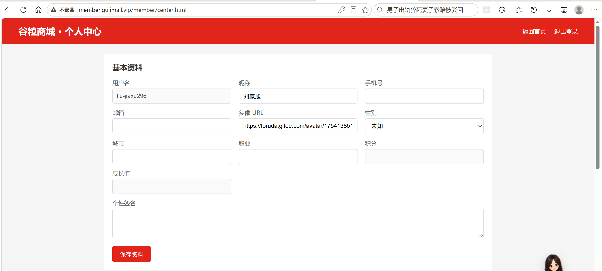
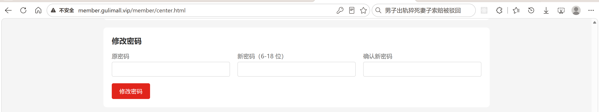
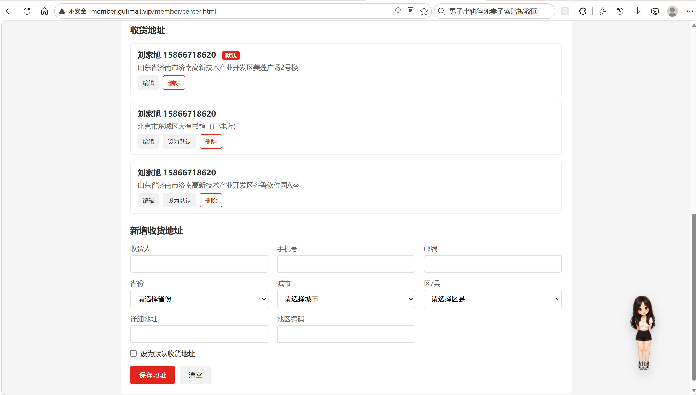
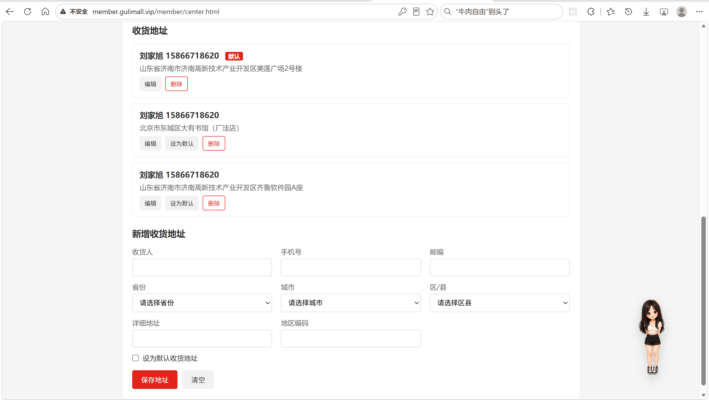
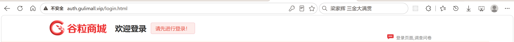
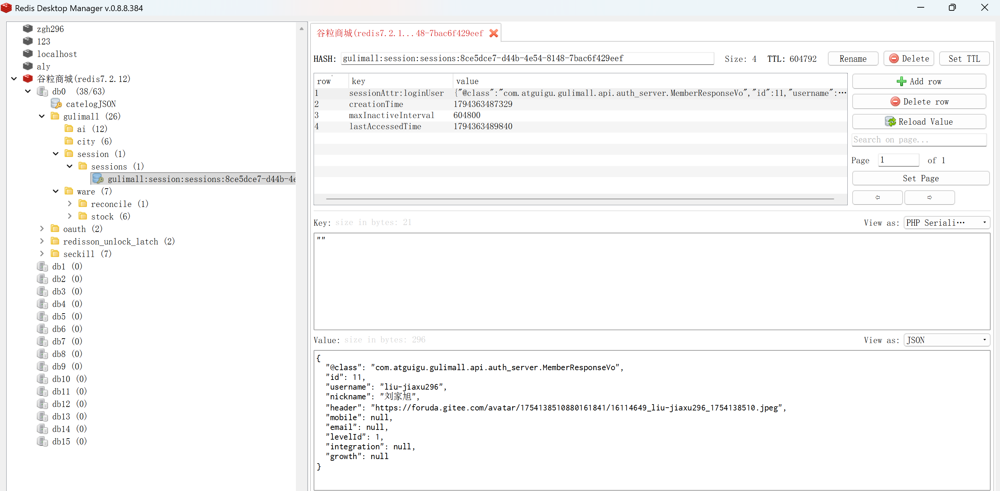

# 9.3 Spring Session 与个人中心-介绍

> 登录态要在 `auth.gulimall.vip` 写入，在 `gulimall.vip`、`item.gulimall.vip`、`cart.gulimall.vip`、`order.gulimall.vip`、`seckill.gulimall.vip`、`member.gulimall.vip` 读取。本篇讲清 Spring Session + Redis 的跨子域方案、Cookie 域、序列化、登录回跳、个人中心的资料、密码和收货地址管理。

> Session 相关文档：[Spring Session + Redis 接入](../SpringSession/Spring%20Session%20%2B%20Redis%20接入.md)。

---

## 1. 这个功能是干什么的

这个功能由两部分组成：

1. **跨子域登录态**：一次登录，所有子域都能识别当前会员。
2. **个人中心**：会员查看和修改自己的资料、密码、收货地址。

跨子域登录态解决三个问题：

| 问题 | 处理 |
|---|---|
| 会话存在哪里 | Redis，key 前缀 `gulimall:session` |
| 浏览器怎么携带 | Cookie `GULIMALLSESSION`，Domain=`gulimall.vip` |
| 各模块怎么读 | 相同的 namespace + 相同的 Cookie 名 + 相同的序列化方式 |

个人中心解决四件事：

| 功能 | 入口 | 结果 |
|---|---|---|
| 查看资料 | `GET /member/center.html` | 返回 `member-center` 页面 |
| 修改资料 | `POST /member/center/profile` | 更新 `ums_member` 资料字段 |
| 修改密码 | `POST /member/center/password` | 更新 `ums_member.password` |
| 收货地址 | `/member/memberreceiveaddress/**` | 增删改查、设默认 |

个人中心的所有接口只认会话里的当前会员，不接受前端传 `memberId`。

模块分工：

| 模块 | 职责 | 会话角色 |
|---|---|---|
| gulimall-auth-server | 登录、退出、写会话 | 写 |
| gulimall-member | 个人中心、地址、读会话 | 读写 |
| gulimall-product | 首页、商品详情展示登录态 | 读 |
| gulimall-cart | 登录用户与游客购物车合并 | 读 |
| gulimall-order | 订单确认、订单列表、支付 | 读 |
| gulimall-seckill | 秒杀页、抢购结果 | 读 |
| gulimall-common | 公共模型注入、常量 | 无 |

## 2. 用户怎么操作

### 2.1 登录后跨子域访问

1. 在 `auth.gulimall.vip` 输入账号密码登录。
2. auth-server 把会员信息写入会话，响应下发 `GULIMALLSESSION` Cookie。
3. 浏览器访问 `gulimall.vip`、`item.gulimall.vip`、`cart.gulimall.vip` 等子域时自动携带同一个 Cookie。
4. 各子域从 Redis 读取同一份会话，页面显示会员昵称。
5. 点击“退出登录”，会话作废，所有子域同时变为未登录。

### 2.2 查看和修改资料

1. 登录后点击“个人中心”，进入 `http://member.gulimall.vip/member/center.html`。
2. 页面显示用户名、昵称、手机号、邮箱、头像、性别、城市、职业、积分、成长值、个性签名。
3. 用户名、积分、成长值只读。
4. 修改昵称、手机号、邮箱、头像、性别、城市、职业、签名，点击“保存资料”。
5. 后端校验昵称非空、手机号格式和唯一性，只更新资料字段。
6. 保存成功后刷新页面，页面顶部昵称同步变化。



### 2.3 修改密码

1. 在个人中心“修改密码”卡片输入原密码、新密码、确认新密码。
2. 前端先校验两次新密码一致。
3. 提交 `POST /member/center/password`。
4. 后端校验新密码长度 6 到 18 位。
5. 有原密码的账号必须校验原密码；社交注册的账号密码为空，可以直接设置。
6. 修改成功后清空输入框。



### 2.4 查看收货地址

1. 个人中心“收货地址”区域按默认地址优先、id 倒序展示。
2. 默认地址带“默认”标签。
3. 每条地址显示收货人、手机号、省市区和详细地址。
4. 每条地址可以编辑、设为默认、删除。



### 2.5 新增或编辑地址

1. 点击“编辑”时，按钮上的 `data-*` 属性把地址数据回填到表单。
2. 省市区按名称逐级回显，选择区县时回填地区编码。
3. 新增时表单 id 为空，提交到 `/save`；编辑时 id 有值，提交到 `/update`。
4. 勾选“设为默认收货地址”时，后端会清掉该会员其他地址的默认标记。
5. 如果没有默认地址，登录后会被引导到个人中心补地址。
6. 补完地址并勾选默认后，页面检测到 `returnUrl`，直接跳回原目标页。



### 2.6 登录回跳

1. 未登录用户访问秒杀确认页、购物车结算页等需要登录的页面。
2. 页面把当前完整地址作为 `returnUrl`，重定向到登录页。
3. 登录成功后，后端校验 `returnUrl` 是否属于商城域名。
4. 校验通过且已有默认地址，回原页面。
5. 校验通过但没有默认地址，先去个人中心补地址，补完再回原页面。
6. 校验失败回商城首页。



## 3. 整体设计思路

### 3.1 业务上怎么设计

#### 3.1.1 一次登录，全部子域可用

用户只在 auth-server 登录一次，其他子域不再重复登录。业务上要求：

1. 登录成功后，商城首页立即显示昵称。
2. 购物车能识别登录用户，并与游客购物车合并。
3. 订单确认页能拿到当前会员和默认地址。
4. 秒杀页能判断是否登录，抢购接口未登录返回 JSON 错误。
5. 个人中心能读到当前会员，不需要前端传 `memberId`。

#### 3.1.2 登录回跳

1. 未登录访问受保护页面时，页面带上 `returnUrl` 跳登录页。
2. 登录页把 `returnUrl` 放进隐藏字段，提交时原样带回。
3. 后端只接受商城自己的站点前缀，防止开放重定向。
4. 回跳前检查默认地址，没有地址先补地址。
5. 地址服务故障时不阻断登录。

#### 3.1.3 个人中心的数据归属

1. 个人中心只认会话里的 `loginUser.id`。
2. 资料更新按会话 id 更新，不接受请求体里的会员 id。
3. 地址新增强制置空 id，`memberId` 从会话取。
4. 地址修改、删除、设默认都先按 id 查记录，再比对 `memberId`。
5. 前端传来的任何 `memberId` 都不作为归属依据。

#### 3.1.4 资料修改规则

1. 昵称必填，最长 50 个字符。
2. 手机号可以不填；填了必须符合 `^1[3-9]\d{9}$`，且不能和其他会员重复。
3. 邮箱、头像、城市、职业、签名允许为空，提交前统一 trim。
4. 只更新资料字段，积分、成长值、等级、状态、密码不允许从这个接口改。
5. 更新数据库后同步会话里的昵称、手机号、邮箱、头像，页面顶部立即变化。

#### 3.1.5 密码修改规则

1. 新密码必填，长度 6 到 18 位。
2. 数据库里有密码时，必须校验原密码。
3. 社交注册的账号密码为空，允许直接设置新密码。
4. 新密码用 BCrypt cost=12 加密后写入。
5. 修改密码不强制下线，已有会话继续有效。

#### 3.1.6 收货地址规则

1. 一个会员只能有一个默认地址。
2. 新增时如果勾选默认，清掉其他地址的默认标记。
3. 修改时如果改成默认，同样清掉其他地址的默认标记。
4. 设默认时先把该会员所有地址的默认标记清零，再设置目标地址。
5. 地址列表默认地址排最前，订单确认页默认选中第一条。
6. 删除地址不检查是否默认，默认地址被删后会员暂时没有默认地址。

### 3.2 技术上怎么设计

#### 3.2.1 Spring Session + Redis

1. 各模块引入 `spring-session-data-redis`。
2. Spring Boot 自动配置注册 `SessionRepositoryFilter`，把容器原生 `HttpSession` 替换成 Redis 实现。
3. 业务代码仍然使用 `HttpSession`，不感知 Redis。
4. 会话默认 7 天不活跃后过期。

Redis key 结构：

```text
gulimall:session:sessions:{sessionId}            会话内容
gulimall:session:sessions:expires:{sessionId}    过期标记
gulimall:session:expirations:{时间戳}             到期索引
```

#### 3.2.2 跨子域 Cookie

登录发生在 `auth.gulimall.vip`，响应下发：

```text
Set-Cookie: GULIMALLSESSION=...; Domain=gulimall.vip; Path=/; HttpOnly
```

`Domain=gulimall.vip` 对 `gulimall.vip` 及其所有子域生效。不能写 `.gulimall.vip`，Spring Session 的 `DefaultCookieSerializer` 会抛 `Invalid cookie domain`。

#### 3.2.3 统一序列化

Spring Session 默认使用 JDK 序列化，Redis 里是二进制乱码，类字段变化时旧会话可能反序列化失败。项目改成 `GenericJackson2JsonRedisSerializer`：

1. Redis 里是明文 JSON，排查方便。
2. JSON 里带 `@class` 类型信息，能还原成 `MemberResponseVo`。
3. 所有模块必须使用同一种序列化器，否则一个模块写入的会话另一个模块读不出来。

#### 3.2.4 公共模型注入

`GlobalModelAdvice` 在每个 Controller 方法前执行：

1. 把各站点地址放进 model。
2. 从 `request.getSession(false)` 读取 `loginUser`，未登录不创建会话。
3. 读取城市 cookie 和 Redis 城市记录。
4. 注入省级列表。

这样首页、详情页、登录页、个人中心都不需要重复写 `model.addAttribute`。

#### 3.2.5 拦截器与 ThreadLocal

不同子域对未登录的处理不同：

| 子域 | 处理 |
|---|---|
| cart | 未登录分配 `user-key`，允许继续购物 |
| order | 未登录 302 到登录页 |
| seckill 抢购 | 未登录返回 JSON 错误码 |
| member | 页面跳登录页并带 `returnUrl` |

拦截器把会员放进 ThreadLocal，业务方法直接取，请求结束后清理，避免线程复用导致数据串号。

#### 3.2.6 登录回跳的 Feign 查询

`LoginRedirectService` 通过 `MemberFeignClient.getAddress(memberId)` 查该会员全部地址：

1. 有 `defaultStatus=1` 的地址，直接回目标页。
2. 没有默认地址，重定向个人中心，带 `needAddress=1` 和编码后的 `returnUrl`。
3. 查询异常时按“已有默认地址”处理，不让地址服务故障阻断登录。

#### 3.2.7 个人中心页面

`member-center.html` 是服务端渲染页面，Thymeleaf 输出会员和地址：

1. 资料表单用 `th:value` 回填。
2. 地址列表用 `th:each` 渲染，按钮用 `data-*` 携带地址数据。
3. 保存资料、修改密码用 JSON POST。
4. 新增、修改地址用 JSON POST。
5. 设默认、删除用表单 POST。
6. 省市区三级联动调用 `/region/provinces`、`/region/cities`、`/region/areas`。

#### 3.2.8 agent JWT 与会话分开

登录成功时还会签发用户端 agent JWT，写入 `AGENT_JWT_USER` Cookie。它和 `GULIMALLSESSION` 是两套机制：

1. `GULIMALLSESSION` 给商城各子域读会话。
2. `AGENT_JWT_USER` 给 AI 助手验签。
3. 两者的 Cookie 域写法不同：会话域不能带前导点，agent JWT 域可以带前导点。

agent JWT 的私钥加载、RS256 签发、刷新与验签放在 AI 章节，本节只引用登录时的调用点。

## 4. 详细代码、配置和解释

第 4 章按“这个类或这段配置解决什么问题 → 关键概念与接口 → 正常链路 → 代码分块解释 → 一次完整示例 → 它不做什么与边界”的顺序展开。每块代码先说明它在链路里的位置和承担的动作，代码之后按 1、2、3 编号解释执行顺序、触发条件和取舍。

### 4.1 Spring Session 配置与序列化

#### 4.1.1 这段配置解决什么问题

商城的登录入口只有一个：`auth.gulimall.vip`。用户在这里输入账号密码，登录成功后要在 `gulimall.vip`、`item.gulimall.vip`、`cart.gulimall.vip`、`order.gulimall.vip`、`seckill.gulimall.vip`、`member.gulimall.vip` 同时生效。浏览器不会自动把 `auth` 子域的普通 Cookie 发给其他子域，Tomcat 自带的 `HttpSession` 又只存在单个进程内存里，服务重启或多实例部署就丢登录态。

这段配置把会话从“单机内存”搬到 Redis，并让所有子域共用同一个 Cookie：

1. 会话内容写进 Redis，key 前缀统一为 `gulimall:session`；
2. 浏览器只保存一个 sessionId，Cookie 名 `GULIMALLSESSION`，Domain 设为 `gulimall.vip`；
3. 所有子域用相同的命名空间、相同的 Cookie 名、相同的序列化方式去读同一份数据。

链路上的位置很靠前。`auth-server` 的 `LoginController` 登录成功后调用 `session.setAttribute("loginUser", member)`，这次写入经过 Spring Session 的 `SessionRepositoryFilter` 落进 Redis；`member`、`product`、`cart`、`order`、`seckill` 的任意请求进入时，同一个过滤器先按 Cookie 里的 sessionId 查出会话，业务代码拿到的 `HttpSession` 已经是 Redis 会话的包装对象。上层业务完全不用感知 Redis。

配置不一致时的表现很直接：登录成功了，首页仍然显示未登录。常见原因就是 namespace 或 Cookie 名在某个模块写错。

#### 4.1.2 关键配置与生效条件

| 配置项 | 当前值 | 作用 | 不一致的后果 |
|---|---|---|---|
| `SESSION_REDIS_NAMESPACE` | `gulimall:session` | Redis 会话 key 前缀 | 各模块读不同前缀，登录态互不可见 |
| `SESSION_COOKIE_DOMAIN` | `gulimall.vip` | Cookie 生效域 | 子域收不到 Cookie |
| `SESSION_COOKIE_NAME` | `GULIMALLSESSION` | 浏览器携带的 Cookie 名 | 服务端按名字取不到 sessionId |
| `spring.session.timeout` | `7d` | 会话空闲过期时间 | 过期策略不一致，部分模块提前失效 |
| 序列化 Bean 名 | `springSessionDefaultRedisSerializer` | Spring Session 查找序列化器 | 改名后配置不生效，仍用 JDK 序列化 |

Cookie 域不能写成 `.gulimall.vip`。Spring Session 的 `DefaultCookieSerializer` 对前导点有校验，写了会抛 `Invalid cookie domain`，登录请求直接失败。agent JWT 的 Cookie 走的是另一套写入逻辑，允许前导点，两者不能混用写法。

必须在 `common.yaml` 里引用这三个值的模块包括 `auth-server`、`member`、`product`、`cart`、`order`、`seckill`、`search`。网关是 WebFlux 应用，没有 `HttpSession`，不参与这套会话。

正常链路：

```text
登录请求
  → auth-server LoginController 调 member 校验账号密码
  → session.setAttribute("loginUser", member)
  → SessionRepositoryFilter 包装会话
  → GenericJackson2JsonRedisSerializer 序列化成 JSON
  → Redis 写入 gulimall:session:sessions:{sessionId}
  → 响应 Set-Cookie: GULIMALLSESSION=...; Domain=gulimall.vip; HttpOnly

其他子域请求
  → 浏览器自动携带 GULIMALLSESSION
  → SessionRepositoryFilter 按 sessionId 查 Redis
  → request.getSession(false) 返回会话
  → 业务代码读取 loginUser
```

#### 4.1.3 代码与解释

第一块是三个全局变量和共用的 Cookie 配置。它们放在 `config/common.yaml`，所有模块启动时从同一份配置中心读取，保证命名空间、Cookie 名、Cookie 域完全一致。

```yaml
# Redis 里会话的 key 前缀
SESSION_REDIS_NAMESPACE: gulimall:session
# 会话 cookie 的 domain —— 对 gulimall.vip 及其所有子域生效
SESSION_COOKIE_DOMAIN: gulimall.vip
# 会话 cookie 的名字
SESSION_COOKIE_NAME: GULIMALLSESSION

server:
  servlet:
    session:
      cookie:
        domain: ${SESSION_COOKIE_DOMAIN}
        name: ${SESSION_COOKIE_NAME}
        http-only: true
```

1. `SESSION_REDIS_NAMESPACE`：Redis 里所有会话 key 的公共前缀。`auth-server` 写入和 `member` 读取都靠它落到同一个前缀下。
2. `SESSION_COOKIE_DOMAIN`：设置成 `gulimall.vip`，浏览器访问任意子域都会带上这个 Cookie。
3. `SESSION_COOKIE_NAME`：固定为 `GULIMALLSESSION`，各模块按这个名字从请求里取 sessionId。
4. `server.servlet.session.cookie.domain` 和 `name` 直接引用上面两个变量，避免两处写不同值。
5. `http-only: true`：Cookie 不允许 JavaScript 读取，降低 XSS 窃取会话的风险。

第二块是各模块自己的会话超时和 Redis 命名空间。`auth-server` 和 `member` 都引用了同一个 `SESSION_REDIS_NAMESPACE`，超时时间统一为 7 天。

```yaml
spring:
  session:
    timeout: 7d
    redis:
      namespace: ${SESSION_REDIS_NAMESPACE}
```

1. `spring.session.timeout: 7d`：会话 7 天没有访问就过期，Redis 里的会话 key 随之删除。
2. `spring.session.redis.namespace`：引用全局命名空间，不能在这里写死另一个值。
3. 这段配置在每个需要读会话的模块里都存在，值必须一致；模块可以有自己的 Redis 连接信息，但命名空间不能分叉。

第三块是序列化器。Spring Session 默认使用 JDK 序列化，Redis 里是二进制，排查困难；类字段变化后旧会话还可能反序列化失败。项目统一替换成 JSON 序列化。

```java
@Configuration
public class SessionConfig {

    /**
     * ⚠️ Bean 名必须叫 {@code springSessionDefaultRedisSerializer}
     * —— Spring Session 是按这个名字去找序列化器的，改成别的名字不生效
     */
    @Bean
    public RedisSerializer<Object> springSessionDefaultRedisSerializer() {
        // GenericJackson2JsonRedisSerializer 会自动在 JSON 里写入 @class 类型信息，
        // 所以取出来能还原成原来的对象（包括 MemberResponseVo）
        return new GenericJackson2JsonRedisSerializer();
    }

}
```

1. `@Configuration` 把类注册为配置类，应用启动时加载。
2. `@Bean` 的方法名就是 Bean 名，必须叫 `springSessionDefaultRedisSerializer`。Spring Session 的自动配置按这个名字查找序列化器，改成其他名字不会生效。
3. `GenericJackson2JsonRedisSerializer` 在 JSON 里写入 `@class` 类型信息，读出来能还原成 `MemberResponseVo`。
4. 所有模块必须使用同一种序列化器。一个模块用 JSON、另一个用 JDK，读到的会话会解析失败，页面直接 500。



#### 4.1.4 一次完整示例

用户在 `auth.gulimall.vip` 登录，然后访问商城首页：

```text
1. POST http://auth.gulimall.vip/login，账号密码提交到 auth-server
2. auth-server 通过 Feign 调 member 的 /member/member/login 校验
3. 校验通过，session.setAttribute("loginUser", member)
4. Spring Session 生成 sessionId，会话 JSON 写入 gulimall:session:sessions:{sessionId}
5. 响应头下发 Set-Cookie: GULIMALLSESSION=...; Domain=gulimall.vip; Path=/; HttpOnly
6. 浏览器访问 http://gulimall.vip，自动携带该 Cookie
7. product 模块的 SessionRepositoryFilter 按 sessionId 查 Redis，取到同一份会话
8. GlobalModelAdvice 读出 loginUser，首页顶部显示昵称
9. 重启 product 服务，Redis 会话仍在，首页仍显示登录态
```

#### 4.1.5 它不做什么

1. 不校验账号密码，认证逻辑在 `member` 的 `MemberService.login`。
2. 不负责跨域请求的 CORS 配置，跨子域页面跳转依赖的是 Cookie Domain。
3. 不负责 agent JWT 的签发和验签，那套机制独立存在。
4. 不管理业务权限，只解决“当前是哪个会员”的问题。
5. 不做会话共享之外的缓存，Redis 里其他业务 key 与它无关。

#### 4.1.6 边界与可优化点

1. 7 天有效期偏长。敏感业务可以缩短空闲时间，并在每次访问时滑动续期。
2. 登录成功后没有更换 sessionId，存在会话固定攻击的风险。生产环境登录时应先作废旧会话，再创建新会话。
3. 会话没有绑定设备指纹或 IP，Cookie 泄露后可以在别处重放。
4. JSON 序列化会写入 `@class`，跨版本升级时类名或包名变化会导致旧会话无法反序列化，需要评估兼容策略。
5. Redis 是单点，会话存储应使用哨兵或集群。
6. 退出登录只作废当前会话，其他设备上的会话不受影响。

### 4.2 AuthServerConstant：会话与 Cookie 常量

#### 4.2.1 这个类解决什么问题

登录态、短信验证码、城市定位分散在多个模块使用，字符串 key 一旦写错，问题很难从代码上直接发现：`auth-server` 写的是 `loginUser`，`order` 读成 `login_user`，表现就是订单页一直要求登录。

这个常量类放在 `gulimall-common`，给所有模块提供同一套 key。上层的 `LoginController`、`MemberCenterController`、`GlobalModelAdvice`、购物车和订单拦截器都从这里引用，而不是各自写字符串。它在链路里的位置是“共享词汇表”，不参与具体执行，但决定了上下游读写的是不是同一个属性。

#### 4.2.2 关键常量

| 常量 | 值 | 使用者 | 用途 |
|---|---|---|---|
| `LOGIN_USER` | `loginUser` | auth-server 写，member/product/cart/order/seckill 读 | 会话里的会员对象 |
| `SMS_CODE_CACHE_PREFIX` | `sms:code:` | auth-server | 短信验证码在 Redis 里的前缀 |
| `CURRENT_CITY` | `currentCity` | 首页定位 | 当前城市在会话里的 key |
| `CITY_COOKIE` | `gulimall_city` | 首页、搜索、订单 | 城市持久化 Cookie |
| `VISITOR_COOKIE` | `gulimall_visitor` | 首页定位 | 匿名访问者 ID，用作 Redis 城市记录的 key |

#### 4.2.3 代码与解释

这段代码集中声明所有跨模块使用的 key，注释同时说明了每个 key 的存储位置和生命周期。

```java
public class AuthServerConstant {

    public static final String SMS_CODE_CACHE_PREFIX = "sms:code:";

    public static final String LOGIN_USER = "loginUser";

    /**
     * 当前定位城市，存在 Spring Session（Redis）里。
     * 所有子域共用同一个 session cookie（domain=gulimall.vip），
     * 所以首页定位一次后，搜索、订单、商品详情等页面都能直接复用。
     */
    public static final String CURRENT_CITY = "currentCity";

    /**
     * 当前城市的持久化 cookie（Domain=gulimall.vip，30 天）。
     * Session 30 分钟不活跃会过期，cookie 用来兜底，避免隔天访问又弹定位。
     */
    public static final String CITY_COOKIE = "gulimall_city";

    /**
     * 匿名访问者 ID（30 天）。只用来作为 Redis 城市记录的 key，
     * 不参与登录态，也不会创建 Spring Session。
     */
    public static final String VISITOR_COOKIE = "gulimall_visitor";

}
```

1. `LOGIN_USER = "loginUser"`：最关键的常量。`auth-server` 登录成功后按这个 key 写入会话，其他模块按同一个 key 读取；任何一处写错都会导致登录态断链。
2. `SMS_CODE_CACHE_PREFIX = "sms:code:"`：验证码存在 Redis，前缀后拼手机号，便于按号码查询和设置过期时间。
3. `CURRENT_CITY = "currentCity"`：城市信息可以放进会话，但项目当前主要靠 Cookie 和 Redis 城市记录，避免匿名访问创建会话。
4. `CITY_COOKIE = "gulimall_city"`：城市 Cookie 的域同样是 `gulimall.vip`，有效期 30 天，用来兜底会话过期后的城市显示。
5. `VISITOR_COOKIE = "gulimall_visitor"`：匿名访问者 ID 只用于城市记录的 key，不参与登录态判断，也不会因此创建 Spring Session。

#### 4.2.4 一次完整示例

```text
1. 登录成功：session.setAttribute(AuthServerConstant.LOGIN_USER, member)
2. 首页请求：GlobalModelAdvice 按 LOGIN_USER 从会话取值
3. 订单确认：LoginUserInterceptor 按 LOGIN_USER 从会话取值
4. 购物车合并：CartInterceptor 按 LOGIN_USER 判断是否登录
5. 三处读取的字符串完全一致，读到的都是同一个 MemberResponseVo
```

#### 4.2.5 它不做什么

1. 不负责写入或读取，只提供 key 名称。
2. 不做类型转换，取出的对象由调用方判断类型。
3. 不管理 agent JWT 的 Cookie 名，那套常量在 auth-server 的配置里。

#### 4.2.6 边界与可优化点

1. 类没有声明为 `final`，也没有私有构造器，可以被继承或实例化。工具常量类可以补上。
2. 登录态、验证码、城市三类常量混在同一个类里，长期可以按领域拆分。
3. 常量只能约束本项目的 Java 代码，模板、脚本、其他语言的服务仍可能直接写字符串，需要靠约定和评审保证。
4. 没有版本概念，key 改名会影响所有已存在的会话和缓存，上线时要评估迁移。

### 4.3 LoginRedirectService：登录后的统一跳转

#### 4.3.1 这个类解决什么问题

登录成功不等于可以立刻回到原页面。新注册的会员往往还没有默认收货地址，如果直接放回秒杀确认页或订单确认页，下单时才会发现无法配送，前面的操作全部白做。

这个服务在登录成功后做一次分流：会员已有默认地址就回原目标页；没有默认地址先去个人中心补地址，并把原目标地址带过去，补完再跳回来。调用方有四个入口：账号密码登录 `LoginController.login`、GitHub 登录 `GitHubOAuthController`、Gitee 登录 `GiteeOAuthController`、微信登录 `WechatOAuthController`，它们都调用同一个 `afterLogin`，保证跳转规则只有一份。

下游依赖 `MemberFeignClient.getAddress(memberId)`，最终落到 member 模块的 `MemberReceiveAddressController.getAddress` 和 `MemberReceiveAddressServiceImpl.getAddress`。也就是说，一次登录除了认证请求，还会多一次地址查询。

#### 4.3.2 跳转规则

| 条件 | 结果 |
|---|---|
| `target` 为空 | 回商城首页 `shopHomeUrl` |
| 会员为空或 id 为空 | 直接回目标页 |
| 地址列表中存在 `defaultStatus=1` | 回目标页 |
| 地址列表为空或没有默认地址 | 个人中心，带 `needAddress=1` 和编码后的 `returnUrl` |
| 地址查询抛异常 | 按已有默认地址处理，回目标页 |

#### 4.3.3 代码与解释

这段代码先确定目标地址，再查默认地址，最后把跳转结果拼成 `redirect:` 字符串。`target` 的安全校验不在这里做，由调用方 `LoginController.isSafeReturnUrl` 先过滤。

```java
@Slf4j
@Service
public class LoginRedirectService {

    @Value("${gulimall.member-url}")
    private String memberUrl;

    @Value("${gulimall.shop-home-url}")
    private String shopHomeUrl;

    @Autowired
    private MemberFeignClient memberFeignClient;

    /**
     * @param member 登录成功的会员
     * @param target 登录后原本要去的地址（调用方必须已做安全校验）
     */
    public String afterLogin(MemberResponseVo member, String target) {
        String destination = StringUtils.hasText(target) ? target : shopHomeUrl;
        if (member == null || member.getId() == null) {
            return "redirect:" + destination;
        }

        // 1. 没有默认地址：先去个人中心设置，并把原目标地址带回去
        if (!hasDefaultAddress(member.getId())) {
            return "redirect:" + memberUrl + "/member/center.html?needAddress=1&returnUrl="
                    + URLEncoder.encode(destination, StandardCharsets.UTF_8);
        }

        // 2. 已有默认地址：正常回目标页
        return "redirect:" + destination;
    }

    private boolean hasDefaultAddress(Long memberId) {
        try {
            List<MemberAddressVo> addresses = memberFeignClient.getAddress(memberId);
            if (addresses == null) {
                return false;
            }
            return addresses.stream()
                    .anyMatch(address -> Integer.valueOf(1).equals(address.getDefaultStatus()));
        } catch (Exception e) {
            // 地址服务暂时不可用时不要卡住登录，按原目标走
            log.error("[login-redirect] 查询默认地址失败 memberId={}", memberId, e);
            return true;
        }
    }
}
```

1. `StringUtils.hasText(target) ? target : shopHomeUrl`：调用方没传目标地址时，兜底回商城首页。
2. `member == null || member.getId() == null`：会员信息不完整时不再查地址，直接回目标页，避免无意义的远程调用。
3. `hasDefaultAddress(member.getId())` 通过 Feign 查会员全部地址。
4. 没有默认地址时，拼个人中心地址，参数 `needAddress=1` 让页面显示补地址提示。
5. `URLEncoder.encode(destination, UTF_8)` 对原目标地址编码，防止地址里的 `&`、`?` 破坏 query 参数结构。
6. 有默认地址时直接返回 `redirect:` 加目标地址。
7. `hasDefaultAddress` 里 `addresses == null` 按“没有地址”处理。
8. `anyMatch` 判断是否存在 `defaultStatus=1` 的地址。
9. 捕获异常后返回 `true`，注释写明“地址服务暂时不可用时不要卡住登录”，这是可用性优先的取舍。

#### 4.3.4 一次完整示例

未登录用户从秒杀确认页跳去登录，登录成功后回到原页面：

```text
1. 秒杀确认页发现未登录，拼出 returnUrl=秒杀确认页完整地址
2. 跳转 auth.gulimall.vip/login.html?returnUrl=...
3. 用户登录，LoginController 校验 returnUrl 属于商城站点
4. 登录成功，session 写入会员，agent JWT 签发
5. LoginController.login 调 afterLogin(member, target)
6. afterLogin 调 MemberFeignClient.getAddress(memberId)
7. 会员没有默认地址，返回 redirect:member.gulimall.vip/member/center.html?needAddress=1&returnUrl=...
8. 个人中心显示补地址提示
9. 用户新增地址并勾选默认，前端检测到 returnUrl，跳回秒杀确认页
```

#### 4.3.5 它不做什么

1. 不校验 `target` 是否安全，调用方必须先做白名单校验。
2. 不创建地址，只判断有没有默认地址。
3. 不渲染登录页或个人中心页面，只返回重定向字符串。
4. 不区分新老用户，只看地址数据。

#### 4.3.6 边界与可优化点

1. 地址查询异常按“已有默认地址”处理，会放过真正没有地址的会员，属于可用性优先的取舍；生产环境可以改成提示后仍允许进入，但下单前强制补地址。
2. 每次登录都远程查一次全部地址，地址多时浪费带宽，可以只查默认地址数量。
3. 返回 `redirect:` 字符串要求调用方正确处理，如果 `target` 未校验，会形成开放重定向。
4. 地址服务超时时间受 Feign 全局配置影响，登录链路对超时敏感，需要单独设置合理的读超时。
5. 跳转规则集中后，新增登录方式也必须调用同一个服务，否则会出现两套行为。

### 4.4 returnUrl 白名单：登录回跳的入口校验

#### 4.4.1 这段校验解决什么问题

受保护页面在跳登录页时，会把当前完整地址放进 `returnUrl`。登录成功后如果直接按这个参数跳转，攻击者可以构造一个外部地址，诱导用户登录后跳去钓鱼站，这类问题叫开放重定向。

这段校验的任务是只允许回跳商城自己的站点。上游是登录页的隐藏字段和 `LoginController.login` 的 `returnUrl` 参数；下游是 `LoginRedirectService.afterLogin` 的最终跳转。校验发生在写入会话之后、跳转动作执行前，失败时回商城首页。

同样的逻辑还出现在受保护页面生成 `returnUrl` 的地方：秒杀确认页未登录时，把当前完整地址编码后拼到登录页参数里。

#### 4.4.2 允许的前缀与生成方式

| 允许前缀 | 配置项 | 对应站点 |
|---|---|---|
| `http://gulimall.vip` | `gulimall.shop-home-url` | 商城首页、商品详情 |
| `http://auth.gulimall.vip` | `gulimall.auth-url` | 登录、注册 |
| `http://order.gulimall.vip` | `gulimall.order-url` | 订单确认、订单列表 |
| `http://cart.gulimall.vip` | `gulimall.cart-url` | 购物车 |
| `http://seckill.gulimall.vip` | `gulimall.seckill-url` | 秒杀 |
| `http://member.gulimall.vip` | `gulimall.member-url` | 个人中心 |

登录页把 `returnUrl` 放在隐藏字段里，提交登录表单时原样带回。服务端只认这六个绝对地址前缀，其他一律回首页。

#### 4.4.3 代码与解释

第一块是白名单判断。它不解析 URL，只做字符串前缀比较，实现简单，覆盖当前所有站点。

```java
private boolean isSafeReturnUrl(String returnUrl) {
    if (returnUrl == null || returnUrl.isBlank()) {
        return false;
    }
    return returnUrl.startsWith(shopHomeUrl)
            || returnUrl.startsWith(authUrl)
            || returnUrl.startsWith(orderUrl)
            || returnUrl.startsWith(cartUrl)
            || returnUrl.startsWith(seckillUrl)
            || returnUrl.startsWith(memberUrl);
}
```

1. `returnUrl == null || returnUrl.isBlank()`：空值直接判定为不安全，调用方会回首页。
2. 依次比较六个配置前缀，任意一个命中就认为是站内地址。
3. 前缀来自配置而不是硬编码，站点地址调整时只改配置。
4. 协议相对地址 `//evil.com/path` 不以任何绝对地址开头，会被拒绝。
5. `javascript:`、`data:` 这类伪协议同样无法通过前缀匹配。

第二块是受保护页面生成 `returnUrl` 的写法。以秒杀确认页为例，未登录时把当前完整地址拼出来，编码后带给登录页。

```java
MemberResponseVo member = session == null ? null
        : (MemberResponseVo) session.getAttribute(AuthServerConstant.LOGIN_USER);
if (member == null) {
    String returnUrl = seckillUrl + "/confirm.html?sessionId=" + sessionId
            + "&skuId=" + skuId + "&num=" + num;
    return "redirect:" + authUrl + "/login.html?returnUrl="
            + URLEncoder.encode(returnUrl, StandardCharsets.UTF_8);
}
```

1. `request.getSession(false)` 取会话，没有会话时不创建，匿名访问不会多出一条 Redis 会话。
2. `session == null ? null : session.getAttribute(...)` 安全地取 `loginUser`。
3. 会员为空说明未登录，开始拼原地址。
4. 原地址包含 `sessionId`、`skuId`、`num` 等参数，保证登录后回到同一个确认页，而不是一个空的秒杀页。
5. `URLEncoder.encode` 对完整地址编码，避免参数里的特殊字符截断外层 query。
6. 重定向到登录页，登录页把 `returnUrl` 放进表单隐藏字段。

#### 4.4.4 一次完整示例

```text
1. 未登录访问 http://seckill.gulimall.vip/confirm.html?sessionId=3&skuId=9&num=1
2. 页面拼出 returnUrl 并编码
3. 跳转 http://auth.gulimall.vip/login.html?returnUrl=http%3A%2F%2Fseckill...
4. 用户提交账号密码，隐藏字段把 returnUrl 带回 /login
5. LoginController 调 isSafeReturnUrl 校验
6. 命中 seckillUrl 前缀，target 取原地址
7. afterLogin 检查默认地址，按结果回确认页或先去个人中心
8. 如果 returnUrl 是 http://evil.com，所有前缀都不命中，回商城首页
```

#### 4.4.5 它不做什么

1. 不校验目标路径，站内任意页面都允许回跳。
2. 不校验 URL 参数内容，`returnUrl` 里的业务参数由目标页面自己校验。
3. 不防篡改，参数可以被用户修改，只是改不成外部域名。
4. 不处理 HTTPS 与 HTTP 的切换，前缀必须完全一致。

#### 4.4.6 边界与可优化点

1. `startsWith` 存在前缀绕过风险：`http://gulimall.vip.evil.com` 以允许前缀开头，但实际是外部域名。更严格的做法是解析 URL 后比较 scheme 和 host。
2. 没有限制回跳路径，会员可以构造站内任意页面的链接。
3. 可以给 `returnUrl` 增加签名，防止参数被篡改。
4. 站点地址目前是 HTTP，生产环境切 HTTPS 后白名单要同步更新，否则所有回跳都会失败。
5. 白名单分散在 `LoginController` 和受保护页面两处，长期可以抽成公共工具，避免规则漂移。

### 4.5 GlobalModelAdvice：公共模型注入

#### 4.5.1 这个类解决什么问题

商城所有页面顶部都有导航、登录状态、城市显示，地址表单还需要省级下拉。这些数据每个 Controller 都写一遍 `model.addAttribute`，既重复又容易漏。

`GlobalModelAdvice` 放在 `gulimall-common`，通过 `@ControllerAdvice` 和 `@ModelAttribute` 在每个 Controller 方法执行前统一注入。上游是当前请求的会话、城市 Cookie、Redis 城市记录和 `RegionCatalog`；下游是所有 Servlet 模块的 Thymeleaf 模板，模板里可以直接用 `loginUser`、`authUrl`、`currentCity`、`provinces` 这些变量。

它只放不需要查库的轻量数据。每个请求都会执行，放重查询会拖慢所有页面。

#### 4.5.2 注入的模型属性

| 属性 | 来源 | 模板用途 |
|---|---|---|
| `shopHomeUrl` | 配置 | 首页链接 |
| `authUrl` | 配置 | 登录、注册链接 |
| `cartUrl` | 配置 | 购物车链接 |
| `orderUrl` | 配置 | 订单链接 |
| `memberUrl` | 配置 | 个人中心链接 |
| `loginUser` | 会话，仅登录时存在 | 顶部昵称、退出按钮 |
| `currentCity` | 城市 Cookie 或 Redis | 顶部城市显示 |
| `cityResolved` | 城市是否解析成功 | 控制“请选择地址”提示 |
| `provinces` | `RegionCatalog` | 地址表单省级下拉 |

#### 4.5.3 代码与解释

这段代码先注入五个站点地址，再从会话读登录会员，然后读城市，最后注入省级列表。几个数据源互不依赖，任何一项缺失都不影响其他项。

```java
@ControllerAdvice
@ConditionalOnWebApplication(type = ConditionalOnWebApplication.Type.SERVLET)
public class GlobalModelAdvice {

    @Value("${gulimall.shop-home-url}")
    private String shopHomeUrl;

    @Value("${gulimall.auth-url}")
    private String authUrl;

    @Value("${gulimall.cart-url}")
    private String cartUrl;

    @Value("${gulimall.order-url}")
    private String orderUrl;

    @Value("${gulimall.member-url}")
    private String memberUrl;

    /** Redis 城市存储；没引入 Redis 的模块为 null，自动退化成只读 cookie */
    @Autowired(required = false)
    private CityStore cityStore;

    /**
     * @ModelAttribute 标注的方法，会在【每个】Controller 方法执行前先跑一遍，
     * 往 model 里塞的东西，页面上直接就能用。
     */
    @ModelAttribute
    public void addCommonAttributes(Model model, HttpServletRequest request) {
        // 1、各站点地址（配置值，直接塞）
        model.addAttribute("shopHomeUrl", shopHomeUrl);
        model.addAttribute("authUrl", authUrl);
        model.addAttribute("cartUrl", cartUrl);
        model.addAttribute("orderUrl", orderUrl);
        model.addAttribute("memberUrl", memberUrl);

        // 2、登录态。
        //    这里的 session 由 Spring Session 提供，底层是 Redis —— 值是 auth-server
        //    登录成功时写进去的。只要两个模块的 namespace / cookie domain / cookie name
        //    一致（见 common.yaml 的 SESSION_*），跨模块、跨实例都能读到同一份会话。
        //    未登录时【不往 model 里塞】，模板统一用 loginUser == null 判断
        //
        // ⚠️ 用 request.getSession(false)：拿不到就返回 null，别凭空创建一个 session
        HttpSession session = request.getSession(false);
        if (session != null) {
            Object loginUser = session.getAttribute(AuthServerConstant.LOGIN_USER);
            if (loginUser != null) {
                model.addAttribute("loginUser", loginUser);
            }
        }

        // 3、当前城市。
        //    城市只由首页自动定位产生，存 Redis（按 visitorId）+ 30 天 cookie。
        //    这里【不碰 Spring Session】，避免每个匿名访问多出一条 session 记录。
        //    获取不到时显示“请选择地址”，不再假装成北京。
        String city = readCityCookie(request);
        if (city == null && cityStore != null) {
            String visitorId = readCookie(request, AuthServerConstant.VISITOR_COOKIE);
            if (visitorId != null) {
                city = cityStore.get(visitorId);
            }
        }
        boolean cityResolved = city != null && !city.isBlank();
        model.addAttribute("currentCity", cityResolved ? city : "请选择地址");
        model.addAttribute("cityResolved", cityResolved);

        // 4、地址下拉框的省级列表：服务端动态生成，HTML 里不再写死假列表
        model.addAttribute("provinces", RegionCatalog.provinces());
    }

    /** 读取城市 cookie（值做了 URL 编码，避免中文非法字符） */
    private String readCityCookie(HttpServletRequest request) {
        String value = readCookie(request, AuthServerConstant.CITY_COOKIE);
        if (value == null) {
            return null;
        }
        try {
            return URLDecoder.decode(value, StandardCharsets.UTF_8);
        } catch (IllegalArgumentException e) {
            return null;
        }
    }

    private String readCookie(HttpServletRequest request, String name) {
        Cookie[] cookies = request.getCookies();
        if (cookies == null) {
            return null;
        }
        for (Cookie cookie : cookies) {
            if (name.equals(cookie.getName())) {
                return cookie.getValue();
            }
        }
        return null;
    }

}
```

1. `@ControllerAdvice` 让配置对所有 Controller 生效，`@ConditionalOnWebApplication(SERVLET)` 限定只在 Servlet 环境加载。网关是 WebFlux，没有 `HttpSession`，没有这个条件会在启动时失败。
2. 五个 `@Value` 从配置读取站点地址，避免模板里硬编码域名。
3. `@Autowired(required = false)` 注入 `CityStore`：没引入 Redis 的模块拿不到 Bean，自动退化成只读 Cookie，不会启动失败。
4. `@ModelAttribute` 标注的方法在每个 Controller 方法执行前运行。
5. 第 1 步把五个站点地址放进 model。
6. 第 2 步用 `request.getSession(false)` 取会话。取不到就返回 null，不凭空创建会话，匿名访问不会在 Redis 里留下空会话。
7. 会话存在时读 `LOGIN_USER`，只有非空才放进 model；模板统一用 `loginUser == null` 判断未登录。
8. 第 3 步先读城市 Cookie，值做了 URL 解码，避免中文乱码。
9. Cookie 没有再按 `visitorId` 查 Redis；`visitorId` 也来自 Cookie。
10. 城市为空时显示“请选择地址”，不再默认成某个城市。
11. 第 4 步注入省级列表，地址表单的下拉由服务端生成，HTML 里不再写死假数据。
12. `readCookie` 遍历请求 Cookie，找不到返回 null，调用方不用处理数组越界。

#### 4.5.4 一次完整示例

匿名用户第一次访问首页：

```text
1. 请求进入 product 模块
2. GlobalModelAdvice.addCommonAttributes 先执行
3. 五个站点地址放进 model
4. request.getSession(false) 返回 null，不创建会话
5. 没有 gulimall_city Cookie，visitorId 也不存在
6. currentCity = "请选择地址"，cityResolved = false
7. provinces 注入省级列表
8. IndexController 返回首页模板
9. 模板顶部显示“请选择地址”，地址表单可以正常选省
```

已登录用户访问商品详情：

```text
1. 浏览器携带 GULIMALLSESSION
2. Spring Session 从 Redis 取出会话
3. GlobalModelAdvice 读到 loginUser，放进 model
4. 模板顶部显示会员昵称和退出按钮
5. 城市 Cookie 存在时直接显示城市，不再查 Redis
```

#### 4.5.5 它不做什么

1. 不做登录校验，未登录请求不会被拦截。
2. 不查会员资料、订单、购物车等业务数据。
3. 不负责页面渲染，只提供 model 变量。
4. 不创建会话，匿名访问不会被强制写入 Redis。
5. 不处理城市定位本身，定位逻辑在首页和城市接口。

#### 4.5.6 边界与可优化点

1. `@ModelAttribute` 每个请求都执行，省级列表和城市查询可以加本地缓存。
2. 站点地址、登录态、城市、省级列表混在一个 advice 里，职责偏多，可以按用途拆分。
3. 读取 Cookie 没有大小限制，异常超长 Cookie 会被容器拒绝，需要在网关层限制请求头大小。
4. `CityStore` 是可选依赖，模块是否具备 Redis 能力要靠运行时判断，缺少显式约定。
5. 如果某个 Controller 自己往 model 放了同名属性，会覆盖这里的值，需要团队约定命名。

### 4.6 CartInterceptor：购物车登录态与游客标识

#### 4.6.1 这个类解决什么问题

购物车允许游客直接加商品。游客没有会员 id，需要一个临时标识把同一浏览器的多次加购串起来；登录后还要把游客购物车合并到会员购物车。这个拦截器负责在每次购物车请求前准备好“当前是谁”的数据。

上游是 `gulimall-cart` 的 `GulimallWebConfig`，它把拦截器注册到 `/**`，只排除静态资源。下游是购物车业务方法，它们从 `UserThreadLocal` 直接取 `UserInfoTo`，不需要在每层方法参数里传会员 id 和 user-key。

它解决三件事：

1. 已登录用户取会员 id；
2. 游客分配或复用 `user-key`；
3. 把结果放进 ThreadLocal，请求结束清理。

#### 4.6.2 关键数据

| 数据 | 存储位置 | 生命周期 | 用途 |
|---|---|---|---|
| `userId` | `UserInfoTo` | 单次请求 | 登录用户购物车 key |
| `userKey` | `UserInfoTo` + Cookie `user-key` | 30 天 | 游客购物车 key |
| `tempUser` | `UserInfoTo` | 单次请求 | 是否需要写游客 Cookie |
| `UserThreadLocal` | 当前线程 | 单次请求 | 业务方法共享当前用户 |

#### 4.6.3 代码与解释

这段代码分两个阶段：`preHandle` 准备用户信息，`postHandle` 把游客标识写回浏览器，`afterCompletion` 清理 ThreadLocal。

```java
public class CartInterceptor implements HandlerInterceptor {

    private final String sessionCookieDomain;

    public CartInterceptor(String sessionCookieDomain) {
        this.sessionCookieDomain = sessionCookieDomain;
    }

    /***
     * 目标方法执行前
     * @param request
     * @param response
     * @param handler
     * @return
     */
    @Override
    public boolean preHandle(HttpServletRequest request, HttpServletResponse response,
                             Object handler) {

        UserInfoTo userInfoTo = new UserInfoTo();

        HttpSession session = request.getSession(false);
        //获得当前登录用户的信息
        MemberResponseVo memberResponseVo = (session == null) ? null
                : (MemberResponseVo) session.getAttribute(LOGIN_USER);

        if (memberResponseVo != null) {
            //用户登录了
            userInfoTo.setUserId(memberResponseVo.getId());

            // 用户名或昵称存储进Attribute
            request.setAttribute(LOGIN_USER, memberResponseVo);

            // 因为要做游客购物车和用户购物车合并，因此登录用户也需要知道早先临时用户的user-key
            // 所以登录用户还要额外存一个游客用户的user-key，不能直接return
        }

        // 获取所有cookie
        Cookie[] cookies = request.getCookies();
        if (cookies != null) {
            for (Cookie cookie : cookies) {
                //user-key
                String name = cookie.getName();
                if (TEMP_USER_COOKIE_NAME.equals(name)) {
                    userInfoTo.setUserKey(cookie.getValue());
                    //标记为已是临时用户
                    userInfoTo.setTempUser(true);

                    UserThreadLocal.set(userInfoTo);
                    return true;
                }
            }
        }

        //如果没有临时用户一定分配一个临时用户  生成UUID
        if (StringUtils.isEmpty(userInfoTo.getUserKey())) {
            String uuid = UUID.randomUUID().toString();
            userInfoTo.setUserKey(uuid);
            userInfoTo.setTempUser(true);
        }

        //目标方法执行前  使用ThreadLocal共享数据
        UserThreadLocal.set(userInfoTo);
        return true;

    }


    /**
     * 业务执行之后，分配临时用户，让浏览器保存
     * @param request
     * @param response
     * @param handler
     * @param modelAndView
     */
    @Override
    public void postHandle(HttpServletRequest request, HttpServletResponse response, Object handler, ModelAndView modelAndView) {

        //获取当前用户的值
        UserInfoTo userInfoTo = UserThreadLocal.get();

        // 浏览器cookie保存当前临时用户
        if (userInfoTo != null && userInfoTo.getTempUser()) {
            //创建一个cookie
            Cookie cookie = new Cookie(TEMP_USER_COOKIE_NAME, userInfoTo.getUserKey());
            //扩大作用域
            cookie.setDomain(sessionCookieDomain);
            //设置过期时间
            cookie.setMaxAge(TEMP_USER_COOKIE_TIMEOUT);
            response.addCookie(cookie);
        }

    }

    @Override
    public void afterCompletion(HttpServletRequest request, HttpServletResponse response, Object handler, Exception ex) {
        UserThreadLocal.remove();
    }
}
```

1. `sessionCookieDomain` 从配置注入，用于写 Cookie 时设置域，保证购物车和订单能读到同一个游客标识。
2. `preHandle` 先创建空的 `UserInfoTo`。
3. `request.getSession(false)` 读会话，没有会话不创建。
4. 会话里有 `LOGIN_USER` 就设置 `userId`，并把会员放进 request 属性，方便同一个请求里的其他组件读取。
5. 登录用户不直接返回，因为还要继续读游客 `user-key`，用于登录后的购物车合并。
6. 遍历 Cookie 找到 `user-key`，设置 `userKey` 和 `tempUser=true`。
7. 找到 `user-key` 后立即放进 ThreadLocal 并返回，不再生成新 UUID。
8. 没有 `user-key` 时生成 UUID，标记为临时用户，保证当前请求有可用的购物车 key。
9. 所有分支最后都调用 `UserThreadLocal.set(userInfoTo)`。
10. `postHandle` 取当前用户，只有临时用户才写 Cookie，避免每次请求都重复下发。
11. Cookie 设置域为 `gulimall.vip`，过期时间 30 天。
12. `afterCompletion` 调用 `UserThreadLocal.remove()`，防止线程复用导致下一个请求读到上一个用户的数据。

#### 4.6.4 一次完整示例

游客加购后登录：

```text
1. 游客第一次访问购物车，没有 user-key Cookie
2. preHandle 生成 UUID，tempUser=true，放入 ThreadLocal
3. postHandle 写 Cookie user-key=UUID，Domain=gulimall.vip，30 天
4. 游客加购，购物车 key 使用该 UUID
5. 用户登录，auth-server 写会话
6. 再次访问购物车，preHandle 同时读到 userId 和 Cookie 里的 user-key
7. 业务层发现两者都有，触发游客购物车合并
8. 合并后删除游客购物车，后续使用会员 id
```

#### 4.6.5 它不做什么

1. 不做购物车合并，只准备合并需要的两个标识。
2. 不校验 `user-key` 是否合法，只负责读取和分配。
3. 不判断购物车商品是否有效，业务规则在 Service。
4. 不写会员 Cookie，登录态由 auth-server 负责。

#### 4.6.6 边界与可优化点

1. `postHandle` 在异步请求里可能不执行，Spring MVC 新版本更推荐用 `afterCompletion` 或 `ResponseCookie` 写响应头。
2. ThreadLocal 必须在 `afterCompletion` 清理，异常路径也要覆盖，否则线程池复用会串数据。
3. `user-key` 没有签名，用户可以伪造别人的 key，从而操作别人的游客购物车。生产环境应加签名或改用服务端生成的加密标识。
4. Cookie 域覆盖所有子域，任何子域都能读到游客标识，需要保证各子域之间互信。
5. 静态资源路径被排除，但新增静态资源目录时要同步维护排除列表，否则会多写一次 Cookie。
6. 登录用户仍然会写 `tempUser=true` 的情况只发生在没有 Cookie 时，这里会给已登录用户也分配游客 key，行为上可接受，但语义上可以更明确。

### 4.7 LoginUserInterceptor：订单与秒杀的未登录处理

#### 4.7.1 这个类解决什么问题

订单确认页、订单列表、秒杀抢购都必须登录。不同场景对未登录的反应不一样：页面请求适合跳登录页，AJAX 抢购接口如果也 302，前端拿到的是登录页 HTML，JSON 解析直接失败。

这个拦截器解决两件事：

1. 已登录时把会员放进 ThreadLocal，业务方法直接取；
2. 未登录时按模块选择 302 或 JSON 错误。

上游是模块的 MVC 配置：`OrderWebConfiguration` 把拦截器注册到订单模块，排除静态资源、支付回调、城市接口、后台 CRUD 和内部调用；`SeckillWebConfiguration` 只拦截需要登录的抢购和结果查询，场次、商品、静态资源、内部接口放行。下游是订单和秒杀的业务方法，它们通过 `MemberResponseVoThreadLocal` 取当前会员。

#### 4.7.2 两种失败处理

| 模块 | 请求类型 | 未登录响应 | 结果 |
|---|---|---|---|
| order | 页面 | 302 到 `authUrl + /login.html` | 浏览器打开登录页 |
| order | 页面 | 会话写入 `msg=请先进行登录！` | 登录页可以显示提示 |
| seckill | AJAX 抢购 | HTTP 200 + JSON 错误码 | 前端按错误码提示 |
| seckill | 结果查询 | HTTP 200 + JSON 错误码 | 前端按错误码提示 |

#### 4.7.3 代码与解释

第一块是订单模块的拦截器。它在未登录时写提示并重定向，登录时把会员放进 ThreadLocal。

```java
@Component
public class LoginUserInterceptor implements HandlerInterceptor {

    @Value("${gulimall.auth-url}")
    private String authUrl;

    @Override
    public boolean preHandle(HttpServletRequest request, HttpServletResponse response, Object handler) throws Exception {
        HttpSession session = request.getSession(false);
        MemberResponseVo memberResponseVo = session == null ? null : (MemberResponseVo) session.getAttribute(AuthServerConstant.LOGIN_USER);
        if (memberResponseVo != null) {
            // 登录
            MemberResponseVoThreadLocal.set(memberResponseVo);
            return true;
        } else {
            // 未登录
            request.getSession().setAttribute("msg", "请先进行登录！");
            response.sendRedirect(authUrl + "/login.html");
            return false;
        }
    }

    @Override
    public void afterCompletion(HttpServletRequest request, HttpServletResponse response, Object handler, Exception ex) {
        MemberResponseVoThreadLocal.remove();
    }
}
```

1. `@Component` 把拦截器注册成 Bean，MVC 配置可以直接注入。
2. `@Value("${gulimall.auth-url}")` 读取登录页域名，不在代码里硬编码。
3. `preHandle` 用 `getSession(false)` 读会话，匿名请求不创建会话。
4. 会话里有会员时放进 `MemberResponseVoThreadLocal`，返回 true 放行。
5. 未登录时调用 `request.getSession()` 写入提示，这里会创建会话，用于登录页展示失败原因。
6. `response.sendRedirect(authUrl + "/login.html")` 让浏览器跳登录页，返回 false 终止后续处理。
7. `afterCompletion` 清理 ThreadLocal，异常路径也会执行。

第二块是秒杀抢购接口的拦截器。它不重定向，直接写 JSON。

```java
HttpSession session = request.getSession(false);
MemberResponseVo member = session == null
        ? null : (MemberResponseVo) session.getAttribute(AuthServerConstant.LOGIN_USER);
if (member != null) {
    MemberResponseVoThreadLocal.set(member);
    return true;
}

response.setStatus(HttpServletResponse.SC_OK);
response.setContentType("application/json;charset=UTF-8");
response.getWriter().write(objectMapper.writeValueAsString(
        R.error(BizCodeEnum.SECKILL_NOT_LOGIN.getCode(),
                BizCodeEnum.SECKILL_NOT_LOGIN.getMsg())));
return false;
```

1. `getSession(false)` 读会话，没有会话不创建。
2. 会员存在时放进 ThreadLocal，放行。
3. 会员不存在时，响应状态保持 200，避免前端把业务错误当成网络错误。
4. 设置 `Content-Type` 为 JSON，字符集 UTF-8，防止中文提示乱码。
5. 用 `ObjectMapper` 把统一错误结构写成响应体，错误码来自 `BizCodeEnum.SECKILL_NOT_LOGIN`。
6. 返回 false，终止 Controller 方法执行。

#### 4.7.4 一次完整示例

订单确认页未登录：

```text
1. 浏览器访问 order.gulimall.vip/toTrade
2. OrderWebConfiguration 注册的 LoginUserInterceptor 先执行
3. getSession(false) 没有会话，member 为空
4. 会话写入 msg=请先进行登录！
5. 302 到 auth.gulimall.vip/login.html
6. 用户登录后回跳规则由 LoginRedirectService 决定
```

秒杀抢购未登录：

```text
1. 前端 POST /seckill/kill
2. 秒杀拦截器执行
3. 没有会话，member 为空
4. 返回 HTTP 200，body 为 {"code":...,"msg":"请先登录"}
5. 前端读取 code，弹出登录提示，不会拿到 HTML 登录页
```

#### 4.7.5 它不做什么

1. 不做权限校验，只判断是否登录，不判断会员等级或角色。
2. 不处理登录本身，认证在 auth-server。
3. 不合并购物车，购物车有独立的拦截器。
4. 不区分接口版本，所有未登录的受保护请求按同一规则处理。

#### 4.7.6 边界与可优化点

1. 订单拦截器 302 时没有带 `returnUrl`，登录后只能回首页，体验上会丢失原目标页。可以在跳转前拼上当前完整地址。
2. 订单拦截器为了写提示调用了 `request.getSession()`，会为匿名请求创建会话，和“匿名不创建会话”的原则不一致。可以改用 `RedirectAttributes` 或 query 参数传递提示。
3. 秒杀拦截器只返回错误码，前端需要单独维护错误码到提示文案的映射。
4. 拦截器放行路径需要仔细维护。订单模块排除了支付回调、后台 CRUD、内部调用；秒杀模块排除了场次、商品、静态资源和内部接口。新增接口时要判断是否需要登录，漏配会导致接口被 302。
5. ThreadLocal 清理依赖 `afterCompletion`，异步请求和异常路径都要验证。
6. 两个模块各自实现一套拦截器，公共逻辑可以抽到 common，但要避免把订单和秒杀的不同响应策略硬塞进一个类。

### 4.8 MemberController：会员入口与个人中心边界

#### 4.8.1 这个类解决什么问题

`auth-server` 不直接连 `gulimall_ums` 库，登录、注册、社交登录都通过 Feign 调 member 模块。`MemberController` 就是这组内部入口的提供方，路径统一在 `/member/member/**`。

它在链路里的位置是“认证数据源”：上游是 `auth-server` 的 `MemberFeignClient`，下游是 `MemberService` 和 `gulimall_ums`。登录成功后返回 `MemberEntity`，`auth-server` 再转成 `MemberResponseVo` 写进会话。

个人中心的资料、密码、地址不放在这个类里。它们需要页面渲染、会话归属校验和地址归属校验，分别由 `MemberCenterController` 和 `MemberReceiveAddressController` 承担。后台管理的 CRUD 接口仍然留在这个类，和会员端入口共用同一个 `MemberService`，但权限体系不同。

#### 4.8.2 接口分布

| 功能 | Controller | 路径 | 调用方 |
|---|---|---|---|
| 登录 | `MemberController` | `/member/member/login` | auth-server Feign |
| 注册 | `MemberController` | `/member/member/regist` | auth-server Feign |
| 社交登录 | `MemberController` | `/member/member/oauth2/login` | auth-server Feign |
| 个人中心页面 | `MemberCenterController` | `/member/center.html` | 浏览器 |
| 修改资料 | `MemberCenterController` | `/member/center/profile` | 个人中心页面 |
| 修改密码 | `MemberCenterController` | `/member/center/password` | 个人中心页面 |
| 收货地址 | `MemberReceiveAddressController` | `/member/memberreceiveaddress/**` | 个人中心、订单确认 |

#### 4.8.3 代码与解释

这段代码是三个内部入口。它们只做参数接收、调用 Service、包装结果，异常统一转成 `R.error`。

```java
@PostMapping("/oauth2/login")
public R oauthLogin(@RequestParam("code") String code,
                    @RequestParam(value = "source", defaultValue = "github") String source) {
    try {
        MemberEntity member = memberService.oauthLogin(code, source);
        return R.ok().put("data", member);
    } catch (RRException e) {
        return R.error(e.getCode(), e.getMsg());
    }
}

@PostMapping("/login")
public R login(@RequestBody UserLoginVo vo) {
    try {
        MemberEntity member = memberService.login(vo);
        return R.ok().put("data", member);
    } catch (RRException e) {
        return R.error(e.getCode(), e.getMsg());
    }
}

@PostMapping("/regist")
public R regist(@RequestBody UserRegisterVo vo) {
    try {
        memberService.regist(vo);
    } catch (RRException e) {
        return R.error(e.getCode(), e.getMsg());
    }
    return R.ok();
}
```

1. `@PostMapping("/oauth2/login")`：社交登录入口，接收授权码和渠道标识，`source` 默认 `github`，兼容旧调用。
2. 调 `memberService.oauthLogin(code, source)`，换社交用户、查会员或建会员都在 Service 内完成。
3. 成功时把会员放进 `data`，auth-server 用 `TypeReference` 取出来写会话。
4. 捕获 `RRException`，把业务错误码和消息原样返回，避免 500。
5. `@PostMapping("/login")`：账号密码登录，请求体是 `UserLoginVo`。
6. 调 `memberService.login(vo)` 校验账号密码，成功返回会员。
7. `@PostMapping("/regist")`：注册入口，调 `memberService.regist(vo)`，成功后返回 `R.ok()`。
8. 三个方法都手写 try/catch，是因为它们要把 `RRException` 的业务码透传给 auth-server，不能交给全局异常处理器转成通用错误。

#### 4.8.4 一次完整示例

```text
1. 用户在 auth.gulimall.vip 提交账号密码
2. LoginController 调 memberFeignClient.login(userLoginVo)
3. 请求落到 member 的 POST /member/member/login
4. MemberController 调 MemberService.login
5. Service 查 ums_member，校验 BCrypt 密码
6. 成功返回 MemberEntity，包装成 R.ok().put("data", member)
7. auth-server 取出 data，转成 MemberResponseVo
8. session.setAttribute("loginUser", member)
```

#### 4.8.5 它不做什么

1. 不写会话，会话由 auth-server 负责。
2. 不渲染页面，三个入口都返回 JSON。
3. 不处理个人中心资料和地址。
4. 不做登录后的跳转，跳转由 `LoginRedirectService` 负责。

#### 4.8.6 边界与可优化点

1. 登录接口直接返回 `MemberEntity`，实体里包含 `password` 字段，序列化后会下发到 auth-server。应改成专用 VO，避免密码哈希扩散。
2. 三个入口都手写 try/catch，可以交给全局异常处理器并保留业务码。
3. 后台 CRUD 接口和会员端入口混在同一个 Controller，路径前缀相同，长期可以拆成 admin 包。
4. 内部接口没有做来源限制，理论上任何能访问 member 服务的调用方都能调登录接口，生产环境应通过网关或网络策略限制。
5. 社交登录的 `source` 默认值兼容旧调用，但新增渠道时要同步维护 Service 里的分支。

### 4.9 MemberCenterController：个人中心页面

#### 4.9.1 这个类解决什么问题

个人中心需要一个服务端渲染的页面，把会员资料、地址列表、补地址提示和回跳地址一次性输出。页面刷新后数据仍然在，不依赖前端状态管理。

`centerPage` 的上游是浏览器请求，请求携带 `GULIMALLSESSION`；下游是 `MemberService.getById` 查 `ums_member`，`MemberReceiveAddressService.getAddress` 查 `ums_member_receive_address`，最后返回 `member-center` 模板。`GlobalModelAdvice` 已经注入了站点地址和 `loginUser`，这个 Controller 仍然显式放了一次，保证模板单独渲染时也不缺变量。

它要处理三种情况：

1. 未登录：跳登录页，并带上个人中心地址作为 `returnUrl`；
2. 会员不存在：跳登录页，避免“会话有效但会员被删”的死循环；
3. 正常：查会员和地址，渲染页面。

#### 4.9.2 页面模型

| 属性 | 来源 | 页面用途 |
|---|---|---|
| `member` | `ums_member` | 资料表单回填 |
| `addresses` | `ums_member_receive_address` | 地址列表渲染 |
| `needAddress` | query 参数 | 显示补地址提示 |
| `returnUrl` | query 参数 | 补完地址后回跳 |
| `loginUser` | 会话 | 顶部昵称 |
| `shopHomeUrl` | 配置 | 返回首页 |
| `authUrl` | 配置 | 退出登录 |

#### 4.9.3 代码与解释

这段代码先判断登录，再查会员和地址，最后把数据放进 model 返回模板。

```java
@Controller
public class MemberCenterController {

    @Autowired
    private MemberService memberService;

    @Autowired
    private MemberReceiveAddressService memberReceiveAddressService;

    @Value("${gulimall.member-url}")
    private String memberUrl;

    @Value("${gulimall.auth-url}")
    private String authUrl;

    @Value("${gulimall.shop-home-url}")
    private String shopHomeUrl;

    /**
     * 个人中心页面
     */
    @GetMapping("/member/center.html")
    public String centerPage(@RequestParam(value = "needAddress", required = false) Integer needAddress,
                             @RequestParam(value = "returnUrl", required = false) String returnUrl,
                             HttpServletRequest request, Model model) {
        // 1. 未登录回登录页，登录后回到个人中心
        MemberResponseVo loginUser = loginUser(request.getSession(false));
        if (loginUser == null) {
            String current = memberUrl + "/member/center.html";
            return "redirect:" + authUrl + "/login.html?returnUrl="
                    + URLEncoder.encode(current, StandardCharsets.UTF_8);
        }

        // 2. 会员和地址
        MemberEntity member = memberService.getById(loginUser.getId());
        if (member == null) {
            return "redirect:" + authUrl + "/login.html";
        }
        List<MemberReceiveAddressEntity> addresses =
                memberReceiveAddressService.getAddress(loginUser.getId());

        model.addAttribute("member", member);
        model.addAttribute("addresses", addresses);
        model.addAttribute("needAddress", needAddress != null && needAddress == 1);
        model.addAttribute("returnUrl", returnUrl);
        model.addAttribute("loginUser", loginUser);
        model.addAttribute("shopHomeUrl", shopHomeUrl);
        model.addAttribute("authUrl", authUrl);
        return "member-center";
    }

    private MemberResponseVo loginUser(HttpSession session) {
        if (session == null) {
            return null;
        }
        Object value = session.getAttribute(AuthServerConstant.LOGIN_USER);
        return value instanceof MemberResponseVo ? (MemberResponseVo) value : null;
    }
}
```

1. `@Controller` 而不是 `@RestController`，因为返回的是模板名，由 Thymeleaf 渲染。
2. 注入 `MemberService`、`MemberReceiveAddressService` 和三个站点地址配置。
3. `@GetMapping("/member/center.html")` 接收 `needAddress` 和 `returnUrl`，两个参数都可选。
4. `loginUser(request.getSession(false))` 取会话会员，没有会话时返回 null。
5. 未登录时拼出个人中心完整地址，URL 编码后作为 `returnUrl` 跳登录页。
6. 登录后如果会员记录不存在，直接跳登录页，不渲染空页面。
7. 按会话会员 id 查 `ums_member`，不接受前端传 id。
8. 按会员 id 查地址，`getAddress` 会把默认地址排最前。
9. `needAddress != null && needAddress == 1` 把整数参数转成布尔值，模板用布尔值控制提示条。
10. `returnUrl` 原样放进 model，补完地址后前端读取。
11. 返回 `member-center`，模板文件在 `gulimall-member/src/main/resources/templates/member-center.html`。
12. `loginUser(HttpSession)` 私有方法做类型判断，会话里不是 `MemberResponseVo` 时返回 null，避免强转异常。

#### 4.9.4 一次完整示例

已登录访问：

```text
1. 浏览器 GET member.gulimall.vip/member/center.html
2. 携带 GULIMALLSESSION，SessionRepositoryFilter 从 Redis 取会话
3. centerPage 取到 loginUser
4. 按 loginUser.id 查 ums_member
5. 按 loginUser.id 查地址，默认地址排最前
6. needAddress 为空，returnUrl 为空
7. 返回 member-center，页面显示资料和地址列表
```

未登录访问：

```text
1. 浏览器没有有效会话
2. centerPage 取不到 loginUser
3. 拼出 http://member.gulimall.vip/member/center.html
4. 编码后重定向 auth.gulimall.vip/login.html?returnUrl=...
5. 用户登录，LoginRedirectService 检查默认地址
6. 有默认地址回个人中心，没有也回个人中心并带 needAddress=1
```

#### 4.9.5 它不做什么

1. 不修改资料，修改由 `updateProfile` 处理。
2. 不修改密码，修改由 `updatePassword` 处理。
3. 不增删改地址，地址由 `MemberReceiveAddressController` 处理。
4. 不校验 `returnUrl` 是否安全，它只是把参数原样放进 model，回跳发生在浏览器端。
5. 不强制用户补地址，`needAddress` 只控制提示。

#### 4.9.6 边界与可优化点

1. `needAddress` 只做页面提示，后端没有强制拦截下单。用户仍然可以在没有默认地址的情况下继续操作，直到订单页才被拦住。
2. 会员不存在时跳登录页但没有清会话，可能出现“会话有效、会员已删除”的循环跳转。应在跳转前调用 `session.invalidate()`。
3. 地址查询没有分页，地址很多时一次全查，页面渲染也会变慢。
4. `returnUrl` 没有做站内校验，虽然最终跳转由前端执行，仍建议在服务端过滤一次。
5. 页面同时注入 `GlobalModelAdvice` 的属性和自己放的属性，存在重复，长期可以只保留一处。

### 4.10 MemberCenterController：修改资料

#### 4.10.1 这个接口解决什么问题

个人中心的基本资料表单允许会员修改昵称、手机号、邮箱、头像、性别、城市、职业和签名。积分、成长值、等级、状态由业务系统维护，不能从这个表单改。密码有独立的修改入口。

`updateProfile` 的上游是 `member-center.html` 的 `saveProfile()`，下游是 `ums_member` 和当前会话。它要保证三件事：

1. 只改允许改的字段；
2. 手机号格式正确且不和其他会员重复；
3. 改完后会话里的会员信息同步，页面顶部昵称立即变化。

#### 4.10.2 字段与校验

| 字段 | 是否必填 | 规则 | 失败结果 |
|---|---|---|---|
| `nickname` | 是 | trim 后非空，最长 50 字符 | 返回错误提示 |
| `mobile` | 否 | 填了必须匹配 `^1[3-9]\d{9}$` | 返回“手机号格式不正确” |
| `mobile` | 否 | 不能和其他会员重复 | 返回 `PHONE_EXISTS` |
| `email` | 否 | trim，允许为空 | 无 |
| `header` | 否 | trim，只存 URL | 无 |
| `gender` | 否 | 直接取请求值 | 无 |
| `city` | 否 | trim，允许为空 | 无 |
| `job` | 否 | trim，允许为空 | 无 |
| `sign` | 否 | trim，允许为空 | 无 |

#### 4.10.3 代码与解释

这段代码先取会话会员，再校验昵称和手机号，最后用 `UpdateWrapper` 更新白名单字段并同步会话。

```java
/**
 * 修改当前会员资料
 */
@PostMapping("/member/center/profile")
@ResponseBody
public R updateProfile(@RequestBody MemberProfileUpdateVo vo, HttpSession session) {
    MemberResponseVo loginUser = loginUser(session);
    if (loginUser == null) {
        return notLogin();
    }
    MemberEntity member = memberService.getById(loginUser.getId());
    if (member == null) {
        return R.error("会员不存在");
    }

    // 1. 昵称必填，手机号如果填了要校验格式和唯一
    String nickname = trim(vo.getNickname());
    if (nickname == null || nickname.length() > 50) {
        return R.error("昵称不能为空且不能超过 50 个字符");
    }
    String mobile = trim(vo.getMobile());
    if (mobile != null && !mobile.matches("^1[3-9]\\d{9}$")) {
        return R.error("手机号格式不正确");
    }
    if (mobile != null) {
        long exists = memberService.count(new QueryWrapper<MemberEntity>()
                .eq("mobile", mobile)
                .ne("id", loginUser.getId()));
        if (exists > 0) {
            return R.error(BizCodeEnum.PHONE_EXISTS.getCode(), "手机号已被其他账号使用");
        }
    }

    String email = trim(vo.getEmail());
    String header = trim(vo.getHeader());
    String city = trim(vo.getCity());
    String job = trim(vo.getJob());
    String sign = trim(vo.getSign());

    // 2. 只更新个人资料字段，积分/等级/状态/密码都不允许从这里改
    memberService.update(new UpdateWrapper<MemberEntity>()
            .set("nickname", nickname)
            .set("mobile", mobile)
            .set("email", email)
            .set("header", header)
            .set("gender", vo.getGender())
            .set("city", city)
            .set("job", job)
            .set("sign", sign)
            .eq("id", loginUser.getId()));

    // 3. 同步 session，让页面顶部昵称立即变化
    loginUser.setNickname(nickname);
    loginUser.setMobile(mobile);
    loginUser.setEmail(email);
    loginUser.setHeader(header);
    session.setAttribute(AuthServerConstant.LOGIN_USER, loginUser);
    return R.ok();
}

private String trim(String value) {
    if (value == null) {
        return null;
    }
    String trimmed = value.trim();
    return trimmed.isEmpty() ? null : trimmed;
}
```

1. 取会话会员，没有登录返回 `MEMBER_NOT_LOGIN`。
2. 按会话 id 查会员，会员不存在返回错误，防止对已删除会员做更新。
3. `trim(vo.getNickname())` 去掉首尾空格，空字符串转成 null。
4. 昵称为空或超过 50 字符时返回错误。
5. `trim(vo.getMobile())` 同样处理手机号。
6. 手机号非空时用正则校验格式。
7. 手机号非空时查重，条件 `mobile = 当前值 AND id != 当前会员`，排除自己。
8. 其他文本字段统一 trim。
9. `memberService.update(new UpdateWrapper<>())` 只 set 资料字段，条件 `id = 会话会员 id`。
10. 积分、成长值、等级、状态、密码都不在 set 列表里，前端传了也不会生效。
11. 更新成功后修改 `MemberResponseVo` 的昵称、手机号、邮箱、头像。
12. 把修改后的对象重新写回会话，页面顶部立即读到新值。
13. `trim` 把空字符串统一转成 null，避免数据库里 `""` 和 null 混用。

#### 4.10.4 一次完整示例

```text
1. 会员把昵称改为“小明”，手机号改为 13800138000
2. 前端 POST /member/center/profile
3. updateProfile 从会话取到会员 id
4. 昵称非空且长度合规
5. 手机号格式合规，查重时排除自己
6. UpdateWrapper 更新 nickname、mobile 等字段
7. MemberResponseVo 同步昵称和手机号
8. session.setAttribute 写回会话
9. 前端收到 code=0，600ms 后刷新页面
10. 页面顶部昵称变成“小明”
```

#### 4.10.5 它不做什么

1. 不修改密码，密码走 `updatePassword`。
2. 不修改积分、成长值、等级、状态。
3. 不校验昵称的敏感词和 HTML，只做长度和非空校验。
4. 不处理头像上传，只保存前端传来的 URL。
5. 不做手机号短信验证，只校验格式和唯一性。

#### 4.10.6 边界与可优化点

1. 手机号唯一性是“先查再改”，并发请求下仍可能写入重复值，数据库需要唯一索引兜底。
2. 昵称没有过滤 HTML 和敏感词，模板直接输出时有 XSS 风险，应转义或过滤。
3. 头像只存 URL，没有上传、大小、类型和可访问性校验。
4. 会话只同步了昵称、手机号、邮箱、头像，性别、城市、职业、签名没有同步，页面其他位置读到的仍是旧值。
5. 更新条件只用了会话 id，没有加乐观锁，并发编辑会互相覆盖。
6. 手机号查重和更新不在同一个事务，查重通过后仍可能被其他请求抢占。

### 4.11 MemberCenterController：修改密码

#### 4.11.1 这个接口解决什么问题

修改密码是高风险操作。会话被盗后，攻击者如果能直接改密码，账号就彻底丢失。因此数据库里已有密码的账号必须先验证原密码；社交注册的账号密码为空，允许直接设置新密码。

`updatePassword` 的上游是个人中心的“修改密码”卡片，下游是 `ums_member.password`。它只负责校验和更新，不负责让其他设备下线。

#### 4.11.2 关键规则

| 规则 | 取值 | 原因 |
|---|---|---|
| 新密码必填 | 非空 | 空密码没有意义 |
| 新密码长度 | 6 到 18 位 | 基础强度要求 |
| 原密码校验 | 数据库有密码时必填 | 防止会话被盗后改密 |
| 社交账号 | 密码为空时跳过原密码 | 允许首次设置密码 |
| 加密方式 | BCrypt cost=12 | 自带随机盐，抗彩虹表 |

#### 4.11.3 代码与解释

这段代码先校验长度，再按是否已有密码决定要不要校验原密码，最后加密更新。

```java
/**
 * 修改密码
 */
@PostMapping("/member/center/password")
@ResponseBody
public R updatePassword(@RequestBody PasswordUpdateVo vo, HttpSession session) {
    MemberResponseVo loginUser = loginUser(session);
    if (loginUser == null) {
        return notLogin();
    }
    if (vo == null || !StringUtils.hasText(vo.getNewPassword())) {
        return R.error("新密码不能为空");
    }
    String newPassword = vo.getNewPassword();
    if (newPassword.length() < 6 || newPassword.length() > 18) {
        return R.error("新密码长度必须是 6-18 位");
    }

    MemberEntity member = memberService.getById(loginUser.getId());
    if (member == null) {
        return R.error("会员不存在");
    }

    // 1. 有旧密码就必须校验；社交登录用户没有密码时允许直接设置
    BCryptPasswordEncoder encoder = new BCryptPasswordEncoder(12);
    if (StringUtils.hasText(member.getPassword())
            && !encoder.matches(vo.getOldPassword() == null ? "" : vo.getOldPassword(),
            member.getPassword())) {
        return R.error("原密码不正确");
    }

    // 2. 更新密码
    memberService.update(new UpdateWrapper<MemberEntity>()
            .set("password", encoder.encode(newPassword))
            .eq("id", loginUser.getId()));
    return R.ok();
}
```

1. 取会话会员，未登录返回 `MEMBER_NOT_LOGIN`。
2. `vo == null` 或新密码为空时返回错误。
3. 新密码长度不在 6 到 18 位时返回错误。
4. 按会话 id 查会员，会员不存在返回错误。
5. 创建 `BCryptPasswordEncoder(12)`，cost=12 表示哈希计算强度。
6. `StringUtils.hasText(member.getPassword())` 判断数据库里是否已有密码。
7. 已有密码时用 `encoder.matches` 比对原密码，原密码为空也参与比对，结果为不匹配。
8. 原密码不正确时返回错误，不继续更新。
9. 数据库没有密码时跳过原密码校验，允许社交账号直接设置密码。
10. 用 `encoder.encode(newPassword)` 生成新哈希，按会话 id 更新。
11. 更新条件不接受前端传会员 id。

#### 4.11.4 一次完整示例

```text
1. 会员输入原密码 old123、新密码 new456、确认密码 new456
2. 前端先比较两次新密码一致
3. POST /member/center/password
4. updatePassword 校验新密码长度
5. 查 ums_member，数据库有密码
6. BCrypt.matches(old123, 数据库哈希) 通过
7. BCrypt.encode(new456) 生成新哈希
8. UPDATE ums_member SET password=? WHERE id=当前会员
9. 返回 code=0，前端清空三个输入框
```

#### 4.11.5 它不做什么

1. 不作废其他设备的会话，改密后已登录设备仍然有效。
2. 不校验新密码是否和原密码相同。
3. 不做密码强度校验，只限制长度。
4. 不要求短信或邮箱二次验证。
5. 不记录修改密码的审计日志。

#### 4.11.6 边界与可优化点

1. 改密后没有让其他会话失效，泄露的 Cookie 仍然可用。生产环境应删除该会员的其他会话，或要求重新登录。
2. 没有校验新密码不能和原密码相同，用户可以把密码改回原值。
3. 只有长度限制，没有大小写、数字、符号组合要求。
4. 没有失败次数限制，原密码可以被暴力尝试，应加限流和锁定策略。
5. 没有审计日志，无法追踪改密时间和来源 IP。
6. BCrypt cost=12 会增加 CPU 开销，登录和改密频率高时需要评估。

### 4.12 MemberReceiveAddressController：地址增删改查

#### 4.12.1 这个类解决什么问题

收货地址同时被两个场景使用：个人中心的地址管理，以及订单确认页的地址选择和新增。地址属于会员私有数据，任何写操作都必须确认“这条地址确实是当前登录会员的”。

这个 Controller 的上游有两个：

1. `member-center.html` 的地址列表、编辑、设默认、删除；
2. 订单确认页新增地址，新增后订单页刷新地址列表。

下游是 `MemberReceiveAddressService` 和 `ums_member_receive_address`。`LoginRedirectService` 也会通过 Feign 调用 `getAddress` 判断有没有默认地址。

它要解决四类问题：

1. 查询列表按会员 id；
2. 新增强制使用会话会员 id，忽略请求体里的 id；
3. 修改、删除、设默认先查记录再比对归属；
4. 一个会员只能有一个默认地址。

#### 4.12.2 接口清单与归属校验

| 操作 | 方法与路径 | 会员来源 | 归属校验 | 默认地址处理 |
|---|---|---|---|---|
| 查列表 | `GET /{memberId}/address` | 路径参数 | 无 | 默认地址排最前 |
| 新增 | `POST /save` | 会话 | 强制置空 id，写入会话 memberId | 勾选默认时清其他默认 |
| 修改 | `POST /update` | 会话 | 按 id 查记录，比对 memberId | 改成默认时清其他默认 |
| 删除 | `POST /deleteOwn` | 会话 | 按 id 查记录，比对 memberId | 不处理 |
| 设默认 | `POST /setDefault` | 会话 | 按 id 查记录，比对 memberId | 先清全部，再设目标 |

#### 4.12.3 代码与解释

这段代码包含五个会员端接口和一个默认地址辅助方法。所有写接口都从会话取会员，不接受请求体里的 `memberId`。

```java
@RestController
@RequestMapping("member/memberreceiveaddress")
public class MemberReceiveAddressController {

    /** 默认地址的标记值 */
    private static final int DEFAULT_STATUS_YES = 1;

    @Autowired
    private MemberReceiveAddressService memberReceiveAddressService;

    /**
     * 根据会员id查询会员的所有地址
     * @param memberId
     * @return
     */
    @GetMapping(value = "/{memberId}/address")
    public List<MemberReceiveAddressEntity> getAddress(@PathVariable Long memberId) {
        return memberReceiveAddressService.getAddress(memberId);
    }

    /**
     * 当前登录会员新增收货地址（订单确认页用）
     *
     * <p><b>memberId 不从请求体取</b>，而是从会话里的登录信息拿 —— 否则任何人都能给别人的账号塞地址。
     * 登录态由 auth-server 登录时写入 Spring Session（跨服务共享），这里直接读得到。
     *
     * <p>也<b>不加</b> {@code @RequiresPermissions}：那套是后台管理的权限体系（需要 Shiro 登录），
     * 会员端走的是登录态，加了两边都调不通。
     */
    @PostMapping("/save")
    public R saveAddress(@RequestBody MemberReceiveAddressEntity address, HttpSession session) {
        MemberResponseVo loginUser = loginUser(session);
        if (loginUser == null) {
            return notLogin();
        }

        // 置空 id：这个接口只做新增，防止前端传了 id 把它变成"改别人的地址"
        address.setId(null);
        address.setMemberId(loginUser.getId());
        memberReceiveAddressService.save(address);

        clearOtherDefaultIfNeeded(address, loginUser.getId());

        return R.ok();
    }

    /**
     * 当前登录会员修改收货地址
     *
     * <p>先按 id 查出来核对 memberId，确认这条地址确实是他的再改 ——
     * 不然随便传个别人的地址 id 就能改掉别人的收货地址。
     */
    @PostMapping("/update")
    public R updateAddress(@RequestBody MemberReceiveAddressEntity address, HttpSession session) {
        MemberResponseVo loginUser = loginUser(session);
        if (loginUser == null) {
            return notLogin();
        }

        if (address.getId() == null) {
            return R.error(BizCodeEnum.VALID_EXCEPTION.getCode(), "缺少地址 id");
        }

        MemberReceiveAddressEntity exist = memberReceiveAddressService.getById(address.getId());
        if (exist == null || !loginUser.getId().equals(exist.getMemberId())) {
            return R.error(BizCodeEnum.VALID_EXCEPTION.getCode(), "地址不存在或不属于当前会员");
        }

        // memberId 以库里那条为准，不让请求体覆盖
        address.setMemberId(exist.getMemberId());
        memberReceiveAddressService.updateById(address);

        clearOtherDefaultIfNeeded(address, exist.getMemberId());

        return R.ok();
    }

    /**
     * 个人中心删除自己的地址
     */
    @PostMapping("/deleteOwn")
    public R deleteOwn(@RequestParam("id") Long id, HttpSession session) {
        MemberResponseVo loginUser = loginUser(session);
        if (loginUser == null) {
            return notLogin();
        }
        MemberReceiveAddressEntity exist = memberReceiveAddressService.getById(id);
        if (exist == null || !loginUser.getId().equals(exist.getMemberId())) {
            return R.error(BizCodeEnum.VALID_EXCEPTION.getCode(), "地址不存在或不属于当前会员");
        }
        memberReceiveAddressService.removeById(id);
        return R.ok();
    }

    /**
     * 个人中心把某条地址设为默认
     */
    @PostMapping("/setDefault")
    public R setDefault(@RequestParam("id") Long id, HttpSession session) {
        MemberResponseVo loginUser = loginUser(session);
        if (loginUser == null) {
            return notLogin();
        }
        MemberReceiveAddressEntity exist = memberReceiveAddressService.getById(id);
        if (exist == null || !loginUser.getId().equals(exist.getMemberId())) {
            return R.error(BizCodeEnum.VALID_EXCEPTION.getCode(), "地址不存在或不属于当前会员");
        }

        // 1. 先清掉该会员其它默认地址，再设置目标地址
        memberReceiveAddressService.update(new UpdateWrapper<MemberReceiveAddressEntity>()
                .eq("member_id", loginUser.getId())
                .set("default_status", 0));
        memberReceiveAddressService.update(new UpdateWrapper<MemberReceiveAddressEntity>()
                .eq("id", id)
                .eq("member_id", loginUser.getId())
                .set("default_status", DEFAULT_STATUS_YES));
        return R.ok();
    }

    /**
     * 如果这次提交把它设成了默认地址，就把该会员其它地址的默认标记清掉
     *
     * <p>一个会员只能有一个默认地址，否则页面上"选中的那个"就说不清了
     */
    private void clearOtherDefaultIfNeeded(MemberReceiveAddressEntity address, Long memberId) {
        if (address.getDefaultStatus() == null || address.getDefaultStatus() != DEFAULT_STATUS_YES) {
            return;
        }

        memberReceiveAddressService.update(new UpdateWrapper<MemberReceiveAddressEntity>()
                .eq("member_id", memberId)
                .eq("default_status", DEFAULT_STATUS_YES)
                .ne(address.getId() != null, "id", address.getId())
                .set("default_status", 0));
    }

    private MemberResponseVo loginUser(HttpSession session) {
        return (MemberResponseVo) session.getAttribute(AuthServerConstant.LOGIN_USER);
    }

    private R notLogin() {
        return R.error(BizCodeEnum.MEMBER_NOT_LOGIN.getCode(), BizCodeEnum.MEMBER_NOT_LOGIN.getMsg());
    }
}
```

1. `@RestController` + `@RequestMapping("member/memberreceiveaddress")`：地址接口统一前缀，返回 JSON。
2. `DEFAULT_STATUS_YES = 1`：默认地址标记值，避免代码里散落魔法数字。
3. `getAddress` 按会员 id 查列表，具体排序在 Service 实现。
4. `saveAddress` 从会话取会员，未登录返回 `MEMBER_NOT_LOGIN`。
5. `address.setId(null)` 强制置空 id，防止前端传 id 把“新增”变成“修改别人的地址”。
6. `address.setMemberId(loginUser.getId())` 用会话会员 id 覆盖请求体，归属只认会话。
7. 保存后调用 `clearOtherDefaultIfNeeded`，如果这次新增是默认地址，清掉其他默认。
8. `updateAddress` 先校验 id 非空。
9. 按 id 查记录，记录不存在或 `memberId` 不匹配时返回错误。
10. `address.setMemberId(exist.getMemberId())` 以数据库记录为准，防止请求体伪造归属。
11. `updateById` 更新后，同样处理默认地址互斥。
12. `deleteOwn` 先查记录并比对归属，再删除。
13. `setDefault` 先查记录并比对归属。
14. 第一条 update 把该会员所有地址的 `default_status` 置 0。
15. 第二条 update 把目标地址置 1，条件同时带 `id` 和 `member_id`，双重保险。
16. `clearOtherDefaultIfNeeded` 只在当前提交的 `defaultStatus=1` 时执行。
17. 清其他默认时排除当前地址 id，避免把刚设的默认又清掉。
18. `loginUser` 和 `notLogin` 是私有辅助方法，统一未登录响应。
19. 类里还保留了后台管理的 `list`、`info`、`delete` 接口，带 `@RequiresPermissions`，和会员端接口共用同一个 Controller。

#### 4.12.4 一次完整示例

订单确认页新增默认地址：

```text
1. 用户在订单确认页点击新增地址
2. 前端 POST /member/memberreceiveaddress/save
3. saveAddress 从会话取到会员 id
4. 请求体里的 id 被置空，memberId 被覆盖成会话 id
5. 保存 ums_member_receive_address，default_status=1
6. clearOtherDefaultIfNeeded 清掉该会员其他默认地址
7. 返回 code=0
8. 订单页重新查地址列表，默认地址排最前并自动选中
```

修改别人的地址：

```text
1. 攻击者构造 POST /update，body 里放别人的地址 id
2. updateAddress 按 id 查出记录
3. 记录的 member_id 和会话会员 id 不一致
4. 返回“地址不存在或不属于当前会员”
5. 数据库没有被修改
```

#### 4.12.5 它不做什么

1. 不校验收货人、手机号、省市区、详细地址是否必填，完全依赖前端。
2. 不校验手机号格式。
3. 不自动补默认地址，删除默认地址后会员可能暂时没有默认。
4. 不限制地址数量。
5. 不处理逻辑删除，删除是物理删除。

#### 4.12.6 边界与可优化点

1. `setDefault` 的两条 update 不在同一个事务里，中间失败会出现“没有默认地址”的短暂状态。应加 `@Transactional`。
2. 新增和修改没有字段校验，前端绕过时可以写入空收货人、空手机号。
3. 删除默认地址后没有自动补一个默认地址，下次下单会提示没有默认地址。
4. `getAddress` 只按路径里的会员 id 查询，没有校验该 id 是否属于当前会话。它被订单页和登录回跳当作内部接口使用，应限制访问来源或改成从会话取会员。
5. 默认地址唯一性只在应用层维护，数据库没有唯一约束，并发写入仍可能出现两条默认地址。
6. `updateById` 会更新实体里的所有非空字段，前端可以顺带改掉不该改的列，建议改成白名单更新。
7. 后台 CRUD 和会员端接口混在同一个 Controller，路径和权限体系不同，长期应拆分。

### 4.13 MemberReceiveAddressServiceImpl：地址查询排序

#### 4.13.1 这个类解决什么问题

订单确认页和登录回跳都依赖一个约定：地址列表的第一条就是默认地址。如果排序不稳定，页面刷新后选中的地址会变化，用户可能没注意就下错单。

`getAddress` 的上游有 `MemberCenterController.centerPage`、`MemberReceiveAddressController.getAddress`，以及通过 Feign 调用的 `LoginRedirectService`；下游是 `ums_member_receive_address`。它只做一件事：按会员 id 查地址，并保证默认地址排最前。

#### 4.13.2 代码与解释

这段代码用 MyBatis-Plus 的 `QueryWrapper` 拼排序条件，排序完全在 SQL 里完成。

```java
@Override
public List<MemberReceiveAddressEntity> getAddress(Long memberId) {
    // 默认地址排最前：确认页一进来就选第一条（脚本取 def=1 的那条，兜底取第一条），
    // 排在前面才能保证"刷新后默认选中的就是默认地址"
    return list(new QueryWrapper<MemberReceiveAddressEntity>()
            .eq("member_id", memberId)
            .orderByDesc("default_status")
            .orderByDesc("id"));
}
```

1. `eq("member_id", memberId)` 只查当前会员的地址。
2. `orderByDesc("default_status")` 让 `default_status=1` 的记录排在前面。
3. `orderByDesc("id")` 在同一默认状态下按 id 倒序，新地址排在前面。
4. `list(...)` 返回实体列表，调用方直接渲染或判断默认地址。
5. 代码注释说明了排序的目的：确认页脚本取 `def=1` 的那条，兜底取第一条，只有默认地址排最前，刷新后选中的才是默认地址。

#### 4.13.3 一次完整示例

会员有三条地址：

```text
id=1  default_status=0
id=2  default_status=1
id=3  default_status=0
```

查询结果：

```text
1. id=2 default_status=1  → 排第一，订单页默认选中
2. id=3 default_status=0  → id 较大，排第二
3. id=1 default_status=0  → id 较小，排第三
```

#### 4.13.4 它不做什么

1. 不做分页，一次返回全部地址。
2. 不校验会员 id 是否存在。
3. 不填充省市区名称，只返回数据库里的编码和文本。
4. 不处理逻辑删除，表当前没有逻辑删除字段。

#### 4.13.5 边界与可优化点

1. 地址数量多时没有分页，页面一次渲染全部记录。
2. 如果以后加逻辑删除字段，查询要补 `deleted=0` 条件。
3. 可以加 `(member_id, default_status)` 联合索引，提升排序查询效率。
4. 默认地址唯一性依赖写入逻辑，查询层无法兜底两条默认地址同时存在的情况。
5. 排序规则写死在 Service，前端无法按其他字段排序，需求变化时要改代码。

### 4.14 member-center.html：个人中心页面与交互

#### 4.14.1 这个页面解决什么问题

个人中心把资料、密码、收货地址三个区域放在同一个服务端渲染页面。页面本身不写业务规则，只负责：

1. 回填会员资料；
2. 渲染地址列表；
3. 把用户操作转成 JSON POST 或表单 POST；
4. 省市区三级联动；
5. 补完默认地址后按 `returnUrl` 回跳。

上游是 `MemberCenterController.centerPage` 注入的 model，下游是 `/member/center/profile`、`/member/center/password`、`/member/memberreceiveaddress/**` 和 `/region/**`。页面用 Thymeleaf 做首屏渲染，用原生 JavaScript 做交互，不引入前端框架。

#### 4.14.2 页面区域与接口对应

| 区域 | 操作 | 接口 | 提交方式 |
|---|---|---|---|
| 基本资料 | 保存资料 | `/member/center/profile` | JSON POST |
| 修改密码 | 修改密码 | `/member/center/password` | JSON POST |
| 地址列表 | 编辑回填 | 无 | 读取 `data-*` |
| 地址表单 | 新增/修改 | `/member/memberreceiveaddress/save` 或 `/update` | JSON POST |
| 地址列表 | 设为默认 | `/member/memberreceiveaddress/setDefault` | 表单 POST |
| 地址列表 | 删除 | `/member/memberreceiveaddress/deleteOwn` | 表单 POST |
| 省市区 | 逐级加载 | `/region/provinces`、`/region/cities`、`/region/areas` | GET |

#### 4.14.3 资料表单

资料表单用 `th:value` 回填会员数据，用户名、积分、成长值设置为 `disabled`，只读展示。

```html
<div class="card">
    <h2>基本资料</h2>
    <div class="grid">
        <label>用户名
            <input type="text" th:value="${member.username}" disabled>
        </label>
        <label>昵称
            <input type="text" id="nickname" th:value="${member.nickname}">
        </label>
        <label>手机号
            <input type="text" id="mobile" th:value="${member.mobile}">
        </label>
        <label>邮箱
            <input type="text" id="email" th:value="${member.email}">
        </label>
        <label>头像 URL
            <input type="text" id="header" th:value="${member.header}">
        </label>
        <label>性别
            <select id="gender">
                <option value="0" th:selected="${member.gender == null || member.gender == 0}">未知</option>
                <option value="1" th:selected="${member.gender == 1}">男</option>
                <option value="2" th:selected="${member.gender == 2}">女</option>
            </select>
        </label>
        <label>城市
            <input type="text" id="city" th:value="${member.city}">
        </label>
        <label>职业
            <input type="text" id="job" th:value="${member.job}">
        </label>
        <label>积分
            <input type="text" th:value="${member.integration}" disabled>
        </label>
        <label>成长值
            <input type="text" th:value="${member.growth}" disabled>
        </label>
        <label class="full">个性签名
            <textarea id="sign" th:text="${member.sign}"></textarea>
        </label>
    </div>
    <div class="actions">
        <button type="button" onclick="saveProfile()">保存资料</button>
    </div>
</div>
```

1. `th:value="${member.username}"` 回填用户名，`disabled` 让它不可编辑。
2. 昵称、手机号、邮箱、头像、城市、职业都是可编辑输入框，值来自 `member`。
3. 性别用 `th:selected` 控制选中项，`null` 和 `0` 都显示“未知”。
4. 积分和成长值只读展示，后端也不允许从这个接口修改。
5. 个性签名用 `textarea`，`th:text` 回填内容，避免 HTML 被解析。
6. “保存资料”按钮调用 `saveProfile()`，不提交表单，由 JavaScript 发 JSON。

#### 4.14.4 地址列表与表单

地址列表用 `th:each` 渲染，每条地址的编辑按钮用 `data-*` 携带完整数据，编辑时不需要再查一次接口。

```html
<div class="addr-card" th:each="addr : ${addresses}">
    <div class="line1">
        <span th:text="${addr.name}"></span>
        <span th:text="${addr.phone}"></span>
        <span class="default-tag" th:if="${addr.defaultStatus == 1}">默认</span>
    </div>
    <div class="detail"
         th:text="${addr.province + addr.city + addr.region + addr.detailAddress}"></div>
    <div class="addr-actions">
        <button type="button" class="small plain"
                th:attr="data-id=${addr.id},data-name=${addr.name},data-phone=${addr.phone},data-postCode=${addr.postCode},data-province=${addr.province},data-city=${addr.city},data-region=${addr.region},data-detail=${addr.detailAddress},data-areacode=${addr.areacode},data-default=${addr.defaultStatus}"
                onclick="editAddress(this)">编辑</button>
        <button type="button" class="small plain"
                th:if="${addr.defaultStatus != 1}"
                th:attr="data-id=${addr.id}" onclick="setDefault(this)">设为默认</button>
        <button type="button" class="small danger"
                th:attr="data-id=${addr.id}" onclick="deleteAddress(this)">删除</button>
    </div>
</div>

<input type="hidden" id="addrId">
<label>收货人
    <input type="text" id="addrName">
</label>
<label>手机号
    <input type="text" id="addrPhone">
</label>
<label>省份
    <select id="addrProvince"><option value="">请选择省份</option></select>
</label>
<label>城市
    <select id="addrCity"><option value="">请选择城市</option></select>
</label>
<label>区/县
    <select id="addrRegion"><option value="">请选择区县</option></select>
</label>
<label>详细地址
    <input type="text" id="addrDetail">
</label>
<label>地区编码
    <input type="text" id="addrAreacode">
</label>
<label class="full" style="display:flex;align-items:center;gap:8px;color:#333;">
    <input type="checkbox" id="addrDefault" style="width:auto;margin:0;">
    设为默认收货地址
</label>
```

1. `th:each="addr : ${addresses}"` 遍历地址列表，顺序由 Service 决定，默认地址在最前。
2. 第一行显示收货人、手机号和默认标签。
3. `th:if="${addr.defaultStatus == 1}"` 只有默认地址显示“默认”标签。
4. 详细地址由省、市、区、详细地址拼接。
5. 编辑按钮用 `th:attr` 写入多个 `data-*` 属性，包括 id、收货人、手机号、省市区、详细地址、地区编码和默认标记。
6. “设为默认”按钮只在非默认地址上显示，避免重复设置。
7. 删除按钮用 `data-id` 携带地址 id。
8. 表单里的 `addrId` 是隐藏字段，新增时为空，编辑时有值。
9. 省、市、区三个下拉初始只有“请选择”，由 JavaScript 动态加载。
10. “设为默认收货地址”复选框决定提交时的 `defaultStatus`。

#### 4.14.5 保存资料与密码

这两段脚本把表单值收集成 JSON，提交后按 `code` 判断成功或失败。

```javascript
function saveProfile() {
    postJson('/member/center/profile', {
        nickname: val('nickname'),
        mobile: val('mobile'),
        email: val('email'),
        header: val('header'),
        gender: Number(document.getElementById('gender').value),
        city: val('city'),
        job: val('job'),
        sign: val('sign')
    }).then(data => {
        if (data.code === 0) {
            toast('资料已保存');
            setTimeout(() => location.reload(), 600);
        } else {
            toast(data.msg || '保存失败');
        }
    }).catch(() => toast('网络异常'));
}

function savePassword() {
    const newPassword = val('newPassword');
    if (newPassword !== val('confirmPassword')) {
        toast('两次输入的新密码不一致');
        return;
    }
    postJson('/member/center/password', {
        oldPassword: val('oldPassword'),
        newPassword: newPassword
    }).then(data => {
        if (data.code === 0) {
            toast('密码修改成功');
            document.getElementById('oldPassword').value = '';
            document.getElementById('newPassword').value = '';
            document.getElementById('confirmPassword').value = '';
        } else {
            toast(data.msg || '修改失败');
        }
    }).catch(() => toast('网络异常'));
}
```

1. `saveProfile()` 收集昵称、手机号、邮箱、头像、性别、城市、职业、签名。
2. `gender` 用 `Number(...)` 转成整数，和后端字段类型一致。
3. `postJson('/member/center/profile', ...)` 发送 JSON 请求。
4. `data.code === 0` 表示成功，提示后 600ms 刷新页面，顶部昵称同步变化。
5. 失败时显示后端 `msg`，没有就显示“保存失败”。
6. 网络异常统一提示“网络异常”。
7. `savePassword()` 先比较新密码和确认密码，不一致直接返回，不发请求。
8. 一致时提交原密码和新密码。
9. 成功后清空三个输入框，失败显示后端消息。
10. 前端只做一致性校验，长度和原密码校验仍在后端。

#### 4.14.6 保存地址、设默认、删除

地址相关操作根据是否存在 `addrId` 决定新增还是修改，设默认和删除用表单 POST。

```javascript
function saveAddress() {
    const id = val('addrId');
    const isDefault = document.getElementById('addrDefault').checked;
    const payload = {
        id: id ? Number(id) : undefined,
        name: val('addrName'),
        phone: val('addrPhone'),
        postCode: val('addrPostCode'),
        province: val('addrProvince'),
        city: val('addrCity'),
        region: val('addrRegion'),
        detailAddress: val('addrDetail'),
        areacode: val('addrAreacode'),
        defaultStatus: isDefault ? 1 : 0
    };
    if (!payload.name || !payload.phone || !payload.province || !payload.city
        || !payload.region || !payload.detailAddress) {
        toast('收货人、手机号、省市区和详细地址不能为空');
        return;
    }
    postJson('/member/memberreceiveaddress/' + (id ? 'update' : 'save'), payload)
        .then(data => {
            if (data.code === 0) {
                toast('地址已保存');
                if (isDefault && returnUrl) {
                    setTimeout(() => location.href = returnUrl, 500);
                } else {
                    setTimeout(() => location.reload(), 500);
                }
            } else {
                toast(data.msg || '保存失败');
            }
        }).catch(() => toast('网络异常'));
}

function setDefault(btn) {
    postForm('/member/memberreceiveaddress/setDefault', {id: btn.dataset.id})
        .then(data => {
            if (data.code === 0) {
                toast('默认地址已设置');
                if (returnUrl) {
                    setTimeout(() => location.href = returnUrl, 500);
                } else {
                    setTimeout(() => location.reload(), 500);
                }
            } else {
                toast(data.msg || '设置失败');
            }
        }).catch(() => toast('网络异常'));
}

function deleteAddress(btn) {
    if (!confirm('确定删除这条收货地址吗？')) {
        return;
    }
    postForm('/member/memberreceiveaddress/deleteOwn', {id: btn.dataset.id})
        .then(data => {
            if (data.code === 0) {
                toast('地址已删除');
                setTimeout(() => location.reload(), 500);
            } else {
                toast(data.msg || '删除失败');
            }
        }).catch(() => toast('网络异常'));
}
```

1. `saveAddress()` 读取隐藏字段 `addrId`，判断新增还是修改。
2. `isDefault` 读取复选框状态。
3. `payload.id` 有值时是数字，没有值时是 undefined，后端按 id 是否为空区分。
4. 前端先校验收货人、手机号、省市区、详细地址非空，减少无效请求。
5. 根据 `id` 拼接 `/update` 或 `/save`。
6. 成功后如果勾选了默认并且存在 `returnUrl`，500ms 后跳回原页面。
7. 没有 `returnUrl` 时刷新个人中心。
8. `setDefault(btn)` 从按钮 `data-id` 取地址 id，调 `/setDefault`。
9. 设默认成功后有 `returnUrl` 就跳回，否则刷新。
10. `deleteAddress(btn)` 先弹确认框，用户取消则不发请求。
11. 删除成功后刷新页面。

#### 4.14.7 页面注入 needAddress 和 returnUrl

页面需要知道是否显示补地址提示，以及补完后跳到哪里。这两个值由 Thymeleaf 内联到脚本里。

```javascript
const needAddress = /*[[${needAddress}]]*/ false;
const returnUrl = /*[[${returnUrl}]]*/ '';
```

1. `/*[[${needAddress}]]*/ false` 是 Thymeleaf 的内联写法，服务端渲染时替换成真实值，静态打开文件时保留 `false` 作为默认值。
2. `/*[[${returnUrl}]]*/ ''` 同理，服务端渲染时替换成编码后的地址，静态打开时是空字符串。
3. 这两个变量在 `saveAddress` 和 `setDefault` 中使用，只有存在 `returnUrl` 时才回跳。

#### 4.14.8 一次完整操作示例

用户从秒杀确认页跳登录，没有默认地址，补完地址后回跳：

```text
1. 登录后 LoginRedirectService 发现没有默认地址
2. 重定向 /member/center.html?needAddress=1&returnUrl=秒杀确认页地址
3. centerPage 把 needAddress=true、returnUrl 放进 model
4. 页面显示补地址提示条
5. 用户填写收货人、手机号，选择省市区，勾选“设为默认收货地址”
6. 点击保存，saveAddress() 发 POST /save
7. 后端保存地址并清掉其他默认地址
8. 前端收到 code=0，检测到 isDefault 和 returnUrl
9. 500ms 后 location.href = returnUrl，回到秒杀确认页
```

#### 4.14.9 它不做什么

1. 不做登录校验，未登录由 `centerPage` 跳登录页。
2. 不强制用户必须添加默认地址，`needAddress` 只是提示。
3. 不做地址表单的独立弹窗，新增和编辑共用同一块区域。
4. 不做省市区数据缓存，每次选择都重新请求。
5. 不处理后端返回的字段级错误，只显示整体 `msg`。

#### 4.14.10 边界与可优化点

1. `needAddress` 只控制提示条，页面没有强制用户必须添加默认地址，用户可以直接离开。
2. 地址表单没有独立弹窗，编辑和新增共用同一区域，状态清理依赖 `resetAddressForm()`，容易漏清。
3. 省市区接口失败时没有错误提示，下拉会一直停在“请选择”。
4. 保存资料成功后整页刷新，可以改成局部更新昵称，减少闪烁。
5. 地址表单的前端校验只判断非空，手机号格式和长度仍由后端兜底，但后端当前也没有校验地址字段。
6. `returnUrl` 直接用于 `location.href`，如果参数被篡改，可能跳到外部地址。服务端应在注入前过滤。
7. 页面脚本依赖固定的元素 id，模板结构调整时要同步修改 JavaScript。

### 4.15 AgentJwtService：登录时的 JWT 签发引用

#### 4.15.1 这个类解决什么问题

商城的 AI 助手需要识别“当前用户是谁”，但它不直接读商城的 `GULIMALLSESSION`，而是验签一个独立的 JWT。这样 agent 服务不需要接入 Spring Session，也不需要访问 Redis 会话，只持有公钥就能验证 token。

`AgentJwtService` 在 `auth-server` 登录成功时签发用户端 JWT，写入 `AGENT_JWT_USER` Cookie；退出时清除。上游调用点有账号密码登录 `LoginController`、GitHub/Gitee/微信社交登录控制器和 `AgentJwtRefreshController`；下游是 `gulimall-agent` 的 `PrincipalResolver`，它用公钥验签并解析出会员身份。

这套机制和会话是两条独立链路：

1. `GULIMALLSESSION` 给商城各子域读会话；
2. `AGENT_JWT_USER` 给 AI 助手验签；
3. 两者的 Cookie 域写法不同，会话域不能带前导点，agent JWT 域可以带。

JWT 的私钥加载、RS256 签发、刷新和验签细节属于 AI 章节，本节只说明登录链路里的调用位置和职责边界。

#### 4.15.2 与会话的分工

| 维度 | `GULIMALLSESSION` | `AGENT_JWT_USER` |
|---|---|---|
| 存储 | Redis 会话 | 浏览器 Cookie 里的签名 token |
| 签发方 | Spring Session | `AgentJwtService` |
| 验证方 | 各商城模块 | `gulimall-agent` |
| Cookie 域 | `gulimall.vip` | `.gulimall.vip` |
| Cookie 路径 | `/` | `/gulimall/agent/` |
| 有效期 | 7 天 | 30 分钟 |
| 能否主动作废 | 可以，删除 Redis 会话 | 当前没有作废列表 |

#### 4.15.3 配置

这段配置决定 JWT 的签发方、受众、Cookie 名、域、路径、有效期和私钥位置。

```yaml
gulimall:
  agent:
    jwt:
      issuer: gulimall-auth-server
      audience: gulimall-agent
      cookie-name: AGENT_JWT_USER
      cookie-domain: .gulimall.vip
      cookie-path: /gulimall/agent/
      cookie-secure: ${AGENT_JWT_COOKIE_SECURE}
      ttl: 30m
      key-id: user-2026-01
      private-key-path: ${AGENT_JWT_USER_PRIVATE_KEY_PATH}
```

1. `issuer` 和 `audience` 用于验签时校验签发方和受众，防止其他服务签发的 token 被接受。
2. `cookie-name: AGENT_JWT_USER` 是浏览器保存用户端 JWT 的 Cookie 名。
3. `cookie-domain: .gulimall.vip` 允许 agent 子域携带，前导点在这里合法。
4. `cookie-path: /gulimall/agent/` 限定只有 agent 路径会携带 JWT，普通商城页面不受影响。
5. `cookie-secure` 从环境变量读取，生产环境应设为 true，只允许 HTTPS 传输。
6. `ttl: 30m` 是 JWT 有效期，比会话短，降低泄露风险。
7. `key-id` 标识密钥版本，便于轮换。
8. `private-key-path` 指向签发私钥，agent 只保存公钥。

#### 4.15.4 登录与退出调用点

登录成功后，会话写入和 JWT 签发在同一个方法里完成。

```java
session.setAttribute(AuthServerConstant.LOGIN_USER, member);
agentJwtService.issue(member, response);
```

1. `session.setAttribute(LOGIN_USER, member)` 写 Spring Session，供商城各子域读取。
2. `agentJwtService.issue(member, response)` 签发用户端 JWT，并写入 `AGENT_JWT_USER` Cookie。
3. 两步互不依赖，JWT 签发失败不应该影响商城登录，但当前代码没有单独捕获异常，需要评估。

退出登录时，会话作废和 Cookie 清除也要成对执行。

```java
session.invalidate();
agentJwtService.clear(response);
```

1. `session.invalidate()` 删除 Redis 会话，同时下发过期会话 Cookie。
2. `agentJwtService.clear(response)` 写一个过期 Cookie，清除浏览器里的 JWT。
3. 只清其中一个，会出现“商城已退出但 AI 助手仍认为登录”或相反的状态。

#### 4.15.5 一次完整示例

```text
1. 用户登录成功，member 返回会员信息
2. auth-server 写 GULIMALLSESSION
3. AgentJwtService.issue 读取会员 id 和用户名
4. 用 RS256 私钥签发 JWT，写入 AGENT_JWT_USER Cookie
5. 浏览器访问 AI 助手，请求路径在 /gulimall/agent/ 下，携带 JWT
6. gulimall-agent 的 PrincipalResolver 用公钥验签
7. 验签通过，解析出会员身份，不需要访问 Redis 会话
8. 用户退出，session.invalidate()，AgentJwtService.clear() 清除 JWT
```

#### 4.15.6 它不做什么

1. 不负责商城页面的登录态，页面仍然读 Spring Session。
2. 不负责 agent 的权限判断，只证明“是谁”。
3. 不主动轮换密钥，密钥版本由配置维护。
4. 不维护已签发 token 的黑名单。
5. 不刷新 token，刷新由独立的刷新接口处理。

#### 4.15.7 边界与可优化点

1. 修改密码或退出全部设备时，JWT 没有主动作废机制，已签发的 token 在 30 分钟内仍然有效。
2. JWT 和会话有效期不同，会出现“会话有效但 JWT 过期”或相反的状态，前端需要处理两种失败。
3. 私钥路径依赖本地文件，生产环境应使用密钥管理服务或容器密钥挂载。
4. `issue` 失败没有被单独捕获，可能影响登录主流程，应根据业务决定是否降级。
5. 用户端和管理端使用两套 Cookie 和密钥，边界清晰，但配置项增多，部署时要成对检查。
6. Cookie 路径限定在 agent 路径，如果 agent 前端改成其他路径，JWT 不会自动携带。

### 4.16 配置汇总

#### 4.16.1 这些配置解决什么问题

Spring Session 能否跨子域生效，取决于三组配置是否完全一致：会话存储的 Redis 命名空间、浏览器携带的 Cookie 名和域、各模块的会话超时。任何一项分叉，表现都是“登录成功但其他子域未登录”。

这一组配置还包含 member 服务的端口、Redis、MySQL、站点地址。部署时按模块检查，比在代码里排查更快。

#### 4.16.2 会话配置

三个 `SESSION_*` 值和 Cookie 配置必须在所有共享登录态的模块中保持一致。

```yaml
SESSION_REDIS_NAMESPACE: gulimall:session
SESSION_COOKIE_DOMAIN: gulimall.vip
SESSION_COOKIE_NAME: GULIMALLSESSION

server:
  servlet:
    session:
      cookie:
        domain: ${SESSION_COOKIE_DOMAIN}
        name: ${SESSION_COOKIE_NAME}
        http-only: true
```

1. `SESSION_REDIS_NAMESPACE` 决定 Redis key 前缀，`auth-server` 和读取方必须相同。
2. `SESSION_COOKIE_DOMAIN` 决定浏览器把 Cookie 发给哪些子域，必须是 `gulimall.vip`。
3. `SESSION_COOKIE_NAME` 决定 Cookie 名，服务端按这个名字取 sessionId。
4. `server.servlet.session.cookie.domain` 不要写前导点，`DefaultCookieSerializer` 会校验失败。
5. `http-only: true` 禁止 JavaScript 读取会话 Cookie。

#### 4.16.3 member 服务配置

这段配置包含 member 的端口、Redis 连接、会话超时和 MySQL 连接。

```yaml
server:
  port: 8000

spring:
  data:
    redis:
      host: ${REDIS_HOST}
      port: ${REDIS_PORT}
      password: ${REDIS_PASSWORD}

  session:
    timeout: 7d
    redis:
      namespace: ${SESSION_REDIS_NAMESPACE}

  datasource:
    username: ${MYSQL_USERNAME}
    password: ${MYSQL_PASSWORD}
    url: jdbc:mysql://${MYSQL_HOST}:${MYSQL_PORT}/gulimall_ums?useUnicode=true&characterEncoding=UTF-8&serverTimezone=Asia/Shanghai&allowPublicKeyRetrieval=true
    driver-class-name: com.mysql.cj.jdbc.Driver
```

1. `server.port: 8000`：member 服务端口。
2. `spring.data.redis`：连接会话所在的 Redis，地址、端口、密码都来自环境变量。
3. `spring.session.timeout: 7d`：会话空闲 7 天过期。
4. `spring.session.redis.namespace`：引用全局命名空间，不能写死。
5. `spring.datasource`：连接 `gulimall_ums` 库，参数里包含时区和公钥检索设置。
6. 用户名和密码来自环境变量，不写在代码仓库里。

#### 4.16.4 站点地址

登录跳转、个人中心跳转、登录回跳白名单都依赖这些地址。

```yaml
gulimall:
  shop-home-url: http://gulimall.vip
  item-url: http://gulimall.vip
  seckill-url: http://seckill.gulimall.vip
  member-url: http://member.gulimall.vip
  auth-url: http://auth.gulimall.vip
  cart-url: http://cart.gulimall.vip
  order-url: http://order.gulimall.vip
```

1. `shop-home-url` 是商城首页，登录失败或 `returnUrl` 不合法时回这里。
2. `item-url` 指向商品站点，当前和首页同域。
3. `seckill-url`、`member-url`、`auth-url`、`cart-url`、`order-url` 分别对应各子域。
4. 这些值同时用于 `GlobalModelAdvice` 注入、`LoginController` 白名单和 `LoginRedirectService` 跳转，修改时要保证三处读到的都是同一份配置。
5. 当前全部是 HTTP，生产环境应改为 HTTPS，并同步更新 Cookie 的 secure 属性。

#### 4.16.5 一致性检查清单

1. 所有共享登录态的模块都引入 `spring-session-data-redis`。
2. 所有模块的 `SESSION_REDIS_NAMESPACE`、`SESSION_COOKIE_DOMAIN`、`SESSION_COOKIE_NAME` 完全一致。
3. 所有模块都有 `springSessionDefaultRedisSerializer`，且使用同一种序列化器。
4. 会话 Cookie 域没有前导点，agent JWT Cookie 域可以带前导点。
5. `spring.session.timeout` 在各模块保持一致，避免会话提前失效。
6. Redis 连接信息指向同一个实例或同一个集群。
7. 站点地址配置在各模块一致，尤其是 `auth-url` 和 `member-url`。
8. 生产环境把 HTTP 改成 HTTPS，并开启 Cookie secure。

#### 4.16.6 边界与可优化点

1. 配置里包含数据库和 Redis 密码，虽然来自环境变量，部署时仍要限制配置文件权限。
2. 站点地址都是 HTTP，生产环境必须改 HTTPS。
3. 会话超时和 Cookie 过期时间没有分开配置，Cookie 的 Max-Age 由 Spring Session 管理。
4. 配置分散在 `common.yaml` 和各模块的 yaml 中，缺少启动时的强校验。可以在应用启动时比较关键配置，发现不一致直接失败。
5. agent JWT 的配置和会话配置是两套体系，部署时要分别检查，容易漏项。

## 5. 数据怎么流转

### 5.1 数据库表

| 表 | 作用 | 关键字段 |
|---|---|---|
| `ums_member` | 会员主表 | id、username、password、nickname、mobile、email、header、gender、city、job、sign、integration、growth、level_id |
| `ums_member_receive_address` | 收货地址 | id、member_id、name、phone、post_code、province、city、region、detail_address、areacode、default_status |
| `ums_member_level` | 会员等级 | id、name、growth_point、default_status |

### 5.2 Redis

| 用途 | key | 值 | TTL |
|---|---|---|---|
| 会话内容 | `gulimall:session:sessions:{sessionId}` | JSON 会话 | 7 天 |
| 会话过期标记 | `gulimall:session:sessions:expires:{sessionId}` | 空或标记 | 7 天 |
| 到期索引 | `gulimall:session:expirations:{时间戳}` | sessionId 集合 | 7 天 |

### 5.3 接口

个人中心：

```text
GET  /member/center.html                 页面
POST /member/center/profile              修改资料
POST /member/center/password             修改密码
GET  /member/memberreceiveaddress/{memberId}/address   地址列表
POST /member/memberreceiveaddress/save                 新增
POST /member/memberreceiveaddress/update               修改
POST /member/memberreceiveaddress/deleteOwn            删除
POST /member/memberreceiveaddress/setDefault           设默认
```

登录回跳：

```text
LoginController.login
  → LoginRedirectService.afterLogin
  → MemberFeignClient.getAddress
  → MemberReceiveAddressController.getAddress
  → MemberReceiveAddressServiceImpl.getAddress
```

### 5.4 MQ

个人中心和登录回跳不使用消息队列。资料、密码、地址都是同步数据库操作，登录回跳需要立即拿到地址结果。

### 5.5 会话与 Cookie

```text
auth-server 登录
  → session.setAttribute("loginUser", member)
  → Spring Session 序列化
  → Redis gulimall:session:sessions:{sessionId}
  → Set-Cookie: GULIMALLSESSION=...; Domain=gulimall.vip; HttpOnly

member 个人中心
  → request.getSession(false)
  → SessionRepositoryFilter 按 sessionId 查 Redis
  → 取出 loginUser
```

## 6. 一次请求的完整执行流程

### 6.1 登录后访问个人中心

1. 用户登录成功，auth-server 写会话。
2. 浏览器访问 `member.gulimall.vip/member/center.html`，携带 `GULIMALLSESSION`。
3. `SessionRepositoryFilter` 用 sessionId 从 Redis 取会话。
4. `GlobalModelAdvice.addCommonAttributes` 把 `loginUser` 放进 model。
5. `MemberCenterController.centerPage` 调 `loginUser(request.getSession(false))`。
6. 取到会员后调 `MemberServiceImpl.getById` 查 `ums_member`。
7. 调 `MemberReceiveAddressServiceImpl.getAddress` 查地址，默认地址排最前。
8. 把 `member`、`addresses`、`needAddress`、`returnUrl` 放进 model。
9. 返回 `member-center`，Thymeleaf 渲染页面。

### 6.2 未登录访问个人中心

1. 浏览器访问 `/member/center.html`，没有有效会话。
2. `centerPage` 取不到 `loginUser`。
3. 拼出 `http://member.gulimall.vip/member/center.html`。
4. URL 编码后重定向 `auth.gulimall.vip/login.html?returnUrl=...`。
5. 用户登录，`LoginController` 校验 `returnUrl` 白名单。
6. 有默认地址回个人中心，没有默认地址也回个人中心并带 `needAddress=1`。

### 6.3 保存个人资料

1. 用户修改昵称、手机号等字段，点击“保存资料”。
2. 前端 `postJson` 提交 `/member/center/profile`。
3. `MemberCenterController.updateProfile` 从会话取会员。
4. 校验昵称非空、长度不超过 50。
5. 校验手机号格式，并检查是否被其他会员占用。
6. `trim` 其他字段。
7. 用 `UpdateWrapper` 更新 `ums_member` 资料字段。
8. 同步 `MemberResponseVo`，重新写回会话。
9. 前端收到 `code=0`，刷新页面。

### 6.4 修改密码

1. 输入原密码、新密码、确认新密码。
2. 前端比较两次新密码。
3. 提交 `/member/center/password`。
4. `updatePassword` 从会话取会员。
5. 校验新密码长度 6 到 18 位。
6. 查 `ums_member`，有密码时用 BCrypt 比对原密码。
7. 用 cost=12 加密新密码，按会员 id 更新。
8. 前端清空输入框。

### 6.5 新增地址并设为默认

1. 用户填写收货人、手机号、省市区、详细地址，勾选“设为默认”。
2. 前端调 `/member/memberreceiveaddress/save`。
3. `saveAddress` 从会话取会员，强制置空 id，设置 `memberId`。
4. `MemberReceiveAddressServiceImpl.save` 写入 `ums_member_receive_address`。
5. `clearOtherDefaultIfNeeded` 清掉该会员其他地址的默认标记。
6. 如果存在 `returnUrl`，前端跳回原页面。
7. 没有 `returnUrl` 时刷新个人中心。

### 6.6 从秒杀页登录并回跳

1. 未登录用户打开秒杀确认页。
2. `SeckillPageController` 取不到会员，拼出确认页完整地址。
3. 重定向 `auth.gulimall.vip/login.html?returnUrl=...`。
4. 用户登录，`LoginController.login` 调 member 校验。
5. 写会话，签发 JWT。
6. `isSafeReturnUrl` 校验原地址属于秒杀子域。
7. `LoginRedirectService.afterLogin` 查默认地址。
8. 有默认地址回确认页；没有默认地址去个人中心补地址。
9. 补完地址并勾选默认，前端跳回确认页。

### 6.7 退出登录

1. 点击“退出登录”，请求 `auth.gulimall.vip/logout.html`。
2. `LoginController.logout` 调 `session.invalidate()`。
3. Spring Session 删除 Redis 会话并下发过期 Cookie。
4. `AgentJwtService.clear` 清除 `AGENT_JWT_USER` Cookie。
5. 重定向登录页。
6. 其他子域再携带旧 Cookie 访问时查不到会话，按未登录处理。

## 7. 异常、边界、踩坑

1. **Cookie 域写前导点**：`DefaultCookieSerializer` 会抛 `Invalid cookie domain`，写 `gulimall.vip`。
2. **namespace 不一致**：各模块读的是不同的 Redis 前缀，表现是登录后首页仍未登录。
3. **Cookie 名不一致**：浏览器携带的 Cookie 与服务端读取的名字对不上。
4. **序列化器不一致**：一个模块写入的会话另一个模块反序列化失败，页面 500。
5. **会话超时**：7 天不活跃后 Redis 会话过期，用户需要重新登录。
6. **会话固定攻击**：登录成功后没有更换 sessionId，攻击者预先植入的会话可能被复用。
7. **个人中心越权**：资料、密码、地址都只认会话会员，不接受前端传 `memberId`。
8. **地址归属校验**：修改、删除、设默认都先查记录再比对 `memberId`。
9. **新增地址伪造 id**：`saveAddress` 强制 `setId(null)`，防止新增变成改别人的地址。
10. **默认地址不唯一**：设默认时先清空该会员所有默认标记，再设置目标地址。
11. **设默认非事务**：两条 update 中间失败会出现短暂无默认地址，应加事务。
12. **删除默认地址**：删除后没有自动补默认地址，下次下单会提示没有默认地址。
13. **手机号唯一**：资料修改排除当前会员后再查重，但仍需数据库唯一索引兜底。
14. **昵称长度**：后端限制 50 个字符，前端没有同步限制。
15. **密码修改后会话仍有效**：已登录的其他设备不会自动下线。
16. **社交账号改密码**：密码为空时允许直接设置，设置后可以走账号密码登录。
17. **returnUrl 绕过**：`startsWith` 可能被同前缀外部域名绕过，应解析 host 后比较。
18. **地址服务故障**：`LoginRedirectService` 捕获异常按已有默认地址处理，不阻断登录。
19. **ThreadLocal 泄漏**：拦截器必须在 `afterCompletion` 清理，避免线程复用串数据。
20. **订单未登录跳转**：拦截器 302 没带 `returnUrl`，登录后只能回首页。
21. **秒杀未登录**：抢购接口返回 JSON 错误码，不能 302，否则前端解析 HTML 失败。
22. **GlobalModelAdvice 空会话**：用 `getSession(false)`，匿名访问不创建会话。
23. **gateway 启动失败**：`GlobalModelAdvice` 限定 SERVLET 环境，WebFlux 网关不会加载。
24. **会员不存在**：会话有效但数据库会员被删除，个人中心会反复跳登录页，应清理会话。
25. **agent JWT 域**：`.gulimall.vip` 允许带前导点，和会话 Cookie 的写法不同。

## 8. 本篇小结

1. Spring Session + Redis 让 auth-server 写入的会话在所有子域可读。
2. Cookie 名 `GULIMALLSESSION`，Domain=`gulimall.vip`，不能带前导点。
3. 各模块的 namespace、Cookie 名、序列化器必须完全一致。
4. `GenericJackson2JsonRedisSerializer` 让 Redis 里的会话可读，并能还原 `MemberResponseVo`。
5. `GlobalModelAdvice` 统一注入站点地址和 `loginUser`，匿名访问不创建会话。
6. cart 拦截器分配游客 `user-key`，order 拦截器 302，seckill 拦截器返回 JSON。
7. `returnUrl` 只接受商城站点前缀，登录后按默认地址决定回原页还是先补地址。
8. 个人中心资料只更新白名单字段，手机号校验格式和唯一性，更新后同步会话。
9. 修改密码有原密码必须校验，社交账号密码为空时允许直接设置。
10. 地址所有写操作都按会话会员校验归属，一个会员只能有一个默认地址。
11. 当前主要优化点：会话固定防护、改密后下线、地址事务、returnUrl host 校验、唯一索引、ThreadLocal 清理。
