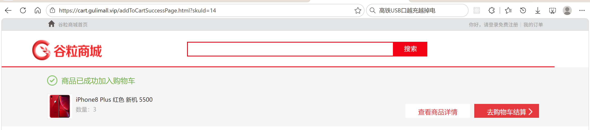
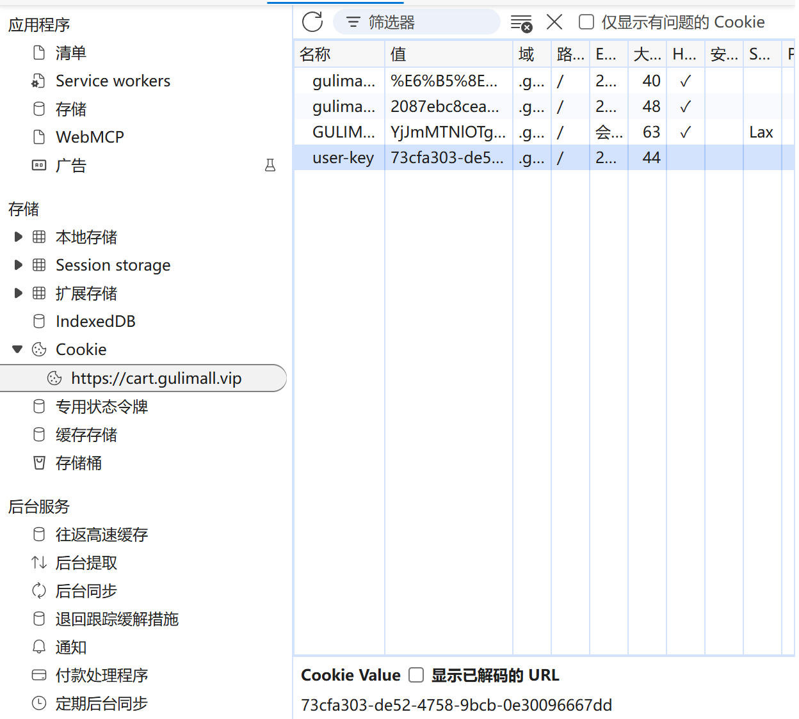
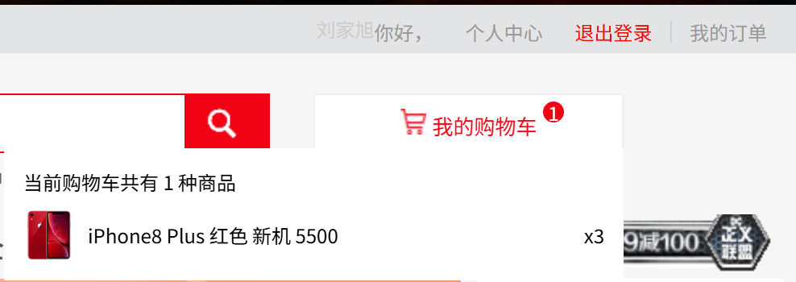
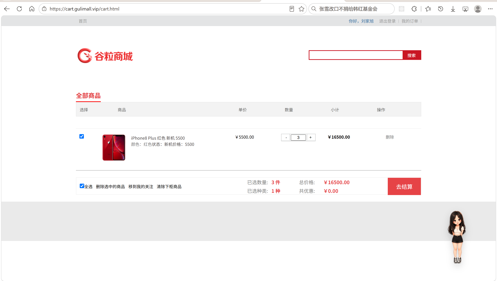
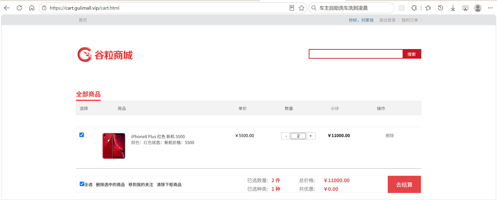
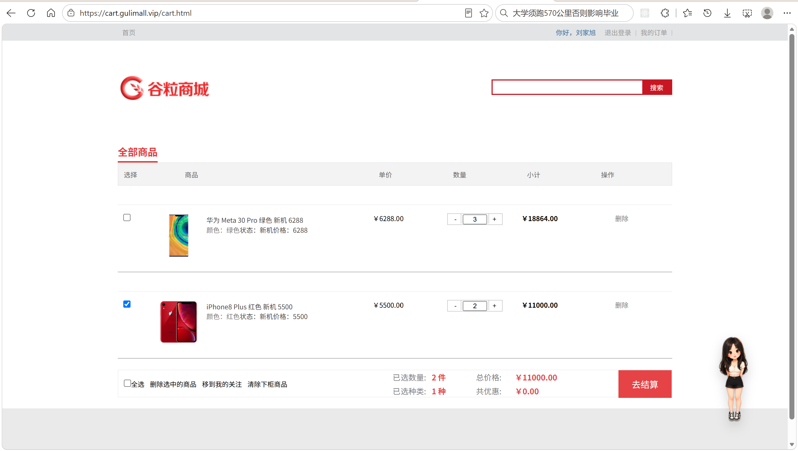

# 10.1 购物车-介绍

> 介绍购物车业务：游客车与登录车怎么区分、加购数据怎么存进 Redis、登录后临时车怎么合并、数量与勾选怎么处理、价格与库存怎么实时校验、结算前为什么要登录。

---

## 1. 这个功能是干什么的

购物车是用户从“浏览商品”到“下单”之间的暂存区。用户在商品详情页点“加入购物车”，商品不会立刻变成订单，而是先放进购物车；用户可以继续挑商品、改数量、勾选或取消勾选，最后只把勾选的商品带去结算。

购物车在业务上有四个作用：

1. **暂存商品**：把准备购买的商品集中起来，不用每次下单都重新搜索。
2. **调整购买组合**：用户可以改数量、删商品、勾选部分商品结算。
3. **展示实时价格与库存**：商品价格会变、库存会变，购物车页面要按最新数据提示用户。
4. **承接登录合并**：未登录也能加购，登录后把游客车的商品合并到账号购物车。

购物车分两种：

```text
游客车：未登录时使用，key 里放浏览器 Cookie 的 user-key
登录车：登录后使用，key 里放会员 id
```

两种车都存放在 Redis 的 Hash 结构里，一个用户一个 key，Hash 的 field 是 `skuId`，value 是购物项的 JSON。

购物车和订单的关系：

```text
商品详情页
  → 加入购物车（写 Redis）
  → 购物车页（改数量、勾选、删除）
  → 去结算（必须登录）
  → 订单确认页（读取购物车中勾选的商品）
```

购物车不落 MySQL。购物车是高频读写、按用户隔离、允许丢失的临时数据，放 Redis 比放数据库更合适。真正落库发生在提交订单时，由订单服务生成 `oms_order` 和 `oms_order_item`。

## 2. 用户怎么操作

入口有三个：

1. 商品详情页的“加入购物车”按钮。
2. 页面顶部的购物车入口，显示当前购物车商品种类数。
3. 购物车页 `http://cart.gulimall.vip/cart.html`。

### 2.1 未登录加购

1. 用户打开商品详情页。
2. 页面先判断 `hasStock`，无货时直接提示“当前商品暂时无货”，不发起加购。
3. 有货时点击“加入购物车”。
4. 浏览器跳转 `/addToCart?skuId=...&num=...`。
5. 购物车服务生成或读取 `user-key` Cookie，把商品写进游客车。
6. 页面重定向到加购成功页，展示商品图片、标题、数量。



加购接口使用重定向，而不是直接把加购结果渲染到当前请求里。这样用户刷新成功页不会重复加购。

### 2.2 浏览器保存 user-key

1. 第一次访问购物车服务的游客没有 `user-key`。
2. `CartInterceptor.preHandle()` 生成一个 UUID。
3. 请求结束时 `postHandle()` 把 UUID 写进名为 `user-key` 的 Cookie。
4. Cookie 的域是 `gulimall.vip`，所以商品、购物车、订单等子域都能读到同一个游客标识。
5. Cookie 有效期 30 天，游客车在 Redis 里也设置 30 天过期。



`user-key` 不是登录凭证，只是游客购物车的标识。用户可以清 Cookie，清掉后原来的游客车就找不到了。

### 2.3 登录后合并购物车

1. 用户在登录页完成登录，登录态写进 Spring Session。
2. 用户再次打开购物车页。
3. `CartInterceptor` 从 Session 读到会员信息，设置 `userId`。
4. 同时仍然读取 `user-key`，因为需要知道登录前游客车是哪个 key。
5. `CartServiceImpl.getCart()` 先查游客车。
6. 游客车有商品时，逐件调用 `addToCart()` 合并到登录车。
7. 合并完成后删除游客车。
8. 页面展示合并后的登录车。



合并规则是“数量相加”。同一 sku 在游客车有 2 件、登录车有 1 件，合并后是 3 件。

### 2.4 查看购物车列表

1. 打开 `/cart.html`。
2. `CartController.cartListPage()` 调 `cartService.getCart()`。
3. Service 根据登录状态选择登录车或游客车。
4. 页面渲染商品图片、标题、销售属性、单价、数量、小计、勾选状态。
5. 底部展示已选数量、已选种类、总价、优惠。
6. 未登录时页面顶部提示“登录后购物车的商品将保存到账号中”。



### 2.5 修改数量

1. 点击商品行内的“+”或“-”。
2. 前端先判断：数量最少 1 件，“+”不能超过该 sku 的实时库存。
3. 合法时跳转 `/countItem?skuId=...&num=...`。
4. 后端读取购物项，改写 `count`，写回 Redis。
5. 重定向回购物车页。
6. 如果用户直接在数量框输入，失焦时校验：必须是大于等于 1 的整数，且不能超过库存；非法就退回上一次的合法值。



### 2.6 勾选、全选与结算

1. 单个商品勾选：点击复选框，跳转 `/checkItem?skuId=...&checked=1/0`，后端把 `check` 写回 Redis。
2. 全选：点击底部“全选”，跳转 `/checkAll?checked=1/0`，后端把当前购物车所有商品的 `check` 一起改写。
3. 页面总价只统计 `check=true` 的购物项。
4. 点击“去结算”，跳转订单确认页。
5. 未登录时结算入口会引导登录；订单服务的 `LoginUserInterceptor` 也会拦截未登录请求。



### 2.7 删除与清理

1. 单个删除：`/deleteItem?skuId=...`，删除 Hash 里的一个 field。
2. 批量删除：勾选多个商品后点“删除选中的商品”，跳转 `/deleteCheckedItems?skuIds=1,2,3`。
3. 清除下柜商品：`/clearNoStockItems`，先批量查库存，库存为 0 的购物项从购物车删除。
4. 删除和清理完成后都重定向回 `/cart.html`。

### 2.8 购物车数量角标

1. 商品详情页、首页、搜索页需要显示购物车商品种类数。
2. 前端请求 `/cartCount`。
3. 后端只读当前购物车 Hash 的 `size()`，不做临时车合并，也不查库存。
4. 返回种类数，页面渲染角标。

## 3. 整体设计思路

### 3.1 业务上怎么设计

#### 3.1.1 游客车与登录车并存

未登录也必须能加购，否则用户必须先注册才能使用购物车，体验很差。所以业务上允许两种购物车：

1. 游客车：没有会员 id，用浏览器 `user-key` 标识。
2. 登录车：用会员 id 标识。

登录后不直接丢弃游客车，而是合并到登录车。合并完成后游客车删除，避免下次登录重复合并。

#### 3.1.2 合并规则

1. 游客车为空：什么都不做。
2. 游客车有商品：逐件合并到登录车。
3. 同一 sku 已存在：数量相加。
4. 同一 sku 不存在：按游客车的数量和商品信息新增。
5. 合并完成后删除游客车 key。

合并必须串行。两个请求同时合并同一份游客车，会各读一份、各加一遍，数量翻倍。因此合并过程放在购物车分布式锁里。

#### 3.1.3 数量规则

1. 加购数量默认 1，由商品详情页传入。
2. 购物车里的数量最少 1。
3. 数量不能超过该 sku 的实时库存。
4. 已存在的商品再次加购，数量累加。
5. 加购时不强制校验库存：无货判断放在商品详情页，避免加购失败后无法跳回商品页。
6. 购物车页展示库存，前端负责限制“+”和手动输入。

#### 3.1.4 勾选规则

1. 新加购的商品默认勾选。
2. 单个勾选只改一个购物项。
3. 全选改当前购物车所有购物项。
4. 总价、已选数量、已选种类只统计勾选项。
5. 结算时只把勾选项带到订单确认页。

#### 3.1.5 价格与库存规则

购物车存的是加购时的商品快照，但价格和库存会变化。业务上要求：

1. 购物车页展示最新价格。
2. 价格变化时更新购物车里的价格，并以最新价格计算小计和总价。
3. 商品下架或库存为 0 时，不参与结算。
4. 结算前订单服务会再查一次实时数据，购物车页的价格只用于展示。

#### 3.1.6 删除规则

1. 单个删除只删当前用户购物车里的一个 sku。
2. 批量删除只删勾选的 sku。
3. 清除下柜商品只删库存为 0 的 sku。
4. 删除物理删除 Redis field，不做逻辑删除。
5. 游客车 30 天过期，过期后自动消失。

#### 3.1.7 结算边界

购物车本身允许游客使用，但结算必须登录。原因：

1. 订单要绑定会员 id。
2. 收货地址、积分属于会员数据。
3. 未登录无法区分订单归属。

所以购物车服务不强制登录，订单服务用 `LoginUserInterceptor` 强制登录。

### 3.2 技术上怎么设计

#### 3.2.1 Redis Hash 存购物车

```text
key   = gulimall:cart:{userId}     登录用户
key   = gulimall:cart:{userKey}    游客
field = skuId
value = CartItemVo 的 JSON
```

选择 Hash 的原因：

1. 一个用户一个 key，天然按用户隔离。
2. field 是 skuId，按 sku 增删改查都是 O(1)。
3. 取整车用 `HVALS` 一次拿全。
4. 统计种类数用 `HLEN`，不用把所有 value 取回来。

#### 3.2.2 用拦截器识别用户

购物车的每个请求都要知道“当前是登录用户还是游客”。这部分放在 `CartInterceptor`：

1. 从 Session 读登录会员。
2. 从 Cookie 读 `user-key`。
3. 把两者封装成 `UserInfoTo`。
4. 放进 `UserThreadLocal`，Service 直接取。

没有 `user-key` 时生成 UUID，并在响应阶段写 Cookie。

#### 3.2.3 分布式锁保护读改写

加购、合并、改数量、全选都是“读 Redis → 改对象 → 写 Redis”。并发时会丢更新，所以用 Redisson 锁：

1. 锁名是 `购物车 key + :lock`，不能直接用购物车 key。
2. `tryLock(3, 10, TimeUnit.SECONDS)`：最多等 3 秒，持有最多 10 秒。
3. 锁可重入：`getCart()` 合并时调用 `addToCart()`，同一线程可以重复拿锁。
4. 不同用户锁名不同，互不阻塞。
5. 拿不到锁抛 `CART_BUSY_EXCEPTION`。

锁名和购物车 key 必须分开：Redisson 锁本身也是一个 Hash，如果锁名等于购物车 key，解锁会删掉整个购物车，锁字段还会混进购物车数据。

#### 3.2.4 Feign 聚合商品信息

加购时购物车只拿到 `skuId` 和数量，商品标题、图片、价格、销售属性、库存、重量都不在购物车服务里。需要通过 Feign 调：

1. `gulimall-product`：sku 信息、销售属性、价格、重量。
2. `gulimall-ware`：库存数量。

四个远程调用互不依赖，用 `CompletableFuture` 并行执行，最后 `allOf().join()` 汇总。

#### 3.2.5 JSON 序列化

`StringRedisTemplate` 只能存字符串，购物项对象用 FastJSON 转成 JSON 再存。读取时反序列化回 `CartItemVo`。

#### 3.2.6 游客车过期

游客车设置 30 天过期，和 `user-key` Cookie 有效期一致。不设置的话，每个新游客都会在 Redis 留下一个永久 key，只增不减，内存迟早被写满。登录车不设过期。

#### 3.2.7 实时价格与库存

购物车页展示前，`getUserCartItems()` 会：

1. 批量查最新价格。
2. 批量查实时库存。
3. 价格变化时更新购物项。
4. 库存为 0 或价格不存在时，把商品从购物车删除，不返回给结算。

#### 3.2.8 结算侧登录拦截

购物车服务允许匿名访问，订单服务不允许。订单的 `LoginUserInterceptor` 在请求进入 Controller 前检查 Session，未登录直接 302 到登录页，并把会员信息放进 `MemberResponseVoThreadLocal`。

## 4. 详细代码、配置和解释

购物车的运行链路从商品详情页的一次点击开始：浏览器带着 Cookie 和 Session 请求购物车服务，拦截器识别身份，Controller 接收动作，Service 在 Redis 上读写购物项，必要时通过 Feign 聚合商品与库存数据；购物车页展示之后，订单服务再从同一份 Redis 数据里读取勾选商品。链路里每一层承担的事情不同，出错时的表现也不同。

以下按“组件为什么存在 → 关键数据 → 正常链路 → 代码分块 → 一次完整示例 → 边界”展开。每一块代码先说明它在这条链路中的位置，代码之后按 1、2、3 编号解释执行顺序、条件与原因。

### 4.1 CartConstant：购物车常量

#### 4.1.1 这个类解决什么问题

游客身份由三个地方共同使用：拦截器把标识写进浏览器 Cookie，Service 用同一个标识拼 Redis key，过期时间又同时约束 Cookie 和 Redis。三处如果各写一份字符串，改 Cookie 名时漏掉一处，游客车就会换一个 key，用户下次访问看到的是空车。

这个类把 Cookie 名、有效期、Redis 前缀集中成编译期常量。它位于链路最底层，被 `CartInterceptor` 和 `CartServiceImpl` 引用，向上不依赖任何业务类，向下只描述浏览器与 Redis 的命名约定。

#### 4.1.2 常量与使用位置

| 常量 | 值 | 使用方 | 作用 |
|---|---|---|---|
| `TEMP_USER_COOKIE_NAME` | `user-key` | `CartInterceptor` | 浏览器 Cookie 名，也是 Service 拼游客车 key 的来源 |
| `TEMP_USER_COOKIE_TIMEOUT` | `60*60*24*30` 秒 | `CartInterceptor`、`CartServiceImpl` | Cookie 的 `maxAge`，同时是游客车 Hash 的 TTL |
| `CART_PREFIX` | `gulimall:cart:` | `CartServiceImpl` | Redis key 前缀，后面接会员 id 或游客 UUID |

#### 4.1.3 代码与解释

这段代码定义三个被拦截器和 Service 共同引用的约定，没有方法，也没有状态。

```java
public class CartConstant {

    public final static String TEMP_USER_COOKIE_NAME = "user-key";

    /**
     * COOKIE过期时间 默认一个月
     */
    public final static int TEMP_USER_COOKIE_TIMEOUT = 60*60*24*30;

    public final static String CART_PREFIX = "gulimall:cart:";

}
```

1. `TEMP_USER_COOKIE_NAME`：固定为 `user-key`，浏览器第一次拿到它之后，后续请求都会带回同一个值。
2. `TEMP_USER_COOKIE_TIMEOUT`：30 天，单位是秒。Cookie 的 `setMaxAge` 和 Redis 的 `expire` 都按秒计算，所以一个常量可以同时服务两处。
3. `CART_PREFIX`：Redis key 的公共前缀。登录车拼会员 id，游客车拼 UUID，两种车共用一个前缀，排查时能按 `gulimall:cart:*` 一次列出。
4. 三个常量都是 `public final static`：购物车服务和测试代码可以直接引用，不需要实例化。

#### 4.1.4 一次取值示例

游客第一次访问购物车页：

```text
1. 拦截器没有读到 user-key，生成 UUID：3f2a...9c
2. postHandle 写入 Cookie：user-key=3f2a...9c，maxAge=2592000
3. Service 拼 Redis key：gulimall:cart:3f2a...9c
4. getCartOps() 对这个 key 执行 expire，TTL=2592000
5. 30 天后 Cookie 和游客车在同一时间窗口失效
```

#### 4.1.5 边界与可优化点

1. 游客车的 TTL 只在 `getCartOps()` 被调用时刷新，长期不访问的游客车会按最后一次访问计算 30 天。
2. 常量类没有私有构造器，可以被实例化。改成 `final class` 并加私有构造器更严谨。
3. 前缀里没有业务环境标识，多套环境共用一个 Redis 时 key 会混在一起，生产环境应追加环境名。

### 4.2 UserInfoTo 与 UserThreadLocal：请求内共享用户身份

#### 4.2.1 这个类解决什么问题

购物车的大多数方法都需要知道“当前请求是谁”：`getCartOps()` 要决定用登录 key 还是游客 key，合并游客车时要同时拿到会员 id 和游客标识，页面渲染又不应该再读一次 Cookie。把这些信息作为参数逐层传递，Controller 到 Service 的每个方法都要多两个参数，接口会被身份信息污染。

`UserInfoTo` 是请求级身份快照，`UserThreadLocal` 是它在当前线程里的存取点。拦截器在请求进入时写入，Controller 和 Service 直接读取，请求结束时移除。两者位于拦截器与业务层之间，只在本线程内有效。

#### 4.2.2 字段与含义

| 字段 | 类型 | 来源 | 含义 |
|---|---|---|---|
| `userId` | `Long` | Session 中的 `MemberResponseVo` | 登录会员 id，未登录为 `null` |
| `userKey` | `String` | Cookie 中的 `user-key` 或新生成的 UUID | 游客车标识 |
| `tempUser` | `Boolean` | 拦截器判断 | 响应阶段是否需要写 `user-key` Cookie |

`userId` 和 `userKey` 可以同时存在。登录用户也要保留游客标识，否则找不到登录前的那辆游客车。

#### 4.2.3 代码与解释

先定义承载身份的对象。字段只保留购物车真正需要的三项，不复制整个会员对象。

```java
@Data
public class UserInfoTo {

    private Long userId;

    private String userKey;

    /**
     * 是否临时用户
     */
    private Boolean tempUser = false;

}
```

1. `@Data`：生成 getter、setter、`toString`，拦截器和 Service 直接读写字段。
2. `userId`：登录后才赋值，游客请求保持 `null`，Service 用它判断用哪辆车。
3. `userKey`：游客请求必有，登录请求也尽量保留，用于合并。
4. `tempUser` 默认 `false`：拦截器读到或生成 `user-key` 后改成 `true`，`postHandle` 据此决定是否写 Cookie。

再定义线程内的存取入口。三个静态方法分别对应写入、读取、清理。

```java
public class UserThreadLocal {

    public static final ThreadLocal<UserInfoTo> userThreadLocal = new ThreadLocal<>();

    public static UserInfoTo get() {
        return userThreadLocal.get();
    }

    public static void set(UserInfoTo userInfoTo) {
        userThreadLocal.set(userInfoTo);
    }

    public static void remove() {
        userThreadLocal.remove();
    }

}
```

1. `ThreadLocal<UserInfoTo>`：每个请求线程各存一份，互不影响。
2. `get()`：Controller 和 Service 取当前请求的身份。
3. `set()`：拦截器在 `preHandle` 里写入。
4. `remove()`：`afterCompletion` 调用，避免 Tomcat 复用线程时把上一个请求的身份带给下一个请求。

#### 4.2.4 一次请求内的数据流

```text
浏览器请求
  → CartInterceptor.preHandle
  → new UserInfoTo()
  → Session 有会员：userId=8
  → Cookie 有 user-key：userKey=abc，tempUser=true
  → UserThreadLocal.set(userInfoTo)
  → CartController / CartServiceImpl 调用 UserThreadLocal.get()
  → CartInterceptor.afterCompletion
  → UserThreadLocal.remove()
```

登录用户带游客标识进入页面时，`userId=8`、`userKey=abc` 同时存在；`getCart()` 先按 8 找登录车，再按 abc 找游客车并合并。

#### 4.2.5 它不做什么

1. 不读取 Session 和 Cookie，身份来源由拦截器负责。
2. 不判断接口是否要求登录，购物车服务本身允许匿名。
3. 不承载购物车商品，只保存身份。
4. 不跨线程传递，异步任务里取不到当前请求的身份。
5. 不负责清理，清理时机由拦截器决定。

#### 4.2.6 边界与可优化点

1. `remove()` 必须在 `afterCompletion` 执行，异步请求或异常路径漏掉会留下脏数据。
2. 普通 `ThreadLocal` 不会传给 `CompletableFuture` 的线程池任务。加购里的并行远程调用不使用 `UserThreadLocal`，后续新增异步逻辑时要避开这个限制。
3. 身份对象只在一次请求内有效，不要缓存到单例字段里，否则不同用户会串数据。

### 4.3 CartInterceptor：识别登录用户与游客

#### 4.3.1 这个类解决什么问题

商品详情页、购物车页、角标接口都允许匿名访问，购物车服务不能强制登录。但 Service 必须知道当前请求对应哪一辆车：登录会员用会员 id，游客用浏览器里的 `user-key`。身份识别放在请求入口，Controller 与 Service 就不再直接接触 Session 和 Cookie。

拦截器位于浏览器与 Controller 之间。上游是网关转发来的请求、Spring Session 中的登录态、Cookie 中的游客标识；下游是 `CartController`、`CartServiceImpl`，以及合并游客车时需要的两个 key。

#### 4.3.2 四种身份组合

| 场景 | Session | Cookie `user-key` | 结果 |
|---|---|---|---|
| 登录用户带游客车 | 有会员 | 有 | `userId` + 原 `userKey`，可合并 |
| 登录用户首次访问 | 有会员 | 无 | `userId` + 新 UUID |
| 游客首次访问 | 无 | 无 | 新 UUID |
| 游客回访 | 无 | 有 | 原 `userKey` |

#### 4.3.3 代码与解释

拦截器在三个生命周期点各做一件事：`preHandle` 组装身份，`postHandle` 补写 Cookie，`afterCompletion` 清理线程变量。

```java
public class CartInterceptor implements HandlerInterceptor {

    private final String sessionCookieDomain;

    public CartInterceptor(String sessionCookieDomain) {
        this.sessionCookieDomain = sessionCookieDomain;
    }

    @Override
    public boolean preHandle(HttpServletRequest request, HttpServletResponse response,
                             Object handler) {

        UserInfoTo userInfoTo = new UserInfoTo();

        HttpSession session = request.getSession(false);
        //获得当前登录用户的信息
        MemberResponseVo memberResponseVo = (session == null) ? null
                : (MemberResponseVo) session.getAttribute(LOGIN_USER);

        if (memberResponseVo != null) {
            //用户登录了
            userInfoTo.setUserId(memberResponseVo.getId());

            // 用户名或昵称存储进Attribute
            request.setAttribute(LOGIN_USER, memberResponseVo);

            // 因为要做游客购物车和用户购物车合并，因此登录用户也需要知道临时用户的user-key
            // 所以登录用户还要额外存一个游客用户的user-key，不能直接return
        }

        // 获取所有cookie
        Cookie[] cookies = request.getCookies();
        if (cookies != null) {
            for (Cookie cookie : cookies) {
                //user-key
                String name = cookie.getName();
                if (TEMP_USER_COOKIE_NAME.equals(name)) {
                    userInfoTo.setUserKey(cookie.getValue());
                    //标记为已是临时用户
                    userInfoTo.setTempUser(true);

                    UserThreadLocal.set(userInfoTo);
                    return true;
                }
            }
        }

        //如果没有临时用户一定分配一个临时用户  生成UUID
        if (StringUtils.isEmpty(userInfoTo.getUserKey())) {
            String uuid = UUID.randomUUID().toString();
            userInfoTo.setUserKey(uuid);
            userInfoTo.setTempUser(true);
        }

        //目标方法执行前  使用ThreadLocal共享数据
        UserThreadLocal.set(userInfoTo);
        return true;

    }

    @Override
    public void postHandle(HttpServletRequest request, HttpServletResponse response, Object handler, ModelAndView modelAndView) {

        //获取当前用户的值
        UserInfoTo userInfoTo = UserThreadLocal.get();

        // 浏览器cookie保存当前临时用户
        if (userInfoTo != null && userInfoTo.getTempUser()) {
            //创建一个cookie
            Cookie cookie = new Cookie(TEMP_USER_COOKIE_NAME, userInfoTo.getUserKey());
            //扩大作用域
            cookie.setDomain(sessionCookieDomain);
            //设置过期时间
            cookie.setMaxAge(TEMP_USER_COOKIE_TIMEOUT);
            response.addCookie(cookie);
        }

    }

    @Override
    public void afterCompletion(HttpServletRequest request, HttpServletResponse response, Object handler, Exception ex) {
        UserThreadLocal.remove();
    }
}
```

1. `preHandle` 先创建 `UserInfoTo`，后续无论走哪条分支都用这个对象。
2. `request.getSession(false)`：只读已有会话，不新建。游客访问购物车页不应该产生一个空 Session。
3. Session 里有会员时写入 `userId`，同时把会员对象放进 request 属性，页面模板可以直接取昵称。
4. 登录分支没有提前返回，继续读 Cookie，因为合并游客车需要登录前的 `user-key`。
5. 遍历 Cookie 找到 `user-key`，写入 `userKey`，把 `tempUser` 设为 `true`，放进 ThreadLocal 后放行。
6. 没有 Cookie 或没有 `user-key` 时生成 UUID，同样标记为临时用户。
7. 统一 `UserThreadLocal.set(userInfoTo)` 后返回 `true`，请求进入 Controller。
8. `postHandle` 取出当前身份，只有 `tempUser=true` 才写 Cookie。
9. Cookie 的 `domain` 从配置传入，通常是 `gulimall.vip`，商品、购物车、订单等子域共享同一个游客标识。
10. `maxAge` 使用 30 天常量，浏览器关闭后仍然保留。
11. `afterCompletion` 调用 `UserThreadLocal.remove()`，无论请求成功还是异常都会执行。

为什么登录用户还要读游客标识：登录动作发生在认证服务，购物车服务只看到 Session。没有 `user-key` 就无法定位登录前的游客车，合并逻辑会失效。

为什么用 `getSession(false)`：购物车允许匿名，未登录访问不应创建会话；只有认证服务在登录成功时才需要新建 Session。

#### 4.3.4 一次加购请求的身份识别

```text
1. 游客在商品详情页点击“加入购物车”
2. 浏览器请求 /addToCart?skuId=25&num=1，没有 user-key
3. preHandle 读 Session 为空，读 Cookie 为空
4. 生成 UUID=3f2a...9c，tempUser=true
5. UserThreadLocal 写入 userKey=3f2a...9c
6. Controller 调 Service，Service 拼出 gulimall:cart:3f2a...9c
7. 加购完成，重定向到成功页
8. postHandle 写入 Cookie：user-key=3f2a...9c
9. afterCompletion 清理 ThreadLocal
10. 下一次请求浏览器自动带上 user-key，访问同一辆游客车
```

#### 4.3.5 它不做什么

1. 不判断接口是否需要登录，购物车所有页面与接口都放行。
2. 不校验 `user-key` 是否真实，也不验证签名。
3. 不合并游客车，合并发生在 `CartServiceImpl.getCart()`。
4. 不读写购物车 Redis，只处理身份。
5. 不生成购物车 key，key 规则集中在 `getCartOps()`。

#### 4.3.6 边界与可优化点

1. `postHandle` 在异步请求中可能不执行，Cookie 会漏写。生产环境可以用过滤器或 `ResponseCookie` 统一处理。
2. `user-key` 没有签名，用户可以伪造别人的游客标识。生产环境应加签名或改用服务端生成的加密标识。
3. 每次请求只读取第一个匹配的 Cookie，正常浏览器不会重复，但多域名同名的场景需要明确优先级。
4. 登录用户读到 `user-key` 后也标记 `tempUser=true`，响应阶段会再写一次同样的 Cookie，逻辑上多余但影响不大。
5. `sessionCookieDomain` 为空时 `setDomain(null)` 会抛异常，配置缺失时应在启动阶段校验。

### 4.4 GulimallWebConfig：注册购物车拦截器

#### 4.4.1 这个配置解决什么问题

拦截器写好不会自动生效，必须注册到 Spring MVC 的拦截链。购物车页有大量 js、css、图片请求，这些请求不需要身份识别，也不应该为每个静态文件生成游客 Cookie。注册时既要覆盖业务路径，又要把静态资源排除。

这个配置类位于应用启动阶段：读取 Session Cookie 域，创建拦截器，声明拦截路径。上游是 Spring Boot 配置，下游是所有进入购物车服务的请求。

#### 4.4.2 代码与解释

配置类把拦截器实例化和路径规则放在一起，拦截器本身不依赖 Spring 容器。

```java
@Configuration
public class GulimallWebConfig implements WebMvcConfigurer {

    @Value("${server.servlet.session.cookie.domain}")
    private String sessionCookieDomain;

    @Override
    public void addInterceptors(InterceptorRegistry registry) {
        registry.addInterceptor(new CartInterceptor(sessionCookieDomain))//注册拦截器
                .addPathPatterns("/**")
                .excludePathPatterns("/cart/js/**", "/cart/css/**", "/cart/img/**", "/cart/bootstrap/**");
    }
}
```

1. `@Configuration` 和 `WebMvcConfigurer`：Spring Boot 启动时扫描到配置类，调用 `addInterceptors`。
2. `@Value("${server.servlet.session.cookie.domain}")`：Cookie 域与 Session Cookie 使用同一份配置，保证登录态和游客标识落在同一个父域。
3. `new CartInterceptor(sessionCookieDomain)`：通过构造器传入配置，拦截器可以直接单元测试。
4. `.addPathPatterns("/**")`：默认拦截所有请求，包括页面和接口。
5. `.excludePathPatterns(...)`：排除 `cart/js`、`cart/css`、`cart/img`、`cart/bootstrap` 四类静态资源，页面样式和脚本请求不触发身份逻辑。
6. 拦截器没有声明成 Bean，而是每次注册时新建，实例只被 MVC 使用，不参与其他注入。

#### 4.4.3 一次路径匹配示例

```text
GET /cart.html
  → 匹配 /**，经过 CartInterceptor

GET /addToCart?skuId=25&num=1
  → 匹配 /**，经过 CartInterceptor

GET /cart/js/index.js
  → 命中排除规则，不经过拦截器

GET /cart/css/cart.css
  → 命中排除规则，不经过拦截器
```

#### 4.4.4 边界与可优化点

1. 排除规则写死为四个目录，新增静态目录时要同步维护，否则会多走一次身份逻辑。
2. 配置项缺失时没有默认值，启动阶段不会报错，运行到写 Cookie 才失败。可以在配置类里加默认域名或启动校验。
3. 拦截器覆盖全部接口，包括内部 Feign 调用的 `/currentUserCartItems`。内部调用没有登录 Cookie，会生成新的游客标识，当前业务不影响读取登录车，但会留下无效 UUID。

### 4.5 CartItemVo：购物项

#### 4.5.1 这个类解决什么问题

加购接口只收到 `skuId` 和数量，而购物车页要展示图片、标题、销售属性、单价、小计、库存、重量。这些字段分别来自商品服务和库存服务，购物车不能为了展示再建一张商品表，也不能每次渲染都重新拼装所有远程数据。

购物项对象承担两个角色：它是 Redis Hash 中某个 field 的 value 形状，也是购物车页和结算接口的传输单位。`addToCart()` 负责组装，`getCartItems()` 负责反序列化，`getUserCartItems()` 负责用实时价格覆盖旧快照。

#### 4.5.2 字段与含义

| 字段 | 来源 | 含义 |
|---|---|---|
| `skuId` | 加购参数 | Redis Hash 的 field，商品唯一标识 |
| `check` | 加购时设为 `true` | 是否参与结算 |
| `title` | `ProductFeignClient.getSkuInfo` | 商品标题 |
| `image` | 同上 | 默认图片地址 |
| `skuAttrValues` | `getSkuSaleAttrValues` | 销售属性组合，例如颜色、内存 |
| `price` | `getSkuInfo` | 加购时单价，读取时可能被实时价格覆盖 |
| `count` | 加购参数或累加结果 | 购买数量 |
| `stock` | `WareSkuFeignClient.getStockNums` | 查询时刻的库存快照 |
| `weight` | `ProductFeignClient.getSkuWeight` | 下单后计算运费使用 |
| `totalPrice` | 计算属性 | 单价乘数量，不写 Redis |

#### 4.5.3 代码与解释

这个类没有业务方法，只有字段和一个计算小计的 getter。它决定了 Redis 里一条购物项 JSON 长什么样。

```java
@Data
public class CartItemVo {

    private Long skuId;

    private Boolean check = true;

    private String title;

    private String image;

    /**
     * 商品套餐属性
     */
    private List<String> skuAttrValues;

    private BigDecimal price;

    private Integer count;

    /**
     * 该 sku 的实时库存
     */
    private Long stock = Long.MAX_VALUE;

    /**
     * 商品重量
     */
    private BigDecimal weight;

    private BigDecimal totalPrice;

    public BigDecimal getTotalPrice() {
        return this.price != null ? this.price.multiply(new BigDecimal(this.count)) : BigDecimal.ZERO;
    }

}
```

1. `@Data`：为所有字段生成读写方法，FastJSON 反序列化时按字段名填充。
2. `skuId`：与 Hash field 保持一致，取整车时还能从 value 里拿到商品 id。
3. `check` 默认 `true`：新加购的商品自动参与结算，和页面默认勾选一致。
4. `stock` 默认 `Long.MAX_VALUE`：远程库存查不到时不会把最大购买数量限制成 0。
5. `price` 和 `count` 是计算小计的两个输入。
6. `getTotalPrice()` 每次读取时用当前 `price` 乘 `count`，不把结果写回 Redis。
7. `totalPrice` 不进入 Hash：价格或数量变化后，小计自动跟着变，不会出现明细和汇总对不上。

#### 4.5.4 一次 Redis 存储示例

加购 skuId=25、数量 1 之后，Hash 内容：

```text
key   = gulimall:cart:3f2a...9c
field = 25
value = {
  "skuId": 25,
  "check": true,
  "title": "华为 Mate 60 Pro",
  "image": "https://.../25.jpg",
  "skuAttrValues": ["黑色", "12GB+512GB"],
  "price": 6999.00,
  "count": 1,
  "stock": 100,
  "weight": 0.225
}
```

读取后 `getTotalPrice()` 返回 `6999.00`；数量改成 2 后返回 `13998.00`，Redis 里只改了 `count`，没有存小计。

#### 4.5.5 它不做什么

1. 不查询商品或库存，远程数据由 Service 传入。
2. 不写 Redis，序列化和存储由 `CartServiceImpl` 完成。
3. 不校验库存和数量，页面限制与结算校验在别处。
4. 不承担合并规则，合并时只读取 `skuId` 和 `count`。
5. 不是数据库实体，没有对应表。

#### 4.5.6 边界与可优化点

1. `getTotalPrice()` 没有判断 `count` 是否为 `null`，历史数据缺字段时会空指针。
2. `stock` 是查询时刻的快照，用户停留时间长了会过期，结算前必须重新查。
3. `price` 同样是快照，购物车页渲染前由 `getUserCartItems()` 更新，普通 `getCart()` 不更新。
4. 购物项里存了标题、图片、属性，Redis value 较大。商品信息变化后旧快照不会自动刷新，只有价格和库存在结算查询时更新。

### 4.6 CartVo：整车汇总

#### 4.6.1 这个类解决什么问题

购物车页底部要显示商品总件数、种类数、已选件数、已选种类、已选总价。这些值由用户勾选和改数量的动作实时改变，前端逐个累加会出现浮点误差，也会出现“明细已变、底部没变”的不一致。整车对象在服务端统一计算，页面只负责渲染。

`CartVo` 位于 `getCart()` 的返回值位置，上游是 Redis 里的购物项列表，下游是 Thymeleaf 模板。订单确认页不使用整车对象，只接收勾选后的购物项列表。

#### 4.6.2 代码与解释

这个类把购物项列表包起来，并用重写 getter 的方式提供五种汇总值，所有值都不落库、不写 Redis。

```java
@Data
public class CartVo {

    List<CartItemVo> items;

    private Integer countNum;

    private Integer countType;

    private BigDecimal totalAmount;

    private BigDecimal reduce = new BigDecimal("0.00");

    public Integer getCountNum() {
        int count = 0;
        if (items != null && !items.isEmpty()) {
            for (CartItemVo item : items) {
                count += item.getCount();
            }
        }
        return count;
    }

    public Integer getCountType() {
        return items != null ? items.size() : 0;
    }

    public Integer getCheckedCountNum() {
        int count = 0;
        if (items != null) {
            for (CartItemVo item : items) {
                if (Boolean.TRUE.equals(item.getCheck())) {
                    count += item.getCount() == null ? 0 : item.getCount();
                }
            }
        }
        return count;
    }

    public Integer getCheckedCountType() {
        int count = 0;
        if (items != null) {
            for (CartItemVo item : items) {
                if (Boolean.TRUE.equals(item.getCheck())) {
                    count++;
                }
            }
        }
        return count;
    }

    public BigDecimal getTotalAmount() {
        BigDecimal amount = new BigDecimal("0");
        if (items != null && !items.isEmpty()) {
            for (CartItemVo cartItem : items) {
                if (cartItem.getCheck()) {
                    amount = amount.add(cartItem.getTotalPrice());
                }
            }
        }
        return amount.subtract(getReduce());
    }

}
```

1. `items`：当前购物车的全部购物项，来自 `getCartItems()`，可能为 `null`。
2. `getCountNum()`：遍历所有购物项累加 `count`，不管是否勾选。
3. `getCountType()`：返回购物项个数，对应页面“共 x 种商品”。
4. `getCheckedCountNum()`：只累加 `check=true` 的商品数量，对应“已选 x 件”。
5. `getCheckedCountType()`：只统计勾选商品的种类数。
6. `getTotalAmount()`：只累加勾选商品的小计，最后减去优惠金额 `reduce`。
7. 五个方法都是重写 getter，没有对应字段的 setter，JSON 序列化时按计算结果输出。
8. `Boolean.TRUE.equals(item.getCheck())`：`check` 为 `null` 的历史数据按未勾选处理，不抛空指针。

为什么用重写 getter 而不是构造时算好：`CartVo` 被模板读取时，`items` 已经确定，每次读取按当前列表重新计算，不会出现汇总字段和明细两份数据不一致。

#### 4.6.3 一次汇总示例

购物车有三件商品：

```text
A：price=100，count=2，check=true
B：price=50，count=1，check=false
C：price=20，count=3，check=true
reduce=0
```

计算结果：

```text
countNum=6        2+1+3
countType=3       三件
checkedCountNum=5 2+3
checkedCountType=2 A 和 C
totalAmount=260   100×2 + 20×3
```

#### 4.6.4 它不做什么

1. 不查询商品、库存和价格，购物项里的值由 Service 维护。
2. 不持久化，也不写 Redis，只在响应阶段存在。
3. 不参与合并游客车，合并在 `getCart()` 里完成。
4. 不计算运费和优惠券，`reduce` 当前固定为 0。

#### 4.6.5 边界与可优化点

1. `getTotalAmount()` 里 `cartItem.getCheck()` 直接拆箱，`check` 为 `null` 时会空指针，应改成 `Boolean.TRUE.equals()`。
2. `reduce` 只有字段没有来源，优惠体系接入后需要从订单或营销服务传入。
3. 所有汇总都在每次 getter 调用时遍历列表，模板多次读取会重复计算。购物项数量通常不大，当前可以接受。
4. `count` 为 `null` 时 `countNum` 会空指针，历史数据需要兼容。

### 4.7 CartController：购物车页面与接口入口

#### 4.7.1 这个类解决什么问题

购物车的使用者有两类：浏览器和订单服务。浏览器要打开购物车页、点击加购、修改数量、勾选、删除；订单服务要在结算时读取当前用户勾选的商品。这些动作最终都是 HTTP 请求，Controller 负责把请求参数翻译成 Service 调用，并决定返回页面、重定向还是 JSON。

Controller 位于拦截器与 Service 之间。上游是浏览器与订单服务的 Feign 调用，下游是 `CartService`。身份识别已经由拦截器完成，Controller 不读 Session 和 Cookie。

#### 4.7.2 接口清单

| 操作 | 方法与路径 | 返回 | 调用的 Service 方法 |
|---|---|---|---|
| 购物车首页 | `GET /`、`/index.html` | `index` 视图 | 无 |
| 购物车列表 | `GET /cart.html` | `cartList` 视图 | `getCart()` |
| 加入购物车 | `GET /addToCart` | 重定向成功页 | `addToCart()` |
| 加购成功页 | `GET /addToCartSuccessPage.html` | `index` 视图 | `getCartItem()` |
| 单个勾选 | `GET /checkItem` | 重定向购物车页 | `checkItem()` |
| 全选 | `GET /checkAll` | 重定向购物车页 | `checkAll()` |
| 修改数量 | `GET /countItem` | 重定向购物车页 | `changeItemCount()` |
| 单个删除 | `GET /deleteItem` | 重定向购物车页 | `deleteIdCartInfo()` |
| 批量删除 | `GET /deleteCheckedItems` | 重定向购物车页 | `deleteCartItems()` |
| 清理下柜商品 | `GET /clearNoStockItems` | 重定向购物车页 | `clearNoStockItems()` |
| 购物车种类数 | `GET /cartCount` | JSON 数字 | `getCartCountType()` |
| 结算商品 | `GET /currentUserCartItems` | JSON 数组 | `getUserCartItems()` |

#### 4.7.3 代码与解释

控制器把十二个入口集中在一个类里。写操作统一重定向回购物车页，读操作返回视图或 JSON。

```java
@Controller
public class CartController {

    @GetMapping(value = "/currentUserCartItems")
    @ResponseBody
    public List<CartItemVo> getCurrentCartItems() {
        return cartService.getUserCartItems();
    }

    /** 加购/改数量后重定向回购物车页要用 */
    @Value("${gulimall.cart-url}")
    private String cartUrl;

    @Autowired
    private CartService cartService;

    @GetMapping({"/", "/index.html"})
    public String cart() {
        return "index";
    }

    @GetMapping("/cart.html")
    public String cartListPage(Model model) {
        CartVo cartVo = cartService.getCart();
        model.addAttribute("cart", cartVo);
        return "cartList";
    }

    @GetMapping("/addToCart")
    public String addToCart(@RequestParam("skuId") Long skuId,
                            @RequestParam(value = "num", defaultValue = "1") Integer num,
                            RedirectAttributes redirectAttributes) {
        cartService.addToCart(skuId, num);
        redirectAttributes.addAttribute("skuId", skuId);
        return "redirect:" + cartUrl + "/addToCartSuccessPage.html";
    }

    @GetMapping(value = "/addToCartSuccessPage.html")
    public String addToCartSuccessPage(@RequestParam("skuId") Long skuId, Model model) {
        //重定向到成功页面再查询购物车数据，防止每次刷新都查询添加购物车
        CartItemVo cartItemVo = cartService.getCartItem(skuId);
        model.addAttribute("item",cartItemVo);
        return "index";
    }

    @GetMapping(value = "/checkItem")
    public String checkItem(@RequestParam(value = "skuId") Long skuId,
                            @RequestParam(value = "checked") Integer checked) {
        cartService.checkItem(skuId,checked);
        return "redirect:" + cartUrl + "/cart.html";
    }

    @GetMapping(value = "/checkAll")
    public String checkAll(@RequestParam(value = "checked") Integer checked) {
        cartService.checkAll(checked);
        return "redirect:" + cartUrl + "/cart.html";
    }

    @GetMapping(value = "/countItem")
    public String countItem(@RequestParam(value = "skuId") Long skuId,
                            @RequestParam(value = "num") Integer num) {
        cartService.changeItemCount(skuId,num);
        return "redirect:" + cartUrl + "/cart.html";
    }

    @GetMapping(value = "/deleteItem")
    public String deleteItem(@RequestParam("skuId") Integer skuId) {
        cartService.deleteIdCartInfo(skuId);
        return "redirect:" + cartUrl + "/cart.html";
    }

    @GetMapping(value = "/deleteCheckedItems")
    public String deleteCheckedItems(@RequestParam(value = "skuIds") List<Integer> skuIds) {
        cartService.deleteCartItems(skuIds);
        return "redirect:" + cartUrl + "/cart.html";
    }

    @GetMapping(value = "/clearNoStockItems")
    public String clearNoStockItems() {
        cartService.clearNoStockItems();
        return "redirect:" + cartUrl + "/cart.html";
    }

    @ResponseBody
    @GetMapping(value = "/cartCount")
    public Long cartCount() {
        return cartService.getCartCountType();
    }

}
```

1. `@Controller`：返回字符串时按视图名解析，配合 Thymeleaf 渲染页面。
2. `cart()`：访问根路径或 `index.html` 时返回 `index` 视图，作为购物车服务的默认页。
3. `cartListPage()`：调用 `getCart()` 拿到整车对象，放进 Model 的 `cart` 属性，模板用 `${cart.items}` 渲染。
4. `addToCart()`：调用 `addToCart(skuId, num)` 写 Redis，然后重定向到成功页，并把 `skuId` 作为查询参数带过去。
5. `addToCartSuccessPage()`：只读一个购物项，刷新成功页不会重复加购。这是加购单独走重定向的原因。
6. `checkItem()`、`checkAll()`、`countItem()`、`deleteItem()`、`deleteCheckedItems()`、`clearNoStockItems()`：执行写操作后统一 `redirect` 回 `/cart.html`，刷新结果页不会重复提交。
7. `redirect:` 后面的地址由 `gulimall.cart-url` 拼出，部署到不同域名时只改配置。
8. `getCurrentCartItems()`：`@ResponseBody` 返回 JSON，供订单服务 Feign 读取，不渲染页面。
9. `cartCount()`：只返回种类数，用于商品详情页、首页、搜索页的角标。
10. `num` 参数使用 `defaultValue = "1"`，商品详情页不传数量时按 1 件加购。

为什么写操作都用 GET：这是模板项目沿用的实现，浏览器后退和刷新不会重复提交。代价是不符合 REST 语义，也不防爬虫和预取。

#### 4.7.4 一次未登录加购示例

```text
1. 商品详情页点击“加入购物车”，数量输入框为 1
2. 浏览器请求 GET /addToCart?skuId=25&num=1
3. CartInterceptor 生成 user-key=3f2a...9c，写入 ThreadLocal
4. addToCart() 调 cartService.addToCart(25, 1)
5. Service 在 gulimall:cart:3f2a...9c 的 field 25 写入购物项 JSON
6. Controller 重定向到 http://cart.gulimall.vip/addToCartSuccessPage.html?skuId=25
7. 成功页请求再次经过拦截器，这次请求已带 user-key
8. addToCartSuccessPage() 调 getCartItem(25)，渲染商品图片、标题、数量
9. 用户刷新成功页，只重复第 7、8 步，不会再次加购
```

#### 4.7.5 它不做什么

1. 不识别用户身份，拦截器已经写入 `UserThreadLocal`。
2. 不直接操作 Redis，也不拼购物车 key。
3. 不计算金额和数量，全部交给 `CartVo` 与 Service。
4. 不合并游客车，合并发生在 `getCart()`。
5. 不校验库存和数量，前端与结算查询各自处理。
6. 不做权限控制，购物车服务允许匿名访问。

#### 4.7.6 边界与可优化点

1. 写操作使用 GET，浏览器预取、爬虫或用户误点都可能改数据。生产环境应改成 POST，并加 CSRF 校验。
2. `deleteItem` 的 `skuId` 使用 `Integer`，其他接口使用 `Long`，超大 skuId 会溢出。
3. `addToCart` 没有校验 `num` 是否为正数，传 0 或负数会写入异常数量。
4. 接口没有幂等令牌，重复提交仍可能重复累加数量。
5. `/currentUserCartItems` 暴露在购物车服务上，网关应限制只允许订单服务调用，避免外部直接读取购物车。
6. 所有重定向地址都依赖 `gulimall.cart-url`，配置错误时页面会跳到错误域名。

### 4.8 CartService：购物车接口

#### 4.8.1 这个接口解决什么问题

Controller 不应该依赖 Redis 命令、Feign 调用和分布式锁的实现细节；结算入口也需要一个稳定的购物车能力列表。接口把这些能力收敛成一组方法，Controller 只面向接口编程，实现类可以替换，测试时也可以直接提供 mock。

接口的上游是 `CartController`，下游是 `CartServiceImpl`。方法按用途分成三组：购物车页操作、结算查询、角标统计。

#### 4.8.2 方法分组

| 分组 | 方法 | 调用方 |
|---|---|---|
| 购物车页读写 | `addToCart`、`getCartItem`、`getCart`、`checkItem`、`checkAll`、`changeItemCount`、`deleteIdCartInfo`、`deleteCartItems`、`clearNoStockItems` | `CartController` 页面入口 |
| 结算查询 | `getUserCartItems` | 订单服务对应的 Controller 接口 |
| 角标统计 | `getCartCountType` | 商品详情页、首页、搜索页 |

#### 4.8.3 代码与解释

接口只声明方法签名，每个方法对应页面上一个可观察的动作。

```java
public interface CartService {

    void addToCart(Long skuId, Integer num);

    CartItemVo getCartItem(Long skuId);

    CartVo getCart();

    void checkItem(Long skuId, Integer checked);

    void checkAll(Integer checked);

    void changeItemCount(Long skuId, Integer num);

    void deleteIdCartInfo(Integer skuId);

    void deleteCartItems(List<Integer> skuIds);

    void clearNoStockItems();

    Long getCartCountType();

    List<CartItemVo> getUserCartItems();
}
```

1. `addToCart(Long skuId, Integer num)`：加购，已存在时累加数量。
2. `getCartItem(Long skuId)`：读取单个购物项，用于加购成功页。
3. `getCart()`：读取整车，登录用户会先合并游客车。
4. `checkItem(Long skuId, Integer checked)`：修改单个购物项的勾选状态。
5. `checkAll(Integer checked)`：修改整车的勾选状态。
6. `changeItemCount(Long skuId, Integer num)`：把数量改成指定值，不是累加。
7. `deleteIdCartInfo(Integer skuId)`：删除单个购物项。
8. `deleteCartItems(List<Integer> skuIds)`：删除多个购物项。
9. `clearNoStockItems()`：批量查询库存，删除无货商品。
10. `getCartCountType()`：返回当前购物车的商品种类数。
11. `getUserCartItems()`：返回当前用户勾选且有效的商品，未登录返回空列表。

#### 4.8.4 一次调用示例

订单确认页需要购物车里的勾选商品：

```text
1. 订单服务通过 Feign 请求购物车服务 GET /currentUserCartItems
2. 请求经过 CartInterceptor，Session 中的会员信息写入 UserThreadLocal
3. CartController 调 cartService.getUserCartItems()
4. 实现类读取登录车，过滤勾选商品，查实时价格与库存
5. 返回 List<CartItemVo> 的 JSON
6. 订单服务据此渲染确认页，不直接访问购物车 Redis
```

#### 4.8.5 它不做什么

1. 不定义数据结构，购物项和整车对象由 VO 承担。
2. 不包含任何实现，锁、Redis、Feign 都在实现类里。
3. 不区分游客与登录用户，身份判断由实现类通过 `UserThreadLocal` 完成。
4. 不处理页面跳转，重定向在 Controller。

#### 4.8.6 边界与可优化点

1. 接口把页面操作和结算查询放在一起，职责偏宽，可以拆成两个接口。
2. `deleteIdCartInfo` 和 `deleteCartItems` 的参数使用 `Integer`，与其他方法的 `Long` 不一致。
3. 缺少“按 skuId 列表查询购物项”的方法，结算只能取整车后再过滤。
4. 接口没有返回值说明，调用方需要阅读实现类才能确定空值和异常语义。

### 4.9 CartServiceImpl：Redis 购物车与分布式锁

#### 4.9.1 这个类解决什么问题

购物车的业务规则几乎都集中在这个类：一个请求到底操作登录车还是游客车，加购时怎样组装远程数据，登录后怎样合并游客车，哪些操作需要加锁，结算前怎样用实时价格和库存覆盖旧快照。它位于 Controller 下游，Redis、商品服务、库存服务上游，是购物车链路的执行核心。

购物车数据是 Redis Hash 上的“读 → 改 → 写”，并发请求会互相覆盖。这个类按操作类型选择加锁策略：

| 操作 | 是否加锁 | 原因 |
|---|---|---|
| 加购 `addToCart` | 是 | 先判断是否存在再写，两个请求会各写一份 |
| 合并游客车 `getCart` | 是 | 两个请求会各合并一遍，数量翻倍 |
| 改数量 `changeItemCount` | 是 | 读购物项、改字段、写回，可能丢更新 |
| 单个勾选 `checkItem` | 否 | 写入的是最终值，谁后写谁生效 |
| 全选 `checkAll` | 是 | 读全部再逐条写，中间插入会乱 |
| 删除 `deleteIdCartInfo` | 否 | 单个 Hash field 删除本身原子 |
| 批量删除 `deleteCartItems` | 否 | 每个 field 独立删除 |
| 清理下柜 `clearNoStockItems` | 否 | 按库存结果删除，重复执行无副作用 |
| 角标 `getCartCountType` | 否 | 只读 `HLEN` |
| 结算查询 `getUserCartItems` | 否 | 读多写少，价格更新可重复执行 |

#### 4.9.2 依赖

这个类依赖五种外部能力：Redis 读写、商品查询、库存查询、分布式锁、线程池。

```java
@Service("cartService")
@Slf4j
public class CartServiceImpl implements CartService {

    @Autowired
    private StringRedisTemplate stringRedisTemplate;
    @Autowired
    private ProductFeignClient productFeignClient;
    @Autowired
    private WareSkuFeignClient wareSkuFeignClient;
    @Autowired
    private RedissonClient redissonClient;
    @Autowired
    private ThreadPoolTaskExecutor threadPoolExecutor;
```

1. `stringRedisTemplate`：购物车 Hash 的读写入口，`boundHashOps` 绑定到某个用户的 key。
2. `productFeignClient`：查 sku 基本信息、销售属性、价格、重量。
3. `wareSkuFeignClient`：查实时库存、是否有货。
4. `redissonClient`：创建可重入分布式锁，锁名按购物车 key 派生。
5. `threadPoolExecutor`：加购时并行执行多个远程查询。
6. `@Service("cartService")`：指定 Bean 名称，Controller 按类型注入时也能找到。
7. `@Slf4j`：结算查询里记录删除和异常日志。

为什么用字段注入：这是项目现有写法，代码量少；构造器注入更利于单元测试，但更换注入方式会牵动整个类。

#### 4.9.3 购物车锁 `withCartLock`

加购、改数量、全选、合并都是“读出来、改对象、写回去”。两个请求同时执行时，后写的会覆盖先写的，数量可能少加或多加。锁把同一辆车的读改写串行化，不同用户锁名不同，互不阻塞。

加购和合并共用同一把锁，锁名由购物车 key 加 `:lock` 组成，位置在业务动作外层。

```java
private void withCartLock(String cartKey, Runnable action) {

    RLock lock = redissonClient.getLock(cartKey + ":lock");
    try {
        // 最多等 3 秒拿锁；拿到后最多持有 10 秒（防止持锁线程挂掉后锁一直不释放）
        if (!lock.tryLock(3, 10, TimeUnit.SECONDS)) {
            throw new RRException(BizCodeEnum.CART_BUSY_EXCEPTION);
        }
    } catch (InterruptedException e) {
        Thread.currentThread().interrupt();
        throw new RRException(BizCodeEnum.CART_BUSY_EXCEPTION);
    }

    try {
        action.run();
    } finally {
        // tryLock 超时那条路根本没拿到锁，不能 unlock（会抛 IllegalMonitorStateException）
        if (lock.isHeldByCurrentThread()) {
            lock.unlock();
        }
    }
}
```

1. 锁名使用 `cartKey + ":lock"`。不能直接复用购物车 key，原因见后面的说明。
2. `tryLock(3, 10, TimeUnit.SECONDS)`：最多等 3 秒拿锁，拿到后租约 10 秒。
3. 3 秒内拿不到锁，抛 `CART_BUSY_EXCEPTION`，页面提示操作频繁，而不是让请求线程无限排队。
4. `InterruptedException` 时先恢复中断标记，再抛同样的业务异常，避免吞掉中断信号。
5. `action.run()` 执行真正的业务动作，动作内部可能再次调用 `getCartOps()` 或 `addToCart()`。
6. `finally` 里用 `isHeldByCurrentThread()` 判断后再解锁。
7. 没拿到锁的那条分支没有持锁，如果无条件 `unlock()` 会抛 `IllegalMonitorStateException`。

为什么锁名不能等于购物车 key：Redisson 锁在 Redis 里本身也是一个 Hash。锁名和购物车 key 相同，解锁时可能删掉整个购物车，锁的字段也会混进购物项数据。

为什么游客车的过期时间与锁分开：游客车在 `getCartOps()` 里设置 30 天 TTL，如果锁共用这个 key，30 天的 TTL 会覆盖锁的 10 秒租约，锁可能长期不释放。

为什么用可重入锁：`getCart()` 合并时在登录车锁内调用 `addToCart()`，同一线程需要再次拿同一把锁。

#### 4.9.4 加购 `addToCart`

加购是购物车最核心的写入口。它要判断商品是否已经在车里：不存在就通过远程接口组装完整购物项，存在就累加数量，最后写回 Redis Hash。整个过程放在锁内，避免两个并发加购都判断“不存在”后各写一份。

这段代码在锁内完成“查 field → 组装或累加 → 写回”三步，远程调用也在锁内。

```java
@Override
public void addToCart(Long skuId, Integer num) {

    withCartLock(getCartOps().getKey(), () -> {

        CartItemVo cartItem;
        BoundHashOperations<String, String, String> boundHashOperations = getCartOps();
        String cartItemVoJson = boundHashOperations.get(skuId.toString());
        // 1.判断当前商品是否已经加入购物车
        if (cartItemVoJson == null) {
            // 2.未加入则查询商品信息加入购物车
            // 2.1.远程查询当前添加商品的信息
            CompletableFuture<SkuInfoVo> getSkuInfo = CompletableFuture.supplyAsync(() -> {
                R skuInfo = productFeignClient.getSkuInfo(skuId);
                return skuInfo.getData("skuInfo", new TypeReference<>() {
                });
            }, threadPoolExecutor);

            // 2.2.远程查询sku的组合信息
            CompletableFuture<List<String>> getSkuSaleAttrValues = CompletableFuture.supplyAsync(
                    () -> productFeignClient.getSkuSaleAttrValues(skuId), threadPoolExecutor);

            // 2.3.带上每个商品的实时库存
            CompletableFuture<Map<Long, Long>> getStockNums = CompletableFuture.supplyAsync(
                    () -> wareSkuFeignClient.getStockNums(List.of(skuId)), threadPoolExecutor);

            // 2.4.远程查询商品重量
            CompletableFuture<BigDecimal> getStockWeight = CompletableFuture.supplyAsync(
                    () -> productFeignClient.getSkuWeight(skuId));

            // 2.5.商品添加到购物车
            cartItem = CompletableFuture.allOf(getSkuInfo, getSkuSaleAttrValues, getStockNums, getStockWeight)
                    .thenApply(
                            vo -> {
                                CartItemVo cartItemVo = new CartItemVo();
                                cartItemVo.setCheck(true);
                                cartItemVo.setCount(num);
                                cartItemVo.setImage(getSkuInfo.join().getSkuDefaultImg());
                                cartItemVo.setTitle(getSkuInfo.join().getSkuTitle());
                                cartItemVo.setSkuId(skuId);
                                cartItemVo.setPrice(getSkuInfo.join().getPrice());
                                cartItemVo.setSkuAttrValues(getSkuSaleAttrValues.join());
                                cartItemVo.setStock(getStockNums.join().get(skuId));
                                cartItemVo.setWeight(getStockWeight.join());
                                return cartItemVo;
                            }
                    ).join();
        } else {
            // 3.已加入购物车，累加购物车商品数量
            cartItem = JSON.parseObject(cartItemVoJson, CartItemVo.class);
            cartItem.setCount(cartItem.getCount() + num);
        }

        // 4.redis存储商品信息（StringRedisTemplate 只能存字符串，对象要自己转 JSON）
        boundHashOperations.put(skuId.toString(), JSON.toJSONString(cartItem));

    });

}
```

1. 通过 `getCartOps().getKey()` 计算当前用户的购物车 key，按这个 key 抢锁。
2. 锁内重新获取 `BoundHashOperations`，按 `skuId` 读取 field。
3. field 为 `null` 表示商品还没加过，进入组装分支。
4. 第一个异步任务查 sku 基本信息，返回 `SkuInfoVo`，包含标题、图片、价格。
5. 第二个异步任务查销售属性值列表，例如颜色、内存。
6. 第三个异步任务查实时库存，接口接收 skuId 列表，返回 `Map<skuId, 库存>`。
7. 第四个异步任务查商品重量，用于下单后的运费计算。
8. 四个任务通过 `CompletableFuture.allOf(...).join()` 等待全部完成，再组装 `CartItemVo`。
9. 组装时设置 `check=true`、`count=num`，并从各任务结果里取图片、标题、价格、属性、库存、重量。
10. field 不为 `null` 表示商品已存在，反序列化旧购物项，把数量累加 `num`。
11. 最后把购物项序列化成 JSON，写回 Hash 的同一个 field。

为什么加购不校验库存：库存判断放在商品详情页，详情页无货时按钮不发请求。加购接口再校验会让失败页无法跳回商品页，体验更差。

为什么四个远程调用并行：它们互不依赖，串行执行会把四倍的网络时间叠加在锁持有时间里。并行后总耗时接近最慢的一个。

为什么远程调用放在锁内：当前单用户并发低，Feign 读取超时 5 秒，四个调用并行后锁持有时间可以接受。更稳妥的做法是先查好数据再进锁写入，但会引入“查完数据已变化”的新问题。

#### 4.9.5 一次加购示例

游客第一次加购 skuId=25、数量 2：

```text
1. Controller 调 addToCart(25, 2)
2. getCartOps() 得到 key=gulimall:cart:3f2a...9c，游客车
3. 抢锁 gulimall:cart:3f2a...9c:lock
4. Hash 里没有 field 25，进入组装分支
5. 并行查：skuInfo、销售属性、库存、重量
6. 组装 CartItemVo：price=6999，count=2，stock=100，check=true
7. 写 field 25，value 为购物项 JSON
8. 锁内设置游客车 TTL=30 天
9. 解锁，重定向到成功页
10. 再次加购同一 sku、数量 1：field 已存在，直接 count=3
```

#### 4.9.6 加购的边界与可优化点

加购不判断商品是否上架，也不校验库存上限；这两件事分别由商品详情页和结算查询负责。加购只负责把商品放进车、把数量累加，不刷新已存在购物项的价格与库存。

1. `getStockWeight` 没有指定 `threadPoolExecutor`，默认使用 `ForkJoinPool`，与其他三个任务不统一。
2. `num` 没有校验，传负数会减少数量，传 0 会写入 0 件。
3. 已存在商品时只累加数量，价格、库存、标题变化要等结算查询或页面刷新才反映。
4. 远程调用在锁内，商品服务变慢会拉长锁持有时间，超过 10 秒租约后锁提前释放。
5. 库存接口只查一个 sku，批量接口的能力没有利用；合并游客车时会逐件调用，远程次数放大。

#### 4.9.7 查询单个购物项与购物车 key `getCartItem` / `getCartOps`

每个读写方法都要先确定“操作哪一辆车”。key 规则如果散落在各个方法里，登录与游客切换时容易出现写入一辆车、读取另一辆车；加购成功页又只需要一个购物项，不需要整车。`getCartOps()` 把 key 选择和连接绑定收在一处，`getCartItem()` 提供单条读取，其他方法都从这两个入口出发。

这段代码是 Service 内部的公共底座：上游是 `UserThreadLocal` 中的身份，下游是某个具体用户对应的 Redis Hash。

```java
@Override
public CartItemVo getCartItem(Long skuId) {
    BoundHashOperations<String, String, String> boundHashOperations = getCartOps();
    String cartItemVoJson = boundHashOperations.get(skuId.toString());
    return JSON.parseObject(cartItemVoJson, CartItemVo.class);
}

private BoundHashOperations<String, String, String> getCartOps() {
    UserInfoTo userInfoTo = UserThreadLocal.get();
    String userKey;
    if (userInfoTo.getUserId() != null) {
        // 用户登录，用户购物车
        userKey = CART_PREFIX + userInfoTo.getUserId();
    } else {
        // 游客购物车
        userKey = CART_PREFIX + userInfoTo.getUserKey();
    }
    BoundHashOperations<String, String, String> cartOps = stringRedisTemplate.boundHashOps(userKey);
    /*
     游客车给 30 天过期（和 user-key cookie 的 30 天对齐）：不设的话每个新游客都会在 Redis
     留下一个永久 key，只增不减，配合 noeviction 迟早把内存写满；登录用户的购物车不设过期
    */
    if (userInfoTo.getUserId() == null) {
        cartOps.expire(TEMP_USER_COOKIE_TIMEOUT, TimeUnit.SECONDS);
    }
    return cartOps;
}
```

1. `getCartOps()` 从 `UserThreadLocal` 取当前请求的身份。
2. `userId` 不为空时用 `CART_PREFIX + userId`，对应登录车。
3. `userId` 为空时用 `CART_PREFIX + userKey`，对应游客车。
4. `boundHashOps(userKey)` 把后续的 `get`、`put`、`delete`、`values` 绑定到这个 key，不用每次重复拼。
5. 游客车执行 `expire(30 天)`，登录车不设置过期。
6. `getCartItem()` 按 `skuId` 读一个 field，反序列化成 `CartItemVo`。
7. field 不存在时 `JSON.parseObject(null, ...)` 返回 `null`，调用方需要自行判空。

为什么游客车要过期：每个新游客都会在 Redis 留下一个 key，不设 TTL 就只增不减，配合 `noeviction` 策略最终会把内存写满。30 天与 Cookie 有效期对齐，Cookie 失效后游客车也没有保留价值。

为什么登录车不设过期：登录车属于账号资产，用户可能几个月不登录，但再次登录时希望购物车还在。

#### 4.9.8 获取整车与合并 `getCart` / `getCartItems` / `clearCartInfo`

登录动作发生在认证服务，购物车数据却留在 Redis 的两辆车里。用户登录后第一次打开购物车，需要把游客车合并到登录车，并且只合并一次；未登录用户则直接读取游客车。这段代码在整车读取前完成合并，是登录链路与购物车链路的交点。

合并与加购共用登录车锁，合并结果写进登录车，随后删除游客车。

```java
@Override
public CartVo getCart() {

    CartVo cartVo = new CartVo();
    // 通过线程获取用户信息
    UserInfoTo userInfoTo = UserThreadLocal.get();
    if (userInfoTo.getUserId() != null) {
        //1、登录
        String userKey = CART_PREFIX + userInfoTo.getUserId();
        //临时购物车的键
        String temptUserKey = CART_PREFIX + userInfoTo.getUserKey();

        //2、临时购物车的数据还没合并的话，合并过来
        withCartLock(userKey, () -> {
            List<CartItemVo> tempCartItems = getCartItems(temptUserKey);
            if (tempCartItems != null) {
                //临时购物车有数据需要进行合并操作
                for (CartItemVo item : tempCartItems) {
                    addToCart(item.getSkuId(), item.getCount());
                }
                //清除临时购物车的数据
                clearCartInfo(temptUserKey);
            }
        });

        //3、获取登录后的购物车数据
        List<CartItemVo> cartItems = getCartItems(userKey);
        cartVo.setItems(cartItems);

    } else {
        //没登录
        String userKey = CART_PREFIX + userInfoTo.getUserKey();
        //获取临时购物车里面的所有购物项
        List<CartItemVo> cartItems = getCartItems(userKey);
        cartVo.setItems(cartItems);
    }

    return cartVo;
}

private List<CartItemVo> getCartItems(String userKey) {
    //获取购物车里面的所有商品
    BoundHashOperations<String, String, String> operations = stringRedisTemplate.boundHashOps(userKey);
    List<String> values = operations.values();
    if (values != null && !values.isEmpty()) {
        return values.stream().map(
                str -> JSON.parseObject(str, CartItemVo.class)).toList();
    }
    return null;
}

private void clearCartInfo(String userKey) {
    stringRedisTemplate.delete(userKey);
}
```

1. 从 ThreadLocal 取当前身份。
2. 已登录时计算登录车 key 和游客车 key。
3. 在登录车锁内读取游客车，锁名由登录车 key 派生。
4. 游客车有购物项时，逐件调用 `addToCart(skuId, count)`。
5. `addToCart()` 复用“存在则累加、不存在则查商品”的逻辑，合并后同一 sku 数量相加。
6. 合并完成删除游客车 key，下一次进入不会重复合并。
7. 读取登录车全部购物项，放进 `CartVo`。
8. 未登录时只读游客车，不做合并。
9. `getCartItems()` 用 `values()` 一次取回所有 field 的 value，再逐条反序列化。
10. `clearCartInfo()` 直接 `delete` 整个游客车 key，不是逐个删除 field。

为什么合并过程要加锁：两个请求同时打开购物车页时，都会读到同一份游客车，各合并一遍，数量会翻倍。登录车锁让合并串行，第二个请求进入时游客车已经删除。

为什么合并调用 `addToCart()` 而不是直接写 Hash：合并需要处理“登录车里已有同一 sku”的情况，`addToCart()` 已经包含判断和累加，复用可以避免两套规则。

为什么合并后删除游客车：不删除会导致每次打开购物车都重新合并，数量持续增长。

#### 4.9.9 勾选与全选 `checkItem` / `checkAll`

勾选决定哪些商品参与结算。单个勾选和全选在并发模型上不同：单个勾选写入的是一个明确的最终值，谁后写谁生效；全选要先读出全部购物项，再逐条改、逐条写，中途插入其他写操作会丢改动。代码按这个差别决定是否加锁。

`checkItem()` 只处理一个 field，`checkAll()` 需要遍历整车。

```java
@Override
public void checkItem(Long skuId, Integer check) {

    // 勾选是单个字段的幂等写（最终值），并发最多是"谁后写谁生效"，不用加锁

    //查询购物车里面的商品
    CartItemVo cartItem = getCartItem(skuId);
    //修改商品状态
    cartItem.setCheck(check == 1);

    //序列化存入redis中
    String redisValue = JSON.toJSONString(cartItem);

    BoundHashOperations<String, String, String> cartOps = getCartOps();
    cartOps.put(skuId.toString(), redisValue);

}

@Override
public void checkAll(Integer checked) {

    // 要先读全部、再逐条写，中间被别人插一脚就乱了，加锁
    withCartLock(getCartOps().getKey(), () -> {

        BoundHashOperations<String, String, String> cartOps = getCartOps();
        // values() 是一次性取回的列表，边遍历边 put 不会再读到刚写进去的数据
        List<String> values = cartOps.values();
        if (values == null || values.isEmpty()) {
            return;
        }

        boolean check = checked == 1;
        for (String value : values) {
            CartItemVo cartItem = JSON.parseObject(value, CartItemVo.class);
            cartItem.setCheck(check);
            cartOps.put(cartItem.getSkuId().toString(), JSON.toJSONString(cartItem));
        }

    });

}
```

1. `checkItem()` 不加锁，只读一个购物项。
2. 把 `Integer` 参数 `check` 转成布尔值：`1` 为勾选，其他为不勾选。
3. 序列化后写回同一个 field。
4. `checkAll()` 先抢当前购物车锁，因为后面是批量读改写。
5. `values()` 一次性取回所有 value，返回的是调用时刻的快照。
6. 空购物车直接返回，不执行后续写入。
7. `checked == 1` 决定统一写入的布尔值。
8. 逐条反序列化、修改 `check`、序列化写回。
9. 遍历依据是步骤 5 的快照，写入的新值不会被本轮循环再次读到。

为什么单个勾选不需要锁：写的是最终状态，不是累加值。两个请求同时把同一件商品设成不同状态，最终总有一个状态生效，业务上可以接受。

为什么全选需要锁：全选读取的是整车快照，如果同时有加购写入新商品，新商品不在快照里，全选结束后它的勾选状态与其他商品不一致。

#### 4.9.10 改数量、删除与清理

用户改数量、删商品、清理下柜商品都在这一组方法里。三者的并发特征不同：改数量是读改写，删除是单个 field 的原子操作，批量删除是多次单字段删除，清理下柜商品要先批量查库存再按结果删除。

这组方法都通过 `getCartOps()` 定位当前用户的购物车，不涉及游客车合并。

```java
@Override
public void changeItemCount(Long skuId, Integer num) {

    // 同样是"读 → 改 → 写"，加锁
    withCartLock(getCartOps().getKey(), () -> {

        //查询购物车里面的商品
        CartItemVo cartItem = getCartItem(skuId);
        cartItem.setCount(num);

        BoundHashOperations<String, String, String> cartOps = getCartOps();
        //序列化存入redis中
        String redisValue = JSON.toJSONString(cartItem);
        cartOps.put(skuId.toString(), redisValue);

    });
}

@Override
public void deleteIdCartInfo(Integer skuId) {

    BoundHashOperations<String, String, String> cartOps = getCartOps();
    cartOps.delete(skuId.toString());
}

@Override
public void deleteCartItems(List<Integer> skuIds) {

    if (skuIds == null || skuIds.isEmpty()) {
        return;
    }

    BoundHashOperations<String, String, String> cartOps = getCartOps();
    skuIds.forEach(skuId -> cartOps.delete(skuId.toString()));
}

@Override
public void clearNoStockItems() {
    BoundHashOperations<String, String, String> cartOps = getCartOps();
    Set<String> fields = cartOps.keys();
    if (fields != null && !fields.isEmpty()) {
        List<Long> skuIds = fields.stream().map(Long::parseLong).toList();
        Map<Long, Boolean> stockMap = wareSkuFeignClient.hasStock(skuIds);
        stockMap.forEach((skuId, hasStock) -> {
            if (!hasStock) {
                cartOps.delete(skuId.toString());
            }
        });
    }

}
```

1. `changeItemCount()` 抢当前购物车锁，防止与加购、全选互相覆盖。
2. 读取目标购物项，把 `count` 覆盖成传入的 `num`。这里是覆盖，不是累加。
3. 序列化后写回同一个 field。
4. `deleteIdCartInfo()` 直接删除一个 field，单条 `HDEL` 原子执行，不需要锁。
5. `deleteCartItems()` 先判断列表是否为空，空列表直接返回。
6. 非空时逐个 field 调用 `delete`。
7. `clearNoStockItems()` 先取 Hash 的所有 field，也就是所有 skuId。
8. field 转成 `Long` 列表后，调用库存服务的 `hasStock` 批量判断。
9. 返回的 `Map<skuId, hasStock>` 中，`false` 对应商品从购物车删除。

为什么删除不加锁：Redis 的单 field 删除本身原子，不存在“读到旧值再写回”的过程，并发删除最多是重复删除，无副作用。

为什么清理下柜要先批量查库存：逐个 sku 调库存接口会产生 N 次远程请求，批量接口一次返回全部结果，远程次数从 N 降到 1。

#### 4.9.11 角标与结算查询 `getCartCountType` / `getUserCartItems`

购物车有两个只读出口：页面角标只需要种类数，结算页需要勾选且当前仍然有效的商品。前者追求轻量，不能触发合并和库存查询；后者必须使用实时数据，因为购物车里的价格和库存只是加购时的快照。

这两个方法分别服务商品详情页角标和订单确认页，位置在 Redis 读取之后、订单创建前。

```java
@Override
public Long getCartCountType() {
    return getCartOps().size();
}

@Override
public List<CartItemVo> getUserCartItems() {
    UserInfoTo userInfoTo = UserThreadLocal.get();
    if (userInfoTo.getUserId() == null) {
        // 用户未登录无法结算购物车
        return List.of();
    } else {
        List<CartItemVo> cartItemVoList = getCartItems(CART_PREFIX + userInfoTo.getUserId());
        if (cartItemVoList == null || cartItemVoList.isEmpty()) {
            // 购物车无商品
            return List.of();
        } else {
            // 待删除（下架）商品
            List<String> deleteItems = new ArrayList<>();
            // 待更新（价格变动）商品
            List<CartItemVo> updateItems = new ArrayList<>();

            List<Long> skuIds = cartItemVoList.stream().map(CartItemVo::getSkuId).toList();
            // 此处为了简单处理只查询了价格和库存，实际应该更新全部数据！
            // 实时查询最新价格
            Map<Long, BigDecimal> priceMap = productFeignClient.getPriceBatch(skuIds);
            // 实时查询是否有货
            Map<Long, Long> stockMap = wareSkuFeignClient.getStockNums(skuIds);

            List<CartItemVo> cartItemVos = cartItemVoList.stream()
                    // 只返回购物车中选中商品
                    .filter(CartItemVo::getCheck)
                    // 实时查询商品价格（商品价格可能随时变更）
                    .filter(item -> {
                        BigDecimal price = priceMap.get(item.getSkuId());
                        Long stockCount = stockMap.get(item.getSkuId());
                        if (price == null || stockCount == 0) {
                            // 商品下架了或没货了，自动取消该商品结算
                            deleteItems.add(item.getSkuId().toString());
                            return false;
                        } else {
                            // 商品未下架，更新商品价格
                            if (price.compareTo(item.getPrice()) != 0) {
                                item.setPrice(price);
                                // 同时设置库存数供页面显示
                                item.setStock(stockCount);
                                updateItems.add(item);
                            }
                            return true;
                        }
                    })
                    .toList();

            // 开始更新购物车
            BoundHashOperations<String, String, String> cartOps = getCartOps();
            deleteItems.forEach(skuId -> {
                Long deleted = cartOps.delete(skuId);
                if (deleted == null || deleted == 0) {
                    log.warn("购物车里没有 skuId={} 这一项，删除没生效", skuId);
                } else {
                    log.info("购物车 skuId={} 商品删除成功", skuId);
                }
            });
            updateItems.forEach(sku -> cartOps.put(sku.getSkuId().toString(), JSON.toJSONString(sku)));

            return cartItemVos;
        }
    }
}
```

1. `getCartCountType()` 直接返回 `getCartOps().size()`，对应 Redis 的 `HLEN`。
2. `HLEN` 只统计 field 数量，不把 value 取回，也不合并游客车。
3. `getUserCartItems()` 先取身份，未登录直接返回空列表。
4. 已登录读取登录车；购物车为空时同样返回空列表。
5. 收集所有 skuId，准备批量查询。
6. 调用 `getPriceBatch` 一次查回所有 sku 的价格。
7. 调用 `getStockNums` 一次查回所有 sku 的库存。
8. 第一层过滤只保留 `check=true` 的商品。
9. 第二层过滤检查价格和库存：价格不存在或库存为 0，说明商品下架或无货，记入待删除列表并排除。
10. 价格与购物项不一致时，用最新价格覆盖，同时更新库存，记入待更新列表。
11. 过滤完成后，待删除商品从 Hash 删除，待更新商品写回 Hash。
12. 返回可结算的购物项列表，订单服务据此渲染确认页。

为什么角标不合并游客车：角标是高频请求，合并涉及锁和远程商品查询，代价过高。用户登录后第一次打开购物车页时合并，角标随后自然正确。

为什么结算要重新查价格和库存：加购时的价格是快照，商品可能涨价、降价、下架；库存也可能被其他订单占用。订单金额必须以结算时刻的数据为准。

#### 4.9.12 一次结算查询示例

登录用户购物车有三件商品，其中一件已下架：

```text
1. 订单服务请求 /currentUserCartItems
2. getUserCartItems() 读到 userId=8，未登录分支不命中
3. 登录车 gulimall:cart:8 有三条购物项：sku 25、26、27
4. 批量查价格：25=6999，27=199，26 无返回
5. 批量查库存：25=100，26=0，27=50
6. 过滤勾选：三件都勾选
7. sku 26 价格为 null，记入待删除
8. sku 25 价格与购物项一致，保留
9. sku 27 价格从 219 变成 199，更新价格和库存，记入待更新
10. 从 Hash 删除 field 26，写回 field 27
11. 返回 sku 25 和 sku 27 的购物项
12. 订单确认页只展示两件商品，金额按最新价格计算
```

#### 4.9.13 结算查询的边界与可优化点

1. `stockCount == 0` 使用自动拆箱，`stockMap` 中没有该 sku 时会空指针，应改成 `stockCount == null || stockCount == 0`。
2. 只更新价格和库存，标题、图片、销售属性变化不会同步，页面可能显示旧标题。
3. 未登录返回空列表，订单确认页只能提示购物车为空，更友好的做法是引导登录。
4. 价格和库存查询没有降级，任一 Feign 失败都会让结算入口不可用。
5. 待删除和待更新在过滤过程中收集，过滤是流式操作，列表填写发生在终端操作执行时，当前 `toList()` 会触发执行，逻辑成立但不够直观。
6. 删除和写回逐条执行，商品多时会产生多次 Redis 往返，可以用 Pipeline 或批量脚本。

#### 4.9.14 Redis 操作示例 `boundHashOperationsTest`

排查购物车数据时，需要直接看到 Hash 里的 field 和 value。这个方法演示三种读取方式，不参与任何业务调用，只用于本地调试。

```java
public void boundHashOperationsTest() {
    BoundHashOperations<String, String, String> cartOps = getCartOps();

    // 返回 Map<String, String>，包含所有 field 和 value
    Map<String, String> entries = cartOps.entries();
    if (entries != null) {
        entries.forEach((field, value) -> {
            System.out.println(field + " = " + value);
        });
    }
    // 所有 field（HKEYS）
    Set<String> fields = cartOps.keys();
    // 所有 value（HVALS），顺序与 keys() 不保证对应
    List<String> values = cartOps.values();
}
```

1. 通过 `getCartOps()` 取当前用户的购物车 Hash。
2. `entries()` 一次返回所有 field 与 value 的映射。
3. 遍历映射并打印，用于观察购物项 JSON。
4. `keys()` 返回所有 field，对应 `HKEYS`。
5. `values()` 返回所有 value，对应 `HVALS`。
6. `keys()` 与 `values()` 是两次独立命令，返回顺序不保证一一对应，不能按下标配对。

#### 4.9.15 Redis 示例方法的边界与可优化点

1. 使用 `System.out.println`，生产代码应改成日志或删除。
2. 方法没有在 `CartService` 接口中声明，只能通过实现类调用。
3. 全量读取会返回所有购物项，购物车很大时占用内存，只适合调试。

### 4.10 Feign 客户端：商品与库存

#### 4.10.1 这组接口解决什么问题

购物车只保存 skuId、数量和加购时的商品快照，商品标题、价格、属性、重量的权威数据在 `gulimall-product`，库存在 `gulimall-ware`。服务拆分后不能再用数据库 join，只能通过 HTTP 远程获取。Feign 把这些远程接口声明成 Java 方法，调用方像调用本地接口一样使用，服务地址由 Nacos 解析。

这组接口位于 `CartServiceImpl` 下游：加购时组装购物项，购物车渲染和结算查询时批量取价格与库存，清理下柜商品时判断是否有货。

#### 4.10.2 接口与用途

| 客户端 | 方法 | 用途 | 调用场景 |
|---|---|---|---|
| `ProductFeignClient` | `getSkuInfo` | 查标题、图片、价格 | 加购组装购物项 |
| `ProductFeignClient` | `getSkuSaleAttrValues` | 查销售属性 | 加购组装购物项 |
| `ProductFeignClient` | `getPriceBatch` | 批量查价格 | 购物车结算查询 |
| `ProductFeignClient` | `getSkuWeight` | 查商品重量 | 加购组装购物项 |
| `WareSkuFeignClient` | `hasStock` | 批量判断是否有货 | 清理下柜商品 |
| `WareSkuFeignClient` | `getStockNums` | 批量查库存数量 | 加购、结算查询 |

#### 4.10.3 商品服务客户端

这段接口声明了购物车需要的四个商品查询能力，其中三个在加购时并行调用，一个在结算时批量调用。

```java
@FeignClient("gulimall-product")
public interface ProductFeignClient {

    @RequestMapping("/product/skuinfo/info/{skuId}")
    R getSkuInfo(@PathVariable("skuId") Long skuId);

    @GetMapping(value = "/product/skusaleattrvalue/stringList/{skuId}")
    List<String> getSkuSaleAttrValues(@PathVariable("skuId") Long skuId);

    @GetMapping(value = "/product/skuinfo/skuIds/price")
    Map<Long, BigDecimal> getPriceBatch(@RequestParam List<Long> skuIds);

    @GetMapping(value = "/product/spuinfo/{skuId}/weight")
    BigDecimal getSkuWeight(@PathVariable Long skuId);

}
```

1. `@FeignClient("gulimall-product")`：服务名对应 Nacos 中的 `gulimall-product` 实例。
2. `getSkuInfo`：按 skuId 查完整 sku 信息，返回统一的 `R` 包装。
3. `getSkuSaleAttrValues`：返回销售属性字符串列表，直接作为购物项的 `skuAttrValues`。
4. `getPriceBatch`：接收 skuId 列表，返回 `Map<skuId, 价格>`，用于结算时一次更新多件商品。
5. `getSkuWeight`：返回单个 sku 的重量，用于下单后的运费计算。

为什么 `getSkuInfo` 返回 `R` 而不是 `SkuInfoVo`：项目统一用 `R` 包装响应，调用方从 `data` 字段按名字取对象。代价是调用方需要知道 `data` 里的 key。

#### 4.10.4 库存服务客户端

这段接口只负责库存的两种读法：是否有货和具体数量。

```java
@FeignClient("gulimall-ware")
public interface WareSkuFeignClient {

    @PostMapping("ware/waresku/hasStock")
    Map<Long, Boolean> hasStock(@RequestBody List<Long> skuIds);

    @PostMapping("ware/waresku/stockNums")
    Map<Long, Long> getStockNums(@RequestBody List<Long> skuIds);

}
```

1. `@FeignClient("gulimall-ware")`：服务名对应 Nacos 中的 `gulimall-ware`。
2. `hasStock`：接收 skuId 列表，返回每个 sku 是否有货，服务端按总库存判断。
3. `getStockNums`：接收 skuId 列表，返回每个 sku 的可售数量。
4. 两个接口都使用 `POST` 加请求体，避免 skuId 很多时 URL 过长。

为什么用批量接口：结算页和清理下柜商品都需要处理整车商品，逐个调用会产生 N 次网络往返，批量接口一次完成。

#### 4.10.5 一次远程调用示例

加购 skuId=25 时，四个调用并行发出：

```text
GET  /product/skuinfo/info/25                  → R.data.skuInfo
GET  /product/skusaleattrvalue/stringList/25   → ["黑色","12GB+512GB"]
POST /ware/waresku/stockNums  body=[25]        → {25:100}
GET  /product/spuinfo/25/weight                → 0.225
```

四次调用没有先后依赖，`allOf().join()` 等待全部返回后一次性组装购物项。

#### 4.10.6 这组接口不做什么

1. 不缓存远程结果，每次调用都访问目标服务。
2. 不做降级和重试，失败直接抛给调用方。
3. 不校验返回值的完整性，调用方需要判断 `null` 和缺失 key。
4. 不负责服务发现，地址由 Nacos 和负载均衡组件提供。

#### 4.10.7 边界与可优化点

1. `getSkuInfo` 返回整个 `R`，可以改成直接返回 `SkuInfoVo`，减少调用方的取值分支。
2. Feign 没有配置降级，商品或库存服务不可用时购物车页打不开。
3. 返回 `Map` 时依赖 JSON 反序列化的 key 类型，远程返回的 key 可能变成字符串，取值前需要确认。
4. `getPriceBatch` 与 `getStockNums` 可以合并成一个结算查询接口，减少一次远程往返。
5. 远程接口没有超时区分，加购在锁内调用，慢调用会拉长锁持有时间。

### 4.11 商品详情页加购入口与购物车页面渲染

#### 4.11.1 这段页面逻辑解决什么问题

加购的起点在商品详情页，页面属于 `gulimall-product`；购物车的落点在购物车页，页面属于 `gulimall-cart`。两个服务通过 URL 和 Cookie 衔接：详情页判断库存后跳到购物车服务的 `/addToCart`，购物车服务写入 Redis 后重定向到成功页，购物车页再从 Redis 读取并渲染。

这段逻辑分为两半：详情页的点击拦截决定“要不要发请求”，购物车页的模板决定“怎样展示购物项”。

#### 4.11.2 商品详情页的加购入口

按钮上挂着库存、购物车地址、skuId 三个属性，点击时先判断库存，再拼 URL 跳转。

```javascript
$("#addToCartA").click(function () {
    if ($(this).attr("hasStock") === "false") {
        alert("当前商品暂时无货！");
        return false;
    }
    const cartUrl = $(this).attr("cartUrl");
    const skuId = $(this).attr("skuId");
    const num = $('#numInput').val();
    location.href = cartUrl + '/addToCart?skuId=' + skuId + '&num=' + num;
    return false;
})
```

1. `$("#addToCartA").click(...)` 绑定加购按钮的点击事件。
2. 读取按钮上的 `hasStock` 属性，值为字符串 `"false"` 时表示无货。
3. 无货只弹提示并 `return false`，不发起任何请求，页面停留在详情页。
4. 有货时读取 `cartUrl`、`skuId` 和数量输入框的值。
5. 拼出 `cartUrl + '/addToCart?skuId=...&num=...'`，整页跳转到购物车服务。
6. `return false` 阻止按钮的默认行为，避免表单或链接再次触发。

为什么无货判断放在详情页：加购接口再做库存校验时，失败后没有合适的页面可以返回；详情页已经拿到库存，直接在入口拦截，用户体验更直接。

#### 4.11.3 购物车页的渲染

模板按 `cart.items` 是否为空分两种显示：空车提示去购物，有商品则逐项渲染勾选、图片、标题、属性、单价、数量和小计。

```html
<div class="One_ShopCon">
    <h2 th:if="${cart.items == null}" style="color: red">购物车中无商品，<a th:href="${shopHomeUrl}">去购物</a></h2>
    <ul th:if="${cart.items != null}">
        <li th:each="item:${cart.items}">
            <ol>
                <li><input type="checkbox" class="itemCheck"
                           th:attr="skuId=${item.skuId},cartUrl=${cartUrl},stock=${item.stock}" th:checked="${item.check}"></li>
                <li>
                    <dt></dt>
                    <dd style="width: 300px">
                        <p>
                            <span th:text="${item.title}"></span>
                            <br>
                            <span th:each="attr:${item.skuAttrValues}" th:text="${attr}"></span>
                        </p>
                    </dd>
                </li>
                <li><p class="dj" th:text=" '￥'+${#numbers.formatDecimal(item.price,1,2)}"></p></li>
                <li>
                    <p th:attr="skuId=${item.skuId},cartUrl=${cartUrl}">
                        <span class="countOpsBtn">-</span>
                        <input type="text" class="countOpsNum" th:value="${item.count}" style="width: 44px; text-align: center;"/>
                        <span class="countOpsBtn">+</span>
                    </p>
                    <div class="stockTip" style="display: none; color: #e64346; font-size: 12px;">超出库存数量</div>
                </li>
                <li style="font-weight:bold">
                    <p class="zj" th:text=" '￥'+${#numbers.formatDecimal(item.totalPrice,1,2)}"></p>
                </li>
            </ol>
        </li>
    </ul>
</div>
```

1. `th:if="${cart.items == null}"`：购物车为空时显示提示和“去购物”链接。
2. `th:if="${cart.items != null}"`：有商品时渲染列表。
3. `th:each="item:${cart.items}"`：每个购物项渲染一行。
4. 复选框挂载 `skuId`、`cartUrl`、`stock` 三个属性，供内联脚本读取。
5. `th:checked="${item.check}"`：按 Redis 中的勾选状态决定复选框是否选中。
6. 图片、标题、销售属性直接从购物项读取，销售属性可以有多个。
7. 单价用 `#numbers.formatDecimal(item.price,1,2)` 保留两位小数。
8. 数量输入框显示当前 `count`，左右两侧的加减按钮由脚本处理。
9. 小计读取 `item.totalPrice`，由 `CartItemVo.getTotalPrice()` 实时计算。
10. `stockTip` 默认隐藏，超库存时由脚本显示。

为什么库存挂在复选框上：数量加减和手动输入都需要库存上限，挂在每行的复选框上可以就近读取，不用额外请求库存接口。

#### 4.11.4 一次加购到渲染的完整过程

```text
1. 用户打开商品详情页，页面渲染 hasStock=true
2. 输入数量 2，点击“加入购物车”
3. 详情页脚本跳转 /addToCart?skuId=25&num=2
4. 购物车服务拦截器生成或读取 user-key
5. addToCart() 写 Redis，购物项 count=2
6. 重定向到 /addToCartSuccessPage.html?skuId=25
7. 成功页读取单个购物项，展示图片、标题、数量
8. 用户点击购物车入口，请求 /cart.html
9. getCart() 读取整车，模板渲染每一行
10. 底部汇总按勾选状态计算
```

#### 4.11.5 页面层的边界与可优化点

1. `stock` 是页面渲染时的快照，用户停留很久后库存可能变化，提交前仍要服务端校验。
2. 商品图片和标题没有懒加载，购物车商品多时首屏较慢。
3. 详情页的无货判断依赖页面渲染时的库存，秒杀等场景库存变化快，仍可能提交到购物车。
4. 模板直接读取实体字段，字段改名会同时影响后端和页面，缺少独立的页面模型。

### 4.12 cartList.html 内联脚本（购物车页交互）

#### 4.12.1 这段脚本解决什么问题

购物车页没有前端框架，交互写在 `cartList.html` 底部的内联脚本里，静态目录下的 `cart/js/index.js` 只处理顶部导航的悬浮效果。页面采用整页刷新模型：脚本读取行内属性，拼出请求 URL，浏览器跳转，服务端写 Redis 后重定向回页面。

这段脚本位于浏览器事件与 `CartController` 之间。上游是点击、失焦等 DOM 事件，下游是 `/checkItem`、`/checkAll`、`/countItem`、`/deleteItem`、`/deleteCheckedItems`、`/clearNoStockItems` 六个入口。

#### 4.12.2 单个勾选

单个勾选要解决的是“用户点一个复选框，状态要落 Redis，刷新后仍然保持”。脚本只负责把复选框的新状态拼进 URL。

```javascript
$(".itemCheck").click(function () {
    var skuId = $(this).attr("skuId");
    var cartUrl = $(this).attr("cartUrl");
    var check = $(this).prop("checked");
    location.href = cartUrl + "/checkItem?skuId=" + skuId + "&checked=" + (check ? 1 : 0);
})
```

1. 绑定所有 `.itemCheck` 复选框的点击事件。
2. 从当前复选框读取 `skuId` 和 `cartUrl`。
3. 用 `prop("checked")` 读取点击后的新状态。
4. 拼出 `/checkItem?skuId=...&checked=1/0` 并整页跳转。
5. 服务端写入 Redis 后重定向回购物车页，页面按新状态重新渲染。

为什么勾选要请求服务端：复选框状态只存在 DOM 里，刷新就丢失。购物车需要跨页面、跨设备保持勾选，状态必须落 Redis。

#### 4.12.3 全选与初始全选框

全选要同时处理两个方向：用户点击“全选”时改变整车状态；页面加载时根据所有商品是否都勾选，反向设置全选框。

```javascript
$(".allCheck").click(function () {
    var cartUrl = $(this).attr("cartUrl");
    var checked = $(this).prop("checked");
    location.href = cartUrl + "/checkAll?checked=" + (checked ? 1 : 0);
})

var itemTotal = $(".itemCheck").length;
$(".allCheck").prop("checked", itemTotal > 0 && $(".itemCheck:not(:checked)").length === 0);
```

1. 绑定全选框的点击事件。
2. 读取 `cartUrl` 和当前全选框状态。
3. 跳转 `/checkAll?checked=1/0`，服务端把整车购物项的 `check` 改成同一个值。
4. 页面加载时统计 `.itemCheck` 的总数。
5. 统计未勾选的购物项数量。
6. 总数大于 0 且未勾选数为 0 时，把全选框设为勾选。
7. 空购物车时全选框保持不勾选。

为什么全选状态由数据反向计算：服务端渲染时每个购物项已经有 `check` 值，全选框不能固定为勾选，必须根据整车状态推导。

#### 4.12.4 加减数量与手动输入

数量操作要同时满足三个约束：最少 1 件、不超过库存、非法输入要回退。脚本在“+”和“-”点击、输入框失焦两个时机校验，合法才提交。

```javascript
$(".countOpsBtn").click(function () {
    var ol = $(this).closest("ol");
    var input = ol.find(".countOpsNum");
    var tip = ol.find(".stockTip");
    var cur = parseInt(input.val(), 10);
    var stock = parseInt(ol.find(".itemCheck").attr("stock"), 10);
    var next;

    if ($(this).text() === "+") {
        next = cur + 1;
        if (!isNaN(stock) && next > stock) {
            tip.show();
            return false;
        }
    } else {
        if (cur <= 1) {
            return false;
        }
        next = cur - 1;
    }

    tip.hide();
    location.href = ol.find(".itemCheck").attr("cartUrl") + "/countItem?skuId="
        + ol.find(".itemCheck").attr("skuId") + "&num=" + next;
})

$(".countOpsNum").each(function () {
    var input = $(this);
    var last = input.val();
    input.blur(function () {
        var ol = input.closest("ol");
        var tip = ol.find(".stockTip");
        var val = $.trim(input.val());
        var stock = parseInt(ol.find(".itemCheck").attr("stock"), 10);
        if (!/^\d+$/.test(val) || parseInt(val, 10) < 1) {
            input.val(last);
            return;
        }
        if (!isNaN(stock) && parseInt(val, 10) > stock) {
            input.val(last);
            tip.show();
            return;
        }
        if (val === last) {
            return;
        }
        location.href = ol.find(".itemCheck").attr("cartUrl") + "/countItem?skuId="
            + ol.find(".itemCheck").attr("skuId") + "&num=" + val;
    });
})
```

1. 绑定所有加减按钮的点击事件。
2. 从按钮所在的 `ol` 找到数量输入框、库存提示和当前数量。
3. 从行内复选框读取 `stock`，转成整数。
4. 点击“+”时先算 `cur + 1`，超过库存只显示提示并返回，不提交。
5. 点击“-”时当前数量小于等于 1 直接返回，否则减 1。
6. 合法数量隐藏提示，拼出 `/countItem?skuId=...&num=...` 跳转。
7. 绑定数量输入框的失焦事件，记录上一次合法值 `last`。
8. 输入值必须是纯数字且大于等于 1，否则回退到 `last`。
9. 输入值超过库存时回退并显示提示。
10. 输入值与上一次相同则不提交，避免无意义的整页刷新。

为什么前端先挡一层：库存限制在页面上先拦截，减少无效请求；后端仍然会覆盖数量，前端校验只是体验优化。

为什么手动输入要回退：用户可能输入字母、负数或超库存数量，直接提交会写入异常数据，回退到上一次合法值最直观。

#### 4.12.5 批量删除、清理下柜商品与单个删除

删除有三种入口：删除勾选商品、清除下柜商品、删除单行商品。脚本分别收集 skuId、直接跳转、从行内复选框取 skuId。

```javascript
$(".One_ShopFootBuy>div:first-child ul li:nth-child(2)").click(function () {
    var skuIds = [];
    var cartUrl = "";
    $(".itemCheck:checked").each(function () {
        cartUrl = $(this).attr("cartUrl");
        skuIds.push($(this).attr("skuId"));
    });
    if (skuIds.length === 0) {
        $(".One_mb").show();
        $(".One_moveGzIfNull").show();
        return false;
    }
    location.href = cartUrl + "/deleteCheckedItems?skuIds=" + skuIds.join(",");
})

$(".One_ShopFootBuy>div:first-child ul li:nth-child(4)").click(function () {
    location.href = $(".allCheck").attr("cartUrl") + "/clearNoStockItems";
})

$(".One_ShopCon ul li>div:nth-child(2) ol>li:nth-child(6) p:first-child").click(function () {
    var check = $(this).closest("ol").find(".itemCheck");
    location.href = check.attr("cartUrl") + "/deleteItem?skuId=" + check.attr("skuId");
})
```

1. 绑定底部“删除选中的商品”区域。
2. 遍历所有勾选的 `.itemCheck`，收集 `skuId`，同时记录 `cartUrl`。
3. 没有勾选时显示遮罩和提示，返回不提交。
4. 有勾选时把 skuId 用逗号拼成 `skuIds`，跳转 `/deleteCheckedItems`。
5. 绑定“清除下柜商品”区域，直接跳转 `/clearNoStockItems`，服务端负责查库存和删除。
6. 绑定每行的删除按钮，从同一行的复选框取 `skuId`。
7. 跳转 `/deleteItem?skuId=...`，服务端删除单个 field。

为什么批量删除只处理勾选项：页面上的“删除选中的商品”语义就是删除勾选行，未勾选商品保持不变。

为什么单个删除复用复选框上的 skuId：复选框已经携带 skuId，删除按钮不必再挂一份相同数据。

#### 4.12.6 脚本层的边界与可优化点

1. 每次操作都整页刷新，购物项多时体验偏重，可以改成 AJAX 局部更新。
2. 勾选、全选、删除没有失败提示，网络异常时页面停在跳转中。
3. 批量删除没有二次确认，误点会直接删除。
4. `skuIds` 拼在 URL 上，数量很多时 URL 过长，应改成 POST。
5. 输入框只在失焦时校验，允许输入很大的数字，提交前仍依赖后端覆盖。
6. 后端没有再次校验库存，绕过页面直接调接口仍可写入超库存数量。

### 4.13 LoginUserInterceptor：结算侧的登录边界

#### 4.13.1 这个类解决什么问题

购物车允许游客使用，浏览、加购、改数量都不要求登录；结算必须登录，因为订单要绑定会员 id，收货地址和积分也属于会员数据。购物车服务的 `CartInterceptor` 只识别身份、不拦截请求；订单服务需要另一道强制登录的关卡，在请求进入订单 Controller 前就把未登录用户挡回登录页。

这个拦截器位于订单服务的请求入口。上游是浏览器带来的 Session，下游是订单 Controller 与订单 Service。会员信息放进 `MemberResponseVoThreadLocal`，后续业务直接读取，不再访问 Session。

#### 4.13.2 代码与解释

拦截器只做两件事：校验登录态、把会员信息放进线程变量；未登录则重定向登录页。

```java
@Component
public class LoginUserInterceptor implements HandlerInterceptor {

    @Value("${gulimall.auth-url}")
    private String authUrl;

    @Override
    public boolean preHandle(HttpServletRequest request, HttpServletResponse response, Object handler) throws Exception {
        HttpSession session = request.getSession(false);
        MemberResponseVo memberResponseVo = session == null ? null : (MemberResponseVo) session.getAttribute(AuthServerConstant.LOGIN_USER);
        if (memberResponseVo != null) {
            // 登录
            MemberResponseVoThreadLocal.set(memberResponseVo);
            return true;
        } else {
            // 未登录
            request.getSession().setAttribute("msg", "请先进行登录！");
            response.sendRedirect(authUrl + "/login.html");
            return false;
        }
    }

    @Override
    public void afterCompletion(HttpServletRequest request, HttpServletResponse response, Object handler, Exception ex) {
        MemberResponseVoThreadLocal.remove();
    }
}
```

1. `@Component`：注册成 Bean，由订单服务的 MVC 配置加入拦截链。
2. `@Value("${gulimall.auth-url}")`：登录页地址从配置读取，认证服务换域名时不用改代码。
3. `request.getSession(false)`：只读已有会话，不主动创建。
4. 从 Session 取 `AuthServerConstant.LOGIN_USER` 对应的会员对象。
5. 会员存在时放进 `MemberResponseVoThreadLocal`，返回 `true` 放行。
6. 会员不存在时，在 Session 里写入提示“请先进行登录！”。
7. `response.sendRedirect(authUrl + "/login.html")` 把浏览器重定向到登录页，返回 `false` 终止该请求。
8. `afterCompletion` 清理 ThreadLocal，避免线程复用时串数据。

为什么登录提示放在 Session：重定向后登录页需要读取提示并展示，Session 是重定向前后都能访问的存储。代价是未登录请求会创建一个会话。

为什么用 ThreadLocal 传会员：订单 Controller 和 Service 都需要会员 id，逐层传参会污染方法签名，ThreadLocal 让同一请求线程内随时可取。

#### 4.13.3 一次结算请求示例

```text
1. 未登录用户点击“去结算”
2. 浏览器请求订单服务 /toTrade
3. LoginUserInterceptor.preHandle 读 Session，没有会员
4. Session 写入 msg=请先进行登录！
5. 302 重定向到认证服务 /login.html
6. 用户登录成功，Session 写入会员信息
7. 再次请求 /toTrade，拦截器读到会员，放行
8. 会员信息进入 MemberResponseVoThreadLocal
9. 订单 Controller 调用 orderService 读取购物车勾选商品
10. 请求结束，afterCompletion 清理 ThreadLocal
```

#### 4.13.4 它不做什么

1. 不识别游客，订单侧没有游客概念。
2. 不合并购物车，合并发生在购物车服务。
3. 不校验会员权限或角色，只判断是否登录。
4. 不处理 Feign 内部调用，内部调用没有浏览器 Session。

#### 4.13.5 边界与可优化点

1. 重定向前用 `request.getSession()` 新建会话，只为放一条提示，可以改用 FlashMap 或 URL 参数。
2. 只拦截页面请求，内部 Feign 调用需要单独放行，否则会被重定向。
3. `MemberResponseVoThreadLocal` 必须在异常路径也能清理，否则线程池复用时会把会员带给下一个请求。
4. 拦截路径由订单服务的 MVC 配置决定，新增匿名接口时要同步排除，否则未登录无法访问。

### 4.14 配置与 Redis key 汇总

#### 4.14.1 这些配置解决什么问题

购物车依赖三类基础设施：Redis 存购物车 Hash、Spring Session 存登录态、Feign 调商品与库存服务。Redis 地址配错，购物车读写全部失败；Session 命名空间配错，登录态和购物车服务的会员识别对不上；Feign 超时配得太长，加购会在锁内等待，锁租约被拖垮。

这些配置位于应用启动阶段，由公共配置和环境变量提供。上游是 Nacos 与本地 `config` 目录，下游是 `StringRedisTemplate`、`RedissonClient` 和所有 Feign 客户端。

#### 4.14.2 Redis 与 Session 配置

购物车服务不单独维护 Redis 和 Session 参数，直接从公共配置继承。

```yaml
spring:
  data:
    redis:
      host: ${REDIS_HOST}
      port: ${REDIS_PORT}
      password: ${REDIS_PASSWORD}

  session:
    timeout: 7d
    redis:
      namespace: ${SESSION_REDIS_NAMESPACE}
```

1. `spring.data.redis.host/port/password`：从环境变量读取，不在代码和仓库里写死密码。
2. 购物车 Hash 使用同一个 Redis 实例，key 前缀 `gulimall:cart:` 与分类缓存等其他业务区分。
3. `spring.session.timeout: 7d`：登录态在 Redis 中保留 7 天。
4. `spring.session.redis.namespace`：Session key 的命名空间，购物车与订单服务必须使用同一份配置，否则读不到同一个登录态。

#### 4.14.3 Feign 超时配置

```yaml
spring:
  cloud:
    openfeign:
      client:
        config:
          default:
            connect-timeout: 2000
            read-timeout: 5000
```

1. `connect-timeout: 2000`：建立连接最多 2 秒。
2. `read-timeout: 5000`：等待响应最多 5 秒。
3. 加购在锁内调用商品与库存接口，读取超时必须小于锁的 10 秒租约，否则锁可能先释放，后续写入失去保护。
4. 结算查询一次调用价格和库存两个接口，两个 5 秒超时串行时最坏 10 秒，页面会明显变慢。

#### 4.14.4 购物车服务自身配置

```yaml
server:
  port: 13000

spring:
  application:
    name: gulimall-cart
  config:
    import:
      - optional:nacos:gulimall.yaml
      - optional:file:./config/common.yaml
      - optional:file:./config/${spring.application.name}.yaml
      - optional:file:../config/common.yaml
      - optional:file:../config/${spring.application.name}.yaml
```

1. `server.port: 13000`：购物车服务监听端口。
2. `spring.application.name: gulimall-cart`：服务名，Feign 和 Nacos 按这个名字发现实例。
3. `spring.config.import` 按顺序加载 Nacos 公共配置和本地 `config` 目录。
4. 本地配置写了 `./config` 和 `../config` 两种相对路径，兼容从模块目录和从项目根目录启动。
5. 所有 `optional:` 前缀表示配置文件缺失时不阻断启动，依赖默认值或环境变量。

#### 4.14.5 Redis key 与 Cookie 汇总

| 用途 | key | 类型 | TTL |
|---|---|---|---|
| 登录车 | `gulimall:cart:{userId}` | Hash | 不过期 |
| 游客车 | `gulimall:cart:{userKey}` | Hash | 30 天 |
| 购物车锁 | `gulimall:cart:{userId}:lock` 或 `gulimall:cart:{userKey}:lock` | Redisson 锁 | 10 秒租约 |
| 游客标识 | 浏览器 Cookie `user-key` | Cookie | 30 天 |

#### 4.14.6 配置层的边界与可优化点

1. Redis 密码来自环境变量，部署时需要保证环境变量文件权限，避免明文泄露。
2. Feign 超时是全局默认值，结算查询和加购的合理超时不同，可以按客户端分别配置。
3. 购物车锁使用 Redisson，配置类没有在购物车服务里单独列出，依赖公共模块的 `RedissonClient` Bean。
4. `optional:` 让配置缺失时静默启动，生产环境可能出现连接默认地址的情况，建议关键配置改为非可选并启动校验。
5. 购物车没有单独的 Redis 数据库编号，和缓存、Session 共用一个库，排查时容易互相干扰。

## 5. 数据怎么流转

### 5.1 加购

```text
商品详情页
  → GET /addToCart?skuId=&num=
  → CartController.addToCart()
  → CartServiceImpl.addToCart()
  → withCartLock() 抢 gulimall:cart:{userId|userKey}:lock
  → getCartOps() 计算购物车 key
  → HGET gulimall:cart:{key} {skuId}
  → 不存在：Feign 查商品信息、销售属性、库存、重量
  → 存在：数量累加
  → HSET 写回购物项 JSON
  → 解锁
  → 302 /addToCartSuccessPage.html
  → GET 成功页，HGET 一个购物项渲染
```

### 5.2 打开购物车页

```text
浏览器
  → GET /cart.html
  → CartInterceptor 读 Session + user-key
  → CartController.cartListPage()
  → CartServiceImpl.getCart()
  → 已登录：HGETALL 游客车 → 逐件 addToCart → HDEL 游客车
  → HGETALL 登录车
  → CartVo 计算数量、勾选、总价
  → Thymeleaf 渲染 cartList.html
```

### 5.3 修改数量

```text
cartList.html 点击 + / -
  → GET /countItem?skuId=&num=
  → CartServiceImpl.changeItemCount()
  → withCartLock()
  → HGET 购物项 → setCount → HSET
  → 302 /cart.html
```

### 5.4 勾选与全选

```text
单个勾选：GET /checkItem?skuId=&checked=
  → HGET → setCheck → HSET

全选：GET /checkAll?checked=
  → withCartLock()
  → HVALS 全部购物项
  → 逐个 setCheck → HSET
  → 302 /cart.html
```

### 5.5 结算查询

```text
订单确认页
  → Feign GET /currentUserCartItems
  → CartController.getCurrentCartItems()
  → CartServiceImpl.getUserCartItems()
  → 未登录返回空列表
  → HGETALL 登录车
  → Feign 批量查价格 + 库存
  → 过滤勾选项、下架项、无货项
  → 删除下架项、更新变价项
  → 返回可结算购物项
```

### 5.6 数据表与中间件

| 存储 | 作用 |
|---|---|
| Redis Hash | 购物车主数据，按用户隔离 |
| MySQL `pms_sku_info` | 商品标题、图片、价格、重量 |
| MySQL `pms_sku_sale_attr_value` | 销售属性组合 |
| MySQL `wms_ware_sku` | 库存数量 |
| Cookie `user-key` | 游客购物车标识 |
| MQ | 不使用 |

### 5.7 接口清单

| 方法 | 路径 | 作用 | 返回 |
|---|---|---|---|
| GET | `/cart.html` | 购物车页 | 视图 |
| GET | `/addToCart` | 加购 | 302 成功页 |
| GET | `/addToCartSuccessPage.html` | 加购成功页 | 视图 |
| GET | `/checkItem` | 单个勾选 | 302 购物车 |
| GET | `/checkAll` | 全选/取消全选 | 302 购物车 |
| GET | `/countItem` | 修改数量 | 302 购物车 |
| GET | `/deleteItem` | 删除单个商品 | 302 购物车 |
| GET | `/deleteCheckedItems` | 批量删除勾选商品 | 302 购物车 |
| GET | `/clearNoStockItems` | 清理无库存商品 | 302 购物车 |
| GET | `/cartCount` | 购物车种类数 | 数字 |
| GET | `/currentUserCartItems` | 结算用购物项 | JSON 列表 |

## 6. 一次请求的完整执行流程

### 6.1 未登录加购

1. 用户在商品详情页点击“加入购物车”。
2. 前端检查 `hasStock`，有货才跳转 `/addToCart?skuId=...&num=...`。
3. 请求进入购物车服务，`CartInterceptor.preHandle()` 读 Session，未登录。
4. 读 Cookie，没有 `user-key` 就生成 UUID。
5. `UserInfoTo` 放进 `UserThreadLocal`。
6. `CartController.addToCart()` 调 `CartServiceImpl.addToCart()`。
7. `getCartOps()` 计算游客车 key `gulimall:cart:{userKey}`，设置 30 天过期。
8. `withCartLock()` 抢 `gulimall:cart:{userKey}:lock`。
9. `HGET` 查 skuId，没有数据。
10. 四个 `CompletableFuture` 并行查商品信息、销售属性、库存、重量。
11. 汇总成 `CartItemVo`，`HSET` 写回。
12. 解锁。
13. Controller 重定向到成功页，并带上 skuId。
14. `postHandle()` 给浏览器写 `user-key` Cookie。
15. `afterCompletion()` 清理 ThreadLocal。
16. 浏览器请求成功页，`addToCartSuccessPage()` 只读一个购物项。
17. 页面展示“商品已成功加入购物车”。

### 6.2 登录后打开购物车

1. 用户登录，Session 里有会员信息。
2. 请求 `/cart.html`，`CartInterceptor` 读到会员，设置 `userId`。
3. 继续读 Cookie，拿到登录前的 `user-key`。
4. `cartListPage()` 调 `getCart()`。
5. 计算登录车 key 和游客车 key。
6. `withCartLock()` 抢登录车锁。
7. `getCartItems()` 读游客车所有购物项。
8. 逐件调 `addToCart()` 合并到登录车。
9. `clearCartInfo()` 删除游客车。
10. 解锁。
11. 重新 `HGETALL` 登录车。
12. `CartVo` 计算勾选数量、总价。
13. 返回 `cartList` 视图。

### 6.3 修改数量

1. 用户点击“+”。
2. 前端读取当前数量和库存，判断没有超过库存。
3. 跳转 `/countItem?skuId=...&num=...`。
4. `CartInterceptor` 识别用户，放进 ThreadLocal。
5. `CartController.countItem()` 调 `changeItemCount()`。
6. `withCartLock()` 抢当前购物车锁。
7. `HGET` 读购物项，覆盖 `count`。
8. `HSET` 写回。
9. 解锁。
10. 重定向回 `/cart.html`。
11. 购物车页重新渲染，小计和总价按新数量计算。

### 6.4 全选

1. 用户点击全选框。
2. 前端跳转 `/checkAll?checked=1`。
3. Controller 调 `checkAll()`。
4. `withCartLock()` 抢锁。
5. `HVALS` 取出全部购物项。
6. 逐个反序列化，设置 `check=true`，写回。
7. 解锁。
8. 重定向回购物车页。
9. 页面总价改为全部勾选商品之和。

### 6.5 去结算

1. 用户点击“去结算”。
2. 未登录时订单服务的 `LoginUserInterceptor` 拦截，302 到登录页。
3. 登录后进入订单确认页。
4. 订单服务 Feign 调 `/currentUserCartItems`。
5. 购物车服务确认用户已登录。
6. 读取登录车。
7. 批量查价格和库存。
8. 过滤勾选项，删除下架项，更新变价项。
9. 返回购物项列表。
10. 订单服务组装确认页数据。

## 7. 异常、边界、踩坑

1. **锁名等于购物车 key**：解锁会删除整个购物车，锁字段会混进购物车 Hash。锁名必须加 `:lock`。
2. **游客车永久堆积**：不给游客车设 TTL，每个新游客都会留下永久 key，Redis 内存只增不减。
3. **登录合并数量翻倍**：两个请求同时合并同一份游客车，各读一份、各加一遍。合并必须加锁。
4. **并发加购丢件**：两个请求都读到旧数量，后写的覆盖先写的。加购必须加锁。
5. **Feign 调用在锁内**：商品服务变慢会拉长锁持有时间，锁租约 10 秒可能提前释放。
6. **异步线程取不到用户**：普通 ThreadLocal 不会传到线程池，异步任务里不能直接调 `UserThreadLocal.get()`。
7. **购物项为空**：`getCartItem()` 可能返回 null，改数量、勾选时会空指针。
8. **数量非法**：接口没有校验 `num >= 1`，直接调接口可以写入 0 或负数。
9. **超库存**：前端限制了“+”和输入，后端没有再次校验，绕过页面仍可写入超库存数量。
10. **价格过期**：购物车存的是加购时快照，价格变化要等 `getUserCartItems()` 或页面渲染才更新。
11. **下架商品**：`getUserCartItems()` 会自动删除价格不存在或库存为 0 的商品。
12. **库存 Map 缺 key**：`stockCount == 0` 自动拆箱会空指针，应该先判 null。
13. **游客标识可伪造**：`user-key` 没有签名，伪造后可以访问别人的游客车。游客车本来不是私密数据，但生产环境仍应加签名。
14. **GET 写操作**：勾选、改数量、删除都用 GET，浏览器预取、爬虫、后退都可能误触发。
15. **重定向丢失参数**：加购后只带 skuId 到成功页，成功页展示的是当前购物车里的最新数量。
16. **合并失败不清理游客车**：合并过程中远程调用失败，游客车保留，下次进入会重试，可能重复累加已合并的部分。
17. **全选覆盖单个勾选**：全选不校验单个操作，和单个勾选并发时以全选结果为准。
18. **购物车角标不合并**：`/cartCount` 只读当前车，登录后第一次打开其他页面时游客车还没合并，角标可能偏小。

## 8. 本篇小结

1. 购物车用 Redis Hash 存，key 按登录用户 id 或游客 `user-key` 区分。
2. 游客车 30 天过期，登录车不过期。
3. 登录后把游客车逐件合并到登录车，合并完成删除游客车。
4. 购物车锁的锁名必须是 `购物车 key + :lock`，不能和购物车共用 key。
5. 加购、改数量、全选、合并都是读改写，需要分布式锁；单个勾选和删除不需要。
6. 加购时用 `CompletableFuture` 并行查商品信息、销售属性、库存、重量。
7. 购物车页展示的库存来自仓储服务，前端用它限制数量。
8. 结算查询只返回勾选且有效的商品，并顺手更新价格、删除下架商品。
9. 购物车允许游客使用，订单必须登录，登录边界由订单的 `LoginUserInterceptor` 控制。
10. 当前主要优化点：后端数量校验、批量 Redis 操作、合并批量查询、GET 改 POST、Feign 降级。
