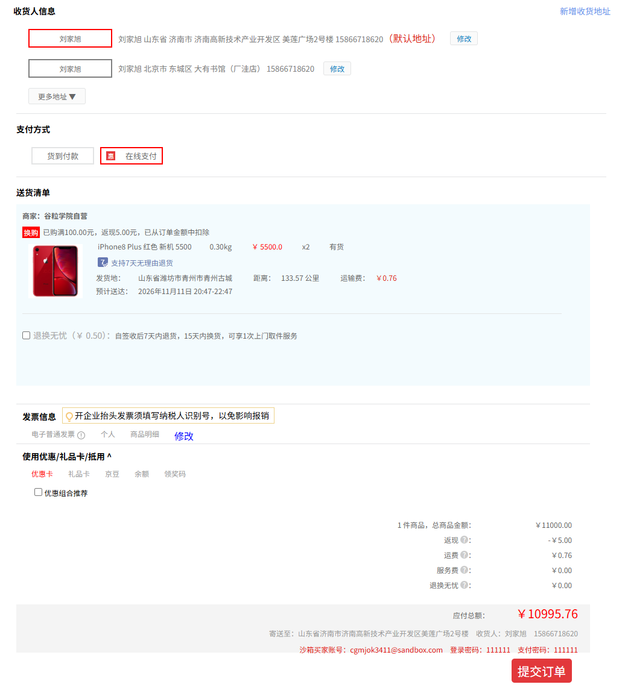
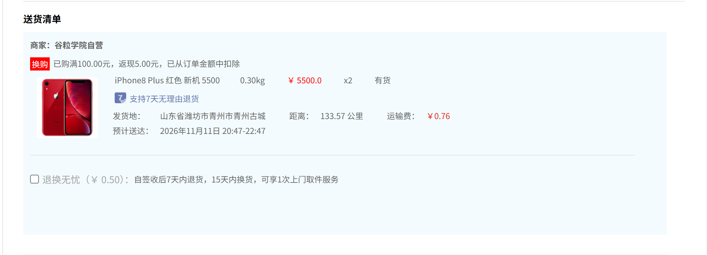
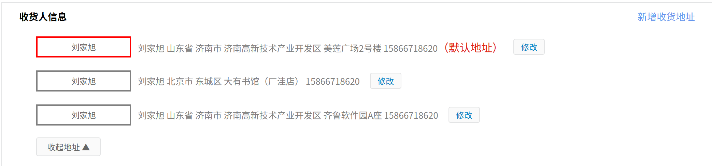
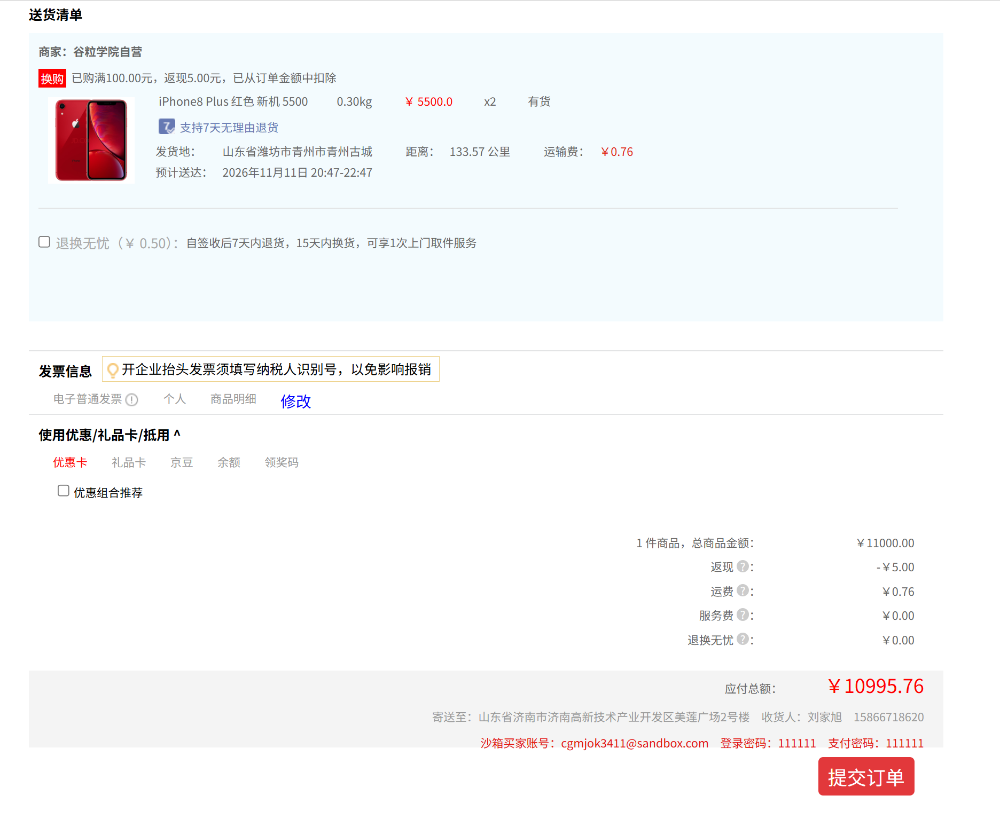
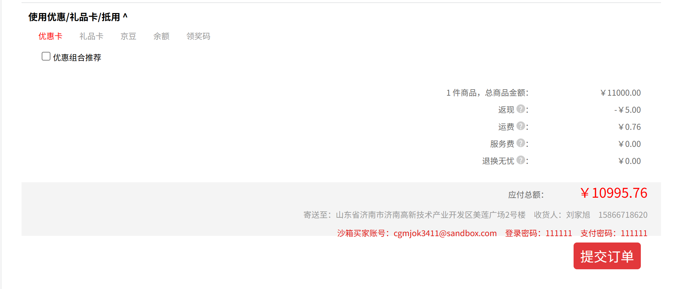
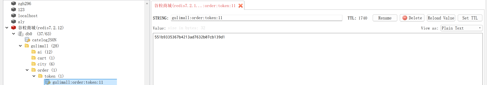

# 11.1 订单确认-介绍

> 介绍订单确认页：确认页要展示哪些数据、地址和商品怎么查、积分和运费怎么算、防重令牌怎么生成、Feign 调用怎么带登录态、运费缓存怎么命中、页面提交前做了哪些校验。

---

## 1. 这个功能是干什么的

订单确认页是购物车和提交订单之间的核对页面。用户从购物车点“去结算”后进入确认页，页面把这次要买的东西集中展示出来，让用户确认收货地址、商品清单、金额、运费和预计送达时间，最后点“提交订单”。

订单确认页在业务上有四个作用：

1. **核对商品**：展示购物车中勾选的商品、数量、单价、重量、库存状态。
2. **选择地址**：展示当前会员的收货地址，支持新增和修改，选中地址后重新计算运费。
3. **计算金额**：商品总额、返现、运费、服务费、退换无忧、应付总额。
4. **签发防重令牌**：进入确认页时生成一次性令牌，提交订单时校验并删除，防止重复下单。

确认页本身不创建订单。它只做三件事：

```text
查数据：地址、购物车勾选商品、会员积分
算金额：商品总额、运费、应付总额
发令牌：一个令牌进 Redis，一个令牌进页面
```

真正创建订单、扣减库存、锁库存发生在提交订单阶段，由订单服务的 `OrderServiceImpl.submitOrder()` 完成。

确认页依赖三个远程服务：

```text
gulimall-member：收货地址、积分
gulimall-cart：当前用户勾选的购物项
gulimall-ware：按收货地址和商品清单计算运费与预计送达时间
```

## 2. 用户怎么操作

入口：

```text
购物车页 → 去结算 → 订单确认页
```



用户进入确认页后可以完成五类操作。

### 2.1 查看商品清单

1. 页面展示购物车中勾选的商品。
2. 每个商品展示图片、标题、重量、单价、数量、库存状态。
3. 商品清单下方展示商品总额、返现、运费、服务费、退换无忧、应付总额。
4. 商品数据来自购物车服务的 `/currentUserCartItems`，只包含勾选且有效的商品。



### 2.2 选择收货地址

1. 页面展示当前会员的所有收货地址。
2. 默认地址带红框，进入页面时默认选中。
3. 没有默认地址时，自动选中第一个地址。
4. 点击某个地址，地址边框变红，底部“寄送至”同步更新。
5. 选中地址后立即请求 `/fare`，重新计算运费和预计送达时间。



### 2.3 新增或修改地址

1. 点击“新增收货地址”，打开弹窗。
2. 填写收货人、手机号、省市区、详细地址、是否默认。
3. 点击“保存”，请求 `/address/save`。
4. 修改地址时，弹窗里带上地址 id，请求 `/address/update`。
5. 保存成功后刷新页面，重新按默认地址计算运费。

地址保存由订单服务通过 Feign 转给会员服务。归属校验在会员服务侧完成，前端传的会员 id 不作数。

### 2.4 查看运费与预计送达

1. 选中地址后，前端把 `addrId` 和精简后的商品清单提交到 `/fare`。
2. 订单服务通过 Feign 调仓储服务。
3. 仓储服务按每个 sku 的候选仓库、收货地址、购买数量计算运费。
4. 每个商品展示发货地、距离、运输费、预计送达时间。
5. 整单运费回填到金额汇总里，应付总额同步重算。



### 2.5 提交订单

1. 页面底部展示应付总额和“提交订单”按钮。
2. 点击提交，前端把地址 id、防重令牌、商品总额、运费、应付金额、支付方式、仓库映射提交到 `/submitOrder`。
3. 后端先校验令牌，再校验地址、购物车、价格、库存。
4. 校验通过后创建订单、预扣库存、锁定库存。
5. 成功返回支付页地址，前端跳转；失败返回错误文案，前端弹窗提示。



### 2.6 防重令牌

1. 进入确认页时，后端生成一个 UUID。
2. 令牌写入 Redis，key 是 `gulimall:order:token:{memberId}`，有效期 30 分钟。
3. 令牌同时放进 `OrderConfirmVo.orderToken`，由页面隐藏域带给前端。
4. 提交订单时，后端用 Lua 脚本“比较并删除”令牌。
5. 令牌不匹配说明已经提交过或已过期，拒绝这次提交。



## 3. 整体设计思路

### 3.1 业务上怎么设计

#### 3.1.1 只有勾选商品进入确认页

购物车里可能有多个商品，用户只勾选一部分结算。确认页只展示勾选项，订单也只按勾选项创建。

购物车服务的 `/currentUserCartItems` 做了三层过滤：

1. 未登录返回空列表。
2. 只返回 `check=true` 的商品。
3. 价格不存在或库存为 0 的商品自动删除，不返回。

#### 3.1.2 地址必须属于当前会员

确认页展示当前会员的地址列表。用户提交订单时，后端会按 `addrId` 再查一次地址，并核对 `memberId` 是否等于当前登录会员。

地址保存和修改也由会员服务校验归属。订单服务只负责转发，不信任前端传来的会员信息。

#### 3.1.3 积分只展示，不抵扣

`OrderConfirmVo.integration` 来自 Session 中的会员信息，页面可以展示“可获积分”或“可用积分”。当前订单没有积分抵扣逻辑，金额计算里不扣积分。

#### 3.1.4 运费按地址和商品清单算

运费由仓储服务计算，业务规则：

1. 每个 sku 先找有足够库存的候选仓库。
2. 用收货地址和候选仓库地址算运输距离和耗时。
3. 每个 sku 只选一个仓库，优先耗时最短，其次距离最短。
4. 重量费：总重量不超过 3kg 收 0.5 元，超过后每 0.5kg 加 0.05 元，封顶 20 元。
5. 距离费：10 公里内免运费，超过后每 5 公里加 0.01 元，封顶 3 元。
6. 每个商品的运输明细和整单总运费一起返回。

#### 3.1.5 运费缓存

同一“收货地址 + 商品清单”算出的运费是固定的，可以缓存。但地址一旦修改，即使 `addrId` 不变，地址内容已经变了，缓存必须失效。

业务规则：

1. 确认页算运费走缓存。
2. 新增地址、修改地址后清空运费缓存。
3. 提交订单后清空运费缓存，避免下次进入确认页看到旧运费。

#### 3.1.6 防重令牌规则

1. 一个用户同一时间只保留一个有效令牌。
2. 令牌有效期 30 分钟。
3. 令牌只能使用一次，校验通过立即删除。
4. 令牌校验和删除必须原子，否则并发请求都能通过校验。
5. 提交失败时令牌已经消费，用户需要刷新确认页重新获取令牌。

#### 3.1.7 确认页不落库

确认页只读数据，不写订单表。地址保存是例外，它写的是会员服务的地址表，不是订单表。

这样做的好处：

1. 用户反复进入确认页不会产生脏订单。
2. 订单只在提交时创建，状态从 0 开始。
3. 价格和库存在提交时再校验一次，确认页展示的数据只作为参考。

### 3.2 技术上怎么设计

#### 3.2.1 CompletableFuture 聚合

确认页需要三类数据：

1. 收货地址列表。
2. 当前购物车勾选项。
3. 防重令牌。

地址和购物车是远程调用，令牌是 Redis 写操作，三者互不依赖，可以并行。`OrderServiceImpl.confirmOrder()` 用 `CompletableFuture.supplyAsync()` 并行执行，最后 `allOf().join()` 汇总。

积分直接从 Session 的会员对象取，不需要远程调用。

#### 3.2.2 Feign 调用要带登录态

订单服务调购物车服务的 `/currentUserCartItems`，购物车服务要从 Session 判断当前用户。订单服务必须把浏览器带来的 Cookie 一起转发给购物车服务。

`FeignCookieConfig` 注册了一个 `RequestInterceptor`，从当前请求上下文取 `Cookie` 头，复制到 Feign 请求头里。

异步任务又多加一层：`CompletableFuture` 跑在线程池里，`RequestContextHolder` 是 ThreadLocal，线程池线程取不到当前请求。`MyThreadConfig` 给线程池设置了 `TaskDecorator`，把主线程的 `RequestAttributes` 复制给执行任务的线程。

没有这两层，购物车服务认不出登录用户，会返回空列表，还会凭空创建一个游客车。

#### 3.2.3 地址查询与购物车查询

1. 地址：`MemberReceiveAddressFeignClient.getAddress(memberId)`。
2. 购物车：`CartFeignClient.getCurrentCartItems()`。

两个接口都返回 VO 列表，订单服务不需要再查数据库。

#### 3.2.4 运费本地缓存

`ConfirmController.fare()` 上有：

```java
@Cacheable(cacheNames = "fare", key = "#vo", sync = true)
```

缓存实现是 Caffeine，配置在订单服务的 `application.yaml`：

```yaml
spring:
  cache:
    type: caffeine
    caffeine:
      spec: maximumSize=500,expireAfterWrite=30m
```

缓存 key 是整个 `FareRequestVo`。它是 record，`equals/hashCode` 按字段生成，地址或商品清单变化时 key 自然变化。

`sync = true` 让同一个 key 只允许一个线程加载，避免并发请求一起打到仓储服务。

#### 3.2.5 运费缓存失效

1. 新增地址：`@CacheEvict(cacheNames = "fare", allEntries = true)`。
2. 修改地址：同样清空。
3. 提交订单：同样清空。

修改地址时 `addrId` 不变，如果不清缓存，会一直命中修改前算出的运费，所以必须按 `allEntries` 清空。

#### 3.2.6 防重令牌生成

1. 生成 UUID 并去掉横线。
2. key 是 `OrderConstant.USER_ORDER_TOKEN_PREFIX + memberId`。
3. value 是令牌。
4. TTL 30 分钟。
5. 令牌放进 `OrderConfirmVo`，页面用隐藏域保存。

#### 3.2.7 确认页金额计算

1. `OrderConfirmVo.getTotal()` 累加每个购物项的 `price × count`。
2. `getPayPrice()` 当前直接返回商品总额。
3. 页面上的返现、运费、退换无忧由前端 JS 叠加。
4. 服务端提交时只信任 `goodsTotal` 用于比价，最终应付金额由后端重新校验。

#### 3.2.8 页面提交方式

确认页用 AJAX 提交，不用表单提交。原因是后端异常时返回 `toTrade?error=...` 字符串，AJAX 可以拿到并弹窗提示，表单提交会整页跳走。

#### 3.2.9 登录拦截

订单服务的 `LoginUserInterceptor` 拦截确认页和提交接口，未登录直接 302 到登录页。后台 CRUD 和支付宝回调等接口在 `OrderWebConfiguration` 里排除。

## 4. 详细代码、配置和解释

本章按“类为什么存在 → 关键数据 → 调用链路 → 代码分块解释 → 完整示例 → 边界”组织。每块代码前先说明它在链路里承担什么，代码后按 1、2、3 编号解释执行顺序、条件和原因。

### 4.1 OrderConfirmVo：确认页数据

#### 4.1.1 这个类解决什么问题

订单确认页要把地址、商品、积分、防重令牌和金额放到同一份页面模型里。浏览器进入 `/confirm.html` 后，页面需要一次性拿到当前会员的收货地址列表、购物车里勾选的商品、会员积分、提交用的令牌，还要在金额区域展示商品总额、应付金额和总重量。

`OrderConfirmVo` 就是这次确认页渲染的数据载体。调用方是 `OrderServiceImpl.confirmOrder()`，它把会员服务的地址、购物车服务的勾选项、Session 中的积分和 Redis 中的令牌汇总成一个对象；接收方是 `ConfirmController.confirm()`，它把对象放进 Model，交给 `confirm.html` 渲染。提交订单时页面回传的金额只作为参考，后端会用购物车的实时数据重新计算，因此这个 VO 是展示快照，不是金额凭证。

上游依赖三处：gulimall-member 提供地址，gulimall-cart 提供勾选商品，Redis 保存令牌，Session 保存积分。下游是确认页模板的地址区、商品区、金额区和隐藏域。

#### 4.1.2 字段与计算属性

| 字段 | 类型 | 来源 | 页面用途 |
|---|---|---|---|
| `memberAddressVos` | `List<MemberAddressVo>` | 会员服务 | 地址列表和默认地址选择 |
| `items` | `List<OrderItemVo>` | 购物车服务 | 商品清单、重量、库存状态 |
| `integration` | `Integer` | Session 会员对象 | 展示可获积分或可用积分 |
| `orderToken` | `String` | Redis 写入后返回 | 提交订单时回传，用于防重 |
| `stocks` | `Map<Long, Boolean>` | 当前未使用 | 预留的库存标记 |
| `total`、`payPrice`、`totalWeight` | `BigDecimal` | 计算属性 | 商品总额、应付金额、总重量 |

页面上看到的 `count`、`total`、`payPrice`、`totalWeight` 都来自 getter。Jackson 序列化时按 getter 生成 JSON 属性，所以即使 `total` 字段本身没有赋值，响应里也会出现按商品明细实时算出的值。

#### 4.1.3 代码与解释

确认页 VO 的字段和三个计算 getter 是整页数据的基础，下面按字段顺序说明。

```java
@Data
public class OrderConfirmVo {

    /** 会员收获地址列表 */
    private List<MemberAddressVo> memberAddressVos;

    /** 所有选中的购物项 */
    private List<OrderItemVo> items;

    /**
     * 发票记录
     * 优惠券（会员积分）
     */
    private Integer integration;

    /** 订单总额 */
    BigDecimal total;

    /** 应付价格 */
    BigDecimal payPrice;

    BigDecimal totalWeight;

    /** 防止重复提交的令牌 */
    private String orderToken;

    private Map<Long,Boolean> stocks;

    /**
     * 商品总件数
     */
    public Integer getCount() {
        return items != null ? items.size() : 0;
    }

    public BigDecimal getTotal() {
        BigDecimal totalNum = BigDecimal.ZERO;
        if (items != null && !items.isEmpty()) {
            for (OrderItemVo item : items) {
                BigDecimal itemPrice = item.getPrice().multiply(new BigDecimal(item.getCount()));
                totalNum = totalNum.add(itemPrice);
            }
        }
        return totalNum;
    }

    public BigDecimal getPayPrice() {
        return getTotal();
    }

    public BigDecimal getTotalWeight() {
        BigDecimal totalWeight = BigDecimal.ZERO;
        if (items != null && !items.isEmpty()) {
            for (OrderItemVo item : items) {
                BigDecimal itemWeight = item.getWeight().multiply(new BigDecimal(item.getCount()));
                totalWeight = totalWeight.add(itemWeight);
            }
        }
        return totalWeight;
    }

}
```

1. `@Data` 为普通字段生成 getter/setter，同时类中显式定义的 `getTotal()`、`getPayPrice()`、`getTotalWeight()` 会覆盖 Lombok 生成的同名方法。
2. `memberAddressVos` 承载地址列表，页面遍历它渲染每个地址卡片，默认地址的 `defaultStatus` 也在其中。
3. `items` 承载购物车勾选项，商品行、金额、总重量都从这里取数。
4. `integration` 直接取 Session 中会员对象的积分，确认页只展示，不参与金额抵扣。
5. `total`、`payPrice`、`totalWeight` 三个字段由 getter 覆盖，调用 `getTotal()` 时不会读取字段，而是遍历 `items` 重新计算。
6. `orderToken` 与令牌生成任务返回的值一致，页面放进隐藏域，提交时再带回后端。
7. `stocks` 在当前链路中没有赋值，也没有页面读取，属于预留字段。
8. `getCount()` 返回 `items.size()`，统计的是商品种类数，不是商品总件数。
9. `getTotal()` 对每个商品执行 `price × count`，再用 `BigDecimal.add` 累加，避免浮点误差。
10. `getPayPrice()` 直接返回 `getTotal()`，当前没有把运费、返现、退换无忧算进来。
11. `getTotalWeight()` 用 `weight × count` 累加，供页面展示总重量；运费实际由仓储服务重新按商品清单计算。

#### 4.1.4 一次完整示例

购物车勾选两件商品：

```text
sku 1：单价 100.00，数量 2，单件重量 0.5kg
sku 2：单价 50.00，数量 1，单件重量 1.0kg
```

`confirmOrder()` 返回后，页面读到：

```text
count       = 2          （两种商品）
total       = 100×2 + 50×1 = 250.00
payPrice    = 250.00     （尚未加运费）
totalWeight = 0.5×2 + 1.0×1 = 2.0
```

页面金额区显示“2 件商品，总商品金额 ￥250.00”，应付总额初始也是 ￥250.00；随后运费接口返回，前端把运费叠加后再更新应付总额。

#### 4.1.5 它不做什么

1. 不查询数据库，也不发起远程调用，所有数据由 `confirmOrder()` 填好。
2. 不计算运费、返现、退换无忧，这些由页面脚本叠加，金额最终以后端提交校验为准。
3. 不校验令牌，令牌只在 `submitOrder()` 中用 Lua 脚本比较并删除。
4. 不落库，确认页反复打开不会产生订单记录。

#### 4.1.6 边界与可优化点

1. `getTotal()` 和 `getTotalWeight()` 没有判断 `price`、`weight`、`count` 是否为空，购物车返回脏数据时会空指针。
2. `getPayPrice()` 不包含运费，与页面最终展示的应付金额不一致；提交时后端只校验商品总额，应付金额直接取前端传值。
3. `total`、`payPrice`、`totalWeight` 既是字段又有覆盖 getter，字段赋值不会生效，容易让维护者误判。
4. `getCount()` 统计种类数，页面文案“X 件商品”在购买多件同一商品时与实际件数不符。
5. `stocks` 字段没有使用，可以从 VO 中移除。

### 4.2 OrderItemVo：确认页购物项

#### 4.2.1 这个类解决什么问题

购物车服务返回的是 `CartItemVo`，订单服务在确认页、运费计算和提交校验三个环节都要使用同一份商品数据。两个服务之间通过 Feign 的 JSON 传输，如果各写一套 DTO，字段名和取值规则很容易不一致。

`OrderItemVo` 放在 `gulimall-api`，作为购物车和订单服务共享的商品契约。调用方是 `CartFeignClient.getCurrentCartItems()`，购物车把 `CartItemVo` 序列化成 JSON，订单服务反序列化成 `OrderItemVo`，字段同名即可自动映射。下游有三处：确认页商品列表、`ConfirmController` 把商品压成运费入参、`OrderServiceImpl.submitOrder()` 用实时商品数据比价。

#### 4.2.2 字段与业务含义

| 字段 | 类型 | 业务含义 | 说明 |
|---|---|---|---|
| `skuId` | `Long` | 商品 sku 标识 | 运费、库存、锁库存都按它关联 |
| `check` | `Boolean` | 购物车勾选状态 | 确认页只接收勾选项，订单侧不再判断 |
| `title` | `String` | 商品标题 | 页面展示、库存不足提示 |
| `image` | `String` | 商品主图 | 页面展示 |
| `skuAttrValues` | `List<String>` | 销售属性组合 | 例如颜色、版本 |
| `price` | `BigDecimal` | 单价 | 页面展示和运费计算 |
| `count` | `Integer` | 购买数量 | 页面展示、库存校验、下单数量 |
| `totalPrice` | `BigDecimal` | 行小计 | 购物车 getter 计算后序列化过来 |
| `stock` | `Long` | 实时库存 | 默认 `Long.MAX_VALUE`，表示购物车没有拿到库存数字 |
| `weight` | `BigDecimal` | 单件重量 | 运费计算的核心入参 |

#### 4.2.3 代码与解释

这个契约类只有字段，没有业务方法，字段含义直接决定页面展示、金额重算和运费计算。

```java
@Data
public class OrderItemVo {

    private Long skuId;

    private Boolean check;

    private String title;

    private String image;

    /**
     * 商品套餐属性
     */
    private List<String> skuAttrValues;

    private BigDecimal price;

    private Integer count;

    private BigDecimal totalPrice;

    private Long stock;

    /** 商品重量 **/
    private BigDecimal weight;
}
```

1. `skuId` 是商品在整条链路中的唯一标识，运费明细、仓库映射、库存校验都靠它匹配。
2. `check` 记录购物车勾选状态。购物车接口已经过滤未勾选项，订单侧拿到的基本都是 `true`，提交时也不会再判断。
3. `title`、`image` 只用于确认页展示；提交失败提示库存不足时，`title` 还会被拼进错误文案。
4. `skuAttrValues` 保存销售属性组合，页面可以展示“颜色 + 版本”，运费和下单逻辑不依赖它。
5. `price`、`count` 是页面展示和金额重算的基础，提交时后端会用购物车实时值覆盖页面传值。
6. `totalPrice` 不需要订单服务赋值。购物车 `CartItemVo.getTotalPrice()` 在序列化时被 Jackson 调用，算出的 `price × count` 写入 JSON，反序列化后自动落到这个字段。
7. `stock` 默认值是 `Long.MAX_VALUE`。购物车渲染时现查一次库存，查不到时保留默认值，页面把默认值解释为“无货”。
8. `weight` 是单件重量，确认页乘数量展示总重量，运费接口按“件数 × 单件重量”计算计费重量。

#### 4.2.4 一次完整示例

购物车返回的 JSON 片段：

```json
{
  "skuId": 11,
  "check": true,
  "title": "Apple iPhone 15 128GB 黑色",
  "image": "https://.../iphone15.jpg",
  "skuAttrValues": ["黑色", "128GB"],
  "price": 5999.00,
  "count": 1,
  "totalPrice": 5999.00,
  "stock": 32,
  "weight": 0.45
}
```

订单服务反序列化后，`confirm.html` 展示标题、图片、属性、单价、数量、重量和库存状态；`ConfirmController` 再把 `skuId=11`、`count=1`、`weight=0.45` 压成运费入参，图片和标题不会进入运费请求。

#### 4.2.5 它不做什么

1. 不计算价格，`totalPrice` 由购物车 getter 计算。
2. 不判断库存是否充足，库存校验在提交订单时由仓储服务完成。
3. 不携带品牌、分类、spu 信息，创建订单明细时还要再查一次商品服务。
4. 不区分正常购买和秒杀，秒杀单走独立接口。

#### 4.2.6 边界与可优化点

1. `check` 在订单侧没有实际作用，确认页已经只接收勾选项，可以去掉。
2. `stock` 用 `Long.MAX_VALUE` 表达“没有库存信息”，页面又把它显示成“无货”，语义容易混淆；更清晰的做法是增加 `stockKnown` 标记。
3. `totalPrice` 是派生字段，依赖购物车 getter 的序列化行为。如果购物车改成手动赋值或关闭 getter 序列化，订单侧会拿到空值。
4. 缺少品牌、分类、spu 名称，创建订单明细时 `submitOrder()` 需要额外调用商品服务批量查询。
5. `price`、`count`、`weight` 都没有非空约束，脏数据会在金额和运费计算时空指针。

### 4.3 ConfirmController：确认页入口

#### 4.3.1 这个类解决什么问题

确认页的浏览器请求全部落在订单服务的这个 Controller 上：打开页面、切换地址后算运费、新增或修改地址、点击提交订单。它要把 HTTP 参数翻译成 Service 或 Feign 调用，把页面需要的模型放进 Model，把提交结果转成前端能处理的字符串。

这个类不负责组装确认页数据，也不负责下单业务。地址和商品由 `OrderServiceImpl.confirmOrder()` 聚合，运费由仓储服务计算，下单由 `OrderServiceImpl.submitOrder()` 完成，Controller 只做入口、缓存和锁的边界控制。

#### 4.3.2 接口清单

| 操作 | 方法与路径 | 返回 | 调用的下游 |
|---|---|---|---|
| 打开确认页 | `GET /confirm.html` | 视图 `confirm` | `OrderService.confirmOrder()` |
| 计算运费 | `POST /fare` | `R` | `WareFeignClient.getFare()` |
| 提交订单 | `POST /submitOrder` | 支付页地址或错误串 | `OrderService.submitOrder()` |
| 新增地址 | `POST /address/save` | `R` | `MemberReceiveAddressFeignClient.saveAddress()` |
| 修改地址 | `POST /address/update` | `R` | `MemberReceiveAddressFeignClient.updateAddress()` |

`confirm()` 使用 `@Controller` 返回视图名；其余四个使用 `@ResponseBody`，返回值直接写入 HTTP 响应体。网关转发时会去掉 `/gulimall` 前缀，服务内实际路径就是表中的路径。

#### 4.3.3 代码与解释

确认页的五个入口都集中在这个 Controller 中，下面按接口逐个说明入口、下游和返回值。

```java
@Controller
public class ConfirmController {

    @Autowired
    OrderService orderService;
    @Autowired
    WareFeignClient wareFeignClient;
    @Autowired
    MemberReceiveAddressFeignClient memberReceiveAddressFeignClient;
    @Autowired
    RedissonClient redissonClient;

    @GetMapping("/confirm.html")
    public String confirm(Model model) {
        OrderConfirmVo orderConfirmVo = orderService.confirmOrder();
        model.addAttribute("orderConfirmData", orderConfirmVo);

        // 页面算运费只用得上「商品id + 件数 + 重量」，这里先挑成一份精简数据交给页面。
        // 好处：页面上内联的 JSON 小，前端回传时也不会把图片、标题、销售属性一起带上来。
        List<OrderItemVo> items = orderConfirmVo.getItems();
        model.addAttribute("fareItems", items == null ? List.of() : items.stream()
                .map(item -> new FareRequestVo.Item(item.getSkuId(), item.getCount(), item.getWeight()))
                .toList());

        return "confirm";
    }

    @PostMapping("/fare")
    @ResponseBody
    @Cacheable(cacheNames = "fare", key = "#vo", sync = true)
    public R fare(@RequestBody FareRequestVo vo) {
        return wareFeignClient.getFare(vo);
    }

    /** 提交订单：加库存读锁（多个下单可并发，只与管理员改库存互斥） */
    @PostMapping("/submitOrder")
    @ResponseBody
    @CacheEvict(cacheNames = "fare", allEntries = true)
    public String submitOrder(OrderSubmitVo orderSubmitVo) {
        RLock lock = redissonClient.getReadWriteLock(WareConstant.STOCK_LOCK).readLock();
        boolean locked = false;
        try {
            // 最多等 3 秒；拿到后最多持有 30 秒，防止持锁线程异常退出后锁不释放
            locked = lock.tryLock(3, 30, TimeUnit.SECONDS);
            if (!locked) {
                return toTradeWithError(BizCodeEnum.ORDER_STOCK_BUSY.getMsg());
            }

            try {
                OrderVo orderVo = orderService.submitOrder(orderSubmitVo);
                return "/pay.html?orderSn=" + orderVo.getOrderSn();
            } catch (RRException e) {
                return toTradeWithError(e.getMsg());
            }
        } catch (InterruptedException e) {
            Thread.currentThread().interrupt();
            return toTradeWithError(BizCodeEnum.ORDER_SUBMIT_INTERRUPTED.getMsg());
        } finally {
            if (locked && lock.isHeldByCurrentThread()) {
                lock.unlock();
            }
        }
    }

    private String toTradeWithError(String message) {
        return "toTrade?error=" + URLEncoder.encode(message, StandardCharsets.UTF_8);
    }

    @PostMapping("/address/save")
    @ResponseBody
    @CacheEvict(cacheNames = "fare", allEntries = true)
    public R saveAddress(@RequestBody MemberReceiveAddressVo address) {
        return memberReceiveAddressFeignClient.saveAddress(address);
    }

    @PostMapping("/address/update")
    @ResponseBody
    @CacheEvict(cacheNames = "fare", allEntries = true)
    public R updateAddress(@RequestBody MemberReceiveAddressVo address) {
        return memberReceiveAddressFeignClient.updateAddress(address);
    }

}
```

1. `@Controller` 而不是 `@RestController`：`confirm()` 要返回 Thymeleaf 视图名 `confirm`，不能被当成 JSON 响应。
2. 四个依赖分别负责下单业务、运费、会员地址和库存读写锁；其中 `RedissonClient` 只在提交订单时使用。
3. `confirm()` 先调 `orderService.confirmOrder()` 拿到完整 VO，放进 `orderConfirmData`。
4. `confirm()` 再把商品压成 `FareRequestVo.Item` 列表放进 `fareItems`，只保留 skuId、件数、重量，减少页面内联 JSON 和回传体积。
5. `fare()` 上的 `@ResponseBody` 让返回值直接写响应体；`@Cacheable(cacheNames="fare", key="#vo", sync=true)` 按整个请求对象缓存，同一个 key 只放一个线程回源。
6. `fare()` 方法体只有一行，把请求原样转给仓储服务；命中 Caffeine 时方法体不会执行。
7. `submitOrder()` 先拿库存读写锁的读锁，读锁之间可以并发，只与管理员盘点库存的写锁互斥。
8. `tryLock(3, 30, TimeUnit.SECONDS)`：最多等 3 秒，拿到后最多持有 30 秒，防止持锁线程异常退出导致锁不释放。
9. 抢锁失败返回“库存繁忙”错误串；抢锁成功才调用 `orderService.submitOrder()`，成功返回支付页地址。
10. `RRException` 是业务异常，文案直接给前端弹窗；`InterruptedException` 恢复中断标记并返回中断提示。
11. `finally` 只在当前线程确实持锁时解锁，避免误释放别人的锁。
12. `toTradeWithError()` 把文案做 URL 编码，中文、空格和 `&` 不会破坏返回的跳转串。
13. `saveAddress()`、`updateAddress()` 把地址请求转发给会员服务，同时清空全部运费缓存，因为地址内容变化后旧运费不再有效。

#### 4.3.4 一次完整示例

用户从购物车进入确认页并选择另一个地址：

```text
1. 浏览器 GET /gulimall/order/confirm.html
2. 网关去掉前缀，转发到订单服务 /confirm.html
3. LoginUserInterceptor 校验 Session，把会员放进 ThreadLocal
4. confirm() 调 confirmOrder()，并行查地址、购物车、令牌
5. 返回 confirm 视图，页面渲染地址、商品、金额、令牌
6. 用户点击第二个地址，页面 POST /fare，请求体带 addrId 和 fareItems
7. fare() 命中 Caffeine 直接返回，未命中则 Feign 调仓储服务
8. 页面按 sku 回填运输明细，更新运费和应付总额
9. 用户点击提交，页面 POST /submitOrder
10. submitOrder() 抢读锁，调 orderService.submitOrder()
11. 成功返回 /pay.html?orderSn=...，页面跳转
12. 失败返回 toTrade?error=库存不足，页面弹窗提示
```

#### 4.3.5 它不做什么

1. 不组装确认页数据，地址、商品、积分、令牌都在 Service 里聚合。
2. 不计算运费，只做转发和缓存。
3. 不校验令牌、地址归属、价格和库存，这些在下单业务里完成。
4. 不校验地址表单字段，手机号、省市区合法性依赖前端和会员服务。

#### 4.3.6 边界与可优化点

1. `fare()` 直接返回 Feign 的 `R`，没有捕获远程调用异常，仓储服务不可用时页面只显示“运费计算失败”。
2. 运费缓存是 Caffeine 本地缓存，多实例部署时一个实例提交订单只能清掉自己的缓存，其他实例仍可能返回旧运费。
3. 读锁持有到整个下单流程结束，下单耗时较长时会阻塞库存盘点的写锁。
4. `/address/save`、`/address/update` 没有参数校验，手机号、省市区是否合法完全依赖前端和会员服务。
5. `toTradeWithError()` 返回相对路径，前端要自己按 `error=` 解析；返回格式一旦调整，页面解析会失效。
6. `@CacheEvict` 在方法返回后执行，提交订单失败也会清空运费缓存，结果是失败后重新进入确认页需要重新算一次运费。

### 4.4 OrderServiceImpl.confirmOrder：并行聚合确认页数据

#### 4.4.1 这个方法解决什么问题

确认页需要地址列表、购物车勾选项和防重令牌。地址在会员服务，购物项在购物车服务，令牌要写 Redis，三件事互不依赖。如果串行执行，页面打开时间等于三次远程调用之和；商品多、网络慢时用户会明显感到卡顿。

`confirmOrder()` 用 `CompletableFuture` 把三个任务并行提交，最后 `allOf().join()` 汇总成一个 `OrderConfirmVo`。调用方是 `ConfirmController.confirm()`，上游是会员服务、购物车服务和 Redis，下游是确认页模板。会员对象由 `LoginUserInterceptor` 提前放进 `MemberResponseVoThreadLocal`，这个方法直接取用，不再查会员服务。

#### 4.4.2 关键概念

1. `CompletableFuture.supplyAsync(task, executor)`：把任务提交到指定线程池，返回可等待的结果句柄。
2. `threadPoolExecutor`：`MyThreadConfig` 注册的业务线程池，配合 `TaskDecorator` 把请求上下文传给执行线程。
3. `CompletableFuture.allOf(...)`：等所有任务完成；任意一个异常完成时，`join()` 会抛出 `CompletionException`。
4. `thenApply`：所有任务完成后在完成线程上组装 VO，最后 `join()` 阻塞当前请求线程直到拿到结果。
5. 防重令牌：进入页面时生成一次，key 带会员 id，TTL 30 分钟，value 同时写进 Redis 和 VO。

#### 4.4.3 代码与解释

并行聚合的入口是 `confirmOrder()`，三个异步任务、等待和最终组装都在这个方法里。

```java
@Override
public OrderConfirmVo confirmOrder() {
    MemberResponseVo memberResponseVo = MemberResponseVoThreadLocal.get();

    // 1.远程查询收货地址列表
    CompletableFuture<List<MemberAddressVo>> getAddress = CompletableFuture.supplyAsync(
            () -> memberReceiveAddressFeignClient.getAddress(memberResponseVo.getId()), threadPoolExecutor);

    // 2.1.远程查询购物车中所有购物项
    CompletableFuture<List<OrderItemVo>> getCurrentCartItems = CompletableFuture.supplyAsync(
            () -> cartFeignClient.getCurrentCartItems(), threadPoolExecutor);

    // 3.查询用户积分
    Integer integration = memberResponseVo.getIntegration();

    // 4.其它数据vo中自动计算

    // 5.防重令牌
    CompletableFuture<String> getToken = CompletableFuture.supplyAsync(
            () -> {
                String token = UUID.randomUUID().toString().replace("-", "");
                stringRedisTemplate.opsForValue().set(
                        OrderConstant.USER_ORDER_TOKEN_PREFIX + memberResponseVo.getId(),
                        token,
                        30,
                        TimeUnit.MINUTES);
                return token;
            });

    return CompletableFuture.allOf(getAddress, getCurrentCartItems, getToken).thenApply(
            vo -> {
                OrderConfirmVo orderConfirmVo = new OrderConfirmVo();
                orderConfirmVo.setMemberAddressVos(getAddress.join());
                orderConfirmVo.setItems(getCurrentCartItems.join());
                orderConfirmVo.setIntegration(integration);
                orderConfirmVo.setOrderToken(getToken.join());
                return orderConfirmVo;
            }
    ).join();

}
```

1. 从 `MemberResponseVoThreadLocal` 取当前登录会员。拦截器已经在请求进入时写入，这里不再查 Session。
2. 提交地址查询任务到业务线程池，参数用会员 id，不依赖其他任务的结果。
3. 提交购物车查询任务到同一个线程池。购物车服务要从 Cookie 识别会员，因此这个任务依赖 `TaskDecorator` 传递请求上下文。
4. 积分直接从会员对象读取，没有远程调用，也不会阻塞。
5. 提交令牌生成任务：生成去掉横线的 UUID，写入 `gulimall:order:token:{memberId}`，TTL 30 分钟，返回令牌字符串。
6. `CompletableFuture.allOf(...)` 等待三个任务全部完成。
7. `thenApply` 里依次 `join()` 取结果，填入 VO 的地址、商品、积分、令牌字段。
8. 最外层 `join()` 把异步结果转成同步返回值，Controller 拿到完整 VO 后放进 Model。
9. 令牌任务没有指定线程池，实际跑在 `ForkJoinPool.commonPool()`；它只做 UUID 和 Redis 写入，不需要请求上下文，所以暂未暴露问题。
10. 地址和购物车任务都显式传入 `threadPoolExecutor`，两个远程调用可以同时进行。

#### 4.4.4 一次完整示例

假设三次操作耗时如下：

```text
地址查询   120 ms
购物车查询  80 ms
令牌写入     5 ms
```

串行执行约 205 ms；并行执行由最慢的地址查询决定，约 120 ms。时间线：

```text
0 ms    提交地址任务、购物车任务、令牌任务
5 ms    令牌任务完成
80 ms   购物车任务完成
120 ms  地址任务完成，allOf 触发 thenApply
120 ms  组装 VO，join 返回
```

用户在 120 ms 左右看到确认页，而不是等三次调用依次完成。

#### 4.4.5 它不做什么

1. 不查询会员基本信息，会员对象由拦截器从 Session 取出。
2. 不计算金额，VO 的 getter 在页面渲染时按商品明细计算。
3. 不校验地址归属、库存和价格，这些在提交订单时完成。
4. 不清理旧令牌，新令牌直接覆盖同一个 key。

#### 4.4.6 边界与可优化点

1. 会员对象为 null 时第 2 步直接空指针，应该在方法入口判断登录态并抛业务异常。
2. 令牌任务使用公共 `ForkJoinPool`，与其他两个任务的线程池不一致；如果后续令牌逻辑需要请求上下文，`TaskDecorator` 不会生效。
3. 地址或购物车远程调用失败时整个确认页失败，没有降级或兜底数据。
4. 每次进入确认页都生成新令牌，同一个会员在两个标签页打开确认页时，后打开的会覆盖先打开的令牌，先提交的页面会校验失败。
5. 没有设置整体超时，远程服务响应慢时页面会等到 Feign 超时才失败。
6. `allOf` 的异常只保留第一个，其他任务仍在后台执行，日志里可能看到多个远程调用结果。

### 4.5 OrderConstant：防重令牌 key

#### 4.5.1 这个类解决什么问题

防重令牌在两个地方使用：进入确认页时写入 Redis，提交订单时读取并删除。写入方和消费方必须使用完全相同的 key 格式，否则写入的令牌永远校验不到。

`OrderConstant` 把令牌 key 前缀收敛到一个常量。调用方是 `OrderServiceImpl.confirmOrder()` 和 `OrderServiceImpl.submitOrder()`，下游是 Redis。写入时 key 是“前缀 + 会员 id”，消费时用同一个表达式拼 key，再交给 Lua 脚本原子比较并删除。

#### 4.5.2 关键数据

| 常量 | 值 | 使用方 |
|---|---|---|
| `USER_ORDER_TOKEN_PREFIX` | `gulimall:order:token:` | 确认页写令牌、提交订单校验令牌 |

最终 key 形如 `gulimall:order:token:8`，value 是 32 位无横线 UUID，TTL 30 分钟。

#### 4.5.3 代码与解释

令牌 key 的常量定义很短，写入方和消费方都依赖它保持一致。

```java
public class OrderConstant {

    public static final String USER_ORDER_TOKEN_PREFIX = "gulimall:order:token:";

}
```

1. 类只定义常量，不提供实例方法，当前没有私有构造器。
2. `USER_ORDER_TOKEN_PREFIX` 统一了 key 前缀，确认页和提交订单拼出的 key 必然一致。
3. key 带会员 id，不同会员的令牌互不影响，提交时不需要前端传会员 id。
4. 一个会员只保留一个 key，新令牌写入会覆盖旧值。

#### 4.5.4 一次完整示例

会员 8 进入确认页：

```text
SET gulimall:order:token:8 "4f2c9a7b8d1e4c6f9a0b3d5e7c8f1a2b" EX 1800
```

页面隐藏域保存同一个 UUID。提交订单时执行 Lua：

```text
if redis.call('get', KEYS[1]) == ARGV[1] then
    return redis.call('del', KEYS[1])
else
    return 0
end
```

返回 1 表示令牌匹配并已删除，继续下单；返回 0 表示令牌不存在或不匹配，抛防重异常。比较和删除在 Redis 单线程里一次完成，并发请求只有一个能拿到 1。

#### 4.5.5 边界与可优化点

1. 一个会员同时只有一个有效令牌，多标签页、多设备同时进入确认页会互相覆盖。
2. 常量类可以补私有构造器，避免被实例化。
3. 订单状态、支付方式等常量仍散落在 Service 和定时任务里，可以一并收敛到这个类。
4. 令牌 TTL 固定 30 分钟，用户停留超过 30 分钟再提交会失败，需要刷新确认页重新获取。

### 4.6 Feign 客户端：地址、购物车、仓储

#### 4.6.1 这些接口解决什么问题

订单服务不直接访问会员、购物车、仓储的数据库，所有跨服务数据都通过 Feign 接口获取。确认页要地址列表和勾选商品，运费要仓储服务按地址和商品清单计算，提交订单要查实时库存、锁库存，支付完成后要释放或扣减锁定库存。

这三个 Feign 接口就是订单服务与下游服务之间的调用契约。接口只声明服务名、路径、请求方式和参数类型，真正的 HTTP 调用由 Spring Cloud OpenFeign 在运行时生成代理完成。服务名对应 Nacos 注册名，调用方不需要知道下游的 IP 和端口。

#### 4.6.2 接口清单

| 客户端 | 方法 | 路径 | 使用场景 |
|---|---|---|---|
| `CartFeignClient` | `getCurrentCartItems()` | `GET /currentUserCartItems` | 确认页商品列表、提交订单实时比价 |
| `CartFeignClient` | `deleteCheckedItems(skuIds)` | `GET /deleteCheckedItems` | 支付成功后清空已下单商品 |
| `MemberReceiveAddressFeignClient` | `getAddress(memberId)` | `GET member/memberreceiveaddress/{memberId}/address` | 确认页地址列表 |
| `MemberReceiveAddressFeignClient` | `getAddressById(addrId)` | `GET member/memberreceiveaddress/{addrId}` | 算运费取收货地址、提交时核对归属 |
| `MemberReceiveAddressFeignClient` | `saveAddress(address)` | `POST member/memberreceiveaddress/save` | 确认页新增地址 |
| `MemberReceiveAddressFeignClient` | `updateAddress(address)` | `POST member/memberreceiveaddress/update` | 确认页修改地址 |
| `WareFeignClient` | `getFare(vo)` | `POST /ware/wareinfo/fare` | 确认页计算运费 |
| `WareFeignClient` | `hasStock(skuIds)` | `POST /ware/waresku/hasStock` | 按 sku 判断是否有货 |
| `WareFeignClient` | `hasStockByWare(vo)` | `POST /ware/waresku/hasStockByWare` | 提交订单按仓库校验库存 |
| `WareFeignClient` | `getStockNums(skuIds)` | `POST /ware/waresku/stockNums` | Redis 库存未预热时回源查库 |
| `WareFeignClient` | `lockStock(vo)` | `POST /ware/waresku/lockStock` | 下单后锁定库存 |
| `WareFeignClient` | `releaseByOrderSn(orderSn)` | `POST /ware/waresku/releaseByOrderSn` | 取消或超时释放库存 |

请求和响应对象大多定义在 `gulimall-api`，例如 `OrderItemVo`、`MemberAddressVo`、`MemberReceiveAddressVo`、`FareRequestVo`、`FareResponseVo`，生产方和消费方共用同一份类，字段名不会漂移。

#### 4.6.3 代码与解释

购物车客户端：

```java
@FeignClient("gulimall-cart")
public interface CartFeignClient {

    @GetMapping(value = "/currentUserCartItems")
    List<OrderItemVo> getCurrentCartItems();

    @GetMapping("/deleteCheckedItems")
    void deleteCheckedItems(@RequestParam("skuIds") List<Long> skuIds);

}
```

1. `@FeignClient("gulimall-cart")` 声明服务名，OpenFeign 从注册中心找到实例并发起调用。
2. `getCurrentCartItems()` 不带参数，购物车服务从请求 Cookie 中的 Session 判断当前会员；Cookie 由 `FeignCookieConfig` 转发。
3. 返回 `List<OrderItemVo>`，购物车侧只返回勾选且有效的商品。
4. `deleteCheckedItems()` 用 GET 传 skuId 列表，支付成功后由订单服务调用，清掉已下单商品。

会员地址客户端：

```java
@FeignClient("gulimall-member")
public interface MemberReceiveAddressFeignClient {

    @GetMapping(value = "member/memberreceiveaddress/{memberId}/address")
    List<MemberAddressVo> getAddress(@PathVariable Long memberId);

    @GetMapping(value = "member/memberreceiveaddress/{addrId}")
    MemberAddressVo getAddressById(@PathVariable("addrId") Long addrId);

    @PostMapping("member/memberreceiveaddress/save")
    R saveAddress(@RequestBody MemberReceiveAddressVo address);

    @PostMapping("member/memberreceiveaddress/update")
    R updateAddress(@RequestBody MemberReceiveAddressVo address);

}
```

1. `@FeignClient("gulimall-member")` 对应会员服务。
2. `getAddress(memberId)` 由订单服务显式传会员 id，返回地址列表；确认页地址区使用。
3. `getAddressById(addrId)` 用地址 id 查单条地址，仓储服务算运费前调用，提交订单时也用来核对地址归属。
4. `saveAddress()`、`updateAddress()` 只传地址对象，不传会员 id；会员服务从 Session 取当前会员，前端传的会员信息不作数。
5. 路径没有以 `/` 开头，Feign 会按服务根路径拼接，实际请求仍是 `/member/memberreceiveaddress/...`。

仓储客户端：

```java
@FeignClient("gulimall-ware")
public interface WareFeignClient {

    @PostMapping("/ware/wareinfo/fare")
    R getFare(@RequestBody FareRequestVo fareRequestVo);

    @PostMapping("/ware/waresku/hasStock")
    Map<Long, Boolean> hasStock(@RequestBody List<Long> skuIds);

    @PostMapping("/ware/waresku/hasStockByWare")
    Map<Long, Boolean> hasStockByWare(@RequestBody WareStockCheckVo vo);

    @PostMapping("/ware/waresku/stockNums")
    Map<Long, Long> getStockNums(@RequestBody List<Long> skuIds);

    @PostMapping("/ware/waresku/lockStock")
    R lockStock(@RequestBody StockLockVo stockLockVo);

    @PostMapping("/ware/waresku/releaseByOrderSn")
    R releaseStockByOrderSn(@RequestParam("orderSn") String orderSn);

}
```

1. `@FeignClient("gulimall-ware")` 对应仓储服务。
2. `getFare()` 接收地址 id 和精简商品清单，返回逐商品运输明细和整单总运费。
3. `hasStock()` 接收 skuId 列表，返回 `Map<skuId, 是否有货>`；订单服务声明了这个接口，下单链路实际使用按仓校验的 `hasStockByWare()`，购物车侧有自己的同名客户端。
4. `hasStockByWare()` 接收“skuId 到仓库 id”的映射和购买数量，提交订单时按运费页选中的仓库校验库存。
5. `getStockNums()` 返回每个 sku 的可用数量；Redis 预扣库存时 key 不存在，会调用它回源查询数据库库存并预热。
6. `lockStock()` 提交订单成功后锁定库存，参数包含订单号、仓库映射和商品数量。
7. `releaseByOrderSn()` 按订单号释放锁定库存，取消订单、支付超时、库存补偿都会调用。

#### 4.6.4 一次请求示例

确认页打开时：

```text
1. confirmOrder() 调 getAddress(memberId) 查地址
2. confirmOrder() 调 getCurrentCartItems() 查勾选商品
3. 页面切换地址，Controller 调 getFare(addrId + items)
4. 仓储服务内部再调 getAddressById(addrId) 取收货地址
```

提交订单时：

```text
1. submitOrder() 调 getCurrentCartItems() 重新查购物车
2. 调 hasStockByWare(skuWareMap + 数量) 校验库存
3. 调 lockStock(stockLockVo) 锁定库存
4. 支付成功后调 deleteCheckedItems(skuIds)
```

#### 4.6.5 它不做什么

1. 不实现业务逻辑，接口只有声明，实现由下游 Controller 提供。
2. 不做服务发现和负载均衡，交给 OpenFeign 和注册中心。
3. 不处理登录态，Cookie 转发由统一拦截器完成。
4. 不定义降级策略，远程异常直接抛给调用方。

#### 4.6.6 边界与可优化点

1. `R` 包装的返回值需要调用方自己判断 `code`，例如运费接口返回 `R` 后还要取 `data.fares`，契约不够明确。
2. 没有统一的 Feign 降级或熔断，会员、购物车、仓储任一服务不可用都会让确认页失败。
3. `deleteCheckedItems()` 用 GET 传 skuId 列表，商品多时 URL 过长，应改成 POST 请求体。
4. 接口直接暴露下游路径，下游调整路径时所有调用方都要同步发版。
5. 地址保存和修改没有幂等键，网络重试可能产生重复地址，生产环境应在会员服务侧加去重或幂等控制。

### 4.7 FeignCookieConfig：转发浏览器 Cookie

#### 4.7.1 这段配置解决什么问题

HTTP 服务是无状态的，登录态放在 Spring Session 里，浏览器每次请求通过 `Cookie` 头带上 Session id。Feign 发起的是新的 HTTP 请求，默认不会继承浏览器请求头，购物车服务收到请求后读不到 Session，就认不出当前会员。

`FeignCookieConfig` 注册一个 `RequestInterceptor`，在每次 Feign 请求发出前，把当前请求的 `Cookie` 头复制到 Feign 请求模板。调用方是所有从订单服务发出的 Feign 请求，最典型的是 `CartFeignClient.getCurrentCartItems()`；下游购物车服务靠这个 Cookie 找到会员的购物车。

#### 4.7.2 正常链路

```text
浏览器请求 /confirm.html，带 Cookie: GULIMALLSESSION=xxx
  → LoginUserInterceptor 解出会员放入 ThreadLocal
  → confirmOrder() 提交购物车查询任务
  → 线程池线程执行 cartFeignClient.getCurrentCartItems()
  → Feign 拦截器从 RequestContextHolder 取当前请求
  → 复制 Cookie 到 Feign 请求头
  → 购物车服务从 Session 识别会员，返回勾选商品
  → 金额、地址、商品汇总成确认页数据
```

没有这段配置时，购物车服务收到的请求没有 Session，`/currentUserCartItems` 会返回空列表，部分实现还会顺手创建一个游客车。

#### 4.7.3 代码与解释

Cookie 转发的核心是 Feign 的 `RequestInterceptor`，下面这段注册代码负责在请求发出前复制请求头。

```java
@Configuration
public class FeignCookieConfig {

    @Bean
    public RequestInterceptor cookieForwardInterceptor() {
        return (RequestTemplate template) -> {
            ServletRequestAttributes attributes =
                    (ServletRequestAttributes) RequestContextHolder.getRequestAttributes();
            if (attributes == null) {
                return;
            }
            HttpServletRequest request = attributes.getRequest();
            String cookie = request.getHeader("Cookie");
            if (cookie != null && !cookie.isEmpty()) {
                template.header("Cookie", cookie);
            }
        };
    }

}
```

1. `@Configuration` 把拦截器注册成 Spring Bean，OpenFeign 会自动把它挂到所有 Feign 客户端上。
2. `RequestInterceptor` 是 Feign 的请求拦截接口，每个请求发出前都会执行一次。
3. 从 `RequestContextHolder.getRequestAttributes()` 取当前请求上下文；它底层是 ThreadLocal，只有处理浏览器请求的线程才拿得到。
4. 上下文为 null 时直接返回，不抛异常，避免定时任务、消息消费等非 Web 线程调用 Feign 时失败。
5. 取 `Cookie` 请求头，非空才写入 Feign 请求模板。
6. 复制的是整个 Cookie 头，浏览器带来的其他 Cookie 也会一起带给下游。
7. 拦截器不判断目标服务，订单服务调会员、购物车、仓储、第三方都会带上同一个 Cookie。

#### 4.7.4 一次完整示例

浏览器请求头：

```text
GET /gulimall/order/confirm.html HTTP/1.1
Host: gulimall.com
Cookie: GULIMALLSESSION=9c1f...; _ga=GA1.2...
```

Feign 调购物车时转发后的请求头：

```text
GET /currentUserCartItems HTTP/1.1
Host: gulimall-cart
Cookie: GULIMALLSESSION=9c1f...; _ga=GA1.2...
```

购物车服务从 `GULIMALLSESSION` 找到会员 8，返回会员 8 勾选的商品。

#### 4.7.5 它不做什么

1. 不解析 Session，也不校验登录态，只做请求头复制。
2. 不区分 Cookie 用途，整个头原样转发。
3. 不处理异步线程的上下文传递，这部分由 `MyThreadConfig` 的 `TaskDecorator` 完成。
4. 不处理服务间鉴权，内部调用仍依赖用户 Session。

#### 4.7.6 边界与可优化点

1. 在 `CompletableFuture` 默认线程池里执行 Feign 调用时，`RequestContextHolder` 取不到上下文，拦截器直接返回，Cookie 不会转发；必须配合 `TaskDecorator`。
2. 复制整个 Cookie 头会把统计、广告等无关 Cookie 一并带给下游，可以只传 Session Cookie。
3. 下游服务如果不需要用户身份，也会收到用户 Cookie，增加了不必要的暴露面。
4. 服务间调用更可靠的做法是使用内部令牌或 mTLS，不完全依赖用户 Session。
5. 拦截器只处理 `Cookie` 头，`Authorization` 等认证头不会被复制。

### 4.8 MyThreadConfig：异步任务传递请求上下文

#### 4.8.1 这段配置解决什么问题

`confirmOrder()` 把地址查询和购物车查询放到线程池里并行执行，Feign 调用发生在线程池线程上。`RequestContextHolder` 是 ThreadLocal，主线程放进去的请求上下文，线程池线程默认读不到；`FeignCookieConfig` 取不到上下文就不会转发 Cookie，购物车服务认不出会员。

`MyThreadConfig` 在业务线程池上设置 `TaskDecorator`，任务提交时抓取主线程的 `RequestAttributes`，任务执行时恢复到线程池线程，任务结束后清理。这样异步 Feign 调用也能拿到当前请求的 Cookie。

#### 4.8.2 关键概念

1. `ThreadPoolTaskExecutor`：Spring 对 `ThreadPoolExecutor` 的封装，容器关闭时自动执行优雅关闭。
2. `TaskDecorator`：任务装饰器，在任务提交时包装 `Runnable`，可以在执行前后插入逻辑。
3. `RequestContextHolder`：保存当前请求上下文的 ThreadLocal 工具类。
4. `setRequestAttributes(attributes, true)`：第二个参数为 `true` 时同时写入可继承的 ThreadLocal，子线程继续提交任务也能传递。
5. `resetRequestAttributes()`：任务结束后清理，避免线程复用把 A 用户的上下文带给 B 用户。

#### 4.8.3 代码与解释

上下文传递的关键是 `TaskDecorator` 的实现，下面这段代码展示装饰器本身。

```java
static TaskDecorator requestAttributesTaskDecorator() {
    return runnable -> {
        RequestAttributes attributes = RequestContextHolder.getRequestAttributes();
        return () -> {
            try {
                RequestContextHolder.setRequestAttributes(attributes, true);
                runnable.run();
            } finally {
                RequestContextHolder.resetRequestAttributes();
            }
        };
    };
}
```

1. `requestAttributesTaskDecorator()` 返回一个 `TaskDecorator`，交给线程池的 `setTaskDecorator()` 使用。
2. `decorate` 方法在提交任务的主线程上执行，所以这里能取到当前请求的 `RequestAttributes`。
3. 返回的 `Runnable` 才是真正在线程池线程上执行的任务。
4. 执行前调用 `setRequestAttributes(attributes, true)`，把主线程的上下文放到当前线程，并允许继续向子任务传递。
5. 执行原任务，Feign 拦截器此时能取到请求和 Cookie。
6. `finally` 中调用 `resetRequestAttributes()`，无论任务成功还是异常都清理。
7. 线程池 Bean 还设置了核心线程数、最大线程数、队列容量、拒绝策略和优雅关闭参数，这段代码只保留与请求上下文传递有关的部分。

#### 4.8.4 一次完整示例

```text
请求 A 进入 Tomcat 线程 T1，拦截器把会员 A 放进 ThreadLocal
  → confirmOrder() 在 T1 上提交购物车任务
  → TaskDecorator 在 T1 上抓取 A 的 RequestAttributes
  → 任务进入线程池线程 P1
  → P1 恢复 A 的上下文
  → Feign 取到 A 的 Cookie，购物车返回 A 的商品
  → finally 清理 P1 的上下文

请求 B 复用线程 P1
  → TaskDecorator 抓取 B 的上下文
  → P1 恢复 B 的上下文
  → 不会读到 A 的 Cookie
```

没有 `finally` 清理时，P1 会残留 A 的上下文，请求 B 可能被当成 A 处理，出现越权看到别人购物车的问题。

#### 4.8.5 它不做什么

1. 不创建请求上下文，只负责复制和清理。
2. 不修改请求对象内容，复制的是 `RequestAttributes` 引用。
3. 不保证跨进程传递，只解决同一 JVM 内线程之间的上下文传递。
4. 不处理消息消费、定时任务等没有 Web 请求的场景。

#### 4.8.6 边界与可优化点

1. 复制的是 request 对象引用，主线程请求结束后某些容器会回收请求对象，异步任务再访问可能取不到内容。
2. Spring 6.1 提供了 `ContextPropagatingTaskDecorator`，内部对 request 做快照，更适合长异步任务；使用前需要引入 `io.micrometer:context-propagation` 并注册 `RequestAttributesThreadLocalAccessor`，否则运行时会缺类或捕获不到上下文。
3. 线程池参数应结合压测调整；队列过长会放大任务等待时间，拒绝策略为 `CallerRunsPolicy` 时任务会回落到请求线程执行。
4. `setRequestAttributes(attributes, true)` 的继承标记只在当前线程创建子线程时生效，线程池复用场景仍依赖每次提交时重新装饰。

### 4.9 FareRequestVo 与 FareResponseVo：运费入参和出参

#### 4.9.1 这两个类解决什么问题

确认页计算运费只需要“收货地址 id + 每个商品的 skuId、件数、单件重量”，页面上的图片、标题、销售属性对运费没有任何作用。如果直接把 `OrderItemVo` 列表传给仓储服务，请求体会大一个数量级，接口意图也不清晰。

`FareRequestVo` 把运费入参收敛成最小字段，`FareResponseVo` 把结果拆成逐商品明细和整单总运费。两个类都用 `record` 定义，自动生成 `equals/hashCode/toString`，`FareRequestVo` 可以直接作为 `@Cacheable` 的 key。调用方是确认页脚本和 `ConfirmController.fare()`，上游是购物车商品，下游是仓储服务的 `getFare()`。

#### 4.9.2 字段与业务含义

| 类 | 字段 | 含义 |
|---|---|---|
| `FareRequestVo` | `addrId` | 收货地址 id，会员服务的主键 |
| `FareRequestVo` | `items` | 要计算运费的商品清单 |
| `FareRequestVo.Item` | `skuId` | 商品 id |
| `FareRequestVo.Item` | `count` | 购买件数 |
| `FareRequestVo.Item` | `weight` | 单件重量 |
| `FareResponseVo` | `fares` | 逐商品运输明细 |
| `FareResponseVo` | `totalFare` | 整单总运费 |
| `FareResponseVo.FareItem` | `skuId` | 商品 id |
| `FareResponseVo.FareItem` | `wareId` | 选中的发货仓库 id |
| `FareResponseVo.FareItem` | `originAddress` | 发货地址 |
| `FareResponseVo.FareItem` | `distance` | 运输距离，单位公里 |
| `FareResponseVo.FareItem` | `fare` | 该商品运费 |
| `FareResponseVo.FareItem` | `timeInfo` | 预计送达文案 |

#### 4.9.3 代码与解释

两个 record 的字段定义决定了订单服务与仓储服务之间的运费契约，先看入参。

```java
public record FareRequestVo(Long addrId, List<Item> items) {

    public record Item(Long skuId, Integer count, BigDecimal weight) {
    }

}
```

返回结构：

```java
public record FareResponseVo(List<FareItem> fares, BigDecimal totalFare) {

    public record FareItem(Long skuId, Long wareId, String originAddress,
                           BigDecimal distance, BigDecimal fare, String timeInfo) {
    }
}
```

1. `record` 的字段不可变，访问器是 `addrId()`、`items()`、`skuId()`，没有 `get` 前缀。
2. `FareRequestVo` 只保留地址 id 和商品清单，页面和订单服务都按这个结构提交。
3. `Item` 只保留 skuId、件数、单件重量，重复商品可以在多行出现，仓储服务会先合并数量再做库存过滤。
4. `FareResponseVo` 同时返回明细和总额，页面既能按商品展示运输信息，也能直接拿到整单运费。
5. `FareItem.wareId` 是选中的仓库，页面把它记成 `skuId → wareId` 映射，提交订单时带给后端锁定同一个仓。
6. `FareItem.timeInfo` 已经是格式化好的中文文案，页面直接展示，不需要处理 `LocalDateTime`。
7. `record` 的 `equals/hashCode` 按字段生成，地址或商品任一字段变化，`@Cacheable(key="#vo")` 的 key 自然变化。
8. `totalFare` 由仓储服务累加每个商品的运费得到，不包含优惠或返现。

#### 4.9.4 一次完整示例

页面提交的请求体：

```json
{
  "addrId": 12,
  "items": [
    {"skuId": 11, "count": 1, "weight": 0.45},
    {"skuId": 12, "count": 2, "weight": 0.30}
  ]
}
```

仓储服务返回：

```json
{
  "fares": [
    {"skuId": 11, "wareId": 3, "originAddress": "北京市...", "distance": 8.20, "fare": 0.50, "timeInfo": "2026年11月14日 15:20-19:20"},
    {"skuId": 12, "wareId": 5, "originAddress": "天津市...", "distance": 12.40, "fare": 0.52, "timeInfo": "2026年11月15日 09:10-次日 13:10"}
  ],
  "totalFare": 1.02
}
```

页面把 `wareId` 记进 `skuWareMap`，把 `fare` 和 `timeInfo` 填到对应商品行，整单运费更新为 1.02。

#### 4.9.5 它不做什么

1. 不计算运费，只承载入参和出参。
2. 不携带商品标题、图片，运费链路不需要展示字段。
3. 不返回失败明细，某个 sku 算不出运费时由仓储服务整体抛异常。
4. 不保存收货地址快照，只传地址 id。

#### 4.9.6 边界与可优化点

1. `record` 的 `List` 字段只保证引用不可变，列表内容仍可被修改；缓存 key 要求数据不可变，调用方不应在提交后改动列表。
2. `addrId` 不变但地址内容被修改时，`FareRequestVo` 的 `equals` 仍然相等，缓存会命中旧运费；因此新增、修改地址和提交订单时都按 `allEntries` 清空缓存。
3. `BigDecimal` 的 `equals` 比较包含 scale，`0.5` 和 `0.50` 被当作不同值，可能导致相同的运费请求产生不同缓存 key。
4. 没有返回某个 sku 没有可用仓库、地图接口失败等明细原因，页面只能显示统一的“运费计算失败”。
5. 如果地址需要参与缓存 key，可以增加地址内容快照字段，减少对清缓存的依赖。

### 4.10 WareInfoServiceImpl.getFare：计算运费

#### 4.10.1 这个方法解决什么问题

用户选中收货地址后，确认页要告诉用户每个商品从哪个仓发货、距离多远、运费多少、预计什么时候送到。仓储服务掌握仓库地址、仓库库存和发货规则，因此运费计算放在 `WareInfoServiceImpl.getFare()`。

这个方法要处理五个问题：同一 sku 可能有多行购买记录，先合并数量；每个 sku 可能有多个候选仓，只保留库存足够的仓；把收货地址和所有候选仓一起交给第三方物流接口算距离；每个 sku 只选一个仓，优先耗时最短、其次距离最近；最后按重量和距离算运费，并生成预计送达文案。

调用方是订单服务的 `WareFeignClient.getFare()`，上游是仓储 DAO、会员地址服务和第三方物流服务，下游是确认页的运输明细和整单运费。

#### 4.10.2 关键概念

1. 候选仓：`wareInfoDao.getShippingFromList(items)` 返回每个 sku 的发货仓库及其可用库存。
2. 数量合并：`countBySku` 把同一个 sku 的多行数量相加，用于判断仓库库存是否覆盖总购买量。
3. 距离明细：第三方接口按“收货地址 + 多个发货地”返回每个 sku 在每个仓的距离和耗时。
4. 选仓比较器：`BEST_DISTANCE` 先比耗时，耗时相同比距离，再比发货地址和仓库 id 保证结果稳定。
5. 运费公式：重量费基础 0.5 元，超过 3kg 每 0.5kg 加 0.05 元，封顶 20 元；距离费 10 公里内免费，超过后每 5 公里加 0.01 元，封顶 3 元。

#### 4.10.3 代码与解释

`getFare()` 是运费计算的主流程，下面按取数、选仓、计费三段理解。

```java
@Override
public FareResponseVo getFare(FareRequestVo fareRequestVo) {
    List<FareRequestVo.Item> items = fareRequestVo.items();
    if (items == null || items.isEmpty()) {
        return new FareResponseVo(List.of(), BigDecimal.ZERO);
    }

    // 同一个 sku 可能有多行，先合并数量
    Map<Long, Integer> countBySku = items.stream()
            .collect(Collectors.toMap(
                    FareRequestVo.Item::skuId,
                    item -> item.count() == null ? 1 : item.count(),
                    Integer::sum));

    // 候选仓：每个 sku 可能有多个仓库
    Map<Long, List<SkuShippingFromVo>> warehousesBySku = wareInfoDao.getShippingFromList(items)
            .stream()
            .filter(w -> w.getAvailableStock() != null
                    && w.getAvailableStock() >= countBySku.getOrDefault(w.getSkuId(), 1))
            .collect(Collectors.groupingBy(SkuShippingFromVo::getSkuId));

    // 用户收货信息
    MemberReceiveAddressVo address = memberReceiveAddressFeignClient.getAddressById(fareRequestVo.addrId());
    if (address == null) {
        throw new RRException(BizCodeEnum.WARE_ADDRESS_NOT_FOUND);
    }
    // 收货地址
    String shippingAddress = address.getProvince() + address.getCity()
            + address.getRegion() + address.getDetailAddress();

    // 一个 sku 的所有候选仓一起算距离
    List<LogisticsDistanceRequest.SkuOrigin> origins = warehousesBySku.values().stream()
            .flatMap(List::stream)
            .map(w -> new LogisticsDistanceRequest.SkuOrigin(w.getSkuId(), w.getWareId(), w.getAddress()))
            .toList();

    // 远程调用百度API查询运输信息
    R result = logisticsDistanceFeignClient.distance(new LogisticsDistanceRequest(shippingAddress, origins));
    if (result == null || !Integer.valueOf(0).equals(result.getCode())) {
        throw new RRException(BizCodeEnum.WARE_FARE_CALC_FAILED);
    }
    List<DistanceItem> distances = result.getData("distances", new TypeReference<>() {
    });
    if (distances == null || distances.isEmpty()) {
        throw new RRException(BizCodeEnum.WARE_FARE_CALC_FAILED);
    }

    // 每个 sku 只选一个仓
    Map<Long, DistanceItem> bestBySku = distances.stream()
            .collect(Collectors.toMap(
                    DistanceItem::skuId,
                    Function.identity(),
                    BinaryOperator.minBy(BEST_DISTANCE)));

    // 结果封装
    BigDecimal[] totalFare = {BigDecimal.ZERO};
    List<FareResponseVo.FareItem> fareItems = items.stream()
            .map(item -> {
                DistanceItem distance = bestBySku.get(item.skuId());
                BigDecimal fare = calculateFare(item, distance);
                totalFare[0] = totalFare[0].add(fare);
                String timeInfo = formatTimeInfo(distance.duration());
                return new FareResponseVo.FareItem(
                        item.skuId(),
                        distance.wareId(),
                        distance.originAddress(),
                        distance.distance(),
                        fare,
                        timeInfo);
            })
            .toList();

    return new FareResponseVo(fareItems, totalFare[0]);
}
```

1. 商品清单为空时直接返回空明细和 0 运费，避免后面访问第三方接口。
2. `countBySku` 按 skuId 合并数量，同一 sku 出现多行时数量相加，默认按 1 件处理空数量。
3. `wareInfoDao.getShippingFromList(items)` 查出每个 sku 的发货仓库和可用库存。
4. 过滤掉库存为 null 或库存小于购买数量的仓库，剩下的按 skuId 分组，得到每个 sku 的候选仓列表。
5. 按 `addrId` 调会员服务查收货地址，查不到抛 `WARE_ADDRESS_NOT_FOUND`。
6. 把省、市、区、详细地址拼成一个字符串，作为第三方物流接口的收货地址。
7. 把所有候选仓转成 `SkuOrigin` 列表，包含 skuId、仓库 id、仓库地址，一次请求算完所有仓的距离。
8. 调第三方物流接口，返回码不是 0 或结果为空时抛 `WARE_FARE_CALC_FAILED`。
9. 从 `R` 的 `data` 中取出 `distances` 列表，每个元素对应一个 sku 在一个仓的距离和耗时。
10. `bestBySku` 按 skuId 分组，用 `BEST_DISTANCE` 比较器选出最优仓库。
11. 遍历原始商品清单，为每个商品计算运费、生成送达文案，累加到 `totalFare`。
12. 返回逐商品明细和总运费；页面按 skuId 匹配商品行，按 wareId 记录锁库存仓库。

#### 4.10.4 一次完整示例

商品清单：

```text
sku 101：2 件，单件 0.4kg
sku 202：1 件，单件 4.0kg
```

候选仓：

```text
sku 101：仓 1 库存 10、距离 5km、耗时 3600s
sku 101：仓 2 库存 3、距离 8km、耗时 3000s
sku 202：仓 1 库存 5、距离 5km、耗时 3600s
```

选仓结果：

```text
sku 101：仓 2，耗时 3000s 最短
sku 202：仓 1，只有这一个候选
```

运费：

```text
sku 101：总重 0.8kg ≤ 3kg，重量费 0.5；距离 8km ≤ 10km，距离费 0
         运费 0.50
sku 202：总重 4.0kg > 3kg，超出 1kg，按 0.5kg 向上取整 2 段，加 0.10，重量费 0.60
         距离 5km ≤ 10km，距离费 0
         运费 0.60
整单：0.50 + 0.60 = 1.10
```

返回结果中，sku 101 的 `wareId` 是 2，sku 202 的 `wareId` 是 1。页面记录这两个映射，提交订单时按仓锁库存。

#### 4.10.5 选仓比较器与运费公式

选仓规则、重量费、距离费和送达文案集中在下面三个方法里。

```java
private static final Comparator<DistanceItem> BEST_DISTANCE = Comparator
        .comparing(DistanceItem::duration, Comparator.nullsLast(Long::compareTo))
        .thenComparing(DistanceItem::distance)
        .thenComparing(DistanceItem::originAddress)
        .thenComparing(DistanceItem::wareId, Comparator.nullsLast(Long::compareTo));

private BigDecimal calculateFare(FareRequestVo.Item item, DistanceItem distance) {
    int count = item.count() == null ? 1 : item.count();
    BigDecimal weight = item.weight() == null ? BigDecimal.ZERO : item.weight();
    BigDecimal totalWeight = BigDecimal.valueOf(count).multiply(weight);

    // 重量费
    BigDecimal weightFare = BigDecimal.valueOf(0.5);
    if (totalWeight.compareTo(BigDecimal.valueOf(3)) > 0) {
        BigDecimal extra = totalWeight.subtract(BigDecimal.valueOf(3))
                .divide(BigDecimal.valueOf(0.5), 0, RoundingMode.CEILING)
                .multiply(BigDecimal.valueOf(0.05));
        weightFare = weightFare.add(extra).min(BigDecimal.valueOf(20));
    }

    // 距离费
    BigDecimal distanceFare = BigDecimal.ZERO;
    if (distance.distance().compareTo(BigDecimal.TEN) > 0) {
        distanceFare = distance.distance().subtract(BigDecimal.valueOf(5))
                .divide(BigDecimal.valueOf(5), 0, RoundingMode.CEILING)
                .multiply(BigDecimal.valueOf(0.01))
                .min(BigDecimal.valueOf(3));
    }
    return weightFare.add(distanceFare);
}

private String formatTimeInfo(Long durationSeconds) {
    if (durationSeconds == null) {
        return "预计运输时间未知";
    }
    LocalDateTime arrival = LocalDateTime.now().plusSeconds(durationSeconds)
            .plusHours(8);
    LocalDateTime start = arrival.minusHours(2);
    LocalDateTime end = start.plusHours(2);
    DateTimeFormatter dateFmt = DateTimeFormatter.ofPattern("yyyy年MM月dd日");
    DateTimeFormatter timeFmt = DateTimeFormatter.ofPattern("HH:mm");
    if (start.toLocalDate().equals(end.toLocalDate())) {
        return start.format(dateFmt) + " " + start.format(timeFmt) + "-" + end.format(timeFmt);
    }
    return start.format(dateFmt) + " " + start.format(timeFmt) + "-次日 " + end.format(timeFmt);
}
```

1. `BEST_DISTANCE` 第一关键字是耗时，`nullsLast` 把没有耗时的仓排到最后。
2. 耗时相同比距离，距离相同比发货地址，最后比仓库 id，保证同一批候选仓每次选出同一个结果。
3. `calculateFare()` 先算计费重量：数量乘以单件重量，数量为空按 1，重量为空按 0。
4. 重量费基础 0.5 元；超过 3kg 的部分按 0.5kg 向上取整，每段 0.05 元，加上基础费后封顶 20 元。
5. 距离费在 10 公里内为 0；超过 10 公里后用“距离减 5”按 5 公里向上取整，每段 0.01 元，封顶 3 元。
6. `formatTimeInfo()` 在当前时间上加运输耗时，再加 8 小时出库时间，得到预计到达时间。
7. 取到达时间前 2 小时到前 2 小时加 2 小时作为送达时间段。
8. 起止在同一天输出“日期 起-止”，跨天输出“日期 起-次日 止”。
9. 运输耗时为 null 时返回“预计运输时间未知”，不阻断运费计算。

#### 4.10.6 它不做什么

1. 不决定买多少件，件数由购物车传入。
2. 不校验库存是否真的可锁，锁库存由 `lockStock()` 在提交订单时完成。
3. 不计算优惠、返现、退换无忧，这些只影响应付金额，不影响运费。
4. 不保存运费，确认页每次按地址和商品清单重新算或读缓存。

#### 4.10.7 边界与可优化点

1. 某个 sku 没有任何库存足够的候选仓时，`warehousesBySku` 中没有这个 sku，`bestBySku.get()` 返回 null，后面调用 `distance.duration()` 会空指针；应该在选仓后显式判断并抛“无可用仓库”业务异常。
2. `distance.distance()` 没有判空，第三方返回缺字段时会空指针。
3. 同一 sku 多行购买时，`countBySku` 合并了数量用于选仓，但最终运费仍按原始行逐行计算，基础重量费会重复收取；如果页面保证一个 sku 只有一行，这个问题不会触发。
4. 第三方物流接口失败直接让整单运费失败，没有默认运费或降级策略。
5. 候选仓很多时第三方请求体很大，可以按 sku 分批调用。
6. 运费公式、封顶值、8 小时出库时间都写死在代码里，调整规则需要发版，生产环境应配置化。
7. 请求只传 `addrId`，第三方接口拿不到地址快照，地址改了但 id 不变时缓存 key 不变。
8. `totalFare` 用单元素数组在 lambda 中累加，可读性一般，可以改用 `AtomicReference` 或普通循环。

### 4.11 LogisticsDistanceFeignClient：调用第三方物流距离

#### 4.11.1 这个接口解决什么问题

仓储服务算运费需要知道“收货地址到每个候选仓库”的实际运输距离和耗时。这类数据来自地图服务，密钥、配额、请求格式都由第三方平台决定，不适合散落在仓储业务代码里。

`LogisticsDistanceFeignClient` 把地图能力收敛到 `gulimall-third-party` 服务：仓储服务只声明一个 Feign 接口，传入收货地址和候选仓库列表，拿到每个仓库的距离与耗时。更换地图供应商时只改 third-party 服务，仓储服务和订单服务不用动。

#### 4.11.2 正常链路

```text
确认页 POST /fare
  → 订单服务 Feign 调仓储 /ware/wareinfo/fare
  → WareInfoServiceImpl.getFare() 组装收货地址和候选仓
  → LogisticsDistanceFeignClient.distance(request)
  → 第三方服务 POST /baidu/map/distance
  → 百度地图返回每个发货地的距离、耗时
  → third-party 包装成 R，仓储服务解析 distances
  → 选仓、算运费，返回订单服务
```

#### 4.11.3 代码与解释

第三方物流接口只有一个方法，调用细节和供应商密钥都由 third-party 服务封装。

```java
@FeignClient("gulimall-third-party")
public interface LogisticsDistanceFeignClient {

    @PostMapping("/baidu/map/distance")
    R distance(@RequestBody LogisticsDistanceRequest request);

}
```

1. `@FeignClient("gulimall-third-party")` 指向第三方能力服务，仓储服务不直接依赖百度地图 SDK。
2. `@PostMapping("/baidu/map/distance")` 与 third-party 服务的 Controller 路径一致。
3. 请求体 `LogisticsDistanceRequest` 包含一个收货地址和多个发货地，一次调用算完所有候选仓。
4. 返回值是通用 `R`，仓储服务要判断 `code` 是否为 0，再从 `data` 中取 `distances`。
5. 接口不声明超时、重试和降级，使用订单服务或仓储服务的 Feign 全局配置。

#### 4.11.4 一次请求示例

请求体：

```json
{
  "destination": "北京市海淀区中关村大街1号",
  "origins": [
    {"skuId": 101, "wareId": 1, "address": "北京市朝阳区..."},
    {"skuId": 101, "wareId": 2, "address": "天津市滨海新区..."},
    {"skuId": 202, "wareId": 1, "address": "北京市朝阳区..."}
  ]
}
```

返回数据：

```json
{
  "code": 0,
  "data": {
    "distances": [
      {"skuId": 101, "wareId": 1, "originAddress": "北京市朝阳区...", "distance": 20.5, "duration": 3600},
      {"skuId": 101, "wareId": 2, "originAddress": "天津市滨海新区...", "distance": 120.0, "duration": 7200},
      {"skuId": 202, "wareId": 1, "originAddress": "北京市朝阳区...", "distance": 20.5, "duration": 3600}
    ]
  }
}
```

仓储服务按 skuId 分组，用耗时和距离选出最优仓。

#### 4.11.5 它不做什么

1. 不计算运费，只提供距离和耗时。
2. 不决定选哪个仓，选仓规则在仓储服务。
3. 不缓存距离结果，每次调用都请求第三方。
4. 不处理供应商切换，切换逻辑封装在 third-party 服务内部。

#### 4.11.6 边界与可优化点

1. 没有单独的超时和降级配置，地图接口慢会拖慢整个确认页运费计算。
2. 返回 `R` 需要调用方解析 `data`，可以定义明确的返回类型，减少字符串 key 和类型转换。
3. 同一仓库到同一地址的距离相对固定，可以按“仓库 id + 地址”缓存，减少第三方调用和费用。
4. 候选仓很多时请求体很大，地图接口可能限制单次请求的发货地数量，需要分批。
5. 第三方接口按次计费，确认页频繁切换地址会放大调用量，运费缓存只能挡住完全相同的请求。
6. 没有记录第三方接口耗时和失败率，生产环境应补监控和告警。

### 4.12 confirm.html：确认页关键区域

#### 4.12.1 这个页面解决什么问题

确认页由服务端渲染骨架，浏览器再用脚本补充运费和金额。页面要完成四件事：把地址列表渲染成可点击的卡片，把商品清单渲染成带库存状态的表格，把金额项和隐藏域渲染出来，为脚本提供 skuId、地址 id、令牌等锚点。

调用方是 `ConfirmController.confirm()`，它把 `orderConfirmData` 和 `fareItems` 放进 Model；页面通过 Thymeleaf 读取这些数据。地址选择、运费请求、金额汇总和提交由页面脚本完成，脚本部分在 4.13 说明。

#### 4.12.2 页面区域与数据来源

| 区域 | 数据来源 | 关键标记 |
|---|---|---|
| 地址区 | `orderConfirmData.memberAddressVos` | `data-addr-id`、`data-default`、`def` |
| 商品区 | `orderConfirmData.items` | `data-sku-id`、`ship-info` |
| 金额区 | `orderConfirmData.count`、`total`、`payPrice` | `goods-total`、`fare`、`pay-total` |
| 提交区 | `orderConfirmData.orderToken` | 四个金额隐藏域、令牌隐藏域 |

#### 4.12.3 地址区域

地址卡片把展示字段和后续请求需要的 id 一起渲染到 DOM 上，点击行为交给脚本。

```html
<div class="top-3 addr-item" th:each="addr:${orderConfirmData.memberAddressVos}"
     th:attr="data-id=${addr.id},data-name=${addr.name},data-phone=${addr.phone},
              data-province=${addr.province},data-city=${addr.city},data-region=${addr.region},
              data-detail=${addr.detailAddress},data-default=${addr.defaultStatus},
              data-address=${addr.province} + ${addr.city} + ${addr.region} + ${addr.detailAddress}">
    <p th:attr="def=${addr.defaultStatus},data-addr-id=${addr.id}">[[${addr.name}]]</p>
    <span>[[${addr.name}]]  [[${addr.province}]]  [[${addr.city}]]  [[${addr.region}]]  [[${addr.detailAddress}]]  [[${addr.phone}]]</span>
    <a href="javascript:;" class="addr-edit-btn">修改</a>
</div>
```

1. `th:each="addr:${orderConfirmData.memberAddressVos}"` 遍历地址列表，每个地址生成一个卡片。
2. `data-id`、`data-name`、`data-phone` 等属性把地址字段挂到 DOM 上，点击地址时脚本直接读取，不需要再请求接口。
3. `data-province`、`data-city`、`data-region`、`data-detail` 供新增或修改地址弹窗回填。
4. `data-default` 和 `def` 标记默认地址，页面初始化时据此决定哪个地址带红框。
5. `data-address` 把省市区和详细地址拼成完整地址，展示在“寄送至”区域。
6. `data-addr-id` 是切换地址后请求运费的入参。
7. “修改”链接只负责打开弹窗，不直接提交请求。

#### 4.12.4 商品区域

商品行按 sku 渲染，运输信息先留出占位，等运费接口返回后再填充和显示。

```html
<div class="goods-scroll">
    <div class="yun1" th:each="item:${orderConfirmData.items}" th:attr="data-sku-id=${item.skuId}">
        
        <div class="mi">
            <p>[[${item.title}]]<span>[[${#numbers.formatDecimal(item.weight, 1, 2)}]]kg</span>
                <span style="color: red;"> ￥ [[${item.price}]]</span> <span> x[[${item.count}]] </span>
                <span th:text="${item.stock == T(java.lang.Long).MAX_VALUE} ? '无货' : '有货'"></span>
            </p>
            <table class="ship-info" style="display: none;">
                <tr>
                    <td>发货地：</td><td class="ship-origin"></td>
                    <td class="ship-gap">距离：</td><td class="ship-distance"></td>
                    <td class="ship-gap">运输费：</td><td class="ship-fare"></td>
                </tr>
                <tr>
                    <td>预计送达：</td><td colspan="5" class="ship-time"></td>
                </tr>
            </table>
        </div>
    </div>
</div>
```

1. `th:each="item:${orderConfirmData.items}"` 遍历勾选商品，每个商品一行。
2. `data-sku-id` 是运费结果回填的锚点，脚本按 skuId 找到对应商品行。
3. `th:src="${item.image}"` 渲染商品图片，`item.title` 渲染标题。
4. 重量用 `#numbers.formatDecimal(item.weight, 1, 2)` 格式化成两位小数并加 `kg`。
5. 单价和数量直接渲染，库存用三元表达式判断：`Long.MAX_VALUE` 显示“无货”，其他值显示“有货”。
6. `ship-info` 表格默认 `display:none`，运费接口返回后填发货地、距离、运输费、预计送达并显示。
7. 运输信息按 sku 分行展示，用户可以看清每个商品从哪个仓发出、运费多少。

#### 4.12.5 金额与提交区域

金额行和隐藏域是提交前的数据出口，服务端只负责渲染初始值，后续由脚本更新。

```html
<table class="fare-table">
    <tr>
        <td>[[${orderConfirmData.count}]] 件商品，总商品金额：</td>
        <td class="amount" id="goods-total">￥[[${orderConfirmData.total}]]</td>
    </tr>
    <tr>
        <td>返现：</td>
        <td class="amount" id="cashback">-￥0.00</td>
    </tr>
    <tr>
        <td>运费：</td>
        <td class="amount" id="fare">￥0.00</td>
    </tr>
    <tr>
        <td>退换无忧：</td>
        <td class="amount" id="insurance-fee">￥0.00</td>
    </tr>
</table>

<p class="yfze_a"><span class="z">应付总额：</span><span class="hq" id="pay-total">￥[[${orderConfirmData.payPrice}]]</span></p>

<div class="submit-area">
    <input id="addrIdInput" type="hidden"/>
    <input id="goodsTotal" type="hidden"/>
    <input id="freightInput" type="hidden"/>
    <input id="payPriceInput" type="hidden"/>
    <input id="orderTokenInput" type="hidden" th:value="${orderConfirmData.orderToken}"/>
    <button class="tijiao" type="button" id="submit-order-btn">提交订单</button>
</div>
```

1. 金额表第一行展示商品种类数和商品总额，总额来自 `orderConfirmData.total`。
2. “返现”“运费”“退换无忧”初始都是 0，等待脚本按支付方式和勾选状态更新。
3. “应付总额”初始等于 `payPrice`，页面脚本重算后更新。
4. 五个隐藏域分别保存地址 id、商品总额、运费、应付金额和防重令牌。
5. `orderToken` 由服务端直接写进 `value`，前端只负责回传，不能自行生成。
6. “提交订单”是普通按钮，点击事件由脚本绑定，不走表单默认提交。

#### 4.12.6 一次渲染示例

会员有一个默认地址、两件商品时，页面初始状态：

```text
地址区：显示 1 个地址卡片，默认地址带红框
商品区：显示 2 行商品，每行有图片、标题、重量、单价、数量、有货/无货
金额区：2 件商品，总商品金额 ￥250.00；返现 -￥0.00；运费 ￥0.00；应付总额 ￥250.00
隐藏域：addrId 为空、goodsTotal 250.00、freight 0.00、payPrice 250.00、orderToken 32 位 UUID
```

页面加载后脚本选中默认地址，请求运费，金额区随之更新。

#### 4.12.7 它不做什么

1. 不查询地址和商品，数据由服务端渲染。
2. 不计算运费，只提供运输信息占位。
3. 不校验令牌，令牌只负责携带。
4. 不直接处理支付，提交成功后跳转支付页。

#### 4.12.8 边界与可优化点

1. 地址所有字段都挂在 `data-*` 上，地址多、字段多时 HTML 明显变大。
2. 收货人、手机号、详细地址直接渲染在 DOM 中，页面源码可以看到完整地址，应确认这符合隐私要求。
3. 库存用 `Long.MAX_VALUE` 判断“无货”，但这个默认值本意是“没有库存信息”，页面语义与数据语义不一致。
4. 隐藏域金额可以被用户篡改，后端只校验商品总额，应付金额直接落库，存在金额被改的风险。
5. 运费失败时只把运费单元格改成“运费计算失败”，商品行的运输明细保持隐藏，用户看不到失败原因。
6. 金额区使用表格布局，移动端适配成本较高。

### 4.13 confirm.html 内联脚本：运费与提交

#### 4.13.1 这段脚本解决什么问题

确认页的地址切换、运费刷新、金额汇总、地址保存和订单提交都在浏览器里完成。脚本要从服务端拿到精简商品清单和商品总额，按选中地址请求运费，把运输明细回填到商品行，按支付方式和保险勾选重算应付金额，最后把地址、令牌、金额和仓库映射提交给后端。

调用方是页面本身，上游是 `ConfirmController` 渲染的 `fareItems` 和 `orderConfirmData`，下游是订单服务的 `/fare`、`/address/save`、`/address/update`、`/submitOrder` 四个接口。

#### 4.13.2 关键变量

| 变量 | 含义 |
|---|---|
| `fareItems` | 精简商品清单，只含 skuId、件数、重量 |
| `goodsTotal` | 服务端渲染的商品总额 |
| `fareTotal` | 当前地址下的整单运费 |
| `payType` | 支付方式，在线支付或货到付款 |
| `insuranceOn` | 是否勾选退换无忧 |
| `skuWareMap` | skuId 到运费页选中仓库 id 的映射 |
| `CASHBACK_THRESHOLD`、`CASHBACK_AMOUNT`、`INSURANCE_FEE` | 返现门槛、返现金额、保险费 |

#### 4.13.3 服务端变量注入

页面初始化时先注入两个计算起点，后续运费请求和金额汇总都基于它们。

```html
<script th:inline="javascript">
    var fareItems = /*[[${fareItems}]]*/ [];
    var goodsTotal = Number(/*[[${orderConfirmData.total}]]*/ 0);
</script>
```

1. `th:inline="javascript"` 让 Thymeleaf 在 `<script>` 中解析服务端变量。
2. `/*[[${fareItems}]]*/` 是 Thymeleaf 的内联写法，注释里的表达式在渲染时替换成真实 JSON，静态打开页面时保留默认值 `[]`。
3. `fareItems` 是 `List<FareRequestVo.Item>`，序列化后每个元素只有 skuId、count、weight。
4. `goodsTotal` 用 `Number(...)` 转成数字，避免模板输出字符串导致后续加减变成拼接。
5. 这两个变量是页面计算运费和金额的起点，后续地址切换不会重新请求服务端页面。

#### 4.13.4 运费请求与回填

地址变化时由 `loadFare()` 发起请求，并把结果按 sku 回填到对应商品行。

```javascript
function loadFare(addrId) {
    skuWareMap = {};
    $.ajax({
        url: '/fare',
        type: 'POST',
        contentType: 'application/json; charset=utf-8',
        data: JSON.stringify({
            addrId: addrId,
            items: fareItems
        }),
        success: function (res) {
            if (res && res.code === 0 && res.fare) {
                var fare = res.fare;

                $('.ship-info').hide();
                (fare.fares || []).forEach(function (item) {
                    if (item.wareId != null) {
                        skuWareMap[item.skuId] = item.wareId;
                    }
                    var $row = $('.yun1[data-sku-id="' + item.skuId + '"]');
                    if (!$row.length) {
                        console.warn('运输明细里的 skuId 在页面上找不到：', item.skuId);
                        return;
                    }
                    $row.find('.ship-origin').text(item.originAddress || '');
                    $row.find('.ship-distance').text(item.distance == null ? '' : item.distance + ' 公里');
                    $row.find('.ship-fare').text(item.fare == null ? '' : formatMoney(item.fare));
                    $row.find('.ship-time').text(item.timeInfo || '');
                    $row.find('.ship-info').show();
                });

                fareTotal = Number(fare.totalFare || 0);
                $('#fare').text(formatMoney(fareTotal));
                renderAmounts();
            } else {
                $('#fare').text('运费计算失败');
                console.error('运费计算失败：', res);
            }
        },
        error: function (xhr) {
            $('#fare').text('运费计算失败');
            console.error('运费接口异常：', xhr);
        }
    });
}
```

1. 每次请求前清空 `skuWareMap`，避免上一次地址的仓库映射残留。
2. 用 POST 提交 JSON，请求体只有 `addrId` 和 `fareItems`，嵌套数组不需要拼表单键名。
3. 成功回调先判断 `res.code === 0` 且存在 `res.fare`。
4. 隐藏所有旧的运输信息，准备按新结果重新填充。
5. 遍历 `fare.fares`，把每个商品的 `wareId` 记入 `skuWareMap`。
6. 按 `data-sku-id` 找到商品行；找不到时打印警告并跳过，避免整页报错。
7. 把发货地、距离、运输费、预计送达写入对应单元格，距离为空时留空，运费按金额格式化。
8. 显示该商品的运输信息表格。
9. 更新整单运费 `fareTotal`，调用 `renderAmounts()` 重算应付总额。
10. 返回码异常时把运费单元格改成“运费计算失败”；网络异常时同样提示并打印错误。

#### 4.13.5 金额汇总

`renderAmounts()` 把商品金额、返现、运费、保险合成应付金额，并同步写回隐藏域。

```javascript
function renderAmounts() {
    var cashback = (payType === 'online' && goodsTotal >= CASHBACK_THRESHOLD) ? CASHBACK_AMOUNT : 0;
    var insurance = insuranceOn ? INSURANCE_FEE : 0;
    var pay = goodsTotal - cashback + fareTotal + insurance;

    $('#goods-total').text(formatMoney(goodsTotal));
    $('#cashback').text('-' + formatMoney(cashback));
    $('#insurance-fee').text(formatMoney(insurance));
    $('#pay-total').text(formatMoney(pay));

    $('#goodsTotal').val(goodsTotal.toFixed(2));
    $('#freightInput').val(fareTotal.toFixed(2));
    $('#payPriceInput').val(pay.toFixed(2));
}
```

1. 在线支付且商品总额达到 100 元时返现 5 元，货到付款不返现。
2. 勾选退换无忧时加 0.5 元。
3. 应付总额按“商品总额 - 返现 + 运费 + 退换无忧”计算。
4. 把商品总额、运费、应付总额写回三个隐藏域，提交订单时一并发给后端。
5. 金额展示统一用 `formatMoney()` 格式化，隐藏域保留两位小数。
6. `renderAmounts()` 在页面初始化、地址切换、支付方式切换、保险勾选时都会调用，保证展示和隐藏域同步。

#### 4.13.6 地址保存

地址弹窗提交前先做前端校验，再按有无地址 id 选择新增或修改接口。

```javascript
$('#addr-submit').click(function () {
    var name = $.trim($('#addr-name').val());
    var phone = $.trim($('#addr-phone').val());
    var province = $('#addr-province').val();
    var city = $('#addr-city').val();
    var region = $('#addr-region').val();
    var detail = $.trim($('#addr-detail').val());

    if (!name) { alert('请填写收货人'); return; }
    if (!/^1\d{10}$/.test(phone)) { alert('请填写正确的 11 位手机号'); return; }
    if (!province || (!isMunicipality(province) && !city) || !region) {
        alert('请选择完整的省市区');
        return;
    }
    if (!detail) { alert('请填写详细地址'); return; }

    city = city || '';

    var addrId = $('#addr-id').val();

    $.ajax({
        url: addrId ? '/address/update' : '/address/save',
        type: 'POST',
        contentType: 'application/json; charset=utf-8',
        data: JSON.stringify({
            id: addrId || null,
            name: name,
            phone: phone,
            province: province,
            city: city,
            region: region,
            detailAddress: detail,
            areacode: $('#addr-region option:selected').data('code') || '',
            defaultStatus: $('#addr-default').is(':checked') ? 1 : 0
        }),
        success: function (res) {
            if (res && res.code === 0) {
                location.reload();
            } else {
                alert((res && res.msg) || '保存失败，请稍后重试');
            }
        },
        error: function () {
            alert('保存失败，请检查网络后重试');
        }
    });
});
```

1. 读取收货人、手机号、省市区、详细地址，并去掉首尾空格。
2. 收货人为空、手机号不是 11 位、省市区不完整、详细地址为空时直接提示，不发送请求。
3. 直辖市没有“市”这一级，把 `city` 统一成空字符串，保证后端字段完整。
4. 通过隐藏的地址 id 判断新增还是修改：有 id 走 `/address/update`，没有 id 走 `/address/save`。
5. 请求体带上地址 id、收货人、手机号、省市区、详细地址、区域编码和默认标记。
6. 成功且 `code === 0` 时整页刷新，服务端重新渲染地址列表和默认地址，同时重新算运费。
7. 失败时优先显示后端 `msg`，没有就显示通用提示；网络异常也给出提示。

#### 4.13.7 提交订单

提交按钮把页面状态、防重令牌和仓库映射一次性发给后端，并按返回内容决定跳转还是提示。

```javascript
$('#submit-order-btn').click(function () {
    var addrId = $('#addrIdInput').val();
    if (!addrId) {
        showTip('请先选择收货地址');
        return;
    }

    var $btn = $(this).prop('disabled', true).text('提交中…');

    $.ajax({
        url: '/submitOrder',
        type: 'POST',
        data: {
            addrId: addrId,
            orderToken: $('#orderTokenInput').val(),
            goodsTotal: $('#goodsTotal').val(),
            freightAmount: $('#freightInput').val(),
            payPrice: $('#payPriceInput').val(),
            payType: payType === 'online' ? 1 : 4,
            remarks: '',
            skuWareMap: JSON.stringify(skuWareMap)
        },
        success: function (url) {
            if (!url) {
                showTip('下单成功，但未获取到支付页地址');
                return;
            }

            var encoded = url.indexOf('error=') >= 0 ? url.split('error=')[1] : '';
            var error = encoded ? decodeURIComponent(encoded.replace(/\+/g, ' ')) : '';

            if (error) {
                showTip(error);
            } else {
                window.location.href = url;
            }
        },
        error: function () {
            showTip('提交订单失败，请检查网络后重试');
        },
        complete: function () {
            $btn.prop('disabled', false).text('提交订单');
        }
    });
});
```

1. 没有选中地址时直接提示，不发送请求。
2. 点击后立即禁用按钮并改成“提交中…”，减少同一页面的重复点击。
3. 用表单方式提交地址 id、防重令牌、商品总额、运费、应付金额、支付方式、备注和仓库映射。
4. 支付方式在线支付传 1，货到付款传 4，与后端枚举保持一致。
5. `skuWareMap` 先转成 JSON 字符串再提交，后端按 `Map<Long, Long>` 反序列化。
6. 成功回调先判断返回是否为空，再检查是否包含 `error=`。
7. 有错误参数时截取并 `decodeURIComponent`，把 `+` 还原成空格，然后弹窗提示。
8. 没有错误参数说明返回的是支付页地址，直接 `window.location.href` 跳转。
9. 请求异常提示网络错误，`complete` 恢复按钮状态。

#### 4.13.8 一次完整操作示例

```text
1. 页面加载，服务端注入 fareItems 和 goodsTotal
2. 脚本选中默认地址，调用 loadFare(addrId)
3. 运费返回，回填每个商品的运输信息，记录 skuWareMap
4. renderAmounts() 计算应付总额并写隐藏域
5. 用户点击另一个地址，再次 loadFare，覆盖 skuWareMap 和运费
6. 用户切换支付方式或勾选退换无忧，renderAmounts() 重算金额
7. 用户点击提交，前端校验地址，禁用按钮
8. POST /submitOrder，带上令牌、金额、支付方式、仓库映射
9. 成功返回 /pay.html?orderSn=...，页面跳转
10. 失败返回 toTrade?error=库存不足，页面弹窗提示
```

#### 4.13.9 它不做什么

1. 不生成防重令牌，令牌由服务端渲染。
2. 不计算权威金额，应付金额只用于展示和提交，后端会重新校验商品总额。
3. 不校验库存和价格，提交后由后端重新查购物车和仓储。
4. 不处理支付，只负责跳转支付页。

#### 4.13.10 边界与可优化点

1. 返现和退换无忧规则写在前端，服务端没有校验，用户可以篡改隐藏域金额；应付金额应统一由服务端计算。
2. 后端只校验商品总额，`payPrice` 直接写入订单，存在金额被改的风险。
3. 运费接口失败没有重试，`skuWareMap` 为空时提交会被后端拒绝，用户需要重新选地址触发运费。
4. 地址保存成功后整页刷新，用户已选地址、支付方式和保险勾选状态都会重置。
5. 提交按钮置灰只能防同一页面重复点击，多标签页重复提交仍依赖服务端令牌。
6. `error=` 用字符串匹配，后端返回格式变化时解析会失效；返回 HTTP 200 但内容为空时只提示“未获取到支付页地址”。
7. 地址查询和运费请求没有加载状态，网络慢时用户可能重复点击。
8. 前端手机号只校验 11 位，没有校验号段。

### 4.14 LoginUserInterceptor 与 OrderWebConfiguration

#### 4.14.1 这两个类解决什么问题

确认页、支付页和订单页都要求登录：确认页要读当前会员的地址和积分，提交订单要用会员 id 拼令牌 key，支付页要展示当前会员的订单。订单服务不能让未登录请求进入这些页面，也不能让后台管理接口被商城登录态拦截。

`LoginUserInterceptor` 负责校验 Session 并把会员放进 ThreadLocal，`OrderWebConfiguration` 负责把拦截器挂到请求链上，同时排除静态资源、支付宝回调、后台 CRUD 和内部接口。两者的调用关系是：请求进入订单服务 → 配置注册的拦截器执行 → Controller 和 Service 使用 ThreadLocal 中的会员。

#### 4.14.2 正常链路

```text
浏览器请求 /confirm.html
  → OrderWebConfiguration 注册的 LoginUserInterceptor 执行
  → request.getSession(false) 取已有会话
  → Session 中有 LOGIN_USER：放入 MemberResponseVoThreadLocal，放行
  → Session 中没有会员：写提示并 302 到登录页
  → 请求结束：afterCompletion 清理 ThreadLocal
```

`confirmOrder()` 和 `submitOrder()` 都从 `MemberResponseVoThreadLocal` 取会员，不再重复解析 Session。

#### 4.14.3 代码与解释

拦截器负责从 Session 取出会员并写入 ThreadLocal，下面是它的前置校验和清理逻辑。

```java
@Component
public class LoginUserInterceptor implements HandlerInterceptor {

    @Value("${gulimall.auth-url}")
    private String authUrl;

    @Override
    public boolean preHandle(HttpServletRequest request, HttpServletResponse response, Object handler) throws Exception {
        HttpSession session = request.getSession(false);
        MemberResponseVo memberResponseVo = session == null ? null : (MemberResponseVo) session.getAttribute(AuthServerConstant.LOGIN_USER);
        if (memberResponseVo != null) {
            MemberResponseVoThreadLocal.set(memberResponseVo);
            return true;
        } else {
            request.getSession().setAttribute("msg", "请先进行登录！");
            response.sendRedirect(authUrl + "/login.html");
            return false;
        }
    }

    @Override
    public void afterCompletion(HttpServletRequest request, HttpServletResponse response, Object handler, Exception ex) {
        MemberResponseVoThreadLocal.remove();
    }
}
```

1. `@Component` 把拦截器注册成 Bean，配置类可以直接注入。
2. `authUrl` 从配置读取登录页地址，不在代码里写死域名。
3. `preHandle()` 在 Controller 方法执行前调用。
4. `request.getSession(false)` 只取已有会话，没有会话时不新建，避免每个匿名请求都创建 Session。
5. 从 Session 中按 `AuthServerConstant.LOGIN_USER` 取会员对象。
6. 会员存在时放进 `MemberResponseVoThreadLocal`，返回 `true` 放行。
7. 会员不存在时调用 `request.getSession()` 创建会话，写入“请先进行登录！”提示，再 302 到登录页，返回 `false` 终止请求。
8. `afterCompletion()` 在请求完成后调用，清理 ThreadLocal，避免线程复用串会员。

配置类负责把拦截器挂到请求链，并排除不需要登录的路径：

```java
@Configuration
public class OrderWebConfiguration implements WebMvcConfigurer {

    @Autowired
    LoginUserInterceptor loginUserInterceptor;

    @Override
    public void addInterceptors(InterceptorRegistry registry) {
        registry.addInterceptor(loginUserInterceptor)
                .excludePathPatterns("/error",
                        "/confirm/js/**", "/confirm/css/**", "/confirm/img/**",
                        "/pay/css/**", "/pay/js/**", "/pay/img/**",
                        "/pay/notify", "/pay/return",
                        "/city/save", "/region/**",
                        "/order/order/**", "/order/orderitem/**",
                        "/order/orderreturnapply/**", "/order/orderreturnreason/**",
                        "/order/ordersetting/**", "/order/orderoperatehistory/**",
                        "/order/paymentinfo/**", "/order/refundinfo/**",
                        "/internal/**");
    }
}
```

1. `@Configuration` 实现 `WebMvcConfigurer`，在启动时注册拦截器。
2. `addInterceptor(loginUserInterceptor)` 对所有路径生效，再通过 `excludePathPatterns()` 排除不需要登录的路径。
3. 排除 `/error`，避免错误页被重定向到登录页。
4. 排除确认页和支付页的静态资源，样式、脚本、图片不需要登录。
5. 排除 `/pay/notify`、`/pay/return`，支付宝回调是服务器之间的请求，没有用户会话。
6. 排除 `/city/save`、`/region/**`，省市区数据在未登录时也要能加载。
7. 排除后台管理 CRUD，这些接口由后台自己的登录态控制，套商城 Session 会被 302 到商城登录页。
8. 排除 `/internal/**`，秒杀等服务内部调用没有用户会话，由内部机制鉴权。

#### 4.14.4 一次请求示例

已登录用户：

```text
Cookie: GULIMALLSESSION=xxx
→ LoginUserInterceptor 取到会员 8
→ ThreadLocal 写入会员 8
→ confirm() 正常执行
→ afterCompletion() 清理 ThreadLocal
```

未登录用户：

```text
无 Cookie 或 Session 已过期
→ getSession(false) 返回 null
→ 新建 Session 写入 msg
→ 302 到 authUrl/login.html
→ Controller 不执行
```

#### 4.14.5 它不做什么

1. 不负责登录，只判断 Session 中是否已有会员。
2. 不刷新 Session 过期时间，会话有效期由 Spring Session 配置决定。
3. 不区分接口权限，所有未排除路径只要求登录，不要求具体角色。
4. 不处理服务间鉴权，内部路径直接排除。

#### 4.14.6 边界与可优化点

1. 放行路径写死在配置类里，新增后台接口或内部接口时容易漏配。
2. 未登录时 `request.getSession()` 会新建会话，只为保存一条提示，增加了无意义的 Session。
3. 对 AJAX 请求直接 302，前端拿到的可能是登录页 HTML，应该返回 401 或统一错误码。
4. 拦截器依赖路径匹配，接口路径调整后排除规则可能失效，生产环境更适合用注解或网关统一鉴权。
5. `afterCompletion()` 只在请求正常完成后调用，异步请求或异常场景需要确认 ThreadLocal 是否被清理。

### 4.15 配置：运费缓存与 Feign 超时

#### 4.15.1 这段配置解决什么问题

确认页的运费计算要经过订单服务、仓储服务、会员服务、第三方地图四跳，耗时远高于页面渲染；同一地址和商品清单的运费在一段时间内是固定的，适合缓存。与此同时，Feign 调用没有默认的短超时，下游变慢时请求会长时间挂起。

这两段配置分别解决缓存和超时：Caffeine 缓存运费结果，减少重复的远程计算；Feign 设置连接和读取超时，让确认页在下游异常时尽快失败。配置放在订单服务的配置源中，通过 Nacos 或本地 yaml 加载。

#### 4.15.2 运费缓存配置

缓存容量和过期时间决定命中率与内存占用，下面这组参数供 `fare` 缓存使用。

```yaml
spring:
  cache:
    type: caffeine
    caffeine:
      spec: maximumSize=500,expireAfterWrite=30m
```

1. `spring.cache.type=caffeine` 指定 Spring Cache 使用 Caffeine 实现。
2. `maximumSize=500` 最多缓存 500 个运费 key，超过后按最近最少使用淘汰。
3. `expireAfterWrite=30m` 写入 30 分钟后过期，地址或商品变化频繁时也不会长期返回旧值。
4. 缓存由 `ConfirmController.fare()` 上的 `@Cacheable(cacheNames="fare", key="#vo", sync=true)` 使用，key 是整个 `FareRequestVo`。
5. `sync=true` 让同一个 key 只允许一个线程回源，其他线程等待并复用结果，避免并发请求一起打到仓储服务。
6. 新增地址、修改地址、提交订单都通过 `@CacheEvict(allEntries=true)` 清空缓存。

#### 4.15.3 Feign 超时配置

Feign 超时决定下游变慢时请求多久失败，下面这组参数作用于订单服务的所有 Feign 客户端。

```yaml
spring:
  cloud:
    openfeign:
      client:
        config:
          default:
            connect-timeout: 2000
            read-timeout: 5000
```

1. `connect-timeout=2000`：建立 TCP 连接最多 2 秒。
2. `read-timeout=5000`：连接建立后等待响应最多 5 秒。
3. `config.default` 对订单服务的所有 Feign 客户端生效，包括购物车、会员、仓储和第三方。
4. 超时时间约束的是单次 HTTP 调用，不包含下游服务内部的多次远程调用。
5. 仓储服务调第三方地图还有自己的 Feign 配置，订单服务的读取超时不会自动缩短仓储服务内部的等待。

#### 4.15.4 一次运费请求示例

```text
第 1 次请求地址 12 + 商品清单：
  Caffeine 未命中
  → 订单服务 Feign 仓储
  → 仓储查库存、查地址、调地图、算运费
  → 约 400 ms 返回
  → 结果写入 Caffeine，key 为 FareRequestVo

第 2 次相同请求：
  Caffeine 命中
  → 方法体不执行
  → 约 1 ms 返回
```

如果第三方地图接口挂起 8 秒：

```text
订单服务等待仓储响应，read-timeout=5000
→ 5 秒后订单服务 Feign 抛超时
→ 页面收到运费计算失败
→ 仓储服务内部的调用可能仍在继续，直到它自己的超时生效
```

#### 4.15.5 它不做什么

1. 不保证多实例缓存一致，Caffeine 是每个实例各自一份。
2. 不限制下游服务的并发，只控制单个请求的等待时间。
3. 不做重试、熔断或降级，超时后直接失败。
4. 不缓存地址和商品数据，只缓存运费结果。

#### 4.15.6 边界与可优化点

1. 多实例部署时，一个实例提交订单只能清掉自己的 Caffeine，其他实例仍返回旧运费；应改用 Redis 缓存或通过广播清缓存。
2. 缓存 key 包含整个商品清单，商品多时 key 很大，Caffeine 内存占用随之增加。
3. `allEntries=true` 会清空所有运费缓存，地址修改频繁时命中率会下降；可以按地址维度细分 key。
4. Feign 读取超时 5 秒对确认页来说仍然偏长，用户可能等待数秒才看到失败提示，应结合页面加载体验调整。
5. 没有配置重试和熔断，下游持续失败时每个请求都要等满超时。
6. 运费公式和地图接口都在仓储侧，订单侧的缓存只能减少重复请求，无法解决第一次计算慢的问题。
7. 配置通过 Nacos 下发时，修改缓存容量和超时时间需要确认配置刷新机制是否对这些项生效。

## 5. 数据怎么流转

### 5.1 打开确认页

```text
浏览器
  → GET /confirm.html
  → LoginUserInterceptor 读 Session
  → ConfirmController.confirm()
  → OrderServiceImpl.confirmOrder()
      → Feign member：收货地址列表
      → Feign cart：当前用户勾选购物项
      → Redis SET gulimall:order:token:{memberId}
  → OrderConfirmVo
  → Model: orderConfirmData + fareItems
  → Thymeleaf 渲染 confirm.html
```

### 5.2 选择地址算运费

```text
confirm.html 点击地址
  → POST /fare {addrId, items}
  → ConfirmController.fare()
  → Caffeine 命中：直接返回
  → 未命中：
      → Feign ware /ware/wareinfo/fare
      → WareInfoServiceImpl.getFare()
      → Feign member 查地址
      → Feign third-party 查距离
      → 计算运费
      → 返回 FareResponseVo
  → 页面按 sku 回填运输信息
  → renderAmounts() 重算应付总额
```

### 5.3 新增或修改地址

```text
confirm.html 保存地址
  → POST /address/save 或 /address/update
  → ConfirmController.saveAddress() / updateAddress()
  → @CacheEvict 清空 fare 缓存
  → Feign member 保存地址
  → 页面刷新
  → 重新渲染地址列表并算运费
```

### 5.4 提交订单

```text
confirm.html 点击提交
  → POST /submitOrder
  → ConfirmController.submitOrder()
  → 抢 STOCK_LOCK 读锁
  → OrderServiceImpl.submitOrder()
  → 返回 /pay.html?orderSn=...
  → 页面跳转支付页
```

### 5.5 数据表与中间件

| 存储 | 作用 |
|---|---|
| MySQL `ums_member_receive_address` | 收货地址，会员服务维护 |
| MySQL `pms_sku_info` | 商品信息，购物车查询 |
| MySQL `wms_ware_sku` | 仓库库存，运费选仓 |
| MySQL `wms_ware_info` | 仓库地址，运费计算 |
| Redis | 防重令牌 `gulimall:order:token:{memberId}` |
| Caffeine | 运费缓存 `fare` |
| MQ | 确认页不使用 |

### 5.6 接口清单

| 方法 | 路径 | 作用 | 返回 |
|---|---|---|---|
| GET | `/confirm.html` | 确认页 | 视图 |
| POST | `/fare` | 计算运费 | `R`，data 里是 `FareResponseVo` |
| POST | `/address/save` | 新增地址 | `R` |
| POST | `/address/update` | 修改地址 | `R` |
| POST | `/submitOrder` | 提交订单 | 支付页地址或错误串 |

## 6. 一次请求的完整执行流程

### 6.1 打开订单确认页

1. 用户在购物车页点击“去结算”。
2. 浏览器请求 `/confirm.html`。
3. `LoginUserInterceptor` 从 Session 读会员，放进 `MemberResponseVoThreadLocal`。
4. 请求进入 `ConfirmController.confirm()`。
5. 调 `OrderServiceImpl.confirmOrder()`。
6. 从 ThreadLocal 取会员，提交地址查询任务。
7. 提交购物车查询任务。
8. 提交令牌生成任务，写 Redis。
9. `CompletableFuture.allOf().join()` 等待三个任务。
10. 组装 `OrderConfirmVo`。
11. Controller 把商品压成 `fareItems`。
12. 返回 `confirm` 视图。
13. Thymeleaf 渲染地址、商品、金额、令牌隐藏域。
14. 页面脚本按默认地址调 `/fare`。

### 6.2 按默认地址计算运费

1. 页面加载完成，找到 `def=1` 的地址。
2. 没有默认地址时选第一个。
3. 调 `loadFare(addrId)`。
4. 请求 `POST /fare`，body 是 `{addrId, items}`。
5. 请求进入 `ConfirmController.fare()`。
6. `@Cacheable` 先查 Caffeine。
7. 命中直接返回；未命中执行方法体。
8. 方法体调 `wareFeignClient.getFare()`。
9. 仓储服务查地址、候选仓库、距离。
10. 返回运输明细和总运费。
11. 结果写入 Caffeine。
12. 页面按 sku 回填运输信息。
13. `renderAmounts()` 更新运费和应付总额。

### 6.3 切换收货地址

1. 用户点击另一个地址。
2. 页面把红框移到新地址。
3. `renderShipTo()` 更新底部寄送信息。
4. `syncAddrId()` 把地址 id 写进隐藏域。
5. `loadFare(addrId)` 重新请求运费。
6. 后端返回新地址对应的运输明细。
7. 页面重新计算金额。

### 6.4 新增地址

1. 点击“新增收货地址”。
2. 打开弹窗，填写收货人、手机号、省市区、详细地址。
3. 点击保存，前端校验必填项。
4. 请求 `POST /address/save`。
5. `ConfirmController.saveAddress()` 清空运费缓存。
6. 通过 Feign 调会员服务保存。
7. 会员服务从 Session 取当前会员，写入地址表。
8. 返回成功，页面刷新。
9. 刷新后重新渲染地址列表，按默认地址算运费。

### 6.5 修改地址

1. 点击地址后面的“修改”。
2. 弹窗回填地址内容，隐藏域保存地址 id。
3. 点击保存，请求 `POST /address/update`。
4. `ConfirmController.updateAddress()` 清空运费缓存。
5. Feign 调会员服务修改。
6. 会员服务校验地址归属。
7. 返回成功，页面刷新。
8. 重新算运费，避免继续用修改前的结果。

### 6.6 提交订单

1. 用户点击“提交订单”。
2. 前端检查地址 id。
3. 按钮置灰，提交 `addrId`、`orderToken`、金额、仓库映射。
4. 请求进入 `ConfirmController.submitOrder()`。
5. 抢 `STOCK_LOCK` 读锁。
6. 调 `OrderServiceImpl.submitOrder()`。
7. 校验令牌、地址、购物车、价格、库存。
8. 预扣 Redis 库存，创建订单，锁数据库库存。
9. 返回 `OrderVo`。
10. Controller 返回 `/pay.html?orderSn=...`。
11. 前端跳转支付页。
12. 任何业务异常返回 `toTrade?error=...`，前端弹窗。

## 7. 异常、边界、踩坑

1. **未登录**：拦截器 302 到登录页，确认页不会渲染。
2. **没有收货地址**：页面地址列表为空，提交时后端校验 `addrId` 失败。
3. **地址不属于当前用户**：提交时按 `addrId` 查地址并核对 `memberId`，不通过返回 `ORDER_ADDRESS_INVALID`。
4. **购物车为空**：确认页商品列表为空，提交时返回 `ORDER_CART_EMPTY`。
5. **商品下架或无货**：购物车查询时自动删除，不进入确认页。
6. **价格变化**：确认页展示旧价格，提交时用实时价格重算，不一致返回 `ORDER_PRICE_CHANGED`。
7. **运费计算失败**：仓储服务或第三方物流接口异常，页面显示“运费计算失败”。
8. **地址改了运费没变**：修改地址必须清空运费缓存，否则 `addrId` 不变会命中旧结果。
9. **异步任务取不到 Cookie**：没有 `TaskDecorator` 时 Feign 不转发 Cookie，购物车返回空列表。
10. **Cookie 串用户**：`TaskDecorator` 不清理，线程池复用时可能把上一个请求的 Cookie 带给下一个用户。
11. **令牌被覆盖**：两个标签页同时打开确认页，后生成的令牌覆盖前一个，先提交的标签页会失败。
12. **令牌已消费**：提交失败后令牌已经删除，用户需要刷新确认页重新获取。
13. **令牌并发**：校验和删除必须用 Lua 原子执行，否则两个请求都能通过校验。
14. **金额被篡改**：隐藏域金额可以被修改，后端必须重新计算，不能只信任前端。
15. **运费缓存多实例不一致**：Caffeine 是本地缓存，多实例部署时清不干净，应改 Redis。
16. **record 做缓存 key**：`FareRequestVo` 里的 `List` 内容变化会改变 hashCode，调用方不能修改列表。
17. **运费公式边界**：10 公里内免运费，超过后按规则计算；重量费和距离费都有封顶。
18. **预计送达跨天**：`formatTimeInfo()` 处理了同天和跨天两种情况。
19. **读取锁阻塞盘点**：提交订单持有读锁直到下单完成，库存盘点要等所有下单结束。
20. **Feign 超时**：商品、购物车、会员、仓储任一服务慢，确认页都会被拖慢。

## 8. 本篇小结

1. 确认页只读数据，不创建订单，订单在提交阶段创建。
2. 确认页数据由地址、购物车、令牌三类组成，用 `CompletableFuture` 并行获取。
3. 购物车查询只返回勾选且有效的商品，下架和无货商品自动删除。
4. 地址必须属于当前会员，新增和修改由会员服务校验归属。
5. 运费按地址、商品重量、仓库距离计算，每个 sku 只选一个仓。
6. 运费缓存的 key 是整个 `FareRequestVo`，地址或商品变化时 key 自动变化。
7. 新增、修改地址和提交订单都要清空运费缓存。
8. 防重令牌在确认页生成，30 分钟有效，一个会员一个 key。
9. Feign 调购物车要转发 Cookie，异步任务还要靠 `TaskDecorator` 传递请求上下文。
10. 当前主要优化点：服务端金额计算、运费缓存改 Redis、Feign 降级、确认页多标签令牌冲突、地址字段校验。
