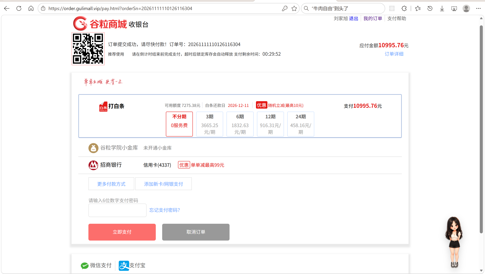
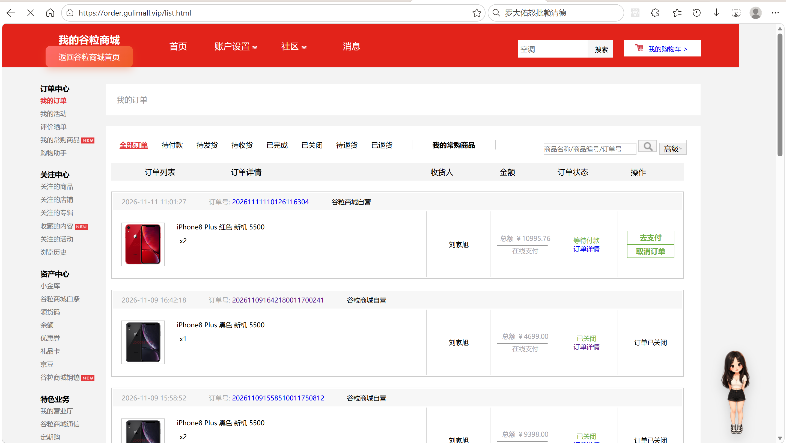
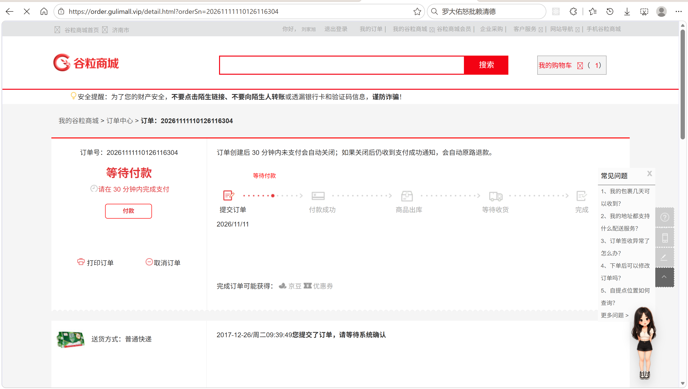
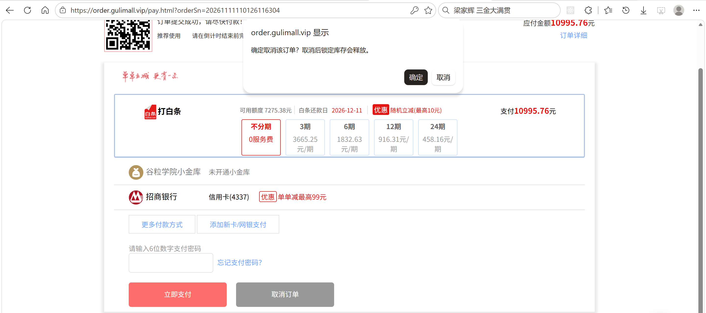
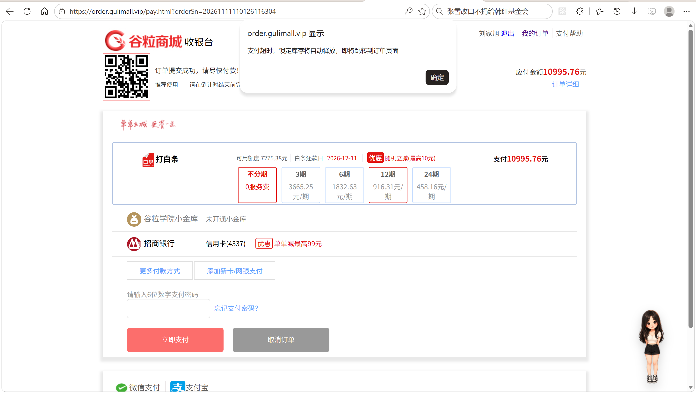
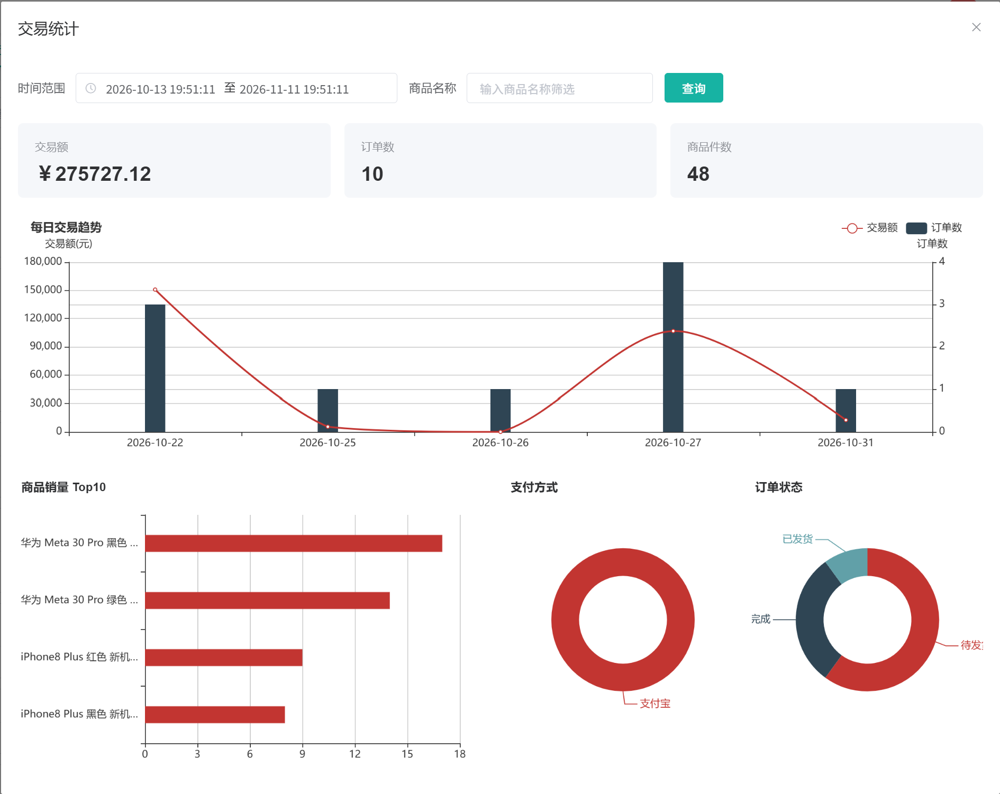

# 11.2 订单提交与状态-介绍

> 介绍订单提交与订单状态：提交时怎么做防重、怎么二次校验价格和库存、Redis 怎么预扣、数据库怎么锁库存、Seata 怎么回滚、订单号怎么生成、订单状态怎么流转、超时怎么关单、用户怎么取消、订单列表和详情怎么展示、后台交易统计怎么出数。

> 定时任务相关文档：[定时任务与 Cron 表达式](../定时任务/定时任务与Cron表达式.md)。

---

## 1. 这个功能是干什么的

订单提交是购物车链路的最后一步。用户在订单确认页点“提交订单”后，订单服务要完成一串动作：

1. 校验防重令牌，保证一次提交只创建一个订单。
2. 重新校验地址、购物车、价格、库存。
3. 在 Redis 预扣库存，挡住大部分无效请求。
4. 创建 `oms_order` 和 `oms_order_item`。
5. 调用仓储服务锁定数据库库存。
6. 返回支付页地址。

订单创建后进入状态管理：

```text
0 待付款 → 1 待发货 → 2 已发货 → 3 已完成
     ↓
     4 已关闭
```

订单状态由多个入口共同推进：

1. 用户支付成功：0 → 1。
2. 管理员发货：1 → 2。
3. 用户确认收货：2 → 3。
4. 用户取消、超时未支付：0 → 4。
5. 订单关闭后又收到支付成功通知：自动原路退款。

订单提交和状态管理是订单域的核心，涉及：

```text
订单服务：订单主表、订单明细、状态流转
购物车服务：提供实时勾选商品
商品服务：提供 sku 和 spu 信息
会员服务：提供收货地址
仓储服务：校验库存、锁定库存、释放库存
支付宝：支付、关单、退款
Seata：跨订单库和仓储库的分布式事务
Redis：防重令牌、库存预扣
MQ：库存解锁延时消息
```

## 2. 用户怎么操作

入口：

```text
购物车 → 去结算 → 订单确认页 → 提交订单 → 支付页
```

### 2.1 提交订单

1. 在确认页选好地址，确认商品和金额。
2. 点击“提交订单”。
3. 页面把地址、令牌、商品总额、运费、应付金额、支付方式、仓库映射提交到 `/submitOrder`。
4. 后端校验通过后创建订单。
5. 成功返回支付页地址，页面跳转。
6. 失败返回错误文案，页面弹窗提示。



### 2.2 支付页

1. 支付页展示订单号、应付金额、支付剩余时间。
2. 用户点击“立即支付”或支付宝图标，进入支付宝收银台。
3. 支付成功后，支付宝异步通知订单服务。
4. 订单状态从 0 改为 1，写 `oms_payment_info`。
5. 仓储服务把锁定库存转成真实扣减。
6. 购物车删除已下单商品。

### 2.3 查看订单列表

1. 打开 `/list.html`。
2. 页面按当前会员查询订单。
3. 支持按状态筛选：全部、待付款、待发货、待收货、已完成、已关闭、待退货、已退货。
4. 支持按订单号、商品名、商品编号搜索。
5. 每个订单展示商品、收货人、金额、状态、操作按钮。
6. 待付款订单可以“去支付”或“取消订单”；已发货订单可以“确认收货”。



### 2.4 查看订单详情

1. 点击订单号或“订单详情”，进入 `/detail.html?orderSn=...`。
2. 页面展示订单号、状态、收货信息、商品明细、金额。
3. 待付款订单可以付款或取消。
4. 已发货订单可以确认收货。
5. 订单不属于当前会员时，跳回订单列表。



### 2.5 取消订单

1. 在订单列表或详情页点击“取消订单”。
2. 前端二次确认。
3. 请求 `/pay/cancel`。
4. 订单状态从 0 改为 4。
5. 通知仓储服务释放锁定库存。
6. 调用支付宝关闭交易，避免用户继续支付。
7. 页面刷新，订单显示“已关闭”。



### 2.6 超时关单

1. 订单创建后 30 分钟未支付。
2. `OrderTimeoutTask` 每分钟扫描一次。
3. 把状态仍为 0 且创建时间超过阈值的订单改成 4。
4. 调用支付宝关闭交易。
5. 秒杀订单立即通知秒杀服务归还库存。
6. 普通订单由仓储的延时消息和 `StockReleaseTask` 释放库存。



### 2.7 确认收货

1. 管理员把订单状态改成 2（已发货）。
2. 用户在订单列表或详情页点击“确认收货”。
3. 请求 `/order/confirmReceive`。
4. 后端条件更新 `status=2 → status=3`，写 `receive_time`。
5. 页面刷新，订单显示“已完成”。

### 2.8 后台交易统计

1. 管理后台进入订单统计页。
2. 请求 `/order/order/stat`。
3. 默认统计最近 30 天，支持时间范围和商品关键字。
4. 返回交易额、订单数、商品件数、每日趋势、商品销量 Top N、状态分布、支付方式分布。
5. 前端渲染图表。



## 3. 整体设计思路

### 3.1 业务上怎么设计

#### 3.1.1 一次提交只创建一个订单

防重分两层：

1. 确认页生成一次性令牌，提交时校验并删除。
2. 订单号 `order_sn` 在数据库有唯一约束，重复提交最多产生一次插入。

令牌规则：

1. 一个会员一个令牌 key。
2. 令牌 30 分钟有效。
3. 校验和删除必须原子。
4. 令牌消费后不能再用。

#### 3.1.2 提交时二次校验

确认页展示的数据只作为参考，提交时全部重新查：

1. 登录用户：从 ThreadLocal 取，为空直接拒绝。
2. 令牌：Redis Lua 比较并删除。
3. 地址：按 `addrId` 查，核对 `memberId`。
4. 购物车：远程查当前勾选商品，不信任前端传的商品。
5. 价格：用实时价格重算商品总额，和前端传的 `goodsTotal` 比。
6. 仓库：每个 sku 必须有选中的仓库。
7. 库存：按选中仓库校验可用库存。
8. 运费和应付金额：必须传，不能为空。

#### 3.1.3 Redis 预扣 + 数据库锁库存

库存分两层：

1. Redis 预扣：下单时先扣 Redis 库存，库存不足直接拒绝。
2. 数据库锁定：Redis 扣成功后，创建订单并调仓储服务把 `stock_locked` 加上。

为什么先扣 Redis：

1. 下单高峰数据库扛不住，Redis 的原子扣减能挡住大部分无效请求。
2. Redis 库存是商品上架时预热的总可用库存。
3. 数据库锁定只处理真正通过预扣的订单。

#### 3.1.4 预扣和数据库扣减不是原子操作

Redis 和 MySQL 是两套系统，无法放在同一个事务里。设计上：

1. Redis 预扣成功后才进入数据库事务。
2. 数据库事务失败，代码里手动把 Redis 库存加回去。
3. 服务宕机导致 Redis 和数据库不一致，由每日对账任务纠正。
4. 宁可少卖，不可超卖：Redis 库存可以比数据库少，不能比数据库多。

#### 3.1.5 订单号规则

订单号格式：

```text
yyyyMMddHHmmss + memberId + 4 位随机数
```

示例：

```text
202611101530011000123456
```

业务要求：

1. 全局唯一，数据库 `order_sn` 有唯一索引兜底。
2. 包含时间，便于排查下单时间。
3. 包含会员 id，便于人工定位用户。
4. 随机数降低同一秒同一用户的碰撞概率。

#### 3.1.6 订单状态机

```text
0 待付款
  ├── 支付成功 → 1 待发货
  ├── 用户取消 → 4 已关闭
  └── 超时未支付 → 4 已关闭

1 待发货
  └── 管理员发货 → 2 已发货

2 已发货
  └── 用户确认收货 → 3 已完成

3 已完成
  └── 可以申请退货

4 已关闭
  └── 支付通知晚到 → 自动退款
```

状态只能按允许的方向流转。所有状态更新都带 `WHERE status = 旧状态` 条件，保证并发时只有一方能成功。

订单列表里的 5、6 不是订单状态：

1. 5 待退货：有退货申请状态 0 或 1 的订单。
2. 6 已退货：有退货申请状态 2 的订单。

#### 3.1.7 超时关单

1. 支付超时时间配置在 `gulimall.ware.stock-release.delay-ms`，默认 30 分钟。
2. `OrderTimeoutTask` 每分钟扫描状态 0 且创建时间超过阈值的订单。
3. 每批最多 100 条。
4. 条件更新 `status=0 → status=4`，避免和支付回调并发。
5. 关闭支付宝交易。
6. 库存释放交给仓储延时消息和兜底任务。

#### 3.1.8 取消订单

1. 只有待付款订单能取消。
2. 已关闭订单重复取消按幂等处理。
3. 状态更新用条件更新，和支付回调、超时关单并发时只有一方成功。
4. 取消成功后释放库存。
5. 库存释放失败不影响取消失败，由延时消息和兜底任务继续处理。
6. 调用支付宝关单，尽量阻止用户继续支付。

#### 3.1.9 支付晚到

订单已经关闭（状态 4）后，支付宝仍可能发来支付成功通知。处理方式：

1. 支付回调发现订单已关闭，不把状态改回 1。
2. 按订单实付金额发起全额退款。
3. 写退款记录 `oms_refund_info`。
4. 退款失败由 `RefundRetryTask` 定时重试。

### 3.2 技术上怎么设计

#### 3.2.1 本地事务 + 全局事务

`submitOrder()` 上有两个事务注解：

```java
@GlobalTransactional
@Transactional(rollbackFor = Exception.class)
```

1. `@Transactional` 管订单库的本地事务：订单主表、订单明细。
2. `@GlobalTransactional` 管跨服务事务：订单库 + 仓储库。
3. Seata AT 模式自动记录 `undo_log`，异常时回滚各分支。
4. 仓储侧锁库存失败，Seata 回滚订单插入。
5. Redis 不在全局事务里，代码里手动回补。

#### 3.2.2 防重令牌 Lua

```text
local val = redis.call('get', KEYS[1]);
if val == ARGV[1] then redis.call('del', KEYS[1]); return 1 end;
return 0;
```

为什么要 Lua：

1. `GET` 和 `DEL` 分开执行时，两个并发请求都能读到同一个令牌。
2. Lua 在 Redis 单线程里执行，比较和删除一步完成。
3. 返回 1 表示消费成功，0 表示令牌不存在或不匹配。

#### 3.2.3 库存预扣 Lua

```text
local stock = tonumber(redis.call('get', KEYS[1]));
if stock == nil then return -1 end;
local need = tonumber(ARGV[1]);
if stock < need then return -2 end;
return redis.call('decrby', KEYS[1], need);
```

返回含义：

1. `-1`：缓存里没有这个 sku 的库存。
2. `-2`：库存不足。
3. 其它：扣减后的剩余库存。

缓存缺失时先查数据库预热，再扣一次。

#### 3.2.4 库存缓存

```text
key   = gulimall:ware:stock:{skuId}
value = 可用库存
```

1. 商品上架时写入缓存。
2. 管理端修改库存后刷新缓存。
3. 缓存不设过期时间，库存是长期业务数据。
4. 下单扣减用 `DECRBY`。
5. 取消、超时、锁库存失败用 `INCRBY` 回补。

#### 3.2.5 条件更新

订单状态和库存都用条件更新：

```sql
UPDATE oms_order SET status = 4 WHERE id = ? AND status = 0
UPDATE wms_ware_sku SET stock_locked = stock_locked + ? WHERE id = ? AND 可用库存 >= ?
```

好处：

1. 不需要额外加锁。
2. 并发时只有满足条件的一方成功。
3. 更新行数为 0 时可以判断“状态已被别人改过”。

#### 3.2.6 库存锁

下单入口加库存读写锁的读锁：

```java
RLock lock = redissonClient.getReadWriteLock(WareConstant.STOCK_LOCK).readLock();
```

1. 读锁之间可以并发，多个用户同时下单不互斥。
2. 管理员盘点库存时加写锁，和所有下单互斥。
3. 锁最多等 3 秒，持有最多 30 秒。

#### 3.2.7 仓储锁库存

仓储服务 `lockStock()`：

1. 按 `orderSn` 查工作单，已存在且已锁定直接返回，保证幂等。
2. 写 `wms_ware_order_task` 主记录。
3. 逐 sku 按选中仓库锁库存。
4. `stock_locked = stock_locked + 数量`，条件是可售库存足够。
5. 写 `wms_ware_order_task_detail` 明细。
6. 发送库存解锁延时消息。

#### 3.2.8 库存释放

1. 用户取消：订单服务调仓储 `releaseByOrderSn`。
2. 超时关单：普通订单由仓储延时消息释放，秒杀订单立即通知秒杀服务。
3. 兜底：`StockReleaseTask` 每分钟扫已锁定且超过时间的工作单。
4. 释放时条件更新工作单状态，保证只释放一次。
5. 数据库事务提交后再回补 Redis，避免事务回滚导致 Redis 多加。

#### 3.2.9 订单列表查询

1. 按会员 id 过滤。
2. 支持订单状态筛选。
3. 关键字命中订单号时直接模糊匹配。
4. 关键字命中商品名或商品编号时，先从订单明细查 `order_id`，再按 id 查订单。
5. 退货筛选先查退货申请，再按订单 id 过滤。
6. 订单明细批量查，按 `order_id` 分组回填。
7. 退货申请按订单 + sku 归集，挂到订单明细上。

#### 3.2.10 支付回调

1. 验签，确认是支付宝发的通知。
2. 校验 `app_id`。
3. 只处理 `TRADE_SUCCESS` 和 `TRADE_FINISHED`。
4. 调 `markOrderPaid()` 更新订单和支付信息。
5. 订单更新成功后通知仓储扣减库存。
6. 删除购物车已下单商品。
7. 订单已关闭时走自动退款。

## 4. 详细代码、配置和解释

订单提交与状态管理横跨订单、购物车、商品、会员、仓储、支付宝、Redis、Seata 和 MQ。下面按调用链展开：入参与返回对象、Web 入口、核心下单服务、Redis 原子脚本、订单落库、超时与取消、页面渲染、仓储库存分支、支付回调和后台统计，最后是相关配置。每个小节先说明它在什么业务场景下被调用、上下游是谁，再列出关键字段或接口，然后给出代码并按执行顺序解释，最后说明它不负责的部分和可以继续改进的地方。

### 4.1 OrderSubmitVo：提交订单入参

#### 4.1.1 这个类解决什么问题

订单确认页 `confirm.html` 是提交订单的页面入口。买家点击“提交订单”时，页面提交收货地址 id、支付方式、防重令牌、商品总额、运费、应付金额、备注和每个 sku 选中的仓库；商品明细不由页面提交，订单服务会重新向购物车服务读取当前勾选商品。

这个 VO 是 Controller 与 `OrderServiceImpl.submitOrder()` 之间的入参契约。上游是 `confirm.html` 的表单 `POST /submitOrder`，下游是订单服务。它解决两个问题：一是页面无法通过提交参数替换商品、数量或单价；二是页面展示过的金额可以作为服务端比价的输入，而不是直接成为订单金额。

#### 4.1.2 字段与业务含义

| 字段 | 业务含义 | 使用方式 |
|---|---|---|
| `addrId` | 收货地址主键 | 服务端按 id 查地址，并核对地址是否属于当前会员 |
| `payType` | 支付方式 | 1 支付宝，4 货到付款 |
| `orderToken` | 防重令牌 | 确认页生成，提交时由 Redis Lua 比较并删除 |
| `goodsTotal` | 页面商品总额 | 只用于和服务端按实时价格重算的总额比较 |
| `freightAmount` | 运费 | 落库前只校验非空 |
| `payPrice` | 页面应付金额 | 当前直接写入 `oms_order.pay_amount` |
| `remarks` | 订单备注 | 写入 `oms_order.note` |
| `skuWareMap` | skuId 到 wareId 的 JSON 字符串 | 决定锁库存落在哪个仓库，必须覆盖所有 sku |

#### 4.1.3 代码与解释

下面这段代码定义表单字段。字段名要与 `confirm.html` 表单的 `name` 一致，否则 Spring MVC 无法完成参数绑定。

```java
@Data
public class OrderSubmitVo {

    /** 收获地址的id **/
    private Long addrId;

    /** 支付方式 **/
    private Integer payType;

    /** 防重令牌 **/
    private String orderToken;

    /**
     * 商品总额，用于判断
     */
    private BigDecimal goodsTotal;

    /** 运费金额 **/
    private BigDecimal freightAmount;

    /** 应付价格 **/
    private BigDecimal payPrice;

    /** 订单备注 **/
    private String remarks;

    /** 运费页选中的仓库：skuId → wareId 的 JSON 字符串 */
    private String skuWareMap;

}
```

1. `@Data` 生成 getter、setter 和 `toString()`，Controller 参数绑定和 Service 读取都依赖这些方法。
2. `addrId`：地址主键。地址内容不随表单提交，避免页面伪造收货人、电话和详细地址。
3. `payType`：支付方式。当前只区分支付宝和货到付款，具体取值在订单服务里直接落库。
4. `orderToken`：确认页写入 Redis 的一次性令牌，提交时由 Lua 脚本比较并删除，用于挡住重复提交。
5. `goodsTotal`：页面展示的商品总额。服务端会按购物车实时价格重新累加，两者不一致就拒绝下单。
6. `freightAmount` 和 `payPrice`：页面算好的运费与应付金额。订单服务只校验非空，没有重新计算。
7. `remarks`：买家留言，写入订单主表。
8. `skuWareMap`：JSON 字符串，key 是 skuId，value 是运费页选中的仓库 id。订单服务解析后用于库存校验和锁库存。

#### 4.1.4 一次提交示例

```text
POST /submitOrder
addrId=3
payType=1
orderToken=7f3c9a1e-...
goodsTotal=5999.00
freightAmount=0.00
payPrice=5999.00
remarks=工作日送货
skuWareMap={"11":2,"12":1}
```

#### 4.1.5 它不做什么

1. 不接收商品明细、商品单价和购买数量，这些数据以购物车服务返回的实时数据为准。
2. 不校验地址归属、库存和令牌，这些判断在 `OrderServiceImpl.submitOrder()` 里完成。
3. 不计算订单金额，只携带页面金额供服务端比较。

#### 4.1.6 边界与可优化点

1. `skuWareMap` 用字符串接收，Service 里要手工 JSON 解析；改成 `Map<Long, Long>` 并配合参数转换器可以减少解析代码。
2. `payPrice` 和 `freightAmount` 由前端传入后直接落库，服务端没有按“实时商品总额 + 服务端运费”重新计算，金额存在被篡改的风险。
3. 字段上没有 `@NotNull`、`@Min` 等校验注解，空值判断散落在 Service 中，接口层无法快速失败。
4. `payType` 没有限定取值范围，传入未知值也会写入订单。

### 4.2 OrderVo：提交订单返回

#### 4.2.1 这个类解决什么问题

订单创建成功后，页面需要拿到订单号跳转到支付页。`OrderVo` 是订单服务返回给 Web 层的输出对象，上游是 `OrderServiceImpl.submitOrder()` 的返回值，下游是 `ConfirmController` 拼装 `/pay.html?orderSn=...`。

VO 字段与 `OrderEntity` 基本一致，提交场景只使用 `orderSn`，其余字段为后续详情页、支付页复用预留。这样 Controller 不需要直接接触数据库实体，也不会把 MyBatis-Plus 的映射细节暴露到 Web 层。

#### 4.2.2 关键字段

| 字段 | 提交场景的作用 |
|---|---|
| `orderSn` | 拼支付页地址，后续支付、查单、锁库存都以它为主键 |
| `id` | 订单主键，写订单明细和追踪问题使用 |
| `memberId` | 订单归属 |
| `payAmount` | 应付金额，支付页展示 |
| `status` | 订单状态，创建后为 0 |
| `createTime` | 支付页计算剩余支付时间 |

#### 4.2.3 代码与解释

下面这段代码定义返回结构。字段与实体对齐，Service 用 `BeanUtils.copyProperties()` 复制。

```java
@Data
public class OrderVo {

    private Long id;

    private Long memberId;

    private String orderSn;

    private Long couponId;

    private Date createTime;

    private String memberUsername;

    private BigDecimal totalAmount;

    private BigDecimal payAmount;

    private BigDecimal freightAmount;

    private BigDecimal promotionAmount;

    private BigDecimal integrationAmount;

    private BigDecimal couponAmount;

    private BigDecimal discountAmount;

    private Integer payType;

    private Integer sourceType;

    private Integer status;

    private String deliveryCompany;

    private String deliverySn;

    private Integer autoConfirmDay;

    private Integer integration;

    private Integer growth;

    private Integer billType;

    private String billHeader;

    private String billContent;

    private String billReceiverPhone;

    private String billReceiverEmail;

    private String receiverName;

    private String receiverPhone;

    private String receiverPostCode;

    private String receiverProvince;

    private String receiverCity;

    private String receiverRegion;

    private String receiverDetailAddress;

    private String note;

    private Integer confirmStatus;

    private Integer deleteStatus;

    private Integer useIntegration;

    private Date paymentTime;

    private Date deliveryTime;

    private Date receiveTime;

    private Date commentTime;

    private Date modifyTime;

}
```

1. 字段覆盖订单主表的全部业务列，提交成功后可以直接复用为详情页的数据载体。
2. `orderSn` 是业务订单号，页面和支付渠道都用它定位订单。
3. `status` 创建时为 0，支付成功后才变成 1。
4. `payAmount`、`freightAmount`、`totalAmount` 分别对应应付、运费和商品总额。
5. `receiver*` 是下单时的收货人快照，后续修改会员地址不会影响历史订单。
6. `paymentTime`、`deliveryTime`、`receiveTime` 记录状态推进时间。
7. 金额分解字段 `promotionAmount`、`integrationAmount`、`couponAmount`、`discountAmount` 当前没有参与计算，为后续优惠体系预留。

#### 4.2.4 一次返回示例

```text
OrderVo {
  id = 1001,
  memberId = 8,
  orderSn = "202611101530018000123456",
  totalAmount = 5999.00,
  payAmount = 5999.00,
  freightAmount = 0.00,
  status = 0,
  createTime = 2026-11-10 15:30:01
}
Controller 读取 orderSn，返回 "/pay.html?orderSn=202611101530018000123456"
```

#### 4.2.5 边界与可优化点

1. 提交订单只需要订单号，返回完整 VO 会增加序列化和网络开销，可以定义更小的 `OrderSubmitResultVo`。
2. `BeanUtils.copyProperties()` 是浅拷贝，字段增加后容易漏字段或复制错类型。
3. VO 与实体字段高度重复，后续字段变更需要同时改两处。

### 4.3 ConfirmController.submitOrder 与 toTradeWithError

#### 4.3.1 这个类解决什么问题

`ConfirmController` 是浏览器提交订单的第一个后端落点。上游是订单确认页 `confirm.html` 的 `POST /submitOrder`，下游是 `OrderServiceImpl.submitOrder()`。除转发请求外，它还承担两件事：

1. 加库存读写锁的读锁，与后台盘点库存的写锁互斥，避免下单和盘点同时修改同一批库存。
2. 把业务异常转成带错误文案的跳转串，让页面回到确认页并弹出提示。

订单创建、令牌校验、库存预扣都不在这里完成。

#### 4.3.2 接口

| 方法 | 路径 | 入参 | 返回 |
|---|---|---|---|
| POST | `/submitOrder` | `OrderSubmitVo` 表单字段 | `/pay.html?orderSn=...` 或 `toTrade?error=...` |

方法上还有 `@CacheEvict(cacheNames = "fare", allEntries = true)`，每次提交都清空运费缓存，避免页面继续使用旧的仓库和运费计算结果。

#### 4.3.3 代码与解释

这段代码负责“拿锁、调服务、拼跳转地址”。锁只包住下单过程，业务异常不外抛给全局异常处理器。

```java
@PostMapping("/submitOrder")
@ResponseBody
@CacheEvict(cacheNames = "fare", allEntries = true)
public String submitOrder(OrderSubmitVo orderSubmitVo) {
    RLock lock = redissonClient.getReadWriteLock(WareConstant.STOCK_LOCK).readLock();
    boolean locked = false;
    try {
        // 最多等 3 秒；拿到后最多持有 30 秒，防止持锁线程异常退出后锁不释放
        locked = lock.tryLock(3, 30, TimeUnit.SECONDS);
        if (!locked) {
            return toTradeWithError(BizCodeEnum.ORDER_STOCK_BUSY.getMsg());
        }

        try {
            OrderVo orderVo = orderService.submitOrder(orderSubmitVo);
            return "/pay.html?orderSn=" + orderVo.getOrderSn();
        } catch (RRException e) {
            return toTradeWithError(e.getMsg());
        }
    } catch (InterruptedException e) {
        Thread.currentThread().interrupt();
        return toTradeWithError(BizCodeEnum.ORDER_SUBMIT_INTERRUPTED.getMsg());
    } finally {
        if (locked && lock.isHeldByCurrentThread()) {
            lock.unlock();
        }
    }
}

private String toTradeWithError(String message) {
    return "toTrade?error=" + URLEncoder.encode(message, StandardCharsets.UTF_8);
}
```

1. `@PostMapping("/submitOrder")` 接收确认页表单；`@ResponseBody` 表示返回字符串而不是视图。
2. 方法进入后先取 `STOCK_LOCK` 的读锁。读锁之间可以并发，多个买家同时下单不会互相阻塞。
3. `tryLock(3, 30, TimeUnit.SECONDS)` 最多等 3 秒，拿到后最多持有 30 秒，防止持锁线程异常退出后锁不释放。
4. 3 秒内拿不到锁，说明后台正在盘点库存，返回“库存正在盘点中，请稍后重试”的跳转串。
5. 拿到锁之后调用 `orderService.submitOrder()`，真正创建订单。
6. 创建成功返回 `/pay.html?orderSn=...`，页面跳转支付页。
7. 创建失败捕获 `RRException`，把业务文案交给 `toTradeWithError()` 编码后返回。
8. `InterruptedException` 表示等待锁时被中断，恢复中断标记后返回提交中断提示。
9. `finally` 里只有“当前线程确实持锁”才解锁，避免释放别人的锁。
10. `toTradeWithError()` 用 `URLEncoder` 按 UTF-8 编码文案，中文和特殊字符才能安全放进查询参数。

#### 4.3.4 一次请求示例

成功路径：

```text
POST /submitOrder
→ tryLock 成功
→ submitOrder() 返回 orderSn=202611101530018000123456
→ 响应 /pay.html?orderSn=202611101530018000123456
→ 浏览器跳转支付页
```

失败路径：

```text
POST /submitOrder
→ 3 秒内没有拿到读锁
→ 响应 toTrade?error=%E5%BA%93%E5%AD%98%E6%AD%A3%E5%9C%A8%E7%9B%98%E7%82%B9%E4%B8%AD%EF%BC%8C%E8%AF%B7%E7%A8%8D%E5%90%8E%E9%87%8D%E8%AF%95
→ 确认页根据 error 参数弹窗
```

#### 4.3.5 它不做什么

1. 不校验防重令牌，令牌在 `submitOrder()` 里用 Lua 消费。
2. 不校验地址、购物车、价格和库存，这些都在订单服务里完成。
3. 不创建订单记录，Controller 只负责加锁和转发。

#### 4.3.6 边界与可优化点

1. 读锁覆盖整个下单过程，订单创建和远程锁库存耗时越长，后台盘点的等待时间越久。
2. 返回字符串而不是统一 JSON，前端要自己判断返回值是地址还是错误提示。
3. 读锁只保护库存相关操作，不保护防重令牌，令牌仍要独立校验。
4. 读锁过期时间固定 30 秒，远程调用慢时可能提前释放，锁内操作没有续期。

### 4.4 订单状态常量与 OrderConstant

#### 4.4.1 这些常量解决什么问题

订单状态被多个入口读写：提交订单写入 0，支付回调把 0 推到 1，管理员发货推到 2，确认收货推到 3，用户取消和超时任务把 0 推到 4；订单列表还要支持“待退货”“已退货”两个筛选值。数字直接散落在各个类里时，改错一个值就会造成状态错乱。

这组常量把订单状态和列表筛选值集中到一处，`OrderConstant` 单独保存防重令牌的 Redis key 前缀。上游是状态更新入口（支付回调、超时任务、取消、确认收货），下游是订单查询与页面展示。

#### 4.4.2 状态与筛选值

| 值 | 含义 | 进入方式 | 是否订单状态 |
|---|---|---|---|
| 0 | 待付款 | 创建订单默认值 | 是 |
| 1 | 待发货 | 支付成功 | 是 |
| 2 | 已发货 | 管理员发货 | 是 |
| 3 | 已完成 | 用户确认收货 | 是 |
| 4 | 已关闭 | 用户取消或超时关单 | 是 |
| 5 | 待退货 | 列表筛选，按退货申请状态推导 | 否 |
| 6 | 已退货 | 列表筛选，按退货申请状态推导 | 否 |

#### 4.4.3 代码与解释

下面第一段是订单状态常量，定义在 `OrderServiceImpl` 中。

```java
/** oms_order.status：0-待付款 */
private static final int ORDER_STATUS_UNPAID = 0;

/** oms_order.status：1-待发货（已支付） */
private static final int ORDER_STATUS_PAID = 1;

/** oms_order.status：2-已发货（待收货） */
private static final int ORDER_STATUS_SHIPPED = 2;

/** oms_order.status：3-已完成 */
private static final int ORDER_STATUS_COMPLETED = 3;

/** oms_order.status：4-已关闭 */
private static final int ORDER_STATUS_CLOSED = 4;

/** 订单列表筛选：待退货 */
public static final int ORDER_LIST_STATUS_PENDING_RETURN = 5;

/** 订单列表筛选：已退货 */
public static final int ORDER_LIST_STATUS_RETURNED = 6;
```

1. `ORDER_STATUS_UNPAID = 0`：订单创建后的初始状态，只有这个状态可以支付、取消和被超时任务关闭。
2. `ORDER_STATUS_PAID = 1`：支付成功后进入，表示等待发货。
3. `ORDER_STATUS_SHIPPED = 2`：管理员发货后进入，表示等待收货。
4. `ORDER_STATUS_COMPLETED = 3`：买家确认收货后进入。
5. `ORDER_STATUS_CLOSED = 4`：用户取消或超时关单后进入，是终态。
6. `ORDER_LIST_STATUS_PENDING_RETURN = 5`、`ORDER_LIST_STATUS_RETURNED = 6`：只用于列表筛选，不写入 `oms_order.status`。

下面第二段是令牌 key 的前缀。

```java
public class OrderConstant {

    public static final String USER_ORDER_TOKEN_PREFIX = "gulimall:order:token:";

}
```

1. `OrderConstant` 只放 key 前缀，不承载状态逻辑。
2. `gulimall:order:token:` 加上会员 id 组成一个会员一个令牌 key。
3. 确认页生成令牌和提交订单消费令牌都使用这个前缀，两边必须一致。

#### 4.4.4 一次状态流转示例

```text
创建订单：status = 0
支付回调：UPDATE oms_order SET status=1 WHERE id=? AND status=0
管理员发货：status = 2
确认收货：UPDATE oms_order SET status=3 WHERE id=? AND status=2

另一条链路：
创建订单：status = 0
用户取消或超时关单：UPDATE oms_order SET status=4 WHERE id=? AND status=0
```

#### 4.4.5 边界与可优化点

1. 状态值少时常量足够，但缺少 `code` 与 `desc` 的统一映射，页面文案仍要在多个类里各写一份。
2. 5、6 与订单状态共用同一个 `status` 查询参数，语义容易混淆；查询前必须先判断是不是退货筛选。
3. 状态常量分散在 `OrderServiceImpl` 和 `OrderTimeoutTask`，新增状态时容易漏改。
4. 更稳妥的做法是定义 `OrderStatusEnum`，把状态值、文案和允许的流转方向放在一起。

### 4.5 OrderServiceImpl.submitOrder：创建订单

#### 4.5.1 这个方法解决什么问题

`submitOrder()` 是订单提交的核心。上游是 `ConfirmController`，下游依次涉及 Redis（令牌与库存预扣）、会员服务（地址）、购物车服务（实时商品）、仓储服务（库存校验与锁库存）、商品服务（spu 概要）、订单库（主表和明细）以及 Seata（跨库回滚）。

一次提交要回答四个问题：是不是重复提交、页面数据是否可信、库存是否足够、订单和库存能否保持一致。方法按“令牌 → 地址 → 购物车 → 价格 → 仓库 → 库存 → Redis 预扣 → 落订单 → 锁数据库库存”的顺序推进，任一步失败都尽早返回，避免后续无效远程调用和无效写库。

方法上有两个事务注解：`@Transactional` 管订单库的本地事务，`@GlobalTransactional` 把订单库和仓储库纳入同一个全局事务。Redis 不在全局事务里，锁库存失败时由代码手工回补。

#### 4.5.2 正常链路

```text
confirm.html
→ ConfirmController.submitOrder()
→ OrderServiceImpl.submitOrder()
    → Redis Lua 消费令牌
    → Feign 会员查地址
    → Feign 购物车查实时勾选商品
    → 服务端重算商品总额并比价
    → 解析 skuWareMap
    → Feign 仓储按仓库校验库存
    → Redis Lua 逐 sku 预扣
    → 生成订单号
    → Feign 商品查 spu 概要
    → INSERT oms_order
    → INSERT oms_order_item
    → Feign 仓储 lockStock
→ 返回 OrderVo
```

#### 4.5.3 代码与解释

下面这段代码是完整下单流程。代码中的编号与后面的解释一一对应。

```java
@GlobalTransactional
@Transactional(rollbackFor = Exception.class)
@Override
public OrderVo submitOrder(OrderSubmitVo orderSubmitVo) {

    // 2.1 登录用户（令牌的 key 里要用 memberId）
    MemberResponseVo loginUser = MemberResponseVoThreadLocal.get();
    if (loginUser == null) {
        throw new RRException(BizCodeEnum.ORDER_NOT_LOGIN);
    }

    // 2.2 防重令牌
    String tokenKey = OrderConstant.USER_ORDER_TOKEN_PREFIX + loginUser.getId();

    // 校验通过并删除，两步必须原子（Lua），否则并发下同一个令牌能被用两次
    Long consumed = stringRedisTemplate.execute(CONSUME_TOKEN_SCRIPT, List.of(tokenKey),
            orderSubmitVo.getOrderToken());
    if (consumed != 1L) {
        throw new RRException(BizCodeEnum.ORDER_TOKEN_INVALID);
    }

    // 2.3 收货地址（顺带核对这个地址是不是他自己的）
    MemberAddressVo address = memberReceiveAddressFeignClient.getAddressById(orderSubmitVo.getAddrId());
    if (address == null || !loginUser.getId().equals(address.getMemberId())) {
        throw new RRException(BizCodeEnum.ORDER_ADDRESS_INVALID);
    }

    // 2.4 购物车实时数据：不信任前端提交的商品、件数和价格
    List<OrderItemVo> items = cartFeignClient.getCurrentCartItems();
    if (items == null || items.isEmpty()) {
        throw new RRException(BizCodeEnum.ORDER_CART_EMPTY);
    }

    // 2.5 价格校验：用服务端实时价格重算，和前端传来的对比。
    // totalPrice 由 cart 侧 CartItemVo#getTotalPrice() 算好，Feign 序列化时写进 JSON
    BigDecimal goodsTotal = items.stream()
            .map(item -> item.getTotalPrice() == null ? BigDecimal.ZERO : item.getTotalPrice())
            .reduce(BigDecimal.ZERO, BigDecimal::add);
    if (orderSubmitVo.getGoodsTotal() != null
            && orderSubmitVo.getGoodsTotal().compareTo(goodsTotal) != 0) {
        throw new RRException(BizCodeEnum.ORDER_PRICE_CHANGED);
    }

    // 每个 sku 的购买数量
    Map<Long, Integer> skuQuantities = items.stream()
            .collect(Collectors.toMap(OrderItemVo::getSkuId, OrderItemVo::getCount, Integer::sum));

    // 运费页选中的仓库
    Map<Long, Long> skuWareMap = null;
    if (orderSubmitVo.getSkuWareMap() != null && !orderSubmitVo.getSkuWareMap().isBlank()) {
        skuWareMap = JSON.parseObject(orderSubmitVo.getSkuWareMap(),
                new TypeReference<Map<Long, Long>>() {
                });
    }
    if (skuWareMap == null) {
        throw new RRException(BizCodeEnum.ORDER_WAREHOUSE_MISSING);
    }
    for (Long skuId : skuQuantities.keySet()) {
        if (skuWareMap.get(skuId) == null) {
            throw new RRException(BizCodeEnum.ORDER_WAREHOUSE_MISSING);
        }
    }

    // 2.6 库存校验：按运费页选中的仓库查
    List<Long> skuIds = items.stream().map(OrderItemVo::getSkuId).distinct().toList();
    Map<Long, Boolean> stockResult = wareFeignClient.hasStockByWare(
            new WareStockCheckVo(skuWareMap, skuQuantities));
    Map<Long, Boolean> hasStock = stockResult == null ? Map.of() : stockResult;
    List<Long> noStockSkuIds = skuIds.stream()
            .filter(skuId -> !Boolean.TRUE.equals(hasStock.get(skuId)))
            .toList();
    if (!noStockSkuIds.isEmpty()) {
        List<String> noStockTitles = items.stream()
                .filter(item -> noStockSkuIds.contains(item.getSkuId()))
                .map(OrderItemVo::getTitle)
                .toList();
        throw new RRException(BizCodeEnum.ORDER_STOCK_NOT_ENOUGH, noStockTitles);
    }

    // 3.1 Redis 预扣（Lua 原子执行：判断 + 扣减一步完成）
    skuQuantities.forEach(this::deductRedisStock);

    // 3.2 建订单 + 锁定数据库库存
    String orderSn = generateOrderSn(loginUser.getId());

    Map<Long, SkuDetailVo> detailMap = productFeignClient.getSkuDetails(skuIds).stream()
            .collect(Collectors.toMap(SkuDetailVo::getSkuId, Function.identity()));

    OrderEntity order = buildOrder(orderSubmitVo, loginUser, address, goodsTotal, orderSn);
    save(order);

    List<OrderItemEntity> orderItems = items.stream()
            .map(item -> buildOrderItem(item, order.getId(), orderSn, detailMap.get(item.getSkuId())))
            .toList();
    orderItems.forEach(orderItemDao::insert);

    try {
        StockLockVo stockLockVo = new StockLockVo();
        stockLockVo.setOrderId(order.getId());
        stockLockVo.setOrderSn(orderSn);
        stockLockVo.setSkuQuantities(skuQuantities);
        stockLockVo.setSkuWareMap(skuWareMap);
        wareFeignClient.lockStock(stockLockVo);
    } catch (Exception e) {
        // Seata 会回滚 ware 分支；Redis 不在全局事务里，这里统一回补。
        skuQuantities.forEach((skuId, num) -> stringRedisTemplate.opsForValue()
                .increment(WareConstant.STOCK_CACHE_PREFIX + skuId, num));
        throw new RRException(BizCodeEnum.ORDER_STOCK_DEDUCT_FAILED);
    }

    OrderVo orderVo = new OrderVo();
    BeanUtils.copyProperties(order, orderVo);
    return orderVo;
}
```

1. 从 `MemberResponseVoThreadLocal` 取当前登录会员，为空直接抛 `ORDER_NOT_LOGIN`。令牌 key 依赖会员 id，所以登录校验必须放在令牌校验前面。
2. 用会员 id 拼令牌 key，执行 `CONSUME_TOKEN_SCRIPT`。脚本在 Redis 里比较并删除令牌，返回 1 表示消费成功，返回其他值抛 `ORDER_TOKEN_INVALID`。比较和删除必须原子，否则并发请求可以同时读到同一个令牌。
3. 按 `addrId` 远程查地址，再核对地址的 `memberId` 是否等于当前会员。这样即使前端改了 `addrId`，也无法用别人的地址下单。
4. 远程调用购物车服务取当前勾选商品。列表为空时抛 `ORDER_CART_EMPTY`，不信任前端提交的商品和数量。
5. 把每个购物项的 `totalPrice` 累加，得到服务端商品总额；再和页面传入的 `goodsTotal` 比较。页面没有传 `goodsTotal` 时跳过比较，传了且不相等则抛 `ORDER_PRICE_CHANGED`。
6. 把购物项按 skuId 汇总购买数量，重复 sku 的数量相加，得到后续库存校验和预扣使用的 `skuQuantities`。
7. 解析 `skuWareMap`。字符串为空或解析结果为 null 时抛 `ORDER_WAREHOUSE_MISSING`；再遍历每个 sku，确认映射里有对应仓库，缺一个就拒绝下单。
8. 调仓储服务的 `hasStockByWare()`，按每个 sku 选中的仓库校验库存。返回结果里只要有一个 sku 不是 `TRUE`，就收集这些 sku 的商品名并抛 `ORDER_STOCK_NOT_ENOUGH`，让页面能提示具体商品。
9. 校验全部通过后，逐个 sku 执行 `deductRedisStock()` 预扣 Redis 库存。预扣成功才继续，库存不足的请求不会进入数据库。
10. 用时间、会员 id 和随机数生成订单号。订单号是支付、锁库存、关单、退款的业务主键。
11. 远程批量查 sku 对应的 spu 概要，转成 `skuId → SkuDetailVo` 的 Map，供写订单明细时补 spu 字段。
12. `buildOrder()` 组装订单主表并 `save()`。主表保存会员、金额、支付方式、状态、来源和收货人快照。
13. 把购物项逐个转成 `OrderItemEntity`，通过 `orderItemDao.insert()` 写入订单明细。明细保存 sku 和 spu 快照，后续商品改名改价不影响历史订单。
14. 组装 `StockLockVo` 并调仓储 `lockStock()`。仓储会写库存工作单、按选中仓库增加 `stock_locked`、写工作单明细并发送延时解锁消息。
15. 锁库存抛异常时，Seata 会回滚订单库分支；Redis 不在全局事务里，所以这里把已经预扣的数量逐个 `INCRBY` 回补，再抛 `ORDER_STOCK_DEDUCT_FAILED`。
16. 把订单实体复制成 `OrderVo` 返回，Controller 只取 `orderSn` 拼支付页地址。

#### 4.5.4 一次完整下单示例

买家购买两个 sku：sku 11 买 2 件、sku 12 买 1 件，分别选中仓库 1 和仓库 2。

```text
1. 确认页提交 addrId=3，goodsTotal=5999.00，payPrice=5999.00，skuWareMap={"11":1,"12":2}
2. 令牌 key=gulimall:order:token:8，Lua 返回 1，令牌被删除
3. 查地址 3，memberId=8，归属正确
4. 购物车返回 sku 11（单价 1999，数量 2）和 sku 12（单价 2001，数量 1）
5. 服务端总额 1999×2 + 2001×1 = 5999，与页面一致
6. skuQuantities={11:2, 12:1}，skuWareMap={11:1, 12:2}
7. 仓储校验：仓库 1 的 sku 11 有货，仓库 2 的 sku 12 有货
8. Redis 库存 key 分别扣 2 和 1
9. 生成 orderSn=202611101530018000123456
10. 商品服务返回两个 sku 的 spu 名称、图片、品牌、分类
11. 插入 oms_order，状态 0，金额 5999.00
12. 插入两条 oms_order_item
13. 仓储写 wms_ware_order_task，按 (sku 11, 仓库 1) 和 (sku 12, 仓库 2) 增加 stock_locked
14. 仓储发送延时解锁消息
15. 返回 OrderVo，页面跳转 /pay.html?orderSn=202611101530018000123456
```

#### 4.5.5 它不做什么

1. 不发起支付，只创建待付款订单并返回支付页地址。
2. 不扣减数据库的真实库存，只增加 `stock_locked`；真实扣减发生在支付成功后。
3. 不释放超时订单的库存，释放由 `OrderTimeoutTask`、仓储延时消息和兜底任务完成。
4. 不负责购物车清理，支付成功后由支付回调链路删除已下单商品。

#### 4.5.6 边界与可优化点

1. `payPrice` 直接使用页面传值，服务端没有按“实时商品总额 + 运费”重算，金额可被篡改。
2. `freightAmount` 也没有和服务端运费结果比对，页面可以传 0 运费。
3. Redis 预扣成功后，如果订单库事务因锁库存以外的异常回滚，Redis 不会回补；应在事务回滚回调里统一回补。
4. 订单明细逐条 `insert`，商品多时性能差，可以改批量插入。
5. `skuQuantities` 汇总时没有校验数量大于 0，异常购物车数据会进入预扣。
6. 远程查 spu 详情失败会直接回滚整单，商品服务应做降级或不阻塞下单。
7. 令牌消费后提交失败，买家必须刷新确认页重新拿令牌，体验不够友好。
8. Redis 库存口径是所有仓库可用库存之和，数据库锁库存按选中仓库，两个口径可能不一致。

### 4.6 Lua 脚本与库存预扣

#### 4.6.1 这段代码解决什么问题

提交订单里有两处“先判断再修改”的操作：消费防重令牌、扣减 Redis 库存。`GET` 与 `DEL`、`GET` 与 `DECRBY` 分开执行时，两个并发请求可能同时看到同一个值，导致令牌被用两次或库存被扣成负数。Redis 执行 Lua 时是单线程的，把判断和修改写进同一个脚本，两条命令之间不会插入其他请求。

调用方是 `OrderServiceImpl.submitOrder()`：令牌脚本在方法开头执行，库存脚本由 `deductRedisStock()` 逐个 sku 执行。库存 key 与仓储释放链路共用，取消和超时回补时也会操作同一个 key。

#### 4.6.2 关键脚本

| 脚本 | KEY | ARGV | 返回值含义 |
|---|---|---|---|
| 消费令牌 | `gulimall:order:token:{memberId}` | 页面令牌 | 1 消费成功，0 不存在或不匹配 |
| 扣减库存 | `gulimall:ware:stock:{skuId}` | 购买数量 | -1 缓存缺失，-2 库存不足，其他为扣减后余额 |

#### 4.6.3 代码与解释

下面这段代码在类加载时创建两个 `DefaultRedisScript`，脚本内容一次性注册，后续调用只传 key 和参数。

```java
private static final DefaultRedisScript<Long> DEDUCT_STOCK_SCRIPT;

private static final DefaultRedisScript<Long> CONSUME_TOKEN_SCRIPT;

static {
    DEDUCT_STOCK_SCRIPT = new DefaultRedisScript<>();
    DEDUCT_STOCK_SCRIPT.setScriptText(
            "local stock = tonumber(redis.call('get', KEYS[1]));"
                    + "if stock == nil then return -1 end;"
                    + "local need = tonumber(ARGV[1]);"
                    + "if stock < need then return -2 end;"
                    + "return redis.call('decrby', KEYS[1], need);");
    DEDUCT_STOCK_SCRIPT.setResultType(Long.class);

    CONSUME_TOKEN_SCRIPT = new DefaultRedisScript<>();
    CONSUME_TOKEN_SCRIPT.setScriptText(
            "local val = redis.call('get', KEYS[1]);"
                    + "if val == ARGV[1] then redis.call('del', KEYS[1]); return 1 end;"
                    + "return 0;");
    CONSUME_TOKEN_SCRIPT.setResultType(Long.class);
}
```

1. 静态字段保存两个脚本对象，避免每次下单都重新构造脚本。
2. 静态代码块在类加载时执行，先把库存脚本的文本设置好。
3. 库存脚本先 `GET` 库存；key 不存在时返回 -1，调用方据此触发缓存预热。
4. 库存存在时把购买数量转成数字，库存小于需求返回 -2。
5. 库存足够时执行 `DECRBY`，返回值是扣减后的剩余库存。
6. 令牌脚本读取 key 的值，和页面传入的令牌比较。
7. 值相等时删除 key 并返回 1；不相等或 key 不存在返回 0。
8. 两个脚本的返回类型都声明为 `Long`，Java 侧按 `long` 接收。

下面这段代码是库存预扣方法，包含缓存缺失时的预热。

```java
private void deductRedisStock(Long skuId, Integer num) {
    String key = WareConstant.STOCK_CACHE_PREFIX + skuId;

    long result = stringRedisTemplate.execute(DEDUCT_STOCK_SCRIPT, List.of(key), String.valueOf(num));

    if (result == -1L) {
        Long dbStock = wareFeignClient.getStockNums(List.of(skuId)).get(skuId);
        long available = dbStock == null ? 0L : dbStock;
        stringRedisTemplate.opsForValue().set(key, String.valueOf(available));

        result = stringRedisTemplate.execute(DEDUCT_STOCK_SCRIPT, List.of(key), String.valueOf(num));
    }

    if (result == -2L) {
        throw new RRException(BizCodeEnum.ORDER_STOCK_INSUFFICIENT);
    }
}
```

1. 用库存前缀加 skuId 拼出 Redis key。
2. 执行库存扣减脚本，传入购买数量。
3. 返回 -1 说明缓存里没有这个 sku，需要回源数据库。
4. 调仓储服务查数据库可用库存，返回 null 时按 0 处理。
5. 把数据库库存写入 Redis，不设过期时间。
6. 缓存写好后再执行一次扣减脚本，使用新的库存值。
7. 返回 -2 说明库存不足，抛 `ORDER_STOCK_INSUFFICIENT`。
8. 其他返回值表示扣减成功，方法正常返回。

#### 4.6.4 一次预扣示例

```text
场景一：缓存有库存 10，购买 2
→ Lua 读到 10，10 >= 2，DECRBY 2，返回 8
→ 预扣成功

场景二：缓存没有 key，购买 2
→ Lua 返回 -1
→ 查数据库可用库存 5，写入 Redis
→ 再次执行 Lua，返回 3
→ 预扣成功

场景三：缓存有库存 1，购买 2
→ Lua 读到 1，1 < 2，返回 -2
→ 抛库存不足，订单不创建
```

#### 4.6.5 边界与可优化点

1. 缓存缺失时多个请求会同时回源数据库，可以加分布式锁只放一个请求预热。
2. 查库与写缓存之间可能被其他请求扣减，写回时会把别人的扣减覆盖掉。
3. `getStockNums()` 返回所有仓库可用库存之和，与按选中仓库锁库存的口径不一致。
4. 脚本没有处理购买数量小于等于 0 的情况，异常数据会执行 `DECRBY` 负数，相当于加库存。
5. 多个 sku 依次预扣时，后面的 sku 失败不会回补前面已经扣成功的 sku。
### 4.7 订单号、订单主表与订单明细

#### 4.7.1 这段代码解决什么问题

订单号是订单域的业务主键。支付回调按订单号找订单，仓储工作单按订单号做幂等，支付宝的 `out_trade_no` 也使用订单号，超时关单和取消同样按订单号定位。订单主表保存买家、金额和收货人快照，订单明细保存 sku 与 spu 快照，目的是让历史订单不再依赖商品和地址的当前状态。

调用链上，`submitOrder()` 先生成订单号，再调 `buildOrder()` 组装主表并插入，然后调 `buildOrderItem()` 把每个购物项转成明细。下游是 `oms_order`、`oms_order_item` 两张表，后续支付页、订单列表、订单详情、后台统计都从这两张表读数据。

#### 4.7.2 订单号规则

```text
yyyyMMddHHmmss + memberId + 4 位随机数
示例：20261110153001 + 8 + 2345 = 202611101530018000123456
```

1. 时间部分便于人工判断下单时间。
2. 会员 id 便于定位买家。
3. 4 位随机数降低同一秒同一会员的碰撞概率。
4. 数据库 `order_sn` 唯一索引兜底，碰撞时插入失败。

#### 4.7.3 代码与解释

下面这段代码负责生成订单号和组装订单主表。主表只保存下单当时的数据，不引用实时商品或地址。

```java
private String generateOrderSn(Long memberId) {
    return new SimpleDateFormat("yyyyMMddHHmmss").format(new Date())
            + memberId
            + ThreadLocalRandom.current().nextInt(1000, 10000);
}

private OrderEntity buildOrder(OrderSubmitVo vo, MemberResponseVo loginUser,
                               MemberAddressVo address, BigDecimal goodsTotal, String orderSn) {
    if (vo.getFreightAmount() == null) {
        throw new RRException(BizCodeEnum.ORDER_FREIGHT_MISSING);
    }
    if (vo.getPayPrice() == null) {
        throw new RRException(BizCodeEnum.ORDER_PAYPRICE_MISSING);
    }

    OrderEntity order = new OrderEntity();
    order.setOrderSn(orderSn);
    order.setMemberId(loginUser.getId());
    order.setMemberUsername(loginUser.getUsername());
    order.setCreateTime(new Date());

    order.setTotalAmount(goodsTotal);
    order.setFreightAmount(vo.getFreightAmount());
    order.setPayAmount(vo.getPayPrice());

    order.setPayType(vo.getPayType());
    order.setStatus(0);          // 0 = 待付款
    order.setSourceType(0);      // 0 = PC 订单
    order.setDeleteStatus(0);
    order.setConfirmStatus(0);
    order.setNote(vo.getRemarks());

    order.setReceiverName(address.getName());
    order.setReceiverPhone(address.getPhone());
    order.setReceiverPostCode(address.getPostCode());
    order.setReceiverProvince(address.getProvince());
    order.setReceiverCity(address.getCity());
    order.setReceiverRegion(address.getRegion());
    order.setReceiverDetailAddress(address.getDetailAddress());

    return order;
}
```

1. `generateOrderSn()` 用 `SimpleDateFormat` 取到秒级时间字符串。
2. 拼接会员 id，让订单号带有买家维度。
3. `ThreadLocalRandom` 生成 1000 到 9999 的随机数，拼成 4 位尾数。
4. `buildOrder()` 先校验运费不为空，避免页面漏传后落库为 null。
5. 再校验应付金额不为空，金额是后续支付校验的基础。
6. 创建 `OrderEntity`，设置订单号、会员 id、会员名和创建时间。
7. `totalAmount` 使用服务端重算的商品总额，`freightAmount` 和 `payAmount` 使用页面传值。
8. 设置支付方式、状态 0、来源 0、删除标记 0、确认标记 0 和备注。
9. 把地址对象的收货人、电话、邮编、省市区和详细地址复制到订单字段，形成收货快照。
10. 返回待插入的订单实体。

下面这段代码负责把购物项组装成订单明细。

```java
private OrderItemEntity buildOrderItem(OrderItemVo item, Long orderId, String orderSn,
                                       SkuDetailVo detail) {
    OrderItemEntity entity = new OrderItemEntity();
    entity.setOrderId(orderId);
    entity.setOrderSn(orderSn);

    entity.setSkuId(item.getSkuId());
    entity.setSkuName(item.getTitle());
    entity.setSkuPic(item.getImage());
    entity.setSkuPrice(item.getPrice());
    entity.setSkuQuantity(item.getCount());

    if (detail != null) {
        entity.setSpuId(detail.getSpuId());
        entity.setSpuName(detail.getSpuName());
        entity.setSpuPic(detail.getSpuPic());
        entity.setSpuBrand(detail.getSpuBrand());
        entity.setCategoryId(detail.getCategoryId());
    }
    entity.setSkuAttrsVals(item.getSkuAttrValues() == null ? null : JSON.toJSONString(item.getSkuAttrValues()));

    entity.setRealAmount(item.getPrice().multiply(BigDecimal.valueOf(item.getCount())));
    entity.setPromotionAmount(BigDecimal.ZERO);
    entity.setCouponAmount(BigDecimal.ZERO);
    entity.setIntegrationAmount(BigDecimal.ZERO);
    entity.setGiftIntegration(0);
    entity.setGiftGrowth(0);

    return entity;
}
```

1. 设置订单 id 和订单号，建立明细与主表的关系。
2. 设置 skuId、sku 名称、sku 图片、单价和数量。
3. spu 概要存在时，补 spuId、spu 名称、spu 图片、品牌和分类。
4. 销售属性列表转成 JSON 字符串存入 `skuAttrsVals`，页面展示规格时直接使用。
5. `realAmount` 按单价乘数量计算。
6. 促销、优惠券、积分抵扣金额当前都按 0 记录。
7. 赠送积分和成长值当前都按 0 记录。

#### 4.7.4 一次落库示例

```text
订单号：202611101530018000123456
oms_order：
  order_sn=202611101530018000123456
  member_id=8
  total_amount=5999.00
  freight_amount=0.00
  pay_amount=5999.00
  status=0
  receiver_name=张三
  receiver_detail_address=科技路 1 号

oms_order_item：
  第 1 行：order_sn=202611101530018000123456, sku_id=11, sku_price=1999.00, sku_quantity=2, real_amount=3998.00
  第 2 行：order_sn=202611101530018000123456, sku_id=12, sku_price=2001.00, sku_quantity=1, real_amount=2001.00
```

#### 4.7.5 它不做什么

1. 不校验商品是否上架、库存是否足够，这些判断在 `submitOrder()` 前段完成。
2. 不计算优惠和积分，金额分解字段当前只写 0。
3. 不负责订单状态推进，只写入初始状态 0。

#### 4.7.6 边界与可优化点

1. `SimpleDateFormat` 每次调用都新建，可以换成线程安全的 `DateTimeFormatter`。
2. 订单号只靠 4 位随机数防碰撞，同一秒同一会员仍可能重复，最终由唯一索引报错兜底。
3. `payAmount` 使用页面传值，没有按 `goodsTotal + freightAmount` 重算。
4. `realAmount` 没有减去优惠金额，接入优惠体系后需要调整。
5. 订单明细逐条插入，商品多时性能一般，可以改成批量插入。
6. 主表字段较多，后续可以按基础信息、收货信息、金额信息拆分成多个对象。

### 4.8 OrderEntity 与 OrderItemEntity：订单表映射

#### 4.8.1 这两个类解决什么问题

`OrderEntity` 映射订单主表 `oms_order`，`OrderItemEntity` 映射订单明细表 `oms_order_item`。所有订单读写都经过这两个实体：下单插入、支付回调按订单号查询并更新状态、订单列表分页、订单详情展示、后台统计聚合。

实体同时承载“数据库行”和“业务快照”两个角色。主表的 `receiver*`、明细的 `sku*` 与 `spu*` 都是下单时复制过来的快照，不是外键关联，因此商品或地址后续变化不会改写历史订单。

#### 4.8.2 主表字段分组

| 分组 | 字段 | 说明 |
|---|---|---|
| 标识 | `id`、`orderSn`、`memberId` | 主键、业务订单号、买家 |
| 金额 | `totalAmount`、`payAmount`、`freightAmount` 等 | 商品总额、应付、运费和优惠分解 |
| 状态 | `status`、`sourceType`、`confirmStatus`、`deleteStatus` | 0 到 4 的订单状态、来源、确认与删除标记 |
| 收货 | `receiver*` | 收货人快照 |
| 时间 | `createTime`、`paymentTime`、`deliveryTime`、`receiveTime` | 创建与状态推进时间 |

#### 4.8.3 主表代码与解释

这段代码定义 `oms_order` 的 ORM 映射，字段与表列一一对应。

```java
@Data
@TableName("oms_order")
public class OrderEntity implements Serializable {
    private static final long serialVersionUID = 1L;

    @TableId
    private Long id;
    private Long memberId;
    private String orderSn;
    private Long couponId;
    private Date createTime;
    private String memberUsername;
    private BigDecimal totalAmount;
    private BigDecimal payAmount;
    private BigDecimal freightAmount;
    private BigDecimal promotionAmount;
    private BigDecimal integrationAmount;
    private BigDecimal couponAmount;
    private BigDecimal discountAmount;
    private Integer payType;
    private Integer sourceType;
    private Integer status;
    private String deliveryCompany;
    private String deliverySn;
    private Integer autoConfirmDay;
    private Integer integration;
    private Integer growth;
    private Integer billType;
    private String billHeader;
    private String billContent;
    private String billReceiverPhone;
    private String billReceiverEmail;
    private String receiverName;
    private String receiverPhone;
    private String receiverPostCode;
    private String receiverProvince;
    private String receiverCity;
    private String receiverRegion;
    private String receiverDetailAddress;
    private String note;
    private Integer confirmStatus;
    private Integer deleteStatus;
    private Integer useIntegration;
    private Date paymentTime;
    private Date deliveryTime;
    private Date receiveTime;
    private Date commentTime;
    private Date modifyTime;
}
```

1. `@TableName("oms_order")` 指定表名，MyBatis-Plus 按类名无法推断出这个表。
2. `@TableId` 标记 `id` 为主键，插入后可以回填自增 id。
3. `orderSn` 是业务订单号，数据库上有唯一索引，重复提交时由它兜底。
4. `status` 是订单状态，取值 0 到 4。
5. `sourceType` 区分普通订单和秒杀订单，取消和超时释放库存时按它分流。
6. `receiver*` 是收货人快照，不随会员地址修改而变化。
7. `paymentTime`、`deliveryTime`、`receiveTime` 记录状态变更时间，统计和售后使用。
8. 金额分解字段为后续优惠体系预留，当前只有总额、应付和运费有值。

#### 4.8.4 明细代码与解释

这段代码定义 `oms_order_item` 的 ORM 映射，额外带有三个不落库的退货展示字段。

```java
@Data
@TableName("oms_order_item")
public class OrderItemEntity implements Serializable {
    private static final long serialVersionUID = 1L;

    @TableId
    private Long id;
    private Long orderId;
    private String orderSn;
    private Long spuId;
    private String spuName;
    private String spuPic;
    private String spuBrand;
    private Long categoryId;
    private Long skuId;
    private String skuName;
    private String skuPic;
    private BigDecimal skuPrice;
    private Integer skuQuantity;
    private String skuAttrsVals;
    private BigDecimal promotionAmount;
    private BigDecimal couponAmount;
    private BigDecimal integrationAmount;
    private BigDecimal realAmount;
    private Integer giftIntegration;
    private Integer giftGrowth;

    @TableField(exist = false)
    private Long returnApplyId;

    @TableField(exist = false)
    private Integer returnStatus;

    @TableField(exist = false)
    private String returnStatusText;
}
```

1. `orderId` 和 `orderSn` 关联主表，查询明细时按 `order_id` 过滤。
2. `spu*` 是 spu 快照，`sku*` 是 sku 快照，展示订单时不再查实时商品。
3. `skuAttrsVals` 保存销售属性 JSON，例如颜色和版本。
4. 金额分解字段记录促销、优惠券、积分抵扣和实付金额。
5. `giftIntegration`、`giftGrowth` 记录赠送积分和成长值。
6. `@TableField(exist = false)` 标记 `returnApplyId`、`returnStatus`、`returnStatusText` 不映射数据库列。
7. 退货字段由订单列表查询时临时填充，避免订单明细和退货申请表双写。

#### 4.8.5 一次查询示例

订单详情按订单号查主表，再按订单 id 查明细：

```sql
SELECT * FROM oms_order WHERE order_sn = '202611101530018000123456' LIMIT 1;
SELECT * FROM oms_order_item WHERE order_id = 1001;
```

订单列表先按会员和状态查主表，再把这一页的订单 id 收集起来批量查明细，避免逐单查询。

#### 4.8.6 边界与可优化点

1. 主表字段很多，可以拆成基础信息、收货信息、金额信息三个对象，减少实体复杂度。
2. 明细里的 spu 字段有冗余，但为了快照是必要的。
3. 缺少订单操作审计表，状态由谁在什么时间推进无法完整追溯。
4. `returnApplyId` 等字段只在特定查询里填充，其他场景为 null，使用时需要判空。

### 4.9 OrderTimeoutTask：超时关单

#### 4.9.1 这个类解决什么问题

订单创建后进入待付款状态，如果买家一直不支付，库存会一直处于锁定状态，商品无法卖给别人。`OrderTimeoutTask` 通过 Spring 定时任务每分钟扫描一次超时未支付订单，把它们关闭并触发库存释放。

上游是 Spring 的 `@Scheduled`，下游是 `OrderService` 的状态更新、`AlipayService` 的关单接口和秒杀服务的库存归还接口。普通订单的库存释放不在这里直接调用仓储，而是由仓储自己的延时消息和兜底任务完成；秒杀订单必须立即通知秒杀服务，决定库存回到秒杀池还是普通池。

#### 4.9.2 关键配置与接口

| 项 | 值 | 作用 |
|---|---|---|
| `cron` | `0 * * * * ?` | 每分钟第 0 秒触发 |
| `gulimall.ware.stock-release.delay-ms` | 默认 1800000 | 支付超时时间，同时用于仓储延时释放 |
| `BATCH_SIZE` | 100 | 单轮最多处理 100 单 |
| `STATUS_UNPAID` | 0 | 只扫描待付款订单 |
| `STATUS_CLOSED` | 4 | 关闭后的状态 |

#### 4.9.3 代码与解释

这段代码先查超时订单，再逐条条件更新，更新成功后才执行关单和库存释放通知。

```java
@Slf4j
@Component
public class OrderTimeoutTask {

    private static final int BATCH_SIZE = 100;

    private static final int STATUS_UNPAID = 0;

    private static final int STATUS_CLOSED = 4;

    @Autowired
    private OrderService orderService;
    @Autowired
    private AlipayService alipayService;

    @Value("${gulimall.ware.stock-release.delay-ms}")
    private long payTimeoutMs;

    @Scheduled(cron = "0 * * * * ?")
    public void closeExpiredOrders() {
        Date deadline = new Date(System.currentTimeMillis() - payTimeoutMs);

        List<OrderEntity> orders = orderService.list(new QueryWrapper<OrderEntity>()
                .select("id", "order_sn", "source_type")
                .eq("status", STATUS_UNPAID)
                .le("create_time", deadline)
                .last("LIMIT " + BATCH_SIZE));

        if (orders.isEmpty()) {
            return;
        }

        int closed = 0;
        for (OrderEntity order : orders) {
            boolean updated = orderService.update(new UpdateWrapper<OrderEntity>()
                    .set("status", STATUS_CLOSED)
                    .eq("id", order.getId())
                    .eq("status", STATUS_UNPAID));

            if (updated) {
                closed++;
                alipayService.closeTradeQuietly(order.getOrderSn());
                if (Integer.valueOf(2).equals(order.getSourceType())) {
                    orderService.afterOrderClosed(order, "ORDER_TIMEOUT");
                }
                log.info("[order-timeout] 订单超时关闭：orderSn={}", order.getOrderSn());
            }
        }

        log.info("[order-timeout] 本轮扫描 {} 单，关闭 {} 单", orders.size(), closed);
    }

}
```

1. 类上使用 `@Component` 注册成 Spring Bean，`@Scheduled` 才会生效。
2. `payTimeoutMs` 从仓储配置读取，订单超时时间和库存释放延时共用同一个值。
3. 每分钟第 0 秒执行 `closeExpiredOrders()`。
4. 用当前时间减去支付超时得到截止时间，创建时间早于截止时间的订单才算超时。
5. 查询状态为 0、创建时间小于截止时间的订单，只取 `id`、`order_sn`、`source_type` 三列，最多 100 条。
6. 本轮没有订单直接返回，不打印无意义日志。
7. 逐条执行条件更新：`status=4 WHERE id=? AND status=0`。只有数据库里仍然是待付款的订单才会更新成功。
8. 更新成功才关闭支付宝交易，避免把已支付订单的交易关掉。
9. 秒杀订单（`sourceType=2`）立即调 `afterOrderClosed()` 通知秒杀服务归还库存。
10. 记录单条关闭日志。
11. 一轮结束记录扫描数和关闭数，便于观察任务是否正常。

#### 4.9.4 一次超时关单示例

```text
15:30 创建订单，状态 0，金额 5999.00
16:01 OrderTimeoutTask 触发
→ 截止时间 = 16:01 - 30 分钟 = 15:31
→ 查到 15:30 创建的订单
→ UPDATE oms_order SET status=4 WHERE id=1001 AND status=0，影响 1 行
→ 调支付宝关闭交易
→ 如果 source_type=2，调秒杀服务归还库存
→ 日志：[order-timeout] 订单超时关闭：orderSn=...
→ 普通订单等待仓储延时消息释放 stock_locked
```

#### 4.9.5 它不做什么

1. 不直接把普通订单的库存加回去，释放交给仓储延时消息和 `StockReleaseTask`。
2. 不处理已支付订单，条件更新只匹配状态 0。
3. 不写退款记录，支付晚到的退款由支付回调链路处理。

#### 4.9.6 边界与可优化点

1. 每批 100 条，订单量很大时一轮处理不完，可以调大批量或分页循环。
2. 逐条更新和逐条关单，可以改成批量条件更新，减少数据库往返。
3. `closeTradeQuietly()` 是同步调用，支付宝接口慢会拖慢整轮扫描。
4. 多实例部署时每个实例都会扫到同一批订单，条件更新保证只关一次，但查询会重复。
5. 订单超时时间复用了库存释放配置，两个业务耦合，应拆成独立配置。
6. 任务没有分布式锁，同一时刻可能有多个实例同时扫描。

### 4.10 ListController：订单列表

#### 4.10.1 这个类解决什么问题

订单 Web 层没有单独的 `OrderWebController`，列表、详情、取消分别由 `ListController`、`DetailController`、`PayController` 承担页面职责。`ListController` 负责订单列表页 `/list.html`：按当前会员、状态、关键字和页码查询订单，并把订单分页、购物车数量、状态和关键字传给页面。

上游是浏览器访问 `/list.html`，下游是 `OrderService.queryUserOrders()`、购物车服务和退货申请服务。列表页还提供两个表单接口：申请退货和确认收货。页面不能因为购物车服务故障打不开，所以购物车查询做了降级。

#### 4.10.2 接口

| 方法 | 路径 | 作用 |
|---|---|---|
| GET | `/list.html` | 渲染订单列表页 |
| POST | `/order/userReturn/apply` | 提交退货申请 |
| POST | `/order/confirmReceive` | 确认收货 |

#### 4.10.3 代码与解释

这段代码处理列表查询、购物车降级和两个表单接口。

```java
@Controller
public class ListController {

    private static final long PAGE_SIZE = 5;

    @Autowired
    private OrderService orderService;

    @Autowired
    private CartFeignClient cartFeignClient;

    @Autowired
    private OrderReturnApplyService orderReturnApplyService;

    @GetMapping("/list.html")
    public String list(@RequestParam(value = "pageNo", defaultValue = "1") long pageNo,
                       @RequestParam(value = "status", required = false) String statusParam,
                       @RequestParam(value = "keyword", required = false) String keyword,
                       Model model) {

        MemberResponseVo loginUser = MemberResponseVoThreadLocal.get();
        if (loginUser == null) {
            throw new RRException(BizCodeEnum.ORDER_NOT_LOGIN);
        }

        Integer status = null;
        if (StringUtils.hasText(statusParam)) {
            try {
                status = Integer.valueOf(statusParam);
            } catch (NumberFormatException ignored) {
            }
        }

        model.addAttribute("ordersPage",
                orderService.queryUserOrders(loginUser.getId(), status, keyword, pageNo, PAGE_SIZE));
        model.addAttribute("status", status);
        model.addAttribute("keyword", keyword);

        List<OrderItemVo> cartItems = List.of();
        try {
            List<OrderItemVo> items = cartFeignClient.getCurrentCartItems();
            if (items != null) {
                cartItems = items;
            }
        } catch (Exception ignored) {
        }
        model.addAttribute("cartItems", cartItems);
        model.addAttribute("cartCount", cartItems.size());

        return "list";
    }

    @PostMapping("/order/userReturn/apply")
    @ResponseBody
    public R applyReturn(@RequestParam("orderSn") String orderSn,
                         @RequestParam("skuId") Long skuId,
                         @RequestParam(value = "count", defaultValue = "1") Integer count,
                         @RequestParam(value = "reason", required = false) String reason,
                         @RequestParam(value = "description", required = false) String description) {
        try {
            orderReturnApplyService.applyReturn(orderSn, skuId, count, reason, description);
            return R.ok();
        } catch (RRException e) {
            return R.error(e.getCode(), e.getMsg());
        }
    }

    @PostMapping("/order/confirmReceive")
    @ResponseBody
    public R confirmReceive(@RequestParam("orderSn") String orderSn) {
        try {
            boolean ok = orderService.confirmReceive(orderSn);
            return ok ? R.ok() : R.error("确认收货失败");
        } catch (RRException e) {
            return R.error(e.getCode(), e.getMsg());
        }
    }
}
```

1. `@Controller` 表示返回视图名，`list()` 返回 `list` 后由模板引擎渲染 `/list.html`。
2. `PAGE_SIZE` 固定为 5，列表每页 5 条。
3. `list()` 先从 ThreadLocal 取当前会员，为空抛未登录异常。
4. 状态参数是字符串，先判断有没有内容，再尝试转成整数；转换失败按“全部状态”处理。
5. 调 `queryUserOrders()` 分页查询，把结果放进 `ordersPage`，同时把状态和关键字回填给页面。
6. 远程查购物车，返回 null 时按空列表处理，异常被捕获后同样按空列表处理。
7. 把购物车商品和数量放进 Model，供顶部购物车角标展示。
8. 返回 `list` 视图。
9. `applyReturn()` 调退货服务，成功返回 `R.ok()`，业务异常转成 `R.error()`。
10. `confirmReceive()` 调确认收货，返回 false 时给出“确认收货失败”，业务异常同样转成 `R.error()`。

#### 4.10.4 一次列表查询示例

```text
GET /list.html?pageNo=1&status=0&keyword=手机
→ 取会员 8
→ status=0，查询待付款订单
→ keyword=手机，先按订单号或商品名匹配
→ 返回第 1 页，每页 5 条
→ 查购物车，购物车服务异常时 cartCount=0
→ 渲染 list 视图
```

#### 4.10.5 它不做什么

1. 不组装订单明细和退货状态，这部分在 `queryUserOrders()` 里完成。
2. 不校验页面权限，登录态由拦截器统一处理。
3. 不处理订单状态流转，确认收货只调用 Service 的条件更新。

#### 4.10.6 边界与可优化点

1. 每页固定 5 条，页面不能调整。
2. 购物车查询在页面渲染线程里同步执行，购物车服务慢会拖慢订单页。
3. 退货和确认收货接口没有防重令牌，重复点击依赖条件更新兜底。
4. 状态参数先用字符串接收再手动解析，可以直接用 `Integer` 并配默认值。
5. 列表页没有限制关键字长度，超长关键字会拖慢模糊查询。

### 4.11 DetailController：订单详情

#### 4.11.1 这个类解决什么问题

订单详情页 `/detail.html?orderSn=...` 需要展示订单号、状态、收货信息、商品明细和金额，并按状态显示“付款”“取消订单”“确认收货”等按钮。`DetailController` 负责按订单号查订单、核对订单归属、查明细、组装状态文案和完整地址。

上游是浏览器或订单列表页的链接，下游是 `OrderService`、`OrderItemService` 和购物车服务。订单不属于当前会员时直接跳回列表，避免通过修改订单号查看别人的订单。

#### 4.11.2 代码与解释

这段代码先做登录与归属校验，再查明细和组装展示字段。

```java
@Controller
public class DetailController {

    @Autowired
    private OrderService orderService;

    @Autowired
    private OrderItemService orderItemService;

    @Autowired
    private CartFeignClient cartFeignClient;

    @GetMapping("/detail.html")
    public String detail(@RequestParam(value = "orderSn", required = false) String orderSn,
                         Model model) {

        MemberResponseVo loginUser = MemberResponseVoThreadLocal.get();
        if (loginUser == null || !StringUtils.hasText(orderSn)) {
            return "redirect:/list.html";
        }

        OrderEntity order = orderService.getOne(new QueryWrapper<OrderEntity>()
                .eq("order_sn", orderSn)
                .last("LIMIT 1"), false);
        if (order == null || !Objects.equals(loginUser.getId(), order.getMemberId())) {
            return "redirect:/list.html";
        }

        List<OrderItemEntity> orderItems = orderItemService.list(
                new QueryWrapper<OrderItemEntity>()
                        .eq("order_id", order.getId()));

        List<OrderItemVo> cartItems = List.of();
        try {
            List<OrderItemVo> items = cartFeignClient.getCurrentCartItems();
            if (items != null) {
                cartItems = items;
            }
        } catch (Exception ignored) {
        }

        model.addAttribute("order", order);
        model.addAttribute("orderItems", orderItems);
        model.addAttribute("statusText", statusText(order.getStatus()));
        model.addAttribute("fullAddress", fullAddress(order));
        model.addAttribute("payTypeText", order.getPayType() != null && order.getPayType() == 1
                ? "支付宝" : "在线支付");
        model.addAttribute("cartItems", cartItems);
        model.addAttribute("cartCount", cartItems.size());

        return "detail";
    }

    private String statusText(Integer status) {
        if (status == null) {
            return "未知状态";
        }
        return switch (status) {
            case 0 -> "等待付款";
            case 1 -> "等待发货";
            case 2 -> "等待收货";
            case 3 -> "已完成";
            case 4 -> "已关闭";
            default -> "无效订单";
        };
    }

    private String fullAddress(OrderEntity order) {
        return Stream.of(order.getReceiverProvince(), order.getReceiverCity(),
                        order.getReceiverRegion(), order.getReceiverDetailAddress())
                .filter(StringUtils::hasText)
                .collect(Collectors.joining(" "));
    }
}
```

1. `@GetMapping("/detail.html")` 接收订单号参数，订单号不是必填，缺失时走跳转。
2. 从 ThreadLocal 取会员；会员为空或订单号为空，直接重定向到列表页。
3. 按订单号查订单，`last("LIMIT 1")` 防止重复订单号返回多条。
4. 订单不存在，或者订单的 `memberId` 不等于当前会员，重定向到列表页。
5. 按订单 id 查订单明细，明细使用下单时的商品快照。
6. 远程查购物车，失败按空车处理，保证详情页不因购物车服务故障打不开。
7. 把订单、明细、状态文案、完整地址、支付方式文案和购物车数据放进 Model。
8. 返回 `detail` 视图。
9. `statusText()` 把 0 到 4 转成页面文案，未知值返回“未知状态”，空值返回“无效订单”。
10. `fullAddress()` 把省、市、区、详细地址用空格拼接，空字段自动跳过。

#### 4.11.3 一次详情查询示例

```text
GET /detail.html?orderSn=202611101530018000123456
→ 会员 8 已登录
→ 查到订单，member_id=8，归属正确
→ 查到两条订单明细
→ 购物车返回 3 件商品
→ status=0，statusText=等待付款
→ fullAddress=陕西省 西安市 雁塔区 科技路 1 号
→ payType=1，payTypeText=支付宝
→ 渲染 detail 视图
```

#### 4.11.4 它不做什么

1. 不做订单状态更新，付款、取消、确认收货走各自接口。
2. 不重新查询实时商品，详情页只展示订单快照。
3. 不校验订单是否存在库存或支付记录，页面只负责展示。

#### 4.11.5 边界与可优化点

1. 状态文案在 `OrderServiceImpl` 和 `DetailController` 各有一份，容易出现不一致。
2. 订单明细没有分页，商品很多时页面很长。
3. 购物车查询同步执行，可以改成异步或直接跳过。
4. 支付方式文案只区分支付宝和其他，没有覆盖微信、银联。
5. 订单归属校验可以下沉到 Service，避免每个 Controller 重复写。

### 4.12 PayController：支付页与取消

#### 4.12.1 这个类解决什么问题

支付页 `/pay.html` 展示订单号、应付金额、剩余支付时间和分期金额，提供“立即支付”和“取消订单”入口。`PayController` 同时接收支付宝的异步通知和同步跳转，是支付链路的 Web 入口。

上游是订单提交成功后的页面跳转、订单列表的“去支付”链接和支付宝服务器；下游是 `OrderService` 的状态查询与取消、`AlipayService` 的支付表单、通知处理和关单。支付页只允许待付款且属于当前会员的订单进入，已支付或已关闭订单跳回列表。

#### 4.12.2 接口

| 方法 | 路径 | 作用 |
|---|---|---|
| GET | `/pay.html` | 渲染支付页 |
| POST | `/pay/cancel` | 取消订单并关闭支付宝交易 |
| GET | `/pay/alipay` | 生成支付宝自动提交表单 |
| POST | `/pay/notify` | 接收支付宝异步通知 |
| GET | `/pay/return` | 接收支付宝同步跳转 |

#### 4.12.3 代码与解释

这段代码集中处理支付页渲染、取消、发起支付和支付结果回调。

```java
@Controller
public class PayController {

    @Autowired
    private OrderService orderService;
    @Autowired
    private AlipayService alipayService;

    @Value("${gulimall.ware.stock-release.delay-ms}")
    private long payTimeoutMs;

    @GetMapping("/pay.html")
    public String pay(@RequestParam(value = "orderSn", required = false) String orderSn, Model model) {
        if (orderSn == null || orderSn.isBlank()) {
            return "redirect:/list.html";
        }

        OrderEntity order = orderService.getOne(new QueryWrapper<OrderEntity>()
                .eq("order_sn", orderSn)
                .last("LIMIT 1"), false);
        MemberResponseVo loginUser = MemberResponseVoThreadLocal.get();
        if (order == null || loginUser == null
                || !Objects.equals(loginUser.getId(), order.getMemberId())
                || !Integer.valueOf(0).equals(order.getStatus())) {
            return "redirect:/list.html";
        }

        BigDecimal payAmount = order.getPayAmount();
        long remainingSeconds = (order.getCreateTime().getTime() + payTimeoutMs
                - System.currentTimeMillis()) / 1000;
        model.addAttribute("orderSn", order.getOrderSn());
        model.addAttribute("payAmount", payAmount);
        model.addAttribute("payRemainingSeconds", remainingSeconds);
        model.addAttribute("installment3", installment(payAmount, 3));
        model.addAttribute("installment6", installment(payAmount, 6));
        model.addAttribute("installment12", installment(payAmount, 12));
        model.addAttribute("installment24", installment(payAmount, 24));
        model.addAttribute("creditDueDate", LocalDate.now().plusDays(30));
        return "pay";
    }

    @PostMapping("/pay/cancel")
    @ResponseBody
    public R cancel(@RequestParam("orderSn") String orderSn) {
        try {
            orderService.cancelOrder(orderSn);
            alipayService.closeTradeQuietly(orderSn);
            return R.ok();
        } catch (RRException e) {
            return R.error(e.getCode(), e.getMsg());
        }
    }

    @GetMapping(value = "/pay/alipay", produces = MediaType.TEXT_HTML_VALUE)
    @ResponseBody
    public String alipayPay(@RequestParam("orderSn") String orderSn) {
        MemberResponseVo loginUser = MemberResponseVoThreadLocal.get();
        if (loginUser == null) {
            throw new RRException(BizCodeEnum.ORDER_NOT_LOGIN);
        }
        return alipayService.createPagePayForm(orderSn, loginUser.getId());
    }

    @PostMapping("/pay/notify")
    @ResponseBody
    public String alipayNotify(@RequestParam Map<String, String> params) {
        return alipayService.handleNotify(params);
    }

    @GetMapping("/pay/return")
    public String alipayReturn(@RequestParam Map<String, String> params) {
        alipayService.handleReturn(params);
        return "redirect:/list.html";
    }

    private BigDecimal installment(BigDecimal payAmount, int periods) {
        return payAmount.divide(BigDecimal.valueOf(periods), 2, RoundingMode.HALF_UP);
    }
}
```

1. `pay()` 先校验订单号，空值直接跳列表。
2. 按订单号查订单，再取登录会员。
3. 订单不存在、会员未登录、订单不属于当前会员、订单状态不是 0，任一条件成立都跳回列表，避免重复支付和越权。
4. 取应付金额，按“创建时间 + 支付超时 - 当前时间”计算剩余支付秒数。
5. 把订单号、应付金额、剩余秒数放进 Model。
6. 计算 3、6、12、24 期分期金额，只用于页面展示。
7. 信用支付到期日固定为当前日期加 30 天，用于页面提示。
8. 返回 `pay` 视图。
9. `cancel()` 调 `cancelOrder()` 完成状态更新和库存释放，再调支付宝关单，最后返回 `R`。
10. `alipayPay()` 校验登录态后调 `createPagePayForm()`，返回支付宝自动提交的 HTML 表单。
11. `alipayNotify()` 把支付宝参数交给 `handleNotify()`，由它完成验签和订单推进。
12. `alipayReturn()` 处理同步跳转，然后重定向到订单列表。
13. `installment()` 按本金除以期数，保留两位小数，四舍五入。

#### 4.12.4 一次支付示例

```text
1. 提交订单成功，页面跳转 /pay.html?orderSn=202611101530018000123456
2. pay() 查到订单状态 0，属于会员 8
3. 创建时间 15:30，当前 15:35，剩余支付时间 25 分钟
4. 页面展示应付 5999.00、剩余 1500 秒、分期金额
5. 点击立即支付，GET /pay/alipay?orderSn=...
6. 返回支付宝表单，浏览器跳到收银台
7. 支付完成，支付宝 POST /pay/notify
8. handleNotify() 验签、推进订单状态
9. 支付宝同步跳转 GET /pay/return，页面回到订单列表
```

#### 4.12.5 它不做什么

1. 不创建订单，订单在提交阶段已经落库。
2. 不直接修改订单状态，取消和支付成功都交给 `OrderService`。
3. 不处理退款，支付晚到的退款由支付回调链路判断。

#### 4.12.6 边界与可优化点

1. 分期金额只是展示，实际支付没有分期逻辑。
2. `cancel()` 同步调用支付宝关单，接口慢会拖慢取消请求。
3. 同步跳转不查询支付结果，直接跳列表，买家可能看不到结果提示。
4. 支付页没有防重复点击，买家可以多次打开收银台。
5. 支付超时时间写死 `30m` 传给支付宝，和订单超时配置是两处独立值，可能不一致。
### 4.13 cancelOrder 与 afterOrderClosed：取消与库存释放

#### 4.13.1 这段代码解决什么问题

买家在订单列表、订单详情或支付页点击“取消订单”，请求会进入 `cancelOrder()`。订单超时关单不会调用这个方法，但两类入口在订单关闭后都要做同样的善后：普通订单释放仓储锁定库存，秒杀订单通知秒杀服务归还库存。`afterOrderClosed()` 就是这段共用逻辑。

上游是 `PayController.cancel()` 和 `OrderTimeoutTask.closeExpiredOrders()`，下游是仓储服务的 `releaseStockByOrderSn()` 和秒杀服务的 `releaseSeckillOrder()`。取消必须幂等：重复点击、支付回调与取消并发、超时任务与用户取消并发，都不能把同一份库存释放两次。

#### 4.13.2 正常链路

```text
POST /pay/cancel
→ PayController.cancel()
→ OrderServiceImpl.cancelOrder()
    → 校验订单号、登录态、订单归属
    → 已关闭订单：直接走 afterOrderClosed()
    → 非待付款订单：拒绝
    → UPDATE oms_order SET status=4 WHERE id=? AND status=0
    → afterOrderClosed()
        → 秒杀订单：Feign seckill releaseSeckillOrder
        → 普通订单：Feign ware releaseStockByOrderSn
→ AlipayService.closeTradeQuietly()
→ 返回 R.ok()
```

#### 4.13.3 代码与解释

下面这段代码包含取消入口和关闭后的库存释放分流。

```java
@Override
public void cancelOrder(String orderSn) {
    if (orderSn == null || orderSn.isBlank()) {
        throw new RRException(BizCodeEnum.ORDER_SN_REQUIRED);
    }

    MemberResponseVo loginUser = MemberResponseVoThreadLocal.get();
    if (loginUser == null) {
        throw new RRException(BizCodeEnum.ORDER_NOT_LOGIN);
    }

    OrderEntity order = getOne(new QueryWrapper<OrderEntity>()
            .eq("order_sn", orderSn)
            .last("LIMIT 1"), false);
    if (order == null || !loginUser.getId().equals(order.getMemberId())) {
        throw new RRException(BizCodeEnum.ORDER_NOT_FOUND_OR_NOT_OWNER);
    }

    if (Integer.valueOf(ORDER_STATUS_CLOSED).equals(order.getStatus())) {
        afterOrderClosed(order, "USER_CANCEL");
        return;
    }

    if (!Integer.valueOf(ORDER_STATUS_UNPAID).equals(order.getStatus())) {
        throw new RRException(BizCodeEnum.ORDER_CANCEL_NOT_ALLOWED);
    }

    int updated = getBaseMapper().update(null, new UpdateWrapper<OrderEntity>()
            .set("status", ORDER_STATUS_CLOSED)
            .eq("id", order.getId())
            .eq("status", ORDER_STATUS_UNPAID));

    if (updated == 0) {
        OrderEntity latest = getById(order.getId());
        if (latest != null && Integer.valueOf(ORDER_STATUS_CLOSED).equals(latest.getStatus())) {
            afterOrderClosed(latest, "USER_CANCEL");
            return;
        }
        throw new RRException(BizCodeEnum.ORDER_CANCEL_NOT_ALLOWED);
    }

    afterOrderClosed(order, "USER_CANCEL");
}

@Override
public void afterOrderClosed(OrderEntity order, String reason) {
    if (order == null || order.getOrderSn() == null) {
        return;
    }
    if (Integer.valueOf(2).equals(order.getSourceType())) {
        try {
            R result = seckillFeignClient.releaseSeckillOrder(order.getOrderSn(), reason);
            if (result == null || result.getCode() == null || result.getCode() != 0) {
                log.error("[order-cancel] 通知秒杀释放失败，等待对账：orderSn={} msg={}",
                        order.getOrderSn(), result == null ? "空" : result.get("msg"));
            }
        } catch (Exception e) {
            log.error("[order-cancel] 通知秒杀释放异常，等待对账：orderSn={}", order.getOrderSn(), e);
        }
        return;
    }
    releaseStockQuietly(order.getOrderSn());
}

private void releaseStockQuietly(String orderSn) {
    try {
        R result = wareFeignClient.releaseStockByOrderSn(orderSn);
        if (result != null && result.getCode() != null && result.getCode() != 0) {
            log.error("[order-cancel] 库存释放返回失败，等待兜底任务处理：orderSn={}, msg={}",
                    orderSn, result.get("msg"));
        }
    } catch (Exception e) {
        log.error("[order-cancel] 库存释放失败，等待兜底任务处理：orderSn={}", orderSn, e);
    }
}
```

1. `cancelOrder()` 先校验订单号，空值抛 `ORDER_SN_REQUIRED`。
2. 从 ThreadLocal 取登录会员，为空抛 `ORDER_NOT_LOGIN`。
3. 按订单号查订单，订单不存在或不属于当前会员，抛 `ORDER_NOT_FOUND_OR_NOT_OWNER`。
4. 订单已经是关闭状态时，再执行一次 `afterOrderClosed()` 并返回。这样上次释放失败后，重复取消仍能补偿。
5. 订单不是待付款状态时拒绝取消，已支付、已发货、已完成都不能走这条路径。
6. 执行条件更新 `status=4 WHERE id=? AND status=0`。只有数据库里仍然是待付款时才会更新成功，避免和支付回调、超时任务互相覆盖。
7. 更新行数为 0 时重查订单：如果已经变成关闭状态，按幂等处理，再释放一次库存；否则说明状态已被其他流程改成别的值，拒绝取消。
8. 更新成功后调用 `afterOrderClosed()`，传入当前订单快照和取消原因。
9. `afterOrderClosed()` 先判空，订单或订单号为空直接返回。
10. `sourceType=2` 的秒杀订单调秒杀服务释放，返回码不为 0 时记错误日志，等待对账补偿。
11. 秒杀分支处理完直接返回，不走普通仓储释放。
12. 普通订单调用 `releaseStockQuietly()`，按订单号通知仓储释放。
13. `releaseStockQuietly()` 捕获远程调用异常，失败只记日志，不影响取消结果。
14. 仓储返回失败码时记录订单号和错误信息，等待延时消息或兜底任务继续处理。

#### 4.13.4 一次取消示例

```text
买家在订单列表点击取消
→ POST /pay/cancel，orderSn=202611101530018000123456
→ 订单状态 0，属于会员 8
→ UPDATE oms_order SET status=4 WHERE id=1001 AND status=0，影响 1 行
→ afterOrderClosed(order, "USER_CANCEL")
→ source_type=0，调仓储 releaseStockByOrderSn
→ 仓储条件更新工作单状态，释放 stock_locked
→ 返回 R.ok()
→ 再调支付宝关闭交易
→ 页面刷新，订单显示已关闭

并发场景：同一时刻支付回调把订单改成 1
→ 取消的条件更新影响 0 行
→ 重查订单，状态是 1，不是关闭状态
→ 抛 ORDER_CANCEL_NOT_ALLOWED，取消失败
```

#### 4.13.5 它不做什么

1. 不直接修改仓储库存表，库存释放通过 Feign 交给仓储服务。
2. 不处理支付晚到的退款，退款由支付回调链路判断。
3. 不写订单操作历史，取消人和取消时间没有单独记录。

#### 4.13.6 边界与可优化点

1. 已关闭订单重复取消每次都调远程释放，虽然幂等但会增加调用。
2. 库存释放是同步调用，仓储服务慢会拖慢取消接口。
3. `afterOrderClosed()` 没有记录状态变更历史，出问题后追溯困难。
4. 取消后没有写 `oms_order_operate_history`，后台看不到操作记录。
5. 库存释放失败只记日志，没有本地重试表，完全依赖仓储的延时消息和兜底任务。

### 4.14 订单列表页与详情页

#### 4.14.1 这两个页面解决什么问题

订单列表页和详情页是买家查看订单的界面。列表页按状态和关键字展示一页订单，详情页展示单个订单的完整信息。页面本身不写业务规则，只做三件事：从 Controller 放进 Model 的数据里取值、按订单状态显示按钮、把用户操作转成接口请求。

上游是 `ListController` 和 `DetailController` 放入 Model 的 `ordersPage`、`order`、`orderItems`、`statusText` 等数据，下游是浏览器的点击事件和对 `/pay/cancel`、`/order/confirmReceive` 等接口的调用。按钮是否出现由服务端状态决定，前端不再自行推断。

#### 4.14.2 列表页订单行

下面这段代码渲染列表页的订单块。外层循环遍历分页记录，内层循环遍历该订单的商品明细。

```html
<table class="table" th:each="order : ${ordersPage.records}">
    <tr>
        <td colspan="7" style="background:#F7F7F7">
            <span style="color:#AAAAAA"
                  th:text="${#dates.format(order.createTime,'yyyy-MM-dd HH:mm:ss')}">2026-01-01 00:00:00</span>
            <span><ruby style="color:#AAAAAA">订单号:</ruby>
                <a th:href="@{/detail.html(orderSn=${order.orderSn})}" th:text="${order.orderSn}">订单号</a>
            </span>
            <span>谷粒商城自营</span>
        </td>
    </tr>
    <tr class="tr">
        <td colspan="3">
            <div th:each="item : ${order.items}" class="order-item-row">
                
                <div>
                    <p th:text="${item.skuName}">商品名称</p>
                    <div>x<span th:text="${item.skuQuantity}">1</span></div>
                </div>
            </div>
        </td>
        <td th:text="${order.receiverName}">收货人</td>
        <td style="padding-left:10px;color:#AAAAB1;">
            <p style="margin-bottom:5px;">总额 ￥<span
                    th:text="${#numbers.formatDecimal(order.payAmount,1,2)}">0.00</span></p>
            <p>在线支付</p>
        </td>
        <td>
            <ul>
                <li style="color:#71B247;" th:text="${order.statusText}">状态</li>
                <li class="tdLi">
                    <a th:href="@{/detail.html(orderSn=${order.orderSn})}">订单详情</a>
                </li>
            </ul>
        </td>
        <td>
            <a th:if="${order.status == 0}" th:href="@{/pay.html(orderSn=${order.orderSn})}">
                <button>去支付</button>
            </a>
            <button th:if="${order.status == 0}" class="cancel-order"
                    th:attr="data-order-sn=${order.orderSn}">取消订单</button>
            <button th:if="${order.status == 2}" class="confirm-receive"
                    th:attr="data-order-sn=${order.orderSn}">确认收货</button>
            <p th:if="${order.status == 1}">等待发货</p>
            <p th:if="${order.status == 3}">交易完成</p>
            <p th:if="${order.status == 4}">订单已关闭</p>
        </td>
    </tr>
</table>
```

1. `th:each="order : ${ordersPage.records}"` 遍历当前页的订单。
2. 第一行展示创建时间、订单号链接和店铺名称，点击订单号进入详情页。
3. 商品单元格遍历 `order.items`，展示商品图片、名称和购买数量。
4. 收货人列展示订单快照里的 `receiverName`。
5. 金额列展示 `payAmount`，按两位小数格式化。
6. 状态列展示 Controller 或查询结果填好的 `statusText`。
7. 操作列按状态分支：状态 0 显示去支付和取消订单，状态 2 显示确认收货，状态 1、3、4 显示对应文案。

#### 4.14.3 列表页取消订单脚本

下面这段代码给“取消订单”按钮绑定点击事件。它不直接修改页面状态，而是请求后端并刷新列表。

```javascript
$('.cancel-order').click(function () {
    var orderSn = $(this).data('order-sn');
    if (!confirm('确定取消该订单？')) {
        return;
    }
    $.post('/pay/cancel', {orderSn: orderSn}, function (res) {
        if (res && res.code === 0) {
            alert('订单已取消');
            location.reload();
        } else {
            alert((res && res.msg) ? res.msg : '取消失败，请稍后重试');
        }
    }).fail(function () {
        alert('取消失败，请稍后重试');
    });
});
```

1. 通过 `.cancel-order` 选择器绑定点击事件，列表里所有取消按钮共用同一段逻辑。
2. 从按钮的 `data-order-sn` 属性取订单号。
3. `confirm()` 二次确认，买家点取消则终止请求。
4. `$.post('/pay/cancel', {orderSn: orderSn})` 提交取消请求。
5. 返回码为 0 时提示已取消并刷新页面，页面重新查询后显示关闭状态。
6. 返回码不为 0 时优先展示后端文案，没有文案时使用默认提示。
7. 网络失败同样弹出默认失败提示。

#### 4.14.4 详情页状态区

下面这段代码渲染详情页顶部的订单状态和操作按钮。

```html
<div class="state-lcol">
    <div class="state-top">订单号：<span th:text="${order.orderSn}">订单号</span></div>
    <h3 class="state-txt" th:text="${statusText}">等待付款</h3>

    <span class="remain-time" th:if="${order.status == 0}">请在 30 分钟内完成支付</span>
    <div class="state-btns">
        <a class="btn-1" th:if="${order.status == 0}"
           th:href="@{/pay.html(orderSn=${order.orderSn})}">付款</a>
        <a class="btn-2 confirm-receive" href="javascript:;"
           th:if="${order.status == 2}"
           th:attr="data-order-sn=${order.orderSn}">确认收货</a>
    </div>
    <div class="state-bottom">
        <span class="span2 cancel-order" th:if="${order.status == 0}"
              th:attr="data-order-sn=${order.orderSn}">取消订单</span>
    </div>
</div>
```

1. 状态区顶部展示订单号。
2. `h3` 展示 Controller 传入的 `statusText`。
3. 状态为 0 时展示“请在 30 分钟内完成支付”的提示。
4. 状态为 0 时展示“付款”按钮，链接到支付页。
5. 状态为 2 时展示“确认收货”按钮，订单号放在 `data-order-sn` 上供脚本读取。
6. 状态为 0 时在底部展示“取消订单”入口。

#### 4.14.5 详情页商品明细

下面这段代码渲染详情页的商品表格。数据来自订单明细快照，不查实时商品。

```html
<table>
    <tr>
        <th style="width: 500px;">商品</th>
        <th>商品编号</th>
        <th>谷粒商城价</th>
        <th>商品数量</th>
        <th>京豆</th>
        <th>操作</th>
    </tr>
    <tr th:each="item : ${orderItems}">
        <td>
            <div style="display: inline-block;">
                <p><span class="a-link" th:text="${item.skuName}">商品名称</span></p>
            </div>
        </td>
        <td th:text="${item.skuId}">商品编号</td>
        <td>¥<span th:text="${#numbers.formatDecimal(item.skuPrice,1,2)}">0.00</span></td>
        <td th:text="${item.skuQuantity}">1</td>
        <td th:text="${item.giftIntegration != null ? item.giftIntegration : 0}">0</td>
        <td></td>
    </tr>
</table>
```

1. 表头固定展示商品、商品编号、商城价、数量、京豆和操作。
2. `th:each="item : ${orderItems}"` 遍历订单明细。
3. 商品图片为空时使用默认图，商品名展示 `skuName`。
4. 商品编号展示 `skuId`。
5. 单价按两位小数格式化。
6. 数量展示下单时的 `skuQuantity`。
7. 京豆展示 `giftIntegration`，为空时显示 0。

#### 4.14.6 一次页面操作示例

```text
买家打开 /list.html?status=0
→ 列表只展示待付款订单
→ 每个订单块展示商品、收货人、金额和“等待付款”
→ 操作列显示“去支付”和“取消订单”
→ 点击取消订单，confirm 通过后 POST /pay/cancel
→ 返回 R.ok()，页面刷新
→ 订单状态变成 4，操作列显示“订单已关闭”

买家打开 /detail.html?orderSn=...
→ 状态区显示“等待付款”
→ 显示付款按钮、取消订单入口和 30 分钟支付提示
→ 商品明细展示下单时的商品快照
```

#### 4.14.7 它不做什么

1. 不计算订单金额和状态，数据由后端查询结果提供。
2. 不校验订单归属，归属校验在 Controller 和 Service 完成。
3. 不直接修改数据库，所有操作都通过接口完成。

#### 4.14.8 边界与可优化点

1. 列表页金额列固定写“在线支付”，没有区分支付方式。
2. 每页 5 条，翻页体验一般。
3. 详情页“请在 30 分钟内完成支付”写死，应读取超时配置。
4. 退货按钮和退货状态展示逻辑较复杂，可以拆成独立区块。
5. 取消和确认收货脚本没有加载状态，快速重复点击会发出多次请求。

### 4.15 仓储锁库存与库存释放

#### 4.15.1 这段代码解决什么问题

仓储服务是库存的事实来源。订单服务创建订单后调用 `lockStock()` 锁定库存，取消或超时后调用 `releaseStock()` 释放锁定。库存锁定按订单号幂等，同一个订单重复请求不能锁两次；库存释放按工作单状态抢占，MQ 重复投递和定时任务并发时只能释放一次。

上游是订单服务的 `submitOrder()`、`cancelOrder()`、`afterOrderClosed()`、仓储延时消息和 `StockReleaseTask`，下游是 `wms_ware_order_task`、`wms_ware_order_task_detail`、`wms_ware_sku` 三张表和 Redis 库存缓存。锁库存只增加 `stock_locked`，真实扣减发生在支付成功之后。

#### 4.15.2 锁库存入参

下面两个类分别承载锁库存请求和库存校验请求。

```java
@Data
public class StockLockVo implements Serializable {

    private static final long serialVersionUID = 1L;

    /** 订单 id（wms_ware_order_task.order_id，便于排查问题） */
    private Long orderId;

    /** 订单号（wms_ware_order_task.order_sn，工作单的业务主键） */
    private String orderSn;

    /** skuId → 该次要锁定的数量 */
    private Map<Long, Integer> skuQuantities;

    /** skuId → 运费页选中的仓库 id（必须传） */
    private Map<Long, Long> skuWareMap;

}
```

1. `orderId` 写入工作单的 `order_id`，便于从工作单反查订单。
2. `orderSn` 是工作单的业务主键，幂等判断按它查询。
3. `skuQuantities` 是每个 sku 要锁定的数量。
4. `skuWareMap` 是运费页选中的仓库，锁库存必须和算运费选同一个仓。

下面这个类只用于提交前的库存校验，字段与锁库存请求分开，避免锁库存接口误用校验参数。

```java
public record WareStockCheckVo(Map<Long, Long> skuWareMap, Map<Long, Integer> skuQuantities) {
}
```

1. `WareStockCheckVo` 是记录类型，只用于提交前的库存校验。
2. `skuWareMap` 指定每个 sku 在哪个仓库校验。
3. `skuQuantities` 指定校验时的购买数量。

#### 4.15.3 锁库存代码与解释

这段代码先按订单号判断幂等，再写工作单、逐 sku 条件更新库存、写明细并发送延时消息。

```java
@Override
@Transactional(rollbackFor = Exception.class)
public Long lockStock(Long orderId, String orderSn, Map<Long, Integer> skuQuantities,
                      Map<Long, Long> skuWareMap) {
    if (orderSn == null || orderSn.isEmpty()) {
        throw new RRException(BizCodeEnum.WARE_ORDER_SN_REQUIRED);
    }
    if (skuQuantities == null || skuQuantities.isEmpty()) {
        throw new RRException(BizCodeEnum.WARE_STOCK_ITEMS_REQUIRED);
    }

    WareOrderTaskEntity existing = wareOrderTaskService.getOne(
            new QueryWrapper<WareOrderTaskEntity>()
                    .eq("order_sn", orderSn)
                    .last("LIMIT 1"),
            false);
    if (existing != null) {
        if (Integer.valueOf(TASK_STATUS_LOCKED).equals(existing.getTaskStatus())) {
            log.info("[stock-lock] 订单 {} 已锁定过库存，直接返回工作单 {}", orderSn, existing.getId());
            return existing.getId();
        }
        throw new RRException(BizCodeEnum.WARE_ORDER_TASK_ALREADY_PROCESSED, orderSn);
    }

    WareOrderTaskEntity task = new WareOrderTaskEntity();
    task.setOrderId(orderId);
    task.setOrderSn(orderSn);
    task.setTaskStatus(TASK_STATUS_LOCKED);
    task.setCreateTime(new Date());
    wareOrderTaskService.save(task);

    for (Map.Entry<Long, Integer> entry : skuQuantities.entrySet()) {
        Long skuId = entry.getKey();
        Integer quantity = entry.getValue();
        if (quantity == null || quantity <= 0) {
            continue;
        }

        Long chosenWareId = skuWareMap == null ? null : skuWareMap.get(skuId);
        if (chosenWareId == null) {
            throw new RRException(BizCodeEnum.WARE_CHOSEN_WAREHOUSE_REQUIRED);
        }
        lockChosenWarehouse(task, skuId, quantity, chosenWareId);
    }

    Long taskId = task.getId();
    sendReleaseMessage(taskId, orderSn);
    return taskId;
}

private void lockChosenWarehouse(WareOrderTaskEntity task, Long skuId, int quantity, Long wareId) {
    WareSkuEntity row = getOne(new QueryWrapper<WareSkuEntity>()
            .eq("sku_id", skuId)
            .eq("ware_id", wareId)
            .last("LIMIT 1"), false);
    if (row == null) {
        throw new RRException(BizCodeEnum.WARE_CHOSEN_WAREHOUSE_EMPTY);
    }

    if (availableOf(row) < quantity) {
        throw new RRException(BizCodeEnum.WARE_STOCK_NOT_ENOUGH);
    }

    int affected = baseMapper.update(null, new UpdateWrapper<WareSkuEntity>()
            .setSql("stock_locked = COALESCE(stock_locked, 0) + " + quantity)
            .eq("id", row.getId())
            .apply("COALESCE(stock, 0) - COALESCE(stock_locked, 0) "
                    + "- COALESCE(seckill_stock_locked, 0) >= " + quantity));
    if (affected == 0) {
        throw new RRException(BizCodeEnum.WARE_STOCK_NOT_ENOUGH);
    }

    WareOrderTaskDetailEntity detail = new WareOrderTaskDetailEntity();
    detail.setTaskId(task.getId());
    detail.setSkuId(skuId);
    detail.setSkuName(row.getSkuName());
    detail.setSkuNum(quantity);
    detail.setWareId(wareId);
    detail.setLockStatus(TASK_STATUS_LOCKED);
    wareOrderTaskDetailService.save(detail);
}
```

1. 校验订单号，空值抛 `WARE_ORDER_SN_REQUIRED`。
2. 校验商品数量 Map，空值抛 `WARE_STOCK_ITEMS_REQUIRED`。
3. 按订单号查工作单，限制一条，防止历史脏数据返回多条。
4. 工作单已存在且状态是“已锁定”时直接返回工作单 id，重复请求不会重复锁库存。
5. 工作单存在但状态不是已锁定，说明已经释放或处理过，抛 `WARE_ORDER_TASK_ALREADY_PROCESSED`。
6. 新建工作单，写入订单 id、订单号、状态“已锁定”和创建时间，然后保存。
7. 遍历每个 sku 的购买数量。
8. 数量为空或小于等于 0 时跳过，防止异常数据锁库存。
9. 从 `skuWareMap` 取这个 sku 选中的仓库，没有仓库抛 `WARE_CHOSEN_WAREHOUSE_REQUIRED`。
10. 调 `lockChosenWarehouse()` 锁定选中的仓库。
11. 工作单保存后取 id，调 `sendReleaseMessage()` 发送延时解锁消息，然后返回工作单 id。
12. 锁仓库时按 `sku_id` 和 `ware_id` 查库存行，查不到抛 `WARE_CHOSEN_WAREHOUSE_EMPTY`。
13. 按库存行计算可用库存，小于购买数量抛 `WARE_STOCK_NOT_ENOUGH`。
14. 条件更新 `stock_locked = stock_locked + 数量`，条件是 `stock - stock_locked - seckill_stock_locked >= 数量`，保证不会超卖。
15. 更新行数为 0 说明并发下库存被其他请求抢走，抛库存不足。
16. 写工作单明细，记录工作单 id、skuId、sku 名称、数量、仓库 id 和锁定状态。

#### 4.15.4 释放库存代码与解释

这段代码先抢占工作单状态，再逐条回退 `stock_locked`，事务提交后回补 Redis。

```java
@Override
@Transactional(rollbackFor = Exception.class)
public void releaseStock(Long taskId) {
    if (taskId == null) {
        return;
    }

    WareOrderTaskEntity task = wareOrderTaskService.getById(taskId);
    if (task == null) {
        return;
    }
    if (Integer.valueOf(BIZ_TYPE_SECKILL).equals(task.getBizType())) {
        log.warn("[stock-release] 秒杀工作单不能走普通释放，跳过 taskId={} orderSn={}",
                taskId, task.getOrderSn());
        return;
    }

    int claimed = wareOrderTaskService.getBaseMapper().update(null,
            new UpdateWrapper<WareOrderTaskEntity>()
                    .set("task_status", TASK_STATUS_RELEASED)
                    .eq("id", taskId)
                    .eq("task_status", TASK_STATUS_LOCKED));
    if (claimed == 0) {
        log.debug("[stock-release] 工作单 {} 已被处理过，跳过", taskId);
        return;
    }

    List<WareOrderTaskDetailEntity> details = wareOrderTaskDetailService.list(
            new QueryWrapper<WareOrderTaskDetailEntity>()
                    .eq("task_id", taskId)
                    .eq("lock_status", TASK_STATUS_LOCKED));

    Map<Long, Integer> restoredBySku = new HashMap<>();

    for (WareOrderTaskDetailEntity detail : details) {
        int num = detail.getSkuNum() == null ? 0 : detail.getSkuNum();
        if (num <= 0) {
            continue;
        }

        int affected = baseMapper.update(null, new UpdateWrapper<WareSkuEntity>()
                .setSql("stock_locked = COALESCE(stock_locked, 0) - " + num)
                .eq("ware_id", detail.getWareId())
                .eq("sku_id", detail.getSkuId())
                .apply("COALESCE(stock_locked, 0) >= " + num));
        if (affected == 0) {
            throw new RRException(BizCodeEnum.WARE_STOCK_RELEASE_FAILED, detail.getId());
        }

        wareOrderTaskDetailService.update(new UpdateWrapper<WareOrderTaskDetailEntity>()
                .set("lock_status", TASK_STATUS_RELEASED)
                .eq("id", detail.getId())
                .eq("lock_status", TASK_STATUS_LOCKED));

        restoredBySku.merge(detail.getSkuId(), num, Integer::sum);
    }

    afterCommit(() -> restoredBySku.forEach((skuId, num) -> {
        stringRedisTemplate.opsForValue()
                .increment(WareConstant.STOCK_CACHE_PREFIX + skuId, num);
        log.info("[stock-release] 工作单 {} 已解锁并回补 Redis：skuId={} num={}", taskId, skuId, num);
    }));
}
```

1. 工作单 id 为空直接返回，释放接口可以安全接收空参数。
2. 按 id 查工作单，不存在直接返回。
3. 秒杀工作单不能走普通释放，记录警告后跳过，避免把秒杀库存还到普通池。
4. 条件更新工作单状态从“已锁定”变成“已释放”，只有抢到状态更新的调用才能继续。
5. 抢占失败说明工作单已经被处理过，直接返回，保证 MQ 重复投递只释放一次。
6. 查询该工作单下所有仍处于“已锁定”的明细。
7. 准备一个 Map，汇总每个 sku 实际释放的数量。
8. 遍历明细，数量为空或小于等于 0 时跳过。
9. 逐条条件更新 `stock_locked = stock_locked - 数量`，条件是不会减成负数。
10. 更新行数为 0 抛 `WARE_STOCK_RELEASE_FAILED`，让事务回滚，等待重试。
11. 明细状态从“已锁定”改成“已释放”。
12. 把释放数量累加到 `restoredBySku`。
13. 注册事务提交后的回调，事务真正提交后按 sku 执行 `INCRBY` 回补 Redis。
14. 回补成功记录日志，包含工作单、sku 和数量。

#### 4.15.5 一次锁库存与释放示例

```text
锁定：
订单 1001 提交，sku 11 买 2 件，选中仓库 1
→ 按 order_sn 查工作单，不存在
→ INSERT wms_ware_order_task(order_id=1001, order_sn=..., task_status=1)
→ 查 wms_ware_sku(sku_id=11, ware_id=1)
→ UPDATE wms_ware_sku SET stock_locked=stock_locked+2
        WHERE id=? AND stock-stock_locked-seckill_stock_locked >= 2
→ INSERT wms_ware_order_task_detail(task_id, sku_id=11, sku_num=2, ware_id=1, lock_status=1)
→ 发送延时解锁消息

释放：
延时消息到达
→ UPDATE wms_ware_order_task SET task_status=2 WHERE id=? AND task_status=1，影响 1 行
→ 查明细，sku 11 数量 2
→ UPDATE wms_ware_sku SET stock_locked=stock_locked-2 WHERE sku_id=11 AND ware_id=1
→ UPDATE 明细 lock_status=2
→ 事务提交后 Redis INCRBY gulimall:ware:stock:11 2
```

#### 4.15.6 它不做什么

1. 不扣减真实库存 `stock`，真实扣减在支付成功后由 `markPaid()` 完成。
2. 不负责订单状态，只处理库存工作单和库存行。
3. 不决定什么时候释放，释放时机由订单服务、延时消息和兜底任务决定。

#### 4.15.7 边界与可优化点

1. `stock_locked` 的更新语句用字符串拼接数量，数量来自内部计算，仍建议改成参数绑定。
2. 选仓校验和库存更新之间没有锁，高并发下条件更新会兜底，但失败率会升高。
3. `sendReleaseMessage()` 在事务内调用，消息发送失败会回滚锁库存；消息中间件不可用时下单会失败。
4. 工作单和明细逐条插入，商品多时性能一般。
5. 明细逐条更新，可以改成批量更新。
6. `afterCommit` 依赖事务同步，没有事务时不会执行，需要确认所有调用路径都在事务内。
7. 释放失败抛异常让 MQ 重试，但重试次数和死信处理需要单独配置。
8. Redis 回补只恢复总库存，不校验数据库和 Redis 的一致性。

### 4.16 支付成功与 AlipayService

#### 4.16.1 这段代码解决什么问题

支付是订单从待付款进入待发货的唯一可信来源。买家在支付页点击支付后，订单服务生成支付宝表单；支付宝处理完成后通过异步通知把结果推给订单服务；订单服务验签、核对金额、推进状态、写支付信息，再通知仓储把锁定库存转成真实扣减，最后删除购物车已下单商品。

上游是支付宝异步通知 `/pay/notify`、支付页的 `/pay/alipay` 和取消链路的关单调用，下游是 `oms_order`、`oms_payment_info`、仓储服务和购物车服务。异步通知是支付结果的唯一可信来源，同步跳转只负责把买家带回页面。

#### 4.16.2 markOrderPaid：支付成功推进状态

这段代码按订单号查订单、校验金额、幂等处理并条件更新状态。

```java
@Override
@Transactional(rollbackFor = Exception.class)
public boolean markOrderPaid(String orderSn, String tradeNo,
                             BigDecimal paidAmount, String callbackContent) {
    // 执行顺序 1：按订单号查订单。orderSn 是商户订单号（oms_order.order_sn）。
    OrderEntity order = getOne(new QueryWrapper<OrderEntity>()
            .eq("order_sn", orderSn)
            .last("LIMIT 1"), false);
    if (order == null) {
        log.error("[alipay] 订单不存在：orderSn={}", orderSn);
        return false;
    }

    // 执行顺序 2：金额校验。
    // paidAmount 是支付宝通知里的 total_amount，必须和订单的 pay_amount 一致。
    if (paidAmount == null || order.getPayAmount() == null
            || order.getPayAmount().compareTo(paidAmount) != 0) {
        log.error("[alipay] 支付金额不一致：orderSn={}, orderAmount={}, paidAmount={}",
                orderSn, order.getPayAmount(), paidAmount);
        return false;
    }

    // 执行顺序 3：幂等。
    // 支付宝可能重复通知，status 已经是 1 时直接返回成功，并补写支付信息。
    if (Integer.valueOf(ORDER_STATUS_PAID).equals(order.getStatus())) {
        saveOrUpdatePaymentInfo(order, tradeNo, paidAmount, callbackContent);
        return true;
    }

    // 执行顺序 4：状态校验。
    // 只有 0（待付款）可以置为 1（已支付）。
    if (!Integer.valueOf(ORDER_STATUS_UNPAID).equals(order.getStatus())) {
        log.warn("[alipay] 订单状态不允许置为已支付：orderSn={}, status={}",
                orderSn, order.getStatus());
        return false;
    }

    // 执行顺序 5：CAS 条件更新。
    // 只有当前数据库里 status 还是 0 才会更新成功。
    int updated = getBaseMapper().update(null, new UpdateWrapper<OrderEntity>()
            .set("status", ORDER_STATUS_PAID)
            .set("pay_type", 1)
            .set("payment_time", new Date())
            .eq("id", order.getId())
            .eq("status", ORDER_STATUS_UNPAID));

    if (updated == 0) {
        // 执行顺序 6：并发兜底。
        OrderEntity latest = getById(order.getId());
        if (latest != null && Integer.valueOf(ORDER_STATUS_PAID).equals(latest.getStatus())) {
            saveOrUpdatePaymentInfo(latest, tradeNo, paidAmount, callbackContent);
            return true;
        }
        return false;
    }

    // 执行顺序 7：订单更新成功后，写支付信息表 oms_payment_info。
    saveOrUpdatePaymentInfo(order, tradeNo, paidAmount, callbackContent);
    return true;
}
```

1. 按订单号查订单，`LIMIT 1` 防止重复数据；订单不存在记错误日志并返回 false。
2. 校验支付宝通知里的 `total_amount` 和订单 `pay_amount` 是否相等。金额不一致直接返回 false，防止 1 分钱支付和串单。
3. 订单已经是已支付状态时，补写支付信息并返回 true。支付宝可能重复通知，这一步保证幂等。
4. 订单不是待付款状态时拒绝推进，记录订单号和当前状态。
5. 执行条件更新：`status=1`、`pay_type=1`、`payment_time=now`，条件是 `id=? AND status=0`。
6. 更新行数为 0 时重查订单；如果已经变成已支付，按幂等处理并补写支付信息。
7. 订单更新成功后写 `oms_payment_info`，记录支付流水和回调内容。

#### 4.16.3 createPagePayForm：创建支付表单

这段代码校验订单归属和状态后，向支付宝请求一个自动提交的网页支付表单。

```java
public String createPagePayForm(String orderSn, Long memberId) {
    OrderEntity order = orderService.getOne(new QueryWrapper<OrderEntity>()
            .eq("order_sn", orderSn)
            .last("LIMIT 1"), false);

    if (order == null || memberId == null || !memberId.equals(order.getMemberId())) {
        throw new RRException(BizCodeEnum.ORDER_NOT_FOUND_OR_NOT_OWNER);
    }

    if (!Integer.valueOf(0).equals(order.getStatus())) {
        throw new RRException(BizCodeEnum.ORDER_PAY_NOT_ALLOWED);
    }

    if (order.getPayAmount() == null
            || order.getPayAmount().compareTo(BigDecimal.ZERO) <= 0) {
        throw new RRException(BizCodeEnum.ORDER_PAY_AMOUNT_INVALID);
    }

    AlipayTradePagePayRequest request = new AlipayTradePagePayRequest();
    request.setNotifyUrl(properties.getNotifyUrl());
    request.setReturnUrl(properties.getReturnUrl());

    AlipayTradePagePayModel model = new AlipayTradePagePayModel();
    model.setOutTradeNo(orderSn);
    model.setTotalAmount(order.getPayAmount()
            .setScale(2, RoundingMode.HALF_UP).toPlainString());
    model.setSubject("谷粒商城订单 " + orderSn);
    model.setProductCode("FAST_INSTANT_TRADE_PAY");
    model.setTimeoutExpress("30m");
    request.setBizModel(model);

    try {
        AlipayTradePagePayResponse response = alipayClient.pageExecute(request);
        if (!response.isSuccess() || response.getBody() == null) {
            log.error("[alipay] 创建支付单失败，orderSn={}, code={}, msg={}, subMsg={}",
                    orderSn, response.getCode(), response.getMsg(), response.getSubMsg());
            throw new RRException(BizCodeEnum.ORDER_PAY_CREATE_FAILED);
        }
        return response.getBody();
    } catch (AlipayApiException e) {
        log.error("[alipay] 创建支付单异常，orderSn={}", orderSn, e);
        throw new RRException(BizCodeEnum.ORDER_PAY_CREATE_FAILED);
    }
}
```

1. 按订单号查订单。
2. 校验会员 id，订单不存在或不属于当前会员时抛 `ORDER_NOT_FOUND_OR_NOT_OWNER`。
3. 只有状态 0 的订单可以支付，其他状态抛 `ORDER_PAY_NOT_ALLOWED`。
4. 校验应付金额大于 0，金额为空或小于等于 0 抛 `ORDER_PAY_AMOUNT_INVALID`。
5. 创建网页支付请求，设置异步通知地址和同步跳转地址。
6. 组装商户订单号、金额、标题、产品码和支付超时时间。
7. 调支付宝 `pageExecute()` 生成表单；返回失败或响应体为空时记日志并抛 `ORDER_PAY_CREATE_FAILED`。
8. 支付宝接口异常同样转成 `ORDER_PAY_CREATE_FAILED`。
9. 返回响应体 HTML，浏览器直接打开即可进入收银台。

#### 4.16.4 closeTradeQuietly：关闭交易

这段代码在用户取消和超时关单时关闭支付宝交易，失败不影响本地订单状态。

```java
public void closeTradeQuietly(String orderSn) {
    try {
        AlipayTradeCloseRequest request = new AlipayTradeCloseRequest();
        AlipayTradeCloseModel model = new AlipayTradeCloseModel();
        model.setOutTradeNo(orderSn);
        request.setBizModel(model);

        AlipayTradeCloseResponse response = alipayClient.execute(request);
        if (response.isSuccess()) {
            log.info("[alipay-close] 交易已关闭：orderSn={}", orderSn);
        } else {
            log.warn("[alipay-close] 关闭交易未成功：orderSn={}, code={}, msg={}, subMsg={}",
                    orderSn, response.getCode(), response.getMsg(), response.getSubMsg());
        }
    } catch (Exception e) {
        log.warn("[alipay-close] 关闭交易异常：orderSn={}", orderSn, e);
    }
}
```

1. 创建关单请求，商户订单号就是 `orderSn`。
2. 调支付宝关单接口。
3. 返回成功记日志。
4. 返回失败记录返回码和错误信息，不抛异常。
5. 调用异常同样只记录日志，本地取消或关单流程继续。

#### 4.16.5 一次支付回调示例

```text
1. 买家在支付宝完成支付 5999.00
2. 支付宝 POST /pay/notify，trade_status=TRADE_SUCCESS，total_amount=5999.00
3. AlipayService.handleNotify() 验签，校验 app_id
4. markOrderPaid() 按订单号查到订单，状态 0
5. 通知金额 5999.00 与订单 pay_amount 相等
6. UPDATE oms_order SET status=1, pay_type=1, payment_time=now
        WHERE id=1001 AND status=0，影响 1 行
7. 写 oms_payment_info
8. 通知仓储 markPaid()，锁定库存转真实扣减
9. 删除购物车已下单商品
10. 返回 success，支付宝停止重试

重复通知：
→ 订单状态已经是 1
→ 补写支付信息
→ 返回 true，不重复推进状态
```

#### 4.16.6 它不做什么

1. 不负责验签，验签由 `AlipayService.handleNotify()` 完成。
2. 不直接扣减仓储库存，通过 Feign 调仓储 `markPaid()`。
3. 不处理订单已关闭后的支付晚到，这部分由支付回调链路判断并走退款。

#### 4.16.7 边界与可优化点

1. 支付回调里没有锁库存，库存扣减由调用方在本地事务提交后触发。
2. `pay_type` 写死为 1，只支持支付宝。
3. `saveOrUpdatePaymentInfo()` 没有唯一约束兜底，重复通知并发时可能插入两条。
4. 支付超时时间写死 `30m`，应读取订单超时配置。
5. 关单同步调用，支付宝接口慢会拖慢取消接口。
6. 没有处理二维码、花呗分期等其他支付方式。

### 4.17 后台交易统计

#### 4.17.1 这段代码解决什么问题

管理后台的订单统计页需要展示交易额、订单数、商品件数、每日趋势、商品销量排行、订单状态分布和支付方式分布。运营人员通过时间范围和商品关键字筛选，页面把结果渲染成图表。

上游是后台页面请求 `/order/order/stat`，下游是订单 Mapper 的多条聚合 SQL。Controller 只负责解析时间参数和权限校验，统计口径与聚合逻辑在 Service 和 Mapper 中完成。

#### 4.17.2 接口与统计口径

| 项 | 说明 |
|---|---|
| 路径 | `GET /order/order/stat` |
| 权限 | `order:order:list` |
| 默认时间 | 最近 30 天，结束时间为当前时间 |
| 统计订单 | 已支付订单，状态 1、2、3 |
| 时间字段 | 支付时间 `payment_time` |

#### 4.17.3 代码与解释

下面这段代码接收统计请求并计算默认时间范围。

```java
@RequestMapping("/stat")
@RequiresPermissions("order:order:list")
public R stat(@RequestParam(value = "startTime", required = false) String startTime,
              @RequestParam(value = "endTime", required = false) String endTime,
              @RequestParam(value = "keyword", required = false) String keyword) {
    DateTimeFormatter formatter = DateTimeFormatter.ofPattern("yyyy-MM-dd HH:mm:ss");
    String end = (endTime == null || endTime.isBlank())
            ? LocalDateTime.now().format(formatter) : endTime;
    String start = (startTime == null || startTime.isBlank())
            ? LocalDate.now().minusDays(29).atStartOfDay().format(formatter) : startTime;

    return R.ok().put("stat", orderService.getOrderStat(start, end, keyword));
}
```

1. `@RequiresPermissions("order:order:list")` 限制只有具备订单列表权限的后台用户才能查看统计。
2. 时间格式统一为 `yyyy-MM-dd HH:mm:ss`。
3. 结束时间为空时取当前时间。
4. 开始时间为空时取 29 天前的 0 点，加上当天正好 30 天。
5. 调 `getOrderStat()` 查询统计结果，放进 `R` 的 `stat` 字段返回。

下面这段代码依次查询汇总、趋势、排行和两个分布。

```java
@Override
public OrderStatVo getOrderStat(String start, String end, String keyword) {
    String key = StringUtils.hasText(keyword) ? keyword.trim() : null;

    OrderStatVo stat = baseMapper.selectSummary(start, end, key);
    if (stat == null) {
        stat = new OrderStatVo();
    }
    stat.setDailyTrend(baseMapper.selectDailyTrend(start, end, key));
    stat.setTopProducts(baseMapper.selectTopProducts(start, end, key, 10));
    stat.setStatusDistribution(baseMapper.selectStatusDistribution(start, end, key));
    stat.setPayTypeDistribution(baseMapper.selectPayTypeDistribution(start, end, key));
    return stat;
}
```

1. 关键字去掉首尾空格，空字符串按 null 处理。
2. 查汇总数据：交易额、订单数、商品件数。
3. 汇总结果为空时创建空对象，避免返回 null。
4. 查每日趋势，用于折线图。
5. 查商品销量 Top 10。
6. 查订单状态分布。
7. 查支付方式分布。
8. 返回 `OrderStatVo`，前端按字段渲染图表。

#### 4.17.4 一次统计示例

```text
GET /order/order/stat?startTime=2026-10-14 00:00:00&endTime=2026-11-12 23:59:59&keyword=手机
→ 校验 order:order:list 权限
→ 按支付时间过滤已支付订单
→ 汇总：交易额 128000.00，订单数 86，商品件数 132
→ 趋势：每日交易额数组
→ 排行：销量最高的 10 个商品
→ 状态分布：待发货、已发货、已完成各自数量
→ 支付方式分布：支付宝和其他方式数量
→ 返回 R.ok().put("stat", ...)
```

#### 4.17.5 它不做什么

1. 不缓存统计结果，每次请求实时聚合。
2. 不导出报表，只返回 JSON 数据。
3. 不统计退款和取消订单，口径只包含已支付状态。

#### 4.17.6 边界与可优化点

1. 每次请求实时聚合，数据量大时慢，可以做统计表或定时预聚合。
2. 时间参数没有校验格式，非法格式会直接传给 SQL。
3. 关键字过滤商品名会拖慢大表查询，可以考虑全文索引或独立搜索表。
4. 统计口径没有排除退款订单，退款后交易额仍然计入。
5. 多条聚合查询串行执行，可以并行查询减少响应时间。

### 4.18 配置：Seata、库存释放与超时

#### 4.18.1 这段配置解决什么问题

下单要同时写订单库和仓储库，两个库不在同一个本地事务里，需要 Seata 全局事务保证一致性。订单超时关单、支付页倒计时和仓储延时释放共用一个时间配置，决定订单多久未支付会被关闭、库存锁定多久后自动回补。

配置的消费方分别是订单服务的 Seata 客户端、`OrderTimeoutTask`、`PayController` 和仓储的消息发送逻辑。配置值改错会直接影响下单能否回滚、订单多久关闭和库存多久释放。

#### 4.18.2 关键配置项

| 配置 | 作用 |
|---|---|
| `seata.enabled` | 开启 Seata 客户端 |
| `seata.tx-service-group` | 事务分组，必须和 Nacos 中的映射一致 |
| `seata.service.vgroup-mapping` | 事务分组映射到 Seata 集群 |
| `seata.client.tm.default-global-transaction-timeout` | 全局事务默认超时 |
| `gulimall.ware.stock-release.delay-ms` | 库存解锁延时，同时作为订单支付超时 |
| `gulimall.ware.stock-release.grace-ms` | 兜底任务的宽限时间 |

#### 4.18.3 Seata 配置与解释

下面这段配置让订单服务接入 Seata，并启用数据源自动代理。

```yaml
seata:
  enabled: true
  application-id: ${spring.application.name}
  tx-service-group: gulimall_tx_group
  enable-auto-data-source-proxy: true

  client:
    tm:
      default-global-transaction-timeout: 30000

  service:
    vgroup-mapping:
      gulimall_tx_group: default

  registry:
    type: nacos
    nacos:
      application: seata-server
      server-addr: ${NACOS_ADDR}
      group: DEFAULT_GROUP
      namespace: ""
      cluster: default
```

1. `enabled: true` 开启 Seata 客户端。
2. `application-id` 使用服务名，Seata 控制台按服务名展示事务。
3. `tx-service-group` 指定事务分组 `gulimall_tx_group`，客户端按它查找 Seata 集群。
4. `enable-auto-data-source-proxy: true` 自动代理数据源，AT 模式才能拦截 SQL 并记录 `undo_log`。
5. `default-global-transaction-timeout: 30000` 设置全局事务默认超时 30 秒。
6. `vgroup-mapping` 把 `gulimall_tx_group` 映射到 `default` 集群。
7. `registry` 使用 Nacos 注册中心，配置 Seata Server 的服务名、地址、分组、命名空间和集群。

#### 4.18.4 库存释放配置与解释

下面这段配置决定库存锁定的最长持有时间和兜底扫描的宽限时间。

```yaml
gulimall:
  ware:
    stock-release:
      delay-ms: 1800000
      grace-ms: 300000
```

1. `delay-ms: 1800000` 表示 30 分钟。订单创建 30 分钟未支付，超时任务会关闭订单；仓储发送延时消息也使用这个时间。
2. `grace-ms: 300000` 表示 5 分钟。兜底任务在延时消息到期后再等 5 分钟才开始扫描，避免和正常消息消费竞争。
3. `PayController` 用 `delay-ms` 计算支付页剩余时间。
4. `OrderTimeoutTask` 用 `delay-ms` 计算订单超时截止时间。
5. 仓储发送延时消息时读取同一个值。

#### 4.18.5 一次时间线示例

```text
15:30:00 创建订单，Redis 预扣库存，仓储锁定 stock_locked，发送 30 分钟延时消息
15:30:00 支付页显示剩余支付时间 1800 秒
16:00:00 延时消息到期，仓储可以释放库存
16:00:00 OrderTimeoutTask 扫描到订单，条件更新 status=0 → 4，关闭支付宝交易
16:00:00 普通订单等待仓储延时消息释放；秒杀订单立即通知秒杀服务
16:05:00 如果延时消息消费失败，StockReleaseTask 过了 5 分钟宽限期后开始兜底扫描
```

#### 4.18.6 边界与可优化点

1. 订单超时和库存释放共用 `delay-ms`，改一个会影响另一个，应拆成两个独立配置。
2. 全局事务超时 30 秒，远程调用慢时容易超时回滚，需要结合接口耗时评估。
3. 没有配置 Seata 重试次数和熔断策略。
4. 库存释放配置是全局值，不能按商品或活动单独设置。
5. 配置依赖 `${NACOS_ADDR}` 环境变量，部署时必须确保变量存在，否则 Seata 客户端启动失败。

## 5. 数据怎么流转

### 5.1 提交订单

```text
confirm.html
  → POST /submitOrder
  → ConfirmController.submitOrder()
  → 抢 STOCK_LOCK 读锁
  → OrderServiceImpl.submitOrder()
      → Redis EVAL 消费令牌
      → Feign member 查地址
      → Feign cart 查实时购物项
      → Feign ware 按仓库校验库存
      → Redis EVAL 预扣库存
      → 生成订单号
      → Feign product 批量查 spu 概要
      → INSERT oms_order
      → INSERT oms_order_item
      → Feign ware lockStock
          → INSERT wms_ware_order_task
          → UPDATE wms_ware_sku stock_locked
          → INSERT wms_ware_order_task_detail
          → MQ 延时解锁消息
  → 返回 OrderVo
  → 返回 /pay.html?orderSn=...
```

### 5.2 支付成功

```text
支付宝
  → POST /pay/notify
  → AlipayService.handleNotify()
  → 验签、校验 app_id
  → OrderServiceImpl.markOrderPaid()
      → UPDATE oms_order status=1
      → INSERT 或 UPDATE oms_payment_info
  → Feign ware markPaid
      → UPDATE wms_ware_sku stock、stock_locked
      → UPDATE wms_ware_order_task task_status=3
  → Feign cart deleteCheckedItems
  → 返回 success
```

### 5.3 取消订单

```text
订单列表或支付页
  → POST /pay/cancel
  → PayController.cancel()
  → OrderServiceImpl.cancelOrder()
      → UPDATE oms_order SET status=4 WHERE status=0
      → afterOrderClosed()
          → 普通订单：Feign ware releaseByOrderSn
          → 秒杀订单：Feign seckill releaseSeckillOrder
  → AlipayService.closeTradeQuietly()
  → 返回 R.ok()
```

### 5.4 超时关单

```text
OrderTimeoutTask 每分钟
  → 查 status=0 且 create_time 超时
  → UPDATE oms_order SET status=4 WHERE status=0
  → 关闭支付宝交易
  → 秒杀订单通知 seckill
  → 普通订单等待 ware 延时消息 / StockReleaseTask
```

### 5.5 库存释放

```text
MQ 延时消息 或 StockReleaseTask
  → WareSkuServiceImpl.releaseStock(taskId)
  → UPDATE wms_ware_order_task task_status=2 WHERE task_status=1
  → 逐条 UPDATE wms_ware_sku stock_locked = stock_locked - num
  → UPDATE wms_ware_order_task_detail lock_status=2
  → 事务提交后 Redis INCRBY 回补
```

### 5.6 数据表与中间件

| 存储 | 作用 |
|---|---|
| `oms_order` | 订单主表 |
| `oms_order_item` | 订单明细快照 |
| `oms_payment_info` | 支付信息 |
| `oms_refund_info` | 退款信息 |
| `oms_order_return_apply` | 退货申请 |
| `wms_ware_order_task` | 库存工作单 |
| `wms_ware_order_task_detail` | 库存锁定明细 |
| `wms_ware_sku` | 仓库库存 |
| Redis `gulimall:order:token:{memberId}` | 防重令牌 |
| Redis `gulimall:ware:stock:{skuId}` | 库存缓存 |
| Redis `gulimall:ware:stock:lock` | 库存读写锁 |
| MQ | 库存解锁延时消息 |
| Seata `undo_log` | 全局事务回滚日志 |

### 5.7 接口清单

| 方法 | 路径 | 作用 | 返回 |
|---|---|---|---|
| POST | `/submitOrder` | 提交订单 | 支付页地址或错误串 |
| GET | `/pay.html` | 支付页 | 视图 |
| POST | `/pay/cancel` | 取消订单 | `R` |
| GET | `/pay/alipay` | 发起支付宝支付 | HTML 表单 |
| POST | `/pay/notify` | 支付宝异步通知 | `success` / `failure` |
| GET | `/pay/return` | 支付宝同步跳转 | 重定向订单列表 |
| GET | `/list.html` | 订单列表 | 视图 |
| GET | `/detail.html` | 订单详情 | 视图 |
| POST | `/order/confirmReceive` | 确认收货 | `R` |
| POST | `/order/userReturn/apply` | 申请退货 | `R` |
| GET | `/order/order/stat` | 后台交易统计 | `R` |

## 6. 一次请求的完整执行流程

### 6.1 提交订单成功

1. 用户在确认页点击“提交订单”。
2. 前端提交 `addrId`、`orderToken`、金额、仓库映射到 `/submitOrder`。
3. `LoginUserInterceptor` 确认已登录。
4. `ConfirmController.submitOrder()` 抢 `STOCK_LOCK` 读锁。
5. 调 `OrderServiceImpl.submitOrder()`。
6. 取当前会员，Lua 消费防重令牌。
7. Feign 调会员服务查地址，核对归属。
8. Feign 调购物车服务查实时购物项。
9. 用实时小计和前端 `goodsTotal` 比价。
10. 解析 `skuWareMap`，校验每个 sku 都有仓库。
11. Feign 调仓储按仓库校验库存。
12. 逐 sku 执行 Lua 预扣 Redis 库存。
13. 生成订单号。
14. Feign 调商品服务批量查 spu 概要。
15. 组装订单主表，插入 `oms_order`。
16. 组装订单明细，插入 `oms_order_item`。
17. Feign 调仓储 `lockStock()`。
18. 仓储写工作单、锁 `stock_locked`、写明细、发延时消息。
19. 订单服务返回 `OrderVo`。
20. Controller 返回 `/pay.html?orderSn=...`。
21. 前端跳转支付页。

### 6.2 防重令牌失败

1. 用户重复提交，或者令牌已过期。
2. `submitOrder()` 执行令牌 Lua。
3. Redis 里没有令牌，或 value 不匹配。
4. Lua 返回 0。
5. 抛 `ORDER_TOKEN_INVALID`。
6. Controller 捕获业务异常，返回 `toTrade?error=...`。
7. 前端弹窗提示“订单已提交或已过期，请刷新页面重新提交”。
8. 不查地址、不查购物车、不扣库存、不建订单。

### 6.3 价格变动

1. 用户停留在确认页，商品价格发生变化。
2. 提交时购物车返回最新价格。
3. 服务端重算 `goodsTotal`。
4. 和前端 `goodsTotal` 不一致。
5. 抛 `ORDER_PRICE_CHANGED`。
6. 返回错误提示，用户刷新确认页重新确认。
7. 不扣库存、不建订单。

### 6.4 库存不足

1. 提交前仓储校验发现某个仓库可用库存不足。
2. `hasStockByWare()` 返回 false。
3. 收集库存不足的商品名。
4. 抛 `ORDER_STOCK_NOT_ENOUGH`，消息里带商品名。
5. 前端弹窗提示哪些商品库存不足。
6. 不扣 Redis、不建订单。

### 6.5 Redis 预扣库存不足

1. 仓储校验通过，但 Redis 库存已经被其他请求扣完。
2. `deductRedisStock()` 执行 Lua，返回 -2。
3. 抛 `ORDER_STOCK_INSUFFICIENT`。
4. 前面已经扣成功的 sku 不会自动回补，这是一个需要优化的点。
5. 订单不创建。

### 6.6 数据库锁库存失败

1. Redis 预扣成功，订单主表和明细已插入。
2. 调仓储 `lockStock()`，库存条件更新失败或远程异常。
3. 抛出异常。
4. Seata 全局事务回滚订单插入。
5. 代码捕获异常，把 Redis 库存 `INCRBY` 回补。
6. 抛 `ORDER_STOCK_DEDUCT_FAILED`。
7. 前端提示“库存锁定失败，请稍后重试”。

### 6.7 用户取消订单

1. 用户在列表或支付页点击“取消订单”。
2. 前端二次确认，提交 `/pay/cancel`。
3. `PayController.cancel()` 调 `cancelOrder()`。
4. 校验订单号、登录态、订单归属。
5. 已关闭订单按幂等处理，直接释放库存。
6. 非待付款订单拒绝取消。
7. 条件更新状态 0 → 4。
8. 普通订单调仓储释放库存，秒杀订单调秒杀服务。
9. 关闭支付宝交易。
10. 返回成功，页面刷新。

### 6.8 超时关单

1. `OrderTimeoutTask` 每分钟触发。
2. 计算截止时间，查状态 0 且超时的订单。
3. 逐条条件更新状态 0 → 4。
4. 更新成功关闭支付宝交易。
5. 秒杀订单通知秒杀服务。
6. 普通订单等待仓储延时消息。
7. 延时消息消费失败时，`StockReleaseTask` 兜底扫描。
8. 记录关单日志。

### 6.9 支付成功

1. 用户在支付宝完成支付。
2. 支付宝 POST `/pay/notify`。
3. `AlipayService.handleNotify()` 验签、校验 app_id。
4. 调 `markOrderPaid()`。
5. 按订单号查订单、校验金额。
6. 已支付订单按幂等处理，补写支付信息。
7. 条件更新 `status=0 → status=1`，写 `payment_time`。
8. 写 `oms_payment_info`。
9. 调仓储 `markPaid()`，锁定库存转真实扣减。
10. 删除购物车已下单商品。
11. 返回 `success`，支付宝停止重试。

## 7. 异常、边界、踩坑

1. **令牌并发**：不用 Lua 时两个请求都能读到令牌，导致重复下单。
2. **令牌已消费**：提交失败后令牌已删除，用户不刷新确认页无法再次提交。
3. **多标签页令牌冲突**：后打开的确认页覆盖前一个令牌，先提交的标签页失败。
4. **地址越权**：只按 `addrId` 查地址不核对 `memberId`，可以给别人的地址下单。
5. **购物车篡改**：不重新查购物车，直接使用前端商品和价格，会被改价、改数量。
6. **价格变动**：只比商品总额，运费和应付金额没有服务端重算，金额仍可被篡改。
7. **仓库缺失**：没传 `skuWareMap` 或某个 sku 没有仓库，必须拒绝下单。
8. **库存口径不一致**：Redis 总库存是所有仓库之和，数据库锁库存按选中仓库，可能出现 Redis 有货但选中仓没货。
9. **Redis 预扣部分成功**：多个 sku 预扣时，后面的 sku 失败，前面扣成功的不会自动回补。
10. **Redis 和数据库不一致**：宕机、事务回滚都会导致两边不一致，需要每日对账。
11. **Seata 回滚范围**：Redis 不在全局事务里，必须手动回补。
12. **锁库存重复**：工作单按订单号幂等，数据库唯一索引兜底。
13. **订单号碰撞**：时间 + 会员 id + 4 位随机数，同一秒同一用户仍可能重复，唯一索引会抛异常。
14. **状态并发**：支付回调和超时关单同时更新，必须用 `WHERE status=旧状态` 条件更新。
15. **支付晚到**：订单已关闭后收到支付成功通知，必须自动退款，不能把订单改回待发货。
16. **关单和取消重复**：超时任务和用户取消同时发生，只有一方更新成功。
17. **库存释放重复**：MQ 重复投递、定时任务和 MQ 并发，工作单状态抢占保证只释放一次。
18. **Redis 回补过早**：数据库事务未提交就回补 Redis，事务回滚后会多加库存。
19. **回补用 SET**：查库后 `SET` 会覆盖并发扣减，必须用 `INCRBY`。
20. **订单列表慢**：关键字查商品明细、退货申请子查询，订单量大时性能下降。
21. **订单详情越权**：只按订单号查不核对会员，会看到别人的订单。
22. **后台统计实时聚合**：数据量大时统计接口慢，应做预聚合。
23. **支付页状态**：已支付、已关闭的订单进入支付页会跳回列表，避免重复支付。
24. **库存释放失败**：取消接口不能因为释放失败而失败，必须靠延时消息和兜底任务补偿。
25. **购物车清理失败**：支付成功后删除购物车失败只记日志，不影响支付结果，用户可以手动删除。

## 8. 本篇小结

1. 提交订单先消费防重令牌，再二次校验地址、购物车、价格、仓库、库存。
2. `submitOrder()` 同时使用 `@Transactional` 和 `@GlobalTransactional`，本地事务管订单表，全局事务管订单库和仓储库。
3. 库存先扣 Redis，再锁数据库；Redis 不在全局事务里，失败要手动回补。
4. 防重令牌和库存预扣都用 Lua，保证判断和修改原子。
5. 订单号由时间、会员 id、4 位随机数组成，数据库唯一索引兜底。
6. 订单主表保存收货人快照，订单明细保存商品快照。
7. 订单状态 0 待付款、1 待发货、2 已发货、3 已完成、4 已关闭，更新一律带旧状态条件。
8. 订单超时由 `OrderTimeoutTask` 每分钟扫描，关闭支付宝交易，秒杀订单立即释放库存。
9. 用户取消订单走条件更新，库存释放失败由延时消息和兜底任务补偿。
10. 订单列表按会员、状态、关键字分页查询，订单详情核对会员归属。
11. 支付回调以异步通知为准，订单已关闭时自动退款。
12. 当前主要优化点：服务端重算应付金额、Redis 预扣失败回补、订单明细批量插入、状态枚举、统计预聚合、订单操作审计。
