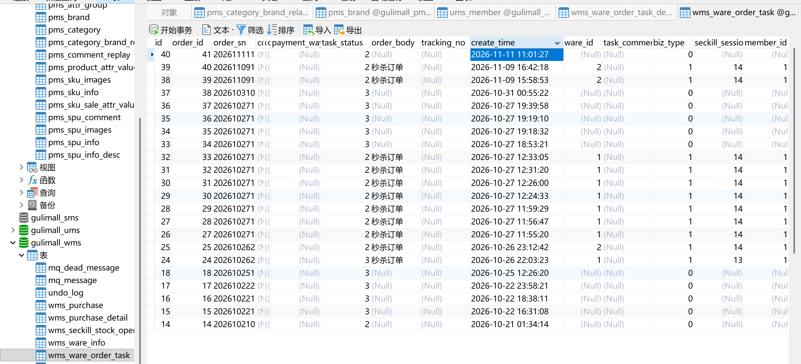
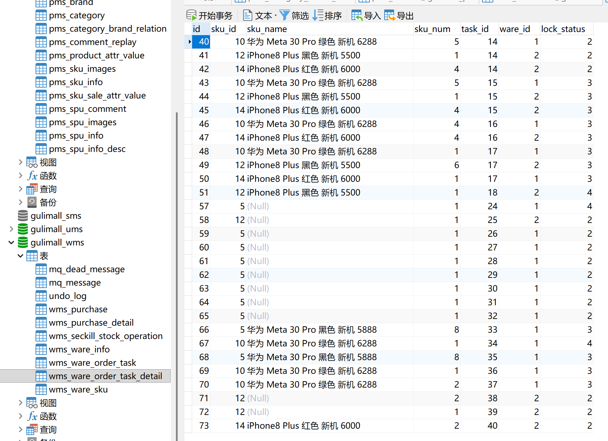
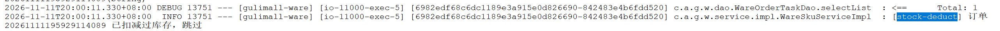
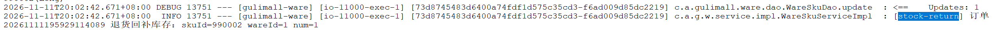
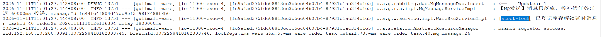

# 12.1 库存工作单与锁库存-介绍

> 本篇介绍库存工作单与锁库存：用户下单后怎样占用仓库资源、工作单和明细各存什么、锁定/解锁/扣减/退货四种动作怎样推进状态、幂等和选仓怎样保证、延时解锁消息怎样发出、失败时哪些兜底任务会接手。

---

## 1. 这个功能是干什么的

订单提交成功不代表商品已经出库，仓库里的货还在。下单这一刻要先把对应数量“占住”，防止同一件货被两个订单同时买走，这个动作叫锁库存。

锁库存不直接减少总库存，而是在仓库库存行上增加“已锁定”数量：

```text
wms_ware_sku
├── stock               仓库实际库存
├── stock_locked        普通订单锁定数量
├── seckill_stock_locked 秒杀活动锁定数量
└── 可用库存 = stock - stock_locked - seckill_stock_locked
```

一笔订单从提交到结束，库存会经历四种动作：

| 动作 | 触发时机 | `stock` | `stock_locked` | 可用库存 |
|---|---|---|---|---|
| 锁定 | 用户提交订单 | 不变 | 增加 | 减少 |
| 解锁 | 用户取消、超时未支付 | 不变 | 减少 | 增加 |
| 扣减 | 支付成功 | 减少 | 减少 | 不变 |
| 退货 | 售后完成 | 增加 | 不变 | 增加 |

例如某仓库某 sku 有 10 件：

1. 用户 A 下单 2 件，`stock=10`、`stock_locked=2`，可用 8 件。
2. 用户 B 下单 3 件，`stock=10`、`stock_locked=5`，可用 5 件。
3. A 支付成功，`stock=8`、`stock_locked=3`，可用仍是 5 件。
4. B 超时取消，`stock=8`、`stock_locked=0`，可用 8 件。

库存动作由“库存工作单”记录：

1. `wms_ware_order_task` 记录一笔订单在仓库侧的锁库存任务。
2. `wms_ware_order_task_detail` 记录这笔任务里每个 sku 锁在哪个仓库、锁了多少件。
3. 后续解锁、扣减、退货都按工作单和明细推进，不依赖订单服务再次传商品明细。

这套设计解决四个问题：

1. **资源占用**：下单即锁定，避免超卖。
2. **动作可追溯**：每一笔锁定、解锁、扣减、退货都有状态和时间线。
3. **重复请求可幂等**：同一订单号只创建一张工作单，同一明细只处理一次。
4. **异常可兜底**：延时消息丢失时，定时任务还能按工作单状态继续释放。

## 2. 用户、管理员和开发者怎么操作

### 2.1 用户下单并选择仓库

1. 用户在订单确认页选择收货地址。
2. 页面请求运费接口，仓储服务按地址计算可达仓库和运费。
3. 页面展示每个 sku 的可选仓库，用户确认后把 `skuId → wareId` 的映射放进 `skuWareMap`。
4. 点击“提交订单”，订单服务先校验价格和按仓库存，再创建订单。
5. 订单服务调用仓储 `/ware/waresku/lockStock`，仓储按用户选中的仓库锁库存。
6. 锁库存成功，订单进入待付款；用户跳转支付页。

锁库存必须和运费计算选同一个仓库。用户在页面上选了“上海仓”，锁库存就不能偷偷换到“北京仓”，否则运费、时效和实际发货仓都会对不上。

### 2.2 用户支付成功

1. 支付宝异步通知订单服务，订单状态从 0 改为 1。
2. 订单服务调用仓储 `/ware/waresku/markPaid`。
3. 仓储把工作单从“已锁定”推进到“已扣减”。
4. 每个明细从“已锁定”推进到“已扣减”。
5. `stock` 和 `stock_locked` 同时减去购买数量，可用库存保持不变。

支付成功后不再改 Redis，因为下单时 Redis 已经预扣过，再减一次会重复扣减。

### 2.3 用户取消或订单超时

1. 用户取消订单，订单状态从 0 改为 4。
2. 订单服务调用仓储 `/ware/waresku/releaseByOrderSn`。
3. 仓储按订单号找到工作单，交给 `StockReleaseExecutor.release()`。
4. 工作单从“已锁定”改为“已解锁”，明细逐条从“已锁定”改为“已解锁”。
5. `stock_locked` 减回去，`stock` 不变。
6. 事务提交后，Redis 用 `INCRBY` 回补数量。

订单超时不依赖订单服务同步调用，仓储在下单时已经登记了一条 30 分钟的延时解锁消息，到期后自动释放。

### 2.4 管理员增加或修改库存

1. 管理员进入仓储管理后台的“商品库存”页面。
2. 新增库存或修改库存数量。
3. 后台会先拿库存写锁，再更新 `wms_ware_sku`。
4. 更新完成后立即按数据库重新计算可用库存，写回 Redis。

写锁和下单读锁互斥，避免管理员盘点库存时用户同时下单，造成缓存和数据库口径错乱。

### 2.5 用户退货

1. 用户提交退货申请，售后单完成后订单服务调用仓储 `/ware/waresku/returnStock`。
2. 仓储按订单号和 sku 找到工作单明细。
3. 只有“已扣减”的明细可以回补。
4. 明细从“已扣减”改为“已退货”，`stock` 加回数量。
5. 事务提交后刷新 Redis 库存缓存。

### 2.6 开发者接口与配置

锁库存相关接口：

| 方法 | 路径 | 调用方 | 作用 |
|---|---|---|---|
| POST | `/ware/waresku/lockStock` | order | 下单锁库存 |
| POST | `/ware/waresku/markPaid` | order | 支付成功扣减锁定库存 |
| POST | `/ware/waresku/releaseByOrderSn` | order | 按订单号释放库存 |
| POST | `/ware/waresku/returnStock` | order | 退货回补库存 |
| POST | `/ware/waresku/hasStockByWare` | order | 提交前按仓校验库存 |

关键配置：

```yaml
gulimall:
  ware:
    stock-release:
      delay-ms: 1800000
      grace-ms: 300000
```

1. `delay-ms`：下单后多久解锁，默认 30 分钟。
2. `grace-ms`：定时兜底任务比延时消息多等的宽限期，默认 5 分钟。
3. 生产环境要把 `delay-ms` 和订单支付超时保持一致，否则订单还没关闭，库存已经被释放。



## 3. 整体设计思路

### 3.1 业务上怎么设计

#### 3.1.1 工作单是订单在仓库侧的任务单

订单服务负责交易，仓储服务负责实物。两边通过订单号关联：

```text
wms_ware_order_task
├── id              工作单主键
├── order_id        订单主键，排查问题用
├── order_sn        订单号，业务唯一键
├── task_status     1 已锁定、2 已解锁、3 已扣减
├── biz_type        0 普通订单、1 秒杀订单
├── create_time     锁定时间，兜底任务按它判断超时
└── ware_id         秒杀工作单可直接记录仓库
```

工作单不是订单的复制品，它只保存仓库侧需要的信息。收货人、地址等字段当前没有完整写入，订单服务仍然是收货信息的权威来源。

#### 3.1.2 明细记录每个 sku 锁在哪

```text
wms_ware_order_task_detail
├── task_id          所属工作单
├── sku_id           商品 sku
├── sku_name         商品名快照
├── sku_num          锁定数量
├── ware_id          锁在哪个仓库
└── lock_status      1 已锁定、2 已解锁、3 已扣减、4 已退货
```

一个 sku 可能锁在多个仓库，一张工作单会有多条明细。解锁时必须按明细里的 `ware_id + sku_id` 精确回补，不能只按 sku 随便找一行减。

#### 3.1.3 状态机

普通订单工作单：

```text
1 已锁定
  ├── 用户取消 / 超时 → 2 已解锁
  └── 支付成功       → 3 已扣减
```

明细：

```text
1 已锁定
  ├── 释放 → 2 已解锁
  ├── 支付 → 3 已扣减
  └── 售后退货完成 → 4 已退货
```

状态只允许按上面的方向推进：

1. 已解锁的工作单不能再扣减。
2. 已扣减的工作单不能再解锁。
3. 已退货的明细不能再次退货。
4. 秒杀工作单不走普通释放，由秒杀服务决定回秒杀池还是普通池。

#### 3.1.4 锁定、解锁、扣减、退货的边界

| 动作 | 改 `stock` | 改 `stock_locked` | 改 Redis | 允许的起始状态 |
|---|---|---|---|---|
| 锁定 | 否 | 加数量 | 下单入口已预扣，不再改 | 无工作单 |
| 解锁 | 否 | 减数量 | 事务提交后 `INCRBY` | 工作单已锁定 |
| 扣减 | 减数量 | 减数量 | 不改 | 工作单已锁定 |
| 退货 | 加数量 | 不改 | 事务提交后按库刷新 | 明细已扣减 |

#### 3.1.5 幂等设计

锁库存是远程调用，网络超时、订单重试、Seata 重试都可能重复请求同一个订单号。幂等分三层：

1. **先查后插**：按 `order_sn` 查工作单，已锁定直接返回工作单 id。
2. **数据库唯一索引**：`wms_ware_order_task.order_sn` 上有 `uk_order_sn`，并发重复插入只有一条成功。
3. **状态条件更新**：解锁、扣减、退货都用 `WHERE 状态 = 旧状态` 抢占，只有影响行数大于 0 的请求继续执行。

#### 3.1.6 选仓规则

1. 订单确认页按收货地址计算可达仓库和运费。
2. 用户可以选择仓库，选择结果通过 `skuWareMap` 提交。
3. 锁库存只锁选中的仓库，不自动跨仓拆单。
4. 选中仓库库存不足直接失败，提示用户重新选择。
5. 秒杀关联商品时会自动选可用库存最多的仓库，那套规则由秒杀和仓储的关联接口负责。

#### 3.1.7 延时解锁与兜底

订单可能支付，也可能取消或超时，仓储在下单时无法预知结果。做法是：

1. 锁库存成功后，登记一条 30 分钟的延时消息。
2. 30 分钟后消费者先看工作单状态：
   - 已锁定：订单没支付，释放库存。
   - 已扣减或已解锁：跳过。
3. 如果消息丢失或消费者一直失败，`StockReleaseTask` 每分钟扫描“已锁定且超过 35 分钟”的工作单。
4. 如果数据库更新失败，MQ 会按 10 秒、30 秒、60 秒重试，三次后进死信归档。

### 3.2 技术上怎么设计

#### 3.2.1 锁库存和写工作单在同一个本地事务

`lockStock()` 上有 `@Transactional`，以下动作在同一个仓储库事务里：

1. 写工作单。
2. 条件更新每条库存行的 `stock_locked`。
3. 写工作单明细。
4. 把延时消息写进本地消息表 `mq_message`。

任何一步失败都整体回滚。订单服务那边由 Seata 全局事务负责回滚订单库。

#### 3.2.2 条件更新防超卖

库存更新不用“先查再判断再更新”，而是把判断写进 `WHERE`：

```sql
UPDATE wms_ware_sku
SET stock_locked = stock_locked + 2
WHERE id = ?
  AND stock - stock_locked - seckill_stock_locked >= 2
```

1. 影响行数为 1：库存足够，锁定成功。
2. 影响行数为 0：库存已被别人抢走，抛库存不足。

这样不需要额外加行锁，也不会出现两个请求都读到 5 件、都去锁 3 件的超卖。

#### 3.2.3 唯一索引兜底并发

应用层先查后插只能挡住顺序重复请求，挡不住两个线程同时查到“没有工作单”。数据库唯一索引是最终防线：

```sql
UNIQUE KEY uk_order_sn (order_sn)
```

并发插入时只有一个成功，另一个抛重复键异常。当前代码没有捕获这个异常并转成“返回已有工作单”，生产环境可以补。

#### 3.2.4 工作单状态抢占

解锁和扣减都可能被多次调用：

1. MQ 会重复投递。
2. 定时任务和 MQ 可能同时处理同一张工作单。
3. 用户重复点击取消。

处理方式是把状态更新当成抢锁：

```sql
UPDATE wms_ware_order_task
SET task_status = 2
WHERE id = ? AND task_status = 1
```

只有第一次能把 1 改成 2，后面的请求影响行数为 0，直接返回。明细状态也用同样方式推进。

#### 3.2.5 事务提交后回补 Redis

Redis 不在数据库事务里。如果事务内回补，数据库回滚了但 Redis 已经加回去，缓存就会比数据库多。

代码用 `TransactionSynchronizationManager` 注册 `afterCommit`：

1. 有事务：事务提交成功后执行。
2. 没有事务：立即执行。
3. 回补失败只记日志，由对账任务修复。

回补用 `INCRBY`，不用“查库后 SET”：

1. 并发下单时，查库可能读到还没同步的旧值。
2. `SET` 会把别人刚预扣的数量覆盖掉。
3. `INCRBY` 只增加这一轮释放的数量，不会覆盖其他并发操作。

#### 3.2.6 读写锁隔离下单和盘点

所有库存写操作共用一把 Redisson 读写锁 `gulimall:ware:stock:lock`：

1. 下单加读锁，多个下单可以并发。
2. 管理员增删改库存加写锁，和所有下单互斥。
3. 解锁也加读锁，避免和对账任务的写锁交错。
4. 对账任务加写锁，用数据库库存覆盖 Redis。

#### 3.2.7 普通订单和秒杀订单分开释放

秒杀订单的库存有两层占用：

```text
seckill_stock_locked  活动锁定
stock_locked          订单锁定
```

建单时把数量从 `seckill_stock_locked` 转到 `stock_locked`。取消或超时时：

1. 回秒杀池：`stock_locked` 减，`seckill_stock_locked` 加。
2. 不回秒杀池：只把 `stock_locked` 减掉。

普通释放逻辑只处理 `biz_type=0`，遇到秒杀工作单直接跳过，避免把活动库存错误释放。

## 4. 详细代码、配置和解释

第 4 章按“类为什么存在 → 关键数据 → 调用链路 → 代码分块解释 → 一次完整示例 → 边界”组织。每一块代码前面先说明它在链路里承担什么，代码后面再按 1、2、3 的顺序解释执行过程和原因。

### 4.1 WareOrderTaskEntity：库存工作单

#### 4.1.1 这个类解决什么问题

订单服务提交订单时，仓储侧要先占住货，再让用户去支付。仓储不能只把库存数字改掉，还需要留下一张可查、可重放、可判断是否处理过的任务单：哪个订单在什么时间锁了库存，当前处于锁定、已释放还是已扣减。

`WareOrderTaskEntity` 映射 `wms_ware_order_task`，承担这张任务单。写入方是 `WareSkuServiceImpl.lockStock()`，时机在订单服务远程调用进入仓储之后、仓储本地事务提交前。读取方覆盖支付扣减、取消释放、超时兜底和退货：这些链路通常只拿到订单号，需要先按订单号找任务单，再顺着任务单找明细。

这个类解决四个问题：

1. 字段映射：把表结构映射成 Java 对象，供 MyBatis-Plus 增删改查；
2. 幂等识别：用 `orderSn` 做业务唯一键，重复的远程调用能认出同一笔订单；
3. 状态承载：用 `taskStatus` 表达工作单状态机，条件更新把它当抢锁标记；
4. 链路分流：用 `bizType` 区分普通订单和秒杀订单，决定释放走哪条链路。

#### 4.1.2 字段与业务含义

| 字段 | 数据库列 | 业务含义 | 说明 |
|---|---|---|---|
| `id` | `id` | 工作单主键 | 自增，明细用 `task_id` 关联 |
| `orderId` | `order_id` | 订单主键 | 排查问题时和订单库对照 |
| `orderSn` | `order_sn` | 订单号 | 业务唯一键，表上有 `uk_order_sn` |
| `consignee` | `consignee` | 收货人 | 普通锁库存入口不会完整写入 |
| `consigneeTel` | `consignee_tel` | 收货人电话 | 同上 |
| `deliveryAddress` | `delivery_address` | 配送地址 | 同上 |
| `orderComment` | `order_comment` | 订单备注 | 仓库打包时参考 |
| `paymentWay` | `payment_way` | 付款方式 | 1 在线付款、2 货到付款 |
| `taskStatus` | `task_status` | 工作单状态 | 1 已锁定、2 已解锁、3 已扣减 |
| `orderBody` | `order_body` | 订单描述 | 订单摘要快照 |
| `trackingNo` | `tracking_no` | 物流单号 | 发货后回填 |
| `createTime` | `create_time` | 创建时间 | 兜底任务按它判断是否超时 |
| `wareId` | `ware_id` | 仓库 id | 秒杀工作单直接记录仓库 |
| `bizType` | `biz_type` | 业务类型 | 0 普通订单、1 秒杀订单 |
| `seckillSessionId` | `seckill_session_id` | 秒杀场次 id | 秒杀工作单回池时定位场次 |
| `memberId` | `member_id` | 会员 id | 秒杀工作单记录下单人 |
| `taskComment` | `task_comment` | 工作单备注 | 人工处理时写说明 |

#### 4.1.3 代码与解释

```java
@Data
@TableName("wms_ware_order_task")
public class WareOrderTaskEntity implements Serializable {
	private static final long serialVersionUID = 1L;

	/**
	 * id
	 */
	@TableId
	private Long id;
	/**
	 * order_id
	 */
	private Long orderId;
	/**
	 * order_sn
	 */
	private String orderSn;
	/**
	 * 收货人
	 */
	private String consignee;
	/**
	 * 收货人电话
	 */
	private String consigneeTel;
	/**
	 * 配送地址
	 */
	private String deliveryAddress;
	/**
	 * 订单备注
	 */
	private String orderComment;
	/**
	 * 付款方式【 1:在线付款 2:货到付款】
	 */
	private Integer paymentWay;
	/**
	 * 任务状态
	 */
	private Integer taskStatus;
	/**
	 * 订单描述
	 */
	private String orderBody;
	/**
	 * 物流单号
	 */
	private String trackingNo;
	/**
	 * create_time
	 */
	private Date createTime;
	/**
	 * 仓库id
	 */
	private Long wareId;
	/**
	 * 业务类型：0普通订单 1秒杀订单
	 */
	private Integer bizType;
	/**
	 * 秒杀场次id
	 */
	private Long seckillSessionId;
	/**
	 * 会员id
	 */
	private Long memberId;
	/**
	 * 工作单备注
	 */
	private String taskComment;

}
```

1. `@Data`：生成 getter、setter、`toString`，MyBatis-Plus 和 JSON 序列化都依赖这些访问器。
2. `@TableName("wms_ware_order_task")`：声明实体对应仓储库的工作单表。
3. `@TableId`：标记 `id` 是主键，插入后能把自增主键回填到对象里，后续明细和消息都要用这个 id。
4. `orderSn`：订单号是交易和仓储之间唯一的业务关联键，数据库上的 `uk_order_sn` 让并发重复插入只有一条能成功。
5. `taskStatus`：工作单状态机字段，锁库存写 1，释放改成 2，支付扣减改成 3，所有状态推进都靠带旧状态条件的 `UPDATE`。
6. `bizType`：普通订单为 0，秒杀订单为 1。释放逻辑看到 1 会直接跳过，避免普通释放破坏秒杀活动库存。
7. `createTime`：锁库存时写入当前时间，`StockReleaseTask` 用它判断工作单是否已经超过“延时 + 宽限期”。
8. `wareId`、`seckillSessionId`、`memberId`：秒杀工作单需要知道锁在哪个仓库、属于哪个场次、哪个会员，普通订单这三个字段通常为空。
9. 收货人、电话、地址、物流单号：仓库侧发货时才需要，当前锁库存入口没有完整填充，交易链路的订单表仍然是这些信息的权威来源。

#### 4.1.4 一次查询与状态更新示例

订单 `202411120001` 锁库存成功后，工作单多了一行：

```text
id=101, order_id=5001, order_sn=202411120001,
task_status=1, biz_type=0, create_time=2024-11-12 10:00:00
```

支付前，订单服务按订单号查工作单：

```sql
SELECT * FROM wms_ware_order_task
WHERE order_sn = '202411120001'
LIMIT 1;
```

用户取消后，释放入口把状态从 1 改成 2：

```sql
UPDATE wms_ware_order_task
SET task_status = 2
WHERE id = 101
  AND task_status = 1;
```

影响行数为 1 表示这次请求抢到了释放权；为 0 表示消息重复、定时任务或取消接口已经处理过，后续明细不会再动。

#### 4.1.5 边界与可优化点

1. `orderSn` 在表结构上允许为空，普通锁库存入口会校验，但绕过入口直接写库仍可能插入空订单号。
2. `taskStatus` 没有数据库默认值，插入时必须显式赋值，漏写会让兜底任务查不到这条工作单。
3. 收货信息字段大量为空，工作单作为仓库任务单够用，做物流面单时还要回查订单表。
4. 同一订单目前只允许一张工作单，未来如果按仓库拆单，需要把唯一键从 `order_sn` 调整为 `order_sn + ware_id`。

### 4.2 WareOrderTaskDetailEntity：工作单明细

#### 4.2.1 这个类解决什么问题

一张订单有多个 sku，每个 sku 可能锁在不同仓库、不同数量。工作单只说明“这笔订单锁过库存”，释放、扣减、退货时必须精确到 `ware_id + sku_id` 才能改对库存行。`WareOrderTaskDetailEntity` 映射 `wms_ware_order_task_detail`，记录每一笔锁定。

写入方是 `lockChosenWarehouse()`，每锁定一个 sku 写一条明细；读取方是 `releaseStock()`、`deductLockedStock()`、`returnStock()`，都按 `task_id` 查明细，再按明细里的仓库和数量回补或扣减。工作单负责“有没有锁过”，明细负责“锁在哪、锁了多少”。

这个类承担三件事：

1. 记录 sku、数量、仓库，让释放和扣减能定位到唯一一条库存行；
2. 用 `lockStatus` 记录明细自己的生命周期，支持部分扣减和部分退货；
3. 用 `skuName` 做商品名快照，后台查看工作单时不用再调商品服务。

#### 4.2.2 字段与业务含义

| 字段 | 数据库列 | 业务含义 | 说明 |
|---|---|---|---|
| `id` | `id` | 明细主键 | 自增 |
| `skuId` | `sku_id` | 商品 sku | 和 `ware_id` 一起定位库存行 |
| `skuName` | `sku_name` | 商品名称 | 锁定时的名称快照 |
| `skuNum` | `sku_num` | 锁定数量 | 释放、扣减、退货都按这个数处理 |
| `taskId` | `task_id` | 所属工作单 | 按工作单查明细 |
| `wareId` | `ware_id` | 锁定仓库 | 用户选中的仓库，不能自动换仓 |
| `lockStatus` | `lock_status` | 明细状态 | 1 已锁定、2 已解锁、3 已扣减、4 已退货 |

#### 4.2.3 代码与解释

```java
@Data
@TableName("wms_ware_order_task_detail")
public class WareOrderTaskDetailEntity implements Serializable {
	private static final long serialVersionUID = 1L;

	/**
	 * id
	 */
	@TableId
	private Long id;
	/**
	 * sku_id
	 */
	private Long skuId;
	/**
	 * sku_name
	 */
	private String skuName;
	/**
	 * 购买个数
	 */
	private Integer skuNum;
	/**
	 * 工作单id
	 */
	private Long taskId;
	/**
	 * 仓库id
	 */
	private Long wareId;
	/**
	 * 1-已锁定  2-已解锁  3-扣减
	 */
	private Integer lockStatus;

}
```

1. `@TableName("wms_ware_order_task_detail")`：映射工作单明细表。
2. `@TableId`：标记自增主键。
3. `skuId`、`skuName`：商品标识和名称快照。名称保存下来后，商品改名不会影响历史工作单的展示。
4. `skuNum`：这条明细锁定的数量，释放时减多少、扣减时减多少、退货时加多少都以它为准。
5. `taskId`：关联工作单。释放入口只拿着 `taskId`，明细靠这个字段反查。
6. `wareId`：锁定仓库。解锁必须按 `ware_id + sku_id` 精确回补，不能只按 sku 随便找一行减。
7. `lockStatus`：明细状态。1 已锁定、2 已解锁、3 已扣减、4 已退货；注释只写到 3，状态 4 在退货逻辑里使用。

#### 4.2.4 一次写入示例

下单锁库存时，订单里有一个 sku 2 件，仓库 1 有货，写入明细：

```text
id=9001, task_id=101, sku_id=12, sku_name="小米手机",
sku_num=2, ware_id=1, lock_status=1
```

释放时按 `task_id=101 AND lock_status=1` 找到这条，把 `wms_ware_sku.stock_locked` 减 2，再把这条明细的 `lock_status` 改成 2。同一个 sku 如果锁在另一个仓库，还会有第二条明细，两条各自回补各自的仓库。



#### 4.2.5 边界与可优化点

1. `task_id`、`sku_id` 没有单独索引，工作单明细多时按工作单查明细会走全表扫描。
2. 没有 `(task_id, sku_id, ware_id)` 唯一约束，同一工作单同一 sku 同一仓库理论上可以插入多条明细。
3. 注释只写了 1、2、3，状态 4 已退货没有同步到字段注释，阅读代码时容易漏掉。
4. 明细没有记录锁定时间，排查“哪一步慢了”只能借助工作单的 `create_time`。

### 4.3 WareConstant：状态与业务类型常量

#### 4.3.1 这段常量解决什么问题

状态值 1、2、3、4 在库存服务里反复出现：锁库存写 1，释放把 1 改成 2，扣减把 1 改成 3，退货把 3 改成 4，定时任务只查 1。直接写数字容易写错，也看不出语义。`WareConstant` 把状态和业务类型集中成常量，所有条件更新引用同一套值。

它不参与业务执行，只提供固定值。引用位置包括 `WareSkuServiceImpl`、`StockReleaseTask`、`WareSkuController` 以及秒杀侧的相关逻辑。常量值一旦上线就不能随意调整，否则历史数据的状态含义会错位。

#### 4.3.2 常量与状态流转

| 常量 | 值 | 含义 | 主要使用位置 |
|---|---|---|---|
| `TASK_STATUS_LOCKED` | 1 | 已锁定 | 锁库存写入、释放/扣减的条件起点 |
| `TASK_STATUS_RELEASED` | 2 | 已解锁 | 释放把工作单和明细改成 2 |
| `TASK_STATUS_DEDUCTED` | 3 | 已扣减 | 支付扣减改成 3，退货要求起点是 3 |
| `TASK_STATUS_RETURNED` | 4 | 已退货 | 退货把明细改成 4 |
| `BIZ_TYPE_NORMAL` | 0 | 普通订单 | 定时兜底只扫这一类 |
| `BIZ_TYPE_SECKILL` | 1 | 秒杀订单 | 普通释放遇到它直接跳过 |

状态推进方向：

```text
工作单：1 已锁定 ──释放──> 2 已解锁
                    └──支付──> 3 已扣减

明细：  1 已锁定 ──释放──> 2 已解锁
                    ├──支付──> 3 已扣减
                    └──售后退货──> 4 已退货
```

状态只允许按箭头方向推进，反向流转全部由条件更新挡住。

#### 4.3.3 代码与解释

```java
public class WareConstant {

    // ==================== 库存工作单状态 ====================

    /** 已锁定：库存已经锁住，等待支付或超时解锁 */
    public static final int TASK_STATUS_LOCKED = 1;

    /** 已解锁：订单超时/取消，锁定库存已经还回去 */
    public static final int TASK_STATUS_RELEASED = 2;

    /** 已扣减：支付成功，锁定库存转成真实扣减 */
    public static final int TASK_STATUS_DEDUCTED = 3;

    /** 已退货：售后退货处理完成，库存已经回补（同一明细只回补一次） */
    public static final int TASK_STATUS_RETURNED = 4;

    // ==================== 库存工作单业务类型 ====================

    /** 普通订单：超时/取消走 ware 自己的延时消息释放 */
    public static final int BIZ_TYPE_NORMAL = 0;

    /** 秒杀订单：超时/取消由 seckill 决定回秒杀池还是普通池 */
    public static final int BIZ_TYPE_SECKILL = 1;

}
```

1. `TASK_STATUS_LOCKED = 1`：工作单和明细刚创建时的状态，也是释放、扣减的条件起点。
2. `TASK_STATUS_RELEASED = 2`：取消或超时释放后的状态，`stock_locked` 已经还回去。
3. `TASK_STATUS_DEDUCTED = 3`：支付成功后锁定转真实扣减的状态，`stock` 和 `stock_locked` 同时减少。
4. `TASK_STATUS_RETURNED = 4`：售后退货完成，明细从 3 推进到 4，`stock` 加回。
5. `BIZ_TYPE_NORMAL = 0`：普通订单，超时释放由仓储自己的延时消息和定时任务处理。
6. `BIZ_TYPE_SECKILL = 1`：秒杀订单，回秒杀池还是回普通池由秒杀服务决定，仓储普通释放不能替它选择。
7. 类里还有库存锁名和缓存前缀等常量，和状态机无关，这里只保留与工作单直接相关的部分。

#### 4.3.4 状态在链路里的位置

```text
lockStock          → 工作单 1、明细 1
releaseStock       → 工作单 1→2、明细 1→2
deductLockedStock  → 工作单 1→3、明细 1→3
returnStock        → 明细 3→4
StockReleaseTask   → 只查工作单 1 且 biz_type=0
```

每个入口只认自己允许的起始状态，其他状态一律影响行数为 0，直接返回或抛异常。这样同一个订单被重复消息、定时任务、人工取消同时处理时，只有一次能改成功。

#### 4.3.5 边界与可优化点

1. 工作单状态和明细状态共用一组常量，语义靠调用位置区分，阅读时需要确认当前操作的是哪张表。
2. 没有提供“状态是否允许流转”的方法，合法前置状态分散在各个 Service 方法里。
3. 可以改成枚举，附带中文描述和允许的前置状态，减少条件更新写错值的可能。
4. 常量值写进数据库和历史消息，调整时必须做数据迁移，不能直接改数字。

### 4.4 WareSkuController：锁库存入口

#### 4.4.1 这个类解决什么问题

仓储服务对交易链路暴露的库存动作都集中在 `WareSkuController`：下单锁库存、支付后扣减、取消释放、售后退货。调用方是订单服务，通过 Feign 调用；下游统一落到 `WareSkuServiceImpl` 和 `StockReleaseExecutor`。

Controller 只做三件事：接收参数、加必要的库存锁、把结果包装成 `R`。真正的状态判断、条件更新、Redis 回补都在 Service。退货和管理员改库存共用同一把写锁，锁边界放在 HTTP 入口，排查锁竞争时更容易定位。

#### 4.4.2 接口清单

| 方法 | 路径 | 调用方 | 入参 | 下游动作 |
|---|---|---|---|---|
| POST | `/ware/waresku/lockStock` | order | `StockLockVo` | `lockStock()` 锁库存 |
| POST | `/ware/waresku/markPaid` | order | `orderSn` | `deductLockedStock()` 扣减 |
| POST | `/ware/waresku/releaseByOrderSn` | order | `orderSn` | `StockReleaseExecutor.release()` |
| POST | `/ware/waresku/returnStock` | order | `orderSn`、`skuId`、`num` | `returnStock()` 回补 |
| POST | `/ware/waresku/hasStockByWare` | order | sku 与仓库 | 提交前按仓校验库存 |

网关转发时会去掉 `/gulimall` 前缀，Feign 侧配置的路径以服务名开头。

#### 4.4.3 锁库存入口 lockStock

下单主链路里，`ConfirmController.submitOrder()` 已经持有库存读锁，随后订单服务调用这个接口。它只负责把 `StockLockVo` 拆开，把订单 id、订单号、每个 sku 的数量和选中的仓库传给 Service。

```java
    @PostMapping("/lockStock")
    public R lockStock(@RequestBody StockLockVo stockLockVo) {
        wareSkuService.lockStock(stockLockVo.getOrderId(), stockLockVo.getOrderSn(),
                stockLockVo.getSkuQuantities(), stockLockVo.getSkuWareMap());

        return R.ok();
    }
```

1. `@PostMapping("/lockStock")`：暴露下单锁库存接口，Feign 客户端按这个路径调用。
2. `@RequestBody StockLockVo`：请求体里带 `orderId`、`orderSn`、`skuQuantities`、`skuWareMap`。`skuWareMap` 是用户在选择仓库页面确认的 `skuId → wareId` 映射。
3. 调用 `wareSkuService.lockStock()` 后直接返回 `R.ok()`；锁库存失败会抛业务异常，由统一异常处理转成错误响应。

为什么这里不再加库存读锁：订单提交入口已经持有同一把读写锁的读锁。仓储再拿一次，会变成同一个线程重复获取同一把锁，`tryLock` 等待后失败。锁的边界放在调用方，仓储只负责业务。

#### 4.4.4 支付扣减入口 markPaid

支付宝异步通知到达订单服务后，订单服务把订单状态从 0 改成 1，再调用这个接口。它只接收订单号，不接收商品明细，因为明细已经在工作单里。

```java
    @PostMapping("/markPaid")
    public R markPaid(@RequestParam("orderSn") String orderSn) {
        wareSkuService.deductLockedStock(orderSn);

        return R.ok();
    }
```

1. `@PostMapping("/markPaid")`：暴露支付成功扣减接口。
2. `@RequestParam("orderSn")`：支付回调链路手里只有订单号，用最简单的表单参数传递。
3. 调 `deductLockedStock()` 把锁定库存转成真实扣减，成功返回 `R.ok()`。

为什么用订单号而不是工作单 id：支付回调来自支付宝，订单服务保存的是订单号。工作单 id 是仓储内部主键，不应该暴露给交易链路，否则订单服务还要额外保存一份映射。

#### 4.4.5 按订单号释放入口 releaseByOrderSn

用户取消订单或订单超时关闭时，订单服务调用这个接口。释放有两个入口：订单服务主动调用，以及仓储自己的延时消息和定时任务。这个接口是主动调用的入口。

```java
    @PostMapping("/releaseByOrderSn")
    public R releaseByOrderSn(@RequestParam("orderSn") String orderSn) {
        if (orderSn == null || orderSn.isBlank()) {
            throw new RRException(BizCodeEnum.WARE_ORDER_SN_REQUIRED);
        }

        WareOrderTaskEntity task = wareOrderTaskService.getOne(
                new QueryWrapper<WareOrderTaskEntity>()
                        .eq("order_sn", orderSn)
                        .last("LIMIT 1"), false);

        if (task != null) {
            stockReleaseExecutor.release(task.getId());
        }

        return R.ok();
    }
```

1. 订单号为空或空白时抛 `WARE_ORDER_SN_REQUIRED`，避免用空条件查到无关工作单。
2. 按 `order_sn` 查工作单，`LIMIT 1` 限制只取一条，`getOne(..., false)` 表示查不到不抛异常。
3. 查不到工作单直接返回 `R.ok()`，接口保持幂等。工作单不存在说明这笔订单没有锁过库存，或者已经被清理。
4. 查到工作单后交给 `StockReleaseExecutor.release()`，由执行器加读锁并调用 `releaseStock()`。
5. 释放内部会先用状态条件更新抢占工作单，重复调用不会重复减库存。

为什么查不到也返回成功：订单服务取消订单时只关心“库存是否已经释放”。工作单不存在说明没有占用需要归还，此时报错只会让用户取消订单失败，属于把内部状态暴露成交易故障。

#### 4.4.6 退货回补入口 returnStock

售后单完成后，订单服务调用这个接口，把已经扣减的库存加回仓库。退货只处理单个 sku，多个 sku 的退货由订单服务逐次调用。

```java
    @PostMapping("/returnStock")
    public R returnStock(@RequestParam("orderSn") String orderSn,
                         @RequestParam("skuId") Long skuId,
                         @RequestParam("num") Integer num) {
        executeWithStockLock(() -> wareSkuService.returnStock(orderSn, skuId, num));
        return R.ok();
    }
```

1. `@PostMapping("/returnStock")`：暴露退货回补接口。
2. 接收订单号、sku、退货数量三个参数，不接收仓库。仓库从工作单明细里取，避免调用方传错仓库。
3. 用 `executeWithStockLock()` 包住 `returnStock()`，退货过程持有库存写锁。

为什么退货要加写锁：退货会把 `stock` 加回去，管理员盘点也会写同一行库存。两者并发时后写会覆盖先写，加写锁让退货和管理员操作互斥，避免库存数量丢失。

#### 4.4.7 管理员写库存的统一锁

退货接口和后台库存管理都可能修改库存行，因此共用一个写锁方法。库存写操作和下单读锁互斥，盘点或改库存时不允许下单同时进行。

```java
    /** 管理员改库存：加库存写锁（独占，与所有下单读锁互斥） */
    private void executeWithStockLock(Runnable action) {
        RLock lock = redissonClient.getReadWriteLock(WareConstant.STOCK_LOCK).writeLock();
        boolean locked = false;
        try {
            locked = lock.tryLock(3, 30, TimeUnit.SECONDS);
            if (!locked) {
                throw new RRException(BizCodeEnum.WARE_STOCK_BUSY);
            }
            action.run();
        } catch (InterruptedException e) {
            Thread.currentThread().interrupt();
            throw new RRException(BizCodeEnum.WARE_STOCK_OPERATE_INTERRUPTED);
        } finally {
            if (locked && lock.isHeldByCurrentThread()) {
                lock.unlock();
            }
        }
    }
```

1. 通过 `redissonClient.getReadWriteLock(WareConstant.STOCK_LOCK)` 取得库存读写锁的写锁。
2. `tryLock(3, 30, TimeUnit.SECONDS)`：最多等 3 秒，拿到后租约 30 秒。
3. 等不到锁抛 `WARE_STOCK_BUSY`，提示库存操作繁忙，避免请求无限等待。
4. 拿到锁后执行传入的 `Runnable`，真正业务在 `returnStock()` 或管理员库存方法里。
5. 线程被中断时恢复中断标记并抛 `WARE_STOCK_OPERATE_INTERRUPTED`，让上层感知。
6. `finally` 中只有当前线程真正持锁才解锁，避免误释放其他线程的锁。

为什么用读写锁：下单和释放只占用库存、不改变物理总量，用读锁可以并发；管理员盘点、退货、对账需要独占，用写锁。读写锁比一把普通互斥锁吞吐更高，又能保证盘点时没有并发下单。

#### 4.4.8 一次取消订单示例

```text
1. 用户点击取消订单
2. order 服务把订单状态从 0 改成 4
3. order 调用 POST /ware/waresku/releaseByOrderSn?orderSn=202411120001
4. Controller 校验订单号非空
5. 按 order_sn 查工作单，得到 taskId=101
6. 调用 StockReleaseExecutor.release(101)
7. 执行器取库存读锁
8. releaseStock() 把工作单 1→2、明细 1→2
9. stock_locked 减回锁定数量
10. 事务提交后 Redis INCRBY 回补
11. Controller 返回 R.ok()
12. order 服务关闭支付宝交易
```

#### 4.4.9 它不做什么

1. 不创建和复用工作单，工作单由 `WareSkuServiceImpl.lockStock()` 负责。
2. 不判断工作单状态，状态条件更新在 `releaseStock()`、`deductLockedStock()`、`returnStock()` 里。
3. 不组装库存消息，延时消息由 `sendReleaseMessage()` 登记。
4. 不维护 Redis，回补和刷新在 Service 的 `afterCommit()` 回调里。
5. 不校验退货数量是否超过购买数量，只做参数转交。

#### 4.4.10 边界与可优化点

1. `lockStock()` 和 `markPaid()` 没有捕获业务异常，异常会走 Spring 默认错误响应，Feign 侧能感知失败，但返回结构与正常响应不一致。
2. `releaseByOrderSn()` 只处理一张工作单。未来同一订单按仓库拆成多张工作单时，需要改成循环处理。
3. `returnStock()` 没有校验退货数量上限，超退会把库存加多。
4. `executeWithStockLock()` 的 30 秒租约对大批量库存操作可能不够，应根据业务耗时调整。
5. `hasStockByWare` 只做提交前校验，不占库存，和真正的锁库存之间仍存在竞争窗口。

### 4.5 WareSkuServiceImpl：锁库存、解锁、扣减、退货

#### 4.5.1 这个类解决什么问题

订单服务只说“哪个订单、哪些 sku、每个 sku 锁哪个仓库”，仓储要把它翻译成库存行变更、工作单、明细和延时消息。`WareSkuServiceImpl` 是这条链路的业务核心，承担五件事：创建或复用工作单、按选仓锁库存、释放、扣减、退货，并在事务提交后维护 Redis。

入口来自 Controller、`StockReleaseExecutor` 和定时任务；出口是 `wms_ware_order_task`、`wms_ware_order_task_detail`、`wms_ware_sku` 和 Redis。它不负责 MQ 投递，也不负责选择仓库。选仓由订单确认页和 `skuWareMap` 决定，仓储只按用户选中的仓库执行。

#### 4.5.2 四个动作在链路里的位置

| 动作 | 入口 | 起始状态 | 结束状态 | 库存字段变化 |
|---|---|---|---|---|
| 锁定 | `lockStock()` | 无工作单 | 工作单 1、明细 1 | `stock_locked + n` |
| 释放 | `releaseStock()` | 工作单 1 | 工作单 2、明细 2 | `stock_locked - n` |
| 扣减 | `deductLockedStock()` | 工作单 1 | 工作单 3、明细 3 | `stock - n`、`stock_locked - n` |
| 退货 | `returnStock()` | 明细 3 | 明细 4 | `stock + n` |

锁定、释放、扣减、退货都运行在仓储本地事务里。订单库的回滚由 Seata 全局事务负责，仓储只保证自己的库存、工作单、明细和本地消息表一起提交或一起回滚。

#### 4.5.3 可用库存计算 availableOf

库存行上的 `stock` 是物理库存，`stock_locked` 是普通订单占用，`seckill_stock_locked` 是秒杀活动占用。锁库存前要先判断可用量，这个方法把三个字段算成一个数。

```java
    /** 一行库存的可用数量：stock - stock_locked - seckill_stock_locked */
    private long availableOf(WareSkuEntity row) {
        int stock = row.getStock() == null ? 0 : row.getStock();
        int locked = row.getStockLocked() == null ? 0 : row.getStockLocked();
        int seckillLocked = row.getSeckillStockLocked() == null ? 0 : row.getSeckillStockLocked();
        return (long) stock - locked - seckillLocked;
    }
```

1. 入参是 `WareSkuEntity`，三个数量字段都可能为 null，先按 0 处理。
2. 可用量等于 `stock - stock_locked - seckill_stock_locked`，秒杀占用也必须扣掉。
3. 返回 `long`，避免 `int` 相减溢出，也避免负库存被截断成错误的正数。

为什么不能只用 `stock - stock_locked`：`seckill_stock_locked` 是活动预占。如果忽略它，普通订单会把秒杀已经占住的货再卖一次，活动开始后就会超卖。

#### 4.5.4 锁库存 lockStock

这是下单主链路进入仓储后的第一个业务方法。它要保证同一订单只锁一次、每个 sku 按选中仓库锁、锁完登记延时解锁消息，并且所有写入在同一个本地事务里。

```java
    @Override
    @Transactional(rollbackFor = Exception.class)
    public Long lockStock(Long orderId, String orderSn, Map<Long, Integer> skuQuantities,
                          Map<Long, Long> skuWareMap) {
        if (orderSn == null || orderSn.isEmpty()) {
            throw new RRException(BizCodeEnum.WARE_ORDER_SN_REQUIRED);
        }
        if (skuQuantities == null || skuQuantities.isEmpty()) {
            throw new RRException(BizCodeEnum.WARE_STOCK_ITEMS_REQUIRED);
        }

        // 幂等：同一订单已经有工作单就直接返回。
        // 数据库上还有 uk_order_sn 唯一索引兜底，并发重复请求不可能锁两次库存。
        WareOrderTaskEntity existing = wareOrderTaskService.getOne(
                new QueryWrapper<WareOrderTaskEntity>()
                        .eq("order_sn", orderSn)
                        .last("LIMIT 1"),
                false);
        if (existing != null) {
            if (Integer.valueOf(TASK_STATUS_LOCKED).equals(existing.getTaskStatus())) {
                log.info("[stock-lock] 订单 {} 已锁定过库存，直接返回工作单 {}", orderSn, existing.getId());
                return existing.getId();
            }
            throw new RRException(BizCodeEnum.WARE_ORDER_TASK_ALREADY_PROCESSED, orderSn);
        }

        // 1. 先写工作单主记录，明细需要它的自增 id
        WareOrderTaskEntity task = new WareOrderTaskEntity();
        task.setOrderId(orderId);
        task.setOrderSn(orderSn);
        task.setTaskStatus(TASK_STATUS_LOCKED);
        task.setCreateTime(new Date());
        wareOrderTaskService.save(task);

        // 2. 逐个 sku 按仓库锁库存，并记录每一笔锁定的明细
        for (Map.Entry<Long, Integer> entry : skuQuantities.entrySet()) {
            Long skuId = entry.getKey();
            Integer quantity = entry.getValue();
            if (quantity == null || quantity <= 0) {
                continue;
            }

            // 必须带选仓信息，缺失直接报错
            Long chosenWareId = skuWareMap == null ? null : skuWareMap.get(skuId);
            if (chosenWareId == null) {
                throw new RRException(BizCodeEnum.WARE_CHOSEN_WAREHOUSE_REQUIRED);
            }
            lockChosenWarehouse(task, skuId, quantity, chosenWareId);
        }

        Long taskId = task.getId();
        sendReleaseMessage(taskId, orderSn);
        return taskId;
    }
```

1. 校验订单号非空，空订单号无法做幂等，也无法和工作单关联。
2. 校验商品数量 map 非空，空明细的订单没有锁库存的意义。
3. 按 `order_sn` 查工作单，`LIMIT 1` 只取一条。
4. 已有工作单且状态是 1 已锁定，直接返回主键，表示这笔订单已经锁过库存，重复调用变成读操作。
5. 已有工作单但状态不是 1，抛 `WARE_ORDER_TASK_ALREADY_PROCESSED`。订单已经释放或扣减过，再锁一次会破坏状态机。
6. 新建工作单，写入订单 id、订单号、状态 1、创建时间，先落库拿到自增主键。
7. 遍历 `skuQuantities`，数量为空或小于等于 0 的 sku 直接跳过。
8. 从 `skuWareMap` 取用户选中的仓库，缺失直接抛 `WARE_CHOSEN_WAREHOUSE_REQUIRED`，不允许仓储自动换仓。
9. 调 `lockChosenWarehouse()` 完成库存条件更新和明细写入。
10. 调 `sendReleaseMessage()` 登记延时解锁消息，最后返回工作单 id。
11. 整个方法带 `@Transactional(rollbackFor = Exception.class)`，任何一步异常都会回滚工作单、明细和库存更新。

为什么先写工作单：明细需要 `task_id`，必须先拿到自增主键；工作单也是幂等的业务键，先把任务落下来，后续明细和库存更新才有明确归属。

为什么已有工作单直接返回：远程调用超时后订单服务会重试。第一次可能已经锁成功，只是响应没回去。第二次再锁一遍会重复占用库存，先查工作单可以把重试变成读操作。

可优化点：

1. 先查后插仍有并发窗口，两个线程同时查到“没有工作单”时，唯一索引会让其中一个抛 `DuplicateKeyException`。当前没有捕获这个异常并转成“返回已有工作单”，生产环境应补。
2. `skuWareMap` 没有校验是否包含多余的 sku，多余映射会被忽略。
3. 工作单和明细逐条插入，sku 多时性能一般，可以改批量插入。
4. `orderId` 没有校验，允许为空，排查问题时只能靠订单号。

#### 4.5.5 按选中仓库锁定 lockChosenWarehouse

这个方法只处理一个 sku：确认选中的仓库有这条库存行、可用量足够、条件更新成功，最后写一条明细。

```java
    /** 只锁运费页选中的仓库，库存不足直接失败 */
    private void lockChosenWarehouse(WareOrderTaskEntity task, Long skuId, int quantity, Long wareId) {
        WareSkuEntity row = getOne(new QueryWrapper<WareSkuEntity>()
                .eq("sku_id", skuId)
                .eq("ware_id", wareId)
                .last("LIMIT 1"), false);
        if (row == null) {
            throw new RRException(BizCodeEnum.WARE_CHOSEN_WAREHOUSE_EMPTY);
        }

        if (availableOf(row) < quantity) {
            throw new RRException(BizCodeEnum.WARE_STOCK_NOT_ENOUGH);
        }

        int affected = baseMapper.update(null, new UpdateWrapper<WareSkuEntity>()
                .setSql("stock_locked = COALESCE(stock_locked, 0) + " + quantity)
                .eq("id", row.getId())
                .apply("COALESCE(stock, 0) - COALESCE(stock_locked, 0) " +
                        "- COALESCE(seckill_stock_locked, 0) >= " + quantity));
        if (affected == 0) {
            throw new RRException(BizCodeEnum.WARE_STOCK_NOT_ENOUGH);
        }

        WareOrderTaskDetailEntity detail = new WareOrderTaskDetailEntity();
        detail.setTaskId(task.getId());
        detail.setSkuId(skuId);
        detail.setSkuName(row.getSkuName());
        detail.setSkuNum(quantity);
        detail.setWareId(wareId);
        detail.setLockStatus(TASK_STATUS_LOCKED);
        wareOrderTaskDetailService.save(detail);
    }
```

1. 按 `sku_id + ware_id` 查库存行，`LIMIT 1` 只取一条。
2. 行不存在说明选中的仓库没有这个商品，抛 `WARE_CHOSEN_WAREHOUSE_EMPTY`。
3. 用 `availableOf(row)` 先做内存判断，库存不足快速失败，避免多一次更新。
4. 条件更新 `stock_locked = stock_locked + quantity`，`WHERE` 里再算一次可用库存。
5. 影响行数为 0 说明查询和更新之间库存被其他订单抢走，抛 `WARE_STOCK_NOT_ENOUGH`。
6. 更新成功后写明细，记录工作单 id、sku、名称快照、数量、仓库和状态 1。

为什么查完还要条件更新：前面的 `availableOf(row)` 只是快速失败。查询和更新之间可能插入其他订单的锁定，真正的并发安全靠 `WHERE` 里的库存条件，影响行数才是最终判断。

为什么用 `COALESCE`：历史数据里 `stock_locked` 可能为 null，直接相加会得到 null，库存永远锁不上。`COALESCE(stock_locked, 0)` 把 null 当 0 处理。

可优化点：

1. 数量直接拼进 SQL，数量来自内部计算，仍建议改成参数绑定。
2. 条件更新前没有加行锁，高并发时失败率会升高，但不会超卖。
3. 没有校验单笔购买上限，限购规则目前不在这一层。
4. 明细没有唯一键，绕过主流程的重试路径仍可能插入重复明细。

#### 4.5.6 释放库存 releaseStock

释放由三个入口触发：订单取消接口、MQ 延时消息、定时兜底任务。三个入口最终都调用这个方法，因此它必须自己处理重复和并发。

```java
    @Override
    @Transactional(rollbackFor = Exception.class)
    public void releaseStock(Long taskId) {
        if (taskId == null) {
            return;
        }

        // 0. 秒杀工作单不能走普通释放：它回池还是不回池由 seckill 决定
        WareOrderTaskEntity task = wareOrderTaskService.getById(taskId);
        if (task == null) {
            return;
        }
        if (Integer.valueOf(BIZ_TYPE_SECKILL).equals(task.getBizType())) {
            log.warn("[stock-release] 秒杀工作单不能走普通释放，跳过 taskId={} orderSn={}",
                    taskId, task.getOrderSn());
            return;
        }

        // 抢占：只有把工作单从「已锁定」更新成「已解锁」成功的那一次才继续。
        // MQ 重复投递、定时任务与 MQ 同时处理，都会被这一行条件更新挡住。
        int claimed = wareOrderTaskService.getBaseMapper().update(null,
                new UpdateWrapper<WareOrderTaskEntity>()
                        .set("task_status", TASK_STATUS_RELEASED)
                        .eq("id", taskId)
                        .eq("task_status", TASK_STATUS_LOCKED));
        if (claimed == 0) {
            log.debug("[stock-release] 工作单 {} 已被处理过，跳过", taskId);
            return;
        }

        List<WareOrderTaskDetailEntity> details = wareOrderTaskDetailService.list(
                new QueryWrapper<WareOrderTaskDetailEntity>()
                        .eq("task_id", taskId)
                        .eq("lock_status", TASK_STATUS_LOCKED));

        // skuId → 这一轮解锁的总数量（一个 sku 可能锁在多个仓库）
        Map<Long, Integer> restoredBySku = new HashMap<>();

        for (WareOrderTaskDetailEntity detail : details) {
            int num = detail.getSkuNum() == null ? 0 : detail.getSkuNum();
            if (num <= 0) {
                continue;
            }

            // 解锁：stock_locked 减回去即可，stock 不能动（东西还在仓库里）
            int affected = baseMapper.update(null, new UpdateWrapper<WareSkuEntity>()
                    .setSql("stock_locked = COALESCE(stock_locked, 0) - " + num)
                    .eq("ware_id", detail.getWareId())
                    .eq("sku_id", detail.getSkuId())
                    .apply("COALESCE(stock_locked, 0) >= " + num));
            if (affected == 0) {
                // 数据不一致（例如人工改过库存）：抛异常让事务回滚，交给 MQ 重试 / 定时任务再处理
                throw new RRException(BizCodeEnum.WARE_STOCK_RELEASE_FAILED, detail.getId());
            }

            wareOrderTaskDetailService.update(new UpdateWrapper<WareOrderTaskDetailEntity>()
                    .set("lock_status", TASK_STATUS_RELEASED)
                    .eq("id", detail.getId())
                    .eq("lock_status", TASK_STATUS_LOCKED));

            restoredBySku.merge(detail.getSkuId(), num, Integer::sum);
        }

        // Redis 必须在 DB 事务提交后再回补，否则事务回滚会把 Redis 提前加回去。
        // 用 INCRBY 而不是"查库后 SET"：并发下单时查库会读到还没同步的旧值，
        // 把别人刚预扣的数量覆盖掉，造成超卖。
        afterCommit(() -> restoredBySku.forEach((skuId, num) -> {
            stringRedisTemplate.opsForValue()
                    .increment(WareConstant.STOCK_CACHE_PREFIX + skuId, num);
            log.info("[stock-release] 工作单 {} 已解锁并回补 Redis：skuId={} num={}", taskId, skuId, num);
        }));
    }
```

1. `taskId` 为空直接返回，释放入口拿不到任务时不做任何事。
2. 按 id 查工作单，不存在直接返回，保持幂等。
3. 工作单 `bizType=1` 时记录告警并返回。秒杀工作单回秒杀池还是回普通池由秒杀服务决定，普通释放不能处理。
4. 条件更新工作单 `1 → 2`，只有影响行数为 1 才继续。
5. 影响行数为 0 说明工作单已经被释放、扣减或被其他线程处理，直接返回。
6. 查该工作单下仍为 `lock_status=1` 的明细。
7. 遍历明细，数量小于等于 0 的跳过。
8. 按 `ware_id + sku_id` 条件更新 `stock_locked - num`，条件要求当前锁定数量不小于这一轮释放数量。
9. 影响行数为 0 抛 `WARE_STOCK_RELEASE_FAILED`，让事务回滚，由 MQ 重试或定时任务再处理。
10. 明细状态从 1 改成 2，条件同样要求旧状态是 1。
11. 按 sku 汇总本轮释放数量，同一个 sku 锁在多个仓库时合并成一个总数。
12. 注册 `afterCommit` 回调，事务提交后用 `INCRBY` 回补 Redis。

为什么先抢占工作单：MQ 会重复投递，定时任务和取消接口也可能同时进入同一个工作单。先把工作单从 1 改成 2，只有一次成功，后面的请求连明细都不会查。

为什么解锁不改 `stock`：商品还在仓库里，只是不再被这个订单占用。`stock` 是物理库存，只有真正出库（支付后扣减）才减少。

可优化点：

1. 明细逐条更新，商品多时可以批量处理。
2. `afterCommit` 依赖事务同步，没有事务时立即执行；调用链变化时要确认是否仍在外层事务里。
3. 释放失败抛异常，依赖 MQ 重试和兜底任务，重试上限和死信配置必须完整。
4. Redis 只回补数量，没有立即和数据库对账，长时间运行后仍需要 `StockReconcileTask` 校正。


#### 4.5.7 支付后扣减 deductLockedStock

支付回调到达订单服务后，订单服务调用仓储扣减。此时锁定库存已经占住货，扣减要做的是把“占用”转成“真实出库”。

```java
    @Override
    @Transactional(rollbackFor = Exception.class)
    public void deductLockedStock(String orderSn) {
        WareOrderTaskEntity task = wareOrderTaskService.getOne(
                new QueryWrapper<WareOrderTaskEntity>()
                        .eq("order_sn", orderSn)
                        .last("LIMIT 1"),
                false);
        if (task == null) {
            throw new RRException(BizCodeEnum.WARE_ORDER_TASK_NOT_FOUND, orderSn);
        }
        if (Integer.valueOf(TASK_STATUS_DEDUCTED).equals(task.getTaskStatus())) {
            // 支付回调可能重复执行，已经扣减过就直接返回
            log.info("[stock-deduct] 订单 {} 已扣减过库存，跳过", orderSn);
            return;
        }

        int claimed = wareOrderTaskService.getBaseMapper().update(null,
                new UpdateWrapper<WareOrderTaskEntity>()
                        .set("task_status", TASK_STATUS_DEDUCTED)
                        .eq("id", task.getId())
                        .eq("task_status", TASK_STATUS_LOCKED));
        if (claimed == 0) {
            throw new RRException(BizCodeEnum.WARE_ORDER_TASK_RELEASED, orderSn);
        }

        List<WareOrderTaskDetailEntity> details = wareOrderTaskDetailService.list(
                new QueryWrapper<WareOrderTaskDetailEntity>()
                        .eq("task_id", task.getId())
                        .eq("lock_status", TASK_STATUS_LOCKED));

        for (WareOrderTaskDetailEntity detail : details) {
            int num = detail.getSkuNum() == null ? 0 : detail.getSkuNum();
            if (num <= 0) {
                continue;
            }

            // 支付成功：锁定转真实扣减。
            // stock 和 stock_locked 同时减，可用库存（stock - stock_locked - seckill_stock_locked）保持不变。
            int affected = baseMapper.update(null, new UpdateWrapper<WareSkuEntity>()
                    .setSql("stock = COALESCE(stock, 0) - " + num
                            + ", stock_locked = COALESCE(stock_locked, 0) - " + num)
                    .eq("ware_id", detail.getWareId())
                    .eq("sku_id", detail.getSkuId())
                    .apply("COALESCE(stock, 0) >= " + num
                            + " AND COALESCE(stock_locked, 0) >= " + num));
            if (affected == 0) {
                throw new RRException(BizCodeEnum.WARE_STOCK_DEDUCT_FAILED, detail.getId());
            }

            wareOrderTaskDetailService.update(new UpdateWrapper<WareOrderTaskDetailEntity>()
                    .set("lock_status", TASK_STATUS_DEDUCTED)
                    .eq("id", detail.getId())
                    .eq("lock_status", TASK_STATUS_LOCKED));
        }

        // Redis 在下单时已经预扣过，这里不能再减
        log.info("[stock-deduct] 订单 {} 的锁定库存已转为真实扣减", orderSn);
    }
```

1. 按订单号查工作单，`LIMIT 1` 只取一条，查不到抛 `WARE_ORDER_TASK_NOT_FOUND`。
2. 工作单已经是 3 已扣减时直接返回。支付回调可能重复执行，重复扣减会让库存直接少两次。
3. 条件更新工作单 `1 → 3`，抢不到说明工作单已经释放或已经被其他请求处理。
4. 条件更新影响行数为 0 抛 `WARE_ORDER_TASK_RELEASED`，让订单侧感知支付和超时释放发生了竞争。
5. 查该工作单下仍为 `lock_status=1` 的明细。
6. 遍历明细，数量小于等于 0 的跳过。
7. 同时更新 `stock - num` 和 `stock_locked - num`，条件要求两个字段都不小于这一轮扣减数量。
8. 任一条更新影响行数为 0 抛 `WARE_STOCK_DEDUCT_FAILED`，整个事务回滚。
9. 明细状态从 1 改成 3。
10. 不改 Redis。下单时已经预扣过可用库存，支付后再减一次会重复扣减。

为什么两个字段一起减：支付前可用库存是 `stock - stock_locked`。支付后货真正出库，`stock` 和 `stock_locked` 各减一笔，差值保持不变，可用库存不会被二次扣减。

为什么工作单已释放要抛异常：订单已经支付，但库存已经被超时释放，说明支付和释放发生了竞争。这是数据异常，必须让调用方看到，不能静默当成成功。

可优化点：

1. 支付扣减失败当前只记日志，没有自动重试任务，需要补对账或补偿。
2. 工作单已解锁时直接抛异常，订单侧要考虑发起退款或人工处理。
3. 明细逐条更新，可以批量。
4. `orderSn` 为空时会直接按空值查询，建议在入口统一校验。



#### 4.5.8 退货回补 returnStock

售后单完成后，订单服务调用退货接口。退货只处理已经扣减的明细，把物理库存加回仓库。

```java
    @Override
    @Transactional(rollbackFor = Exception.class)
    public void returnStock(String orderSn, Long skuId, Integer num) {
        if (num == null || num <= 0) {
            throw new RRException(BizCodeEnum.WARE_RETURN_STOCK_NUM_INVALID);
        }

        WareOrderTaskEntity task = wareOrderTaskService.getOne(
                new QueryWrapper<WareOrderTaskEntity>()
                        .eq("order_sn", orderSn)
                        .last("LIMIT 1"),
                false);
        if (task == null) {
            throw new RRException(BizCodeEnum.WARE_ORDER_TASK_NOT_FOUND, orderSn);
        }

        List<WareOrderTaskDetailEntity> details = wareOrderTaskDetailService.list(
                new QueryWrapper<WareOrderTaskDetailEntity>()
                        .eq("task_id", task.getId())
                        .eq("sku_id", skuId));

        if (details.isEmpty()) {
            throw new RRException(BizCodeEnum.WARE_ORDER_TASK_DETAIL_NOT_FOUND, orderSn);
        }
        if (details.stream().anyMatch(d ->
                Integer.valueOf(TASK_STATUS_RETURNED).equals(d.getLockStatus()))) {
            log.info("[stock-return] 订单 {} 的 sku {} 已回补过库存，跳过", orderSn, skuId);
            return;
        }

        WareOrderTaskDetailEntity detail = details.stream()
                .filter(d -> Integer.valueOf(TASK_STATUS_DEDUCTED).equals(d.getLockStatus()))
                .findFirst()
                .orElseThrow(() -> new RRException(
                        BizCodeEnum.WARE_ORDER_TASK_DETAIL_NOT_FOUND, orderSn));

        // 先抢占：3 已扣减 -> 4 已退货，保证并发/重复请求只回补一次
        int claimed = wareOrderTaskDetailService.getBaseMapper().update(null,
                new UpdateWrapper<WareOrderTaskDetailEntity>()
                        .set("lock_status", TASK_STATUS_RETURNED)
                        .eq("id", detail.getId())
                        .eq("lock_status", TASK_STATUS_DEDUCTED));
        if (claimed == 0) {
            log.info("[stock-return] 明细 {} 已被其它请求处理，跳过", detail.getId());
            return;
        }

        // 支付时 stock 和 stock_locked 已同时减过，这里只加 stock
        int affected = baseMapper.update(null, new UpdateWrapper<WareSkuEntity>()
                .setSql("stock = COALESCE(stock, 0) + " + num)
                .eq("ware_id", detail.getWareId())
                .eq("sku_id", detail.getSkuId()));
        if (affected == 0) {
            // 正常不会发生；仓库记录被删过时补一条，保证库存不丢
            addStock(detail.getSkuId(), detail.getWareId(), detail.getSkuName(), num);
        }

        // 事务提交后再回写 Redis，避免事务回滚后缓存多出货
        Long returnedSkuId = detail.getSkuId();
        afterCommit(() -> refreshStockCache(returnedSkuId));

        log.info("[stock-return] 订单 {} 退货回补库存：skuId={} wareId={} num={}",
                orderSn, detail.getSkuId(), detail.getWareId(), num);
    }
```

1. 校验退货数量大于 0，空值或负数直接拒绝。
2. 按订单号查工作单，查不到抛 `WARE_ORDER_TASK_NOT_FOUND`。
3. 查该工作单下该 sku 的所有明细。
4. 明细为空抛 `WARE_ORDER_TASK_DETAIL_NOT_FOUND`，说明订单里没有这个 sku。
5. 任意明细已经是 4 已退货，直接返回，保证重复退货不会重复加库存。
6. 找到第一条状态为 3 已扣减的明细；没有则抛明细不存在。
7. 条件更新明细 `3 → 4`，影响行数为 0 说明被其他请求抢先处理，直接返回。
8. 按 `ware_id + sku_id` 把 `stock` 加回退货数量。
9. 库存行不存在时调 `addStock()` 补一条库存记录，避免仓库记录被删后库存丢失。
10. 事务提交后刷新该 sku 的 Redis 缓存。
11. 记录退货日志，包含订单号、sku、仓库和数量。

为什么只加 `stock`：支付扣减时 `stock_locked` 已经减掉了，退货时订单占用早已结束，只需要把物理库存加回来。

为什么按明细抢占：同一订单同一 sku 可能有多条明细，重复退货请求必须只成功一次。把明细从 3 改成 4 是原子操作，影响行数为 0 就说明别人已经处理。

可优化点：

1. 没有校验退货数量是否小于等于该明细的购买数量，超退会把库存加多。
2. 只找第一条已扣减明细，多条明细时没有按数量分摊。
3. `addStock()` 本身没有加锁，极端并发下可能重复插入库存行。
4. 退货没有修改工作单状态，工作单仍是 3 已扣减，查询时需要注意这个语义差异。



#### 4.5.9 一次完整示例：下单锁库存后超时释放

```text
1. 用户提交订单，order 服务调用 /ware/waresku/lockStock
2. lockStock() 校验订单号和 sku 数量
3. 按 order_sn 查工作单，没有则新建，task_status=1
4. 遍历 sku，从 skuWareMap 取选中仓库
5. lockChosenWarehouse() 条件更新 stock_locked
6. 写 wms_ware_order_task_detail，lock_status=1
7. sendReleaseMessage() 把消息写进 mq_message
8. 仓储本地事务提交，Seata 分支完成
9. order 全局事务提交，用户进入支付页
10. 30 分钟内未支付，延时消息进入库存解锁队列
11. StockReleaseListener 调 StockReleaseExecutor.release()
12. releaseStock() 抢占工作单 1→2
13. 明细逐条把 stock_locked 减回去，lock_status 1→2
14. 事务提交后 Redis INCRBY 回补
15. 库存重新可售，工作单保留用于追溯
```

#### 4.5.10 它不做什么

1. 不选择仓库，只使用 `skuWareMap` 里用户确认的仓库。
2. 不发送 MQ 消息，只把消息登记到本地消息表。
3. 不处理秒杀释放，遇到 `bizType=1` 直接跳过。
4. 不校正 Redis 和数据库的长期差异，差异由对账任务处理。
5. 不处理售后单本身，只接收订单服务传进来的退货请求。

#### 4.5.11 边界与可优化点

1. 先查后插的并发窗口依赖唯一索引兜底，但代码没有捕获重复键异常，重试请求可能直接报错。
2. 工作单和明细逐条写入、逐条更新，批量订单下数据库往返次数偏多。
3. 释放失败依赖 MQ 重试和定时任务，补偿链路的时间参数必须和订单超时保持一致。
4. 退货数量没有上限校验，部分退货场景也只处理第一条明细。
5. 支付扣减失败没有补偿任务，工作单会停在已锁定，需要人工或新增对账处理。
6. 库存更新使用字符串拼接数量，应改为参数绑定，减少 SQL 注入面。

### 4.6 延时解锁消息 sendReleaseMessage

#### 4.6.1 这段逻辑解决什么问题

下单后无法预知用户会支付还是放弃。仓储不能一直占着库存，也不适合反复轮询订单状态，所以在锁库存成功时登记一条 30 分钟后的解锁消息：到期后消费者先看工作单状态，仍是已锁定就释放，已支付或已释放就跳过。

调用方是 `lockStock()`，时机在库存更新和明细写入之后、本地事务提交前。消息不直接发到 Broker，而是先写本地消息表 `mq_message`，等 Seata 全局事务结束后由补偿任务投递。下游是库存解锁队列、`StockReleaseListener` 和 `StockReleaseExecutor`。

#### 4.6.2 消息在链路里的位置

```text
lockStock()
  → sendReleaseMessage()
  → mq_message（本地消息表，和库存同事务）
  → 仓储本地事务提交
  → order 全局事务提交
  → 补偿任务扫描 mq_message 并投递
  → gulimall-rabbitmq-retry-exchange / stock.release
  → gulimall-stock-release-queue
  → StockReleaseListener
  → StockReleaseExecutor.release()
```

消息体只带 `taskId` 和 `orderSn`，消费者按 `taskId` 自己查明细。这样消息不会随着订单商品数量膨胀，也不会出现消息里的明细和数据库不一致。

#### 4.6.3 代码与解释

```java
    private void sendReleaseMessage(Long taskId, String orderSn) {
        long delayMillis = stockReleaseDelayMs;

        StockReleaseMessage message = new StockReleaseMessage();
        message.setTaskId(taskId);
        message.setOrderSn(orderSn);

        mqMessageService.sendReliableDeferred(MqConstants.RETRY_EXCHANGE,
                MqConstants.STOCK_RELEASE_ROUTING_KEY, message, delayMillis);

        log.info("[stock-lock] 已登记库存解锁延时消息：taskId={} orderSn={} delay={}ms",
                taskId, orderSn, delayMillis);
    }
```

1. 从配置 `gulimall.ware.stock-release.delay-ms` 读取延迟毫秒数，默认 30 分钟。
2. 创建 `StockReleaseMessage`，只填工作单 id 和订单号。
3. 调 `mqMessageService.sendReliableDeferred()`，把消息写入 `mq_message`，指定重试交换机、库存释放路由键和延迟时间。
4. 记录登记日志，便于按 `taskId` 排查消息是否写入成功。

为什么消息体只带两个字段：明细在仓储库里，消费者按 `taskId` 自己查即可。消息体越小，序列化和传输越稳定，也不会出现消息里的明细和数据库不一致。

为什么不直接发送：锁库存运行在 Seata 全局事务里。如果消息立即发出去，Broker 的 confirm 回调会更新 `mq_message.message_status`，而这一行还在全局事务的 `undo_log` 里。全局回滚时 Seata 校验后镜像会报 dirty undo log。延迟投递把发送动作挪到全局事务结束之后。

#### 4.6.4 一次消息登记示例

订单 `202411120001` 锁库存成功，`mq_message` 多一行：

```text
message_id=88001
to_exchange=gulimall-rabbitmq-retry-exchange
routing_key=stock.release
delay_millis=1800000
message_status=待投递
message_body={"taskId":101,"orderSn":"202411120001"}
```

全局事务提交后，补偿任务扫描到这一行并投递；30 分钟后消息进入库存解锁队列。消费者成功处理后把消息标记为已消费。

#### 4.6.5 边界与可优化点

1. 延迟时间依赖配置，修改后只对新订单生效，已经登记的消息仍按原延迟执行。
2. 消息登记和库存锁定在同一个本地事务，MQ 模块不可用时锁库存会直接失败，这是有意的强一致取舍。
3. 日志没有记录消息 id，排查补偿链路时只能按订单号和时间范围找。
4. 延时消息的到期时间不等于订单关闭时间，两个参数必须一起调整。

### 4.7 事务提交后执行 afterCommit

#### 4.7.1 这段逻辑解决什么问题

释放和退货都要回补或刷新 Redis，但 Redis 不在数据库事务里。如果在事务方法体里直接改 Redis，数据库随后回滚，缓存已经加多，数据库和缓存就对不上。`afterCommit()` 把缓存动作挂到事务提交之后，保证只有数据库真正落盘才动缓存。

调用方是 `releaseStock()` 和 `returnStock()`。没有事务时（例如从非事务入口调用），它立即执行，保证逻辑仍能跑通。

#### 4.7.2 代码与解释

```java
    private void afterCommit(Runnable action) {
        if (TransactionSynchronizationManager.isSynchronizationActive()) {
            TransactionSynchronizationManager.registerSynchronization(new TransactionSynchronization() {
                @Override
                public void afterCommit() {
                    runQuietly(action);
                }
            });
        } else {
            runQuietly(action);
        }
    }

    private void runQuietly(Runnable action) {
        try {
            action.run();
        } catch (Exception e) {
            log.error("[stock] 事务提交后的后续操作失败，等待定时任务/对账任务修复", e);
        }
    }
```

1. `TransactionSynchronizationManager.isSynchronizationActive()` 判断当前线程是否处在事务同步中。
2. 有活动事务时，注册一个 `TransactionSynchronization`，把动作放进 `afterCommit()`，事务提交成功后执行。
3. 没有活动事务时直接调用 `runQuietly()`，避免缓存动作被悄悄丢掉。
4. `runQuietly()` 捕获所有异常并记录日志，不让缓存故障反过来影响已经提交的数据库业务。

为什么异常要吞掉：事务已经提交，数据库库存已经改了。这时 Redis 刷新失败不能反过来让业务方以为失败，否则用户会重复下单。缓存问题交给对账任务修复。

#### 4.7.3 一次释放后的回调示例

```text
1. releaseStock() 条件更新工作单和明细
2. 这一轮释放数量汇总成 restoredBySku
3. 调 afterCommit() 注册回调
4. 方法返回，事务拦截器提交数据库事务
5. 提交成功后触发 afterCommit()
6. 对每个 sku 执行 INCRBY gulimall:ware:stock:{skuId} num
7. Redis 回补失败只记日志，下一次对账任务校正
```

#### 4.7.4 边界与可优化点

1. 没有记录哪些 sku 刷新失败，可以补一个失败队列。
2. 没有重试，Redis 短时故障会一直等到下一次对账。
3. 依赖 Spring 事务同步机制，异步线程或新事务里调用时行为会变化，调用链调整后需要重新确认。
4. 可以用 Spring 事件解耦，但直接注册回调更直观，排查也更容易。

### 4.8 StockReleaseExecutor：统一释放入口

#### 4.8.1 这个类解决什么问题

库存释放有三个触发源：MQ 延时消息、定时兜底任务、订单取消接口。三个入口如果各自写一套，很容易漏掉锁、漏掉状态判断。`StockReleaseExecutor` 把它们收敛成一个方法：先加库存读锁，再调用 `WareSkuServiceImpl.releaseStock()`。

它不判断工作单状态，也不改库存，只负责“在同一把锁下进入释放逻辑”。对账任务拿写锁时，所有释放入口都会被挡住，避免 `INCRBY` 和对账覆盖交错。

#### 4.8.2 调用方与链路位置

| 调用方 | 触发时机 | 说明 |
|---|---|---|
| `WareSkuController.releaseByOrderSn()` | 订单取消或关闭 | 交易链路主动释放 |
| `StockReleaseListener` | 延时消息到期 | 超时未支付的自动释放 |
| `StockReleaseTask` | 每分钟扫描 | 消息丢失或消费失败时的兜底 |

三个调用方最终都进入 `release(Long taskId)`，锁和异常处理只维护一份。

#### 4.8.3 代码与解释

```java
@Component
public class StockReleaseExecutor {

    @Autowired
    private RedissonClient redissonClient;

    @Autowired
    private WareSkuService wareSkuService;

    public void release(Long taskId) {
        RLock lock = redissonClient.getReadWriteLock(WareConstant.STOCK_LOCK).readLock();
        boolean locked = false;
        try {
            locked = lock.tryLock(3, TimeUnit.SECONDS);
            if (!locked) {
                throw new RRException(BizCodeEnum.WARE_STOCK_RELEASING);
            }
            wareSkuService.releaseStock(taskId);
        } catch (InterruptedException e) {
            Thread.currentThread().interrupt();
            throw new RRException(BizCodeEnum.WARE_STOCK_RELEASE_INTERRUPTED);
        } finally {
            if (locked && lock.isHeldByCurrentThread()) {
                lock.unlock();
            }
        }
    }

}
```

1. `@Component`：注册成 Spring Bean，Controller、监听器和定时任务都可以注入。
2. `redissonClient.getReadWriteLock(WareConstant.STOCK_LOCK).readLock()`：取库存读写锁的读锁，和下单、其他释放并发，和盘点、对账的写锁互斥。
3. `tryLock(3, TimeUnit.SECONDS)`：最多等 3 秒，拿不到抛 `WARE_STOCK_RELEASING`。
4. 拿到锁后调用 `wareSkuService.releaseStock(taskId)`，真正的状态判断和库存更新在 Service 里。
5. 线程被中断时恢复中断标记并抛 `WARE_STOCK_RELEASE_INTERRUPTED`。
6. `finally` 中只有当前线程真正持锁才解锁，避免异常路径误释放。

为什么解锁也要加锁：每日对账任务会拿写锁，用数据库可用库存覆盖 Redis。释放如果不拿锁，可能在对账读完数据库、还没写 Redis 的窗口里执行 `INCRBY`，导致 Redis 被多加。拿同一把读锁就能被对账写锁挡住。

#### 4.8.4 一次并发释放示例

```text
10:30:00 延时消息到达，Listener 调 release(101)，拿到读锁
10:30:00 用户同时取消订单，Controller 调 release(101)，等待读锁
10:30:00 Listener 内 releaseStock() 把工作单 1→2
10:30:01 Listener 释放读锁
10:30:01 Controller 拿到读锁，进入 releaseStock()
10:30:01 工作单条件更新 1→2 影响行数为 0，直接返回
10:30:01 库存只释放一次，Redis 只回补一次
```

#### 4.8.5 边界与可优化点

1. 3 秒等待在高峰期可能偏短，可以结合压测调整。
2. 没有指定租约时间，依赖 Redisson 看门狗续期；线程卡死时锁会一直续。
3. 异常直接抛给调用方，MQ 消费者和定时任务要各自处理重试和记录。
4. 读锁只保护库存写操作，不保护订单库，跨服务的竞争仍由 Seata 和状态机处理。

### 4.9 StockReleaseTask：定时兜底释放

#### 4.9.1 这个任务解决什么问题

延时消息可能丢：Broker 宕机、队列被误删、消费者连续失败进死信，都会让工作单永远停在已锁定，库存被一直占着。`StockReleaseTask` 每分钟扫一遍“已锁定且创建时间超过延时加宽限期”的普通工作单，调用统一释放入口补上。

它是兜底，不是主链路。正常情况下延时消息已经释放，兜底任务查不到数据或条件更新失败，不会重复减库存。

#### 4.9.2 扫描条件

| 条件 | 值 | 作用 |
|---|---|---|
| `task_status` | 1 已锁定 | 只处理还没释放的工作单 |
| `biz_type` | 0 普通订单 | 秒杀工作单交给秒杀对账 |
| `create_time` | 早于当前时间减去 `delay-ms + grace-ms` | 给延时消息留出处理时间 |
| 排序 | `id` 升序 | 先处理积压更久的工作单 |
| 批量 | 100 条 | 控制单轮查询和更新压力 |

#### 4.9.3 代码与解释

```java
@Slf4j
@Component
public class StockReleaseTask {

    private static final int BATCH_SIZE = 100;

    @Autowired
    private WareOrderTaskService wareOrderTaskService;

    @Autowired
    private StockReleaseExecutor stockReleaseExecutor;

    @Value("${gulimall.ware.stock-release.delay-ms}")
    private long delayMs;

    @Value("${gulimall.ware.stock-release.grace-ms}")
    private long graceMs;

    @Scheduled(cron = "0 * * * * ?")
    public void releaseExpiredTasks() {
        long timeoutMillis = delayMs + graceMs;
        Date deadline = new Date(System.currentTimeMillis() - timeoutMillis);

        List<WareOrderTaskEntity> tasks = wareOrderTaskService.list(
                new QueryWrapper<WareOrderTaskEntity>()
                        .eq("task_status", TASK_STATUS_LOCKED)
                        .eq("biz_type", BIZ_TYPE_NORMAL)
                        .le("create_time", deadline)
                        .orderByAsc("id")
                        .last("LIMIT " + BATCH_SIZE));

        if (tasks.isEmpty()) {
            return;
        }

        log.info("[stock-release-task] 发现 {} 个超时未处理的库存工作单", tasks.size());
        for (WareOrderTaskEntity task : tasks) {
            try {
                stockReleaseExecutor.release(task.getId());
                log.info("[stock-release-task] 兜底解锁工作单 {}（订单 {}）", task.getId(), task.getOrderSn());
            } catch (Exception e) {
                log.error("[stock-release-task] 兜底解锁工作单 {} 失败", task.getId(), e);
            }
        }
    }

}
```

1. `@Scheduled(cron = "0 * * * * ?")`：每分钟第 0 秒执行一次。
2. `timeoutMillis = delayMs + graceMs`：延时时间加宽限期，默认 30 分钟加 5 分钟。
3. `deadline = now - timeoutMillis`：只有创建时间早于这个时间的工作单才算超时。
4. 查询 `task_status=1`、`biz_type=0`、`create_time <= deadline` 的工作单，按 id 升序取 100 条。
5. 没有任务直接返回，避免空轮询打日志。
6. 逐条调用 `stockReleaseExecutor.release()`，单条失败只记录日志，不影响其他工作单。
7. 下一分钟继续扫描，失败的工作单仍满足条件，会被再次处理。

为什么只处理普通订单：秒杀订单的库存可能回秒杀池，也可能回普通池，释放模式由秒杀服务决定。普通任务不能替它做选择，否则活动库存会被释放到错误的池子。

#### 4.9.4 一次兜底示例

```text
10:00:00 订单 202411120001 锁库存，写入工作单 101，登记 30 分钟延时消息
10:30:00 延时消息因队列异常没有到达消费者
10:35:00 StockReleaseTask 扫描：
        task_status=1、biz_type=0、create_time <= 10:05:00
        命中工作单 101
10:35:00 调 StockReleaseExecutor.release(101)
10:35:00 工作单 1→2，明细 1→2，stock_locked 减回
10:35:00 事务提交后 Redis INCRBY
10:35:00 库存重新可售
```

#### 4.9.5 它不做什么

1. 不处理秒杀工作单，避免把活动库存错误归还。
2. 不直接改库存，所有释放都走 `StockReleaseExecutor`。
3. 不记录兜底次数，不区分首次兜底和重复兜底。
4. 不保证一轮处理完所有积压，每轮只取 100 条。

#### 4.9.6 边界与可优化点

1. 每批 100 条，积压多时一轮处理不完，可以调大或循环处理。
2. 逐条同步释放，可以按分片并行，但要注意数据库压力。
3. 没有记录兜底释放次数和最后失败原因，排查时需要靠日志时间线。
4. 多实例同时扫描会重复查询，条件更新保证只释放一次，但数据库压力会翻倍。
5. `grace-ms` 太短会和正常延时消息抢跑，太长会让异常订单的库存晚释放。

### 4.10 WareSkuDao.xml：库存表映射

#### 4.10.1 这段映射解决什么问题

库存表 `wms_ware_sku` 的字段是下划线命名，实体是驼峰命名。MyBatis-Plus 默认能按规则映射，但当列名和属性名需要明确声明、或者后续要加自定义查询时，需要 resultMap。`WareSkuDao.xml` 提供 `wareSkuMap`，把 `stock_locked`、`seckill_stock_locked` 这些关键字段映射到实体属性。

当前锁库存、释放、扣减都用 `UpdateWrapper` 条件更新，没有自定义 SQL；XML 主要保留映射，给后续复杂查询和批量操作使用。

#### 4.10.2 代码与解释

```xml
<?xml version="1.0" encoding="UTF-8"?>
<!DOCTYPE mapper PUBLIC "-//mybatis.org//DTD Mapper 3.0//EN" "http://mybatis.org/dtd/mybatis-3-mapper.dtd">

<mapper namespace="com.atguigu.gulimall.ware.dao.WareSkuDao">

    <resultMap type="com.atguigu.gulimall.ware.entity.WareSkuEntity" id="wareSkuMap">
        <result property="id" column="id"/>
        <result property="skuId" column="sku_id"/>
        <result property="wareId" column="ware_id"/>
        <result property="stock" column="stock"/>
        <result property="skuName" column="sku_name"/>
        <result property="stockLocked" column="stock_locked"/>
        <result property="seckillStockLocked" column="seckill_stock_locked"/>
    </resultMap>


</mapper>
```

1. `namespace` 指向 `com.atguigu.gulimall.ware.dao.WareSkuDao`，把 XML 和 Mapper 接口绑定。
2. `resultMap` 的 id 是 `wareSkuMap`，自定义查询可以通过 `resultMap="wareSkuMap"` 复用。
3. `stock_locked`、`seckill_stock_locked` 显式映射到 `stockLocked`、`seckillStockLocked`，可用库存计算依赖这两个字段。
4. 没有 `<select>`、`<update>` 等自定义语句，说明库存条件更新全部由 MyBatis-Plus 的 `UpdateWrapper` 拼装。

#### 4.10.3 条件更新落在哪里

锁库存的条件更新由 `lockChosenWarehouse()` 拼装，实际 SQL 形态：

```sql
UPDATE wms_ware_sku
SET stock_locked = COALESCE(stock_locked, 0) + 2
WHERE id = 1001
  AND COALESCE(stock, 0) - COALESCE(stock_locked, 0)
      - COALESCE(seckill_stock_locked, 0) >= 2;
```

释放和扣减使用同样的形态：`SET` 里改数量，`WHERE` 里带旧值和库存下限。判断条件写进 SQL 后，不需要额外行锁，也不会出现两个请求都读到足够库存、都去锁的情况。

为什么不用 XML 写条件更新：Wrapper 能直接复用实体字段和条件构造，简单更新不需要维护 SQL 文本。批量锁库存、批量释放或复杂报表再考虑 XML。



#### 4.10.4 边界与可优化点

1. 没有为 `(sku_id, ware_id)` 建唯一索引，XML 也没有兜底去重，重复库存行会让按行更新出现歧义。
2. 可用库存表达式在 Service 和 SQL 里重复出现，可以抽成常量或统一的 SQL 片段。
3. 可以增加批量锁库存、批量释放的自定义 SQL，减少循环更新。
4. resultMap 只覆盖当前实体字段，实体新增字段后需要同步补映射，否则自定义查询拿不到新字段。

### 4.11 接口与配置汇总

#### 4.11.1 这些配置解决什么问题

锁库存链路依赖两个时间参数：库存锁定后多久自动解锁，以及定时兜底任务比延时消息多等多久。参数不一致会导致订单还没关闭库存就被释放，或者异常订单的库存长时间不释放。MQ 的延迟投递参数则决定消息在全局事务结束后多久才真正发出。

#### 4.11.2 接口清单

| 方法 | 路径 | 调用方 | 作用 |
|---|---|---|---|
| POST | `/ware/waresku/lockStock` | order | 下单锁库存 |
| POST | `/ware/waresku/markPaid` | order | 支付成功后扣减锁定库存 |
| POST | `/ware/waresku/releaseByOrderSn` | order | 取消或关闭订单时释放库存 |
| POST | `/ware/waresku/returnStock` | order | 售后退货回补库存 |
| POST | `/ware/waresku/hasStockByWare` | order | 提交前按仓校验库存 |

#### 4.11.3 配置与参数影响

```yaml
gulimall:
  ware:
    stock-release:
      delay-ms: 1800000
      grace-ms: 300000

  mq:
    reliable:
      send-delay-ms: 60000
```

1. `gulimall.ware.stock-release.delay-ms`：下单后多久自动解锁，默认 1800000 毫秒，即 30 分钟。必须和订单支付超时保持一致。
2. `gulimall.ware.stock-release.grace-ms`：定时兜底任务比延时消息多等的宽限期，默认 300000 毫秒，即 5 分钟。给 MQ 消费和重试留出时间。
3. `gulimall.mq.reliable.send-delay-ms`：全局事务结束后多久才投递延时消息，默认 60000 毫秒，必须大于 Seata 全局事务超时。

参数关系：

| 参数 | 调大影响 | 调小影响 |
|---|---|---|
| `delay-ms` | 库存占用时间变长，未支付订单释放更晚 | 用户还在支付页时库存可能已被释放 |
| `grace-ms` | 异常订单库存释放更晚 | 兜底任务可能和正常延时消息抢跑 |
| `send-delay-ms` | 消息投递更晚，但更安全 | 小于全局事务超时可能触发 dirty undo log |

#### 4.11.4 边界与可优化点

1. 三个参数分散在两处配置，修改时容易只改一个，生产环境应做启动校验或配置中心联动。
2. 配置修改只对新订单生效，已经登记的消息仍按原值执行。
3. 没有按仓库或业务类型区分延迟，所有普通订单共用一个超时时间。
4. 配置项缺少注释和单位说明，排查时容易把毫秒当成秒。

## 5. 数据怎么流转

### 5.1 数据表

| 表 | 作用 | 关键字段 |
|---|---|---|
| `wms_ware_sku` | 仓库库存 | `stock`、`stock_locked`、`seckill_stock_locked` |
| `wms_ware_order_task` | 库存工作单 | `order_sn`、`task_status`、`biz_type`、`create_time` |
| `wms_ware_order_task_detail` | 工作单明细 | `task_id`、`sku_id`、`ware_id`、`sku_num`、`lock_status` |
| `mq_message` | 本地消息表 | `message_id`、`to_exchange`、`routing_key`、`delay_millis` |
| `mq_dead_message` | 消费失败归档 | 原交换机、路由键、消息体、失败原因 |

### 5.2 Redis

| key | 值 | 用途 |
|---|---|---|
| `gulimall:ware:stock:{skuId}` | 可用库存数量 | 下单预扣、库存查询 |
| `gulimall:ware:stock:lock` | 读写锁 | 下单、释放、盘点、对账互斥 |

库存缓存不设过期时间。库存是长期业务数据，过期后被当成“没有缓存”会重新查库，反而增加压力。

### 5.3 MQ

| 项目 | 值 |
|---|---|
| 交换机 | `gulimall-rabbitmq-retry-exchange` |
| 路由键 | `stock.release` |
| 队列 | `gulimall-stock-release-queue` |
| 延迟 | 30 分钟 |
| 消息体 | `taskId`、`orderSn` |

消息不是锁库存时立即发送，而是先写 `mq_message`，全局事务结束后由补偿任务投递。

### 5.4 接口数据流

锁库存：

```text
order.submitOrder
  → POST /ware/waresku/lockStock
  → StockLockVo(orderId, orderSn, skuQuantities, skuWareMap)
  → wms_ware_order_task
  → wms_ware_sku.stock_locked + n
  → wms_ware_order_task_detail
  → mq_message
```

解锁：

```text
order.cancelOrder / StockReleaseListener / StockReleaseTask
  → StockReleaseExecutor.release(taskId)
  → wms_ware_order_task 1 → 2
  → wms_ware_sku.stock_locked - n
  → wms_ware_order_task_detail 1 → 2
  → afterCommit Redis INCRBY
```

扣减：

```text
alipay notify
  → order.markOrderPaid
  → POST /ware/waresku/markPaid
  → wms_ware_order_task 1 → 3
  → wms_ware_sku.stock - n, stock_locked - n
  → wms_ware_order_task_detail 1 → 3
```

退货：

```text
售后完成
  → POST /ware/waresku/returnStock
  → wms_ware_order_task_detail 3 → 4
  → wms_ware_sku.stock + n
  → afterCommit 刷新 Redis
```

## 6. 一次请求的完整执行流程

### 6.1 提交订单锁库存

1. 用户在确认页提交订单，前端带上 `skuWareMap`。
2. `ConfirmController.submitOrder()` 取库存读锁。
3. `OrderServiceImpl.submitOrder()` 校验令牌、地址、购物车、价格、仓库和库存。
4. 订单服务 Redis 预扣库存。
5. 订单服务写 `oms_order` 和 `oms_order_item`。
6. `WareFeignClient.lockStock()` 调仓储。
7. `WareSkuController.lockStock()` 接收请求。
8. `WareSkuServiceImpl.lockStock()` 校验订单号和商品数量。
9. 按订单号查工作单，已锁定直接返回。
10. 写 `wms_ware_order_task`，状态 1。
11. 遍历每个 sku，检查 `skuWareMap` 是否有选中仓库。
12. `lockChosenWarehouse()` 按 `sku_id + ware_id` 查库存行。
13. 条件更新 `stock_locked`，影响行数为 0 抛库存不足。
14. 写 `wms_ware_order_task_detail`，状态 1。
15. `sendReleaseMessage()` 把延时消息写进 `mq_message`。
16. 仓储本地事务提交，Seata 分支完成。
17. 订单服务全局事务提交，返回支付页地址。
18. 全局事务结束后，补偿任务投递延时消息。
19. 30 分钟后消息进入库存解锁队列。

### 6.2 支付成功扣减

1. 支付宝异步通知订单服务。
2. `AlipayService` 验签、校验金额和订单状态。
3. `OrderServiceImpl.markOrderPaid()` 条件更新订单 0 → 1。
4. 调用 `WareFeignClient.markPaid()`。
5. `WareSkuController.markPaid()` 接收订单号。
6. `WareSkuServiceImpl.deductLockedStock()` 按订单号查工作单。
7. 工作单已是已扣减则直接返回。
8. 条件更新工作单 1 → 3。
9. 查仍为已锁定的明细。
10. 逐条更新 `stock` 和 `stock_locked` 同减。
11. 明细状态 1 → 3。
12. 仓储事务提交。
13. 订单服务删除购物车已下单商品。

### 6.3 用户取消释放

1. 用户点击取消订单。
2. `PayController.cancel()` 调 `OrderServiceImpl.cancelOrder()`。
3. 订单条件更新 0 → 4。
4. `afterOrderClosed()` 判断订单来源。
5. 普通订单调用 `WareFeignClient.releaseStockByOrderSn()`。
6. `WareSkuController.releaseByOrderSn()` 按订单号查工作单。
7. 工作单存在则调 `StockReleaseExecutor.release()`。
8. 执行器取库存读锁。
9. `releaseStock()` 条件更新工作单 1 → 2。
10. 逐条减 `stock_locked`，明细 1 → 2。
11. 事务提交后 Redis `INCRBY` 回补。
12. 订单服务关闭支付宝交易。

### 6.4 超时自动释放

1. 下单 30 分钟后，延时消息到期。
2. `StockReleaseListener` 收到消息。
3. 反序列化 `StockReleaseMessage`，拿到 `taskId`。
4. 调 `StockReleaseExecutor.release()`。
5. 执行器加读锁，调 `releaseStock()`。
6. 工作单仍是已锁定则释放。
7. 工作单已扣减或已解锁则跳过。
8. 消费成功 `basicAck`。
9. 消费失败交给 `MqRetryService`，按 10 秒、30 秒、60 秒重试。
10. 三次失败进死信归档，`StockReleaseTask` 继续兜底。

### 6.5 退货回补

1. 售后单完成，订单服务调 `WareFeignClient.returnStock()`。
2. `WareSkuController.returnStock()` 取库存写锁。
3. `returnStock()` 按订单号查工作单。
4. 查该 sku 的明细。
5. 已有已退货明细则直接返回。
6. 找到已扣减明细。
7. 条件更新明细 3 → 4。
8. `stock` 加回退货数量。
9. 事务提交后刷新 Redis。
10. 返回成功。

## 7. 异常、边界、踩坑

1. **并发重复锁库存**：先查后插有并发窗口，唯一索引会抛重复键。当前没有捕获并返回已有工作单，重试请求可能直接报错。
2. **工作单已释放后又扣减**：支付和超时释放竞争，`deductLockedStock()` 会抛“工作单已释放”，订单侧要退款或人工处理。
3. **库存行不存在**：选中的仓库没有该 sku，`lockChosenWarehouse()` 抛仓库为空。
4. **库存不足**：内存判断和条件更新都会拦截，条件更新是最终防线。
5. **秒杀工作单被普通释放**：`releaseStock()` 会跳过 `biz_type=1`，避免活动库存被错误归还。
6. **Redis 回补过早**：必须在事务提交后，否则事务回滚会多补缓存。
7. **Redis 回补用 SET**：并发下会覆盖别人刚预扣的数量，当前使用 `INCRBY`。
8. **延时消息丢失**：`StockReleaseTask` 每分钟扫超时工作单兜底。
9. **延时消息重复**：工作单状态抢占保证只释放一次。
10. **消息在全局事务内立即发送**：confirm 回调会改 `mq_message`，Seata 回滚时报 dirty undo log。当前使用延迟投递。
11. **退货数量没有上限**：`returnStock()` 不校验是否超过购买数量，可能超退。
12. **多条明细部分退货**：当前只找第一条已扣减明细，不按数量分摊。
13. **工作单明细没有索引**：按 `task_id` 查询会全表扫描，数据量大时变慢。
14. **库存行没有唯一约束**：`(sku_id, ware_id)` 只有普通索引，重复行会让按行更新出现歧义。
15. **管理员盘点与下单并发**：读写锁互斥，但锁租约只有 30 秒，大批量操作可能超时。
16. **支付扣减没有补偿任务**：`notifyWarePaid()` 失败只记日志，工作单会停在已锁定，需要人工或新增对账任务处理。
17. **定时任务多实例重复扫描**：会重复查询，但条件更新保证只释放一次。
18. **兜底任务宽限期**：`grace-ms` 太短会和正常延时消息抢跑，太长会让异常订单的库存晚释放。

## 8. 本篇小结

1. 锁库存不减少 `stock`，只增加 `stock_locked`，可用库存等于 `stock - stock_locked - seckill_stock_locked`。
2. `wms_ware_order_task` 记录订单在仓库侧的任务，`wms_ware_order_task_detail` 记录每个 sku 锁在哪个仓库、多少件。
3. 工作单状态是 1 已锁定、2 已解锁、3 已扣减，明细另外有 4 已退货。
4. 锁库存和写工作单、明细、本地消息在同一个仓储本地事务里。
5. 幂等靠订单号唯一索引、先查后插、状态条件更新三层保证。
6. 超卖靠 `WHERE` 条件更新拦截，不靠先查后判断。
7. 解锁只减 `stock_locked`，扣减同时减 `stock` 和 `stock_locked`，退货只加 `stock`。
8. Redis 回补必须在事务提交后，用 `INCRBY` 而不是 `SET`。
9. 延时解锁消息先写 `mq_message`，全局事务结束后再投递，避免 dirty undo log。
10. 消息丢失由 `StockReleaseTask` 兜底，消费失败由 MQ 重试和死信归档兜底。
11. 下单、释放、盘点、对账共用一把库存读写锁，读锁并发，写锁独占。
12. 当前主要优化点：唯一键异常处理、退货数量校验、明细索引、支付扣减补偿、批量更新。
