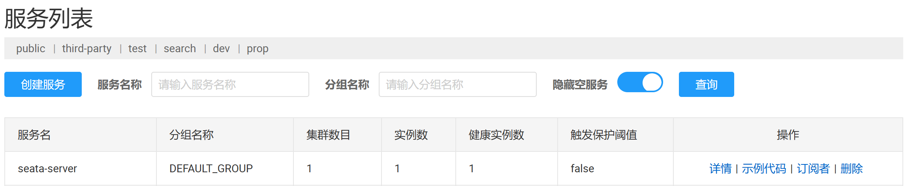
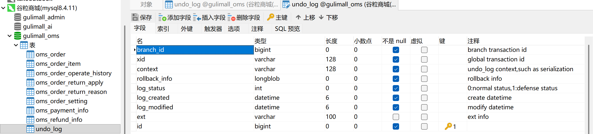
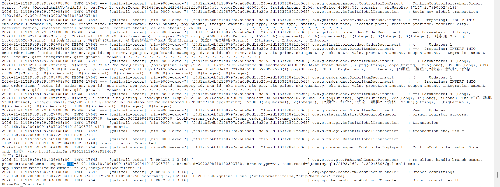
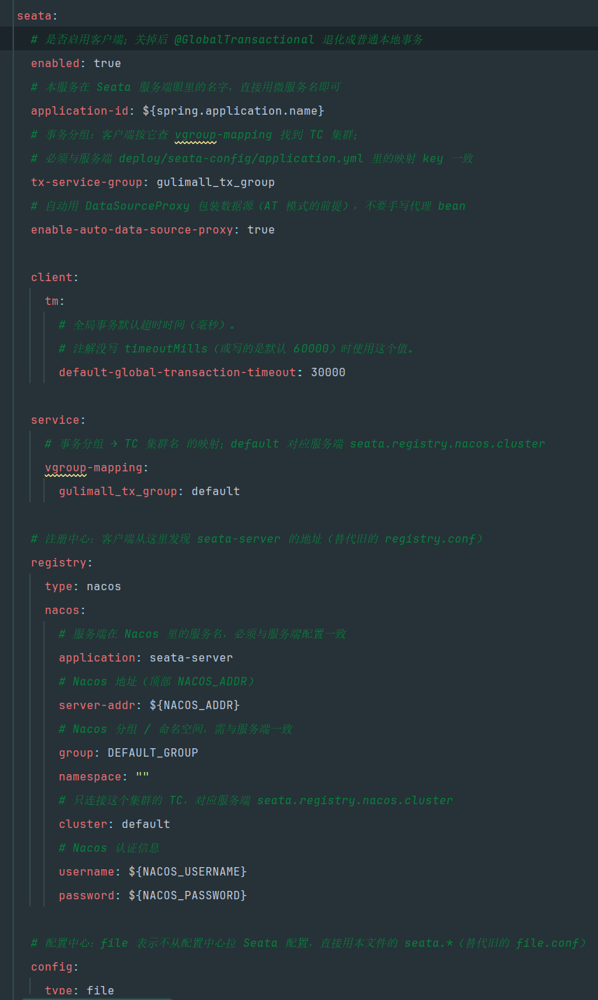

# 12.2 Seata 分布式事务-介绍

> 本篇介绍 Seata 分布式事务：订单和库存跨服务写入为什么需要全局事务、哪些链路走强一致、哪些链路走最终一致、AT 模式怎样记录 `undo_log`、TC/TM/RM 各自做什么、全局锁和 30 秒超时怎样配置、订单提交和仓储锁库存的事务边界在哪里、Redis 和 MQ 为什么不能算进全局事务。

> Seata 相关文档与配置：[Deploy组件一览](../Deploy/Deploy组件一览.md)、[Seata Server 配置](../../deploy/seata-config/application.yml)。

---

## 1. 这个功能是干什么的

订单提交会同时写两个库：

```text
gulimall_oms（订单库）
  ├── oms_order
  └── oms_order_item

gulimall_wms（仓储库）
  ├── wms_ware_order_task
  ├── wms_ware_order_task_detail
  ├── wms_ware_sku
  └── mq_message
```

两个库在两个服务里，各自有独立的数据源和本地事务。订单插入成功、仓储锁库存失败时，如果只靠本地事务，订单会留在订单库，库存却没有锁住，用户能看到待付款订单，仓库却没有为它占货。

Seata 解决的就是这个问题：

1. 订单服务开启一个全局事务。
2. 订单库的插入注册成分支事务。
3. 仓储库的锁库存注册成另一个分支事务。
4. 任何一个分支失败，协调器通知所有分支回滚。
5. 全部分支成功，协调器通知所有分支提交。

项目里的强一致链路有三类：

| 链路 | 全局事务发起方 | 参与方 | 解决什么问题 |
|---|---|---|---|
| 普通订单提交 | `OrderServiceImpl.submitOrder()` | order 库、ware 库 | 订单和锁库存同时成功或同时失败 |
| 秒杀订单建单 | `OrderServiceImpl.createSeckillOrder()` | order 库、ware 库 | 秒杀订单和活动库存转换同时成功或失败 |
| 秒杀商品关联 | `SeckillSkuRelationServiceImpl` | coupon 库、ware 库 | 关联记录和活动库存锁定同时成功或失败 |

不属于全局事务、走最终一致的链路：

1. 普通订单取消后的库存释放。
2. 订单超时后的库存释放。
3. 支付成功后的锁定库存扣减。
4. 售后退货的库存回补。
5. 购物车清理、秒杀状态回填、搜索索引更新。

这些链路要么发生在全局事务之后，要么允许延迟，要么有本地消息表、定时任务、对账任务兜底，不需要把更多服务拉进一个长事务。

## 2. 用户、管理员和开发者怎么操作

### 2.1 用户侧表现

用户不直接接触 Seata。下单时的表现只有两种：

1. 订单和库存都成功，页面跳到支付页。
2. 任意一步失败，页面回到订单确认页并提示失败原因。

用户看不到“全局事务回滚”这样的词，只会看到“库存不足”“提交失败，请重试”之类的业务提示。

### 2.2 管理员查看事务状态

1. 打开 Seata 控制台或 Nacos 服务列表。
2. 查看全局事务 XID、状态、开始时间、耗时。
3. 事务长时间处于 begun 状态，说明分支没有正常结束。
4. 事务频繁回滚，说明远程调用或数据库写入失败率高。
5. 数据库中的 `undo_log` 和死信表用于进一步排查。

### 2.3 开发者启动 Seata Server

1. Seata Server 由 `deploy/docker-compose.yaml` 启动，容器名通常为 `seata-server`。
2. 服务端监听 8091 端口，TC 注册到 Nacos。
3. 服务端配置挂载 `deploy/seata-config/application.yml`。
4. 默认使用 file 存储模式，不需要额外数据库即可运行。
5. 客户端 order、ware、coupon 引入 Seata starter 后自动连接。

服务端关键配置：

```yaml
seata:
  registry:
    type: nacos
    nacos:
      application: seata-server
      server-addr: nacos:8848
      group: DEFAULT_GROUP
      namespace: ""
      cluster: default
      username: nacos
      password: <your-password>

  config:
    type: file

  store:
    mode: file

  service:
    vgroup-mapping:
      gulimall_tx_group: default
```

1. `registry`：TC 注册到 Nacos，客户端按服务名发现。
2. `config.type=file`：服务端配置直接读本文件。
3. `store.mode=file`：事务日志写本地文件，适合开发环境。
4. `vgroup-mapping`：事务分组 `gulimall_tx_group` 映射到 `default` 集群。

### 2.4 开发者建 `undo_log`

1. 在 `gulimall_oms` 执行一次 `sql/undo_log.sql`。
2. 在 `gulimall_wms` 执行一次同样的 SQL。
3. coupon 库参与全局事务时也要建。
4. 每个参与 AT 模式的数据库都必须有这张表，否则分支注册失败。

### 2.5 开发者配置客户端

1. 在模块 `pom.xml` 引入 `spring-cloud-starter-alibaba-seata`。
2. 在 `config/common.yaml` 配置注册中心、事务分组、超时时间。
3. 在业务模块 `application.yaml` 引入 `common.yaml`。
4. 在业务入口加 `@GlobalTransactional`。
5. 在分支服务方法上加 `@Transactional`。
6. 不要手写 `DataSourceProxy`，交给 starter 自动代理。

### 2.6 开发者查看事务记录

1. 打开 Seata 控制台或 Nacos 服务列表，确认 `seata-server` 在线。
2. 控制台可以看到全局事务 XID、状态、开始时间、耗时。
3. 数据库中查看 `undo_log`，能看到分支 id、XID 和回滚镜像。
4. 应用日志中搜索 `XID` 或 `GlobalTransactional`，能看到事务开始、提交、回滚。
5. 回滚时日志会打印分支回滚结果。



## 3. 整体设计思路

### 3.1 业务上怎么设计

#### 3.1.1 强一致只放在必须同时成功的链路

订单提交必须保证：

1. 订单主表和订单明细写入成功。
2. 仓储工作单、库存锁定、明细写入成功。

任何一边失败，另一边都不能留下脏数据。因此这条链路放进全局事务。

库存释放、支付扣减、退货回补不放进全局事务，原因：

1. 它们发生在订单已经创建之后，订单状态已经是一个明确的业务事实。
2. 这些动作允许延迟完成，失败可以重试。
3. 把它们拉进全局事务会让事务时间变长，锁住更多资源。
4. 消息丢失、服务宕机有本地消息表、定时任务、对账任务兜底。

#### 3.1.2 全局事务边界只包远程写入

订单提交的全局事务边界：

```text
开启全局事务
  ├── 订单库：写 oms_order
  ├── 订单库：写 oms_order_item
  ├── 远程调用 ware：锁库存
  │     └── 仓储库：写工作单、库存、明细、mq_message
  └── 提交全局事务
```

边界内不做这些事：

1. 不等待用户支付。
2. 不发送即时 MQ 消息。
3. 不写 Redis 库存以外的缓存。
4. 不做页面渲染、短信、日志归档。

#### 3.1.3 Redis 不在全局事务里

Redis 预扣发生在订单库写入前，Seata 管不到 Redis。设计上：

1. 预扣成功后才进入数据库事务。
2. 数据库事务失败，代码手动 `INCRBY` 回补。
3. 回补放在 `catch` 里统一处理锁库存失败。
4. 其他异常导致订单事务回滚时，Redis 可能不会自动回补，需要靠对账任务修复。
5. 原则是宁可少卖，不可超卖：Redis 可以比数据库少，不能比数据库多。

#### 3.1.4 MQ 不在全局事务内发送

锁库存成功后会登记一条库存解锁延时消息。消息发送不能发生在全局事务提交前：

1. 发送后 Broker 的 confirm 回调会更新 `mq_message.message_status`。
2. 这一行还在全局事务的 `undo_log` 里。
3. 全局回滚时 Seata 比对后镜像，发现数据被回调改过，会报 dirty undo log。
4. 因此仓储只把消息写进本地消息表，等全局事务结束后由补偿任务投递。

#### 3.1.5 30 秒全局事务超时

全局事务默认超时配置为 30 秒：

```yaml
seata:
  client:
    tm:
      default-global-transaction-timeout: 30000
```

超时的含义：

1. 从开启全局事务到提交或回滚，超过 30 秒 TC 会主动回滚。
2. 远程调用、数据库慢查询、锁等待都会占用这 30 秒。
3. 超时后即使业务代码还在跑，事务也可能已经被回滚。
4. 本地消息表的延迟投递时间必须大于 30 秒，当前配置 60 秒。

#### 3.1.6 失败后用户看到什么

1. 订单库写入失败：直接抛异常，用户看到提交失败。
2. 仓储锁库存失败：仓储抛异常，Feign 调用失败，订单事务回滚，用户看到库存不足。
3. 全局事务超时：TC 回滚，订单和库存都不保留，用户看到失败提示。
4. 回滚本身失败：需要人工介入，日志和 `undo_log` 是排查依据。

### 3.2 技术上怎么设计

#### 3.2.1 AT 模式

Seata AT 模式对业务代码透明，分两个阶段：

**第一阶段：执行业务 SQL 并记录回滚日志**

1. 解析业务 SQL。
2. 查询更新前的数据，生成前镜像。
3. 执行业务 SQL。
4. 查询更新后的数据，生成后镜像。
5. 把前镜像、后镜像写进 `undo_log`。
6. 向 TC 注册分支事务，申请全局锁。
7. 本地事务提交。

**第二阶段：提交或回滚**

1. 全局事务提交：TC 通知各分支异步删除 `undo_log`。
2. 全局事务回滚：根据 `undo_log` 生成反向 SQL，恢复前镜像。
3. 回滚前校验当前数据是否等于后镜像，防止脏写。
4. 回滚完成后删除 `undo_log`。

#### 3.2.2 TC、TM、RM

```text
TM（事务管理器）
  └── OrderServiceImpl.submitOrder() 上的 @GlobalTransactional
        开启全局事务，生成 XID

TC（事务协调器）
  └── seata-server
        保存全局事务和分支事务状态，决定提交还是回滚

RM（资源管理器）
  ├── 订单库数据源代理
  └── 仓储库数据源代理
        执行本地 SQL，写 undo_log，注册分支，接收提交/回滚指令
```

1. TM 只负责开启、提交、回滚全局事务。
2. TC 是独立部署的服务，负责协调。
3. RM 是每个参与库的数据源代理，负责分支事务。
4. 三者的关联键是 XID。

#### 3.2.3 全局锁

AT 模式在分支提交前会向 TC 申请全局锁：

1. 锁的粒度是“表名 + 主键值”。
2. 同一个全局事务内，多个分支可以持有同一行的锁。
3. 其他全局事务要改同一行，必须等锁释放。
4. 本地事务提交后，全局锁要到全局事务结束才释放。

好处是防止两个全局事务交叉修改同一行，回滚时互相覆盖。
代价是热点行会成为瓶颈，秒杀、爆款库存要尽量减少全局事务持有时间。

#### 3.2.4 数据源自动代理

配置：

```yaml
seata:
  enable-auto-data-source-proxy: true
```

作用：

1. starter 自动把业务数据源包装成 `DataSourceProxy`。
2. 业务代码仍然使用原来的 `DataSource`。
3. SQL 执行时自动生成前后镜像并写 `undo_log`。
4. 不要手写代理 Bean，重复代理会导致分支注册异常。

#### 3.2.5 事务分组与集群映射

客户端：

```yaml
seata:
  tx-service-group: gulimall_tx_group
  service:
    vgroup-mapping:
      gulimall_tx_group: default
```

服务端：

```yaml
seata:
  service:
    vgroup-mapping:
      gulimall_tx_group: default
```

1. 客户端按 `tx-service-group` 找到 `default` 集群。
2. 服务端按同样的映射注册 `default` 集群。
3. 三处名字必须一致：客户端事务分组、客户端映射、服务端映射。
4. 不一致时客户端找不到 TC，启动或第一次全局事务会失败。

#### 3.2.6 注册中心使用 Nacos

```yaml
seata:
  registry:
    type: nacos
    nacos:
      application: seata-server
      server-addr: ${NACOS_ADDR}
      group: DEFAULT_GROUP
      namespace: ""
      cluster: default
      username: ${NACOS_USERNAME}
      password: ${NACOS_PASSWORD}
```

1. 客户端通过 Nacos 发现 `seata-server`。
2. `application` 必须和服务端注册名一致。
3. `group`、`namespace`、`cluster` 必须和服务端一致。
4. Nacos 开了鉴权时用户名密码也要一致。

#### 3.2.7 本地事务和全局事务叠加

```java
@GlobalTransactional
@Transactional(rollbackFor = Exception.class)
public OrderVo submitOrder(OrderSubmitVo orderSubmitVo) {
    ...
}
```

1. `@GlobalTransactional` 开启全局事务，生成 XID。
2. `@Transactional` 开启订单库本地事务。
3. 订单主表和明细在同一个本地事务里。
4. 远程调用仓储时，XID 通过 Feign 请求头传播。
5. 仓储的本地事务注册成全局事务的第二个分支。
6. 方法正常返回，全局事务提交；抛异常，全局事务回滚。

#### 3.2.8 分支服务只加本地事务

仓储锁库存：

```java
@Transactional(rollbackFor = Exception.class)
public Long lockStock(...) {
    ...
}
```

1. 仓储不需要 `@GlobalTransactional`。
2. 数据源代理自动把本地事务注册成分支。
3. 分支的提交和回滚由 TC 通知。
4. 仓储方法抛出异常，Feign 返回失败，订单侧全局事务回滚。

## 4. 详细代码、配置和解释

下文按“配置或类为什么存在 → 关键概念与字段 → 链路位置 → 代码分块解释 → 一次完整示例 → 边界与可优化点”组织。每一块代码前面先说明它在链路里承担什么，代码后面按 1、2、3、4 的顺序解释执行过程、条件和原因。

### 4.1 Seata 依赖

#### 4.1.1 这个依赖解决什么问题

订单确认页提交时，`ConfirmController` 调 `OrderServiceImpl.submitOrder()`，这个方法同时写两个库：

1. `gulimall_oms`：写 `oms_order`、`oms_order_item`；
2. `gulimall_wms`：通过 Feign 调仓储 `lockStock()`，写工作单、库存、明细和本地消息。

秒杀建单和秒杀商品关联也是同样的形态：coupon 库写关联记录，ware 库锁活动库存。两个库挂在两个服务上，各自有独立的数据源和本地事务。

问题就出在“各自”上。订单插入成功、仓储锁库存失败时，本地事务只能回滚自己那一段：订单留在订单库，库存却没有锁住，用户能看到待付款订单，仓库却没有为它占货。反过来，仓储成功、订单库提交失败时，库存被锁住但订单不存在，解锁消息又依赖工作单，恢复会更麻烦。

`spring-cloud-starter-alibaba-seata` 提供的是一整套客户端能力：

1. TM（事务管理器）：识别 `@GlobalTransactional`，向 TC 开启、提交、回滚全局事务；
2. RM（资源管理器）：把每个数据源包装成代理，执行 SQL 时记录前后镜像、注册分支；
3. 数据源自动代理：业务代码继续用原来的 `DataSource`，AT 模式自动生效；
4. Feign 上下文传播：把 XID 放进请求头，让下游服务加入同一个全局事务。

调用方在上游：浏览器经网关进入 order 的提交接口，或者秒杀消费者异步调用订单建单。下游是两个数据库和 TC：order、ware、coupon 三个库分别有 RM，TC 是独立部署的 `seata-server`。依赖装错或漏装，表现不是编译失败，而是分支注册不上、回滚不生效，所以三个参与模块必须都引入。

#### 4.1.2 关键概念与使用点

四个概念贯穿整条事务链路：

| 概念 | 所在位置 | 职责 |
|---|---|---|
| XID | 贯穿全局事务 | 一次全局事务的唯一标识，Feign 调用时随请求头传播 |
| TM | 全局事务发起方 | 开启、提交、回滚全局事务 |
| TC | `seata-server` | 保存全局事务和分支状态，决定提交还是回滚 |
| RM | 每个参与库的数据源代理 | 执行本地 SQL、写 `undo_log`、注册分支、接收指令 |

项目中的全局事务使用点：

| 模块 | 类与方法 | 作用 |
|---|---|---|
| order | `OrderServiceImpl.submitOrder()` | 普通订单写入 + 仓储锁库存 |
| order | `OrderServiceImpl.createSeckillOrder()` | 秒杀订单写入 + 活动库存转订单库存 |
| coupon | `SeckillSkuRelationServiceImpl.saveRelation()` | 保存秒杀关联 + 锁定活动库存 |
| coupon | `SeckillSkuRelationServiceImpl.updateRelation()` | 修改秒杀关联 + 调整活动库存 |
| coupon | `SeckillSkuRelationServiceImpl.deleteRelations()` | 删除秒杀关联 + 释放活动库存 |

这些方法都是全局事务发起方。仓储的 `lockStock()`、`lockSeckillOrderStock()`、`reserveSeckillStock()`、`releaseSeckillStock()` 只加本地事务，作为分支参与者。

#### 4.1.3 代码与解释

order 模块的 `pom.xml` 引入 starter：

```xml
		<!-- Seata 分布式事务：order 是全局事务发起方 -->
		<dependency>
			<groupId>com.alibaba.cloud</groupId>
			<artifactId>spring-cloud-starter-alibaba-seata</artifactId>
		</dependency>
```

1. `groupId` 是 `com.alibaba.cloud`，版本由 Spring Cloud Alibaba 的 BOM 管理，子模块不单独写版本。
2. `artifactId` 指向 Seata starter，引入后自动装配 TM、RM、数据源代理和 Feign 传播。
3. 注释标出 order 是全局事务发起方，提示这个依赖不是普通工具包，而是事务链路的一部分。

ware 和 coupon 引入同一个依赖，版本由父工程统一管理：

```xml
		<spring-cloud-alibaba.version>2025.0.0.0</spring-cloud-alibaba.version>
```

1. `spring-cloud-alibaba.version` 决定 starter 的版本，order、ware、coupon 三个模块共用。
2. 版本升级必须三个模块一起做，单个模块先升会出现客户端与服务端协议不一致。
3. BOM 只管版本，不负责引入依赖，各模块仍要显式声明 starter。

为什么用 starter 而不是手写代理：

1. starter 自动配置数据源代理、TM、RM，业务代码不需要感知 Seata 的类。
2. 自动处理 Nacos 注册发现，客户端按服务名找到 TC。
3. 自动处理 Feign 的 XID 传播，异步线程除外。
4. 手写代理容易漏掉 Feign 传播或重复代理，重复代理会让分支注册异常。

#### 4.1.4 一次全局事务示例

```text
浏览器提交订单
  → order 的 @GlobalTransactional 被拦截
  → TM 连接 TC，拿到 XID
  → 订单库本地事务执行，RM 注册分支一
  → Feign 请求头带 XID
  → ware 的 RM 注册分支二
  → 两个分支都成功，TM 请求提交
  → TC 通知两个分支提交，异步删除 undo_log
```

1. 开启全局事务发生在进入方法体前，方法体里的 SQL 已经处于这个 XID 之下。
2. 分支注册发生在本地事务提交前，注册成功后 TC 才知道这个分支需要被协调。
3. 两个分支都成功才提交；任意一个失败，TM 请求回滚，TC 通知所有已注册分支。

#### 4.1.5 它不做什么

1. 不启动 TC。`seata-server` 由 Docker Compose 独立启动，starter 只负责连接。
2. 不替代本地事务。`@Transactional` 仍然负责订单库多表之间的原子性。
3. 不回滚 Redis。预扣和秒杀库存 key 在 Seata 管辖范围之外。
4. 不给没有引入依赖的模块做代理，未引入的模块调用链不会加入全局事务。
5. 不保证业务幂等。超时回滚后业务线程可能继续执行，幂等要业务自己保证。

#### 4.1.6 边界与可优化点

1. 依赖由 BOM 管理，升级时 order、ware、coupon 要一起升级，不能只升一个模块。
2. 可以按模块拆分 starter，只给真正参与全局事务的服务引入，减少启动开销。
3. 需要确认 Spring Cloud Alibaba 版本和 Spring Boot 版本兼容，版本错配时表现为自动配置类不生效。
4. 生产环境应固定版本号，不使用动态版本，避免构建时拉到不同的小版本。

### 4.2 `config/common.yaml`：客户端公共配置

#### 4.2.1 这段配置解决什么问题

order、ware、coupon 三个模块都需要回答同一组问题：事务分组叫什么、TC 在哪里、全局事务最多跑多久、数据源要不要自动代理。把这些配置分别写进三个模块的 `application.yaml`，只要有一处漏改，客户端就找不到 TC，或者分支注册不上。

`config/common.yaml` 把公共部分收口到一份文件，模块的 `application.yaml` 只负责导入。上游是模块启动时的配置加载，下游是 Seata 客户端的自动装配：TM 用这里的超时和分组开启事务，RM 用这里的注册中心地址上报分支。

#### 4.2.2 配置项与业务含义

| 配置项 | 值 | 业务含义 |
|---|---|---|
| `seata.enabled` | `true` | 客户端总开关，关闭后 `@GlobalTransactional` 退化成普通本地事务 |
| `seata.application-id` | `${spring.application.name}` | 客户端在 TC 侧的服务名 |
| `seata.tx-service-group` | `gulimall_tx_group` | 事务分组，客户端按它找 TC 集群 |
| `seata.enable-auto-data-source-proxy` | `true` | 自动代理数据源，AT 模式的前提 |
| `seata.client.tm.default-global-transaction-timeout` | `30000` | 全局事务默认超时，单位毫秒 |
| `seata.service.vgroup-mapping` | `gulimall_tx_group: default` | 事务分组映射到 TC 集群 |
| `seata.registry` | `nacos` | TC 的注册中心类型和地址 |
| `seata.config.type` | `file` | 客户端配置只读该文件，不从配置中心拉 |

#### 4.2.3 代码与解释

```yaml
seata:
  enabled: true
  application-id: ${spring.application.name}
  tx-service-group: gulimall_tx_group
  enable-auto-data-source-proxy: true

  client:
    tm:
      default-global-transaction-timeout: 30000

  service:
    vgroup-mapping:
      gulimall_tx_group: default

  registry:
    type: nacos
    nacos:
      application: seata-server
      server-addr: ${NACOS_ADDR}
      group: DEFAULT_GROUP
      namespace: ""
      cluster: default
      username: ${NACOS_USERNAME}
      password: ${NACOS_PASSWORD}

  config:
    type: file
```

1. `enabled` 是总开关。关闭后注解还在，但不向 TC 开启全局事务，跨库一致性随之失效。
2. `application-id` 直接取微服务名，TC 侧看到的事务归属就是 `gulimall-order`、`gulimall-ware` 这类名字。
3. `tx-service-group` 是客户端寻找 TC 的入口，必须和服务端的映射对得上。
4. `enable-auto-data-source-proxy` 打开后，starter 自动把业务数据源包装成代理，SQL 执行时才能生成前后镜像。
5. `default-global-transaction-timeout` 设为 30000，表示从开启到提交或回滚最多 30 秒。
6. `service.vgroup-mapping` 把 `gulimall_tx_group` 映射到 `default` 集群，服务端必须注册同名集群。
7. `registry` 指向 Nacos，客户端按 `application=seata-server` 发现 TC。
8. `config.type=file` 表示客户端 Seata 配置只读本地文件，不再叠加配置中心。

为什么超时是 30 秒：

1. 一次下单要经过订单库写入、Feign 调用、仓储库存更新，正常请求通常在几百毫秒到几秒。
2. 30 秒能覆盖正常请求，又不会让异常请求长时间锁住库存行和全局锁。
3. 本地消息表的延迟投递时间必须大于这个值，当前配置 60 秒，避免消息在事务还没结束时就开始投递。

#### 4.2.4 一次全局事务开启示例

```text
order 启动
  → 加载 common.yaml
  → Seata 自动配置读取 tx-service-group=gulimall_tx_group
  → 按 vgroup-mapping 找到 default 集群
  → 从 Nacos 发现 seata-server
  → 第一次进入 @GlobalTransactional 方法时向 TC 申请 XID
  → 后续分支注册都带这个 XID
```

1. 配置在启动阶段读完，第一次全局事务时不再读文件。
2. 找不到 TC 时，启动不一定失败，失败发生在第一次开启全局事务，日志里是注册中心查询不到服务。
3. 30 秒超时从 TM 向 TC 申请 XID 成功那一刻开始计时。

#### 4.2.5 它不做什么

1. 不配置服务端的存储模式，`store.mode` 在服务端文件里。
2. 不创建 `undo_log`，建表由 SQL 脚本完成。
3. 不配置业务数据源，数据库连接仍在各模块的 `application.yaml`。
4. 不控制全局锁重试次数和间隔，这部分使用默认值。
5. 不负责 Nacos 鉴权账号的保管，账号密码来自环境变量。

#### 4.2.6 边界与可优化点

1. `enabled` 写死为 `true`，测试环境想临时关闭只能改文件，可以改成环境变量。
2. 超时统一 30 秒，普通下单和秒杀建单的实际耗时不同，可以按链路拆成不同的注解参数。
3. 没有显式配置 `client.rm.lock.retry-interval` 等锁重试参数，热点库存场景需要按压测结果调整。
4. Nacos 用户名密码走环境变量，部署时要保证环境变量文件的权限。
5. 公共配置被三个模块共享，修改影响面大，变更前要确认所有模块的服务名和导入路径。

### 4.3 模块 yaml 与配置导入

#### 4.3.1 这些配置解决什么问题

公共配置解决“连哪个 TC”，模块配置解决“服务名是什么、连哪个库”。每个模块启动时要先确定服务名，再按顺序加载 Nacos 配置、公共 Seata 配置和模块私有配置，最后把各自的数据源交给 Seata 代理。

上游是 `common.yaml` 提供的 Seata 公共项，下游是各模块的数据源和数据库。order 连 `gulimall_oms`，ware 连 `gulimall_wms`，coupon 连 `gulimall_sms`，三个库各自有分支日志。

#### 4.3.2 配置加载顺序

1. 先读 `spring.application.name`，确定模块身份。
2. 再按 `spring.config.import` 的顺序逐个加载外部配置。
3. 后面的配置覆盖前面的同名项。
4. `optional:` 前缀表示文件或配置不存在时不阻断启动。

#### 4.3.3 代码与解释

order 的 `application.yaml`：

```yaml
spring:
  application:
    name: gulimall-order

  config:
    import:
      - optional:nacos:gulimall.yaml
      - optional:file:./config/common.yaml
      - optional:file:./config/${spring.application.name}.yaml
      - optional:file:../config/common.yaml
      - optional:file:../config/${spring.application.name}.yaml
```

1. `spring.application.name` 是 `gulimall-order`，Nacos 注册、Seata 的 `application-id`、配置文件名都依赖它。
2. 第一项从 Nacos 拉 `gulimall.yaml`，适合放跨环境共享的远程配置。
3. 第二、三项读当前目录的 `common.yaml` 和 `${spring.application.name}.yaml`，适合本地开发。
4. 第四、五项读上级目录的同名文件，兼容从仓库根目录或模块目录启动两种方式。
5. `optional:` 让缺失的配置文件跳过，不会因为某个环境没有 Nacos 就启动失败。

order 的数据源：

```yaml
spring:
  datasource:
    username: ${MYSQL_USERNAME}
    password: ${MYSQL_PASSWORD}
    url: jdbc:mysql://${MYSQL_HOST}:${MYSQL_PORT}/gulimall_oms?useUnicode=true&characterEncoding=UTF-8&serverTimezone=Asia/Shanghai&allowPublicKeyRetrieval=true
    driver-class-name: com.mysql.cj.jdbc.Driver
```

1. 地址指向 `gulimall_oms`，订单主表和明细都写在这个库。
2. `allowPublicKeyRetrieval=true` 用于 MySQL 8 的密码认证流程。
3. 账号密码来自环境变量，不在配置文件里出现明文。
4. Seata 启动时把这个数据源包装成代理，代理对象才是 RM 实际使用的数据源。

ware 的数据源指向 `gulimall_wms`：

```yaml
spring:
  datasource:
    username: ${MYSQL_USERNAME}
    password: ${MYSQL_PASSWORD}
    url: jdbc:mysql://${MYSQL_HOST}:${MYSQL_PORT}/gulimall_wms?useUnicode=true&characterEncoding=UTF-8&serverTimezone=Asia/Shanghai&allowPublicKeyRetrieval=true
    driver-class-name: com.mysql.cj.jdbc.Driver
```

1. 仓储的工作单、库存、明细、本地消息都在这个库。
2. 这个库同样要建 `undo_log`，否则仓储分支注册失败。
3. ware 不需要 `@GlobalTransactional`，它只提供 `@Transactional` 分支。

coupon 也参与秒杀关联的全局事务，数据源指向 `gulimall_sms`：

```yaml
spring:
  datasource:
    username: ${MYSQL_USERNAME}
    password: ${MYSQL_PASSWORD}
    url: jdbc:mysql://${MYSQL_HOST}:${MYSQL_PORT}/gulimall_sms?useUnicode=true&characterEncoding=UTF-8&serverTimezone=Asia/Shanghai&allowPublicKeyRetrieval=true
    driver-class-name: com.mysql.cj.jdbc.Driver
```

1. coupon 的关联表和秒杀场次都在 `gulimall_sms`。
2. 这个库也要建 `undo_log`。
3. coupon 发起全局事务时，仓储分支仍然通过 Feign 传播 XID。

三个模块的 yaml 都不重复写 `seata.*`，公共项统一由 `common.yaml` 提供。

#### 4.3.4 一次启动示例

```text
order 启动
  → 读到 spring.application.name=gulimall-order
  → 依次加载 Nacos、common.yaml、gulimall-order.yaml
  → 创建数据源，连接 gulimall_oms
  → Seata 自动配置把数据源包装成代理
  → 读取 common.yaml 的分组和注册中心
  → 向 Nacos 查询 seata-server
  → 启动完成，等待第一个全局事务
```

1. 配置导入全部发生在数据源创建前，Seata 才能拿到完整配置决定是否代理。
2. Nacos 不可达时，`optional:` 让本地启动继续，但第一次全局事务仍会失败。
3. 三个模块的启动顺序没有要求，TC 只要在第一次全局事务前可用即可。

#### 4.3.5 边界与可优化点

1. 数据源没有配置连接池上限和超时，全局事务期间连接会一直被占用。
2. Nacos 配置和本地配置可能同时存在，需要明确优先级，避免同名项互相覆盖。
3. 生产环境应把数据库账号拆成最小权限账号，订单库账号不能操作仓储库。
4. 配置文件分散在 Nacos 和本地目录，排查配置问题时先确认最终生效值。
5. coupon 库的 `undo_log` 容易被遗漏，新增参与全局事务的模块时要同步建表。

### 4.4 `undo_log` 建表 SQL

#### 4.4.1 这张表解决什么问题

AT 模式不要求在业务代码里写反向 SQL，代价是每个分支库必须保存一份回滚依据。业务 SQL 执行前，RM 查询并保存前镜像；执行后再保存后镜像；两份镜像按 XID 和分支 id 写进 `undo_log`。全局事务需要回滚时，TC 通知 RM，RM 按镜像把数据写回去。

上游是数据源代理，每一笔参与全局事务的写操作都会产生日志；下游是 TC 的回滚指令和运维排查。订单库、仓储库、coupon 库各有一份同名表，各管各的分支。

#### 4.4.2 字段与业务含义

| 字段 | 类型 | 业务含义 |
|---|---|---|
| `branch_id` | `bigint` | 分支事务 id，同一个 XID 下定位具体分支 |
| `xid` | `varchar(128)` | 全局事务 id |
| `context` | `varchar(128)` | 序列化上下文，例如序列化方式 |
| `rollback_info` | `longblob` | 前后镜像的序列化结果 |
| `log_status` | `int` | 0 正常，1 防悬挂状态 |
| `log_created` | `datetime(6)` | 创建时间 |
| `log_modified` | `datetime(6)` | 修改时间 |
| `ext` | `varchar(100)` | 扩展信息 |
| `id` | `bigint` | 自增主键，InnoDB 聚簇索引 |

唯一键 `ux_undo_log(xid, branch_id)` 保证同一分支只有一条回滚日志。

#### 4.4.3 代码与解释

```sql
CREATE TABLE IF NOT EXISTS `undo_log` (
  `branch_id` bigint NOT NULL COMMENT 'branch transaction id',
  `xid` varchar(128) NOT NULL COMMENT 'global transaction id',
  `context` varchar(128) NOT NULL COMMENT 'undo_log context,such as serialization',
  `rollback_info` longblob NOT NULL COMMENT 'rollback info',
  `log_status` int NOT NULL COMMENT '0:normal status,1:defense status',
  `log_created` datetime(6) NOT NULL COMMENT 'create datetime',
  `log_modified` datetime(6) NOT NULL COMMENT 'modify datetime',
  `ext` varchar(100) DEFAULT NULL COMMENT 'ext info',
  `id` bigint NOT NULL AUTO_INCREMENT,
  PRIMARY KEY (`id`),
  UNIQUE KEY `ux_undo_log` (`xid`, `branch_id`)
) ENGINE=InnoDB DEFAULT CHARSET=utf8mb4 COMMENT='AT transaction mode undo table';
```

1. `branch_id` 和 `xid` 是查询回滚日志的核心条件，回滚时按这两个值精确取出镜像。
2. `context` 记录序列化上下文，跨版本升级时用来判断镜像格式。
3. `rollback_info` 是 `longblob`，保存序列化后的前后镜像，大事务会明显撑大这一列。
4. `log_status` 为 0 表示正常，1 表示防悬挂，用于处理分支注册和回滚指令乱序到达的情况。
5. `log_created`、`log_modified` 用来排查分支执行时间，也方便清理历史数据。
6. `ext` 保留扩展字段，当前业务不使用。
7. `id` 是自增主键，InnoDB 按主键组织数据，回滚日志写入是顺序追加。
8. `ux_undo_log` 是唯一索引，防止同一个分支重复写入。

为什么每个库都要建：

AT 模式的分支是库级数据源。订单库和仓储库各有一个数据源代理，各写各的 `undo_log`。只在订单库建表，仓储分支回滚时找不到日志，TC 会一直重试，最终需要人工处理。coupon 库参与秒杀关联的全局事务，同样要建。

#### 4.4.4 一次回滚示例

```text
全局事务回滚，TC 通知仓储分支
  → RM 按 xid + branch_id 查 undo_log
  → 取出 beforeImage：id=10, stock=100, stock_locked=0
  → 取出 afterImage： id=10, stock=100, stock_locked=2
  → 校验当前行是否仍等于 afterImage
  → 相等则写回 beforeImage，执行 UPDATE wms_ware_sku SET stock_locked=0 WHERE id=10
  → 删除这条 undo_log
```

1. 校验当前行是防止脏写。当前值已经被别的全局事务改过时，直接写回前镜像会覆盖别人的提交。
2. 校验不通过时回滚失败，日志保留，需要人工介入。
3. 回滚成功后删除日志，表不会无限增长。

#### 4.4.5 它不做什么

1. 不保存业务数据，只保存回滚所需的镜像。
2. 不负责自动清理已提交的日志，提交后的删除由 TC 异步通知。
3. 不能跨库共用，每个参与库都要有一份。
4. 不记录 Redis 和 MQ 的状态，缓存和消息需要业务补偿。
5. 不校验业务规则，回滚只按数据镜像恢复。

#### 4.4.6 边界与可优化点

1. 表会随事务量增长，要定期清理已提交的日志，或者按时间归档。
2. `longblob` 占用空间较大，大事务会放大磁盘压力，需要监控表大小。
3. 生产环境建议把 `undo_log` 和业务表放同一库，避免事务日志跨库。
4. 业务表必须有主键，AT 模式按主键定位行，没有主键的表回滚会失败。
5. 表名固定是 `undo_log`，不要改表名或加前缀，客户端默认按这个名字查找。



### 4.5 `OrderServiceImpl.submitOrder`：全局事务边界

#### 4.5.1 这个方法解决什么问题

订单确认页点“提交订单”时，页面把令牌、地址、购物车金额、选仓信息一起提交上来。这个方法要在服务端重新校验这些数据，预扣 Redis 库存，写订单主表和明细，再调仓储锁库存。订单库和仓储库必须同时成功或同时失败，所以全局事务从这里开启。

上游是 `ConfirmController.submitOrder()`，它已经加了库存读锁；下游是订单库、商品服务、购物车服务、会员地址服务和仓储服务。方法返回 `OrderVo`，Controller 再拼成支付页地址。

#### 4.5.2 关键概念与链路位置

```text
ConfirmController.submitOrder
  → 库存读锁
  → OrderServiceImpl.submitOrder
  → @GlobalTransactional 开启全局事务，拿到 XID
  → 校验令牌、地址、购物车、价格、仓库、库存
  → Redis 预扣
  → 写 oms_order、oms_order_item（分支一）
  → Feign 调 ware.lockStock（分支二，XID 传播）
  → 返回 OrderVo，全局事务提交
```

校验失败都发生在写库前，抛异常只会结束全局事务，不会产生需要回滚的数据库分支。Redis 预扣发生在数据库事务前，不属于全局事务。

#### 4.5.3 代码与解释

```java
    @GlobalTransactional
    @Transactional(rollbackFor = Exception.class)
    @Override
    public OrderVo submitOrder(OrderSubmitVo orderSubmitVo) {

        // ==================== 第 2 步：二次校验关键数据 ====================

        // 2.1 登录用户（令牌的 key 里要用 memberId）
        MemberResponseVo loginUser = MemberResponseVoThreadLocal.get();
        if (loginUser == null) {
            throw new RRException(BizCodeEnum.ORDER_NOT_LOGIN);
        }

        // 2.2 防重令牌：confirmOrder 里是 key=前缀+memberId、value=token，
        //     校验通过立刻删除，保证一个令牌只能用一次
        String tokenKey = OrderConstant.USER_ORDER_TOKEN_PREFIX + loginUser.getId();

        // 校验通过并删除，两步必须原子（Lua），否则并发下同一个令牌能被用两次
        Long consumed = stringRedisTemplate.execute(CONSUME_TOKEN_SCRIPT, List.of(tokenKey),
                orderSubmitVo.getOrderToken());
        if (consumed != 1L) {
            throw new RRException(BizCodeEnum.ORDER_TOKEN_INVALID);
        }

        // 2.3 收货地址（顺带核对这个地址是不是他自己的）
        MemberAddressVo address = memberReceiveAddressFeignClient.getAddressById(orderSubmitVo.getAddrId());
        if (address == null || !loginUser.getId().equals(address.getMemberId())) {
            throw new RRException(BizCodeEnum.ORDER_ADDRESS_INVALID);
        }

        // 2.4 购物车实时数据：不信任前端提交的商品、件数和价格
        List<OrderItemVo> items = cartFeignClient.getCurrentCartItems();
        if (items == null || items.isEmpty()) {
            throw new RRException(BizCodeEnum.ORDER_CART_EMPTY);
        }

        // 2.5 价格校验：用服务端实时价格重算，和前端传来的对比。
        //     totalPrice 不用自己乘：cart 侧 CartItemVo#getTotalPrice() 已经算好（price × count），
        //     Feign 序列化时 Jackson 调 getter 把它写进了 JSON，反序列化成 OrderItemVo 时自动赋上来的
        BigDecimal goodsTotal = items.stream()
                .map(item -> item.getTotalPrice() == null ? BigDecimal.ZERO : item.getTotalPrice())
                .reduce(BigDecimal.ZERO, BigDecimal::add);
        if (orderSubmitVo.getGoodsTotal() != null
                && orderSubmitVo.getGoodsTotal().compareTo(goodsTotal) != 0) {
            throw new RRException(BizCodeEnum.ORDER_PRICE_CHANGED);
        }

        // 每个 sku 的购买数量
        Map<Long, Integer> skuQuantities = items.stream()
                .collect(Collectors.toMap(OrderItemVo::getSkuId, OrderItemVo::getCount, Integer::sum));

        // 运费页选中的仓库
        Map<Long, Long> skuWareMap = null;
        if (orderSubmitVo.getSkuWareMap() != null && !orderSubmitVo.getSkuWareMap().isBlank()) {
            skuWareMap = JSON.parseObject(orderSubmitVo.getSkuWareMap(),
                    new TypeReference<Map<Long, Long>>() {
                    });
        }
        if (skuWareMap == null) {
            throw new RRException(BizCodeEnum.ORDER_WAREHOUSE_MISSING);
        }
        for (Long skuId : skuQuantities.keySet()) {
            if (skuWareMap.get(skuId) == null) {
                throw new RRException(BizCodeEnum.ORDER_WAREHOUSE_MISSING);
            }
        }

        // 2.6 库存校验：按运费页选中的仓库查
        List<Long> skuIds = items.stream().map(OrderItemVo::getSkuId).distinct().toList();
        Map<Long, Boolean> stockResult = wareFeignClient.hasStockByWare(
                new WareStockCheckVo(skuWareMap, skuQuantities));
        Map<Long, Boolean> hasStock = stockResult == null ? Map.of() : stockResult;
        List<Long> noStockSkuIds = skuIds.stream()
                .filter(skuId -> !Boolean.TRUE.equals(hasStock.get(skuId)))
                .toList();
        if (!noStockSkuIds.isEmpty()) {
            // 提示里给商品名，给 skuId 用户看不懂
            List<String> noStockTitles = items.stream()
                    .filter(item -> noStockSkuIds.contains(item.getSkuId()))
                    .map(OrderItemVo::getTitle)
                    .toList();
            throw new RRException(BizCodeEnum.ORDER_STOCK_NOT_ENOUGH, noStockTitles);
        }

        // ==================== 第 3 步：库存预扣减 ====================

        /*
          因为DB和redis是两套系统，因此扣库存操作无法保证原子性。
          出现宕机时，只能靠每日定时任务来确保DB和redis库存一致性！
         */

        // 3.1 Redis 预扣（Lua 原子执行：判断 + 扣减一步完成）
        skuQuantities.forEach(this::deductRedisStock);

        // 3.2 建订单 + 锁定数据库库存
        String orderSn = generateOrderSn(loginUser.getId());

        // 批量查一次 sku 对应的 spu 概要信息（spu 名称、品牌、分类），别每个 sku 查一次
        // Function.identity()恒等函数 相当于 v -> v
        Map<Long, SkuDetailVo> detailMap = productFeignClient.getSkuDetails(skuIds).stream()
                .collect(Collectors.toMap(SkuDetailVo::getSkuId, Function.identity()));

        OrderEntity order = buildOrder(orderSubmitVo, loginUser, address, goodsTotal, orderSn);
        save(order);

        List<OrderItemEntity> orderItems = items.stream()
                .map(item -> buildOrderItem(item, order.getId(), orderSn, detailMap.get(item.getSkuId())))
                .toList();
        orderItems.forEach(orderItemDao::insert);

        try {
            // ware 侧不再加锁（调用方已持有 STOCK_LOCK）；锁库存失败会由 Seata 回滚 ware 分支。
            // ware 本地事务里同时写工作单和延时解锁消息。
            StockLockVo stockLockVo = new StockLockVo();
            stockLockVo.setOrderId(order.getId());
            stockLockVo.setOrderSn(orderSn);
            stockLockVo.setSkuQuantities(skuQuantities);
            stockLockVo.setSkuWareMap(skuWareMap);
            wareFeignClient.lockStock(stockLockVo);
            // 测试全局事务回滚
//            int a = 1 / 0;
        } catch (Exception e) {
            // Seata 会回滚 ware 分支；Redis 不在全局事务里，这里统一回补。
            skuQuantities.forEach((skuId, num) -> stringRedisTemplate.opsForValue()
                    .increment(WareConstant.STOCK_CACHE_PREFIX + skuId, num));
            throw new RRException(BizCodeEnum.ORDER_STOCK_DEDUCT_FAILED);
        }

        OrderVo orderVo = new OrderVo();
        BeanUtils.copyProperties(order, orderVo);
        return orderVo;
    }
```

1. 方法上同时有 `@GlobalTransactional` 和 `@Transactional`。前者开启全局事务，后者开启订单库本地事务，两个注解缺一不可。
2. 从 `MemberResponseVoThreadLocal` 取登录会员，为空直接抛未登录，避免后续用空会员写订单。
3. 用 Lua 脚本原子消费防重令牌。脚本里判断 key 的 value 是否等于提交的 token，相等就删除并返回 1，保证一个令牌只能用一次。
4. 按地址 id 查收货地址，同时核对 `memberId`，防止拿别人的地址下单。
5. 远程查购物车实时数据，不信任前端提交的商品、件数和价格。
6. 用 `CartItemVo#getTotalPrice()` 算好的每项小计求和。这个值通过 Feign 序列化传过来，避免订单服务重复计算单价乘数量。
7. 前端传了 `goodsTotal` 就和服务端重算值比较，不一致抛价格变化。
8. 汇总每个 sku 的购买数量，`Collectors.toMap` 遇到重复 sku 用 `Integer::sum` 合并。
9. 解析 `skuWareMap`，运费页没有选仓库时抛仓库缺失；逐个 sku 检查是否都有仓库。
10. 按选中的仓库调 `hasStockByWare()` 校验库存，返回结果只包含布尔值。
11. 库存不足时收集 skuId，再映射成商品名，提示里给用户能看懂的名称。
12. 逐 sku 调 `deductRedisStock()` 预扣 Redis 库存。这一步在数据库事务之外，Seata 管不到。
13. 生成订单号，批量查 spu 概要信息，避免每个 sku 单独查一次。
14. 组装订单主表并 `save()`，此时订单库本地事务已经开始。
15. 组装订单明细，逐条通过 `orderItemDao.insert()` 插入。
16. 组装 `StockLockVo`，调 `wareFeignClient.lockStock()`。Feign 把 XID 放进请求头，仓储的本地事务注册成第二个分支。
17. 仓储调用抛异常时，`catch` 里统一回补 Redis 库存，再抛 `ORDER_STOCK_DEDUCT_FAILED`。异常继续向上抛，TM 请求全局回滚。
18. 正常返回时把订单实体复制成 `OrderVo`。方法返回后全局事务提交，两个库的分支一起提交。

为什么全局事务只包这一层：

1. 校验失败发生在写库前，不需要全局事务回滚。
2. Redis 预扣不是数据库分支，放进全局事务也没有对应的回滚动作。
3. 订单写库和仓储锁库存是最需要一致的两步，边界只包住这两步。
4. 支付、取消、退货发生在方法返回之后，拉进全局事务只会延长锁持有时间。

为什么 Redis 回补放在 `catch` 里：

1. Redis 预扣已经成功，数据库分支失败后不会自动恢复。
2. 不回补会导致 Redis 库存比数据库少，商品少卖。
3. 回补只覆盖“仓储锁库存失败”这一条路径，订单主表插入失败等异常不会走到这里。
4. 根本原因是 Redis 和数据库是两套系统，原子性只能靠补偿和对账。

#### 4.5.4 一次完整示例

**示例 A：下单成功**

```text
1. 前端提交 orderToken、addrId、goodsTotal、skuWareMap
2. submitOrder 开启全局事务，XID=<your-windows-host-ip>:8091:1001
3. 令牌校验通过，Redis 删除令牌
4. 地址、购物车、价格、仓库、库存校验通过
5. Redis 预扣每个 sku 的库存
6. 写 oms_order，得到 orderId
7. 写 oms_order_item
8. Feign 调 ware.lockStock，请求头带 XID
9. 仓储写工作单、库存锁定、明细、mq_message，注册分支二
10. 方法返回 OrderVo
11. TC 通知两个分支提交，异步删除 undo_log
12. Controller 返回 /pay.html?orderSn=...
```

**示例 B：仓储锁库存失败**

```text
1. 订单主表和明细已经写入
2. Feign 调 ware.lockStock
3. 仓储库存不足，抛异常，仓储本地事务回滚
4. 订单侧 catch 捕获异常，回补 Redis 库存
5. 抛出 ORDER_STOCK_DEDUCT_FAILED
6. TM 请求全局回滚
7. TC 通知订单分支回滚，按 undo_log 恢复
8. 用户看到库存不足提示
```

#### 4.5.5 它不做什么

1. 不负责库存读锁，锁在 Controller 层，覆盖整个下单动作。
2. 不检查 `lockStock()` 返回的 `R.code`，依赖仓储抛异常触发回滚。
3. 不处理支付、取消、超时释放，这些动作在订单创建之后。
4. 不自动回滚 Redis，只覆盖锁库存失败的路径。
5. 不校验运费和应付金额，`freightAmount`、`payPrice` 直接使用前端值。

#### 4.5.6 边界与可优化点

1. `freightAmount` 和 `payPrice` 直接使用前端值，服务端没有重新计算，存在被篡改的风险。
2. Redis 预扣成功后，如果订单主表插入失败，`catch` 不会执行，Redis 不会回补。应在事务回滚回调里统一回补。
3. `items.forEach(orderItemDao::insert)` 逐条插入，订单明细多时性能差，可以改批量插入。
4. `wareFeignClient.lockStock()` 返回的 `R` 没有检查 code，仓储改为返回 HTTP 200 后这里会漏掉失败。
5. 30 秒全局事务超时对远程调用链偏紧，需要按压测结果调整。
6. 价格比较使用 `compareTo`，金额精度依赖服务端重算结果，前端传值只作为校验参考。

### 4.6 `ConfirmController.submitOrder`：全局事务外层边界

#### 4.6.1 这个接口解决什么问题

订单确认页是传统表单页面，提交后需要跳转支付页或回到确认页。这个接口负责三件事：加库存读写锁中的读锁、调用订单服务的全局事务方法、把结果转成可跳转的地址。

上游是浏览器和网关，下游是 `OrderServiceImpl.submitOrder()`。锁放在这一层，是为了覆盖从下单开始到全局事务结束的整段时间；如果锁放在 Service 内部，Controller 和 Service 可能各自加锁，锁的范围也对不上。

#### 4.6.2 链路位置

```text
浏览器表单提交
  → Gateway /gulimall/order/submitOrder
  → ConfirmController.submitOrder
  → 取 STOCK_LOCK 读锁（最多等 3 秒，租约 30 秒）
  → OrderServiceImpl.submitOrder（全局事务）
  → 成功返回 /pay.html?orderSn=...
  → 失败返回带错误文案的跳转地址
  → finally 释放读锁
```

#### 4.6.3 代码与解释

```java
    @PostMapping("/submitOrder")
    @ResponseBody
    @CacheEvict(cacheNames = "fare", allEntries = true)
    public String submitOrder(OrderSubmitVo orderSubmitVo) {
        RLock lock = redissonClient.getReadWriteLock(WareConstant.STOCK_LOCK).readLock();
        boolean locked = false;
        try {
            // 最多等 3 秒；拿到后最多持有 30 秒，防止持锁线程异常退出后锁不释放
            locked = lock.tryLock(3, 30, TimeUnit.SECONDS);
            if (!locked) {
                return toTradeWithError(BizCodeEnum.ORDER_STOCK_BUSY.getMsg());
            }

            // 真正的下单逻辑（第 2、3 步见 OrderServiceImpl#submitOrder）
            try {
                OrderVo orderVo = orderService.submitOrder(orderSubmitVo);
                // 正常下单返回支付页地址，前端拿到后 window.location.href 跳过去
                return "/pay.html?orderSn=" + orderVo.getOrderSn();
            } catch (RRException e) {
                // 业务异常的文案都是给人看的（库存不足、价格变动……），直接带给前端弹窗
                return toTradeWithError(e.getMsg());
            }
        } catch (InterruptedException e) {
            Thread.currentThread().interrupt();
            return toTradeWithError(BizCodeEnum.ORDER_SUBMIT_INTERRUPTED.getMsg());
        } finally {
            if (locked && lock.isHeldByCurrentThread()) {
                lock.unlock();
            }
        }
    }
```

1. `@PostMapping("/submitOrder")` 对应确认页表单提交，返回 `String` 而不是 JSON。
2. `@CacheEvict(cacheNames = "fare", allEntries = true)` 在成功返回后清运费缓存，下一次进入确认页重新计算运费。
3. 取 `STOCK_LOCK` 的读锁。读锁允许多个下单并发，只和管理员盘点、对账的写锁互斥。
4. `tryLock(3, 30, TimeUnit.SECONDS)` 表示最多等 3 秒，拿到后最多持有 30 秒，防止持锁线程异常退出后锁不释放。
5. 没拿到锁时返回库存操作繁忙，不进入下单逻辑。
6. 调 `orderService.submitOrder()`。真正的业务校验、Redis 预扣、订单写入和仓储调用都在这个方法里。
7. 成功时返回 `/pay.html?orderSn=...`，前端拿到地址直接跳转。
8. `RRException` 是业务异常，文案直接给人看，`toTradeWithError()` 编码后拼进跳转地址。
9. 线程被中断时恢复中断标记，返回提交被中断的提示。
10. `finally` 里判断锁是否由当前线程持有，再由当前线程释放，避免释放别人的锁。

为什么锁在 Controller 而不在 Service：

1. 锁的粒度要覆盖整个下单动作，包括订单写入和远程锁库存。
2. Controller 是下单的唯一入口，锁放在这里不会漏。
3. 仓储侧明确不再加同一把锁，避免自己等自己。
4. 读锁允许多个下单并发，只和盘点、对账的写锁互斥。

为什么返回字符串而不是 JSON：

1. 页面是传统表单提交，前端拿到地址直接跳转。
2. 成功和失败都返回一个可跳转的地址，前端处理简单。
3. 失败文案放在 query 参数里，需要 URL 编码。

#### 4.6.4 一次请求示例

```text
1. 用户点“提交订单”
2. POST /gulimall/order/submitOrder，表单带 orderToken、addrId、goodsTotal、skuWareMap
3. 取 STOCK_LOCK 读锁成功
4. submitOrder 返回 OrderVo(orderSn=202611120001)
5. Controller 返回 /pay.html?orderSn=202611120001
6. finally 释放读锁
7. 前端 window.location.href 跳到支付页
```

库存不足时，第 4 步抛 `RRException`，Controller 捕获后返回 `toTradeWithError("库存不足")` 拼出的地址，前端跳回确认页并弹窗。

#### 4.6.5 它不做什么

1. 不做业务校验，令牌、地址、价格、库存都在 Service 里校验。
2. 不开启全局事务，`@GlobalTransactional` 在 `submitOrder()` 上。
3. 不包装统一 JSON 结果，返回的是跳转地址。
4. 不处理非 `RRException` 的异常，其他异常走全局错误页。
5. 不检查锁的等待队列，读锁并发上限由 Redisson 和线程池决定。

#### 4.6.6 边界与可优化点

1. 读锁持有到全局事务结束，远程调用越慢，盘点等待越久。
2. 30 秒锁租约和 30 秒全局事务超时相同，极端情况下锁可能先于事务释放。
3. 业务异常只捕获 `RRException`，参数解析异常、Feign 超时等会走全局错误页。
4. `@CacheEvict` 在方法成功返回后执行，失败时不清运费缓存，这是期望行为。
5. 读锁不能防止同一用户的重复提交，防重仍依赖 Redis 令牌。

### 4.7 仓储分支 `lockStock`：只加本地事务

#### 4.7.1 这个方法解决什么问题

订单服务锁库存时调用仓储的 `lockStock()`。仓储要在自己的库里写四类数据：工作单主记录、每个 sku 的库存锁定、工作单明细、库存解锁的本地消息。这四类数据必须一起成功，否则会出现“库存锁了但没有工作单”或“有工作单但没有解锁消息”的脏数据。

上游是订单服务的 Feign 调用，请求头带 XID；下游是 `gulimall_wms` 的几张表和本地消息表。仓储不需要开启全局事务，它只需要一个本地事务，由数据源代理自动注册成全局分支。

#### 4.7.2 分支事务与全局事务的关系

```text
order 侧 TM 开启全局事务，XID=1001
  → Feign 请求头带 XID=1001
  → ware 侧 RM 识别 XID，把本地事务注册成分支
  → 仓储本地事务提交，分支注册成功
  → TC 记录分支状态
  → 全局事务提交或回滚时，TC 通知这个分支
```

1. 分支的开启和提交由本地事务控制，全局事务只负责最终的一致性决定。
2. 仓储方法抛异常时，本地事务回滚，Feign 返回失败，订单侧全局事务回滚。
3. 仓储方法正常返回时，本地事务先提交，全局事务再决定是否最终提交。

#### 4.7.3 代码与解释

```java
    @Override
    @Transactional(rollbackFor = Exception.class)
    public Long lockStock(Long orderId, String orderSn, Map<Long, Integer> skuQuantities,
                          Map<Long, Long> skuWareMap) {
        if (orderSn == null || orderSn.isEmpty()) {
            throw new RRException(BizCodeEnum.WARE_ORDER_SN_REQUIRED);
        }
        if (skuQuantities == null || skuQuantities.isEmpty()) {
            throw new RRException(BizCodeEnum.WARE_STOCK_ITEMS_REQUIRED);
        }

        // 幂等：同一订单已经有工作单就直接返回。
        // 数据库上还有 uk_order_sn 唯一索引兜底，并发重复请求不可能锁两次库存。
        WareOrderTaskEntity existing = wareOrderTaskService.getOne(
                new QueryWrapper<WareOrderTaskEntity>()
                        .eq("order_sn", orderSn)
                        .last("LIMIT 1"),
                false);
        if (existing != null) {
            if (Integer.valueOf(TASK_STATUS_LOCKED).equals(existing.getTaskStatus())) {
                log.info("[stock-lock] 订单 {} 已锁定过库存，直接返回工作单 {}", orderSn, existing.getId());
                return existing.getId();
            }
            throw new RRException(BizCodeEnum.WARE_ORDER_TASK_ALREADY_PROCESSED, orderSn);
        }

        // 1. 先写工作单主记录，明细需要它的自增 id
        WareOrderTaskEntity task = new WareOrderTaskEntity();
        task.setOrderId(orderId);
        task.setOrderSn(orderSn);
        task.setTaskStatus(TASK_STATUS_LOCKED);
        task.setCreateTime(new Date());
        wareOrderTaskService.save(task);

        // 2. 逐个 sku 按仓库锁库存，并记录每一笔锁定的明细
        for (Map.Entry<Long, Integer> entry : skuQuantities.entrySet()) {
            Long skuId = entry.getKey();
            Integer quantity = entry.getValue();
            if (quantity == null || quantity <= 0) {
                continue;
            }

            // 必须带选仓信息，缺失直接报错
            Long chosenWareId = skuWareMap == null ? null : skuWareMap.get(skuId);
            if (chosenWareId == null) {
                throw new RRException(BizCodeEnum.WARE_CHOSEN_WAREHOUSE_REQUIRED);
            }
            lockChosenWarehouse(task, skuId, quantity, chosenWareId);
        }

        Long taskId = task.getId();
        sendReleaseMessage(taskId, orderSn);
        return taskId;
    }
```

1. 方法上只有 `@Transactional(rollbackFor = Exception.class)`，没有 `@GlobalTransactional`。仓储是参与者，不是发起方。
2. 校验订单号和商品数量，空值直接抛业务异常，避免写入无主的工作单。
3. 按订单号查已有工作单，做幂等。重复请求如果已经锁定，直接返回原工作单 id。
4. 工作单存在但状态不是“已锁定”，说明已经处理过，抛异常让调用方知道不能重复锁。
5. 新建工作单主记录，状态设为已锁定，先 `save()` 拿到自增 id，明细需要这个 id。
6. 遍历 `skuQuantities`，跳过数量为空或小于等于 0 的项。
7. 从 `skuWareMap` 取用户选中的仓库，缺失时抛“必须选择仓库”。
8. 调 `lockChosenWarehouse()` 锁指定仓库的库存，并在方法内部写工作单明细。
9. 锁完所有 sku 后，调 `sendReleaseMessage()` 登记库存解锁消息。
10. 返回工作单 id。本地事务提交时，数据源代理把整个事务注册成全局分支。

为什么只加 `@Transactional`：

1. 仓储是参与者，不是发起方，全局事务由订单服务开启。
2. XID 通过 Feign 请求头传过来，数据源代理会自动识别。
3. 再加 `@GlobalTransactional` 会变成嵌套全局事务，语义混乱，分支关系也不清楚。
4. 仓储内部的几张表需要本地事务保证原子性，这个注解不能省。

为什么本地消息也在这个事务里：

1. 锁库存成功才需要解锁消息，消息和工作单必须同生共死。
2. 锁库存回滚时，消息记录也要回滚，不能留下一条没有对应工作单的消息。
3. 本地消息表必须和业务表同库，才能同事务提交。
4. 消息只落库不发送，发送由全局事务结束后的补偿任务完成。

#### 4.7.4 一次锁库存示例

**示例 A：首次锁库存**

```text
1. 收到 orderId、orderSn、skuQuantities、skuWareMap
2. 按 orderSn 查工作单，不存在
3. 写 wms_ware_order_task，状态=已锁定
4. sku 1001 选仓库 1，锁 2 件，写 wms_ware_order_task_detail
5. sku 1002 选仓库 2，锁 1 件，写明细
6. 写 mq_message，登记 60 秒后投递的解锁消息
7. 本地事务提交，注册成分支二
8. 返回 taskId
```

**示例 B：重复请求**

```text
1. 同一 orderSn 第二次调用
2. 查到工作单，状态=已锁定
3. 直接返回已有 taskId，不再锁库存
4. 不写新的明细和消息
```

#### 4.7.5 它不做什么

1. 不开启全局事务，只提供本地事务分支。
2. 不操作 Redis，库存缓存由订单侧预扣和回补。
3. 不立即发送 MQ 消息，只写本地消息表。
4. 不自己加库存锁，调用方已经持有 `STOCK_LOCK` 读锁。
5. 不处理库存不足的补偿，失败直接抛异常交给全局事务。

#### 4.7.6 边界与可优化点

1. 先查后插的并发窗口由 `uk_order_sn` 唯一索引兜底，但重复键异常没有转成幂等返回。
2. 工作单明细逐条插入，商品多时性能一般，可以改批量插入。
3. 全局事务持有仓储行锁和全局锁，库存热点会放大冲突。
4. 分支事务失败时日志较少，排查需要结合订单侧的 XID。
5. 解锁消息的延迟时间必须大于全局事务超时，配置变更时要一起检查。

### 4.8 `createSeckillOrder`：秒杀建单的全局事务

#### 4.8.1 这个方法解决什么问题

秒杀链路在前面已经用 Redis 预扣了活动库存，消费者异步调用订单服务建单。建单要写订单主表和明细，还要让仓储把“活动库存锁定”转换成“订单库存锁定”。这两步跨 order 库和 ware 库，失败时不能留下单边数据。

上游是秒杀消息消费者，下游是订单库、会员地址服务和仓储服务。方法用订单号做幂等，重复消费直接返回已有订单。

#### 4.8.2 链路位置

```text
秒杀请求成功
  → 发送秒杀下单消息
  → 消费者收到消息
  → OrderServiceImpl.createSeckillOrder
  → @GlobalTransactional 开启全局事务
  → 写 oms_order、oms_order_item（分支一）
  → Feign 调 ware.lockSeckillOrderStock（分支二）
  → 全局提交或回滚
```

#### 4.8.3 代码与解释

```java
    @Override
    @GlobalTransactional
    @Transactional(rollbackFor = Exception.class)
    public Map<String, Object> createSeckillOrder(SeckillOrderCreateVo vo) {
        // 1. 参数校验
        if (vo == null || !StringUtils.hasText(vo.getOrderSn()) || vo.getMemberId() == null
                || vo.getSessionId() == null || vo.getSkuId() == null || vo.getWareId() == null
                || vo.getQuantity() == null || vo.getQuantity() <= 0
                || vo.getSeckillPrice() == null || vo.getAddrId() == null) {
            throw new RRException(BizCodeEnum.SECKILL_PARAM_INVALID);
        }

        // 2. 订单号幂等：重复消费直接返回已有订单
        OrderEntity exists = getOne(new QueryWrapper<OrderEntity>()
                .eq("order_sn", vo.getOrderSn())
                .last("LIMIT 1"), false);
        if (exists != null) {
            return seckillOrderMap(exists, true);
        }

        // 3. 地址必须属于这个会员
        MemberAddressVo address = memberReceiveAddressFeignClient.getAddressById(vo.getAddrId());
        if (address == null || !Objects.equals(address.getMemberId(), vo.getMemberId())) {
            throw new RRException(BizCodeEnum.ORDER_ADDRESS_INVALID);
        }

        // 4. 金额以 seckill 传来的秒杀价为准，免运费
        BigDecimal payAmount = vo.getSeckillPrice()
                .multiply(BigDecimal.valueOf(vo.getQuantity()))
                .setScale(2, RoundingMode.HALF_UP);

        // 5. 订单主表
        OrderEntity order = new OrderEntity();
        order.setOrderSn(vo.getOrderSn());
        order.setMemberId(vo.getMemberId());
        order.setMemberUsername(vo.getMemberUsername());
        order.setCreateTime(new Date());
        order.setTotalAmount(payAmount);
        order.setFreightAmount(BigDecimal.ZERO);
        order.setPayAmount(payAmount);
        order.setPromotionAmount(BigDecimal.ZERO);
        order.setIntegrationAmount(BigDecimal.ZERO);
        order.setCouponAmount(BigDecimal.ZERO);
        order.setDiscountAmount(BigDecimal.ZERO);
        order.setPayType(vo.getPayType() == null ? 1 : vo.getPayType());
        order.setStatus(ORDER_STATUS_UNPAID);
        order.setSourceType(2);
        order.setDeleteStatus(0);
        order.setConfirmStatus(0);
        order.setNote("秒杀订单");
        order.setReceiverName(address.getName());
        order.setReceiverPhone(address.getPhone());
        order.setReceiverPostCode(address.getPostCode());
        order.setReceiverProvince(address.getProvince());
        order.setReceiverCity(address.getCity());
        order.setReceiverRegion(address.getRegion());
        order.setReceiverDetailAddress(address.getDetailAddress());
        save(order);

        // 6. 订单项快照
        OrderItemEntity item = new OrderItemEntity();
        item.setOrderId(order.getId());
        item.setOrderSn(order.getOrderSn());
        item.setSkuId(vo.getSkuId());
        item.setSkuName(vo.getSkuName());
        item.setSkuPic(vo.getSkuPic());
        item.setSkuPrice(vo.getSeckillPrice());
        item.setSkuQuantity(vo.getQuantity());
        item.setRealAmount(payAmount);
        item.setPromotionAmount(BigDecimal.ZERO);
        item.setCouponAmount(BigDecimal.ZERO);
        item.setIntegrationAmount(BigDecimal.ZERO);
        item.setGiftIntegration(0);
        item.setGiftGrowth(0);
        orderItemDao.insert(item);

        // 7. 调 ware 把活动锁定转成订单锁定；失败由 Seata 回滚订单
        SeckillOrderStockLockVo lockVo = new SeckillOrderStockLockVo();
        lockVo.setOrderId(order.getId());
        lockVo.setOrderSn(order.getOrderSn());
        lockVo.setSessionId(vo.getSessionId());
        lockVo.setMemberId(vo.getMemberId());
        lockVo.setSkuId(vo.getSkuId());
        lockVo.setWareId(vo.getWareId());
        lockVo.setQuantity(vo.getQuantity());
        R lockResult = wareFeignClient.lockSeckillOrderStock(lockVo);
        if (lockResult == null || lockResult.getCode() == null || lockResult.getCode() != 0) {
            String msg = lockResult == null ? "返回为空" : String.valueOf(lockResult.get("msg"));
            throw new RRException("秒杀库存锁定失败：" + msg);
        }

        return seckillOrderMap(order, false);
    }
```

1. 参数校验覆盖订单号、会员、场次、sku、仓库、数量、秒杀价、地址，任何一项缺失都抛 `SECKILL_PARAM_INVALID`。
2. 按订单号查已有订单，存在时直接返回，保证消息重复消费不会建出两张订单。
3. 调会员地址服务查地址，并核对 `memberId`，地址不属于该会员时拒绝。
4. 应付金额按秒杀价乘数量计算，保留两位小数，运费固定为 0。
5. 组装订单主表：来源类型 2 表示秒杀订单，状态为未支付，各类优惠金额为 0。
6. 组装订单明细快照，保存 sku 名称、图片、秒杀价、数量和小计。
7. 组装 `SeckillOrderStockLockVo`，调仓储 `lockSeckillOrderStock()`，把活动锁定转成订单锁定。
8. 检查仓储返回的 `R.code`，不等于 0 时抛异常，Seata 回滚订单库的分支。
9. 返回订单信息 Map，消费者据此更新秒杀状态或记录日志。

为什么秒杀建单也要全局事务：

1. 秒杀订单和普通订单一样，数据库订单和仓储占用必须一致。
2. 仓储转换失败时，订单不能留下，否则用户会看到一张没有库存的订单。
3. 秒杀链路已经在 Redis 层预扣，数据库这一层仍然需要强一致。
4. 全局事务把订单写入和仓储转换绑定，避免人工对账。

#### 4.8.4 一次秒杀建单示例

**示例 A：建单成功**

```text
1. 消费者收到 orderSn=S202611120001 的消息
2. 参数校验通过
3. 按订单号查订单，不存在
4. 地址归属校验通过
5. 写 oms_order，来源类型=2
6. 写 oms_order_item
7. 调 ware.lockSeckillOrderStock，活动库存转订单库存
8. 仓储返回 code=0
9. 全局事务提交
10. 消费者 ack 消息
```

**示例 B：仓储转换失败**

```text
1. 订单主表和明细已经写入
2. 仓储返回 R.error，活动库存不足或已被释放
3. 方法抛 RRException
4. TM 请求全局回滚
5. 订单库按 undo_log 删除订单和明细
6. 消费者按重试策略处理，超过次数进入死信
```

#### 4.8.5 它不做什么

1. 不操作 Redis，活动库存预扣在秒杀入口完成。
2. 不校验秒杀资格，消息能到达说明入口已经校验过。
3. 不处理支付和订单状态流转，只负责建单。
4. 不负责消息重试，消费者和死信队列负责。
5. 不重新计算秒杀价，价格以消息里的秒杀价为准。

#### 4.8.6 边界与可优化点

1. 订单号幂等查询和插入之间仍有并发窗口，依赖 `order_sn` 唯一索引兜底。
2. 全局事务里包含地址远程查询，地址服务慢会占用全局事务时间。
3. 仓储返回 `R.error` 时抛异常，能触发回滚，但错误码被统一成字符串。
4. 秒杀建单的全局事务超时同样是 30 秒，消费者重试时要考虑幂等。
5. 订单明细只有一条，购买件数写在 `sku_quantity` 字段，不需要按件循环插入，但字段快照要保证和秒杀商品一致。

### 4.9 秒杀商品关联的全局事务

#### 4.9.1 这几个方法解决什么问题

管理后台配置秒杀活动时，要把商品关联到某个场次，并同时锁定活动库存。关联记录在 `gulimall_sms` 的 `sms_seckill_sku_relation`，活动库存在 `gulimall_wms`。保存、修改、删除都会同时动这两个库，任何一边失败都不能留下半条配置。

上游是 `SeckillSkuRelationController` 和后台页面，下游是 coupon 库和仓储服务。三个方法都是全局事务发起方，仓储侧的锁定、调整、释放只加本地事务。

#### 4.9.2 接口清单

| 方法 | 数据库动作 | 仓储动作 | 全局事务作用 |
|---|---|---|---|
| `saveRelation()` | 新增 `sms_seckill_sku_relation` | 锁定活动库存，拿到仓库 id | 关联和库存同时成功 |
| `updateRelation()` | 修改关联表 | 调整活动库存 | 关联和库存调整同时成功 |
| `deleteRelations()` | 删除关联表 | 释放活动库存 | 关联和库存释放同时成功 |

三个方法都带 `@GlobalTransactional` 和 `@Transactional`，仓储侧的 `reserveSeckillStock()`、`releaseSeckillStock()` 只带本地事务。

#### 4.9.3 代码与解释

保存关联：

```java
    @Override
    @GlobalTransactional
    @Transactional(rollbackFor = Exception.class)
    public void saveRelation(SeckillSkuRelationEntity relation) {
        // 1. 校验必填字段：场次、商品、秒杀数量
        if (relation.getPromotionSessionId() == null) {
            throw new RRException("秒杀场次不能为空");
        }
        if (relation.getSkuId() == null) {
            throw new RRException("商品不能为空");
        }
        if (relation.getSeckillCount() == null || relation.getSeckillCount() <= 0) {
            throw new RRException("秒杀总量必须大于 0");
        }

        // 2. 查场次，确认存在，并且必须启用、未开始
        SeckillSessionEntity session = seckillSessionDao.selectById(relation.getPromotionSessionId());
        if (session == null) {
            throw new RRException("秒杀场次不存在");
        }
        if (!canEditRelation(session)) {
            throw new RRException("场次未启用或已经开始，不能关联商品");
        }

        // 3. 应用层查重：同一场次、同一商品只能有关联一条
        long exists = this.count(new QueryWrapper<SeckillSkuRelationEntity>()
                .eq("promotion_session_id", relation.getPromotionSessionId())
                .eq("sku_id", relation.getSkuId()));
        if (exists > 0) {
            throw new RRException("该场次已经关联过这个商品");
        }

        // 4. 同一个商品不能同时参加时间重叠的其他启用场次
        checkNoOverlappingSession(relation.getSkuId(), session, null);

        // 5. 调 ware 锁库存，拿到实际锁定的仓库 id
        Long wareId = reserveAndGetWareId(relation.getSkuId(), relation.getSeckillCount());

        // 6. ware_id 是 NOT NULL，先把仓库 id 回填到关联对象；版本从 0 开始
        relation.setWareId(wareId);
        relation.setVersion(0);

        // 7. 保存关联记录；保存失败 Seata 会回滚第 5 步锁的库存
        try {
            if (!this.save(relation)) {
                throw new RRException("保存秒杀商品关联失败");
            }
        } catch (DuplicateKeyException e) {
            throw new RRException("该场次已经关联过这个商品");
        }

        // 8. 写秒杀库存 Redis key；写失败 Seata 会回滚关联和库存
        writeSeckillStock(session, relation.getSkuId(), relation.getSeckillCount());
    }
```

1. `@GlobalTransactional` 开启全局事务，`@Transactional` 保证 coupon 库本地事务。
2. 校验场次 id、商品 id、秒杀数量，任何一项为空或非法都拒绝。
3. 按场次 id 查场次，确认场次存在。
4. `canEditRelation()` 判断场次是否启用且未开始，已开始的场次不允许再关联商品。
5. 应用层查重，同一场次、同一商品只能有一条关联记录。
6. `checkNoOverlappingSession()` 检查这个商品是否参加时间重叠的其他启用场次，防止同一时间段被多个活动占用。
7. 调仓储 `reserveAndGetWareId()` 锁定活动库存，返回实际锁定的仓库 id。
8. 回填 `wareId` 和 `version`。`ware_id` 是 NOT NULL，保存前必须有值。
9. `this.save(relation)` 写关联表。唯一键冲突时转成“已经关联过这个商品”的业务异常。
10. 写秒杀库存 Redis key，让活动开始后用户能看到可抢库存。
11. 任一步抛异常，全局事务回滚 coupon 库和 ware 库的分支。

为什么写 Redis 失败也要回滚：

秒杀库存 key 是活动库存的入口。关联表写成功但 Redis 没写，用户抢购时会看不到库存；Redis 写了但关联回滚，会多出一份没有关联的库存。当前把 Redis 写放在全局事务方法里，写失败抛异常，数据库回滚，但 Redis 本身不会自动回滚，需要调用方或补偿任务修复。

#### 4.9.4 一次保存关联示例

```text
1. 管理员选择场次 1、商品 1001、秒杀数量 100
2. saveRelation 开启全局事务
3. 场次存在且未开始，允许编辑
4. 查重通过，商品没有参加其他重叠场次
5. 调 ware.reserveSeckillStock，锁定 100 件，返回 wareId=1
6. 回填 wareId=1、version=0
7. 写 sms_seckill_sku_relation
8. 写秒杀库存 Redis key
9. 全局事务提交
10. 后台列表刷新，显示关联成功
```

仓储库存不足时，第 5 步抛异常，coupon 本地事务回滚，管理员看到“可用库存不足”。

#### 4.9.5 它不做什么

1. 不回滚 Redis，Redis 写入失败时数据库回滚但缓存可能已经存在。
2. 不计算可用库存，库存判断在仓储侧。
3. 不创建秒杀场次，场次由场次管理接口维护。
4. 不负责活动开始和结束的状态流转，定时任务和秒杀入口负责。
5. 不处理并发编辑同一场次的冲突，依赖数据库唯一键和版本号。

#### 4.9.6 边界与可优化点

1. Redis 不在全局事务里，第 10 步失败时数据库回滚，Redis 可能已经写入，需要额外清理。
2. `saveRelation`、`updateRelation`、`deleteRelations` 三个方法都带全局事务，远程调用次数多时事务时间偏长。
3. 关联表的版本号更新和库存操作不在同一个本地事务语义里，需要仔细验证并发。
4. 应用层查重和数据库唯一键是两道防线，唯一键冲突的异常要持续转换成业务提示。
5. 场次可编辑判断依赖当前时间，跨服务时间不一致时可能出现边界误判。

### 4.10 全局锁、超时和日志

#### 4.10.1 这套机制解决什么问题

多个全局事务同时修改同一行库存时，如果没有任何协调，A 事务回滚可能覆盖 B 事务已经提交的数据。Seata 用全局锁把“同一行”的修改串行化，用超时把卡住的事务强制结束，用日志留下排查依据。

上游是 RM 的分支提交和 TM 的事务开启，下游是 TC 的锁管理和状态存储。业务代码感知不到全局锁，只觉得同一个热点行偶尔会等待。

#### 4.10.2 全局锁的工作方式

```text
全局事务 A 更新 wms_ware_sku.id = 10
  → RM 申请全局锁：wms_ware_sku:10
  → TC 记录锁归属 A 的 XID
  → A 提交后释放锁

全局事务 B 也要更新 id = 10
  → RM 申请锁失败
  → 按配置重试
  → 一直拿不到则分支失败，B 回滚
```

1. 锁的粒度是“表名 + 主键值”，例如 `wms_ware_sku:10`。
2. 同一个全局事务内，多个分支可以持有同一行的锁，避免自己等自己。
3. 其他全局事务要改同一行时必须等锁释放，拿不到就按配置重试。
4. 本地事务提交后，全局锁要到全局事务结束才释放。

#### 4.10.3 超时的工作方式

```text
TM 开启全局事务，TC 记录开始时间
  → 30 秒内没有提交或回滚
  → TC 标记超时，通知已注册分支回滚
  → 业务代码后续提交会失败
```

1. 超时时间来自 `default-global-transaction-timeout`，当前 30 秒。
2. 超时后 TC 主动通知已注册分支回滚，不再等待业务线程。
3. 业务线程之后拿到的远程响应再提交会被 TC 拒绝。
4. 超时回滚同样依赖 `undo_log`，分支日志缺失时回滚失败。

为什么需要全局锁：

1. 防止两个全局事务同时修改同一行。
2. 回滚时需要确认当前数据仍是这个事务写入的后镜像。
3. 没有全局锁，A 回滚可能覆盖 B 已经提交的数据。

#### 4.10.4 一次锁冲突示例

```text
全局事务 A 先锁 wms_ware_sku.id=10
  → TC 记录锁归属 A
全局事务 B 也要锁 id=10
  → RM 申请失败，按间隔重试
  → A 提交，锁释放
  → B 拿到锁继续执行
```

如果 A 一直不结束，B 重试到上限后分支失败，B 回滚。A 超过 30 秒也会被 TC 判定超时，通知回滚。

#### 4.10.5 边界与可优化点

1. 热点库存行会成为全局锁瓶颈，秒杀场景应尽量缩短全局事务。
2. 全局锁重试次数和间隔没有显式配置，使用默认值，压测时需要观察等待时间。
3. 超时后业务线程可能还在执行，需要业务侧保证幂等。
4. 全局锁只约束 Seata 管理的数据源，直接连库改数据不受约束。
5. 日志里同时出现多个 XID 时，要按 XID 分段看，不能只看时间顺序。



### 4.11 回滚日志

#### 4.11.1 这段回滚日志解决什么问题

AT 模式要让业务代码不写反向 SQL，就必须有人记住“改前是什么样”。回滚日志保存分支的前镜像和后镜像，全局回滚时按镜像恢复数据，同时用于校验数据有没有被其他事务改过。

上游是数据源代理，写 SQL 时生成镜像；下游是 TC 的回滚指令和人工排查。日志内容和 `undo_log` 表一一对应。

#### 4.11.2 日志内容示意

```text
xid: <your-windows-host-ip>:8091:123456789
branch_id: 987654321
context: serializer=jackson
rollback_info:
  beforeImage:
    table: wms_ware_sku
    rows:
      - id: 10
        stock: 100
        stock_locked: 0
  afterImage:
    table: wms_ware_sku
    rows:
      - id: 10
        stock: 100
        stock_locked: 2
```

1. `xid` 定位全局事务，`branch_id` 定位具体分支。
2. `context` 记录序列化方式，读取镜像时按同样方式反序列化。
3. `beforeImage` 是更新前的数据，回滚的目标值。
4. `afterImage` 是更新后的数据，回滚前用来校验。
5. 镜像按表名和主键组织，一行一条记录。

为什么用镜像而不是反向 SQL：

1. 业务 SQL 可能是 `stock_locked = stock_locked + 2`，反向 SQL 要解析表达式。
2. 直接写回前镜像更简单，也能处理批量更新。
3. 镜像还能用于校验脏写。

#### 4.11.3 一次回滚执行示例

```text
1. 全局事务回滚，TC 通知分支
2. RM 按 xid + branch_id 查 undo_log
3. 反序列化 rollback_info，拿到前后镜像
4. 查询当前行，比较是否等于 afterImage
5. 相等：生成 UPDATE，把行恢复成 beforeImage
6. 不相等：回滚失败，记录异常，等待人工处理
7. 成功：删除 undo_log
```

#### 4.11.4 边界与可优化点

1. `rollback_info` 是 `longblob`，大事务会占用大量空间。
2. 镜像序列化方式要统一，跨版本升级时注意兼容。
3. 回滚失败的分支需要人工处理，当前没有自动告警。
4. 业务表没有主键时无法定位行，回滚会失败。
5. 人工直接改库会让前后镜像对不上，回滚前的校验会拒绝执行。


### 4.12 Seata 配置项

#### 4.12.1 这些配置解决什么问题

客户端要连上 TC，需要同时回答四件事：事务分组叫什么、分组映射到哪个集群、TC 注册在哪个注册中心、全局事务最多跑多久。任何一项和服务端不一致，客户端都找不到 TC，或者分支注册失败。

下文把客户端配置集中列出来，作为排查配置问题的对照表。实际生效的文件是 `config/common.yaml`，服务端配置在 `deploy/seata-config/application.yml`。

#### 4.12.2 配置项汇总

| 配置项 | 当前值 | 作用 | 必须与服务端一致 |
|---|---|---|---|
| `tx-service-group` | `gulimall_tx_group` | 客户端事务分组 | 是，对应服务端映射的 key |
| `service.vgroup-mapping` | `gulimall_tx_group: default` | 分组到集群的映射 | 是，集群名要一致 |
| `registry.type` | `nacos` | 注册中心类型 | 是 |
| `registry.nacos.application` | `seata-server` | TC 注册名 | 是 |
| `registry.nacos.group` | `DEFAULT_GROUP` | Nacos 分组 | 是 |
| `registry.nacos.namespace` | 空 | Nacos 命名空间 | 是 |
| `registry.nacos.cluster` | `default` | TC 集群 | 是 |
| `default-global-transaction-timeout` | `30000` | 全局事务超时 | 否 |
| `enable-auto-data-source-proxy` | `true` | 数据源自动代理 | 否 |
| `config.type` | `file` | 客户端配置来源 | 否 |

#### 4.12.3 代码与解释

完整客户端配置：

```yaml
seata:
  enabled: true
  application-id: ${spring.application.name}
  tx-service-group: gulimall_tx_group
  enable-auto-data-source-proxy: true

  client:
    tm:
      default-global-transaction-timeout: 30000

  service:
    vgroup-mapping:
      gulimall_tx_group: default

  registry:
    type: nacos
    nacos:
      application: seata-server
      server-addr: ${NACOS_ADDR}
      group: DEFAULT_GROUP
      namespace: ""
      cluster: default
      username: ${NACOS_USERNAME}
      password: ${NACOS_PASSWORD}

  config:
    type: file
```

1. `tx-service-group`、客户端 `vgroup-mapping`、服务端 `vgroup-mapping` 三处保持一致。客户端按分组找映射，服务端按映射注册集群。
2. `registry.nacos.application` 必须等于服务端注册名，默认是 `seata-server`。
3. `namespace`、`group`、`cluster` 必须和服务端一致，任意一项不同都会发现不到 TC。
4. `config.type=file` 表示客户端 Seata 配置只读该文件，不从配置中心额外拉取。
5. `enable-auto-data-source-proxy=true` 不要关闭，关闭后 AT 模式不生效，`undo_log` 不会写入。
6. 注册中心用户名密码来自环境变量，部署时和 Nacos 服务端保持一致。

#### 4.12.4 一次客户端连接示例

```text
order 启动
  → 读取 tx-service-group=gulimall_tx_group
  → 读取 vgroup-mapping，得到 default 集群
  → 连接 Nacos，查询 seata-server
  → 按 group=DEFAULT_GROUP、cluster=default 过滤实例
  → 拿到 TC 地址，客户端初始化完成
  → 第一次 @GlobalTransactional 时申请 XID
```

1. 客户端初始化失败时，日志里通常是注册中心查不到服务或集群没有实例。
2. TC 地址变化时由 Nacos 推送，客户端不需要重启。
3. 分组或集群配错时，客户端可能在启动阶段不报错，第一次全局事务才暴露。

#### 4.12.5 边界与可优化点

1. 配置项分散在客户端和服务端两处，变更时要同时检查，尤其是分组和集群名。
2. `store.mode=file` 适合开发环境，生产环境应切数据库存储并部署多节点 TC。
3. 客户端没有配置锁重试参数，热点场景需要按压测结果补充。
4. 服务端当前只启动 TC，不启动控制台，需要控制台时要改用完整发行包。
5. 超时时间统一 30 秒，不同链路如果有明显耗时差异，可以按方法单独设置。



## 5. 数据怎么流转

### 5.1 数据库

| 库 | 表 | 作用 |
|---|---|---|
| `gulimall_oms` | `oms_order` | 订单主表 |
| `gulimall_oms` | `oms_order_item` | 订单明细 |
| `gulimall_oms` | `undo_log` | 订单库 AT 回滚日志 |
| `gulimall_wms` | `wms_ware_order_task` | 库存工作单 |
| `gulimall_wms` | `wms_ware_order_task_detail` | 工作单明细 |
| `gulimall_wms` | `wms_ware_sku` | 仓库库存 |
| `gulimall_wms` | `mq_message` | 本地消息表 |
| `gulimall_wms` | `undo_log` | 仓储库 AT 回滚日志 |
| `gulimall_sms` | `sms_seckill_sku_relation` | 秒杀商品关联 |
| `gulimall_sms` | `undo_log` | 秒杀关联参与全局事务时使用 |

### 5.2 Redis

| key | 作用 | 是否在全局事务内 |
|---|---|---|
| `gulimall:ware:stock:{skuId}` | 下单库存预扣 | 否 |
| `gulimall:ware:stock:lock` | 库存读写锁 | 否 |
| 秒杀库存 key | 活动库存 | 否 |

Redis 不参与 Seata 的提交和回滚。数据库回滚后，缓存要靠业务代码回补或对账任务修复。

### 5.3 MQ

| 项目 | 是否在全局事务内 | 说明 |
|---|---|---|
| 写 `mq_message` | 是 | 和锁库存同库同事务 |
| 投递 RabbitMQ | 否 | 全局事务结束后由补偿任务投递 |
| confirm 回调更新状态 | 否 | 必须等全局事务结束，避免 dirty undo log |

### 5.4 调用链

普通订单：

```text
浏览器
  → Gateway /gulimall/order/submitOrder
  → ConfirmController.submitOrder
  → 库存读锁
  → OrderServiceImpl.submitOrder
  → TM 开启全局事务（XID）
  → oms_order / oms_order_item 本地事务
  → Feign /ware/waresku/lockStock（XID 传播）
  → ware 本地事务 + 分支注册
  → TC 提交或回滚
  → 释放库存读锁
```

秒杀关联：

```text
管理后台
  → coupon SeckillSkuRelationController
  → SeckillSkuRelationServiceImpl.saveRelation
  → TM 开启全局事务
  → sms_seckill_sku_relation 本地事务
  → Feign /ware/waresku/seckill/lock
  → ware 本地事务 + 分支注册
  → TC 提交或回滚
```

## 6. 一次请求的完整执行流程

### 6.1 下单成功

1. 用户提交订单，`ConfirmController.submitOrder()` 取库存读锁。
2. 调用 `OrderServiceImpl.submitOrder()`。
3. Seata 拦截 `@GlobalTransactional`，向 TC 开启全局事务，拿到 XID。
4. 订单库本地事务开启。
5. 写入 `oms_order`，数据源代理记录前镜像和后镜像，写 `undo_log`。
6. 写入 `oms_order_item`，同样记录回滚日志。
7. Feign 调用仓储，XID 放入请求头。
8. ware 数据源代理识别 XID，把本地事务注册成分支。
9. 仓储写工作单、库存、明细、`mq_message`。
10. 仓储本地事务提交，向 TC 注册分支成功。
11. Feign 返回成功。
12. 订单方法返回，TM 向 TC 请求全局提交。
13. TC 通知订单分支和仓储分支提交。
14. 两库异步删除 `undo_log`。
15. Controller 释放库存读锁，返回支付页地址。

### 6.2 锁库存失败回滚

1. 订单服务开启全局事务，写订单主表和明细。
2. 调仓储锁库存。
3. 仓储库存不足，`lockChosenWarehouse()` 抛异常。
4. 仓储本地事务回滚，工作单、明细、`mq_message` 都不保留。
5. 仓储分支向 TC 报告失败。
6. Feign 收到失败响应，订单方法进入 `catch`。
7. 订单代码回补 Redis 预扣。
8. 订单方法抛 `ORDER_STOCK_DEDUCT_FAILED`。
9. TM 向 TC 请求全局回滚。
10. TC 通知订单分支回滚。
11. 订单分支根据 `undo_log` 删除订单主表和明细。
12. Controller 返回错误跳转，用户看到库存不足。
13. 库存读锁释放。

### 6.3 全局事务超时

1. 订单服务开启全局事务，写订单库。
2. 仓储调用迟迟不返回，超过 30 秒。
3. TC 标记全局事务超时。
4. TC 通知已注册分支回滚。
5. 订单库根据 `undo_log` 删除订单。
6. 仓储如果已经注册分支，也按 `undo_log` 回滚。
7. 业务线程之后收到远程响应，再提交会被 TC 拒绝。
8. 用户看到提交失败。
9. 代码里的 Redis 回补可能不会执行，需要靠对账任务修复。

### 6.4 全局事务提交后发消息

1. 全局事务提交成功。
2. 仓储的 `mq_message` 记录已经提交。
3. `sendReliableDeferred()` 只落库，没有发送。
4. 补偿任务每分钟扫描 `mq_message`。
5. 到达 `send-delay-ms` 后投递到延时交换机。
6. 消息按 `delay-millis` 等待 30 分钟。
7. 到期进入库存解锁队列。
8. `StockReleaseListener` 消费，工作单已扣减则跳过，已锁定则释放。
9. 消费成功 ack，消息结束。

### 6.5 秒杀关联失败

1. 管理员保存秒杀商品关联。
2. coupon 开启全局事务。
3. 写关联表。
4. 调仓储锁定活动库存。
5. 仓储库存不足抛异常。
6. coupon 本地事务回滚，关联记录不保留。
7. TC 回滚仓储分支，活动库存锁定撤销。
8. 管理员看到“可用库存不足”。

## 7. 异常、边界、踩坑

1. **`undo_log` 缺失**：参与全局事务的库没建表，分支注册失败，全局事务无法正常提交或回滚。
2. **事务分组不一致**：客户端 `tx-service-group`、客户端映射、服务端映射任意一处不同，都找不到 TC。
3. **Nacos 集群名不一致**：客户端连接 `default`，服务端注册到别的集群，客户端发现不到 TC。
4. **数据源未代理**：关闭 `enable-auto-data-source-proxy` 或手写错误代理，AT 模式不生效，`undo_log` 不写入。
5. **`@GlobalTransactional` 和 `@Transactional` 顺序**：两个注解都要有，全局管跨库，本地管当前库多表。
6. **同类自调用**：`@GlobalTransactional` 和 `@Transactional` 都依赖代理，同类内部调用不会开启事务。
7. **远程调用不在全局事务内**：把 Feign 调用放到异步线程，XID 不会传播，仓储分支不会加入全局事务。
8. **Redis 不回滚**：全局事务只回滚数据库，Redis 预扣和秒杀库存 key 需要业务代码或对账任务修复。
9. **MQ 在全局事务内发送**：confirm 回调更新 `mq_message` 会让 `undo_log` 后镜像不一致，导致 dirty undo log。
10. **全局事务超时**：30 秒内没完成，TC 主动回滚，业务代码可能还在执行，必须保证幂等。
11. **热点行全局锁**：同一库存行被大量全局事务争抢，会排队、超时、失败率升高。
12. **表没有主键**：AT 模式靠主键定位行，没有主键的表回滚会失败。
13. **大事务**：一次全局事务更新太多行，`undo_log` 膨胀，回滚慢，锁持有时间长。
14. **回滚失败**：前镜像和后镜像不一致、数据被人工修改、表结构变更，都可能导致回滚失败，需要人工处理。
15. **Seata Server 单点**：开发环境 file 存储和单节点 TC 不具备高可用，生产环境要切 db 存储和集群。
16. **`R` 返回值未检查**：`lockStock()` 返回 `R.error` 时订单代码没有检查，依赖仓储抛异常触发回滚。仓储当前没有统一异常处理器，异常会转成 HTTP 500，Feign 能感知；如果以后加了统一异常处理并返回 HTTP 200，这里必须补 code 判断。
17. **Feign 超时**：远程调用超时但仓储实际成功，Seata 会回滚订单，仓储分支也可能被回滚，需要幂等和补偿。
18. **支付扣减不在全局事务**：支付成功后 `markPaid` 失败只记日志，工作单会停在已锁定，需要补对账。
19. **秒杀关联写 Redis 失败**：数据库回滚但 Redis 可能已经写入，需要清理。
20. **控制台不可用**：当前服务端配置 `web-application-type: none`，只启动 TC，不启动 7091 控制台。需要控制台时要改用完整发行包。

## 8. 本篇小结

1. Seata 解决订单库和仓储库跨服务写入的一致性问题。
2. 强一致链路只保留下单锁库存、秒杀建单、秒杀关联；释放、扣减、退货走最终一致。
3. AT 模式分两阶段：本地事务提交时写 `undo_log` 并注册分支，全局提交异步删日志，全局回滚按镜像恢复。
4. TC 是协调器，TM 是发起方，RM 是每个库的数据源代理。
5. 每个参与库都要建 `undo_log`，并且表要有主键。
6. `@GlobalTransactional` 放在全局入口，`@Transactional` 放在本地多表方法，仓储分支不重复开启全局事务。
7. 全局事务默认超时 30 秒，本地消息延迟投递配置 60 秒，必须大于超时。
8. Redis 不在全局事务里，锁库存失败时手动回补，其他路径靠对账。
9. MQ 不能全局事务内发送，否则 confirm 回调会把 `undo_log` 弄脏。
10. 全局锁保证不同全局事务不交叉写同一行，热点库存要缩短事务。
11. 当前主要风险：重复键未幂等处理、Redis 回补缺口、支付扣减无补偿、热点行锁冲突、统一异常处理后 `R` 判断缺失。
