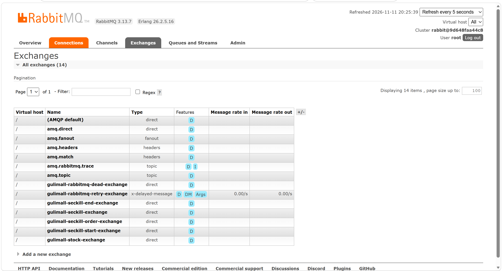
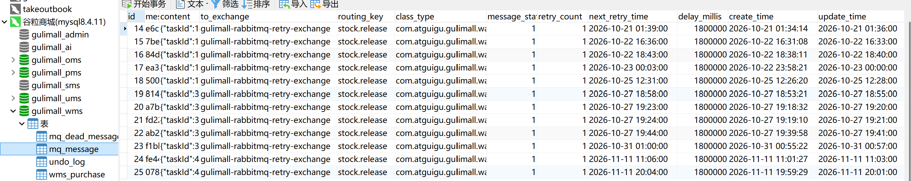
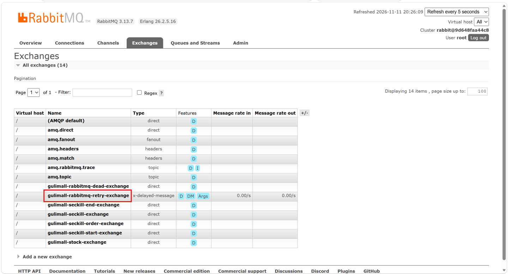
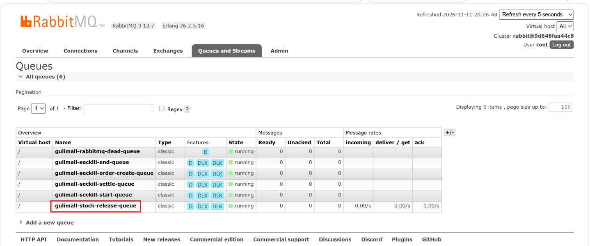
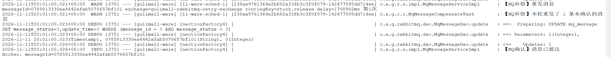
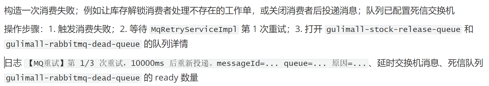
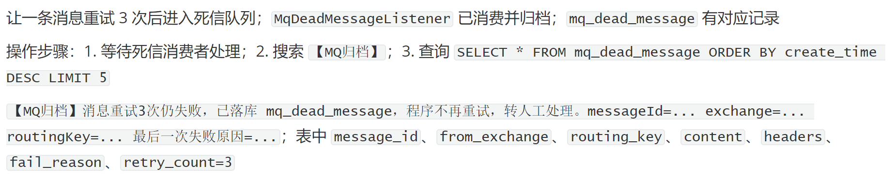

# 12.3 RabbitMQ 可靠消息与延时队列-介绍

> 本篇介绍 RabbitMQ 可靠消息与延时队列：消息在系统里承担什么职责、本地消息表怎样和业务事务一起提交、publisher confirm 和 return 怎样判断消息是否真的到达队列、发送失败怎样补偿、消费失败怎样延迟重试、重试用尽怎样进入死信归档、库存解锁和秒杀建单怎样使用延时消息、手动 ack 和 prefetch 怎样配置。

> RabbitMQ 相关文档与配置：[Deploy组件一览](../Deploy/Deploy组件一览.md)、[rabbitmq.conf](../../deploy/rabbitmq/conf/rabbitmq.conf)、[enabled_plugins](../../deploy/rabbitmq/conf/enabled_plugins)、[延时插件](../../deploy/rabbitmq/plugins/rabbitmq_delayed_message_exchange-3.13.0.ez)；对比 RocketMQ：[broker.conf](../../deploy/rocketmq/broker/conf/broker.conf)、[plain_acl.yml](../../deploy/rocketmq/broker/conf/plain_acl.yml)。

---

## 1. 这个功能是干什么的

订单提交、库存锁定、秒杀建单这些主链路追求快和稳，但并不是所有动作都要同步完成：

1. 库存锁定后要等 30 分钟才知道订单是否支付，不能同步阻塞。
2. 秒杀抢购成功后建单可以异步做，先返回排队结果。
3. 秒杀场次到点开始、到点结束可以靠延时消息触发。
4. 失败的动作需要重试，不能一次失败就丢数据。

RabbitMQ 在这些场景里承担四个职责：

| 职责 | 业务例子 | 价值 |
|---|---|---|
| 异步解耦 | 秒杀订单异步建单 | 抢购接口不等待订单库写入 |
| 延时触发 | 下单 30 分钟后解锁库存 | 不占用定时线程，到期自动执行 |
| 削峰 | 秒杀结束批量结算 | 把瞬时流量摊到消费者 |
| 失败重试 | 库存解锁失败 | 延迟重试，减少人工介入 |

消息链路不是“发出去就不管”。一条可靠消息要回答四个问题：

1. **业务数据和消息是否一起成功**：本地消息表和业务表同库同事务。
2. **消息是否到达 Broker**：publisher confirm。
3. **消息是否路由到队列**：publisher return + mandatory。
4. **消费失败怎么办**：手动 ack、延迟重试、死信归档、人工重放。

项目里的 RabbitMQ 链路：

```text
业务服务
  → 写 mq_message（本地消息表）
  → 事务提交后投递
  → RabbitMQ 交换机
  → 业务队列
  → 消费者手动 ack
  → 失败进延迟重试交换机
  → 3 次仍失败进死信交换机
  → 死信队列
  → 归档到 mq_dead_message
```

## 2. 用户、管理员和开发者怎么操作

### 2.1 用户侧表现

用户不直接操作 RabbitMQ，只能感受到业务结果：

1. 下单成功后，30 分钟内不支付，库存自动释放。
2. 秒杀抢购成功后，页面显示排队中，订单异步创建。
3. 秒杀场次到点自动开始或结束。
4. 某个异步动作失败时，用户不会立刻看到报错，系统会在后台重试。

### 2.2 管理员查看 RabbitMQ

1. 打开 RabbitMQ 管理后台。
2. Exchanges 页面查看交换机列表和类型。
3. Queues 页面查看队列、消息堆积、消费者数量。
4. 查看 `gulimall-rabbitmq-retry-exchange` 是否为 `x-delayed-message` 类型。
5. 查看库存解锁队列绑定了哪些交换机和路由键。
6. 死信队列堆积量上升说明有消息重试到头，需要人工处理。



### 2.3 开发者声明交换机、队列和绑定

1. 在 `MqConstants` 里补交换机名、队列名、路由键。
2. 在 `RabbitQueueConfig` 里补 `Queue`、`Exchange`、`Binding`。
3. 每个业务队列至少绑两个交换机：
   - 业务交换机：正常消息入口。
   - 延时重试交换机：首次延时和消费失败重试入口。
4. 队列配置死信交换机，消费端 `basicNack(requeue=false)` 时消息有地方去。

### 2.4 开发者发送消息

1. 业务方注入 `MqMessageService`。
2. 调 `sendReliable()` 发普通消息。
3. 调 `sendReliable(..., delayMillis)` 发延时消息。
4. 在 Seata 全局事务里调 `sendReliableDeferred()`，只落库，等全局事务结束再发。
5. 不要直接使用 `RabbitTemplate`，否则没有本地消息表和补偿。

### 2.5 开发者编写消费者

1. 使用 `@RabbitListener(queues = MqConstants.XXX_QUEUE)`。
2. 方法参数接收 `Message` 和 `Channel`。
3. 业务处理成功调 `channel.basicAck(deliveryTag, false)`。
4. 业务处理失败调 `mqRetryService.handleFailure(channel, message, e)`。
5. 不要在业务代码里自己 `basicNack(requeue=true)`，会造成毫秒级死循环。

### 2.6 关键配置

```yaml
spring:
  rabbitmq:
    host: ${RABBITMQ_HOST}
    port: ${RABBITMQ_PORT}
    username: ${RABBITMQ_USERNAME}
    password: ${RABBITMQ_PASSWORD}
    virtual-host: ${RABBITMQ_VHOST}

    publisher-confirm-type: correlated
    publisher-returns: true
    template:
      mandatory: true

gulimall:
  rabbitmq:
    trusted-packages: com.atguigu.gulimall.ware.mq.message
  mq:
    reliable:
      send-delay-ms: 60000
```

1. `publisher-confirm-type: correlated`：开启发送端确认。
2. `publisher-returns: true`：开启路由失败退回。
3. `template.mandatory: true`：消息无法路由时退回给发送方。
4. `trusted-packages`：反序列化白名单，防止任意类反序列化。
5. `send-delay-ms`：全局事务结束后等待多久才投递延时消息。

消费端配置：

```yaml
spring:
  rabbitmq:
    listener:
      simple:
        acknowledge-mode: manual
        prefetch: 10
```

1. `acknowledge-mode: manual`：业务处理成功才 ack。
2. `prefetch: 10`：每个消费者最多预取 10 条，避免消息全堆在一个实例上。

## 3. 整体设计思路

### 3.1 业务上怎么设计

#### 3.1.1 哪些动作走消息

| 场景 | 交换机 | 队列 | 消费方 | 目的 |
|---|---|---|---|---|
| 库存解锁 | 延时重试交换机 | `gulimall-stock-release-queue` | ware | 30 分钟后释放未支付订单库存 |
| 秒杀订单建单 | 秒杀订单交换机 | `gulimall-seckill-order-create-queue` | seckill | 抢购成功后异步建单 |
| 秒杀结束结算 | 延时重试交换机 | `gulimall-seckill-settle-queue` | coupon | 场次结束后结算剩余库存 |
| 秒杀场次开始 | 延时重试交换机 | `gulimall-seckill-start-queue` | coupon | 到点把场次改为进行中 |
| 秒杀场次结束 | 延时重试交换机 | `gulimall-seckill-end-queue` | coupon | 到点把场次改为停止中 |

#### 3.1.2 本地消息表

本地消息表 `mq_message` 和业务表在同一个库。发送消息时：

1. 业务 SQL 和消息记录在同一个本地事务里。
2. 业务成功，消息记录一起提交。
3. 业务失败，消息记录一起回滚。
4. 事务提交后才真正投递。
5. 投递失败由补偿任务重发。

这样不会出现“业务成功、消息没发”，也不会出现“业务回滚、消息已经发出去”。

#### 3.1.3 发送端可靠

发送端有两道确认：

1. **confirm**：消息是否到达 Broker 的交换机。
2. **return**：消息到了交换机，但没有路由到任何队列。

状态变化：

```text
0 新建待确认
  ├── confirm ack=true  → 1 已抵达 Broker
  └── confirm ack=false → 2 投递失败待补偿
  └── return 退回       → 2 投递失败待补偿
```

`markConfirmed()` 只把状态 0 改成 1，不覆盖状态 2。原因是路由失败时 return 回调可能先到，把状态改成 2，confirm 后到如果无条件改 1，失败消息就会“消失”。

#### 3.1.4 补偿任务

补偿任务每分钟扫描一次：

1. 状态 0 且超过宽限期还没 confirm 的消息。
2. 状态 2 且到了重发时间的消息。
3. 重发次数小于 3 的消息重新投递。
4. 重发次数到上限的消息归档到 `mq_dead_message`，从 `mq_message` 删除。

补偿任务用 Redisson 锁保证多实例同一时刻只有一个实例在扫描。

#### 3.1.5 消费端重试

消费失败时：

1. 第一次失败，10 秒后重试。
2. 第二次失败，30 秒后重试。
3. 第三次失败，60 秒后重试。
4. 三次仍失败，投递到死信交换机。
5. 死信消费者把消息归档到 `mq_dead_message`。

重试次数放在消息头 `mq_retry_count`，因为延迟插件重发出来是一条新消息，`x-death` 不可靠。

#### 3.1.6 死信归档

死信队列是重试链路的最后一站：

1. 消息重试到头后投递到死信交换机。
2. 死信队列消费者读取消息。
3. 保存原交换机、原路由键、消息体、消息头、失败原因、重试次数。
4. 归档成功才 ack。
5. 归档失败不 ack，消息留在队列里等下次重投。
6. 人工确认后可调用 `replayAll()` 重放。

#### 3.1.7 延时解锁库存

库存锁定时登记一条 30 分钟延时消息：

1. 消息先写 `mq_message`，不立即发送。
2. Seata 全局事务结束后，补偿任务等待 60 秒再投递。
3. 投递到 `x-delayed-message` 交换机，消息头带 `x-delay=1800000`。
4. 30 分钟后消息路由到库存解锁队列。
5. 消费者按工作单状态决定释放还是跳过。

### 3.2 技术上怎么设计

#### 3.2.1 交换机、队列和绑定关系

```text
gulimall-stock-exchange（direct）
  └── stock.release
        └── gulimall-stock-release-queue

gulimall-rabbitmq-retry-exchange（x-delayed-message）
  ├── stock.release
  │     └── gulimall-stock-release-queue
  ├── seckill.settle
  │     └── gulimall-seckill-settle-queue
  ├── seckill.start
  │     └── gulimall-seckill-start-queue
  ├── seckill.end
  │     └── gulimall-seckill-end-queue
  └── seckill.order.create
        └── gulimall-seckill-order-create-queue

gulimall-rabbitmq-dead-exchange（direct）
  └── gulimall.rabbitmq.dead
        └── gulimall-rabbitmq-dead-queue
```

每个业务队列绑两次：

1. 业务交换机：正常消息入口。
2. 延时重试交换机：首次延时和失败重试入口。

少了重试绑定，消息到了重试交换机但匹配不到队列，会被静默丢弃。

#### 3.2.2 延时插件

延时交换机类型是 `x-delayed-message`：

```yaml
名称: gulimall-rabbitmq-retry-exchange
类型: x-delayed-message
参数:
  x-delayed-type: direct
```

1. 消息发送到交换机时不立即路由。
2. 交换机按 `x-delay` 消息头等待指定毫秒数。
3. 到期后按 `x-delayed-type` 指定的路由类型投递。
4. Broker 必须安装 `rabbitmq_delayed_message_exchange` 插件。
5. 插件没装时延时交换机会退化成普通交换机或声明失败。

#### 3.2.3 两个 RabbitTemplate

| 模板 | mandatory | 用途 |
|---|---|---|
| `rabbitTemplate` | true | 普通消息，能收到真实路由失败 |
| `delayedRabbitTemplate` | false | 延时消息，避免插件误判 NO_ROUTE |

延时消息在等待期间还没有进入队列，`mandatory=true` 时插件可能把它当成无法路由并退回。延时模板把 `mandatory` 关掉，避免误退回。

#### 3.2.4 手动 ack 和 prefetch

1. 容器工厂强制 `AcknowledgeMode.MANUAL`。
2. 业务成功才 `basicAck`。
3. 业务失败交给 `MqRetryService`，由它决定 ack、nack 还是重发。
4. `prefetch` 从业务模块 yml 读取，库存解锁配置 10。
5. prefetch 太大，消息会全堆在一个实例；太小，消费吞吐上不去。

#### 3.2.5 消息转换与反序列化白名单

1. 使用 `Jackson2JsonMessageConverter`。
2. 发送时消息头带 `__TypeId__`。
3. 消费端按 `__TypeId__` 还原对象。
4. 默认只信任 `java.util`、`java.lang`。
5. 业务消息包必须通过 `gulimall.rabbitmq.trusted-packages` 显式声明。
6. 不要写 `*`，那等于关掉反序列化防线。

#### 3.2.6 本地消息表的状态和重试

`mq_message` 关键字段：

```text
message_id       UUID 去掉横线
content          消息体 JSON
to_exchange      目标交换机
routing_key      路由键
class_type       消息体全限定类名
message_status   0 新建、1 已抵达、2 失败待补偿
retry_count      已重发次数
next_retry_time  下次可重发时间
delay_millis     原始延时毫秒数
```

重发时按原类型反序列化，不能直接发字符串，否则消费端拿到的是 `String`。

#### 3.2.7 全局事务里的消息

锁库存运行在 Seata 全局事务里。消息发送必须延迟：

1. 消息记录和库存更新同事务提交。
2. 全局事务回滚，消息记录一起回滚。
3. 全局事务提交后，补偿任务等 60 秒再投递。
4. 等待时间必须大于 Seata 全局事务超时时间 30 秒。
5. 投递时按消息原始创建时间扣掉已经等待的时间，保证仍然按 30 分钟到期。

## 4. 详细代码、配置和解释

以下小节按“链路位置 → 业务问题 → 关键概念 → 代码分块 → 完整示例 → 边界”组织。每段代码先说明它在链路里承担什么，代码后按 1、2、3 编号解释执行顺序、条件和原因。代码保持源码原样，管理台截图和日志截图保留在对应位置。

### 4.1 MqConstants：交换机、队列、路由键和重试策略

#### 4.1.1 这个类解决什么问题

消息名称是一份跨模块契约。库存服务把解锁消息发到 `gulimall-stock-exchange`，ware 的消费者监听 `gulimall-stock-release-queue`；秒杀服务把建单消息发到 `gulimall-seckill-order-exchange`，seckill 的消费者监听 `gulimall-seckill-order-create-queue`；秒杀场次的开始、结束、结算消息则由 coupon 消费。发送方、拓扑声明方、消费方分布在不同 Maven 模块，如果每个模块各写一份字符串，拼错一个字符不会编译报错，消息会静默地路由不到队列，或者消费者监听到一个不存在的队列。

`MqConstants` 把这些名称收在一处，同时定义消息头和重试节奏。它本身不发送消息、不声明队列，只提供编译期可检查的常量。改了队列名，所有引用点一起编译，漏改的地方会直接报错，而不是等到线上消息堆积才发现。

#### 4.1.2 链路位置与关键常量

常量类被四类代码引用：

| 使用方 | 引用的常量 | 用途 |
|---|---|---|
| `RabbitQueueConfig` | 交换机、队列、路由键 | 启动时声明拓扑 |
| `MqMessageServiceImpl` | 消息头、重试交换机 | 落库、发送、确认回调 |
| `MqRetryServiceImpl` | 重试次数、失败原因、原目的地 | 延迟重试和死信投递 |
| `StockReleaseListener`、`SeckillOrderCreateListener` 等 | 队列名 | `@RabbitListener` 监听 |

消息头是一套跨发送端和消费端的协议：

| 常量 | 消息头名称 | 写入方 | 读取方 | 作用 |
|---|---|---|---|---|
| `HEADER_MESSAGE_ID` | `mq_message_id` | `doSend()` | confirm/return 回调、死信归档、人工重放 | 关联本地消息表同一行 |
| `HEADER_RETRY_COUNT` | `mq_retry_count` | `MqRetryServiceImpl` | 消费入口、死信归档 | 自己维护的重试次数 |
| `HEADER_FAIL_REASON` | `mq_fail_reason` | `MqRetryServiceImpl` | 死信归档 | 最后一次失败原因 |
| `HEADER_ORIGIN_EXCHANGE` | `mq_origin_exchange` | `MqRetryServiceImpl` | 死信归档、人工重放 | 原始交换机 |
| `HEADER_ORIGIN_ROUTING_KEY` | `mq_origin_routing_key` | `MqRetryServiceImpl` | 死信归档、人工重放 | 原始路由键 |
| `HEADER_DELAY` | `x-delay` | `doSend()`、延迟重发 | 延时插件 | 等待毫秒数 |

业务拓扑分成三组：业务交换机负责正常入口，延时重试交换机负责首次延时和消费失败重试，死信交换机负责重试用尽后的归档入口。每个业务队列同时绑定业务交换机和延时重试交换机，这是重试消息能回到原队列的前提。

#### 4.1.3 正常链路

```text
发送方取 MqConstants 的 exchange + routingKey
  → RabbitQueueConfig 用同一批常量声明 exchange、queue、binding
  → 消费者用 queue 常量注册 @RabbitListener
  → 管理台显示的交换机、队列、路由键与代码完全一致
  → 失败重试时读取 HEADER_RETRY_COUNT，写回后重新投递
```

#### 4.1.4 代码与解释

整份常量类只有一个私有构造器和一组静态字段，按消息头、延时重试、死信、业务、重试策略分组。先看完整代码，再逐段说明每组常量的用途。

```java
public final class MqConstants {

    private MqConstants() {
    }

    // ==================== 消息头 ====================

    /** 业务消息 id：发送时塞进消息头，confirm/return 回调和消费端靠它定位同一条消息 */
    public static final String HEADER_MESSAGE_ID = "mq_message_id";

    /** 已重试次数：延迟插件重发是新消息，不能依赖 x-death，只能自己维护 */
    public static final String HEADER_RETRY_COUNT = "mq_retry_count";

    /** 失败原因：重试到头时带进死信队列，归档消费者写进 mq_dead_message */
    public static final String HEADER_FAIL_REASON = "mq_fail_reason";

    /** 原始交换机和路由键：消息进死信队列后 received* 已指向死信交换机，重放必须靠它 */
    public static final String HEADER_ORIGIN_EXCHANGE = "mq_origin_exchange";
    public static final String HEADER_ORIGIN_ROUTING_KEY = "mq_origin_routing_key";

    // ==================== 延时重试交换机 ====================

    public static final String RETRY_EXCHANGE = "gulimall-rabbitmq-retry-exchange";

    public static final String RETRY_EXCHANGE_TYPE = "x-delayed-message";

    public static final String RETRY_EXCHANGE_DELAYED_TYPE_ARG = "x-delayed-type";
    public static final String RETRY_EXCHANGE_DELAYED_TYPE_VALUE = "direct";

    public static final String HEADER_DELAY = "x-delay";

    // ==================== 死信归档 ====================

    public static final String DEAD_EXCHANGE = "gulimall-rabbitmq-dead-exchange";
    public static final String DEAD_QUEUE = "gulimall-rabbitmq-dead-queue";
    public static final String DEAD_ROUTING_KEY = "gulimall.rabbitmq.dead";

    // ==================== 业务：库存解锁 ====================

    public static final String STOCK_EXCHANGE = "gulimall-stock-exchange";

    public static final String STOCK_RELEASE_QUEUE = "gulimall-stock-release-queue";

    public static final String STOCK_RELEASE_ROUTING_KEY = "stock.release";

    // ==================== 业务：秒杀结束结算 ====================

    public static final String SECKILL_EXCHANGE = "gulimall-seckill-exchange";

    public static final String SECKILL_SETTLE_QUEUE = "gulimall-seckill-settle-queue";

    public static final String SECKILL_SETTLE_ROUTING_KEY = "seckill.settle";

    public static final String SECKILL_END_EXCHANGE = "gulimall-seckill-end-exchange";

    public static final String SECKILL_END_QUEUE = "gulimall-seckill-end-queue";

    public static final String SECKILL_END_ROUTING_KEY = "seckill.end";

    public static final String SECKILL_START_EXCHANGE = "gulimall-seckill-start-exchange";

    public static final String SECKILL_START_QUEUE = "gulimall-seckill-start-queue";

    public static final String SECKILL_START_ROUTING_KEY = "seckill.start";

    // ==================== 业务：秒杀订单异步建单 ====================

    public static final String SECKILL_ORDER_EXCHANGE = "gulimall-seckill-order-exchange";

    public static final String SECKILL_ORDER_CREATE_QUEUE = "gulimall-seckill-order-create-queue";

    public static final String SECKILL_ORDER_CREATE_ROUTING_KEY = "seckill.order.create";

    // ==================== 重试策略 ====================

    public static final int MAX_RETRY = 3;

    public static final long[] RETRY_DELAY_MILLIS = {10_000L, 30_000L, 60_000L};

    public static long delayFor(int retryCount) {
        if (retryCount < 0) {
            return RETRY_DELAY_MILLIS[0];
        }
        int index = Math.min(retryCount, RETRY_DELAY_MILLIS.length - 1);
        return RETRY_DELAY_MILLIS[index];
    }

}
```

1. `private MqConstants()`：工具类不允许实例化。所有成员都是 `static final`，通过类名直接引用。
2. `HEADER_MESSAGE_ID`：发送时由 `doSend()` 塞进消息头。confirm 回调拿 `CorrelationData.getId()`，return 回调、死信归档和人工重放拿消息头，三处最终都指向 `mq_message.message_id`。
3. `HEADER_RETRY_COUNT`：消费失败重发时由 `MqRetryServiceImpl` 写入。延时插件重发出来的是一条新消息，原生 `x-death` 头不会按预期累加，所以重试次数必须自己维护。
4. `HEADER_FAIL_REASON`：重试用尽投递死信时写入，归档消费者把它保存到 `mq_dead_message.fail_reason`，人工排查时不用再翻日志。
5. `HEADER_ORIGIN_EXCHANGE`、`HEADER_ORIGIN_ROUTING_KEY`：消息进入死信队列后，`receivedExchange` 和 `receivedRoutingKey` 已经被改写为死信交换机，原始目的地只能靠这两个头保留。
6. `RETRY_EXCHANGE`：类型为 `x-delayed-message`，首次 30 分钟延时和消费失败后的 10/30/60 秒重试共用。`RETRY_EXCHANGE_TYPE`、`RETRY_EXCHANGE_DELAYED_TYPE_ARG`、`RETRY_EXCHANGE_DELAYED_TYPE_VALUE` 是声明这个自定义交换机所需的三个参数。
7. `HEADER_DELAY`：值为 `x-delay`，延时插件按这个毫秒数决定消息在交换机里等待多久。值为 0 时不写这个头，消息按普通消息立即路由。
8. `DEAD_EXCHANGE`、`DEAD_QUEUE`、`DEAD_ROUTING_KEY`：死信归档链路。死信队列自己不再配置死信交换机，否则重试到头之后会形成回环。
9. `STOCK_EXCHANGE`、`STOCK_RELEASE_QUEUE`、`STOCK_RELEASE_ROUTING_KEY`：库存解锁链路。正常入口用业务交换机，首次延时和重试入口用延时交换机，两条路径最终都落到同一个队列。
10. `SECKILL_*`：秒杀结算、场次开始、场次结束、订单建单四组名称。场次开始和结束走延时交换机，结算和建单各有独立业务交换机。
11. `MAX_RETRY = 3`：发送端补偿和消费端重试共用同一个上限。发送端指一条记录最多重发 3 次；消费端指业务失败后最多再投递 3 次。
12. `delayFor(retryCount)`：第 1、2、3 次重试分别返回 10 秒、30 秒、60 秒。`retryCount` 小于 0 时按第 1 次处理；超过数组长度时取最后一档，不会数组越界。

#### 4.1.5 一次完整示例

库存锁定成功后登记解锁消息，名称的使用顺序如下：

```text
1. WareSkuServiceImpl.sendReleaseMessage() 取 RETRY_EXCHANGE 和 STOCK_RELEASE_ROUTING_KEY
2. MqMessageServiceImpl.buildAndSave() 把 exchange、routingKey 写入 mq_message
3. 补偿任务到期后调用 doSend()，写入 mq_message_id 和 x-delay=1800000
4. 消息在延时交换机等待 30 分钟，按 stock.release 进入 gulimall-stock-release-queue
5. StockReleaseListener 用 STOCK_RELEASE_QUEUE 注册的监听器收到消息
6. 处理失败时 MqRetryServiceImpl 读取 mq_retry_count，加 1 后写回
7. 重试用尽时写入 mq_fail_reason、mq_origin_exchange、mq_origin_routing_key，再投死信
```

这条链路上没有任何一处手写队列名，全部来自常量类。

#### 4.1.6 它不做什么与边界

1. 只定义名称，不声明交换机、队列和绑定。声明动作在 `RabbitQueueConfig`，常量类被单独引用不会创建任何 Broker 资源。
2. 不区分环境。同一个队列名在开发、测试、生产环境相同，环境隔离依赖 virtual host 或 Broker 地址。
3. 不支持按队列配置重试策略。`MAX_RETRY` 和 `RETRY_DELAY_MILLIS` 是全局值，秒杀结算和库存解耦使用同一套节奏。
4. 所有名称堆在一个类里，模块边界不清晰。新增业务时容易继续往同一个类追加。
5. 修改队列参数（例如增加 `x-max-length`）不会自动更新已存在的队列。Broker 会返回 `PRECONDITION_FAILED`，需要先删除旧队列或使用新的队列名。

### 4.2 MqMessageEntity：本地消息表

#### 4.2.1 这个类解决什么问题

消息发送不是一次普通的 RPC。业务事务提交后，应用可能在调用 `convertAndSend()` 前宕机；Broker 可能返回 nack；消息可能到达交换机但没有队列匹配；消费者也可能暂时不可用。仅凭内存里的对象，无法回答“这条消息最后到底发没发、失败在哪一步”。

`mq_message` 是发送端的账本。每发一条可靠消息，先在业务库里落一行，记录消息体、目标、状态和重试信息，再由后台任务根据这一行的状态决定重发、归档还是结束。`MqMessageEntity` 就是这行账本的 Java 映射。

#### 4.2.2 链路位置

| 时机 | 操作 | 使用方法 |
|---|---|---|
| 业务事务内 | INSERT 一行，状态 0 | `buildAndSave()` |
| 事务提交后 | 读取交换机、路由键、延时 | `doSend()` |
| confirm 或 return 到达 | UPDATE 状态为 1 或 2 | `markConfirmed()`、`markFailed()` |
| 每分钟补偿 | SELECT 状态 0/2，UPDATE 次数和状态 | `resendFailedMessages()` |
| 重发到上限 | 归档到死信表，DELETE 本行 | `resendFailedMessages()` |

这张表必须和业务表在同一个数据库。库存服务的 `mq_message` 在 `gulimall_wms`，秒杀和券服务共用 `gulimall_sms`。跨库就无法用一个本地事务保证业务数据和消息记录同时成功。

#### 4.2.3 字段与业务含义

| 字段 | 数据库列 | 业务含义 | 说明 |
|---|---|---|---|
| `id` | `id` | 自增主键 | 避免随机 UUID 造成 InnoDB 页分裂 |
| `messageId` | `message_id` | 消息唯一 id | UUID 去掉横线，唯一索引 |
| `content` | `content` | 消息体 JSON | 重发时还原对象 |
| `toExchange` | `to_exchange` | 目标交换机 | 重发时按原目的地投递 |
| `routingKey` | `routing_key` | 路由键 | 重发时按原路由键投递 |
| `classType` | `class_type` | 消息体全限定类名 | 重发时按原类型反序列化 |
| `messageStatus` | `message_status` | 0 新建、1 已抵达、2 失败待补偿 | 发送端可靠性核心状态 |
| `retryCount` | `retry_count` | 已重发次数 | 到达 3 次后归档 |
| `nextRetryTime` | `next_retry_time` | 下次可处理时间 | 控制确认宽限期和重发间隔 |
| `delayMillis` | `delay_millis` | 原始延时毫秒数 | 重发时扣掉已等待时间 |
| `createTime` | `create_time` | 创建时间 | 计算已等待时长 |
| `updateTime` | `update_time` | 更新时间 | 排查状态变化 |

#### 4.2.4 代码与解释

实体只做字段映射，没有业务方法。`id` 和 `messageId` 的分工、`classType` 和 `delayMillis` 的保留，都是为补偿重发服务的。

```java
@Data
@TableName("mq_message")
public class MqMessageEntity implements Serializable {

    private static final long serialVersionUID = 1L;

    /** 自增主键：随机 UUID 做主键会造成 InnoDB 页分裂，message_id 只做唯一索引 */
    @TableId(type = IdType.AUTO)
    private Long id;

    /** 消息唯一 ID（UUID 去掉横线）：CorrelationData、消息头、回调定位都用它 */
    private String messageId;

    /** 消息体 JSON 字符串，重发时用它还原对象 */
    private String content;

    /** 目标交换机 */
    private String toExchange;

    /** 路由键 */
    private String routingKey;

    /** 消息体的全限定类名，重发时靠它把 JSON 反序列化回原类型 */
    private String classType;

    /** 消息状态【0->新建待确认；1->已抵达 Broker；2->投递失败待补偿】 */
    private Integer messageStatus;

    /** 已重发次数 */
    private Integer retryCount;

    /** 下次可重发时间 */
    private Date nextRetryTime;

    /** 延时毫秒数（0 = 不延时）；重发时原样带上，避免提前投递 */
    private Long delayMillis;

    private Date createTime;

    private Date updateTime;

}
```

1. `@TableName("mq_message")`：对应本地消息表。表必须在发送方业务库，不能单独建一个 MQ 库。
2. `@TableId(type = IdType.AUTO)`：数据库自增主键。随机 UUID 作为聚簇索引主键会让插入位置随机，造成 InnoDB 页分裂；`message_id` 只做普通唯一索引。
3. `messageId`：UUID 去掉横线。`CorrelationData`、消息头、回调和人工排查都用这个值，不用自增 id。
4. `content`：消息体序列化后的 JSON。字段在数据库里是文本类型，长度受列定义限制。
5. `toExchange`、`routingKey`：重发时不能靠消息当前所在位置推断目的地，必须原样保存。
6. `classType`：消息体的全限定类名。补偿重发时手里只有 JSON 字符串，必须知道原类型才能还原对象。
7. `messageStatus`：0 表示已入库但还没收到 confirm，1 表示 Broker 已确认，2 表示 nack 或路由失败。状态由回调方法和补偿任务共同维护。
8. `retryCount`：已经重发过多少次。首次落库为 0，每次补偿重发前加 1，达到 3 次后归档。
9. `nextRetryTime`：普通发送设为当前时间加 3 分钟确认宽限期，延迟发送设为当前时间加 `send-delay-ms`。补偿任务只处理到这个时间的记录。
10. `delayMillis`：原始延时。库存解锁是 1800000 毫秒，秒杀场次开始/结束按场次时间计算。补偿重发时用它减去已经等待的时间，避免把 30 分钟重新等一遍。

#### 4.2.5 一次完整示例

秒杀抢购成功后，`mq_message` 里的一行大致如下：

```text
id               1842
message_id       9f2c4d7a8b1e4c6f9a0d3e5b7c8f1a2b
content          {"orderSn":"SK202611120001","memberId":88,"skuId":31,...}
to_exchange      gulimall-seckill-order-exchange
routing_key      seckill.order.create
class_type       com.atguigu.gulimall.seckill.mq.message.SeckillOrderCreateMessage
message_status   0
retry_count      0
next_retry_time  2026-11-12 10:03:00（落库时间 + 3 分钟）
delay_millis     0
create_time      2026-11-12 10:00:00
```

Broker 返回 confirm 后，`message_status` 变成 1。如果路由不到队列，return 回调先把它改成 2，confirm 随后到达也不会覆盖成 1。



#### 4.2.6 它不做什么与边界

1. 不负责发送。实体只是数据载体，发送由 `MqMessageServiceImpl` 完成。
2. 不保存业务主键。排查时只能靠消息体里的 `orderSn`、`taskId` 反查，没有独立索引。
3. 没有过期清理。状态 1 的记录会一直保留，表会持续增长，生产环境需要按时间归档或分区。
4. 没有乐观锁版本号。补偿任务和 confirm 回调可能同时更新同一行，当前依赖条件更新和更新顺序保证结果。
5. `content` 的列长度必须覆盖最大消息体。超长会插入失败，导致业务事务一起回滚。

### 4.3 MqMessageService：可靠发送接口

#### 4.3.1 这个接口解决什么问题

业务代码需要一个统一的发消息入口。如果库存服务、秒杀服务、券服务各自注入 `RabbitTemplate`，每个模块都要自己处理落库、事务提交后投递、confirm 回调和重发，任何一处漏掉都会丢消息。接口把“可靠发送”收敛成四个能力：立即发送、延时发送、全局事务内只登记、补偿重发。

这个接口是业务方唯一应该依赖的发送契约。调用方只关心“消息体是什么、发到哪、多久后到期”，不需要知道 `CorrelationData`、消息头和状态机。

#### 4.3.2 链路位置与调用方

| 调用方 | 场景 | 使用方法 | 特点 |
|---|---|---|---|
| `WareSkuServiceImpl.sendReleaseMessage()` | 锁定库存后 30 分钟解锁 | `sendReliableDeferred()` | Seata 全局事务内只落库 |
| `SeckillOrderServiceImpl.createReservedOrder()` | 抢购成功异步建单 | `sendReliable()` | 与预扣记录同一本地事务 |
| `SeckillSessionServiceImpl.sendStartMessage()` | 场次到点开始 | `sendReliable(..., delay)` | 延时时间按场次开始时间计算 |
| `SeckillSettleServiceImpl` | 场次结束结算 | `sendReliable()` | 结算消息异步处理 |
| `MqMessageCompensateTask` | 每分钟补偿 | `resendFailedMessages()` | 扫描状态 0/2 |

#### 4.3.3 接口方法

| 方法 | 参数 | 行为 | 是否立即发送 |
|---|---|---|---|
| `sendReliable(exchange, routingKey, payload)` | 无延时 | 转调带延时版本，延时传 0 | 事务提交后发送 |
| `sendReliable(exchange, routingKey, payload, delayMillis)` | 延时毫秒 | 落库并注册事务提交后回调 | 事务提交后发送 |
| `sendReliableDeferred(exchange, routingKey, payload, delayMillis)` | 延时毫秒 | 只落库，`next_retry_time` 往后推 | 不发送，等补偿任务 |
| `markConfirmed(messageId)` | 消息 id | 状态 0 改 1 | 回调调用 |
| `markFailed(messageId, cause)` | 消息 id、原因 | 状态改 2，设置下次重发时间 | 回调调用 |
| `resendFailedMessages(maxRetry)` | 最大重试次数 | 扫描并重发，返回条数 | 定时任务调用 |

#### 4.3.4 代码与解释

接口继承 MyBatis-Plus 的 `IService`，因此同时具备按 id 查询、更新、删除实体的能力。三个状态常量与数据库 `message_status` 一一对应。

```java
public interface MqMessageService extends IService<MqMessageEntity> {

    int STATUS_NEW = 0;

    int STATUS_CONFIRMED = 1;

    int STATUS_FAILED = 2;

    void sendReliable(String exchange, String routingKey, Object payload);

    void sendReliable(String exchange, String routingKey, Object payload, long delayMillis);

    void sendReliableDeferred(String exchange, String routingKey, Object payload, long delayMillis);

    void markConfirmed(String messageId);

    void markFailed(String messageId, String cause);

    int resendFailedMessages(int maxRetry);

}
```

1. `extends IService<MqMessageEntity>`：接口同时暴露通用 CRUD，实现类可以直接调用 `this.save()`、`this.update()`、`this.list()`。
2. `STATUS_NEW = 0`：消息已经写入本地消息表，但还没有收到 Broker 确认。补偿任务会扫描这个状态。
3. `STATUS_CONFIRMED = 1`：Broker 已确认收到消息。这个状态是正常终态，不再参与补偿。
4. `STATUS_FAILED = 2`：Broker nack 或消息无法路由到队列。这个状态需要补偿重发。
5. `sendReliable()` 两个重载：普通消息和延时消息共用同一套落库、确认、补偿逻辑，区别只在 `delay_millis`。
6. `sendReliableDeferred()`：只登记不发送。Seata 全局事务内不能立即投递，否则 confirm 回调更新本地消息表会和 `undo_log` 冲突。
7. `markConfirmed()`、`markFailed()`：供 `RabbitCallbackConfig` 的回调使用，把异步确认结果写回账本。
8. `resendFailedMessages()`：供补偿任务使用。返回本轮成功重发的条数，便于日志统计。

#### 4.3.5 一次调用示例

库存锁定链路：

```text
1. WareSkuServiceImpl 在 Seata 全局事务内写完工作单、库存、明细
2. 调 mqMessageService.sendReliableDeferred()
3. MqMessageServiceImpl 写 mq_message，next_retry_time = 当前时间 + 60 秒
4. 全局事务提交，消息记录一起提交
5. MqMessageCompensateTask 扫到到期记录，计算剩余延时后投递
6. confirm 回调把状态改成 1
```

秒杀建单链路：

```text
1. SeckillOrderServiceImpl 在本地事务里插入预扣记录
2. 同一个事务里调 mqMessageService.sendReliable()
3. 事务提交后 afterCommit 触发 doSend()
4. confirm 回调把状态改成 1
5. SeckillOrderCreateListener 消费并调用订单服务
```

#### 4.3.6 它不做什么与边界

1. 不声明交换机、队列和绑定，拓扑由 `RabbitQueueConfig` 负责。
2. 不保证消费成功。接口只覆盖发送端可靠性，消费失败由 `MqRetryService` 处理。
3. 不返回消息 id。业务日志无法直接关联 `mq_message`，排查只能靠内容字段。
4. 没有批量发送、取消发送、查询消息状态的方法。
5. 不限制消息体大小，也不校验交换机名和路由键是否存在。
6. `sendReliableDeferred()` 只落库，如果补偿任务停止运行，消息会一直停在表里，不会自动投递。

### 4.4 MqMessageServiceImpl：本地消息表实现

#### 4.4.1 这个类解决什么问题

接口只定义能力，可靠性由实现类保证。这个类要处理四个时机：业务事务提交后投递、Broker 确认或退回后改状态、定时扫描补偿、重发到上限后归档。任何一个时机处理错，本地消息表都会留下永远到不了状态 1 的记录，或者把已经失败的消息标成成功。

实现类依赖两个发送模板、一个 JSON 序列化器、死信归档服务和一个 `sendDelayMs` 配置。两个模板分别对应普通消息和延时消息，`sendDelayMs` 决定全局事务结束后等多久再投递。

#### 4.4.2 普通发送与延时发送

普通发送用于“业务事务提交后立即投递”的场景，例如秒杀建单；延时发送用于“到点才投递”的场景，例如库存解锁、秒杀场次开始和结束。两者都要先落库，区别在延时时间和是否处于全局事务。

`sendReliable()` 在事务提交后调用 `doSend()`；`sendReliableDeferred()` 只落库，把投递动作留给补偿任务。

```java
    @Override
    public void sendReliable(String exchange, String routingKey, Object payload) {
        sendReliable(exchange, routingKey, payload, 0);
    }

    @Override
    public void sendReliable(String exchange, String routingKey, Object payload, long delayMillis) {
        MqMessageEntity entity = buildAndSave(exchange, routingKey, payload,
                delayMillis, CONFIRM_GRACE_MILLIS);

        // 事务提交后再投递。事务回滚时 afterCommit 不会执行，消息也不会发出去
        afterCommit(() -> {
            try {
                doSend(entity.getToExchange(), entity.getRoutingKey(), payload,
                        entity.getMessageId(), entity.getDelayMillis());
            } catch (Exception e) {
                // 发送失败不能影响已提交的业务；记录留在 status=0，补偿任务会重发
                log.error("【MQ发送】投递失败，等待补偿任务重发，messageId={} exchange={} routingKey={}",
                        entity.getMessageId(), entity.getToExchange(), entity.getRoutingKey(), e);
            }
        });
    }

    @Override
    public void sendReliableDeferred(String exchange, String routingKey, Object payload, long delayMillis) {
        // 只落库，不发送：全局事务还没结束，此时发送或改状态会让 undo_log 变脏
        MqMessageEntity entity = buildAndSave(exchange, routingKey, payload,
                delayMillis, sendDelayMs);

        log.info("【MQ发送】消息只落库，等补偿任务延迟 {}ms 投递，messageId={}",
                sendDelayMs, entity.getMessageId());
    }
```

1. 无延时版本把 `delayMillis` 传 0，转调带延时版本。调用方不需要区分两个入口。
2. `buildAndSave()` 的第一个参数是目标交换机，第二个是路由键，第三个是消息体，第四个是延时毫秒，第五个是“多久之后允许补偿任务处理”。普通发送传 `CONFIRM_GRACE_MILLIS`，即 3 分钟。
3. `afterCommit()` 判断当前线程是否有事务同步。有事务时把投递动作注册到 `afterCommit`，事务回滚则不执行；没有事务时立即执行。
4. 回调里调用 `doSend()`，把实体上的交换机、路由键、消息 id、延时原样传入。消息体直接用内存里的 `payload`，不需要从数据库反序列化。
5. `try-catch` 吞掉投递异常只记日志。业务事务已经提交，不能因为发送失败回滚业务；记录仍是状态 0，补偿任务会在 3 分钟后接管。
6. `sendReliableDeferred()` 同样调用 `buildAndSave()`，但第五个参数是 `sendDelayMs`，即全局事务结束后等待的 60 秒。
7. 延迟发送不注册 `afterCommit`，也不调用 `doSend()`。它只打印一条日志，等补偿任务按 `next_retry_time` 扫描。
8. 延迟发送的 `delay_millis` 仍是原始延时（库存解锁为 30 分钟），补偿任务投递时会扣掉已经等待的 60 秒，保证总到期时间不变。

执行顺序总结：

```text
普通发送：落库(status=0, next_retry=now+3min) → 事务提交 → doSend → confirm → status=1
延迟发送：落库(status=0, next_retry=now+60s) → 事务提交 → 补偿任务扫描 → doSend → confirm → status=1
```

为什么普通发送也要等事务提交：事务没提交就发送，消费者可能先收到消息，回查业务数据却查不到；事务回滚时消息已经发出去，又无法撤回。把投递挂在 `afterCommit` 上，业务数据和消息记录同时可见或同时回滚。

为什么延迟发送连发送动作都不做：Seata 全局事务还没结束，confirm 回调可能在全局事务提交前更新 `mq_message`。这一行同时在 `undo_log` 里，后镜像被回调改掉，全局回滚时 Seata 会报 dirty undo log。把投递推后到全局事务结束，回调就不会和 `undo_log` 交叉。

#### 4.4.3 构造并落库 `buildAndSave`

落库是本地消息表的起点，所有发送方式都经过这个方法。它把“发什么、发到哪、多久后算超时”固化成一行记录，后续的确认、补偿和归档都只认这一行。

```java
    private MqMessageEntity buildAndSave(String exchange, String routingKey,
                                         Object payload, long delayMillis,
                                         long nextRetryDelayMillis) {
        if (payload == null) {
            throw new IllegalArgumentException("消息体不能为空");
        }

        String messageId = UUID.randomUUID().toString().replace("-", "");
        long safeDelay = Math.max(0, delayMillis);

        MqMessageEntity entity = new MqMessageEntity();
        entity.setMessageId(messageId);
        entity.setToExchange(exchange);
        entity.setRoutingKey(routingKey);
        entity.setClassType(payload.getClass().getName());
        entity.setMessageStatus(STATUS_NEW);
        entity.setRetryCount(0);
        entity.setNextRetryTime(new Date(System.currentTimeMillis() + nextRetryDelayMillis));
        entity.setDelayMillis(safeDelay);
        entity.setCreateTime(new Date());
        entity.setUpdateTime(new Date());
        try {
            entity.setContent(objectMapper.writeValueAsString(payload));
        } catch (JsonProcessingException e) {
            throw new IllegalArgumentException("消息体无法序列化成JSON：" + payload.getClass().getName(), e);
        }

        // 先落库：如果当前在业务事务里，这一行和业务数据一起提交/回滚
        this.save(entity);

        return entity;
    }
```

1. 先判断消息体是否为空。空消息无法序列化，也无法让消费端处理，直接抛 `IllegalArgumentException`，让调用方业务事务回滚。
2. 生成 UUID，去掉横线。这个值同时写入 `message_id`、`CorrelationData` 和消息头。
3. `Math.max(0, delayMillis)`：负数延时按 0 处理，避免把 `x-delay` 写成负值。
4. 创建实体，逐项设置交换机、路由键、消息类型。`classType` 取 `payload.getClass().getName()`，必须是具体消息类，不能是 `ArrayList` 这类集合。
5. 状态设为 0，重试次数设为 0。新建消息还没有经过任何确认。
6. `nextRetryTime` 设为当前时间加调用方传入的等待时长。普通发送是 3 分钟，延迟发送是 60 秒。
7. `delayMillis` 保存原始延时。即使当前不发送，后续补偿也要用它计算剩余时间。
8. 用 `objectMapper.writeValueAsString()` 序列化消息体。失败时抛 `IllegalArgumentException`，业务事务回滚。这是强一致取舍：序列化都失败的消息不应该留下业务数据。
9. `this.save(entity)` 插入一行。如果调用方在业务事务里，这一行和业务数据一起提交或回滚。
10. 返回实体，供调用方拿消息 id 和延时信息。

为什么保存 `classType`：补偿重发时数据库里只有 JSON 字符串。如果直接把这个字符串交给 `convertAndSend()`，消息头 `__TypeId__` 会变成 `java.lang.String`，消费端按 `StockReleaseMessage` 反序列化就会失败。按原类型还原后再发送，类型头才能保持正确。

为什么 `nextRetryTime` 由调用方传入：普通发送要等 confirm 的 3 分钟宽限期，延迟发送要等全局事务结束的 60 秒。同一个字段表达两种等待，由调用方决定，`buildAndSave()` 不写死。

#### 4.4.4 确认与失败回调

RabbitMQ 的 confirm 和 return 是异步回调，可能在业务事务提交后的任意时刻到达。回调只带消息 id 和结果，必须通过 `markConfirmed()`、`markFailed()` 把结果写回账本，否则补偿任务无法判断消息是否已经到达。

```java
    @Override
    public void markConfirmed(String messageId) {
        if (messageId == null) {
            return;
        }
        // 只把"新建(0)"改成"已抵达(1)"，不动"失败(2)"：
        // 路由失败时 return 回调先到（置2）、confirm 后到（想置1），
        // 不加条件会把失败状态覆盖成成功，消息就"消失"了
        boolean updated = this.update(new UpdateWrapper<MqMessageEntity>()
                .eq("message_id", messageId)
                .eq("message_status", STATUS_NEW)
                .set("message_status", STATUS_CONFIRMED)
                .set("update_time", new Date()));
        if (updated) {
            log.info("【MQ确认】消息已抵达Broker，messageId={}", messageId);
        }
    }

    @Override
    public void markFailed(String messageId, String cause) {
        if (messageId == null) {
            log.error("【MQ失败】回调没有messageId，无法定位消息，cause={}", cause);
            return;
        }
        this.update(new UpdateWrapper<MqMessageEntity>()
                .eq("message_id", messageId)
                .set("message_status", STATUS_FAILED)
                .set("next_retry_time", new Date(System.currentTimeMillis() + RESEND_INTERVAL_MILLIS))
                .set("update_time", new Date()));
        log.error("【MQ失败】消息投递失败，等待补偿重发，messageId={}，原因：{}", messageId, cause);
    }
```

1. `markConfirmed()` 先判断消息 id 是否为空。为空说明 `CorrelationData` 没有正确传递，直接返回，避免更新全表。
2. 使用 `UpdateWrapper` 做条件更新：`message_id` 匹配，且 `message_status = 0`。
3. 条件满足时把状态改成 1，同时更新 `update_time`。影响行数大于 0 才打印确认日志。
4. 状态不是 0 的记录不会被改成 1。这是防止 return 已经标记失败的消息被 confirm 覆盖。
5. `markFailed()` 在消息 id 为空时打印错误日志并返回，因为无法定位要更新哪一行。
6. 消息 id 存在时无条件更新：状态改成 2，`next_retry_time` 设为当前时间加 1 分钟，更新 `update_time`。
7. 最后打印失败原因。原因只进日志，不写数据库。

为什么 `markConfirmed()` 要带状态条件：消息到达交换机但没有队列匹配时，return 回调可能先到，把状态改成 2；confirm 随后到达，如果无条件改成 1，这条失败消息就被标成成功，补偿任务不会再处理它。

为什么 `markFailed()` 不设条件：只要收到 nack 或 return，消息就是失败。即使状态已经是 2，再写一次也只是刷新时间和日志，不会改变结论。

为什么失败后的下次重发时间是 1 分钟：回调和补偿任务都可能很快再次处理同一条消息。留出 1 分钟间隔，避免 nack 后立刻重发形成紧密循环。

#### 4.4.5 补偿重发 `resendFailedMessages`

应用宕机、Broker 不可用、网络抖动都会让记录停在状态 0 或 2。补偿方法需要一个批量入口，把这些悬而未决的消息重新送回链路，同时避免无限重发。

```java
    @Override
    public int resendFailedMessages(int maxRetry) {
        // 两种需要补偿：
        //   status=0 投递后一直没等到 confirm（发送瞬间宕机 / Broker 出问题）
        //   status=2 confirm=nack 或路由失败
        List<MqMessageEntity> pendingList = this.list(new QueryWrapper<MqMessageEntity>()
                .in("message_status", STATUS_NEW, STATUS_FAILED)
                .le("next_retry_time", new Date())
                .orderByAsc("create_time"));

        int resentCount = 0;
        for (MqMessageEntity entity : pendingList) {
            if (entity.getRetryCount() != null && entity.getRetryCount() >= maxRetry) {
                // 重发到上限仍失败：挪进死信归档表，从本地消息表删掉，程序不再管
                mqDeadMessageService.archiveFromSendFailure(entity,
                        "重发 " + maxRetry + " 次仍未收到 Broker 确认（发送端失败）");
                this.removeById(entity.getId());
                continue;
            }

            try {
                // 存的是 JSON，必须先还原成原类型再发；
                // 直接发字符串会把 __TypeId__ 变成 java.lang.String，消费端拿到的是 String
                Class<?> payloadType = ClassUtils.forName(entity.getClassType(), null);
                Object payload = objectMapper.readValue(entity.getContent(), payloadType);

                // 重置成"新建"，随后到达的 confirm 才认它（markConfirmed 只更新状态0的记录）
                this.update(new UpdateWrapper<MqMessageEntity>()
                        .eq("message_id", entity.getMessageId())
                        .set("message_status", STATUS_NEW)
                        .set("retry_count", (entity.getRetryCount() == null ? 0 : entity.getRetryCount()) + 1)
                        .set("next_retry_time", new Date(System.currentTimeMillis() + CONFIRM_GRACE_MILLIS))
                        .set("update_time", new Date()));

                // 按原定到期时间算剩余延时：这条消息可能是全局事务后延迟发送的，
                // 已经等过 send-delay-ms，不能把完整的 delay-millis 再等一遍
                long plannedDelay = entity.getDelayMillis() == null ? 0 : entity.getDelayMillis();
                long waited = entity.getCreateTime() == null ? 0
                        : System.currentTimeMillis() - entity.getCreateTime().getTime();
                long remainingDelay = Math.max(0, plannedDelay - waited);

                doSend(entity.getToExchange(), entity.getRoutingKey(), payload,
                        entity.getMessageId(), remainingDelay);
                resentCount++;
                log.warn("【MQ补偿】重发消息 messageId={} exchange={} routingKey={} delay={}ms 第{}次",
                        entity.getMessageId(), entity.getToExchange(), entity.getRoutingKey(),
                        remainingDelay,
                        (entity.getRetryCount() == null ? 0 : entity.getRetryCount()) + 1);
            } catch (Exception e) {
                // 单条失败不影响其它消息
                log.error("【MQ补偿】重发失败 messageId={}", entity.getMessageId(), e);
            }
        }
        return resentCount;
    }
```

1. 查询状态为 0 或 2、且 `next_retry_time` 小于等于当前时间的记录，按 `create_time` 升序排列。先创建的消息先补偿，避免老消息一直排在新消息后面。
2. 状态 0 表示投递后一直没等到 confirm，可能是发送瞬间宕机或 Broker 出问题；状态 2 表示 confirm nack 或路由失败。两种都需要重发。
3. 遍历记录，先判断 `retry_count` 是否达到 `maxRetry`。达到上限时调用死信归档服务，把记录挪进 `mq_dead_message`，再从 `mq_message` 删除。
4. 未达上限时，用 `ClassUtils.forName()` 按 `class_type` 加载原类型。
5. 用 `objectMapper.readValue()` 把 `content` 还原成原对象。直接发字符串会丢失类型信息。
6. 重发前先把状态重置为 0，`retry_count` 加 1，`next_retry_time` 设为当前时间加 3 分钟确认宽限期。这一步必须在新消息发出前完成，confirm 才认这条记录。
7. 计算剩余延时：原始 `delay_millis` 减去从 `create_time` 到当前时间已经等待的毫秒数，结果不小于 0。
8. 调用 `doSend()` 重发，传入原交换机、原路由键、还原后的对象、消息 id 和剩余延时。
9. 单条记录抛异常时只记日志，继续处理下一条。一条坏消息不能阻塞整批补偿。
10. 返回本轮成功重发的条数。

为什么重发前要把状态重置成 0：`markConfirmed()` 只更新状态 0 的记录。记录是状态 2 时直接重发，confirm 回来后条件更新匹配不到，状态永远到不了 1，补偿任务会一直重发。先把状态改回 0，等于重新开始一轮确认。

为什么重发要计算剩余延时：库存解锁消息在 `mq_message` 里可能已经等了 60 秒。如果重发时仍然带完整的 30 分钟，实际解锁会晚 60 秒以上。按创建时间扣掉已等待时间，总到期点保持在原来的 30 分钟。

为什么重发到上限要归档并删除：本地消息表只保存“还需要继续处理”的记录。重发 3 次仍未确认的消息继续留在表里只会被反复扫描，挪到死信表并删除原行，可以让补偿任务专注处理新问题，也保留人工排查证据。

#### 4.4.6 真正发送 `doSend`

前面所有方法都在准备数据，真正与 Broker 交互的只有 `doSend()`。它负责构造消息头、选择模板、生成 `CorrelationData`，把一条消息送进交换机。

```java
    private void doSend(String exchange, String routingKey, Object payload,
                        String messageId, long delayMillis) {
        MessagePostProcessor headerProcessor = (Message message) -> {
            message.getMessageProperties().setHeader(MqConstants.HEADER_MESSAGE_ID, messageId);
            if (delayMillis > 0) {
                message.getMessageProperties().setHeader(MqConstants.HEADER_DELAY, delayMillis);
            }
            return message;
        };

        // 延时消息走 mandatory=false 的模板，避免延时插件把延迟中的消息误判 NO_ROUTE
        RabbitTemplate template = delayMillis > 0 ? delayedRabbitTemplate : rabbitTemplate;
        template.convertAndSend(exchange, routingKey, payload, headerProcessor,
                new CorrelationData(messageId));
    }
```

1. 创建 `MessagePostProcessor`，在消息发送前修改消息属性。
2. 把 `mq_message_id` 写入消息头。消费端、死信归档和人工重放都靠这个头定位原消息。
3. 延时大于 0 时写入 `x-delay`。延时为 0 时不写这个头，消息按普通消息立即路由。
4. 根据延时是否大于 0 选择模板：延时消息用 `delayedRabbitTemplate`，普通消息用 `rabbitTemplate`。
5. 调用 `convertAndSend()`，传入交换机、路由键、消息体、消息头处理器和 `CorrelationData`。
6. `CorrelationData` 的 id 就是消息 id，confirm 回调从这里取出 id 更新 `mq_message`。

为什么延时消息要用单独的模板：延时消息进入 `x-delayed-message` 交换机后，在到期前还没有进入任何队列。普通模板开启了 `mandatory=true`，Broker 在检查路由时可能把等待中的消息判定为无法路由并触发 return。延时模板关闭 `mandatory`，避免正常延时消息被退回并标记失败。

为什么消息 id 要放两处：`CorrelationData` 是 confirm 回调唯一能拿到的发送上下文；消息头是消费端、死信归档和人工重放能看到的业务信息。两处都放，发送端和消费端才能关联同一条消息。

为什么用 `convertAndSend()` 而不是 `send()`：调用方传的是业务对象，不是二进制 `Message`。`convertAndSend()` 会经过 JSON 转换器，自动写入 `contentType` 和 `__TypeId__`，消费端才能按类型反序列化。

#### 4.4.7 事务提交后执行 `afterCommit`

业务事务和消息投递必须有时序。事务没提交就发，消费者可能查不到业务数据；事务回滚还发，消息就是脏的。`afterCommit()` 把投递动作挂到事务提交之后，没有事务时直接执行。

```java
    private void afterCommit(Runnable action) {
        if (TransactionSynchronizationManager.isSynchronizationActive()) {
            TransactionSynchronizationManager.registerSynchronization(new TransactionSynchronization() {
                @Override
                public void afterCommit() {
                    action.run();
                }
            });
        } else {
            action.run();
        }
    }
```

1. `TransactionSynchronizationManager.isSynchronizationActive()` 判断当前线程是否在事务同步上下文中。
2. 有事务时注册一个 `TransactionSynchronization`，只重写 `afterCommit()`。
3. 事务提交后，Spring 调用 `afterCommit()`，执行传入的 `Runnable`。
4. 事务回滚时 `afterCommit()` 不执行，消息不会发出去，但 `mq_message` 记录也随事务回滚。
5. 没有事务时立即执行 `action.run()`。定时任务、单元测试或没有加 `@Transactional` 的调用走这条分支。

为什么不在方法体里直接发送：`@Transactional` 方法体执行完只是准备提交，真正提交发生在方法返回之后。在方法体里发送，消费者可能在数据库提交前收到消息；如果提交失败，消息已经无法撤回。

为什么异常要由 `action` 自己处理：`afterCommit` 在事务提交后的回调线程里执行，这里抛异常不会回滚已经提交的事务，只会被日志记录。调用方用 `try-catch` 包住 `doSend()`，把失败留给补偿任务。

#### 4.4.8 一次完整示例：秒杀建单消息从落库到确认

```text
1. SeckillOrderServiceImpl.createReservedOrder() 开启本地事务
2. INSERT seckill_order，状态 WAIT_BUILD
3. sendReliable(SECKILL_ORDER_EXCHANGE, seckill.order.create, message)
4. buildAndSave()：message_id=UUID，status=0，retry_count=0，next_retry=now+3min
5. 本地事务提交
6. afterCommit 触发 doSend()
7. 消息头写 mq_message_id，CorrelationData 携带同一个 id
8. 普通模板发送到 gulimall-seckill-order-exchange
9. Broker 返回 confirm ack=true
10. markConfirmed() 条件更新 status 0 → 1
11. SeckillOrderCreateListener 消费，调用订单服务建单
12. 建单成功，listener basicAck，消息结束
```

如果第 8 步抛异常，`mq_message` 保持状态 0；3 分钟后补偿任务扫到，按 `class_type` 还原消息并重发。如果 Broker 返回 nack，`markFailed()` 把状态改成 2，1 分钟后补偿任务重发。两种路径最终都由 confirm 把状态推进到 1。

#### 4.4.9 它不做什么与边界

1. 不保证消费成功。发送端只保证消息到达 Broker 并路由到队列，消费失败由消费端重试链路处理。
2. 不保证 exactly-once。`doSend()` 成功但 `basicAck` 或状态更新失败时，消息可能重复投递；消费端必须按业务 id 做幂等。
3. 不在回调里重发。回调运行在 RabbitMQ 的 IO 线程，同步查库和发送会拖住连接线程。
4. 不清理已确认消息。状态 1 的记录会一直保留，需要独立的归档策略。
5. 不校验交换机是否存在。目标交换机写错时，消息会被 return 或静默丢弃，只能靠补偿和日志发现。
6. `resendFailedMessages()` 一次查全部待补偿记录，积压多时会占用大量内存。生产环境应分页并限制单批数量。
7. 重发失败时没有把 `next_retry_time` 往后推，下一分钟会立刻再试，可能形成重试风暴。
8. `ClassUtils.forName()` 对类名变更不兼容。消息类改名或挪包后，历史消息无法还原，只能人工处理。
9. 重发次数和死信归档不在同一个事务，极端情况下可能重复归档或漏归档。
### 4.5 RabbitQueueConfig：交换机、队列和绑定

#### 4.5.1 这段配置解决什么问题

交换机、队列和绑定必须在收发前存在。RabbitMQ 不会因为生产者往一个不存在的交换机发消息就自动创建拓扑；发送到不存在的交换机会被 Broker 关闭通道，消息直接丢失。消费端监听一个不存在的队列时，应用启动就会失败。

这个配置类在应用启动时通过 Spring AMQP 的 `RabbitAdmin` 声明全部拓扑。它要保证三件事：每个业务队列有正常入口，有延时和重试入口，还有死信出口。少一个绑定，消息就会在某个分支上静默消失。

#### 4.5.2 拓扑结构与关键概念

```text
gulimall-stock-exchange（direct）
  └── stock.release
        └── gulimall-stock-release-queue（死信 → gulimall-rabbitmq-dead-exchange）

gulimall-seckill-order-exchange（direct）
  └── seckill.order.create
        └── gulimall-seckill-order-create-queue（死信 → gulimall-rabbitmq-dead-exchange）

gulimall-rabbitmq-retry-exchange（x-delayed-message，x-delayed-type=direct）
  ├── stock.release              → gulimall-stock-release-queue
  ├── seckill.order.create       → gulimall-seckill-order-create-queue
  ├── seckill.settle             → gulimall-seckill-settle-queue
  ├── seckill.start              → gulimall-seckill-start-queue
  └── seckill.end                → gulimall-seckill-end-queue

gulimall-rabbitmq-dead-exchange（direct）
  └── gulimall.rabbitmq.dead
        └── gulimall-rabbitmq-dead-queue（不再配置死信）
```

几个关键属性：

| 属性 | 含义 | 当前取值 |
|---|---|---|
| `durable` | Broker 重启后交换机、队列是否保留 | 全部 true |
| `autoDelete` | 没有消费者和绑定时是否自动删除 | 全部 false |
| `x-delayed-type` | 延时到期后按哪种路由类型投递 | direct |
| `x-dead-letter-exchange` | 消息被 nack 且 requeue=false 时转发到哪个交换机 | 死信交换机 |
| `x-dead-letter-routing-key` | 转发到死信交换机时使用的路由键 | `gulimall.rabbitmq.dead` |

#### 4.5.3 延时重试交换机

延时重试交换机是首次延时和消费失败重试的总入口。库存解锁的 30 分钟、秒杀场次的开始/结束时间、消费失败后的 10/30/60 秒，都先发到这个交换机。

```java
    @Bean
    public CustomExchange retryExchange() {
        Map<String, Object> args = new HashMap<>();
        args.put(MqConstants.RETRY_EXCHANGE_DELAYED_TYPE_ARG,
                MqConstants.RETRY_EXCHANGE_DELAYED_TYPE_VALUE);
        return new CustomExchange(MqConstants.RETRY_EXCHANGE,
                MqConstants.RETRY_EXCHANGE_TYPE, true, false, args);
    }
```

1. `CustomExchange` 用于声明非内置类型的交换机。Spring AMQP 的 `DirectExchange`、`TopicExchange` 不能表达 `x-delayed-message`。
2. 交换机名取 `RETRY_EXCHANGE`，与发送方使用的常量一致。
3. 类型取 `RETRY_EXCHANGE_TYPE`，值为 `x-delayed-message`。Broker 必须安装 `rabbitmq_delayed_message_exchange` 插件，否则声明失败。
4. 第一个布尔参数 `true` 表示持久化，Broker 重启后交换机仍然存在。
5. 第二个布尔参数 `false` 表示不自动删除，即使暂时没有队列绑定也保留。
6. `args` 里放 `x-delayed-type=direct`。延时到期后，交换机按 direct 规则用路由键匹配队列。

#### 4.5.4 死信交换机和死信队列

死信队列是重试链路的终点。消息被 `basicNack(requeue=false)` 或重试用尽后投递到这里，等待归档消费者处理。

```java
    @Bean
    public DirectExchange deadExchange() {
        return new DirectExchange(MqConstants.DEAD_EXCHANGE, true, false);
    }

    @Bean
    public Queue deadQueue() {
        return QueueBuilder.durable(MqConstants.DEAD_QUEUE).build();
    }

    @Bean
    public Binding deadBinding() {
        return BindingBuilder.bind(deadQueue())
                .to(deadExchange())
                .with(MqConstants.DEAD_ROUTING_KEY);
    }
```

1. `DirectExchange` 声明死信交换机，持久化、不自动删除。
2. `QueueBuilder.durable()` 声明持久化死信队列。没有配置 `x-dead-letter-exchange`，因为死信不能再进入下一层死信，否则会形成回环。
3. `BindingBuilder` 把死信队列绑定到死信交换机，路由键固定为 `gulimall.rabbitmq.dead`。
4. 死信交换机、队列和绑定三者名称都来自 `MqConstants`，与 `MqRetryServiceImpl.publishToDeadLetter()` 发送时使用的名称一致。

为什么死信队列不再配置死信：死信消费者的职责是归档和人工处理。如果归档也失败并再次 nack，消息会进入下一层死信，层数无限增长。死信的尽头必须是人工，不是自动循环。

#### 4.5.5 库存解锁队列

库存解锁队列同时接收正常消息、首次 30 分钟延时消息和消费失败后的重试消息，因此需要绑定两个交换机。

```java
    @Bean
    public DirectExchange stockExchange() {
        return new DirectExchange(MqConstants.STOCK_EXCHANGE, true, false);
    }

    @Bean
    public Queue stockReleaseQueue() {
        return QueueBuilder.durable(MqConstants.STOCK_RELEASE_QUEUE)
                .deadLetterExchange(MqConstants.DEAD_EXCHANGE)
                .deadLetterRoutingKey(MqConstants.DEAD_ROUTING_KEY)
                .build();
    }

    @Bean
    public Binding stockReleaseBinding() {
        return BindingBuilder.bind(stockReleaseQueue())
                .to(stockExchange())
                .with(MqConstants.STOCK_RELEASE_ROUTING_KEY);
    }

    @Bean
    public Binding stockReleaseRetryBinding(CustomExchange retryExchange) {
        return BindingBuilder.bind(stockReleaseQueue())
                .to(retryExchange)
                .with(MqConstants.STOCK_RELEASE_ROUTING_KEY)
                .noargs();
    }
```

1. `stockExchange()` 声明库存业务交换机，类型 direct，持久化、不自动删除。
2. `stockReleaseQueue()` 用 `QueueBuilder.durable()` 声明持久化队列。
3. `deadLetterExchange()` 和 `deadLetterRoutingKey()` 配置死信出口。消费端 `basicNack(requeue=false)` 时，消息自动转发到死信交换机。
4. `stockReleaseBinding()` 把队列绑定到业务交换机，路由键 `stock.release`。正常消息从这里进入。
5. `stockReleaseRetryBinding()` 把同一个队列再绑定到延时重试交换机，路由键同样是 `stock.release`。首次延时和失败重试从这里进入。
6. 两种绑定的路由键相同，消息无论从哪个交换机来，最终都落到同一个队列，消费者不需要区分来源。

#### 4.5.6 秒杀订单建单队列

秒杀建单消息不走延时，但仍然需要死信兜底和重试绑定，因为订单服务可能暂时不可用。

```java
    @Bean
    public DirectExchange seckillOrderExchange() {
        return new DirectExchange(MqConstants.SECKILL_ORDER_EXCHANGE, true, false);
    }

    @Bean
    public Queue seckillOrderCreateQueue() {
        return QueueBuilder.durable(MqConstants.SECKILL_ORDER_CREATE_QUEUE)
                .deadLetterExchange(MqConstants.DEAD_EXCHANGE)
                .deadLetterRoutingKey(MqConstants.DEAD_ROUTING_KEY)
                .build();
    }

    @Bean
    public Binding seckillOrderCreateBinding() {
        return BindingBuilder.bind(seckillOrderCreateQueue())
                .to(seckillOrderExchange())
                .with(MqConstants.SECKILL_ORDER_CREATE_ROUTING_KEY);
    }

    @Bean
    public Binding seckillOrderCreateRetryBinding(CustomExchange retryExchange) {
        return BindingBuilder.bind(seckillOrderCreateQueue())
                .to(retryExchange)
                .with(MqConstants.SECKILL_ORDER_CREATE_ROUTING_KEY)
                .noargs();
    }
```

1. `seckillOrderExchange()` 声明秒杀订单业务交换机，正常建单消息从这里进入。
2. `seckillOrderCreateQueue()` 声明持久化队列，并配置死信交换机，消费失败到上限后消息有地方去。
3. `seckillOrderCreateBinding()` 绑定业务交换机，路由键 `seckill.order.create`。
4. `seckillOrderCreateRetryBinding()` 绑定延时重试交换机。消费失败后 `MqRetryServiceImpl` 把消息发到延时交换机，再按同一个路由键回到本队列。
5. 重试次数用尽后，`publishToDeadLetter()` 把消息发到死信交换机，不再回到业务队列。

为什么每个业务队列要绑两次：正常消息只走业务交换机；首次延时消息和失败重试只走延时交换机。只绑业务交换机，重试消息到了延时交换机后匹配不到队列，会被静默丢弃，本地消息表和消费端都看不到异常。

#### 4.5.7 一次完整示例

库存解锁消息的两次路由：

```text
首次投递：
1. MqMessageServiceImpl.doSend() 发送到 gulimall-rabbitmq-retry-exchange
2. 消息头 x-delay=1800000
3. 延时插件等待 30 分钟
4. 到期后按 stock.release 进入 gulimall-stock-release-queue
5. StockReleaseListener 消费

消费失败：
1. StockReleaseListener 调 MqRetryService.handleFailure()
2. 第 1 次重试：发送到 gulimall-rabbitmq-retry-exchange，x-delay=10000
3. 10 秒后按 stock.release 回到同一个队列
4. 第 2、3 次分别延迟 30 秒、60 秒
5. 第 4 次失败：发送到 gulimall-rabbitmq-dead-exchange
6. 按 gulimall.rabbitmq.dead 进入死信队列
```

如果消费端直接 `basicNack(requeue=false)`，消息不经过重试交换机，直接走队列上配置的 `x-dead-letter-exchange` 进入死信队列。





#### 4.5.8 它不做什么与边界

1. 只声明当前模块用到的拓扑。秒杀结算、场次开始/结束的队列声明在同类配置中，结构相同，代码不再重复展开。
2. 不做环境隔离。所有环境使用相同的交换机、队列名称，隔离依赖 virtual host 或 Broker 实例。
3. 不设置队列最大长度和溢出策略。消息积压时可能撑满 Broker 磁盘。
4. 不配置单活消费者、优先级队列和惰性队列。
5. 声明只在应用启动且连接成功时执行。Broker 暂时不可用会导致启动失败，需要保证启动顺序。
6. 修改已有队列的参数（例如增加死信配置）会触发 `PRECONDITION_FAILED`。已经存在的队列不会被静默修改，必须删除重建或换名。
7. 延时交换机依赖插件。插件未安装时，声明会失败，库存解锁和场次消息都无法投递。

### 4.6 RabbitTemplateConfig：两个发送模板

#### 4.6.1 这段配置解决什么问题

`mandatory` 决定消息无法路由到队列时 Broker 是否退回给发送方。普通消息需要退回：交换机写对、路由键写错时，return 回调能把 `mq_message` 标记为失败。延时消息不能退回：消息在插件里等待期间还没有进入队列，`mandatory=true` 可能被判定为无法路由，正常延时消息会被误标失败。

一个模板无法同时满足两种需求，所以声明两个 `RabbitTemplate`，用 Bean 名称区分。

#### 4.6.2 两个模板的差异

| Bean 名称 | mandatory | confirm | return | 使用场景 |
|---|---|---|---|---|
| `rabbitTemplate` | true | 已注册 | 已注册 | 普通消息、发送端补偿、死信投递 |
| `delayedRabbitTemplate` | false | 已注册 | 不注册 | 首次延时消息、消费失败延迟重试 |

两个模板共用同一个 `MessageConverter`，保证消息体和类型头序列化方式一致。

```java
@Configuration
public class RabbitTemplateConfig {

    @Bean
    public RabbitTemplate rabbitTemplate(ConnectionFactory connectionFactory,
                                          MessageConverter messageConverter) {
        RabbitTemplate template = new RabbitTemplate(connectionFactory);
        template.setMessageConverter(messageConverter);
        template.setMandatory(true);
        return template;
    }

    @Bean
    public RabbitTemplate delayedRabbitTemplate(ConnectionFactory connectionFactory,
                                                 MessageConverter messageConverter) {
        RabbitTemplate template = new RabbitTemplate(connectionFactory);
        template.setMessageConverter(messageConverter);
        template.setMandatory(false);
        return template;
    }

}
```

1. `@Configuration` 让这个类参与 Spring 容器初始化，两个 `@Bean` 方法各返回一个 `RabbitTemplate`。
2. `rabbitTemplate()` 注入 `ConnectionFactory` 和 `MessageConverter`，创建普通模板。
3. `template.setMessageConverter(messageConverter)` 让发送时自动把对象转成 JSON，并写入 `contentType` 和 `__TypeId__`。
4. `template.setMandatory(true)` 开启无法路由退回。配合 yml 的 `publisher-returns: true`，return 回调才能收到消息。
5. `delayedRabbitTemplate()` 创建延时模板，`mandatory` 设为 false。
6. 两个 Bean 的方法名就是 Bean 名称。`MqMessageServiceImpl` 用 `@Qualifier("rabbitTemplate")` 和 `@Qualifier("delayedRabbitTemplate")` 注入，名称不能随意改。
7. 两个模板都没有单独设置 confirm 回调，回调由 `RabbitCallbackConfig` 在初始化后统一注册。

为什么普通模板必须开 mandatory：消息到达交换机但路由不到队列时，Broker 默认会静默丢弃。开启 mandatory 并配置 return 回调，发送端才能知道“交换机存在，但没有队列接收”，从而把本地消息标记为失败并进入补偿。

为什么延时模板必须关 mandatory：延时插件在等待期间把消息保存在交换机内部，还没有绑定到任何队列。Broker 做路由检查时可能认为没有目标队列，触发 `basic.return`。正常延时消息被退回后会被标记为失败，补偿任务重发仍然会遇到同样问题。

#### 4.6.3 一次完整示例

普通消息路由失败：

```text
1. doSend() 用 rabbitTemplate 发送到 gulimall-seckill-order-exchange
2. 路由键误写成 seckill.order.creat
3. 交换机存在，但没有队列匹配
4. 因为 mandatory=true，Broker 退回消息
5. RabbitCallbackConfig 的 return 回调触发
6. markFailed() 把 mq_message 状态改成 2
7. 补偿任务 1 分钟后重发，运维从日志发现路由键错误
```

延时消息正常等待：

```text
1. doSend() 用 delayedRabbitTemplate 发送到 gulimall-rabbitmq-retry-exchange
2. 消息头 x-delay=1800000
3. 因为 mandatory=false，插件等待期间不触发 return
4. 30 分钟后按 stock.release 进入库存解锁队列
```

#### 4.6.4 它不做什么与边界

1. 不设置连接超时、通道缓存和心跳，使用 `ConnectionFactory` 的默认值。
2. 不设置消息持久化标志，依赖 Spring AMQP 默认的持久化投递模式。
3. 两个模板的创建逻辑重复，可以抽公共方法，但当前代码量小，重复更容易看清差异。
4. 自定义 `rabbitTemplate` Bean 会覆盖 Spring Boot 自动配置的模板，yml 里的 `spring.rabbitmq.template.*` 不一定会作用到这两个 Bean，关键属性必须在代码里显式设置。
5. return 回调只注册在普通模板上。如果以后有延时消息也需要退回，必须同时修改模板的 `mandatory` 和回调注册。
6. 模板没有绑定 `RetryTemplate`，发送失败不会自动重试，重试统一交给本地消息表补偿任务。

### 4.7 RabbitCallbackConfig：confirm 和 return 回调

#### 4.7.1 这段配置解决什么问题

publisher confirm 和 return 是发送端仅有的两种到达反馈。没有回调，`mq_message` 只能靠补偿任务在 3 分钟后猜测“可能丢了”；有回调，状态才能在秒级内从 0 变成 1 或 2，业务日志也能立即看到路由错误。

这个配置类在 Bean 初始化后给两个模板注册 confirm 回调，给普通模板注册 return 回调，把结果交给 `MqMessageService`。

#### 4.7.2 两种回调的区别

| 回调 | 触发时机 | 能回答的问题 | 当前处理 |
|---|---|---|---|
| confirm | Broker 收到消息后 | 消息是否到达交换机 | `ack=true` 标记状态 1，`ack=false` 标记状态 2 |
| return | 消息到达交换机但无法路由 | 是否进入了队列 | 取消息 id，标记状态 2，记录 replyCode、replyText、交换机、路由键 |

confirm 只证明消息到了交换机，不证明到了队列。return 才是路由失败的证据。两者可能同时触发，顺序不固定，所以状态更新必须能处理先后覆盖问题。

```java
@Slf4j
@Configuration
public class RabbitCallbackConfig {

    @Autowired
    @Qualifier("rabbitTemplate")
    private RabbitTemplate rabbitTemplate;

    @Autowired
    @Qualifier("delayedRabbitTemplate")
    private RabbitTemplate delayedRabbitTemplate;

    @Autowired
    private MqMessageService mqMessageService;

    @PostConstruct
    public void initRabbitTemplate() {
        registerConfirmCallback(rabbitTemplate);
        registerConfirmCallback(delayedRabbitTemplate);

        // return 只注册在普通模板上；延时模板 mandatory=false，不会收到退回
        rabbitTemplate.setReturnsCallback(returned -> {
            String messageId = (String) returned.getMessage().getMessageProperties()
                    .getHeaders().get(MqConstants.HEADER_MESSAGE_ID);
            mqMessageService.markFailed(messageId,
                    String.format("路由失败 replyCode[%s] replyText[%s] exchange[%s] routingKey[%s]",
                            returned.getReplyCode(), returned.getReplyText(),
                            returned.getExchange(), returned.getRoutingKey()));
        });
    }

    private void registerConfirmCallback(RabbitTemplate template) {
        template.setConfirmCallback((correlationData, ack, cause) -> {
            if (correlationData == null) {
                log.error("【MQ confirm】回调没有 CorrelationData，无法定位消息，cause={}", cause);
                return;
            }
            String messageId = correlationData.getId();
            if (ack) {
                mqMessageService.markConfirmed(messageId);
            } else {
                mqMessageService.markFailed(messageId, "Broker未确认(ack=false)，cause=" + cause);
            }
        });
    }

}
```

1. `@PostConstruct` 在依赖注入完成后执行一次，此时两个模板和 `MqMessageService` 都已就绪。
2. 先给普通模板注册 confirm 回调，再给延时模板注册同样的回调。两个模板发送的消息都能更新本地消息表。
3. 给普通模板注册 return 回调。延时模板 `mandatory=false`，不会收到退回，注册也没有意义。
4. return 回调从消息头取 `mq_message_id`。这个头由 `doSend()` 写入，不是从 `CorrelationData` 取。
5. return 回调把 replyCode、replyText、exchange、routingKey 拼进失败原因，调用 `markFailed()`。
6. `registerConfirmCallback()` 是一个私有方法，两个模板共用。
7. confirm 回调先检查 `CorrelationData` 是否为空。为空说明发送时没有传，无法定位消息，只记错误日志。
8. 从 `CorrelationData.getId()` 取消息 id。这个值在 `doSend()` 里设置为 `messageId`。
9. `ack=true` 调 `markConfirmed()`，把状态 0 改成 1；`ack=false` 调 `markFailed()`，把状态改成 2 并记录 cause。

为什么 confirm 回调不能重发消息：回调运行在 RabbitMQ 客户端的 IO 线程。在回调里查数据库、等网络、再发送，会阻塞这个线程，影响同一连接上的所有确认处理。重发统一交给 `MqMessageCompensateTask`，回调只做一次轻量更新。

为什么 return 回调不注册到延时模板：延时模板关闭了 `mandatory`，Broker 不会退回等待中的消息。注册回调不会报错，但永远不会触发，反而让代码看起来像在兜底。

为什么状态更新要区分条件：return 和 confirm 的到达顺序不固定。路由失败时 return 可能先到，把状态改成 2；confirm 后到。如果 `markConfirmed()` 无条件改 1，失败记录会被覆盖，补偿任务不再处理。`markConfirmed()` 的 `where message_status = 0` 条件就是为这个场景准备的。

#### 4.7.3 一次完整示例

正常发送：

```text
1. doSend() 用 rabbitTemplate 发送，CorrelationData.id=9f2c...
2. Broker 收到消息，返回 confirm ack=true
3. registerConfirmCallback 里的回调触发
4. correlationData.getId() 得到 9f2c...
5. markConfirmed() 条件更新 status 0 → 1
6. 日志输出“消息已抵达Broker”
```

路由失败：

```text
1. doSend() 发送到 gulimall-stock-exchange，路由键误写
2. Broker 退回消息，触发 return 回调
3. 从消息头取 mq_message_id
4. markFailed() 把 status 改成 2，next_retry_time=now+1min
5. confirm 回调随后到达，ack=true
6. markConfirmed() 的条件更新匹配不到 status=2，不覆盖
7. 补偿任务 1 分钟后重发
```



#### 4.7.4 它不做什么与边界

1. 不在回调里做重试、查询或复杂计算，只更新状态和记日志。
2. 不保证回调一定到达。应用在发送后、回调前宕机，状态会停在 0，由补偿任务兜底。
3. 回调里同步更新数据库。数据库慢时会拖慢 confirm 处理，但不会阻塞消息投递本身。
4. 没有捕获回调内的数据库异常。异常会被 Spring AMQP 记录，但状态更新失败只能等补偿任务再次处理。
5. return 回调没有单独判断消息 id 为空。为空时 `markFailed()` 会打印错误日志，但无法定位记录。
6. 失败原因只写日志，没有落库。排查历史失败需要翻日志，不能直接从 `mq_message` 看到原因。
7. confirm 回调没有累加重试次数，次数由补偿任务在重发前更新。

### 4.8 RabbitListenerContainerConfig：手动 ack 容器

#### 4.8.1 这段配置解决什么问题

自动确认模式在消息交给监听方法时就已经签收。监听方法抛异常时，消息已经从 Broker 删除，重试链路拿不到它。库存解锁需要查工作单、更新库存、回写缓存，任何一步都可能因为数据库或网络暂时失败；秒杀建单还要调用远程订单服务。这些场景必须由代码决定“处理成功后再签收”。

这个配置把 `@RabbitListener` 默认使用的容器工厂改成手动确认，同时保留 Spring Boot 从 yml 读取的 prefetch 等参数。

#### 4.8.2 手动确认与自动确认的差异

| 模式 | 签收时机 | 业务抛异常时 | 适用场景 |
|---|---|---|---|
| AUTO | 方法返回后自动 ack | 消息已经或即将被自动处理，重试不可控 | 允许丢失的简单通知 |
| MANUAL | 代码显式 `basicAck` | 消息保持未签收，可以重发或 nack | 库存、订单、结算等不能丢的业务 |

手动确认并不自动带来重试。监听方法必须在异常分支调用 `MqRetryService.handleFailure()`，由它决定延迟重发、投死信还是 nack。

```java
@Configuration
public class RabbitListenerContainerConfig {

    @Bean
    public SimpleRabbitListenerContainerFactory rabbitListenerContainerFactory(
            SimpleRabbitListenerContainerFactoryConfigurer configurer,
            ConnectionFactory connectionFactory) {

        SimpleRabbitListenerContainerFactory factory = new SimpleRabbitListenerContainerFactory();
        // 先套用 Spring Boot 默认装配（含 yml 的 spring.rabbitmq.listener.simple.*），再覆盖确认模式
        configurer.configure(factory, connectionFactory);
        factory.setAcknowledgeMode(AcknowledgeMode.MANUAL);

        // prefetch 不写死，沿用业务模块 yml 的 spring.rabbitmq.listener.simple.prefetch
        return factory;
    }

}
```

1. `@Bean` 方法名 `rabbitListenerContainerFactory` 是 Spring Boot 约定的默认工厂名称。`@RabbitListener` 没有指定 `containerFactory` 时使用这个 Bean。
2. 方法参数注入 `SimpleRabbitListenerContainerFactoryConfigurer` 和 `ConnectionFactory`。前者负责套用 Spring Boot 的自动配置。
3. 创建 `SimpleRabbitListenerContainerFactory` 实例。
4. `configurer.configure(factory, connectionFactory)` 把 yml 里的 `spring.rabbitmq.listener.simple.*` 应用到工厂，包括 prefetch、并发数、重试等。
5. `factory.setAcknowledgeMode(AcknowledgeMode.MANUAL)` 强制改为手动确认。这一步在自动配置之后执行，会覆盖 yml 里的确认模式。
6. 返回工厂。prefetch 没有写死，仍然来自各业务模块的 yml，库存和秒杀当前都配 10。

为什么强制手动确认：自动确认在方法执行前就完成签收，业务失败时消息已经消失，既不能重试也不能进死信。手动确认把签收时机交给监听器，业务成功才 ack，失败交给重试链路。

为什么不能混用自动和手动：同一个容器里混用两种确认模式，手动 `basicAck` 可能报 `PRECONDITION_FAILED - unknown delivery tag`。引入共通模块后，所有 RabbitMQ 监听器统一按手动确认编写。

#### 4.8.3 一次完整示例

库存解锁消费失败：

```text
1. StockReleaseListener 收到消息，deliveryTag=17
2. 反序列化 StockReleaseMessage
3. 调 StockReleaseExecutor.release(taskId)
4. 数据库连接超时，抛异常
5. 监听器 catch，调 mqRetryService.handleFailure(channel, message, e)
6. handleFailure 延迟 10 秒重发到延时交换机
7. 重发成功后 basicAck(17, false)
8. 原消息签收，10 秒后新消息回到队列
```

如果使用自动确认，第 4 步异常时消息已经被签收，第 6 步没有机会执行，库存永远不会释放。

#### 4.8.4 它不做什么与边界

1. 不指定并发消费者数量，使用 yml 或容器默认值。
2. 不设置容器启动失败重试策略和消费者启动超时。
3. 强制手动确认，业务模块不能单独改回自动确认。
4. 监听方法忘记调用 `basicAck` 时，消息会一直处于 unacked 状态，占满 prefetch，队列堆积但不报错。
5. `basicAck` 的 `deliveryTag` 必须来自当前 channel。跨 channel 或跨线程签收会报 unknown delivery tag。
6. 手动确认下，`basicNack(requeue=true)` 会让消息立即回到队列，形成毫秒级死循环，业务代码应避免。
7. prefetch 由各模块自行配置，配置过大会让消息集中在一个实例，配置过小会限制吞吐。

### 4.9 RabbitConverterConfig：JSON 转换和白名单

#### 4.9.1 这段配置解决什么问题

消息体在网络上传输的是 JSON 字节。消费端要把字节还原成 `StockReleaseMessage`、`SeckillOrderCreateMessage` 这类业务对象，必须知道原类型。Spring AMQP 的 `Jackson2JsonMessageConverter` 通过消息头 `__TypeId__` 完成这件事。

类型信息来自发送方，不能无条件信任。恶意发送者可以伪造 `__TypeId__`，让消费端实例化任意类，形成反序列化漏洞。Spring AMQP 默认只信任 `java.util` 和 `java.lang`，业务消息包必须显式加入白名单。这个配置同时解决“能反序列化业务对象”和“不能反序列化任意类”两个问题。

#### 4.9.2 类型映射与白名单

| 概念 | 作用 | 当前配置 |
|---|---|---|
| `Jackson2JsonMessageConverter` | JSON 与 Java 对象互转 | 全局 `MessageConverter` |
| `__TypeId__` | 消息头里的全限定类名 | 发送时由转换器写入 |
| `DefaultJackson2JavaTypeMapper` | 按 `__TypeId__` 查找目标类 | 挂到转换器上 |
| `trustedPackages` | 允许反序列化的包 | `gulimall.rabbitmq.trusted-packages` |
| 默认信任包 | 不配置时的安全底线 | `java.util`、`java.lang` |

白名单必须按模块配置：ware 加 `com.atguigu.gulimall.ware.mq.message`，seckill 加 `com.atguigu.gulimall.seckill.mq.message`，coupon 加 `com.atguigu.gulimall.coupon.mq.message`。

```java
@Configuration
public class RabbitConverterConfig {

    @Value("${gulimall.rabbitmq.trusted-packages:java.time}")
    private String trustedPackages;

    @Bean
    public MessageConverter messageConverter() {
        Jackson2JsonMessageConverter converter = new Jackson2JsonMessageConverter();
        DefaultJackson2JavaTypeMapper javaTypeMapper = new DefaultJackson2JavaTypeMapper();
        if (StringUtils.hasText(trustedPackages)) {
            javaTypeMapper.setTrustedPackages(
                    StringUtils.commaDelimitedListToStringArray(trustedPackages));
        }
        converter.setJavaTypeMapper(javaTypeMapper);
        return converter;
    }

}
```

1. `@Value("${gulimall.rabbitmq.trusted-packages:java.time}")` 读取配置。没有配置时默认只信任 `java.time`，不是空字符串。
2. `messageConverter()` 返回 `MessageConverter`，Spring AMQP 的模板和监听容器都会使用这个 Bean。
3. `new Jackson2JsonMessageConverter()` 创建 JSON 转换器，默认使用 Jackson 的 `ObjectMapper`。
4. `new DefaultJackson2JavaTypeMapper()` 创建类型映射器，负责按 `__TypeId__` 找类。
5. `StringUtils.hasText(trustedPackages)` 判断配置是否为空。空值不设置白名单，使用 Spring AMQP 默认信任包。
6. `StringUtils.commaDelimitedListToStringArray()` 把逗号分隔的包名转成数组。配置里可以写多个包。
7. `javaTypeMapper.setTrustedPackages()` 设置白名单。业务消息类必须在这个包下，否则消费端会抛 `ClassNotFoundException` 或“类不在信任包”异常。
8. `converter.setJavaTypeMapper(javaTypeMapper)` 把映射器挂到转换器。
9. 返回转换器，由 Spring 注入到 `RabbitTemplate` 和 `SimpleRabbitMessageListenerContainer`。

为什么白名单不能写 `*`：`*` 等于允许任意类反序列化。攻击者可以构造消息头指向有副作用的类，利用反序列化过程执行代码或发起网络请求。白名单必须精确到业务消息包。

为什么单独一个配置类：`RabbitCallbackConfig` 依赖两个 `RabbitTemplate`，`RabbitTemplate` 依赖 `MessageConverter`。如果转换器也放在回调配置里，Spring 创建 Bean 时会形成循环依赖。把转换器独立出来，依赖方向变成单向。

#### 4.9.3 一次完整示例

发送 `StockReleaseMessage`：

```text
1. doSend() 调用 convertAndSend()
2. 转换器把对象序列化成 JSON
3. 消息头写入 contentType=application/json
4. 消息头写入 __TypeId__=com.atguigu.gulimall.ware.mq.message.StockReleaseMessage
5. 消息进入队列
6. 消费端转换器读取 __TypeId__
7. 检查类所在的包是否在 trusted-packages 里
8. 在信任包内，反序列化成 StockReleaseMessage
```

如果 ware 的 yml 忘记配置 `trusted-packages`，第 7 步会失败，消费者报“类不在信任包”，消息进入重试并最终归档。

#### 4.9.4 它不做什么与边界

1. 默认只信任 `java.time`。业务模块忘配就会反序列化失败，这是有意的安全默认值。
2. 不支持通配符包名，只能逐个列出包。
3. 不限制消息体大小，超大 JSON 会占用内存和网络带宽。
4. 不处理类名变更。消息类改名或挪包后，历史消息的 `__TypeId__` 找不到类，只能人工处理。
5. 监听方法如果直接用 `Message` 参数并自行用 `ObjectMapper.readValue()`，转换器不参与方法参数绑定，白名单也不会在这条路径上生效。这类监听器需要自己保证类型安全。
6. 多个模块共用同一份配置类时，`trusted-packages` 由各模块 yml 提供。漏配不会在启动时报错，只会在消费时暴露。
7. 白名单只防反序列化类型，不防消息体内容。业务字段仍需自行校验。
### 4.10 MqRetryServiceImpl：消费失败重试

#### 4.10.1 这个类解决什么问题

消费失败的处理决定消息会不会丢、会不会形成死循环。直接 `basicNack(requeue=true)`，消息立即回到队列，消费者马上又拿到同一条，形成毫秒级空转；直接丢弃，业务数据就永久缺失；无限重试，一条坏消息会长期占用消费者和队列。

这个实现把失败分成三段：还有重试次数就延迟重发回原队列，次数用尽就投递死信交换机，重发或投死信本身失败就降级 `nack(requeue=false)`，让队列自己配置的死信交换机兜底。责任转移成功后才签收原消息。

#### 4.10.2 重试节奏与状态

| 当前 `mq_retry_count` | 处理 | 延迟 | 新消息的重试次数 |
|---|---|---|---|
| 0 | 延迟重发 | 10 秒 | 1 |
| 1 | 延迟重发 | 30 秒 | 2 |
| 2 | 延迟重发 | 60 秒 | 3 |
| 3 | 投递死信 | 无 | 保持 3 |

重试次数放在消息头 `mq_retry_count`，不依赖 `x-death`。延时插件重发出来的是一条新消息，原生死信头不会按预期累加，自己维护计数才能保证次数准确。

#### 4.10.3 消费失败入口 `handleFailure`

监听器捕获业务异常后，把 `Channel`、原始 `Message` 和异常交给这个方法。它必须回答三个问题：还有没有重试机会、责任转移给谁、原消息什么时候签收。

```java
    @Override
    public void handleFailure(Channel channel, Message message, Throwable cause) {
        MessageProperties props = message.getMessageProperties();
        long deliveryTag = props.getDeliveryTag();
        int retryCount = readRetryCount(props);
        String reason = buildReason(cause);
        Object messageId = props.getHeaders().get(MqConstants.HEADER_MESSAGE_ID);

        try {
            if (retryCount < MqConstants.MAX_RETRY) {
                // 还有重试机会：延迟重发回原队列
                int nextRetryCount = retryCount + 1;
                long delayMillis = MqConstants.delayFor(retryCount);
                republishWithDelay(message, nextRetryCount, delayMillis);
                log.warn("【MQ重试】第 {}/{} 次重试，{}ms 后重新投递。messageId={} queue={} 原因={}",
                        nextRetryCount, MqConstants.MAX_RETRY, delayMillis,
                        messageId, props.getConsumerQueue(), reason);
            } else {
                // 重试次数用尽：投到死信交换机 → 死信队列 → 归档消费者写 mq_dead_message
                publishToDeadLetter(message, reason, retryCount);
                log.error("【MQ重试】已重试 {} 次仍失败，转入死信队列等待归档。messageId={} queue={} 原因={}",
                        retryCount, messageId, props.getConsumerQueue(), reason);
            }

            // 责任已经转移（延迟重发已投出 / 已投进死信交换机），可以签收原消息了
            channel.basicAck(deliveryTag, false);

        } catch (Exception e) {
            // 重发/投死信本身失败（Broker 连不上、延迟插件没装）：
            // 不能只"不签收"（会永远挂在 unacked，占满 prefetch），
            // 也不能 basicNack(requeue=true)（毫秒级死循环）。
            // requeue=false 让消息走队列上配的 x-dead-letter-exchange 进死信队列。
            log.error("【MQ重试】重发/投递死信失败，降级为 nack(requeue=false) 交给队列的死信交换机。"
                    + "messageId={} deliveryTag={}", messageId, deliveryTag, e);
            nackToDeadLetter(channel, deliveryTag);
        }
    }
```

1. 从消息属性取 `deliveryTag`。签收和 nack 都需要这个值，并且必须使用同一个 channel。
2. `readRetryCount(props)` 读取 `mq_retry_count`，缺失按 0 处理，格式错误也按 0 处理。
3. `buildReason(cause)` 把异常类型和消息拼成失败原因，后续写入死信归档。
4. 从消息头取 `mq_message_id`。没有这个头的消息可能来自其他系统，日志里只能显示为空。
5. 判断 `retryCount < MAX_RETRY`。当前是 0、1、2 时，还有重试机会。
6. 重试次数加 1，`delayFor(retryCount)` 按当前次数取延迟：0 取 10 秒，1 取 30 秒，2 取 60 秒。
7. 调 `republishWithDelay()` 把消息发到延时交换机。消息体、原消息头和新的重试次数一起复制。
8. 重发成功后打印 warn 日志，记录第几次重试、延迟、消息 id、队列和失败原因。
9. 次数已经到 3 时，调 `publishToDeadLetter()` 把消息发到死信交换机，并写入失败原因、原交换机和原路由键。
10. 责任转移成功后 `basicAck(deliveryTag, false)` 签收原消息。重发已经投出或死信已经投出，原消息不能再留在队列。
11. 重发或投死信本身抛异常时进入 catch。常见原因是 Broker 连不上、延时插件没装、交换机不存在。
12. catch 里调 `nackToDeadLetter()`，执行 `basicNack(deliveryTag, false, false)`。`requeue=false` 让消息走队列配置的 `x-dead-letter-exchange` 进入死信队列。
13. nack 是最后的兜底。消息可能丢失原始的重试次数和失败原因，但不会静默消失。

为什么先发新消息再 ack 旧消息：只有新消息已经投出，旧消息才能签收。如果先 ack 再发，发送失败时旧消息已经删除，新消息也没发出去，消息彻底丢失。反过来，发送成功但 ack 失败，消息会重复投递，消费端需要按业务 id 做幂等。重复比丢失更容易补救。

为什么不能 `requeue=true`：失败消息立即回到队列头部或尾部，消费者马上又拿到同一条。数据库连接超时这类故障可能持续几秒，队列会在几秒内空转成千上万次，占满 prefetch，其他消息无法被消费。

#### 4.10.4 延迟重发 `republishWithDelay`

延迟重发不是把原消息放回队列，而是复制一条新消息，带上新的重试次数和延迟时间，发到延时交换机。原消息在新消息投出后被签收。

```java
    private void republishWithDelay(Message original, int nextRetryCount, long delayMillis) {
        MessageProperties originalProps = original.getMessageProperties();
        String routingKey = originalProps.getReceivedRoutingKey();

        MessageProperties newProps = new MessageProperties();
        originalProps.getHeaders().forEach(newProps::setHeader);
        newProps.setContentType(originalProps.getContentType());
        newProps.setContentEncoding(originalProps.getContentEncoding());
        newProps.setHeader(MqConstants.HEADER_RETRY_COUNT, nextRetryCount);
        newProps.setHeader(MqConstants.HEADER_DELAY, delayMillis);

        // 延时重试同样走 mandatory=false 的模板，避免被延时插件误退回
        Object messageId = newProps.getHeaders().get(MqConstants.HEADER_MESSAGE_ID);
        // 没有 mq_message_id 时给随机 id，CorrelationData 不允许 null
        String correlationId = messageId == null ? UUID.randomUUID().toString() : messageId.toString();
        delayedRabbitTemplate.send(MqConstants.RETRY_EXCHANGE, routingKey,
                new Message(original.getBody(), newProps),
                new CorrelationData(correlationId));
    }
```

1. 从原消息属性取 `receivedRoutingKey`。这是消息到达当前队列时使用的路由键，重发后要沿用它才能回到原队列。
2. 创建新的 `MessageProperties`，逐项复制原消息头。业务头（例如消息 id）必须保留。
3. 复制 `contentType` 和 `contentEncoding`。缺少这两个属性，消费端可能无法按 JSON 解析。
4. 写入新的 `mq_retry_count`，值为当前次数加 1。
5. 写入 `x-delay`，值为当前重试的延迟毫秒数。
6. 从消息头取原消息 id。没有时生成随机 UUID，因为 `CorrelationData` 不允许 null。
7. 用 `delayedRabbitTemplate.send()` 发送到延时交换机，传入原消息体、新属性、`CorrelationData`。
8. 到期后延时交换机按原路由键把消息投回原队列。

为什么用 `send(Message)` 而不是 `convertAndSend()`：手里已经是完整的二进制消息体，再走一次转换器会重新序列化，破坏原始内容和 `__TypeId__` 等消息头。`send()` 直接发送字节，只替换需要更新的头。

为什么复制而不是修改原消息：原消息仍然挂在当前 channel 的 unacked 集合里，修改它的属性不会影响 Broker 上的副本。创建新 `Message` 可以明确区分“正在处理的原消息”和“即将重发的新消息”。

#### 4.10.5 投递死信 `publishToDeadLetter`

重试次数用尽后，消息不能继续回到业务队列。投递死信的目标是保留完整上下文，让归档消费者和人工重放能还原现场。

```java
    private void publishToDeadLetter(Message original, String reason, int retryCount) {
        MessageProperties originalProps = original.getMessageProperties();

        MessageProperties newProps = new MessageProperties();
        originalProps.getHeaders().forEach(newProps::setHeader);
        newProps.setContentType(originalProps.getContentType());
        newProps.setContentEncoding(originalProps.getContentEncoding());
        newProps.setHeader(MqConstants.HEADER_RETRY_COUNT, retryCount);
        newProps.setHeader(MqConstants.HEADER_FAIL_REASON, reason);
        newProps.setHeader(MqConstants.HEADER_ORIGIN_EXCHANGE, originalProps.getReceivedExchange());
        newProps.setHeader(MqConstants.HEADER_ORIGIN_ROUTING_KEY, originalProps.getReceivedRoutingKey());

        rabbitTemplate.send(MqConstants.DEAD_EXCHANGE, MqConstants.DEAD_ROUTING_KEY,
                new Message(original.getBody(), newProps));
    }
```

1. 取原消息属性。
2. 创建新的 `MessageProperties`，复制全部原消息头。
3. 保留 `contentType` 和 `contentEncoding`。
4. 写入最终的重试次数。
5. 写入失败原因，归档消费者会保存到 `mq_dead_message.fail_reason`。
6. 写入原交换机。消息进入死信队列后，`receivedExchange` 会变成死信交换机，原始目的地只能靠这个头保留。
7. 写入原路由键，用途同上。
8. 用普通模板发送到死信交换机和死信路由键。普通模板开启 mandatory，死信交换机不存在时会触发 return，而不是静默丢失。

为什么记录原目的地：人工重放需要知道消息原本要回哪个交换机、哪个路由键。死信队列里的消息头 `receivedExchange` 已经指向死信交换机，直接用它重放会把消息又发回死信链路。

#### 4.10.6 一次完整示例

库存解锁连续失败：

```text
1. StockReleaseListener 第 1 次处理失败，mq_retry_count=0
2. handleFailure 计算 nextRetryCount=1，delay=10000
3. republishWithDelay 发送到延时交换机，10 秒后回到库存解锁队列
4. basicAck 签收原消息
5. 第 2 次失败，mq_retry_count=1，延迟 30 秒
6. 第 3 次失败，mq_retry_count=2，延迟 60 秒
7. 第 4 次失败，mq_retry_count=3，不再重发
8. publishToDeadLetter 写入失败原因和原目的地，投递死信交换机
9. basicAck 签收原消息
10. MqDeadMessageListener 归档到 mq_dead_message
```

如果第 3 步发送延时交换机失败（例如插件未安装），catch 分支执行 `basicNack(requeue=false)`，消息直接走队列的死信配置，至少不会丢。



#### 4.10.7 它不做什么与边界

1. 不判断业务异常是否可重试。库存不足、参数非法这类永久失败也会重试 3 次，浪费资源。生产环境可以按异常类型区分。
2. 重试次数放在消息头，消息头被篡改可以绕过上限。消息来自内部交换机时风险较低，但仍不是强约束。
3. 重发消息没有写入本地消息表。消费端重试的可靠性依赖“先发新消息、再 ack 旧消息”和 nack 兜底，不是发送端那套 confirm 机制。
4. 重发成功但 ack 失败时，原消息会再次投递，业务可能执行两次。监听器必须幂等。
5. 没有记录重试链路的总耗时和首次失败时间，排查长时间重试的消息不方便。
6. 没有按业务区分最大重试次数，库存解锁和秒杀建单共用 3 次。
7. `nackToDeadLetter()` 依赖队列已经配置死信交换机。如果某个队列漏配，nack 后消息会被丢弃。
8. 失败原因可能很长，归档时会截断，日志里保留完整堆栈。

### 4.11 MqDeadMessageListener：死信归档消费者

#### 4.11.1 这个类解决什么问题

死信队列是重试链路的终点。消息到了这里，程序不再自动重试，必须留下完整证据供人工判断：来自哪个交换机、原本路由键是什么、失败原因是什么、重试了几次、消息体和消息头是什么。没有归档，死信队列只是一个会堆积的消息容器，运维无法批量排查，也无法重放。

这个消费者把死信消息落进 `mq_dead_message`，并且只有落库成功才签收。归档失败时消息留在队列，等下次重投。

#### 4.11.2 归档字段

| 字段 | 来源 | 用途 |
|---|---|---|
| `message_id` | 消息头 `mq_message_id` | 关联原发送记录 |
| `from_exchange` | `mq_origin_exchange`，没有则用 `receivedExchange` | 人工重放的目标交换机 |
| `routing_key` | `mq_origin_routing_key`，没有则用 `receivedRoutingKey` | 人工重放的路由键 |
| `class_type` | 消息头 `__TypeId__` | 重放时还原对象 |
| `content` | 消息体 UTF-8 字符串 | 原始内容 |
| `headers` | 全部消息头序列化 | 排查重试次数、失败原因等 |
| `fail_reason` | `mq_fail_reason` | 最后一次失败原因 |
| `retry_count` | `mq_retry_count` | 重试次数 |

#### 4.11.3 监听与签收

监听器只做三件事：读取消息头、调用归档服务、根据结果决定是否 ack。业务判断不放在这里。

```java
@Slf4j
@Component
public class MqDeadMessageListener {

    @Autowired
    private MqDeadMessageService mqDeadMessageService;

    @RabbitListener(queues = MqConstants.DEAD_QUEUE)
    public void onDeadMessage(Message message, Channel channel) {
        MessageProperties props = message.getMessageProperties();
        long deliveryTag = props.getDeliveryTag();
        Object messageId = props.getHeaders().get(MqConstants.HEADER_MESSAGE_ID);

        try {
            int retryCount = readRetryCount(props);
            String reason = readHeaderAsString(props, MqConstants.HEADER_FAIL_REASON);

            mqDeadMessageService.archive(message, reason, retryCount);
            channel.basicAck(deliveryTag, false);

        } catch (Exception e) {
            // 不签收，让消息留在死信队列下次重投。不丢、不循环，但会卡住；
            // 管理台上死信队列堆积量上升就是告警信号
            log.error("【MQ归档】死信归档失败，不签收，消息会留在队列里等下次处理。messageId={} deliveryTag={}",
                    messageId, deliveryTag, e);
        }
    }

    private int readRetryCount(MessageProperties props) {
        String value = readHeaderAsString(props, MqConstants.HEADER_RETRY_COUNT);
        if (value == null) {
            return 0;
        }
        try {
            return Integer.parseInt(value);
        } catch (NumberFormatException e) {
            log.warn("归档时重试次数头格式不对，按0处理：{}", value);
            return 0;
        }
    }

    private String readHeaderAsString(MessageProperties props, String headerName) {
        Object value = props.getHeaders().get(headerName);
        return value == null ? null : value.toString();
    }

}
```

1. `@RabbitListener(queues = MqConstants.DEAD_QUEUE)` 监听死信队列。这个监听器使用全局手动确认容器工厂。
2. 从消息属性取 `deliveryTag`，签收时使用。
3. 从消息头取 `mq_message_id`，用于日志定位。
4. `readRetryCount()` 读取重试次数。缺失按 0 处理，格式错误也按 0 处理并打印 warn。
5. `readHeaderAsString()` 读取失败原因，统一转成字符串。
6. 调用 `mqDeadMessageService.archive()` 写 `mq_dead_message`。
7. 归档成功后 `basicAck(deliveryTag, false)`。只有落库成功，消息才从死信队列删除。
8. 归档失败进入 catch，只记错误日志，不 ack。消息保持在 unacked，连接断开后重新投递。
9. `readRetryCount()` 用 `Integer.parseInt()` 解析，解析失败不影响归档，按 0 处理。
10. `readHeaderAsString()` 对 null 返回 null，其他类型统一 `toString()`。

为什么归档失败不 ack：先 ack 再落库，落库那一刻应用宕机，消息已经从 Broker 删除，归档表也没有记录。不 ack，消息留在队列，应用恢复后还能重投。代价是死信队列可能堆积，需要监控告警。

为什么不在这里做重试：死信队列里的消息已经重试到头。再次自动重试只会重复失败，必须由人工判断是代码问题、数据问题还是下游故障。归档表是人工处理的入口。

#### 4.11.4 归档落库 `archive`

归档方法把消息的所有可追溯信息固化到一行记录。它要处理两种来源：`MqRetryServiceImpl` 主动投递的死信，带 `mq_origin_*` 头；消费端直接 `basicNack(requeue=false)` 产生的死信，没有 origin 头。

```java
    @Override
    public void archive(Message message, String failReason, int retryCount) {
        MessageProperties props = message.getMessageProperties();

        MqDeadMessageEntity entity = new MqDeadMessageEntity();
        Object messageId = props.getHeaders().get(MqConstants.HEADER_MESSAGE_ID);
        entity.setMessageId(messageId == null ? null : messageId.toString());

        // 原目的地：优先用 MqRetryServiceImpl 显式带的 mq_origin_*；
        // 兜底才用 received*（被 basicNack 直接丢进死信的情况没有 origin 头）
        String originExchange = readHeaderAsString(props, MqConstants.HEADER_ORIGIN_EXCHANGE);
        String originRoutingKey = readHeaderAsString(props, MqConstants.HEADER_ORIGIN_ROUTING_KEY);
        entity.setFromExchange(originExchange != null ? originExchange : props.getReceivedExchange());
        entity.setRoutingKey(originRoutingKey != null ? originRoutingKey : props.getReceivedRoutingKey());

        // 消息体类型，重放时把 JSON 还原成对象要用
        Object typeId = props.getHeaders().get(AbstractJavaTypeMapper.DEFAULT_CLASSID_FIELD_NAME);
        entity.setClassType(typeId == null ? null : typeId.toString());
        entity.setContent(new String(message.getBody(), StandardCharsets.UTF_8));
        entity.setHeaders(writeHeadersAsJson(props));
        entity.setFailReason(truncate(failReason));
        entity.setRetryCount(retryCount);
        entity.setCreateTime(new Date());
        entity.setUpdateTime(new Date());

        this.save(entity);

        log.error("【MQ归档】消息重试{}次仍失败，已落库 mq_dead_message，程序不再重试，转人工处理。"
                        + "messageId={} exchange={} routingKey={} 最后一次失败原因={}",
                retryCount, entity.getMessageId(), entity.getFromExchange(),
                entity.getRoutingKey(), failReason);
    }
```

1. 取消息属性，后续所有字段都从这里读取。
2. 创建 `MqDeadMessageEntity`，准备写入数据库。
3. 读取 `mq_message_id`。为空时保存 null，不阻断归档。
4. 优先读取 `mq_origin_exchange`。存在时说明消息由重试链路主动投递，原始交换机是明确的。
5. 优先读取 `mq_origin_routing_key`，用途同上。
6. origin 头不存在时，回退到 `receivedExchange` 和 `receivedRoutingKey`。这是 `basicNack` 直接进入死信队列的路径。
7. 读取 `__TypeId__` 作为消息类型。重放时用它把 JSON 还原成对象。
8. 消息体按 UTF-8 转成字符串保存。
9. 全部消息头序列化成 JSON，保存到 `headers`。重试次数、失败原因、原目的地都在里面。
10. 失败原因截断到 1000 字符，避免超长堆栈撑大字段。
11. 设置重试次数、创建时间、更新时间。
12. `this.save(entity)` 插入归档表。
13. 打印 error 日志，包含消息 id、原交换机、原路由键、重试次数和失败原因，便于日志检索。

为什么保存完整消息头：消息头里有重试次数、失败原因、原交换机、原路由键，还有业务自定义头。人工重放和排查时，这些信息比消息体更有价值。只保存消息体会丢失处理历史。

为什么优先使用 `mq_origin_*`：消息进入死信队列后，RabbitMQ 会把 `receivedExchange` 改写为死信交换机。如果归档时只读 `receivedExchange`，人工重放会把消息又发回死信链路，形成循环。`mq_origin_*` 是重试链路主动写入的真实目的地。

#### 4.11.5 一次完整示例

秒杀建单消息重试 3 次仍失败：

```text
1. SeckillOrderCreateListener 第 4 次处理失败，retryCount=3
2. MqRetryServiceImpl.publishToDeadLetter()
3. 消息头写入 mq_fail_reason、mq_origin_exchange、mq_origin_routing_key
4. 发送到 gulimall-rabbitmq-dead-exchange
5. 按 gulimall.rabbitmq.dead 进入死信队列
6. MqDeadMessageListener 收到消息
7. 读取 message_id、retry_count、fail_reason
8. 优先读取 origin 头，得到 gulimall-seckill-order-exchange 和 seckill.order.create
9. 保存消息体、消息头、失败原因
10. 写入 mq_dead_message
11. basicAck 签收死信消息
12. 运维查询归档表，确认原因后调用 replayAll() 重放
```



#### 4.11.6 它不做什么与边界

1. 不自动重放。归档只是保留证据，重放由人工触发 `replayAll()`。
2. 不告警。死信队列堆积和归档表增长都需要外部监控。
3. 不区分业务类型。所有死信共用一张表和一套字段，排查时需要结合 `from_exchange` 和 `routing_key`。
4. 消息体按 UTF-8 转字符串。如果消息体是二进制，内容会损坏，应改为保存 Base64 或原始字节。
5. 失败原因只保留前 1000 字符，超长堆栈会被截断。
6. 没有记录原始队列名。消息经过多个队列时，只能从 `receivedRoutingKey` 推断。
7. 归档失败会无限重投。如果失败原因是数据库字段长度或约束问题，消息会一直循环，需要人工介入清空队列。
8. 归档成功后没有清理策略。`mq_dead_message` 会持续增长，需要按时间归档。

### 4.12 MqMessageCompensateTask：发送端补偿任务

#### 4.12.1 这个类解决什么问题

本地消息表里的状态不会自己前进。发送瞬间宕机、Broker nack、路由失败，都会留下状态 0 或 2 的记录。没有补偿任务，这些记录会永远停在表里，业务方以为消息已经发出，消费者永远收不到。

补偿任务每分钟扫描一次，把到期的记录交给 `resendFailedMessages()`。多实例部署时，同一张表只能有一个实例在扫描，否则同一条消息会被多个实例同时重发。

#### 4.12.2 调度与锁

| 配置 | 值 | 作用 |
|---|---|---|
| cron | `0 * * * * ?` | 每分钟第 0 秒执行 |
| 锁 key | `gulimall:rabbitmq:mq:compensate-lock:{applicationName}` | 按应用隔离 |
| 获取方式 | `tryLock(0, TimeUnit.SECONDS)` | 不等待，拿不到就跳过 |
| 租约 | 不传 leaseTime | Redisson 看门狗自动续期 |
| 每轮上限 | `MqConstants.MAX_RETRY` | 单条记录最多重发 3 次 |

```java
@Slf4j
@Component
public class MqMessageCompensateTask {

    @Autowired
    private MqMessageService mqMessageService;

    @Autowired
    private RedissonClient redissonClient;

    @Value("${spring.application.name:gulimall}")
    private String applicationName;

    @Scheduled(cron = "0 * * * * ?")
    public void resend() {
        String lockKey = "gulimall:rabbitmq:mq:compensate-lock:" + applicationName;
        RLock lock = redissonClient.getLock(lockKey);
        boolean locked = false;
        try {
            // 不传 leaseTime → Redisson 看门狗自动续期，补偿跑得久也不会锁超时
            locked = lock.tryLock(0, TimeUnit.SECONDS);
            if (!locked) {
                log.debug("【MQ补偿】其它实例正在执行补偿，本轮跳过");
                return;
            }

            int count = mqMessageService.resendFailedMessages(MqConstants.MAX_RETRY);
            if (count > 0) {
                log.warn("【MQ补偿】本轮重发了 {} 条未确认的消息", count);
            }
        } catch (InterruptedException e) {
            Thread.currentThread().interrupt();
            log.warn("【MQ补偿】获取补偿锁时被中断", e);
        } catch (Exception e) {
            // 定时任务抛异常不会影响下一次触发，这里兜一下把完整堆栈打出来
            log.error("【MQ补偿】补偿任务执行异常", e);
        } finally {
            // 只有真正拿到锁的线程才有资格解锁
            if (locked && lock.isHeldByCurrentThread()) {
                lock.unlock();
            }
        }
    }

}
```

1. `@Scheduled(cron = "0 * * * * ?")` 每分钟触发一次。cron 表达式六位，最后一位是秒。
2. 拼接锁 key，带上 `spring.application.name`。不同服务的 `mq_message` 表不同，锁必须隔离。
3. `redissonClient.getLock(lockKey)` 获取分布式锁对象，此时还没有加锁。
4. `boolean locked = false` 记录是否真正持有锁，`finally` 里据此决定是否解锁。
5. `lock.tryLock(0, TimeUnit.SECONDS)` 立即尝试加锁，等待时间为 0。拿不到锁说明其他实例正在补偿。
6. 没拿到锁时打印 debug 日志并返回。定时任务正常结束，下一分钟再试。
7. 拿到锁后调用 `resendFailedMessages(MqConstants.MAX_RETRY)`，最多重发 3 次。
8. 返回条数大于 0 时打印 warn 日志，记录本轮重发数量。
9. `InterruptedException` 时恢复线程中断标记。`tryLock` 抛中断异常后，线程的中断状态会被清除，必须手动恢复。
10. 其他异常打印完整堆栈。定时任务抛异常不会影响下一次触发，但需要日志定位。
11. `finally` 里先判断 `locked`，再判断 `lock.isHeldByCurrentThread()`。只有真正持有锁的线程才能解锁，避免释放其他线程的锁。
12. `lock.unlock()` 释放锁。看门狗续期随之停止。

为什么锁 key 要带应用名：每个微服务有自己的 `mq_message` 表。如果共用一把锁，库存服务的补偿任务拿到锁时，秒杀服务的补偿任务会一直跳过，导致自己的消息永远不被处理。

为什么用看门狗：补偿可能扫描很多消息，执行时间不确定。`tryLock` 不传 `leaseTime`，Redisson 会启动看门狗，在锁过期前自动续期。如果显式传 30 秒租约，补偿超过 30 秒时锁会过期，另一个实例可能同时进入，造成重复重发。

为什么拿不到锁直接跳过而不是排队等待：补偿任务每分钟都会触发。等待锁会占用调度线程，多个实例排队也没有意义。直接跳过，让拿到锁的实例完成本轮，下一分钟再竞争。

#### 4.12.3 一次完整示例

两个库存服务实例同时运行：

```text
1. 10:00:00 实例 A 和实例 B 同时触发 resend()
2. 两个实例拼出相同的锁 key，都带上应用名 gulimall-ware
3. 实例 A 的 tryLock 成功，实例 B 的 tryLock 返回 false
4. 实例 B 打印“其它实例正在执行补偿”，本轮结束
5. 实例 A 查询状态 0/2 的到期记录
6. 逐条重发，重发次数加 1
7. 重发到 3 次的记录归档到 mq_dead_message，从 mq_message 删除
8. 实例 A 在 finally 里解锁
9. 10:01:00 两个实例再次竞争，可能由实例 B 执行下一轮
```

补偿任务不保证每轮由同一个实例执行，但保证同一时刻只有一个实例在扫描同一张表。

#### 4.12.4 它不做什么与边界

1. 不拆分业务。所有状态 0/2 的消息都走同一个 `resendFailedMessages()`，没有按交换机或业务分组。
2. 不分页、不限流。一次查询全部到期记录，积压多时会占用大量内存和数据库连接。
3. 不与业务发送共享线程池隔离。消息多时补偿会抢占业务数据库连接。
4. 不上报监控指标。重发条数只写日志，没有接入告警。
5. 不处理锁续期失败。Redis 不可用时 `tryLock` 抛异常，本轮补偿跳过。
6. 锁的粒度是应用级。同一应用多个实例共享一张表，锁能工作；如果多个应用误用同一个 `spring.application.name`，锁会互相干扰。
7. 补偿任务停止运行时，状态 0/2 的消息不会自动恢复，需要外部巡检 `mq_message` 积压。

### 4.13 StockReleaseListener：库存解锁消费者

#### 4.13.1 这个类解决什么问题

订单锁定库存后，如果 30 分钟内没有支付，库存必须自动归还，否则商品会一直显示无货。同步等待 30 分钟不现实，定时任务扫全表又会带来延迟和压力。延时消息把“到点解锁”变成一次投递：锁库存时登记消息，30 分钟后消费者收到并执行释放。

消费者只接收 `taskId` 和 `orderSn`。真正的释放逻辑按工作单状态判断：已支付的工作单跳过，未支付的工作单释放库存。这样 MQ、定时任务、订单取消三条路径共用同一套幂等规则。

#### 4.13.2 消息与处理位置

| 项目 | 内容 |
|---|---|
| 消息类 | `StockReleaseMessage` |
| 字段 | `taskId`、`orderSn` |
| 队列 | `gulimall-stock-release-queue` |
| 上游 | `WareSkuServiceImpl.sendReleaseMessage()` |
| 下游 | `StockReleaseExecutor.release()` → `WareSkuServiceImpl.releaseStock()` |
| 失败处理 | `MqRetryService.handleFailure()` |
| 兜底 | `StockReleaseTask` 扫描超时工作单 |

消息里只有 id，不放库存明细。明细在仓储库，消费者按 `taskId` 查最新状态，避免消息里的数据和数据库不一致。

```java
@Slf4j
@Component
public class StockReleaseListener {

    @Autowired
    private StockReleaseExecutor stockReleaseExecutor;

    @Autowired
    private MqRetryService mqRetryService;

    @Autowired
    private ObjectMapper objectMapper;

    @RabbitListener(queues = MqConstants.STOCK_RELEASE_QUEUE)
    public void onStockRelease(Message message, Channel channel) {
        long deliveryTag = message.getMessageProperties().getDeliveryTag();
        try {
            StockReleaseMessage payload = objectMapper.readValue(
                    message.getBody(), StockReleaseMessage.class);

            log.info("[stock-release-listener] 收到库存解锁延时消息：{}", payload);
            stockReleaseExecutor.release(payload.getTaskId());

            channel.basicAck(deliveryTag, false);
        } catch (Exception e) {
            // 统一交给重试链路：重发回延时交换机 / 重试用尽进死信归档
            log.error("[stock-release-listener] 库存解锁失败，进入重试链路", e);
            mqRetryService.handleFailure(channel, message, e);
        }
    }

}
```

1. `@RabbitListener(queues = MqConstants.STOCK_RELEASE_QUEUE)` 监听库存解锁队列。队列同时绑定业务交换机和延时交换机。
2. 从消息属性取 `deliveryTag`，成功和失败分支都要用到。
3. 用 `objectMapper.readValue()` 把消息体反序列化成 `StockReleaseMessage`。这里直接按具体类解析，不依赖 `__TypeId__`。
4. 打印收到消息的日志，包含完整 payload，便于排查 taskId 和 orderSn。
5. 调用 `stockReleaseExecutor.release(payload.getTaskId())`。释放逻辑不在监听器里，监听器只负责消息适配。
6. 释放成功 `basicAck(deliveryTag, false)`。手动确认模式下，不 ack 消息会一直留在 unacked。
7. 反序列化失败、数据库异常、释放逻辑异常都进入 catch。
8. catch 里先打印 error 日志，再调用 `mqRetryService.handleFailure(channel, message, e)`。
9. `handleFailure()` 决定是延迟重发还是投死信，并在责任转移后签收原消息。监听器不直接 nack 或 requeue。

为什么消息里只有 taskId：工作单明细可能很多，消息体越大，序列化和网络开销越高，版本兼容也越难。消费者按 id 查数据库，拿到的是当前最新状态，不会因为消息里的旧明细做出错误判断。

为什么不在监听器里判断工作单状态：释放逻辑统一放在 `StockReleaseExecutor` 和 `WareSkuServiceImpl.releaseStock()`。MQ 消费者、定时任务、订单取消都走同一个入口，幂等判断只写一次。监听器里再判断一遍，容易出现三套规则不一致。

#### 4.13.3 一次完整示例

订单锁定库存后 30 分钟未支付：

```text
1. 下单时 WareSkuServiceImpl.lockStock() 写工作单，状态未支付
2. sendReleaseMessage() 登记 30 分钟延时消息
3. 30 分钟后消息进入库存解锁队列
4. StockReleaseListener 反序列化 StockReleaseMessage，得到 taskId=501
5. StockReleaseExecutor.release(501) 查工作单
6. 工作单仍是未支付，调用 releaseStock() 归还库存
7. 更新工作单明细的锁定状态
8. 回写库存缓存
9. basicAck 签收消息
```

如果用户已经支付，工作单状态变为已支付，`releaseStock()` 判断后直接返回，不归还库存，消息仍然正常签收。

#### 4.13.4 它不做什么与边界

1. 不判断订单是否支付，支付状态由工作单和订单服务决定。
2. 不直接操作数据库和库存缓存，全部委托给 `StockReleaseExecutor`。
3. 不记录消息头里的 `mq_message_id`，日志只能靠 `taskId` 和 `orderSn` 关联。
4. 使用独立的 `ObjectMapper`，没有复用 Spring 配置。字段命名策略和日期格式必须与发送方一致。
5. 没有记录消费耗时和重试次数，排查慢消费不方便。
6. 反序列化异常也会进入重试链路，但消息体本身有问题时重试不会成功，最终进入死信归档。
7. 幂等依赖 `releaseStock()` 的条件更新。如果释放逻辑不是幂等的，重复投递会导致超量归还。
8. 延时消息依赖插件和补偿任务。补偿任务停止运行时，消息不会按时投递，库存会一直锁定，需要 `StockReleaseTask` 兜底。

### 4.14 SeckillOrderCreateListener：秒杀订单建单消费者

#### 4.14.1 这个类解决什么问题

秒杀抢购要求接口快速返回。创建订单、扣优惠、生成支付单、写订单明细不能在抢购请求里同步完成，否则数据库写入会成为瓶颈。抢购成功后先落一条预扣记录，再发建单消息，消费者异步调用订单服务。

异步带来三种必须区分的情况：消息可能重复投递；订单服务可能已经建单但响应超时；业务也可能明确失败（库存不足、地址无效、活动结束）。不区分就会出错：重复建单会产生多笔订单，超时被当成失败会错误回补 Redis 库存，明确失败继续重试会浪费资源。

#### 4.14.2 处理分支

| 分支 | 判断依据 | 处理 | 是否签收 |
|---|---|---|---|
| 预扣记录不存在 | 按 `orderSn` 查不到 | 记 error 日志，丢弃消息 | 是 |
| 已是其他状态 | 状态不是 `WAIT_BUILD` | 重复投递，直接返回 | 是 |
| 建单成功 | 订单服务返回 code=0 | 推进预扣记录为已建单 | 是 |
| 返回失败但订单已存在 | 再查订单服务有状态 | 按成功处理，避免重复建单 | 是 |
| 明确业务失败 | 订单不存在且返回失败 | 回补 Redis，标记失败 | 是 |
| 未知异常 | 网络、超时、反序列化 | 交给重试链路 | 由重试链路决定 |

```java
@Slf4j
@Component
public class SeckillOrderCreateListener {

    @Autowired
    private SeckillOrderService seckillOrderService;

    @Autowired
    private SeckillOrderDao seckillOrderDao;

    @Autowired
    private OrderFeignClient orderFeignClient;

    @Autowired
    private MqRetryService mqRetryService;

    @Autowired
    private ObjectMapper objectMapper;

    @RabbitListener(queues = MqConstants.SECKILL_ORDER_CREATE_QUEUE)
    public void onCreate(Message message, Channel channel) {
        long deliveryTag = message.getMessageProperties().getDeliveryTag();
        try {
            // 1. 解析消息
            SeckillOrderCreateMessage payload = objectMapper.readValue(
                    message.getBody(), SeckillOrderCreateMessage.class);

            // 2. 预扣记录必须存在且仍是待建单；重复投递直接签收
            SeckillOrderEntity order = seckillOrderDao.selectOne(
                    new QueryWrapper<SeckillOrderEntity>()
                            .eq("order_sn", payload.getOrderSn())
                            .last("LIMIT 1"));
            if (order == null) {
                // 记录被人工删除时继续重试也没有意义，签收并告警
                log.error("[seckill-order-create] 预扣记录不存在，丢弃消息 orderSn={}", payload.getOrderSn());
                channel.basicAck(deliveryTag, false);
                return;
            }
            if (!Integer.valueOf(SeckillOrderStatus.WAIT_BUILD).equals(order.getStatus())) {
                channel.basicAck(deliveryTag, false);
                return;
            }

            // 3. 调 order 建单
            SeckillOrderCreateVo createVo = objectMapper.convertValue(payload, SeckillOrderCreateVo.class);
            R result = orderFeignClient.createSeckillOrder(createVo);

            // 4. 成功：推进到已建单
            if (result != null && Integer.valueOf(0).equals(result.getCode())) {
                seckillOrderService.onBuildSuccess(payload.getOrderSn(),
                        toLong(result.get("orderId")), toBigDecimal(result.get("payAmount")));
                channel.basicAck(deliveryTag, false);
                return;
            }

            // 5. 返回失败时再查一次订单：可能订单已经建好，只是响应超时
            if (orderExists(payload.getOrderSn())) {
                seckillOrderService.onBuildSuccess(payload.getOrderSn(), null, null);
                channel.basicAck(deliveryTag, false);
                return;
            }

            // 6. 明确业务失败：回补 Redis，标记建单失败
            String reason = result == null ? "建单返回空" : String.valueOf(result.get("msg"));
            log.error("[seckill-order-create] 建单失败 orderSn={} reason={}", payload.getOrderSn(), reason);
            seckillOrderService.failAndRelease(payload.getOrderSn(), reason);
            channel.basicAck(deliveryTag, false);
        } catch (Exception e) {
            // 7. 网络/超时/未知异常交给共通重试链路
            log.error("[seckill-order-create] 建单消息处理异常，进入重试", e);
            mqRetryService.handleFailure(channel, message, e);
        }
    }

    private boolean orderExists(String orderSn) {
        try {
            // 1. 查订单服务，返回成功且带状态就说明订单其实已经建好了，避免超时被误当失败回补
            R result = orderFeignClient.getSeckillOrderStatus(orderSn);
            return result != null
                    && Integer.valueOf(0).equals(result.getCode())
                    && result.get("status") != null;
        } catch (Exception e) {
            // 2. 查询异常时按订单不存在处理，交给上层重试或补偿流程继续兜底
            log.warn("[seckill-order-create] 查询订单状态失败 orderSn={}", orderSn, e);
            return false;
        }
    }

    private Long toLong(Object value) {
        // 1. 空值直接返回 null，避免转换时抛空指针
        if (value == null) {
            return null;
        }
        // 2. 有值时按字符串转成 Long
        return Long.valueOf(String.valueOf(value));
    }

    private BigDecimal toBigDecimal(Object value) {
        // 1. 空值直接返回 null，避免转换时抛空指针
        if (value == null) {
            return null;
        }
        // 2. 有值时按字符串转成 BigDecimal，避免浮点精度丢失
        return new BigDecimal(String.valueOf(value));
    }
}
```

1. 从消息属性取 `deliveryTag`。所有分支最终都要签收或交给重试链路。
2. 用 `objectMapper.readValue()` 解析 `SeckillOrderCreateMessage`。消息体里包含 `orderSn`、会员、SKU、金额、地址等信息。
3. 按 `orderSn` 查预扣记录，`last("LIMIT 1")` 保证只取一条。
4. 记录不存在时记 error 日志并签收。记录被人工删除后继续重试也不会成功，留在队列只会反复失败。
5. 记录状态不是 `WAIT_BUILD` 时直接签收。消息重复投递或订单已经建好，不需要再次处理。
6. 把消息对象转换成 `SeckillOrderCreateVo`，字段名和订单服务接口对齐。
7. 调用 `orderFeignClient.createSeckillOrder(createVo)`。这是跨服务远程调用，可能超时、可能返回失败、也可能实际成功但响应丢失。
8. 返回 code=0 表示建单成功。调用 `seckillOrderService.onBuildSuccess()` 推进预扣记录，传入订单 id 和实付金额。
9. 成功后 `basicAck` 签收，直接返回。
10. 返回失败时先调 `orderExists()` 再查一次订单。查询成功且带状态，说明订单其实已经建好，只是创建响应超时。
11. 订单存在时按成功处理，`onBuildSuccess()` 只推进状态，不重复建单，然后签收。
12. 订单确实不存在时，提取失败原因。`result` 为 null 表示返回空，否则取 `msg`。
13. 调用 `seckillOrderService.failAndRelease()` 回补 Redis 库存，把预扣记录标记为失败。
14. 明确业务失败也签收。重试不会改变业务结果，继续重试只会占用队列和消费者。
15. 网络异常、超时、反序列化异常进入 catch，交给 `mqRetryService.handleFailure()`。
16. `orderExists()` 调用订单服务的状态查询接口。返回 code=0 且 `status` 不为空，说明订单存在。
17. 查询本身抛异常时按“订单不存在”处理，返回 false。这个选择有风险：订单可能已经建好，但查询也失败了，后续会走回补库存，可能造成超卖。
18. `toLong()` 和 `toBigDecimal()` 做空值保护。金额用字符串构造 `BigDecimal`，避免浮点精度丢失。

为什么明确业务失败也要签收：库存不足、地址无效、活动结束这类失败重试多少次结果都一样。签收后标记失败并回补 Redis，用户可以重新抢购。继续重试只会让一条注定失败的消息占用重试队列。

为什么失败后还要查订单：订单服务可能已经完成建单，只是响应超时或网络中断。直接回补 Redis 会把已建单的库存错误归还，其他用户可以再次抢购，造成超卖。先查一次订单状态，确认没有建单才回补。

为什么以 `orderSn` 作为幂等键：预扣记录在建单消息前已经落库，`orderSn` 唯一。消费者按 `orderSn` 查状态，重复消息看到状态已经不是 `WAIT_BUILD` 就直接返回，不会重复建单。

#### 4.14.3 一次完整示例

正常建单：

```text
1. 用户抢购成功，预扣记录 orderSn=SK202611120001，状态 WAIT_BUILD
2. 消息进入秒杀订单建单队列
3. SeckillOrderCreateListener 解析消息
4. 查到预扣记录，状态 WAIT_BUILD
5. 调订单服务 createSeckillOrder()
6. 订单服务返回 code=0，orderId=9001，payAmount=99.00
7. onBuildSuccess(orderSn, 9001, 99.00)
8. 预扣记录状态改为 BUILT
9. basicAck 签收
```

订单服务超时但实际已建单：

```text
1. 消费者调用 createSeckillOrder()，等待超时抛异常
2. 异常进入 catch，交给 MqRetryService 延迟重发
3. 第 2 次消费，预扣记录仍是 WAIT_BUILD
4. 再次调用 createSeckillOrder()
5. 订单服务返回“订单已存在”或非 0 code
6. orderExists() 查询订单状态，返回成功
7. 按建单成功处理，onBuildSuccess() 推进状态
8. basicAck 签收，不再重试
```

#### 4.14.4 它不做什么与边界

1. 不直接写订单库。订单创建由 `order` 服务负责，消费者只调用远程接口。
2. 不校验会员、地址、SKU 的合法性。这些校验在抢购入口和订单服务里完成。
3. 不处理支付。建单成功后由支付回调推进状态。
4. `objectMapper.convertValue()` 字段不完全匹配时可能丢字段。消息类和 VO 的字段名必须保持一致。
5. 查询订单状态本身失败时按不存在处理，可能误回补库存。生产环境应把“查询失败”和“确认不存在”分开处理。
6. 没有记录消费耗时和消息 id。排查慢消费需要看订单服务日志。
7. 明确业务失败只回补 Redis 和标记预扣记录，不删除记录，便于对账。
8. 重试次数用尽后进入死信归档，需要人工判断是补建订单还是回补库存。

### 4.15 MqTemplate 与 AbstractMqListener：RocketMQ 模块的同类抽象

#### 4.15.1 这套抽象解决什么问题

项目里同时存在两套 MQ 封装。RabbitMQ 链路使用 `MqMessageService`、Spring AMQP 的 `RabbitTemplate` 和 `@RabbitListener`；另有一个 `gulimall-rocketmq` 模块，提供 `MqTemplate` 和 `AbstractMqListener`。两者都做“对象转消息、消息转对象”，但可靠性模型不同。

`MqTemplate` 封装 RocketMQ 的同步发送和任意毫秒延时；`AbstractMqListener` 封装 JSON 反序列化，让业务监听器只实现 `handle()`。它们不在库存解锁、秒杀建单、死信归档链路上，看到这两个类时不能把它们当成 RabbitMQ 的发送入口。

#### 4.15.2 发送模板 `MqTemplate`

`MqTemplate` 的职责是把业务对象转成 JSON 字符串，拼上 topic 和 tag，调用 `RocketMQTemplate` 同步发送。它没有本地消息表、confirm 回调和补偿任务。

```java
public class MqTemplate {

    /** 同步发送超时（毫秒） */
    private static final long SEND_TIMEOUT_MILLIS = 3000;

    private final RocketMQTemplate rocketMQTemplate;

    public MqTemplate(RocketMQTemplate rocketMQTemplate) {
        this.rocketMQTemplate = rocketMQTemplate;
    }

    /** 同步发送普通消息 */
    public void send(String topic, String tag, Object payload) {
        rocketMQTemplate.syncSend(destination(topic, tag), buildMessage(payload), SEND_TIMEOUT_MILLIS);
    }

    public void sendDelay(String topic, String tag, Object payload, long delayMillis) {
        rocketMQTemplate.syncSendDelayTimeMills(destination(topic, tag), buildMessage(payload), delayMillis);
    }

    private Message<String> buildMessage(Object payload) {
        String body = payload instanceof String str ? str : JSON.toJSONString(payload);
        return MessageBuilder.withPayload(body).build();
    }

    private String destination(String topic, String tag) {
        return (tag == null || tag.isEmpty()) ? topic : topic + ":" + tag;
    }

}
```

1. `SEND_TIMEOUT_MILLIS = 3000`：同步发送超时 3 秒。超时后调用方收到异常，需要自己决定重试还是失败。
2. 构造器注入 `RocketMQTemplate`。这是 Spring RocketMQ 提供的发送客户端。
3. `send(topic, tag, payload)` 发送普通消息。`destination()` 把 topic 和 tag 拼成 `topic:tag`。
4. `sendDelay(topic, tag, payload, delayMillis)` 发送任意毫秒延时消息。RocketMQ 5.x 支持按时间戳投递。
5. `buildMessage(payload)` 判断消息体是否已经是字符串。字符串直接使用，其他对象用 FastJSON 序列化。
6. `destination(topic, tag)` 在 tag 为空时只返回 topic，否则返回 `topic:tag`。
7. 发送结果由 `RocketMQTemplate` 返回，`MqTemplate` 没有包装确认状态，也没有落库。

为什么 RocketMQ 模板没有本地消息表：RocketMQ 的同步发送在返回成功时已经确认 Broker 接收，可靠性模型和 RabbitMQ 的异步 confirm 不同。当前项目的主链路使用 RabbitMQ，RocketMQ 模块作为另一种实现保留，不能把两套可靠性假设混在一起。

#### 4.15.3 消费基类 `AbstractMqListener`

`AbstractMqListener<T>` 在构造时解析子类的泛型参数，得到消息类型；收到字符串后统一反序列化，再调用业务 `handle()`。

```java
public abstract class AbstractMqListener<T> implements RocketMQListener<String> {

    private final Class<T> payloadType;

    @SuppressWarnings("unchecked")
    protected AbstractMqListener() {
        this.payloadType = (Class<T>) resolvePayloadType(getClass());
    }

    @Override
    public final void onMessage(String message) {
        T payload = JSON.parseObject(message, payloadType);
        handle(payload);
    }

    protected abstract void handle(T payload);

    private static Class<?> resolvePayloadType(Class<?> clazz) {
        Class<?> current = clazz;
        while (current != null && current != Object.class) {
            Type superType = current.getGenericSuperclass();
            if (superType instanceof ParameterizedType parameterizedType
                    && parameterizedType.getRawType() == AbstractMqListener.class) {
                Type actualType = parameterizedType.getActualTypeArguments()[0];
                if (actualType instanceof Class<?> actualClass) {
                    return actualClass;
                }
                if (actualType instanceof ParameterizedType actualParameterized) {
                    return (Class<?>) actualParameterized.getRawType();
                }
                break;
            }
            current = current.getSuperclass();
        }
        throw new IllegalArgumentException(
                "无法解析消息类型，请确认监听器直接继承了 AbstractMqListener<具体消息类>：" + clazz.getName());
    }

}
```

1. `implements RocketMQListener<String>`：RocketMQ 监听器接口，消息体是字符串。
2. `payloadType` 保存子类声明的消息类型，构造时解析一次。
3. 无参构造器调用 `resolvePayloadType(getClass())`。子类不需要重复写类型。
4. `onMessage()` 是 `final`，统一反序列化并调用 `handle()`，子类不能绕过。
5. `JSON.parseObject(message, payloadType)` 用 FastJSON 把字符串转成具体消息类。
6. `handle(T payload)` 是抽象方法，业务监听器只实现这一部分。
7. `resolvePayloadType()` 沿继承链向上查找 `AbstractMqListener<具体类>` 的泛型参数。
8. 遇到 `ParameterizedType` 且原始类型是 `AbstractMqListener` 时，取第一个泛型实参。
9. 实参是 `Class` 时直接返回；是参数化类型时取原始类型。
10. 一直找到 `Object` 或继承链顶端仍未找到时抛 `IllegalArgumentException`，提示监听器必须直接继承 `AbstractMqListener<具体消息类>`。

为什么要在构造时解析泛型：Java 运行时泛型会擦除。如果等到 `onMessage()` 再解析，每次消费都要反射，且子类可能被 CGLIB 代理，直接 `getGenericSuperclass()` 拿到的是代理类。构造时沿继承链解析，能兼容代理并只做一次。

#### 4.15.4 两套抽象的关系

```text
RabbitMQ 链路：
  MqMessageService → mq_message → RabbitTemplate → @RabbitListener → Channel.basicAck
  可靠性：本地消息表 + confirm/return + 补偿 + 消费重试 + 死信归档

RocketMQ 链路：
  MqTemplate → RocketMQTemplate → AbstractMqListener.handle()
  可靠性：同步发送返回 + RocketMQ 自身重试，没有本地消息表
```

两条链路共享业务消息类没有问题，但发送入口、重试策略、死信处理完全不同。RabbitMQ 链路必须使用 `MqMessageService`，RocketMQ 链路才使用 `MqTemplate`。

#### 4.15.5 它不做什么与边界

1. `MqTemplate` 不落库、不保存发送状态、不提供补偿任务。
2. `AbstractMqListener` 不处理手动 ack、死信和重试，RocketMQ 的消费确认由框架负责。
3. 两套抽象并存，业务方容易选错入口。新代码应默认使用 RabbitMQ 链路，除非明确需要 RocketMQ 的特性。
4. 两套消息类、常量类、监听器基类没有统一命名规范，排查时需要先确认消息走的是哪条链路。
5. RocketMQ 的同步发送没有本地消息表，业务事务和消息发送可能不一致，不能直接套用 RabbitMQ 的可靠性结论。
6. `MqTemplate` 的 JSON 序列化使用 FastJSON，RabbitMQ 使用 Jackson，两套消息类的字段注解和日期格式不能混用。
7. `AbstractMqListener` 只支持字符串消息，不支持二进制消息和批量消费。

### 4.16 配置汇总

#### 4.16.1 这段配置解决什么问题

代码正确但配置缺一项，链路仍然不工作：没有 `publisher-confirm-type`，confirm 回调永远不来；没有 `publisher-returns`，路由失败没有反馈；没有 `trusted-packages`，消费端反序列化失败；没有 `acknowledge-mode: manual`，监听器里的 `basicAck` 会报 unknown delivery tag；`send-delay-ms` 小于 Seata 全局事务超时，会重新引入 dirty undo log。

配置分成两层：公共配置提供连接、confirm、return 和全局事务等待时间；各业务模块配置自己的反序列化白名单、手动确认和 prefetch。

#### 4.16.2 公共配置

公共配置被所有使用 RabbitMQ 的模块共享，定义连接信息和发送端确认能力。

```yaml
spring:
  rabbitmq:
    host: ${RABBITMQ_HOST}
    port: ${RABBITMQ_PORT}
    username: ${RABBITMQ_USERNAME}
    password: ${RABBITMQ_PASSWORD}
    virtual-host: ${RABBITMQ_VHOST}

    publisher-confirm-type: correlated
    publisher-returns: true
    template:
      mandatory: true

gulimall:
  mq:
    reliable:
      send-delay-ms: 60000
```

1. `host`、`port`、`username`、`password`、`virtual-host` 从环境变量读取，不在配置文件里写死地址和口令。
2. `publisher-confirm-type: correlated` 开启发送端确认。`correlated` 表示 confirm 回调能拿到发送时传入的 `CorrelationData`。
3. `publisher-returns: true` 开启路由失败退回。消息到达交换机但无法路由时，Broker 调用 return 回调。
4. `template.mandatory: true` 让自动配置的模板在无法路由时退回。项目里自定义了两个 `RabbitTemplate`，代码里也分别设置了 `mandatory`。
5. `gulimall.mq.reliable.send-delay-ms: 60000` 是全局事务结束后的等待时间。必须大于 Seata 全局事务超时 30 秒，否则消息可能在全局事务提交前投递。
6. 公共配置不设置 `trusted-packages`。每个模块的业务消息包不同，必须由模块自己声明。

#### 4.16.3 ware 配置

ware 负责库存解锁，需要消费 `StockReleaseMessage`，并手动确认。

```yaml
gulimall:
  rabbitmq:
    trusted-packages: com.atguigu.gulimall.ware.mq.message

spring:
  rabbitmq:
    listener:
      simple:
        acknowledge-mode: manual
        prefetch: 10
```

1. `trusted-packages` 指向 ware 的消息包，消费者按 `__TypeId__` 反序列化 `StockReleaseMessage`。
2. `acknowledge-mode: manual` 让监听器自己签收。容器工厂也会强制手动确认，两处一致，避免混用。
3. `prefetch: 10` 限制每个消费者预取 10 条。库存解锁需要查库和更新库存，预取过多会让消息集中在一个实例。
4. ware 的队列同时绑定业务交换机和延时交换机，首次 30 分钟延时和失败重试都走延时链路。
5. ware 还有 `StockReleaseTask` 扫描超时工作单，MQ 消息丢失时仍有兜底。

#### 4.16.4 seckill 配置

seckill 负责秒杀订单建单，需要消费 `SeckillOrderCreateMessage`，并调用订单服务。

```yaml
gulimall:
  rabbitmq:
    trusted-packages: com.atguigu.gulimall.seckill.mq.message

spring:
  rabbitmq:
    listener:
      simple:
        acknowledge-mode: manual
        prefetch: 10
```

1. `trusted-packages` 指向 seckill 的消息包，消费者反序列化 `SeckillOrderCreateMessage`。
2. `acknowledge-mode: manual` 与全局容器工厂一致，建单成功或明确失败都由监听器签收。
3. `prefetch: 10` 控制并发预取。建单涉及远程调用，预取过多会放大订单服务压力。
4. seckill 同时是秒杀场次消息的生产方，场次开始、结束、结算走延时交换机。
5. 建单消息走独立业务交换机 `gulimall-seckill-order-exchange`，不与其他秒杀消息混用。

#### 4.16.5 coupon 配置

coupon 负责秒杀场次开始、结束和结算，消费 `SeckillSessionStartMessage`、`SeckillSessionEndMessage`、`SeckillSettleMessage`。

```yaml
gulimall:
  rabbitmq:
    trusted-packages: com.atguigu.gulimall.coupon.mq.message
```

1. `trusted-packages` 指向 coupon 的消息包。三类场次消息都在这个包下。
2. coupon 没有配置 `acknowledge-mode` 和 `prefetch`，使用 Spring Boot 默认值。全局容器工厂仍会强制手动确认，但 prefetch 走默认。
3. 场次开始、结束、结算都通过延时交换机投递，路由键分别是 `seckill.start`、`seckill.end`、`seckill.settle`。
4. 结算消息在消费端还有秒杀场次锁和幂等判断，MQ 只负责触发。

#### 4.16.6 一次完整示例：新模块接入检查清单

```text
1. 在公共配置里确认 host、port、virtual-host 已配置
2. 确认 publisher-confirm-type=correlated、publisher-returns=true
3. 在模块 yml 里配置 trusted-packages，指向本模块 mq.message 包
4. 配置 acknowledge-mode=manual 和 prefetch
5. 在 MqConstants 里补交换机、队列、路由键
6. 在 RabbitQueueConfig 里声明队列、交换机、绑定和死信
7. 业务方注入 MqMessageService，不直接注入 RabbitTemplate
8. 监听器使用 Message + Channel，成功 basicAck，失败交给 MqRetryService
9. 确认队列同时绑定业务交换机和延时重试交换机
10. 确认死信队列没有再次配置死信
11. 在管理台检查交换机类型和绑定关系
12. 发一条测试消息，观察 mq_message 状态从 0 到 1
```

#### 4.16.7 它不做什么与边界

1. 公共配置不包含业务模块的白名单。漏配时启动不报错，消费时才失败。
2. coupon 没有配置 prefetch 和手动确认，使用默认值。批量结算时可能预取过多，建议与 ware、seckill 保持一致。
3. 没有配置消费者并发数、连接池大小和心跳。
4. 连接信息从环境变量读取，本地开发需要额外设置环境变量或使用默认值。
5. `send-delay-ms` 默认 60 秒，如果 Seata 全局事务超时调整到 60 秒以上，这个值必须同步增大。
6. 配置没有区分环境。开发、测试、生产共用同一份结构，差异靠环境变量注入。
7. 没有配置 RabbitMQ 的 TLS、权限和 vhost 隔离，生产环境需要补齐。

## 5. 数据怎么流转

### 5.1 数据库

| 表 | 作用 | 关键字段 |
|---|---|---|
| `mq_message` | 本地消息表 | `message_id`、`content`、`message_status`、`retry_count`、`next_retry_time`、`delay_millis` |
| `mq_dead_message` | 死信归档 | `message_id`、`from_exchange`、`routing_key`、`content`、`headers`、`fail_reason` |
| `wms_ware_order_task` | 库存工作单 | `order_sn`、`task_status` |
| `wms_ware_order_task_detail` | 工作单明细 | `task_id`、`lock_status` |

`mq_message` 和 `mq_dead_message` 必须建在业务库，不能单独放一个 MQ 库。

### 5.2 MQ

| 交换机 | 类型 | 队列 | 路由键 |
|---|---|---|---|
| `gulimall-stock-exchange` | direct | `gulimall-stock-release-queue` | `stock.release` |
| `gulimall-rabbitmq-retry-exchange` | x-delayed-message | 多个业务队列 | 各自业务路由键 |
| `gulimall-rabbitmq-dead-exchange` | direct | `gulimall-rabbitmq-dead-queue` | `gulimall.rabbitmq.dead` |
| `gulimall-seckill-exchange` | direct | `gulimall-seckill-settle-queue` | `seckill.settle` |
| `gulimall-seckill-end-exchange` | direct | `gulimall-seckill-end-queue` | `seckill.end` |
| `gulimall-seckill-start-exchange` | direct | `gulimall-seckill-start-queue` | `seckill.start` |
| `gulimall-seckill-order-exchange` | direct | `gulimall-seckill-order-create-queue` | `seckill.order.create` |

### 5.3 Redis

| key | 作用 |
|---|---|
| `gulimall:rabbitmq:mq:compensate-lock:{applicationName}` | 补偿任务分布式锁 |

库存解锁消费者还会操作库存缓存 `gulimall:ware:stock:{skuId}`，但那是库存业务，不是 MQ 模块自己的存储。

### 5.4 消息状态流转

发送端：

```text
0 新建
  ├── confirm ack=true → 1 已抵达
  ├── confirm ack=false → 2 失败
  └── return 退回 → 2 失败
        └── 补偿重发 → 0 新建
              └── 重发 3 次仍失败 → mq_dead_message
```

消费端：

```text
投递到队列
  ├── 消费成功 → ack
  └── 消费失败
        ├── 第 1 次 → 10 秒后重试
        ├── 第 2 次 → 30 秒后重试
        ├── 第 3 次 → 60 秒后重试
        └── 第 4 次失败 → 死信交换机 → 死信队列 → mq_dead_message
```

### 5.5 库存解锁消息流

```text
WareSkuServiceImpl.lockStock()
  → sendReleaseMessage()
  → mqMessageService.sendReliableDeferred()
  → INSERT mq_message（status=0，delay_millis=1800000）
  → Seata 全局事务提交
  → MqMessageCompensateTask 等到 send-delay-ms
  → 投递到 gulimall-rabbitmq-retry-exchange
  → x-delay=1800000
  → 30 分钟后进入 gulimall-stock-release-queue
  → StockReleaseListener
  → StockReleaseExecutor.release()
  → WareSkuServiceImpl.releaseStock()
  → ack
```

## 6. 一次请求的完整执行流程

### 6.1 可靠发送普通消息

1. 业务方法调 `mqMessageService.sendReliable()`。
2. `buildAndSave()` 生成消息 id。
3. 序列化消息体，写 `mq_message`，状态 0。
4. 注册事务提交后回调。
5. 业务事务提交。
6. 回调调 `doSend()`。
7. `doSend()` 设置 `mq_message_id`。
8. 用普通模板发送到业务交换机。
9. Broker 返回 confirm。
10. `RabbitCallbackConfig` 收到 ack。
11. `markConfirmed()` 把状态 0 改成 1。
12. 消息结束。

### 6.2 可靠发送延时消息

1. 业务方法调 `sendReliable(..., delayMillis)`。
2. 写 `mq_message`，记录延时毫秒数。
3. 事务提交后调 `doSend()`。
4. 延时大于 0，使用 `delayedRabbitTemplate`。
5. 设置 `x-delay` 消息头。
6. 发送到延时交换机。
7. 交换机等待到期。
8. 到期后按路由键进入业务队列。
9. 消费者处理。
10. confirm 到达后状态改成 1。

### 6.3 全局事务内登记消息

1. 库存锁定在 Seata 全局事务里。
2. 写工作单、库存、明细。
3. 调 `sendReliableDeferred()`。
4. 只写 `mq_message`，不发送。
5. 全局事务提交，消息记录一起提交。
6. 补偿任务扫描到 `next_retry_time` 到期的消息。
7. 计算剩余延时。
8. 发送到延时交换机。
9. 30 分钟后消费者解锁库存。
10. confirm 到达后状态改成 1。

### 6.4 发送失败补偿

1. `doSend()` 抛异常，状态留在 0。
2. 或者 confirm 返回 nack，`markFailed()` 把状态改成 2。
3. 或者 return 回调触发，`markFailed()` 把状态改成 2。
4. 补偿任务每分钟扫描状态 0 和 2。
5. 重试次数小于 3，状态重置为 0，次数加 1。
6. 重新投递。
7. confirm 到达后状态改成 1。
8. 重试 3 次仍失败，归档到 `mq_dead_message`。
9. 从 `mq_message` 删除。
10. 人工介入。

### 6.5 消费失败重试

1. 消费者收到消息。
2. 业务处理抛异常。
3. 调 `mqRetryService.handleFailure()`。
4. 读取 `mq_retry_count`，当前是 0。
5. 延迟 10 秒，重发到延时交换机。
6. ack 原消息。
7. 10 秒后消息回到原队列。
8. 第二次失败，延迟 30 秒重发。
9. 第三次失败，延迟 60 秒重发。
10. 第四次失败，重试次数已经是 3，投递到死信交换机。
11. 死信消费者归档。
12. 死信归档成功 ack。

### 6.6 死信归档与重放

1. 消息进入死信队列。
2. `MqDeadMessageListener` 收到消息。
3. 读取消息 id、重试次数、失败原因。
4. 读取原交换机和原路由键。
5. 保存消息体、消息头、失败原因。
6. 写 `mq_dead_message`。
7. 归档成功 ack。
8. 运维排查后调 `replayAll()`。
9. 清除重试次数、失败原因、原目的地等头部。
10. 补回 `contentType` 和 `__TypeId__`。
11. 投回原交换机。
12. 消息重新进入业务队列。

## 7. 异常、边界、踩坑

1. **本地消息表和业务表不同库**：无法同事务提交，业务和消息会不一致。
2. **直接使用 RabbitTemplate**：没有本地消息表、confirm 状态、补偿和归档。
3. **confirm 无条件覆盖状态**：return 先到置 2，confirm 后到改 1，失败消息会消失。
4. **延时模板开启 mandatory**：延时插件可能把等待中的消息误判 NO_ROUTE 并退回。
5. **延时交换机插件没装**：交换机声明失败，延时消息无法投递。
6. **队列只绑业务交换机**：重试消息到了重试交换机但匹配不到队列，静默丢失。
7. **消费端自动 ack**：业务失败时消息已经消失，无法重试。
8. **自动 ack 和手动 ack 混用**：出现 `PRECONDITION_FAILED - unknown delivery tag`。
9. **消费失败 `requeue=true`**：消息立即回队列，形成毫秒级死循环。
10. **重试次数依赖 `x-death`**：延迟插件重发是新消息，`x-death` 不可靠，必须自己维护消息头。
11. **反序列化白名单漏配**：消费端报类不在信任包，消息无法处理。
12. **白名单写成 `*`**：关掉反序列化防线，存在安全风险。
13. **消息体类型写成集合**：`classType` 变成 `ArrayList`，泛型丢失，重发后消费端拿不到原类型。
14. **补偿重发不计算剩余延时**：已等待 60 秒的消息再等完整 30 分钟，库存释放变晚。
15. **重发不重置状态 0**：confirm 回调只更新状态 0，重发后状态永远到不了 1。
16. **死信归档先 ack 后落库**：落库失败消息彻底丢失。
17. **死信归档失败不 ack**：消息会一直重投，可能刷日志，需要告警。
18. **死信队列自己也配死信**：形成回环，必须避免。
19. **人工重放不清重试头**：消息一回到业务队列就再次被判定重试到头，又进死信。
20. **全局事务内立即发送消息**：confirm 回调更新 `mq_message`，Seata 回滚时 `undo_log` 变脏。
21. **`send-delay-ms` 小于全局事务超时**：消息可能在全局事务结束前投递，重新引入脏日志风险。
22. **prefetch 太大**：消息全堆在一个实例，其他实例空闲。
23. **prefetch 太小**：消费吞吐上不去。
24. **补偿任务锁 key 不带应用名**：不同服务互相等待，跳过自己的补偿。
25. **补偿一次查全部消息**：积压多时内存和数据库压力大。
26. **两套 MQ 抽象混用**：RabbitMQ 链路必须使用 `MqMessageService` 和 Spring AMQP，RocketMQ 的 `MqTemplate` 不能混进来。

## 8. 本篇小结

1. RabbitMQ 用来做异步解耦、延时触发、削峰和失败重试。
2. 可靠消息的核心是本地消息表：消息和业务同库同事务，提交后再投递。
3. 发送端用 confirm 判断是否到达 Broker，用 return 判断是否路由到队列。
4. `markConfirmed()` 只更新状态 0，避免覆盖 return 标记的失败状态。
5. 补偿任务每分钟扫描状态 0 和 2，最多重发 3 次，到上限归档死信。
6. 消费端手动 ack，失败后按 10 秒、30 秒、60 秒延迟重试。
7. 重试次数放在 `mq_retry_count`，不依赖 `x-death`。
8. 重试用尽后进入死信交换机，死信消费者归档到 `mq_dead_message`。
9. 每个业务队列都要绑业务交换机和延时重试交换机。
10. 延时交换机使用 `x-delayed-message` 插件，延时模板关闭 mandatory。
11. 库存解锁消息先写 `mq_message`，全局事务结束后 60 秒再投递，30 分钟后解锁。
12. 秒杀建单、秒杀结算、场次开始结束都通过同一套可靠消息和重试链路。
13. 当前主要优化点：补偿分页、剩余延时计算、重复归档、死信告警、prefetch 调优、两套 MQ 抽象收口。
