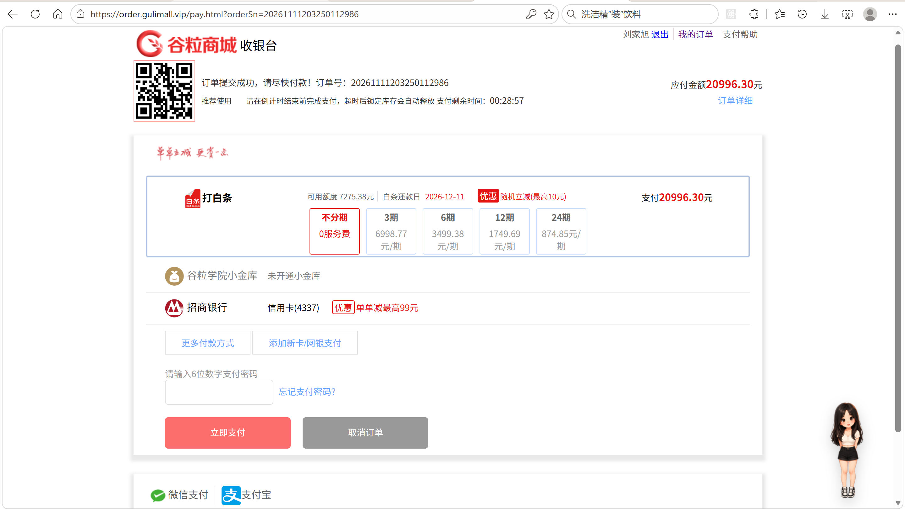
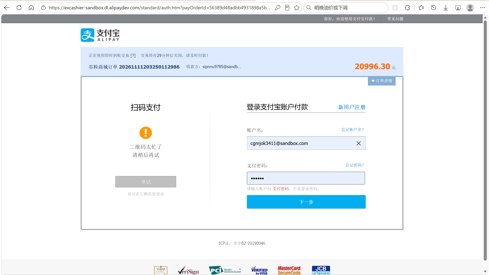
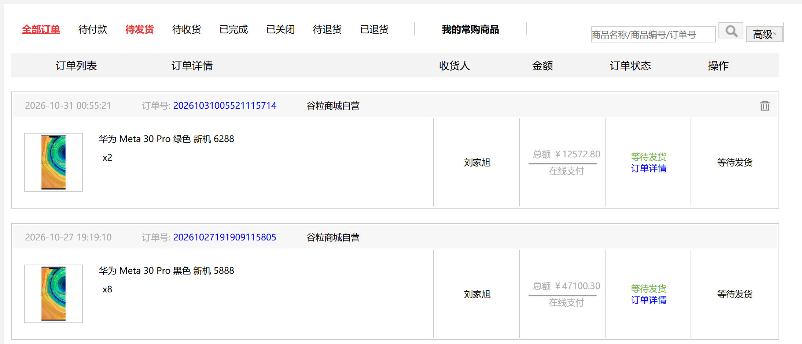
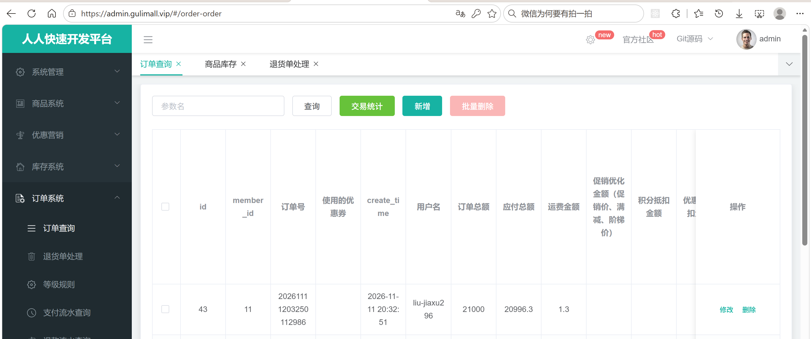
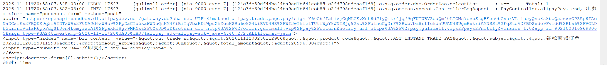
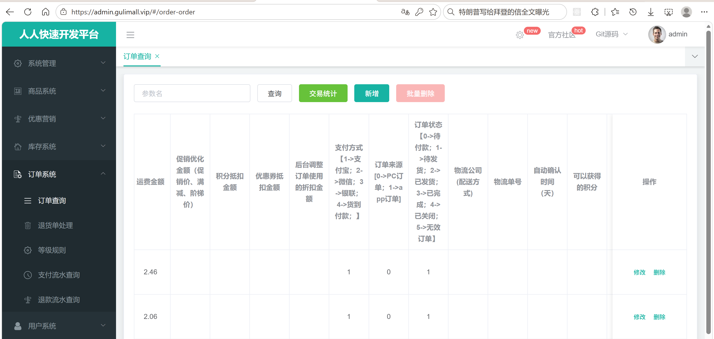

# 13.1 支付宝支付-介绍

> 本篇介绍订单支付的最后一段链路：业务上订单怎样从待付款变成待发货、支付宝异步通知为什么是支付结果的唯一依据、同步跳回怎样兜底、金额和状态怎样校验、重复通知怎样保证幂等、超时关单后又收到付款怎样自动退款，以及支付成功后库存、购物车、秒杀单怎样联动。

---

## 1. 这个功能是干什么的

支付是下单流程的最后一步。用户提交订单时，订单状态是 `0`（待付款），库存处于锁定状态；用户在收银台完成支付宝付款后，订单变成 `1`（待发货），锁定库存转成真实扣减，购物车里的商品被清掉，秒杀订单被标记为已支付。

订单状态在支付前后的变化：

| `oms_order.status` | 含义 | 和支付的关系 |
|---|---|---|
| 0 | 待付款 | 只有这个状态能发起支付 |
| 1 | 待发货 | 支付成功后由 `markOrderPaid` 改成 1 |
| 2 | 待收货 | 商家发货后进入 |
| 3 | 已完成 | 用户确认收货后进入 |
| 4 | 已关闭 | 用户取消或超时关单；此时如果再收到付款，走自动退款 |

支付功能要解决四个问题：

1. **钱付给谁、付多少**：支付页必须确认订单属于当前登录用户，金额必须取订单的 `pay_amount`，不能让前端传金额。
2. **支付结果信谁**：浏览器跳回页面不代表付款成功，必须以支付宝服务器发来的异步通知为准；同步跳回只做兜底。
3. **重复通知怎么办**：支付宝会重复推送通知，同一笔订单不能重复改状态、重复写支付流水、重复扣库存。
4. **付晚了怎么办**：订单已经超时关闭，用户又付款成功，必须把钱原路退回，不能出现“订单关了、钱收了”的状态。

支付成功后还要联动三个下游：

```text
order 服务：oms_order.status 0 -> 1，pay_type=1，payment_time=当前时间
order 服务：oms_payment_info 写支付宝交易流水
ware 服务：锁定库存 stock_locked 转真实扣减 stock
cart 服务：删除这次下单的商品
seckill 服务：sms_seckill_order 状态改成已支付
```

支付超时时间和库存释放共用 `gulimall.ware.stock-release.delay-ms`，开发配置是 1800000 毫秒，也就是 30 分钟。收银台倒计时、订单超时关单、库存解锁都以这个时间为准。

## 2. 用户/管理员怎么操作

### 2.1 从订单列表进入支付页

1. 用户登录后打开订单列表。
2. 待付款订单右侧显示“去支付”。
3. 点击后打开 `/pay.html?orderSn=订单号`。
4. 后端校验订单存在、属于当前用户、状态是 0。
5. 页面显示订单号、应付金额、支付剩余时间和分期参考金额。



支付页只负责展示和倒计时，不直接改订单状态。页面上的“立即支付”和底部“支付宝”图标走同一个入口。

### 2.2 在收银台选择支付宝

1. 点击“立即支付”或“支付宝”图标。
2. 浏览器打开 `/pay/alipay?orderSn=订单号`。
3. 后端生成支付宝电脑网站支付的自动提交表单。
4. 浏览器拿到这段 HTML 后自动跳到支付宝收银台。
5. 用户在收银台登录支付宝，确认金额并付款。



支付金额由后端从订单表取，前端不参与金额计算，避免改请求参数少付钱。

### 2.3 支付完成后的页面跳回

1. 用户在支付宝完成付款。
2. 支付宝把浏览器同步跳回 `/pay/return`。
3. 后端对同步参数验签，并用订单号主动查一次支付宝交易状态。
4. 如果查到 `TRADE_SUCCESS` 或 `TRADE_FINISHED`，调用订单服务把订单置为已支付。
5. 浏览器最终跳到订单列表。



同步跳回可能被用户关闭页面、网络中断打断，所以它不是支付结果的主要来源，只是兜底。

### 2.4 管理员查看支付流水

1. 管理员打开后台“订单管理 → 支付信息”。
2. 页面请求 `/order/paymentinfo/list`。
3. 列表展示订单号、支付宝交易流水号、支付金额、支付状态、回调时间。



支付流水表 `oms_payment_info` 按订单号一条记录，支付宝交易流水号 `alipay_trade_no` 是后续退款、对账的关键字段。

### 2.5 查看异步回调日志

1. 支付宝服务器向 `notify_url` 发起 POST。
2. order 服务打印 `[alipay-notify]` 开头的日志。
3. 日志里能看到订单号、交易流水号、验签结果和订单更新结果。



回调日志是排查“钱付了但订单没变”的第一手材料，重点看验签是否通过、`app_id` 是否匹配、金额是否一致。

### 2.6 确认订单状态

1. 支付成功后订单从“待付款”变成“待发货”。
2. 订单列表和订单详情都能看到状态变化。
3. 仓库端可以按已支付订单开始发货。



## 3. 整体设计思路

### 3.1 业务上怎么设计

#### 3.1.1 支付状态机

支付只允许一个方向：`0 待付款 → 1 待发货`。其它状态都不允许直接改成已支付。

```text
0 待付款
  ├── 支付宝付款成功 → 1 待发货
  ├── 用户取消       → 4 已关闭
  └── 超过 30 分钟    → 4 已关闭
4 已关闭
  └── 又收到付款成功 → 全额原路退款
```

状态更新使用条件更新：`UPDATE oms_order SET status=1 WHERE id=? AND status=0`。只有当前状态仍然是 0 才会成功，支付回调和超时关单同时到达时只有一方能改成功。

#### 3.1.2 异步通知为准

支付宝提供两种回跳：

1. **异步通知 notify**：支付宝服务器直接 POST 商户服务器，不依赖浏览器，支付成功、失败、关闭都可能推送。
2. **同步跳转 return**：用户浏览器 GET 回来，参数里没有可靠的交易状态，页面可能被关闭。

业务规则：

1. 订单状态只由异步通知或主动查单结果推进。
2. 同步跳回不直接相信参数，必须先调用支付宝查单接口。
3. 异步通知处理成功返回纯文本 `success`，支付宝才会停止重试；返回其它内容会继续推送。

#### 3.1.3 幂等规则

支付宝可能重复通知，网络也可能重试。支付接口必须保证：

1. 订单已经是 1 时，重复通知直接返回成功，不重复改状态。
2. 订单已经是 1 时，补写一次支付流水，避免上次只改了订单一没写流水。
3. 支付流水按 `order_sn` 只保留一条，存在就更新，不存在才新增。
4. 库存扣减和购物车删除都做成“失败只记日志、可重复调用”的旁路操作。

#### 3.1.4 金额校验规则

1. 发起支付时，金额取 `oms_order.pay_amount`，必须大于 0。
2. 异步通知里的 `total_amount` 必须和订单 `pay_amount` 完全相等。
3. 金额比较用 `BigDecimal.compareTo`，不用 `equals`，避免 `100.00` 和 `100.0` 被判断为不同。
4. 金额不一致时拒绝更新订单，记录错误日志，返回 `failure` 让支付宝继续通知，便于人工介入。

#### 3.1.5 超时关单与晚付款退款

1. 订单创建超过 30 分钟仍未付款，定时任务把状态改成 4。
2. 关单时调用支付宝关闭交易，尽量避免用户继续付款。
3. 如果关闭交易前用户已经付款，支付宝的异步通知会到达。
4. 通知发现订单已经是 4，按订单实付金额全额原路退款。
5. 退款记录写入 `oms_refund_info`，类型是 1（超时支付自动退款）。

#### 3.1.6 支付成功后的联动

支付成功后，订单服务先完成本地数据库更新，再通知下游：

```text
1. order：status=1、pay_type=1、payment_time=当前时间、oms_payment_info
2. ware：markPaid，锁定库存转真实扣减
3. cart：删除订单明细里的 skuId
4. seckill：秒杀单置为 PAID
```

下游失败不能把支付回调改成 `failure`，因为支付宝已经扣款、订单已经变成已支付。库存、购物车、秒杀状态都有各自的兜底：库存有工作单状态和对账，购物车下次还能清，秒杀有对账任务。

#### 3.1.7 支付流水的业务含义

`oms_payment_info` 是支付结果的凭证表：

| 字段 | 业务含义 |
|---|---|
| `order_sn` | 商户订单号，和 `oms_order.order_sn` 对应 |
| `order_id` | 订单主键 |
| `alipay_trade_no` | 支付宝交易流水号，退款时使用 |
| `total_amount` | 实际支付金额 |
| `payment_status` | `TRADE_SUCCESS` 表示支付成功 |
| `callback_content` | 支付宝回调报文，排查问题时使用 |
| `callback_time` | 回调到达时间 |

### 3.2 技术上怎么设计

#### 3.2.1 支付宝沙箱与 RSA2

开发环境使用支付宝沙箱：

```text
网关：https://openapi-sandbox.dl.alipaydev.com/gateway.do
签名：RSA2
字符集：UTF-8
返回格式：json
```

RSA2 需要两把钥匙：

1. **应用私钥**：商户自己生成，用来给发给支付宝的请求签名。
2. **支付宝公钥**：在支付宝开放平台上传应用公钥后，平台返回的公钥，用来验证支付宝发回来的数据。

验签使用支付宝 SDK 的 `AlipaySignature.rsaCheckV1(params, 支付宝公钥, charset, signType)`。验签不通过说明请求不是支付宝发的，直接拒绝。

#### 3.2.2 页面跳转支付

电脑网站支付使用 `alipay.trade.page.pay`：

1. 后端构造 `AlipayTradePagePayRequest`。
2. 设置 `notify_url` 和 `return_url`。
3. 组装 `AlipayTradePagePayModel`：商户订单号、金额、标题、产品码、超时时间。
4. 调用 `alipayClient.pageExecute(request)`。
5. 返回的 `body` 是一段自动提交的 HTML 表单，不是 JSON。
6. 浏览器打开这段 HTML 后自动跳到支付宝收银台。

#### 3.2.3 回调接口放行

支付宝异步通知是服务器对服务器调用，不带用户登录会话。订单服务的登录拦截器必须放行：

```text
/pay/notify
/pay/return
```

否则回调会被 302 到登录页，订单永远收不到支付结果。

#### 3.2.4 本地事务边界

`markOrderPaid` 有 `@Transactional`，事务只覆盖：

1. 更新 `oms_order`。
2. 写 `oms_payment_info`。

ware、cart、seckill 的 Feign 调用放在事务方法返回之后，由 `AlipayService` 发起。这样远程调用不会拉长本地事务，也不会因为下游失败回滚已经成功的支付状态。

#### 3.2.5 回调返回值的含义

`/pay/notify` 必须返回纯文本：

| 返回值 | 含义 | 支付宝行为 |
|---|---|---|
| `success` | 已收到并处理 | 停止重试 |
| `failure` | 处理失败 | 按策略继续重试 |

非交易成功状态（例如等待付款）也返回 `success`，因为通知已经收到，只是不需要处理，继续重试没有意义。

#### 3.2.6 支付数据统计

后台交易统计按已支付订单计算：

```text
统计范围：oms_order.status IN (1, 2, 3)
时间口径：payment_time
金额口径：pay_amount
支付方式：pay_type 1 支付宝、2 微信、3 银联、4 货到付款
```

统计结果用 ECharts 展示交易趋势、商品销量 Top10、支付方式分布、订单状态分布。

## 4. 详细代码、配置和解释

第 4 章按“类为什么存在 → 关键字段与接口 → 链路位置 → 代码分块解释 → 一次完整示例 → 边界与可优化点”组织。每一块代码前面先说明它在链路里承担什么，代码后面按 1、2、3 的顺序解释执行过程、条件和原因。代码保持支付链路的原始实现，包声明、无关 import 和基础 CRUD 不重复。

### 4.1 AlipayProperties：支付宝参数集中绑定

#### 4.1.1 这个类解决什么问题

支付链路的两端都要用同一套支付宝参数：发给支付宝的请求需要应用私钥签名，支付宝推回来的通知需要支付宝公钥验签；网关地址决定请求落到沙箱还是正式环境；`notify_url` 决定支付宝服务器把异步结果推到哪里；`return_url` 决定浏览器付款完成后跳回哪里。使用这些参数的有三个位置：`AlipayConfig` 创建客户端，`AlipayService` 生成支付表单并处理通知，`AlipayRefundService` 发起退款。

参数如果散落在各个类里用 `@Value` 读取，会带来三个问题：字段名修改要逐处同步；沙箱切正式要逐处改地址；私钥、公钥、APPID 三者的对应关系只能靠配置注释维护。`AlipayProperties` 把 `gulimall.alipay.*` 绑定成一个对象，启动时一次加载，其他组件只依赖这个对象。

链路位置：

```text
gulimall-order.yaml / common.yaml
  → AlipayProperties（启动时绑定）
  → AlipayConfig（创建 AlipayClient）
  → AlipayService / AlipayRefundService（签名、验签、回调地址、app_id 校验）
```

#### 4.1.2 字段与业务含义

| 字段 | 配置键 | 用途 | 使用方 |
|---|---|---|---|
| `appId` | `app-id` | 开放平台应用 APPID，请求里作为 `app_id`，回调里用于比对 | 客户端创建、回调校验 |
| `privateKey` | `private-key` | 应用私钥，PKCS8 单行字符串，给请求签名 | 客户端创建 |
| `alipayPublicKey` | `alipay-public-key` | 支付宝公钥，验证支付宝返回的数据 | 客户端创建、验签 |
| `gatewayUrl` | `gateway-url` | 支付宝网关，沙箱与正式环境不同 | 客户端创建 |
| `notifyUrl` | `notify-url` | 异步通知地址，支付宝服务器直接 POST，必须公网可达 | 支付请求、退款请求 |
| `returnUrl` | `return-url` | 同步跳转地址，用户浏览器 GET | 支付请求 |
| `signType` | `sign-type` | 签名算法，固定 `RSA2` | 客户端创建、验签 |
| `charset` | `charset` | 字符集，固定 `UTF-8` | 客户端创建、验签 |
| `format` | `format` | 返回格式，固定 `json` | 客户端创建 |

私钥和公钥最容易混淆：`privateKey` 是商户自己生成、用来签名的应用私钥；`alipayPublicKey` 是在开放平台上传应用公钥后，平台返回的支付宝公钥。两者不是一对，不能互换。

#### 4.1.3 代码与解释

```java
@Data
@Component
@ConfigurationProperties(prefix = "gulimall.alipay")
public class AlipayProperties {

    /** 沙箱 APPID（正式环境换成正式应用 APPID） */
    private String appId;

    /**
     * 应用私钥（PKCS8，单行字符串）。
     * 不是支付宝公钥，也不是应用公钥。
     */
    private String privateKey;

    /** 支付宝公钥：沙箱控制台上传应用公钥后复制回来的那个 */
    private String alipayPublicKey;

    /** 网关：沙箱用 https://openapi-sandbox.dl.alipaydev.com/gateway.do */
    private String gatewayUrl;

    /** 异步通知地址，必须公网可访问 */
    private String notifyUrl;

    /** 同步跳转地址 */
    private String returnUrl;

    /** 签名类型，固定 RSA2 */
    private String signType = "RSA2";

    /** 字符集 */
    private String charset = "UTF-8";

    /** 返回格式 */
    private String format = "json";
}
```


1. `@Data` 生成 getter 和 setter。`@ConfigurationProperties` 绑定配置需要可写的属性，没有 setter 时字段不会被赋值。
2. `@Component` 把对象注册进 Spring 容器，`AlipayConfig`、`AlipayService`、`AlipayRefundService` 可以直接按类型注入。
3. `@ConfigurationProperties(prefix = "gulimall.alipay")` 指定配置前缀。Spring Boot 的松散绑定会把 `app-id` 映射到 `appId`，把 `alipay-public-key` 映射到 `alipayPublicKey`。
4. `appId` 有两个用途：创建客户端时作为应用标识，处理异步通知时和回调参数里的 `app_id` 比较。缺少这个比较，别的支付宝应用的回调也可能被当成合法通知。
5. `privateKey` 只用于请求签名。注释特意说明它不是支付宝公钥，也不是应用公钥，因为三者名字接近，配错时往往到调用支付才报签名错误。
6. `alipayPublicKey` 只用于验证支付宝返回的数据。异步通知验签、同步跳转验签、主动查单响应验签都依赖它。
7. `gatewayUrl` 决定请求发往沙箱还是正式网关。沙箱网关只处理沙箱 APPID 和沙箱账号，正式网关只处理正式应用。
8. `notifyUrl` 和 `returnUrl` 是两条不同的回跳链路。前者由支付宝服务器发起，不依赖浏览器；后者由用户浏览器发起，可能被关闭页面打断。
9. `signType`、`charset`、`format` 给了默认值，配置文件不写也能工作；支付宝沙箱和正式环境都要求 `RSA2`，改成 `RSA` 会验签失败。
10. 这个类只承载数据，不创建客户端、不解析密钥、不校验配置，所有行为都留给使用方。

#### 4.1.4 一次配置加载示例

```text
1. 应用启动，Spring Boot 扫描到 AlipayProperties
2. 读取 gulimall.alipay.app-id=<your-alipay-app-id>
3. 读取 gulimall.alipay.private-key=${ALIPAY_PRIVATE_KEY}
4. 环境变量替换后得到真实私钥
5. 松散绑定把 app-id 写入 appId，把 alipay-public-key 写入 alipayPublicKey
6. AlipayConfig 注入该对象，创建 AlipayClient
7. AlipayService 注入该对象，取 notifyUrl、returnUrl、appId
```

配置缺失时启动不会报错，字段是 `null`。真正暴露问题的时机是创建客户端或发起支付，因此生产环境应在启动阶段做一次必填校验。

#### 4.1.5 它不做什么

1. 不创建 `AlipayClient`，客户端生命周期由 `AlipayConfig` 管理。
2. 不解析 PKCS8 私钥，密钥格式校验交给支付宝 SDK。
3. 不校验必填项，`appId`、`privateKey`、`alipayPublicKey` 为空时仍能启动。
4. 不区分沙箱和正式环境，环境切换完全依赖 `gatewayUrl` 和 APPID 的配置组合。
5. 不做配置热更新，修改密钥或地址需要重启应用。

#### 4.1.6 边界与可优化点

1. 私钥以明文形式存在于配置文件和环境变量中，正式环境应放入配置中心或密钥管理服务，并限制读取权限。
2. 缺少 `@Validated` 和 `@NotBlank` 校验。配置写错时应用照常启动，直到用户点击支付才失败。
3. 沙箱与正式环境靠人工替换 `gatewayUrl`，容易把沙箱 APPID 配到正式网关；可以增加环境枚举，在启动时校验网关与 APPID 的匹配关系。
4. 回调地址与部署域名强相关。`notifyUrl` 和 `returnUrl` 可以指向不同主机，修改部署结构时要成对检查。
5. 密钥轮换需要重启全部 order 实例。多实例部署时，新旧密钥并存期间会出现部分实例验签失败。

### 4.2 AlipayConfig：创建全局支付宝客户端

#### 4.2.1 这个配置解决什么问题

支付宝 SDK 的每一次调用都要带上网关、APPID、应用私钥、返回格式、字符集、支付宝公钥和签名类型。生成支付表单、主动查单、关闭交易、发起退款都走同一个 `AlipayClient`。如果每个方法各自 `new DefaultAlipayClient(...)`，会重复建立 HTTP 连接和配置对象，也容易出现“支付用沙箱、退款用正式”的配置漂移。

这个配置把客户端创建收口到一个 `@Bean`，整个应用共用一个实例。`AlipayClient` 内部只保存配置和 HTTP 客户端，本身线程安全，单例足够支撑并发支付请求。

#### 4.2.2 客户端参数与顺序

`DefaultAlipayClient` 的构造参数顺序是固定的：

```text
gatewayUrl, appId, privateKey, format, charset, alipayPublicKey, signType
```

参数全部是 `String`，顺序写错仍然能编译通过，但运行时会表现为请求签名错误、返回格式解析失败或验签失败。尤其要注意第五个参数是字符集、第六个参数才是支付宝公钥，两个位置相邻，最容易写反。

#### 4.2.3 代码与解释

```java
@Configuration
public class AlipayConfig {

    /**
     * AlipayClient 是线程安全的，整个应用共用一个即可。
     */
    @Bean
    public AlipayClient alipayClient(AlipayProperties properties) {
        return new DefaultAlipayClient(
                properties.getGatewayUrl(),
                properties.getAppId(),
                properties.getPrivateKey(),
                properties.getFormat(),
                properties.getCharset(),
                properties.getAlipayPublicKey(),
                properties.getSignType());
    }
}
```


1. `@Configuration` 声明这是一个配置类，Spring 启动时会处理其中的 `@Bean` 方法。
2. `alipayClient(AlipayProperties properties)` 通过方法参数注入配置对象，不需要再写 `@Autowired` 字段。
3. `new DefaultAlipayClient(...)` 的第一个参数是网关，第二个是 APPID，第三个是应用私钥。
4. 第四、第五个参数分别是返回格式和字符集，来自配置的 `json` 和 `UTF-8`。
5. 第六个参数是支付宝公钥，用于验证支付宝返回的响应和异步通知；第七个参数是签名类型，固定 `RSA2`。
6. 方法返回值注册为单例 Bean。Spring 只在启动时调用一次，之后所有注入点拿到的是同一个客户端。
7. 支付表单、主动查单、关闭交易、退款共用这个客户端，避免配置不一致。

#### 4.2.4 一次调用示例

```text
1. 应用启动
2. AlipayConfig.alipayClient() 执行
3. DefaultAlipayClient 内部保存网关、APPID、私钥、公钥、字符集、签名类型
4. AlipayService 注入客户端
5. createPagePayForm() 调 pageExecute()
6. handleReturn() 调 execute() 查询交易
7. AlipayRefundService 调 execute() 发起退款
```

三个调用点共用同一个客户端，签名和验签使用同一套密钥，避免出现“支付成功、退款签名失败”的环境错配。

#### 4.2.5 它不做什么

1. 不配置连接超时和读取超时，使用 SDK 默认值。
2. 不添加请求日志拦截器，请求耗时和失败原因只能从业务日志看。
3. 不支持证书模式，只使用 RSA2 公钥模式。
4. 不支持多应用，一个客户端只对应一个 APPID。
5. 不在运行时刷新配置，客户端创建后参数固定。

#### 4.2.6 边界与可优化点

1. 缺少超时配置。支付宝接口变慢时，调用线程会长时间占用 Tomcat 线程，支付回调也会被拖住。
2. 建议给客户端增加日志拦截器，记录接口名、耗时、返回码和 `sub_code`，排查问题时不用只靠业务日志。
3. 沙箱和正式环境需要两套配置。多环境部署时应通过配置中心隔离，避免同一份配置文件被不同环境复用。
4. 客户端是单例，但底层 HTTP 连接池参数没有显式设置，高并发下连接数依赖 SDK 默认值。
5. 如果后续接入多个支付宝应用，需要按 APPID 维护多个客户端，当前的单 Bean 结构不适用。

### 4.3 PayController：收银台与回调入口

#### 4.3.1 这个类解决什么问题

收银台相关请求有两个来源：用户浏览器和支付宝服务器。用户浏览器要打开支付页、取消订单、跳到支付宝、付款后跳回；支付宝服务器要 POST 异步通知。两个来源的差异很大：

1. 浏览器请求带登录会话，需要校验订单归属。
2. 支付宝通知不带登录会话，只带签名和交易参数，必须在拦截器里放行。
3. 浏览器请求返回页面或重定向，支付宝通知只认纯文本 `success`。

`PayController` 负责把五种请求翻译成 `OrderService` 和 `AlipayService` 调用。订单归属、状态、金额、验签、幂等都不在这个类里实现，它只做参数接收、登录态获取和结果包装。

#### 4.3.2 接口与调用方

| 操作 | 方法与路径 | 请求方 | 登录态 | 调用的 Service |
|---|---|---|---|---|
| 打开收银台 | `GET /pay.html?orderSn=...` | 浏览器 | 需要 | `OrderService.getOne()` |
| 取消订单 | `POST /pay/cancel` | 浏览器 | 需要 | `OrderService.cancelOrder()`、`AlipayService.closeTradeQuietly()` |
| 生成支付表单 | `GET /pay/alipay?orderSn=...` | 浏览器 | 需要 | `AlipayService.createPagePayForm()` |
| 异步通知 | `POST /pay/notify` | 支付宝服务器 | 放行 | `AlipayService.handleNotify()` |
| 同步跳回 | `GET /pay/return` | 浏览器 | 放行 | `AlipayService.handleReturn()` |

`/pay/notify` 和 `/pay/return` 必须加入订单服务登录拦截器的放行名单。前者没有用户会话，后者可能因为会话过期而拿不到登录信息；拦截器如果把它们重定向到登录页，支付宝收到的是 HTML，订单也收不到支付结果。

#### 4.3.3 代码与解释

```java
@Controller
public class PayController {

    @Autowired
    private OrderService orderService;
    @Autowired
    private AlipayService alipayService;

    /** 支付超时（毫秒），配置在 common.yaml */
    @Value("${gulimall.ware.stock-release.delay-ms}")
    private long payTimeoutMs;

    @GetMapping("/pay.html")
    public String pay(@RequestParam(value = "orderSn", required = false) String orderSn, Model model) {
        if (orderSn == null || orderSn.isBlank()) {
            return "redirect:/list.html";
        }

        OrderEntity order = orderService.getOne(new QueryWrapper<OrderEntity>()
                .eq("order_sn", orderSn)
                .last("LIMIT 1"), false);
        MemberResponseVo loginUser = MemberResponseVoThreadLocal.get();
        if (order == null || loginUser == null
                || !Objects.equals(loginUser.getId(), order.getMemberId())
                || !Integer.valueOf(0).equals(order.getStatus())) {
            return "redirect:/list.html";
        }

        BigDecimal payAmount = order.getPayAmount();
        long remainingSeconds = (order.getCreateTime().getTime() + payTimeoutMs
                - System.currentTimeMillis()) / 1000;
        model.addAttribute("orderSn", order.getOrderSn());
        model.addAttribute("payAmount", payAmount);
        model.addAttribute("payRemainingSeconds", remainingSeconds);
        model.addAttribute("installment3", installment(payAmount, 3));
        model.addAttribute("installment6", installment(payAmount, 6));
        model.addAttribute("installment12", installment(payAmount, 12));
        model.addAttribute("installment24", installment(payAmount, 24));
        model.addAttribute("creditDueDate", LocalDate.now().plusDays(30));
        return "pay";
    }

    /**
     * 用户主动取消订单：status 0 -> 4，并通知 ware 释放锁定库存。
     * 库存释放失败也返回成功，由延时消息 / StockReleaseTask 兜底。
     */
    @PostMapping("/pay/cancel")
    @ResponseBody
    public R cancel(@RequestParam("orderSn") String orderSn) {
        try {
            orderService.cancelOrder(orderSn);
            alipayService.closeTradeQuietly(orderSn);
            return R.ok();
        } catch (RRException e) {
            return R.error(e.getCode(), e.getMsg());
        }
    }

    @GetMapping(value = "/pay/alipay", produces = MediaType.TEXT_HTML_VALUE)
    @ResponseBody
    public String alipayPay(@RequestParam("orderSn") String orderSn) {
        MemberResponseVo loginUser = MemberResponseVoThreadLocal.get();
        if (loginUser == null) {
            throw new RRException(BizCodeEnum.ORDER_NOT_LOGIN);
        }
        return alipayService.createPagePayForm(orderSn, loginUser.getId());
    }

    @PostMapping("/pay/notify")
    @ResponseBody
    public String alipayNotify(@RequestParam Map<String, String> params) {
        return alipayService.handleNotify(params);
    }

    @GetMapping("/pay/return")
    public String alipayReturn(@RequestParam Map<String, String> params) {
        alipayService.handleReturn(params);
        return "redirect:/list.html";
    }

    /** 每期应付金额（页面展示用，未计手续费） */
    private BigDecimal installment(BigDecimal payAmount, int periods) {
        return payAmount.divide(BigDecimal.valueOf(periods), 2, RoundingMode.HALF_UP);
    }
}
```


1. `@Controller` 而不是 `@RestController`，因为 `pay()` 要返回 Thymeleaf 视图；需要返回数据的方法单独加 `@ResponseBody`。
2. `OrderService` 和 `AlipayService` 通过字段注入，Controller 不持有支付业务逻辑。
3. `payTimeoutMs` 从 `gulimall.ware.stock-release.delay-ms` 读取，和库存释放、超时关单共用同一个超时时间，避免收银台倒计时和关单时间不一致。
4. `pay()` 先判断 `orderSn` 是否为空，为空直接回订单列表。按 `order_sn` 查一条订单，再取 `MemberResponseVoThreadLocal` 里的当前会员；`LoginUserInterceptor` 在请求进入时已经把会员放进 ThreadLocal。
5. `pay()` 的校验条件是四个：订单存在、会员存在、会员 id 与订单 `member_id` 一致、订单状态是 0。任意一个不满足都重定向到订单列表，不返回 404，避免通过错误信息探测订单号。
6. `pay()` 计算剩余秒数时用“创建时间 + 超时时间 - 当前时间”，结果可能为负数。模型里还放了 3、6、12、24 期的分期展示金额和 30 天后的信用到期日，这些只用于页面展示。
7. `cancel()` 先调 `orderService.cancelOrder()` 把订单改成已关闭并释放库存，再调 `alipayService.closeTradeQuietly()` 尽量关闭支付宝交易。前者失败会抛业务异常并转成 `R.error`，后者失败只记日志。
8. `alipayPay()` 从 ThreadLocal 取会员，取不到直接抛 `ORDER_NOT_LOGIN`；拿到会员后把订单号和会员 id 交给 `createPagePayForm()`。`produces = text/html` 让浏览器把返回的字符串当成 HTML 表单执行。
9. `alipayNotify()` 用 `@RequestParam Map<String, String>` 接收表单参数，返回 `String`，因为支付宝只认纯文本 `success` 或 `failure`，不能包成 `R`。
10. `alipayReturn()` 调 `handleReturn()` 做查单兜底，然后无条件重定向到订单列表。同步跳回的参数不直接展示，避免用户刷新页面时重复提交。
11. `installment()` 只做除法展示，保留两位小数，不参与真实支付金额计算。

#### 4.3.4 一次完整请求示例

```text
1. 用户在订单列表点击“去支付”
2. 浏览器 GET /pay.html?orderSn=202611120001
3. LoginUserInterceptor 从会话取会员，写入 MemberResponseVoThreadLocal
4. PayController.pay() 按 orderSn 查 oms_order
5. 校验 member_id 一致、status=0
6. 计算剩余秒数、分期金额，放入 Model
7. 返回 pay 视图，Thymeleaf 渲染 pay.html
8. 用户点击“立即支付”
9. 浏览器 GET /pay/alipay?orderSn=202611120001
10. alipayPay() 取当前会员 id
11. createPagePayForm() 返回自动提交 HTML
12. 浏览器解析 HTML，自动提交到支付宝网关
```

#### 4.3.5 它不做什么

1. 不修改订单状态，状态更新由 `OrderService.markOrderPaid()` 和 `cancelOrder()` 完成。
2. 不验签，异步通知和同步跳回的签名校验在 `AlipayService` 里。
3. 不做幂等，重复通知的幂等由订单状态条件更新保证。
4. 不计算支付金额，只从订单表取 `pay_amount`。
5. 不为异步通知维护登录态，回调接口完全依赖签名和 `app_id` 识别来源。

#### 4.3.6 边界与可优化点

1. `pay()` 的剩余秒数可能为负数，页面会显示 `00:00:00`。服务端应在计算后至少归零，同时提示订单即将关闭。
2. `/pay/alipay` 没有防重复点击和限流，连续点击会生成多个支付宝支付表单，支付宝侧可能留下多笔待付款交易。
3. `cancel()` 的两个操作不在同一个事务里：本地订单已关闭、支付宝交易关闭失败时，用户仍可能继续付款，后续依赖晚付款退款兜底。
4. `/pay/return` 无论查单成功还是失败都跳订单列表，用户看不到“支付处理中”或“支付失败”的提示。
5. 分期金额只是页面展示，没有对接分期支付产品，也没有计算手续费。

### 4.4 AlipayService.createPagePayForm：生成支付表单

#### 4.4.1 这个方法解决什么问题

用户点击“立即支付”时，订单已经存在于 `oms_order`，应付金额也已经确定。这个方法要做的是：确认这笔订单确实属于当前登录会员、状态仍然是待付款、金额有效，然后把订单号、金额、标题、产品码和超时时间组装成支付宝电脑网站支付请求，换回一段自动提交的 HTML。

`orderSn` 出现在 URL 里，可以被用户修改。如果只按订单号生成表单，不校验归属，任何登录用户都能替别人的订单付款，也能通过返回结果探测订单是否存在。金额同样不能由前端传入，否则改请求参数就能少付钱。

#### 4.4.2 请求参数

| 参数 | 取值 | 作用 |
|---|---|---|
| `out_trade_no` | `orderSn` | 商户订单号，支付宝回调原样带回 |
| `total_amount` | `oms_order.pay_amount` | 支付金额，单位元，保留两位小数 |
| `subject` | `谷粒商城订单 + orderSn` | 收银台展示的交易标题 |
| `product_code` | `FAST_INSTANT_TRADE_PAY` | 电脑网站支付固定值 |
| `timeout_express` | `30m` | 支付宝侧交易超时时间 |
| `notify_url` | 配置的异步通知地址 | 支付宝服务器 POST 支付结果 |
| `return_url` | 配置的同步跳转地址 | 用户浏览器付款后跳回 |

`pageExecute()` 返回的是 HTML 表单，不是 JSON。表单里包含签名后的参数和一段自动提交脚本，浏览器打开后直接跳到支付宝收银台。

#### 4.4.3 代码与解释

```java
public String createPagePayForm(String orderSn, Long memberId) {
    // 执行顺序 1：查订单，并确认这个订单属于当前登录用户。
    // orderSn（订单号）是商户侧对外业务号，防止改 orderSn 去支付别人的订单。
    OrderEntity order = orderService.getOne(new QueryWrapper<OrderEntity>()
            .eq("order_sn", orderSn)
            .last("LIMIT 1"), false);

    if (order == null || memberId == null || !memberId.equals(order.getMemberId())) {
        throw new RRException(BizCodeEnum.ORDER_NOT_FOUND_OR_NOT_OWNER);
    }

    // 执行顺序 2：只有待付款（status=0）的订单能发起支付。
    // status 是 oms_order.status：0 待付款、1 待发货、4 已关闭。
    if (!Integer.valueOf(0).equals(order.getStatus())) {
        throw new RRException(BizCodeEnum.ORDER_PAY_NOT_ALLOWED);
    }

    // 执行顺序 3：payAmount（应付金额）必须存在且大于 0。
    if (order.getPayAmount() == null
            || order.getPayAmount().compareTo(BigDecimal.ZERO) <= 0) {
        throw new RRException(BizCodeEnum.ORDER_PAY_AMOUNT_INVALID);
    }

    // 执行顺序 4：创建“电脑网站支付”请求。
    // notify_url（异步通知地址）由支付宝服务器 POST 访问，必须公网可达；
    // return_url（同步跳转地址）由用户浏览器 GET 访问，只用于跳回页面。
    AlipayTradePagePayRequest request = new AlipayTradePagePayRequest();
    request.setNotifyUrl(properties.getNotifyUrl());
    request.setReturnUrl(properties.getReturnUrl());

    // 执行顺序 5：组装 biz_content（业务参数）。
    // out_trade_no：商户订单号，对应 orderSn；
    // total_amount：支付金额，单位元，保留两位小数；
    // subject：交易标题；
    // product_code：产品码，电脑网站支付固定 FAST_INSTANT_TRADE_PAY；
    // timeout_express：支付超时时间，和订单 30 分钟超时保持一致。
    AlipayTradePagePayModel model = new AlipayTradePagePayModel();
    model.setOutTradeNo(orderSn);
    model.setTotalAmount(order.getPayAmount()
            .setScale(2, RoundingMode.HALF_UP).toPlainString());
    model.setSubject("谷粒商城订单 " + orderSn);
    model.setProductCode("FAST_INSTANT_TRADE_PAY");
    model.setTimeoutExpress("30m");
    request.setBizModel(model);

    // 执行顺序 6：pageExecute（调用支付宝接口）返回一段自动提交的 HTML 表单，
    // 不是 JSON。浏览器打开这段 HTML 会自动跳到支付宝收银台。
    try {
        AlipayTradePagePayResponse response = alipayClient.pageExecute(request);
        if (!response.isSuccess() || response.getBody() == null) {
            log.error("[alipay] 创建支付单失败，orderSn={}, code={}, msg={}, subMsg={}",
                    orderSn, response.getCode(), response.getMsg(), response.getSubMsg());
            throw new RRException(BizCodeEnum.ORDER_PAY_CREATE_FAILED);
        }
        return response.getBody();
    } catch (AlipayApiException e) {
        log.error("[alipay] 创建支付单异常，orderSn={}", orderSn, e);
        throw new RRException(BizCodeEnum.ORDER_PAY_CREATE_FAILED);
    }
}
```


1. 按 `orderSn` 查一条订单。`LIMIT 1` 防止订单号重复时查出多条导致 `getOne` 报错。
2. 订单不存在、会员 id 为空、会员 id 和订单 `member_id` 不一致，都抛“订单不存在或无权操作”。这个判断同时挡住越权支付和订单号探测。
3. 只有 `status=0` 的订单能发起支付。已支付、已关闭、已完成都应拒绝，避免对同一笔订单重复生成支付交易。
4. 应付金额必须非空且大于 0。金额为 0 或负数说明订单数据异常，不能生成支付请求。
5. 创建 `AlipayTradePagePayRequest`，设置 `notify_url` 和 `return_url`。前者给支付宝服务器用，后者给浏览器用，两个地址不能混。
6. 创建 `AlipayTradePagePayModel`，设置商户订单号、两位小数金额、交易标题、产品码和 30 分钟超时。金额用 `setScale(2, HALF_UP).toPlainString()`，避免科学计数法和 `99.0` 这种格式。
7. 调用 `pageExecute()`。返回失败或 `body` 为空时，记录支付宝返回的 `code`、`msg`、`subMsg`，抛“创建支付宝支付失败”。
8. `AlipayApiException` 是 SDK 的网络或解析异常，同样记录订单号并转成业务异常，Controller 不需要感知 SDK 异常类型。

#### 4.4.4 一次完整示例

```text
1. 订单 202611120001 的 pay_amount=99.00，status=0，member_id=8
2. 当前登录会员 id=8
3. createPagePayForm("202611120001", 8L)
4. 查订单成功，归属一致，状态为 0，金额 99.00 大于 0
5. 组装请求：out_trade_no=202611120001，total_amount=99.00
6. pageExecute() 返回自动提交 HTML
7. Controller 以 text/html 返回
8. 浏览器打开 HTML，自动提交到支付宝沙箱网关
9. 用户进入支付宝收银台，看到订单号、标题和 99.00 元
```

#### 4.4.5 它不做什么

1. 不修改订单状态，支付成功与否由异步通知或主动查单决定。
2. 不写支付流水，流水在 `markOrderPaid()` 成功后才写。
3. 不查询支付宝交易，生成表单只代表可以付款，不代表已经付款。
4. 不防重复提交，同一订单连续点击会生成多份表单。
5. 不校验订单创建时间是否超过支付期限，过期订单仍可尝试生成表单。

#### 4.4.6 边界与可优化点

1. 每次点击都会创建新的支付请求。支付宝侧可能产生多笔待付款交易，应增加短时间防重，例如按 `orderSn` 加 Redis 锁或限制生成频率。
2. `timeout_express` 写死 `30m`，与配置的 `delay-ms` 不联动。修改超时时间时容易漏改这里，应统一从配置计算。
3. 没有记录该次请求的 `out_trade_no`、金额和支付宝返回的 `trade_no`，排查问题时只能依赖支付宝商户后台。
4. 生成表单前没有检查订单是否已经超过支付期限。超时关单与生成表单并发时，用户仍可能完成付款，最终走晚付款退款。
5. 支付宝返回的 `subCode`、`subMsg` 只进日志，没有转成用户可读的提示。参数配置错误时，前端只能看到通用失败信息。

### 4.5 AlipayService.handleNotify：异步通知处理

#### 4.5.1 这个方法解决什么问题

支付宝服务器是支付结果的权威来源。用户浏览器跳回页面时可能关闭页面、断网、刷新，跳回参数里也没有可靠的交易状态；异步通知由支付宝服务器直接 POST 到商户服务器，支付成功、失败、关闭都可能推送，并且会按策略重试。

这个方法要在改订单前完成三道门：

1. 验签，确认请求由支付宝发出；
2. 比对 `app_id`，确认通知属于当前应用；
3. 判断 `trade_status`，只处理支付成功和交易完成。

三道门通过后，把订单号、支付宝流水号和实付金额交给 `markOrderPaid()`。订单更新成功后，再联动 ware、cart、seckill；订单已关闭但付款成功时，转退款流程。

#### 4.5.2 通知状态与返回值

| `trade_status` | 含义 | 处理方式 |
|---|---|---|
| `TRADE_SUCCESS` | 支付成功 | 更新订单、写流水、联动下游 |
| `TRADE_FINISHED` | 交易完成 | 按支付成功处理，重复通知由订单状态幂等 |
| `WAIT_BUYER_PAY` | 等待付款 | 不处理，返回 `success` |
| `TRADE_CLOSED` | 交易关闭 | 不处理，返回 `success` |

返回值的含义：

| 返回值 | 含义 | 支付宝行为 |
|---|---|---|
| `success` | 通知已收到并处理 | 停止重试 |
| `failure` | 处理失败 | 按策略继续重试 |

非支付成功状态也返回 `success`，因为通知已经收到，只是不需要改订单，继续重试没有意义。

#### 4.5.3 代码与解释

```java
public String handleNotify(Map<String, String> params) {
    try {
        // 执行顺序 1：验签。
        // 用支付宝公钥验证签名，确认这次 POST 真的是支付宝发的，而不是别人伪造回调。
        if (!verify(params)) {
            log.warn("[alipay-notify] 验签失败，params={}", params);
            return "failure";
        }

        // 执行顺序 2：校验 app_id（应用 ID），防止把别的支付宝应用的回调串到本项目。
        if (!properties.getAppId().equals(params.get("app_id"))) {
            log.warn("[alipay-notify] app_id 不匹配，expected={}, actual={}",
                    properties.getAppId(), params.get("app_id"));
            return "failure";
        }

        // 执行顺序 3：看 trade_status（交易状态）。
        // TRADE_SUCCESS=支付成功，TRADE_FINISHED=交易完成；其它状态不处理，
        // 但仍然返回 success，告诉支付宝已经收到，避免它一直重试。
        String tradeStatus = params.get("trade_status");
        if (!"TRADE_SUCCESS".equals(tradeStatus)
                && !"TRADE_FINISHED".equals(tradeStatus)) {
            return "success";
        }

        // 执行顺序 4：更新订单状态 + 写 oms_payment_info（支付信息表）。
        // out_trade_no 是商户订单号，trade_no 是支付宝交易流水号。
        String orderSn = params.get("out_trade_no");
        String tradeNo = params.get("trade_no");
        BigDecimal paidAmount = new BigDecimal(params.get("total_amount"));

        boolean paid = orderService.markOrderPaid(
                orderSn, tradeNo, paidAmount, params.toString());

        // 执行顺序 5：订单 DB 提交后，再调 ware.markPaid 把锁定库存转真实扣减，
        // 并从购物车删除这次已支付的商品。
        if (paid) {
            notifyWarePaid(orderSn);
            clearCartQuietly(orderSn);
            notifySeckillPaid(orderSn);
        } else if (orderService.isOrderClosed(orderSn)) {
            // 订单已超时关闭，但用户又付款成功：全额原路退款
            alipayRefundService.refundLatePayment(
                    orderSn, tradeNo, paidAmount, params.toString());
        }
        // 返回纯文本 success，支付宝收到后就不再重试这条通知。
        return "success";
    } catch (Exception e) {
        log.error("[alipay-notify] 处理失败，params={}", params, e);
        return "failure";
    }
}
```


1. 整个方法包在 `try/catch` 里。验签、参数解析、数据库操作、远程调用任何一步抛异常，都记录完整参数并返回 `failure`，让支付宝继续通知。
2. 第一道门是 `verify(params)`。验签失败直接返回 `failure`，不解析订单号，也不碰数据库。
3. 第二道门是 `properties.getAppId().equals(params.get("app_id"))`。验签只能证明请求来自支付宝，不能证明通知属于当前应用；不同应用的支付宝公钥可能相同，`app_id` 必须单独比对。
4. 取 `trade_status`。不是 `TRADE_SUCCESS` 也不是 `TRADE_FINISHED` 时直接返回 `success`，不进入订单处理。
5. 从参数里取 `out_trade_no`、`trade_no`、`total_amount`。`out_trade_no` 是商户订单号，`trade_no` 是支付宝交易流水号，两者在退款时都要用。
6. 调 `orderService.markOrderPaid()`。金额校验、状态校验、条件更新、支付流水写入都在这个方法里，回调层不直接写 SQL。
7. `markOrderPaid()` 返回 true 时，依次调用 `notifyWarePaid()`、`clearCartQuietly()`、`notifySeckillPaid()`。三个调用发生在本地事务返回之后，失败只记日志。
8. `markOrderPaid()` 返回 false 且 `isOrderClosed()` 为 true 时，说明订单已经超时关闭但用户付款成功，调用 `refundLatePayment()` 全额原路退款。
9. 正常路径统一返回 `success`。只有异常路径返回 `failure`，避免支付宝对已经处理成功的通知反复重试。

#### 4.5.4 验签方法

异步通知和同步跳回的参数都来自外部，必须用支付宝公钥验证签名。`verify()` 把参数、公钥、字符集、签名类型交给 SDK：

```java
private boolean verify(Map<String, String> params) throws AlipayApiException {
    return AlipaySignature.rsaCheckV1(params,
            properties.getAlipayPublicKey(),
            properties.getCharset(),
            properties.getSignType());
}
```


1. `AlipaySignature.rsaCheckV1()` 接收全部回调参数，包括 `sign` 和 `sign_type`。
2. SDK 内部按参数名排序、过滤空值、去掉 `sign` 和 `sign_type`，拼出待验签字符串。
3. 用支付宝公钥和 `RSA2` 验证 `sign`，返回 true 表示参数未被篡改且确实由支付宝签名。

验签方法的边界：公钥字符串每次调用都会参与解析，高并发下可以缓存 `PublicKey` 对象；验签失败只记录参数，没有记录来源 IP，攻击来源不好定位。

#### 4.5.5 一次完整通知示例

```text
1. 用户在支付宝完成 99.00 元付款
2. 支付宝服务器 POST https://pay.gulimall.vip/pay/notify
3. 表单参数包含 app_id、trade_status、out_trade_no、trade_no、total_amount
4. verify() 用支付宝公钥验签，通过
5. app_id 与配置一致
6. trade_status=TRADE_SUCCESS，进入订单处理
7. markOrderPaid("202611120001", "2026...", 99.00, 参数)
8. 订单 status 0 改成 1，写 pay_type=1、payment_time
9. 写 oms_payment_info，记录 alipay_trade_no
10. notifyWarePaid() 把锁定库存转真实扣减
11. clearCartQuietly() 删除购物车商品
12. notifySeckillPaid() 秒杀单置为 PAID
13. 返回纯文本 success
14. 支付宝停止重试
```

#### 4.5.6 它不做什么

1. 不主动查询支付宝交易，验签和状态判断通过后直接相信通知内容。
2. 不校验 `seller_id`，无法发现通知来自同应用下的其他收款账号。
3. 不按 `notify_id` 去重，重复通知完全依赖订单状态幂等。
4. 不在回调里重试下游，ware、cart、seckill 失败只记日志。
5. 不修改订单金额，只把通知金额交给 `markOrderPaid()` 比较。
6. 不处理退款结果通知，退款状态由退款流程和退款流水表维护。

#### 4.5.7 边界与可优化点

1. 异常统一返回 `failure`。如果代码存在永久性缺陷，支付宝会持续重试，形成大量无效回调；应区分可重试异常和永久异常。
2. `total_amount` 缺失时 `new BigDecimal(null)` 会抛异常，进入 `catch` 返回 `failure`。应显式判空并记录更明确的错误。
3. 金额不一致时 `markOrderPaid()` 返回 false，但订单未关闭时方法最终仍返回 `success`，支付宝不再重试。生产环境应对金额不一致单独告警，并考虑返回 `failure` 或转入人工处理。
4. `params.toString()` 写入 `callback_content`，得到的是 Map 的字符串形式，后续解析不如 JSON 方便，也不保留原始参数顺序。
5. 没有记录 `notify_id`，无法在本地做通知去重；高并发重复通知会给数据库带来无意义的重复更新。
6. 退款调用发生在通知线程里。退款接口慢会拖长响应时间，支付宝可能判定超时并重试；退款逻辑必须自身幂等。

### 4.6 AlipayService.handleReturn：同步跳回兜底

#### 4.6.1 这个方法解决什么问题

用户在支付宝收银台完成付款后，支付宝会把浏览器跳回 `return_url`。这个跳回只说明用户走完了页面流程，不能说明支付一定成功：用户可能中途关闭页面，网络可能中断，跳回参数里也没有 `trade_status`。因此同步跳回不能直接改订单，只能用订单号主动查询支付宝交易状态，查到成功后再走和异步通知相同的写入链路。

链路位置：`PayController.alipayReturn()` 接收浏览器请求，调用 `handleReturn()`；`handleReturn()` 调支付宝查单接口，再调 `markOrderPaid()`。它和异步通知是两条并行路径，谁先到达谁处理，后到的一方靠订单状态幂等。

#### 4.6.2 同步参数与主动查单

同步跳回的参数包含 `out_trade_no`、`trade_no`、`total_amount`、`sign` 等，但交易状态不可靠，必须用 `AlipayTradeQueryRequest` 按商户订单号查询。查询结果里的 `trade_status`、`trade_no`、`total_amount` 才是支付宝侧的最终数据。

查单请求的 `biz_content` 当前用字符串拼接：

```text
{"out_trade_no":"202611120001"}
```

订单号来自验签后的参数，拼接到 JSON 里虽然风险较低，但订单号包含引号或特殊字符时会破坏 JSON 结构，应改用 `AlipayTradeQueryModel`。

#### 4.6.3 代码与解释

```java
public String handleReturn(Map<String, String> params) {
    try {
        // 执行顺序 1：return（同步跳转）参数也可能被伪造，先验签。
        if (!verify(params)) {
            log.warn("[alipay-return] 验签失败，params={}", params);
            return null;
        }

        String orderSn = params.get("out_trade_no");
        if (orderSn == null || orderSn.isBlank()) {
            return null;
        }

        // 执行顺序 2：return 参数里没有 trade_status（交易状态），
        // 所以必须用 AlipayTradeQueryRequest 主动查单，不能只看浏览器跳回来。
        AlipayTradeQueryRequest query = new AlipayTradeQueryRequest();
        query.setBizContent("{\"out_trade_no\":\"" + orderSn + "\"}");
        AlipayTradeQueryResponse response = alipayClient.execute(query);

        // 执行顺序 3：查询结果明确是成功，才更新订单。
        if (response.isSuccess()
                && ("TRADE_SUCCESS".equals(response.getTradeStatus())
                || "TRADE_FINISHED".equals(response.getTradeStatus()))) {

            BigDecimal paidAmount = new BigDecimal(response.getTotalAmount());
            boolean paid = orderService.markOrderPaid(
                    orderSn, response.getTradeNo(), paidAmount, params.toString());
            if (paid) {
                notifyWarePaid(orderSn);
                clearCartQuietly(orderSn);
                notifySeckillPaid(orderSn);
            } else if (orderService.isOrderClosed(orderSn)) {
                alipayRefundService.refundLatePayment(
                        orderSn, response.getTradeNo(), paidAmount, params.toString());
            }
        }
        return orderSn;
    } catch (Exception e) {
        log.error("[alipay-return] 处理失败，params={}", params, e);
        return null;
    }
}
```


1. 先对同步参数验签。验签失败返回 `null`，Controller 仍会重定向订单列表，用户不会看到错误详情。
2. 取 `out_trade_no`，为空返回 `null`。同步参数缺少订单号时无法查单。
3. 创建 `AlipayTradeQueryRequest`，用订单号拼 `biz_content`，调用 `alipayClient.execute()` 查询支付宝交易。
4. 查询成功且 `trade_status` 是 `TRADE_SUCCESS` 或 `TRADE_FINISHED` 时，取实付金额和支付宝交易流水号。
5. 调 `markOrderPaid()`。成功则联动 ware、cart、seckill，逻辑和异步通知完全一致。
6. 订单已关闭时调 `refundLatePayment()`，处理“先关单、后付款”的情况。
7. 返回订单号。Controller 不使用这个返回值，只负责重定向；异常时记录日志并返回 `null`。

#### 4.6.4 一次完整示例

```text
1. 用户在支付宝完成付款
2. 浏览器 GET http://order.gulimall.vip/pay/return?out_trade_no=202611120001&sign=...
3. PayController.alipayReturn() 接收参数
4. handleReturn() 验签通过
5. 取 out_trade_no=202611120001
6. AlipayTradeQueryRequest 查询支付宝交易
7. 返回 trade_status=TRADE_SUCCESS，total_amount=99.00
8. markOrderPaid() 更新订单、写流水
9. 联动 ware、cart、seckill
10. Controller 重定向 /list.html
11. 用户看到订单列表，订单已变为待发货
```

如果异步通知已经先到达，第 8 步会走“订单已是已支付”的幂等分支，补写一次支付流水后返回 true，不会重复改状态。

#### 4.6.5 它不做什么

1. 不相信同步参数里的交易状态，必须主动查单。
2. 不向页面返回支付结果，只返回订单号并重定向。
3. 不重试查单，查询失败只记日志，等待异步通知补位。
4. 不替代异步通知，只作为浏览器回跳时的兜底。
5. 不处理退款结果，退款由 `AlipayRefundService` 负责。

#### 4.6.6 边界与可优化点

1. `biz_content` 用字符串拼接，订单号包含特殊字符时会破坏 JSON；应改用 `AlipayTradeQueryModel`。
2. 查单失败没有重试，也没有降级提示。异步通知通常会补上，但用户在页面上看不到“支付结果确认中”。
3. `handleReturn()` 的返回值在 Controller 里被忽略。可以返回明确的处理结果，在订单列表页给出提示。
4. 同步跳回和异步通知可能同时到达，两个线程都会执行下游联动。当前依赖 ware 工作单状态、购物车删除幂等和秒杀状态条件更新保证安全。
5. 查询接口的响应时间不可控，用户从支付宝跳回后要等待查单完成才能重定向，接口慢时页面会停顿。

### 4.7 OrderServiceImpl.markOrderPaid：订单状态与支付流水

#### 4.7.1 这个方法解决什么问题

支付结果最终要落到两张表：`oms_order` 从待付款变成待发货，`oms_payment_info` 记录支付宝交易流水。这个写入口同时被异步通知和同步跳回调用，还要面对三种并发情况：

1. 支付宝重复推送同一笔通知；
2. 超时关单任务同时把订单改成已关闭；
3. 两个回调线程同时到达。

如果每次都直接 `UPDATE oms_order SET status=1`，重复通知会覆盖状态，超时关单和支付会互相覆盖，支付流水也可能写多条。因此方法里依次做金额校验、状态校验、条件更新、并发兜底，并用本地事务保证订单和流水同时成功。

#### 4.7.2 状态与幂等规则

| 当前 `status` | 处理方式 |
|---|---|
| 0 待付款 | 条件更新为 1，写支付流水 |
| 1 待发货 | 幂等返回成功，补写一次支付流水 |
| 4 已关闭 | 返回 false，由调用方转退款 |
| 其它 | 返回 false，记录状态异常 |

条件更新的 SQL 语义是：

```text
UPDATE oms_order
SET status=1, pay_type=1, payment_time=当前时间
WHERE id=? AND status=0
```

只有数据库里仍然是 0 的订单会更新成功。支付回调和超时关单同时到达时，只有一方能改成功；另一方根据最新状态决定是幂等返回还是走退款。

#### 4.7.3 代码与解释

```java
@Override
@Transactional(rollbackFor = Exception.class)
public boolean markOrderPaid(String orderSn, String tradeNo,
                             BigDecimal paidAmount, String callbackContent) {
    // 执行顺序 1：按订单号查订单。orderSn 是商户订单号（oms_order.order_sn）。
    OrderEntity order = getOne(new QueryWrapper<OrderEntity>()
            .eq("order_sn", orderSn)
            .last("LIMIT 1"), false);
    if (order == null) {
        log.error("[alipay] 订单不存在：orderSn={}", orderSn);
        return false;
    }

    // 执行顺序 2：金额校验。
    // paidAmount 是支付宝通知里的 total_amount，必须和订单的 pay_amount（应付金额）一致，
    // 防止 1 分钱支付、串单等。
    if (paidAmount == null || order.getPayAmount() == null
            || order.getPayAmount().compareTo(paidAmount) != 0) {
        log.error("[alipay] 支付金额不一致：orderSn={}, orderAmount={}, paidAmount={}",
                orderSn, order.getPayAmount(), paidAmount);
        return false;
    }

    // 执行顺序 3：幂等。
    // 支付宝可能重复通知，status 已经是 1（待发货/已支付）时直接返回成功，
    // 但顺手把支付信息补一遍，防止上次只更新了订单没写 payment_info。
    if (Integer.valueOf(ORDER_STATUS_PAID).equals(order.getStatus())) {
        saveOrUpdatePaymentInfo(order, tradeNo, paidAmount, callbackContent);
        return true;
    }

    // 执行顺序 4：状态校验。
    // 只有 0（待付款）可以置为 1（已支付）；
    // 4（已关闭）说明支付来晚了，生产上要发起退款，这里先拒绝。
    if (!Integer.valueOf(ORDER_STATUS_UNPAID).equals(order.getStatus())) {
        log.warn("[alipay] 订单状态不允许置为已支付：orderSn={}, status={}",
                orderSn, order.getStatus());
        return false;
    }

    // 执行顺序 5：CAS（Compare-And-Set，比较并更新）条件更新。
    // 只有当前数据库里 status 还是 0 才会更新成功：
    // status=1、pay_type=1（支付宝）、payment_time=当前时间。
    int updated = getBaseMapper().update(null, new UpdateWrapper<OrderEntity>()
            .set("status", ORDER_STATUS_PAID)
            .set("pay_type", 1)
            .set("payment_time", new Date())
            .eq("id", order.getId())
            .eq("status", ORDER_STATUS_UNPAID));

    if (updated == 0) {
        // 执行顺序 6：并发兜底。
        // 支付通知和超时关单/重复通知同时到达时，可能有一方先改成功；
        // 重新读一次，如果已经是已支付，按幂等处理。
        OrderEntity latest = getById(order.getId());
        if (latest != null && Integer.valueOf(ORDER_STATUS_PAID).equals(latest.getStatus())) {
            saveOrUpdatePaymentInfo(latest, tradeNo, paidAmount, callbackContent);
            return true;
        }
        return false;
    }

    // 执行顺序 7：订单更新成功后，写支付信息表 oms_payment_info。
    saveOrUpdatePaymentInfo(order, tradeNo, paidAmount, callbackContent);
    return true;
}
```


1. `@Transactional(rollbackFor = Exception.class)` 把订单更新和支付流水写入放在同一个本地事务里。流水写入失败时订单更新回滚，支付宝重试后可以重新处理。
2. 按 `order_sn` 查一条订单。订单不存在说明回调参数错误或订单被删除，记录错误并返回 false。
3. 金额校验用 `compareTo`，不用 `equals`。`100.00` 和 `100.0` 的 `equals` 结果是 false，`compareTo` 结果是 0。金额不一致直接返回 false，绝不改订单。
4. 订单已经是 `ORDER_STATUS_PAID` 时，调用 `saveOrUpdatePaymentInfo()` 补写流水，然后返回 true。这一步解决“上次订单更新成功、流水写入失败”的半成品。
5. 订单不是 0 也不是 1 时，记录状态并返回 false。已关闭订单会回到调用方，由调用方判断是否退款。
6. 执行条件更新：`status=1`、`pay_type=1`、`payment_time=当前时间`，条件是 `id` 和 `status=0`。`getBaseMapper().update()` 返回受影响行数。
7. 更新行数为 0 时重新查一次订单。如果最新状态已经是 1，说明另一个线程先处理成功，补写流水并返回 true；否则返回 false。
8. 更新成功后调用 `saveOrUpdatePaymentInfo()`，把支付宝流水号、金额、回调报文写入 `oms_payment_info`。

#### 4.7.4 支付流水写入

`saveOrUpdatePaymentInfo()` 负责把支付结果写进 `oms_payment_info`。这张表是退款、对账和后台支付信息列表的数据来源。

```java
private void saveOrUpdatePaymentInfo(OrderEntity order, String tradeNo,
                                     BigDecimal paidAmount, String callbackContent) {
    // 支付信息表 oms_payment_info 按 order_sn 唯一对应一条记录：
    // 先查，存在就更新，不存在就新建，避免重复通知插入多条。
    PaymentInfoEntity info = paymentInfoService.getOne(
            new QueryWrapper<PaymentInfoEntity>()
                    .eq("order_sn", order.getOrderSn())
                    .last("LIMIT 1"), false);

    if (info == null) {
        info = new PaymentInfoEntity();
        info.setOrderSn(order.getOrderSn());
        info.setOrderId(order.getId());
        info.setCreateTime(new Date());
    }

    // 支付宝交易流水号，退款/对账时要用
    info.setAlipayTradeNo(tradeNo);
    info.setTotalAmount(paidAmount);
    info.setSubject("谷粒商城订单 " + order.getOrderSn());
    // 支付状态：TRADE_SUCCESS 表示支付成功
    info.setPaymentStatus("TRADE_SUCCESS");
    info.setConfirmTime(new Date());
    info.setCallbackContent(callbackContent);
    info.setCallbackTime(new Date());

    paymentInfoService.saveOrUpdate(info);
}
```


1. 按 `order_sn` 查一条支付流水，`LIMIT 1` 防止历史重复数据导致查询报错。
2. 查不到时新建对象，设置订单号、订单主键和创建时间。
3. 无论新建还是更新，都覆盖支付宝交易流水号、支付金额、交易标题、支付状态、确认时间、回调内容和回调时间。
4. 调 `saveOrUpdate()`：有主键走更新，无主键走插入。同一订单的重复通知只会更新同一行。

#### 4.7.5 一次重复通知示例

```text
第 1 次通知：
1. 查订单 status=0
2. 金额一致
3. 条件更新 status 0 -> 1，受影响 1 行
4. 写 oms_payment_info
5. 返回 true，联动 ware、cart、seckill
6. 支付宝收到 success

第 2 次通知（2 秒后）：
1. 查订单 status=1
2. 金额一致
3. 命中已支付分支
4. 再次 saveOrUpdatePaymentInfo，更新同一行
5. 返回 true，再次调用下游
6. ware 发现工作单已扣减，跳过
7. cart 删除同一批 sku，结果为空操作
8. seckill 的 status 已不是 BUILT，更新 0 行
9. 支付宝收到 success
```

幂等由三层共同保证：订单状态条件更新、支付流水按订单号先查后写、下游各自的状态条件更新。

#### 4.7.6 它不做什么

1. 不调用 ware、cart、seckill，远程联动由 `AlipayService` 在事务返回后发起。
2. 不发起退款。已关闭订单只返回 false，退款由调用方判断后执行。
3. 不按 `trade_no` 去重，同一订单换一个支付宝流水号仍会被订单状态挡住。
4. 不校验币种，只比较金额数值。
5. 不处理部分退款，支付流水只记录全额支付。

#### 4.7.7 边界与可优化点

1. `oms_payment_info` 没有 `order_sn` 唯一索引。两个并发通知可能同时查不到记录，再各自插入，产生两条支付流水。
2. `pay_type` 写死 1（支付宝）。后续接入微信、银联时，需要按渠道传参，不能共用这个写入口。
3. 金额比较没有校验币种。跨币种支付时，数值相等不代表金额等价。
4. `callback_content` 直接存 Map 字符串，长度可能超过 `varchar(4000)`，超长会导致写库失败并回滚订单更新。
5. 条件更新成功后订单和流水在同一事务里，事务时间包含两次数据库写。支付回调并发高时，应关注事务持有时间。

### 4.8 PaymentInfoEntity：支付流水表映射

#### 4.8.1 这个类解决什么问题

订单表只保存业务状态，支付流水需要单独一张表记录“哪一笔支付宝交易、付了多少钱、什么时候回调、回调报文是什么”。退款时要用支付宝交易流水号定位原交易，对账时要按订单号核对金额，客诉时要还原支付宝返回了什么。`PaymentInfoEntity` 映射 `oms_payment_info`，是这些场景的数据载体。

链路上游是 `saveOrUpdatePaymentInfo()`，支付成功后写入或更新；下游是后台支付信息列表、退款流程和对账任务。

#### 4.8.2 字段与业务含义

| 字段 | 数据库列 | 业务含义 |
|---|---|---|
| `id` | `id` | 主键 |
| `orderSn` | `order_sn` | 商户订单号，对应 `oms_order.order_sn` |
| `orderId` | `order_id` | 订单主键，便于关联查询 |
| `alipayTradeNo` | `alipay_trade_no` | 支付宝交易流水号，退款接口用它定位交易 |
| `totalAmount` | `total_amount` | 实际支付金额 |
| `subject` | `subject` | 交易标题，与支付请求里的标题一致 |
| `paymentStatus` | `payment_status` | 支付状态，当前固定写 `TRADE_SUCCESS` |
| `createTime` | `create_time` | 流水创建时间 |
| `confirmTime` | `confirm_time` | 支付确认时间 |
| `callbackContent` | `callback_content` | 支付宝回调报文 |
| `callbackTime` | `callback_time` | 回调到达时间 |

#### 4.8.3 代码与解释

```java
@Data
@TableName("oms_payment_info")
public class PaymentInfoEntity implements Serializable {
    private static final long serialVersionUID = 1L;

    @TableId
    private Long id;
    private String orderSn;
    private Long orderId;
    private String alipayTradeNo;
    private BigDecimal totalAmount;
    private String subject;
    private String paymentStatus;
    private Date createTime;
    private Date confirmTime;
    private String callbackContent;
    private Date callbackTime;
}
```


1. `@Data` 生成 getter 和 setter，MyBatis-Plus 通过反射读写字段。
2. `@TableName("oms_payment_info")` 指定表名，类名和表名不是默认的驼峰对应关系时必须显式声明。
3. `@TableId` 标记主键。插入后需要回填 id 时依赖这个注解。
4. `orderSn` 是业务关联键，支付流水按订单号查询和更新。
5. `orderId` 保存订单主键，后台列表和关联查询可以直接用 id。
6. `alipayTradeNo` 是退款的关键字段。没有它，只能按订单号在支付宝侧反查交易。
7. `totalAmount` 用 `BigDecimal`，避免浮点误差。
8. `paymentStatus` 当前只写 `TRADE_SUCCESS`，没有保存支付宝原始状态。
9. `callbackContent` 保存回调报文，排查问题时可以还原支付宝返回的参数。
10. `createTime` 和 `confirmTime` 分别表示流水创建时间和支付确认时间，后台列表和统计会用到。

#### 4.8.4 一条流水示例

```text
id               1001
order_sn         202611120001
order_id         5001
alipay_trade_no  2026111222001456789012
total_amount     99.00
subject          谷粒商城订单 202611120001
payment_status   TRADE_SUCCESS
create_time      2026-11-12 10:00:03
confirm_time     2026-11-12 10:00:03
callback_content app_id=...&out_trade_no=202611120001&trade_status=TRADE_SUCCESS...
callback_time    2026-11-12 10:00:03
```

#### 4.8.5 它不做什么

1. 不保存退款金额和退款状态，退款信息写入 `oms_refund_info`。
2. 不保存支付渠道，当前只有支付宝一种渠道。
3. 不保证一单一条，唯一性依赖业务代码和数据库索引。
4. 不解析回调报文，只原样存储字符串。
5. 不做金额校验，校验在 `markOrderPaid()` 里完成。

#### 4.8.6 边界与可优化点

1. 缺少 `(order_sn)` 唯一索引，并发通知可能产生两条流水。
2. `callback_content` 是 `varchar(4000)`，支付宝完整报文可能被截断，当前代码没有截断保护。
3. 没有支付渠道字段，后续接入微信、银联时无法区分流水来源。
4. `payment_status` 固定写 `TRADE_SUCCESS`，没有保留支付宝的 `TRADE_FINISHED` 等原始状态。
5. 每次通知都覆盖 `callback_content`，会丢掉最早一次回调内容；可以改成追加或单独建回调日志表。

### 4.9 支付成功后的联动

#### 4.9.1 三个联动解决什么问题

支付成功后，订单表只是知道了“钱已经到账”，库存、购物车、秒杀记录仍停留在下单时的状态：ware 的库存还处于锁定，cart 里还留着已买的商品，秒杀单还停在已建单。这三处不跟着推进，用户会看到重复商品，仓库不敢发货，秒杀对账还可能把已卖出的库存再释放。

`markOrderPaid()` 的本地事务只覆盖订单和支付流水。事务返回之后，`AlipayService` 才通过 Feign 调用三个下游：

| 下游 | 调用入口 | 目的 | 失败兜底 |
|---|---|---|---|
| ware | `notifyWarePaid()` → `/ware/waresku/markPaid` | 锁定库存转真实扣减 | 工作单状态、库存对账 |
| cart | `clearCartQuietly()` → `/cart/deleteCheckedItems` | 删除已支付商品 | 用户下次进购物车可手动删除 |
| seckill | `notifySeckillPaid()` → `/internal/seckill/order/paid` | 秒杀单置为已支付 | 秒杀对账任务 |

三个调用都放在订单事务之外，原因有两点：远程调用会拉长本地事务；下游失败不能回滚已经成功的支付状态。支付宝已经扣款，订单必须保持已支付，否则用户付了钱却查不到订单。

#### 4.9.2 ware：锁定库存转真实扣减

下单时 ware 会锁定库存，支付成功后要把握住的库存真正扣掉。库存工作单 `ware_order_task` 的状态既是业务状态，也是幂等开关：只有“已锁定”的工作单能推进到“已扣减”，重复通知不会重复扣库存。

Controller 只转发订单号：

```java
@PostMapping("/markPaid")
public R markPaid(@RequestParam("orderSn") String orderSn) {
    wareSkuService.deductLockedStock(orderSn);

    return R.ok();
}
```


Controller 只做三件事：接收订单号、调用 `deductLockedStock()`、返回 `R.ok()`。真正的扣减在 `WareSkuServiceImpl.deductLockedStock()`：

```java
@Override
@Transactional(rollbackFor = Exception.class)
public void deductLockedStock(String orderSn) {
    WareOrderTaskEntity task = wareOrderTaskService.getOne(
            new QueryWrapper<WareOrderTaskEntity>()
                    .eq("order_sn", orderSn)
                    .last("LIMIT 1"),
            false);
    if (task == null) {
        throw new RRException(BizCodeEnum.WARE_ORDER_TASK_NOT_FOUND, orderSn);
    }
    if (Integer.valueOf(TASK_STATUS_DEDUCTED).equals(task.getTaskStatus())) {
        log.info("[stock-deduct] 订单 {} 已扣减过库存，跳过", orderSn);
        return;
    }

    int claimed = wareOrderTaskService.getBaseMapper().update(null,
            new UpdateWrapper<WareOrderTaskEntity>()
                    .set("task_status", TASK_STATUS_DEDUCTED)
                    .eq("id", task.getId())
                    .eq("task_status", TASK_STATUS_LOCKED));
    if (claimed == 0) {
        throw new RRException(BizCodeEnum.WARE_ORDER_TASK_RELEASED, orderSn);
    }

    List<WareOrderTaskDetailEntity> details = wareOrderTaskDetailService.list(
            new QueryWrapper<WareOrderTaskDetailEntity>()
                    .eq("task_id", task.getId())
                    .eq("lock_status", TASK_STATUS_LOCKED));

    for (WareOrderTaskDetailEntity detail : details) {
        int num = detail.getSkuNum() == null ? 0 : detail.getSkuNum();
        if (num <= 0) {
            continue;
        }

        // 支付成功：锁定转真实扣减。
        // stock 和 stock_locked 同时减，可用库存（stock - stock_locked - seckill_stock_locked）保持不变。
        int affected = baseMapper.update(null, new UpdateWrapper<WareSkuEntity>()
                .setSql("stock = COALESCE(stock, 0) - " + num
                        + ", stock_locked = COALESCE(stock_locked, 0) - " + num)
                .eq("ware_id", detail.getWareId())
                .eq("sku_id", detail.getSkuId())
                .apply("COALESCE(stock, 0) >= " + num
                        + " AND COALESCE(stock_locked, 0) >= " + num));
        if (affected == 0) {
            throw new RRException(BizCodeEnum.WARE_STOCK_DEDUCT_FAILED, detail.getId());
        }

        wareOrderTaskDetailService.update(new UpdateWrapper<WareOrderTaskDetailEntity>()
                .set("lock_status", TASK_STATUS_DEDUCTED)
                .eq("id", detail.getId())
                .eq("lock_status", TASK_STATUS_LOCKED));
    }

    // Redis 在下单时已经预扣过，这里不能再减
    log.info("[stock-deduct] 订单 {} 的锁定库存已转为真实扣减", orderSn);
}
```


1. 按 `order_sn` 查库存工作单。工作单不存在说明下单时的库存锁定记录丢失，直接抛异常。
2. 工作单已经是 `TASK_STATUS_DEDUCTED` 时记录日志并返回，重复支付通知不会再次扣减。
3. 条件更新工作单状态：从“已锁定”改成“已扣减”，条件是 `id` 和当前状态。更新 0 行说明工作单已被释放或被并发处理，抛“工作单已释放”异常。
4. 查出工作单下所有仍为“已锁定”的明细。
5. 遍历明细，`sku_num` 为空或小于等于 0 时跳过。
6. 对每条明细执行 `stock = stock - num`、`stock_locked = stock_locked - num`，条件是 `stock` 和 `stock_locked` 都足够扣。可用库存等于 `stock - stock_locked - seckill_stock_locked`，两个字段同时减，可用库存保持不变。
7. 更新明细状态为“已扣减”，条件仍是“已锁定”。事务提交后，工作单、明细和库存三张表一起生效。

一次重复通知示例：

```text
1. 第 1 次回调：工作单 LOCKED -> DEDUCTED，ware_sku 的 stock 和 stock_locked 各减 num
2. 第 2 次回调：deductLockedStock() 查到工作单已是 DEDUCTED
3. 记录“已扣减过库存，跳过”
4. 直接返回，库存不再变化
```

边界：SQL 用字符串拼接 `num`，虽然 `num` 来自数据库，仍建议改成参数绑定；明细逐条更新，订单商品多时 SQL 次数多；支付回调里扣减失败只记日志，没有自动重试补扣，依赖工作单状态和库存对账。

#### 4.9.3 cart：删除已支付商品

支付成功后，购物车里的商品应该消失，避免用户重复下单。删除逻辑放在 `clearCartQuietly()`，失败只记日志，不影响支付结果。

```java
private void clearCartQuietly(String orderSn) {
    try {
        // 秒杀订单不经过购物车，不能按 skuId 删用户购物车里的同款商品
        if (orderService.isSeckillOrder(orderSn)) {
            return;
        }
        List<Long> skuIds = orderService.getOrderSkuIds(orderSn);
        if (!skuIds.isEmpty()) {
            cartFeignClient.deleteCheckedItems(skuIds);
        }
    } catch (Exception e) {
        log.error("[alipay] 删除购物车商品失败：orderSn={}", orderSn, e);
    }
}
```


购物车服务的删除接口按 `skuIds` 删除当前用户购物车 Hash 里的字段：

```java
@GetMapping(value = "/deleteCheckedItems")
public String deleteCheckedItems(@RequestParam(value = "skuIds") List<Integer> skuIds) {
    cartService.deleteCartItems(skuIds);
    return "redirect:" + cartUrl + "/cart.html";
}

public void deleteCartItems(List<Integer> skuIds) {
    if (skuIds == null || skuIds.isEmpty()) {
        return;
    }

    BoundHashOperations<String, String, String> cartOps = getCartOps();
    skuIds.forEach(skuId -> cartOps.delete(skuId.toString()));
}
```


1. 判断订单是不是秒杀订单。秒杀订单不经过购物车，商品可能和用户购物车里的同款商品重叠，不能按 `skuId` 误删。
2. 查订单明细，取出所有 `skuId`。
3. 列表不为空时调用 cart 服务的 `/deleteCheckedItems`。
4. cart 服务拿到当前登录用户的购物车 Hash，逐个删除对应 `skuId` 字段。
5. 任何异常只记日志，支付回调仍然返回 `success`。

边界：`CartFeignClient` 的参数是 `List<Long>`，cart 控制器接收 `List<Integer>`，SKU id 超出整数范围时会出错；支付回调线程没有用户会话，Feign 需要透传登录信息，当前调用依赖 ThreadLocal，异步通知路径可能拿不到用户；删除失败没有补偿任务。

#### 4.9.4 seckill：秒杀单回填已支付

秒杀订单在创建时会在 `sms_seckill_order` 里留下预扣记录。支付成功后必须把记录从 `BUILT` 改成 `PAID`，否则超时对账任务可能把已经卖出的库存再释放一次。

```java
private void notifySeckillPaid(String orderSn) {
    try {
        if (!orderService.isSeckillOrder(orderSn)) {
            return;
        }
        R result = seckillFeignClient.markSeckillOrderPaid(orderSn);
        if (result != null && result.getCode() != null && result.getCode() != 0) {
            log.error("[alipay] 秒杀单支付状态回填失败：orderSn={}, msg={}",
                    orderSn, result.get("msg"));
        }
    } catch (Exception e) {
        log.error("[alipay] 秒杀单支付状态回填异常：orderSn={}", orderSn, e);
    }
}
```


秒杀服务内部用条件更新保证幂等：

```java
@PostMapping("/paid")
public R paid(@RequestParam("orderSn") String orderSn) {
    seckillOrderService.markPaid(orderSn);
    return R.ok();
}

@Override
public void markPaid(String orderSn) {
    if (orderSn == null || orderSn.isBlank()) {
        return;
    }
    seckillOrderDao.update(null, new UpdateWrapper<SeckillOrderEntity>()
            .set("status", SeckillOrderStatus.PAID)
            .eq("order_sn", orderSn)
            .eq("status", SeckillOrderStatus.BUILT));
}
```


1. `notifySeckillPaid()` 先判断订单来源。只有 `source_type=2` 的秒杀订单才调用秒杀服务。
2. 调用 `/internal/seckill/order/paid`，把订单号传给秒杀服务。
3. 秒杀服务执行 `UPDATE sms_seckill_order SET status=PAID WHERE order_sn=? AND status=BUILT`。
4. 重复回调时状态已经不是 `BUILT`，更新 0 行，状态保持不变。
5. 返回码非 0 或抛异常时只记日志，由对账任务兜底。

边界：Feign 调用没有重试；对账任务按时间扫描，状态回填有延迟；`markPaid()` 没有返回是否更新成功，调用方无法区分“已经是 PAID”和“订单不存在”。

### 4.10 OrderTimeoutTask：超时关单与关闭支付宝交易

#### 4.10.1 这个任务解决什么问题

订单创建后，库存处于锁定状态，支付宝侧也可能有一笔待付款交易。用户一直不付款时，锁定库存不能无限期占着，否则商品会被少量未付款订单拖住。这个定时任务每分钟扫描超过支付时间仍未付款的订单，把本地状态改成已关闭，并尽量关闭支付宝交易。

链路位置：定时任务由 Spring 调度触发，读 `oms_order`，写 `status=4`，调用 `AlipayService.closeTradeQuietly()` 关闭支付宝交易，秒杀订单再调用 `afterOrderClosed()` 通知秒杀服务归还库存。普通订单的库存释放由 ware 的延时消息负责。

#### 4.10.2 扫描条件与状态推进

扫描条件有三个：

1. `status=0`，只看待付款；
2. `create_time <= 当前时间 - 支付超时时间`；
3. 每批最多 100 条。

状态推进使用条件更新 `status=4 WHERE id=? AND status=0`。支付回调和关单任务同时到达时，只有一方能更新成功；关单成功的订单如果随后收到付款成功通知，会走退款流程。

#### 4.10.3 代码与解释

```java
@Slf4j
@Component
public class OrderTimeoutTask {

    /** 每批处理数量，避免一次扫太多 */
    private static final int BATCH_SIZE = 100;

    /** oms_order.status：0-待付款 */
    private static final int STATUS_UNPAID = 0;

    /** oms_order.status：4-已关闭 */
    private static final int STATUS_CLOSED = 4;

    @Autowired
    private OrderService orderService;
    @Autowired
    private AlipayService alipayService;

    /** 支付超时（毫秒），配置在 common.yaml */
    @Value("${gulimall.ware.stock-release.delay-ms}")
    private long payTimeoutMs;

    @Scheduled(cron = "0 * * * * ?")
    public void closeExpiredOrders() {
        Date deadline = new Date(System.currentTimeMillis() - payTimeoutMs);

        List<OrderEntity> orders = orderService.list(new QueryWrapper<OrderEntity>()
                .select("id", "order_sn", "source_type")
                .eq("status", STATUS_UNPAID)
                .le("create_time", deadline)
                .last("LIMIT " + BATCH_SIZE));

        if (orders.isEmpty()) {
            return;
        }

        int closed = 0;
        for (OrderEntity order : orders) {
            boolean updated = orderService.update(new UpdateWrapper<OrderEntity>()
                    .set("status", STATUS_CLOSED)
                    .eq("id", order.getId())
                    .eq("status", STATUS_UNPAID));

            if (updated) {
                closed++;
                alipayService.closeTradeQuietly(order.getOrderSn());
                if (Integer.valueOf(2).equals(order.getSourceType())) {
                    orderService.afterOrderClosed(order, "ORDER_TIMEOUT");
                }
                log.info("[order-timeout] 订单超时关闭：orderSn={}", order.getOrderSn());
            }
        }

        log.info("[order-timeout] 本轮扫描 {} 单，关闭 {} 单", orders.size(), closed);
    }
}
```


1. `@Scheduled(cron = "0 * * * * ?")` 每分钟的第 0 秒触发一次。
2. 用当前时间减去 `payTimeoutMs` 得到截止时间，创建时间早于或等于截止时间的订单视为超时。
3. 查询状态为 0、创建时间超过截止时间的订单，只取 `id`、`order_sn`、`source_type` 三个字段，最多 100 条。
4. 没有查到订单时直接返回，不打印无意义的空批次日志。
5. 逐条执行条件更新，把 `status` 改成 4，条件是 `id` 和 `status=0`。更新返回 true 才进入后续动作。
6. 更新成功后调用 `closeTradeQuietly()` 关闭支付宝交易。关闭失败只记日志，本地订单已经是已关闭，不能因为支付宝关单失败而回滚。
7. `source_type=2` 的秒杀订单调用 `afterOrderClosed()`，通知秒杀服务归还库存。
8. 普通订单的库存由 ware 的延时消息释放，不在这个任务里直接调用 ware。
9. 每轮结束记录扫描数量和关闭数量，便于观察任务运行情况。

#### 4.10.4 一次超时关单示例

```text
1. 订单 202611120001 创建于 09:30，pay_amount=99.00，status=0
2. 10:00 定时任务触发，截止时间 09:30
3. 查到该订单，条件更新 status 0 -> 4，受影响 1 行
4. 调 closeTradeQuietly() 关闭支付宝交易
5. 订单不是秒杀订单，不调 afterOrderClosed()
6. ware 延时消息到期，释放锁定库存
7. 如果用户在 10:01 完成付款，异步通知到达
8. markOrderPaid() 查到 status=4，返回 false
9. handleNotify() 调 isOrderClosed()，确认已关闭
10. refundLatePayment() 全额原路退款
```

#### 4.10.5 它不做什么

1. 不直接释放 ware 的锁定库存，普通订单依赖延时消息。
2. 不保证支付宝交易一定关闭成功，只做尽力关闭。
3. 不处理已关闭订单的退款，退款由支付回调触发。
4. 不区分用户主动取消和超时关闭，两者最终状态都是 4。
5. 不做分布式调度，每个实例都会执行。

#### 4.10.6 边界与可优化点

1. 批量 100 条硬编码。订单量大时应改成可配置，并按处理能力调整。
2. `closeTradeQuietly()` 是同步调用，支付宝接口慢时会拖长整轮扫描，可能影响下一轮触发。
3. 多实例部署时每个实例都会跑定时任务。条件更新保证只关一次，但支付宝关单调用会重复。
4. 扫描只按 `create_time`，没有 `(status, create_time)` 索引时，数据量大后查询会变慢。
5. 任务没有分布式锁，无法保证同一时刻只有一个实例在扫描；可以引入调度中心或 Redis 锁。

### 4.11 pay.html：收银台页面

#### 4.11.1 这个页面解决什么问题

收银台页面负责把订单信息展示给用户，并提供三个动作：立即支付、取消订单、倒计时结束后的跳转。页面本身不写业务规则，订单归属和状态在 `PayController.pay()` 里校验，支付表单由 `/pay/alipay` 生成，取消逻辑由 `/pay/cancel` 处理。

页面输入来自服务端 `Model`：订单号、应付金额、剩余支付秒数、分期展示金额、信用到期日。页面脚本只负责倒计时、跳转和提交取消请求。

#### 4.11.2 页面与接口对应关系

| 用户操作 | 前端方法 | 后端接口 | 成功后动作 |
|---|---|---|---|
| 打开收银台 | 服务端渲染 | `GET /pay.html?orderSn=...` | 展示订单号、金额、倒计时 |
| 点击立即支付 | `goAlipay()` | `GET /pay/alipay?orderSn=...` | 浏览器跳到支付宝收银台 |
| 点击支付宝图标 | `goAlipay()` | `GET /pay/alipay?orderSn=...` | 与立即支付一致 |
| 点击取消订单 | 确认后 `$.post` | `POST /pay/cancel` | 关闭订单、回订单列表 |
| 倒计时归零 | `tickCountdown()` | 无 | 提示超时并跳订单列表 |

#### 4.11.3 页面结构与脚本

页面关键结构：

```html
<div class="Jdbox_BuySuc">
    <dl>
        <dt></dt>
        <dd>
            <span th:text="|订单提交成功，请尽快付款！订单号：${orderSn}|">订单提交成功，请尽快付款！订单号：</span>
            <span>应付金额<font th:text="${#numbers.formatDecimal(payAmount, 1, 2)}">0.00</font>元</span>
        </dd>
        <dd>
            <span>请在倒计时结束前完成支付，超时后锁定库存会自动释放</span>
            <span>支付剩余时间：<font id="pay-countdown">--:--:--</font></span>
        </dd>
    </dl>
</div>
<li>
    <button id="pay-now-btn">立即支付</button>
    <button id="cancel-order-btn" style="margin-left:16px;background:#999;">取消订单</button>
</li>
<li id="alipay-pay-entry">
    支付宝
</li>
```


页面脚本负责跳转、倒计时和取消：

```javascript
// 支付宝支付统一入口：把订单号交给后端，后端返回自动提交表单
function goAlipay() {
    window.location.href = "/pay/alipay?orderSn=" + encodeURIComponent(orderSn);
}

// “立即支付”按钮和底部的“支付宝”图标都走同一个入口
$("#pay-now-btn").click(goAlipay);
$("#alipay-pay-entry").click(goAlipay);

// 支付倒计时：服务端按订单创建时间 + delay-ms 算好剩余秒数
var orderSn = /*[[${orderSn}]]*/ '';
var payRemainingSeconds = /*[[${payRemainingSeconds}]]*/ 0;
var orderPageUrl = /*[[${orderUrl}]]*/ '';
var countdownDeadline = Date.now() + payRemainingSeconds * 1000;
var countdownTimer;

function formatCountdown(totalSeconds) {
    var hours = Math.floor(totalSeconds / 3600);
    var minutes = Math.floor((totalSeconds % 3600) / 60);
    var seconds = totalSeconds % 60;
    return [hours, minutes, seconds].map(function (n) {
        return n < 10 ? "0" + n : "" + n;
    }).join(":");
}

function tickCountdown() {
    var remaining = Math.max(0, Math.ceil((countdownDeadline - Date.now()) / 1000));
    $("#pay-countdown").text(formatCountdown(remaining));
    if (remaining <= 0) {
        clearInterval(countdownTimer);
        alert("支付超时，锁定库存将自动释放，即将跳转到订单页面");
        window.location.href = orderPageUrl + "/list.html";
    }
}

countdownTimer = setInterval(tickCountdown, 1000);
tickCountdown();

// 取消订单：关闭订单并释放锁定库存，成功后回订单列表
$("#cancel-order-btn").click(function () {
    if (!confirm("确定取消该订单？取消后锁定库存会释放。")) {
        return;
    }
    $.post("/pay/cancel", {orderSn: orderSn}, function (res) {
        if (res && res.code === 0) {
            alert("订单已取消");
            window.location.href = orderPageUrl + "/list.html";
        } else {
            alert((res && res.msg) ? res.msg : "取消失败，请稍后重试");
        }
    }).fail(function () {
        alert("取消失败，请稍后重试");
    });
});
```


1. `goAlipay()` 把订单号编码后拼到 `/pay/alipay`，浏览器整页跳转。后端返回 HTML 后，浏览器自动提交表单。
2. “立即支付”按钮和底部“支付宝”图标绑定同一个 `goAlipay()`，避免两个入口行为不一致。
3. `orderSn`、`payRemainingSeconds`、`orderPageUrl` 由 Thymeleaf 内联到脚本里。剩余秒数由服务端按“创建时间 + delay-ms”计算，前端不使用本地时间推算。
4. `countdownDeadline` 用当前时间加剩余秒数得到截止时间戳，`formatCountdown()` 把秒数格式化成 `HH:mm:ss`。
5. `tickCountdown()` 每秒计算剩余秒数，最小值为 0。归零时清除定时器，提示支付超时并跳订单列表。
6. 取消按钮先弹确认框，确认后 POST `/pay/cancel`。返回 `code=0` 提示已取消并跳订单列表，否则显示后端 `msg`。
7. 请求失败时显示通用提示，用户留在当前页面可以重试。

#### 4.11.4 一次支付操作示例

```text
1. 浏览器打开 /pay.html?orderSn=202611120001
2. 页面显示订单号、99.00 元、29:58 倒计时
3. 用户点击“立即支付”
4. goAlipay() 跳转 /pay/alipay?orderSn=202611120001
5. 后端返回自动提交 HTML
6. 浏览器跳到支付宝沙箱收银台
7. 用户付款完成，支付宝跳回 /pay/return
8. Controller 查单并更新订单，重定向订单列表
```

取消场景：

```text
1. 用户点击“取消订单”
2. 确认框提示“取消后锁定库存会释放”
3. POST /pay/cancel，orderSn=202611120001
4. cancelOrder() 把订单改成已关闭并释放库存
5. closeTradeQuietly() 尝试关闭支付宝交易
6. 返回 code=0，页面提示已取消并跳订单列表
```

#### 4.11.5 它不做什么

1. 不校验订单归属，归属校验在 Controller。
2. 不计算支付金额，金额由服务端 `Model` 传入。
3. 不生成支付宝参数，支付表单由后端生成。
4. 不主动刷新订单状态，倒计时归零只做页面跳转。
5. 不处理同步跳回结果，跳回逻辑在 `/pay/return`。

#### 4.11.6 边界与可优化点

1. 倒计时归零只跳页面，不主动刷新订单状态，用户可能在订单仍是待付款时看到列表。
2. 支付按钮没有防重复点击，连续点击会生成多个支付表单。
3. 分期金额只是展示，没有对接分期支付产品。
4. `style="weight:auto"` 是拼写错误，应为 `width`，浏览器会忽略该属性。
5. 页面没有处理 `/pay/cancel` 的网络超时，用户可能重复点击取消。

### 4.12 交易统计：支付结果的后台看板

#### 4.12.1 这个功能解决什么问题

后台需要看到支付结果的整体情况：一段时间内的交易额、订单数、商品件数、每日趋势、商品销量 Top10、支付方式分布和订单状态分布。统计只计算已支付订单，待付款和已关闭订单不能计入交易额。

链路位置：后台页面请求 `/order/order/stat`，Controller 补默认时间范围，Service 调 Mapper 执行五块聚合查询，前端用 ECharts 渲染。

#### 4.12.2 统计口径

```text
统计范围：oms_order.status IN (1, 2, 3)
时间口径：oms_order.payment_time
金额口径：oms_order.pay_amount
商品件数：oms_order_item.sku_quantity 求和
支付方式：pay_type 1 支付宝、2 微信、3 银联、4 货到付款
```

五块统计共用同一个 SQL 片段 `paidOrderFilter`，避免汇总、趋势、商品、状态、支付方式使用不同口径。

#### 4.12.3 代码与解释

统计接口只接收时间范围和商品关键字，默认最近 30 天：

```java
@RequestMapping("/stat")
@RequiresPermissions("order:order:list")
public R stat(@RequestParam(value = "startTime", required = false) String startTime,
              @RequestParam(value = "endTime", required = false) String endTime,
              @RequestParam(value = "keyword", required = false) String keyword) {
    DateTimeFormatter formatter = DateTimeFormatter.ofPattern("yyyy-MM-dd HH:mm:ss");
    String end = (endTime == null || endTime.isBlank())
            ? LocalDateTime.now().format(formatter) : endTime;
    String start = (startTime == null || startTime.isBlank())
            ? LocalDate.now().minusDays(29).atStartOfDay().format(formatter) : startTime;

    return R.ok().put("stat", orderService.getOrderStat(start, end, keyword));
}
```


Service 把五块统计拼成一个 VO：

```java
@Override
public OrderStatVo getOrderStat(String start, String end, String keyword) {
    String key = StringUtils.hasText(keyword) ? keyword.trim() : null;

    OrderStatVo stat = baseMapper.selectSummary(start, end, key);
    if (stat == null) {
        stat = new OrderStatVo();
    }
    stat.setDailyTrend(baseMapper.selectDailyTrend(start, end, key));
    stat.setTopProducts(baseMapper.selectTopProducts(start, end, key, 10));
    stat.setStatusDistribution(baseMapper.selectStatusDistribution(start, end, key));
    stat.setPayTypeDistribution(baseMapper.selectPayTypeDistribution(start, end, key));
    return stat;
}
```


统计口径统一放在 `paidOrderFilter`：

```xml
<sql id="paidOrderFilter">
    o.status IN (1, 2, 3)
    AND o.payment_time BETWEEN #{start} AND #{end}
    <if test="keyword != null and keyword != ''">
        AND EXISTS (
            SELECT 1 FROM oms_order_item k
            WHERE k.order_id = o.id
              AND k.sku_name LIKE CONCAT('%', #{keyword}, '%')
        )
    </if>
</sql>

<select id="selectSummary" resultType="com.atguigu.gulimall.order.vo.OrderStatVo">
    SELECT
        COALESCE(SUM(t.pay_amount), 0) AS totalAmount,
        COUNT(*) AS orderCount,
        COALESCE(SUM(t.item_count), 0) AS itemCount
    FROM (
        SELECT o.id,
               o.pay_amount,
               (SELECT COALESCE(SUM(i.sku_quantity), 0)
                FROM oms_order_item i
                WHERE i.order_id = o.id) AS item_count
        FROM oms_order o
        WHERE <include refid="paidOrderFilter"/>
    ) t
</select>

<select id="selectPayTypeDistribution" resultType="com.atguigu.gulimall.order.vo.OrderStatVo$NameValue">
    SELECT CASE o.pay_type
               WHEN 1 THEN '支付宝'
               WHEN 2 THEN '微信'
               WHEN 3 THEN '银联'
               WHEN 4 THEN '货到付款'
               ELSE '其它'
           END AS name,
           COUNT(*) AS `value`
    FROM oms_order o
    WHERE <include refid="paidOrderFilter"/>
    GROUP BY o.pay_type
    ORDER BY `value` DESC
</select>
```


前端用 ECharts 渲染趋势折线、销量条形图和两个饼图：

```javascript
renderTrend (rows) {
  var dates = rows.map(function (r) { return r.date })
  var amounts = rows.map(function (r) { return Number(r.amount || 0) })
  var counts = rows.map(function (r) { return Number(r.orderCount || 0) })
  this.getChart('order-stat-trend').setOption({
    title: { text: '每日交易趋势', left: 10, top: 8, textStyle: { fontSize: 14 } },
    tooltip: { trigger: 'axis' },
    legend: { data: ['交易额', '订单数'], right: 20, top: 8 },
    grid: { left: 60, right: 60, top: 60, bottom: 40 },
    xAxis: { type: 'category', data: dates, boundaryGap: true },
    yAxis: [
      { type: 'value', name: '交易额(元)', axisLabel: { formatter: '{value}' } },
      { type: 'value', name: '订单数', minInterval: 1 }
    ],
    series: [
      {
        name: '交易额',
        type: 'line',
        smooth: true,
        areaStyle: { opacity: 0.12 },
        itemStyle: { color: '#409EFF' },
        data: amounts
      },
      {
        name: '订单数',
        type: 'bar',
        yAxisIndex: 1,
        barMaxWidth: 24,
        itemStyle: { color: '#F2C97D' },
        data: counts
      }
    ]
  }, true)
}
```


1. Controller 用 `@RequiresPermissions("order:order:list")` 校验后台权限，统计接口不单独开放权限。
2. `startTime`、`endTime` 为空时补默认值：结束时间是当前时间，开始时间是 29 天前的零点，一共 30 天。
3. `getOrderStat()` 先处理关键字，空白字符串转成 `null`，避免 SQL 里拼接空条件。
4. `selectSummary()` 查交易额、订单数、商品件数。汇总结果为空时新建空 VO，防止后续 setter 空指针。
5. `selectDailyTrend()` 按天分组，返回日期、交易额、订单数，供折线图使用。
6. `selectTopProducts()` 按商品销量排序取前 10。
7. `selectStatusDistribution()` 和 `selectPayTypeDistribution()` 分别返回订单状态和支付方式的名称与数量。
8. `paidOrderFilter` 统一过滤 `status IN (1,2,3)` 和 `payment_time BETWEEN start AND end`，关键字通过 `EXISTS` 匹配订单明细里的商品名。
9. `selectSummary` 先用子查询算出每单的商品件数，再在外层汇总，避免 `SUM` 与订单明细关联后重复计算订单金额。
10. `selectPayTypeDistribution` 用 `CASE` 把 `pay_type` 转成中文名称，前端直接展示。
11. 前端 `renderTrend()` 把日期、金额、订单数分别映射成折线图和柱状图，使用双 Y 轴展示不同量纲。

#### 4.12.4 一次查询示例

```text
1. 管理员打开订单统计页面
2. 前端请求 GET /order/order/stat，不传时间参数
3. Controller 补 start=2026-10-14 00:00:00，end=2026-11-12 15:30:00
4. getOrderStat() 调五块查询
5. 汇总：交易额 128,600.00，订单数 1,320，商品件数 2,845
6. 趋势：按天返回 30 条
7. 商品 Top10：按 sku 销量倒序
8. 支付方式：支付宝 1,180 单，其它渠道 140 单
9. 前端 ECharts 渲染趋势、柱状图和饼图
```

#### 4.12.5 它不做什么

1. 不统计退款金额，退款后的交易额没有扣减。
2. 不统计待付款和已关闭订单。
3. 不分页，时间范围由前端限制。
4. 不做实时推送，页面打开时查询一次。
5. 不区分渠道手续费，只统计订单实付金额。

#### 4.12.6 边界与可优化点

1. 五个查询分开执行，数据量大时可以合并或加缓存。
2. 商品销量 Top10 的关键字过滤在关联查询里又加了一次，和汇总口径需要仔细核对。
3. 统计没有分页，时间范围很大时会扫描大量数据。
4. 支付方式分布当前只有支付宝有真实数据，其它渠道是预留。
5. 退款订单仍计入交易额，财务口径上应增加退款金额和净收入。
6. `EXISTS` 子查询在订单明细表数据量大时可能变慢，需要确认 `oms_order_item.order_id` 有索引。

### 4.13 配置：支付宝参数与超时时间

#### 4.13.1 这些配置解决什么问题

支付宝参数分两层：订单模块声明 `gulimall.alipay.*` 的绑定结构，公共配置提供具体的环境变量和值。这样订单模块只关心字段名，部署环境只关心密钥和地址，沙箱切正式时不需要改 Java 代码。

支付超时时间 `gulimall.ware.stock-release.delay-ms` 同时控制三件事：收银台倒计时、订单超时关单、库存释放。三处共用一个值，避免出现“页面显示还有 10 分钟、后台已经关单”的不一致。

#### 4.13.2 配置项与含义

订单模块的支付宝配置：

```yaml
gulimall:
  alipay:
    app-id: ${ALIPAY_APP_ID}
    private-key: ${ALIPAY_PRIVATE_KEY}
    alipay-public-key: ${ALIPAY_PUBLIC_KEY}
    gateway-url: ${ALIPAY_GATEWAY}
    notify-url: ${ALIPAY_NOTIFY_URL}
    return-url: ${ALIPAY_RETURN_URL}
    sign-type: RSA2
    charset: UTF-8
    format: json
```


公共配置里的支付宝环境变量和超时时间：

```yaml
# 支付宝沙箱支付配置
ALIPAY_APP_ID: <your-alipay-app-id>
ALIPAY_PRIVATE_KEY: ******
ALIPAY_PUBLIC_KEY: ******
ALIPAY_GATEWAY: https://openapi-sandbox.dl.alipaydev.com/gateway.do
ALIPAY_NOTIFY_URL: https://pay.gulimall.vip/pay/notify
ALIPAY_RETURN_URL: http://order.gulimall.vip/pay/return

gulimall:
  ware:
    stock-release:
      # 下单后多久解锁库存（毫秒），默认 30 分钟
      delay-ms: 1800000
```


1. `app-id`：支付宝开放平台应用 APPID，沙箱和正式环境不同。
2. `private-key`：应用私钥，用来给请求签名。
3. `alipay-public-key`：支付宝公钥，用来验签回调和响应。
4. `gateway-url`：沙箱网关地址，正式环境要换成正式网关。
5. `notify-url`：必须公网可达，支付宝服务器主动 POST，不能填 `localhost`。
6. `return-url`：用户浏览器 GET，指向 order 服务的 `/pay/return`。
7. `sign-type`：固定 `RSA2`，与开放平台设置一致。
8. `charset`：固定 `UTF-8`，与签名待验字符串的编码一致。
9. `format`：固定 `json`，SDK 按 JSON 解析响应。
10. `delay-ms`：支付超时时间，1800000 毫秒等于 30 分钟，同时控制倒计时、关单和库存释放。

#### 4.13.3 接口汇总

| 用途 | 方法 | 路径 | 服务 |
|---|---|---|---|
| 收银台页面 | GET | `/pay.html?orderSn=...` | order |
| 生成支付宝表单 | GET | `/pay/alipay?orderSn=...` | order |
| 取消订单 | POST | `/pay/cancel` | order |
| 支付宝异步通知 | POST | `/pay/notify` | order |
| 支付宝同步跳回 | GET | `/pay/return` | order |
| 锁定库存转扣减 | POST | `/ware/waresku/markPaid` | ware |
| 删除购物车商品 | GET | `/cart/deleteCheckedItems` | cart |
| 秒杀单置为已支付 | POST | `/internal/seckill/order/paid` | seckill |
| 支付信息列表 | GET | `/order/paymentinfo/list` | order |
| 交易统计 | GET | `/order/order/stat` | order |

#### 4.13.4 一次环境切换示例

```text
沙箱环境：
1. ALIPAY_APP_ID 使用沙箱应用 APPID
2. ALIPAY_GATEWAY=https://openapi-sandbox.dl.alipaydev.com/gateway.do
3. ALIPAY_PRIVATE_KEY、ALIPAY_PUBLIC_KEY 使用沙箱密钥
4. ALIPAY_NOTIFY_URL 指向可以被支付宝访问的沙箱回调地址

正式环境：
1. 替换为正式应用 APPID
2. ALIPAY_GATEWAY 换成正式网关
3. 上传正式应用公钥，换取正式支付宝公钥
4. 回调地址换成正式域名
5. 重启 order 服务，让 AlipayProperties 重新绑定
```

#### 4.13.5 边界与可优化点

1. `notify-url` 使用 `https://pay.gulimall.vip/pay/notify`，本地 Nginx 只配置了 `order.gulimall.vip`，需要额外的公网映射或内网穿透才能收到回调。
2. 私钥放在 `common.yaml` 的环境变量里，正式环境应使用配置中心或密钥管理服务，并限制文件读取权限。
3. 没有配置支付宝客户端的连接超时和读取超时，接口慢时会占用回调线程。
4. `delay-ms` 同时控制三处超时，修改时必须确认收银台倒计时、关单任务和库存释放都读取同一个值。
5. 回调地址和证书域名需要匹配，HTTPS 证书过期或域名解析变更会直接导致支付结果收不到。

## 5. 数据怎么流转

### 5.1 数据表

| 表 | 作用 | 写入时机 |
|---|---|---|
| `gulimall_oms.oms_order` | 订单主表 | 支付成功把 `status` 改成 1、写 `pay_type`、`payment_time` |
| `gulimall_oms.oms_payment_info` | 支付流水 | 支付成功后插入或更新 |
| `gulimall_oms.oms_refund_info` | 退款流水 | 订单关闭后付款成功时写入 |
| `gulimall_wms.ware_order_task` | 库存工作单 | 支付成功把状态从已锁定改成已扣减 |
| `gulimall_wms.ware_order_task_detail` | 库存工作单明细 | 每条明细改成已扣减 |
| `gulimall_wms.ware_sku` | 仓库库存 | `stock` 和 `stock_locked` 同时减 |
| `gulimall_sms.sms_seckill_order` | 秒杀预扣记录 | 支付成功改成 PAID |

支付不直接写 `oms_refund_info`，只有“订单已关闭但付款成功”时才由 `AlipayRefundService` 写入。

### 5.2 Redis

支付本身不把支付结果写 Redis，但会间接触碰两类数据：

1. **库存缓存**：下单时 `stringRedisTemplate` 预扣过 SKU 库存，支付成功转真实扣减时不再动 Redis，避免重复扣减。
2. **购物车 Hash**：支付成功后删除当前用户购物车里的 `skuId` 字段。

### 5.3 MQ

支付成功不走 MQ，ware、cart、seckill 都是同步 Feign 调用。原因：

1. 支付回调和库存扣减需要尽快完成，同步调用链路短。
2. 库存、购物车、秒杀状态都有各自的兜底任务。
3. 引入 MQ 需要额外处理消息丢失、重复消费和顺序。

订单取消和超时关单涉及的库存释放另有延时消息机制，和支付成功不是同一条链路。

### 5.4 接口调用链

```text
浏览器
  → order.gulimall.vip/pay.html
  → PayController.pay()
  → OrderService.getOne() 查 oms_order
  → 返回 pay 视图

浏览器
  → order.gulimall.vip/pay/alipay
  → PayController.alipayPay()
  → AlipayService.createPagePayForm()
  → alipayClient.pageExecute()
  → 返回自动提交 HTML
  → 浏览器跳到支付宝收银台

支付宝服务器
  → https://pay.gulimall.vip/pay/notify
  → PayController.alipayNotify()
  → AlipayService.handleNotify()
  → verify() RSA2 验签
  → OrderService.markOrderPaid()
      → 条件更新 oms_order 0 -> 1
      → saveOrUpdatePaymentInfo() 写 oms_payment_info
  → WareFeignClient.markPaid() → ware 锁定转扣减
  → CartFeignClient.deleteCheckedItems() → cart 删除商品
  → SeckillFeignClient.markSeckillOrderPaid() → seckill 置 PAID
```

### 5.5 支付成功后的数据视图

```text
oms_order
  status        0 -> 1
  pay_type      null -> 1
  payment_time  null -> 当前时间

oms_payment_info
  order_sn          订单号
  alipay_trade_no   支付宝交易流水号
  total_amount      实付金额
  payment_status    TRADE_SUCCESS
  callback_content  支付宝回调报文

ware_order_task
  task_status   已锁定 -> 已扣减

ware_sku
  stock         减 num
  stock_locked  减 num

sms_seckill_order
  status        BUILT -> PAID
```

## 6. 一次请求的完整执行流程

### 6.1 打开收银台

1. 用户在订单列表点击“去支付”。
2. 浏览器请求 `GET /pay.html?orderSn=...`。
3. Nginx 按 `order.gulimall.vip` 转发到 order 服务 9000 端口。
4. `LoginUserInterceptor` 从会话里取当前会员，放入 ThreadLocal。
5. `PayController.pay()` 取订单号。
6. 调 `OrderService.getOne()` 查 `oms_order`。
7. 校验订单存在、会员一致、状态是 0。
8. 计算剩余支付秒数。
9. 把订单号、金额、剩余秒数、分期金额放入 `Model`。
10. 返回 `pay` 视图，Thymeleaf 渲染 `pay.html`。

### 6.2 点击立即支付

1. 点击“立即支付”或“支付宝”图标。
2. `goAlipay()` 跳转 `GET /pay/alipay?orderSn=...`。
3. `PayController.alipayPay()` 从 ThreadLocal 取会员。
4. 调 `AlipayService.createPagePayForm()`。
5. 查订单、校验归属、校验状态、校验金额。
6. 构造 `AlipayTradePagePayRequest` 和 `AlipayTradePagePayModel`。
7. 调 `alipayClient.pageExecute()`。
8. 返回自动提交 HTML。
9. 浏览器解析 HTML，自动提交表单到支付宝网关。
10. 用户进入支付宝收银台。

### 6.3 支付宝异步通知

1. 用户付款成功。
2. 支付宝服务器向 `https://pay.gulimall.vip/pay/notify` 发起 POST。
3. Nginx 转发到 order 服务。
4. 拦截器放行 `/pay/notify`，不要求登录。
5. `PayController.alipayNotify()` 接收参数。
6. `AlipayService.handleNotify()` 验签。
7. 校验 `app_id`。
8. 判断 `trade_status` 是 `TRADE_SUCCESS` 或 `TRADE_FINISHED`。
9. 取 `out_trade_no`、`trade_no`、`total_amount`。
10. 调 `OrderService.markOrderPaid()`。
11. `markOrderPaid()` 查订单、校验金额。
12. 订单已是 1 时补写流水并返回 true。
13. 订单是 0 时条件更新成 1。
14. 写 `oms_payment_info`。
15. 返回 true 后调 `notifyWarePaid()`。
16. 调 `clearCartQuietly()`。
17. 调 `notifySeckillPaid()`。
18. 返回 `success`。
19. 支付宝停止重试。

### 6.4 同步跳回

1. 用户在支付宝页面完成支付。
2. 支付宝把浏览器跳回 `http://order.gulimall.vip/pay/return`。
3. `PayController.alipayReturn()` 接收参数。
4. `AlipayService.handleReturn()` 验签。
5. 取 `out_trade_no`。
6. 构造 `AlipayTradeQueryRequest` 主动查单。
7. 查询状态是 `TRADE_SUCCESS` 或 `TRADE_FINISHED` 时取金额和流水号。
8. 调 `OrderService.markOrderPaid()`。
9. 成功则联动 ware、cart、seckill。
10. 订单已关闭则调 `refundLatePayment()`。
11. Controller 重定向到 `/list.html`。

### 6.5 用户取消订单

1. 用户在收银台点击“取消订单”。
2. 确认后 POST `/pay/cancel`。
3. `PayController.cancel()` 调 `OrderService.cancelOrder()`。
4. `cancelOrder()` 校验登录、归属和状态。
5. 条件更新 `status=4 WHERE status=0`。
6. `afterOrderClosed()` 通知 ware 释放库存。
7. Controller 调 `alipayService.closeTradeQuietly()`。
8. 支付宝交易关闭成功或失败都只记日志。
9. 返回 `R.ok()`。
10. 浏览器回订单列表。

### 6.6 超时关单

1. `OrderTimeoutTask` 每分钟触发。
2. 查状态 0 且创建时间超过 30 分钟的订单。
3. 条件更新成 4。
4. 调 `closeTradeQuietly()` 关闭支付宝交易。
5. 秒杀订单调 `afterOrderClosed()`。
6. 普通订单库存由 ware 延时消息释放。

### 6.7 晚付款自动退款

1. 订单已超时关闭。
2. 支付宝异步通知到达，`trade_status=TRADE_SUCCESS`。
3. `markOrderPaid()` 查到订单状态是 4，返回 false。
4. `handleNotify()` 调 `isOrderClosed()` 确认订单已关闭。
5. 调 `AlipayRefundService.refundLatePayment()`。
6. 校验订单状态、金额。
7. 创建或复用 `oms_refund_info`。
8. 调支付宝退款接口。
9. 退款结果写回退款记录。
10. 回调仍返回 `success`。

## 7. 异常、边界、踩坑

1. **伪造回调**：必须验签并校验 `app_id`，只验签不校验 `app_id` 时，别的支付宝应用的回调也可能被处理。
2. **重复通知**：订单状态用条件更新保证幂等，支付流水用“先查后写”保证一条，但数据库没有唯一索引，并发下仍可能重复插入。
3. **金额不一致**：`total_amount` 和 `pay_amount` 不一致时拒绝更新，记录日志并返回 `failure`，便于支付宝继续通知和人工排查。
4. **订单已关闭又付款**：`markOrderPaid()` 返回 false，调用方判断 `isOrderClosed()` 后走全额退款。
5. **同步跳回不可信**：return 参数没有可靠交易状态，必须主动查单。
6. **回调没有登录态**：`/pay/notify` 和 `/pay/return` 必须在拦截器里放行，否则会被重定向到登录页。
7. **回调返回值错误**：`/pay/notify` 返回 JSON 或 HTML，支付宝会认为处理失败并持续重试。
8. **下游失败**：ware、cart、seckill 失败只记日志，不把支付回调改成 `failure`，否则支付宝会重复通知，订单状态却已经改过。
9. **购物车误删**：秒杀订单不经过购物车，必须跳过 `clearCartQuietly()`，否则会删掉用户购物车里的同款商品。
10. **库存重复扣**：`deductLockedStock()` 用工作单状态条件更新，重复回调不会重复扣；工作单已释放时抛异常，不会静默扣减。
11. **超时关单和支付并发**：两边都用 `status` 条件更新，只有一方成功；关单成功而付款成功时走退款。
12. **支付宝交易关闭失败**：`closeTradeQuietly()` 只记日志，不影响本地取消；用户仍可能付款，后续由退款兜底。
13. **金额格式**：`BigDecimal` 用 `compareTo` 比较，不用 `equals`；支付金额统一保留两位小数。
14. **`total_amount` 缺失**：`new BigDecimal(null)` 会抛异常，回调直接进入异常分支，返回 `failure`。
15. **回调报文过长**：`oms_payment_info.callback_content` 是 `varchar(4000)`，超长会写库失败。
16. **支付流水重复**：没有唯一索引，重复通知并发时可能产生两条 `oms_payment_info`。
17. **Feign 登录上下文**：支付回调线程没有用户会话，调用 cart 删除当前用户购物车时可能拿不到用户；当前代码依赖 ThreadLocal 透传。
18. **SKU id 类型**：order 侧 `List<Long>`，cart 侧 `List<Integer>`，超出范围会出错。
19. **统计口径**：交易统计只算 `status IN (1,2,3)`，已关闭订单不计入交易额；退款后交易额没有扣减。
20. **定时任务多实例**：`OrderTimeoutTask` 每个实例都会跑，条件更新保证只关一次，但支付宝关单调用会重复。

## 8. 本篇小结

1. 支付把订单从 `0 待付款` 推进到 `1 待发货`，同时写 `pay_type=1` 和 `payment_time`。
2. 支付结果以支付宝异步通知为准，同步跳回必须主动查单，不能相信浏览器参数。
3. 回调处理先验签，再校验 `app_id`、`trade_status`、订单归属和金额。
4. `markOrderPaid()` 用金额校验、状态校验和条件更新保证幂等。
5. 支付流水 `oms_payment_info` 按订单号一条，记录支付宝交易流水号、金额、状态和回调报文。
6. 支付成功后才联动 ware、cart、seckill，下游失败只记日志，不回滚支付状态。
7. ware 把 `stock` 和 `stock_locked` 同时减，锁定库存转真实扣减。
8. 秒杀订单支付成功后回填 PAID，避免对账任务重复释放库存。
9. 订单超时 30 分钟关单，关单后收到付款成功通知时自动全额退款。
10. 后台交易统计按已支付订单的 `payment_time` 汇总，用 ECharts 展示趋势、销量和支付方式分布。
11. 主要优化点：支付流水唯一索引、回调通知去重、下游补偿任务、客户端超时配置、统计口径和退款抵扣。
