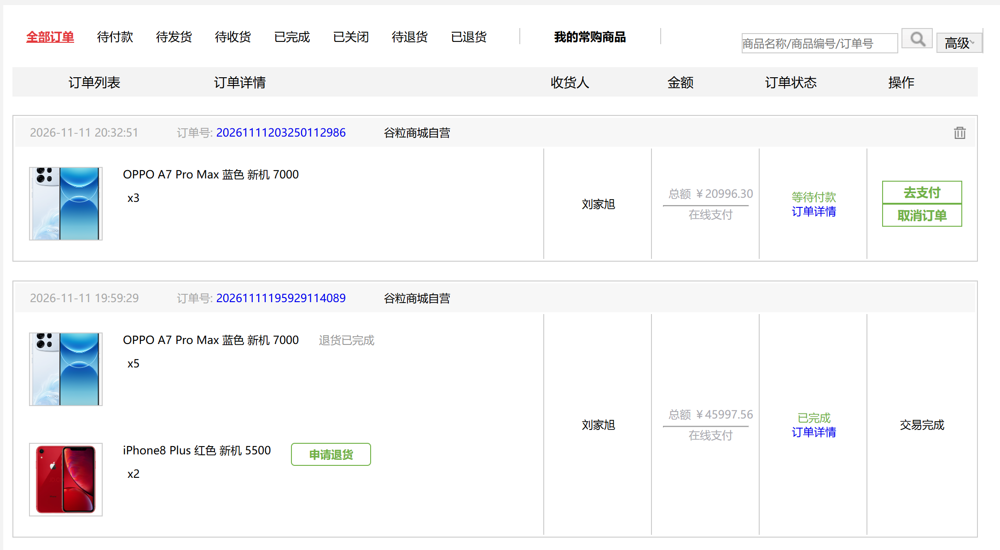
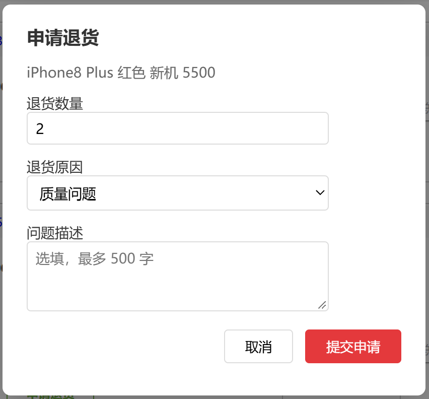
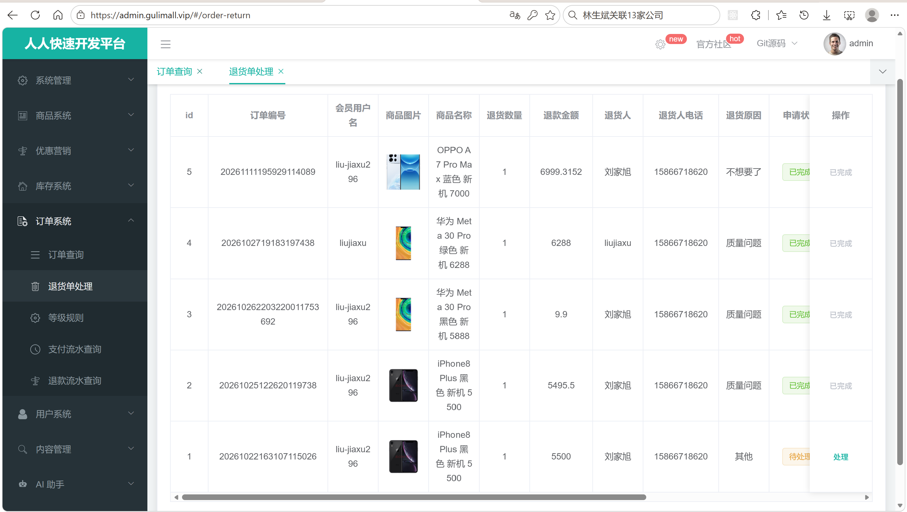
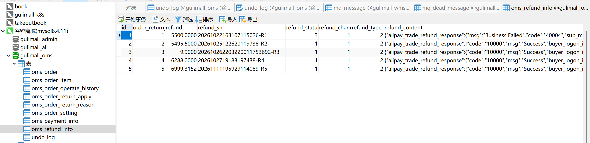
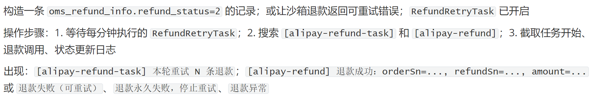
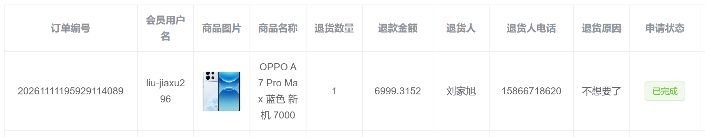

# 13.2 退款与售后-介绍

> 本篇介绍退款和售后的两条链路：订单超时关闭后又收到付款时怎样自动全额退款，已发货或已完成的订单怎样申请退货、管理员怎样审核、退款金额怎样按订单实付分摊、退款成功后怎样回补原发货仓库库存、支付宝退款失败后怎样定时重试，以及退款记录为什么必须独立事务提交。

---

## 1. 这个功能是干什么的

退款与售后处理两类资金反向流动：

1. **超时支付自动退款**：订单已经超过 30 分钟被关单，用户又在支付宝完成了付款。钱收了、订单却是关闭状态，系统按订单实付金额原路退回。
2. **售后退货退款**：订单已经发货或已完成，用户对某个商品申请退货，管理员审核通过后，按退货数量把实付金额原路退回，并把商品数量加回原发货仓库。

涉及的业务表：

```text
gulimall_oms.oms_order_return_apply   退货申请单
gulimall_oms.oms_refund_info          退款流水
gulimall_oms.oms_order                订单主表
gulimall_oms.oms_order_item           订单明细
gulimall_wms.ware_order_task          库存工作单
gulimall_wms.ware_order_task_detail   库存工作单明细
gulimall_wms.ware_sku                 仓库库存
```

退货申请状态：

| `oms_order_return_apply.status` | 含义 | 说明 |
|---|---|---|
| 0 | 待处理 | 用户刚提交 |
| 1 | 退货中 | 管理员已受理，等待收到货 |
| 2 | 已完成 | 已退款、已回补库存，终态 |
| 3 | 已拒绝 | 管理员拒绝，终态 |

退款流水状态：

| `oms_refund_info.refund_status` | 含义 | 说明 |
|---|---|---|
| 1 | 退款成功 | 支付宝返回成功 |
| 2 | 失败/待重试 | 网络异常、支付宝临时异常，定时任务继续调 |
| 3 | 永久失败 | 交易不存在、状态终结、退款金额超过实付，重试没有意义 |

退款类型：

| `refund_type` | 含义 | `order_return_id` 指向 |
|---|---|---|
| 1 | 超时支付自动退款 | `oms_order.id` |
| 2 | 售后退货退款 | `oms_order_return_apply.id` |

售后和支付的关系：

```text
支付成功：oms_order.status 0 -> 1，锁定库存转真实扣减
发货：    oms_order.status 1 -> 2
确认收货：oms_order.status 2 -> 3
退货：    不改 oms_order.status，只改订单明细的退货展示状态
退款：    写 oms_refund_info，钱原路退回支付宝
回补：    ware_order_task_detail 3 -> 4，ware_sku.stock 加回
```

退货完成后订单状态仍是 2 或 3，订单列表通过订单明细上的退货申请状态展示“退货已完成”，这是两个不同维度的状态。

## 2. 用户/管理员怎么操作

### 2.1 用户在订单列表发起退货

1. 用户打开订单列表。
2. 只有已发货（2）或已完成（3）的订单，商品行才显示“申请退货”。
3. 该商品已经提交过进行中的申请，或者已经退货完成，不再显示按钮，改为显示退货状态。
4. 点击“申请退货”，弹出退货申请框。



订单详情页只展示订单和商品信息，退货入口放在订单列表的商品行上，按商品逐个申请。

### 2.2 填写退货申请

1. 弹窗展示商品名称。
2. 填写退货数量，范围是 1 到该商品购买数量。
3. 选择退货原因。
4. 填写问题描述，选填，最多 500 字。
5. 点击“提交申请”。
6. 前端 POST `/order/userReturn/apply`。
7. 后端校验订单、商品、数量、重复申请，计算退款金额后写 `oms_order_return_apply`。
8. 页面提示“退货申请已提交，等待商家处理”，刷新订单列表。



退款金额由后端按订单实付分摊计算，前端不传金额。

### 2.3 管理员审核退货单

1. 管理员打开后台“订单管理 → 退货申请”。
2. 列表按状态筛选待处理、退货中、已完成、已拒绝。
3. 点击“处理”打开处理弹窗。
4. 弹窗上半部分是只读的申请信息：订单号、商品、数量、退款金额、申请人。
5. 下半部分可以修改处理状态、处理人员、处理备注、收货人、收货电话、收货时间、收货备注、公司收货地址。
6. 状态改成 2“已完成”时，系统立即原路退款并回补库存。
7. 状态改成 3“已拒绝”时只更新状态，不退款、不回补。
8. 已完成的退货单不再允许修改。



状态改成 2 前必须确认已经收到退货，因为退款和库存回补会立即执行。

### 2.4 查看退款流水

1. 管理员打开后台“订单管理 → 退款信息”。
2. 可以按退款流水号、关联 id、退款类型、退款状态筛选。
3. 列表展示退款流水号、类型、关联 id、退款金额、退款状态、退款渠道。
4. 退款类型 1 是超时支付自动退款，类型 2 是售后退货退款。



退款流水号 `refund_sn` 同时作为支付宝退款请求的 `out_request_no`，重复调用不会重复退钱。

### 2.5 查看退款重试日志

1. `RefundRetryTask` 每分钟扫描 `refund_status=2` 的记录。
2. 每轮最多处理 50 条。
3. 成功改状态为 1，永久失败改状态为 3，可重试的继续保持 2。
4. 日志以 `[alipay-refund-task]` 和 `[alipay-refund]` 开头。



永久失败的记录需要人工核对支付宝交易，不会继续刷重试日志。

### 2.6 退货完成后的订单展示

1. 退货单状态变成 2 后，订单列表的商品行显示“退货已完成”。
2. 订单主状态仍然是待收货或已完成。
3. 用户不能再次对该商品发起退货。



## 3. 整体设计思路

### 3.1 业务上怎么设计

#### 3.1.1 超时支付自动退款

订单超时关单和支付宝付款可能同时发生：

```text
1. 订单创建超过 30 分钟，OrderTimeoutTask 把状态改成 4
2. 用户在关单前已经在支付宝完成付款
3. 支付宝异步通知到达 order 服务
4. markOrderPaid 发现订单已是 4，返回 false
5. 回调逻辑判断 isOrderClosed()，调用 refundLatePayment()
6. 按订单 pay_amount 全额退款
```

规则：

1. 只退已关闭订单，状态不是 4 不自动退。
2. 退款金额必须和订单应付金额一致。
3. 同一订单只保留一条超时退款记录，退款流水号固定是 `订单号-refund`。
4. 已经退款成功的记录直接跳过。

#### 3.1.2 售后退货的准入规则

用户只能对满足条件的商品发起退货：

1. 订单属于当前登录用户。
2. 订单状态是 2（已发货）或 3（已完成）。
3. 商品必须在订单明细里。
4. 退货数量大于 0 且不超过购买数量。
5. 同一订单同一 `skuId` 只允许一条状态为 0、1、2 的申请，已拒绝（3）可以重新申请。

这条规则防止同一商品重复退款：只要存在进行中或已完成的申请，第二次申请直接被拒绝。

#### 3.1.3 退款金额按实付分摊

不能按商品原价退。订单可能有订单级优惠、运费、优惠券，实际支付金额可能低于商品原价。计算规则：

```text
1. 订单实付商品金额 = pay_amount - freight_amount
2. 每个商品的分摊权重 = real_amount（缺失时用 sku_price * 数量）
3. 商品实付金额 = 商品权重 / 所有商品权重之和 * 订单实付商品金额
4. 商品实付单价 = 商品实付金额 / 购买数量
5. 退款金额 = 商品实付单价 * 退货数量
6. 退款金额不能超过订单 pay_amount
```

举例：

```text
订单 pay_amount = 1000，freight_amount = 20
商品 A：real_amount = 600，买 2 件
商品 B：real_amount = 400，买 1 件
商品实付总额 = 1000 - 20 = 980
A 分摊 = 600 / 1000 * 980 = 588，单价 294
退 A 的 1 件 = 294 元
```

这样算出来的退款金额一定不会超过支付宝交易金额。

#### 3.1.4 管理员审核状态机

```text
0 待处理
  ├── 改成 1 退货中：只更新状态和收货信息
  ├── 改成 2 已完成：退款 + 回补库存 + 状态完成
  └── 改成 3 已拒绝：只更新状态，不退款

1 退货中
  ├── 改成 2 已完成：退款 + 回补库存 + 状态完成
  └── 改成 3 已拒绝：只更新状态

2 已完成：终态，不允许任何修改
3 已拒绝：可以重新提交申请
```

状态 2 是唯一触发资金和库存动作的状态。状态 0、1、3 只改处理字段，不动钱和库存。

#### 3.1.5 库存回补规则

退款成功后，把退货数量加回原发货仓库：

1. 按订单号找库存工作单。
2. 按 `skuId` 找工作单明细。
3. 明细状态必须是 3（已扣减）才能回补。
4. 回补后明细状态改成 4（已退货）。
5. `ware_sku.stock` 加回数量，`stock_locked` 不变，因为支付时已经减过。

同一订单同一 SKU 重复调用只回补一次，靠明细状态条件更新保证。

#### 3.1.6 退款重试规则

支付宝退款可能因为网络超时、系统繁忙失败。业务上分两类：

1. **可重试**：网络异常、支付宝临时错误，记录状态 2，定时任务继续调。
2. **永久失败**：交易不存在、交易已终结、退款金额超过实付，记录状态 3，停止重试，人工处理。

重试时必须使用同一个 `out_request_no`，支付宝按这个号做幂等，重复请求不会重复退钱。

#### 3.1.7 退款记录的归属

`oms_refund_info.order_return_id` 是一个多态字段：

1. 超时支付退款：存订单 `id`。
2. 售后退货退款：存退货申请 `id`。

靠 `refund_type` 区分。这样一张表能同时承载两类退款，查询时按类型决定关联哪张表。

### 3.2 技术上怎么设计

#### 3.2.1 out_request_no 幂等

支付宝退款接口 `alipay.trade.refund` 有两个关键参数：

1. `out_trade_no`：原支付交易的商户订单号。
2. `out_request_no`：退款请求号，同一笔交易的多次退款请求用这个号区分。

规则：

```text
超时支付退款：refund_sn = 订单号 + "-refund"
售后退货退款：refund_sn = 订单号 + "-R" + 退货申请 id
```

同一个 `out_request_no` 重复调用，支付宝按同一笔退款处理，不会重复出款。这是重试和并发处理的安全基础。

#### 3.2.2 退款记录独立事务

`refundReturn()` 标注了：

```java
@Transactional(propagation = Propagation.REQUIRES_NEW, rollbackFor = Exception.class)
```

原因：

1. 外层 `completeReturn()` 在同一个事务里做退款、回补库存、更新退货单状态。
2. 如果库存回补失败，外层事务回滚。
3. 退款记录如果跟着回滚，`oms_refund_info` 里就没有这条失败记录了。
4. 定时任务只扫描 `refund_status=2`，记录被回滚后就再也找不到这笔退款，钱可能已经退了但系统不知道。

用 `REQUIRES_NEW` 后，退款记录在独立事务里提交，外层回滚不影响它。重试任务仍然能看到这条记录，按同一个 `out_request_no` 再次调用支付宝，支付宝返回既有的退款结果。

注意：`refundReturn()` 必须通过注入的 `alipayRefundService` 调用，走 Spring 代理，`REQUIRES_NEW` 才生效；同类内部 `this.refundReturn()` 调用不会开新事务。

#### 3.2.3 终态错误码

支付宝返回的错误码分两类：

```text
ACQ.TRADE_NOT_EXIST                 交易不存在
ACQ.TRADE_STATUS_ERROR              交易状态错误
ACQ.TRADE_HAS_FINISHED              交易已终结
ACQ.REASON_TRADE_REFUND_FEE_ERR     退款金额超过实付
```

这些错误重试一百次也是同样结果，必须把 `refund_status` 改成 3，停止定时任务。其它错误保持 2，继续重试。

#### 3.2.4 定时重试

`RefundRetryTask` 每分钟执行一次：

1. 查 `refund_status=2` 的记录，最多 50 条。
2. 按 `refund_type` 找关联数据。
3. 超时退款找订单，取 `pay_amount`。
4. 退货退款找退货单，取 `return_amount`，再找订单。
5. 调用 `doRefund()`。
6. 根据结果更新状态。

限制 50 条是为了避免一轮处理太多，影响正常请求。

#### 3.2.5 条件更新保证幂等

三个关键位置都用条件更新：

1. 退货单完成：`WHERE id=? AND status<>2`，并发处理只有一个成功。
2. 库存明细回补：`WHERE id=? AND lock_status=3`，只有一个请求能把 3 改成 4。
3. 退款记录：先按 `refund_sn` 查，存在就复用，不存在才新建。

#### 3.2.6 管理员字段白名单

后台处理接口只允许更新：

```text
handle_note、handle_man、receive_man、receive_time、
receive_note、receive_phone、company_address、status
```

金额、商品、订单号、会员名等字段不接受前端修改，避免管理员改退款金额或改退货商品。

#### 3.2.7 金额兜底

`calculateReturnPrice()` 最后有两道兜底：

1. 退款金额超过 `pay_amount` 时，强制改成 `pay_amount`。
2. 退款金额小于等于 0 时，抛异常，不允许退款。

这样即使分摊计算出现小数误差，也不会退超过支付宝交易金额。

## 4. 详细代码、配置和解释

第 4 章按“类为什么存在 → 关键数据 → 调用链路 → 代码分块解释 → 一次完整示例 → 边界”组织。每一块代码前面先说明它在链路里承担什么，代码后面再按 1、2、3 的顺序解释执行过程和原因。包声明、无关 import 和纯 CRUD 不重复展开。

### 4.1 OrderReturnApplyEntity：退货申请单映射

#### 4.1.1 这个类解决什么问题

用户在订单列表点“申请退货”时，订单服务需要把“谁、对哪个订单的哪个商品、退几件、退款多少、当前处理到哪一步”固化成一条记录。后台审核、退款金额计算、库存回补、订单列表回显都围绕这条记录展开，它对应的表是 `gulimall_oms.oms_order_return_apply`。

这个实体同时承担三件事：

1. 把表字段映射成 Java 对象，供 MyBatis-Plus 增删改查；
2. 保存提交时的商品快照和收货信息，商品后续改名改价不影响历史退货单；
3. 用 `status` 承载售后单的流转状态，管理员审核和定时任务都靠它判断下一步动作。

写入方是用户提交接口 `applyReturn()`，读取方是后台退货单列表、`handle()`、`completeReturn()` 和订单列表回显。实体本身不计算金额，也不调用支付宝。

#### 4.1.2 字段与业务含义

| 字段 | 数据库列 | 业务含义 | 说明 |
|---|---|---|---|
| `id` | `id` | 退货申请主键 | 自增 |
| `orderId` | `order_id` | 订单主键 | 关联 `oms_order.id` |
| `skuId` | `sku_id` | 退货商品 | 关联订单明细里的 SKU |
| `orderSn` | `order_sn` | 订单号 | 后台和 Feign 调用用订单号 |
| `createTime` | `create_time` | 申请时间 | 列表按它倒序 |
| `memberUsername` | `member_username` | 申请会员名 | 从登录上下文取 |
| `returnAmount` | `return_amount` | 预计退款金额 | 按实付分摊计算 |
| `returnName` | `return_name` | 退货人 | 复制订单收货人 |
| `returnPhone` | `return_phone` | 退货联系电话 | 复制订单收货电话 |
| `status` | `status` | 售后状态 | 0 待处理、1 退货中、2 已完成、3 已拒绝 |
| `handleTime` | `handle_time` | 处理时间 | 审核时写入 |
| `skuImg` | `sku_img` | 商品图片快照 | 列表展示 |
| `skuName` | `sku_name` | 商品名称快照 | 列表展示 |
| `skuBrand` | `sku_brand` | 品牌快照 | 售后统计 |
| `skuAttrsVals` | `sku_attrs_vals` | 销售属性快照 | JSON 字符串 |
| `skuCount` | `sku_count` | 退货数量 | 1 到购买数量 |
| `skuPrice` | `sku_price` | 商品原价 | 下单时单价 |
| `skuRealPrice` | `sku_real_price` | 商品实付单价 | 分摊后的单价 |
| `reason` | `reason` | 退货原因 | 前端选择 |
| `description述` | `description` | 问题描述 | 字段名带一个多余的“述”字 |
| `descPics` | `desc_pics` | 凭证图片 | 多张图片地址 |
| `handleNote` | `handle_note` | 处理备注 | 管理员填写 |
| `handleMan` | `handle_man` | 处理人 | 后台传入 |
| `receiveMan` | `receive_man` | 收货人 | 仓库签收信息 |
| `receiveTime` | `receive_time` | 收货时间 | 仓库签收信息 |
| `receiveNote` | `receive_note` | 收货备注 | 仓库签收信息 |
| `receivePhone` | `receive_phone` | 收货电话 | 仓库签收信息 |
| `companyAddress` | `company_address` | 退货收货地址 | 当前写死售后中心 |

#### 4.1.3 代码与解释

```java
@Data
@TableName("oms_order_return_apply")
public class OrderReturnApplyEntity implements Serializable {
    private static final long serialVersionUID = 1L;

    @TableId
    private Long id;
    private Long orderId;
    private Long skuId;
    private String orderSn;
    private Date createTime;
    private String memberUsername;
    private BigDecimal returnAmount;
    private String returnName;
    private String returnPhone;
    private Integer status;
    private Date handleTime;
    private String skuImg;
    private String skuName;
    private String skuBrand;
    private String skuAttrsVals;
    private Integer skuCount;
    private BigDecimal skuPrice;
    private BigDecimal skuRealPrice;
    private String reason;
    private String description述;
    private String descPics;
    private String handleNote;
    private String handleMan;
    private String receiveMan;
    private Date receiveTime;
    private String receiveNote;
    private String receivePhone;
    private String companyAddress;
}
```

1. `@Data`：生成 getter、setter、`toString`、`equals`、`hashCode`，MyBatis-Plus 和前端反序列化都依赖这些方法。
2. `@TableName("oms_order_return_apply")`：声明实体对应退货申请表，所有默认 CRUD 都落到这张表。
3. `@TableId`：标记 `id` 是主键，插入后 MyBatis-Plus 回填自增 id，`applyReturn()` 的日志才能打印 `apply.getId()`。
4. `orderId`、`orderSn`：一个用于关联订单，一个用于跨服务调用。库存回补接口只接收订单号，所以两个都要存。
5. `skuId`：和 `orderId` 一起定位订单明细；同一订单可以有多条退货申请，每个 SKU 一条。
6. `returnAmount`：申请时就算好，管理员审核时直接看到预计退款金额；完成时还会重新计算一次做校正。
7. `status`：售后单状态，不是订单状态。订单主状态仍由 `oms_order.status` 管理，两者互不覆盖。
8. `skuImg`、`skuName`、`skuBrand`、`skuAttrsVals`：商品快照。商品下架、改名、改价后，历史退货单仍然显示提交时的样子。
9. `skuCount`：退货件数，退款金额和库存回补数量都以它为准。
10. `skuPrice`、`skuRealPrice`：分别记录商品原价和分摊后的实付单价，便于财务核对为什么退款金额低于原价。
11. `reason`、`description述`、`descPics`：用户填写的原因、描述和凭证，后台审核时读取。
12. `handleNote`、`handleMan`、`handleTime`：管理员处理痕迹，状态 0、1、3 的更新只会改这几项。
13. `receiveMan`、`receivePhone`、`receiveTime`、`receiveNote`、`companyAddress`：仓库签收信息，用于确认货已经退回。
14. 没有 `@TableField(exist = false)` 字段，实体完全对应数据库列，不参与树形组装或 VO 转换。

#### 4.1.4 一次读写示例

用户提交退货申请后，插入记录：

```sql
INSERT INTO oms_order_return_apply
(order_id, sku_id, order_sn, create_time, member_username, return_amount,
 return_name, return_phone, status, sku_img, sku_name, sku_brand,
 sku_attrs_vals, sku_count, sku_price, sku_real_price, reason,
 description, company_address)
VALUES
(1001, 2001, '202611120001', NOW(), 'zhangsan', 294.0000,
 '张三', '13800000000', 0, 'https://.../1.jpg', '手机 A', '品牌 A',
 '[{"颜色":"黑色"}]', 1, 600.00, 294.0000, '七天无理由',
 '屏幕有划痕', '谷粒商城售后中心');
```

管理员把状态改成 2 时，更新处理信息和状态：

```sql
UPDATE oms_order_return_apply
SET status = 2,
    handle_time = NOW(),
    handle_man = 'admin',
    handle_note = '已收到退货',
    receive_man = '李四',
    receive_time = NOW()
WHERE id = 9001
  AND status <> 2;
```

#### 4.1.5 边界与可优化点

1. `description述` 的字段名多一个“述”字，接口和数据库列都按这个名字走，改名需要同时改实体、SQL 和前端。
2. 表上没有 `(order_id, sku_id)` 唯一约束，同一商品重复申请只能靠应用层查询拦截，并发下仍可能插入两条。
3. `returnAmount` 和 `skuRealPrice` 存的是申请时的计算结果，管理员完成时虽然会重算，但列表展示的仍是旧值，需要等完成更新后才一致。
4. `companyAddress` 是固定字符串，多仓库场景应根据实际发货仓库取地址。
5. 没有记录退款成功时间、库存回补时间，售后时效统计只能依赖 `handle_time` 和日志。

### 4.2 RefundInfoEntity：退款流水映射

#### 4.2.1 这个类解决什么问题

退款是真正把钱从商户账户退回支付宝的动作，必须有独立流水，才能回答三个问题：这笔钱为什么退、退给谁、退成功没有。`oms_refund_info` 就是这张流水表，超时支付退款和售后退货退款共用它。

写入方只有 `AlipayRefundService`：退款前先落一条记录，调用支付宝后按结果更新状态。读取方是退款重试任务、后台“退款信息”页面和故障排查日志。记录本身不保存订单明细，只保存退款金额、流水号、状态、渠道和关联 id。

#### 4.2.2 字段与业务含义

| 字段 | 数据库列 | 业务含义 | 说明 |
|---|---|---|---|
| `id` | `id` | 流水主键 | 自增 |
| `orderReturnId` | `order_return_id` | 多态关联 id | `refundType=1` 指向订单，`refundType=2` 指向退货申请 |
| `refund` | `refund` | 退款金额 | 元 |
| `refundSn` | `refund_sn` | 退款流水号 | 同时是支付宝 `out_request_no` |
| `refundStatus` | `refund_status` | 退款状态 | 1 成功、2 失败可重试、3 永久失败 |
| `refundChannel` | `refund_channel` | 退款渠道 | 1 支付宝、2 微信、3 银联、4 汇款 |
| `refundType` | `refund_type` | 退款类型 | 1 超时支付，2 售后退货 |
| `refundContent` | `refund_content` | 结果报文 | 支付宝返回内容或异常信息，最长 5000 字符 |

#### 4.2.3 代码与解释

```java
@Data
@TableName("oms_refund_info")
public class RefundInfoEntity implements Serializable {
    private static final long serialVersionUID = 1L;

    @TableId
    private Long id;
    private Long orderReturnId;
    private BigDecimal refund;
    private String refundSn;
    private Integer refundStatus;
    private Integer refundChannel;
    private Integer refundType;
    private String refundContent;
}
```

1. `@TableName("oms_refund_info")`：对应退款流水表。
2. `@TableId`：主键自增，退款记录保存后能拿到 id，方便日志定位。
3. `orderReturnId`：多态字段。超时退款存 `oms_order.id`，退货退款存 `oms_order_return_apply.id`，由 `refundType` 决定怎么解释。
4. `refund`：该笔退款金额，调用支付宝时用这个值。
5. `refundSn`：退款流水号，固定生成规则让重复调用命中同一笔退款；支付宝把它当作 `out_request_no`。
6. `refundStatus`：1 成功、2 失败可重试、3 永久失败。定时任务只扫状态 2。
7. `refundChannel`：资金渠道，退货退款按订单 `pay_type` 映射，超时退款固定支付宝。
8. `refundType`：一张表承载两类退款的关键字段，重试任务靠它决定查订单还是查退货单。
9. `refundContent`：保存支付宝响应报文或异常信息，排查时不用再翻应用日志。

#### 4.2.4 一次写入示例

超时支付退款写入：

```text
refund_sn       = 202611120001-refund
order_return_id = 1001（订单 id）
refund          = 1000.00
refund_status   = 2（先按待重试落库）
refund_channel  = 1
refund_type     = 1
```

售后退货退款写入：

```text
refund_sn       = 202611120001-R9001
order_return_id = 9001（退货申请 id）
refund          = 294.0000
refund_status   = 2
refund_channel  = 1
refund_type     = 2
```

#### 4.2.5 边界与可优化点

1. `refund_sn` 没有唯一索引，两个并发请求可能各插一条，后续按 `LIMIT 1` 取到哪条不确定。
2. `order_return_id` 是多态字段，不能建外键，数据完整性靠应用层保证。
3. 没有申请时间、成功时间字段，统计退款耗时只能看 `refund_content` 或应用日志。
4. `refundContent` 只保存响应报文，没有保存请求参数和 HTTP 状态码，排查支付宝侧问题时信息不完整。
5. 状态 3 表示永久失败，但没有记录人工处理结果，后台无法闭环。

### 4.3 OrderReturnApplyController：后台退货入口

#### 4.3.1 这个类解决什么问题

后台“订单管理 → 退货申请”页面需要按状态查退货单、打开详情、提交处理结果、删除无效单。页面只认 HTTP 接口，这个 Controller 负责把五类操作翻译成 Service 调用。

上游是 admin 前端，下游是 `OrderReturnApplyService`。Controller 只做三件事：接收参数、校验后台权限、把结果包装成 `R`。退款金额怎么算、状态 2 如何触发资金和库存动作，都不在这个类里。

#### 4.3.2 接口清单

| 操作 | 方法与路径 | 权限 | 调用的 Service 方法 |
|---|---|---|---|
| 退货单分页 | `POST /order/orderreturnapply/list` | `order:orderreturnapply:list` | `queryPage()` |
| 退货单详情 | `GET /order/orderreturnapply/info/{id}` | `order:orderreturnapply:info` | `getById()` |
| 后台补录 | `POST /order/orderreturnapply/save` | `order:orderreturnapply:save` | `save()` |
| 处理退货单 | `POST /order/orderreturnapply/update` | `order:orderreturnapply:update` | `handle()` |
| 删除退货单 | `POST /order/orderreturnapply/delete` | `order:orderreturnapply:delete` | `removeByIds()` |

#### 4.3.3 代码与解释

```java
@RestController
@RequestMapping("order/orderreturnapply")
public class OrderReturnApplyController {
    @Autowired
    private OrderReturnApplyService orderReturnApplyService;

    @RequestMapping("/list")
    @RequiresPermissions("order:orderreturnapply:list")
    public R list(@RequestParam Map<String, Object> params){
        PageUtils page = orderReturnApplyService.queryPage(params);

        return R.ok().put("page", page);
    }

    @RequestMapping("/info/{id}")
    @RequiresPermissions("order:orderreturnapply:info")
    public R info(@PathVariable("id") Long id){
        OrderReturnApplyEntity orderReturnApply = orderReturnApplyService.getById(id);

        return R.ok().put("orderReturnApply", orderReturnApply);
    }

    @RequestMapping("/save")
    @RequiresPermissions("order:orderreturnapply:save")
    public R save(@RequestBody OrderReturnApplyEntity orderReturnApply){
        orderReturnApplyService.save(orderReturnApply);

        return R.ok();
    }

    @RequestMapping("/update")
    @RequiresPermissions("order:orderreturnapply:update")
    public R update(@RequestBody OrderReturnApplyEntity orderReturnApply){
        orderReturnApplyService.handle(orderReturnApply);

        return R.ok();
    }

    @RequestMapping("/delete")
    @RequiresPermissions("order:orderreturnapply:delete")
    public R delete(@RequestBody Long[] ids){
        orderReturnApplyService.removeByIds(Arrays.asList(ids));

        return R.ok();
    }
}
```

1. `@RestController`：所有方法返回 JSON，前端直接读 `code`、`msg` 和业务字段。
2. `@RequestMapping("order/orderreturnapply")`：五个接口共用前缀，网关转发时会带 `/gulimall`。
3. `list()`：分页参数原样交给 `queryPage()`，由 Service 决定按关键字、状态还是时间过滤。
4. `info()`：后台打开处理弹窗前回显，避免使用列表里的旧对象覆盖数据库新状态。
5. `save()`：直接走 MyBatis-Plus 的 `save()`，只适合后台补录；正常用户申请不经过这里。
6. `update()`：走 `handle()`，因为状态改成 2 时要触发退款和库存回补，不能只写数据库。
7. `delete()`：基础 CRUD，物理删除，生产环境不应开放给普通运营。
8. 每个方法都加 `@RequiresPermissions`，权限串和后台菜单按钮对应。
9. Controller 没有加 `@Transactional`，事务边界在 Service 方法上。

#### 4.3.4 一次请求示例

管理员在后台把退货单 9001 改成“已完成”：

```text
1. 前端打开处理弹窗：GET /gulimall/order/orderreturnapply/info/9001
2. 页面回显商品、数量、预计退款金额、申请人
3. 管理员选择状态 2，填写处理备注和收货信息
4. 点击确定：POST /gulimall/order/orderreturnapply/update
5. 请求体包含 id、status、handleMan、handleNote、receiveMan 等字段
6. 网关校验登录态后转发到 order 服务
7. Controller 校验 order:orderreturnapply:update 权限
8. 调用 orderReturnApplyService.handle()
9. handle() 发现 status=2，进入 completeReturn()
10. 返回 R.ok()，前端刷新列表
```

#### 4.3.5 它不做什么

1. 不校验状态流转是否合法，0 可以直接跳到 3，1 也可以回到 0。
2. 不计算退款金额，金额来自退货单里已经落库的值，`completeReturn()` 会再算一次。
3. 不校验退款金额和白名单字段，字段限制在 `handle()` 的 `UpdateWrapper` 里。
4. 不记录真实操作人，`handleMan` 由前端传入。
5. 不处理幂等，连续点击会重复调用 `handle()`，靠内部条件更新和退款幂等兜底。

#### 4.3.6 边界与可优化点

1. `save()` 和 `delete()` 是代码生成器留下的 CRUD，后台可以随意补录和删除退货单，生产环境应加审批或直接下线。
2. 没有 `@Valid` 参数校验，`update()` 传空对象只会走“没有可更新字段”分支，接口仍返回成功。
3. 没有操作审计，谁在什么时间把状态改成 2 只能看 `handle_man` 字符串。
4. 没有二次确认和防重复提交令牌，状态 2 的误操作会立即触发真实退款。

### 4.4 OrderReturnApplyServiceImpl.applyReturn：用户提交退货申请

#### 4.4.1 这个方法解决什么问题

用户在订单列表的商品行点“申请退货”，前端只提交订单号、SKU、数量、原因和描述，不提交金额。订单服务需要在这个入口完成四件事：确认订单确实属于当前会员、确认订单状态允许退货、确认商品和数量合法、把退款金额算出来并落库。

调用链是 `POST /order/userReturn/apply → ListController.applyReturn() → OrderReturnApplyServiceImpl.applyReturn()`。写入 `oms_order_return_apply` 后流程结束，不调用支付宝、不改订单状态、不动库存；这些动作要等管理员把状态改成 2 才发生。

#### 4.4.2 入参、出参与前置条件

| 参数 | 来源 | 说明 |
|---|---|---|
| `orderSn` | 前端 | 订单号 |
| `skuId` | 前端 | 退货商品 |
| `count` | 前端 | 退货数量，默认 1 |
| `reason` | 前端 | 退货原因，可选 |
| `description` | 前端 | 问题描述，可选 |

前置条件：会员已登录、订单属于本人、订单状态是 2 或 3、商品在订单明细里、数量在 1 到购买数量之间、同一 SKU 没有状态 0、1、2 的申请。

#### 4.4.3 正常链路

```text
用户点击“申请退货”
  → 弹窗填写数量、原因、描述
  → POST /order/userReturn/apply
  → ListController.applyReturn()
  → applyReturn() 取登录会员
  → 查 oms_order，校验归属和状态
  → 查 oms_order_item，校验商品和购买数量
  → 查 oms_order_return_apply，拦截重复申请
  → calculateReturnPrice() 算实付单价和退款金额
  → INSERT oms_order_return_apply，status=0
  → 返回 R.ok()
```

#### 4.4.4 代码与解释

```java
@Override
@Transactional(rollbackFor = Exception.class)
public OrderReturnApplyEntity applyReturn(String orderSn, Long skuId, Integer count,
                                          String reason, String description) {
    MemberResponseVo loginUser = MemberResponseVoThreadLocal.get();
    if (loginUser == null) {
        throw new RRException(BizCodeEnum.ORDER_NOT_LOGIN);
    }

    OrderEntity order = orderDao.selectOne(new QueryWrapper<OrderEntity>()
            .eq("order_sn", orderSn)
            .last("LIMIT 1"));
    if (order == null || !loginUser.getId().equals(order.getMemberId())) {
        throw new RRException(BizCodeEnum.ORDER_NOT_FOUND_OR_NOT_OWNER);
    }
    if (!Integer.valueOf(ORDER_STATUS_SHIPPED).equals(order.getStatus())
            && !Integer.valueOf(ORDER_STATUS_COMPLETED).equals(order.getStatus())) {
        throw new RRException(BizCodeEnum.ORDER_RETURN_NOT_ALLOWED);
    }

    OrderItemEntity item = orderItemDao.selectOne(new QueryWrapper<OrderItemEntity>()
            .eq("order_id", order.getId())
            .eq("sku_id", skuId)
            .last("LIMIT 1"));
    if (item == null) {
        throw new RRException(BizCodeEnum.ORDER_NOT_FOUND_OR_NOT_OWNER);
    }

    int buyCount = item.getSkuQuantity() == null ? 0 : item.getSkuQuantity();
    if (count == null || count <= 0 || count > buyCount) {
        throw new RRException(BizCodeEnum.ORDER_RETURN_COUNT_INVALID);
    }

    // 同一订单同一商品只允许一条未完成/已完成的申请，避免重复退款
    Long exists = baseMapper.selectCount(new QueryWrapper<OrderReturnApplyEntity>()
            .eq("order_id", order.getId())
            .eq("sku_id", skuId)
            .in("status", 0, 1, 2));
    if (exists != null && exists > 0) {
        throw new RRException(BizCodeEnum.ORDER_RETURN_ALREADY_APPLIED);
    }

    ReturnPrice price = calculateReturnPrice(order, item, count);
    BigDecimal realUnitPrice = price.unitPrice();
    BigDecimal returnAmount = price.amount();

    OrderReturnApplyEntity apply = new OrderReturnApplyEntity();
    apply.setOrderId(order.getId());
    apply.setSkuId(skuId);
    apply.setOrderSn(orderSn);
    apply.setCreateTime(new Date());
    apply.setMemberUsername(loginUser.getUsername());
    apply.setReturnAmount(returnAmount);
    apply.setReturnName(order.getReceiverName());
    apply.setReturnPhone(order.getReceiverPhone());
    apply.setStatus(0);
    apply.setSkuImg(item.getSkuPic());
    apply.setSkuName(item.getSkuName());
    apply.setSkuBrand(item.getSpuBrand());
    apply.setSkuAttrsVals(item.getSkuAttrsVals());
    apply.setSkuCount(count);
    apply.setSkuPrice(item.getSkuPrice());
    apply.setSkuRealPrice(realUnitPrice);
    apply.setReason(reason);
    apply.setDescription述(description);
    apply.setCompanyAddress("谷粒商城售后中心");

    save(apply);
    log.info("[return-apply] 用户 {} 提交退货申请：applyId={}, orderSn={}, skuId={}, count={}, amount={}",
            loginUser.getUsername(), apply.getId(), orderSn, skuId, count, returnAmount);
    return apply;
}
```

1. `@Transactional(rollbackFor = Exception.class)`：申请只写一张表，事务保证异常时不会留下半条记录。
2. 从 `MemberResponseVoThreadLocal` 取登录会员，取不到直接抛“登录已失效”，不继续查订单。
3. 按订单号查订单，同时校验 `memberId`，防止拿别人的订单号发起退货。
4. 校验订单状态必须是 2（已发货）或 3（已完成）；待付款、待发货、已关闭都不允许申请。
5. 按 `order_id` 和 `sku_id` 查订单明细，商品不在该订单里时按“订单不存在或无权操作”处理，不暴露订单内容。
6. 取购买数量，校验退货数量在 1 到购买数量之间，`count` 为空也按非法处理。
7. 查同一订单同一 SKU 是否存在状态 0、1、2 的申请；状态 3 已拒绝不算，允许重新申请。
8. 调 `calculateReturnPrice()` 算实付单价和退款金额，金额以订单实付为基准，不信任前端。
9. 组装退货申请单：订单 id、订单号、SKU、会员、收货人、商品快照、数量、原价、实付单价、原因、描述。
10. 初始状态固定 0，公司地址固定售后中心。
11. `save(apply)` 写库，MyBatis-Plus 回填自增 id。
12. 打印申请日志后返回实体，Controller 只返回 `R.ok()`，不把实体暴露给前端。

#### 4.4.5 一次完整示例

订单 `202611120001` 实付 1000，运费 20，商品 A 实付 600 买 2 件。用户退 A 的 1 件：

```text
1. 前端 POST /order/userReturn/apply
   参数：orderSn=202611120001, skuId=2001, count=1,
         reason=七天无理由, description=屏幕有划痕
2. 取登录会员 zhangsan，会员 id 和订单 member_id 一致
3. 订单状态 3（已完成），允许申请
4. 订单明细存在，sku_quantity=2
5. count=1，在 1 到 2 之间
6. 该订单该 SKU 没有状态 0、1、2 的申请
7. calculateReturnPrice() 返回 unitPrice=294.0000, amount=294.0000
8. 插入退货申请：
   status=0, sku_name=手机 A, sku_count=1,
   sku_price=600.00, sku_real_price=294.0000,
   return_amount=294.0000, company_address=谷粒商城售后中心
9. 日志：[return-apply] 用户 zhangsan 提交退货申请：applyId=9001, ...
10. 页面提示“退货申请已提交，等待商家处理”，刷新订单列表
```

#### 4.4.6 它不做什么

1. 不退款，也不创建退款流水，资金动作要等管理员把状态改成 2。
2. 不改订单主状态，退货完成后订单仍然是已发货或已完成。
3. 不回补库存，库存回补在 `completeReturn()` 里调用 ware 服务。
4. 不校验售后期限，订单完成多久都可以申请。
5. 不校验退货原因字典，任意字符串都能落库。

#### 4.4.7 边界与可优化点

1. 重复申请校验是“先查后插”，没有数据库唯一约束，两个并发请求可能都通过。
2. 同一订单同一 SKU 只允许一条进行中或已完成的申请，不支持部分退货分多次申请。
3. 订单归属校验依赖 ThreadLocal，异步线程或定时任务调用时取不到会员，需要另设入口。
4. 公司地址写死，多仓库场景应按实际发货仓库取地址。
5. `reason` 和 `description` 没有长度校验，超长文本可能超过数据库列限制。

### 4.5 calculateReturnPrice：按实付分摊退款金额

#### 4.5.1 这个方法解决什么问题

订单实付金额通常不等于商品原价之和：可能有订单级优惠、优惠券、运费。直接按 `sku_price * count` 退款会多退钱，支付宝侧还可能因为超过原交易金额拒绝退款。

这个方法的职责是：先扣掉运费得到实付商品金额，再按各商品权重分摊，算出当前商品的实付单价，最后乘退货数量得到退款金额。调用方有两个：用户提交申请时算预计金额，管理员完成退货时再算一次做校正。

#### 4.5.2 分摊公式

```text
1. 订单实付商品金额 = pay_amount - freight_amount
2. 商品权重 = real_amount，缺失或为 0 时用 sku_price * sku_quantity
3. 商品实付金额 = 商品权重 / 所有权重之和 * 订单实付商品金额
4. 商品实付单价 = 商品实付金额 / 购买数量
5. 退款金额 = 商品实付单价 * 退货数量
6. 退款金额封顶到 pay_amount，小于等于 0 时拒绝退款
```

权重用 `real_amount` 而不是原价，是因为 `real_amount` 已经吸收了订单级优惠，按它分摊能让各商品退款之和不超过实付总额。

#### 4.5.3 代码与解释

```java
private ReturnPrice calculateReturnPrice(OrderEntity order, OrderItemEntity item, int count) {
    List<OrderItemEntity> allItems = orderItemDao.selectList(
            new QueryWrapper<OrderItemEntity>().eq("order_id", order.getId()));

    BigDecimal goodsPaid = order.getPayAmount() == null
            ? BigDecimal.ZERO : order.getPayAmount();
    if (order.getFreightAmount() != null) {
        goodsPaid = goodsPaid.subtract(order.getFreightAmount());
    }
    if (goodsPaid.signum() < 0) {
        goodsPaid = BigDecimal.ZERO;
    }

    BigDecimal totalWeight = allItems.stream()
            .map(this::itemWeight)
            .reduce(BigDecimal.ZERO, BigDecimal::add);
    if (totalWeight.signum() <= 0) {
        totalWeight = order.getTotalAmount() == null
                ? BigDecimal.ZERO : order.getTotalAmount();
    }

    BigDecimal itemWeight = itemWeight(item);
    BigDecimal itemPaid = totalWeight.signum() <= 0
            ? BigDecimal.ZERO
            : itemWeight.multiply(goodsPaid)
                    .divide(totalWeight, 4, RoundingMode.HALF_UP);

    int buyCount = item.getSkuQuantity() == null ? 0 : item.getSkuQuantity();
    BigDecimal unitPrice = buyCount <= 0
            ? BigDecimal.ZERO
            : itemPaid.divide(BigDecimal.valueOf(buyCount), 4, RoundingMode.HALF_UP);
    BigDecimal amount = unitPrice.multiply(BigDecimal.valueOf(count))
            .setScale(4, RoundingMode.HALF_UP);

    // 兜底：绝不能超过订单实付总额（支付宝交易金额）
    if (order.getPayAmount() != null
            && amount.compareTo(order.getPayAmount()) > 0) {
        amount = order.getPayAmount().setScale(4, RoundingMode.HALF_UP);
    }
    if (amount.signum() <= 0) {
        throw new RRException("订单实付金额为 0，无法退款",
                BizCodeEnum.ORDER_RETURN_REFUND_FAILED.getCode());
    }
    return new ReturnPrice(unitPrice, amount);
}

private BigDecimal itemWeight(OrderItemEntity item) {
    BigDecimal real = item.getRealAmount();
    if (real != null && real.signum() > 0) {
        return real;
    }
    BigDecimal price = item.getSkuPrice() == null ? BigDecimal.ZERO : item.getSkuPrice();
    int qty = item.getSkuQuantity() == null ? 0 : item.getSkuQuantity();
    return price.multiply(BigDecimal.valueOf(qty));
}

private record ReturnPrice(BigDecimal unitPrice, BigDecimal amount) {
}
```

1. 先查订单全部明细，分摊需要知道所有商品的权重，不能只看当前商品。
2. `goodsPaid` 取 `pay_amount`，`pay_amount` 为空按 0 处理，避免拆箱空指针。
3. 减去 `freight_amount`，运费不参与商品退款；结果小于 0 时归零，防止运费大于实付的异常订单算出负金额。
4. 用 `itemWeight()` 算每条明细的权重并求和。
5. 总权重为 0 时退化为订单 `total_amount`；`total_amount` 也为空则按 0 处理，后面会触发金额为 0 的异常。
6. 当前商品权重乘实付商品金额，再除以总权重，保留四位小数，得到商品实付金额。
7. 商品实付金额除以购买数量，得到实付单价。
8. 实付单价乘退货数量，保留四位小数，得到退款金额。
9. 退款金额超过 `pay_amount` 时强制改成 `pay_amount`，这是对支付宝交易金额的最后封顶。
10. 退款金额小于等于 0 时抛异常，调用方收到 `ORDER_RETURN_REFUND_FAILED`，不会写出 0 元退款。
11. `itemWeight()` 优先用 `real_amount`；为 null 或小于等于 0 时退回 `sku_price * sku_quantity`，兼容历史订单没有实付字段的情况。
12. `ReturnPrice` 是 record，同时返回单价和金额，调用方不用再除一次。

#### 4.5.4 一次计算示例

```text
订单 pay_amount = 1000，freight_amount = 20
商品 A：real_amount = 600，买 2 件
商品 B：real_amount = 400，买 1 件

实付商品金额 = 1000 - 20 = 980
总权重 = 600 + 400 = 1000
A 商品实付金额 = 600 / 1000 * 980 = 588
A 实付单价 = 588 / 2 = 294
退 A 的 1 件，退款金额 = 294 * 1 = 294
```

如果 A 的 `real_amount` 缺失，权重退回 `600 * 2 = 1200` 和 B 的 400，总权重 1600，A 的分摊会变大；这是历史数据缺少实付字段时的兜底，不是推荐路径。

#### 4.5.5 边界与可优化点

1. 全程保留四位小数，多次分摊可能有几分钱误差，长期应按分计算并在最后一条明细上吸收余数。
2. 运费全部从商品金额里扣，不参与分摊；如果运费也要按比例退，需要单独设计。
3. 每次调用都查全部订单明细，商品多时查询量固定，可以按订单 id 缓存。
4. 分摊只按金额权重，没有考虑数量、优惠券归属和积分抵扣规则。
5. 超过 `pay_amount` 时直接截断，没有记录截断日志，财务对账时看不到差异。

### 4.6 handle：管理员处理退货单

#### 4.6.1 这个方法解决什么问题

后台处理弹窗允许管理员修改状态、处理人、处理备注和仓库收货信息。但只有把状态改成 2（已完成）才应该退款和回补库存，其它状态只更新处理字段。`handle()` 就是这条分叉的判断点。

上游是 `OrderReturnApplyController.update()`，下游可能是普通的 `UpdateWrapper` 更新，也可能是 `completeReturn()`。方法以数据库里的状态为准，不信任前端传的旧状态，已完成单据直接拒绝再次处理。

#### 4.6.2 状态与动作

| 提交状态 | 触发动作 | 说明 |
|---|---|---|
| 0 待处理 | 只更新白名单字段 | 可用于回退状态 |
| 1 退货中 | 只更新白名单字段 | 等待仓库收货 |
| 2 已完成 | 退款、回补库存、状态置 2 | 唯一触发资金和库存的状态 |
| 3 已拒绝 | 只更新白名单字段 | 用户可重新申请 |
| 数据库已是 2 | 直接拒绝 | 防止二次退款和重复加库存 |

#### 4.6.3 代码与解释

```java
@Override
@Transactional(rollbackFor = Exception.class)
public void handle(OrderReturnApplyEntity form) {
    if (form == null || form.getId() == null) {
        throw new RRException(BizCodeEnum.ORDER_RETURN_NOT_FOUND);
    }
    OrderReturnApplyEntity existing = getById(form.getId());
    if (existing == null) {
        throw new RRException(BizCodeEnum.ORDER_RETURN_NOT_FOUND);
    }

    if (Integer.valueOf(RETURN_STATUS_COMPLETED).equals(existing.getStatus())) {
        // 已完成代表钱已退、库存已回补，任何修改都不允许，避免二次退款/重复加库存
        throw new RRException(BizCodeEnum.ORDER_RETURN_ALREADY_COMPLETED);
    }

    boolean complete = Integer.valueOf(RETURN_STATUS_COMPLETED).equals(form.getStatus());

    if (complete) {
        completeReturn(existing, form);
        return;
    }

    // 未完成：只允许改处理/收货相关字段，金额、商品、订单信息一律不可改
    UpdateWrapper<OrderReturnApplyEntity> update = baseUpdateWrapper(existing.getId(), form);
    if (form.getStatus() != null) {
        update.set("status", form.getStatus())
                .set("handle_time", new Date());
        if (!StringUtils.hasText(form.getHandleMan())) {
            update.set("handle_man", "admin");
        }
    }
    // 没有任何可更新字段时直接返回，避免生成 "UPDATE ... WHERE id=?" 这种非法 SQL
    if (update.getSqlSet() == null || update.getSqlSet().isBlank()) {
        log.info("[return-handle] 退货单 {} 没有需要修改的字段", existing.getId());
        return;
    }

    baseMapper.update(null, update);
}
```

1. 校验表单和 id 非空，空请求直接按“退货单不存在”返回。
2. `getById()` 查数据库最新状态，后面所有判断都以这条记录为准。
3. 数据库状态已经是 2 时抛异常。已完成意味着退款和库存回补都执行过，再处理会二次出款。
4. 判断提交的状态是不是 2，结果存到 `complete`。
5. 是 2 就调 `completeReturn(existing, form)` 并直接返回，后续白名单更新不再执行。
6. 不是 2 时调用 `baseUpdateWrapper()` 构造白名单条件，只有处理备注、处理人、收货信息等字段会进入 `SET`。
7. 提交了状态才更新 `status` 和 `handle_time`；处理人为空时默认 `admin`。
8. `getSqlSet()` 为空说明没有任何字段需要更新，直接返回，避免生成没有 `SET` 的非法 SQL。
9. 调 `baseMapper.update(null, update)` 执行条件更新。
10. 整个方法在事务里，白名单更新失败会回滚；`completeReturn()` 的退款记录另有独立事务。

#### 4.6.4 一次请求示例

管理员先拒绝，再让用户重新申请；之后另一张单完成：

```text
A. 拒绝退货单 9001
1. 提交 status=3、handleNote=商品已使用
2. 数据库状态 0，不是 2，允许处理
3. complete=false，构造白名单更新
4. UPDATE oms_order_return_apply
   SET status=3, handle_time=NOW(), handle_note='商品已使用',
       handle_man='admin'
   WHERE id=9001
5. 不调用支付宝，不回补库存
6. 用户在订单列表重新看到“申请退货”按钮

B. 完成退货单 9002
1. 提交 status=2、receiveMan=李四
2. 数据库状态 1，允许处理
3. complete=true，进入 completeReturn()
4. 退款、回补库存、状态条件更新成功后返回
```

#### 4.6.5 它不做什么

1. 不校验状态流转方向，0 可以改 1，1 也可以改回 0，3 还能改 1。
2. 不校验提交人是不是真实管理员，权限由 Controller 的注解负责。
3. 不比较提交金额和数据库金额，金额字段根本不在白名单里。
4. 不记录状态变更历史，只能看到最后一次处理结果。
5. 不重试退款，退款失败时抛异常，由管理员再次提交或定时任务接手。

#### 4.6.6 边界与可优化点

1. 两个管理员同时处理同一张单，后提交的会覆盖先提交的处理备注；状态 2 由条件更新兜底。
2. 处理人由前端传入，可以伪造，生产环境应从登录用户上下文取。
3. 没有状态机校验，建议把允许的流转写成表，非法流转直接拒绝。
4. 没有处理日志表，售后纠纷时无法还原每次修改。
5. 空更新直接返回成功，调用方无法区分“更新了”和“没有字段可更新”。

### 4.7 completeReturn：退款、回补库存、更新状态

#### 4.7.1 这个方法解决什么问题

管理员把退货单改成 2 时，系统要按顺序完成三件外部可见的动作：把钱退回支付宝、把货的数量加回原发货仓库、把退货单标记为完成。这三件事跨 order 和 ware 两个服务，还要和支付宝交互，任何一步失败都不能让状态提前变成 2。

`completeReturn()` 是这条完成链路的总调度：查订单和明细、用订单实付重新算金额、调用退款服务、调用库存回补、最后用条件更新把状态改成 2。调用方只有 `handle()`。

#### 4.7.2 正常链路

```text
handle(status=2)
  → completeReturn(existing, form)
  → 查 oms_order
  → 查 oms_order_item
  → calculateReturnPrice() 重算金额
  → 金额不一致时写回 return_amount、sku_real_price
  → alipayRefundService.refundReturn()
      → 独立事务写 oms_refund_info
      → 调 alipay.trade.refund
  → wareFeignClient.returnStock()
      → ware_order_task_detail 3 -> 4
      → ware_sku.stock 加回
      → 刷新 Redis 库存缓存
  → UPDATE oms_order_return_apply SET status=2 WHERE id=? AND status<>2
```

#### 4.7.3 代码与解释（第一块：校验、重算、退款、回补）

```java
private void completeReturn(OrderReturnApplyEntity existing, OrderReturnApplyEntity form) {
    OrderEntity order = orderDao.selectById(existing.getOrderId());
    if (order == null) {
        throw new RRException(BizCodeEnum.ORDER_NOT_FOUND_OR_NOT_OWNER);
    }

    OrderItemEntity item = orderItemDao.selectOne(new QueryWrapper<OrderItemEntity>()
            .eq("order_id", existing.getOrderId())
            .eq("sku_id", existing.getSkuId())
            .last("LIMIT 1"));
    int returnCount = existing.getSkuCount() == null ? 0 : existing.getSkuCount();
    if (item == null || returnCount <= 0) {
        throw new RRException(BizCodeEnum.ORDER_RETURN_COUNT_INVALID);
    }
    ReturnPrice price = calculateReturnPrice(order, item, returnCount);
    if (existing.getReturnAmount() == null
            || price.amount().compareTo(existing.getReturnAmount()) != 0) {
```

1. 按订单 id 查订单，订单不存在说明数据被删或关联错误，直接抛异常，不继续退款。
2. 按 `order_id` 和 `sku_id` 查订单明细，退款金额和商品信息都以这条明细为准。
3. 取退货数量，商品不存在或数量小于等于 0 时拒绝处理，避免退 0 件或空商品。
4. 用当前订单实付重新调用 `calculateReturnPrice()`，不直接信任申请时落库的金额。
5. 比较新金额和退货单里的金额；退货单金额为空或两者不一致时，进入第二块代码写回新值。
6. 历史退货单可能按商品原价计算，金额高于订单实付，支付宝会报退款金额无效，所以必须在退款前校正。

#### 4.7.4 代码与解释（第二块：写回金额、退款、回补、完成）

```java
        existing.setReturnAmount(price.amount());
        existing.setSkuRealPrice(price.unitPrice());
        baseMapper.update(null, new UpdateWrapper<OrderReturnApplyEntity>()
                .set("return_amount", price.amount())
                .set("sku_real_price", price.unitPrice())
                .eq("id", existing.getId()));
    }

    boolean refunded = alipayRefundService.refundReturn(existing, order);
    if (!refunded) {
        throw new RRException(refundFailureMessage(existing),
                BizCodeEnum.ORDER_RETURN_REFUND_FAILED.getCode());
    }

    R stockResult = wareFeignClient.returnStock(existing.getOrderSn(),
            existing.getSkuId(), existing.getSkuCount());
    if (stockResult == null || stockResult.getCode() == null || stockResult.getCode() != 0) {
        String msg = stockResult == null ? "库存回补失败" : (String) stockResult.get("msg");
        throw new RRException("退款已成功，但" + msg + "，请重试",
                BizCodeEnum.ORDER_RETURN_REFUND_FAILED.getCode());
    }

    UpdateWrapper<OrderReturnApplyEntity> update =
            baseUpdateWrapper(existing.getId(), form)
                    .set("status", RETURN_STATUS_COMPLETED)
                    .set("handle_time", new Date());
    int updated = baseMapper.update(null, update
            .eq("id", existing.getId())
            .ne("status", RETURN_STATUS_COMPLETED));
    if (updated == 0) {
        // 并发下已被其它管理员处理：退款和回补都是幂等的，这里按成功返回
        log.info("[return-handle] 退货单 {} 已被其它请求完成", existing.getId());
    }
    log.info("[return-handle] 退货单完成：applyId={}, orderSn={}, skuId={}, count={}",
            existing.getId(), existing.getOrderSn(), existing.getSkuId(),
            existing.getSkuCount());
}
```

1. 把重算后的金额和实付单价写回退货单，保证后续退款、列表展示和财务核对使用同一组数字。
2. 调 `alipayRefundService.refundReturn()`。必须通过注入的 Bean 调用，`REQUIRES_NEW` 才会走 Spring 代理开新事务。
3. 退款返回 false 时抛异常，异常信息来自退款记录里保存的支付宝 `sub_msg`，调用方能看到失败原因。
4. 退款成功后调 `wareFeignClient.returnStock()`，把订单号、SKU、数量传给 ware 服务。
5. 库存回补返回空或 `code != 0` 时抛“退款已成功，但库存回补失败，请重试”。此时钱已经退出，退货单仍是未完成，管理员可以再次提交。
6. 构造状态更新：状态 2、处理时间当前时间，白名单字段来自 `baseUpdateWrapper()`。
7. 条件更新追加 `id=? AND status<>2`，并发下只有一个请求能把状态改成 2。
8. `updated=0` 说明别的请求已经完成这张单，记录日志后按成功返回；退款和库存回补本身都是幂等的。
9. 记录完成日志，包含退货单、订单号、SKU 和数量，方便和支付宝流水对账。
10. 方法本身没有 `@Transactional`，事务在 `handle()` 上；退款记录的独立事务在 `refundReturn()` 上，两者边界不同。

#### 4.7.5 一次完整示例

管理员把退货单 9001 改成已完成：

```text
1. handle() 查到数据库状态 0，允许处理
2. completeReturn() 查订单 1001，状态 3（已完成）
3. 查订单明细：skuId=2001，购买数量 2
4. 退货数量 1，calculateReturnPrice() 返回 294.0000
5. 退货单原金额 300.0000，和新金额不一致
6. UPDATE return_amount=294.0000, sku_real_price=294.0000
7. refundReturn() 在独立事务里查/建 refund_sn=202611120001-R9001
8. 调支付宝 alipay.trade.refund，金额 294.00，out_request_no=202611120001-R9001
9. 支付宝返回成功，退款记录 refund_status=1
10. 调 ware /returnStock，订单号 202611120001，skuId 2001，数量 1
11. ware 明细 lock_status 3→4，ware_sku.stock 加 1，事务提交后刷新 Redis
12. UPDATE oms_order_return_apply SET status=2 ... WHERE id=9001 AND status<>2，更新 1 行
13. 日志：[return-handle] 退货单完成：applyId=9001, ...
14. 后台列表显示“已完成”，订单列表该商品显示“退货已完成”
```

#### 4.7.6 边界与可优化点

1. 退款成功、库存回补失败时，外层事务回滚会把金额写回也回滚；下次重试会重新算并再写一次，结果一致但多一次更新。
2. 退款和库存回补不是分布式事务，靠退款幂等、明细状态条件更新和人工重试达到最终一致。
3. 库存回补失败没有自动重试，只提示“请重试”，依赖管理员再次操作。
4. `updated=0` 也按成功返回，调用方看不到“已被别人处理”的提示。
5. 没有记录完成时间之外的阶段耗时，无法统计退款和回补各占多久。

### 4.8 AlipayRefundService.refundLatePayment：超时支付全额退款

#### 4.8.1 这个方法解决什么问题

订单超过 30 分钟被 `OrderTimeoutTask` 关闭，但用户可能在关单前已经在支付宝完成付款。支付宝的异步通知和同步跳转都会到达 order 服务，`markOrderPaid()` 发现订单已是关闭状态返回 false，此时钱已经收了，必须原路全额退回。

调用方有两个：`AlipayService.handleNotify()` 处理异步通知，`AlipayService.handleReturn()` 处理浏览器同步跳转。两者都在确认订单已关闭后调用 `refundLatePayment()`。方法只负责校验和发起退款，退款记录创建和支付宝调用分别交给 `getOrCreateLatePaymentRefund()` 与 `doRefund()`。

#### 4.8.2 正常链路

```text
OrderTimeoutTask 把订单状态改成 4
  → 用户在支付宝完成付款
  → 支付宝异步通知 / 同步跳转到达
  → markOrderPaid() 返回 false
  → isOrderClosed() 返回 true
  → refundLatePayment(orderSn, tradeNo, paidAmount, callbackContent)
  → 校验订单存在、状态 4、金额一致
  → getOrCreateLatePaymentRefund() 创建或复用 订单号-refund
  → 已成功则跳过
  → doRefund() 全额退款
```

#### 4.8.3 代码与解释

```java
public void refundLatePayment(String orderSn, String tradeNo,
                              BigDecimal paidAmount, String callbackContent) {
    OrderEntity order = orderService.getOne(new QueryWrapper<OrderEntity>()
            .eq("order_sn", orderSn)
            .last("LIMIT 1"), false);

    if (order == null) {
        log.error("[alipay-refund] 订单不存在，无法退款：orderSn={}", orderSn);
        return;
    }
    if (!Integer.valueOf(ORDER_STATUS_CLOSED).equals(order.getStatus())) {
        log.warn("[alipay-refund] 订单不是已关闭状态，不自动退款：orderSn={}, status={}",
                orderSn, order.getStatus());
        return;
    }
    if (order.getPayAmount() == null || paidAmount == null
            || order.getPayAmount().compareTo(paidAmount) != 0) {
        log.error("[alipay-refund] 退款金额和订单金额不一致：orderSn={}, orderAmount={}, paidAmount={}",
                orderSn, order.getPayAmount(), paidAmount);
        return;
    }

    RefundInfoEntity refund = getOrCreateLatePaymentRefund(order, tradeNo, callbackContent);
    if (Integer.valueOf(REFUND_SUCCESS).equals(refund.getRefundStatus())) {
        log.info("[alipay-refund] 已退款成功，跳过：orderSn={}", orderSn);
        return;
    }

    doRefund(refund, order, order.getPayAmount(), "订单超时关闭后支付，自动全额退款");
}
```

1. 按订单号查订单，第二个参数 `false` 表示允许查不到返回 null，不抛异常。
2. 订单不存在时记录错误并返回。支付宝回调本身仍由上层返回 `success`，避免支付宝无限重试。
3. 订单状态不是 4（已关闭）时只记警告并返回，正常订单由 `markOrderPaid()` 处理，不在这里退款。
4. 订单应付金额和支付宝实付金额不一致时记录错误并返回，先人工核对，避免退错金额。
5. 调 `getOrCreateLatePaymentRefund()`，按固定流水号创建或复用退款记录。
6. 记录已经是 1（成功）时直接跳过，重复通知不会二次出款。
7. 调 `doRefund()` 全额退款，金额取订单 `pay_amount`，原因固定写“订单超时关闭后支付，自动全额退款”。
8. 方法本身不抛业务异常，失败通过退款记录状态和日志体现，支付宝回调始终返回 success。

#### 4.8.4 一次完整示例

```text
1. 订单 202611120001 创建于 10:00，pay_amount=1000
2. 10:31 OrderTimeoutTask 把状态改成 4（已关闭）
3. 用户在 10:29 已在支付宝付款，10:32 异步通知到达
4. markOrderPaid() 发现订单已关闭，返回 false
5. isOrderClosed() 返回 true
6. refundLatePayment('202611120001', '2026...', 1000.00, 回调报文)
7. 订单存在、状态 4、金额一致
8. getOrCreateLatePaymentRefund() 创建 refund_sn=202611120001-refund，
   初始 refund_status=2，refund_type=1
9. doRefund() 调 alipay.trade.refund，金额 1000.00
10. 成功，refund_status=1，refund_content 保存支付宝响应
11. 日志：[alipay-refund] 退款成功：orderSn=202611120001, refundSn=202611120001-refund
12. 上层返回 success，支付宝停止重试
```

#### 4.8.5 边界与可优化点

1. 金额不一致只记日志，没有告警和人工工单，钱可能一直挂着。
2. 订单不存在时同样只记日志，钱已经收了但本地没有订单可关联。
3. 没有校验 `tradeNo` 是否为空，退款记录里的交易号可能缺失。
4. 第一次退款失败后要等 `RefundRetryTask` 下一分钟重试，没有立即重试一次。
5. 方法不返回结果，上层无法区分“已退款”“跳过”“金额不一致”。

### 4.9 getOrCreateLatePaymentRefund：超时退款记录

#### 4.9.1 这个方法解决什么问题

支付宝异步通知可能重复到达，同步跳转也可能紧接着到达，同一笔超时支付退款不能创建多条流水。这个方法用固定流水号 `订单号-refund` 查记录，存在就复用，不存在才新建，先把记录落库再调用支付宝。

调用方是 `refundLatePayment()`。记录初始状态设成 2（失败/待重试），即使退款调用过程中服务宕机，定时任务也能从这条记录接手。

#### 4.9.2 代码与解释

```java
private RefundInfoEntity getOrCreateLatePaymentRefund(OrderEntity order, String tradeNo,
                                                      String callbackContent) {
    RefundInfoEntity refund = refundInfoService.getOne(
            new QueryWrapper<RefundInfoEntity>()
                    .eq("refund_sn", order.getOrderSn() + "-refund")
                    .last("LIMIT 1"), false);

    if (refund == null) {
        refund = new RefundInfoEntity();
        // 超时支付退款：order_return_id 关联的是订单 id
        refund.setOrderReturnId(order.getId());
        refund.setRefund(order.getPayAmount());
        // 幂等请求号：同一个订单重复退款时，支付宝按同一个 out_request_no 处理
        refund.setRefundSn(order.getOrderSn() + "-refund");
        refund.setRefundStatus(REFUND_FAILED);
        refund.setRefundChannel(1);
        refund.setRefundType(REFUND_TYPE_LATE_PAYMENT);
        refund.setRefundContent(fit("等待退款：tradeNo=" + tradeNo
                + ", callback=" + callbackContent));
        refundInfoService.save(refund);
    }
    return refund;
}
```

1. 用 `订单号-refund` 作为查询条件，同一个订单只会命中同一条记录。
2. `getOne(..., false)` 允许返回 null，记录不存在时不抛异常。
3. 不存在时新建 `RefundInfoEntity`。
4. `orderReturnId` 存订单 id，配合 `refundType=1` 让重试任务知道去订单表取金额。
5. `refund` 存订单应付金额，调用支付宝时以它为准。
6. `refundSn` 固定 `订单号-refund`，重复通知复用同一个 `out_request_no`。
7. 初始状态 2，表示待退款或可重试；不能先写 1，否则定时任务会跳过。
8. `refundChannel=1` 固定支付宝，超时退款只可能来自支付宝。
9. `refundType=1` 标记超时支付自动退款。
10. `refundContent` 保存支付宝交易号和回调报文，`fit()` 截断到 5000 字符以内。
11. 保存后返回记录，`refundLatePayment()` 继续判断状态并调用 `doRefund()`。

#### 4.9.3 一次创建示例

```text
查询：SELECT * FROM oms_refund_info WHERE refund_sn='202611120001-refund' LIMIT 1
结果：不存在
插入：
  order_return_id = 1001
  refund          = 1000.00
  refund_sn       = 202611120001-refund
  refund_status   = 2
  refund_channel  = 1
  refund_type     = 1
  refund_content  = 等待退款：tradeNo=2026..., callback=...
```

第二次收到通知时查询命中同一条，直接返回，不再插入。

#### 4.9.4 边界与可优化点

1. `refund_sn` 没有唯一索引，两个通知并发到达时可能各插一条。
2. 先查后插不是原子操作，严格场景应改成 `INSERT ... ON DUPLICATE KEY` 或加分布式锁。
3. `callbackContent` 可能很长，`fit()` 只做截断，没有保存完整报文到日志文件。
4. 没有创建时间字段，无法判断这条退款记录挂了多久。
5. 交易号为空时也会写进 `refund_content`，排查时容易误判。

### 4.10 AlipayRefundService.refundReturn：售后退货退款

#### 4.10.1 这个方法解决什么问题

管理员把退货单改成 2 时，订单服务要对支付宝发起一笔按商品计算的退款。退货退款和超时退款的区别是：金额来自退货单而不是订单全额，退款记录关联退货申请而不是订单。

调用方是 `completeReturn()`。方法使用 `REQUIRES_NEW` 独立事务，原因是外层还要回补库存和更新退货单，如果库存失败导致外层回滚，退款记录不能跟着消失，否则定时任务再也找不到这笔失败退款。

#### 4.10.2 正常链路

```text
completeReturn()
  → alipayRefundService.refundReturn(apply, order)   # 通过代理，开新事务
  → 校验参数、订单状态、退款金额
  → getOrCreateReturnRefund() 查/建 订单号-R退货单id
  → 已成功则返回 true
  → doRefund() 调支付宝
  → 更新 oms_refund_info 并提交独立事务
  → 返回 refund_status == 1
```

#### 4.10.3 代码与解释

```java
@Transactional(propagation = Propagation.REQUIRES_NEW, rollbackFor = Exception.class)
public boolean refundReturn(OrderReturnApplyEntity apply, OrderEntity order) {
    if (apply == null || order == null) {
        log.error("[alipay-refund] 退货退款参数为空：apply={}, order={}", apply, order);
        return false;
    }

    Integer status = order.getStatus();
    if (!Integer.valueOf(ORDER_STATUS_PAID).equals(status)
            && !Integer.valueOf(ORDER_STATUS_SHIPPED).equals(status)
            && !Integer.valueOf(ORDER_STATUS_COMPLETED).equals(status)) {
        log.error("[alipay-refund] 订单未支付或状态不允许退款：orderSn={}, status={}",
                order.getOrderSn(), status);
        return false;
    }

    BigDecimal amount = apply.getReturnAmount();
    if (amount == null || amount.signum() <= 0) {
        log.error("[alipay-refund] 退货退款金额异常：applyId={}, amount={}",
                apply.getId(), amount);
        return false;
    }

    RefundInfoEntity refund = getOrCreateReturnRefund(apply, order);
    if (Integer.valueOf(REFUND_SUCCESS).equals(refund.getRefundStatus())) {
        log.info("[alipay-refund] 退货退款已成功，跳过：applyId={}", apply.getId());
        return true;
    }

    refund.setRefund(amount);
    doRefund(refund, order, amount, "售后退货退款");
    return Integer.valueOf(REFUND_SUCCESS).equals(refund.getRefundStatus());
}
```

1. `REQUIRES_NEW`：无论外层有没有事务，都新开一个事务；退款记录的插入和状态更新独立提交。
2. `rollbackFor = Exception.class`：任何异常都回滚独立事务，避免留下半条退款记录。
3. 退货单或订单为空时直接返回 false，不进入支付宝调用。
4. 订单状态只允许 1（已支付）、2（已发货）、3（已完成）；待付款、已关闭不允许退款。
5. 退款金额为空或小于等于 0 时返回 false，防止 0 元退款。
6. 调 `getOrCreateReturnRefund()`，按 `订单号-R退货单id` 查或建记录。
7. 记录已是 1 时返回 true，重复审核不会二次出款。
8. 把退款金额同步成退货单当前金额，兼容 `completeReturn()` 刚写回的新金额。
9. 调 `doRefund()`，原因固定“售后退货退款”。
10. 返回退款记录状态是否成功，调用方用这个布尔值决定是否继续回补库存。
11. 注意：方法必须通过注入的 `alipayRefundService` 调用，同类内部 `this.refundReturn()` 不经过代理，`REQUIRES_NEW` 不生效。

#### 4.10.4 一次完整示例

```text
1. 退货单 9001：orderSn=202611120001, skuId=2001, count=1,
   returnAmount=294.0000, status=0
2. completeReturn() 重算金额仍为 294.0000
3. 调 refundReturn(apply, order)，进入独立事务
4. 订单状态 3，允许退款
5. 金额 294.0000 > 0
6. 查 refund_sn=202611120001-R9001，不存在
7. 新建记录：order_return_id=9001, refund=294.0000,
   refund_status=2, refund_channel=1, refund_type=2
8. doRefund() 调支付宝，out_request_no=202611120001-R9001
9. 支付宝返回成功，refund_status=1
10. 独立事务提交，退款记录落库
11. 方法返回 true，completeReturn() 继续调 ware 回补库存
```

#### 4.10.5 边界与可优化点

1. 方法返回 false 时调用方只能得到“退款失败”，具体原因要去 `oms_refund_info.refund_content` 查。
2. 独立事务里调用远程支付宝，事务持有时间会被网络等待拉长；退款记录必须和结果一起提交，这是必要代价。
3. 没有重试次数上限，可重试错误会一直保持状态 2。
4. 支付宝成功但本地更新退款记录失败时，下次重试会再次调用支付宝，靠 `out_request_no` 幂等返回既有结果。
5. 退款金额只校验大于 0，没有校验是否超过订单剩余可退金额。

### 4.11 getOrCreateReturnRefund：退货退款记录

#### 4.11.1 这个方法解决什么问题

每张退货单在支付宝侧对应一笔独立退款，退款流水号必须稳定，重试时才能命中同一笔。这个方法用 `订单号-R退货单id` 作为流水号，先查后建，同时按订单支付方式映射退款渠道。

调用方是 `refundReturn()`。退款记录先落库，状态 2，后续支付宝调用成功或失败都更新这条记录。

#### 4.11.2 代码与解释

```java
private RefundInfoEntity getOrCreateReturnRefund(OrderReturnApplyEntity apply,
                                                 OrderEntity order) {
    String refundSn = apply.getOrderSn() + "-R" + apply.getId();
    RefundInfoEntity refund = refundInfoService.getOne(
            new QueryWrapper<RefundInfoEntity>()
                    .eq("refund_sn", refundSn)
                    .last("LIMIT 1"), false);

    if (refund == null) {
        refund = new RefundInfoEntity();
        // 退货退款：order_return_id 关联的是退货申请 id
        refund.setOrderReturnId(apply.getId());
        refund.setRefund(apply.getReturnAmount());
        refund.setRefundSn(refundSn);
        refund.setRefundStatus(REFUND_FAILED);
        refund.setRefundChannel(refundChannel(order.getPayType()));
        refund.setRefundType(REFUND_TYPE_RETURN);
        refund.setRefundContent(fit("等待退款：退货单=" + apply.getId()
                + ", 订单=" + order.getOrderSn()));
        refundInfoService.save(refund);
    }
    return refund;
}

private int refundChannel(Integer payType) {
    if (payType == null) {
        return 1;
    }
    return switch (payType) {
        case 1 -> 1; // 支付宝
        case 2 -> 2; // 微信
        case 3 -> 3; // 银联
        default -> 4; // 货到付款等走汇款
    };
}
```

1. 用 `订单号-R退货单id` 生成流水号，不同退货单不会互相覆盖，同一退货单重试复用同一条。
2. 按流水号查退款记录，`getOne(..., false)` 允许返回 null。
3. 不存在时新建记录。
4. `orderReturnId` 存退货申请 id，配合 `refundType=2` 让重试任务能反查退货单和订单。
5. `refund` 存退货单当前退款金额。
6. 流水号写入记录，后续 `doRefund()` 直接取 `refundSn` 作为 `out_request_no`。
7. 初始状态 2，表示待退款或可重试。
8. `refundChannel()` 按订单 `pay_type` 映射：1 支付宝、2 微信、3 银联、其它 4 汇款；`payType` 为空按支付宝处理。
9. `refundType=2` 标记售后退货退款。
10. `refundContent` 记录退货单 id 和订单号，`fit()` 截断到 5000 字符。
11. 保存后返回记录，`refundReturn()` 继续判断是否已成功并调用 `doRefund()`。

#### 4.11.3 一次创建示例

```text
退货单 9001，订单 202611120001
refund_sn       = 202611120001-R9001
order_return_id = 9001
refund          = 294.0000
refund_status   = 2
refund_channel  = 1（订单 pay_type=1）
refund_type     = 2
refund_content  = 等待退款：退货单=9001, 订单=202611120001
```

同一退货单第二次审核时按 `202611120001-R9001` 查到记录，不再插入。

#### 4.11.4 边界与可优化点

1. `refund_sn` 没有唯一索引，并发创建可能产生两条。
2. 货到付款订单也调支付宝退款接口，渠道 4 只是展示值，实际资金路径不一致；当前订单支付方式只有支付宝，暂时不会触发。
3. 没有记录退款申请时间，无法统计从申请到出款的耗时。
4. 支付方式新增时 `switch` 需要同步扩展，否则会落到默认的汇款渠道。

### 4.12 AlipayRefundService.retryFailedRefunds：退款重试

#### 4.12.1 这个方法解决什么问题

支付宝退款可能因为网络超时、系统繁忙失败，这些失败通常是临时的，过一段时间重试就能成功。这个方法扫描 `refund_status=2` 的记录，按退款类型还原订单和金额，再次调用支付宝。

调用方是 `RefundRetryTask`，每分钟执行一次。方法只处理状态 2，成功和永久失败都不碰；每轮最多 50 条，避免一次处理太多影响正常请求。

#### 4.12.2 正常链路

```text
RefundRetryTask 每分钟触发
  → retryFailedRefunds()
  → SELECT * FROM oms_refund_info WHERE refund_status=2 LIMIT 50
  → 逐条判断 refund_type
      → 2：查退货单 → 查订单 → 金额取 return_amount
      → 1：查订单 → 金额取 pay_amount
  → 关联数据缺失或金额异常则跳过
  → doRefund() 重新调用支付宝
  → 成功改 1，终态错误改 3，其它保持 2
```

#### 4.12.3 代码与解释

```java
public int retryFailedRefunds() {
    List<RefundInfoEntity> refunds = refundInfoService.list(
            new QueryWrapper<RefundInfoEntity>()
                    .eq("refund_status", REFUND_FAILED)
                    .last("LIMIT 50"));

    int retried = 0;
    for (RefundInfoEntity refund : refunds) {
        OrderEntity order;
        BigDecimal amount;
        String reason;

        if (Integer.valueOf(REFUND_TYPE_RETURN).equals(refund.getRefundType())) {
            OrderReturnApplyEntity apply =
                    orderReturnApplyDao.selectById(refund.getOrderReturnId());
            if (apply == null) {
                log.error("[alipay-refund] 退款记录对应的退货单不存在：refundId={}, applyId={}",
                        refund.getId(), refund.getOrderReturnId());
                continue;
            }
            order = orderService.getById(apply.getOrderId());
            amount = apply.getReturnAmount();
            reason = "售后退货退款";
        } else {
            order = orderService.getById(refund.getOrderReturnId());
            amount = order == null ? null : order.getPayAmount();
            reason = "订单超时关闭后支付，自动全额退款";
        }

        if (order == null || amount == null || amount.signum() <= 0) {
            log.error("[alipay-refund] 退款记录关联数据异常：refundId={}, orderReturnId={}",
                    refund.getId(), refund.getOrderReturnId());
            continue;
        }

        doRefund(refund, order, amount, reason);
        retried++;
    }
    return retried;
}
```

1. 查状态 2 的记录，按默认顺序取前 50 条，不做失败时间排序。
2. `retried` 统计本轮实际调用支付宝的条数，任务用它决定是否打印日志。
3. 逐条遍历，先声明订单、金额、原因三个变量。
4. 类型 2（售后退货）时，按 `orderReturnId` 查退货单。
5. 退货单不存在说明关联数据被删，记录错误并跳过，不影响其它记录。
6. 通过退货单的 `orderId` 查订单，金额取退货单 `returnAmount`，原因固定售后退货。
7. 类型 1（超时支付）时，`orderReturnId` 直接就是订单 id，金额取订单 `payAmount`。
8. 订单为空、金额为空或小于等于 0 时记录错误并跳过，不调用支付宝。
9. 调 `doRefund()`，它内部会更新退款状态。
10. 处理条数加一，循环结束后返回。

#### 4.12.4 一次重试示例

```text
1. 10:05 售后退款记录 9001 状态 2，原因是支付宝网络超时
2. 10:06 RefundRetryTask 触发
3. 查到 refund_type=2, order_return_id=9001
4. 查退货单 9001，状态 2，return_amount=294.0000
5. 查订单 202611120001
6. 调 doRefund()，out_request_no 仍是 202611120001-R9001
7. 支付宝返回成功，refund_status 改成 1
8. 日志：[alipay-refund-task] 本轮重试 1 条退款
```

如果支付宝返回 `ACQ.TRADE_HAS_FINISHED`，`doRefund()` 把状态改成 3，下一轮不再扫描到这条记录。

#### 4.12.5 边界与可优化点

1. 没有退避策略，可重试错误每分钟都会重试，失败量大时会给支付宝持续施压。
2. 多实例部署时多个任务同时扫到同一批记录，靠 `out_request_no` 幂等兜底，但会浪费请求。
3. 没有按失败时间排序，老记录可能一直排在新记录前面。
4. 没有重试次数上限，永久性失败如果不在终态错误码集合里，会无限重试。
5. 单轮固定 50 条，退款积压时处理速度受限，可以按实例分片或提高批量。

### 4.13 doRefund：调用支付宝退款接口

#### 4.13.1 这个方法解决什么问题

超时退款、售后退款和定时重试最终都要落到同一个支付宝接口 `alipay.trade.refund`。这个方法负责组装请求参数、调用 SDK、按响应码更新退款状态，是所有退款路径的唯一出口。

调用方是 `refundLatePayment()`、`refundReturn()` 和 `retryFailedRefunds()`。它的输出不只是支付宝响应，还包括 `oms_refund_info` 的最终状态：成功 1、永久失败 3、可重试 2。

#### 4.13.2 正常链路

```text
调用方传入 refund、order、amount、reason
  → 组装 AlipayTradeRefundRequest
  → out_trade_no = 订单号
  → refund_amount = 金额（两位小数）
  → out_request_no = refund_sn
  → alipayClient.execute()
      → isSuccess：状态 1
      → subCode 在终态集合：状态 3
      → 其它：状态 2
  → 异常：状态 2，保存异常信息
  → updateById(refund)
```

#### 4.13.3 代码与解释

```java
private void doRefund(RefundInfoEntity refund, OrderEntity order,
                      BigDecimal amount, String reason) {
    AlipayTradeRefundRequest request = new AlipayTradeRefundRequest();
    AlipayTradeRefundModel model = new AlipayTradeRefundModel();
    model.setOutTradeNo(order.getOrderSn());
    model.setRefundAmount(amount.setScale(2, RoundingMode.HALF_UP).toPlainString());
    model.setRefundReason(reason);
    model.setOutRequestNo(refund.getRefundSn());
    request.setBizModel(model);

    try {
        AlipayTradeRefundResponse response = alipayClient.execute(request);
        refund.setRefundContent(fit(response.getBody()));

        if (response.isSuccess()) {
            refund.setRefundStatus(REFUND_SUCCESS);
            log.info("[alipay-refund] 退款成功：orderSn={}, refundSn={}, amount={}",
                    order.getOrderSn(), refund.getRefundSn(), amount);
        } else if (TERMINAL_SUB_CODES.contains(response.getSubCode())) {
            refund.setRefundStatus(REFUND_TERMINAL_FAILURE);
            log.error("[alipay-refund] 退款永久失败，停止重试：orderSn={}, subCode={}, subMsg={}",
                    order.getOrderSn(), response.getSubCode(), response.getSubMsg());
        } else {
            refund.setRefundStatus(REFUND_FAILED);
            log.error("[alipay-refund] 退款失败（可重试）：orderSn={}, code={}, msg={}, subMsg={}",
                    order.getOrderSn(), response.getCode(),
                    response.getMsg(), response.getSubMsg());
        }
    } catch (Exception e) {
        refund.setRefundStatus(REFUND_FAILED);
        refund.setRefundContent(fit(e.getMessage()));
        log.error("[alipay-refund] 退款异常：orderSn={}", order.getOrderSn(), e);
    }

    refundInfoService.updateById(refund);
}
```

1. 创建退款请求对象和业务模型对象，SDK 通过 `setBizModel()` 组装参数。
2. `out_trade_no` 用订单号，支付宝据此定位原支付交易。
3. 退款金额保留两位小数转成字符串，和支付宝金额格式一致，避免 `294.0000` 这类四位小数被拒。
4. 退款原因写入请求，支付宝后台能看到，便于对账。
5. `out_request_no` 用退款流水号，这是重复调用不重复出款的关键。
6. `alipayClient.execute()` 发起远程调用，可能抛网络异常。
7. 先把响应报文保存到 `refundContent`，无论成功失败都保留证据，`fit()` 截断超长内容。
8. `isSuccess()` 为 true 时状态改 1。
9. `subCode` 命中终态集合时状态改 3，停止定时任务继续重试。
10. 其它失败状态改 2，下一分钟由 `RefundRetryTask` 继续。
11. 抛异常时状态改 2，保存异常信息，不向上抛，避免中断整批重试。
12. 最后统一 `updateById()`，退款记录落库。

#### 4.13.4 一次结果示例

```text
成功：
  code=10000, msg=Success
  → refund_status=1
  → 日志 [alipay-refund] 退款成功

永久失败：
  subCode=ACQ.TRADE_NOT_EXIST
  → refund_status=3
  → 日志 [alipay-refund] 退款永久失败，停止重试

可重试失败：
  code=20000, subMsg=系统繁忙
  → refund_status=2
  → 下一分钟重试

网络异常：
  execute() 抛异常
  → refund_status=2
  → refund_content 保存异常信息
```

#### 4.13.5 边界与可优化点

1. `updateById()` 自身失败时，支付宝可能已经退款成功，本地仍是 2，下次重试靠幂等返回成功。
2. 没有校验退款金额是否超过剩余可退金额，同一订单多次部分退款时可能超额。
3. `response.getBody()` 可能为 null，`fit()` 已处理，但不会记录调用耗时。
4. 退款原因由调用方传入，没有统一字典，统计口径不一致。
5. 没有设置支付宝请求超时，网络慢时线程会长时间阻塞。

### 4.14 终态错误码集合

#### 4.14.1 这段配置解决什么问题

支付宝返回的错误码里，有一部分无论重试多少次都不会成功，例如交易不存在、交易已终结、退款金额超过实付。如果这些错误也保持状态 2，定时任务会每分钟重复调用，既刷日志又浪费接口额度。

`TERMINAL_SUB_CODES` 把这些错误码集中定义，`doRefund()` 命中后把退款状态改成 3，后台一眼能看到需要人工处理。

#### 4.14.2 代码与解释

```java
private static final Set<String> TERMINAL_SUB_CODES = Set.of(
        "ACQ.TRADE_NOT_EXIST",
        "ACQ.TRADE_STATUS_ERROR",
        "ACQ.TRADE_HAS_FINISHED",
        "ACQ.REASON_TRADE_REFUND_FEE_ERR"
);
```

1. `Set.of(...)` 创建不可变集合，查询复杂度 O(1)，不会被运行时代码误改。
2. `ACQ.TRADE_NOT_EXIST`：支付宝侧找不到这笔交易，通常是 `out_trade_no` 错了或交易被清理。
3. `ACQ.TRADE_STATUS_ERROR`：交易当前状态不允许退款，例如未支付或已关闭。
4. `ACQ.TRADE_HAS_FINISHED`：交易已经终结，不能再发起退款。
5. `ACQ.REASON_TRADE_REFUND_FEE_ERR`：退款金额超过实付金额，同一金额重试永远不会成功。
6. 集合只包含 `subCode`，`code` 层面的参数错误仍按可重试处理，避免误判。

#### 4.14.3 一次命中示例

```text
doRefund() 收到：
  code=40004
  subCode=ACQ.TRADE_NOT_EXIST
  subMsg=交易不存在
判断：
  TERMINAL_SUB_CODES.contains('ACQ.TRADE_NOT_EXIST') = true
结果：
  refund_status=3
  日志 [alipay-refund] 退款永久失败，停止重试
  下一轮 retryFailedRefunds() 不再扫描这条记录
```

#### 4.14.4 边界与可优化点

1. 错误码集合写死在代码里，支付宝新增终态错误码时需要改代码重新发布。
2. 没有把永久失败推送到告警或工单系统，只能靠后台页面人工发现。
3. 终态判断只看 `subCode`，如果支付宝改用新的错误结构，需要同步调整。
4. 没有记录命中次数和分布，无法评估哪些错误最常见。

### 4.15 RefundRetryTask：每分钟重试

#### 4.15.1 这个类解决什么问题

退款失败后不能只靠人工重新点“完成”，需要有一个固定节拍自动重试。`RefundRetryTask` 每分钟触发一次，调用 `retryFailedRefunds()`，把可重试的退款重新送到支付宝。

这个任务不直接写业务逻辑，只负责调度和异常兜底。上游是 Spring 的定时任务线程池，下游是 `AlipayRefundService`。单次任务异常不能杀死调度线程，否则后续所有退款都不会再重试。

#### 4.15.2 代码与解释

```java
@Slf4j
@Component
public class RefundRetryTask {

    @Autowired
    private AlipayRefundService alipayRefundService;

    @Scheduled(cron = "0 * * * * ?")
    public void retryRefund() {
        try {
            int count = alipayRefundService.retryFailedRefunds();
            if (count > 0) {
                log.info("[alipay-refund-task] 本轮重试 {} 条退款", count);
            }
        } catch (Exception e) {
            log.error("[alipay-refund-task] 退款重试任务异常", e);
        }
    }
}
```

1. `@Component` 把任务注册成 Spring Bean，`@EnableScheduling` 才能扫描到。
2. `@Autowired` 注入退款服务，实际调用的是 `AlipayRefundService` 的公开方法。
3. `@Scheduled(cron = "0 * * * * ?")` 表示每分钟第 0 秒执行一次。
4. 调 `retryFailedRefunds()`，方法内部已经处理单条记录异常。
5. 返回条数大于 0 时打印本轮处理量，0 条不打印，避免日志噪音。
6. `catch (Exception e)` 兜住整个任务，单次失败不会让调度线程退出。
7. 任务没有分布式锁，多实例部署时每个实例都会执行。

#### 4.15.3 一次执行示例

```text
10:06:00 任务触发
  → retryFailedRefunds()
  → 查到 2 条状态 2 的记录
  → 第 1 条成功，refund_status=1
  → 第 2 条遇到 ACQ.TRADE_HAS_FINISHED，refund_status=3
  → 返回 count=2
  → 日志：[alipay-refund-task] 本轮重试 2 条退款
10:07:00 再次触发，状态 2 的记录已清空，不打印日志
```

#### 4.15.4 边界与可优化点

1. 没有分布式锁，多实例会重复扫描同一批记录，靠支付宝幂等兜底。
2. 固定每分钟一次，退款量大时单轮 50 条可能处理不完。
3. 没有重试次数和退避，可重试错误会无限重试。
4. 任务执行时间超过一分钟时，下一轮会重叠，建议加 `@Scheduled` 的固定延迟或执行锁。
5. 没有暴露任务执行指标，无法告警“连续多轮没有处理成功”。

### 4.16 ware returnStock：退货回补库存

#### 4.16.1 这个类解决什么问题

用户退货入库后，商品数量要加回原发货仓库，否则库存会永久少掉。order 服务在退款成功后通过 Feign 调用 ware 服务的 `returnStock`，ware 负责找库存工作单、把明细状态从已扣减改成已退货、把 `ware_sku.stock` 加回，并在事务提交后刷新 Redis 库存缓存。

上游是 `completeReturn()`，下游是 `ware_order_task`、`ware_order_task_detail`、`ware_sku` 和 Redis。接口必须幂等：同一个订单同一个 SKU 重复调用只能加一次库存。

#### 4.16.2 正常链路

```text
completeReturn()
  → WareFeignClient.returnStock(orderSn, skuId, num)
  → POST /ware/waresku/returnStock
  → executeWithStockLock() 拿库存锁
  → WareSkuServiceImpl.returnStock()
      → 校验数量
      → 查 ware_order_task
      → 查 ware_order_task_detail
      → 已回补过则跳过
      → 明细 3 -> 4 条件更新
      → ware_sku.stock + num
      → 事务提交后刷新 Redis
```

#### 4.16.3 代码与解释（Controller）

```java
@PostMapping("/returnStock")
public R returnStock(@RequestParam("orderSn") String orderSn,
                     @RequestParam("skuId") Long skuId,
                     @RequestParam("num") Integer num) {
    executeWithStockLock(() -> wareSkuService.returnStock(orderSn, skuId, num));
    return R.ok();
}
```

1. `@PostMapping("/returnStock")`：只接受 POST，路径和 order 服务 `WareFeignClient` 的声明一致。
2. `orderSn`、`skuId`、`num` 都用 `@RequestParam`，Feign 侧也按表单参数传递。
3. `executeWithStockLock()` 拿库存维度的锁，避免退货回补和下单扣减同时改同一 SKU。
4. 锁内调用 `wareSkuService.returnStock()`，业务逻辑全部在 Service。
5. 返回 `R.ok()`；内部异常会以 Feign 异常或错误码形式传回 order 服务。

#### 4.16.4 代码与解释（Service）

```java
@Override
@Transactional(rollbackFor = Exception.class)
public void returnStock(String orderSn, Long skuId, Integer num) {
    if (num == null || num <= 0) {
        throw new RRException(BizCodeEnum.WARE_RETURN_STOCK_NUM_INVALID);
    }

    WareOrderTaskEntity task = wareOrderTaskService.getOne(
            new QueryWrapper<WareOrderTaskEntity>()
                    .eq("order_sn", orderSn)
                    .last("LIMIT 1"),
            false);
    if (task == null) {
        throw new RRException(BizCodeEnum.WARE_ORDER_TASK_NOT_FOUND, orderSn);
    }

    List<WareOrderTaskDetailEntity> details = wareOrderTaskDetailService.list(
            new QueryWrapper<WareOrderTaskDetailEntity>()
                    .eq("task_id", task.getId())
                    .eq("sku_id", skuId));

    if (details.isEmpty()) {
        throw new RRException(BizCodeEnum.WARE_ORDER_TASK_DETAIL_NOT_FOUND, orderSn);
    }
    if (details.stream().anyMatch(d ->
            Integer.valueOf(TASK_STATUS_RETURNED).equals(d.getLockStatus()))) {
        log.info("[stock-return] 订单 {} 的 sku {} 已回补过库存，跳过", orderSn, skuId);
        return;
    }

    WareOrderTaskDetailEntity detail = details.stream()
            .filter(d -> Integer.valueOf(TASK_STATUS_DEDUCTED).equals(d.getLockStatus()))
            .findFirst()
            .orElseThrow(() -> new RRException(
                    BizCodeEnum.WARE_ORDER_TASK_DETAIL_NOT_FOUND, orderSn));

    // 先抢占：3 已扣减 -> 4 已退货，保证并发/重复请求只回补一次
    int claimed = wareOrderTaskDetailService.getBaseMapper().update(null,
            new UpdateWrapper<WareOrderTaskDetailEntity>()
                    .set("lock_status", TASK_STATUS_RETURNED)
                    .eq("id", detail.getId())
                    .eq("lock_status", TASK_STATUS_DEDUCTED));
    if (claimed == 0) {
        log.info("[stock-return] 明细 {} 已被其它请求处理，跳过", detail.getId());
        return;
    }

    // 支付时 stock 和 stock_locked 已同时减过，这里只加 stock
    int affected = baseMapper.update(null, new UpdateWrapper<WareSkuEntity>()
            .setSql("stock = COALESCE(stock, 0) + " + num)
            .eq("ware_id", detail.getWareId())
            .eq("sku_id", detail.getSkuId()));
    if (affected == 0) {
        // 正常不会发生；仓库记录被删过时补一条，保证库存不丢
        addStock(detail.getSkuId(), detail.getWareId(), detail.getSkuName(), num);
    }

    // 事务提交后再回写 Redis，避免事务回滚后缓存多出货
    Long returnedSkuId = detail.getSkuId();
    afterCommit(() -> refreshStockCache(returnedSkuId));

    log.info("[stock-return] 订单 {} 退货回补库存：skuId={} wareId={} num={}",
            orderSn, detail.getSkuId(), detail.getWareId(), num);
}
```

1. `@Transactional(rollbackFor = Exception.class)`：明细状态和库存数量必须在同一个事务里，任何一步失败都回滚。
2. 校验数量大于 0，`num` 为空或负数直接拒绝。
3. 按订单号查库存工作单，工作单是下单时锁库存生成的，找不到说明订单没有走过库存流程。
4. 按 `task_id` 和 `sku_id` 查工作单明细，可能有多条。
5. 明细为空说明该 SKU 没有锁过库存，不能回补。
6. 任意一条明细状态已经是 4（已退货）时直接返回，重复调用不会重复加库存。
7. 找第一条状态 3（已扣减）的明细，没有则抛异常。
8. 条件更新把明细从 3 改成 4，`WHERE id=? AND lock_status=3` 保证并发只有一个请求抢到。
9. 更新 0 行说明别的请求已经处理，记录日志并返回。
10. `ware_sku.stock` 加回数量，条件是按 `ware_id` 和 `sku_id` 定位仓库库存。
11. 支付时 `stock` 和 `stock_locked` 已经同时减过，退货只加 `stock`，不碰锁定库存。
12. 仓库记录不存在时调用 `addStock()` 补一条，避免库存数量丢失。
13. 注册事务提交后的回调，提交成功才刷新 Redis 库存缓存，回滚时缓存不变。
14. 记录回补日志，包含订单号、SKU、仓库和数量。

#### 4.16.5 一次完整示例

```text
1. 订单 202611120001 退款成功
2. order 调 POST /ware/waresku/returnStock?orderSn=202611120001&skuId=2001&num=1
3. executeWithStockLock() 拿到 SKU 2001 的库存锁
4. 查 ware_order_task：id=3001，order_sn=202611120001
5. 查明细：id=4001，sku_id=2001，lock_status=3，ware_id=1
6. 没有状态 4 的明细
7. 条件更新：UPDATE ware_order_task_detail
   SET lock_status=4 WHERE id=4001 AND lock_status=3，更新 1 行
8. UPDATE ware_sku SET stock=stock+1
   WHERE ware_id=1 AND sku_id=2001，更新 1 行
9. 注册 afterCommit 回调
10. 事务提交，回调刷新 Redis 里 SKU 2001 的库存
11. 日志：[stock-return] 订单 202611120001 退货回补库存：skuId=2001 wareId=1 num=1
12. order 服务收到 R.ok()，completeReturn() 继续把退货单状态改成 2
```

#### 4.16.6 边界与可优化点

1. 同一订单同一 SKU 有多条明细时只回补第一条，部分退货场景需要按明细数量处理。
2. 返回值永远是 `R.ok()`，内部异常变成 Feign 异常，调用方靠异常判断。
3. 没有校验退货数量是否超过明细已扣减数量，退多件时只加一次。
4. `setSql` 直接拼接数量，虽然 `num` 是 Integer，仍建议改成参数化。
5. 明细状态 4 是“已退货”，如果同一 SKU 后续再次购买再退货，需要新的工作单明细，当前按订单号取工作单可能取到旧单。
6. 没有记录回补时间，售后时效统计缺少一个节点。

### 4.17 订单列表退货入口

#### 4.17.1 这个入口解决什么问题

用户需要在订单列表看到“哪些商品可以退、退到哪一步”。入口放在订单列表的商品行上，按商品逐个申请，订单详情页不提供退货入口。

页面涉及四个环节：提交申请接口、列表查询时归集退货单、按钮显示条件、弹窗提交脚本。上游是用户浏览器，下游是 `applyReturn()` 和 `oms_order_return_apply`。

#### 4.17.2 接口与页面关系

| 操作 | 前端动作 | 后端接口 |
|---|---|---|
| 点击申请退货 | 打开弹窗，记录订单号、SKU、最大数量 | 无 |
| 提交申请 | 校验数量后 POST | `/order/userReturn/apply` |
| 查看待退货订单 | 选择“待退货”筛选 | `/order/list`，status=5 |
| 查看已退货订单 | 选择“已退货”筛选 | `/order/list`，status=6 |

#### 4.17.3 代码与解释（提交接口）

```java
@PostMapping("/order/userReturn/apply")
@ResponseBody
public R applyReturn(@RequestParam("orderSn") String orderSn,
                     @RequestParam("skuId") Long skuId,
                     @RequestParam(value = "count", defaultValue = "1") Integer count,
                     @RequestParam(value = "reason", required = false) String reason,
                     @RequestParam(value = "description", required = false) String description) {
    try {
        orderReturnApplyService.applyReturn(orderSn, skuId, count, reason, description);
        return R.ok();
    } catch (RRException e) {
        return R.error(e.getCode(), e.getMsg());
    }
}
```

1. `@PostMapping("/order/userReturn/apply")`：用户侧提交入口，网关前缀由前端 `adornUrl` 补。
2. `orderSn`、`skuId` 必填，`count` 默认 1，原因和描述可选。
3. 调 `applyReturn()`，所有业务校验在 Service 里。
4. `RRException` 是业务异常，捕获后把错误码和信息包装成 `R.error`，页面能直接提示。
5. 其它异常不在这里捕获，交给全局异常处理，避免把系统错误暴露给前端。

#### 4.17.4 代码与解释（列表归集）

```java
if (Integer.valueOf(ORDER_LIST_STATUS_PENDING_RETURN).equals(status)
        || Integer.valueOf(ORDER_LIST_STATUS_RETURNED).equals(status)) {
    QueryWrapper<OrderReturnApplyEntity> applyWrapper = new QueryWrapper<>();
    applyWrapper.select("DISTINCT order_id")
            .inSql("order_id", "SELECT id FROM oms_order WHERE member_id = " + memberId);
    if (Integer.valueOf(ORDER_LIST_STATUS_PENDING_RETURN).equals(status)) {
        applyWrapper.in("status", 0, 1);
    } else {
        applyWrapper.eq("status", 2);
    }
    List<Long> returnOrderIds = orderReturnApplyDao.selectList(applyWrapper).stream()
            .map(OrderReturnApplyEntity::getOrderId)
            .filter(Objects::nonNull)
            .distinct()
            .toList();
    if (returnOrderIds.isEmpty()) {
        return new Page<>(pageNo, pageSize, 0);
    }
    wrapper.in("id", returnOrderIds);
} else if (status != null) {
    wrapper.eq("status", status);
}

Map<String, OrderReturnApplyEntity> returnApplyMap = Map.of();
if (!orderIds.isEmpty()) {
    returnApplyMap = orderReturnApplyDao.selectList(
                    new QueryWrapper<OrderReturnApplyEntity>()
                            .in("order_id", orderIds)
                            .orderByDesc("create_time"))
            .stream()
            .collect(Collectors.toMap(
                    a -> a.getOrderId() + "_" + a.getSkuId(),
                    a -> a,
                    (first, ignored) -> first));
}

for (List<OrderItemEntity> items : itemMap.values()) {
    for (OrderItemEntity item : items) {
        OrderReturnApplyEntity apply = returnApplyMap.get(item.getOrderId() + "_" + item.getSkuId());
        if (apply != null) {
            item.setReturnApplyId(apply.getId());
            item.setReturnStatus(apply.getStatus());
            item.setReturnStatusText(returnStatusText(apply.getStatus()));
        }
    }
}
```

1. 状态 5（待退货）和 6（已退货）是页面虚拟筛选，不写入 `oms_order.status`。
2. 构造退货申请查询，先 `select DISTINCT order_id`，避免一个订单有多条申请时重复出现。
3. `inSql` 把范围限制在当前会员的订单内，防止筛出别人的退货单。
4. 状态 5 查退货申请状态 0、1，状态 6 查状态 2。
5. 取出订单 id 列表并去重；为空时直接返回空分页，不再查订单。
6. 订单主查询追加 `id IN (退货订单 id)`，把分页范围收敛到有退货的订单。
7. 普通状态查询仍按 `oms_order.status` 过滤，和退货虚拟状态互斥。
8. 拿到当前页订单 id 后，查这些订单的全部退货申请，按创建时间倒序。
9. 用 `orderId_skuId` 作为 key 收集，重复时保留第一条，保证每个商品只挂一条申请。
10. 遍历订单明细，把退货申请 id、状态、状态文案挂到明细对象上，页面据此显示按钮或状态。

#### 4.17.5 代码与解释（按钮条件）

```html
<div class="order-item-return">
    <button th:if="${(order.status == 2 or order.status == 3) and (item.returnApplyId == null or item.returnStatus == 3)}"
            class="apply-return"
            th:attr="data-order-sn=${order.orderSn},
                     data-sku-id=${item.skuId},
                     data-max=${item.skuQuantity},
                     data-name=${item.skuName}">申请退货</button>
    <span th:if="${item.returnStatusText != null and item.returnStatusText != ''}"
          class="return-state" th:text="${item.returnStatusText}">退货状态</span>
</div>
```

1. 外层 `div` 是每个商品行的退货区域。
2. 按钮只在订单状态 2 或 3 时显示，未发货和已关闭订单没有退货入口。
3. 同时要求该商品没有退货申请，或者最近一条申请状态是 3（已拒绝），已拒绝允许重新申请。
4. `data-order-sn`、`data-sku-id`、`data-max`、`data-name` 把提交所需参数带到前端，避免再查一次接口。
5. 状态文字和按钮可以同时出现，例如已拒绝时既显示“已拒绝”又显示“申请退货”。

#### 4.17.6 代码与解释（提交脚本）

```javascript
$('.apply-return').click(function () {
    returnTarget = {
        orderSn: $(this).attr('data-order-sn'),
        skuId: $(this).attr('data-sku-id'),
        max: parseInt($(this).attr('data-max') || '1', 10)
    };
    $('#return-product').text($(this).attr('data-name') || '');
    $('#return-count').attr('max', returnTarget.max).val(1);
    $('#return-desc').val('');
    $('#return-modal').addClass('show');
});

$('#return-submit').click(function () {
    if (!returnTarget) {
        return;
    }
    var count = parseInt($('#return-count').val(), 10);
    if (!count || count < 1 || count > returnTarget.max) {
        alert('退货数量需在 1 ~ ' + returnTarget.max + ' 之间');
        return;
    }
    var $btn = $(this).prop('disabled', true);
    $.post('/order/userReturn/apply', {
        orderSn: returnTarget.orderSn,
        skuId: returnTarget.skuId,
        count: count,
        reason: $('#return-reason').val(),
        description: $('#return-desc').val()
    }, function (res) {
        if (res && res.code === 0) {
            alert('退货申请已提交，等待商家处理');
            location.reload();
        } else {
            alert((res && res.msg) ? res.msg : '提交失败，请稍后重试');
            $btn.prop('disabled', false);
        }
    }).fail(function () {
        alert('提交失败，请稍后重试');
        $btn.prop('disabled', false);
    });
});
```

1. 点击“申请退货”时把订单号、SKU、最大数量存到 `returnTarget`。
2. 弹窗展示商品名，数量输入框设置 `max` 和默认值 1，清空上一次的描述。
3. 提交前再次校验数量范围，前端校验只用于体验，后端还会再校验一次。
4. 提交时禁用按钮，防止连续点击产生重复申请。
5. `$.post` 提交订单号、SKU、数量、原因、描述，金额不传。
6. 返回 `code=0` 时提示成功并刷新页面，列表重新归集退货状态。
7. 业务失败时显示后端 `msg`，恢复按钮。
8. 网络失败时统一提示“提交失败，请稍后重试”，恢复按钮。

#### 4.17.7 一次完整示例

```text
1. 用户打开订单列表，订单 202611120001 状态 3
2. 商品 A 没有退货申请，页面显示“申请退货”
3. 点击按钮，弹窗回显商品 A，最大数量 2
4. 输入数量 1，选择原因，填写描述
5. 点击提交，前端校验通过
6. POST /order/userReturn/apply
7. applyReturn() 校验订单归属、状态、商品、数量、重复申请
8. calculateReturnPrice() 算出 294.0000
9. 插入退货申请，status=0
10. 页面提示成功并刷新
11. 列表重新查询，商品 A 显示“待处理”，按钮消失
12. 管理员改成已拒绝后，商品 A 重新显示“申请退货”和“已拒绝”
```

#### 4.17.8 它不做什么

1. 不在订单详情页提供入口，用户只能回列表操作。
2. 不展示退款进度和支付宝流水，只展示售后单状态。
3. 不校验售后期限，状态 2 或 3 的订单都能申请。
4. 不支持一次申请多个商品，每个商品单独提交。
5. 不在前端计算金额，金额完全由后端决定。

#### 4.17.9 边界与可优化点

1. `inSql` 直接拼接 `memberId`，虽然有类型保证，仍建议改成参数绑定。
2. 同一订单同一 SKU 有多条申请时只取第一条，历史记录不展示。
3. 状态 5、6 的筛选分两次查询，订单量大时可以改成 `EXISTS`。
4. 按钮条件只看最近一条申请，如果存在多条已完成记录，展示可能不准确。
5. 前端数量输入依赖 `data-max`，用户篡改属性不会绕过后端校验。

### 4.18 后台退货审核页面

#### 4.18.1 这个页面解决什么问题

运营需要在后台看到所有退货单，按关键字和状态筛选，打开处理弹窗，修改状态和收货信息。页面不直接调退款接口，只提交 `/order/orderreturnapply/update`，由后端根据状态决定是否触发资金和库存动作。

页面有两个关键约束：只提交白名单字段，已完成单据禁用操作。这样即使前端被篡改，也不会把退款金额或商品信息带进更新语句。

#### 4.18.2 代码与解释（列表查询与状态映射）

```javascript
statusText (status) {
  switch (status) {
    case 0: return '待处理'
    case 1: return '退货中'
    case 2: return '已完成'
    case 3: return '已拒绝'
    default: return '未知'
  }
},
statusTagType (status) {
  switch (status) {
    case 0: return 'warning'
    case 1: return 'info'
    case 2: return 'success'
    case 3: return 'danger'
    default: return 'info'
  }
},
getDataList () {
  this.dataListLoading = true
  this.$http({
    url: this.$http.adornUrl('/order/orderreturnapply/list'),
    method: 'get',
    params: this.$http.adornParams({
      'page': this.pageIndex,
      'limit': this.pageSize,
      'key': this.dataForm.key,
      'status': this.dataForm.status
    })
  }).then(({data}) => {
    if (data && data.code === 0) {
      this.dataList = data.page.list
      this.totalPage = data.page.totalCount
    } else {
      this.dataList = []
      this.totalPage = 0
    }
    this.dataListLoading = false
  })
}
```

1. `statusText()` 把 0、1、2、3 映射成中文，未知状态显示“未知”。
2. `statusTagType()` 把状态映射成 Element UI 的标签颜色，0 警告、1 普通、2 成功、3 危险。
3. `getDataList()` 打开加载状态，避免翻页时看到旧数据。
4. 请求 `/order/orderreturnapply/list`，带页码、每页条数、关键字和状态。
5. 返回 `code=0` 时取 `data.page.list` 和 `totalCount`。
6. 失败时清空列表和总数，避免页面残留上一次的数据。
7. 无论成功失败都关闭加载状态。

#### 4.18.3 代码与解释（处理弹窗提交）

```javascript
dataFormSubmit () {
  this.$refs['dataForm'].validate((valid) => {
    if (valid) {
      this.$http({
        url: this.$http.adornUrl(`/order/orderreturnapply/update`),
        method: 'post',
        data: this.$http.adornData({
          'id': this.dataForm.id,
          'status': this.dataForm.status,
          'handleMan': this.dataForm.handleMan,
          'handleNote': this.dataForm.handleNote,
          'receiveMan': this.dataForm.receiveMan,
          'receivePhone': this.dataForm.receivePhone,
          'receiveTime': this.dataForm.receiveTime,
          'receiveNote': this.dataForm.receiveNote,
          'companyAddress': this.dataForm.companyAddress
        })
      }).then(({data}) => {
        if (data && data.code === 0) {
          this.$message({
            message: '操作成功',
            type: 'success',
            duration: 1500,
            onClose: () => {
              this.visible = false
              this.$emit('refreshDataList')
            }
          })
        } else {
          this.$message.error(data.msg)
        }
      })
    }
  })
}
```

1. 先跑表单校验，必填项不通过不提交。
2. 只提交 `id`、`status` 和七个处理/收货字段，金额、商品、订单号都不在请求体里。
3. `adornData` 统一加网关地址和登录参数。
4. 返回 `code=0` 时提示操作成功。
5. 提示关闭后隐藏弹窗并通知父组件刷新列表。
6. 后端返回业务错误时直接显示 `msg`，弹窗保持打开，管理员可以修改后重试。
7. 没有二次确认，状态 2 的提交会直接触发退款。

#### 4.18.4 一次操作示例

```text
1. 管理员打开“退货申请”页
2. getDataList() 请求 GET /order/orderreturnapply/list?page=1&limit=10&status=0
3. 列表显示退货单 9001，状态标签“待处理”
4. 点击“处理”，请求 /info/9001 回显
5. 管理员选择状态 2，填写收货人、收货时间、处理备注
6. dataFormSubmit() 只提交白名单字段
7. 后端 handle() 进入 completeReturn()
8. 退款、回补库存、状态更新完成后返回成功
9. 弹窗关闭，列表刷新，9001 显示“已完成”
10. 再次点击处理，后端因状态已是 2 拒绝修改
```

#### 4.18.5 边界与可优化点

1. 处理人由前端输入，可以伪造，应从登录用户取。
2. 没有二次确认框，误选状态 2 会立即退款。
3. 没有展示退款流水号、退款状态和库存回补结果。
4. 列表没有导出、批量处理和按时间范围筛选。
5. 状态 2 的红色提示只在前端，后端没有额外校验是否真的收到货。

### 4.19 后台退款流水页面

#### 4.19.1 这个页面解决什么问题

退款流水单独成页，给财务和运维一个资金视角：哪些退款成功、哪些待重试、哪些永久失败需要人工处理。页面按退款类型和状态筛选，数据来自 `/order/refundinfo/list`。

页面不触发退款，也不能修改状态，只负责查询和展示。真正的重试由 `RefundRetryTask` 完成。

#### 4.19.2 代码与解释

```javascript
<el-select v-model="dataForm.refundType" placeholder="退款类型" clearable>
  <el-option label="1 超时支付自动退款" value="1"></el-option>
  <el-option label="2 退货退款" value="2"></el-option>
</el-select>
<el-select v-model="dataForm.refundStatus" placeholder="退款状态" clearable>
  <el-option label="1 成功" value="1"></el-option>
  <el-option label="2 失败/待重试" value="2"></el-option>
  <el-option label="3 永久失败/需人工处理" value="3"></el-option>
</el-select>
```

1. 退款类型下拉对应 `refund_type`：1 超时支付自动退款，2 退货退款。
2. 退款状态下拉对应 `refund_status`：1 成功，2 失败/待重试，3 永久失败。
3. `clearable` 允许清空筛选条件，清空后查全部。
4. 两个下拉值都会作为 `adornParams` 传给 `/order/refundinfo/list`。
5. 页面没有“立即重试”按钮，重试完全由定时任务驱动。

#### 4.19.3 一次查询示例

```text
1. 管理员打开“退款信息”页
2. 选择类型 2、状态 2
3. GET /order/refundinfo/list?refundType=2&refundStatus=2&page=1&limit=10
4. 列表返回退货运费失败的记录
5. 管理员看到退款流水号 202611120001-R9001 和退款金额 294.00
6. 下一分钟 RefundRetryTask 自动重试，成功后记录从状态 2 消失
```

#### 4.19.4 边界与可优化点

1. 只有列表和基础 CRUD，没有“立即重试”按钮。
2. 没有展示支付宝返回的 `sub_msg` 和 `refund_content`，排查失败原因要查数据库。
3. 没有按时间范围筛选，退款量大时翻页效率低。
4. 没有导出和对账功能，财务无法直接核对支付宝账单。
5. 状态 3 没有人工处理标记，无法闭环。

### 4.20 定时任务开关与接口汇总

#### 4.20.1 这段配置解决什么问题

`RefundRetryTask` 和 `OrderTimeoutTask` 都依赖 Spring 的定时任务能力。如果启动类没有 `@EnableScheduling`，`@Scheduled` 方法不会被注册，退款失败永远不会重试，超时订单也不会自动关闭。

这段配置在 order 服务启动类上，是整条异步补偿链路生效的前提。

#### 4.20.2 代码与解释

```java
@EnableScheduling
public class GulimallOrderApplication {
}
```

1. `@EnableScheduling` 注册 Spring 的定时任务处理器，扫描所有 `@Scheduled` 方法。
2. `RefundRetryTask.retryRefund()` 每分钟执行一次，负责退款重试。
3. `OrderTimeoutTask` 依赖同一个开关，负责关闭超时未支付订单。
4. 没有这个注解，两个任务都不会触发，接口调用和日志都正常，但补偿链路是断的。
5. 启动类上还应有 `@SpringBootApplication`、`@EnableFeignClients` 等注解，这里只保留和定时任务相关的部分。

#### 4.20.3 一次启动示例

```text
order 服务启动
  → Spring 扫描 @EnableScheduling
  → 注册 ScheduledAnnotationBeanPostProcessor
  → 扫描到 RefundRetryTask.retryRefund()
  → 每分钟第 0 秒触发
  → 日志出现 [alipay-refund-task] 本轮重试 N 条退款
  → 扫描到 OrderTimeoutTask
  → 按自己的 cron 关闭超时订单
```

#### 4.20.4 接口汇总

| 用途 | 方法 | 路径 | 服务 |
|---|---|---|---|
| 用户提交退货申请 | POST | `/order/userReturn/apply` | order |
| 后台退货单列表 | GET | `/order/orderreturnapply/list` | order |
| 后台退货单详情 | GET | `/order/orderreturnapply/info/{id}` | order |
| 后台处理退货单 | POST | `/order/orderreturnapply/update` | order |
| 后台退款流水列表 | GET | `/order/refundinfo/list` | order |
| 退货回补库存 | POST | `/ware/waresku/returnStock` | ware |
| 支付宝退款 | SDK | `alipay.trade.refund` | 支付宝 |

#### 4.20.5 边界与可优化点

1. 多实例部署时定时任务会重复执行，应加分布式锁或改用调度中心。
2. 没有配置定时任务线程池，任务多时可能互相阻塞。
3. 任务开关和业务代码在同一个启动类，环境差异只能靠配置中心或 profile 控制。
4. 没有任务执行监控，定时任务挂掉后只能通过退款记录积压发现。
## 5. 数据怎么流转

### 5.1 数据表

| 表 | 作用 | 写入时机 |
|---|---|---|
| `gulimall_oms.oms_order_return_apply` | 退货申请单 | 用户提交申请时插入，管理员处理时更新 |
| `gulimall_oms.oms_refund_info` | 退款流水 | 超时退款或退货退款时插入、更新 |
| `gulimall_oms.oms_order` | 订单主表 | 退款流程只读，不修改订单主状态 |
| `gulimall_oms.oms_order_item` | 订单明细 | 提供商品快照、购买数量、实付金额 |
| `gulimall_wms.ware_order_task` | 库存工作单 | 按订单号查询，不修改 |
| `gulimall_wms.ware_order_task_detail` | 工作单明细 | 状态 3 已扣减改成 4 已退货 |
| `gulimall_wms.ware_sku` | 仓库库存 | `stock` 加回退货数量 |

### 5.2 Redis

退款流程不把退款结果写 Redis，只间接触碰库存缓存：

1. `ware_sku.stock` 回补成功后，事务提交时刷新 SKU 库存缓存。
2. 购物车、分类缓存和退款无关。

### 5.3 MQ

退款流程不走 MQ：

1. 用户提交退货申请是同步写库，页面需要立即知道结果。
2. 管理员审核是同步调用支付宝，需要立即知道退款成功还是失败。
3. 失败重试由本地定时任务完成，不依赖消息队列。

代价：

1. 支付宝接口慢时，管理员处理请求会等待。
2. 退款失败后依靠定时任务，有最长一分钟的延迟。

### 5.4 接口调用链

```text
用户
  → order.gulimall.vip/list.html
  → 点击“申请退货”
  → POST /order/userReturn/apply
  → ListController.applyReturn()
  → OrderReturnApplyServiceImpl.applyReturn()
      → 校验订单、商品、数量、重复申请
      → calculateReturnPrice() 算退款金额
      → 写 oms_order_return_apply

管理员
  → 后台退货申请页
  → POST /order/orderreturnapply/update
  → OrderReturnApplyController.update()
  → OrderReturnApplyServiceImpl.handle()
      → status=2 时 completeReturn()
          → calculateReturnPrice() 重算金额
          → AlipayRefundService.refundReturn()
              → getOrCreateReturnRefund()
              → doRefund() 调 alipay.trade.refund
              → 更新 oms_refund_info
          → WareFeignClient.returnStock()
              → ware_order_task_detail 3 -> 4
              → ware_sku.stock 加回
              → 刷新 Redis 库存缓存
          → oms_order_return_apply 状态改成 2
```

## 6. 一次请求的完整执行流程

### 6.1 用户提交退货申请

1. 用户打开订单列表。
2. 已发货或已完成的订单商品行显示“申请退货”。
3. 点击按钮，弹窗记录订单号、skuId、最大数量。
4. 填写数量、原因、描述。
5. 点击“提交申请”。
6. 前端校验数量范围。
7. POST `/order/userReturn/apply`。
8. `ListController.applyReturn()` 接收参数。
9. 调 `OrderReturnApplyServiceImpl.applyReturn()`。
10. 从 ThreadLocal 取登录会员。
11. 查订单，校验归属和状态。
12. 查订单明细，校验商品存在和数量。
13. 查重复申请。
14. 调 `calculateReturnPrice()` 算金额。
15. 组装退货申请单，状态 0。
16. 写 `oms_order_return_apply`。
17. 返回 `R.ok()`。
18. 页面提示提交成功并刷新。

### 6.2 管理员把状态改成已完成

1. 管理员打开退货审核弹窗。
2. 选择状态 2“已完成”。
3. 填写处理备注和收货信息。
4. 点击“确定”。
5. POST `/order/orderreturnapply/update`。
6. `OrderReturnApplyController.update()` 调 `handle()`。
7. 查退货单，已完成则拒绝。
8. 判断提交状态是 2，进入 `completeReturn()`。
9. 查订单和订单明细。
10. 调 `calculateReturnPrice()` 重算金额。
11. 金额不一致时写回退货单。
12. 调 `AlipayRefundService.refundReturn()`。
13. 校验订单状态和金额。
14. 创建或复用 `oms_refund_info`。
15. 调 `doRefund()`。
16. 支付宝返回成功，退款记录状态改成 1。
17. 调 `WareFeignClient.returnStock()`。
18. ware 明细 3→4，`ware_sku.stock` 加回。
19. 事务提交后刷新 Redis 库存缓存。
20. 退货单状态改成 2。
21. 返回成功，后台刷新列表。

### 6.3 管理员把状态改成已拒绝

1. 管理员选择状态 3“已拒绝”。
2. 填处理备注。
3. 提交 `/order/orderreturnapply/update`。
4. `handle()` 判断不是状态 2。
5. 构造白名单更新条件。
6. 更新状态、处理时间、处理人、处理备注。
7. 不调用退款，不回补库存。
8. 用户可以在订单列表重新申请。

### 6.4 退款失败后定时重试

1. `RefundRetryTask` 每分钟触发。
2. 调 `retryFailedRefunds()`。
3. 查 `refund_status=2` 的记录，最多 50 条。
4. 类型 2 时查退货单和订单，类型 1 时查订单。
5. 调 `doRefund()`。
6. 成功状态改 1。
7. 终态错误状态改 3。
8. 其它错误保持 2。
9. 下一分钟继续处理。

### 6.5 超时支付自动退款

1. 订单已关闭。
2. 支付宝异步通知到达。
3. `markOrderPaid()` 返回 false。
4. `handleNotify()` 调 `isOrderClosed()`。
5. 调 `refundLatePayment()`。
6. 校验订单状态和金额。
7. 创建或复用 `订单号-refund` 退款记录。
8. 调 `doRefund()` 全额退款。
9. 退款记录写成功或待重试。
10. 回调返回 `success`。

## 7. 异常、边界、踩坑

1. **重复申请**：同一订单同一 SKU 只允许一条状态 0、1、2 的申请；已拒绝可以重新申请。并发申请没有数据库唯一约束，可能绕过查询。
2. **订单状态不符**：只有已发货、已完成能申请退货；待付款、待发货、已关闭都不能退。
3. **退款金额超过实付**：按订单实付分摊，最后强制封顶到 `pay_amount`，避免支付宝报退款金额无效。
4. **历史金额错误**：管理员完成退货时会重新计算金额并写回退货单，避免旧金额导致退款失败。
5. **重复退款**：`out_request_no` 固定为退款流水号，支付宝按它幂等；本地已成功的记录直接跳过。
6. **退款记录被回滚**：`refundReturn()` 用 `REQUIRES_NEW` 独立事务，外层库存回补失败不会把退款记录一起回滚。
7. **REQUIRES_NEW 失效**：必须通过 Spring 代理调用，同类内部 `this` 调用不会开新事务。
8. **退款成功、库存回补失败**：外层事务回滚，退货单状态保持未完成；退款记录已经独立提交，重试时不会重复退款，但会再次尝试回补库存。
9. **永久失败**：交易不存在、状态终结、退款金额超过实付，状态改 3，停止重试，需要人工处理。
10. **可重试失败**：状态保持 2，每分钟重试；没有次数上限和退避。
11. **多实例重试**：多个实例同时扫描同一批记录，靠支付宝幂等兜底，但会重复请求。
12. **库存重复回补**：工作单明细状态 3→4 条件更新，只有一个请求能成功。
13. **库存回补数量**：当前按单条明细回补，同一 SKU 多条明细时只处理第一条。
14. **Redis 缓存**：库存回补在事务提交后刷新缓存，避免事务回滚后缓存多出货。
15. **退货单重复完成**：状态条件 `ne 2` 保证只有一个请求真正完成，其它请求按成功返回。
16. **管理员改金额**：后台只提交白名单字段，退款金额和商品信息不会被覆盖。
17. **处理人伪造**：处理人由前端传入，可以改成任意值，生产环境应从登录用户取。
18. **退款流水重复**：`refund_sn` 没有唯一索引，并发创建可能产生两条。
19. **退货完成不改订单状态**：订单主状态仍是 2 或 3，退货状态挂在订单明细上，两个维度不能混。
20. **订单详情无入口**：退货入口只在订单列表，订单详情页只能查看。
21. **售后期限**：当前没有限制订单完成后的可退天数。
22. **货到付款**：退款渠道映射支持 4 汇款，但退款接口仍然调支付宝，支付方式不是支付宝时链路需要补。

## 8. 本篇小结

1. 退款分两类：订单超时关闭后又付款的全额退款，以及售后退货按商品退款。
2. 退货申请只允许对已发货或已完成的订单发起，同一订单同一 SKU 只能有一条进行中或已完成的申请。
3. 退款金额按订单实付分摊：先扣运费，再按商品权重分摊，最后封顶到 `pay_amount`。
4. 退货单状态 0 待处理、1 退货中、2 已完成、3 已拒绝；只有状态 2 触发退款和库存回补。
5. 退款流水 `oms_refund_info` 用 `refund_type` 区分超时退款和退货退款，`order_return_id` 多态关联。
6. 支付宝退款用 `out_request_no=refund_sn` 保证幂等，重复调用不会重复出款。
7. `refundReturn()` 用 `REQUIRES_NEW` 独立事务提交退款记录，防止外层库存回补失败把记录回滚。
8. 支付宝终态错误码改成退款状态 3，停止重试；其它错误保持状态 2，由 `RefundRetryTask` 每分钟重试。
9. 库存回补把工作单明细从已扣减改成已退货，只加 `stock`，不加 `stock_locked`，事务提交后刷新 Redis。
10. 退货完成不修改订单主状态，订单列表通过订单明细上的退货状态展示。
11. 主要优化点：退款流水唯一索引、退货申请唯一约束、定时任务分布式锁、售后期限、退款重试次数和退避、处理人取登录用户。
