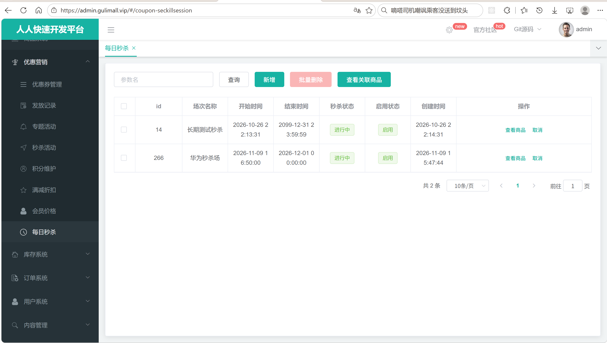
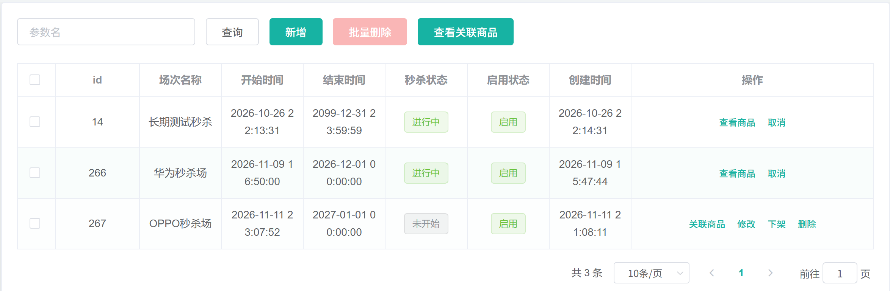
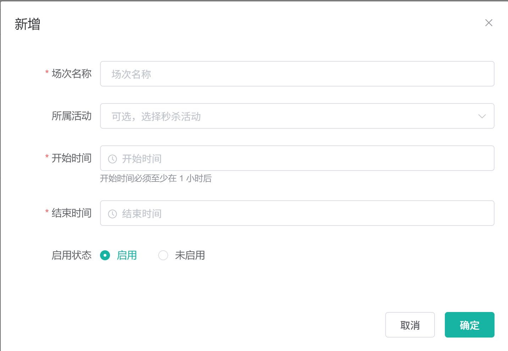
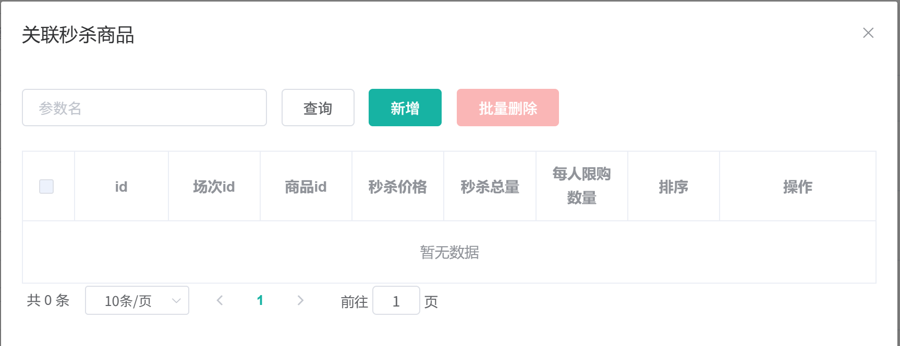
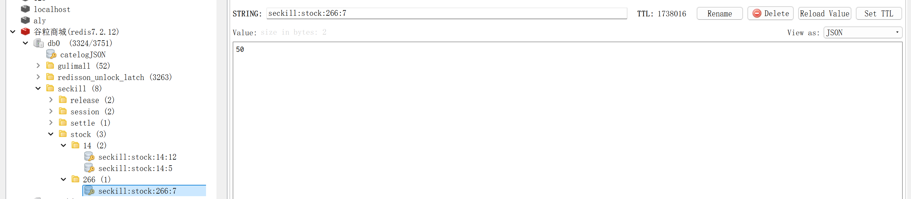

# 14.1 秒杀场次与商品上架-介绍

> 本篇介绍秒杀场次与商品上架：秒杀业务怎么划分场次、管理员怎么建场次和关联商品、库存怎么锁到具体仓库、场次怎么到点开始和结束、结算怎么释放库存、商品信息怎么上架到 Redis。

---

## 1. 这个功能是干什么的

秒杀是限时低价活动：商品在固定时间以远低于日常的价格出售，库存有限，开抢瞬间流量集中。秒杀业务要解决三件事：

1. **活动怎么组织**：哪些商品、在什么时间段、按什么价格、每人能买几件、总共卖多少。
2. **库存怎么保住**：活动商品要提前从普通可售库存里划出一块，活动没结束前不能被普通下单占用；活动结束或取消后要把没卖完的部分还回去。
3. **活动怎么自动推进**：到开始时间自动进入进行中，到结束时间自动停止抢购，再留一段缓冲期处理已下单未支付、已下单后取消等情况，最后结算。

场次就是活动的时间容器：

```text
场次：2026-11-11 00:00:00 ～ 2026-11-11 02:00:00
    ├── 商品 A：秒杀价 99，总量 100，每人限购 1
    ├── 商品 B：秒杀价 199，总量 50，每人限购 2
    └── 商品 C：秒杀价 9.9，总量 500，每人限购 1
```

场次和商品分成两张表：

1. `sms_seckill_session` 保存场次本身：名称、起止时间、启用状态、秒杀状态、停止时间、结算类型。
2. `sms_seckill_sku_relation` 保存场次和商品的绑定：秒杀价、秒杀总量、限购、排序、实际锁定仓库、乐观锁版本。

这样拆分的直接好处是：一个场次可以挂多个商品，一个商品也可以在不同时间段参加不同场次；场次的时间调整不影响商品配置，商品的增删也不影响场次状态。

这个功能属于管理端和后台链路，负责把活动配置好、把库存锁好、把状态推进好、把商品快照写进 Redis。用户真正抢购时的库存预扣、异步建单、订单回补不属于本篇，放在秒杀订单链路里讲。

## 2. 用户/管理员怎么操作

后台入口：

```text
renren-fast 管理后台 → 营销 → 秒杀场次管理
```



管理员可以完成七类操作。

### 2.1 查看场次列表

1. 打开场次管理页，前端请求 `/coupon/seckillsession/list`。
2. 后端按分页查询 `sms_seckill_session`。
3. 列表展示场次 id、名称、开始时间、结束时间、秒杀状态、启用状态、创建时间。
4. 秒杀状态列在浏览器里按“数据库状态 + 当前时间”实时计算，避免定时任务延迟导致页面显示不准。



### 2.2 新增场次

1. 点击“新增”，打开场次表单。
2. 填写场次名称、所属活动、开始时间、结束时间、启用状态。
3. 前端校验开始时间至少在当前时间 1 小时后，结束时间晚于开始时间。
4. 点击“确定”，请求 `POST /coupon/seckillsession/save`。
5. 后端校验时间，把 `seckill_state` 强制设为 0 未开始，`status` 强制设为 1 启用，然后插入场次。
6. 插入成功后，给开始时间和结束时间各投递一条延时消息，并写入本地消息表 `mq_message`。
7. 前端刷新列表，看到新场次处于“未开始”。



### 2.3 关联商品

1. 在未开始场次那一行点击“关联商品”，打开关联商品弹窗。
2. 弹窗只查当前场次的关联记录，避免看到或误删别的场次商品。
3. 点击“新增”，填写商品 id、秒杀价格、秒杀总量、每人限购、排序。
4. 点击“确定”，请求 `POST /coupon/seckillskurelation/save`。
5. 后端先锁场次，再校验场次是否启用且未开始，然后调 ware 锁定秒杀库存，最后写关联表和 Redis 库存 key。
6. 返回成功后刷新关联列表，同时让秒杀服务重建这个商品的缓存快照。



### 2.4 商品上架到 Redis

1. 每天凌晨 3 点，`SeckillSkuScheduled` 自动把未来 3 天和进行中的场次商品写入 Redis。
2. 运维或测试可以手动请求 `POST /seckill/upload` 立即触发。
3. 上架只写商品 Hash 和缺失的库存 key，不改数据库。
4. 上架完成后，秒杀页和商品详情页可以直接从 Redis 读取商品快照。



### 2.5 到点开始

1. 场次保存时预约的 `seckill.start` 延时消息到期。
2. `SeckillSessionStartListener` 消费消息，调用 `markRunning`。
3. 数据库条件更新把 `seckill_state` 从 0 或 1 改成 1 进行中。
4. 页面按时间计算的显示状态也会同步变成“进行中”。


### 2.6 到点结束与结算

1. 保存场次时预约的 `seckill.end` 延时消息到期。
2. `SeckillSessionEndListener` 消费消息，调用 `markEnding`。
3. 场次先进入 2 停止中，同时删除该场次所有秒杀库存 key，抢购立即失败。
4. 从结束时间起算 30 分钟宽限期，宽限期到了再发 `seckill.settle` 消息。
5. 结算按数据库当前剩余的 `seckill_stock_locked` 释放库存，最终把状态改成 3 已结束。


### 2.7 下架、取消、删除

1. **下架**：只把 `status` 改成 0，并删除商品 Hash；不释放库存、不删库存 key、不发 MQ。
2. **取消**：只有进行中的场次能取消。先进入停止中，`settle_type=2`，删库存 key，30 分钟后结算成 4 已取消。
3. **删除**：物理删除场次和关联。未开始场次先释放剩余秒杀锁定；已结束或已取消只删记录。

## 3. 整体设计思路

### 3.1 业务上怎么设计

#### 3.1.1 场次状态机

场次有两个独立字段：

1. `status`：启用状态，1 启用、0 下架。
2. `seckill_state`：秒杀状态，0 未开始、1 进行中、2 停止中、3 已结束、4 已取消。

状态流转：

```text
新增
  ↓
0 未开始 ──到点开始消息──→ 1 进行中 ──到点结束消息──→ 2 停止中 ──宽限期结算──→ 3 已结束
                              │
                              └──管理员取消──→ 2 停止中 ──宽限期结算──→ 4 已取消
```

关键规则：

1. 新建场次一律从未开始开始，前端传什么状态都不认。
2. 修改场次只允许未开始，已经开始、结束、停止、取消的场次不能改时间和商品。
3. 人工终态 2、3、4 优先级最高，延时消息不能覆盖。
4. 0 和 1 的显示状态按时间实时计算，定时任务漏跑也不会让页面长期停在错误状态。
5. `settle_type` 决定停止中最终落到已结束还是已取消：1 自然结束，2 管理员取消。
6. `stop_time` 记录提前停止时间；自然结束没有这个值，结算时用结束时间作为宽限期起点。

#### 3.1.2 活动商品规则

1. 一个场次下一个 SKU 只能有一条关联，数据库用 `uk_session_sku(promotion_session_id, sku_id)` 兜底。
2. 同一个 SKU 不能同时参加时间重叠的两个启用场次。原因是 ware 的 `seckill_stock_locked` 按“SKU + 仓库”聚合，不区分场次，重叠后结算无法只释放某一场。
3. 关联、修改、删除都只允许在“启用且未开始”的场次进行。
4. 修改时可以改价格、总量、限购、排序，也可以换商品、换场次。
5. 换商品时先释放旧商品在原仓库的锁定，再给新商品重新选仓锁定。
6. 换场次时库存和仓库不动，只迁移 Redis key 和 Hash 字段。
7. 修改总量时只在原仓库加减差额；原仓库不够直接失败，不自动换仓。

#### 3.1.3 秒杀价、限购和库存

1. `seckill_price` 是活动价，页面展示的划线价来自 product 的日常价。
2. `seckill_limit` 是每人限购，提交抢购时按会员累计已买数量校验。
3. `seckill_count` 是活动总量，关联商品时从普通可售库存里锁定这么多。
4. 锁定只增加 `wms_ware_sku.seckill_stock_locked`，不改 `stock`，也不改 `stock_locked`。
5. 普通可售库存 = `stock - stock_locked - seckill_stock_locked`，活动占用的部分不能卖给普通订单。
6. 订单建单成功后，活动锁定的一部分会转成订单锁定，结算只释放数据库里剩下的活动锁定。

#### 3.1.4 到点开始和到点结束

1. 场次保存成功后预约两条延时消息：开始消息带开始时间，结束消息带结束时间。
2. 消息到点后由消费者改数据库状态，不靠扫表轮询。
3. 场次时间被修改后，旧消息不会被撤回，消费者用消息里的时间和数据库时间比对，不一致就忽略。
4. 消息早到时重新投一条到真实时间；消息晚到且已经过了结束时间时，开始消息直接放弃，结束流程接管。
5. 重复消息用条件更新保持幂等。

#### 3.1.5 30 分钟宽限期

场次到点结束或管理员取消时，不直接进入终态，而是先进入停止中，等 30 分钟再结算：

1. 停止中立即删除秒杀库存 key，新的抢购直接失败，起到止损作用。
2. 结束前已经抢到但还没建单、还没支付的订单，还需要时间走完建单、取消、超时回补。
3. 30 分钟与订单支付超时共用同一个配置 `gulimall.ware.stock-release.delay-ms`，默认 1800000 毫秒。
4. 宽限期结束后按数据库剩余锁定释放，避免把已经转成订单锁定的数量重复释放。

#### 3.1.6 下架、取消、删除的边界

1. 下架只影响启用状态，不动库存；未开始场次下架后库存仍被占用，要释放必须删除场次。
2. 取消只允许进行中，先进入停止中，再按宽限期变已取消。
3. 删除是物理删除；进行中、停止中、到点但未结算的场次不能删。
4. 未开始或已下架未结算的场次删除前先释放剩余活动锁定，避免库存长期被占用。
5. 已结束或已取消的场次删除时不再释放库存，因为结算已经处理过。

#### 3.1.7 上架范围

上架范围与前台展示范围保持一致：

1. `status = 1`。
2. `seckill_state IN (0, 1)`。
3. `end_time >= 当前时间`。
4. `start_time <= 当前时间 + 3 天`。

只上架未来 3 天和进行中的场次，避免 Redis 里堆积大量历史数据；同时保证页面看得到的场次一定有缓存。

### 3.2 技术上怎么设计

#### 3.2.1 两张表

```text
sms_seckill_session
├── id               场次 id
├── promotion_id     所属秒杀活动
├── name             场次名称
├── start_time       开始时间
├── end_time         结束时间
├── status           1 启用、0 下架
├── seckill_state    0 未开始、1 进行中、2 停止中、3 已结束、4 已取消
├── stop_time        提前停止时间
├── settle_type      1 自然结束、2 管理员取消
└── create_time      创建时间

sms_seckill_sku_relation
├── id                   关联 id
├── promotion_id         所属活动
├── promotion_session_id 所属场次
├── sku_id               商品 id
├── ware_id              关联时实际锁定的仓库 id
├── seckill_price        秒杀价
├── seckill_count        秒杀总量
├── seckill_limit        每人限购
├── seckill_sort         排序
└── version              乐观锁版本
```

`ware_id` 是 `NOT NULL`，所以必须先在 ware 锁定库存拿到仓库 id，再插入关联记录。`version` 用来处理后台多人同时修改同一条关联的情况。

#### 3.2.2 延时 MQ 加本地消息表

开始、结束、结算都走 RabbitMQ 延时交换机：

```text
交换机：gulimall-rabbitmq-retry-exchange（x-delayed-message）
路由键：seckill.start、seckill.end、seckill.settle
队列：gulimall-seckill-start-queue、gulimall-seckill-end-queue、gulimall-seckill-settle-queue
```

发送统一走 `MqMessageService.sendReliable`：

1. 先把消息写入 `mq_message`，状态 0。
2. 如果当前有事务，消息记录和业务数据在同一个本地事务里提交。
3. 事务提交后再投递，避免“场次没保存但消息已经发出去”。
4. 投递失败由补偿任务重发。

#### 3.2.3 条件更新

状态推进都用条件更新，而不是先查再改：

```sql
update sms_seckill_session
set seckill_state = 1
where id = ?
  and status = 1
  and seckill_state in (0, 1)
  and start_time <= now()
  and end_time > now()
```

这样重复消息、并发停止、消息晚到都不会把状态改错。影响行数为 0 就说明条件不满足，直接返回。

#### 3.2.4 场次锁

同一场次的停止、结算、取消、下架、删除和关联修改共用一把 Redisson 锁：

```text
seckill:settle:lock:{sessionId}
```

1. 结算、结束、取消、下架、删除用 `tryLock(0)`，拿不到直接失败或返回，避免阻塞 MQ 线程。
2. 关联新增、修改、删除用 `tryLock(3s)`，允许后台操作短暂等待。
3. 多场次操作按场次 id 排序加锁，倒序释放，避免死锁。
4. 锁保证“判断场次进行中”和“结算删 key”不会交叉。

#### 3.2.5 仓库锁定和 ware_id 回补

关联商品时调用 ware 的 `/ware/waresku/seckill/lock`：

1. 新增关联时传 `wareId=0`，ware 选可用库存最多的仓库。
2. 调大数量时传原仓库 id，只在这个仓库加，原仓不够直接失败。
3. ware 先写 `wms_seckill_stock_operation` 操作记录，`operationId` 唯一索引挡住重复。
4. 再用条件更新把数量加到 `seckill_stock_locked`，保证可用库存不为负。
5. 返回实际仓库 id，coupon 回填到关联表 `ware_id`。
6. 释放时只释放关联表记录的原仓库，避免库存漂移。

结算和删除场次时调用 `/ware/waresku/seckill/releaseRemaining`，ware 以数据库当前 `seckill_stock_locked` 为准，一次性置 0 并返回释放量。

#### 3.2.6 Seata 全局事务和 Redis

coupon 写关联表、ware 写库存、Redis 写库存 key 是三个系统。处理方式：

1. 关联新增、修改、删除加 `@GlobalTransactional`，coupon 和 ware 的数据库修改由 Seata 保证一致。
2. Redis 不在 Seata 事务内，由控制器在 `finally` 里处理：失败时删掉可能写入的新 key、恢复旧 key；成功时刷新商品 Hash。
3. 普通可售库存缓存不参与全局事务，事务结束后按数据库重新计算并写回。

#### 3.2.7 定时兜底

1. 每天 3 点 `SeckillSettleScheduled` 扫描停止中且宽限期已到的场次，补一次结算。
2. 同时扫描状态还是 0 或 1、启用中、结束时间加宽限期已过的场次，先补 `markEnding` 再结算。
3. 每天 3 点 `SeckillSkuScheduled` 重新上架未来 3 天和进行中的场次商品。
4. 定时任务没有分布式锁，多实例会重复执行，但状态更新、`operationId`、Hash 覆盖和 `setIfAbsent` 都保证幂等。

#### 3.2.8 Redis 是运行期投影

数据库保存配置和事实，Redis 保存页面要用的商品快照和库存：

1. 商品 Hash：`seckill:session:{sessionId}:skus`，field 是 `skuId`，value 是商品快照 JSON。
2. 库存 String：`seckill:stock:{sessionId}:{skuId}`，值是剩余秒杀库存。
3. 数据库是回源依据；Redis 丢失可以从数据库和 product 重建。
4. 数据库修改后通过上架任务、单商品刷新和缓存清理同步到 Redis。

## 4. 详细代码、配置和解释

秒杀场次与商品上架由四段链路组成：运营在后台创建场次、给场次关联商品并锁定仓库库存；定时任务把未来场次的商品快照和可售库存写入 Redis；RabbitMQ 延时消息在开始、结束、宽限期三个时间点推进状态；结算和删除把没有卖掉的库存还给普通可售库存。

代码按“类或配置解决什么问题 → 关键字段与接口 → 正常链路 → 代码分块解释 → 一次完整示例 → 边界与可优化点”组织。每段代码前面先说明它在链路里的位置和上下游，代码后面按 1、2、3 解释执行顺序、条件和原因。基础 CRUD 与无关 import 不展开。

### 4.1 SeckillSessionEntity：场次表映射

#### 4.1.1 这个类解决什么问题

后台运营点“新增场次”时填写活动、名称、开始时间和结束时间；到点后系统要把场次自动切成进行中、停止中、已结束。这些信息需要一个持久化载体。`SeckillSessionEntity` 映射 `gulimall_sms.sms_seckill_session`，是整条链路的起点：

1. 后台表单通过 `SeckillSessionController.save` 写入它；
2. 后台列表、修改回显从它读取；
3. 开始、结束、结算三个消费者按它判断是否允许推进状态；
4. 上架任务按 `status`、`seckill_state`、`start_time`、`end_time` 筛选未来三天和进行中的场次；
5. 结算兜底任务按 `seckill_state`、`stop_time`、`end_time` 找出漏处理的场次。

实体本身不写业务规则，只承担字段映射、状态承载和时间承载。状态如何折算、什么时候允许修改，分别在 `SeckillSessionState` 和 Service 中实现。

#### 4.1.2 字段与业务含义

| 字段 | 数据库列 | 业务含义 | 说明 |
|---|---|---|---|
| `id` | `id` | 场次 id | 主键，自增，消息体里传的就是这个值 |
| `promotionId` | `promotion_id` | 所属秒杀活动 id | 关联活动表，当前只做展示，不参与状态判断 |
| `name` | `name` | 场次名称 | 后台列表展示 |
| `startTime` | `start_time` | 开始时间 | 延时消息的投递基准，也是有效状态计算的左边界 |
| `endTime` | `end_time` | 结束时间 | 有效状态计算的右边界，结算宽限期从它或 `stop_time` 起算 |
| `status` | `status` | 启用标记 | 1 启用、0 下架；和活动生命周期分开 |
| `seckillState` | `seckill_state` | 人工/系统推进的状态 | 0 未开始、1 进行中、2 停止中、3 已结束、4 已取消 |
| `stopTime` | `stop_time` | 停止时刻 | 管理员取消时写入，结算从这一刻起算宽限期 |
| `settleType` | `settle_type` | 停止后的落点 | 1 自然结束、2 管理员取消 |
| `createTime` | `create_time` | 创建时间 | 后端生成，前端不允许修改 |

`status` 和 `seckillState` 必须拆开：下架一个未开始场次不应该改变它的生命周期，取消一个进行中场次也不应该把 `status` 改成 0。

#### 4.1.3 代码与解释

这段实体代码只做字段声明，下面按注解、主键、字段映射的顺序展开。

```java
@Data
@TableName("sms_seckill_session")
public class SeckillSessionEntity implements Serializable {
	private static final long serialVersionUID = 1L;

	@TableId
	private Long id;

	private Long promotionId;

	private String name;

	private Date startTime;

	private Date endTime;

	private Integer status;

	private Integer seckillState;

	private Date stopTime;

	private Integer settleType;

	private Date createTime;

}
```

1. `@Data`：Lombok 生成 getter、setter、`toString`，Service 和 MQ 消息组装直接读写字段。
2. `@TableName("sms_seckill_session")`：告诉 MyBatis-Plus 这个类对应 `gulimall_sms.sms_seckill_session`，增删改查都按这张表生成 SQL。
3. `@TableId`：标记 `id` 为主键。插入时不传 id，数据库自增后把 id 回填到对象，`saveSession` 紧接着发消息才能拿到 `session.getId()`。
4. 其余字段与列名按驼峰转下划线自动映射：`promotionId → promotion_id`、`seckillState → seckill_state`、`settleType → settle_type`。
5. 时间字段统一用 `java.util.Date`，与 MyBatis-Plus、Jackson 的默认时间处理保持一致；写入数据库时按连接串里的 `serverTimezone=Asia/Shanghai` 解释。
6. `serialVersionUID` 固定为 1L，实体如果被放进缓存或消息，反序列化不会因为版本号变化失败。

#### 4.1.4 一次读写示例

新增一个未开始场次：

```text
INSERT INTO sms_seckill_session
  (promotion_id, name, start_time, end_time, status, seckill_state, create_time)
VALUES
  (10, '双十一 0 点场', '2026-11-11 00:00:00', '2026-11-11 02:00:00', 1, 0, NOW());
```

到点开始消息消费后，条件更新把状态推进到 1：

```text
UPDATE sms_seckill_session
SET seckill_state = 1
WHERE id = 1001
  AND status = 1
  AND seckill_state IN (0, 1)
  AND start_time <= NOW()
  AND end_time > NOW();
```

后台列表查询拿到的是当前数据库状态；页面显示“进行中”还是“已结束”，由 `SeckillSessionState.effectiveState` 结合时间再算一次，不直接相信 `seckill_state`。

#### 4.1.5 边界与可优化点

1. `settleType` 只有 1、2 两个值，当前靠代码约定，数据库没有约束，也没有枚举类型。误写其他值时，结算会落到“已结束”分支。
2. 表上没有 `(status, seckill_state, start_time, end_time)` 组合索引。上架任务和兜底任务都按这几个列扫描，场次数量大时会走全表。
3. 没有 `update_time`、`update_by` 字段，后台追查“谁改了时间、什么时候改的”只能翻应用日志。
4. `status` 同时表示“启用”和“是否下架”，语义与 `seckillState` 的“已取消”容易混淆，运营需要理解两个字段的区别。
5. 时间字段没有数据库默认值和检查约束，结束时间早于开始时间只能靠 `validateTime` 拦截。

### 4.2 SeckillSkuRelationEntity：关联表映射

#### 4.2.1 这个类解决什么问题

一个场次要卖多个商品，每个商品又有自己的秒杀价、秒杀总量、限购数和排序。这些配置不能放在商品表，也不能放在场次表，因此需要一张场次与 SKU 的关联表。`SeckillSkuRelationEntity` 映射 `gulimall_sms.sms_seckill_sku_relation`，位于三条链路的中间：

1. 后台关联商品页面读写它，决定一个场次卖哪些 SKU；
2. 关联新增时先调 ware 锁库存，再把实际仓库 `ware_id` 写回它；
3. 上架任务按 `promotion_session_id` 查出整场商品，组装 Redis Hash；
4. 结算和删除按它记录的数量、仓库释放剩余活动锁定。

关联表同时是“活动配置”和“库存凭据”：`ware_id` 决定释放哪个仓库，`seckill_count` 决定释放多少，`version` 决定后台并发修改谁成功。

#### 4.2.2 字段与业务含义

| 字段 | 数据库列 | 业务含义 | 说明 |
|---|---|---|---|
| `id` | `id` | 关联 id | 主键，结算幂等串里会用到 |
| `promotionId` | `promotion_id` | 所属活动 id | 冗余字段，当前不参与校验 |
| `promotionSessionId` | `promotion_session_id` | 所属场次 id | 关联、上架、释放都按它过滤 |
| `skuId` | `sku_id` | 商品 SKU id | 同一场次内不允许重复 |
| `wareId` | `ware_id` | 实际锁定仓库 id | 非空，锁库存后回填 |
| `seckillPrice` | `seckill_price` | 秒杀价 | 前台展示和下单计价使用 |
| `seckillCount` | `seckill_count` | 秒杀总量 | 锁库存数量，也是 Redis 库存 key 的初始值 |
| `seckillLimit` | `seckill_limit` | 每人限购 | 下单时校验 |
| `seckillSort` | `seckill_sort` | 场次内排序 | 后台列表和前台展示使用 |
| `version` | `version` | 乐观锁版本 | 后台修改、删除时带版本条件 |

#### 4.2.3 代码与解释

关联表的实体同样是纯字段映射，重点在 ware_id、数量和 version 三个字段。

```java
@Data
@TableName("sms_seckill_sku_relation")
public class SeckillSkuRelationEntity implements Serializable {
	private static final long serialVersionUID = 1L;

	@TableId
	private Long id;

	private Long promotionId;

	private Long promotionSessionId;

	private Long skuId;

	private Long wareId;

	private BigDecimal seckillPrice;

	private Integer seckillCount;

	private Integer seckillLimit;

	private Integer seckillSort;

	private Integer version;

}
```

1. `@TableName("sms_seckill_sku_relation")`：对应 `gulimall_sms.sms_seckill_sku_relation`，不需要 XML 映射。
2. `@TableId`：主键自增，关联保存后 id 回填，结算和删除的 `operationId` 会拼上这个 id。
3. `wareId`：新增关联时由 ware 返回，修改数量时沿用旧仓库；它是释放库存时唯一定位仓库的依据。
4. `seckillPrice` 使用 `BigDecimal`，与订单金额的计算类型保持一致，避免 `double` 精度问题。
5. `version` 初始为 0，每次后台修改加 1；更新和删除 SQL 都带 `version = 旧值`，影响 0 行说明别人先改过。
6. 表上没有 `create_time`、`update_time`，实体也没有对应字段，审计信息只能靠数据库 binlog。

#### 4.2.4 一次读写示例

新增关联成功后，数据库中的一行大致如下：

```text
id=501  promotion_id=10  promotion_session_id=1001  sku_id=3001
ware_id=2  seckill_price=99.00  seckill_count=100  seckill_limit=2
seckill_sort=0  version=0
```

上架任务按 `promotion_session_id=1001` 查出 501 这一行，再用 `sku_id=3001` 去 product 补名称、图片，最后写入场次商品 Hash。结算时用 `sessionId=1001`、`id=501` 拼出 `settle:1001:501` 作为释放幂等键。

#### 4.2.5 边界与可优化点

1. `promotion_id` 与场次表的 `promotion_id` 可能不一致，当前没有一致性校验，冗余字段只用于展示。
2. `version` 只保护后台并发修改；用户抢购扣的是 Redis，不参与这个版本，也不需要参与。
3. 关联表没有唯一约束的显式说明时，同一场次同一 SKU 的重复只能靠应用层查询加数据库唯一键双保险，部署前要确认唯一键存在。
4. 缺少创建人、修改人字段，运营排查“谁把库存改大了”没有直接依据。
5. `seckillPrice` 没有和商品日常价做比较，秒杀价高于日常价也能保存，只在前端做提示。

### 4.3 SeckillSessionState：场次状态和有效状态计算

#### 4.3.1 这个类解决什么问题

场次状态有两个来源：数据库里的 `seckill_state` 由消息和人工操作推进，时间又决定了场次“现在应该是什么状态”。延时消息可能早到、晚到、丢失，数据库状态可能暂时落后于真实时间；前台页面不能因此把已经到点的场次显示成“未开始”，后台也不能允许修改一个实际已经开始的场次。

`SeckillSessionState` 把“人工状态优先、时间兜底”的规则集中到一个类，后台列表、上架任务、关联校验、取消和下架判断都调用它。它不访问数据库，只做纯计算，因此可以在任何层复用。

#### 4.3.2 关键概念

| 常量 | 值 | 含义 | 谁写入 |
|---|---|---|---|
| `NOT_STARTED` | 0 | 未开始 | 新增场次默认值 |
| `RUNNING` | 1 | 进行中 | 开始消息消费者条件更新 |
| `STOPPING` | 2 | 停止中 | 结束消息、管理员取消 |
| `ENDED` | 3 | 已结束 | 宽限期结算，`settle_type=1` |
| `CANCELLED` | 4 | 已取消 | 宽限期结算，`settle_type=2` |
| `SETTLE_TYPE_END` | 1 | 停止后落到已结束 | 结束消息 |
| `SETTLE_TYPE_CANCEL` | 2 | 停止后落到已取消 | 管理员取消 |

优先级规则：

1. 数据库状态已经是 2、3、4 时，直接返回数据库状态，时间不再覆盖。人工停止、结算结果优先于时间计算。
2. 时间不完整时返回数据库状态，交给其他校验处理。
3. 当前时间早于 `start_time` 返回未开始。
4. 当前时间不早于 `end_time` 返回已结束。
5. 其余区间返回进行中。

#### 4.3.3 正常链路

```text
后台列表：查场次 → effectiveState(状态, 开始, 结束, now) → 显示标签和按钮
修改场次：查旧场次 → effectiveState == 未开始 才允许改
关联商品：查场次 → isEnabledAndNotStarted → 启用且有效状态未开始 才允许增删改
取消场次：effectiveState == 进行中 才允许取消
下架场次：effectiveState == 未开始 或 数据库状态已结束/已取消 才允许下架
```

#### 4.3.4 代码与解释

状态计算全部集中在这个静态方法里，下面按优先级逐段说明。

```java
public class SeckillSessionState {

    public static final int NOT_STARTED = 0;
    public static final int RUNNING = 1;
    public static final int STOPPING = 2;
    public static final int ENDED = 3;
    public static final int CANCELLED = 4;

    /** 停止中之后的最终状态：自然结束 */
    public static final int SETTLE_TYPE_END = 1;

    /** 停止中之后的最终状态：管理员取消 */
    public static final int SETTLE_TYPE_CANCEL = 2;

    public static int effectiveState(Integer storedState, Date startTime, Date endTime, Date now) {
        // 1. 人工状态优先：停止中、已结束、已取消，直接返回存的值
        int state = storedState == null ? NOT_STARTED : storedState;
        if (state == STOPPING || state == ENDED || state == CANCELLED) {
            return state;
        }

        // 2. 时间不完整时，退化成存的状态
        if (startTime == null || endTime == null) {
            return state;
        }
        if (now == null) {
            now = new Date();
        }

        // 3. 还没到开始时间：未开始
        if (now.before(startTime)) {
            return NOT_STARTED;
        }

        // 4. 已经到了结束时间：已结束
        if (!now.before(endTime)) {
            return ENDED;
        }

        // 5. 开始时间和结束时间之间：进行中
        return RUNNING;
    }

    public static boolean isEnabledAndNotStarted(Integer status, Integer storedState,
                                                 Date startTime, Date endTime, Date now) {
        // 1. status=1 才允许
        if (!Integer.valueOf(1).equals(status)) {
            return false;
        }
        // 2. 有效状态必须是未开始
        return effectiveState(storedState, startTime, endTime, now) == NOT_STARTED;
    }

    private SeckillSessionState() {
    }
}
```

1. 五个状态常量和两个结算类型常量集中定义，调用方不再手写 0、1、2、3、4。
2. `effectiveState` 先把 null 状态按未开始处理，避免历史数据空值导致空指针。
3. 数据库状态是停止中、已结束、已取消时直接返回。这三种状态由人工或结算写入，时间不能把它们改回进行中。
4. `startTime` 或 `endTime` 为空时返回数据库状态，参数不完整不参与时间推算。
5. `now` 为空时取当前时间，批量计算时可以传入同一个时间点，保证同一批场次判断一致。
6. 当前时间早于开始时间返回未开始；不早于结束时间返回已结束；其余返回进行中。
7. `isEnabledAndNotStarted` 先要求 `status=1`，再用有效状态判断是否未开始。只看 `seckill_state=0` 不够，因为消息可能没到，但时间已经过了开始点。
8. 私有构造器禁止实例化，这个类只提供静态方法。

#### 4.3.5 一次计算示例

场次开始时间 `2026-11-11 00:00:00`，结束时间 `02:00:00`：

| 当前时间 | 数据库 `seckill_state` | 返回 | 页面表现 |
|---|---|---|---|
| 10:00（前一天） | 0 | 0 未开始 | 可关联商品、可修改、可下架、可删除 |
| 00:30 | 0（开始消息未到） | 1 进行中 | 只显示查看商品和取消 |
| 00:30 | 2 | 2 停止中 | 显示“结算中” |
| 02:30 | 1（结束消息未到） | 3 已结束 | 可查看商品、可下架、可删除 |
| 00:30 | 4 | 4 已取消 | 可查看商品、可下架、可删除 |

第二行说明时间兜底的作用：消息没到，页面仍然显示进行中，后台也不会允许再改商品。第四行说明结束消息丢失时，页面不会一直显示进行中。

#### 4.3.6 边界与可优化点

1. 前端 `seckillsession.vue` 的 `stateOf` 又实现了一遍同样的规则，两套实现依赖浏览器时间，客户端时钟偏差会导致显示不一致。可以由后端在列表结果里直接返回 `effectiveState`。
2. `effectiveState` 每次调用都 `new Date()`，批量计算时可以传入统一的 `now`。
3. 状态常量是 int，调用方对照常量阅读；改成枚举能提高可读性，但数据库仍然存 int，需要一层转换。
4. 时区依赖 JVM 和服务器的 `Asia/Shanghai`，部署到其他时区时判断会整体偏移。
5. 没有“暂停后恢复”的状态，取消是不可逆的，业务上只能重新建场次。

### 4.4 SeckillConstant：Redis key 规则

#### 4.4.1 这个类解决什么问题

秒杀链路在多个模块、多个线程里读写同一批 Redis key：coupon 写商品 Hash 和库存 key，seckill 读库存并扣减，ware 不直接碰这些 key，但库存变化会触发缓存刷新。任何一处手写字符串拼错，都会出现“写进去读不到”或“扣减一个不存在的 key”。

`SeckillConstant` 把前缀和拼接方法集中起来，让写入方和读取方使用同一份规则。它只解决命名问题，不负责 TTL，也不负责序列化。

#### 4.4.2 key 一览

| 用途 | 完整 key | 类型 | 写入方 | 读取方 |
|---|---|---|---|---|
| 秒杀库存 | `seckill:stock:{sessionId}:{skuId}` | String | 关联新增/修改、上架补 key | 抢购 Lua、结算删除 |
| 场次商品快照 | `seckill:session:{sessionId}:skus` | Hash | 上架任务、关联刷新 | 秒杀页、商品详情页 |
| 场次锁 | `seckill:settle:lock:{sessionId}` | Redisson 锁 | 结算、取消、下架、删除、关联修改 | 同左 |
| 每人已购 | `seckill:user:count:{sessionId}:{skuId}` | Hash | 抢购 | 限购校验、结算清理 |
| 抢购防重 | `seckill:req:{sessionId}:{skuId}:{memberId}` | String | 抢购 | 抢购防重 |
| 预扣标识 | `seckill:reserve:{orderSn}` | String | 建单预扣 | 预扣幂等 |
| 释放标识 | `seckill:release:{orderSn}` | String | 取消/超时释放 | 释放幂等 |

#### 4.4.3 代码与解释

常量类只包含前缀、拼接方法和私有构造器，下面按 key 的用途逐项说明。

```java
public class SeckillConstant {

    /** 秒杀库存 key 前缀，完整 key = seckill:stock:{场次id}:{skuId} */
    public static final String SECKILL_STOCK_PREFIX = "seckill:stock:";

    /** 场次锁前缀：停止/结算/取消/下架/删除/关联修改共用 */
    public static final String SECKILL_SETTLE_LOCK_PREFIX = "seckill:settle:lock:";

    /** 场次商品信息 hash 前缀，完整 key = seckill:session:{场次id}:skus */
    public static final String SECKILL_SESSION_SKUS_PREFIX = "seckill:session:";

    /** 每人已购数量 hash 前缀，完整 key = seckill:user:count:{场次id}:{skuId}，field = memberId */
    public static final String SECKILL_USER_COUNT_PREFIX = "seckill:user:count:";

    /** 抢购防重前缀，完整 key = seckill:req:{场次id}:{skuId}:{memberId}，value = orderSn */
    public static final String SECKILL_REQUEST_PREFIX = "seckill:req:";

    /** 预扣标识前缀，完整 key = seckill:reserve:{orderSn} */
    public static final String SECKILL_RESERVE_PREFIX = "seckill:reserve:";

    /** 释放幂等标识前缀，完整 key = seckill:release:{orderSn} */
    public static final String SECKILL_RELEASE_PREFIX = "seckill:release:";

    public static String stockKey(Long sessionId, Long skuId) {
        return SECKILL_STOCK_PREFIX + sessionId + ":" + skuId;
    }

    public static String sessionSkusKey(Long sessionId) {
        return SECKILL_SESSION_SKUS_PREFIX + sessionId + ":skus";
    }

    public static String userCountKey(Long sessionId, Long skuId) {
        return SECKILL_USER_COUNT_PREFIX + sessionId + ":" + skuId;
    }

    public static String requestKey(Long sessionId, Long skuId, Long memberId) {
        return SECKILL_REQUEST_PREFIX + sessionId + ":" + skuId + ":" + memberId;
    }

    public static String reserveKey(String orderSn) {
        return SECKILL_RESERVE_PREFIX + orderSn;
    }

    public static String releaseKey(String orderSn) {
        return SECKILL_RELEASE_PREFIX + orderSn;
    }

    public static String settleLockKey(Long sessionId) {
        return SECKILL_SETTLE_LOCK_PREFIX + sessionId;
    }

    private SeckillConstant() {
    }
}
```

1. 每个前缀带业务名 `seckill:`，在 `redis-cli` 里可以按前缀扫描，和其他业务的 key 分开。
2. `SECKILL_STOCK_PREFIX` 后面必须跟 `{sessionId}:{skuId}`，拼接方法 `stockKey` 负责补分隔符。
3. `SECKILL_SETTLE_LOCK_PREFIX` 只拼场次 id，一场一把锁，结算、取消、下架、删除、关联修改共用。
4. `sessionSkusKey` 固定以 `:skus` 结尾，和库存 key、用户计数 key 区分。
5. `userCountKey` 的 field 是 `memberId`，key 只到 `skuId`，同一场次同一商品的所有用户共用一个 Hash。
6. `requestKey` 带会员 id，一个用户对一个商品只有一个防重 key，value 存订单号。
7. `reserveKey`、`releaseKey` 按订单号拼，订单维度幂等。
8. 私有构造器禁止实例化。

#### 4.4.4 一次 key 生成示例

场次 1001、商品 3001、会员 20001：

```text
stockKey(1001, 3001)              → seckill:stock:1001:3001
sessionSkusKey(1001)              → seckill:session:1001:skus
userCountKey(1001, 3001)          → seckill:user:count:1001:3001
requestKey(1001, 3001, 20001)     → seckill:req:1001:3001:20001
reserveKey("202611110001")        → seckill:reserve:202611110001
settleLockKey(1001)               → seckill:settle:lock:1001
```

#### 4.4.5 边界与可优化点

1. 没有使用 Redis Cluster 的 hash tag。同一场次的库存 key 和商品 Hash 可能落在不同槽位，Lua 脚本如果要同时操作多个 key，会受跨槽限制。
2. 前缀没有版本号，key 结构变化时不能平滑迁移，只能双写或整体删除。
3. TTL 由调用方自己计算，常量类不提供统一过期时间；不同入口写入的 key 可能 TTL 不一致。
4. 字符串拼接依赖调用方传对参数类型，传 null 会拼出 `"null"`，当前没有空值校验。

### 4.5 SeckillSessionController：后台场次入口

#### 4.5.1 这个类解决什么问题

后台“秒杀场次”页面需要完成七类操作：分页列表、修改前回显、新增、修改、下架、取消、删除。页面只认 HTTP 接口，`SeckillSessionController` 负责把请求翻译成 Service 调用，并把握手失败的业务异常转成页面能显示的提示。

Controller 只做三件事：

1. 接收查询参数、路径参数、请求体；
2. 用 `@RequiresPermissions` 校验后台权限；
3. 调用 Service，把成功或失败包装成统一结果 `R`。

状态机、场次锁、库存释放、消息预约都不在这个类里。下架、取消、删除涉及场次锁和 Redis，所以委托给 `SeckillSettleService`；新增和修改只涉及场次表和消息，委托给 `SeckillSessionService`。

#### 4.5.2 接口清单

| 操作 | 方法与路径 | 权限 | 调用的方法 |
|---|---|---|---|
| 分页列表 | `GET /coupon/seckillsession/list` | `coupon:seckillsession:list` | `queryPage()` |
| 修改前回显 | `GET /coupon/seckillsession/info/{id}` | `coupon:seckillsession:info` | `getById()` |
| 新增场次 | `POST /coupon/seckillsession/save` | `coupon:seckillsession:save` | `saveSession()` |
| 修改场次 | `POST /coupon/seckillsession/update` | `coupon:seckillsession:update` | `updateSession()` |
| 下架场次 | `POST /coupon/seckillsession/offline` | `coupon:seckillsession:update` | `offlineSession()` |
| 取消场次 | `POST /coupon/seckillsession/cancel` | `coupon:seckillsession:update` | `cancelSession()` |
| 删除场次 | `POST /coupon/seckillsession/delete` | `coupon:seckillsession:delete` | `deleteSessions()` |

网关转发前会去掉 `/gulimall` 前缀，后台页面实际请求路径是 `/gulimall/coupon/seckillsession/...`。

#### 4.5.3 代码与解释

七个接口共用同一个 Controller，下面按调用顺序说明每个方法转发到哪里。

```java
@RestController
@RequestMapping("coupon/seckillsession")
public class SeckillSessionController {
    @Autowired
    private SeckillSessionService seckillSessionService;

    @Autowired
    private SeckillSettleService seckillSettleService;

    @RequestMapping("/list")
    @RequiresPermissions("coupon:seckillsession:list")
    public R list(@RequestParam Map<String, Object> params){
        PageUtils page = seckillSessionService.queryPage(params);

        return R.ok().put("page", page);
    }

    @RequestMapping("/info/{id}")
    @RequiresPermissions("coupon:seckillsession:info")
    public R info(@PathVariable("id") Long id){
		SeckillSessionEntity seckillSession = seckillSessionService.getById(id);

        return R.ok().put("seckillSession", seckillSession);
    }

    @RequestMapping("/save")
    @RequiresPermissions("coupon:seckillsession:save")
    public R save(@RequestBody SeckillSessionEntity seckillSession){
        try {
            // 1. 新增场次：状态固定未开始，创建时间由后端生成
            seckillSessionService.saveSession(seckillSession);
            return R.ok();
        } catch (RRException e) {
            return R.error(e.getMsg());
        }
    }

    @RequestMapping("/update")
    @RequiresPermissions("coupon:seckillsession:update")
    public R update(@RequestBody SeckillSessionEntity seckillSession){
        try {
            // 1. 修改场次：状态不能被前端改，时间重新校验
            seckillSessionService.updateSession(seckillSession);
            return R.ok();
        } catch (RRException e) {
            return R.error(e.getMsg());
        }
    }

    /**
     * 下架场次：只把 status 改成 0，不动库存和 Redis
     */
    @RequestMapping("/offline")
    @RequiresPermissions("coupon:seckillsession:update")
    public R offline(@RequestParam("id") Long id) {
        try {
            // 1. 只有未开始/已结束/已取消的场次能下架
            seckillSettleService.offlineSession(id);
            return R.ok();
        } catch (RRException e) {
            return R.error(e.getMsg());
        }
    }

    /**
     * 取消场次：只有进行中能取消，先变停止中，30 分钟后变已取消
     */
    @RequestMapping("/cancel")
    @RequiresPermissions("coupon:seckillsession:update")
    public R cancel(@RequestParam("id") Long id) {
        try {
            // 1. 只有进行中的场次可以取消
            seckillSettleService.cancelSession(id);
            return R.ok();
        } catch (RRException e) {
            return R.error(e.getMsg());
        }
    }

    /**
     * 删除场次：物理删除场次和关联；未开始先释放库存，已结束/已取消只删记录
     */
    @RequestMapping("/delete")
    @RequiresPermissions("coupon:seckillsession:delete")
    public R delete(@RequestBody Long[] ids){
        if (ids == null || ids.length == 0) {
            return R.ok();
        }
        try {
            // 1. 物理删除场次和关联
            seckillSettleService.deleteSessions(Arrays.asList(ids));
            return R.ok();
        } catch (RRException e) {
            return R.error(e.getMsg());
        }
    }

}
```

1. `@RestController` + `@RequestMapping("coupon/seckillsession")`：七个接口共用场次前缀，返回 JSON。
2. 注入两个 Service：场次本身的增改走 `SeckillSessionService`，涉及锁和库存的状态操作走 `SeckillSettleService`。
3. `list()` 把分页参数原样交给 `queryPage`，返回 `page` 字段，前端取 `data.page.list` 和 `data.page.totalCount`。
4. `info()` 按 id 查单条，供修改弹窗回填。它不做状态过滤，已结束场次也能查到。
5. `save()` 调 `saveSession`，状态、创建时间由后端兜底；捕获 `RRException` 后返回 `R.error`，前端直接显示 `msg`。
6. `update()` 调 `updateSession`，只有未开始场次能改，时间会重新校验并检查 SKU 重叠。
7. `offline()` 走 `offlineSession`，只改 `status=0`，不动库存和 Redis 库存 key。
8. `cancel()` 走 `cancelSession`，只有进行中能取消，先进入停止中，宽限期后结算成已取消。
9. `delete()` 先判断数组是否为空，再走 `deleteSessions`。空数组直接返回成功，避免生成无意义的循环。
10. 四个状态操作都捕获 `RRException`，把“场次正在处理中”“场次已结束不能取消”这类提示原样传给前端。

#### 4.5.4 一次请求示例

管理员在下架一个未开始场次：

```text
1. 页面弹出确认框：确定下架场次[id=1001]吗？
2. 确认后请求 POST /gulimall/coupon/seckillsession/offline?id=1001
3. Controller 校验 coupon:seckillsession:update 权限
4. 调用 seckillSettleService.offlineSession(1001)
5. Service 拿场次锁，确认场次有效状态为未开始
6. 条件更新 status=0
7. 删除 seckill:session:1001:skus
8. 返回 R.ok()
9. 页面提示“下架成功”，刷新列表
```

#### 4.5.5 它不做什么

1. 不判断场次状态是否允许操作，状态判断在 Service 和 `SeckillSessionState` 里。
2. 不拿场次锁，锁由 `SeckillSettleService` 和关联 Controller 负责。
3. 不直接操作 Redis 和 MQ。
4. 不校验请求体字段完整性，`validateTime` 在 Service 里做。
5. 不处理批量删除的单个失败，`deleteSessions` 遇到异常会中断整个循环。

#### 4.5.6 边界与可优化点

1. 列表接口接收 `params`，但 `key` 关键字没有进入查询条件，页面上的搜索框实际不生效。
2. `@RequiresPermissions` 依赖 Shiro 开关，`gulimall.shiro.enabled` 未开启时注解不拦截，权限只在前端隐藏按钮。
3. 批量删除没有整体事务，中途失败会留下部分已删除的场次和关联。
4. 接口没有限制批量删除的数量，一次提交过多场次会串行加锁并逐条释放库存，耗时长。
5. 新增和修改没有使用 `@Valid` 校验请求体，必填字段靠 Service 抛业务异常。

### 4.6 SeckillSessionServiceImpl：创建和修改场次

#### 4.6.1 这个服务解决什么问题

后台新增和修改场次不是简单的 insert 和 update。新增时要保证时间合法、状态从一个确定的起点开始、两条延时消息在场次落库之后预约；修改时要防止已经开始的场次被改时间，改完还要检查同一个 SKU 是否因此和别的场次时间重叠。

`SeckillSessionServiceImpl` 承担这些规则，上游是 `SeckillSessionController`，下游写 `sms_seckill_session` 和本地消息表 `mq_message`。关联商品校验、上架任务、结算任务都假设“场次时间合法、状态只会按状态机前进”，这些假设由这个服务维护。

#### 4.6.2 新增场次 `saveSession`

新增的输入是后台表单的名称、活动、起止时间；输出是一条场次记录和两条本地消息记录。流程顺序是“校验时间 → 覆盖状态 → 插入数据库 → 用回填 id 发消息”，消息不能早于插入。

```java
@Override
@Transactional(rollbackFor = Exception.class)
public void saveSession(SeckillSessionEntity session) {
    // 1. 校验开始/结束时间：必须存在，结束晚于开始
    validateTime(session);

    // 2. 新建场次一律从未开始开始，启用状态固定为 1；前端传什么状态都不认
    session.setSeckillState(SeckillSessionState.NOT_STARTED);
    session.setStatus(1);

    // 3. 创建时间由后端生成
    if (session.getCreateTime() == null) {
        session.setCreateTime(new Date());
    }

    // 4. 保存场次
    this.save(session);

    // 5. 发开始和结束两条延时消息
    sendStartMessage(session);
    sendEndMessage(session);
}
```

1. `@Transactional(rollbackFor = Exception.class)`：场次插入和两条消息记录在同一个本地事务里，消息写失败会回滚场次。
2. `validateTime(session)`：开始、结束不能为空，结束必须晚于开始。时间不合法直接抛 `RRException`，不会进入插入。
3. `seckillState` 强制写成 0，`status` 强制写成 1。前端传 2、3、4 都不认，避免绕过状态机造出一个“进行中”或“已结束”的新场次。
4. 创建时间只在为空时补当前时间，允许导入历史场次时指定原创建时间。
5. `this.save(session)` 执行插入，数据库自增 id 回填到对象。
6. `sendStartMessage` 和 `sendEndMessage` 使用回填后的 id 写消息表；两条消息的投递时间分别是 `start_time` 和 `end_time`。

为什么先落库再发消息：消息体里只有 `sessionId` 和时间戳，如果先发消息后落库，消费者可能查不到场次。为什么两条消息一起预约：场次一旦创建，生命周期就确定了，开始和结束都应该由系统推进，不能只预约其中一条。

#### 4.6.3 修改场次 `updateSession`

修改的输入是前端提交的场次对象，可能只带部分字段。这个方法要先读旧记录，确认场次还没开始，再用旧值补齐前端没传的字段，最后校验时间、检查重叠、更新并重发消息。

```java
@Override
@Transactional(rollbackFor = Exception.class)
public void updateSession(SeckillSessionEntity session) {
    // 1. id 校验，查旧场次；已经开始/结束/停止/取消的场次不允许修改
    if (session.getId() == null) {
        throw new RRException("场次 id 不能为空");
    }
    SeckillSessionEntity old = this.getById(session.getId());
    if (old == null) {
        throw new RRException("秒杀场次不存在");
    }
    if (effectiveState(old) != SeckillSessionState.NOT_STARTED) {
        throw new RRException("场次已经开始或已结束，不能修改；请先走停止流程");
    }

    // 2. 前端没传的时间用旧值兜底
    if (session.getStartTime() == null) {
        session.setStartTime(old.getStartTime());
    }
    if (session.getEndTime() == null) {
        session.setEndTime(old.getEndTime());
    }

    // 3. 状态、启用标记、创建时间都不允许前端直接改
    session.setSeckillState(old.getSeckillState() == null
            ? SeckillSessionState.NOT_STARTED : old.getSeckillState());
    session.setStatus(old.getStatus() == null ? 1 : old.getStatus());
    session.setCreateTime(old.getCreateTime());

    // 4. 校验时间，并检查改完后是否和别的启用场次在同一个 SKU 上重叠
    validateTime(session);
    checkNoOverlappingSession(session);

    // 5. 更新场次
    this.updateById(session);

    // 6. 时间可能改过，重新发开始/结束延时消息；旧消息按时间忽略
    sendStartMessage(session);
    sendEndMessage(session);
}
```

1. `id` 为空直接报错，避免更新到一条不存在的记录。
2. `getById` 查旧场次，不存在抛“秒杀场次不存在”。
3. `effectiveState(old)` 计算有效状态，不是未开始就拒绝修改。已经进行中、停止中、已结束、已取消的场次都不允许改时间。
4. 前端没传开始或结束时间时，用旧值补上；前端只改名称时不会把时间清空。
5. `seckillState`、`status`、`createTime` 强制回填旧值。修改接口不能顺带推进状态，也不能把下架场次自动改回启用。
6. `validateTime` 重新校验时间；`checkNoOverlappingSession` 检查这次时间调整是否让某个 SKU 和别的启用场次重叠。
7. `updateById` 更新场次，更新时间字段。
8. 重新发送开始和结束消息。旧消息不会被撤回，但消息体里的时间戳和数据库不一致时，消费者会忽略它。

为什么允许已下架的未开始场次修改：`effectiveState` 只看生命周期，不看 `status`。下架只表示不展示，未开始的场次仍然可以调整内容；修改不会自动重新启用，因为 `status` 被强制保留旧值。

#### 4.6.4 时间校验 `validateTime`

新增和修改共用同一套时间规则，抽成私有方法，避免两个入口写出两种判断。

```java
private void validateTime(SeckillSessionEntity session) {
    if (session.getStartTime() == null) {
        throw new RRException("场次开始时间不能为空");
    }
    if (session.getEndTime() == null) {
        throw new RRException("场次结束时间不能为空");
    }
    if (!session.getEndTime().after(session.getStartTime())) {
        throw new RRException("场次结束时间必须晚于开始时间");
    }
}
```

1. 开始时间为空抛业务异常，后续所有延时计算都依赖它。
2. 结束时间为空抛业务异常。
3. 结束时间不晚于开始时间抛业务异常。只允许严格晚于，不允许相等，否则场次一开始就结束。

#### 4.6.5 SKU 重叠检查 `checkNoOverlappingSession`

ware 的 `wms_ware_sku.seckill_stock_locked` 是“SKU + 仓库”维度的聚合值，不区分场次。同一个 SKU 如果在两个时间重叠的启用场次里同时卖，结算时无法判断剩余锁定属于哪一场，也无法安全释放。因此修改场次时间时，要检查该场次下所有商品是否和别的启用场次重叠。

```java
private void checkNoOverlappingSession(SeckillSessionEntity current) {
    if (current.getStartTime() == null || current.getEndTime() == null) {
        return;
    }
    List<SeckillSkuRelationEntity> relations = seckillSkuRelationDao.selectList(
            new QueryWrapper<SeckillSkuRelationEntity>()
                    .eq("promotion_session_id", current.getId()));
    if (relations.isEmpty()) {
        return;
    }

    for (SeckillSkuRelationEntity relation : relations) {
        if (relation.getSkuId() == null) {
            continue;
        }
        List<SeckillSkuRelationEntity> others = seckillSkuRelationDao.selectList(
                new QueryWrapper<SeckillSkuRelationEntity>()
                        .eq("sku_id", relation.getSkuId())
                        .ne("promotion_session_id", current.getId()));
        if (others.isEmpty()) {
            continue;
        }
        List<Long> otherSessionIds = others.stream()
                .map(SeckillSkuRelationEntity::getPromotionSessionId)
                .filter(Objects::nonNull)
                .distinct()
                .toList();
        if (otherSessionIds.isEmpty()) {
            continue;
        }

        for (SeckillSessionEntity other : this.listByIds(otherSessionIds)) {
            if (!Integer.valueOf(1).equals(other.getStatus())
                    || other.getStartTime() == null || other.getEndTime() == null) {
                continue;
            }
            int otherState = SeckillSessionState.effectiveState(
                    other.getSeckillState(), other.getStartTime(), other.getEndTime(), new Date());
            if (otherState == SeckillSessionState.ENDED
                    || otherState == SeckillSessionState.CANCELLED) {
                continue;
            }
            if (other.getStartTime().before(current.getEndTime())
                    && other.getEndTime().after(current.getStartTime())) {
                throw new RRException("商品 " + relation.getSkuId()
                        + " 已参加时间重叠的场次 " + other.getId() + "，不能修改成这个时间");
            }
        }
    }
}
```

1. 当前场次时间不完整时直接返回，时间合法性交给 `validateTime`。
2. 按 `promotion_session_id` 查出当前场次的所有关联商品。
3. 对每个 SKU 再查其他场次的关联，条件里排除当前场次。
4. 取出其他场次 id，去重后批量查场次。
5. 跳过未启用、时间不完整、已结束、已取消的场次；已结算的场次不占用活动库存。
6. 两个时间区间相交时抛异常：`other.start < current.end && other.end > current.start`。边界相等不算重叠，例如一场 10:00 结束、另一场 10:00 开始，可以共存。

为什么逐 SKU 查：关联表只按 SKU 建了查询条件，没有场次时间字段；先查当前场次关联，再按 SKU 反查，逻辑直观，但查询次数随商品数增长。

#### 4.6.6 有效状态 `effectiveState`

Service 对外暴露一个带空值保护的有效状态方法，调用方不需要自己处理 null 场次。

```java
@Override
public int effectiveState(SeckillSessionEntity session) {
    // 1. 场次为空按未开始处理
    if (session == null) {
        return SeckillSessionState.NOT_STARTED;
    }
    // 2. 存的状态 + 开始/结束时间一起算
    return SeckillSessionState.effectiveState(
            session.getSeckillState(),
            session.getStartTime(),
            session.getEndTime(),
            new Date());
}
```

1. 场次为 null 时按未开始返回，避免调用方空指针。
2. 把数据库状态、开始时间、结束时间交给静态方法 `SeckillSessionState.effectiveState`。
3. 静态方法按“人工终态优先、时间兜底”的规则返回 0 到 4。

#### 4.6.7 一次完整示例

**示例 A：新增场次**

```text
1. 后台提交 name=双十一 0 点场，startTime=2026-11-11 00:00:00，endTime=2026-11-11 02:00:00
2. saveSession 校验时间通过
3. 强制 seckillState=0、status=1，补 createTime
4. 插入 sms_seckill_session，id 回填为 1001
5. 写 mq_message：开始消息，延时到 2026-11-11 00:00:00
6. 写 mq_message：结束消息，延时到 2026-11-11 02:00:00
7. 事务提交，两条消息随后投递到 RabbitMQ
8. 返回 R.ok()
```

**示例 B：修改场次时间**

```text
1. 后台把结束时间从 02:00 改成 03:00，提交 update
2. updateSession 查到旧场次，effectiveState=0，允许修改
3. 开始时间用旧值，结束时间用新值
4. validateTime 通过
5. checkNoOverlappingSession 检查场次内每个 SKU，没有重叠
6. 更新场次，重发开始和结束消息
7. 旧结束消息在 02:00 到达，时间戳和数据库 03:00 不一致，消费者忽略
8. 新结束消息在 03:00 到达，场次进入停止中
```

#### 4.6.8 它不做什么

1. 不校验开始时间必须晚于当前时间，1 小时限制只在前端。
2. 不校验场次名称重复。
3. 不在新增时检查 SKU 重叠，因为新增场次还没有关联商品。
4. 不撤回已经投递的旧消息，只靠时间戳识别。
5. 不修改关联商品的价格和库存，修改场次只动场次表。

#### 4.6.9 边界与可优化点

1. 修改只检查有效状态，没有检查 `status=1`；已下架的未开始场次可以修改，但改完不会发消息，因为 `sendStartMessage` 和 `sendEndMessage` 会看 `status` 直接返回。
2. 时间重叠检查逐 SKU 查询，商品多时数据库往返次数是 O(商品数 × 其他场次数)，可以一次查出相关关联再按 SKU 分组。
3. 新增没有检查开始时间是否已过，后台直接调接口可以创建一个一创建就过期的场次。
4. 旧消息仍然留在队列里，只是被忽略，长期会积累无效消息。
5. 修改场次不会同步刷新 Redis 商品 Hash，名称变化要等下一次上架任务。

### 4.7 SeckillSessionServiceImpl：到点开始和消息发送

#### 4.7.1 这个服务解决什么问题

场次创建后，开始动作不应该依赖有人访问页面。系统用 RabbitMQ 延时消息在 `start_time` 投递一条开始消息，消费者收到后把场次推进到进行中。延时消息存在三个现实问题：可能早到、可能晚到、可能被重复投递；场次时间还可能被后台改过，旧消息仍然在队列里。

`markRunning` 解决“消息到了，场次到底该不该进入进行中”；`sendStartMessage` 和 `sendEndMessage` 解决“什么时候把消息写进本地消息表”。上游是 `SeckillSessionStartListener` 和场次保存逻辑，下游是 `sms_seckill_session` 和 `mq_message`。

#### 4.7.2 正常链路

```text
新增或修改场次
  → sendStartMessage / sendEndMessage 写 mq_message
  → 事务提交后投递到 RabbitMQ 延时交换机
  → 到达 start_time，SeckillSessionStartListener 收到
  → markRunning(sessionId, 发送时的开始时间)
  → 条件更新 seckill_state=1
  → 页面由“未开始”变为“进行中”
```

#### 4.7.3 到点开始 `markRunning`

这个方法要同时挡住五类消息：场次不存在、场次已下架、场次已经人工停止或结算、场次时间被改过、消息到得太早或太晚。

```java
@Override
public void markRunning(Long sessionId, Long expectedStartTimeMillis) {
    // 1. 场次必须存在、启用，且还没进入停止/结束/取消
    if (sessionId == null) {
        return;
    }
    SeckillSessionEntity session = this.getById(sessionId);
    if (session == null || !Integer.valueOf(1).equals(session.getStatus())) {
        return;
    }
    int stored = session.getSeckillState() == null
            ? SeckillSessionState.NOT_STARTED : session.getSeckillState();
    if (stored == SeckillSessionState.STOPPING
            || stored == SeckillSessionState.ENDED
            || stored == SeckillSessionState.CANCELLED) {
        return;
    }
    if (session.getStartTime() == null || session.getEndTime() == null) {
        return;
    }

    // 2. 旧消息：场次时间改过，按 expectedStartTime 忽略
    if (expectedStartTimeMillis != null
            && !Objects.equals(session.getStartTime().getTime(), expectedStartTimeMillis)) {
        return;
    }

    // 3. 到早了，重新投一条到真实开始时间
    long now = System.currentTimeMillis();
    if (now < session.getStartTime().getTime()) {
        mqMessageService.sendReliable(
                MqConstants.RETRY_EXCHANGE,
                MqConstants.SECKILL_START_ROUTING_KEY,
                new SeckillSessionStartMessage(sessionId, session.getStartTime().getTime()),
                session.getStartTime().getTime() - now);
        return;
    }

    // 4. 已经过了结束时间，交给结束流程处理
    if (now >= session.getEndTime().getTime()) {
        return;
    }

    // 5. 条件更新：只有未开始/进行中才写进行中，重复消息幂等
    boolean updated = this.update(new UpdateWrapper<SeckillSessionEntity>()
            .set("seckill_state", SeckillSessionState.RUNNING)
            .eq("id", sessionId)
            .eq("status", 1)
            .in("seckill_state", SeckillSessionState.NOT_STARTED, SeckillSessionState.RUNNING)
            .le("start_time", new Date())
            .gt("end_time", new Date()));
    if (updated) {
        log.info("[seckill-start] 场次已进入进行中 sessionId={}", sessionId);
    }
}
```

1. `sessionId` 为空直接返回，消息体损坏时不抛异常，避免进入无意义重试。
2. 查场次，不存在或 `status != 1` 返回。下架场次的旧消息到达后不应该再开始。
3. 数据库状态是停止中、已结束、已取消时返回。人工终态优先，旧消息不能把取消的场次改回进行中。
4. 开始或结束时间为空返回，数据不完整不推进状态。
5. `expectedStartTimeMillis` 和数据库 `start_time` 不一致时返回。场次改过时间，旧消息按时间戳识别并丢弃。
6. 当前时间早于开始时间，说明消息早到，重新投一条延时到真实开始时间的消息，然后返回。
7. 当前时间已经不早于结束时间，说明消息严重晚到，开始已经没有意义，交给结束和结算流程处理。
8. 条件更新把状态写成进行中，条件包括：仍启用、状态是未开始或进行中、`start_time <= now`、`end_time > now`。重复消费时第二次影响 0 行，不会产生副作用。

为什么先查再条件更新：先查可以区分“不该处理”和“需要重投”两种情况；条件更新负责最终的正确性，即使两个消费者同时到达，也只有满足条件的更新会生效。

#### 4.7.4 开始消息 `sendStartMessage`

保存场次后，开始消息由这个方法写入本地消息表。

```java
/**
 * 发场次到点开始消息：只有启用状态才发
 */
private void sendStartMessage(SeckillSessionEntity session) {
    if (!Integer.valueOf(1).equals(session.getStatus()) || session.getStartTime() == null) {
        return;
    }
    long delay = Math.max(0, session.getStartTime().getTime() - System.currentTimeMillis());
    mqMessageService.sendReliable(
            MqConstants.RETRY_EXCHANGE,
            MqConstants.SECKILL_START_ROUTING_KEY,
            new SeckillSessionStartMessage(session.getId(), session.getStartTime().getTime()),
            delay);
}
```

1. 场次未启用或开始时间为空时不发消息。下架场次没有自动开始的意义。
2. 计算延时 `max(0, start_time - now)`，已经到点的场次立即投递。
3. `sendReliable` 先把消息写进本地消息表，再在事务提交后投递到 RabbitMQ，避免“数据库回滚但消息已经发出”。
4. 消息体带 `sessionId` 和发送时的 `startTimeMillis`，消费者用它识别旧消息。

#### 4.7.5 结束消息 `sendEndMessage`

结束消息和开始消息成对预约，写入方式相同，只是队列和延时基准不同。

```java
/**
 * 发场次到点结束消息：只有启用状态才发
 */
private void sendEndMessage(SeckillSessionEntity session) {
    // 1. 下架或不完整的数据不发
    if (!Integer.valueOf(1).equals(session.getStatus()) || session.getEndTime() == null) {
        return;
    }
    // 2. 延时到 end_time
    long delay = Math.max(0, session.getEndTime().getTime() - System.currentTimeMillis());
    // 3. 写本地消息表，事务提交后再投递
    mqMessageService.sendReliable(
            MqConstants.RETRY_EXCHANGE,
            MqConstants.SECKILL_END_ROUTING_KEY,
            new SeckillSessionEndMessage(session.getId(), session.getEndTime().getTime()),
            delay);
}
```

1. 场次未启用或结束时间为空时不发消息。
2. 计算延时 `max(0, end_time - now)`。
3. 写本地消息表，事务提交后投递到结束队列。
4. 消息体带 `sessionId` 和发送时的 `endTimeMillis`，修改场次后旧结束消息会被识别并忽略。

#### 4.7.6 一次完整示例

```text
场次 1001，start_time=2026-11-11 00:00:00，end_time=02:00:00

第 1 步：保存场次时写两条 mq_message
第 2 步：00:00:00 开始消息到达
第 3 步：markRunning 查到状态 0、status 1
第 4 步：消息时间与数据库一致，当前时间在起止区间内
第 5 步：条件更新 seckill_state=1，影响 1 行
第 6 步：记录日志“场次已进入进行中”
第 7 步：00:00:01 同一条消息重复投递
第 8 步：状态已经是 1，条件更新仍允许 0/1，影响 1 行，结果幂等
```

#### 4.7.7 边界与可优化点

1. 每次先查再更新，多一次数据库往返。可以改成直接条件更新，影响 0 行时再查原因。
2. 早到重投没有次数限制，如果消息时间和数据库时间一直不一致，会反复投递。
3. 状态更新成功后没有刷新页面缓存，前台仍然依赖下一次查询或上架任务。
4. 条件更新允许 0 改成 1，也允许 1 改成 1，重复消费不会报错，但日志会重复打印。
5. 消息体只有时间戳，没有版本号，场次时间被改回同一个值时旧消息会重新生效。

### 4.8 场次消息和监听器

#### 4.8.1 这个类解决什么问题

场次状态推进不能放在 HTTP 请求线程里等待到点，也不能靠定时任务每分钟扫描。RabbitMQ 延时消息把“到点执行”变成一条可持久化的消息：场次保存时预约，到点后由消费者推进状态。消息体负责携带最小必要信息，监听器负责解析、调用业务方法、成功签收、失败重试。

三个监听器对应三个时间点：

1. 开始监听器：`start_time` 到达，调用 `markRunning`；
2. 结束监听器：`end_time` 到达，调用 `markEnding`；
3. 结算监听器：宽限期到达，调用 `settleSession`。

#### 4.8.2 消息体

开始消息只带场次 id 和发送时的开始时间。时间戳不是用来计算延时，而是用来判断消息是否属于当前版本的场次。

```java
@Data
public class SeckillSessionStartMessage implements Serializable {

    private static final long serialVersionUID = 1L;

    private Long sessionId;

    /** 发送消息时的开始时间；场次时间改过后，旧消息按这个值判断要忽略 */
    private Long startTimeMillis;

    public SeckillSessionStartMessage() {
    }

    public SeckillSessionStartMessage(Long sessionId, Long startTimeMillis) {
        this.sessionId = sessionId;
        this.startTimeMillis = startTimeMillis;
    }
}
```

1. `sessionId`：消费者按它查场次。
2. `startTimeMillis`：发送时的开始时间。场次改成新时间后，旧消息的这个值和新时间不一致，消费者忽略。
3. 无参构造器和全参构造器：无参构造器供 Jackson 反序列化使用，全参构造器供发送方使用。

```java
@Data
public class SeckillSessionEndMessage implements Serializable {

    private static final long serialVersionUID = 1L;

    private Long sessionId;

    /** 发送消息时的结束时间；场次时间改过后，旧消息按这个值判断要忽略 */
    private Long endTimeMillis;

    public SeckillSessionEndMessage() {
    }

    public SeckillSessionEndMessage(Long sessionId, Long endTimeMillis) {
        this.sessionId = sessionId;
        this.endTimeMillis = endTimeMillis;
    }
}
```

1. `sessionId`：结束消息的场次 id。
2. `endTimeMillis`：发送时的结束时间，用途和开始消息的时间戳相同。
3. 消息体不携带状态、名称、商品列表，避免消息体积随场次数据增长，也避免消费者读到过期快照。

```java
@Data
public class SeckillSettleMessage implements Serializable {

    private static final long serialVersionUID = 1L;

    private Long sessionId;

    public SeckillSettleMessage() {
    }

    public SeckillSettleMessage(Long sessionId) {
        this.sessionId = sessionId;
    }
}
```

1. `sessionId`：结算消息只需要场次 id，结算数量、库存、关联都从数据库重新查。
2. 单独定义结算消息，不复用结束消息，因为结算消息没有时间戳，宽限期起点由数据库的 `stop_time` 或 `end_time` 决定。

#### 4.8.3 开始监听器

开始队列的消费者只做三件事：解析、调用 markRunning、签收或重试。

```java
@Slf4j
@Component
public class SeckillSessionStartListener {

    @Autowired
    private SeckillSessionService seckillSessionService;

    @Autowired
    private MqRetryService mqRetryService;

    @Autowired
    private ObjectMapper objectMapper;

    @RabbitListener(queues = MqConstants.SECKILL_START_QUEUE)
    public void onStart(Message message, Channel channel) {
        long deliveryTag = message.getMessageProperties().getDeliveryTag();
        try {
            // 1. 解析场次 id 和发送时的开始时间
            SeckillSessionStartMessage payload = objectMapper.readValue(
                    message.getBody(), SeckillSessionStartMessage.class);

            // 2. 到点处理：场次状态改成进行中
            seckillSessionService.markRunning(payload.getSessionId(), payload.getStartTimeMillis());

            // 3. 成功签收
            channel.basicAck(deliveryTag, false);
        } catch (Exception e) {
            // 4. 失败交给共通模块延迟重试
            log.error("[seckill-start-listener] 场次到点开始处理失败，进入重试链路", e);
            mqRetryService.handleFailure(channel, message, e);
        }
    }
}
```

1. `@RabbitListener(queues = MqConstants.SECKILL_START_QUEUE)`：监听开始队列，队列由 MQ 配置声明。
2. 从 `Message` 里取 `deliveryTag`，后面手动 ack 使用。
3. 用 `ObjectMapper` 把消息体反序列化成 `SeckillSessionStartMessage`。消息体必须在 `gulimall.rabbitmq.trusted-packages` 白名单里，否则反序列化被拒绝。
4. 调 `markRunning(sessionId, startTimeMillis)`，把状态推进、旧消息识别、早到重投都交给 Service。
5. 方法正常返回后 `basicAck` 签收，消息从队列删除。
6. 解析或业务抛异常时，交给 `MqRetryService.handleFailure` 按统一策略延迟重试；重试用尽后进入死信归档。

#### 4.8.4 结束监听器

结束队列的消费者把结束动作交给 markEnding，本身不处理状态。

```java
@Slf4j
@Component
public class SeckillSessionEndListener {

    @Autowired
    private SeckillSettleService seckillSettleService;

    @Autowired
    private MqRetryService mqRetryService;

    @Autowired
    private ObjectMapper objectMapper;

    @RabbitListener(queues = MqConstants.SECKILL_END_QUEUE)
    public void onEnd(Message message, Channel channel) {
        long deliveryTag = message.getMessageProperties().getDeliveryTag();
        try {
            // 1. 解析消息，拿到场次 id 和发送时的结束时间
            SeckillSessionEndMessage payload = objectMapper.readValue(
                    message.getBody(), SeckillSessionEndMessage.class);

            // 2. 到点处理：场次变停止中，并投递 30 分钟后的结算消息
            seckillSettleService.markEnding(payload.getSessionId(), payload.getEndTimeMillis());

            // 3. 成功 ack
            channel.basicAck(deliveryTag, false);
        } catch (Exception e) {
            // 4. 失败交给共通模块延迟重试
            log.error("[seckill-end-listener] 场次到点处理失败，进入重试链路", e);
            mqRetryService.handleFailure(channel, message, e);
        }
    }
}
```

1. 监听结束队列。
2. 解析出 `sessionId` 和 `endTimeMillis`。
3. 调 `markEnding`：场次进入停止中，删除库存 key，预约宽限期后的结算消息。
4. 正常返回后手动 ack。
5. 异常交给统一重试服务，避免异常消息被静默签收。

#### 4.8.5 结算监听器

结算队列的消费者把宽限期后的释放动作交给 settleSession。

```java
@Slf4j
@Component
public class SeckillSettleListener {

    @Autowired
    private SeckillSettleService seckillSettleService;

    @Autowired
    private MqRetryService mqRetryService;

    @Autowired
    private ObjectMapper objectMapper;

    @RabbitListener(queues = MqConstants.SECKILL_SETTLE_QUEUE)
    public void onSettle(Message message, Channel channel) {
        long deliveryTag = message.getMessageProperties().getDeliveryTag();
        try {
            // 1. 解析消息，拿到场次 id
            SeckillSettleMessage payload = objectMapper.readValue(
                    message.getBody(), SeckillSettleMessage.class);

            // 2. 结算：内部有场次锁和幂等 operationId，重复投递不会重复扣
            seckillSettleService.settleSession(payload.getSessionId());

            // 3. 成功 ack
            channel.basicAck(deliveryTag, false);
        } catch (Exception e) {
            // 4. 失败交给共通模块延迟重试，重试用尽进死信归档
            log.error("[seckill-settle-listener] 秒杀结算失败，进入重试链路", e);
            mqRetryService.handleFailure(channel, message, e);
        }
    }
}
```

1. 监听结算队列。
2. 解析出 `sessionId`。
3. 调 `settleSession`。结算内部有场次锁、`operationId` 幂等和状态条件更新，重复投递不会重复释放。
4. 正常返回后手动 ack。
5. 异常进入统一重试链路，重试用尽后进死信。

#### 4.8.6 一次消息投递示例

```text
1. 结束时间到达，结束消息进入 SECKILL_END_QUEUE
2. 结束监听器取 deliveryTag
3. ObjectMapper 解析出 sessionId=1001，endTimeMillis=...
4. markEnding(1001, endTimeMillis)
5. Service 拿场次锁，条件更新为停止中
6. 删除 seckill:stock:1001:* 库存 key
7. 写一条延时 30 分钟的结算消息
8. basicAck 签收结束消息
9. 30 分钟后结算消息到达，结算监听器调 settleSession(1001)
```

#### 4.8.7 边界与可优化点

1. 消息没有版本号，字段增删时旧消息可能反序列化失败，只能进重试和死信。
2. 重试策略固定为 10 秒、30 秒、60 秒，不按消息类型区分；结算失败和解析失败使用同一套节奏。
3. 死信归档后需要人工重放，没有自动恢复任务。
4. 监听器没有做消息去重表，完全依赖 Service 的幂等；如果 Service 某一步不幂等，重复消息会出问题。
5. 手动 ack 尚未执行时如果进程崩溃，消息会重新投递，这是至少一次语义，业务必须继续保证幂等。

### 4.9 SeckillSettleServiceImpl：到点结束 `markEnding`

#### 4.9.1 这个服务解决什么问题

到点结束时要做三件事：把场次从进行中推进到停止中、立即阻止继续抢购、给已经在途的订单留出支付和取消时间。这三件事有先后依赖：状态先变，页面才知道活动结束；库存 key 必须删掉，新的抢购请求才会失败；结算消息必须预约，宽限期后才能真正释放库存。

`markEnding` 位于结束消息消费者和结算流程之间，上游是 `SeckillSessionEndListener`，下游写 `sms_seckill_session`、Redis 和 `mq_message`。它还要处理重复消息、旧消息和早到消息。

#### 4.9.2 正常链路

```text
结束消息到达
  → markEnding 拿场次锁
  → 开启本地事务
  → doMarkEnding 查场次、校验状态和时间戳
  → 条件更新 seckill_state=2、settle_type=1、stop_time=null
  → 删除该场次所有库存 key
  → 写一条延时 30 分钟的结算消息
  → 事务提交
  → 释放锁
```

#### 4.9.3 入口 `markEnding`

入口方法只负责拿锁和划定事务边界，具体判断放在 doMarkEnding。

```java
@Override
public void markEnding(Long sessionId, Long expectedEndTimeMillis) {
    // 1. 参数校验
    if (sessionId == null) {
        throw new RRException("场次id不能为空");
    }

    // 2. 拿场次锁
    RLock lock = redissonClient.getLock(SeckillConstant.settleLockKey(sessionId));
    boolean locked = false;
    try {
        locked = lock.tryLock(0, TimeUnit.SECONDS);
        if (!locked) {
            throw new RRException("秒杀场次正在处理中，请稍后重试");
        }

        // 3. 改状态 + 写结算消息放在同一个本地事务
        new TransactionTemplate(transactionManager)
                .executeWithoutResult(status -> doMarkEnding(sessionId, expectedEndTimeMillis));
    } catch (InterruptedException e) {
        Thread.currentThread().interrupt();
        throw new RRException("秒杀场次结束处理被中断");
    } finally {
        if (locked && lock.isHeldByCurrentThread()) {
            lock.unlock();
        }
    }
}
```

1. `sessionId` 为空抛业务异常，结束消息必须带场次 id。
2. 用 `settleLockKey(sessionId)` 拿场次锁，`tryLock(0, TimeUnit.SECONDS)` 表示不等待，拿不到立即失败。
3. 拿不到锁抛“秒杀场次正在处理中”，由 MQ 重试；不在消费者线程里长时间阻塞。
4. 锁内用 `TransactionTemplate` 开启本地事务，把状态更新、库存 key 删除、结算消息登记放在同一个事务边界里。
5. `InterruptedException` 恢复线程中断标记，转成业务异常。
6. `finally` 里只在当前线程仍持有锁时解锁，避免锁超时后误释放别人的锁。

#### 4.9.4 结束处理 `doMarkEnding`

结束处理的全部条件判断和状态更新都在这个方法里。

```java
private void doMarkEnding(Long sessionId, Long expectedEndTimeMillis) {
    // 1. 查场次；场次已经被删了，说明是旧消息，直接忽略
    SeckillSessionEntity session = seckillSessionDao.selectById(sessionId);
    if (session == null) {
        return;
    }

    int stored = session.getSeckillState() == null
            ? SeckillSessionState.NOT_STARTED : session.getSeckillState();

    // 2. 已经停止/结束/取消，或者已经下架，直接返回
    if (stored == SeckillSessionState.STOPPING
            || stored == SeckillSessionState.ENDED
            || stored == SeckillSessionState.CANCELLED) {
        return;
    }
    if (!Integer.valueOf(1).equals(session.getStatus())) {
        return;
    }

    // 3. 结束时间必须存在；消息里的结束时间和当前不一致说明是旧消息，忽略
    if (session.getEndTime() == null) {
        throw new RRException("场次结束时间不能为空");
    }
    if (expectedEndTimeMillis != null
            && !Objects.equals(session.getEndTime().getTime(), expectedEndTimeMillis)) {
        return;
    }

    long now = System.currentTimeMillis();

    // 4. 消息到早了，重新投一条到 end_time 的消息
    if (now < session.getEndTime().getTime()) {
        mqMessageService.sendReliable(
                MqConstants.RETRY_EXCHANGE,
                MqConstants.SECKILL_END_ROUTING_KEY,
                new SeckillSessionEndMessage(sessionId, session.getEndTime().getTime()),
                session.getEndTime().getTime() - now);
        return;
    }

    // 5. 条件更新成停止中，settle_type=1 表示最终变已结束
    int affected = seckillSessionDao.update(null, new UpdateWrapper<SeckillSessionEntity>()
            .set("seckill_state", SeckillSessionState.STOPPING)
            .set("settle_type", SeckillSessionState.SETTLE_TYPE_END)
            .set("stop_time", null)
            .eq("id", sessionId)
            .in("seckill_state", SeckillSessionState.NOT_STARTED, SeckillSessionState.RUNNING));
    if (affected == 0) {
        return;
    }

    // 6. 停止中不能再抢，删掉库存 key；结算按 DB 剩余释放，不依赖它
    deleteStockKeys(sessionId);

    // 7. 从 end_time 起算 30 分钟宽限期，到了再结算
    long delay = Math.max(0, session.getEndTime().getTime() + graceMs - now);
    mqMessageService.sendReliable(
            MqConstants.RETRY_EXCHANGE,
            MqConstants.SECKILL_SETTLE_ROUTING_KEY,
            new SeckillSettleMessage(sessionId),
            delay);
}
```

1. 查场次，不存在直接返回。场次已经被删除，说明是旧消息，不需要处理。
2. 状态是停止中、已结束、已取消时返回，重复消息不会重复删 key 和重复预约结算。
3. `status != 1` 返回，下架场次不再自动结束。
4. 结束时间为空抛异常，数据不完整无法计算宽限期。
5. `expectedEndTimeMillis` 和数据库 `end_time` 不一致时返回，修改过结束时间的旧消息被丢弃。
6. 当前时间早于结束时间，说明消息早到，重新投一条延时到真实结束时间的消息，然后返回。
7. 条件更新为停止中，同时写 `settle_type=1`、`stop_time=null`，条件只允许未开始或进行中。影响 0 行说明别的线程已经推进，直接返回。
8. 删除该场次所有库存 key。新抢购请求找不到 key 会失败，达到立即止损的目的。
9. 按 `end_time + graceMs - now` 计算延时，写结算消息。宽限期默认 30 分钟，和订单支付超时共用配置。

为什么先改状态再删 key：状态是数据库事实，先落状态可以保证即使 Redis 删除失败，结算兜底任务仍能找到停止中的场次。为什么删 key 放在事务内：Redis 不在数据库事务里，删除失败只记日志，不影响状态提交；结算真正释放库存时以数据库剩余为准，不依赖 Redis。

#### 4.9.5 一次完整示例

```text
场次 1001，end_time=2026-11-11 02:00:00，graceMs=30 分钟

1. 02:00:00 结束消息到达，markEnding(1001, endTimeMillis)
2. 拿到 seckill:settle:lock:1001
3. 事务开启，查到场次状态 1、status 1
4. 消息时间与数据库一致
5. 条件更新：seckill_state=2，settle_type=1，stop_time=null，影响 1 行
6. 删除 1001 场次下所有 seckill:stock:1001:* key
7. 写结算消息，延时 30 分钟
8. 事务提交，释放锁
9. 02:30:00 结算消息到达，settleSession(1001)
```

#### 4.9.6 边界与可优化点

1. 删除库存 key 在事务内执行，Redis 失败只记日志；如果 key 删不干净，停止中的场次仍可能抢到少量库存，要等 TTL 或结算兜底。
2. 状态更新和 Redis 删除不是原子操作，极端情况下有短暂窗口：状态已停止，key 还在。
3. 早到重投没有次数限制。
4. 如果拿锁失败，异常交给 MQ 重试；重试间隔内场次仍然处于进行中，页面还能下单。
5. `stop_time` 被显式置空，取消后再自然结束的场景不会保留旧取消时间；业务上停止中不会再被自然结束覆盖，当前可接受。

### 4.10 SeckillSettleServiceImpl：宽限期结算 `settleSession`

#### 4.10.1 这个服务解决什么问题

场次停止后不能立刻把活动库存全部还回去：已经下单但还没付款的订单可能随时取消，取消时要释放它占用的活动库存。宽限期就是给这些在途订单留出的时间窗口。宽限期结束后，结算要做四件事：

1. 把数据库里该场次每个 SKU 剩余的 `seckill_stock_locked` 还回普通可售库存；
2. 把场次从停止中落到已结束或已取消；
3. 清理库存 key、每人已购计数和场次商品 Hash；
4. 刷新普通库存缓存，让商品详情页看到最新的可售数量。

`settleSession` 由结算消息消费者和定时兜底任务共同调用，上游是 `SeckillSettleListener` 和 `SeckillSettleScheduled`，下游是 ware 的库存接口、`sms_seckill_session` 和 Redis。

#### 4.10.2 正常链路

```text
结算消息到达或定时兜底触发
  → settleSession 拿场次锁，拿不到直接返回
  → 查场次，必须是停止中
  → 计算宽限期起点：stop_time 优先，没有则 end_time
  → 宽限期未到返回
  → 查该场次所有关联
  → 逐条调 ware 释放剩余活动锁定
  → 按 settle_type 条件更新为已结束或已取消
  → 删除库存 key、已购计数、场次商品 Hash
  → 刷新每个 SKU 的普通库存缓存
  → 释放锁
```

#### 4.10.3 结算主体

结算是整条链路的收尾，下面按加锁、校验、释放、落终态、清缓存的顺序展开。

```java
@Override
public void settleSession(Long sessionId) {
    // 1. 参数校验
    if (sessionId == null) {
        return;
    }

    // 2. 拿场次锁；MQ 重投和 3 点兜底同时来，只让一个线程结算
    RLock lock = redissonClient.getLock(SeckillConstant.settleLockKey(sessionId));
    boolean locked = false;
    try {
        locked = lock.tryLock(0, TimeUnit.SECONDS);
        if (!locked) {
            return;
        }

        // 3. 只有停止中的场次才结算
        SeckillSessionEntity session = seckillSessionDao.selectById(sessionId);
        if (session == null
                || !Integer.valueOf(SeckillSessionState.STOPPING).equals(session.getSeckillState())) {
            return;
        }

        // 4. 宽限期没到直接返回
        Date graceStart = session.getStopTime() != null ? session.getStopTime() : session.getEndTime();
        if (graceStart == null) {
            throw new RRException("场次缺少停止/结束时间，无法结算");
        }
        if (System.currentTimeMillis() < graceStart.getTime() + graceMs) {
            return;
        }

        // 5. 查出这场秒杀的所有关联
        List<SeckillSkuRelationEntity> relations = seckillSkuRelationDao.selectList(
                new QueryWrapper<SeckillSkuRelationEntity>()
                        .eq("promotion_session_id", sessionId));

        // 6. 逐个释放数据库里当前剩余的秒杀锁定；已售部分在建单时已转成 stock_locked
        for (SeckillSkuRelationEntity relation : relations) {
            String operationId = "settle:" + sessionId + ":" + relation.getId();
            check(wareFeignClient.releaseRemainingSeckillStock(
                            sessionId, relation.getSkuId(), relation.getWareId(), operationId),
                    "释放秒杀剩余库存失败");
        }

        // 7. 根据 settle_type 决定最终状态：1已结束 2已取消
        int finalState = Integer.valueOf(SeckillSessionState.SETTLE_TYPE_CANCEL)
                .equals(session.getSettleType())
                ? SeckillSessionState.CANCELLED : SeckillSessionState.ENDED;
        seckillSessionDao.update(null, new UpdateWrapper<SeckillSessionEntity>()
                .set("seckill_state", finalState)
                .eq("id", sessionId)
                .eq("seckill_state", SeckillSessionState.STOPPING));

        // 8. 状态改完后删 key；删失败只记日志，key 到期也会消失
        for (SeckillSkuRelationEntity relation : relations) {
            try {
                deleteSeckillKey(sessionId, relation.getSkuId());
            } catch (Exception e) {
                log.error("[seckill-settle] 删除秒杀 key 失败 sessionId={} skuId={}",
                        sessionId, relation.getSkuId(), e);
            }
            // 9. 释放后普通可售库存变了，必须按数据库重新刷一遍缓存
            refreshNormalStock(relation.getSkuId());
        }

        // 10. 场次结束，商品信息 hash 不再需要
        stringRedisTemplate.delete(SeckillConstant.sessionSkusKey(sessionId));
    } catch (InterruptedException e) {
        Thread.currentThread().interrupt();
        throw new RRException("秒杀结算被中断");
    } finally {
        if (locked && lock.isHeldByCurrentThread()) {
            lock.unlock();
        }
    }
}
```

1. `sessionId` 为空直接返回，结算消息损坏时不报错。
2. 拿场次锁，`tryLock(0, TimeUnit.SECONDS)` 不等待。结算消息重投和 3 点兜底任务同时到达时，只让一个线程进入。
3. 拿不到锁直接返回，等待下一轮兜底；结算不是实时性要求极高的操作。
4. 查场次，不存在或状态不是停止中返回。已结束、已取消的场次不会重复结算。
5. 宽限期起点取 `stop_time`，为空时取 `end_time`；两者都为空抛异常。
6. 当前时间早于“起点 + 宽限期”时返回，消息到早了，等兜底任务或下一次投递。
7. 按 `promotion_session_id` 查出整场关联。
8. 逐条调 `releaseRemainingSeckillStock`，把该 SKU 在该仓库剩余的 `seckill_stock_locked` 置 0。`operationId=settle:{sessionId}:{relationId}` 保证重复结算不会重复释放。
9. 根据 `settle_type` 计算最终状态：2 落已取消，其他落已结束。条件更新只在状态仍为停止中时生效。
10. 逐条删除库存 key 和每人已购计数，删除失败只记日志；同时刷新该 SKU 的普通库存缓存。
11. 删除整场商品 Hash，前台不再展示这个场次的商品。

为什么按数据库剩余释放，而不是按关联总量：关联总量是活动配置，订单建单时已经把一部分活动锁定转成了订单锁定；如果按总量释放，会把已经卖出的部分也还回去。为什么状态更新放在释放之后：释放失败会抛异常，状态不会先变成终态，下一轮还能重试。为什么商品 Hash 最后删：释放过程中页面仍可能访问场次，提前删除会让页面突然空白。

#### 4.10.4 辅助方法 `refreshNormalStock` 和 `check`

结算过程中有两个小工具：刷新普通库存和校验 Feign 返回。

```java
private void refreshNormalStock(Long skuId) {
    try {
        wareFeignClient.refreshStock(skuId);
    } catch (Exception e) {
        log.error("[seckill-settle] 刷新普通库存缓存失败 skuId={}", skuId, e);
    }
}
```

1. 入参 SKU 为空时什么也不做。
2. 调 ware 的刷新接口，让 ware 按数据库重新计算普通可售库存并写缓存。
3. 失败只记日志，不向上抛。普通库存缓存不是结算成功的必要条件。

```java
private void check(R result, String defaultMsg) {
    if (result == null || result.getCode() == null || result.getCode() != 0) {
        Object msg = result == null ? null : result.get("msg");
        throw new RRException(msg == null ? defaultMsg : String.valueOf(msg));
    }
}
```

1. 返回为空、返回码为空、返回码不为 0，都视为失败。
2. 优先使用下游返回的 `msg`，没有就用调用方传入的默认提示。
3. 抛 `RRException`，让本地事务回滚；已经释放的 ware 库存由 `operationId` 幂等挡住重复操作。

为什么刷新失败不影响结算：库存释放已经在 ware 数据库提交，刷新只是让缓存提前更新；缓存失败最多让商品详情页短暂显示旧值，不应该让整个结算回滚。

#### 4.10.5 一次完整示例

**示例 A：自然结束**

```text
1. 场次 1001 在 02:00 进入停止中，settle_type=1，写结算消息延时 30 分钟
2. 02:30 结算消息到达
3. settleSession 拿到锁，查到状态 2
4. 宽限期起点取 end_time=02:00，30 分钟已到
5. 关联有 2 条：SKU 3001/仓库 2、SKU 3002/仓库 2
6. 逐条释放剩余活动锁定
7. 条件更新 seckill_state=3 已结束
8. 删除库存 key、已购计数、场次商品 Hash
9. 刷新 SKU 3001、3002 的普通库存缓存
```

**示例 B：管理员取消**

```text
1. 进行中场次被取消，stop_time=01:10，settle_type=2
2. 结算消息延时 30 分钟，01:40 到达
3. 宽限期起点取 stop_time=01:10，已到
4. 释放剩余活动锁定
5. 条件更新 seckill_state=4 已取消
6. 清理 Redis，刷新普通库存
```

#### 4.10.6 边界与可优化点

1. 逐条 Feign 调用 ware，商品多时结算耗时长，可以改成批量释放接口。
2. 状态更新影响 0 行时仍然继续删 key 和刷新缓存，结果幂等但会做无用功。
3. 删除 Redis key 失败只记日志，长期可能留下孤儿 key。
4. 没有结算流水表，排查“释放了多少”只能看 ware 日志。
5. 宽限期配置对所有场次固定，不能按活动类型调整。

### 4.11 SeckillSettleServiceImpl：管理员取消 `cancelSession`

#### 4.11.1 这个服务解决什么问题

活动进行中可能因为价格配错、商品下架、库存异常需要紧急停止。取消不能直接跳到已取消，因为已经下单的订单还在占用活动库存；也不能立刻释放全部库存，否则在途订单取消时会对不上。取消的语义是：

1. 只允许进行中的场次取消；
2. 立即进入停止中，阻止新的抢购；
3. 记录取消时刻，宽限期从取消时刻起算；
4. 宽限期结束后由结算落到已取消。

上游是 `SeckillSessionController.cancel` 和后台页面的取消按钮，下游与自然结束共用 `settleSession`。

#### 4.11.2 正常链路

```text
管理员点取消
  → cancelSession 拿场次锁
  → 本地事务
  → 查场次，确认进行中且启用
  → 条件更新 seckill_state=2、settle_type=2、stop_time=now
  → 删除库存 key
  → 写延时 30 分钟的结算消息
  → 事务提交，释放锁
  → 宽限期后 settleSession 落到已取消
```

#### 4.11.3 入口 `cancelSession`

取消入口和结束入口结构相同，都是先拿场次锁再开本地事务。

```java
@Override
public void cancelSession(Long sessionId) {
    // 1. 参数校验
    if (sessionId == null) {
        throw new RRException("场次id不能为空");
    }

    // 2. 拿场次锁
    RLock lock = redissonClient.getLock(SeckillConstant.settleLockKey(sessionId));
    boolean locked = false;
    try {
        locked = lock.tryLock(0, TimeUnit.SECONDS);
        if (!locked) {
            throw new RRException("秒杀场次正在处理中，请稍后重试");
        }

        // 3. 改状态 + 写结算消息放在同一个本地事务
        new TransactionTemplate(transactionManager)
                .executeWithoutResult(status -> doCancel(sessionId));
    } catch (InterruptedException e) {
        Thread.currentThread().interrupt();
        throw new RRException("取消秒杀场次被中断");
    } finally {
        if (locked && lock.isHeldByCurrentThread()) {
            lock.unlock();
        }
    }
}
```

1. `sessionId` 为空抛业务异常。
2. 拿场次锁，不等待；拿不到抛“正在处理中”，后台可以稍后重试。
3. 锁内开启本地事务，调用 `doCancel`。
4. 中断异常恢复中断标记并转成业务异常。
5. `finally` 只释放当前线程持有的锁。

#### 4.11.4 取消处理 `doCancel`

取消的合法性判断、状态更新和结算消息预约都在这个方法里。

```java
private void doCancel(Long sessionId) {
    // 1. 查场次
    SeckillSessionEntity session = seckillSessionDao.selectById(sessionId);
    if (session == null) {
        throw new RRException("秒杀场次不存在");
    }

    int stored = session.getSeckillState() == null
            ? SeckillSessionState.NOT_STARTED : session.getSeckillState();

    // 2. 已取消直接返回；停止中/已结束不能取消
    if (stored == SeckillSessionState.CANCELLED) {
        return;
    }
    if (stored == SeckillSessionState.STOPPING || stored == SeckillSessionState.ENDED) {
        throw new RRException("场次已停止或已结束，不能取消");
    }

    // 3. 只有启用且进行中的场次可以取消
    if (!Integer.valueOf(1).equals(session.getStatus())) {
        throw new RRException("场次未启用，不能取消");
    }
    int effective = SeckillSessionState.effectiveState(
            stored, session.getStartTime(), session.getEndTime(), new Date());
    if (effective != SeckillSessionState.RUNNING) {
        throw new RRException("只有进行中的场次可以取消");
    }

    // 4. 条件更新成停止中，settle_type=2 表示最终变已取消
    Date stopTime = new Date();
    int affected = seckillSessionDao.update(null, new UpdateWrapper<SeckillSessionEntity>()
            .set("seckill_state", SeckillSessionState.STOPPING)
            .set("settle_type", SeckillSessionState.SETTLE_TYPE_CANCEL)
            .set("stop_time", stopTime)
            .eq("id", sessionId)
            .in("seckill_state", SeckillSessionState.NOT_STARTED, SeckillSessionState.RUNNING));
    if (affected == 0) {
        SeckillSessionEntity latest = seckillSessionDao.selectById(sessionId);
        if (latest != null
                && Integer.valueOf(SeckillSessionState.STOPPING).equals(latest.getSeckillState())
                && Integer.valueOf(SeckillSessionState.SETTLE_TYPE_CANCEL).equals(latest.getSettleType())) {
            return;
        }
        throw new RRException("场次状态已变化，取消失败");
    }

    // 5. 停止中不能再抢，删掉库存 key；结算按 DB 剩余释放，不依赖它
    deleteStockKeys(sessionId);

    // 6. 从停止时间起算 30 分钟宽限期
    mqMessageService.sendReliable(
            MqConstants.RETRY_EXCHANGE,
            MqConstants.SECKILL_SETTLE_ROUTING_KEY,
            new SeckillSettleMessage(sessionId),
            graceMs);
}
```

1. 查场次，不存在抛业务异常。取消一个不存在的场次应该让后台看到提示。
2. 状态已经是已取消时直接返回，重复点击取消不会报错。
3. 状态是停止中或已结束时抛异常。停止中的场次已经在走结算，不能再改结算类型；已结束的场次不可逆。
4. `status != 1` 抛“场次未启用，不能取消”，下架场次没有取消的意义。
5. 计算有效状态，只有进行中允许取消。未开始的场次应该走删除或下架，已经到结束时间的场次应该走自然结束。
6. 条件更新为停止中，写入 `settle_type=2` 和 `stop_time=now`，条件只允许未开始或进行中。
7. 影响 0 行时再查一次最新记录：如果已经是“停止中 + 取消类型”，说明并发请求已经处理，幂等返回；否则抛“场次状态已变化”。
8. 删除库存 key，让新抢购立即失败。
9. 写延时 `graceMs` 的结算消息。宽限期从 `stop_time` 起算，由 `settleSession` 读取。

为什么用二次查询处理影响 0 行：用户连点或网络重试会同时发两个取消请求，第一个成功，第二个条件更新失败；如果直接报错，后台会显示一次失败，体验不好。二次查询确认结果一致后直接返回成功。

#### 4.11.5 一次完整示例

```text
1. 01:00 管理员取消场次 1001，当前状态进行中
2. cancelSession 拿到锁
3. doCancel 查到 stored=1、status=1、effective=1
4. 条件更新：seckill_state=2，settle_type=2，stop_time=01:00
5. 删除 1001 场次所有库存 key
6. 写结算消息，延时 30 分钟
7. 事务提交，释放锁
8. 页面提示“已取消，进入 30 分钟停止中”
9. 01:30 settleSession 以 stop_time 为宽限期起点，落到已取消
```

#### 4.11.6 边界与可优化点

1. 已经是停止中但 `settle_type=1` 的场次取消会抛“已停止或已结束”，提示不够精确。
2. 删除库存 key 失败只记日志，停止中仍可能抢到少量库存。
3. 没有记录操作人，无法区分管理员取消和系统取消。
4. 取消不校验场次是否已经产生订单，业务上允许取消，但需要运营自行处理售后。
5. 重复取消的幂等只在“停止中 + 取消类型”时成立，如果结算已经把它改成已取消，会走“已取消直接返回”分支，同样幂等。

### 4.12 SeckillSettleServiceImpl：下架 `offlineSession`

#### 4.12.1 这个服务解决什么问题

下架不是结束活动，而是让场次不再展示和不再自动开始。运营可能提前下架一个未开始场次，也可能清理已结束、已取消的历史场次。下架只改 `status=0`，不释放库存、不删库存 key、不发 MQ；已经锁定的库存要等删除场次时才释放。

上游是后台的下架按钮，下游只更新 `sms_seckill_session` 和删除场次商品 Hash。

#### 4.12.2 允许下架的状态

1. 有效状态为未开始：还没开始，下架后不会自动开始。
2. 数据库状态为已结束：历史场次，下架只是不再展示。
3. 数据库状态为已取消：同上。

进行中和停止中不允许下架：进行中下架会让活动从页面消失但库存仍被占用；停止中已经在结算，状态不应再变。

#### 4.12.3 代码与解释

下架只改启用标记，代码比其他状态操作短。

```java
@Override
public void offlineSession(Long sessionId) {
    // 1. 参数校验
    if (sessionId == null) {
        throw new RRException("场次id不能为空");
    }

    // 2. 拿场次锁
    RLock lock = redissonClient.getLock(SeckillConstant.settleLockKey(sessionId));
    boolean locked = false;
    try {
        locked = lock.tryLock(0, TimeUnit.SECONDS);
        if (!locked) {
            throw new RRException("秒杀场次正在处理中，请稍后重试");
        }

        // 3. 查场次
        SeckillSessionEntity session = seckillSessionDao.selectById(sessionId);
        if (session == null) {
            throw new RRException("秒杀场次不存在");
        }
        if (Integer.valueOf(0).equals(session.getStatus())) {
            return;
        }

        int stored = session.getSeckillState() == null
                ? SeckillSessionState.NOT_STARTED : session.getSeckillState();
        int effective = SeckillSessionState.effectiveState(
                stored, session.getStartTime(), session.getEndTime(), new Date());

        // 4. 只有未开始、已结束、已取消能下架
        boolean allowed = effective == SeckillSessionState.NOT_STARTED
                || stored == SeckillSessionState.ENDED
                || stored == SeckillSessionState.CANCELLED;
        if (!allowed) {
            throw new RRException("只有未开始/已结束/已取消的场次可以下架");
        }

        // 5. 只改 status=0，不动状态、库存和 Redis
        seckillSessionDao.update(null, new UpdateWrapper<SeckillSessionEntity>()
                .set("status", 0)
                .eq("id", sessionId)
                .eq("status", 1));

        // 6. 下架后商品信息 hash 不再使用
        stringRedisTemplate.delete(SeckillConstant.sessionSkusKey(sessionId));
    } catch (InterruptedException e) {
        Thread.currentThread().interrupt();
        throw new RRException("下架秒杀场次被中断");
    } finally {
        if (locked && lock.isHeldByCurrentThread()) {
            lock.unlock();
        }
    }
}
```

1. `sessionId` 为空抛业务异常。
2. 拿场次锁，和结算、取消、删除、关联修改互斥。
3. 查场次，不存在抛异常。
4. `status=0` 时直接返回，重复下架幂等。
5. 计算有效状态：数据库状态加时间。
6. 只有有效状态未开始，或数据库状态已结束、已取消时允许下架。
7. 条件更新 `status=0`，条件带 `status=1`，并发下只有一个请求能改成功。
8. 删除场次商品 Hash，前台立即看不到这个场次的商品。
9. 中断异常恢复标记，`finally` 释放当前线程持有的锁。

为什么不动库存 key：下架的未开始场次库存仍然锁在 ware，删除场次时才释放；如果下架就删 key，删除场次时结算逻辑仍会按数据库剩余释放，但中间这段时间库存状态和 Redis 不一致。保持 key 不动，Redis 和数据库的对应关系更简单。

#### 4.12.4 一次完整示例

```text
1. 未开始场次 1001 需要临时下线
2. 后台请求 offline?id=1001
3. offlineSession 拿锁，查到 effective=0
4. 条件更新 status=0
5. 删除 seckill:session:1001:skus
6. 返回成功，列表显示“未启用”
7. 到了原 start_time，开始消息到达，markRunning 看到 status=0 直接返回
8. 库存仍然锁在 ware，直到删除场次才释放
```

#### 4.12.5 边界与可优化点

1. 未开始场次下架后库存仍占用，必须删除场次才释放，后台提示不够明显。
2. 下架没有清理库存 key，如果早先已经上架过，key 会留到 TTL 到期。
3. 下架后旧开始、结束消息仍然会到达，靠 `status != 1` 忽略，属于预期行为。
4. 条件更新影响 0 行时没有提示，并发下第二个请求也返回成功。
5. 已结束场次下架会删除商品 Hash，但历史订单不受影响。

### 4.13 SeckillSettleServiceImpl：删除 `deleteSessions`

#### 4.13.1 这个服务解决什么问题

删除是不可逆操作，会同时删除场次、关联、Redis 库存和商品快照。删除前必须确认：场次没有在进行中，没有在停止中结算，也没有到点但还没结算。对于未开始场次，库存还完整锁在 ware，删除前必须释放；对于已结束或已取消场次，结算已经释放过，只删记录。

`deleteSessions` 是批量入口，`deleteOneSession` 是单场次处理。上游是后台批量删除按钮，下游是 `sms_seckill_session`、`sms_seckill_sku_relation`、ware 库存接口和 Redis。

#### 4.13.2 状态与处理方式

| 场次状态 | 是否允许删除 | 库存处理 |
|---|---|---|
| 未开始、启用 | 允许 | 释放数据库剩余活动锁定 |
| 未开始、已下架 | 允许 | 释放数据库剩余活动锁定 |
| 进行中 | 拒绝 | 无 |
| 停止中 | 拒绝 | 无 |
| 已结束 | 允许 | 不释放，结算已处理 |
| 已取消 | 允许 | 不释放，结算已处理 |
| 到结束时间但未结算 | 拒绝 | 无 |

#### 4.13.3 批量入口

批量删除只是循环入口，真正的锁和库存处理在单场次方法里。

```java
@Override
public void deleteSessions(List<Long> ids) {
    if (ids == null || ids.isEmpty()) {
        return;
    }

    for (Long sessionId : ids) {
        if (sessionId == null) {
            continue;
        }
        deleteOneSession(sessionId);
    }
}
```

1. ids 为空直接返回，不做无意义循环。
2. 逐个场次处理，跳过 null。
3. 每个场次单独拿锁、单独判断、单独删除；一个失败会中断后续场次，已经删除的不会回滚。

#### 4.13.4 单场次删除

单场次删除要先判断状态，再决定是否释放库存，最后物理删除记录。

```java
private void deleteOneSession(Long sessionId) {
    RLock lock = redissonClient.getLock(SeckillConstant.settleLockKey(sessionId));
    boolean locked = false;
    try {
        locked = lock.tryLock(0, TimeUnit.SECONDS);
        if (!locked) {
            throw new RRException("秒杀场次正在处理中，请稍后重试");
        }

        // 1. 查场次，已经不存在直接返回
        SeckillSessionEntity session = seckillSessionDao.selectById(sessionId);
        if (session == null) {
            return;
        }

        int stored = session.getSeckillState() == null
                ? SeckillSessionState.NOT_STARTED : session.getSeckillState();
        int effective = SeckillSessionState.effectiveState(
                stored, session.getStartTime(), session.getEndTime(), new Date());

        // 2. 进行中、停止中不能删；到点没结算也不能删
        if (effective == SeckillSessionState.RUNNING || stored == SeckillSessionState.STOPPING) {
            throw new RRException("场次进行中或停止中，不能删除");
        }
        boolean settled = stored == SeckillSessionState.ENDED
                || stored == SeckillSessionState.CANCELLED;
        // status=0 且还没进入结算，说明是下架的未开始场次，按未开始处理
        boolean disabledNotStarted = Integer.valueOf(0).equals(session.getStatus()) && !settled;
        boolean notStarted = effective == SeckillSessionState.NOT_STARTED || disabledNotStarted;
        if (!settled && !notStarted) {
            throw new RRException("场次已到结束时间但还没结算，请等待结算后再删除");
        }

        // 3. 查关联
        List<SeckillSkuRelationEntity> relations = seckillSkuRelationDao.selectList(
                new QueryWrapper<SeckillSkuRelationEntity>()
                        .eq("promotion_session_id", sessionId));

        // 4. 未开始的场次释放数据库里当前剩余的全部锁定；已结束/已取消的结算时已经处理过
        if (!settled) {
            for (SeckillSkuRelationEntity relation : relations) {
                String operationId = "delete:" + sessionId + ":" + relation.getId();
                check(wareFeignClient.releaseRemainingSeckillStock(
                                sessionId, relation.getSkuId(), relation.getWareId(), operationId),
                        "删除场次释放库存失败");
            }
        }

        // 5. 物理删除关联和场次
        seckillSkuRelationDao.delete(new QueryWrapper<SeckillSkuRelationEntity>()
                .eq("promotion_session_id", sessionId));
        seckillSessionDao.deleteById(sessionId);

        // 6. 清 Redis key；已结束的 key 本来应该已经删了，这里只做兜底
        for (SeckillSkuRelationEntity relation : relations) {
            try {
                deleteSeckillKey(sessionId, relation.getSkuId());
            } catch (Exception e) {
                log.error("[seckill-delete] 删除秒杀 key 失败 sessionId={} skuId={}",
                        sessionId, relation.getSkuId(), e);
            }
            refreshNormalStock(relation.getSkuId());
        }

        // 7. 物理删除后，商品信息 hash 也删掉
        stringRedisTemplate.delete(SeckillConstant.sessionSkusKey(sessionId));
    } catch (InterruptedException e) {
        Thread.currentThread().interrupt();
        throw new RRException("删除秒杀场次被中断");
    } finally {
        if (locked && lock.isHeldByCurrentThread()) {
            lock.unlock();
        }
    }
}
```

1. 拿场次锁，和结算、取消、下架、关联修改互斥。
2. 查场次，不存在直接返回，重复删除幂等。
3. 计算有效状态。
4. 进行中或停止中拒绝删除。
5. `settled` 标记数据库状态是已结束或已取消，这两种已经结算过，不需要再释放库存。
6. `disabledNotStarted` 标记“已下架且未结算”，这种场次按未开始处理，删除时要释放库存。
7. `notStarted` 合并有效状态未开始和下架未开始。
8. 既不是已结算也不是未开始的场次拒绝，主要是“到结束时间但结束消息丢失、还没结算”的场次。
9. 查出关联。
10. 未结算的场次逐条释放数据库剩余活动锁定，`operationId=delete:{sessionId}:{relationId}` 保证重复删除不会重复释放。
11. 物理删除关联和场次。这里没有逻辑删除，记录会从表中消失。
12. 删除库存 key、已购计数，刷新普通库存缓存；失败只记日志。
13. 删除场次商品 Hash，释放锁。

为什么未结算才释放：已结束、已取消场次的库存在 `settleSession` 里已经释放，再释放一次会被 `operationId` 挡住，但没有必要多调一次 Feign。为什么先释放库存再删记录：删除后关联已经不存在，无法知道每个 SKU 锁了多少、锁在哪个仓库。

#### 4.13.5 一次完整示例

```text
批量删除 [1001, 1002]

1001：未开始、启用
  1. 拿 seckill:settle:lock:1001
  2. 有效状态 0，允许删除
  3. 查到 2 条关联
  4. 逐条释放剩余活动锁定
  5. 删除 2 条关联和场次 1001
  6. 删除库存 key、已购计数、商品 Hash
  7. 刷新 2 个 SKU 的普通库存缓存

1002：已结束
  1. 拿 seckill:settle:lock:1002
  2. stored=3，settled=true
  3. 不释放库存
  4. 删除关联和场次，清理 Redis
```

#### 4.13.6 边界与可优化点

1. 批量删除没有整体事务，中途失败会留下部分已删除记录。
2. 释放库存和删除记录不在同一个事务，ware 成功但数据库删除失败时，库存已经还回去但关联还在，只能人工核对。
3. 删除失败不会回滚前面已经删除的场次，后台需要重新发起剩余场次的删除。
4. 没有软删除和操作审计，误删只能从备份恢复。
5. 逐场次、逐关联 Feign 调用，批量删除大场次时耗时长。

### 4.14 SeckillSkuRelationController：后台关联入口

#### 4.14.1 这个类解决什么问题

后台“关联商品”弹窗要完成五类操作：查看当前场次已关联的商品、按场次或全局查看只读列表、新增关联、修改关联、批量删除关联。新增和修改不是单纯写一张表：要先锁库存，失败要清理可能写进去的 Redis key，成功后还要刷新商品快照和普通库存缓存。

这些收尾动作必须发生在 Service 的全局事务结束之后，所以锁放在 Controller，覆盖“Service 事务 + 事务后的 Feign 刷新”整段。Controller 承担四件事：

1. 接收请求，确定涉及哪些场次；
2. 按场次 id 排序加锁，和结算、取消、下架、删除共用同一把锁；
3. 调用 Service，成功刷新商品 Hash，失败清理 Redis；
4. 最后刷新普通库存缓存并释放锁。

#### 4.14.2 接口清单

| 操作 | 方法与路径 | 权限 | 说明 |
|---|---|---|---|
| 关联列表 | `GET /coupon/seckillskurelation/list` | `coupon:seckillskurelation:list` | 按 `promotionSessionId` 过滤，后台弹窗使用 |
| 场次只读列表 | `GET /coupon/seckillskurelation/session/{sessionId}` | `coupon:seckillskurelation:list` | 按场次查看商品，支持 keyword 模糊查询 |
| 全局只读列表 | `GET /coupon/seckillskurelation/all` | `coupon:seckillskurelation:list` | 跨场次查看，可选 sessionId 过滤 |
| 关联详情 | `GET /coupon/seckillskurelation/info/{id}` | `coupon:seckillskurelation:info` | 修改前回显 |
| 新增关联 | `POST /coupon/seckillskurelation/save` | `coupon:seckillskurelation:save` | 锁库存、写关联、写库存 key |
| 修改关联 | `POST /coupon/seckillskurelation/update` | `coupon:seckillskurelation:update` | 可能换场次、换商品、改数量 |
| 删除关联 | `POST /coupon/seckillskurelation/delete` | `coupon:seckillskurelation:delete` | 批量删除，未开始场次释放库存 |

写链路只展开新增、修改、删除三个接口，查询接口是 MyBatis-Plus 分页和条件查询，不涉及锁和库存。

#### 4.14.3 新增关联 `save`

新增的输入是一个场次和一个 SKU，输出是一条关联记录和一份 Redis 库存 key。Controller 先按新场次加锁，锁内调用 `saveRelation`，事务结束后根据成功或失败做补偿。

```java
@RequestMapping("/save")
@RequiresPermissions("coupon:seckillskurelation:save")
public R save(@RequestBody SeckillSkuRelationEntity seckillSkuRelation){
    Long sessionId = seckillSkuRelation.getPromotionSessionId();
    Long skuId = seckillSkuRelation.getSkuId();

    List<RLock> locks;
    try {
        locks = lockSessions(sessionId == null ? List.of() : List.of(sessionId));
    } catch (RRException e) {
        return R.error(e.getMsg());
    }
    try {
        boolean success = false;
        try {
            seckillSkuRelationService.saveRelation(seckillSkuRelation);
            success = true;
            return R.ok();
        } catch (RRException e) {
            return R.error(e.getMsg());
        } finally {
            // 全局事务已经结束：失败时删掉可能写进去的秒杀 key
            if (!success) {
                seckillSkuRelationService.clearSeckillStock(sessionId, skuId);
            } else {
                // 关联已提交：让秒杀服务立即重建商品信息缓存
                refreshSkuCache(sessionId, skuId);
            }
            // Seata 只管 DB，普通可售库存缓存按最终 DB 状态重新刷一遍
            seckillSkuRelationService.refreshNormalStock(skuId);
        }
    } finally {
        unlock(locks);
    }
}
```

1. 取请求体里的场次 id 和 SKU id。场次 id 为空时用空列表，`saveRelation` 会抛“秒杀场次不能为空”。
2. `lockSessions` 按场次加锁，最多等 3 秒；拿不到锁直接返回错误，不进入 Service。
3. `success` 标记 Service 是否成功，供 `finally` 判断走成功刷新还是失败清理。
4. `saveRelation` 内部完成校验、锁库存、写关联、写库存 key。
5. 成功返回 `R.ok()`，并在 `finally` 里调用 `refreshSkuCache` 重建场次商品 Hash。
6. 失败返回 `R.error`，并在 `finally` 里调用 `clearSeckillStock` 删除可能写进去的库存 key。数据库全局事务可能已经回滚，但 Redis 不归 Seata 管。
7. 无论成败都调用 `refreshNormalStock`。锁库存和释放库存都会改变 `seckill_stock_locked`，普通可售库存缓存必须按最终数据库状态重算。
8. 最外层 `finally` 解锁，保证异常时也能释放。

为什么锁在 Controller：如果锁放在 Service 方法上，方法返回时事务已经提交，但 `finally` 里的 Feign 刷新还没执行，另一个请求可能在这段时间改同一个场次。锁包住整段，才能让“库存变更 + 缓存刷新”对外表现为一个整体。

#### 4.14.4 修改关联 `update`

修改可能换场次、换商品、改数量。Controller 要先读旧关联，记录旧场次、旧 SKU、旧数量，再同时锁旧场次和新场次，失败时把新 key 删掉、旧 key 恢复。

```java
@RequestMapping("/update")
@RequiresPermissions("coupon:seckillskurelation:update")
public R update(@RequestBody SeckillSkuRelationEntity seckillSkuRelation){
    SeckillSkuRelationEntity old = seckillSkuRelation.getId() == null
            ? null : seckillSkuRelationService.getById(seckillSkuRelation.getId());
    Long oldSessionId = old == null ? null : old.getPromotionSessionId();
    Long oldSkuId = old == null ? null : old.getSkuId();
    Integer oldCount = old == null ? null : old.getSeckillCount();
    Long newSessionId = seckillSkuRelation.getPromotionSessionId();
    Long newSkuId = seckillSkuRelation.getSkuId();

    List<Long> lockIds = new ArrayList<>();
    if (oldSessionId != null) {
        lockIds.add(oldSessionId);
    }
    if (newSessionId != null) {
        lockIds.add(newSessionId);
    }
    List<RLock> locks;
    try {
        locks = lockSessions(lockIds);
    } catch (RRException e) {
        return R.error(e.getMsg());
    }
    try {
        boolean success = false;
        try {
            seckillSkuRelationService.updateRelation(seckillSkuRelation);
            success = true;
            return R.ok();
        } catch (RRException e) {
            return R.error(e.getMsg());
        } finally {
            if (!success) {
                // 全局事务回滚后：删掉可能写进去的新 key，把旧 key 恢复
                seckillSkuRelationService.clearSeckillStock(newSessionId, newSkuId);
                seckillSkuRelationService.restoreSeckillStock(oldSessionId, oldSkuId, oldCount);
                // 旧 hash 字段可能已经被删，按数据库重建旧关联
                refreshSkuCache(oldSessionId, oldSkuId);
            } else {
                // 前端没传的字段用旧值兜底，刷新最终生效的那一条
                refreshSkuCache(newSessionId != null ? newSessionId : oldSessionId,
                        newSkuId != null ? newSkuId : oldSkuId);
            }
            seckillSkuRelationService.refreshNormalStock(oldSkuId);
            if (newSkuId != null && !newSkuId.equals(oldSkuId)) {
                seckillSkuRelationService.refreshNormalStock(newSkuId);
            }
        }
    } finally {
        unlock(locks);
    }
}
```

1. 按 id 查旧关联，id 为空时 `old` 为 null。
2. 记录旧场次、旧 SKU、旧数量，供失败补偿使用。
3. 取请求里的新场次、新 SKU。
4. `lockIds` 同时收集旧场次和新场次，去空后交给 `lockSessions` 排序加锁。换场次时两把锁都要拿，避免和旧场次的结算交叉。
5. `updateRelation` 内部完成新旧场次校验、查重、重叠检查、库存差额处理、乐观锁更新和 Redis key 迁移。
6. 失败时删除新场次、新 SKU 的库存 key；按旧数量恢复旧场次、旧 SKU 的 key；再按数据库重建旧关联的商品 Hash。
7. 成功时刷新最终生效的场次和 SKU 的商品 Hash。前端可能只传部分字段，最终生效值要用新旧值合并判断。
8. 新旧 SKU 都刷新普通库存缓存，换商品会同时影响两个 SKU 的可售数量。
9. 解锁。

为什么失败要恢复旧 key：修改可能先删了旧 key、再写新 key，Seata 回滚的是数据库，Redis 不会自动回滚。未开始场次的库存还没有被扣减，用旧数量恢复是准确的。

#### 4.14.5 删除关联 `delete`

删除可能释放库存，所以也要按场次加锁。Controller 先查出要删除的关联，收集涉及的场次，再批量锁住。

```java
@RequestMapping("/delete")
@RequiresPermissions("coupon:seckillskurelation:delete")
public R delete(@RequestBody Long[] ids){
    List<Long> idList = ids == null ? List.of() : Arrays.asList(ids);
    List<SeckillSkuRelationEntity> oldList = idList.isEmpty()
            ? List.of() : seckillSkuRelationService.listByIds(idList);
    List<Long> sessionIds = oldList.stream()
            .map(SeckillSkuRelationEntity::getPromotionSessionId)
            .toList();

    List<RLock> locks;
    try {
        locks = lockSessions(sessionIds);
    } catch (RRException e) {
        return R.error(e.getMsg());
    }
    try {
        try {
            // 1. 删除关联：未开始会释放库存，已结束/已取消只删记录
            seckillSkuRelationService.deleteRelations(idList);
            return R.ok();
        } catch (RRException e) {
            return R.error(e.getMsg());
        } finally {
            // 2. 不管成功失败，都刷新普通库存缓存
            oldList.forEach(old -> seckillSkuRelationService.refreshNormalStock(old.getSkuId()));
        }
    } finally {
        unlock(locks);
    }
}
```

1. `ids` 为空时用空列表，避免空指针。
2. 删除前先查旧关联。删除后查不到 SKU 和场次，补偿和缓存刷新都需要这些信息。
3. 收集关联涉及的场次 id。
4. 按场次加锁；拿不到锁直接返回错误。
5. `deleteRelations` 内部按场次状态决定是否释放库存，并带版本条件删除记录。
6. 不管成功失败，都在 `finally` 里刷新旧关联涉及的 SKU 普通库存缓存。删除可能已经释放了一部分库存，刷新是安全动作。
7. 解锁。

#### 4.14.6 场次锁工具 `lockSessions` / `unlock`

多场次操作需要按固定顺序加锁，这两个方法被新增、修改、删除共用。

```java
private List<RLock> lockSessions(Collection<Long> sessionIds) {
    List<Long> ids = sessionIds.stream()
            .filter(Objects::nonNull)
            .distinct()
            .sorted()
            .toList();
    List<RLock> locks = new ArrayList<>();
    try {
        for (Long sessionId : ids) {
            RLock lock = redissonClient.getLock(SeckillConstant.settleLockKey(sessionId));
            if (!lock.tryLock(3, TimeUnit.SECONDS)) {
                throw new RRException("秒杀场次正在处理中，请稍后重试");
            }
            locks.add(lock);
        }
        return locks;
    } catch (InterruptedException e) {
        Thread.currentThread().interrupt();
        unlock(locks);
        throw new RRException("获取秒杀场次锁被中断");
    } catch (RuntimeException e) {
        unlock(locks);
        throw e;
    }
}

private void unlock(List<RLock> locks) {
    for (int i = locks.size() - 1; i >= 0; i--) {
        RLock lock = locks.get(i);
        if (lock.isHeldByCurrentThread()) {
            lock.unlock();
        }
    }
}
```

1. 过滤 null、去重、按 id 升序。固定顺序是避免两个请求分别锁 A、B 和 B、A 造成死锁。
2. 逐个 `tryLock`，最多等 3 秒。
3. 任何一个拿不到锁，抛业务异常；已经拿到的锁在 catch 里释放。
4. `InterruptedException` 恢复中断标记，释放已拿到的锁，转成业务异常。
5. 运行时异常同样释放已拿到的锁，再继续抛出。
6. `unlock` 倒序释放，符合多把锁的标准释放顺序。
7. 只释放当前线程持有的锁，防止锁租期到期后被误释放。

#### 4.14.7 一次完整示例

**示例 A：新增关联成功**

```text
1. 后台提交 sessionId=1001、skuId=3001、count=100
2. Controller 锁 seckill:settle:lock:1001
3. saveRelation 校验场次未开始、同场次同 SKU 未重复、无时间重叠
4. ware 锁库存 100，返回 wareId=2
5. 插入关联，写 seckill:stock:1001:3001=100
6. 返回成功，refreshSkuCache 重建商品 Hash
7. refreshNormalStock(3001) 刷新普通库存缓存
8. 解锁
```

**示例 B：新增关联失败**

```text
1. saveRelation 在锁库存后写 Redis 失败
2. 抛异常，Seata 回滚关联和 ware 库存
3. Controller 捕获 RRException，success=false
4. finally 调 clearSeckillStock 删除库存 key
5. refreshNormalStock 按回滚后的数据库重算
6. 返回错误提示
```

#### 4.14.8 边界与可优化点

1. `finally` 里的刷新失败只记日志，不会回滚已经成功的关联。
2. 场次锁等待 3 秒，后台批量操作或结算较慢时可能超时。
3. 失败清理只删当前场次和 SKU 的 key；换场次场景的旧 key 恢复由 `restoreSeckillStock` 单独处理。
4. 查询接口没有加锁，进行中场次也能查到关联，但写按钮由前端按状态隐藏，后端仍会校验。
5. Controller 里出现业务补偿逻辑，入口多了以后容易重复；可以抽成统一的模板方法。

### 4.15 SeckillSkuRelationServiceImpl：新增关联与锁库存

#### 4.15.1 这个服务解决什么问题

新增关联要同时改两个数据库和一份 Redis：coupon 写关联表，ware 增加活动锁定，Redis 写库存 key。任何一步失败都不能留下“数据库有库存、Redis 没有”或“关联存在、库存没锁”的中间状态。

`saveRelation` 用 Seata 全局事务把 coupon 和 ware 串起来，用 `operationId` 解决 Feign 和 Seata 的重试，用唯一键解决并发重复。上游是 `SeckillSkuRelationController.save`，下游是 ware 的锁库存接口、`sms_seckill_sku_relation` 和 Redis。

#### 4.15.2 正常链路

```text
Controller 锁场次
  → saveRelation 校验必填、场次状态、重复、时间重叠
  → ware 锁定秒杀库存，返回实际仓库 id
  → 回填 wareId、version=0
  → 插入关联表
  → 写 Redis 库存 key
  → 全局事务提交
  → Controller 刷新商品 Hash 和普通库存缓存
```

#### 4.15.3 代码与解释

新增关联要跨 coupon 和 ware 两个库，下面按事务边界和校验顺序展开。

```java
@Override
@GlobalTransactional
@Transactional(rollbackFor = Exception.class)
public void saveRelation(SeckillSkuRelationEntity relation) {
    // 1. 校验必填字段：场次、商品、秒杀数量
    if (relation.getPromotionSessionId() == null) {
        throw new RRException("秒杀场次不能为空");
    }
    if (relation.getSkuId() == null) {
        throw new RRException("商品不能为空");
    }
    if (relation.getSeckillCount() == null || relation.getSeckillCount() <= 0) {
        throw new RRException("秒杀总量必须大于 0");
    }

    // 2. 查场次，确认存在，并且必须启用、未开始
    SeckillSessionEntity session = seckillSessionDao.selectById(relation.getPromotionSessionId());
    if (session == null) {
        throw new RRException("秒杀场次不存在");
    }
    if (!canEditRelation(session)) {
        throw new RRException("场次未启用或已经开始，不能关联商品");
    }

    // 3. 应用层查重：同一场次、同一商品只能有关联一条
    long exists = this.count(new QueryWrapper<SeckillSkuRelationEntity>()
            .eq("promotion_session_id", relation.getPromotionSessionId())
            .eq("sku_id", relation.getSkuId()));
    if (exists > 0) {
        throw new RRException("该场次已经关联过这个商品");
    }

    // 4. 同一个商品不能同时参加时间重叠的其他启用场次
    checkNoOverlappingSession(relation.getSkuId(), session, null);

    // 5. 调 ware 锁库存，拿到实际锁定的仓库 id
    Long wareId = reserveAndGetWareId(relation.getSkuId(), relation.getSeckillCount());

    // 6. ware_id 是 NOT NULL，先把仓库 id 回填到关联对象；版本从 0 开始
    relation.setWareId(wareId);
    relation.setVersion(0);

    // 7. 保存关联记录；保存失败 Seata 会回滚第 5 步锁的库存
    try {
        if (!this.save(relation)) {
            throw new RRException("保存秒杀商品关联失败");
        }
    } catch (DuplicateKeyException e) {
        throw new RRException("该场次已经关联过这个商品");
    }

    // 8. 写秒杀库存 Redis key；写失败 Seata 会回滚关联和库存
    writeSeckillStock(session, relation.getSkuId(), relation.getSeckillCount());
}
```

1. `@GlobalTransactional`：开启 Seata 全局事务，覆盖 coupon 数据源和 ware 数据源。
2. `@Transactional(rollbackFor = Exception.class)`：本地事务，保证关联插入和本地操作一起提交或回滚。
3. 校验场次 id、SKU id、秒杀总量。总量必须大于 0，`ware_id` 非空，后续释放需要有效数量。
4. 查场次，不存在抛异常。
5. `canEditRelation` 要求场次启用且有效状态未开始。已经开始、停止中、已结束、已取消的场次不能新增商品。
6. 应用层查重：同一场次同一 SKU 只能有一条关联。
7. `checkNoOverlappingSession` 检查这个 SKU 是否已经参加时间重叠的其他启用场次。
8. `reserveAndGetWareId` 调 ware 锁库存，`wareId=0` 表示让 ware 自动选可用库存最多的仓库。
9. 把返回的仓库 id 回填到关联对象，版本从 0 开始。
10. 插入关联；唯一键冲突转成“该场次已经关联过这个商品”。
11. 写库存 key，值是秒杀总量。写失败抛异常，触发全局回滚，ware 锁的库存也会回滚。

为什么必须全局事务：关联插入成功但锁库存失败，会产生一条永远抢不到库存的关联；锁库存成功但关联插入失败，会把普通可售库存白白占住。Seata 让两个库一起提交或一起回滚。为什么 Redis 写失败也要回滚：库存 key 是抢购的入口，没有 key 的关联在活动开始后无法使用，不如直接让管理员重试。

#### 4.15.4 一次完整示例

```text
场次 1001 未开始，SKU 3001 普通可用库存 500

1. saveRelation 校验通过
2. ware 自动选仓，选中仓库 2，锁 100
3. wms_ware_sku 中该行 seckill_stock_locked += 100
4. 关联表插入：ware_id=2，count=100，version=0
5. Redis 写 seckill:stock:1001:3001=100
6. 全局事务提交
7. Controller 刷新商品 Hash，商品详情页可以展示秒杀信息
```

#### 4.15.5 边界与可优化点

1. Redis 不在 Seata 内，写成功后数据库回滚只能靠 Controller 的 `clearSeckillStock` 清理。
2. `canEditRelation` 只看未开始，没有限制开始时间至少 1 小时，这个限制只在前端。
3. 没有校验秒杀价是否低于商品日常价，也没有校验限购是否小于等于总量。
4. 自动选仓只按可用库存最多，不考虑仓库优先级、运费和发货时效。
5. 应用层查重和唯一键双保险，前提是数据库唯一键存在；部署前要确认。

### 4.16 SeckillSkuRelationServiceImpl：修改关联 `updateRelation`

#### 4.16.1 这个服务解决什么问题

修改关联可能改变三样东西：场次、SKU、数量。不同变化对应不同库存动作：

1. 换商品：旧商品的库存要全部释放，新商品要重新选仓并锁新数量；
2. 换场次：库存和仓库不动，只迁移 Redis key；
3. 只改数量：只在原仓库上加或减差额，不换仓。

同时还要防止后台两个人同时改同一条关联，用 `version` 乐观锁做最后一道保护。上游是 `SeckillSkuRelationController.update`，下游与新增相同。

#### 4.16.2 正常链路

```text
Controller 锁旧场次和新场次
  → updateRelation 查旧关联
  → 补齐前端没传的字段
  → 校验新旧场次都是启用且未开始
  → 换商品或换场次时重新查重、检查时间重叠
  → 按变化类型处理库存
  → 带 version 条件更新关联
  → 迁移 Redis key
  → 全局事务提交
  → Controller 刷新商品 Hash 和普通库存缓存
```

#### 4.16.3 代码与解释

修改关联的分支比新增多，下面按换商品、换场次、改数量三种情况展开。

```java
@Override
@GlobalTransactional
@Transactional(rollbackFor = Exception.class)
public void updateRelation(SeckillSkuRelationEntity relation) {
    // 1. 查旧关联，旧数量、旧仓库、旧 sku 都要拿到
    if (relation.getId() == null) {
        throw new RRException("关联 id 不能为空");
    }
    SeckillSkuRelationEntity old = this.getById(relation.getId());
    if (old == null) {
        throw new RRException("秒杀商品关联不存在");
    }

    // 2. 前端没传的字段用旧值兜底；数量必须大于 0
    if (relation.getPromotionSessionId() == null) {
        relation.setPromotionSessionId(old.getPromotionSessionId());
    }
    if (relation.getSkuId() == null) {
        relation.setSkuId(old.getSkuId());
    }
    if (relation.getSeckillCount() == null || relation.getSeckillCount() <= 0) {
        throw new RRException("秒杀总量必须大于 0");
    }

    // 3. 查旧场次和新场次，两个都必须是启用、未开始
    SeckillSessionEntity oldSession = seckillSessionDao.selectById(old.getPromotionSessionId());
    if (!canEditRelation(oldSession)) {
        throw new RRException("场次未启用或已经开始，不能修改关联");
    }
    SeckillSessionEntity session = seckillSessionDao.selectById(relation.getPromotionSessionId());
    if (!canEditRelation(session)) {
        throw new RRException("场次未启用或已经开始，不能修改关联");
    }

    int oldCount = old.getSeckillCount() == null ? 0 : old.getSeckillCount();
    int newCount = relation.getSeckillCount();
    boolean skuChanged = !Objects.equals(old.getSkuId(), relation.getSkuId());
    boolean sessionChanged = !Objects.equals(old.getPromotionSessionId(), relation.getPromotionSessionId());

    // 4. 换场次或换商品时，重新查重，并检查新场次是否和该商品的其他启用场次重叠
    if (skuChanged || sessionChanged) {
        long exists = this.count(new QueryWrapper<SeckillSkuRelationEntity>()
                .eq("promotion_session_id", relation.getPromotionSessionId())
                .eq("sku_id", relation.getSkuId())
                .ne("id", relation.getId()));
        if (exists > 0) {
            throw new RRException("该场次已经关联过这个商品");
        }
        checkNoOverlappingSession(relation.getSkuId(), session, relation.getId());
    }

    // 5. 换商品：先释放旧商品的原仓库，再给新商品锁库存并记录新仓库
    //    换场次：库存和仓库不动
    //    数量变化：只在旧仓库上加减
    if (skuChanged) {
        release(old.getSkuId(), old.getWareId(), oldCount);
        Long newWareId = reserveAndGetWareId(relation.getSkuId(), newCount);
        relation.setWareId(newWareId);
    } else {
        int delta = newCount - oldCount;
        if (delta > 0) {
            // 调大只在原仓库加；原仓不够会报错，不自动换仓
            reserveOnWare(relation.getSkuId(), old.getWareId(), delta);
        } else if (delta < 0) {
            release(relation.getSkuId(), old.getWareId(), -delta);
        }
    }

    // 6. 没换商品时 ware_id 不允许前端改，强制用旧仓库；换商品时用第 5 步新仓库
    if (!skuChanged) {
        relation.setWareId(old.getWareId());
    }

    // 7. 更新关联表：带 version 条件，别人先改过就回滚并提示刷新
    int oldVersion = old.getVersion() == null ? 0 : old.getVersion();
    relation.setVersion(oldVersion + 1);
    try {
        int affected = this.baseMapper.update(relation,
                new UpdateWrapper<SeckillSkuRelationEntity>()
                        .eq("id", relation.getId())
                        .eq("version", oldVersion));
        if (affected == 0) {
            throw new RRException("关联已被别人修改，请刷新后重试");
        }
    } catch (DuplicateKeyException e) {
        throw new RRException("该场次已经关联过这个商品");
    }

    // 8. 换场次/换商品时删旧库存 key 和旧商品信息，再写新 key
    if (sessionChanged || skuChanged) {
        deleteSeckillStock(old.getPromotionSessionId(), old.getSkuId());
        deleteSessionSku(old.getPromotionSessionId(), old.getSkuId());
    }
    writeSeckillStock(session, relation.getSkuId(), newCount);
}
```

1. 校验关联 id，查旧关联；不存在抛异常。
2. 场次和 SKU 没传时用旧值补齐。前端只改数量时不会把场次和商品清空。
3. 数量必须大于 0；新数量是最终生效值，不是增量。
4. 查旧场次，`canEditRelation` 要求启用且未开始。旧场次已经开始的关联不能修改。
5. 查新场次，同样要求启用且未开始。换到一个已经开始的场次会立即产生无法释放的库存。
6. 记录旧数量、新数量、是否换 SKU、是否换场次。
7. 换商品或换场次时重新查重，排除当前关联 id。
8. `checkNoOverlappingSession` 传入当前关联 id，避免新场次和这个 SKU 的其他启用场次重叠。
9. 换商品：先释放旧商品在原仓库的全部库存，再给新商品重新选仓并锁新数量。
10. 不换商品：计算 `delta = newCount - oldCount`。增量大于 0 时只在原仓库加；小于 0 时释放差额；等于 0 不动库存。
11. 不换商品时强制 `wareId` 使用旧仓库，防止前端篡改仓库 id。
12. 版本号加 1，更新时带 `id` 和旧版本条件。影响 0 行说明别人先改过，抛“请刷新后重试”。
13. 换场次或换商品时删除旧库存 key 和旧商品 Hash 字段；最后写入新库存 key，值是新的总量。

为什么换商品要释放旧库存：新商品在旧仓库不一定有库存，关联表又只能记一个 `ware_id`，所以必须整体换仓。为什么只改数量时不自动换仓：如果加库存时自动分散到多个仓库，关联表只能记录一个仓库，结算会漏释放其他仓库的锁定。

#### 4.16.4 一次完整示例

**示例 A：只改数量，从 100 调到 150**

```text
1. 旧关联：sessionId=1001，skuId=3001，wareId=2，count=100，version=0
2. 新 count=150，delta=50
3. reserveOnWare(3001, 2, 50)，在原仓库加 50
4. version 改成 1，条件更新影响 1 行
5. 重写 seckill:stock:1001:3001=150
6. 全局事务提交
```

**示例 B：换商品，从 3001 换成 3002**

```text
1. release(3001, 2, 100)，释放旧商品原仓库库存
2. reserveAndGetWareId(3002, 100)，新商品自动选仓，返回 3
3. 关联 ware_id 改成 3，version 加 1
4. 删除 seckill:stock:1001:3001 和旧 Hash 字段
5. 写 seckill:stock:1001:3002=100
6. Controller 刷新 3001 和 3002 的普通库存缓存
```

#### 4.16.5 边界与可优化点

1. 换场次时库存 key 的 TTL 按新场次计算，ware 锁定没有变化，活动时间变短可能导致 key 提前过期。
2. 失败时恢复旧 key 由 Controller 负责，Service 本身不做补偿。
3. 旧关联查询在锁外，两个请求同时修改同一条时，旧快照可能已经过期，最终靠 `version` 兜底。
4. 换场次后旧场次的商品 Hash 字段由 Controller 刷新，刷新失败会等到下一次上架任务。
5. 修改不校验新旧场次的开始时间先后，换到一个更早开始的场次时，库存 key 的 TTL 可能已经很短。

### 4.17 SeckillSkuRelationServiceImpl：删除关联 `deleteRelations`

#### 4.17.1 这个服务解决什么问题

删除关联要按场次状态区别处理：

1. 进行中、停止中：不能删，活动正在使用这条关联；
2. 未开始、已下架未结算：删除前必须把锁在 ware 的库存还回去；
3. 已结束、已取消：库存已经由结算释放，只删记录；
4. 到结束时间但还没结算：不能删，等结算完成后再删。

`deleteRelations` 负责这套判断，并带版本条件删除，防止和后台修改并发。上游是 `SeckillSkuRelationController.delete`，下游是 ware 释放接口、关联表和 Redis。

#### 4.17.2 删除主流程

删除主流程先按场次状态分类，再决定释放哪些关联的库存。

```java
@Override
@GlobalTransactional
@Transactional(rollbackFor = Exception.class)
public void deleteRelations(List<Long> ids) {
    // 1. 没传 id 直接返回
    if (ids == null || ids.isEmpty()) {
        return;
    }

    // 2. 查出要删除的关联
    List<SeckillSkuRelationEntity> relations = this.listByIds(ids);

    // 3. 逐条判断场次状态：
    //    - 进行中/停止中：不能删
    //    - 未开始：删除时要释放全部库存
    //    - 已结束/已取消：已经结算，只删记录
    //    - 到点但还没结算：等结算后再删
    List<SeckillSkuRelationEntity> needRelease = new ArrayList<>();
    for (SeckillSkuRelationEntity relation : relations) {
        SeckillSessionEntity session = seckillSessionDao.selectById(relation.getPromotionSessionId());
        if (session == null) {
            throw new RRException("秒杀场次不存在");
        }
        int stored = session.getSeckillState() == null
                ? SeckillSessionState.NOT_STARTED : session.getSeckillState();
        int effective = SeckillSessionState.effectiveState(
                stored, session.getStartTime(), session.getEndTime(), new Date());

        if (stored == SeckillSessionState.STOPPING
                || effective == SeckillSessionState.RUNNING) {
            throw new RRException("场次进行中或停止中，不能删除关联");
        }
        if (stored == SeckillSessionState.ENDED || stored == SeckillSessionState.CANCELLED) {
            continue;
        }
        // status=0 且还没进入结算，说明是下架的未开始场次，按未开始处理
        boolean disabledNotStarted = Integer.valueOf(0).equals(session.getStatus());
        if (effective != SeckillSessionState.NOT_STARTED && !disabledNotStarted) {
            throw new RRException("场次已到结束时间但还没结算，请等待结算后再删除关联");
        }
        needRelease.add(relation);
    }

    // 4. 未开始的关联释放全部库存
    for (SeckillSkuRelationEntity relation : needRelease) {
        release(relation.getSkuId(), relation.getWareId(), relation.getSeckillCount());
    }

    // 5. 删除关联表记录：带 version 条件，别人先改过就回滚并提示刷新
    for (SeckillSkuRelationEntity relation : relations) {
        int version = relation.getVersion() == null ? 0 : relation.getVersion();
        int deleted = this.baseMapper.delete(new QueryWrapper<SeckillSkuRelationEntity>()
                .eq("id", relation.getId())
                .eq("version", version));
        if (deleted == 0) {
            throw new RRException("关联已被别人修改，请刷新后重试");
        }
    }

    // 6. 删除 Redis key；已结束的 key 本来就该没了，这里只做兜底
    for (SeckillSkuRelationEntity relation : relations) {
        try {
            deleteSeckillStock(relation.getPromotionSessionId(), relation.getSkuId());
            // 7. 商品信息 hash 里也删掉这个 sku
            deleteSessionSku(relation.getPromotionSessionId(), relation.getSkuId());
        } catch (Exception e) {
            log.error("[seckill-relation-delete] 删除秒杀 key 失败 sessionId={} skuId={}",
                    relation.getPromotionSessionId(), relation.getSkuId(), e);
        }
    }
}
```

1. ids 为空直接返回。
2. `listByIds` 查出要删除的关联，拿不到记录时后面没有可删对象。
3. `needRelease` 收集需要释放库存的关联。
4. 逐条查场次，场次不存在抛异常。
5. 计算数据库状态和有效状态。
6. 数据库状态是停止中，或有效状态是进行中，抛异常拒绝删除。
7. 数据库状态是已结束或已取消时跳过，不加入释放列表。
8. `disabledNotStarted` 标记已下架场次，这种场次按未开始处理。
9. 有效状态既不是未开始、也不是已下架未开始的，抛“已到结束时间但还没结算”，避免删掉还要结算的关联。
10. 需要释放的关联逐条调 `release`，按关联记录的数量和仓库释放。
11. 逐条带 `version` 条件删除；影响 0 行说明别人改过，抛异常让全局事务回滚。
12. 删除库存 key 和商品 Hash 字段，失败只记日志。

#### 4.17.3 场次编辑条件 `canEditRelation`

关联增删改共用这道场次校验。

```java
private boolean canEditRelation(SeckillSessionEntity session) {
    // 1. 场次为空直接不允许
    if (session == null) {
        return false;
    }
    // 2. status=1 且有效状态=未开始
    return SeckillSessionState.isEnabledAndNotStarted(
            session.getStatus(),
            session.getSeckillState(),
            session.getStartTime(),
            session.getEndTime(),
            new Date());
}
```

1. 场次为空返回 false。
2. 交给 `isEnabledAndNotStarted`：要求 `status=1`，且有效状态为未开始。
3. 用有效状态而不是数据库状态，避免延时消息延迟导致已经到点的场次还能改关联。

#### 4.17.4 SKU 重叠检查 `checkNoOverlappingSession`

新增和修改都会调用这份重叠检查，修改时多传一个排除 id。

```java
private void checkNoOverlappingSession(Long skuId, SeckillSessionEntity current, Long excludeRelationId) {
    // 1. 当前场次时间不完整，交给其它校验
    if (skuId == null || current.getId() == null
            || current.getStartTime() == null || current.getEndTime() == null) {
        return;
    }

    // 2. 查这个 sku 的其他关联，排除自己
    QueryWrapper<SeckillSkuRelationEntity> wrapper = new QueryWrapper<SeckillSkuRelationEntity>()
            .eq("sku_id", skuId)
            .ne("promotion_session_id", current.getId());
    if (excludeRelationId != null) {
        wrapper.ne("id", excludeRelationId);
    }
    List<SeckillSkuRelationEntity> others = this.list(wrapper);
    if (others.isEmpty()) {
        return;
    }

    // 3. 只看启用且未结算的场次
    List<Long> sessionIds = others.stream()
            .map(SeckillSkuRelationEntity::getPromotionSessionId)
            .filter(Objects::nonNull)
            .distinct()
            .toList();
    if (sessionIds.isEmpty()) {
        return;
    }
    List<SeckillSessionEntity> sessions = seckillSessionDao.selectBatchIds(sessionIds);
    for (SeckillSessionEntity other : sessions) {
        if (!Integer.valueOf(1).equals(other.getStatus())) {
            continue;
        }
        int state = other.getSeckillState() == null
                ? SeckillSessionState.NOT_STARTED : other.getSeckillState();
        if (state == SeckillSessionState.STOPPING
                || state == SeckillSessionState.ENDED
                || state == SeckillSessionState.CANCELLED) {
            continue;
        }
        if (other.getStartTime() == null || other.getEndTime() == null) {
            continue;
        }
        // 4. 时间区间重叠：other.start < current.end && other.end > current.start
        if (other.getStartTime().before(current.getEndTime())
                && other.getEndTime().after(current.getStartTime())) {
            throw new RRException("该商品已参加时间重叠的秒杀场次，不能重复关联");
        }
    }
}
```

1. SKU 为空、场次 id 为空、开始或结束时间不完整时返回，交给其他校验。
2. 查这个 SKU 在其他场次的关联，排除当前场次；修改场景再排除当前关联 id。
3. 其他关联为空直接返回。
4. 取其他场次 id，去重后批量查场次。
5. 跳过未启用场次。
6. 跳过人工终态：停止中、已结束、已取消不占用活动库存。
7. 跳过时间不完整的场次。
8. 时间区间相交时抛异常。边界相等不算重叠。

#### 4.17.5 锁库存并返回仓库 `reserveAndGetWareId`

新增关联和换商品需要重新选仓，这个方法负责调 ware 并取回仓库 id。

```java
private Long reserveAndGetWareId(Long skuId, Integer quantity) {
    // 1. 每次调用生成一个 operationId，Feign/Seata 重试时沿用同一个
    String operationId = UUID.randomUUID().toString().replace("-", "");
    // 2. 调 ware 锁库存；wareId 传 0 表示新增关联，由 ware 自动选仓
    R result = wareFeignClient.lockSeckillStock(skuId, quantity, operationId, 0L);
    // 3. 失败直接抛异常，Seata 会回滚
    check(result, "锁定秒杀库存失败");
    // 4. 从返回结果里取实际锁定的仓库 id
    Object wareId = result.get("wareId");
    if (!(wareId instanceof Number)) {
        throw new RRException("锁定秒杀库存失败：未返回仓库 id");
    }
    return ((Number) wareId).longValue();
}
```

1. 每次调用生成一个 `operationId`，同一次 Feign 重试和 Seata 重试沿用同一个值。
2. 调 ware 锁库存，`wareId=0` 表示自动选仓。
3. `check` 判断返回码，失败抛异常，触发全局回滚。
4. 从返回结果取 `wareId`，类型不是数字时抛异常，避免把 null 写进非空列。
5. 返回实际仓库 id，调用方回填关联表。

#### 4.17.6 在原仓库加库存 `reserveOnWare`

只改数量时增量必须加在原仓库，这个方法限制不换仓。

```java
private void reserveOnWare(Long skuId, Long wareId, Integer quantity) {
    if (quantity == null || quantity <= 0) {
        return;
    }
    if (skuId == null || wareId == null) {
        throw new RRException("缺少原仓库id，无法增加秒杀库存");
    }
    // 1. 生成 operationId，防止重试重复锁
    String operationId = UUID.randomUUID().toString().replace("-", "");
    // 2. 只在原仓库加；原仓不够 ware 会报错，不换仓
    check(wareFeignClient.lockSeckillStock(skuId, quantity, operationId, wareId),
            "锁定秒杀库存失败");
}
```

1. 数量不合法直接返回。
2. 缺少 SKU 或仓库抛异常。调大数量必须知道原仓库，否则无法保证释放和锁定一致。
3. 生成 `operationId`，防止重试重复锁。
4. 调 ware 锁库存，传原仓库 id。原仓库不够时 ware 报错，不自动换仓。

#### 4.17.7 释放原仓库库存 `release`

释放和锁定成对出现，释放同样要精确到原仓库。

```java
private void release(Long skuId, Long wareId, Integer quantity) {
    if (quantity == null || quantity <= 0) {
        return;
    }
    if (skuId == null || wareId == null) {
        throw new RRException("缺少原仓库id，无法释放秒杀库存");
    }
    // 1. 生成 operationId，防止重试重复释放
    String operationId = UUID.randomUUID().toString().replace("-", "");
    // 2. 只释放原仓库；失败抛异常，Seata 回滚
    check(wareFeignClient.releaseSeckillStock(skuId, wareId, quantity, operationId),
            "释放秒杀库存失败");
}
```

1. 数量不合法直接返回。
2. 缺少 SKU 或仓库抛异常。
3. 生成 `operationId`，防止重试重复释放。
4. 调 ware 释放指定数量，失败抛异常，全局事务回滚。

#### 4.17.8 Feign 结果校验 `check`

所有 Feign 返回都经过这个校验，失败统一转成业务异常。

```java
private void check(R result, String defaultMsg) {
    if (result == null || result.getCode() == null || result.getCode() != 0) {
        Object msg = result == null ? null : result.get("msg");
        throw new RRException(msg == null ? defaultMsg : String.valueOf(msg));
    }
}
```

1. 返回为空、返回码为空、返回码不为 0，都算失败。
2. 优先使用下游返回的 `msg`，没有就用默认提示。
3. 抛 `RRException`，触发本地事务和全局事务回滚。

#### 4.17.9 刷新普通库存缓存 `refreshNormalStock`

关联变化后，普通可售库存缓存要按数据库重算。

```java
@Override
public void refreshNormalStock(Long skuId) {
    if (skuId == null) {
        return;
    }
    try {
        wareFeignClient.refreshStock(skuId);
    } catch (Exception e) {
        log.error("[seckill] 刷新普通库存缓存失败 skuId={}", skuId, e);
    }
}
```

1. SKU 为空直接返回。
2. 调 ware 的刷新接口，让 ware 按数据库重算普通可售库存并写缓存。
3. 失败只记日志，不影响关联操作结果。

为什么需要刷新：关联新增、修改、删除都会改变 `seckill_stock_locked`，普通可售库存＝`stock - stock_locked - seckill_stock_locked`，活动锁定变化后缓存里的可售数量会变。普通库存缓存不在 Seata 内，只能在全局事务结束后按数据库重算。

#### 4.17.10 一次完整示例

```text
删除未开始场次的两条关联 [501, 502]

1. Controller 锁场次 1001
2. listByIds 查到 501、502
3. 501：场次有效状态未开始，加入 needRelease
4. 502：同一场次，加入 needRelease
5. release(3001, 2, 100)
6. release(3002, 2, 50)
7. 带 version 条件删除 501、502
8. 删除 seckill:stock:1001:3001、seckill:stock:1001:3002
9. 删除商品 Hash 里的 3001、3002 字段
10. 全局事务提交
11. Controller 刷新 3001、3002 的普通库存缓存
```

如果两条关联属于已结束场次，第 5、6 步跳过，只做删除和 Redis 清理。

#### 4.17.11 边界与可优化点

1. 释放库存和删除记录不在同一个失败补偿链路，ware 成功、数据库失败时可能多释放，只能人工核对。
2. 删除关联后没有立即刷新商品 Hash，依赖 Controller 的 `finally` 和下一次上架任务。
3. 逐条查场次，批量删除时查询次数多；可以先按场次 id 批量查。
4. 两个重叠检查各写一份，可以抽成公共方法。
5. 操作记录和关联删除不在同一个事务，`operationId` 能挡住重复释放，但不能恢复已经释放的库存。

### 4.18 SeckillSkuRelationServiceImpl：库存 key 写入

#### 4.18.1 这个服务解决什么问题

关联表保存的是活动配置，抢购真正扣减的是 Redis 里的库存 key。新增关联或修改数量后，数据库锁定的总量已经变化，Redis 必须跟着变成同一个值，否则会出现“数据库锁了 100，Redis 还能卖 150”或者反过来“Redis 只有 50，但实际锁了 100”。

`writeSeckillStock` 负责把关联总量写成库存 key，并设置合理的过期时间。它不负责扣减，扣减由抢购 Lua 完成；也不负责删除，删除由关联删除、结算和下架流程负责。

#### 4.18.2 写入规则

1. key 由 `SeckillConstant.stockKey(sessionId, skuId)` 生成。
2. 值用字符串表示秒杀总量。
3. TTL 默认 3 天；场次有结束时间时，按 `end_time + 1 天 - now` 计算。
4. 计算出的 TTL 小于等于 0 时，改成 1 天，避免 key 永不过期。
5. 用 `set` 覆盖写，已有 key 会被新总量替换。

#### 4.18.3 代码与解释

库存 key 的写入规则集中在下面这段代码里。

```java
private void writeSeckillStock(SeckillSessionEntity session, Long skuId, Integer quantity) {
    long ttlMillis = 3L * 24 * 60 * 60 * 1000;
    if (session.getEndTime() != null) {
        ttlMillis = session.getEndTime().getTime() + 24L * 60 * 60 * 1000 - System.currentTimeMillis();
        if (ttlMillis <= 0) {
            ttlMillis = 24L * 60 * 60 * 1000;
        }
    }
    stringRedisTemplate.opsForValue().set(
            SeckillConstant.stockKey(session.getId(), skuId),
            String.valueOf(quantity),
            Duration.ofMillis(ttlMillis));
}
```

1. 先给一个 3 天的默认 TTL，场次时间缺失时使用。
2. 场次有结束时间时，用 `end_time + 1 天 - now` 计算；活动结束后再保留 1 天，方便排查和补数据。
3. 算出来小于等于 0，说明场次已经结束超过 1 天，改成 1 天兜底，不让 key 立即过期。
4. `stringRedisTemplate.opsForValue().set` 写入库存 key，值是关联总量。
5. 写入是覆盖式的，已经存在的剩余库存会被重置成新总量。

为什么用覆盖写：新增和修改关联只允许未开始场次，此时还没有人抢购，Redis 里的值应该等于关联总量。修改数量后，数据库和 Redis 必须一致，覆盖是最直接的方式。

#### 4.18.4 一次写入示例

```text
场次 end_time=2026-11-11 02:00:00，当前时间 2026-11-10 10:00:00
ttl = 02:00:00 + 1 天 - 10:00:00 = 17 小时

SET seckill:stock:1001:3001 "100" PX 61200000
```

场次结束后 1 天，key 自动过期；如果场次时间被延长，下一次关联修改或上架任务会重新写入并延长 TTL。

#### 4.18.5 边界与可优化点

1. 默认 TTL 是 3 天，过期后的兜底是 1 天，两个值分散在代码里，注释和实际行为容易不一致。
2. 修改数量时覆盖写会把已经扣减的剩余库存重置回新总量；后台只允许未开始场次修改，当前可接受。
3. 已有 key 的 TTL 不会被上架任务延长，`setIfAbsent` 只补不覆盖，场次延长后旧 key 仍按原 TTL 过期。
4. 没有记录库存 key 的创建时间和最后写入方，排查“谁把库存改了”只能看应用日志。
5. 写入失败直接抛异常，依赖 Seata 回滚关联和 ware 库存，没有本地重试。

### 4.19 WareSkuServiceImpl：秒杀库存锁定、释放和剩余释放

#### 4.19.1 这个服务解决什么问题

ware 的库存表 `gulimall_wms.wms_ware_sku` 有三个数量字段：

| 字段 | 含义 |
|---|---|
| `stock` | 仓库库存总量 |
| `stock_locked` | 普通订单锁定 |
| `seckill_stock_locked` | 秒杀活动锁定 |

普通可售库存等于三者相减。秒杀关联商品时只增加 `seckill_stock_locked`，不改变 `stock`；修改或删除关联时释放指定数量；结算或删除场次时把某个 SKU 在某个仓库剩下的活动锁定全部置 0。

这些操作会被 Feign 重试、Seata 重试、MQ 重复消费触发，必须幂等；并发扣减还必须保证可用库存不为负。`WareSkuServiceImpl` 用操作表唯一索引加条件更新解决这两个问题。上游是 coupon 的关联服务、结算服务和删除流程。

#### 4.19.2 锁定 `reserveSeckillStock`

锁库存是 ware 侧最核心的方法，下面按参数、幂等、选仓、更新四段展开。

```java
@Override
@Transactional(rollbackFor = Exception.class)
public Long reserveSeckillStock(Long skuId, Integer quantity, String operationId, Long wareId) {
    // 1. 参数校验：商品、数量、operationId 必须有效
    if (skuId == null || quantity == null || quantity <= 0) {
        throw new RRException("秒杀商品和数量不能为空");
    }
    if (operationId == null || operationId.isBlank() || operationId.length() > 64) {
        throw new RRException("秒杀库存操作ID不合法");
    }

    // 2. 幂等检查：同一个 operationId 已经锁过，直接返回当时的仓库 id
    SeckillStockOperationEntity existing = findOperation(operationId);
    if (existing != null) {
        if (!OP_LOCK.equals(existing.getOperationType())) {
            throw new RRException("秒杀库存操作ID类型不一致");
        }
        return existing.getWareId();
    }

    // 3. 选仓：
    //    3.1 传了 wareId（>0）：只查这个原仓库，库存不够直接失败，不换仓
    //    3.2 wareId 为空或 0：新增关联，选可用库存最多的仓库
    WareSkuEntity best;
    if (wareId != null && wareId > 0) {
        best = this.getOne(new QueryWrapper<WareSkuEntity>()
                .eq("sku_id", skuId)
                .eq("ware_id", wareId)
                .last("LIMIT 1"), false);
        if (best == null) {
            throw new RRException("原仓库没有这个商品的库存");
        }
        if (availableOf(best) < quantity) {
            throw new RRException("原仓库可用库存不足，当前可用 " + Math.max(availableOf(best), 0));
        }
    } else {
        List<WareSkuEntity> rows = this.list(new QueryWrapper<WareSkuEntity>()
                .eq("sku_id", skuId));
        best = rows.stream()
                .max(Comparator.comparingLong(this::availableOf))
                .orElse(null);
        if (best == null || availableOf(best) < quantity) {
            long total = rows.stream().mapToLong(this::availableOf).sum();
            throw new RRException("可用库存不足，当前可用 " + Math.max(total, 0));
        }
    }

    // 4. 先写操作记录，唯一索引挡住并发重复；返回 0 说明 operationId 已存在
    SeckillStockOperationEntity operation = buildOperation(
            operationId, OP_LOCK, skuId, best.getWareId(), quantity);
    if (seckillStockOperationDao.insertIgnore(operation) == 0) {
        SeckillStockOperationEntity duplicate = findOperation(operationId);
        if (duplicate != null && OP_LOCK.equals(duplicate.getOperationType())) {
            return duplicate.getWareId();
        }
        throw new RRException("重复的秒杀库存操作");
    }

    // 5. 条件更新：只有当前可用仍够，才把数量加到 seckill_stock_locked
    int affected = baseMapper.update(null, new UpdateWrapper<WareSkuEntity>()
            .setSql("seckill_stock_locked = COALESCE(seckill_stock_locked, 0) + " + quantity)
            .eq("id", best.getId())
            .apply("COALESCE(stock, 0) - COALESCE(stock_locked, 0) " +
                    "- COALESCE(seckill_stock_locked, 0) >= {0}", quantity));
    if (affected == 0) {
        throw new RRException("可用库存不足，请刷新后重试");
    }

    // 6. 返回实际锁定的仓库 id，coupon 要存到关联表
    return best.getWareId();
}
```

1. 校验 SKU、数量、`operationId`。`operationId` 最长 64，避免超过操作表列宽。
2. 按 `operationId` 查操作记录。已经锁过时，类型一致就直接返回当时的仓库 id，Feign 或 Seata 重试不会重复锁。
3. 传了 `wareId > 0`：只查这个原仓库。仓库不存在抛异常；可用库存不够抛异常，不自动换仓。
4. `wareId` 为空或 0：查这个 SKU 的所有仓库，选可用库存最多的一行。
5. 所有仓库都不够时，把总可用库存拼进错误信息，方便后台判断差多少。
6. 先写操作记录，`insertIgnore` 返回 0 说明 `operationId` 已存在；再查一次，类型一致就幂等返回，否则抛“重复的秒杀库存操作”。
7. 条件更新 `seckill_stock_locked += quantity`，条件里要求 `stock - stock_locked - seckill_stock_locked >= quantity`。影响 0 行说明并发下库存已经不够，抛异常让事务回滚。
8. 返回实际锁定的仓库 id，coupon 写入关联表。

为什么先写操作记录再改库存：操作表唯一索引是幂等的第一道闸门，两个并发请求只有一个能插入成功；插入成功后再做条件更新，失败时整个本地事务回滚，操作记录也回滚，下一次重试还能继续。

为什么用一条 SQL 判断可用库存：先查可用再更新，两个请求可能同时读到“够”，然后都扣成功。把判断放进 `UPDATE ... WHERE`，由数据库行锁保证串行。

#### 4.19.3 释放指定数量 `releaseSeckillStock`

释放指定数量只影响关联记录的那个仓库。

```java
@Override
@Transactional(rollbackFor = Exception.class)
public void releaseSeckillStock(Long skuId, Long wareId, Integer quantity, String operationId) {
    // 1. 参数校验：商品、仓库、数量、operationId 必须有效
    if (skuId == null || wareId == null || quantity == null || quantity <= 0) {
        throw new RRException("秒杀商品、仓库和数量不能为空");
    }
    if (operationId == null || operationId.isBlank() || operationId.length() > 64) {
        throw new RRException("秒杀库存操作ID不合法");
    }

    // 2. 幂等检查：同一个 operationId 已经释放过，直接返回
    SeckillStockOperationEntity existing = findOperation(operationId);
    if (existing != null) {
        if (!OP_RELEASE.equals(existing.getOperationType())) {
            throw new RRException("秒杀库存操作ID类型不一致");
        }
        return;
    }

    // 3. 先写操作记录，唯一索引挡住并发重复；返回 0 说明 operationId 已存在
    SeckillStockOperationEntity operation = buildOperation(
            operationId, OP_RELEASE, skuId, wareId, quantity);
    if (seckillStockOperationDao.insertIgnore(operation) == 0) {
        SeckillStockOperationEntity duplicate = findOperation(operationId);
        if (duplicate != null && OP_RELEASE.equals(duplicate.getOperationType())) {
            return;
        }
        throw new RRException("重复的秒杀库存操作");
    }

    // 4. 只扣 sku + wareId 这一行；不够就报错，事务回滚操作记录
    int affected = baseMapper.update(null, new UpdateWrapper<WareSkuEntity>()
            .setSql("seckill_stock_locked = COALESCE(seckill_stock_locked, 0) - " + quantity)
            .eq("sku_id", skuId)
            .eq("ware_id", wareId)
            .apply("COALESCE(seckill_stock_locked, 0) >= {0}", quantity));
    if (affected == 0) {
        throw new RRException("秒杀锁定库存不足，无法释放");
    }
}
```

1. 校验 SKU、仓库、数量、`operationId`。
2. 按 `operationId` 查重，类型是释放时直接返回。
3. 写释放操作记录，唯一索引冲突时再查一次，类型一致就幂等返回。
4. 条件更新只扣 `sku_id + ware_id` 这一行，条件要求 `seckill_stock_locked >= quantity`。影响 0 行说明锁定不足，抛异常并回滚操作记录。

为什么精确到仓库：同一个 SKU 可能分散在多个仓库，关联表只记录了一个 `ware_id`，释放必须回到原仓库，否则会扣错行。为什么锁定不足要报错：把 `seckill_stock_locked` 扣成负数会污染普通可售库存，宁可失败让调用方排查。

#### 4.19.4 释放剩余 `releaseRemainingSeckillStock`

结算和删除只需要把剩余锁定清零，不需要知道具体数量。

```java
@Override
@Transactional(rollbackFor = Exception.class)
public int releaseRemainingSeckillStock(Long sessionId, Long skuId, Long wareId, String operationId) {
    // 1. 参数校验
    if (skuId == null || wareId == null) {
        throw new RRException("秒杀商品和仓库不能为空");
    }
    if (operationId == null || operationId.isBlank() || operationId.length() > 64) {
        throw new RRException("秒杀库存操作ID不合法");
    }

    // 2. 幂等：同一 operationId 已经释放过
    SeckillStockOperationEntity existing = findOperation(operationId);
    if (existing != null) {
        return 0;
    }

    // 3. 行锁读当前剩余；表上没有 (sku_id, ware_id) 唯一约束，沿用取第一行的约定
    WareSkuEntity row = baseMapper.selectOne(new QueryWrapper<WareSkuEntity>()
            .eq("sku_id", skuId)
            .eq("ware_id", wareId)
            .last("LIMIT 1 FOR UPDATE"));
    if (row == null) {
        return 0;
    }
    int remaining = row.getSeckillStockLocked() == null ? 0 : row.getSeckillStockLocked();
    if (remaining <= 0) {
        return 0;
    }

    // 4. 先写操作记录，唯一索引挡住并发重复
    SeckillStockOperationEntity operation = buildOperation(
            operationId, OP_RELEASE, skuId, wareId, remaining);
    if (seckillStockOperationDao.insertIgnore(operation) == 0) {
        return 0;
    }

    // 5. 置 0；条件更新兜底，防止期间被别的取消/转换改过
    int affected = baseMapper.update(null, new UpdateWrapper<WareSkuEntity>()
            .set("seckill_stock_locked", 0)
            .eq("id", row.getId())
            .apply("COALESCE(seckill_stock_locked, 0) > 0"));
    if (affected == 0) {
        return 0;
    }
    log.info("[seckill-release-remaining] sessionId={} skuId={} wareId={} released={}",
            sessionId, skuId, wareId, remaining);
    return remaining;
}
```

1. 校验 SKU、仓库、`operationId`。
2. 按 `operationId` 查重，已经释放过返回 0。
3. `SELECT ... FOR UPDATE` 读当前行，锁住这一行直到事务结束。行不存在或剩余为 0 返回 0。
4. 写释放操作记录，数量是当前剩余；`insertIgnore` 返回 0 说明 `operationId` 已存在，返回 0。
5. 条件更新把 `seckill_stock_locked` 置 0，条件要求仍大于 0，防止期间被别的取消或转换改过。
6. 返回实际释放量，写日志。

为什么用 `FOR UPDATE`：结算和删除可能并发，取消订单也可能同时把活动锁定转成普通锁定。行锁保证读到的剩余量在更新前不被别人改掉。为什么操作记录在读到剩余之后写：操作表要记录实际释放数量，先读后写才能把数量写准。

#### 4.19.5 可用库存计算 `availableOf`

可用库存的计算规则只有一行，但三个字段的含义必须先明确。

```java
/** 一行库存的可用数量：stock - stock_locked - seckill_stock_locked */
private long availableOf(WareSkuEntity row) {
    int stock = row.getStock() == null ? 0 : row.getStock();
    int locked = row.getStockLocked() == null ? 0 : row.getStockLocked();
    int seckillLocked = row.getSeckillStockLocked() == null ? 0 : row.getSeckillStockLocked();
    return (long) stock - locked - seckillLocked;
}
```

1. 读取 `stock`，null 按 0。
2. 读取 `stock_locked`，null 按 0。
3. 读取 `seckill_stock_locked`，null 按 0。
4. 三者相减得到可用库存，用 long 返回，避免大数量时 int 溢出。

#### 4.19.6 幂等查询 `findOperation`

幂等查询是三个库存方法共同的入口检查。

```java
/**
 * 按 operationId 查幂等记录
 */
private SeckillStockOperationEntity findOperation(String operationId) {
    return seckillStockOperationDao.selectOne(
            new QueryWrapper<SeckillStockOperationEntity>()
                    .eq("operation_id", operationId)
                    .last("LIMIT 1"));
}
```

1. 按 `operation_id` 查 `wms_seckill_stock_operation`。
2. `LIMIT 1` 只取一条，唯一索引保证最多一条。
3. 锁库存、释放、剩余释放进入业务前都先调用它，判断是否已经处理过。

#### 4.19.7 一次完整示例

```text
SKU 3001 在仓库 2 的库存：stock=500，stock_locked=50，seckill_stock_locked=0
可用库存 = 500 - 50 - 0 = 450

1. coupon 新增关联，锁 100，operationId=op-lock-1
2. 操作表插入 op-lock-1
3. 条件更新：450 >= 100，seckill_stock_locked 变成 100
4. 返回 wareId=2
5. Feign 超时重试，同一个 op-lock-1
6. 操作表已存在，类型是 lock，直接返回 wareId=2，不重复锁
7. 修改关联，数量从 100 改成 150，delta=50
8. 新 operationId=op-lock-2，锁定 50，seckill_stock_locked=150
9. 结算时剩余 120，operationId=settle:1001:501
10. FOR UPDATE 读到 120，置 0，返回 120
```

#### 4.19.8 边界与可优化点

1. 自动选仓只按可用库存最多，没有仓库优先级、运费和时效。
2. 操作记录会一直增长，需要定期归档或分区。
3. 选仓和条件更新之间库存可能变化，条件更新失败会报错，需要用户重试。
4. `(sku_id, ware_id)` 如果没有唯一约束，`LIMIT 1` 可能只改到其中一行，剩余释放会漏。
5. 返回 0 无法区分“已释放”“无锁定”“操作冲突”，排查不方便。
6. 逐条 Feign 调用，批量关联操作和结算大场次时耗时较长。

### 4.20 SeckillSkuServiceImpl：秒杀商品上架

#### 4.20.1 这个服务解决什么问题

秒杀页和商品详情页不能每次请求都 join 关联表、商品表和库存表，那样在活动开始时会被打垮。上架任务把未来三天和进行中场次的商品快照、库存数量提前写进 Redis：

1. `seckill:session:{sessionId}:skus` Hash 保存商品快照，field 是 `skuId`，value 是 `SeckillSkuVo` JSON；
2. `seckill:stock:{sessionId}:{skuId}` String 保存剩余秒杀库存。

前台一次 `HGETALL` 拿到整场商品，一次 `GET` 拿到库存。上架任务同时负责补缺失的库存 key，但不能覆盖已经开始扣减的剩余库存。

上游是 `SeckillSkuScheduled` 每天 3 点触发，以及关联新增、修改后的单商品刷新；下游是 product 的商品查询接口和 Redis。

#### 4.20.2 上架范围与数据落点

上架范围：`status=1`、`seckill_state IN (0,1)`、`end_time >= now`、`start_time <= now + 3 天`。这个范围和前台能看到的场次范围一致，避免“页面有场次、Redis 没商品”。

| 数据 | Redis 结构 | 写入方式 |
|---|---|---|
| 场次商品快照 | Hash，field=skuId，value=JSON | `putAll` 整场写入，设置 TTL |
| 剩余秒杀库存 | String | `setIfAbsent` 只补不覆盖，设置 TTL |

#### 4.20.3 代码与解释

上架方法同时写商品 Hash 和库存 key，下面按扫描、查商品、写 Hash、补 key 的顺序展开。

```java
@Override
public void uploadSeckillSkuLatest3Days() {
    // 1. 扫未来 3 天 + 进行中的启用场次
    Date now = new Date();
    Date future = new Date(now.getTime() + THREE_DAYS_MILLIS);
    List<SeckillSessionEntity> sessions = seckillSessionDao.selectList(
            new QueryWrapper<SeckillSessionEntity>()
                    .eq("status", 1)
                    .in("seckill_state", 0, 1)
                    .ge("end_time", now)
                    .le("start_time", future));

    int uploaded = 0;
    for (SeckillSessionEntity session : sessions) {
        // 2. 过期场次跳过
        if (session.getEndTime() == null || session.getStartTime() == null) {
            continue;
        }
        long ttlMillis = session.getEndTime().getTime() + ONE_DAY_MILLIS - System.currentTimeMillis();
        if (ttlMillis <= 0) {
            continue;
        }
        Duration ttl = Duration.ofMillis(ttlMillis);

        // 3. 查这场的关联商品
        List<SeckillSkuRelationEntity> relations = seckillSkuRelationDao.selectList(
                new QueryWrapper<SeckillSkuRelationEntity>()
                        .eq("promotion_session_id", session.getId()));

        String infoKey = SeckillConstant.sessionSkusKey(session.getId());
        Map<String, String> skuJsonMap = new HashMap<>();
        for (SeckillSkuRelationEntity relation : relations) {
            // 4. 查商品名称/价格/图片
            ProductSkuVo sku = getProductSku(relation.getSkuId());
            if (sku == null) {
                log.warn("[seckill-upload] sku 信息查不到，跳过 sessionId={} skuId={}",
                        session.getId(), relation.getSkuId());
                continue;
            }

            // 5. 旧 hash 里的 randomCode 要沿用，避免每次上架把已发出的码换掉
            Object oldJson = stringRedisTemplate.opsForHash()
                    .get(infoKey, relation.getSkuId().toString());
            SeckillSkuVo vo = buildSkuVo(session, relation, sku,
                    oldJson == null ? null : String.valueOf(oldJson));

            try {
                skuJsonMap.put(relation.getSkuId().toString(),
                        objectMapper.writeValueAsString(vo));
            } catch (Exception e) {
                log.error("[seckill-upload] 秒杀商品 JSON 序列化失败 sessionId={} skuId={}",
                        session.getId(), relation.getSkuId(), e);
                continue;
            }

            // 6. 库存 key 只补不覆盖：已有 key 说明活动已开始扣减
            int count = relation.getSeckillCount() == null ? 0 : relation.getSeckillCount();
            if (count > 0) {
                stringRedisTemplate.opsForValue().setIfAbsent(
                        SeckillConstant.stockKey(session.getId(), relation.getSkuId()),
                        String.valueOf(count), ttl);
            }
            uploaded++;
        }

        // 7. 整场商品信息写一个 hash，刷新过期时间
        if (!skuJsonMap.isEmpty()) {
            stringRedisTemplate.opsForHash().putAll(infoKey, skuJsonMap);
            stringRedisTemplate.expire(infoKey, ttl);
        }
    }

    log.info("[seckill-upload] 上架完成：场次={} 商品={}", sessions.size(), uploaded);
}
```

1. `now` 和 `future` 划定三天窗口。
2. 查启用、状态 0 或 1、结束时间未过、开始时间在未来三天内的场次。
3. 逐个场次处理，时间不完整跳过。
4. 计算 TTL：`end_time + 1 天 - now`，已经小于等于 0 的场次跳过。
5. 按 `promotion_session_id` 查整场关联。
6. 逐个关联调 `getProductSku` 查商品名称、价格、默认图，查不到跳过，不影响同场其他商品。
7. 读旧 Hash 里该 SKU 的 JSON，取旧随机码，交给 `buildSkuVo` 沿用。随机码一旦发给页面，不能因为上架任务换掉。
8. 序列化 `SeckillSkuVo`，失败只跳过当前 SKU。
9. 库存 key 用 `setIfAbsent`，key 不存在才写关联总量；已经存在说明活动开始后扣减过，不能覆盖。
10. 场次内至少一个商品成功时，`putAll` 写整场 Hash，再用 `expire` 设置 TTL。
11. 记录这一轮上架的场次数和商品数。

为什么整场 Hash 一次写：前台按场次查商品，`HGETALL` 一次网络往返最省。为什么库存 key 只补不覆盖：定时任务每天跑，活动进行中 Redis 里的数量已经小于总量，覆盖会把卖出去的库存又加回来。为什么随机码沿用旧值：随机码用于隐藏真实 SKU id，页面可能已经缓存，换码会让旧页面请求失败。

#### 4.20.4 一次完整示例

```text
场次 1001，end_time=2026-11-11 02:00:00，关联 SKU 3001、3002

1. 3 点定时任务触发
2. 场次在三天窗口内，TTL 计算为 17 小时
3. 查 product：3001 有名称、价格、图片；3002 查不到
4. 3001 组装 SeckillSkuVo，沿用旧随机码
5. 3002 跳过并记 warn
6. 库存 key 3001 不存在，写入 100
7. 库存 key 3002 不处理
8. putAll 写场次 Hash，只包含 3001
9. expire 设置 17 小时
10. 日志：场次=1，商品=1
```

#### 4.20.5 边界与可优化点

1. 整场 Hash 写入异常会中断这一轮上架，后续场次不再处理，可以改成按场次捕获异常。
2. 已有库存 key 不会续期，场次时间延长后旧 key 仍按原 TTL 过期。
3. 没有删除已经不在关联表里的旧 Hash 字段，要等 TTL 或关联删除。
4. 多实例定时任务会重复执行，虽然幂等但浪费 product 查询。
5. 商品价格、名称变化不会实时反映，最多等一天；关联修改后的单商品刷新只覆盖当前 SKU。
6. 上架只写未来三天，更远的场次在活动临近时由下一次任务补上。

### 4.21 SeckillSkuScheduled：定时上架

#### 4.21.1 这个类解决什么问题

场次商品和商品信息会变化：运营新增关联、修改价格、商品下架、活动延长。上架任务不能只在关联保存时跑一次，否则 Redis 里的快照会越来越旧。定时任务每天全量刷新一次，作为兜底。

`SeckillSkuScheduled` 只做触发，不写业务逻辑。它调用 `SeckillSkuService.uploadSeckillSkuLatest3Days`，把未来三天和进行中的场次重新写进 Redis。上游是 Spring 定时调度，下游是上架服务、product 和 Redis。

#### 4.21.2 代码与解释

定时任务本身只做触发，真正的上架逻辑在 Service 里。

```java
@Slf4j
@Service
public class SeckillSkuScheduled {

    @Autowired
    private SeckillSkuService seckillSkuService;

    /**
     * 每天凌晨 3 点：把未来 3 天 + 进行中的场次商品写到 Redis
     */
    @Scheduled(cron = "0 0 3 * * ?")
    public void uploadSeckillSku() {
        // 1. 把未来 3 天和进行中场次的商品重新写到 Redis，保证秒杀页和库存 key 不缺失
        seckillSkuService.uploadSeckillSkuLatest3Days();
    }
}
```

1. `@Service` 注册成 Bean，`@Scheduled(cron = "0 0 3 * * ?")` 每天 3 点执行。
2. 注入 `SeckillSkuService`，真正的扫描和写入在 Service 里。
3. 调用 `uploadSeckillSkuLatest3Days`，覆盖未来三天和进行中的场次。
4. 任务异常由 Spring 定时任务日志记录，不影响应用运行。

为什么选 3 点：业务低峰，product 查询和 Redis 写入压力小。为什么每天全量：关联和商品信息变化没有统一的事件通知，全量刷新最简单，也最容易补偿前一天失败的数据。

#### 4.21.3 一次执行示例

```text
03:00:00 定时任务触发
  → uploadSeckillSkuLatest3Days()
  → 查询未来 3 天和进行中的启用场次
  → 逐场查关联、查商品、写 Hash、补库存 key
  → 日志：上架完成：场次=N 商品=M
```

#### 4.21.4 边界与可优化点

1. 没有分布式锁，多实例会同时查 product，重复写 Redis。
2. 失败没有重试，要等第二天或手动触发。
3. 固定全量上架，场次多时可以改成增量或按场次分片。
4. 3 点执行时应用如果正在发布，任务会错过当天。
5. 任务执行时间较长时可能和 3 点的结算兜底任务同时运行，两者操作不同数据，但会争抢数据库和网络资源。

### 4.22 SeckillSettleScheduled：结算兜底

#### 4.22.1 这个类解决什么问题

MQ 可能丢消息、消费失败进死信、服务发布期间消息堆积。只靠延时消息，场次可能永远停在停止中，或者结束消息丢了还停在进行中。定时兜底每天扫一次数据库，把漏掉的场次补到终态。

两类漏处理：

1. 已经是停止中，宽限期已到，但结算消息没消费：直接调 `settleSession`；
2. 状态还是未开始或进行中，`end_time` 早于宽限期截止，说明结束消息丢了：先调 `markEnding` 补进停止中，再调 `settleSession`。

#### 4.22.2 代码与解释

兜底任务分两类扫描：停止中未结算，以及结束消息丢失。

```java
@Slf4j
@Component
public class SeckillSettleScheduled {

    @Autowired
    private SeckillSessionDao seckillSessionDao;

    @Autowired
    private SeckillSettleService seckillSettleService;

    /** 和订单支付超时共用 30 分钟 */
    @Value("${gulimall.ware.stock-release.delay-ms}")
    private long graceMs;

    @Scheduled(cron = "0 0 3 * * ?")
    public void settleStoppingSessions() {
        // 1. 宽限期截止时间：现在往前推 30 分钟
        Date deadline = new Date(System.currentTimeMillis() - graceMs);

        // 2. 查停止中、且 stop_time/end_time 已经早于截止时间的场次，直接结算
        List<SeckillSessionEntity> stopping = seckillSessionDao.selectList(
                new QueryWrapper<SeckillSessionEntity>()
                        .eq("seckill_state", SeckillSessionState.STOPPING)
                        .apply("COALESCE(stop_time, end_time) <= {0}", deadline));

        for (SeckillSessionEntity session : stopping) {
            try {
                seckillSettleService.settleSession(session.getId());
            } catch (Exception e) {
                log.error("[seckill-settle-task] 停止中场次兜底结算失败 sessionId={}", session.getId(), e);
            }
        }

        // 3. 兜底自然到点但结束消息丢了的场次：状态还是 0/1、启用中、end_time+宽限期已过
        List<SeckillSessionEntity> missedEnd = seckillSessionDao.selectList(
                new QueryWrapper<SeckillSessionEntity>()
                        .in("seckill_state", SeckillSessionState.NOT_STARTED, SeckillSessionState.RUNNING)
                        .eq("status", 1)
                        .apply("end_time <= {0}", deadline));

        for (SeckillSessionEntity session : missedEnd) {
            try {
                // 先补一次“到点进停止中”，再立即结算；markEnding 内部有锁和幂等
                seckillSettleService.markEnding(session.getId(), session.getEndTime().getTime());
                seckillSettleService.settleSession(session.getId());
            } catch (Exception e) {
                log.error("[seckill-settle-task] 漏消息场次兜底结算失败 sessionId={}", session.getId(), e);
            }
        }

        log.info("[seckill-settle-task] 兜底扫描：停止中 {} 个，漏结束消息 {} 个",
                stopping.size(), missedEnd.size());
    }
}
```

1. `@Scheduled(cron = "0 0 3 * * ?")` 每天 3 点执行。
2. `graceMs` 从 `gulimall.ware.stock-release.delay-ms` 读取，和订单支付超时共用，默认 30 分钟。
3. `deadline = now - graceMs`，只有停止或结束时间早于这个值，宽限期才算走完。
4. 第一类查询：状态是停止中，且 `COALESCE(stop_time, end_time) <= deadline`。取消场次用 `stop_time`，自然结束用 `end_time`。
5. 逐个调 `settleSession`，单个失败只记日志，不影响其他场次。
6. 第二类查询：状态是未开始或进行中、仍启用、`end_time <= deadline`。这类场次结束消息丢了，连停止中都没进入。
7. 逐个先调 `markEnding`，再调 `settleSession`。`markEnding` 内部会拿锁、校验时间戳、条件更新，重复执行安全。
8. 记录两类场次数量，方便判断兜底规模。

为什么先 `markEnding` 再结算：直接调 `settleSession` 会因为它要求状态是停止中而返回；先补停止中，库存 key 删除、结算消息预约、状态更新都会走同一套逻辑。为什么第二类查询要求 `end_time <= deadline`：结束时间刚到但消息可能还在队列里，提前补会让正常消息和兜底任务竞争。

#### 4.22.3 一次执行示例

```text
当前 2026-11-12 03:00:00，graceMs=30 分钟，deadline=02:30:00

场次 1001：停止中，end_time=01:00:00
  → COALESCE(stop_time, end_time)=01:00:00 <= 02:30:00
  → settleSession(1001)

场次 1002：进行中，end_time=01:30:00，结束消息丢失
  → markEnding(1002, end_time)
  → 状态变停止中，删库存 key，预约结算消息
  → settleSession(1002)，宽限期已过，直接结算

场次 1003：进行中，end_time=02:00:00，结束消息在队列里还没消费
  → end_time > deadline，本轮不处理
```

#### 4.22.4 边界与可优化点

1. 每天只跑一次，最坏要等 24 小时才补上，可以改成每小时或每 10 分钟。
2. 没有分布式锁，多实例会重复处理，靠 `settleSession` 的场次锁和条件更新幂等。
3. 失败只记日志，没有告警，长期失败不会被发现。
4. 查询没有分页，漏处理场次很多时会一次加载大量对象。
5. `markEnding` 和 `settleSession` 串行调用，单个场次耗时较长时可以改成分批并行。

### 4.23 配置项

#### 4.23.1 这些配置解决什么问题

秒杀链路依赖三组配置：宽限期决定停止后多久释放库存，MQ 白名单决定消息体能否反序列化，数据源和 Redis 决定场次、关联、库存 key 落在哪里。配置错了，链路不会按设计工作：

1. 宽限期太短，在途订单还没结束就释放库存；
2. 白名单缺失，监听器收到消息后反序列化失败，全部进重试；
3. Redis 连错实例，coupon 写的库存 key 和 seckill 读的不是同一份。

#### 4.23.2 宽限期

宽限期配置被订单和秒杀两处共用，下面说明每个键的作用。

```yaml
gulimall:
  ware:
    stock-release:
      # 下单后多久解锁库存（毫秒），默认 30 分钟
      delay-ms: 1800000
```

1. `delay-ms` 单位是毫秒，1800000 等于 30 分钟。
2. 订单支付超时用它计算“下单后多久解锁库存”。
3. 秒杀结算用它计算 `end_time + delay-ms` 或 `stop_time + delay-ms`。
4. 两个业务共用一个配置，修改后两边同时生效；如果业务需要不同的宽限期，要拆成两个配置。

#### 4.23.3 RabbitMQ 反序列化白名单

消息体包名必须出现在白名单里，否则监听器无法反序列化。

```yaml
gulimall:
  rabbitmq:
    trusted-packages: com.atguigu.gulimall.coupon.mq.message
```

1. `trusted-packages` 指定允许反序列化的包。
2. 开始、结束、结算消息都在 `com.atguigu.gulimall.coupon.mq.message` 下。
3. 不加白名单时，Spring AMQP 会拒绝反序列化，消息进入重试和死信。

#### 4.23.4 数据源与 Redis

数据源和 Redis 决定场次、关联和库存 key 落在哪里。

```yaml
spring:
  datasource:
    url: jdbc:mysql://${MYSQL_HOST}:${MYSQL_PORT}/gulimall_sms?useUnicode=true&characterEncoding=UTF-8&serverTimezone=Asia/Shanghai&allowPublicKeyRetrieval=true
  data:
    redis:
      host: ${REDIS_HOST}
      port: ${REDIS_PORT}
      password: ${REDIS_PASSWORD}
```

1. `url` 指向 `gulimall_sms`，场次表和关联表都在这个库。
2. `serverTimezone=Asia/Shanghai` 保证 `Date` 和数据库时间按同一时区解释。
3. Redis 地址、端口、密码从环境变量读取，不写死在代码里。
4. coupon 和 seckill 必须连接同一个 Redis，库存 key、商品 Hash、场次锁才能共用。
5. 生产环境密码由部署环境的密钥管理提供，配置文件里不出现明文。

#### 4.23.5 边界与可优化点

1. 宽限期只有一个全局值，不能按活动类型或场次配置。
2. 白名单是包级配置，新增消息包时要同步修改，否则运行期才发现反序列化失败。
3. Redis 使用单机地址，生产环境应使用哨兵或集群，并配置连接池和超时。
4. 数据源没有区分读写，结算兜底和上架任务会同时压主库。
5. 配置项没有启动时校验，`delay-ms` 配成 0 或负数时会在运行期产生异常行为。

### 4.24 后台场次页面：seckillsession.vue

#### 4.24.1 这个页面解决什么问题

场次维护页面要展示场次列表、状态标签和操作按钮。状态标签不能只看数据库的 `seckill_state`，因为消息可能没到；按钮也不能全部展示，进行中的场次不允许改商品。页面按有效状态决定显示什么：

1. 未开始：关联商品、修改、下架、删除；
2. 进行中：查看商品、取消；
3. 停止中：显示“结算中”，不提供操作；
4. 已结束或已取消：关联商品、下架、删除。

页面只负责展示和发请求，状态规则在前端又实现了一遍，用于即时渲染。

#### 4.24.2 状态列模板

状态列只负责把有效状态渲染成标签，不参与业务判断。

```html
<el-table-column header-align="center" align="center" label="秒杀状态">
  <template slot-scope="scope">
    <el-tag :type="stateTagType(scope.row)">{{ stateLabel(scope.row) }}</el-tag>
  </template>
</el-table-column>
<el-table-column header-align="center" align="center" label="启用状态">
  <template slot-scope="scope">
    <el-tag :type="Number(scope.row.status) === 1 ? 'success' : 'info'">
      {{ Number(scope.row.status) === 1 ? "启用" : "未启用" }}
    </el-tag>
  </template>
</el-table-column>
```

1. 第一个列用 `stateTagType` 和 `stateLabel` 显示秒杀状态，颜色由有效状态决定。
2. 标签类型映射：未开始无颜色、进行中绿色、停止中黄色、已结束灰色、已取消红色。
3. 第二个列单独显示启用状态，`status=1` 显示“启用”，否则“未启用”。
4. 两个列分开，避免把“已下架”和“已取消”混成一个标签。

#### 4.24.3 操作列模板

操作列按有效状态决定显示哪些按钮。

```html
<template v-if="stateOf(scope.row) === 0">
  <el-button type="text" size="small" @click="relationProduct(scope.row)">关联商品</el-button>
  <el-button type="text" size="small" @click="addOrUpdateHandle(scope.row.id)">修改</el-button>
  <el-button
    v-if="scope.row.status !== 0"
    type="text"
    size="small"
    @click="offlineHandle(scope.row.id)"
  >下架</el-button>
  <el-button type="text" size="small" @click="deleteHandle(scope.row.id)">删除</el-button>
</template>
<template v-else-if="stateOf(scope.row) === 1">
  <el-button type="text" size="small" @click="viewRelation(scope.row)">查看商品</el-button>
  <el-button type="text" size="small" @click="cancelHandle(scope.row.id)">取消</el-button>
</template>
<template v-else-if="stateOf(scope.row) === 2">
  <span style="color: #909399; font-size: 12px;">结算中</span>
</template>
<template v-else>
  <el-button type="text" size="small" @click="relationProduct(scope.row)">关联商品</el-button>
  <el-button
    v-if="scope.row.status !== 0"
    type="text"
    size="small"
    @click="offlineHandle(scope.row.id)"
  >下架</el-button>
  <el-button type="text" size="small" @click="deleteHandle(scope.row.id)">删除</el-button>
</template>
```

1. `stateOf(scope.row) === 0`：未开始，显示关联商品、修改、下架、删除。
2. 下架按钮额外判断 `status !== 0`，已经下架的场次不再显示下架。
3. `stateOf(scope.row) === 1`：进行中，只显示查看商品和取消，不允许改价格和库存。
4. `stateOf(scope.row) === 2`：停止中，显示“结算中”，不提供操作，等待宽限期结束。
5. 其他状态（已结束、已取消）：显示关联商品、下架、删除，允许清理历史数据。
6. 关联商品按钮打开弹窗，修改按钮打开表单，取消和下架各自弹确认框。

#### 4.24.4 状态计算和操作

状态计算、标签映射、下架和取消请求都在这段脚本里。

```javascript
// 秒杀有效状态：存的状态 + 开始/结束时间
stateOf(row) {
  const stored = row.seckillState == null ? 0 : Number(row.seckillState);
  if (stored === 2 || stored === 3 || stored === 4) {
    return stored;
  }
  const now = Date.now();
  const start = row.startTime ? new Date(row.startTime).getTime() : null;
  const end = row.endTime ? new Date(row.endTime).getTime() : null;
  if (start && now < start) {
    return 0;
  }
  if (end && now >= end) {
    return 3;
  }
  return 1;
},
stateLabel(row) {
  return ["未开始", "进行中", "停止中", "已结束", "已取消"][this.stateOf(row)] || "未知";
},
stateTagType(row) {
  return ["", "success", "warning", "info", "danger"][this.stateOf(row)] || "info";
},
// 下架：只改启用状态，不删除记录
offlineHandle(id) {
  this.$confirm(`确定下架场次[id=${id}]吗？下架后不再启用，但不会删除记录。`, "提示", {
    confirmButtonText: "确定",
    cancelButtonText: "取消",
    type: "warning"
  }).then(() => {
    this.$http({
      url: this.$http.adornUrl("/coupon/seckillsession/offline"),
      method: "post",
      params: this.$http.adornParams({ id })
    }).then(({ data }) => {
      if (data && data.code === 0) {
        this.$message({
          message: "下架成功",
          type: "success",
          duration: 1500,
          onClose: () => {
            this.getDataList();
          }
        });
      } else {
        this.$message.error(data.msg);
      }
    });
  });
},
// 取消：进行中才能取消，先停止中，30 分钟后已取消
cancelHandle(id) {
  this.$confirm(`确定取消场次[id=${id}]吗？会先进入停止中，30 分钟后变为已取消。`, "提示", {
    confirmButtonText: "确定",
    cancelButtonText: "取消",
    type: "warning"
  }).then(() => {
    this.$http({
      url: this.$http.adornUrl("/coupon/seckillsession/cancel"),
      method: "post",
      params: this.$http.adornParams({ id })
    }).then(({ data }) => {
      if (data && data.code === 0) {
        this.$message({
          message: "已取消，进入 30 分钟停止中",
          type: "success",
          duration: 1500,
          onClose: () => {
            this.getDataList();
          }
        });
      } else {
        this.$message.error(data.msg);
      }
    });
  });
}
```

1. `stateOf` 先读数据库状态，2、3、4 直接返回，人工终态优先。
2. 数据库状态是 0 或 1 时，用浏览器时间计算：早于开始时间返回 0。
3. 当前时间不早于结束时间返回 3。
4. 其余返回 1 进行中。
5. `stateLabel` 把状态数字映射成中文。
6. `stateTagType` 把状态映射成 `el-tag` 的颜色。
7. `offlineHandle` 弹确认框，提示“下架后不再启用，但不会删除记录”，确认后请求下架接口。
8. 下架成功提示并刷新列表，失败显示后端 `msg`。
9. `cancelHandle` 弹确认框，提示“先进入停止中，30 分钟后变为已取消”，确认后请求取消接口。
10. 取消成功提示“已取消，进入 30 分钟停止中”，并刷新列表。

#### 4.24.5 关联商品弹窗

打开关联商品弹窗时，要把场次上下文传给子组件。

```javascript
relationProduct(row) {
  this.visible = true;
  this.currentId = row.id;
  this.currentState = this.stateOf(row);
  this.currentStatus = row.status == null ? 1 : Number(row.status);
  this.$nextTick(() => {
    this.$refs.seckillskuRelation.getDataList();
  });
}
```

1. 打开弹窗，记录当前场次 id。
2. 计算并保存当前有效状态，传给子组件决定按钮权限。
3. 保存启用标记，子组件判断 `sessionState === 0 && sessionStatus === 1`。
4. `$nextTick` 等弹窗渲染完成后，调用子组件的 `getDataList` 加载关联列表。

#### 4.24.6 一次完整操作示例

```text
1. 打开场次维护页，请求 /coupon/seckillsession/list
2. 每行 stateOf 计算有效状态
3. 未开始场次显示“关联商品 / 修改 / 下架 / 删除”
4. 点“关联商品”，弹窗打开，传入 sessionId、state=0、status=1
5. 子组件显示新增、修改、删除按钮
6. 返回列表，点“取消”只在进行中场次出现
7. 确认取消后请求 /coupon/seckillsession/cancel
8. 提示“已取消，进入 30 分钟停止中”，刷新列表
```

#### 4.24.7 边界与可优化点

1. 前后端各写一套状态计算，规则变化要改两处，容易出现显示和实际行为不一致。
2. `stateOf` 依赖浏览器本地时间，客户端时钟不准时显示会偏。
3. 弹窗只传状态快照，操作过程中场次状态变化时前端不会自动刷新。
4. 下架和删除没有处理请求异常，网络失败时没有提示。
5. 状态标签和按钮用数字硬编码，新增状态时要同时改模板和映射数组。

### 4.25 后台场次表单：seckillsession-add-or-update.vue

#### 4.25.1 这个页面解决什么问题

新增和修改场次共用一个表单弹窗。表单要在提交前拦截明显错误：开始、结束时间必须选择，开始时间至少在 1 小时后，结束时间晚于开始时间。提交时只发送后端需要的字段，状态和创建时间由后端生成。

上游是场次列表的“新增”和“修改”按钮，下游是 `/coupon/seckillsession/save` 和 `/update`。

#### 4.25.2 代码与解释

表单提交前的校验和字段裁剪都在这段代码里。

```javascript
// 表单提交
dataFormSubmit() {
  this.$refs["dataForm"].validate(valid => {
    if (valid) {
      const start = new Date(this.dataForm.startTime).getTime();
      const end = new Date(this.dataForm.endTime).getTime();
      if (!start || !end) {
        this.$message.error("请选择开始和结束时间");
        return;
      }
      if (start < Date.now() + 60 * 60 * 1000) {
        this.$message.error("秒杀开始时间必须至少在 1 小时后");
        return;
      }
      if (end <= start) {
        this.$message.error("结束时间必须晚于开始时间");
        return;
      }
      this.$http({
        url: this.$http.adornUrl(
          `/coupon/seckillsession/${!this.dataForm.id ? "save" : "update"}`
        ),
        method: "post",
        data: this.$http.adornData({
          id: this.dataForm.id || undefined,
          promotionId: this.dataForm.promotionId || undefined,
          name: this.dataForm.name,
          startTime: this.dataForm.startTime,
          endTime: this.dataForm.endTime,
          status: Number(this.dataForm.status)
          // createTime、seckillState 交给后端，前端不要传，
          // 否则 JSON 序列化成 ISO(2026-10-25T04:53:03.792Z)，后端按 yyyy-MM-dd HH:mm:ss 解析会 400
        })
      }).then(({ data }) => {
        if (data && data.code === 0) {
          this.$message({
            message: "操作成功",
            type: "success",
            duration: 1500,
            onClose: () => {
              this.visible = false;
              this.$emit("refreshDataList");
            }
          });
        } else {
          this.$message.error(data.msg);
        }
      });
    }
  });
}
```

1. `this.$refs["dataForm"].validate` 先执行表单必填校验，`valid` 为 true 才继续。
2. 读取开始、结束时间的时间戳。
3. 任一时间为空，提示“请选择开始和结束时间”。
4. 开始时间早于“当前时间 + 1 小时”，提示“秒杀开始时间必须至少在 1 小时后”。给运营留出关联商品和上架的时间。
5. 结束时间不晚于开始时间，提示“结束时间必须晚于开始时间”。
6. 根据 `dataForm.id` 是否存在，选择 `save` 或 `update` 接口。
7. 只提交 `id`、`promotionId`、`name`、`startTime`、`endTime`、`status`。
8. 不提交 `createTime` 和 `seckillState`，避免前端把日期序列化成 ISO 格式导致后端按 `yyyy-MM-dd HH:mm:ss` 解析失败，也避免前端篡改状态。
9. 成功后关闭弹窗并触发 `refreshDataList` 刷新列表；失败显示后端 `msg`。

#### 4.25.3 一次提交示例

```text
1. 运营点新增，填写名称和起止时间
2. 表单校验通过
3. 开始时间比当前时间多 2 小时，通过 1 小时限制
4. 结束时间晚于开始时间
5. POST /gulimall/coupon/seckillsession/save
6. 请求体：{ name, promotionId, startTime, endTime, status }
7. 后端 saveSession 补 seckillState=0、createTime
8. 返回成功，弹窗关闭，列表刷新
```

#### 4.25.4 边界与可优化点

1. 1 小时限制只在前端，后端仍可接收马上开始的场次。
2. 日期格式依赖 `value-format`，换成别的日期组件容易触发 400。
3. 修改时也要求开始时间在 1 小时后，接近开始的未开始场次无法只改名称。
4. 表单没有校验场次名称长度和重复。
5. 提交失败只显示后端 `msg`，网络异常没有兜底提示。

### 4.26 关联商品页面：seckillskurelation.vue

#### 4.26.1 这个页面解决什么问题

关联商品页面嵌在场次列表的弹窗里，只展示当前场次的商品。页面要按场次状态控制按钮：

1. 未开始且启用：可以新增、修改、删除；
2. 已结束或已取消：只能删除；
3. 进行中或停止中：只读。

新增和修改时把场次 id 传给子组件，子组件提交时带上 `promotionSessionId`，后端再按场次加锁。

#### 4.26.2 权限计算

弹窗按钮权限由两个计算属性决定。

```javascript
computed: {
  // 只有未开始且启用的场次能新增/修改关联
  canAdd() {
    return this.sessionState === 0 && this.sessionStatus === 1;
  },
  // 未开始、已结束、已取消可以删除关联；进行中/停止中不行
  canDelete() {
    return this.sessionState === 0 || this.sessionState === 3 || this.sessionState === 4;
  }
}
```

1. `canAdd` 要求有效状态为 0 且 `status=1`。已下架的未开始场次不能新增商品。
2. `canDelete` 允许未开始、已结束、已取消；进行中和停止中不允许删除，因为活动还在使用关联。
3. 这两个计算属性只控制按钮显示，后端仍会重新校验。

#### 4.26.3 列表查询

列表查询按场次过滤，只加载当前弹窗的数据。

```javascript
getDataList() {
  this.dataListLoading = true;
  this.$http({
    url: this.$http.adornUrl("/coupon/seckillskurelation/list"),
    method: "get",
    params: this.$http.adornParams({
      page: this.pageIndex,
      limit: this.pageSize,
      key: this.dataForm.key,
      promotionSessionId: this.sessionId
    })
  }).then(({ data }) => {
    if (data && data.code === 0) {
      this.dataList = data.page.list;
      this.totalPage = data.page.totalCount;
    } else {
      this.dataList = [];
      this.totalPage = 0;
    }
    this.dataListLoading = false;
  });
}
```

1. 打开查询加载状态。
2. 请求关联列表，参数包括分页、关键字和 `promotionSessionId`。
3. 弹窗按场次隔离，只查当前场次，避免误删其他场次商品。
4. 返回 `code=0` 时取 `data.page.list` 和 `data.page.totalCount`。
5. 失败时清空列表和总数，避免显示上一次的数据。
6. 无论成功失败都关闭加载状态。

#### 4.26.4 一次完整操作示例

```text
1. 未开始场次点“关联商品”，弹窗打开
2. 父组件传 sessionId=1001、state=0、status=1
3. canAdd=true，canDelete=true，显示新增、修改、删除
4. 列表请求带 promotionSessionId=1001
5. 新增商品，子组件提交时带场次 id
6. 后端锁场次、锁库存、写关联和 Redis
7. 新增成功刷新列表
8. 进行中场次再次打开弹窗，canAdd=false，只显示查看
```

#### 4.26.5 边界与可优化点

1. 前端权限只是隐藏按钮，后端仍会重新校验。
2. 关键字只匹配关联 id 和 SKU id，不支持商品名称搜索。
3. 批量删除跨多条时，后端逐条释放库存，耗时较长。
4. 列表没有显示库存扣减情况，运营看不到秒杀剩余量。
5. 弹窗打开后场次状态变化不会自动刷新，需要关闭重开。

## 5. 数据怎么流转

### 5.1 数据表

| 表 | 作用 | 使用场景 |
|---|---|---|
| `gulimall_sms.sms_seckill_session` | 场次主表 | 后台列表、状态推进、上架扫描、结算兜底 |
| `gulimall_sms.sms_seckill_sku_relation` | 场次商品关联 | 关联管理、上架、结算释放、库存 key 写入 |
| `gulimall_sms.mq_message` | 本地消息表 | 开始、结束、结算延时消息落库和补偿 |
| `gulimall_wms.wms_ware_sku` | 仓库库存 | `seckill_stock_locked` 活动锁定 |
| `gulimall_wms.wms_seckill_stock_operation` | 秒杀库存操作记录 | `operationId` 幂等锁/放 |
| `gulimall_pms.pms_sku_info` | 商品信息 | 上架时补名称、价格、默认图 |

### 5.2 Redis

| key | 类型 | 作用 | 写入方 |
|---|---|---|---|
| `seckill:session:{sessionId}:skus` | Hash | 场次商品快照，field 是 skuId | 上架任务、缓存回源、关联刷新 |
| `seckill:stock:{sessionId}:{skuId}` | String | 剩余秒杀库存 | 关联新增/修改、上架补 key |
| `seckill:settle:lock:{sessionId}` | Redisson 锁 | 场次操作互斥 | 结算、取消、下架、删除、关联修改 |
| `seckill:user:count:{sessionId}:{skuId}` | Hash | 每人已购数量 | 抢购预扣、释放回补、对账 |

### 5.3 MQ

| 交换机 | 路由键 | 队列 | 作用 |
|---|---|---|---|
| `gulimall-rabbitmq-retry-exchange` | `seckill.start` | `gulimall-seckill-start-queue` | 到点开始 |
| `gulimall-rabbitmq-retry-exchange` | `seckill.end` | `gulimall-seckill-end-queue` | 到点结束 |
| `gulimall-rabbitmq-retry-exchange` | `seckill.settle` | `gulimall-seckill-settle-queue` | 宽限期结算 |

### 5.4 接口

| 接口 | 调用方 | 作用 |
|---|---|---|
| `POST /coupon/seckillsession/save` | 后台 | 新增场次并发开始/结束消息 |
| `POST /coupon/seckillsession/update` | 后台 | 修改场次并重发消息 |
| `POST /coupon/seckillsession/offline` | 后台 | 下架场次 |
| `POST /coupon/seckillsession/cancel` | 后台 | 取消进行中场次 |
| `POST /coupon/seckillsession/delete` | 后台 | 物理删除场次和关联 |
| `POST /coupon/seckillskurelation/save` | 后台 | 关联商品并锁库存 |
| `POST /coupon/seckillskurelation/update` | 后台 | 修改关联并调整库存 |
| `POST /coupon/seckillskurelation/delete` | 后台 | 删除关联并释放库存 |
| `POST /ware/waresku/seckill/lock` | coupon | 锁定活动库存 |
| `POST /ware/waresku/seckill/release` | coupon | 释放指定数量 |
| `POST /ware/waresku/seckill/releaseRemaining` | coupon | 释放剩余锁定 |
| `POST /ware/waresku/seckill/refresh` | coupon | 刷新普通库存缓存 |
| `POST /seckill/upload` | 运维/测试 | 手动上架 |
| `POST /seckill/refresh` | coupon | 关联变更后刷新单商品缓存 |

## 6. 一次请求的完整执行流程

### 6.1 新增场次

1. 管理员打开场次页，点击“新增”。
2. `seckillsession-add-or-update.vue` 的 `init` 打开表单，`loadPromotions` 加载活动下拉。
3. 填写名称、活动、起止时间、启用状态。
4. `dataFormSubmit` 校验时间，请求 `POST /coupon/seckillsession/save`。
5. 请求进入 `SeckillSessionController.save`。
6. Controller 调 `SeckillSessionServiceImpl.saveSession`。
7. `saveSession` 调 `validateTime`。
8. 强制 `seckillState=0`、`status=1`，补创建时间。
9. `this.save` 插入 `sms_seckill_session`。
10. `sendStartMessage` 计算延时，调 `MqMessageService.sendReliable` 写 `mq_message`。
11. 事务提交后投递 `seckill.start`。
12. `sendEndMessage` 同样写结束消息并投递 `seckill.end`。
13. Controller 返回 `R.ok`。
14. 前端关闭弹窗，重新调 `getDataList`。

### 6.2 修改场次

1. 管理员点击未开始场次的“修改”。
2. 前端请求 `GET /coupon/seckillsession/info/{id}` 回显。
3. 修改后提交 `POST /coupon/seckillsession/update`。
4. `SeckillSessionController.update` 调 `updateSession`。
5. `updateSession` 查旧场次，用 `effectiveState` 判断必须未开始。
6. 前端没传的时间用旧值补齐。
7. 状态、启用标记、创建时间保留旧值。
8. `validateTime` 校验新时间。
9. `checkNoOverlappingSession` 检查同 SKU 时间重叠。
10. `updateById` 更新场次。
11. `sendStartMessage`、`sendEndMessage` 重新预约消息。
12. 旧消息到期后按时间戳不一致被忽略。
13. 前端刷新列表。

### 6.3 关联商品

1. 管理员在未开始场次点击“关联商品”。
2. `seckillsession.vue` 的 `relationProduct` 打开弹窗，传场次 id、状态、启用标记。
3. `seckillskurelation.vue` 的 `getDataList` 请求 `/coupon/seckillskurelation/list`。
4. 点击新增，打开 `seckillskurelation-add-or-update.vue`。
5. `checkSessionTime` 请求场次详情，确认开始时间至少 1 小时后。
6. 填写 SKU、秒杀价、总量、限购、排序，提交 `POST /coupon/seckillskurelation/save`。
7. `SeckillSkuRelationController.save` 按场次加锁。
8. 调 `SeckillSkuRelationServiceImpl.saveRelation`。
9. `saveRelation` 校验字段、场次、重复、时间重叠。
10. `reserveAndGetWareId` 调 `WareFeignClient.lockSeckillStock`。
11. `WareSkuServiceImpl.reserveSeckillStock` 选仓、写操作记录、加 `seckill_stock_locked`，返回仓库 id。
12. 回填 `wareId`、`version=0`，插入关联。
13. `writeSeckillStock` 写库存 key。
14. Controller 成功后调 `refreshSkuCache`，通过 Feign 让 seckill 刷新商品 Hash。
15. Controller 调 `refreshNormalStock` 刷新普通库存缓存。
16. 释放场次锁，前端刷新关联列表。

### 6.4 到点开始

1. RabbitMQ 延时到期，`seckill.start` 进入 `gulimall-seckill-start-queue`。
2. `SeckillSessionStartListener.onStart` 解析消息。
3. 调 `SeckillSessionServiceImpl.markRunning`。
4. 查场次，校验启用和状态。
5. 比对消息开始时间和数据库开始时间。
6. 时间未到就重投，已过结束时间就返回。
7. 条件更新 `seckill_state=1`。
8. 监听器手动 ack。
9. 页面按有效状态显示“进行中”。

### 6.5 到点结束

1. RabbitMQ 延时到期，`seckill.end` 进入 `gulimall-seckill-end-queue`。
2. `SeckillSessionEndListener.onEnd` 解析消息。
3. 调 `SeckillSettleServiceImpl.markEnding`。
4. 拿场次锁，事务内调 `doMarkEnding`。
5. 校验场次、状态、启用、结束时间。
6. 条件更新为停止中、`settle_type=1`、`stop_time=null`。
7. `deleteStockKeys` 删除该场次所有库存 key。
8. 计算 `end_time + graceMs - now`，发 `seckill.settle`。
9. 监听器 ack。
10. 页面显示“停止中”。

### 6.6 宽限期结算

1. `seckill.settle` 到期，`SeckillSettleListener.onSettle` 解析消息。
2. 调 `SeckillSettleServiceImpl.settleSession`。
3. 拿场次锁。
4. 查场次，必须是停止中。
5. 用 `stop_time` 或 `end_time` 判断宽限期是否已到。
6. 查关联，逐条调 `WareFeignClient.releaseRemainingSeckillStock`。
7. `WareSkuServiceImpl.releaseRemainingSeckillStock` 查操作记录、行锁读剩余、写释放记录、置 0。
8. 按 `settle_type` 把状态改成已结束或已取消。
9. 删除库存 key 和已购计数。
10. 刷新普通库存缓存。
11. 删除商品 Hash。
12. 监听器 ack。

### 6.7 取消场次

1. 管理员在进行中场次点击“取消”。
2. 前端请求 `POST /coupon/seckillsession/cancel?id=...`。
3. `SeckillSessionController.cancel` 调 `cancelSession`。
4. `cancelSession` 拿场次锁，事务内调 `doCancel`。
5. 校验已取消、停止中、已结束、未启用、有效状态。
6. 条件更新为停止中、`settle_type=2`、`stop_time=now`。
7. 删除库存 key。
8. 发延迟 `graceMs` 的结算消息。
9. 宽限期到后结算成已取消。
10. 前端刷新列表。

### 6.8 下架场次

1. 管理员点击未开始或已结束场次的“下架”。
2. 请求 `POST /coupon/seckillsession/offline?id=...`。
3. `offlineSession` 拿场次锁，查场次。
4. 计算有效状态，确认允许下架。
5. 条件更新 `status=0`。
6. 删除商品 Hash。
7. 前端刷新列表。

### 6.9 删除场次

1. 管理员勾选场次，点击“删除”。
2. 请求 `POST /coupon/seckillsession/delete`，请求体是 id 数组。
3. `deleteSessions` 逐个调用 `deleteOneSession`。
4. 每个场次拿锁，查场次。
5. 进行中、停止中、到点未结算拒绝。
6. 未结算场次逐条调 `releaseRemainingSeckillStock`。
7. 删除关联和场次。
8. 删除库存 key、已购计数，刷新普通库存缓存。
9. 删除商品 Hash，释放锁。
10. 前端刷新列表。

### 6.10 商品上架

1. 每天 3 点 `SeckillSkuScheduled.uploadSeckillSku` 触发，或手动请求 `POST /seckill/upload`。
2. `SeckillSkuServiceImpl.uploadSeckillSkuLatest3Days` 查询场次。
3. 逐场次查关联，逐 SKU 调 `ProductFeignClient.getSkuInfo`。
4. `buildSkuVo` 组装快照，`resolveRandomCode` 沿用旧码。
5. `setIfAbsent` 补库存 key。
6. `putAll` 写商品 Hash，`expire` 设置 TTL。
7. 记录上架数量日志。

## 7. 异常、边界、踩坑

1. **重复关联**：应用层先查重，数据库 `uk_session_sku` 兜底；并发插入时由唯一键转成友好提示。
2. **SKU 时间重叠**：同一 SKU 参加两个重叠场次时，`seckill_stock_locked` 无法按场次拆分，结算会算不清。
3. **场次已开始不能改**：修改用 `effectiveState` 判断，不只看数据库状态。
4. **新增不检查时间重叠**：新增时还没有关联商品，重叠检查放在关联和修改里。
5. **开始时间 1 小时限制只在前端**：后端仍可创建马上开始的场次。
6. **下架不释放库存**：未开始场次下架后库存仍被占用，必须删除场次才释放。
7. **下架不删库存 key**：已上架场次下架后库存 key 留到 TTL 到期。
8. **删除不是原子操作**：批量删除逐场次执行，中途失败会留下部分已删记录。
9. **删除未结算场次依赖 ware**：ware 释放失败会中止删除，已删记录不回滚。
10. **结算释放按数据库剩余**：不按关联总量，也不按 Redis 剩余，避免重复释放。
11. **状态更新在释放之后**：ware 释放失败时状态不会先变成终态。
12. **拿不到锁直接返回或报错**：结算拿不到锁静默返回，靠 3 点兜底；结束和取消拿不到锁报错交给 MQ 重试。
13. **旧消息不撤回**：修改时间后旧消息仍在队列，靠时间戳比对忽略。
14. **开始消息早到会重投**：重投没有次数限制。
15. **开始消息晚于结束时间直接放弃**：交给结束流程处理。
16. **结算消息提前到达**：宽限期未到直接返回并签收，靠 3 点兜底补。
17. **Redis 不在 Seata 内**：关联失败时由控制器删 key、恢复旧 key；成功时刷新 Hash。
18. **普通库存缓存不在 Seata 内**：全局事务结束后按数据库重算，失败只记日志。
19. **库存 key 写失败会回滚数据库**：`writeSeckillStock` 抛异常触发全局回滚。
20. **上架库存 key 只补不覆盖**：避免把已扣减的剩余库存重置回总量。
21. **已有库存 key 不续期**：场次时间延长后旧 key 仍按原 TTL 过期。
22. **上架异常会中断整批**：整场 Hash 写入异常后，后续场次不再处理。
23. **product 不可用时跳过 SKU**：旧 Hash 字段保留，其他商品正常。
24. **定时任务多实例重复执行**：状态更新、`operationId`、Hash 覆盖和 `setIfAbsent` 保证幂等。
25. **`ware_id` 非空**：必须先锁库存再插入关联，锁库存失败不会留下半条关联。
26. **原仓库不足不换仓**：调大数量只允许原仓库，库存不足直接失败。
27. **`releaseRemaining` 依赖 `LIMIT 1`**：表上没有 `(sku_id, ware_id)` 唯一约束，数据重复时可能漏释放。
28. **操作记录一直增长**：`wms_seckill_stock_operation` 没有清理策略。
29. **场次列表查询框不生效**：`queryPage` 没有使用 `key` 参数。
30. **前后端状态各算一遍**：客户端时间不准时，页面显示和后端判断可能不一致。
31. **修改已下架未开始场次**：后端只校验有效状态，不校验 `status=1`，可以修改但不会重发消息。
32. **取消的幂等分支**：只有“停止中 + 取消类型”才幂等返回，停止中自然结束的场次取消会报错。

## 8. 本篇小结

1. 秒杀场次用 `sms_seckill_session` 保存时间、状态和结算类型，商品用 `sms_seckill_sku_relation` 保存价格、总量、限购和仓库。
2. 状态机是 0 未开始 → 1 进行中 → 2 停止中 → 3 已结束或 4 已取消，人工终态优先，0 和 1 按时间实时计算。
3. 新建场次强制未开始和启用，修改只允许未开始，状态、启用标记和创建时间不允许前端改。
4. 到点开始、结束、结算都走 RabbitMQ 延时消息，消息带时间戳，旧消息按时间忽略，状态推进用条件更新保证幂等。
5. 结束和取消先进入停止中，删除库存 key 立即止损，30 分钟宽限期后再结算。
6. 结算按数据库当前剩余 `seckill_stock_locked` 释放，不按关联总量和 Redis 剩余，避免重复释放。
7. 关联商品时调 ware 锁定活动库存，只增加 `seckill_stock_locked`，不改 `stock` 和 `stock_locked`，实际仓库 id 回填关联表。
8. 修改关联按差额在原仓库加减，换商品先释放旧库存再锁新库存，换场次只迁移 Redis key。
9. `operationId` 加操作表唯一索引保证锁库存、释放库存、剩余释放幂等；乐观锁 `version` 保证后台并发修改安全。
10. 商品上架把未来 3 天和进行中的场次商品写入 Redis Hash，库存 key 只补不覆盖，随机码沿用旧值，TTL 为结束时间加 1 天。
11. 每天 3 点的定时任务兜底结算漏消息场次，定时上架兜底缓存缺失。
12. 主要优化点：场次列表查询条件、结算批量释放、上架异常隔离、操作记录清理、前后端状态统一、批量删除事务、库存 key 续期。
