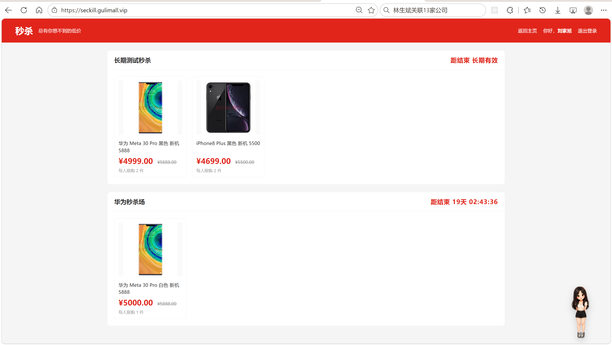
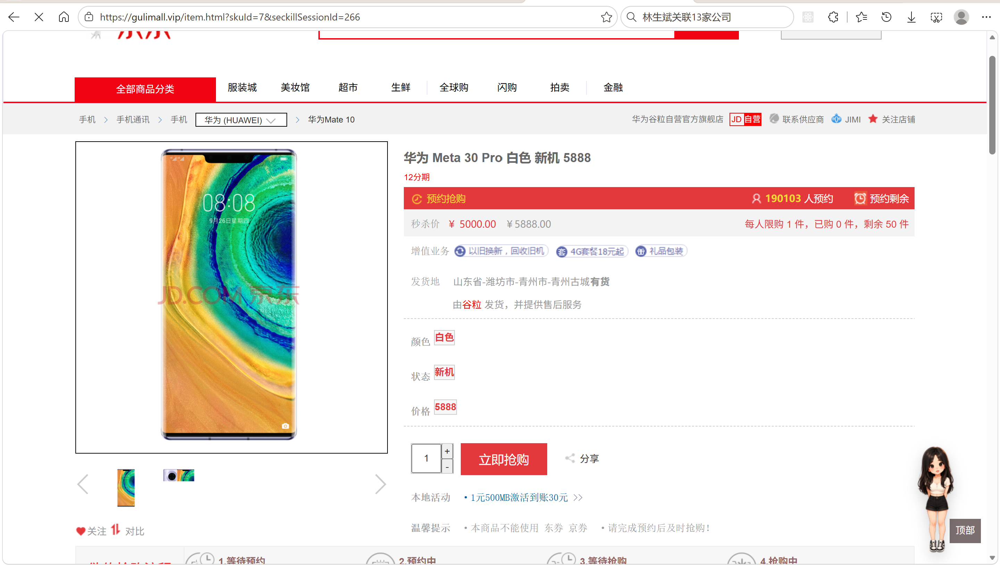
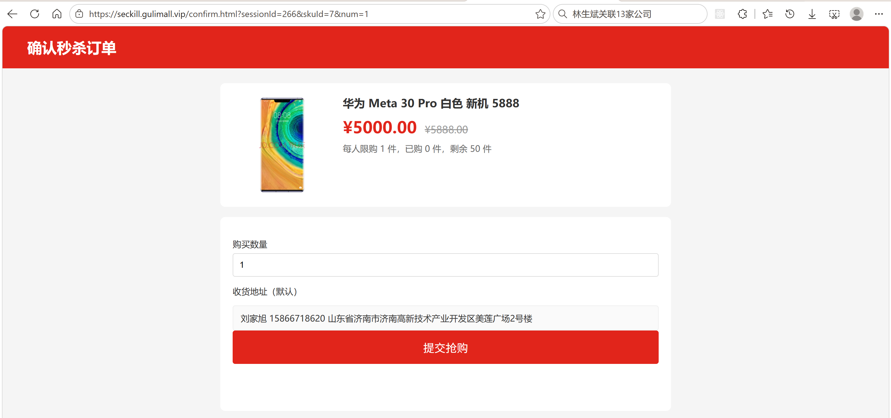
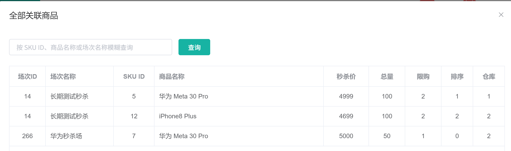
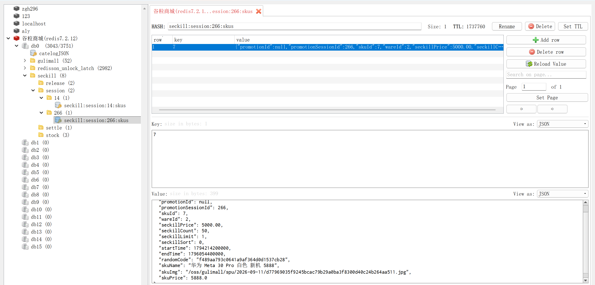
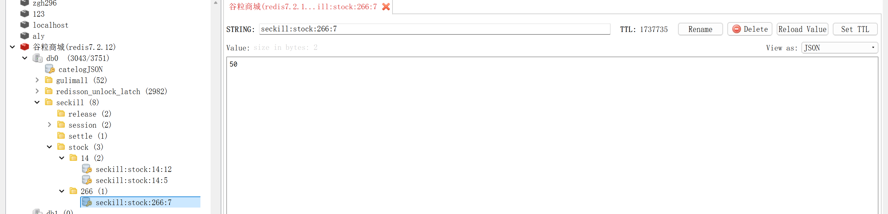

# 14.2 秒杀缓存与后台管理-介绍

> 本篇介绍秒杀缓存与后台管理：商品快照怎么放进 Redis、库存 key 怎么维护、缓存缺失怎么回源、后台改完关联怎么刷新缓存、场次停止或删除怎么清缓存，以及秒杀页、商品详情页、确认页和后台管理页面怎么使用这些数据。

---

## 1. 这个功能是干什么的

秒杀链路的读流量集中在三个页面：

1. **秒杀页**：一次展示未来 3 天和进行中的场次，每个场次下列出商品卡片。
2. **商品详情页**：从秒杀页点进商品，展示秒杀价、每人限购、已购数量、剩余库存。
3. **确认页**：提交订单前展示商品、默认地址、可购数量。

这三个页面如果每次都查数据库、再调 product 补商品名称和图片，会有两个问题：

1. **数据库压力大**：秒杀页一次要展示多个场次和几十个商品，每次都多表关联。
2. **跨服务调用多**：商品名称、图片、原价都在 product，逐个调用会拉长响应时间。

所以秒杀商品信息放进 Redis：

```text
商品快照：seckill:session:{sessionId}:skus（Hash，field 是 skuId）
库存剩余：seckill:stock:{sessionId}:{skuId}（String）
每人已购：seckill:user:count:{sessionId}:{skuId}（Hash，field 是 memberId）
场次锁  ：seckill:settle:lock:{sessionId}（Redisson 锁）
```

缓存负责“读得快”，数据库负责“算得准”：

1. 商品名称、图片、原价、秒杀价、限购、起止时间来自数据库和 product，写进 Hash。
2. 剩余库存用 String，抢购时原子递减。
3. 已购数量用 Hash，按会员累计。
4. 防重、预扣、释放幂等各用一个 key，保护下单链路。

后台管理负责“改得对”：

1. 管理员在场次管理页查看状态、关联商品、下架、取消、删除。
2. 关联新增或修改成功后，coupon 通过 Feign 让 seckill 立即重建单个商品缓存。
3. 场次下架、结算、删除时清理对应缓存。
4. 每天 3 点全量上架兜底，缓存丢失时前台查询自动回源。

本篇的重点是缓存结构、回源、刷新、清理，以及前后台页面怎么使用这些数据；库存原子预扣和订单建单属于抢购链路。

## 2. 用户/管理员怎么操作

### 2.1 用户打开秒杀页

1. 在商城首页点击顶部“秒杀”导航，打开 `http://seckill.gulimall.vip/seckill.html`。
2. `SeckillPageController.seckillPage` 查询可展示场次。
3. 每个场次调用 `getSessionSkus`，优先读商品 Hash。
4. 页面按开始时间升序展示场次卡片，场次内商品按 `seckillSort` 升序。
5. 商品卡片显示图片、名称、秒杀价、划线原价、每人限购。
6. 每个场次有一个倒计时，进行中显示“距结束”，未开始显示“距开始”。



### 2.2 用户打开商品详情

1. 在秒杀页点击商品卡片，打开 `item.html?skuId=...&seckillSessionId=...`。
2. product 的 `ItemController.skuItem` 查询商品主体。
3. URL 带 `seckillSessionId` 时，通过 Feign 调 seckill 的 `/seckill/sku/info`。
4. seckill 读商品 Hash、库存 key、已购 Hash，返回秒杀信息。
5. 页面进入秒杀模式，显示秒杀价、划线原价、限购、已购、剩余。
6. 数量输入上限取“限购剩余”和“剩余库存”的较小值。



### 2.3 用户打开确认页

1. 详情页点击“立即抢购”，打开 `confirm.html?sessionId=...&skuId=...&num=...`。
2. 未登录先跳 auth 登录页，登录后回到确认页。
3. 已登录时查询商品信息、默认收货地址。
4. 可购数量取 `min(限购 - 已购, 剩余库存)`。
5. URL 里的 `num` 超出范围时收敛到合法区间。
6. 页面展示商品、默认地址、数量输入和提交按钮。



### 2.4 管理员查看场次

1. 打开“营销 → 秒杀场次管理”。
2. 列表显示场次、起止时间、秒杀状态、启用状态。
3. 状态列按“数据库状态 + 当前时间”实时计算。
4. 未开始场次可以关联商品、修改、下架、删除。
5. 进行中只能查看商品和取消。
6. 停止中显示“结算中”。
7. 已结束或已取消可以关联商品、下架、删除。

### 2.5 管理员管理关联商品

1. 点击“关联商品”，打开当前场次的关联弹窗。
2. 列表只查当前场次，按 `seckill_sort` 升序。
3. 未开始且启用的场次可以新增、修改、删除。
4. 已结束或已取消的场次只能删除关联。
5. 进行中或停止中不能操作关联。
6. 顶部“查看关联商品”可以全局只读查看，支持按 SKU、商品名称、场次名称模糊查询。



### 2.6 运维查看 Redis

1. 用 Redis 客户端查看 `seckill:session:{sessionId}:skus`，确认商品 Hash 的 field 和 JSON。
2. 查看 `seckill:stock:{sessionId}:{skuId}`，确认剩余库存和 TTL。
3. 查看 `seckill:user:count:{sessionId}:{skuId}`，确认会员已购数量。
4. 查看 `seckill:settle:lock:{sessionId}`，确认是否有场次操作正在进行。





## 3. 整体设计思路

### 3.1 业务上怎么设计

#### 3.1.1 缓存承担什么

秒杀链路的缓存分四类：

1. **商品展示快照**：页面需要的商品名称、图片、秒杀价、原价、限购、起止时间。
2. **库存**：当前剩余可抢数量，抢购时原子递减。
3. **已购数量**：某个会员在某场某 SKU 已经买了多少，用于限购。
4. **幂等和防重**：10 秒防重、30 分钟预扣标识、7 天释放标识。

商品快照和库存分开的原因：

1. 商品快照是整场读到一起用，适合 Hash。
2. 库存要原子递减，适合 String。
3. 商品信息变化少，库存变化频繁，放一起会互相影响。

#### 3.1.2 商品 Hash 的字段

Hash 的 value 是 `SeckillSkuVo` 的 JSON，包含：

1. `promotionId`、`promotionSessionId`、`skuId`。
2. `wareId`：关联时锁定的仓库，抢购建单要用。
3. `seckillPrice`、`seckillCount`、`seckillLimit`、`seckillSort`。
4. `startTime`、`endTime`：毫秒时间戳，抢购时校验时间窗口。
5. `randomCode`：页面下发的随机码，提交时要带回来。
6. `skuName`、`skuImg`、`skuPrice`：商品名称、默认图、日常价。

字段来源：

```text
场次表   → promotionSessionId、startTime、endTime
关联表   → promotionId、skuId、wareId、seckillPrice、seckillCount、seckillLimit、seckillSort
product → skuName、skuImg、skuPrice
缓存自身 → randomCode
```

#### 3.1.3 库存 String 和随机码

库存 key 只保存一个数字：

```text
seckill:stock:{sessionId}:{skuId} = 剩余数量
```

规则：

1. 关联新增或改数量时用 `set` 写入秒杀总量。
2. 上架时用 `setIfAbsent` 只补不覆盖，避免把已经扣减的剩余库存重置回总量。
3. 抢购预扣时递减，取消或超时回补时递增。
4. 停止中、结算、删除场次时删除库存 key。
5. 详情页读不到库存 key 时按 0 显示并告警，不凭空创建。

随机码 `randomCode` 的作用：

1. 秒杀页和详情页把随机码下发给浏览器。
2. 提交抢购时必须带回同一个随机码，服务端和商品 Hash 比对。
3. 随机码不是强安全机制，但可以拦住直接拼接口、跳过页面的请求。
4. 上架和刷新时优先沿用旧随机码，只有缺失才生成新值，避免页面已经拿到的码失效。

#### 3.1.4 缓存 TTL

1. 商品 Hash 的 TTL 是场次结束时间加 1 天。
2. 库存 key 的 TTL 也是场次结束时间加 1 天。
3. 关联新增时如果场次没有结束时间，给 3 天兜底。
4. 上架时已经存在的库存 key 不刷新 TTL，避免活动进行中被延长。
5. 场次结束后 1 天，缓存自然过期，不需要人工清理。

#### 3.1.5 回源规则

1. **商品 Hash 缺失、Redis 异常、全部 JSON 解析失败**：查场次表、关联表，再调 product，组装后回填 Hash。
2. **Hash 部分 JSON 损坏**：只跳过损坏条目，其他商品正常展示。
3. **product 不可用**：跳过该 SKU，场次没有可用商品时不展示。
4. **库存 key 缺失**：详情页按 0，确认页可购数量为 0，抢购直接失败；不回源、不创建。
5. **已购 Hash 缺失**：按 0 处理，提交时再校验限购。
6. **提交抢购时商品 Hash 缺失**：直接返回商品失效，不回源，因为提交链路不能等数据库和 product。

#### 3.1.6 缓存和场次状态

1. 秒杀页只查 `status=1`、`seckill_state IN (0,1)`、未结束、3 天内开始的场次。
2. 页面显示状态用 `SeckillSessionState.effectiveState` 计算。
3. 场次进入停止中时删除库存 key，新的抢购直接失败。
4. 场次下架时删除商品 Hash，前台不再展示。
5. 场次结算或删除时删除商品 Hash、库存 key、已购计数。
6. 缓存清理失败只记日志，靠 TTL 和每天上架兜底。

#### 3.1.7 后台管理规则

1. 只有启用且未开始的场次可以新增、修改关联。
2. 已结束或已取消的场次可以删除关联，只删记录，不释放库存。
3. 进行中或停止中不能操作关联。
4. 关联新增、修改成功后立即刷新对应商品 Hash。
5. 关联删除时直接删 Hash 字段和库存 key。
6. 场次下架、结算、删除时清理整场或单 SKU 缓存。

### 3.2 技术上怎么设计

#### 3.2.1 key 规划

| key | 类型 | 作用 | TTL |
|---|---|---|---|
| `seckill:session:{sessionId}:skus` | Hash | 场次商品快照 | 结束时间 + 1 天 |
| `seckill:stock:{sessionId}:{skuId}` | String | 剩余秒杀库存 | 结束时间 + 1 天 |
| `seckill:user:count:{sessionId}:{skuId}` | Hash | 会员已购数量 | 跟随库存 key |
| `seckill:req:{sessionId}:{skuId}:{memberId}` | String | 10 秒防重 | 10 秒 |
| `seckill:reserve:{orderSn}` | String | 预扣标识 | 30 分钟 |
| `seckill:release:{orderSn}` | String | 释放幂等 | 7 天 |
| `seckill:settle:lock:{sessionId}` | Redisson 锁 | 场次互斥 | 看门狗续期 |

所有 key 由 `SeckillConstant` 拼接，读写删除引用同一份规则。

#### 3.2.2 商品 Hash 的读写

1. 整场读取用 `HGETALL`，一次拿到场次下所有商品。
2. 单个商品读取用 `HGET`，详情页和确认页不反序列化整场。
3. 上架用 `putAll` 写整场，减少网络往返。
4. 单商品刷新用 `HSET`，只覆盖一个 field。
5. 删除关联用 `HDEL`，只删一个 field。
6. 场次下架、结算、删除用 `DEL`，删整场。

值统一用 JSON：

1. 新增字段不需要改 Redis 结构。
2. 前台和后台都按对象反序列化。
3. 单个 field 损坏只影响一个商品。

#### 3.2.3 库存 String 的写入

1. **关联新增**：ware 锁库存成功后 `set` 为秒杀总量。
2. **关联改数量**：ware 调整成功后 `set` 为新总量。
3. **上架补 key**：`setIfAbsent` 写入总量，已存在不覆盖。
4. **抢购**：Lua 脚本 `DECRBY`。
5. **释放回补**：Lua 脚本 `INCRBY`。

`setIfAbsent` 的意义：

```text
库存 key 已存在 → 说明活动已经在扣减，当前值是真实剩余，不能覆盖
库存 key 不存在 → 可能是还没上架或被人误删，按秒杀总量补回
```

#### 3.2.4 TTL 计算

商品 Hash 和库存 key 的 TTL：

```text
ttl = end_time + 1 天 - 当前时间
```

1. 算出来小于等于 0 说明场次已经结束超过 1 天，不再写入。
2. 关联新增时场次没有结束时间，给 3 天兜底。
3. 关联新增时算出来小于等于 0，改成 1 天，避免 `Duration` 为负。
4. 回填单个商品 Hash 时会把整场 Hash 的过期时间刷成同样的 TTL。

#### 3.2.5 回源和降级

商品 Hash 回源流程：

```text
读 Hash
  ├── 命中 → 逐个反序列化 → 按 seckillSort 排序
  ├── Redis 异常 → 回源数据库 + product
  ├── Hash 为空 → 回源数据库 + product
  └── 全部解析失败 → 回源数据库 + product
```

回源时：

1. 查场次，时间不完整返回空。
2. 查关联，按 `seckill_sort` 升序。
3. 逐个调 product，查不到的跳过。
4. 组装 `SeckillSkuVo`。
5. 逐条 `HSET` 回填，并刷新整场 TTL。
6. 回填失败只记日志，当次仍然返回数据。

库存回源：

1. 详情页和确认页只读库存 key。
2. 读不到或解析失败按 0，并记录告警。
3. 不在读路径创建库存 key，避免没有库存依据就放出可抢信号。

#### 3.2.6 Feign 刷新

关联新增或修改成功后：

```text
coupon
  → SeckillFeignClient.refreshSessionSku(sessionId, skuId)
  → POST /seckill/refresh
  → SeckillController.refresh
  → SeckillSkuServiceImpl.refreshSessionSku
  → 查场次、关联、product
  → HSET 商品 Hash 的一个 field
```

规则：

1. 只刷新一个 SKU，不影响同场其他商品。
2. 沿用旧 `randomCode`。
3. 不写库存 key，库存由关联流程负责。
4. product 不可用时保留旧 Hash，不删除也不重建。
5. 刷新失败只记日志，每天 3 点上架任务兜底。

#### 3.2.7 缓存清理

| 场景 | 清理内容 |
|---|---|
| 关联删除 | `DEL` 库存 key、`HDEL` 商品 Hash 字段 |
| 关联换商品 | 删旧 SKU 的库存 key 和 Hash 字段 |
| 关联换场次 | 删旧场次的库存 key 和 Hash 字段 |
| 场次下架 | `DEL` 整场商品 Hash |
| 场次进入停止中 | `DEL` 该场次所有库存 key |
| 场次结算 | `DEL` 库存 key、已购计数、整场商品 Hash |
| 场次删除 | `DEL` 库存 key、已购计数、整场商品 Hash |

清理失败只记日志，不阻塞状态推进；残留 key 由 TTL 兜底。

#### 3.2.8 缓存和数据库的一致性

1. 数据库是事实来源，Redis 是投影。
2. 关联写成功后主动刷新，失败靠定时上架。
3. 场次状态推进后主动清理，失败靠 TTL。
4. 库存 key 以 Redis 为准，因为抢购扣减只发生在 Redis；数据库的 `seckill_stock_locked` 是仓库锁定事实。
5. 普通可售库存缓存 `gulimall:ware:stock:{skuId}` 由 ware 按数据库重算，不由秒杀服务直接改。

## 4. 详细代码、配置和解释

秒杀缓存链路横跨 seckill、coupon、product 三个服务。读路径从页面进入 Controller，再落到 `SeckillSkuServiceImpl` 操作 Redis；写路径从后台 coupon 的关联增删改出发，落到 Redis 的 key 清理和 Feign 刷新。本章按“类在链路里解决什么问题 → 关键字段和接口 → 正常链路 → 代码分块解释 → 一次完整示例 → 边界与可优化点”组织，先讲调用方和上下游，再看代码怎么执行。基础 CRUD 与无关 import 不展开。

### 4.1 SeckillSkuVo：跨服务传输和缓存 JSON

#### 4.1.1 这个类解决什么问题

秒杀页的一张商品卡片要同时显示商品名称、图片、日常价、秒杀价、每人限购和倒计时；详情页还要判断时间窗口、仓库和随机码。这些字段分散在三处：场次表管时间，关联表管秒杀配置和仓库，product 管名称、图片和日常价。页面每次展示都分别查三处，一场几十个商品就会放大成几十次数据库查询和跨服务调用。

`SeckillSkuVo` 把三处数据在写入缓存时合并成一个 JSON，后续页面只跟 Redis 打交道。它同时承担三种角色：

1. Redis 商品 Hash 的 value；
2. coupon 刷新、seckill 查询、product 详情之间的传输对象；
3. 抢购提交时用来核对价格、仓库、时间窗口和随机码的快照。

#### 4.1.2 调用方与链路位置

| 环节 | 使用方 | 用法 |
|---|---|---|
| 上架、回源、单商品刷新 | `SeckillSkuServiceImpl` | 组装后序列化成 JSON 写 Hash |
| 秒杀页 | `SeckillPageController` → `listSessionsWithSkus` | `HGETALL` 后反序列化成列表 |
| 详情页、确认页 | `SeckillSkuServiceImpl.getSkuInfo` | `HGET` 后反序列化单个对象 |
| 抢购提交 | 抢购链路 | 从 Hash 读价格、仓库、随机码、起止时间 |

#### 4.1.3 字段与业务含义

| 字段 | 来源 | 业务含义 | 使用场景 |
|---|---|---|---|
| `promotionId` | 关联表 | 秒杀活动 id | 订单标记、对账 |
| `promotionSessionId` | 场次表 | 场次 id | 拼接 Redis key、提交校验 |
| `skuId` | 关联表 | 商品 SKU id | Hash 的 field、订单明细 |
| `wareId` | 关联表 | 锁定库存的仓库 | 抢购建单时转库存 |
| `seckillPrice` | 关联表 | 秒杀价 | 页面展示、下单计价 |
| `seckillCount` | 关联表 | 秒杀总量 | 上架补库存 key |
| `seckillLimit` | 关联表 | 每人限购 | 详情页、确认页计算上限 |
| `seckillSort` | 关联表 | 场次内排序 | 秒杀页商品顺序 |
| `startTime` | 场次表 | 开始时间，毫秒时间戳 | 页面倒计时、提交校验 |
| `endTime` | 场次表 | 结束时间，毫秒时间戳 | 页面倒计时、TTL 计算 |
| `randomCode` | 缓存自身 | 页面下发的随机码 | 提交时防直接拼接口 |
| `skuName` | product | 商品名称 | 页面展示 |
| `skuImg` | product | 默认图片 | 页面展示 |
| `skuPrice` | product | 日常价 | 页面划线价 |

#### 4.1.4 代码与解释

这个类没有业务方法，只有字段。字段分成三组：秒杀配置、时间窗口、商品展示，另外加一个随机码。

```java
@Data
public class SeckillSkuVo {

    private Long promotionId;

    private Long promotionSessionId;

    private Long skuId;

    private Long wareId;

    private BigDecimal seckillPrice;

    private Integer seckillCount;

    private Integer seckillLimit;

    private Integer seckillSort;

    /** 场次开始时间戳（毫秒） */
    private Long startTime;

    /** 场次结束时间戳（毫秒） */
    private Long endTime;

    private String randomCode;

    private String skuName;

    private String skuImg;

    private BigDecimal skuPrice;
}
```

1. `promotionId`、`promotionSessionId`、`skuId`、`wareId` 是关联维度，决定这场秒杀是哪个活动、哪个场次、哪个商品、锁哪个仓库。
2. `seckillPrice`、`seckillCount`、`seckillLimit`、`seckillSort` 直接来自关联表，页面展示和抢购校验都用这一份，避免再去查数据库。
3. `startTime`、`endTime` 用 `Long` 毫秒时间戳，不用 `Date`，前后端和 Redis JSON 都不存在时区格式差异。
4. `randomCode` 在写入缓存时生成或沿用，页面拿到后提交时带回，服务端与 Hash 里的值比对。
5. `skuName`、`skuImg`、`skuPrice` 是 product 的展示快照，页面不需要再调 product。
6. 类上没有加 `@JsonIgnoreProperties` 之类的注解，JSON 序列化依赖 Jackson 默认行为，字段名就是 JSON 字段名。

#### 4.1.5 一次完整示例

关联表配置 sku 1001 参加场次 5，写入 Redis 后的 Hash 内容：

```text
seckill:session:5:skus
  1001 -> {
    "promotionId": 1,
    "promotionSessionId": 5,
    "skuId": 1001,
    "wareId": 3,
    "seckillPrice": 99.00,
    "seckillCount": 100,
    "seckillLimit": 2,
    "seckillSort": 1,
    "startTime": 1731326400000,
    "endTime": 1731333600000,
    "randomCode": "a1b2c3d4e5f6",
    "skuName": "某手机 8GB+128GB",
    "skuImg": "https://img.example.com/1001.jpg",
    "skuPrice": 199.00
  }
```

秒杀页读整场时，`HGETALL` 拿到全部 field，再逐个反序列化成 `SeckillSkuVo`；详情页只 `HGET` 1001 这一个 field。

#### 4.1.6 它不做什么

1. 不落库，不对应任何一张表。
2. 不保存库存和已购数量，这两类数据变化频繁，单独用 String 和 Hash。
3. 不做业务校验，价格是否合法、场次是否开始由调用方判断。
4. 不负责生成随机码，随机码由组装逻辑决定沿用还是新生成。

#### 4.1.7 边界与可优化点

1. `seckillCount` 是总量，页面其实不需要，当前保留是为了排障时能直接看到配置值。
2. 没有版本号字段，结构变更后旧 JSON 可能反序列化失败，只能等 TTL 过期或重新上架。
3. 商品名称、图片、日常价是快照，product 改名改价后要等单商品刷新或每日上架才更新。
4. 随机码明文存在 JSON 里，能拦住直接拼接口，但不是强安全机制。

### 4.2 SeckillConstant：缓存 key 规则

#### 4.2.1 这个类解决什么问题

同一批缓存 key 有多个服务在读写：coupon 写库存 key 和商品 Hash，seckill 读商品 Hash、读写库存和已购，order 读预扣和释放标识。如果每个服务各自拼字符串，一旦前缀、分隔符或顺序不一致，写入和读取就落到两个 key 上，表现为“库存明明写了却读不到”。

`SeckillConstant` 把所有 key 的拼接规则收在一处，调用方只传业务 id，不关心字符串怎么拼。

#### 4.2.2 key 与调用方

| key 方法 | 生成结果 | 写方 | 读方 |
|---|---|---|---|
| `sessionSkusKey` | `seckill:session:{sessionId}:skus` | 上架、回源、刷新 | 秒杀页、详情页、确认页 |
| `stockKey` | `seckill:stock:{sessionId}:{skuId}` | 关联新增/修改、上架补 key、抢购 | 详情、确认、抢购 |
| `userCountKey` | `seckill:user:count:{sessionId}:{skuId}` | 抢购预扣、释放 | 详情、确认、抢购 |
| `requestKey` | `seckill:req:{sessionId}:{skuId}:{memberId}` | 抢购 | 抢购 |
| `reserveKey` | `seckill:reserve:{orderSn}` | 抢购 | 建单、对账 |
| `releaseKey` | `seckill:release:{orderSn}` | 释放 | 释放 |
| `settleLockKey` | `seckill:settle:lock:{sessionId}` | 场次操作 | 场次操作 |

#### 4.2.3 代码与解释

```java
public class SeckillConstant {

    public static final String SECKILL_STOCK_PREFIX = "seckill:stock:";

    public static final String SECKILL_SETTLE_LOCK_PREFIX = "seckill:settle:lock:";

    public static final String SECKILL_SESSION_SKUS_PREFIX = "seckill:session:";

    public static final String SECKILL_USER_COUNT_PREFIX = "seckill:user:count:";

    public static final String SECKILL_REQUEST_PREFIX = "seckill:req:";

    public static final String SECKILL_RESERVE_PREFIX = "seckill:reserve:";

    public static final String SECKILL_RELEASE_PREFIX = "seckill:release:";

    public static String stockKey(Long sessionId, Long skuId) {
        return SECKILL_STOCK_PREFIX + sessionId + ":" + skuId;
    }

    public static String sessionSkusKey(Long sessionId) {
        return SECKILL_SESSION_SKUS_PREFIX + sessionId + ":skus";
    }

    public static String userCountKey(Long sessionId, Long skuId) {
        return SECKILL_USER_COUNT_PREFIX + sessionId + ":" + skuId;
    }

    public static String requestKey(Long sessionId, Long skuId, Long memberId) {
        return SECKILL_REQUEST_PREFIX + sessionId + ":" + skuId + ":" + memberId;
    }

    public static String reserveKey(String orderSn) {
        return SECKILL_RESERVE_PREFIX + orderSn;
    }

    public static String releaseKey(String orderSn) {
        return SECKILL_RELEASE_PREFIX + orderSn;
    }

    public static String settleLockKey(Long sessionId) {
        return SECKILL_SETTLE_LOCK_PREFIX + sessionId;
    }

    private SeckillConstant() {
    }
}
```

1. 七个 `public static final` 常量定义前缀，改动前缀只需要改一处。
2. `stockKey(sessionId, skuId)` 用冒号拼成 `seckill:stock:5:1001`，sessionId 在前、skuId 在后，读写双方顺序一致。
3. `sessionSkusKey(sessionId)` 固定追加 `:skus`，和库存 key 区分开，避免 `seckill:session:5` 这个前缀被两种结构共用。
4. `userCountKey` 也是场次加 SKU 的组合，一个 Hash 里按会员 id 存已购数量。
5. `requestKey` 在场次和 SKU 之外再加 memberId，防重粒度到人。
6. `reserveKey`、`releaseKey` 按订单号拼，预扣和释放各自一个命名空间，避免同一个订单号的两个状态互相覆盖。
7. `settleLockKey` 按场次加锁，场次下所有商品的操作互斥。
8. 私有构造器禁止实例化，这个类只提供静态方法。

#### 4.2.4 一次完整示例

场次 5、SKU 1001、会员 88 依次调用：

```text
sessionSkusKey(5)                -> seckill:session:5:skus
stockKey(5, 1001)                -> seckill:stock:5:1001
userCountKey(5, 1001)            -> seckill:user:count:5:1001
requestKey(5, 1001, 88)          -> seckill:req:5:1001:88
reserveKey("202611120001")       -> seckill:reserve:202611120001
releaseKey("202611120001")       -> seckill:release:202611120001
settleLockKey(5)                 -> seckill:settle:lock:5
```

#### 4.2.5 它不做什么

1. 不设置 TTL，过期时间由调用方按场次计算。
2. 不决定数据类型，Hash 还是 String 由使用方选择。
3. 不做序列化，value 的格式由各业务自己约定。
4. 不负责清理，删除动作在业务代码里执行。

#### 4.2.6 边界与可优化点

1. 没有 hash tag，Redis Cluster 下涉及多 key 的 Lua 操作可能跨槽位，需要 `{sessionId}` 这类标签才能保证同槽。
2. key 没有业务版本号，结构大改时新旧数据会混在同一前缀下。
3. 常量类无法约束调用方一定传非空 id，`stockKey(5, null)` 会拼出 `seckill:stock:5:null`。
4. 前缀是小写扁平结构，没有环境隔离，多个环境共用一个 Redis 时必须靠库号或实例区分。

### 4.3 SeckillSkuServiceImpl：整场商品读取 `getSessionSkus`

#### 4.3.1 这个类解决什么问题

秒杀页一次要展示一场里的几十个商品，商品数据来自关联表、场次表和 product。每次页面刷新都走这条路，是整条链路读流量最大的地方。这个方法要解决三件事：

1. 正常情况整场一次读完，不逐个商品查库；
2. 缓存缺失、Redis 异常时能回源，不把页面打空；
3. 单条 JSON 损坏只跳过那一条，不拖垮整场。

#### 4.3.2 读链路与代码解释

调用链是：`SeckillPageController.seckillPage` → `listSessionsWithSkus` → 逐个场次 `getSessionSkus`；接口 `/seckill/skus` 也直接调这个方法。

```text
读 seckill:session:{id}:skus
  ├── Redis 异常 → 回源 loadSessionSkusFromDb
  ├── Hash 为空   → 回源 loadSessionSkusFromDb
  └── 有数据     → 逐个反序列化
                    ├── 单条失败 → 跳过
                    └── 全部失败 → 回源
```

```java
@Override
public List<SeckillSkuVo> getSessionSkus(Long sessionId) {
    if (sessionId == null) {
        return List.of();
    }
    // 1. 从 hash 里读所有商品 JSON；Redis 异常或为空时回源数据库
    Map<Object, Object> entries;
    try {
        entries = stringRedisTemplate.opsForHash()
                .entries(SeckillConstant.sessionSkusKey(sessionId));
    } catch (Exception e) {
        log.error("[ALERT][seckill-query] Redis 读取商品 hash 失败，回源数据库 sessionId={}",
                sessionId, e);
        return loadSessionSkusFromDb(sessionId);
    }
    if (entries.isEmpty()) {
        log.error("[ALERT][seckill-query] 秒杀商品 hash 缺失，回源数据库 sessionId={}", sessionId);
        return loadSessionSkusFromDb(sessionId);
    }

    // 2. 反序列化并按排序字段排序
    List<SeckillSkuVo> result = new ArrayList<>();
    for (Object value : entries.values()) {
        try {
            result.add(objectMapper.readValue(String.valueOf(value), SeckillSkuVo.class));
        } catch (Exception e) {
            log.error("[seckill-query] 秒杀商品 JSON 解析失败 sessionId={} value={}",
                    sessionId, value, e);
        }
    }
    if (result.isEmpty()) {
        return loadSessionSkusFromDb(sessionId);
    }
    result.sort(Comparator.comparing(
            SeckillSkuVo::getSeckillSort, Comparator.nullsLast(Integer::compareTo)));
    return result;
}
```

1. `sessionId == null` 直接返回空列表，避免拼出 `seckill:session:null:skus` 这种 key。
2. 用 `opsForHash().entries()` 一次 `HGETALL` 拿整场所有 field 和 value，比逐个 `HGET` 少很多网络往返。
3. Redis 抛异常时打 `ALERT` 日志并回源。回源会查数据库和 product，比正常读慢，但页面不会直接报错。
4. `entries.isEmpty()` 说明整场 Hash 不存在或已过期，同样回源。
5. 遍历 `entries.values()` 逐个 `readValue`。`String.valueOf(value)` 兼容序列化器返回的不同字符串类型。
6. 单条解析异常只记日志，不 `return`，循环继续处理其他商品。这样一条坏数据只影响一个卡片。
7. `result.isEmpty()` 表示所有条目都解析失败，退化成回源，避免整页空白。
8. 按 `seckillSort` 升序排序，`Comparator.nullsLast` 让没有排序值的商品排在最后。Hash 本身无序，排序只能在内存里做。

#### 4.3.3 一次完整示例

场次 5 的 Hash 里有 3 个商品，其中 1002 的 JSON 被写坏：

```text
HGETALL seckill:session:5:skus
  1001 -> 合法 JSON
  1002 -> "{bad json"
  1003 -> 合法 JSON

结果：返回 1001、1003 两个对象，按 seckillSort 排序
```

如果三条都解析失败，`result` 为空，方法转去 `loadSessionSkusFromDb`。

#### 4.3.4 场次筛选和首页组装

秒杀页展示哪些场次，由数据库状态和当前时间共同决定。`listActiveSessions` 把筛选条件写在一处，`listSessionsWithSkus` 复用同一个查询，避免页面范围和上架范围不一致。

```text
可展示场次 = 启用 + 状态 0 或 1 + 未结束 + 开始时间在 3 天内
```

```java
@Override
public List<SeckillSessionEntity> listActiveSessions() {
    // 1. 和上架范围一致：未来 3 天 + 进行中
    Date now = new Date();
    Date future = new Date(now.getTime() + THREE_DAYS_MILLIS);
    return seckillSessionDao.selectList(
            new QueryWrapper<SeckillSessionEntity>()
                    .eq("status", 1)
                    .in("seckill_state", 0, 1)
                    .ge("end_time", now)
                    .le("start_time", future)
                    .orderByAsc("start_time"));
}
```

1. `now` 是当前时间，`future` 是当前时间加 3 天，和上架任务使用同一个时间窗口。
2. `status = 1` 只查启用的场次，下架的场次不展示。
3. `seckill_state in (0, 1)` 表示未开始和进行中；停止中、已结束、已取消不展示。
4. `end_time >= now` 排除已经结束但状态还没推进的场次。
5. `start_time <= future` 只取 3 天内开始的场次，避免页面展示太远的场次。
6. `orderByAsc("start_time")` 让页面按开始时间从近到远排列。

场次列表查出来后，逐个场次组装商品卡片：

```java
@Override
public List<SeckillHomeVo> listSessionsWithSkus() {
    // 1. 和上架范围一致：未来 3 天 + 进行中
    List<SeckillSessionEntity> sessions = listActiveSessions();
    List<SeckillHomeVo> result = new ArrayList<>();
    for (SeckillSessionEntity session : sessions) {
        SeckillHomeVo home = buildHomeVo(session);
        // 2. 没有关联商品（或还没上架）的场次不展示，否则页面只剩空壳
        if (home.getSkus() != null && !home.getSkus().isEmpty()) {
            result.add(home);
        }
    }
    return result;
}
```

1. 先调 `listActiveSessions` 拿到可展示场次。
2. 每个场次调 `buildHomeVo`，里面会读商品 Hash。
3. `home.getSkus()` 为空说明这场没有关联商品，或者缓存和回源都拿不到商品。
4. 空场次不加入结果，页面不会出现点进去没有商品的卡片。
5. 返回的列表直接交给模板渲染。

首页秒杀区只需要一个场次，选择规则是“优先最近开始的进行中场次”：

```java
@Override
public SeckillHomeVo getHome() {
    List<SeckillHomeVo> homes = listSessionsWithSkus();
    if (homes.isEmpty()) {
        return null;
    }
    // 1. 多个进行中时，固定选最近开始的一场，避免首页在几个场次之间跳来跳去
    SeckillHomeVo latestRunning = null;
    for (SeckillHomeVo home : homes) {
        if (!Integer.valueOf(SeckillSessionState.RUNNING).equals(home.getState())) {
            continue;
        }
        if (latestRunning == null
                || (home.getStartTime() != null && (latestRunning.getStartTime() == null
                || home.getStartTime() > latestRunning.getStartTime()))) {
            latestRunning = home;
        }
    }
    if (latestRunning != null) {
        return latestRunning;
    }
    // 2. 没有进行中，展示最近一场
    return homes.get(0);
}
```

1. `listSessionsWithSkus` 已经按开始时间升序返回有商品的场次。
2. 遍历场次，只看状态等于 `SeckillSessionState.RUNNING` 的场次。
3. `latestRunning == null` 时先记下第一个进行中场次。
4. 后续进行中场次如果开始时间更晚，替换 `latestRunning`，保证固定选最近开始的一场。
5. 有进行中场次就返回它，用户点进去马上能买。
6. 没有进行中场次时返回第一场，也就是最近即将开始或刚结束的一场。

场次卡片的基础字段由 `buildHomeVo` 拼装：

```java
private SeckillHomeVo buildHomeVo(SeckillSessionEntity session) {
    // 1. 拷贝场次的基础信息：id、名称、起止时间
    SeckillHomeVo home = new SeckillHomeVo();
    home.setSessionId(session.getId());
    home.setSessionName(session.getName());
    home.setStartTime(session.getStartTime() == null ? null : session.getStartTime().getTime());
    home.setEndTime(session.getEndTime() == null ? null : session.getEndTime().getTime());
    // 2. 用库里的状态和当前时间算出页面真正要显示的状态（未开始/进行中/已结束）
    home.setState(SeckillSessionState.effectiveState(session.getSeckillState(),
            session.getStartTime(), session.getEndTime(), new Date()));
    // 3. 查这场秒杀的商品列表，组装成首页展示的场次卡片
    home.setSkus(getSessionSkus(session.getId()));
    return home;
}
```

1. 创建 `SeckillHomeVo`，复制场次的 id 和名称。
2. 起止时间从 `Date` 转成毫秒时间戳，`null` 保持 `null`，页面倒计时直接用。
3. `SeckillSessionState.effectiveState` 用数据库状态和当前时间算页面真正要显示的状态：未开始、进行中、已结束。
4. `getSessionSkus(session.getId())` 填商品列表，缓存和回源逻辑只维护这一份。
5. 返回组装好的场次卡片。

#### 4.3.5 它不做什么

1. 不校验场次是否启用，是否可展示由 `listActiveSessions` 负责。
2. 不读库存和已购数量，列表页只展示商品基础信息。
3. 不删除过期 field，清理由场次操作和 TTL 负责。
4. 不保证 Hash 和数据库实时一致，写后刷新由 coupon 的 Feign 调用触发。

#### 4.3.6 边界与可优化点

1. 每次页面请求都 `HGETALL` 并反序列化整场，商品多时 CPU 和网络开销明显。
2. 没有本地缓存，热点场次的每次刷新都打到 Redis。
3. 全部解析失败会回源，但回源本身没有加锁，并发请求会同时查数据库和 product。
4. 首页没有分页，场次和商品都一次性返回。
5. `getHome` 选择“最近开始”的进行中场次，业务上也可能希望选“最快结束”的一场。
6. 排序字段为 `null` 的商品排在最后，页面没有提示配置缺失。

### 4.4 SeckillSkuServiceImpl：缓存回源 `loadSessionSkusFromDb`

#### 4.4.1 这个类解决什么问题

缓存是投影，不是事实。应用刚启动、Redis 被清、场次刚配置完还没上架时，商品 Hash 可能不存在。这个方法负责在缓存缺失时，从场次表、关联表和 product 重建整场商品，并顺手写回缓存，让下一次请求恢复命中。

#### 4.4.2 触发条件与链路

调用方只有 `getSessionSkus`，触发条件有三种：Redis 异常、Hash 为空、全部 JSON 解析失败。

```text
getSessionSkus 未命中
  → 查场次（时间必须完整）
  → 查关联（按 seckill_sort 升序）
  → 逐个调 product
  → buildSkuVo 组装
  → cacheSku 写回单个 field
```

```java
private List<SeckillSkuVo> loadSessionSkusFromDb(Long sessionId) {
    // 1. 先查场次，场次不存在或时间不完整就算不出秒杀信息，直接返回空列表
    SeckillSessionEntity session = seckillSessionDao.selectById(sessionId);
    if (session == null || session.getStartTime() == null || session.getEndTime() == null) {
        return List.of();
    }
    // 2. 按排序列出这场秒杀配置的所有商品关联，没关联就没东西可展示
    List<SeckillSkuRelationEntity> relations = seckillSkuRelationDao.selectList(
            new QueryWrapper<SeckillSkuRelationEntity>()
                    .eq("promotion_session_id", sessionId)
                    .orderByAsc("seckill_sort"));
    if (relations.isEmpty()) {
        return List.of();
    }

    // 3. 逐个关联去商品服务补名称/图片/价格，拼成 VO 并顺手写回 Redis
    List<SeckillSkuVo> result = new ArrayList<>();
    for (SeckillSkuRelationEntity relation : relations) {
        ProductSkuVo product = getProductSku(relation.getSkuId());
        if (product == null) {
            continue;
        }
        SeckillSkuVo vo = buildSkuVo(session, relation, product, null);
        result.add(vo);
        cacheSku(session, relation, vo);
    }
    // 4. 按排序字段升序返回，没有排序值的排到最后
    result.sort(Comparator.comparing(
            SeckillSkuVo::getSeckillSort, Comparator.nullsLast(Integer::compareTo)));
    return result;
}
```

1. `selectById(sessionId)` 查场次。场次不存在，或者开始、结束时间缺失，就算不出秒杀时间窗口，直接返回空列表。
2. 按 `promotion_session_id` 查关联，按 `seckill_sort` 升序。关联表才是“哪些商品参加这场秒杀”的事实来源。
3. 关联为空说明这场没有配置商品，返回空列表，不去调 product。
4. 逐个关联调 `getProductSku`，product 返回空时 `continue`，单个商品缺失不影响整场。
5. `buildSkuVo` 把场次、关联、product 合成 `SeckillSkuVo`；第四个参数传 `null`，表示回源时没有旧 JSON，随机码会新生成。
6. `cacheSku` 立即把商品写回 Hash，这样下一次请求不用再回源。
7. 返回前按 `seckillSort` 升序排序，和缓存命中的路径保持一致。

#### 4.4.3 一次完整示例

场次 5 配置了 1001、1002 两个商品，product 只能查到 1001：

```text
1. 查 sms_seckill_session id=5，时间完整
2. 查 sms_seckill_sku_relation where promotion_session_id=5，返回两条
3. 调 product 查 1001，成功；组装并 HSET
4. 调 product 查 1002，失败；跳过
5. 返回列表只有 1001
6. seckill:session:5:skus 里只写入了 1001
```

product 恢复后，下一次请求仍然只有 1001，需要等单商品刷新或每日上架补回 1002。

#### 4.4.4 它不做什么

1. 不创建库存 key，库存只由关联流程和上架任务维护。
2. 不加分布式锁，回源是尽力而为。
3. 不删除关联表里已经不存在的旧 field。
4. 不补偿 product 查询失败的 SKU。

#### 4.4.5 边界与可优化点

1. 逐个调 product，商品多时回源耗时线性增长，可以改成批量接口。
2. 回填逐条 `HSET` 并逐条 `EXPIRE`，可以收集后一次 `putAll` 加一次过期。
3. 并发回源会重复查数据库和 product，热点场次刚过期时更明显。
4. product 不可用时直接跳过，页面会少商品，没有降级展示旧数据的机制。
5. 回源不检查场次状态，已结束场次被访问时也会重建一次缓存，靠 TTL 挡住后续写入。

### 4.5 SeckillSkuServiceImpl：单商品回填 `cacheSku`

#### 4.5.1 这个类解决什么问题

回源和单商品刷新都只处理一个 SKU，但 Redis 的过期时间挂在整场 Hash 上。写单个 field 时必须同时维护整场 TTL，否则 Hash 没有过期时间会一直留在 Redis；已经过期的场次也不应该再写入。

#### 4.5.2 代码与解释

```java
private void cacheSku(SeckillSessionEntity session, SeckillSkuRelationEntity relation,
                      SeckillSkuVo vo) {
    try {
        // 1. 没有结束时间就算不出 TTL，直接跳过不写缓存
        if (session.getEndTime() == null) {
            return;
        }
        // 2. 算出场次结束 + 1 天还剩多久，已经过期就不用再写
        long ttlMillis = session.getEndTime().getTime() + ONE_DAY_MILLIS
                - System.currentTimeMillis();
        if (ttlMillis <= 0) {
            return;
        }
        // 3. 把商品 JSON 写进整场 hash，并把整个 hash 的过期时间刷成同样的 TTL
        String key = SeckillConstant.sessionSkusKey(session.getId());
        stringRedisTemplate.opsForHash().put(key, relation.getSkuId().toString(),
                objectMapper.writeValueAsString(vo));
        stringRedisTemplate.expire(key, Duration.ofMillis(ttlMillis));
    } catch (Exception e) {
        log.warn("[seckill-query] 回填商品 hash 失败 sessionId={} skuId={}",
                session.getId(), relation.getSkuId(), e);
    }
}
```

1. 场次结束时间为空时算不出 TTL，直接返回，不写缓存。
2. `ttlMillis = 结束时间 + 1 天 - 当前时间`，和上架、关联新增使用同一条公式。
3. `ttlMillis <= 0` 说明场次结束超过 1 天，数据已经没有展示价值，直接返回。
4. `sessionSkusKey` 拿到整场 Hash 的 key。
5. `opsForHash().put` 只覆盖当前 SKU 的 field，同场其他商品不动。
6. `expire` 把整场 Hash 的过期时间刷新成同一个 TTL，保证 Hash 最终会自然消失。
7. 整个写入包在 `try/catch` 里，Redis 异常只记 `warn`，不影响当次查询返回。

#### 4.5.3 一次完整示例

场次结束时间为 `2026-11-11 22:00:00`，当前时间为 `2026-11-11 20:00:00`：

```text
ttlMillis = 22:00 + 1 天 - 20:00 = 26 小时
HSET seckill:session:5:skus 1001 "{...}"
EXPIRE seckill:session:5:skus 93600
```

#### 4.5.4 它不做什么

1. 不写库存 key。
2. 不判断场次是否开始，未开始场次也会写入，页面靠时间窗口控制能否购买。
3. 不处理旧 field 的合并，直接覆盖整个 JSON。

#### 4.5.5 边界与可优化点

1. 回填一个商品就 `EXPIRE` 一次，整场回源时命令数翻倍。
2. 写失败没有重试，只能等下一次请求再次回源。
3. 回填时没有沿用旧随机码，因为这条路径只在上架或刷新时传入旧 JSON。
4. TTL 每次被刷新成“结束时间 + 1 天”，多次回填不会缩短，但也没有做上限保护。

### 4.6 SeckillSkuServiceImpl：详情和确认页 `getSkuInfo`

#### 4.6.1 这个类解决什么问题

商品详情页和确认页只需要一个 SKU，但同时要展示秒杀价、限购、已购数量和剩余库存。这个方法把商品信息、库存 key、已购 Hash 三次读取合并成一个返回对象，并且要处理游客、库存 key 缺失、商品 Hash 缺失三种情况。

调用方有两个：

1. product 的 `ItemController.skuItem` 通过 Feign 请求 `/seckill/sku/info`；
2. seckill 自己的 `SeckillPageController.confirmPage` 直接调用。

#### 4.6.2 读取顺序

```text
HGET 商品 Hash
  ├── 命中 → 反序列化
  ├── 异常/解析失败 → loadSkuFromDb
  └── 仍然为空 → 返回 null，页面退普通商品页
GET 库存 key
  ├── 有值 → 解析数字
  └── 缺失/异常 → 按 0，打 ALERT
HGET 已购 Hash
  ├── 登录会员 → 读 memberId 对应 field
  └── 游客 → 按 0
```

```java
@Override
public SeckillSkuInfoVo getSkuInfo(Long sessionId, Long skuId, Long memberId) {
    // 1. 参数
    if (sessionId == null || skuId == null) {
        return null;
    }
    // 2. 商品信息以 Redis hash 为准；hash 缺失时回源数据库/商品服务
    Object json = null;
    try {
        json = stringRedisTemplate.opsForHash()
                .get(SeckillConstant.sessionSkusKey(sessionId), skuId.toString());
    } catch (Exception e) {
        log.error("[ALERT][seckill-sku-info] Redis 读取商品失败 sessionId={} skuId={}",
                sessionId, skuId, e);
    }
    SeckillSkuVo sku = null;
    if (json != null) {
        try {
            sku = objectMapper.readValue(String.valueOf(json), SeckillSkuVo.class);
        } catch (Exception e) {
            log.error("[seckill-sku-info] 商品信息解析失败 sessionId={} skuId={}", sessionId, skuId, e);
        }
    }
    if (sku == null) {
        sku = loadSkuFromDb(sessionId, skuId);
    }
    if (sku == null) {
        return null;
    }

    // 3. 剩余库存
    SeckillSkuInfoVo info = new SeckillSkuInfoVo();
    info.setSku(sku);
    int stock = 0;
    try {
        String value = stringRedisTemplate.opsForValue()
                .get(SeckillConstant.stockKey(sessionId, skuId));
        if (value != null) {
            stock = Integer.parseInt(value);
        } else {
            log.error("[ALERT][seckill-sku-info] 秒杀库存 key 缺失 sessionId={} skuId={}",
                    sessionId, skuId);
        }
    } catch (Exception e) {
        log.error("[ALERT][seckill-sku-info] Redis 读取库存失败 sessionId={} skuId={}",
                sessionId, skuId, e);
    }
    info.setStock(stock);

    // 4. 当前会员已购数量，游客按 0
    int bought = 0;
    if (memberId != null) {
        try {
            Object value = stringRedisTemplate.opsForHash()
                    .get(SeckillConstant.userCountKey(sessionId, skuId), memberId.toString());
            if (value != null) {
                bought = Integer.parseInt(String.valueOf(value));
            }
        } catch (Exception e) {
            log.error("[ALERT][seckill-sku-info] Redis 读取限购失败 sessionId={} skuId={} memberId={}",
                    sessionId, skuId, memberId, e);
        }
    }
    info.setBought(bought);
    info.setLimit(sku.getSeckillLimit() == null ? 1 : sku.getSeckillLimit());
    return info;
}
```

1. `sessionId` 或 `skuId` 为空返回 `null`，调用方按“没有秒杀信息”处理。
2. 用 `HGET` 只读一个 field，不反序列化整场，详情页比秒杀页更轻。
3. Redis 异常时先记 `ALERT`，`json` 保持 `null`，后面走回源，不直接失败。
4. `json != null` 才解析；解析失败只记日志，`sku` 仍为 `null`，同样走回源。
5. `sku == null` 时调 `loadSkuFromDb`，单商品回源只查当前场次和 SKU。
6. 回源仍为空说明不是秒杀商品或 product 不可用，返回 `null`。
7. 创建 `SeckillSkuInfoVo`，先把商品快照放进去。
8. 读库存 key，`value` 为空记 `ALERT`，库存按 0。Redis 异常也按 0，保证页面能打开。
9. 只有登录会员才读已购 Hash，游客 `memberId == null` 直接跳过，已购为 0。
10. 已购 Hash 里没有当前会员的 field 时也按 0，表示还没买过。
11. 限购为空时按 1，避免确认页计算上限出现 `null`。
12. 返回的对象包含商品快照、库存、已购、限购四部分。

#### 4.6.3 一次完整示例

会员 88 打开场次 5、SKU 1001 的详情页：

```text
商品 Hash：seckillLimit=2
库存 key：seckill:stock:5:1001 = 5
已购 Hash：seckill:user:count:5:1001 中 88 -> 1

返回：
  sku.seckillPrice=99.00
  stock=5
  bought=1
  limit=2
页面可购上限 = min(2 - 1, 5) = 1
```

游客访问时 `bought=0`，页面仍能展示秒杀价和库存，提交前再要求登录。

#### 4.6.4 它不做什么

1. 不创建库存 key，读不到就按 0。
2. 不校验场次是否开始或结束，时间窗口由页面和提交接口判断。
3. 不校验限购，只返回已购和限购值。
4. 不返回订单或地址信息，确认页的地址由 member 服务提供。

#### 4.6.5 边界与可优化点

1. 三次 Redis 访问串行执行，可以用 pipeline 合并成一次往返。
2. 库存 key 缺失只告警，没有自动修复；key 被误删时详情页显示 0，提交也会失败。
3. 已购 Hash 缺失按 0，可能短暂放宽限购，提交时还会再校验。
4. 商品 Hash 缺失会触发单商品回源，回源没有锁，并发时会重复查 product。
5. `SeckillSkuInfoVo` 没有带场次状态，页面只能靠起止时间自行判断。

### 4.7 SeckillSkuServiceImpl：单商品回源 `loadSkuFromDb`

#### 4.7.1 这个类解决什么问题

详情页和确认页只关心一个 SKU。整场 Hash 里这个 field 缺失时，只需要查这一条关联和这一件商品，不必重建整场。这个方法也承担“判断这个 SKU 到底是不是秒杀商品”的职责：关联表里没有记录，就不是秒杀商品。

#### 4.7.2 代码与解释

```java
private SeckillSkuVo loadSkuFromDb(Long sessionId, Long skuId) {
    // 1. 查场次，场次不存在或时间不完整就返回 null
    SeckillSessionEntity session = seckillSessionDao.selectById(sessionId);
    if (session == null || session.getStartTime() == null || session.getEndTime() == null) {
        return null;
    }
    // 2. 查这个场次下这个 sku 的秒杀配置，没配置说明它根本不是秒杀商品
    SeckillSkuRelationEntity relation = seckillSkuRelationDao.selectOne(
            new QueryWrapper<SeckillSkuRelationEntity>()
                    .eq("promotion_session_id", sessionId)
                    .eq("sku_id", skuId)
                    .last("LIMIT 1"));
    if (relation == null) {
        return null;
    }
    // 3. 调商品服务补商品名称/图片/价格，查不到就返回 null
    ProductSkuVo product = getProductSku(skuId);
    if (product == null) {
        return null;
    }
    // 4. 拼成 VO 后顺手写回 Redis，下次查询就能直接命中缓存
    SeckillSkuVo vo = buildSkuVo(session, relation, product, null);
    cacheSku(session, relation, vo);
    return vo;
}
```

1. 查场次，场次不存在或时间不完整返回 `null`，没有时间窗口就无法展示秒杀信息。
2. 按 `promotion_session_id` 和 `sku_id` 查关联，`last("LIMIT 1")` 只取一条。正常有唯一约束时最多一条，加上限制是防御性写法。
3. 关联为空返回 `null`，说明这个 SKU 没有参加这场秒杀。
4. 调 product 查商品展示字段，查不到返回 `null`，页面退普通商品模式。
5. `buildSkuVo` 组装，第四个参数传 `null`，旧 Hash 已经缺失，随机码重新生成。
6. `cacheSku` 回填单个 field，下一次请求就能命中。
7. 返回组装好的对象。

#### 4.7.3 一次完整示例

```text
请求：sessionId=5, skuId=1001
1. 场次 5 存在，时间完整
2. 关联表有 (5, 1001) 记录
3. product 返回 1001 的名称、图片、日常价
4. 生成 randomCode=9f8e...
5. HSET seckill:session:5:skus 1001 "{...}"
6. 返回 SeckillSkuVo
```

如果关联表没有记录，直接返回 `null`，product 不会被调用。

#### 4.7.4 它不做什么

1. 不写库存 key。
2. 不检查场次是否启用或是否已结束。
3. 不沿用旧随机码，旧 Hash 已经不存在。
4. 不加锁，不阻止并发回源。

#### 4.7.5 边界与可优化点

1. 每次回源都调用一次 product，详情页缓存刚过期时会有多次重复查询。
2. 回源写入的是新随机码，如果页面在回源前拿到了旧码，提交时会不一致；实际旧 Hash 已缺失，这种情况只能重新打开页面。
3. `LIMIT 1` 在没有唯一约束时可能取到任意一条，长期应补数据库唯一键。
4. product 不可用直接返回 `null`，页面静默退普通模式，用户不知道秒杀入口为什么消失。

### 4.8 SeckillSkuServiceImpl：单商品刷新 `refreshSessionSku`

#### 4.8.1 这个类解决什么问题

后台新增或修改关联后，数据库里的秒杀价、限购、排序已经变了，但 Redis 里的商品 JSON 还是旧值。页面继续读缓存就会展示旧价格，影响下单。整场重建成本高，也没必要，只重建被改动的那个 SKU 就够了。

这个方法要同时满足四个约束：

1. 只刷新一个 field，不动同场其他商品；
2. 不写库存 key，避免把已经扣减的剩余库存重置成总量；
3. 沿用旧随机码，避免已经下发给浏览器的码失效；
4. product 暂时不可用时保留旧缓存，不删除。

#### 4.8.2 调用链路

```text
coupon SeckillSkuRelationController
  → SeckillFeignClient.refreshSessionSku(sessionId, skuId)
  → POST /seckill/refresh
  → SeckillController.refresh
  → SeckillSkuServiceImpl.refreshSessionSku
  → 查场次、关联、product
  → HSET 单个 field + EXPIRE 整场
```

```java
@Override
public void refreshSessionSku(Long sessionId, Long skuId) {
    // 1. 参数校验
    if (sessionId == null || skuId == null) {
        return;
    }
    // 2. 场次和关联都必须存在，时间也要完整
    SeckillSessionEntity session = seckillSessionDao.selectById(sessionId);
    if (session == null || session.getStartTime() == null || session.getEndTime() == null) {
        log.warn("[seckill-refresh] 场次不存在或时间不完整 sessionId={} skuId={}", sessionId, skuId);
        return;
    }
    SeckillSkuRelationEntity relation = seckillSkuRelationDao.selectOne(
            new QueryWrapper<SeckillSkuRelationEntity>()
                    .eq("promotion_session_id", sessionId)
                    .eq("sku_id", skuId));
    if (relation == null) {
        log.warn("[seckill-refresh] 关联不存在 sessionId={} skuId={}", sessionId, skuId);
        return;
    }
    // 3. 已经超过结束时间 + 1 天，不用再写
    long ttlMillis = session.getEndTime().getTime() + ONE_DAY_MILLIS - System.currentTimeMillis();
    if (ttlMillis <= 0) {
        return;
    }
    // 4. 查商品；product 暂时不可用时保留旧 hash，等定时任务补
    ProductSkuVo sku = getProductSku(skuId);
    if (sku == null) {
        log.warn("[seckill-refresh] 商品信息查不到，保留旧缓存 sessionId={} skuId={}", sessionId, skuId);
        return;
    }
    // 5. 沿用旧 randomCode，覆盖这个 sku 的 hash 字段
    String infoKey = SeckillConstant.sessionSkusKey(sessionId);
    Object oldJson = stringRedisTemplate.opsForHash().get(infoKey, skuId.toString());
    SeckillSkuVo vo = buildSkuVo(session, relation, sku,
            oldJson == null ? null : String.valueOf(oldJson));
    try {
        stringRedisTemplate.opsForHash().put(infoKey, skuId.toString(),
                objectMapper.writeValueAsString(vo));
        stringRedisTemplate.expire(infoKey, Duration.ofMillis(ttlMillis));
    } catch (Exception e) {
        log.error("[seckill-refresh] 刷新商品信息失败 sessionId={} skuId={}", sessionId, skuId, e);
    }
}
```

1. 参数为空直接返回，Feign 调用方传错 id 时不会拼出非法 key。
2. 查场次，场次不存在或起止时间不完整时记 `warn` 并返回，没有时间就算不出 TTL。
3. 按场次和 SKU 查关联，关联不存在说明这个商品已经被删除或换掉，不能按旧数据刷新。
4. `ttlMillis = 结束时间 + 1 天 - 当前时间`，与回填、上架使用同一条公式。
5. TTL 小于等于 0 表示场次结束超过 1 天，不再写缓存。
6. 调 product 查商品展示字段。product 不可用时记 `warn` 并保留旧缓存，不删除 field。
7. 用 `sessionSkusKey` 拿整场 Hash 的 key。
8. `HGET` 旧 JSON，只为了取 `randomCode`。旧 field 不存在时传 `null`。
9. `buildSkuVo` 用数据库最新关联和场次重建对象，随机码从旧 JSON 里取。
10. `HSET` 覆盖当前 field，`EXPIRE` 刷新整场 TTL。
11. 写入异常只记 `error`，coupon 侧仍然收到成功响应，失败由每日上架兜底。

#### 4.8.3 一次完整示例

管理员把场次 5、SKU 1001 的限购从 1 改成 2：

```text
1. coupon 更新 sms_seckill_sku_relation.seckill_limit=2
2. coupon 调 POST /seckill/refresh?sessionId=5&skuId=1001
3. seckill 查场次、关联，拿到 seckillLimit=2
4. 读旧 JSON，randomCode=a1b2c3
5. 重建 VO：seckillLimit=2，randomCode 仍为 a1b2c3
6. HSET seckill:session:5:skus 1001 "{...}"
7. EXPIRE 刷新整场
8. 下一次详情页 HGET 读到 limit=2
```

库存 key 完全没有被触碰，剩余数量保持原值。

#### 4.8.4 它不做什么

1. 不写库存 key，库存由关联新增、修改和上架维护。
2. 不改场次状态，也不校验场次是否处于可编辑状态。
3. 不删除不存在的 field，关联删除走 coupon 的 `HDEL`。
4. 不做批量刷新，批量关联修改时由 coupon 逐条调用。

#### 4.8.5 边界与可优化点

1. 同步 Feign 让后台保存要等 product 查询完成，商品服务慢时后台操作变慢。
2. 刷新失败只记日志，coupon 已经返回成功，后台看到的缓存可能仍旧。
3. 没有重试队列，失败后要等每日上架补齐。
4. 没有校验场次状态，已结束场次也会尝试刷新，只是被 TTL 挡住。
5. 每刷新一个商品都 `EXPIRE` 一次，批量修改时命令数随商品数增长。
6. 刷新不更新库存 key 的 TTL，场次时间延长后库存 key 仍按旧时间过期。

### 4.9 SeckillSkuServiceImpl：缓存预热 `uploadSeckillSkuLatest3Days`

#### 4.9.1 这个类解决什么问题

页面第一次访问时缓存通常还是空的，如果让用户请求承担回源，冷启动阶段会同时出现大量数据库和 product 查询。这个方法在低峰期把未来 3 天和进行中的场次商品提前写进 Redis，用户请求进来时直接命中。

它同时是缓存一致性的最后一道兜底：Feign 刷新失败、Redis 被误删、单商品回源遗漏，都可以在下一轮上架时补齐。

#### 4.9.2 上架范围和写入规则

```text
范围：status=1 + seckill_state in (0,1) + end_time >= now + start_time <= now + 3 天
商品 Hash：整场 putAll，覆盖旧 field
库存 key：setIfAbsent，只补不覆盖
随机码：旧 Hash 里有就沿用
TTL：结束时间 + 1 天
```

库存 key 只补不覆盖的原因：活动进行中 Hash 可能被删，但库存 key 还在扣减；如果上架用 `set` 覆盖，剩余库存会被重置成总量，造成超卖。

```java
@Override
public void uploadSeckillSkuLatest3Days() {
    // 1. 扫未来 3 天 + 进行中的启用场次
    Date now = new Date();
    Date future = new Date(now.getTime() + THREE_DAYS_MILLIS);
    List<SeckillSessionEntity> sessions = seckillSessionDao.selectList(
            new QueryWrapper<SeckillSessionEntity>()
                    .eq("status", 1)
                    .in("seckill_state", 0, 1)
                    .ge("end_time", now)
                    .le("start_time", future));

    int uploaded = 0;
    for (SeckillSessionEntity session : sessions) {
        // 2. 过期场次跳过
        if (session.getEndTime() == null || session.getStartTime() == null) {
            continue;
        }
        long ttlMillis = session.getEndTime().getTime() + ONE_DAY_MILLIS - System.currentTimeMillis();
        if (ttlMillis <= 0) {
            continue;
        }
        Duration ttl = Duration.ofMillis(ttlMillis);

        // 3. 查这场的关联商品
        List<SeckillSkuRelationEntity> relations = seckillSkuRelationDao.selectList(
                new QueryWrapper<SeckillSkuRelationEntity>()
                        .eq("promotion_session_id", session.getId()));

        String infoKey = SeckillConstant.sessionSkusKey(session.getId());
        Map<String, String> skuJsonMap = new HashMap<>();
        for (SeckillSkuRelationEntity relation : relations) {
            // 4. 查商品名称/价格/图片
            ProductSkuVo sku = getProductSku(relation.getSkuId());
            if (sku == null) {
                log.warn("[seckill-upload] sku 信息查不到，跳过 sessionId={} skuId={}",
                        session.getId(), relation.getSkuId());
                continue;
            }

            // 5. 旧 hash 里的 randomCode 要沿用，避免每次上架把已发出的码换掉
            Object oldJson = stringRedisTemplate.opsForHash()
                    .get(infoKey, relation.getSkuId().toString());
            SeckillSkuVo vo = buildSkuVo(session, relation, sku,
                    oldJson == null ? null : String.valueOf(oldJson));

            try {
                skuJsonMap.put(relation.getSkuId().toString(),
                        objectMapper.writeValueAsString(vo));
            } catch (Exception e) {
                log.error("[seckill-upload] 秒杀商品 JSON 序列化失败 sessionId={} skuId={}",
                        session.getId(), relation.getSkuId(), e);
                continue;
            }

            // 6. 库存 key 只补不覆盖：已有 key 说明活动已开始扣减
            int count = relation.getSeckillCount() == null ? 0 : relation.getSeckillCount();
            if (count > 0) {
                stringRedisTemplate.opsForValue().setIfAbsent(
                        SeckillConstant.stockKey(session.getId(), relation.getSkuId()),
                        String.valueOf(count), ttl);
            }
            uploaded++;
        }

        // 7. 整场商品信息写一个 hash，刷新过期时间
        if (!skuJsonMap.isEmpty()) {
            stringRedisTemplate.opsForHash().putAll(infoKey, skuJsonMap);
            stringRedisTemplate.expire(infoKey, ttl);
        }
    }

    log.info("[seckill-upload] 上架完成：场次={} 商品={}", sessions.size(), uploaded);
}
```

1. 计算当前时间和 3 天后时间，和页面查询使用同一个范围。
2. 查询启用、状态 0 或 1、未结束、3 天内开始的场次。
3. 逐个场次跳过起止时间不完整的记录，这种场次算不出 TTL。
4. 计算 TTL，小于等于 0 说明场次结束超过 1 天，不再处理。
5. 查这场的全部关联商品，关联为空时后续循环自然不执行。
6. `infoKey` 是整场 Hash 的 key，`skuJsonMap` 收集当前这一轮要写的所有 field。
7. 逐个调 product，查不到只记 `warn` 并跳过，不影响其他商品。
8. `HGET` 旧 JSON，用于沿用随机码。旧 field 不存在时传 `null`。
9. `buildSkuVo` 组装对象，序列化成 JSON 放进 map。序列化失败只跳过当前商品。
10. `seckillCount` 为空按 0，只有大于 0 才写库存 key。
11. `setIfAbsent` 只在 key 不存在时写入总量，已存在的 key 保持当前剩余值。
12. 整场商品用一次 `putAll` 写入，减少网络往返。
13. `expire` 设置整场过期时间，场次结束后 1 天自动清理。
14. 循环结束后打印场次数和商品数，便于核对上架结果。

#### 4.9.3 一次完整示例

```text
上架任务扫描到 2 个场次：
  场次 5：3 个关联商品，库存 key 已存在，当前剩余 37
  场次 6：2 个关联商品，库存 key 不存在

场次 5：
  putAll 写入 3 个商品 JSON，覆盖旧值
  setIfAbsent 对 3 个库存 key 全部失败，剩余 37 保持不变
  EXPIRE 刷新整场

场次 6：
  putAll 写入 2 个商品 JSON
  setIfAbsent 写入 2 个库存 key，值为秒杀总量
  EXPIRE 刷新整场
```

结果：5 个商品全部有缓存，已扣减的库存不会被重置。

#### 4.9.4 它不做什么

1. 不删除关联表里已经移除的旧 field，旧商品会留到 TTL 或关联删除。
2. 不续期已经存在的库存 key，场次延长后旧 key 仍按原 TTL 过期。
3. 不释放仓库锁定，也不改场次状态。
4. 不加分布式锁，多实例会重复执行。
5. 不处理已结束场次的清理，清理由场次结算负责。

#### 4.9.5 边界与可优化点

1. 整场 `putAll` 抛异常会中断这一轮上架，后续场次不再处理。
2. 逐场次、逐商品调 product，场次多时上架耗时长。
3. 多实例同时上架时查询结果相同，Hash 覆盖是幂等的，但 product 查询被重复执行。
4. 商品 Hash 写入和库存 key 写入不在一个事务里，中途失败会出现“有商品没库存”或“有库存没商品”的短暂状态。
5. 没有记录每个场次的上架结果，排查只能看汇总日志。
6. 上架范围固定 3 天，业务如果要提前更久预热，需要改成配置项。

### 4.10 SeckillSkuServiceImpl：组装和随机码

#### 4.10.1 这个类解决什么问题

上架、整场回源、单商品回源、单商品刷新四条路径最终都要把“场次 + 关联 + product”合成一个 `SeckillSkuVo`。如果每条路径各写一份复制逻辑，字段增减时容易漏改，随机码规则也会不一致。这三个方法把组装、随机码和 product 查询集中起来，四条路径共用。

#### 4.10.2 组装规则

```text
关联表 → promotionId、skuId、wareId、seckillPrice、seckillCount、
         seckillLimit、seckillSort
场次表 → promotionSessionId、startTime、endTime（转毫秒）
product → skuName、skuImg、skuPrice
旧缓存 → randomCode（有则沿用，无则生成）
```

```java
private SeckillSkuVo buildSkuVo(SeckillSessionEntity session, SeckillSkuRelationEntity relation,
                                ProductSkuVo sku, String oldJson) {
    SeckillSkuVo vo = new SeckillSkuVo();
    vo.setPromotionId(relation.getPromotionId());
    vo.setPromotionSessionId(session.getId());
    vo.setSkuId(relation.getSkuId());
    vo.setWareId(relation.getWareId());
    vo.setSeckillPrice(relation.getSeckillPrice());
    vo.setSeckillCount(relation.getSeckillCount());
    vo.setSeckillLimit(relation.getSeckillLimit());
    vo.setSeckillSort(relation.getSeckillSort());
    vo.setStartTime(session.getStartTime().getTime());
    vo.setEndTime(session.getEndTime().getTime());
    // 1. 旧 randomCode 存在就沿用，否则新生成
    vo.setRandomCode(resolveRandomCode(oldJson));
    // 2. 补上商品服务里的名称、默认图片和原价，供页面展示
    vo.setSkuName(sku.getSkuName());
    vo.setSkuImg(sku.getSkuDefaultImg());
    vo.setSkuPrice(sku.getPrice());
    return vo;
}
```

1. 创建 `SeckillSkuVo`，先复制关联表的活动 id、场次 id、SKU、仓库。
2. 复制秒杀价、总量、限购、排序，这四个字段页面和提交校验都要用。
3. 起止时间从场次表的 `Date` 转成毫秒时间戳。
4. `resolveRandomCode` 决定随机码：旧 JSON 有就沿用，没有就新生成。
5. 从 product 补商品名称、默认图片、日常价。
6. 返回组装好的对象，不写缓存，写缓存由调用方决定。

随机码单独拆成一个方法：

```java
private String resolveRandomCode(String oldJson) {
    // 1. 有旧缓存就解析，能拿到非空 randomCode 就继续沿用，保证已经发出去的码不失效
    if (oldJson != null) {
        try {
            SeckillSkuVo old = objectMapper.readValue(oldJson, SeckillSkuVo.class);
            if (old.getRandomCode() != null && !old.getRandomCode().isBlank()) {
                return old.getRandomCode();
            }
        } catch (Exception e) {
            log.warn("[seckill-upload] 旧商品信息解析失败，重新生成 randomCode", e);
        }
    }
    // 2. 没有旧码或旧码解析失败，就新生成一个去掉横线的 UUID 作为随机码
    return UUID.randomUUID().toString().replace("-", "");
}
```

1. 旧 JSON 为 `null` 时跳过解析，直接走新生成。
2. 解析旧对象，拿到非空且不是空白的 `randomCode` 就返回，保证页面已经拿到的码继续有效。
3. 旧 JSON 解析失败只记 `warn`，不让一条坏数据阻断上架。
4. 没有旧码或旧码为空时，用去掉横线的 UUID 生成 32 位字符串。

product 查询也统一封装：

```java
private ProductSkuVo getProductSku(Long skuId) {
    try {
        // 1. 调商品服务查询这个 sku 的完整信息
        R result = productFeignClient.getSkuInfo(skuId);
        // 2. 返回为空、返回码不是 0 或没带 skuInfo，都认为查不到，返回 null 让上层降级
        if (result == null || result.getCode() == null || result.getCode() != 0) {
            return null;
        }
        Object data = result.get("skuInfo");
        if (data == null) {
            return null;
        }
        // 3. 把返回的 Map 转成 ProductSkuVo，字段对不上会抛异常走下面的兜底
        return objectMapper.convertValue(data, ProductSkuVo.class);
    } catch (Exception e) {
        log.error("[seckill-upload] 查询商品失败 skuId={}", skuId, e);
        return null;
    }
}
```

1. 调 `productFeignClient.getSkuInfo(skuId)` 查单个 SKU。
2. 返回为空、返回码为空或不为 0，都按失败处理，返回 `null`。
3. 从 `R` 里取 `skuInfo`，没有这个字段也按失败处理。
4. `objectMapper.convertValue` 把 Feign 返回的 `Map` 转成 `ProductSkuVo`，字段类型不一致会抛异常。
5. 任何异常都记 `error` 并返回 `null`，让上层决定跳过还是保留旧值。

#### 4.10.3 一次完整示例

旧 Hash 里 1001 的随机码是 `a1b2c3`，管理员修改了秒杀价为 89：

```text
1. 关联表 seckill_price=89.00
2. buildSkuVo 复制关联字段，价格 89.00
3. resolveRandomCode 解析旧 JSON，返回 a1b2c3
4. 从 product 补名称、图片、日常价
5. 新 JSON 的 randomCode 仍是 a1b2c3
6. 页面已经拿到的码继续可用
```

如果旧 Hash 已经过期，`oldJson=null`，生成新的 32 位随机码。

#### 4.10.4 它不做什么

1. 不查数据库，场次、关联、product 都由调用方传入或通过 Feign 获取。
2. 不写 Redis，写缓存由 `cacheSku`、`refreshSessionSku`、上架方法负责。
3. 不校验价格和限购的合法性，这些规则在 coupon 的关联保存里。
4. 不保证随机码唯一，只保证同一 field 前后稳定。

#### 4.10.5 边界与可优化点

1. 随机码是 UUID 去横线，长度 32，能防直接拼接口，但不是加密安全随机。
2. `getProductSku` 每次调一个 SKU，没有批量接口，回源和上架时调用次数多。
3. 商品名称和图片是快照，product 修改后要等刷新或上架。
4. 组装方法依赖场次起止时间非空，调用方必须先校验，否则 `getTime()` 会抛空指针。
5. 没有版本字段，VO 结构变化时旧缓存只能等过期。

### 4.11 SeckillController：秒杀查询接口

#### 4.11.1 这个类解决什么问题

秒杀页、商品详情页、商城首页都要读秒杀数据，运维还需要手动触发上架和刷新。这个 Controller 提供两类入口：

1. 前台只读接口：场次列表、场次商品、首页秒杀区、单商品秒杀信息；
2. 运维和内部接口：手动上架、单商品刷新。

单商品查询是详情页的关键路径，所以额外加了 Sentinel 限流和异常兜底，避免慢查询把 product 详情页一起拖垮。

#### 4.11.2 接口清单

| 接口 | 方法 | 调用方 | 作用 |
|---|---|---|---|
| `/seckill/sessions` | GET | 秒杀页 | 可展示场次 |
| `/seckill/skus` | GET | 秒杀页 | 某场商品列表 |
| `/seckill/home` | GET | 商城首页 | 首页秒杀区 |
| `/seckill/sku/info` | GET | product 详情页 | 单商品秒杀信息 |
| `/seckill/upload` | POST | 运维、定时任务 | 手动上架未来 3 天 |
| `/seckill/refresh` | POST | coupon | 单商品刷新 |

```java
@RestController
@RequestMapping("/seckill")
public class SeckillController {

    @Autowired
    private SeckillSkuService seckillSkuService;

    @GetMapping("/sessions")
    public R sessions() {
        // 1. 查未来 3 天 + 进行中的启用场次
        return R.ok().put("sessions", seckillSkuService.listActiveSessions());
    }

    @GetMapping("/skus")
    public R skus(@RequestParam("sessionId") Long sessionId) {
        // 1. 从 Redis hash 读商品信息
        return R.ok().put("skus", seckillSkuService.getSessionSkus(sessionId));
    }

    @GetMapping("/home")
    public R home() {
        // 1. 取首页要展示的秒杀场次和商品，优先选最近正在进行的场次
        return R.ok().put("seckillHome", seckillSkuService.getHome());
    }

    @SentinelResource(value = "seckillSkuInfo",
            blockHandler = "skuInfoBlocked", fallback = "skuInfoFallback")
    @GetMapping("/sku/info")
    public R skuInfo(@RequestParam("sessionId") Long sessionId,
                     @RequestParam("skuId") Long skuId,
                     HttpSession session) {
        // 1. 游客 memberId 为空，已购按 0
        MemberResponseVo member = session == null ? null
                : (MemberResponseVo) session.getAttribute(AuthServerConstant.LOGIN_USER);
        Long memberId = member == null ? null : member.getId();
        // 2. 把会员信息带进查询，登录用户能算出已购数量，游客已购按 0 处理
        return R.ok().put("seckillSkuInfo",
                seckillSkuService.getSkuInfo(sessionId, skuId, memberId));
    }

    public R skuInfoBlocked(Long sessionId, Long skuId, HttpSession session, BlockException ex) {
        // 1. 被 Sentinel 限流时返回统一的限流错误码，前端按普通业务提示让用户稍后再试
        return R.error(com.atguigu.gulimall.common.enums.BizCodeEnum.SECKILL_FLOW_LIMIT.getCode(),
                com.atguigu.gulimall.common.enums.BizCodeEnum.SECKILL_FLOW_LIMIT.getMsg());
    }

    public R skuInfoFallback(Long sessionId, Long skuId, HttpSession session, Throwable t) {
        // 1. 查询过程抛出异常时兜底返回友好错误，不让 500 直接落到商品详情页
        return R.error(com.atguigu.gulimall.common.enums.BizCodeEnum.SECKILL_PARAM_INVALID.getCode(),
                "秒杀商品信息查询失败，请稍后再试");
    }

    @PostMapping("/upload")
    public R upload() {
        // 1. 立即上架未来 3 天 + 进行中的场次商品
        seckillSkuService.uploadSeckillSkuLatest3Days();
        // 2. 上架完成后返回成功，调用方只需知道这次触发有没有报错
        return R.ok();
    }

    @PostMapping("/refresh")
    public R refresh(@RequestParam("sessionId") Long sessionId,
                     @RequestParam("skuId") Long skuId) {
        // 1. 按数据库最新关联重建这个 sku 的 hash
        seckillSkuService.refreshSessionSku(sessionId, skuId);
        // 2. 刷新完成后返回成功，coupon 服务据此确认缓存已经更新
        return R.ok();
    }
}
```

1. `@RestController` + `@RequestMapping("/seckill")` 给六个接口统一前缀。
2. `/sessions` 直接返回 `listActiveSessions` 的结果，放在 `sessions` 字段。
3. `/skus` 接收 `sessionId`，调 `getSessionSkus`，内部走 Hash 和回源。
4. `/home` 调 `getHome`，优先返回进行中的场次。
5. `/sku/info` 先从 `HttpSession` 取 `AuthServerConstant.LOGIN_USER`，游客为 `null`。
6. 会员 id 为 `null` 时，`getSkuInfo` 把已购按 0 处理，不影响游客浏览。
7. `@SentinelResource` 指定资源名 `seckillSkuInfo`，并绑定限流和兜底方法。
8. `skuInfoBlocked` 在限流时返回业务错误码 `SECKILL_FLOW_LIMIT`，前端按普通提示处理。
9. `skuInfoFallback` 在方法抛异常时返回 `SECKILL_PARAM_INVALID` 和友好提示，避免 500 直接落到商品详情页。
10. `/upload` 同步执行全量上架，返回前不等待异步任务。
11. `/refresh` 按场次和 SKU 重建单个 field，返回成功表示刷新流程已经执行过。

#### 4.11.3 一次完整示例

登录会员打开商品详情页：

```text
1. product 调 GET /seckill/sku/info?sessionId=5&skuId=1001
2. seckill 从请求的 HttpSession 取会员 88
3. getSkuInfo(5, 1001, 88)
4. 返回 { sku: {...}, stock: 5, bought: 1, limit: 2 }
5. product 把结果放进 Model，模板进入秒杀模式
```

如果 Sentinel 触发限流，`skuInfoBlocked` 返回限流错误码，product 侧 `loadSeckillSku` 判断返回码不为 0，退普通商品页。

#### 4.11.4 它不做什么

1. 不做库存扣减，抢购提交在另一组接口和链路里。
2. 不校验登录，游客也能查询，登录只影响已购数量。
3. 不直接操作数据库，查询和缓存逻辑都在 Service。
4. 不负责上架任务的定时调度，只暴露手动触发入口。

#### 4.11.5 边界与可优化点

1. `/sessions`、`/skus`、`/home` 没有显式限流，规则依赖网关或 Sentinel 全局配置。
2. `/upload` 和 `/refresh` 没有鉴权，内网可达即可调用。
3. 刷新接口同步等待 product 查询，coupon 的保存请求会被拖慢。
4. `skuInfoFallback` 捕获所有异常，真实错误只能从日志里看。
5. 接口没有做参数合法性校验，`sessionId` 传负数也会进入 Service。

### 4.12 SeckillPageController：秒杀页和确认页

#### 4.12.1 这个类解决什么问题

秒杀页和确认页由 seckill 服务自己渲染，不是前后端分离页面。这个 Controller 要解决页面数据组装和跳转控制：

1. 秒杀页查询所有可展示场次和商品，交给 Thymeleaf；
2. 确认页要求登录，查商品、查默认地址、计算可购数量；
3. 未登录跳 auth，没有默认地址跳个人中心，跳转后还能回到确认页。

#### 4.12.2 页面与数据来源

| 页面 | 路径 | 关键数据 | 数据来源 |
|---|---|---|---|
| 秒杀页 | `/seckill.html` | 场次、商品、服务地址、登录会员 | `listSessionsWithSkus`、配置项 |
| 确认页 | `/confirm.html` | 商品、库存、已购、限购、默认地址、数量 | `getSkuInfo`、member Feign |

```java
@Slf4j
@Controller
public class SeckillPageController {

    @Autowired
    private SeckillSkuService seckillSkuService;

    @Autowired
    private MemberFeignClient memberFeignClient;

    @Value("${gulimall.item-url}")
    private String itemUrl;

    @Value("${gulimall.seckill-url}")
    private String seckillUrl;

    @Value("${gulimall.auth-url}")
    private String authUrl;

    @Value("${gulimall.order-url}")
    private String orderUrl;

    @Value("${gulimall.shop-home-url}")
    private String shopHomeUrl;

    @Value("${gulimall.member-url}")
    private String memberUrl;

    @GetMapping({"/", "/seckill.html"})
    public String seckillPage(HttpSession session, Model model) {
        // 1. 查出所有可展示的场次和场次内商品，供页面渲染
        List<SeckillHomeVo> sessions = seckillSkuService.listSessionsWithSkus();

        // 2. 从会话里取登录会员，取不到就当游客，页面顶部导航据此决定显示登录还是昵称
        // 顶部导航需要：返回主页 + 登录状态
        MemberResponseVo member = session == null ? null
                : (MemberResponseVo) session.getAttribute(AuthServerConstant.LOGIN_USER);

        // 3. 把场次数据和各个服务地址塞进模板，页面跳转链接不用写死域名
        model.addAttribute("sessions", sessions);
        model.addAttribute("itemUrl", itemUrl);
        model.addAttribute("authUrl", authUrl);
        model.addAttribute("shopHomeUrl", shopHomeUrl);
        model.addAttribute("loginUser", member);
        // 4. 返回秒杀页模板，由 Thymeleaf 渲染成最终 HTML
        return "seckill";
    }

    @GetMapping("/confirm.html")
    public String confirmPage(@RequestParam("sessionId") Long sessionId,
                              @RequestParam("skuId") Long skuId,
                              @RequestParam(value = "num", defaultValue = "1") Integer num,
                              HttpSession session,
                              Model model) {
        // 1. 必须登录；未登录跳登录页，登录后回到这个确认页
        MemberResponseVo member = session == null ? null
                : (MemberResponseVo) session.getAttribute(AuthServerConstant.LOGIN_USER);
        if (member == null) {
            String returnUrl = seckillUrl + "/confirm.html?sessionId=" + sessionId
                    + "&skuId=" + skuId + "&num=" + num;
            return "redirect:" + authUrl + "/login.html?returnUrl="
                    + URLEncoder.encode(returnUrl, StandardCharsets.UTF_8);
        }

        // 2. 秒杀商品信息
        SeckillSkuInfoVo info = seckillSkuService.getSkuInfo(sessionId, skuId, member.getId());
        if (info == null) {
            return "redirect:" + seckillUrl + "/seckill.html";
        }

        // 3. 秒杀页不再让用户选地址，只用默认收货地址；没有默认地址先去个人中心设置
        MemberAddressVo defaultAddress = null;
        try {
            List<MemberAddressVo> list = memberFeignClient.getAddress(member.getId());
            if (list != null) {
                defaultAddress = list.stream()
                        .filter(address -> Integer.valueOf(1).equals(address.getDefaultStatus()))
                        .findFirst()
                        .orElse(null);
            }
        } catch (Exception e) {
            log.error("[seckill-confirm] 查询默认收货地址失败 memberId={}", member.getId(), e);
        }
        if (defaultAddress == null) {
            String returnUrl = seckillUrl + "/confirm.html?sessionId=" + sessionId
                    + "&skuId=" + skuId + "&num=" + num;
            return "redirect:" + memberUrl + "/member/center.html?needAddress=1&returnUrl="
                    + URLEncoder.encode(returnUrl, StandardCharsets.UTF_8);
        }

        // 4. 数量不能超过限购剩余和库存
        int max = Math.min(
                Math.max(info.getLimit() - info.getBought(), 0),
                Math.max(info.getStock(), 0));
        int quantity = Math.max(1, Math.min(num, Math.max(max, 1)));

        // 5. 把商品信息、默认地址、校正后的数量塞进模板，确认页直接展示这些数据
        model.addAttribute("info", info);
        model.addAttribute("defaultAddress", defaultAddress);
        model.addAttribute("quantity", quantity);
        model.addAttribute("maxQuantity", max);
        model.addAttribute("orderUrl", orderUrl);
        model.addAttribute("member", member);
        // 6. 返回确认页模板，用户核对后就能提交抢购
        return "seckill-confirm";
    }
}
```

1. `@Controller` 而不是 `@RestController`，返回模板名由视图解析器渲染。
2. 六个 `@Value` 从配置读取各服务地址，页面跳转不写死域名。
3. `seckillPage` 同时映射 `/` 和 `/seckill.html`，访问根路径也能打开秒杀页。
4. 调 `listSessionsWithSkus` 查询可展示场次和商品，这是页面最重的一步。
5. 从 Session 取登录会员，取不到按游客处理，导航显示登录按钮。
6. 把场次、商品地址、登录会员放进 Model，模板直接使用。
7. 返回 `seckill` 模板。
8. `confirmPage` 接收 `sessionId`、`skuId`、`num`，`num` 默认 1。
9. 会员为空时拼 `returnUrl`，跳 auth 登录页，登录后回到当前确认页。
10. 调 `getSkuInfo` 查商品、库存、已购、限购，查不到回秒杀页。
11. 调 `memberFeignClient.getAddress` 查全部地址，筛 `defaultStatus=1` 的第一条。
12. 地址查询异常只记 `error`，`defaultAddress` 保持 `null`，走“没有默认地址”的分支。
13. 没有默认地址时跳个人中心，带 `needAddress=1` 和回跳地址。
14. 可购上限取“限购剩余”和“剩余库存”的较小值，两个值都先归零。
15. `quantity` 收敛到 `[1, max]`，用户从 URL 传 99 也只会变成上限。
16. 把商品、地址、数量、上限、会员和服务地址放进 Model。
17. 返回 `seckill-confirm` 模板，页面只负责展示和提交。

#### 4.12.3 一次完整示例

会员 88 在详情页输入 99 件，点击立即抢购：

```text
URL：confirm.html?sessionId=5&skuId=1001&num=99
1. 已登录，会员 88
2. getSkuInfo：limit=2，bought=1，stock=5
3. 默认地址存在
4. max = min(2-1, 5) = 1
5. quantity = max(1, min(99, 1)) = 1
6. 页面显示数量 1，上限 1
```

如果会员未登录，先跳 auth 登录页，登录成功后回到同一个 URL，数量参数不会丢。

#### 4.12.4 它不做什么

1. 不校验场次是否开始或结束，校验留给提交接口。
2. 不扣库存，也不锁库存。
3. 不处理地址新增，只读默认地址。
4. 不做前后端分离的 JSON 接口，页面数据由服务端渲染。

#### 4.12.5 边界与可优化点

1. 秒杀页每次请求都查场次和 Hash，没有页面级缓存。
2. 地址查询失败按“没有默认地址”处理，用户会被跳去个人中心，提示不够准确。
3. 确认页在服务端计算数量，但提交接口仍要再校验一次，避免页面停留期间库存变化。
4. 商品不存在直接回秒杀页，没有错误提示。
5. 页面跳转依赖多个配置地址，配置缺失时会在运行时才报错。

### 4.13 product 侧：详情页秒杀模式

#### 4.13.1 这个类解决什么问题

商品详情页属于 product 服务，但秒杀价、限购、已购、剩余库存属于 seckill。product 不能直接读秒杀表，也不应该相信 URL 上的价格和数量，否则用户改一个参数就能用秒杀价买普通商品。

做法是：详情页正常查商品主体，URL 带 `seckillSessionId` 时再通过 Feign 调 seckill 拿秒杀快照。seckill 不可用时退化成普通商品页，商品主体信息仍然可访问。

#### 4.13.2 调用链路

```text
浏览器 item.html?skuId=1001&seckillSessionId=5
  → product ItemController.skuItem
  → 正常查商品主体、购物车
  → loadSeckillSku(5, 1001)
  → SeckillFeignClient.getSkuInfo
  → seckill /seckill/sku/info
  → 返回 SeckillSkuInfoVo
  → 模板根据 seckillSku 是否为空选择秒杀模式
```

```java
@GetMapping("/item.html")
public String skuItem(@RequestParam(value = "skuId", required = false) Long skuId,
                      @RequestParam(value = "seckillSessionId", required = false) Long seckillSessionId,
                      HttpSession session,
                      Model model) {

    SkuItemVo skuItemVo = skuInfoService.item(skuId);
    model.addAttribute("item", skuItemVo);
    List<OrderItemVo> cartItems = cartItems();
    model.addAttribute("cartItems", cartItems);
    model.addAttribute("cartCount", cartItems.size());

    // 1. 从秒杀页跳过来时，价格/限购/已购都由 seckill 提供，不信任 URL 参数
    SeckillSkuInfoVo seckillSku = seckillSessionId == null
            ? null : loadSeckillSku(seckillSessionId, skuId);
    int seckillMaxQuantity = 0;
    if (seckillSku != null) {
        seckillMaxQuantity = Math.min(
                Math.max(seckillSku.getLimit() - seckillSku.getBought(), 0),
                Math.max(seckillSku.getStock(), 0));
    }
    model.addAttribute("seckillSku", seckillSku);
    model.addAttribute("seckillMaxQuantity", seckillMaxQuantity);
    model.addAttribute("seckillUrl", seckillUrl);
    model.addAttribute("authUrl", authUrl);
    model.addAttribute("orderUrl", orderUrl);
    model.addAttribute("loginUser", session == null ? null
            : session.getAttribute(AuthServerConstant.LOGIN_USER));

    return "item";
}
```

1. `skuItem` 先查商品主体 `SkuItemVo`，这一步和普通商品详情完全一样。
2. 查购物车，填充导航上的购物车数量和列表。
3. URL 没有 `seckillSessionId` 时不调用秒杀服务，`seckillSku` 为 `null`。
4. `loadSeckillSku` 调 seckill，返回秒杀快照。
5. 有秒杀信息时计算上限：限购剩余和剩余库存取较小值，负数归零。
6. 把秒杀对象、上限、各服务地址和登录会员放进 Model。
7. 返回 `item` 模板，模板判断 `seckillSku` 是否为空，决定显示秒杀价还是日常价。

Feign 调用的容错：

```java
private SeckillSkuInfoVo loadSeckillSku(Long sessionId, Long skuId) {
    try {
        R result = seckillFeignClient.getSkuInfo(sessionId, skuId);
        if (result == null || !Integer.valueOf(0).equals(result.getCode())) {
            return null;
        }
        return result.getData("seckillSkuInfo", new TypeReference<SeckillSkuInfoVo>() {
        });
    } catch (Exception e) {
        return null;
    }
}
```

1. 调 `seckillFeignClient.getSkuInfo(sessionId, skuId)`。
2. 返回为空或返回码不为 0，返回 `null`，上层按普通商品页处理。
3. 用 `getData` 加 `TypeReference` 把通用 `R` 转成 `SeckillSkuInfoVo`。
4. 任何异常都吞掉并返回 `null`，秒杀服务故障不影响商品详情打开。

#### 4.13.3 一次完整示例

```text
1. 浏览器访问 item.html?skuId=1001&seckillSessionId=5
2. product 查 pms_sku_info，商品主体正常
3. 调 seckill，返回 limit=2、bought=1、stock=5
4. seckillMaxQuantity = min(1, 5) = 1
5. 模板显示秒杀价 99.00、划线价 199.00、剩余 5、每人限购 2
6. 数量输入上限为 1
```

如果 seckill 返回空或超时，模板显示日常价 199.00，商品仍可正常加入购物车。

#### 4.13.4 它不做什么

1. 不读秒杀数据库，也不直接读秒杀 Redis key。
2. 不相信 URL 上的价格、限购和数量，这些值只从 seckill 返回。
3. 不在 product 侧扣库存或创建秒杀订单。
4. 不对秒杀查询做限流，限流在 seckill 的 `/sku/info` 上。

#### 4.13.5 边界与可优化点

1. seckill 故障时静默退普通页，用户不知道秒杀入口为什么消失。
2. 每次详情页都实时调 seckill，没有页面级缓存。
3. product 不缓存秒杀快照，seckill 的每次限流或超时都会直接反映到详情页。
4. `seckillMaxQuantity` 为 0 时模板仍会进入秒杀模式，只是不能加数量，提示依赖前端。

### 4.14 coupon 侧：Feign 刷新入口

#### 4.14.1 这个类解决什么问题

关联数据写在 coupon 的数据库里，缓存却由 seckill 维护。coupon 写成功之后必须通知 seckill 重建缓存，否则前台要等每日上架才能看到新价格。这个 Feign 客户端就是写路径和读路径之间的通知通道。

通知必须满足两个条件：

1. 写数据库成功后立即触发，不能等定时任务；
2. 通知失败不能影响后台保存结果，否则管理员改完关联反而收到报错。

#### 4.14.2 调用位置

```text
新增关联成功 → finally → refreshSkuCache(sessionId, skuId)
修改关联成功 → 按最终场次和 SKU → refreshSkuCache
删除关联    → 不走刷新，直接 HDEL 商品 Hash 字段
```

```java
@FeignClient("gulimall-seckill")
public interface SeckillFeignClient {

    /**
     * 关联新增/修改后，让秒杀服务按数据库最新数据重建商品信息缓存。
     */
    @PostMapping("/seckill/refresh")
    R refreshSessionSku(@RequestParam("sessionId") Long sessionId,
                        @RequestParam("skuId") Long skuId);
}
```

1. `@FeignClient("gulimall-seckill")` 按服务名调用，地址由注册中心解析。
2. `@PostMapping("/seckill/refresh")` 对应 seckill 的刷新接口。
3. 两个参数用 `@RequestParam` 传递，和 Controller 的签名一致。
4. 返回通用 `R`，调用方只关心请求是否成功，不解析业务数据。

```java
private void refreshSkuCache(Long sessionId, Long skuId) {
    if (sessionId == null || skuId == null) {
        return;
    }
    try {
        seckillFeignClient.refreshSessionSku(sessionId, skuId);
    } catch (Exception e) {
        log.error("[seckill-relation] 刷新秒杀商品信息缓存失败 sessionId={} skuId={}",
                sessionId, skuId, e);
    }
}
```

1. `sessionId` 或 `skuId` 为空直接返回，避免发出无意义的刷新请求。
2. `try/catch` 包住 Feign 调用，网络异常、服务不可用都不会往上抛。
3. 失败只记 `error`，后台保存流程继续。

#### 4.14.3 一次完整示例

```text
1. 管理员提交 POST /coupon/seckillskurelation/save
2. coupon 锁场次、锁仓库、写关联、写库存 key
3. 保存成功，finally 调 refreshSkuCache(5, 1001)
4. Feign 请求 POST http://gulimall-seckill/seckill/refresh?sessionId=5&skuId=1001
5. seckill 重建 1001 的 Hash field
6. coupon 继续刷新普通库存缓存、释放锁
7. 管理员看到保存成功，秒杀页下一次刷新读到新数据
```

如果第 4 步超时，第 5 步不会执行，但管理员仍看到保存成功，缓存等每日上架补齐。

#### 4.14.4 它不做什么

1. 不直接操作 Redis，缓存写入在 seckill 侧。
2. 不重试，失败只记日志。
3. 不刷新库存 key，库存由关联保存流程自己维护。
4. 不处理关联删除，删除走 `HDEL` 和 `DEL`。

#### 4.14.5 边界与可优化点

1. 同步 Feign 增加后台保存响应时间，product 慢时更明显。
2. 刷新失败没有补偿队列，和数据库已经提交的状态存在短暂不一致。
3. 批量修改关联时逐条调用，N 个商品产生 N 次 Feign 请求。
4. 刷新接口没有鉴权，内网可达即可触发。
5. 保存和刷新不在一个事务里，刷新失败不影响保存，这是一致性上的取舍。

### 4.15 SeckillSkuRelationServiceImpl：库存 key 写入和删除

#### 4.15.1 这个类解决什么问题

库存 key 是抢购能否继续的事实依据。关联新增时要写入秒杀总量；修改数量时要覆盖成新总量；保存失败时要清掉可能已经写入的 key；修改失败时要把旧数量恢复回去；删除关联时要把库存 key 和商品 Hash 字段一起删掉。

这些动作和数据库事务不是原子的：数据库回滚了，Redis 可能已经写入；Redis 写失败了，数据库可能已经提交。所以方法拆成几个小动作，由 Controller 在 `finally` 里按结果调用，尽量把状态恢复到一个可解释的位置。

#### 4.15.2 库存 key 的生命周期

| 场景 | 动作 | 数量来源 |
|---|---|---|
| 关联新增成功 | `set` 写入秒杀总量 | 关联表 `seckill_count` |
| 关联改数量成功 | `set` 覆盖为新总量 | 修改后的 `seckill_count` |
| 关联新增失败 | `delete` 删除可能写入的 key | 无 |
| 关联修改失败 | 按旧数量 `set` 恢复 | 修改前的 `seckill_count` |
| 关联删除 | `delete` 删除库存 key 和已购 key | 无 |
| 每日上架 | `setIfAbsent` 只补不覆盖 | 关联表 `seckill_count` |
| 场次停止 | `delete` 删除该场全部库存 key | 无 |
| 场次结算 | `delete` 删除库存 key、已购 key | 无 |

#### 4.15.3 写入库存 key

```java
private void writeSeckillStock(SeckillSessionEntity session, Long skuId, Integer quantity) {
    long ttlMillis = 3L * 24 * 60 * 60 * 1000;
    if (session.getEndTime() != null) {
        ttlMillis = session.getEndTime().getTime() + 24L * 60 * 60 * 1000 - System.currentTimeMillis();
        if (ttlMillis <= 0) {
            ttlMillis = 24L * 60 * 60 * 1000;
        }
    }
    stringRedisTemplate.opsForValue().set(
            SeckillConstant.stockKey(session.getId(), skuId),
            String.valueOf(quantity),
            Duration.ofMillis(ttlMillis));
}
```

1. 默认 TTL 取 3 天，应对场次还没有结束时间的情况。
2. 场次有结束时间时，TTL 改成“结束时间 + 1 天 - 当前时间”，和商品 Hash 保持一致。
3. 算出来小于等于 0 说明场次结束超过 1 天，改回 1 天，避免 `Duration` 为负数导致写入失败。
4. `set` 直接覆盖 key，这里的数量是关联表配置的权威总量。
5. key 由 `SeckillConstant.stockKey` 拼，和 seckill 读取时完全一致。

#### 4.15.4 失败清理、恢复和删除

关联新增失败时，Controller 调清理方法：

```java
@Override
public void clearSeckillStock(Long sessionId, Long skuId) {
    if (sessionId == null || skuId == null) {
        return;
    }
    try {
        deleteSeckillStock(sessionId, skuId);
    } catch (Exception e) {
        log.error("[seckill] 清理秒杀库存缓存失败 sessionId={} skuId={}", sessionId, skuId, e);
    }
}
```

1. 参数为空直接返回。
2. `deleteSeckillStock` 删除当前场次和 SKU 的库存 key。
3. Redis 异常只记 `error`，不把异常抛回 Controller，避免覆盖数据库事务的原始异常。

关联修改失败时，需要把旧库存恢复：

```java
@Override
public void restoreSeckillStock(Long sessionId, Long skuId, Integer quantity) {
    if (sessionId == null || skuId == null || quantity == null || quantity <= 0) {
        return;
    }
    try {
        SeckillSessionEntity session = seckillSessionDao.selectById(sessionId);
        if (session != null) {
            writeSeckillStock(session, skuId, quantity);
        }
    } catch (Exception e) {
        log.error("[seckill] 恢复秒杀库存缓存失败 sessionId={} skuId={}", sessionId, skuId, e);
    }
}
```

1. 参数为空、数量为空或小于等于 0 都直接返回，没有合法旧值就不恢复。
2. 查场次，场次不存在时不写 key，因为没有 TTL 依据。
3. `writeSeckillStock` 按旧数量重新写入，恢复修改前的状态。
4. Redis 异常只记 `error`。

删除单个库存 key：

```java
private void deleteSeckillStock(Long sessionId, Long skuId) {
    if (sessionId == null || skuId == null) {
        return;
    }
    stringRedisTemplate.delete(SeckillConstant.stockKey(sessionId, skuId));
}
```

1. 参数为空直接返回。
2. `delete` 删除库存 key。这个方法不包异常，由调用方决定是否捕获。

删除商品 Hash 的一个 field：

```java
private void deleteSessionSku(Long sessionId, Long skuId) {
    if (sessionId == null || skuId == null) {
        return;
    }
    try {
        stringRedisTemplate.opsForHash().delete(
                SeckillConstant.sessionSkusKey(sessionId), skuId.toString());
    } catch (Exception e) {
        log.error("[seckill] 删除秒杀商品信息失败 sessionId={} skuId={}", sessionId, skuId, e);
    }
}
```

1. 参数为空直接返回。
2. `HDEL` 只删除当前 SKU 的 field，同场其他商品不受影响。
3. Redis 异常只记 `error`，删除关联的数据库操作已经完成，不因缓存失败回滚。

#### 4.15.5 普通库存缓存重算

关联变更改变了仓库锁定，普通可售库存缓存必须按数据库重新算。这个方法只负责通知 ware，不在 coupon 侧计算库存。

```java
@Override
public void refreshNormalStock(Long skuId) {
    if (skuId == null) {
        return;
    }
    try {
        wareFeignClient.refreshStock(skuId);
    } catch (Exception e) {
        log.error("[seckill] 刷新普通库存缓存失败 skuId={}", skuId, e);
    }
}
```

1. `skuId` 为空直接返回。
2. 调 `wareFeignClient.refreshStock(skuId)`，让 ware 按数据库重算可售库存。
3. 失败只记 `error`，不影响关联保存结果。

#### 4.15.6 一次完整示例

管理员新增一条关联，SKU 1001，秒杀数量 100，场次结束时间为 2 天后：

```text
1. coupon 锁仓库，ware 锁定 100 件活动库存
2. 写 sms_seckill_sku_relation
3. writeSeckillStock：TTL = 2 天 + 1 天 = 3 天
   SET seckill:stock:5:1001 100 EX 259200
4. 数据库提交
5. finally 调 Feign 刷新商品 Hash
6. 调 ware 刷新普通库存缓存

如果第 2 步数据库写入失败：
1. finally 调 clearSeckillStock
2. DEL seckill:stock:5:1001
3. ware 释放已锁定的库存
```

如果修改数量时失败，`restoreSeckillStock` 用修改前的数量重新 `set`，保证库存 key 和数据库一致。

#### 4.15.7 它不做什么

1. 不写商品 Hash，商品快照由 seckill 的刷新接口重建。
2. 不计算仓库锁定，锁定和释放都由 ware 负责。
3. 不处理已购数量，已购只在抢购和结算里维护。
4. 不保证 Redis 和数据库强一致，失败靠清理、恢复和每日上架兜底。

#### 4.15.8 边界与可优化点

1. 恢复旧 key 使用旧关联总量。未开始场次没有扣减，当前安全；如果场次已经开始，恢复会覆盖真实剩余。
2. 删除 key 不确认当前值，直接删除。
3. 复杂换场次场景依赖 Controller 逐步删除和恢复，中间失败会留下部分 key。
4. 逐 SKU 调 ware 刷新，批量关联操作时请求数多。
5. 没有补偿日志表，失败后只能靠日志和人工核对。

### 4.16 SeckillSettleServiceImpl：场次停止和结算清缓存

#### 4.16.1 这个类解决什么问题

场次到点后不能再让人抢到库存。状态推进和缓存清理要配合：进入停止中时先删库存 key，让新的抢购直接失败；结算时再删已购计数和整场商品 Hash，释放场次占用的缓存。

商品 Hash 放到最后删，是为了结算过程中页面还能读到商品信息，不会出现“订单还在处理、页面商品已经消失”的割裂感。

#### 4.16.2 清理场景

| 场景 | 触发 | 清理内容 |
|---|---|---|
| 到点停止 | `seckill.end` 消息 → `markEnding` | 该场次全部库存 key |
| 结算 | `seckill.settle` 消息 → `settleSession` | 库存 key、已购 Hash、整场商品 Hash |
| 下架场次 | 后台下架 | 整场商品 Hash |
| 删除场次 | 后台删除 | 库存 key、已购 Hash、整场商品 Hash |

#### 4.16.3 删除库存 key

```java
private void deleteStockKeys(Long sessionId) {
    List<SeckillSkuRelationEntity> relations = seckillSkuRelationDao.selectList(
            new QueryWrapper<SeckillSkuRelationEntity>()
                    .eq("promotion_session_id", sessionId));
    for (SeckillSkuRelationEntity relation : relations) {
        try {
            stringRedisTemplate.delete(SeckillConstant.stockKey(sessionId, relation.getSkuId()));
        } catch (Exception e) {
            log.error("[seckill-stop] 删除秒杀库存 key 失败 sessionId={} skuId={}",
                    sessionId, relation.getSkuId(), e);
        }
    }
}
```

1. 查该场次全部关联商品，关联表决定要删哪些 SKU 的 key。
2. 逐个关联删除 `seckill:stock:{sessionId}:{skuId}`。
3. 单个 key 删除失败只记 `error`，继续处理其他 SKU，不让一个异常中断整场清理。
4. 删除失败时 key 会在 TTL 到期后自然消失，期间停止中场次的抢购可能仍能扣减少量库存。

结算时库存 key 和已购计数一起清理：

```java
private void deleteSeckillKey(Long sessionId, Long skuId) {
    // 库存 key 和每人已购计数一起清理
    stringRedisTemplate.delete(SeckillConstant.stockKey(sessionId, skuId));
    stringRedisTemplate.delete(SeckillConstant.userCountKey(sessionId, skuId));
}
```

1. 删除库存 key，剩余数量不再保留。
2. 删除已购 Hash，避免下一场或下一次结算复用旧计数。

结算中的清理顺序：

```text
1. 逐条释放 ware 剩余活动锁定
2. 条件更新最终状态（已结束或已取消）
3. 逐条删除库存 key 和已购计数
4. 逐个刷新普通可售库存缓存
5. 删除整场商品 Hash
```

1. 先逐条释放 ware 的剩余活动锁定，让普通可售库存恢复。
2. 条件更新场次最终状态，只有仍处于停止中的场次才能推进，避免重复结算。
3. 逐条删除库存 key 和已购计数。
4. 逐个刷新普通可售库存缓存，让商品详情页看到最新可售量。
5. 最后删除整场商品 Hash，前台不再展示这场秒杀。

#### 4.16.4 一次完整示例

场次 5 到点结束：

```text
1. seckill.end 消息到期
2. markEnding 把 seckill_state 改为 2（停止中）
3. deleteStockKeys 删除 1001、1002、1003 三个库存 key
4. 页面显示“结算中”，抢购 Lua 读不到库存 key，直接失败
5. 宽限期后 seckill.settle 到期
6. settleSession 释放 ware 锁定、更新最终状态
7. 删除库存 key 和已购 Hash
8. 刷新普通库存缓存
9. DEL seckill:session:5:skus
```

#### 4.16.5 它不做什么

1. 不删除订单数据，订单事实保留在 `sms_seckill_order`。
2. 不修改关联配置，关联由后台单独维护。
3. 不处理缓存删除失败的重试，失败靠 TTL。
4. 不负责发放消息，消息由场次创建和状态推进时发送。

#### 4.16.6 边界与可优化点

1. 停止中删库存 key 失败时，停止中场次仍可能被抢到少量库存。
2. 逐条删除和刷新，商品多时结算耗时长。
3. 没有记录每个 key 的清理结果，排查需要翻日志。
4. 商品 Hash 最后删除，结算窗口内页面仍展示商品，但库存已经不可用。
5. 下架场次只删商品 Hash，库存 key 留到 TTL 到期。

### 4.17 SeckillSkuRelationServiceImpl：后台关联只读查询

#### 4.17.1 这个类解决什么问题

后台场次页需要查看某场关联了哪些商品，顶部还需要跨场次查看全部关联，支持按 SKU、商品名称、场次名称模糊搜索。关联表只有 SKU id，商品名称和图片在 product，场次名称在场次表。

这个方法把三处数据拼成后台列表，并且坚持只读：不写数据库、不碰 Redis、不影响库存。product 暂时不可用时仍返回 SKU id，管理员至少能看到关联关系。

#### 4.17.2 按场次查询 `listBySession`

```java
@Override
public List<SeckillSkuRelationVo> listBySession(Long sessionId, String keyword) {
    // 1. 查这个场次的关联，按排序展示
    if (sessionId == null) {
        return List.of();
    }
    List<SeckillSkuRelationEntity> relations = this.list(
            new QueryWrapper<SeckillSkuRelationEntity>()
                    .eq("promotion_session_id", sessionId)
                    .orderByAsc("seckill_sort"));
    if (relations.isEmpty()) {
        return List.of();
    }

    // 2. 批量查商品名称/图片；product 暂时不可用时仍能看 SKU ID
    Map<Long, SkuDetailVo> skuMap = new HashMap<>();
    try {
        List<Long> skuIds = relations.stream()
                .map(SeckillSkuRelationEntity::getSkuId)
                .filter(Objects::nonNull)
                .distinct()
                .toList();
        List<SkuDetailVo> details = productFeignClient.getSkuDetails(skuIds);
        if (details != null) {
            details.forEach(detail -> skuMap.put(detail.getSkuId(), detail));
        }
    } catch (Exception e) {
        log.warn("[seckill-relation] 查询商品名称失败，只返回 SKU ID", e);
    }

    // 3. 组装并做模糊过滤：SKU ID 或商品名称包含关键字
    String kw = keyword == null ? "" : keyword.trim().toLowerCase();
    List<SeckillSkuRelationVo> result = new ArrayList<>();
    for (SeckillSkuRelationEntity relation : relations) {
        SkuDetailVo sku = skuMap.get(relation.getSkuId());
        String skuName = sku == null ? null : sku.getSpuName();
        String skuImg = sku == null ? null : sku.getSpuPic();
        if (!kw.isEmpty()) {
            boolean match = String.valueOf(relation.getSkuId()).contains(kw)
                    || (skuName != null && skuName.toLowerCase().contains(kw));
            if (!match) {
                continue;
            }
        }
        SeckillSkuRelationVo vo = new SeckillSkuRelationVo();
        BeanUtils.copyProperties(relation, vo);
        vo.setSkuName(skuName);
        vo.setSkuImg(skuImg);
        result.add(vo);
    }
    return result;
}
```

1. `sessionId` 为空返回空列表，避免无条件查全表。
2. 按 `promotion_session_id` 查关联，按 `seckill_sort` 升序，和前台展示顺序一致。
3. 关联为空直接返回，不再调 product。
4. 收集去重后的 SKU id，准备批量查商品。
5. `productFeignClient.getSkuDetails` 一次查多个 SKU，比逐个查询少很多请求。
6. 把返回结果按 `skuId` 放进 map，组装时按 id 取。
7. product 异常只记 `warn`，`skuMap` 保持为空，后续组装仍能返回 SKU id。
8. 关键字统一 `trim` 和小写，空关键字不做过滤。
9. 逐条关联取商品名称和图片，商品查不到时两个字段为 `null`。
10. 有关键字时匹配 SKU id 或商品名称，任意一个包含即保留。
11. `BeanUtils.copyProperties` 复制关联字段，再补商品名称和图片。
12. 返回组装好的只读列表。

#### 4.17.3 全局查询 `listAll`

```java
@Override
public List<SeckillSkuRelationVo> listAll(Long sessionId, String keyword) {
    // 1. 查关联，可按场次限定
    QueryWrapper<SeckillSkuRelationEntity> wrapper = new QueryWrapper<>();
    if (sessionId != null) {
        wrapper.eq("promotion_session_id", sessionId);
    }
    wrapper.orderByAsc("promotion_session_id").orderByAsc("seckill_sort");
    List<SeckillSkuRelationEntity> relations = this.list(wrapper);
    if (relations.isEmpty()) {
        return List.of();
    }

    // 2. 批量查商品名称/图片
    Map<Long, SkuDetailVo> skuMap = new HashMap<>();
    try {
        List<Long> skuIds = relations.stream()
                .map(SeckillSkuRelationEntity::getSkuId)
                .filter(Objects::nonNull)
                .distinct()
                .toList();
        List<SkuDetailVo> details = productFeignClient.getSkuDetails(skuIds);
        if (details != null) {
            details.forEach(detail -> skuMap.put(detail.getSkuId(), detail));
        }
    } catch (Exception e) {
        log.warn("[seckill-relation] 查询商品名称失败，只返回 SKU ID", e);
    }

    // 3. 场次名称
    Map<Long, String> sessionNameMap = new HashMap<>();
    List<Long> sessionIds = relations.stream()
            .map(SeckillSkuRelationEntity::getPromotionSessionId)
            .filter(Objects::nonNull)
            .distinct()
            .toList();
    if (!sessionIds.isEmpty()) {
        for (SeckillSessionEntity session : seckillSessionDao.selectBatchIds(sessionIds)) {
            sessionNameMap.put(session.getId(), session.getName());
        }
    }

    // 4. 组装 + 模糊过滤：SKU ID / 商品名称 / 场次名称
    String kw = keyword == null ? "" : keyword.trim().toLowerCase();
    List<SeckillSkuRelationVo> result = new ArrayList<>();
    for (SeckillSkuRelationEntity relation : relations) {
        SkuDetailVo sku = skuMap.get(relation.getSkuId());
        String skuName = sku == null ? null : sku.getSpuName();
        String skuImg = sku == null ? null : sku.getSpuPic();
        String sessionName = sessionNameMap.get(relation.getPromotionSessionId());
        if (!kw.isEmpty()) {
            boolean match = String.valueOf(relation.getSkuId()).contains(kw)
                    || String.valueOf(relation.getPromotionSessionId()).contains(kw)
                    || (skuName != null && skuName.toLowerCase().contains(kw))
                    || (sessionName != null && sessionName.toLowerCase().contains(kw));
            if (!match) {
                continue;
            }
        }
        SeckillSkuRelationVo vo = new SeckillSkuRelationVo();
        BeanUtils.copyProperties(relation, vo);
        vo.setSessionId(relation.getPromotionSessionId());
        vo.setSessionName(sessionName);
        vo.setSkuName(skuName);
        vo.setSkuImg(skuImg);
        result.add(vo);
    }
    return result;
}
```

1. 创建条件构造器，`sessionId` 不为空时限定场次，为空时查全部。
2. 先按场次 id 升序，再按 `seckill_sort` 升序，全局列表按场次分组展示。
3. 关联为空直接返回。
4. 收集去重后的 SKU id，批量调 product。
5. product 异常只记 `warn`，不阻断查询。
6. 收集去重后的场次 id。
7. `selectBatchIds` 一次查出场次，按 id 建名称 map。
8. 关键字统一处理，空关键字不过滤。
9. 有关键字时匹配 SKU id、场次 id、商品名称、场次名称四种字段。
10. 复制关联字段，补 `sessionId`、`sessionName`、`skuName`、`skuImg`。
11. 返回全局只读列表。

#### 4.17.4 一次完整示例

管理员在关联弹窗搜索“手机”：

```text
1. GET /coupon/seckillskurelation/session/5?keyword=手机
2. 查场次 5 的全部关联，按 seckill_sort 升序
3. 批量调 product 查名称和图片
4. 逐条匹配：skuId 包含“手机”或商品名称包含“手机”
5. 返回匹配的关联，附带 skuName、skuImg
```

如果 product 超时，第 3 步返回空 map，结果里只有 `skuId` 和关联配置，列表仍可展示和操作。

#### 4.17.5 它不做什么

1. 不写关联表，新增、修改、删除在另一组方法里。
2. 不读写 Redis，后台查询不感知缓存状态。
3. 不校验场次状态，状态控制由前端按钮和后端写方法负责。
4. 不做分页，一次返回全部匹配记录。

#### 4.17.6 边界与可优化点

1. 模糊过滤在内存里做，关联多时先全量查询再逐条判断。
2. 全局查询没有分页，数据量大时响应慢。
3. 商品名称和图片只取 `spuName`、`spuPic`，SKU 级差异可能丢失。
4. product 不可用时列表只有 SKU id，管理员无法凭名称确认商品。
5. 每次都实时调 product，后台反复打开弹窗会重复查询。

### 4.18 后台场次页面：状态和弹窗

#### 4.18.1 这个页面解决什么问题

场次列表里的“状态”不是单纯读数据库字段。数据库只存未开始、停止中、已结束、已取消，进行中和已结束还需要结合当前时间判断。页面必须用“数据库状态 + 当前时间”算出一个有效状态，再按状态决定哪些按钮可以点。

页面还要提供两个只读入口：进行中场次查看商品，以及全局查看关联商品。只读入口不经过编辑权限，方便运营核对配置。

#### 4.18.2 状态与可用操作

| 有效状态 | 含义 | 可用操作 |
|---|---|---|
| 0 | 未开始 | 关联商品、修改、下架、删除 |
| 1 | 进行中 | 查看商品、取消 |
| 2 | 停止中 | 只显示“结算中” |
| 3 | 已结束 | 关联商品、下架、删除 |
| 4 | 已取消 | 关联商品、下架、删除 |

#### 4.18.3 有效状态计算

```javascript
// 秒杀有效状态：存的状态 + 开始/结束时间
stateOf(row) {
  const stored = row.seckillState == null ? 0 : Number(row.seckillState);
  if (stored === 2 || stored === 3 || stored === 4) {
    return stored;
  }
  const now = Date.now();
  const start = row.startTime ? new Date(row.startTime).getTime() : null;
  const end = row.endTime ? new Date(row.endTime).getTime() : null;
  if (start && now < start) {
    return 0;
  }
  if (end && now >= end) {
    return 3;
  }
  return 1;
}
```

1. `row.seckillState` 为空按 0 处理，避免旧数据没有状态时页面报错。
2. 存储状态是 2、3、4 时直接返回，这三种状态由后端推进，不再看时间。
3. 取当前时间、开始时间、结束时间，时间字段为空时保持 `null`。
4. 当前时间早于开始时间，返回 0，表示未开始。
5. 当前时间大于等于结束时间，返回 3，表示已结束。
6. 其余情况返回 1，表示进行中。
7. 这个计算只影响页面展示和按钮，后端仍然按数据库状态和时间做最终校验。

#### 4.18.4 操作按钮

```html
<template v-if="stateOf(scope.row) === 0">
  <el-button type="text" size="small" @click="relationProduct(scope.row)">关联商品</el-button>
  <el-button type="text" size="small" @click="addOrUpdateHandle(scope.row.id)">修改</el-button>
  <el-button
    v-if="scope.row.status !== 0"
    type="text"
    size="small"
    @click="offlineHandle(scope.row.id)"
  >下架</el-button>
  <el-button type="text" size="small" @click="deleteHandle(scope.row.id)">删除</el-button>
</template>
<template v-else-if="stateOf(scope.row) === 1">
  <el-button type="text" size="small" @click="viewRelation(scope.row)">查看商品</el-button>
  <el-button type="text" size="small" @click="cancelHandle(scope.row.id)">取消</el-button>
</template>
<template v-else-if="stateOf(scope.row) === 2">
  <span style="color: #909399; font-size: 12px;">结算中</span>
</template>
<template v-else>
  <el-button type="text" size="small" @click="relationProduct(scope.row)">关联商品</el-button>
  <el-button
    v-if="scope.row.status !== 0"
    type="text"
    size="small"
    @click="offlineHandle(scope.row.id)"
  >下架</el-button>
  <el-button type="text" size="small" @click="deleteHandle(scope.row.id)">删除</el-button>
</template>
```

1. 状态 0 的场次显示关联商品、修改、下架、删除。
2. 下架按钮额外判断 `status !== 0`，已经下架的场次不再显示下架。
3. 状态 1 的场次只显示查看商品和取消，活动进行中不允许改价格和库存。
4. 状态 2 的场次只显示“结算中”文字，等待后端完成结算。
5. 状态 3、4 的场次显示关联商品、下架、删除，允许清理已结束的活动。
6. 前端隐藏按钮只减少无效请求，真正的权限校验在后端。

#### 4.18.5 只读查看弹窗

```javascript
// 只读查看关联商品
viewRelation(row) {
  this.viewVisible = true;
  this.viewSessionId = row.id;
  this.viewSessionName = row.name || "";
  this.viewKeyword = "";
  this.viewList = [];
  this.loadViewList();
},
loadViewList() {
  if (!this.viewSessionId) {
    return;
  }
  this.viewLoading = true;
  this.$http({
    url: this.$http.adornUrl(
      "/coupon/seckillskurelation/session/" + this.viewSessionId
    ),
    method: "get",
    params: this.$http.adornParams({
      keyword: this.viewKeyword
    })
  }).then(({ data }) => {
    this.viewList = data && data.code === 0 ? data.list || [] : [];
    this.viewLoading = false;
  }).catch(() => {
    this.viewLoading = false;
  });
}
```

1. `viewRelation` 打开弹窗，记录场次 id 和名称。
2. 清空关键字和旧列表，避免看到上一场的数据。
3. `loadViewList` 立即请求当前场次的关联商品。
4. `viewSessionId` 为空时不发请求。
5. 请求 `/coupon/seckillskurelation/session/{id}`，带上关键字。
6. 返回码为 0 时取 `data.list`，否则给空数组，避免模板渲染 `undefined`。
7. 请求失败关闭 loading，列表保持空。

#### 4.18.6 一次完整示例

```text
1. 列表加载 10 个场次
2. stateOf 逐行计算：3 个未开始、1 个进行中、1 个停止中、5 个已结束
3. 未开始行显示关联商品、修改、下架、删除
4. 进行中行显示查看商品、取消
5. 停止中行显示“结算中”
6. 已结束行显示关联商品、下架、删除
7. 点击进行中行的“查看商品”，打开只读弹窗
8. 弹窗按场次查关联，只读展示商品名称、图片和秒杀配置
```

#### 4.18.7 它不做什么

1. 不修改场次状态，状态推进由后端消息和接口完成。
2. 不直接访问 Redis，页面只调后台接口。
3. 不校验操作权限，权限由后端接口和按钮显隐共同保证。
4. 不处理关联商品的新增和修改，编辑在另一个弹窗里。

#### 4.18.8 边界与可优化点

1. 前端状态计算依赖浏览器时间，系统时间不准时页面显示和后端不一致。
2. 只读弹窗没有分页，关联多时一次渲染全部。
3. 商品名称来自 product，product 不可用时只显示 SKU id。
4. 状态 3、4 仍显示“关联商品”，后端是否允许新增取决于场次状态校验，前后端规则需要保持一致。
5. 按钮显隐和接口权限是两套规则，长期应统一到后端返回的可操作标记。

### 4.19 后台关联页面：读写分离

#### 4.19.1 这个页面解决什么问题

关联商品弹窗里，新增、修改、删除三种操作的允许条件不同：新增和修改会改变价格、限购和仓库锁定，只能在未开始且启用的场次做；删除只删关联记录，风险小，已结束和已取消的场次也允许清理。页面需要按场次状态分别控制，避免管理员对进行中的活动改配置。

#### 4.19.2 权限矩阵

| 场次状态 | 新增 | 修改 | 删除 |
|---|---|---|---|
| 未开始且启用 | 允许 | 允许 | 允许 |
| 未开始但已下架 | 不允许 | 不允许 | 允许 |
| 进行中 | 不允许 | 不允许 | 不允许 |
| 停止中 | 不允许 | 不允许 | 不允许 |
| 已结束 | 不允许 | 不允许 | 允许 |
| 已取消 | 不允许 | 不允许 | 允许 |

#### 4.19.3 前端权限计算

```javascript
computed: {
  // 只有未开始且启用的场次能新增/修改关联
  canAdd() {
    return this.sessionState === 0 && this.sessionStatus === 1;
  },
  // 未开始、已结束、已取消可以删除关联；进行中/停止中不行
  canDelete() {
    return this.sessionState === 0 || this.sessionState === 3 || this.sessionState === 4;
  }
}
```

1. `canAdd` 同时要求 `sessionState === 0` 和 `sessionStatus === 1`，未开始且启用才能写。
2. `canDelete` 允许未开始、已结束、已取消三种状态。
3. 进行中和停止中不在 `canDelete` 里，活动进行期间不能删关联。
4. 计算属性随场次状态变化自动更新，按钮无需手动刷新。

#### 4.19.4 全局只读查看

```javascript
// 顶部入口：只读查看全部关联商品
viewAllRelations() {
  this.allViewVisible = true;
  this.allKeyword = "";
  this.allList = [];
  this.loadAllRelations();
},
loadAllRelations() {
  this.allLoading = true;
  this.$http({
    url: this.$http.adornUrl("/coupon/seckillskurelation/all"),
    method: "get",
    params: this.$http.adornParams({
      keyword: this.allKeyword
    })
  }).then(({ data }) => {
    this.allList = data && data.code === 0 ? data.list || [] : [];
    this.allLoading = false;
  }).catch(() => {
    this.allLoading = false;
  });
}
```

1. `viewAllRelations` 打开全局弹窗，清空关键字和旧列表。
2. 调 `/coupon/seckillskurelation/all`，不传场次 id，表示查全部。
3. 请求带上关键字，后端按 SKU、商品名、场次名匹配。
4. 返回码为 0 时取 `data.list`，否则给空数组。
5. 失败关闭 loading，弹窗保持可关闭状态。

#### 4.19.5 一次完整示例

```text
1. 管理员打开已结束场次 5 的关联弹窗
2. sessionState=3，sessionStatus=1
3. canAdd=false，新增和修改按钮隐藏
4. canDelete=true，删除按钮可用
5. 管理员删除一条关联
6. 后端删除记录，HDEL 商品 Hash 字段、DEL 库存 key
7. finally 刷新普通库存缓存
```

如果场次处于进行中，`canAdd=false`、`canDelete=false`，弹窗只能查看。

#### 4.19.6 它不做什么

1. 不校验 SKU 是否重复、仓库是否有足够库存，校验在保存接口里。
2. 不直接修改 Redis，缓存由 coupon 和 seckill 的写链路维护。
3. 不处理场次状态推进，只读取状态做按钮控制。
4. 不做分页，列表一次返回。

#### 4.19.7 边界与可优化点

1. 前端隐藏按钮只是体验优化，后端仍然必须校验，两个规则要同步维护。
2. 全局查看没有分页和排序选项，数据量大时只能靠关键字缩小范围。
3. 关联编辑弹窗打开时只检查开始时间，不检查场次是否被下架。
4. 权限矩阵写在前端计算属性里，规则调整需要同时改前端和后端。

### 4.20 配置项

#### 4.20.1 这些配置解决什么问题

秒杀缓存链路依赖三组配置：Redis 连接决定 coupon 和 seckill 是否读写同一批 key；服务地址决定页面跳转和 Feign 调用指向哪里；TTL 常量决定上架范围和缓存过期时间。任何一组配错，表现都不是报错，而是数据读不到或页面跳到错误地址。

#### 4.20.2 Redis 配置

```yaml
spring:
  data:
    redis:
      host: ${REDIS_HOST}
      port: ${REDIS_PORT}
      password: ${REDIS_PASSWORD}
```

1. `host`、`port`、`password` 从环境变量读取，不写死在配置文件里。
2. coupon 和 seckill 必须指向同一个 Redis 实例和同一个库，否则库存 key 和商品 Hash 互相看不到。
3. 两个服务使用相同的序列化约定：商品 Hash 的 value 是 JSON 字符串，库存是字符串数字。
4. 开发环境用单机 Redis，生产环境需要按部署方式补哨兵或集群配置。

#### 4.20.3 服务地址配置

```yaml
gulimall:
  item-url: http://item.gulimall.vip
  seckill-url: http://seckill.gulimall.vip
  auth-url: http://auth.gulimall.vip
  order-url: http://order.gulimall.vip
  shop-home-url: http://gulimall.vip
  member-url: http://member.gulimall.vip
```

1. `item-url` 是商品详情页地址，秒杀页跳详情时使用。
2. `seckill-url` 是秒杀页自身地址，确认页登录回跳和个人中心回跳都要拼这个前缀。
3. `auth-url` 是登录页地址，未登录时跳转。
4. `order-url` 是订单提交页地址，确认页提交时使用。
5. `shop-home-url` 是商城首页地址，页面顶部返回主页使用。
6. `member-url` 是个人中心地址，没有默认地址时跳转。
7. 地址统一放在配置里，换域名不需要改模板和 Java 代码。

#### 4.20.4 TTL 常量

```java
private static final long THREE_DAYS_MILLIS = 3L * 24 * 60 * 60 * 1000;
private static final long ONE_DAY_MILLIS = 24L * 60 * 60 * 1000;
```

1. `THREE_DAYS_MILLIS` 用于上架范围和可展示场次范围，两个地方必须一致，否则页面会看到没有缓存的场次。
2. `ONE_DAY_MILLIS` 用于“场次结束时间 + 1 天”的 TTL 后缀，商品 Hash 和库存 key 共用。
3. 两个常量是 `private static final`，只在 `SeckillSkuServiceImpl` 内使用，修改后需要重新编译部署。
4. 关联新增的 3 天兜底 TTL 没有复用 `THREE_DAYS_MILLIS`，而是直接写了 `3L * 24 * 60 * 60 * 1000`，两处规则需要同步修改。

#### 4.20.5 它不做什么

1. 不管理 Redis 连接池，连接池由 Spring Boot 和 Lettuce 默认配置决定。
2. 不提供配置热更新，修改后需要重启服务。
3. 不校验地址可达性，配置错误要到页面跳转或 Feign 调用时才暴露。
4. 不负责 Feign 超时和重试，这些在 Feign 的全局配置里。

#### 4.20.6 边界与可优化点

1. Redis 密码写在环境变量里，部署时要保证环境变量文件权限。
2. 两个服务各存一份 Redis 配置，容易出现一个改了一个没改。
3. 服务地址是完整 URL，没有统一的协议和域名前缀管理。
4. TTL 常量分散在 Service 和关联保存逻辑里，建议抽到公共常量类。
5. 配置没有环境区分文件，开发、测试、生产靠外部注入。

## 5. 数据怎么流转

### 5.1 数据表

| 表 | 作用 | 缓存关系 |
|---|---|---|
| `gulimall_sms.sms_seckill_session` | 场次时间和状态 | 决定 Hash、库存 key 的 TTL 和可展示范围 |
| `gulimall_sms.sms_seckill_sku_relation` | 商品配置和仓库 | 决定 Hash 的秒杀价、限购、排序、wareId |
| `gulimall_pms.pms_sku_info` | 商品名称、价格、图片 | 上架和回源时补展示字段 |
| `gulimall_sms.sms_seckill_order` | 秒杀订单事实 | 已购数量和库存回补的事实依据 |

### 5.2 Redis

| key | 类型 | 读方 | 写方 | 清理方 |
|---|---|---|---|---|
| `seckill:session:{sessionId}:skus` | Hash | 秒杀页、详情、确认页 | 上架、回源、单商品刷新 | 下架、结算、删除、关联删除 |
| `seckill:stock:{sessionId}:{skuId}` | String | 详情、确认、抢购 | 关联新增/修改、上架补 key、抢购预扣/释放 | 停止中、结算、删除、关联删除 |
| `seckill:user:count:{sessionId}:{skuId}` | Hash | 详情、确认、抢购 | 预扣、释放、对账 | 结算、删除 |
| `seckill:req:{sessionId}:{skuId}:{memberId}` | String | 抢购 | 抢购 | TTL 10 秒 |
| `seckill:reserve:{orderSn}` | String | 建单、对账 | 抢购 | TTL 30 分钟 |
| `seckill:release:{orderSn}` | String | 释放 | 释放 | TTL 7 天 |
| `seckill:settle:lock:{sessionId}` | 锁 | 场次操作 | 场次操作 | 释放锁 |

### 5.3 MQ

缓存本身不由 MQ 直接维护，但场次状态变化会触发清理：

| 消息 | 对缓存的影响 |
|---|---|
| `seckill.start` | 不改缓存，页面按时间显示进行中 |
| `seckill.end` | 删除该场次所有库存 key |
| `seckill.settle` | 删除库存 key、已购计数、整场商品 Hash |

### 5.4 接口

| 接口 | 调用方 | 缓存行为 |
|---|---|---|
| `GET /seckill/sessions` | 秒杀页 | 只查场次表，不读商品缓存 |
| `GET /seckill/skus` | 秒杀页 | 读整场 Hash，缺失回源 |
| `GET /seckill/home` | 商城首页 | 读整场 Hash，优先进行中场次 |
| `GET /seckill/sku/info` | product 详情页 | 读单商品 Hash、库存 key、已购 Hash |
| `POST /seckill/upload` | 运维/测试 | 全量写 Hash 和缺失库存 key |
| `POST /seckill/refresh` | coupon | 单商品重建 Hash 字段 |
| `GET /coupon/seckillskurelation/session/{id}` | 后台 | 只读数据库和 product，不碰 Redis |
| `GET /coupon/seckillskurelation/all` | 后台 | 只读数据库和 product，不碰 Redis |

## 6. 一次请求的完整执行流程

### 6.1 打开秒杀页

1. 浏览器访问 `seckill.gulimall.vip/seckill.html`。
2. Nginx 转发到 `gulimall-seckill:14000`。
3. 请求进入 `SeckillPageController.seckillPage`。
4. 调 `SeckillSkuServiceImpl.listSessionsWithSkus`。
5. `listActiveSessions` 查 `sms_seckill_session`。
6. 逐个场次调 `getSessionSkus`。
7. `getSessionSkus` 读 `seckill:session:{sessionId}:skus`。
8. 命中则反序列化，按 `seckillSort` 排序。
9. 未命中则 `loadSessionSkusFromDb` 查关联、调 product、回填 Hash。
10. `buildHomeVo` 计算有效状态，组装场次卡片。
11. 没有商品的场次不加入结果。
12. Controller 把场次、服务地址、会员放进 Model。
13. Thymeleaf 渲染 `seckill` 模板。
14. 浏览器启动倒计时。

### 6.2 打开商品详情

1. 浏览器访问 `item.html?skuId=...&seckillSessionId=...`。
2. 请求进入 product 的 `ItemController.skuItem`。
3. 查商品主体、购物车。
4. 调 `loadSeckillSku`。
5. `SeckillFeignClient.getSkuInfo` 请求 seckill 的 `/seckill/sku/info`。
6. `SeckillController.skuInfo` 从 Session 取会员。
7. 调 `SeckillSkuServiceImpl.getSkuInfo`。
8. 读单商品 Hash，缺失则 `loadSkuFromDb` 回源。
9. 读库存 key，缺失按 0。
10. 读已购 Hash，游客按 0。
11. 返回 `SeckillSkuInfoVo`。
12. product 计算 `seckillMaxQuantity`。
13. 模板判断 `seckillSku` 是否为空，渲染秒杀模式或普通模式。

### 6.3 打开确认页

1. 浏览器访问 `confirm.html?sessionId=...&skuId=...&num=...`。
2. 请求进入 `SeckillPageController.confirmPage`。
3. 从 Session 取会员，未登录跳 auth。
4. 调 `getSkuInfo` 查商品、库存、已购、限购。
5. 调 `MemberFeignClient.getAddress` 查默认地址。
6. 没有默认地址跳个人中心。
7. 计算可购上限和合法数量。
8. 把商品、地址、数量放进 Model。
9. 返回 `seckill-confirm` 模板。
10. 页面生成 `requestId`，准备提交。

### 6.4 关联新增后刷新缓存

1. 管理员在关联弹窗提交 `POST /coupon/seckillskurelation/save`。
2. `SeckillSkuRelationController.save` 按场次加锁。
3. 调 `saveRelation` 校验、锁库存、写关联、写库存 key。
4. 成功后 `finally` 调 `refreshSkuCache`。
5. `SeckillFeignClient.refreshSessionSku` 请求 `/seckill/refresh`。
6. `SeckillController.refresh` 调 `refreshSessionSku`。
7. 查场次、关联、product。
8. 读旧 Hash 沿用随机码。
9. `HSET` 写单个 field，`EXPIRE` 刷新 TTL。
10. 返回成功。
11. coupon 的 `finally` 继续刷新普通库存缓存，释放锁。

### 6.5 关联修改后刷新缓存

1. 管理员提交 `POST /coupon/seckillskurelation/update`。
2. Controller 读旧关联，锁旧场次和新场次。
3. 调 `updateRelation` 调整库存、更新关联、迁移 key。
4. 成功后按最终场次和 SKU 调 `refreshSkuCache`。
5. seckill 按数据库最新关联重建 Hash 字段。
6. 失败时 coupon 删除新 key、恢复旧 key、重建旧 Hash。
7. 新旧 SKU 都刷新普通库存缓存。

### 6.6 关联删除后清缓存

1. 管理员提交 `POST /coupon/seckillskurelation/delete`。
2. Controller 查旧关联，锁涉及场次。
3. 调 `deleteRelations` 按场次状态释放库存、删除记录。
4. 逐条 `DEL` 库存 key，`HDEL` 商品 Hash 字段。
5. Controller 的 `finally` 刷新涉及 SKU 的普通库存缓存。
6. 释放锁。

### 6.7 场次到点结束后清缓存

1. `seckill.end` 消息到期。
2. `SeckillSessionEndListener.onEnd` 调 `markEnding`。
3. 场次条件更新为停止中。
4. `deleteStockKeys` 删除该场次所有库存 key。
5. 发宽限期结算消息。
6. 页面显示“停止中”，抢购直接失败。

### 6.8 场次结算后清缓存

1. `seckill.settle` 消息到期。
2. `SeckillSettleListener.onSettle` 调 `settleSession`。
3. 校验停止中和宽限期。
4. 释放 ware 剩余活动锁定。
5. 更新最终状态。
6. 逐条删除库存 key 和已购计数。
7. 刷新普通库存缓存。
8. 删除整场商品 Hash。

### 6.9 缓存未命中回源

1. 秒杀页请求某场商品。
2. `getSessionSkus` 读 Hash 为空或异常。
3. 调 `loadSessionSkusFromDb`。
4. 查场次和关联。
5. 逐个调 product。
6. `buildSkuVo` 组装。
7. `cacheSku` 写回单个 field。
8. 返回列表。
9. 下次请求命中 Hash。

## 7. 异常、边界、踩坑

1. **Hash 部分 JSON 损坏**：只跳过损坏条目，其他商品正常展示；全部损坏才整体回源。
2. **Hash 为空**：按未命中处理，回源数据库和 product。
3. **Redis 读取异常**：商品查询回源数据库；库存读取按 0 并告警。
4. **库存 key 缺失**：详情页显示 0，确认页可购为 0，提交返回商品失效；不自动创建 key。
5. **已购 Hash 缺失**：按 0 处理，限购短暂放宽，提交时再校验。
6. **product 不可用**：上架跳过该 SKU，刷新保留旧 Hash，详情页退普通商品页。
7. **回填失败**：只记日志，当次仍返回数据，下次继续回源。
8. **随机码变化**：上架和刷新都沿用旧值，只有旧值缺失才生成，避免页面码失效。
9. **已有库存 key 不续期**：场次延长后旧 key 仍按原 TTL 过期。
10. **库存 key 被误删后上架补回**：补回的是秒杀总量，可能高于真实剩余，导致超卖风险。
11. **整场 Hash 写入异常**：中断这一轮上架，后续场次不处理。
12. **旧 Hash 字段不删除**：商品从关联移除后，字段要等 TTL 或关联删除才消失。
13. **多实例上架重复**：Hash 覆盖和 `setIfAbsent` 幂等，但 product 查询浪费。
14. **Feign 刷新失败**：coupon 只记日志，后台看到成功但缓存可能仍旧，靠每天上架兜底。
15. **刷新不写库存 key**：库存只由关联流程维护，避免刷新时把已扣减库存重置。
16. **删除关联时 Redis 失败**：只记日志，库存 key 和 Hash 字段可能残留到 TTL。
17. **停止中删库存 key 失败**：停止中场次仍可能被抢到少量库存。
18. **结算删库存 key 失败**：key 到 TTL 自然过期，期间详情页可能看到旧库存。
19. **商品 Hash 最后删除**：结算过程中页面仍能读到商品，但库存已经释放。
20. **秒杀页不展示库存**：页面只展示价格、限购、倒计时，库存只在详情和确认页展示。
21. **后台关联列表不支持商品名模糊**：`queryPage` 只按关联 id 和 SKU id 匹配；只读查看接口才支持商品名。
22. **后台场次列表查询框不生效**：`queryPage` 没有使用 `key` 参数。
23. **前后端状态计算重复**：浏览器时间不准时页面显示可能和后端不一致。
24. **确认页不校验场次状态**：开始和结束校验留给提交接口。
25. **地址查询失败按无默认地址**：用户会被跳去个人中心，体验一般。
26. **详情页失败静默退化**：用户不知道秒杀模式为什么消失。
27. **缓存没有本地层**：所有读都走 Redis，热点场次压力集中。
28. **Redis Cluster 多 key 限制**：没有 hash tag，抢购 Lua 涉及的 key 可能不在同一槽位。
29. **商品快照不实时**：product 改名改价后，页面要等刷新或上架才更新。
30. **手动接口无鉴权**：`/seckill/upload` 和 `/seckill/refresh` 内网可达即可调用。
31. **下架不删库存 key**：只删商品 Hash，库存 key 留到 TTL 到期。
32. **删除场次逐条清理**：商品多时删除耗时长，中途失败会留下部分残留。

## 8. 本篇小结

1. 秒杀缓存分商品 Hash、库存 String、已购 Hash、防重/预扣/释放 key 和场次锁，key 由 `SeckillConstant` 统一拼接。
2. 商品 Hash 的 value 是 `SeckillSkuVo` JSON，包含展示字段和抢购校验字段，整场 `HGETALL`，单商品 `HGET`。
3. 库存 key 只保存剩余数量，关联新增/修改用 `set`，上架用 `setIfAbsent` 只补不覆盖。
4. 商品 Hash 和库存 key 的 TTL 都是场次结束加 1 天，关联没有结束时间时给 3 天兜底。
5. 随机码上架和刷新时沿用旧值，避免已经下发的码失效。
6. Hash 缺失、Redis 异常、全部解析失败时回源数据库和 product，回填单个 field 并刷新整场 TTL。
7. 库存 key 缺失按 0，不在读路径创建，避免凭空放出可抢库存。
8. 关联新增或修改成功后，coupon 通过 Feign 调 seckill 的 `/seckill/refresh` 重建单商品 Hash。
9. 场次下架删整场商品 Hash；停止中删所有库存 key；结算删库存 key、已购计数和整场 Hash。
10. 秒杀页、详情页、确认页分别通过整场 Hash、单商品 Hash、库存和已购 Hash 获取数据，product 通过 Feign 进入秒杀模式。
11. 后台场次页和关联页按状态控制操作，未开始才能改关联，已结束或已取消只能删记录。
12. 主要优化点：批量回源、pipeline 读取、本地缓存、刷新重试、删除失败补偿、库存 key 续期、后台查询条件和分页。
