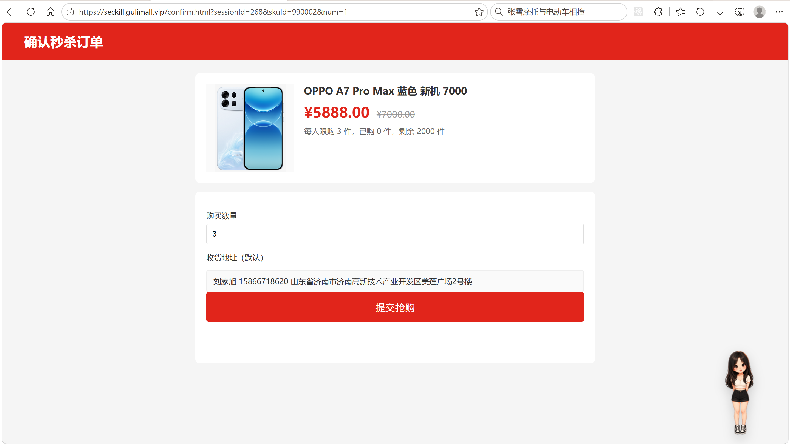
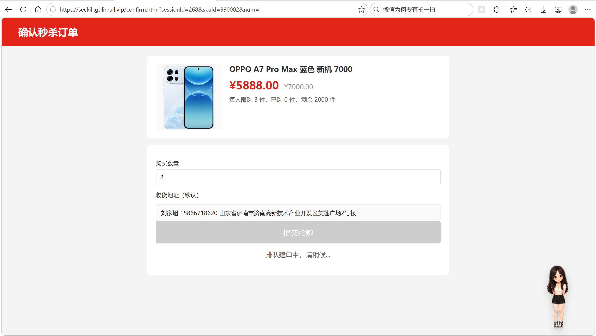
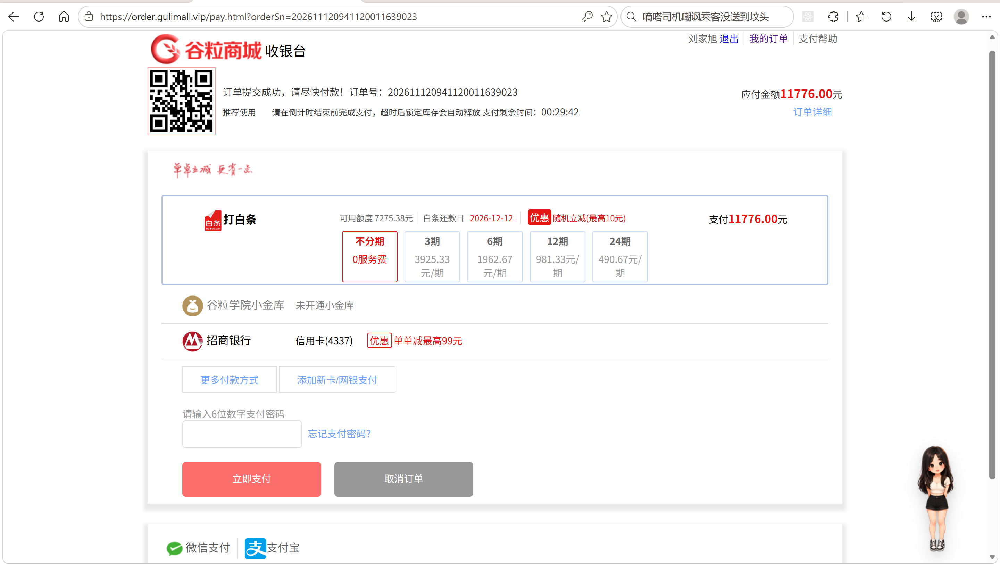
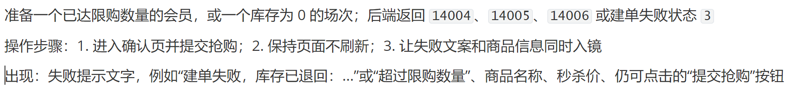
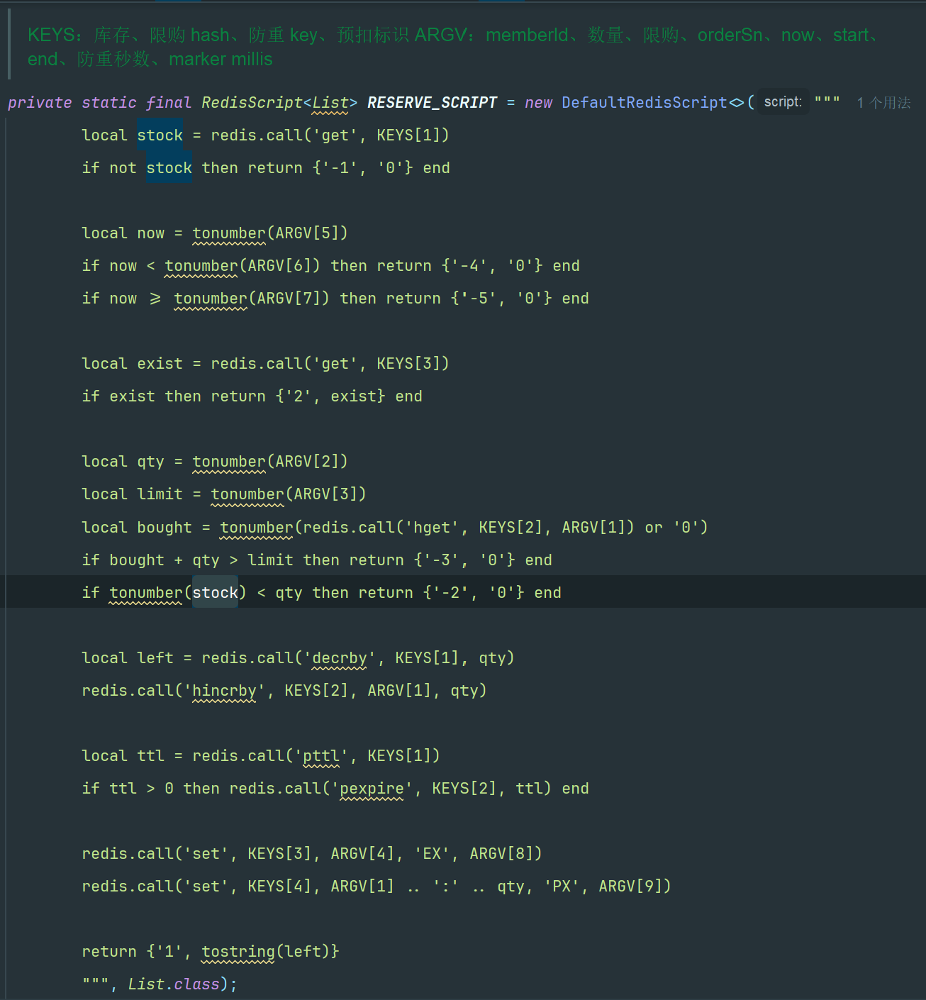
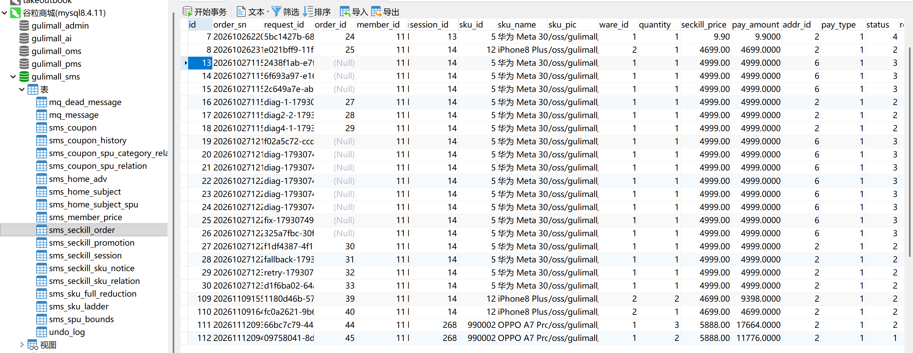
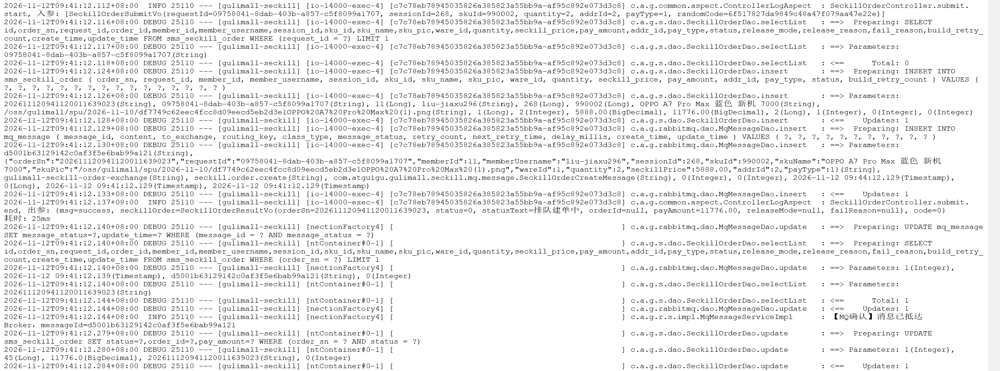

# 15.1 秒杀抢购与异步建单-介绍

> 本篇介绍秒杀抢购的完整链路：用户怎么提交抢购、登录和随机码怎么校验、Redis Lua 怎么原子预扣、本地消息表怎么保证消息不丢、MQ 怎么异步建单、订单服务怎么创建 `source_type=2` 的订单、库存怎么从活动锁定转成订单锁定，以及前端怎么轮询建单结果。

---

## 1. 这个功能是干什么的

秒杀是限时、限量、低价的抢购活动。活动开始的一瞬间会有大量用户同时点击“提交抢购”，请求量远高于日常下单。

秒杀抢购与异步建单解决三件事：

1. **不超卖**：库存只有 100 件时，不能卖出 101 件。
2. **不重复**：同一个用户连点、刷新、换 `requestId` 重试，都不能多扣库存。
3. **削峰**：抢购接口只做 Redis 预扣和落预扣单，真正创建订单交给 MQ 消费者异步完成，避免建单、远程调用、数据库事务把抢购线程堵死。

完整链路分两段：

```text
第一段：抢购（同步、短）
登录校验 → 参数校验 → requestId 查重 → 商品快照/随机码/时间窗口
→ Redis Lua 原子预扣 → 本地事务写 sms_seckill_order + mq_message
→ 返回“排队建单中”

第二段：建单（异步、可重试）
RabbitMQ 消费 → 调 order 建单 → Seata 全局事务写 oms_order/oms_order_item
→ ware 把 seckill_stock_locked 转成 stock_locked → 秒杀单 0→1
```

抢购接口返回的是“排队中”，不是“下单成功”。用户需要轮询结果，建单成功后才进入支付页。



## 2. 用户/管理员怎么操作

### 2.1 进入秒杀确认页

1. 用户在秒杀页或商品详情页点击“立即抢购”。
2. 页面进入秒杀确认页，展示秒杀价、原价、每人限购、已购数量、剩余库存。
3. 页面读取默认收货地址；没有默认地址时提示先到个人中心设置。
4. 页面计算可购上限：`min(限购剩余, 当前库存)`。
5. 页面在加载时生成一个 `requestId`，同一页面生命周期内复用它。


### 2.2 提交抢购

1. 用户填写购买数量。
2. 点击“提交抢购”。
3. 前端把 `requestId`、`sessionId`、`skuId`、`quantity`、`addrId`、`payType`、`randomCode` 提交到 `POST /seckill/order/submit`。
4. 按钮置灰，防止连续点击。
5. 后端返回 `code=0` 后，页面拿到 `orderSn` 进入轮询。

`randomCode` 不展示给用户，由页面从商品快照中带入。价格、限购、仓库 id 同样不信任前端，后端只认 Redis 里的商品快照。

### 2.3 等待排队建单

1. 页面每秒请求一次 `GET /seckill/order/result?orderSn=...`。
2. 最多轮询 40 次。
3. 状态为 `0` 时继续展示“排队建单中，请稍候...”。
4. 网络异常或接口返回非 0 时继续下一轮，不打断用户。
5. 40 次仍未成功时提示“建单处理中，请稍后到订单列表查看”。



### 2.4 抢购成功进入支付页

1. 轮询到 `status=1`，说明订单服务已经建单成功。
2. 页面跳转 `orderUrl + '/pay.html?orderSn=...'`。
3. 支付页校验订单存在、属于当前会员、状态为待支付。
4. 用户完成支付，后续由支付回调回填秒杀单状态。



### 2.5 抢购失败

失败分两类：

1. **前置校验失败**：未登录、参数不合法、随机码无效、活动未开始、活动已结束、库存不足、超过限购、被 Sentinel 限流。接口直接返回错误码，页面展示失败原因。
2. **建单失败**：Redis 预扣成功，但 order 建单明确失败。秒杀单被置为 `status=3`，页面展示失败原因并停止轮询，库存由后端回补。



### 2.6 管理员在抢购链路中的操作

管理员不参与单个用户的抢购，只负责活动前提：

1. 在后台创建活动和场次，配置起止时间、限购、秒杀价。
2. 关联秒杀商品，ware 锁定 `seckill_stock_locked`。
3. 上架商品，把商品快照、随机码、库存写入 Redis。
4. 场次到点后由延时消息推进状态，不需要管理员手工点开始。

抢购接口只读 Redis 快照和库存，不查管理后台的实时配置。

## 3. 整体设计思路

### 3.1 业务上怎么设计

#### 3.1.1 抢购必须满足的前置条件

1. 用户已登录，共享 Session 能取到 `LOGIN_USER`。
2. 有默认收货地址，`addrId` 属于当前会员。
3. 活动已开始且未结束。
4. 商品在 Redis 快照里存在，`randomCode` 与快照一致。
5. 用户已购数量加当前数量不超过每人限购。
6. Redis 库存足够当前数量。
7. 10 秒内没有重复提交。

前置条件全部满足才允许预扣。任何一项不满足都不消耗库存。

#### 3.1.2 登录规则

1. 抢购和结果查询必须登录。
2. 秒杀页、场次查询、商品详情允许游客访问。
3. 未登录访问抢购接口时，拦截器直接返回 `14001`，不进入 Controller，也不进入 Sentinel 业务资源。
4. 会员 id 完全取自共享 Session，前端不能自己传 `memberId`。

#### 3.1.3 随机码规则

1. 商品上架时生成 `randomCode`，写进 Redis 商品 Hash。
2. 秒杀确认页从商品快照里读取 `randomCode`，提交时原样带回。
3. 后端把提交值和 Redis 快照中的值比较，不一致返回 `14007`。
4. 刷新页面会重新读取快照，随机码保持一致；活动配置变更时随机码可重新生成。

随机码不是安全凭证，作用是防止用户手工拼请求直接绕过页面，同时也让旧页面提交时能发现商品快照已经变化。

#### 3.1.4 时间窗口规则

1. 时间判断以商品快照里的 `startTime`、`endTime` 为准。
2. `now < startTime` 返回 `14002`，活动未开始。
3. `now >= endTime` 返回 `14003`，活动已结束。
4. 时间窗口在 Java 层先校验一次，Lua 脚本内再校验一次。

Java 层校验是为了尽早拒绝；Lua 内再校验是因为请求可能在 Java 校验之后排队，真正扣减时活动可能已经结束。

#### 3.1.5 限购规则

1. 每人每个场次每个 SKU 的累计购买数量不能超过 `seckillLimit`。
2. 已购数量存 Redis Hash，field 是 `memberId`，value 是累计数量。
3. 待建单、已建单、已支付都算已购；已释放、建单失败不算。
4. 限购 Hash 的 TTL 跟随库存 key，库存 key 不存在时按场次结束时间加 1 天。

限购计数放在 Redis 而不是数据库，是因为抢购瞬间需要原子累加。数据库只保存订单事实，Redis 允许短暂偏差，由限购对账任务按订单重建。

#### 3.1.6 10 秒防重规则

1. 同一个会员、同一个场次、同一个 SKU，10 秒内只受理一次。
2. 防重 key 为 `seckill:req:{sessionId}:{skuId}:{memberId}`，value 是第一次的 `orderSn`，TTL 10 秒。
3. 10 秒内第二次请求不会扣库存，Lua 返回第一次的 `orderSn`。
4. 后端用这个 `orderSn` 查预扣单；查到就返回原结果，查不到就返回“排队建单中”的临时结果。

10 秒防重挡的是用户连点。`requestId` 查重挡的是客户端重试，两者作用不同。

#### 3.1.7 requestId 幂等规则

1. 前端每次进入确认页生成一个 `requestId`，同一个页面重复提交使用同一个值。
2. `sms_seckill_order.request_id` 保存这个值。
3. 抢购入口先按 `request_id` 查一次：已存在直接返回原结果，不再扣库存。
4. `requestId` 最长 64 字符，空值直接拒绝。

如果用户换了 `requestId` 连续提交，则由 10 秒防重 key 拦截。

#### 3.1.8 排队与结果轮询规则

1. 抢购接口只返回预扣结果和 `orderSn`，不等待订单创建完成。
2. 状态从 `0` 开始：0 待建单、1 已建单、2 已释放、3 建单失败、4 已支付。
3. 前端每秒轮询，最多 40 次。
4. 结果接口只读数据库，不扣库存、不回补库存、不发消息。
5. 查询时必须校验订单归属，订单不存在和越权统一返回 `14008`。

轮询比长连接简单，刷新页面也能继续查；建单慢于 40 秒时页面提示到订单列表查看，后台继续由 MQ 重试和对账推进。

#### 3.1.9 失败回补规则

1. 预扣成功但本地事务失败：立即执行释放脚本，库存和限购加回去。
2. 建单明确失败：秒杀单 `0→3`，执行释放脚本，库存和限购加回去。
3. 建单结果未知：不回补，交给 MQ 重试和订单对账判断。
4. 释放脚本带 `seckill:release:{orderSn}` 标识，保留 7 天，防止重复回补。

### 3.2 技术上怎么设计

#### 3.2.1 Redis key 设计

| key | 类型 | 作用 | TTL |
|---|---|---|---|
| `seckill:session:{sessionId}:skus` | Hash | field 是 skuId，value 是商品快照 JSON | 场次结束加 1 天 |
| `seckill:stock:{sessionId}:{skuId}` | String | 剩余秒杀库存 | 场次结束加 1 天 |
| `seckill:user:count:{sessionId}:{skuId}` | Hash | field 是 memberId，value 是已购数量 | 跟随库存 key |
| `seckill:req:{sessionId}:{skuId}:{memberId}` | String | 10 秒防重，value 是第一次的 orderSn | 10 秒 |
| `seckill:reserve:{orderSn}` | String | 预扣标识，value 是 `memberId:qty` | 30 分钟 |
| `seckill:release:{orderSn}` | String | 释放幂等标识 | 7 天 |
| `seckill:settle:lock:{sessionId}` | Redisson 锁 | 场次结算、取消、释放共用 | 按持有时间 |

商品快照用 Hash 是因为同一场次一次 `HGETALL` 就能取全；库存用 String 是因为需要 `DECRBY`、`INCRBY`；限购用 Hash 是因为要按会员累加。

#### 3.2.2 Redis Lua 原子预扣

预扣要同时完成六件事：

1. 检查库存 key 是否存在。
2. 检查时间窗口。
3. 检查 10 秒防重。
4. 检查限购。
5. 扣库存、加已购。
6. 写防重 key 和预扣标识。

这六步如果拆成多条 Redis 命令，并发下会出现“库存扣了但限购没加”“两个请求同时判断库存都够”等问题。Lua 在 Redis 单线程内执行，整个脚本是一个原子操作，不会被打断。

脚本返回码约定：

```text
 1  预扣成功，第二个返回值是剩余库存
 2  10 秒内重复请求，第二个返回值是第一次的 orderSn
-1  库存 key 不存在
-2  库存不足
-3  超过限购
-4  活动未开始
-5  活动已结束
```



#### 3.2.3 本地消息表

预扣成功后要写两张表、发一条 MQ：

1. `sms_seckill_order`：预扣记录，`status=0`。
2. `mq_message`：消息记录，`message_status=0`。
3. 事务提交后投递 RabbitMQ。

如果先写业务表再发消息，发消息失败会导致“库存扣了但没有建单消息”；如果先发消息再写业务表，业务回滚会导致“消息已经发出去但没有预扣记录”。

本地消息表把业务写入和消息记录放在同一个本地事务里：

```text
begin
  insert sms_seckill_order
  insert mq_message
commit
提交成功后投递 MQ
```

投递失败不影响抢购返回，`mq_message` 保持待确认状态，由补偿任务重发。

#### 3.2.4 MQ 异步建单

1. 交换机：`gulimall-seckill-order-exchange`。
2. 路由键：`seckill.order.create`。
3. 队列：`gulimall-seckill-order-create-queue`。
4. 消费端手动 ack。
5. 业务明确失败才回补；未知异常交给 `MqRetryService` 延迟重试。

异步建单把订单服务、仓库服务从抢购线程里移走。抢购接口只依赖 Redis 和本地数据库，耗时稳定；建单慢、order 暂时不可用、Seata 回滚都不会让用户卡在抢购按钮上。

#### 3.2.5 订单 sourceType=2

秒杀订单和普通订单共用 `oms_order`，用 `source_type` 区分：

```text
source_type=0  普通订单
source_type=2  秒杀订单
```

`source_type=2` 影响四处：

1. 取消和超时释放走 seckill，由 seckill 判断回秒杀池还是普通池。
2. 支付成功后跳过购物车清理，秒杀订单不经过购物车。
3. 支付成功后实时把秒杀单从 `BUILT` 更新为 `PAID`。
4. 建单时运费、优惠、积分、优惠券金额全部为 0，金额只按秒杀价乘数量。

#### 3.2.6 库存口径转换

秒杀库存在 ware 里用两个字段表示：

```text
stock                 仓库实际库存
stock_locked          普通订单锁定
seckill_stock_locked  秒杀活动锁定
```

关联秒杀商品时，ware 把数量加到 `seckill_stock_locked`，不动 `stock`。用户抢购成功后，建单时做一次转换：

```text
stock_locked          + quantity
seckill_stock_locked  - quantity
```

转换后总占用不变：活动锁定变成订单锁定。真正的 `stock` 扣减留到支付成功，避免未付款就减库存。

#### 3.2.7 秒杀单状态机

```text
0 待建单
  ├── 建单成功 → 1 已建单
  │                ├── 支付成功 → 4 已支付
  │                └── 取消/超时 → 2 已释放
  └── 建单失败 → 3 建单失败
```

所有状态推进都用条件更新：

```sql
update sms_seckill_order set status = 新状态
where order_sn = ? and status = 旧状态
```

更新 0 行说明已经被其他线程处理，直接幂等返回。

## 4. 详细代码、配置和解释

本章按“类为什么存在 → 关键数据 → 链路位置 → 代码分块解释 → 一次完整示例 → 边界”组织。每一块代码前面先说明它在链路里承担什么，代码后面再按 1、2、3 的顺序解释执行过程和原因。

### 4.1 SeckillOrderController：抢购与结果接口

#### 4.1.1 这个类解决什么问题

秒杀确认页只有两个动作：提交抢购、等待建单结果。页面不接触 Redis、Lua、本地消息表和 MQ，只关心提交后拿到哪个 `orderSn`，以及这个单号什么时候从“排队中”变成“待支付”。

这个 Controller 是抢购链路进入业务层的第一站。请求从 Nginx 按 `seckill.gulimall.vip` 转发到 seckill 服务，先经过登录拦截器，再进入这里。类本身不扣库存、不建单、不碰数据库，只做三件事：从 ThreadLocal 取登录会员、把请求交给 `SeckillOrderService`、把返回值包装成 `R`。它同时是 Sentinel 的资源边界，限流判断发生在业务执行前，被拦下的请求不会进入 Redis 预扣。

上游是秒杀确认页和结果轮询脚本，下游是 `SeckillOrderServiceImpl`，旁边的统一异常处理负责把 `RRException` 翻译成业务错误码。

#### 4.1.2 接口与链路位置

| 操作 | 方法与路径 | 登录要求 | 下游方法 | 说明 |
|---|---|---|---|---|
| 提交抢购 | `POST /seckill/order/submit` | 必须 | `SeckillOrderServiceImpl.submit()` | 同步预扣，返回排队状态 |
| 查询结果 | `GET /seckill/order/result` | 必须 | `SeckillOrderServiceImpl.getResult()` | 只读数据库，不改库存 |
| Sentinel 资源 | `seckillOrderSubmit` | 无 | `submitBlocked()` | 流控和熔断的统一入口 |

网关转发时会去掉 `/gulimall` 前缀。浏览器访问 `/gulimall/seckill/order/submit`，落到 seckill 服务后路径是 `/seckill/order/submit`。

#### 4.1.3 代码与解释

抢购和结果两个入口、Sentinel 降级方法、会员解析都在这个类里，代码展示的是从 HTTP 请求到 Service 调用的最短路径。

```java
@Slf4j
@RestController
@RequestMapping("/seckill/order")
public class SeckillOrderController {

    @Autowired
    private SeckillOrderService seckillOrderService;

    /**
     * 抢购入口。Sentinel 资源点在方法最外层，
     * 被限流时不会进入 Redis 扣减，因此不会占库存。
     */
    @SentinelResource(value = "seckillOrderSubmit", blockHandler = "submitBlocked")
    @PostMapping("/submit")
    public R submit(@RequestBody SeckillOrderSubmitVo vo) {
        // 1. 登录会员由拦截器放进 ThreadLocal
        MemberResponseVo member = currentMember();
        // 2. Redis 预扣 + 落预扣记录 + 发建单消息
        return R.ok().put("seckillOrder", seckillOrderService.submit(vo, member));
    }

    /**
     * Sentinel 限流/熔断降级：返回统一错误码，前端提示稍后再试
     */
    public R submitBlocked(SeckillOrderSubmitVo vo, BlockException ex) {
        // 1. 先记一条告警日志，方便排查是哪个资源、哪种限流规则把请求拦下来的
        log.warn("[seckill] 抢购被限流/熔断：{}", ex.getClass().getSimpleName());
        // 2. 返回统一的限流错误码和提示，前端据此告诉用户稍后再试
        return R.error(BizCodeEnum.SECKILL_FLOW_LIMIT.getCode(),
                BizCodeEnum.SECKILL_FLOW_LIMIT.getMsg());
    }

    @GetMapping("/result")
    public R result(@RequestParam(value = "orderSn", required = false) String orderSn,
                    @RequestParam(value = "requestId", required = false) String requestId) {
        // 1. 查自己的秒杀单状态
        MemberResponseVo member = currentMember();
        // 2. 用当前会员 ID 查结果，防止用户通过换单号看到别人的秒杀单
        return R.ok().put("seckillOrder",
                seckillOrderService.getResult(orderSn, requestId, member.getId()));
    }

    private MemberResponseVo currentMember() {
        // 1. 从 ThreadLocal 取拦截器解析好的登录会员，避免每个接口都重新读 Session
        MemberResponseVo member = MemberResponseVoThreadLocal.get();
        // 2. 取不到会员或会员 ID 说明登录态失效，直接抛业务异常让统一异常处理返回未登录
        if (member == null || member.getId() == null) {
            throw new RRException(BizCodeEnum.SECKILL_NOT_LOGIN);
        }
        // 3. 校验通过返回会员对象，供后续业务使用
        return member;
    }
}
```

1. `@RestController` 和 `@RequestMapping("/seckill/order")`：两个接口共用前缀，返回值按 JSON 输出。
2. `@Autowired SeckillOrderService`：Controller 只依赖服务接口，不直接依赖 Dao、Redis 或 MQ。
3. `@SentinelResource(value = "seckillOrderSubmit", blockHandler = "submitBlocked")`：把抢购方法声明成 Sentinel 资源。`blockHandler` 的方法参数必须和原方法一致，最后再加 `BlockException`，否则 Sentinel 找不到降级方法。
4. `submit()` 第一步调 `currentMember()`，会员来自登录拦截器写入的 ThreadLocal，不读前端提交的 `memberId`。
5. 第二步调 `seckillOrderService.submit(vo, member)`，结果放在 `seckillOrder` 字段，前端取 `data.seckillOrder`。
6. `submitBlocked()` 只记录资源类型并返回 `SECKILL_FLOW_LIMIT`，不进入 Redis，也不写数据库。
7. `result()` 把 `orderSn`、`requestId` 和当前会员 id 一起交给 Service。两个查询参数都声明为 `required = false`，由 Service 决定用哪个条件，但至少要有一个。
8. `currentMember()` 取不到会员或会员 id 时抛 `SECKILL_NOT_LOGIN`，由统一异常处理返回 `14001`。

为什么 Sentinel 放在方法最外层：限流在业务执行前判断。被限流时请求不进入 Redis 预扣，拒绝成本只有一次计数，不会出现“库存已经扣了再告诉用户失败”的情况。

为什么会员从 ThreadLocal 取：登录拦截器已经解析过一次共享 Session，Controller 再读一次会重复反序列化；更重要的是，会员 id 不能由前端提交，否则可以伪造成别人的单。

#### 4.1.4 一次请求示例

```text
1. 浏览器提交 POST /gulimall/seckill/order/submit
   请求体：requestId、sessionId、skuId、quantity、addrId、payType、randomCode
2. Nginx 按 seckill.gulimall.vip 转发到 seckill 服务 14000 端口
3. 登录拦截器从共享 Session 取 LOGIN_USER，放进 ThreadLocal
4. Sentinel 检查 seckillOrderSubmit，触发规则时执行 submitBlocked() 并返回 14013
5. 放行后 Controller 调 SeckillOrderServiceImpl.submit()
6. Service 完成 Redis 预扣和本地落单，返回 orderSn、status=0、payAmount
7. 页面每秒请求 GET /gulimall/seckill/order/result?orderSn=...
8. status=1 跳支付页，status=3 展示失败原因，status=0 继续轮询
```

#### 4.1.5 它不做什么

1. 不校验商品快照、随机码、时间窗口和限购，这些在 Service 里。
2. 不执行 Lua，不扣 Redis 库存。
3. 不写 `sms_seckill_order`，不投递 MQ。
4. 不判断结果是否属于当前会员，归属校验在 `getResult()` 里。
5. 不维护限流规则，规则由 Sentinel 控制台或配置中心下发。

#### 4.1.6 边界与可优化点

1. 抢购接口没有对 `requestId` 长度、`quantity` 上限做参数校验，非法值要进入 Service 才被拒绝。
2. 结果查询没有限流，页面高频轮询会直接落到数据库。
3. `submitBlocked()` 不区分流控和熔断，前端只能统一提示稍后再试。
4. ThreadLocal 只覆盖当前请求线程，后续如果改成异步处理，需要显式传递会员对象。
5. 两个查询参数都允许为空，接口层没有显式约束“二选一”，错误提示依赖 Service。

### 4.2 SeckillController：场次与商品信息接口

#### 4.2.1 这个类解决什么问题

秒杀页需要知道哪些场次可以展示、某个场次里有哪些商品；商品详情页需要知道当前商品是否在秒杀、价格多少、还剩多少、当前会员还能买几件。这些请求的共同特点是读多写少、允许游客访问，而且都只读 Redis，不写库存。

这个 Controller 把三类读请求翻译成 `SeckillSkuService` 调用。场次列表和场次商品用于页面渲染，商品详情页的秒杀信息用于决定是否显示“立即抢购”以及购买数量上限。商品详情本身是热点接口，所以这里用 Sentinel 的热点参数限流按 `skuId` 单独保护。

上游是秒杀页和商品详情页，下游是 `SeckillSkuServiceImpl`，更下游是 Redis 商品 Hash、库存 String 和限购 Hash。

#### 4.2.2 接口清单

| 操作 | 方法与路径 | 登录要求 | 下游方法 | 说明 |
|---|---|---|---|---|
| 可展示场次 | `GET /seckill/sessions` | 否 | `listActiveSessions()` | 进行中和未来 3 天的启用场次 |
| 场次商品 | `GET /seckill/skus?sessionId=` | 否 | `getSessionSkus()` | 读 Redis 场次商品 Hash |
| 秒杀商品详情 | `GET /seckill/sku/info?sessionId=&skuId=` | 否 | `getSkuInfo()` | 游客可看，登录用户带已购数量 |
| Sentinel 资源 | `seckillSkuInfo` | 无 | `skuInfoBlocked()`、`skuInfoFallback()` | 热点参数限流、普通流控、异常兜底 |

#### 4.2.3 代码与解释

三个读接口和两个 Sentinel 降级方法集中在同一个类里，代码重点是登录可选的会员解析和按 SKU 的热点参数限流。

```java
@RestController
@RequestMapping("/seckill")
public class SeckillController {

    @Autowired
    private SeckillSkuService seckillSkuService;

    /**
     * 可展示的秒杀场次
     */
    @GetMapping("/sessions")
    public R sessions() {
        // 1. 查未来 3 天 + 进行中的启用场次
        return R.ok().put("sessions", seckillSkuService.listActiveSessions());
    }

    /**
     * 某场次的秒杀商品
     */
    @GetMapping("/skus")
    public R skus(@RequestParam("sessionId") Long sessionId) {
        // 1. 从 Redis hash 读商品信息
        return R.ok().put("skus", seckillSkuService.getSessionSkus(sessionId));
    }

    /**
     * 商品详情页秒杀模式：价格、限购、已购、剩余。
     * 允许游客访问，登录时才会带出已购数量。
     */
    @SentinelResource(value = "seckillSkuInfo",
            blockHandler = "skuInfoBlocked", fallback = "skuInfoFallback")
    @GetMapping("/sku/info")
    public R skuInfo(@RequestParam("sessionId") Long sessionId,
                     @RequestParam("skuId") Long skuId,
                     HttpSession session) {
        // 1. 游客 memberId 为空，已购按 0
        MemberResponseVo member = session == null ? null
                : (MemberResponseVo) session.getAttribute(AuthServerConstant.LOGIN_USER);
        Long memberId = member == null ? null : member.getId();
        // 2. 把会员信息带进查询，登录用户能算出已购数量，游客已购按 0 处理
        return R.ok().put("seckillSkuInfo",
                seckillSkuService.getSkuInfo(sessionId, skuId, memberId));
    }

    /**
     * 热点参数/流控被拦时：返回统一错误码
     */
    public R skuInfoBlocked(Long sessionId, Long skuId, HttpSession session, BlockException ex) {
        // 1. 被 Sentinel 限流时返回统一的限流错误码，前端按普通业务提示让用户稍后再试
        return R.error(com.atguigu.gulimall.common.enums.BizCodeEnum.SECKILL_FLOW_LIMIT.getCode(),
                com.atguigu.gulimall.common.enums.BizCodeEnum.SECKILL_FLOW_LIMIT.getMsg());
    }

    /**
     * 商品查询异常兜底：不把 500 抛给前端
     */
    public R skuInfoFallback(Long sessionId, Long skuId, HttpSession session, Throwable t) {
        // 1. 查询过程抛出异常时兜底返回友好错误，不让 500 直接落到商品详情页
        return R.error(com.atguigu.gulimall.common.enums.BizCodeEnum.SECKILL_PARAM_INVALID.getCode(),
                "秒杀商品信息查询失败，请稍后再试");
    }
}
```

1. `@RestController` 和 `@RequestMapping("/seckill")`：三个读接口共用 `/seckill` 前缀。
2. `sessions()`：调用 `listActiveSessions()`，结果放在 `sessions` 字段，前端直接遍历渲染场次。
3. `skus()`：把 `sessionId` 交给 `getSessionSkus()`，从 Redis Hash 读取该场次的商品列表。
4. `skuInfo()` 上的 `@SentinelResource` 同时声明 `blockHandler` 和 `fallback`。`blockHandler` 处理限流和熔断，`fallback` 处理业务异常，两者签名都要包含原方法参数。
5. `skuInfo()` 先从 `HttpSession` 取 `LOGIN_USER`。`session` 为空说明请求没有会话，按游客处理。
6. `member` 为空时 `memberId` 为 null，Service 把已购数量按 0 计算；登录用户则按会员 id 查限购 Hash。
7. `skuInfoBlocked()` 在触发 Sentinel 规则时返回 `SECKILL_FLOW_LIMIT`，和抢购接口使用同一个错误码。
8. `skuInfoFallback()` 在查询抛异常时返回友好提示，避免 500 直接落到商品详情页。

为什么商品详情允许游客：商品详情页本身不要求登录，秒杀信息只是页面的一块内容。已购数量只对登录用户有意义，游客按 0 展示不影响价格、库存和活动时间的读取。

为什么按 `skuId` 做热点参数：同一场次里不同商品的热度差异很大，按 SKU 限流可以只限制被打爆的商品，不牵连整个场次。

#### 4.2.4 一次请求示例

```text
1. 游客打开商品详情页，前端请求 GET /gulimall/seckill/sku/info?sessionId=1001&skuId=2001
2. Controller 从 Session 取不到 LOGIN_USER，memberId 为 null
3. Sentinel 先按 skuId=2001 检查热点参数规则，再检查接口总流控
4. 放行后 getSkuInfo(1001, 2001, null) 读取商品 Hash、库存 String、限购 Hash
5. 返回 seckillPrice、stock、seckillLimit、bought=0
6. 登录用户带 Session 再请求一次，bought 按会员 id 从限购 Hash 读取
7. 页面用 min(seckillLimit - bought, stock) 计算可购上限
```

#### 4.2.5 它不做什么

1. 不扣库存，不写限购计数，不执行 Lua。
2. 不创建订单，不投递 MQ。
3. 不强制登录，只有抢购和结果接口要求登录。
4. 不校验 `sessionId`、`skuId` 是否合法，非法值由 Redis 查询结果和 Service 决定。
5. 不组装商品详情页的完整数据，只返回秒杀相关字段。

#### 4.2.6 边界与可优化点

1. 场次和商品接口直接返回 Service 的 VO，字段变化会直接影响前端。
2. `skuInfoBlocked()` 里写死了 `BizCodeEnum` 的全限定类名，可读性差，可以改成 import。
3. 商品 Hash 缺失时会回源数据库和 product 服务，回源过程没有互斥，热点 SKU 可能重复回源。
4. 场次列表没有缓存，秒杀页每次打开都查一次数据库。
5. `session == null` 只覆盖了没有会话的情况，会话存在但属性缺失时同样按游客处理，两种状态在日志里没有区分。

### 4.3 SeckillOrderEntity 与秒杀单状态

#### 4.3.1 这个类解决什么问题

Redis 预扣只能证明“库存减了”，不能作为订单事实：它没有收货地址、没有支付方式、没有建单结果，也不能稳定支撑结果轮询。预扣成功到异步建单之间，需要一条数据库记录承载这笔抢购的完整底稿。

这个实体映射 `gulimall_sms.sms_seckill_order`，同时承担三个角色：抢购成功的预扣记录、建单消息的数据来源、结果轮询和状态推进的查询依据。上游是 `SeckillOrderServiceImpl.createReservedOrder()` 的插入，下游是 MQ 消费端、结果接口、取消和支付回调的状态更新。

#### 4.3.2 字段与业务含义

| 字段 | 数据库列 | 业务含义 | 说明 |
|---|---|---|---|
| `id` | `id` | 主键 | 自增 |
| `orderSn` | `order_sn` | 秒杀订单号 | 全链路幂等键，MQ、建单、释放都用它定位 |
| `requestId` | `request_id` | 客户端请求 id | 入口查重，最长 64 字符 |
| `orderId` | `order_id` | 订单主表 id | 建单成功后回填 `oms_order.id` |
| `memberId` | `member_id` | 会员 id | 来自登录态，不信任前端 |
| `memberUsername` | `member_username` | 会员名 | 订单展示和排查使用 |
| `sessionId` | `session_id` | 秒杀场次 id | 定位库存和限购 key |
| `skuId` | `sku_id` | 商品 SKU | 建单和库存转换使用 |
| `skuName` | `sku_name` | 商品名称快照 | 建单时写入订单明细 |
| `skuPic` | `sku_pic` | 商品图片快照 | 订单列表展示 |
| `wareId` | `ware_id` | 锁定仓库 | 建单时做库存口径转换 |
| `quantity` | `quantity` | 购买数量 | 扣库存、算金额、回补都用它 |
| `seckillPrice` | `seckill_price` | 秒杀单价 | 来自商品快照 |
| `payAmount` | `pay_amount` | 应付金额 | 秒杀价乘数量 |
| `addrId` | `addr_id` | 收货地址 id | 建单时校验归属 |
| `payType` | `pay_type` | 支付方式 | 默认 1 |
| `status` | `status` | 秒杀单状态 | 0 待建单、1 已建单、2 已释放、3 建单失败、4 已支付 |
| `releaseMode` | `release_mode` | 释放方式 | 1 回秒杀池、2 回普通池 |
| `releaseReason` | `release_reason` | 释放原因 | 取消、超时、对账补释放 |
| `failReason` | `fail_reason` | 建单失败原因 | 页面展示和排查 |
| `buildRetryCount` | `build_retry_count` | 建单重试次数 | 订单对账任务使用 |
| `createTime` | `create_time` | 创建时间 | 预扣时间 |
| `updateTime` | `update_time` | 更新时间 | 状态推进时间 |

#### 4.3.3 状态机与条件更新

```text
0 待建单
  ├── 建单成功 → 1 已建单
  │                ├── 支付成功 → 4 已支付
  │                └── 取消/超时 → 2 已释放
  └── 建单失败 → 3 建单失败
```

每次状态推进都带旧状态条件：

```sql
UPDATE sms_seckill_order
SET status = 新状态
WHERE order_sn = ?
  AND status = 旧状态;
```

更新行数为 0，说明这笔单已经被其他线程处理过。调用方按幂等处理，不重复回补、不重复推进。

#### 4.3.4 代码与解释

实体字段和数据库列一一对应，这段代码是预扣单的完整字段定义。

```java
@Data
@TableName("sms_seckill_order")
public class SeckillOrderEntity implements Serializable {

    private static final long serialVersionUID = 1L;

    @TableId
    private Long id;

    /** 秒杀订单号，全链路幂等键 */
    private String orderSn;

    /** 客户端请求 id，防重复提交 */
    private String requestId;

    /** oms_order.id，建单成功后回填 */
    private Long orderId;

    private Long memberId;

    private String memberUsername;

    private Long sessionId;

    private Long skuId;

    private String skuName;

    private String skuPic;

    /** 关联时锁定的仓库 id */
    private Long wareId;

    private Integer quantity;

    private BigDecimal seckillPrice;

    private BigDecimal payAmount;

    private Long addrId;

    private Integer payType;

    /** 0待建单 1已建单 2已释放 3建单失败 4已支付 */
    private Integer status;

    /** 释放方式：1回秒杀池 2回普通池 */
    private Integer releaseMode;

    private String releaseReason;

    private String failReason;

    private Integer buildRetryCount;

    private Date createTime;

    private Date updateTime;
}
```

1. `@Data` 生成 getter、setter，MyBatis-Plus 和 Jackson 都依赖这些访问器。
2. `@TableName("sms_seckill_order")` 绑定秒杀库表，表在 `gulimall_sms` 库。
3. `@TableId` 标记 `id` 为主键，插入后回填自增 id。
4. `orderSn` 是全链路幂等键。抢购、MQ 消费、订单建单、库存释放、支付回填都用它定位同一笔业务。
5. `requestId` 用于入口查重。客户端重试带同一个值，服务端可以直接返回原结果。
6. `orderId` 在建单成功后回填，结果查询和支付回调可以通过它关联 `oms_order`。
7. 商品、会员、仓库、数量、价格、地址、支付方式都是抢购时的快照。后续商品改名、改价不影响已经预扣成功的单。
8. `status`、`releaseMode`、`releaseReason`、`failReason`、`buildRetryCount` 组成状态机和运维字段，供消费者、对账任务和页面使用。

为什么预扣记录先落库：Redis 预扣成功后如果只发消息不落库，消费端无法知道这笔预扣的会员、地址、价格和仓库；结果轮询也没有稳定数据源。预扣记录就是建单消息的数据库底稿。

#### 4.3.5 状态常量与文案

状态码和页面文案放在同一个常量类里，业务代码通过常量引用状态值，不直接写数字。

```java
public class SeckillOrderStatus {

    /** Redis 已扣、建单消息已登记，等待 order 建单 */
    public static final int WAIT_BUILD = 0;

    /** order 已建单，等待支付 */
    public static final int BUILT = 1;

    /** 已取消/超时，库存已释放 */
    public static final int RELEASED = 2;

    /** 建单失败，库存已回补 */
    public static final int BUILD_FAILED = 3;

    /** 已支付 */
    public static final int PAID = 4;

    /** 释放方式：回秒杀池 */
    public static final int RELEASE_TO_SECKILL = 1;

    /** 释放方式：回普通可售池 */
    public static final int RELEASE_TO_NORMAL = 2;

    public static String text(Integer status) {
        // 1. 状态为空说明数据缺失，直接返回“未知”，避免自动拆箱时抛空指针
        if (status == null) {
            return "未知";
        }
        // 2. 按状态码翻译成前端能直接展示的中文文案，不认识的状态也兜底为“未知”
        return switch (status) {
            case WAIT_BUILD -> "排队建单中";
            case BUILT -> "待支付";
            case RELEASED -> "已取消";
            case BUILD_FAILED -> "建单失败";
            case PAID -> "已支付";
            default -> "未知";
        };
    }

    private SeckillOrderStatus() {
    }
}
```

1. `WAIT_BUILD` 到 `PAID` 与数据库 `status` 一一对应，代码里不直接写 0、1、2、3、4。
2. `RELEASE_TO_SECKILL` 和 `RELEASE_TO_NORMAL` 表示释放后的库存回到哪个池子，秒杀池可以继续被抢，普通池回到日常销售。
3. `text()` 先判断 null，避免自动拆箱抛空指针。
4. `switch` 把状态码翻译成页面文案，未知状态统一显示“未知”。
5. 私有构造器阻止实例化，这个类只提供常量和静态方法。

为什么状态值不能随意改：`status` 是数据库存量数据，数字已经被历史订单、MQ 消息和对账脚本引用。新增状态只能追加，旧值必须保留兼容。



#### 4.3.6 一次完整示例

```text
1. 抢购预扣成功，插入记录：
   order_sn=S202611120001，status=0，quantity=1，pay_amount=9.90
2. MQ 消费端建单成功：
   UPDATE sms_seckill_order
   SET status=1, order_id=10086, pay_amount=9.90
   WHERE order_sn='S202611120001' AND status=0;
   更新 1 行，秒杀单进入已建单
3. 用户支付成功，支付回调：
   UPDATE sms_seckill_order
   SET status=4
   WHERE order_sn='S202611120001' AND status=1;
4. 如果用户未支付，超时关单：
   UPDATE sms_seckill_order
   SET status=2, release_mode=1, release_reason='支付超时'
   WHERE order_sn='S202611120001' AND status=1;
5. 重复消息再次把 status 从 0 改成 1 时更新 0 行，直接忽略
```

#### 4.3.7 它不做什么

1. 不执行 Redis 预扣，也不回补库存。
2. 不校验状态流转是否合法，合法性由每处条件更新的旧状态保证。
3. 不生成 `orderSn`，单号由 `SeckillOrderServiceImpl` 生成。
4. 不承载订单金额明细，订单事实在 `oms_order` 和 `oms_order_item`。
5. 不负责把实体转成页面 VO，结果接口会重新组装 `SeckillOrderResultVo`。

#### 4.3.8 边界与可优化点

1. `request_id` 没有唯一索引，理论上仍可能插入重复请求。
2. `order_sn` 依赖代码生成，数据库没有唯一约束兜底。
3. `status` 用整数表示，阅读和扩展不如枚举；状态含义分散在常量类和数据库注释里。
4. `release_mode`、`release_reason` 没有约束，取消、超时、对账补释放的写法需要调用方自己统一。
5. `build_retry_count` 只记录次数，没有记录最后一次失败时间和失败节点，排查重试链路不方便。

### 4.4 SeckillOrderServiceImpl：抢购主流程

#### 4.4.1 这个类解决什么问题

抢购是“同步短链路 + 异步长链路”的分界点。同步段要在一瞬间完成参数校验、商品快照读取、随机码比对、时间窗口判断、`requestId` 查重、Redis 原子预扣和本地落单；异步段把订单创建、库存口径转换、Seata 全局事务交给 MQ 消费者。

这个类负责同步段的全部编排，并在建单成功或失败时推进秒杀单状态、回补 Redis。上游是 `SeckillOrderController` 和 MQ 监听器，下游是 `SeckillOrderDao`、`SeckillStockService`、`MqMessageService` 和订单服务。

同步段和异步段分开的原因：Redis 预扣不能包在数据库事务里，数据库事务回滚也不会自动回补 Redis；订单服务和仓库服务的远程调用如果放进抢购线程，接口耗时会随下游抖动。把两段拆开，抢购接口只依赖 Redis 和本地数据库，耗时稳定。

#### 4.4.2 主链路

```text
同步段（抢购接口）
参数校验
  → requestId 查重
  → 读商品快照
  → 随机码、仓库、价格、时间窗口校验
  → 生成 orderSn
  → Redis Lua 原子预扣
  → 本地事务：insert sms_seckill_order + insert mq_message
  → 事务提交后投递 MQ
  → 返回 status=0

异步段（MQ 消费）
消费建单消息
  → 查预扣单并校验 status=0
  → 调 order 内部接口建单
  → order 写 oms_order/oms_order_item
  → ware 转换 seckill_stock_locked → stock_locked
  → 秒杀单 0→1
```

#### 4.4.3 抢购入口 `submit`

抢购入口承担同步段的全部校验、预扣和落单，是整个链路里最长的一个方法。

```java
@Override
public SeckillOrderResultVo submit(SeckillOrderSubmitVo vo, MemberResponseVo member) {
    // 1. 基础参数
    if (member == null || member.getId() == null) {
        throw new RRException(BizCodeEnum.SECKILL_NOT_LOGIN);
    }
    if (vo == null || vo.getSessionId() == null || vo.getSkuId() == null
            || vo.getAddrId() == null || vo.getRequestId() == null
            || vo.getRequestId().isBlank() || vo.getRequestId().length() > 64) {
        throw new RRException(BizCodeEnum.SECKILL_PARAM_INVALID);
    }
    int quantity = vo.getQuantity() == null ? 1 : vo.getQuantity();
    if (quantity <= 0) {
        throw new RRException(BizCodeEnum.SECKILL_PARAM_INVALID);
    }

    // 2. 同一 requestId 直接返回原结果，客户端重试不会多扣
    SeckillOrderEntity sameRequest = seckillOrderDao.selectOne(
            new QueryWrapper<SeckillOrderEntity>()
                    .eq("request_id", vo.getRequestId())
                    .last("LIMIT 1"));
    if (sameRequest != null) {
        return toResult(sameRequest);
    }

    // 3. 商品信息以 Redis hash 为准，不信任前端价格
    String infoKey = SeckillConstant.sessionSkusKey(vo.getSessionId());
    Object json = stringRedisTemplate.opsForHash().get(infoKey, vo.getSkuId().toString());
    if (json == null) {
        throw new RRException(BizCodeEnum.SECKILL_SESSION_INVALID);
    }
    SeckillSkuVo sku;
    try {
        sku = objectMapper.readValue(String.valueOf(json), SeckillSkuVo.class);
    } catch (Exception e) {
        log.error("[seckill-submit] 商品信息解析失败 sessionId={} skuId={}",
                vo.getSessionId(), vo.getSkuId(), e);
        throw new RRException(BizCodeEnum.SECKILL_SESSION_INVALID);
    }

    // 4. 随机码必须和上架时写进 hash 的一致
    if (vo.getRandomCode() == null || !Objects.equals(vo.getRandomCode(), sku.getRandomCode())) {
        throw new RRException(BizCodeEnum.SECKILL_RANDOM_CODE_INVALID);
    }
    if (sku.getWareId() == null || sku.getSeckillPrice() == null) {
        throw new RRException(BizCodeEnum.SECKILL_SESSION_INVALID);
    }

    // 5. 时间窗口
    long now = System.currentTimeMillis();
    if (sku.getStartTime() == null || now < sku.getStartTime()) {
        throw new RRException(BizCodeEnum.SECKILL_NOT_STARTED);
    }
    if (sku.getEndTime() == null || now >= sku.getEndTime()) {
        throw new RRException(BizCodeEnum.SECKILL_ENDED);
    }

    // 6. 生成订单号，作为全链路幂等键
    String orderSn = generateOrderSn(member.getId());

    // 7. Lua 原子预扣：库存、限购、防重、marker
    int limit = sku.getSeckillLimit() == null ? 1 : sku.getSeckillLimit().intValue();
    if (limit <= 0) {
        limit = 1;
    }
    SeckillReserveResult reserve = seckillStockService.tryReserve(
            vo.getSessionId(), vo.getSkuId(), member.getId(), quantity, limit,
            orderSn, sku.getStartTime(), sku.getEndTime());
    if (reserve.duplicate()) {
        // 10 秒内重复点击：返回第一次的订单号
        SeckillOrderEntity duplicated = seckillOrderDao.selectOne(
                new QueryWrapper<SeckillOrderEntity>()
                        .eq("order_sn", reserve.getExistingOrderSn())
                        .last("LIMIT 1"));
        if (duplicated != null) {
            return toResult(duplicated);
        }
        SeckillOrderResultVo processing = new SeckillOrderResultVo();
        processing.setOrderSn(reserve.getExistingOrderSn());
        processing.setStatus(SeckillOrderStatus.WAIT_BUILD);
        processing.setStatusText(SeckillOrderStatus.text(SeckillOrderStatus.WAIT_BUILD));
        return processing;
    }
    if (!reserve.success()) {
        throw new RRException(mapReserveCode(reserve.getCode()));
    }

    // 8. 本地事务：落预扣记录 + 写可靠消息；失败回补 Redis
    try {
        createReservedOrder(vo, member, sku, orderSn, quantity);
    } catch (Exception e) {
        log.error("[seckill-submit] 落预扣记录或投递建单消息失败，回补 Redis orderSn={}", orderSn, e);
        seckillStockService.releaseReservation(
                vo.getSessionId(), vo.getSkuId(), member.getId(), quantity, orderSn);
        throw new RRException(BizCodeEnum.SECKILL_ORDER_BUILD_FAILED);
    }

    // 9. 返回排队状态
    SeckillOrderResultVo result = new SeckillOrderResultVo();
    result.setOrderSn(orderSn);
    result.setStatus(SeckillOrderStatus.WAIT_BUILD);
    result.setStatusText(SeckillOrderStatus.text(SeckillOrderStatus.WAIT_BUILD));
    result.setPayAmount(sku.getSeckillPrice().multiply(BigDecimal.valueOf(quantity)));
    return result;
}
```

1. 校验会员和基础参数：`sessionId`、`skuId`、`addrId`、`requestId` 不能为空，`requestId` 不能超过 64 字符，`quantity` 默认 1 且必须大于 0。
2. 按 `request_id` 查 `sms_seckill_order`。查到记录直接转成结果返回，客户端重试不会再次扣库存。
3. 用 `sessionId` 拼出商品 Hash 的 key，按 `skuId` 取商品快照。快照不存在或 JSON 解析失败都返回 `SECKILL_SESSION_INVALID`。
4. 比较前端提交的 `randomCode` 和快照里的值，不一致返回 `SECKILL_RANDOM_CODE_INVALID`；仓库 id、秒杀价缺失同样按场次无效处理。
5. 用当前时间和快照里的 `startTime`、`endTime` 比较，未开始返回 `14002`，已结束返回 `14003`。
6. 生成 `orderSn`，作为后续预扣标识、预扣单、MQ 消息和订单的幂等键。
7. 读取限购上限，空值或非正数按 1 处理，然后调用 `tryReserve()` 执行 Lua。
8. Lua 返回 2 表示 10 秒内重复点击。按第一次的 `orderSn` 查预扣单，查到就返回原结果；查不到说明本地事务还没提交，返回一个临时的 `WAIT_BUILD` 结果，让前端继续轮询。
9. Lua 返回负数时，用 `mapReserveCode()` 转成业务错误码并抛出，库存不足、超过限购、未开始、已结束都在这一步返回。
10. 预扣成功后调用 `createReservedOrder()`，在本地事务里插预扣单和消息记录。
11. 本地事务抛异常时调用 `releaseReservation()` 把库存和限购还回去，再抛 `SECKILL_ORDER_BUILD_FAILED`。
12. 全部成功时返回 `orderSn`、`status=0`、`payAmount`，页面进入轮询。

为什么先查 `requestId` 再读商品快照：客户端重试通常带同一个 `requestId`。先查数据库可以在最前面短路，不读 Redis，也不执行 Lua，减少无效请求对 Redis 的压力。

为什么 Redis 预扣不放进 `@Transactional`：Lua 在 Redis 执行，数据库事务管不到它。如果 `submit()` 整体加事务，事务回滚时 Redis 库存不会自动恢复，反而把“已扣库存”留在外面。当前做法是把数据库写入收窄到 `transactionTemplate`，异常由外层捕获后显式回补。

为什么重复请求可能返回“排队中”：10 秒防重 key 在 Lua 里写完就返回，此时本地事务可能还没提交。查不到预扣单时不能直接报错，只能把第一次的单号返回给前端继续轮询。

#### 4.4.4 预扣记录与本地消息 `createReservedOrder`

预扣记录和建单消息必须在同一个本地事务里写入，这段代码只做这一件事。

```java
/**
 * 落预扣记录 + 写建单消息，必须在同一本地事务里
 */
private void createReservedOrder(SeckillOrderSubmitVo vo, MemberResponseVo member,
                                 SeckillSkuVo sku, String orderSn, int quantity) {
    // 1. 把这次抢购的单号、会员、商品、金额等信息组装成预扣记录实体
    SeckillOrderEntity entity = new SeckillOrderEntity();
    entity.setOrderSn(orderSn);
    entity.setRequestId(vo.getRequestId());
    entity.setMemberId(member.getId());
    entity.setMemberUsername(member.getUsername());
    entity.setSessionId(vo.getSessionId());
    entity.setSkuId(vo.getSkuId());
    entity.setSkuName(sku.getSkuName());
    entity.setSkuPic(sku.getSkuImg());
    entity.setWareId(sku.getWareId());
    entity.setQuantity(quantity);
    entity.setSeckillPrice(sku.getSeckillPrice());
    entity.setPayAmount(sku.getSeckillPrice().multiply(BigDecimal.valueOf(quantity)));
    entity.setAddrId(vo.getAddrId());
    entity.setPayType(vo.getPayType() == null ? 1 : vo.getPayType());
    entity.setStatus(SeckillOrderStatus.WAIT_BUILD);
    entity.setBuildRetryCount(0);

    // 2. 复制一份预扣记录作为建单消息，发消息时不用再回查数据库
    SeckillOrderCreateMessage message = new SeckillOrderCreateMessage();
    BeanUtils.copyProperties(entity, message);

    // 3. 在同一个本地事务里插记录并投递可靠消息，避免只落库没发消息或反过来
    transactionTemplate.executeWithoutResult(status -> {
        seckillOrderDao.insert(entity);
        mqMessageService.sendReliable(MqConstants.SECKILL_ORDER_EXCHANGE,
                MqConstants.SECKILL_ORDER_CREATE_ROUTING_KEY, message);
    });
}
```

1. 用请求参数和商品快照组装 `SeckillOrderEntity`，状态设为 `WAIT_BUILD`，重试次数设为 0，应付金额按秒杀价乘数量计算。
2. 把预扣单复制成 `SeckillOrderCreateMessage`。消息体带齐建单所需字段，消费端不需要再回查会员、商品和地址。
3. 用 `transactionTemplate` 开启本地事务。范围只包含“插预扣单 + 登记消息”，不包含前面的 Redis 预扣。
4. 插入 `sms_seckill_order`。
5. 调 `mqMessageService.sendReliable()` 插入 `mq_message`，并注册事务提交后的投递回调。
6. 事务提交后，回调把消息发到 `gulimall-seckill-order-exchange`。
7. 事务回滚时，预扣单和消息记录一起回滚，不会出现“业务没落库但消息已发”。

为什么用 `transactionTemplate`：`submit()` 本身没有标 `@Transactional`。Redis 预扣必须留在数据库事务之外，否则事务回滚无法回补 Redis；把数据库写入单独包一层，范围最小，异常时由 `submit()` 捕获并执行释放脚本。

为什么消息体直接复制实体：发消息时不用再回查数据库，消息和预扣单字段同源。代价是实体字段变化时消息体也要同步，后续如果消息结构独立演进，应该单独定义转换。

#### 4.4.5 建单结果 `onBuildSuccess` 与 `failAndRelease`

建单成功和建单失败都通过条件更新推进状态，只有抢到失败状态的线程才执行回补。

```java
@Override
public void onBuildSuccess(String orderSn, Long orderId, BigDecimal payAmount) {
    // 1. 只有待建单才允许推进，重复消费直接忽略
    int updated = seckillOrderDao.update(null, new UpdateWrapper<SeckillOrderEntity>()
            .set("status", SeckillOrderStatus.BUILT)
            .set("order_id", orderId)
            .set("pay_amount", payAmount)
            .eq("order_sn", orderSn)
            .eq("status", SeckillOrderStatus.WAIT_BUILD));
    if (updated == 0) {
        log.info("[seckill-build] 秒杀单已处理过或不是待建单 orderSn={}", orderSn);
    }
}

@Override
public void failAndRelease(String orderSn, String reason) {
    // 1. 抢占：只有待建单的才能标记失败，防止和建单成功并发时误回补
    int updated = seckillOrderDao.update(null, new UpdateWrapper<SeckillOrderEntity>()
            .set("status", SeckillOrderStatus.BUILD_FAILED)
            .set("fail_reason", reason)
            .eq("order_sn", orderSn)
            .eq("status", SeckillOrderStatus.WAIT_BUILD));
    if (updated == 0) {
        return;
    }

    // 2. 回补 Redis；活动已结束导致库存 key 不存在时忽略
    SeckillOrderEntity order = getByOrderSn(orderSn);
    if (order == null) {
        return;
    }
    int released = seckillStockService.releaseReservation(
            order.getSessionId(), order.getSkuId(), order.getMemberId(),
            order.getQuantity(), orderSn);
    log.info("[seckill-build] 建单失败已回补 orderSn={} reason={} redisResult={}",
            orderSn, reason, released);
}
```

1. `onBuildSuccess()` 用条件更新把 `WAIT_BUILD` 改成 `BUILT`，同时回填 `order_id` 和 `pay_amount`。
2. 更新行数为 0，说明消息重复或状态已经变化，只记日志，不重复推进。
3. `failAndRelease()` 用条件更新把 `WAIT_BUILD` 改成 `BUILD_FAILED`，同时写入失败原因。
4. 更新行数为 0 时直接返回。建单成功和建单失败可能并发到达，只有抢到状态的那一方有资格继续回补。
5. 抢到失败状态后，按 `orderSn` 查预扣单，拿到 `sessionId`、`skuId`、`memberId`、`quantity`。
6. 调 `releaseReservation()` 执行释放脚本，把库存和限购加回去，并记录 Redis 返回码。

为什么先抢状态再回补：如果订单已经建好，另一个线程又把库存加回去，就会出现“订单存在但库存已退回”。条件更新保证同一笔单只有一个线程能从 `WAIT_BUILD` 走到下一步，成功和失败不会同时生效。

为什么释放失败只记日志：建单失败已经是明确的业务结果，不能因为 Redis 回补失败把消息无限重试。回补失败的部分由释放标识、库存对账和订单对账兜底。

#### 4.4.6 错误码映射与订单号 `mapReserveCode`、`generateOrderSn`

Lua 返回码需要翻译成业务错误码，订单号需要在写数据库前生成，两个小方法放在一起。

```java
private BizCodeEnum mapReserveCode(int code) {
    // 1. 把 Lua 返回的负数错误码翻译成业务错误码，认不出的码统一按场次无效处理
    return switch (code) {
        case -2 -> BizCodeEnum.SECKILL_STOCK_INSUFFICIENT;
        case -3 -> BizCodeEnum.SECKILL_LIMIT_EXCEEDED;
        case -4 -> BizCodeEnum.SECKILL_NOT_STARTED;
        case -5 -> BizCodeEnum.SECKILL_ENDED;
        default -> BizCodeEnum.SECKILL_SESSION_INVALID;
    };
}

private String generateOrderSn(Long memberId) {
    // 1. 取当前时间到秒，让单号带上时间趋势，方便排查
    String time = LocalDateTime.now().format(ORDER_SN_TIME);
    // 2. 会员号取模后补足 4 位，人工也能看出是谁的单
    String member = String.format("%04d", Math.floorMod(memberId, 10000));
    // 3. 再拼 6 位随机数，降低同一秒内不同会员撞号的概率
    int random = ThreadLocalRandom.current().nextInt(100000, 1000000);
    return time + member + random;
}
```

1. Lua 返回 `-2` 映射库存不足。
2. 返回 `-3` 映射超过限购。
3. 返回 `-4` 映射活动未开始。
4. 返回 `-5` 映射活动已结束。
5. 其他负数或 `-1` 统一映射场次无效，包括库存 key 不存在、脚本返回格式异常。
6. 订单号由 14 位时间、4 位会员尾号、6 位随机数组成。

为什么订单号带会员尾号：排查时能从单号直接看出下单会员，不需要先查数据库。时间前缀让单号按时间有序，日志检索和分库分表都更方便。

为什么订单号不直接用数据库自增：抢购在写数据库前就需要一个单号去写 Redis 防重 key、预扣标识和 MQ 消息。自增 id 要等插入之后才有，无法承担这个角色。

#### 4.4.7 一次完整示例

**示例 A：正常抢购**

```text
1. 库存 100，限购 2，用户 A 购买 1 件
2. requestId=R001 查不到预扣单
3. 商品快照校验通过，生成 orderSn=S202611120001
4. Lua 返回 1，剩余库存 99，限购 A=1
5. 插入 sms_seckill_order(status=0) 和 mq_message(status=0)
6. 事务提交，投递 MQ
7. 返回 orderSn、status=0、payAmount=9.90
```

**示例 B：客户端重试同一个 requestId**

```text
1. 第二个请求带 requestId=R001
2. 按 request_id 查到已有预扣单
3. 直接返回原 orderSn 和原状态，不再读 Redis，不再执行 Lua
```

**示例 C：10 秒内重复点击**

```text
1. 第二个请求换了 requestId=R002，但会员、场次、SKU 不变
2. Lua 读到 seckill:req:{sessionId}:{skuId}:{memberId} 已存在
3. Lua 返回 2 和第一次的 orderSn
4. 按 orderSn 查到预扣单，返回原结果；查不到则返回临时 WAIT_BUILD
```

**示例 D：库存不足**

```text
1. 库存剩余 0，用户提交 1 件
2. Lua 返回 -2
3. mapReserveCode 映射为 SECKILL_STOCK_INSUFFICIENT
4. 接口返回 14004，库存和限购都没有变化
```

**示例 E：本地事务失败**

```text
1. Lua 预扣成功，库存从 100 变成 99
2. 插入 sms_seckill_order 或 mq_message 时抛异常
3. submit() 捕获异常，调用 releaseReservation()
4. 库存加回 100，限购计数减回原值
5. 接口返回 SECKILL_ORDER_BUILD_FAILED
```

#### 4.4.8 它不做什么

1. 不直接执行 Lua，Lua 在 `SeckillStockServiceImpl` 里。
2. 不创建 `oms_order`，订单事实由订单服务的 `createSeckillOrder()` 写入。
3. 不发送 MQ，实际投递由 `MqMessageService.sendReliable()` 和事务回调完成。
4. 不处理支付回调，支付状态由订单和支付链路推进。
5. 不校验地址归属，`addrId` 只检查非空，归属校验在订单服务建单时进行。
6. 不做库存的数据库口径转换，`seckill_stock_locked` 的转换在 ware 服务。

#### 4.4.9 边界与可优化点

1. `requestId` 查重只按 `request_id`，不校验 `member_id` 和 `sku_id`。同一个值被不同会员或不同商品复用时，会返回原结果，属于幂等键设计边界。
2. 商品快照不存在和解析失败都返回同一个错误码，排查时无法区分是活动没上架还是数据损坏。
3. `orderSn` 由时间、会员尾号和随机数组成，极端情况下仍可能撞号，数据库应补唯一约束。
4. 本地事务失败后的释放也可能失败，当前只抛业务异常，库存需要依赖预扣标识和对账恢复。
5. `addrId` 只在入口检查非空，地址是否属于当前会员要到异步建单阶段才发现，失败会走回补流程，用户等待时间更长。
6. `payAmount` 在抢购响应里先算了一次，建单时又算一次，两处舍入规则需要保持一致。

### 4.5 SeckillStockServiceImpl：Lua 原子预扣与释放

#### 4.5.1 这个类解决什么问题

抢购瞬间要同时完成六件事：检查库存 key、检查时间窗口、检查 10 秒防重、检查限购、扣库存并累加已购、写防重和预扣标识。这六步如果拆成多条 Redis 命令，并发下会出现“库存扣了但限购没加”“两个请求同时判断库存都够”“防重 key 写晚了导致重复扣减”等问题。

这个类把六步封进 Lua 脚本，利用 Redis 单线程执行保证整段逻辑原子完成；同时提供释放脚本，把预扣失败、建单失败、取消和超时产生的数量还回去。上游是 `SeckillOrderServiceImpl.submit()` 和 `failAndRelease()`，下游只有 Redis。

#### 4.5.2 key、参数与返回码约定

预扣脚本的 KEYS 顺序：

| 位置 | key | 作用 |
|---|---|---|
| `KEYS[1]` | `seckill:stock:{sessionId}:{skuId}` | 剩余秒杀库存 |
| `KEYS[2]` | `seckill:user:count:{sessionId}:{skuId}` | 会员已购数量 Hash |
| `KEYS[3]` | `seckill:req:{sessionId}:{skuId}:{memberId}` | 10 秒防重 |
| `KEYS[4]` | `seckill:reserve:{orderSn}` | 预扣标识 |

预扣脚本的 ARGV 顺序：

| 位置 | 参数 | 含义 |
|---|---|---|
| `ARGV[1]` | `memberId` | 会员 id |
| `ARGV[2]` | `quantity` | 购买数量 |
| `ARGV[3]` | `limit` | 每人限购 |
| `ARGV[4]` | `orderSn` | 订单号 |
| `ARGV[5]` | `now` | 当前时间毫秒 |
| `ARGV[6]` | `start` | 活动开始毫秒 |
| `ARGV[7]` | `end` | 活动结束毫秒 |
| `ARGV[8]` | `dedupeSeconds` | 防重秒数，固定 10 |
| `ARGV[9]` | `reserveMarkerMillis` | 预扣标识毫秒，30 分钟 |

返回码：

```text
 1  预扣成功，第二个值是剩余库存
 2  10 秒内重复请求，第二个值是第一次的 orderSn
-1  库存 key 不存在
-2  库存不足
-3  超过限购
-4  活动未开始
-5  活动已结束
```

#### 4.5.3 预扣脚本 `RESERVE_SCRIPT`

预扣脚本把库存、时间、防重、限购和标记写入放在一次 Redis 调用里完成。

```java
private static final long DEDUPE_SECONDS = 10L;

private static final long RESERVE_MARKER_MILLIS = 30L * 60 * 1000;

private static final long RELEASE_MARKER_MILLIS = 7L * 24 * 60 * 60 * 1000;

/**
 * KEYS：库存、限购 hash、防重 key、预扣标识
 * ARGV：memberId、数量、限购、orderSn、now、start、end、防重秒数、marker millis
 */
private static final RedisScript<List> RESERVE_SCRIPT = new DefaultRedisScript<>("""
        local stock = redis.call('get', KEYS[1])
        if not stock then return {'-1', '0'} end

        local now = tonumber(ARGV[5])
        if now < tonumber(ARGV[6]) then return {'-4', '0'} end
        if now >= tonumber(ARGV[7]) then return {'-5', '0'} end

        local exist = redis.call('get', KEYS[3])
        if exist then return {'2', exist} end

        local qty = tonumber(ARGV[2])
        local limit = tonumber(ARGV[3])
        local bought = tonumber(redis.call('hget', KEYS[2], ARGV[1]) or '0')
        if bought + qty > limit then return {'-3', '0'} end
        if tonumber(stock) < qty then return {'-2', '0'} end

        local left = redis.call('decrby', KEYS[1], qty)
        redis.call('hincrby', KEYS[2], ARGV[1], qty)

        local ttl = redis.call('pttl', KEYS[1])
        if ttl > 0 then redis.call('pexpire', KEYS[2], ttl) end

        redis.call('set', KEYS[3], ARGV[4], 'EX', ARGV[8])
        redis.call('set', KEYS[4], ARGV[1] .. ':' .. qty, 'PX', ARGV[9])

        return {'1', tostring(left)}
        """, List.class);
```

1. 先读库存 key。不存在直接返回 `-1`，说明场次没上架、已经结算或者 key 已过期。
2. 比较当前时间和开始时间，未到开始时间返回 `-4`。
3. 比较当前时间和结束时间，已到结束时间返回 `-5`。
4. 读防重 key。存在说明 10 秒内已经受理过，返回 `2` 和第一次的 `orderSn`。
5. 读限购 Hash 中当前会员的已购数量，没有记录按 0 处理。
6. 已购数量加当前数量超过限购，返回 `-3`。
7. 库存小于当前数量，返回 `-2`。
8. 校验全部通过后，`DECRBY` 扣库存，`HINCRBY` 累加已购数量。
9. 把库存 key 的剩余 TTL 同步给限购 Hash，保证两个 key 一起过期；再写 10 秒防重 key 和 30 分钟预扣标识。
10. 返回 `1` 和扣减后的剩余库存。

为什么时间校验要放进脚本：Java 层校验通过后，请求还要排队拿 Redis 连接。真正执行扣减时活动可能刚好结束，脚本内再判断一次，结束后的请求才不会继续扣库存。

为什么限购 Hash 要跟随库存 TTL：如果限购计数比库存 key 活得久，下一场复用同一个 key 时会把上一场的已购数量算进来；如果限购计数提前过期，用户又可以在同一场次多买。两个 key 同生命周期，场次结束一起清理。

#### 4.5.4 释放脚本 `RELEASE_SCRIPT`

释放脚本负责把预扣数量还回去，并用释放标识挡住重复回补。

```java
/**
 * KEYS：库存、限购 hash、释放标识
 * ARGV：memberId、数量、release marker millis
 */
private static final RedisScript<Long> RELEASE_SCRIPT = new DefaultRedisScript<>("""
        if redis.call('exists', KEYS[3]) == 1 then return 0 end
        if redis.call('exists', KEYS[1]) == 0 then return -1 end

        redis.call('incrby', KEYS[1], ARGV[2])

        local bought = redis.call('hincrby', KEYS[2], ARGV[1], -tonumber(ARGV[2]))
        if bought < 0 then redis.call('hset', KEYS[2], ARGV[1], 0) end

        redis.call('set', KEYS[3], '1', 'PX', ARGV[3])
        return 1
        """, Long.class);
```

1. 先检查释放标识。已存在返回 `0`，说明这笔单已经回补过。
2. 检查库存 key。不存在返回 `-1`，活动已经结束或库存已经清理，不能凭空造库存。
3. `INCRBY` 把库存加回去。
4. `HINCRBY` 把限购计数减回去。
5. 减成负数时强制改成 0，避免脏数据让会员永久失去购买资格。
6. 写 7 天释放标识，覆盖支付超时和消息重试窗口。
7. 返回 `1`，表示这轮回补成功。

为什么需要释放标识：取消订单、超时关单、建单失败、对账补释放都可能对同一笔单发起回补。没有标识时，延迟消息重复投递会把库存加两次。标识和回补在同一个 Lua 里写入，判断和写入之间不会被其他请求插队。

为什么库存 key 不存在时放弃回补：库存 key 被删除通常意味着场次已经结束或结算完成。此时加库存没有对象可加，强行创建 key 会让已经结束的活动重新出现库存。这部分库存留在 `seckill_stock_locked`，由场次结算处理。

#### 4.5.5 Java 调用 `tryReserve` 与 `releaseReservation`

Java 侧只负责按约定传 key 和参数，并把脚本返回的数组解析成对象。

```java
@Override
public SeckillReserveResult tryReserve(Long sessionId, Long skuId, Long memberId, int quantity,
                                       int limit, String orderSn, long startMillis, long endMillis) {
    // 1. 执行预扣 Lua 脚本：把库存、限购、防重、预扣标识四个 key 和会员/数量/时间等参数交给 Redis 原子处理
    List<?> raw = stringRedisTemplate.execute(RESERVE_SCRIPT,
            List.of(SeckillConstant.stockKey(sessionId, skuId),
                    SeckillConstant.userCountKey(sessionId, skuId),
                    SeckillConstant.requestKey(sessionId, skuId, memberId),
                    SeckillConstant.reserveKey(orderSn)),
            memberId.toString(),
            String.valueOf(quantity),
            String.valueOf(limit),
            orderSn,
            String.valueOf(System.currentTimeMillis()),
            String.valueOf(startMillis),
            String.valueOf(endMillis),
            String.valueOf(DEDUPE_SECONDS),
            String.valueOf(RESERVE_MARKER_MILLIS));

    SeckillReserveResult result = new SeckillReserveResult();
    // 2. 脚本没返回或返回元素不够，按库存 key 不存在（-1）处理，避免把异常当成功
    if (raw == null || raw.size() < 2) {
        result.setCode(-1);
        return result;
    }
    // 3. 解析返回码：1 表示成功，第二个值是剩余库存；2 表示重复请求，第二个值是第一次的订单号
    int code = Integer.parseInt(String.valueOf(raw.get(0)));
    result.setCode(code);
    if (code == 1) {
        // 只有成功时第二个返回值才是剩余库存
        result.setLeft(Long.parseLong(String.valueOf(raw.get(1))));
    } else if (code == 2) {
        // 重复请求时第二个返回值是第一次的订单号，不是数字
        result.setExistingOrderSn(String.valueOf(raw.get(1)));
    }
    return result;
}

@Override
public int releaseReservation(Long sessionId, Long skuId, Long memberId, int quantity, String orderSn) {
    // 1. 执行释放 Lua 脚本，把先前扣掉的库存和限购计数还回去，并写释放标识防止重复回补
    Long result = stringRedisTemplate.execute(RELEASE_SCRIPT,
            List.of(SeckillConstant.stockKey(sessionId, skuId),
                    SeckillConstant.userCountKey(sessionId, skuId),
                    SeckillConstant.releaseKey(orderSn)),
            memberId.toString(),
            String.valueOf(quantity),
            String.valueOf(RELEASE_MARKER_MILLIS));
    // 2. 返回 null 说明库存 key 已不存在（比如活动已结束），统一按 -1 告诉上层
    return result == null ? -1 : result.intValue();
}
```

1. `tryReserve()` 按约定顺序传 4 个 key：库存、限购、防重、预扣标识。
2. 按约定顺序传 9 个参数：会员、数量、限购、单号、当前时间、开始时间、结束时间、防重秒数、预扣标识时长。
3. 脚本返回 null 或元素不足时按 `-1` 处理，避免把异常返回当成成功。
4. 第一个元素解析为返回码。
5. 返回码为 1 时，第二个元素是剩余库存，转成 `Long`。
6. 返回码为 2 时，第二个元素是第一次的订单号，按字符串保存。
7. `releaseReservation()` 传 3 个 key 和 3 个参数，返回 null 时统一按 `-1` 处理。

为什么参数都转成字符串：`StringRedisTemplate` 执行脚本时，参数最终按字符串传给 Redis。Java 的 `long`、`int` 先显式转成字符串，Lua 里再用 `tonumber` 转回数字，避免序列化器把数字写成其他格式。

为什么不在 Java 里判断返回码含义：脚本只负责原子执行和返回原始码，业务错误码映射放在 `SeckillOrderServiceImpl.mapReserveCode()`。库存层不需要知道“库存不足对应哪个 HTTP 错误码”。

#### 4.5.6 一次完整示例

```text
初始：库存 100，会员 A 已购 0，限购 2

1. A 购买 1 件，requestId=R001
   Lua：库存 100 ≥ 1，已购 0 + 1 ≤ 2
   → 库存 99，A 已购 1，写防重 key(R001 的单号)，写预扣标识
   → 返回 1，剩余 99

2. A 在 10 秒内再点一次，requestId=R002
   Lua：防重 key 已存在
   → 返回 2 和第一次的单号，库存仍是 99

3. 10 秒后 A 再买 2 件，requestId=R003
   Lua：已购 1 + 2 > 2
   → 返回 -3，库存仍是 99

4. 建单失败，对 A 的 1 件执行释放
   Lua：库存 key 存在，释放标识不存在
   → 库存 100，A 已购 0，写 7 天释放标识
   → 返回 1

5. 同一笔单再次释放
   Lua：释放标识已存在
   → 返回 0，库存保持 100
```

#### 4.5.7 它不做什么

1. 不写数据库，不判断预扣单状态。
2. 不发 MQ，不创建订单。
3. 不校验地址、价格、随机码，这些在 Service 入口完成。
4. 不决定释放后回秒杀池还是普通池，`releaseMode` 由调用方写入数据库。
5. 不清理过期的防重 key 和预扣标识，依赖 TTL 自动过期。

#### 4.5.8 边界与可优化点

1. key 顺序和参数顺序靠注释约定，调用方传错不会编译报错，Redis 也不会提示。
2. 返回数组第二个元素既可能是库存数字也可能是订单号，Java 解析时靠返回码区分，类型不直观。
3. 库存 key 不存在直接返回 `-1`，活动结束后删除 key 会让所有请求变成场次无效。
4. 防重时间固定 10 秒，不能按活动配置调整；高并发场次可能需要更长或更短。
5. 限购 Hash 提前过期时，释放脚本里的 `HINCRBY` 会重新创建一个没有 TTL 的 Hash，可能留下永久 key。生产环境应在释放脚本里补 TTL 或先判断 key 是否存在。
6. 释放脚本没有返回剩余库存，排查回补结果时只能再查一次 Redis。

### 4.6 本地消息与 MQ 消费者

#### 4.6.1 这段代码解决什么问题

预扣成功只代表库存被占住，真正的订单在订单服务。同步建单会把 order、ware 和 Seata 全局事务的耗时带进抢购线程，任何一次远程调用变慢都会让用户卡在“提交抢购”按钮上。

异步化的代价是消息不能再丢，也不能重复建单。这段代码由三部分组成：`SeckillOrderCreateMessage` 承载建单所需全部字段；`SeckillOrderCreateListener` 消费消息、调用订单服务、推进秒杀单状态；本地消息表保证“预扣单落库”和“消息登记”在同一个本地事务里。上游是 `createReservedOrder()` 和 `mq_message`，下游是订单内部接口、`SeckillOrderService` 状态方法和 `MqRetryService`。

#### 4.6.2 MQ 拓扑与消费约定

| 项目 | 值 | 说明 |
|---|---|---|
| 交换机 | `gulimall-seckill-order-exchange` | 建单消息统一入口 |
| 路由键 | `seckill.order.create` | 抢购建单专用 |
| 队列 | `gulimall-seckill-order-create-queue` | 单个消费队列 |
| 消息体 | `SeckillOrderCreateMessage` | 带齐建单字段 |
| 消费方式 | 手动 ack | 处理完再签收 |
| 重试 | `MqRetryService` | 未知异常延迟重试，超过次数进入死信归档 |

#### 4.6.3 消息体 `SeckillOrderCreateMessage`

消息体是预扣单的字段副本，消费端拿到的就是建单所需的全部输入。

```java
@Data
public class SeckillOrderCreateMessage {

    private String orderSn;

    private String requestId;

    private Long memberId;

    private String memberUsername;

    private Long sessionId;

    private Long skuId;

    private String skuName;

    private String skuPic;

    private Long wareId;

    private Integer quantity;

    private BigDecimal seckillPrice;

    private Long addrId;

    private Integer payType;
}
```

1. 消息体和预扣单字段同源，消费端不需要再查会员、商品、地址。
2. `orderSn` 是消费端幂等键，查预扣单、调 order、推进状态都用它。
3. `wareId`、`sessionId`、`quantity` 用于库存口径转换。
4. `seckillPrice` 用于订单金额计算，订单服务不再查商品服务。

为什么消息体不查库：消费端在高并发下如果每条消息都回查会员、商品、地址，会增加数据库和远程调用压力。消息体直接带快照，消费端只需要按 `orderSn` 查一次预扣单校验状态。

#### 4.6.4 建单监听器 `SeckillOrderCreateListener`

监听器负责消费、幂等检查、调用订单服务和推进状态，是异步段的总入口。

```java
@Slf4j
@Component
public class SeckillOrderCreateListener {

    @Autowired
    private SeckillOrderService seckillOrderService;

    @Autowired
    private SeckillOrderDao seckillOrderDao;

    @Autowired
    private OrderFeignClient orderFeignClient;

    @Autowired
    private MqRetryService mqRetryService;

    @Autowired
    private ObjectMapper objectMapper;

    @RabbitListener(queues = MqConstants.SECKILL_ORDER_CREATE_QUEUE)
    public void onCreate(Message message, Channel channel) {
        long deliveryTag = message.getMessageProperties().getDeliveryTag();
        try {
            // 1. 解析消息
            SeckillOrderCreateMessage payload = objectMapper.readValue(
                    message.getBody(), SeckillOrderCreateMessage.class);

            // 2. 预扣记录必须存在且仍是待建单；重复投递直接签收
            SeckillOrderEntity order = seckillOrderDao.selectOne(
                    new QueryWrapper<SeckillOrderEntity>()
                            .eq("order_sn", payload.getOrderSn())
                            .last("LIMIT 1"));
            if (order == null) {
                // 记录被人工删除时继续重试也没有意义，签收并告警
                log.error("[seckill-order-create] 预扣记录不存在，丢弃消息 orderSn={}", payload.getOrderSn());
                channel.basicAck(deliveryTag, false);
                return;
            }
            if (!Integer.valueOf(SeckillOrderStatus.WAIT_BUILD).equals(order.getStatus())) {
                channel.basicAck(deliveryTag, false);
                return;
            }

            // 3. 调 order 建单
            SeckillOrderCreateVo createVo = objectMapper.convertValue(payload, SeckillOrderCreateVo.class);
            R result = orderFeignClient.createSeckillOrder(createVo);

            // 4. 成功：推进到已建单
            if (result != null && Integer.valueOf(0).equals(result.getCode())) {
                seckillOrderService.onBuildSuccess(payload.getOrderSn(),
                        toLong(result.get("orderId")), toBigDecimal(result.get("payAmount")));
                channel.basicAck(deliveryTag, false);
                return;
            }

            // 5. 返回失败时再查一次订单：可能订单已经建好，只是响应超时
            if (orderExists(payload.getOrderSn())) {
                seckillOrderService.onBuildSuccess(payload.getOrderSn(), null, null);
                channel.basicAck(deliveryTag, false);
                return;
            }

            // 6. 明确业务失败：回补 Redis，标记建单失败
            String reason = result == null ? "建单返回空" : String.valueOf(result.get("msg"));
            log.error("[seckill-order-create] 建单失败 orderSn={} reason={}", payload.getOrderSn(), reason);
            seckillOrderService.failAndRelease(payload.getOrderSn(), reason);
            channel.basicAck(deliveryTag, false);
        } catch (Exception e) {
            // 7. 网络/超时/未知异常交给共通重试链路
            log.error("[seckill-order-create] 建单消息处理异常，进入重试", e);
            mqRetryService.handleFailure(channel, message, e);
        }
    }

    /**
     * 订单是否已经存在（响应超时、重复消息时用来避免误回补）
     */
    private boolean orderExists(String orderSn) {
        try {
            // 1. 查订单服务，返回成功且带状态就说明订单其实已经建好了，避免超时被误当失败回补
            R result = orderFeignClient.getSeckillOrderStatus(orderSn);
            return result != null
                    && Integer.valueOf(0).equals(result.getCode())
                    && result.get("status") != null;
        } catch (Exception e) {
            // 2. 查询异常时按订单不存在处理，交给上层重试或补偿流程继续兜底
            log.warn("[seckill-order-create] 查询订单状态失败 orderSn={}", orderSn, e);
            return false;
        }
    }
}
```

1. `@RabbitListener` 指定建单队列，方法参数拿到原始 `Message` 和 `Channel`，使用手动 ack。
2. 先用 `ObjectMapper` 把消息体反序列化成 `SeckillOrderCreateMessage`。
3. 按 `orderSn` 查预扣单。预扣单不存在说明记录被人工删除或消息串了，继续重试没有意义，记 error 后 ack。
4. 预扣单状态不是 `WAIT_BUILD`，说明已经建单、已经释放或已经失败，直接 ack，避免重复建单。
5. 把消息体转成 `SeckillOrderCreateVo`，通过 Feign 调用订单内部接口。
6. 返回 `code=0` 时调 `onBuildSuccess()` 推进 `0→1`，然后 ack。
7. 返回失败时先调 `orderExists()` 再查一次订单状态。订单已经存在说明只是响应超时，按成功处理并 ack。
8. 订单确实不存在，才调 `failAndRelease()` 标记失败并回补 Redis，然后 ack。
9. 处理过程中抛出网络异常、超时或其他未知异常时，不 ack，交给 `MqRetryService.handleFailure()` 延迟重试。
10. `orderExists()` 查询成功且带 `status` 字段时返回 true；查询抛异常时返回 false，按订单不存在处理。
11. 所有分支都显式 ack 或交给重试服务，不会出现消息悬挂。

为什么失败后还要查一次订单：Feign 响应超时不代表订单没有建单。订单可能已经落库，只是响应在网络上丢了。直接回补会造成“订单存在但库存已经退回”。先查一次订单状态，可以把这种误判纠正回来。

为什么预扣单不存在也 ack：这类消息重试多少次都不会成功，继续投递只会占满重试队列。记录 error 日志并签收，把问题交给人工排查。



#### 4.6.5 一次完整消费示例

**示例 A：正常建单**

```text
1. 消费 gulimall-seckill-order-create-queue
2. 反序列化 SeckillOrderCreateMessage，orderSn=S202611120001
3. 查 sms_seckill_order，status=0
4. 调 orderFeignClient.createSeckillOrder()
5. order 写 oms_order、oms_order_item，ware 转换库存，全局事务提交
6. 返回 code=0、orderId=10086、payAmount=9.90
7. onBuildSuccess 推进 status 0→1
8. basicAck 签收
```

**示例 B：order 已建单但响应超时**

```text
1. Feign 抛超时异常，进入 catch
2. MqRetryService 延迟重试
3. 重试时再次查预扣单，status 仍是 0
4. 再次调 order，order 内部按 orderSn 幂等，返回已有订单
5. onBuildSuccess 推进 0→1，ack
```

**示例 C：order 明确返回业务失败**

```text
1. Feign 返回 code 非 0
2. orderExists 查订单状态，确认订单不存在
3. failAndRelease 条件更新 0→3，写失败原因
4. 执行释放脚本，库存和限购加回
5. basicAck 签收
```

#### 4.6.6 它不做什么

1. 不自己创建订单，订单写入在订单服务。
2. 不生成消息，消息登记在 `createReservedOrder()`，投递在 `MqMessageService`。
3. 不做库存转换，ware 的转换由订单服务通过 Feign 触发。
4. 不校验价格、地址归属和活动时间，这些在抢购和订单服务里。
5. 不处理死信归档，归档由 `MqRetryService` 和 MQ 配置完成。

#### 4.6.7 边界与可优化点

1. 消息体直接用 Jackson 反序列化，没有使用统一的信任包校验。
2. `orderExists()` 查询失败时按订单不存在处理，网络抖动时仍可能误回补，应该区分“查不到”和“查询异常”。
3. 订单已存在但响应丢失时，代码调用 `onBuildSuccess(orderSn, null, null)`，会把 `order_id` 和 `pay_amount` 写成 NULL。后续只能靠 `orderSn` 关联，建议改成只更新状态，或先查回订单字段再回填。
4. 消息体没有版本号，字段变更后旧消息可能反序列化失败。
5. 消费端没有记录消费耗时和重试次数，建单变慢时不好定位。
6. 所有分支都使用单条 ack，没有批量签收，吞吐量受限于逐条确认。

### 4.7 订单服务：内部建单接口与 `createSeckillOrder`

#### 4.7.1 这个类解决什么问题

seckill 服务只负责预扣和排队，订单事实必须落在 `gulimall_oms.oms_order` 和 `oms_order_item`。订单服务需要提供一个只给 seckill 消费端调用的入口：不需要用户登录，会员、商品、地址、金额都来自消息体；建单过程要幂等，重复消息不能产生第二张订单；写订单和锁库存要在同一个全局事务里，任何一步失败都不能留下半成品。

上游是 `SeckillOrderCreateListener` 的 Feign 调用，下游是 `OrderDao`、`OrderItemDao`、会员地址服务和 ware 库存服务。接口路径放在 `/internal/order/seckill`，不经过网关暴露。

#### 4.7.2 内部接口

内部接口只暴露建单和状态查询两个方法，不做登录校验。

```java
@RestController
@RequestMapping("/internal/order/seckill")
public class SeckillOrderInternalController {

    @Autowired
    private OrderService orderService;

    @PostMapping("/create")
    public R create(@RequestBody SeckillOrderCreateVo vo) {
        // 1. 幂等建单 + 秒杀库存转订单锁定
        R result = R.ok();
        result.putAll(orderService.createSeckillOrder(vo));
        return result;
    }

    @GetMapping("/status")
    public R status(@RequestParam("orderSn") String orderSn) {
        // 1. 查订单状态，供 seckill 对账
        R result = R.ok();
        result.putAll(orderService.getSeckillOrderStatus(orderSn));
        return result;
    }
}
```

1. `@RequestMapping("/internal/order/seckill")` 标明这是服务间接口，网关不配置这个前缀的路由。
2. `create()` 接收 `SeckillOrderCreateVo`，把 `orderService.createSeckillOrder()` 返回的 Map 合并进 `R`。
3. `status()` 接收 `orderSn`，返回订单当前状态，供 seckill 对账和消费端判断订单是否已经存在。
4. 两个接口都不做登录校验，会员信息完全来自请求体，调用方必须是可信的内部服务。

为什么走内部接口：建单接口不需要用户身份，也不应该让外部直接访问。把路径放在 `/internal` 下，网关注册时只暴露业务接口，内部接口只允许服务间调用。

#### 4.7.3 建单主逻辑 `createSeckillOrder`

建单主逻辑把订单、订单项和库存转换放在同一个全局事务里。

```java
@Override
@GlobalTransactional
@Transactional(rollbackFor = Exception.class)
public Map<String, Object> createSeckillOrder(SeckillOrderCreateVo vo) {
    // 1. 参数校验
    if (vo == null || !StringUtils.hasText(vo.getOrderSn()) || vo.getMemberId() == null
            || vo.getSessionId() == null || vo.getSkuId() == null || vo.getWareId() == null
            || vo.getQuantity() == null || vo.getQuantity() <= 0
            || vo.getSeckillPrice() == null || vo.getAddrId() == null) {
        throw new RRException(BizCodeEnum.SECKILL_PARAM_INVALID);
    }

    // 2. 订单号幂等：重复消费直接返回已有订单
    OrderEntity exists = getOne(new QueryWrapper<OrderEntity>()
            .eq("order_sn", vo.getOrderSn())
            .last("LIMIT 1"), false);
    if (exists != null) {
        return seckillOrderMap(exists, true);
    }

    // 3. 地址必须属于这个会员
    MemberAddressVo address = memberReceiveAddressFeignClient.getAddressById(vo.getAddrId());
    if (address == null || !Objects.equals(address.getMemberId(), vo.getMemberId())) {
        throw new RRException(BizCodeEnum.ORDER_ADDRESS_INVALID);
    }

    // 4. 金额以 seckill 传来的秒杀价为准，免运费
    BigDecimal payAmount = vo.getSeckillPrice()
            .multiply(BigDecimal.valueOf(vo.getQuantity()))
            .setScale(2, RoundingMode.HALF_UP);

    // 5. 订单主表
    OrderEntity order = new OrderEntity();
    order.setOrderSn(vo.getOrderSn());
    order.setMemberId(vo.getMemberId());
    order.setMemberUsername(vo.getMemberUsername());
    order.setCreateTime(new Date());
    order.setTotalAmount(payAmount);
    order.setFreightAmount(BigDecimal.ZERO);
    order.setPayAmount(payAmount);
    order.setPromotionAmount(BigDecimal.ZERO);
    order.setIntegrationAmount(BigDecimal.ZERO);
    order.setCouponAmount(BigDecimal.ZERO);
    order.setDiscountAmount(BigDecimal.ZERO);
    order.setPayType(vo.getPayType() == null ? 1 : vo.getPayType());
    order.setStatus(ORDER_STATUS_UNPAID);
    order.setSourceType(2);
    order.setDeleteStatus(0);
    order.setConfirmStatus(0);
    order.setNote("秒杀订单");
    order.setReceiverName(address.getName());
    order.setReceiverPhone(address.getPhone());
    order.setReceiverPostCode(address.getPostCode());
    order.setReceiverProvince(address.getProvince());
    order.setReceiverCity(address.getCity());
    order.setReceiverRegion(address.getRegion());
    order.setReceiverDetailAddress(address.getDetailAddress());
    save(order);

    // 6. 订单项快照
    OrderItemEntity item = new OrderItemEntity();
    item.setOrderId(order.getId());
    item.setOrderSn(order.getOrderSn());
    item.setSkuId(vo.getSkuId());
    item.setSkuName(vo.getSkuName());
    item.setSkuPic(vo.getSkuPic());
    item.setSkuPrice(vo.getSeckillPrice());
    item.setSkuQuantity(vo.getQuantity());
    item.setRealAmount(payAmount);
    item.setPromotionAmount(BigDecimal.ZERO);
    item.setCouponAmount(BigDecimal.ZERO);
    item.setIntegrationAmount(BigDecimal.ZERO);
    item.setGiftIntegration(0);
    item.setGiftGrowth(0);
    orderItemDao.insert(item);

    // 7. 调 ware 把活动锁定转成订单锁定；失败由 Seata 回滚订单
    SeckillOrderStockLockVo lockVo = new SeckillOrderStockLockVo();
    lockVo.setOrderId(order.getId());
    lockVo.setOrderSn(order.getOrderSn());
    lockVo.setSessionId(vo.getSessionId());
    lockVo.setMemberId(vo.getMemberId());
    lockVo.setSkuId(vo.getSkuId());
    lockVo.setWareId(vo.getWareId());
    lockVo.setQuantity(vo.getQuantity());
    R lockResult = wareFeignClient.lockSeckillOrderStock(lockVo);
    if (lockResult == null || lockResult.getCode() == null || lockResult.getCode() != 0) {
        String msg = lockResult == null ? "返回为空" : String.valueOf(lockResult.get("msg"));
        throw new RRException("秒杀库存锁定失败：" + msg);
    }

    return seckillOrderMap(order, false);
}
```

1. 校验 `orderSn`、会员、场次、SKU、仓库、数量、秒杀价、地址，缺一个都抛 `SECKILL_PARAM_INVALID`。
2. 按 `order_sn` 查 `oms_order`。已存在直接返回旧订单，并带上重复标记，保证重复消息幂等。
3. 调会员地址服务查 `addrId`，地址不存在或 `memberId` 不匹配都抛 `ORDER_ADDRESS_INVALID`。
4. 应付金额按 `seckillPrice × quantity` 计算，保留两位小数。
5. 组装 `oms_order`：`source_type=2`、`status=0`、运费、优惠、积分、优惠券全部为 0，收货信息来自地址服务，备注写“秒杀订单”。
6. 组装 `oms_order_item`：商品名称、图片、单价、数量、实付金额都来自消息体快照。
7. 组装 `SeckillOrderStockLockVo`，调 ware 的 `lockSeckillOrderStock()` 做库存口径转换。
8. ware 返回非 0 时抛异常，Seata 全局事务回滚订单和订单项。
9. 全部成功返回订单 id、金额、状态。

为什么金额以 seckill 为准：秒杀价在商品快照里，抢购时已经校验过随机码和场次。订单服务不再查商品服务，避免商品价格在活动期间被修改，影响已经预扣成功的订单。

为什么优惠金额全部为 0：秒杀订单不参与普通促销、优惠券、积分抵扣，价格在活动配置时已经确定。建单时再算一遍优惠，会让实付金额和抢购页面不一致。

为什么地址校验放在建单阶段：抢购接口只检查 `addrId` 非空，尽量减少同步段耗时。地址归属需要远程调用会员服务，放到异步建单阶段，失败时由 `failAndRelease()` 回补库存。

#### 4.7.4 一次完整建单示例

```text
1. 消息：orderSn=S202611120001，skuId=2001，wareId=1，quantity=2，seckillPrice=9.90
2. 按 order_sn 查 oms_order，不存在
3. 调会员服务查 addrId=3001，member_id 匹配
4. payAmount = 9.90 × 2 = 19.80
5. 插入 oms_order：
   source_type=2，status=0，total_amount=19.80，pay_amount=19.80
   freight_amount=0，promotion_amount=0，integration_amount=0，coupon_amount=0
6. 插入 oms_order_item：
   sku_price=9.90，sku_quantity=2，real_amount=19.80
7. 调 ware：把 seckill_stock_locked 减 2，stock_locked 加 2
8. 全局事务提交，返回 orderId、payAmount、status
9. 消费端 onBuildSuccess 把秒杀单从 0 改成 1
```

#### 4.7.5 它不做什么

1. 不扣 Redis 库存，Redis 预扣在抢购阶段完成。
2. 不发送或签收 MQ，消息由 seckill 消费端管理。
3. 不做 `seckill_stock_locked` 到 `stock_locked` 的实际转换，转换在 ware 服务。
4. 不处理支付，支付回调和支付状态推进在支付链路。
5. 不走购物车、优惠券、积分和普通促销逻辑。
6. 不校验秒杀活动是否结束，活动状态在抢购阶段已经判断。

#### 4.7.6 边界与可优化点

1. 地址校验是远程调用，放在全局事务内，会员服务抖动会让整个建单回滚。
2. 订单明细没有写秒杀场次 id 和活动 id，后续售后只能通过订单号反查。
3. `source_type=2` 写死数字，可以改成常量或枚举。
4. 重复建单时直接返回旧订单，没有比对金额和商品，消息体被篡改时无法发现。
5. `createSeckillOrder` 同时标 `@GlobalTransactional` 和 `@Transactional`，全局事务超时时间依赖默认配置，长事务下需要显式设置。
6. 订单号唯一性依赖数据库索引，代码里的先查后插在并发下仍可能撞唯一键，需要捕获重复键异常并按幂等返回。

### 4.8 WareSkuServiceImpl：活动锁定转订单锁定

#### 4.8.1 这个类解决什么问题

秒杀商品关联时，ware 把数量加到 `seckill_stock_locked`，不动 `stock`。用户抢购成功后，这笔库存从“活动锁定”变成“订单锁定”：如果只加 `stock_locked` 不减 `seckill_stock_locked`，同一批库存会在两个口径里各占一次，活动结束结算时会把库存重复释放。

这个方法在订单建单的全局事务里执行，按订单号幂等创建秒杀工作单，再用一条条件更新完成两个字段的转换。上游是订单服务的 `createSeckillOrder()`，下游是 `wms_ware_order_task`、`wms_ware_order_task_detail` 和 `wms_ware_sku`。

#### 4.8.2 库存口径

| 字段 | 含义 | 变化时机 |
|---|---|---|
| `stock` | 仓库实际库存 | 支付成功后扣减 |
| `stock_locked` | 普通订单锁定 | 普通订单锁库存、秒杀建单转换时增加 |
| `seckill_stock_locked` | 秒杀活动锁定 | 关联秒杀商品时增加，建单转换时减少 |

转换关系：

```text
stock_locked          + quantity
seckill_stock_locked  - quantity
```

两个字段一增一减，总占用不变。真正的 `stock` 扣减留到支付成功，避免用户未付款就减库存。

#### 4.8.3 代码与解释

锁库存方法按订单号幂等，核心是一条同时修改两个库存字段的条件更新。

```java
@Override
@Transactional(rollbackFor = Exception.class)
public Long lockSeckillOrderStock(SeckillOrderStockLockVo vo) {
    // 1. 参数校验
    if (vo == null || vo.getOrderSn() == null || vo.getOrderSn().isBlank()
            || vo.getSkuId() == null || vo.getWareId() == null
            || vo.getQuantity() == null || vo.getQuantity() <= 0) {
        throw new RRException(BizCodeEnum.SECKILL_PARAM_INVALID);
    }
    int quantity = vo.getQuantity();

    // 2. 幂等：同一个订单号已经有秒杀工作单，直接返回
    WareOrderTaskEntity existing = wareOrderTaskService.getOne(
            new QueryWrapper<WareOrderTaskEntity>()
                    .eq("order_sn", vo.getOrderSn())
                    .last("LIMIT 1"));
    if (existing != null) {
        if (!Integer.valueOf(BIZ_TYPE_SECKILL).equals(existing.getBizType())) {
            throw new RRException("订单号已被普通订单占用，不能创建秒杀工作单");
        }
        return existing.getId();
    }

    // 3. 先占订单号：工作单唯一键挡住重复消息，避免库存被转换两次
    WareOrderTaskEntity task = new WareOrderTaskEntity();
    task.setOrderId(vo.getOrderId());
    task.setOrderSn(vo.getOrderSn());
    task.setTaskStatus(TASK_STATUS_LOCKED);
    task.setCreateTime(new Date());
    task.setWareId(vo.getWareId());
    task.setOrderBody("秒杀订单");
    task.setBizType(BIZ_TYPE_SECKILL);
    task.setSeckillSessionId(vo.getSessionId());
    task.setMemberId(vo.getMemberId());
    wareOrderTaskService.save(task);

    // 4. 原子转换：seckill_stock_locked -q、stock_locked +q，总占用不变
    int affected = baseMapper.update(null, new UpdateWrapper<WareSkuEntity>()
            .setSql("stock_locked = COALESCE(stock_locked, 0) + " + quantity
                    + ", seckill_stock_locked = COALESCE(seckill_stock_locked, 0) - " + quantity)
            .eq("sku_id", vo.getSkuId())
            .eq("ware_id", vo.getWareId())
            .apply("COALESCE(seckill_stock_locked, 0) >= {0}", quantity)
            .apply("COALESCE(stock, 0) - COALESCE(stock_locked, 0) >= {0}", quantity));
    if (affected == 0) {
        throw new RRException("秒杀库存不足，无法锁定订单");
    }

    // 5. 工作单明细
    WareOrderTaskDetailEntity detail = new WareOrderTaskDetailEntity();
    detail.setSkuId(vo.getSkuId());
    detail.setSkuNum(quantity);
    detail.setTaskId(task.getId());
    detail.setWareId(vo.getWareId());
    detail.setLockStatus(TASK_STATUS_LOCKED);
    wareOrderTaskDetailService.save(detail);

    return task.getId();
}
```

1. 校验订单号、SKU、仓库、数量，数量必须大于 0。
2. 按 `order_sn` 查工作单。已经存在且 `bizType` 是秒杀，直接返回工作单 id，重复消息不会重复转换库存。
3. 工作单存在但属于普通订单时抛异常，防止同一个订单号被两种业务复用。
4. 插入 `wms_ware_order_task`：`task_status=1`、`biz_type=1`、记录秒杀场次和会员。工作单先落库，用 `order_sn` 唯一键挡住并发重复消息。
5. 执行条件更新：`stock_locked` 加数量，`seckill_stock_locked` 减数量。
6. 更新条件要求 `seckill_stock_locked >= quantity`，保证活动锁定足够；同时要求 `stock - stock_locked >= quantity`，保证 `stock_locked` 增加后不超过 `stock`。
7. 更新 0 行抛“秒杀库存不足”，异常向上抛，Seata 回滚订单和订单项。
8. 插入 `wms_ware_order_task_detail`，记录 SKU、数量、仓库和锁定状态。
9. 返回工作单 id，订单服务继续提交全局事务。

为什么工作单要先落库：`order_sn` 的唯一键是幂等屏障。两条重复消息同时到达时，只有一条能插入工作单，另一条会在唯一键冲突或查询到已有工作单后返回，库存只转换一次。

为什么条件更新同时检查两个指标：`stock_locked` 增加表示普通订单占用的库存增加。条件要求 `stock - stock_locked >= quantity`，保证转换后 `stock_locked` 不超过 `stock`，否则支付扣减时会出现负库存。活动锁定条件则保证减去的数量确实存在，两个条件同时满足，转换后两个口径才保持一致。

#### 4.8.4 一次完整示例

```text
初始：
  stock = 100
  stock_locked = 20
  seckill_stock_locked = 10
  总占用 = 20 + 10 = 30

建单转换 quantity = 2：
  stock_locked = 20 + 2 = 22
  seckill_stock_locked = 10 - 2 = 8
  总占用 = 22 + 8 = 30，保持不变
  stock 仍是 100

支付成功：
  stock = 100 - 2 = 98
  stock_locked = 22 - 2 = 20
  seckill_stock_locked = 8
```

#### 4.8.5 它不做什么

1. 不扣 Redis 库存，Redis 预扣在抢购阶段完成。
2. 不写 `oms_order`，订单事实在订单服务。
3. 不做支付扣减，`stock` 的减少在支付成功之后。
4. 不释放活动锁定，取消和超时的回补由释放脚本和结算任务处理。
5. 不校验秒杀场次是否有效，场次信息只作为工作单字段保存。

#### 4.8.6 边界与可优化点

1. 工作单唯一键依赖数据库，代码没有捕获唯一键异常，重复消息并发时可能直接抛 DuplicateKey。
2. 明细只写一条，一个订单多 SKU 时需要循环，当前秒杀单只支持一个 SKU。
3. 转换没有记录操作流水，排查库存变化只能看工作单和 `wms_ware_sku` 当前值。
4. 条件更新失败时只抛“秒杀库存不足”，没有区分活动锁定不足和普通可售库存不足，排查时需要看两个字段。
5. 活动结束后如果库存 key 已删除，释放脚本放弃回补，这部分数量留在 `seckill_stock_locked`，依赖场次结算兜底。
6. 工作单没有记录失败原因和重试次数，Seata 回滚后只能从全局事务日志定位。

## 5. 数据怎么流转

### 5.1 数据表

| 库.表 | 作用 | 关键字段 |
|---|---|---|
| `gulimall_sms.sms_seckill_order` | 秒杀预扣记录 | `order_sn`、`request_id`、`member_id`、`session_id`、`sku_id`、`status`、`release_mode` |
| `gulimall_sms.mq_message` | 本地消息表 | `message_id`、`message_status`、`retry_count`、`to_exchange`、`routing_key` |
| `gulimall_oms.oms_order` | 订单主表 | `order_sn`、`source_type=2`、`status`、`pay_amount` |
| `gulimall_oms.oms_order_item` | 订单明细 | `order_sn`、`sku_id`、`sku_price`、`sku_quantity` |
| `gulimall_wms.wms_ware_order_task` | 库存工作单 | `order_sn`、`task_status`、`biz_type=1`、`seckill_session_id` |
| `gulimall_wms.wms_ware_order_task_detail` | 工作单明细 | `task_id`、`sku_id`、`sku_num`、`lock_status` |
| `gulimall_wms.wms_ware_sku` | SKU 多仓库存 | `stock`、`stock_locked`、`seckill_stock_locked` |

### 5.2 Redis

| key | 读/写 | 说明 |
|---|---|---|
| `seckill:session:{sessionId}:skus` | 读 | 商品快照，取价格、仓库、随机码、时间窗口 |
| `seckill:stock:{sessionId}:{skuId}` | 读/写 | Lua 扣减和回补 |
| `seckill:user:count:{sessionId}:{skuId}` | 读/写 | Lua 累加和回补限购 |
| `seckill:req:{sessionId}:{skuId}:{memberId}` | 写 | 10 秒防重 |
| `seckill:reserve:{orderSn}` | 写 | 30 分钟预扣标识 |
| `seckill:release:{orderSn}` | 写 | 7 天释放幂等标识 |

### 5.3 MQ

```text
交换机：gulimall-seckill-order-exchange
路由键：seckill.order.create
队列：gulimall-seckill-order-create-queue
消息体：SeckillOrderCreateMessage
消费方式：手动 ack
失败处理：MqRetryService 延迟 10s/30s/60s 重试，3 次后死信归档
```

### 5.4 接口

| 接口 | 方法 | 调用方 |
|---|---|---|
| `/seckill/order/submit` | POST | 秒杀确认页 |
| `/seckill/order/result` | GET | 结果轮询 |
| `/seckill/sessions` | GET | 秒杀页 |
| `/seckill/skus` | GET | 秒杀页 |
| `/seckill/sku/info` | GET | 商品详情页 |
| `/internal/order/seckill/create` | POST | seckill 消费端 |
| `/internal/order/seckill/status` | GET | seckill 对账 |
| `/ware/waresku/seckill/order/lock` | POST | order 建单 |

### 5.5 库存变化

```text
关联秒杀商品：
  seckill_stock_locked + quantity

抢购预扣：
  Redis seckill:stock - quantity
  Redis seckill:user:count + quantity

建单成功：
  stock_locked + quantity
  seckill_stock_locked - quantity
  Redis 不变

建单失败：
  Redis seckill:stock + quantity
  Redis seckill:user:count - quantity
  数据库库存不变

支付成功：
  stock - quantity
  stock_locked - quantity
```

## 6. 一次请求的完整执行流程

### 6.1 提交抢购

1. 浏览器提交 `POST /seckill/order/submit`。
2. Nginx 按 `seckill.gulimall.vip` 转发到 seckill 服务 14000 端口。
3. `LoginUserInterceptor.preHandle()` 从共享 Session 取 `LOGIN_USER`，未登录返回 `14001`。
4. `SeckillOrderController.submit()` 进入 Sentinel 资源 `seckillOrderSubmit`。
5. 被限流或熔断时执行 `SeckillOrderController.submitBlocked()`，返回 `14013`。
6. 放行后 `SeckillOrderController.currentMember()` 从 ThreadLocal 取会员。
7. `SeckillOrderServiceImpl.submit()` 校验参数。
8. `SeckillOrderDao.selectOne()` 按 `request_id` 查重。
9. `StringRedisTemplate.opsForHash().get()` 读商品快照。
10. 校验随机码、仓库、价格、开始时间、结束时间。
11. `SeckillOrderServiceImpl.generateOrderSn()` 生成订单号。
12. `SeckillStockServiceImpl.tryReserve()` 执行 `RESERVE_SCRIPT`。
13. Lua 内校验库存、时间、防重、限购，扣库存、加已购、写防重和预扣标识。
14. 返回成功码后 `SeckillOrderServiceImpl.createReservedOrder()` 开启本地事务。
15. `SeckillOrderDao.insert()` 插入 `sms_seckill_order`。
16. `MqMessageServiceImpl.sendReliable()` 插入 `mq_message`。
17. 事务提交后 `MqMessageServiceImpl` 投递到 `gulimall-seckill-order-exchange`。
18. `SeckillOrderController.submit()` 返回 `orderSn`、`status=0`、应付金额。

### 6.2 异步建单

1. `SeckillOrderCreateListener.onCreate()` 消费 `gulimall-seckill-order-create-queue`。
2. 反序列化 `SeckillOrderCreateMessage`。
3. `SeckillOrderDao.selectOne()` 按 `order_sn` 查预扣单。
4. 预扣单不存在或状态不是 `WAIT_BUILD` 时直接 ack。
5. `OrderFeignClient.createSeckillOrder()` 调 order 内部接口。
6. `SeckillOrderInternalController.create()` 转发到 `OrderServiceImpl.createSeckillOrder()`。
7. `OrderServiceImpl` 按 `order_sn` 幂等检查。
8. `MemberReceiveAddressFeignClient.getAddressById()` 校验地址归属。
9. `OrderServiceImpl` 写 `oms_order` 和 `oms_order_item`。
10. `WareFeignClient.lockSeckillOrderStock()` 调 ware。
11. `WareSkuServiceImpl.lockSeckillOrderStock()` 写工作单、转换库存、写明细。
12. 全局事务提交。
13. `SeckillOrderCreateListener` 调 `SeckillOrderServiceImpl.onBuildSuccess()`。
14. 秒杀单 `WAIT_BUILD → BUILT`。
15. 消费端 ack。

### 6.3 结果轮询

1. 确认页 `poll(orderSn)` 每秒请求 `GET /seckill/order/result`。
2. `LoginUserInterceptor.preHandle()` 校验登录。
3. `SeckillOrderController.result()` 从 ThreadLocal 取会员。
4. `SeckillOrderServiceImpl.getResult()` 按 `order_sn` 或 `request_id` 查询。
5. 订单不存在或 `member_id` 不匹配返回 `14008`。
6. `SeckillOrderServiceImpl.toResult()` 组装状态、金额、失败原因。
7. `SeckillOrderStatus.text()` 翻译状态文案。
8. 前端 `status=1` 跳支付页。
9. 前端 `status=3` 展示失败原因并停止轮询。
10. 前端 `status=0` 继续下一秒轮询，最多 40 次。

## 7. 异常、边界、踩坑

1. **随机码不一致**：页面停留太久，商品快照被重新生成，提交会返回 `14007`。页面应提示刷新。
2. **库存 key 不存在**：场次停止或结算时删除库存 key，Lua 返回 `-1`，业务映射为场次无效。
3. **防重 key 提前过期**：10 秒内重复请求能挡住，超过 10 秒换 `requestId` 的连点会重新预扣，需要限购继续兜底。
4. **requestId 重复但商品不同**：当前只按 `request_id` 查，查到就返回原结果，不校验 `skuId`，属于幂等键设计边界。
5. **本地事务失败**：预扣已经成功，必须执行释放脚本；释放再失败只能依赖释放标识和对账。
6. **MQ 投递失败**：抢购仍返回排队中，`mq_message` 保持 0/2，由补偿任务重发。
7. **消费重复**：预扣单状态不是 `WAIT_BUILD` 直接 ack，避免重复建单。
8. **order 响应超时**：消费端先查订单状态，订单存在按成功处理，不能直接回补。
9. **Seata 回滚**：order 写库成功但 ware 转换失败，整个全局事务回滚，避免订单存在而库存没锁。
10. **ware 活动锁定不足**：建单转换更新 0 行，抛“秒杀库存不足”，order 全局回滚，消费端回补 Redis。
11. **订单号撞号**：时间和随机数组合仍有概率重复，数据库唯一键是最后防线。
12. **结果轮询越权**：结果接口必须比对 `member_id`，否则换单号能看到别人的订单。
13. **轮询 40 次未建单**：页面提示到订单列表查看，后台由 MQ 重试和订单对账继续推进。
14. **支付金额不一致**：支付回调按 `pay_amount` 校验，秒杀价乘数量必须与订单金额一致。
15. **活动结束后的建单**：Redis 库存 key 已删除，回补返回 `-1`，库存留在 `seckill_stock_locked` 由结算处理。

## 8. 本篇小结

1. 抢购是“同步预扣 + 异步建单”两段式，抢购接口只负责 Redis 预扣和落预扣单。
2. Redis Lua 一次完成库存、时间、防重、限购、扣减和标记写入，保证原子性。
3. `requestId` 挡客户端重试，10 秒防重 key 挡用户连点，限购 Hash 挡累计超买。
4. 预扣单和 `mq_message` 在同一本地事务提交，事务提交后才投递 MQ。
5. MQ 消费端手动 ack，业务成功推进 `0→1`，明确失败推进 `0→3` 并回补，未知异常进入重试。
6. 订单服务用 `source_type=2` 标记秒杀订单，金额只按秒杀价乘数量，创建时不走购物车和优惠。
7. 建单时 ware 做 `seckill_stock_locked -q`、`stock_locked +q` 的转换，总占用不变，真实扣减留到支付。
8. 前端每秒轮询结果，`status=1` 进支付页，`status=3` 展示失败，40 次超时提示到订单列表查看。
9. 释放脚本用 7 天标识防重复回补，库存 key 不存在时不凭空造库存。
10. 当前主要优化点：`request_id`/`order_sn` 唯一约束、订单号撞号、限购 Hash 实时性、内部接口鉴权、结果接口限流。
