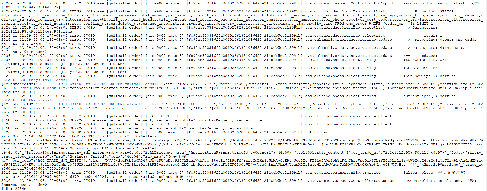
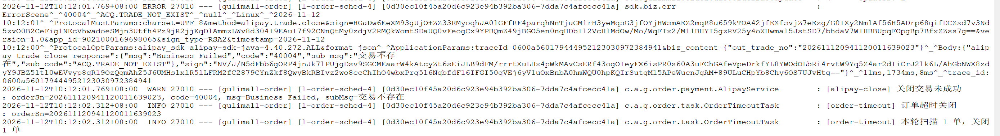
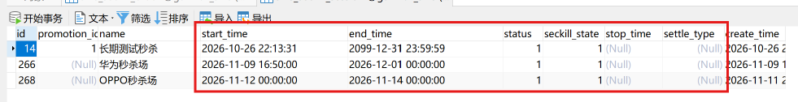
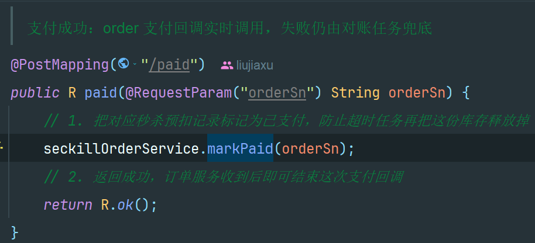
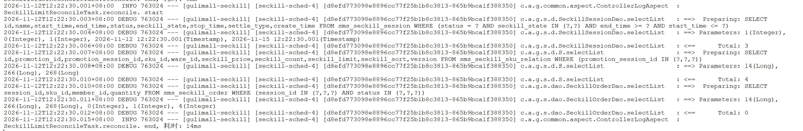
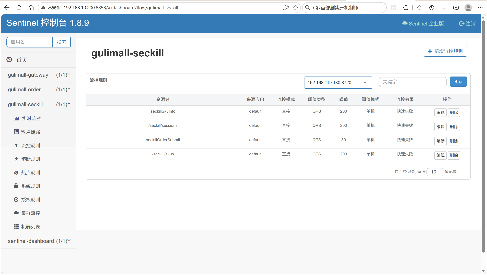
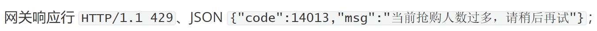
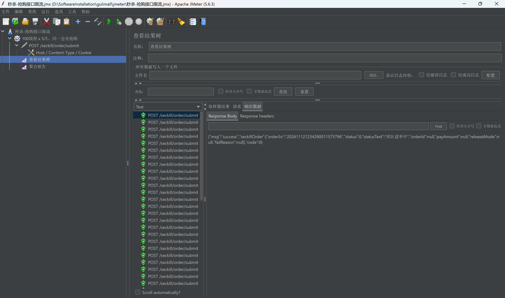

# 15.2 秒杀回补、对账与限流-介绍

> 本篇介绍秒杀抢购之后的库存闭环：用户取消和订单超时怎么把库存还回秒杀池或普通池、场次结束怎么停止抢购并结算、支付成功怎么回填秒杀单、五个定时任务怎么用数据库事实收敛 Redis 和订单状态、MQ 消息怎么补偿，以及 Sentinel 和 JMeter 怎么保护与验证抢购链路。

> 定时任务与限流相关文档：[定时任务与 Cron 表达式](../定时任务/定时任务与Cron表达式.md)、[Sentinel 文档](../Sentinel/Sentinel.md)。

---

## 1. 这个功能是干什么的

秒杀抢购只完成“预扣”和“异步建单”，库存真正回到正确位置还要靠后续链路：

1. **取消回补**：用户主动取消待付款订单，订单关闭，库存从未支付订单里退出来。
2. **超时回补**：订单超过支付时间仍未付款，定时任务关单，库存退出来。
3. **活动结束结算**：场次停止后不能再抢，宽限期结束时按数据库剩余把活动锁定退回普通可售库存。
4. **支付回填**：支付成功后秒杀单从“已建单”变“已支付”，防止超时任务把已支付订单的库存释放掉。
5. **对账补偿**：消息丢失、消费失败、状态没回写、Redis 计数偏差，由定时任务按数据库事实修复或告警。
6. **限流熔断**：入口洪峰超过阈值时快速拒绝，保护 Redis、数据库和下游服务。

业务上的核心要求：

```text
库存不能凭空多出来，也不能凭空少掉；
已支付订单不能被当成未支付释放；
活动结束后不能再把库存写回已删除的秒杀 key；
Redis 只做加速，最终以数据库为准。
```



## 2. 用户/管理员怎么操作

### 2.1 用户取消订单

1. 用户在支付页、订单列表或订单详情点击“取消订单”。
2. 页面请求 `POST /pay/cancel`，参数 `orderSn`。
3. 后端校验订单存在、属于当前会员、状态为待付款。
4. 订单状态条件更新为已关闭。
5. 秒杀订单通知 seckill 释放；普通订单通知 ware 释放。
6. 页面刷新订单状态，库存回到活动池或普通池。

取消成功后用户不需要再做什么。释放失败也不会让取消失败，后台由对账任务补齐。

### 2.2 用户支付

1. 用户从秒杀结果页跳转到支付页。
2. 支付页展示订单号和应付金额。
3. 用户用支付宝完成支付。
4. 支付宝异步通知 order，order 把订单改为已支付。
5. order 通知 seckill 把秒杀单从“已建单”改为“已支付”。
6. 用户浏览器同步跳回订单列表。

秒杀订单不经过购物车，支付成功后也不会按 SKU 删除购物车商品。

### 2.3 等待超时自动关单

1. 用户下单后不支付。
2. `OrderTimeoutTask` 每分钟扫描超过支付超时的待付款订单。
3. 订单条件更新为已关闭。
4. 秒杀订单立即通知 seckill 释放。
5. 普通订单等待 ware 的延时释放消息。
6. 库存回到活动池或普通池。

超时关单没有用户操作，也没有管理员操作，完全由定时任务驱动。

### 2.4 管理员结束或取消场次

1. 管理员在后台场次列表查看场次状态。
2. 场次自然到点后，延时消息把状态推进为“停止中”。
3. 管理员也可以取消进行中的场次，取消后同样进入“停止中”。
4. 停止中时立即删除 Redis 秒杀库存 key，阻止继续抢购。
5. 宽限期 30 分钟结束后结算，按数据库剩余释放活动锁定。
6. 最终状态落“已结束”或“已取消”。

管理员不需要手工点结算。结算由延时消息触发，每天 3 点还有兜底任务。

### 2.5 管理员查看对账与限流

1. 对账任务没有页面和手工触发入口，只按 cron 执行。
2. 库存 key 缺失、库存值异常、限购计数被重建时，日志以 `[ALERT]` 开头。
3. 管理员通过日志平台检索 `seckill-reconcile`、`seckill-limit-reconcile`、`seckill-settle` 观察结果。
4. Sentinel 规则放在 Nacos 的 `SENTINEL_GROUP` 下，修改后客户端实时生效。
5. Sentinel Dashboard 只用于查看机器、QPS、RT、拒绝数和临时调整规则。

### 2.6 压测人员执行 JMeter

1. 打开 `jmeter/秒杀-*.jmx`。
2. 修改用户定义变量：`targetHost`、`siteHost`、`sessionId`、`skuId`、`addrId`、`gulimallSession`、`randomCode`。
3. 启动对应场景，观察响应码分布、HTTP 429、Sentinel Dashboard 的拒绝数。
4. 抢购脚本会真实消耗库存和生成订单，压完要取消测试订单或清理数据。

## 3. 整体设计思路

### 3.1 业务上怎么设计

#### 3.1.1 回补去向

取消、超时、建单失败都可能回补库存。回补去向只有两个：

```text
回秒杀池：库存重新计入 seckill_stock_locked，Redis 秒杀库存和限购同时加回
回普通池：库存只从 stock_locked 减去，普通可售库存增加，Redis 秒杀 key 不动
```

判定条件：

1. 场次存在。
2. 场次有效状态是“进行中”。
3. Redis 库存 key 仍然存在。

三条同时满足才回秒杀池，否则回普通池。活动结束后的降级去向就是普通池。原因：

1. 场次停止中、已结束、已取消时，秒杀 key 已经删除或即将删除，回写秒杀池会让库存永远卖不出去。
2. 场次结束后普通销售还要继续，库存应该回到普通可售池。
3. 库存 key 不存在时不能凭空补一个 Redis key，否则会造出配置之外的库存。

#### 3.1.2 宽限期

场次到点后不能立刻把所有库存还回去，因为还有两类订单在途：

1. 用户已经抢到，但订单还在支付中。
2. 建单消息还在 MQ 重试或对账中。

所以场次结束后进入“停止中”，保留 30 分钟宽限期：

```text
场次结束 → 停止中 → 删除秒杀库存 key → 30 分钟宽限 → 结算
```

宽限期和订单支付超时共用 `gulimall.ware.stock-release.delay-ms`，默认 1800000 毫秒。宽限期内已经建单的订单仍可取消、支付、释放；宽限期结束后结算只释放数据库里剩余的 `seckill_stock_locked`。

#### 3.1.3 以数据库为准

库存真相在 ware 的数据库：

```text
wms_ware_sku.stock
wms_ware_sku.stock_locked
wms_ware_sku.seckill_stock_locked
```

Redis 库存只用于抢购时的快速预扣，可能因为 key 丢失、活动结束、消息重复而不准。因此：

1. 结算按数据库剩余的 `seckill_stock_locked` 释放，不按 Redis 剩余值计算。
2. 库存对账只检查 Redis key 是否存在、值是否在 `0 ~ seckill_count` 范围内，只告警，不自动改值。
3. 限购对账以 `sms_seckill_order` 中待建单、已建单、已支付的数量为准，重建 Redis 限购 Hash。
4. 订单对账以 `oms_order` 的状态为准，决定补释放还是回填已支付。

#### 3.1.4 五个对账任务

| 任务 | 频率 | 作用 |
|---|---|---|
| `SeckillOrderReconcileTask` | 每分钟第 15 秒 | 待建单回填/重发/回补；已建单超时补释放或回填 PAID |
| `SeckillLimitReconcileTask` | 每分钟第 30 秒 | 按订单事实重建限购 Hash |
| `SeckillStockReconcileTask` | 每天 03:00 | 检查库存 key 缺失和值异常，只告警 |
| `SeckillSettleTask`（`SeckillSettleScheduled`） | 每天 03:00 | 停止中宽限期已到的场次兜底结算；漏结束消息的场次补结束 |
| `MqMessageCompensateTask` | 每分钟第 0 秒 | 重发 `mq_message` 中未确认或投递失败的消息，超限归档死信 |

五个任务分工：

1. 订单对账管“订单和秒杀单”的一致性。
2. 限购对账管“订单和 Redis 限购计数”的一致性。
3. 库存对账管“Redis 库存 key 是否健康”，只发现不修复。
4. 结算兜底管“场次状态和活动锁定库存”的最终释放。
5. MQ 补偿管“本地消息表和 Broker”的一致性。

#### 3.1.5 限流熔断业务规则

1. 网关 `seckill-route` 限制 100 QPS，超过返回 HTTP 429。
2. 抢购资源 `seckillOrderSubmit` 限制 50 QPS，慢调用熔断 800 毫秒、比例 50%、至少 10 次请求、熔断 10 秒。
3. 商品信息 `seckillSkuInfo` 总流控 200 QPS，同一 `skuId` 热点参数限制 20 QPS。
4. 场次接口 `/seckill/sessions`、商品列表 `/seckill/skus` 各限制 200 QPS。
5. 被拦截的请求统一返回 `14013`，不进入 Redis 预扣、不写业务表。

### 3.2 技术上怎么设计

#### 3.2.1 Redisson 场次锁

场次锁的 key 是：

```text
seckill:settle:lock:{sessionId}
```

使用方：

1. 场次停止 `markEnding()`。
2. 场次取消 `cancelSession()`。
3. 场次结算 `settleSession()`。
4. 场次下架、删除。
5. 用户取消、超时释放 `releaseByOrderSn()`。

锁的作用是串行化“判断场次是否进行中”和“结算删除秒杀 key”。如果没有锁，取消线程可能刚判断完“进行中”，结算线程就把库存 key 删了，随后取消线程把 Redis 回补到一个已经结束的场次。

锁使用 `tryLock(0, TimeUnit.SECONDS)` 或 `tryLock(3, TimeUnit.SECONDS)`：

1. 后台变更最多等 0 秒，拿不到直接提示稍后重试。
2. 用户取消最多等 3 秒，拿不到返回 `14010`，订单取消失败，等对账补释放。

#### 3.2.2 条件更新状态机

所有状态推进都用条件更新：

```sql
update oms_order
set status = 4
where id = ? and status = 0;

update sms_seckill_order
set status = 2, release_mode = ?, release_reason = ?
where order_sn = ? and status = 1;

update wms_ware_order_task
set task_status = 2
where id = ? and task_status = 1;
```

更新 0 行代表状态已经被其他线程改过：

1. 支付回调和超时关单竞争，只有一方成功。
2. 用户取消和超时关单竞争，只有一方成功。
3. 两个取消请求竞争，只有一次真正释放。
4. 重复消息消费，只有一次真正建单。

条件更新比“先查再改”可靠，不需要额外分布式锁，也不怕多实例并发。

#### 3.2.3 Feign 调用链

释放和支付回填跨三个服务：

```text
order → seckill → ware    取消/超时释放
order → seckill           支付成功回填 PAID
seckill → order           建单、查询订单状态
coupon → ware             场次结算释放剩余活动锁定
```

Feign 失败的处理原则：

1. 取消流程中 seckill 不可用：只记日志，取消失败不回滚，等对账补释放。
2. 支付回填 seckill 不可用：只记日志，支付仍成功，等对账回填 PAID。
3. 结算释放 ware 失败：抛异常，让 MQ 重试或 3 点兜底继续结算。
4. 建单时不配置 fallback，避免把“order 不可用”误判成“订单不存在”。

#### 3.2.4 定时任务

1. Spring `@Scheduled` 触发，多实例同时跑。
2. 任务内部用条件更新、状态过滤、每批 100 条控制并发和影响面。
3. 单条失败只记日志，不中断整批。
4. 对账任务不直接创建订单，只查询、重发消息、改秒杀单状态、调用释放接口。

#### 3.2.5 Sentinel 规则持久化

1. 网关规则、流控规则、熔断规则、热点参数规则分别放在 Nacos。
2. group 固定 `SENTINEL_GROUP`，dataId 与 `deploy/sentinel` 下的 JSON 文件同名。
3. 客户端启动时拉取，Nacos 变更后实时推送到客户端。
4. Dashboard 只用于查看和临时调整，不作为持久化存储。

#### 3.2.6 JMeter 压测

四个秒杀脚本分别覆盖：

1. 网关场次查询限流。
2. 商品列表直连限流。
3. 商品详情同一 SKU 热点参数限流。
4. 抢购接口限流。

压测脚本通过用户定义变量切换目标地址、场次、SKU、地址、登录 cookie 和随机码，不写死在请求里。

## 4. 详细代码、配置和解释

本章按“类或配置为什么存在 → 关键概念 → 正常链路 → 代码分块解释 → 一次完整示例 → 边界”组织。每块代码前先说明它在链路里承担什么，代码后按 1、2、3、4 说明执行顺序、条件和原因。

### 4.1 OrderServiceImpl：取消订单与关闭后分流

#### 4.1.1 这个类解决什么问题

用户在支付页、订单列表或订单详情放弃支付时，会点“取消订单”。请求先到 `PayController.cancel()`，再进入 `OrderServiceImpl.cancelOrder()`。用户看到的是“订单已关闭”，系统里实际发生两件事：

1. `oms_order.status` 从待付款改成已关闭；
2. 这笔订单占用的库存要退回去。

第二件事跨服务：秒杀订单的预扣记录和 Redis 库存属于 seckill，普通订单的 `stock_locked` 属于 ware。取消接口无法独自完成释放，所以 `cancelOrder()` 只负责关单，关单成功后调用 `afterOrderClosed()`，由它按 `source_type` 把释放请求转给下游。

这个类在链路里的位置：

```text
用户 → PayController.cancel → OrderServiceImpl.cancelOrder
     → 条件更新 oms_order.status
     → afterOrderClosed
        → 秒杀单：SeckillFeignClient.releaseSeckillOrder
        → 普通单：releaseStockQuietly → ware
```

难点不在 SQL，而在并发和失败：支付回调、超时关单、重复取消可能同时修改同一行订单，释放调用也可能失败。关单必须只成功一次，释放失败又不能把已经成功的取消回滚。

#### 4.1.2 关键概念与分流规则

| 概念 | 取值 | 在取消链路里的作用 |
|---|---|---|
| `oms_order.status` | 0 待付款、1 已支付、2 已发货、3 已完成、4 已关闭 | 只有 0 允许取消；条件更新把 0 改成 4 |
| `oms_order.source_type` | 2 表示秒杀订单 | 决定释放请求发给 seckill 还是 ware |
| 条件更新 | `where id=? and status=0` | 支付回调、超时任务、重复取消之间只有一方成功 |
| 幂等释放 | 订单已关闭时再调一次 `afterOrderClosed()` | 补上上一次释放失败的缺口 |

取消链路有两条分支：

1. 秒杀订单：订单服务不知道场次状态，也不知道 Redis 库存 key 是否还在，必须把 `orderSn` 交给 seckill，由 seckill 判断回秒杀池还是普通池。
2. 普通订单：订单服务直接调 ware 释放 `stock_locked`，没有秒杀池概念。

`afterOrderClosed()` 不返回释放结果，取消接口也不会因为释放失败而报错。库存最终一致由 `SeckillOrderReconcileTask` 和 ware 的延时释放兜底。

#### 4.1.3 代码与解释

取消入口先做参数、登录态和订单归属校验，再做状态推进。`cancelOrder()` 负责关单，`afterOrderClosed()` 负责关单后的分流，两个方法拼成一次完整取消。

```java
@Override
public void cancelOrder(String orderSn) {
    if (orderSn == null || orderSn.isBlank()) {
        throw new RRException(BizCodeEnum.ORDER_SN_REQUIRED);
    }

    MemberResponseVo loginUser = MemberResponseVoThreadLocal.get();
    if (loginUser == null) {
        throw new RRException(BizCodeEnum.ORDER_NOT_LOGIN);
    }

    OrderEntity order = getOne(new QueryWrapper<OrderEntity>()
            .eq("order_sn", orderSn)
            .last("LIMIT 1"), false);
    if (order == null || !loginUser.getId().equals(order.getMemberId())) {
        throw new RRException(BizCodeEnum.ORDER_NOT_FOUND_OR_NOT_OWNER);
    }

    // 已经关闭：可能是上次取消时库存释放失败，再补一次，接口保持幂等
    if (Integer.valueOf(ORDER_STATUS_CLOSED).equals(order.getStatus())) {
        afterOrderClosed(order, "USER_CANCEL");
        return;
    }

    if (!Integer.valueOf(ORDER_STATUS_UNPAID).equals(order.getStatus())) {
        throw new RRException(BizCodeEnum.ORDER_CANCEL_NOT_ALLOWED);
    }

    // 条件更新：和支付回调、超时关单并发时，只有一方能成功
    int updated = getBaseMapper().update(null, new UpdateWrapper<OrderEntity>()
            .set("status", ORDER_STATUS_CLOSED)
            .eq("id", order.getId())
            .eq("status", ORDER_STATUS_UNPAID));

    if (updated == 0) {
        // 状态被别的线程改了：如果已经被关闭，按幂等处理；否则拒绝
        OrderEntity latest = getById(order.getId());
        if (latest != null && Integer.valueOf(ORDER_STATUS_CLOSED).equals(latest.getStatus())) {
            afterOrderClosed(latest, "USER_CANCEL");
            return;
        }
        throw new RRException(BizCodeEnum.ORDER_CANCEL_NOT_ALLOWED);
    }

    afterOrderClosed(order, "USER_CANCEL");
}

@Override
public void afterOrderClosed(OrderEntity order, String reason) {
    if (order == null || order.getOrderSn() == null) {
        return;
    }
    // 1. 秒杀订单：由 seckill 判断场次是否还进行中，决定回秒杀池还是普通池
    if (Integer.valueOf(2).equals(order.getSourceType())) {
        try {
            R result = seckillFeignClient.releaseSeckillOrder(order.getOrderSn(), reason);
            if (result == null || result.getCode() == null || result.getCode() != 0) {
                log.error("[order-cancel] 通知秒杀释放失败，等待对账：orderSn={} msg={}",
                        order.getOrderSn(), result == null ? "空" : result.get("msg"));
            }
        } catch (Exception e) {
            log.error("[order-cancel] 通知秒杀释放异常，等待对账：orderSn={}", order.getOrderSn(), e);
        }
        return;
    }
    // 2. 普通订单：释放 ware 的 stock_locked
    releaseStockQuietly(order.getOrderSn());
}
```

逐段解释：

1. `orderSn` 为空或全是空白字符时直接返回参数错误，避免用空值查库。
2. 从 `MemberResponseVoThreadLocal` 取当前登录会员；取不到说明登录态没有传到控制器，直接拒绝。
3. 按 `order_sn` 查订单并 `LIMIT 1`，同时校验 `member_id` 与登录会员一致，防止拿别人的订单号取消。
4. 订单已经关闭时不再更新状态，直接调用 `afterOrderClosed()`。这一步是幂等补偿：上一次取消可能已经关单，但释放库存的远程调用失败，重试时把释放补上。
5. 状态不是待付款时抛 `ORDER_CANCEL_NOT_ALLOWED`。已支付、已发货、已完成的订单都不能从这里关闭。
6. 条件更新 `status 0→4`，条件带 `id` 和 `status=0`，返回受影响行数。
7. 受影响 0 行说明订单状态在查询和更新之间被别的线程改了。重新查一次：已经被关闭就按幂等处理并补释放；被改成其它状态（例如支付回调改成已支付）则拒绝取消。
8. 更新 1 行才调用 `afterOrderClosed()`，把释放交给下游。
9. `afterOrderClosed()` 先判空，避免调用方传入不完整对象。
10. `source_type=2` 说明是秒杀订单，调用 `SeckillFeignClient.releaseSeckillOrder()`，把 `orderSn` 和原因传给 seckill。场次状态和 Redis 库存由 seckill 判断。
11. 返回值不是成功码、返回为空或抛异常，只记录日志。订单已经关闭，不能因为库存没退回就把取消结果改成失败。
12. 普通订单调用 `releaseStockQuietly()`，由 ware 释放 `stock_locked`。整个方法没有本地事务，写订单和远程释放无法放进同一个事务，一致性靠下游幂等和分钟级对账。

为什么已关闭订单还要重新释放：取消接口可能是上一次释放超时后用户重试。订单已经关闭，库存却可能还没释放。重新调用下游释放接口，依靠下游的工作单状态和释放标识做幂等，可以补齐上次的缺口。

#### 4.1.4 一次完整示例

用户取消秒杀订单：

```text
1. 前端 POST /pay/cancel，orderSn=202611120001
2. cancelOrder 校验通过：订单 status=0、source_type=2
3. 条件更新 status 0→4，影响 1 行
4. afterOrderClosed 调 seckill /internal/seckill/order/release
5. seckill 判断场次进行中、库存 key 存在，回秒杀池
6. sms_seckill_order 从 BUILT 改成 RELEASED
7. order 返回 R.ok()，前端刷新显示已关闭
```

释放失败时：

```text
1. 条件更新仍然成功，订单已关闭
2. Feign 超时，日志记录“等待对账”
3. 用户看到取消成功
4. SeckillOrderReconcileTask 下一分钟查到订单已关闭、秒杀单仍是 BUILT
5. 补调 releaseByOrderSn，库存最终退回
```

#### 4.1.5 它不做什么

1. 不修改 `sms_seckill_order`，秒杀单状态由 seckill 推进。
2. 不直接修改 `wms_ware_sku`，库存释放由 ware 完成。
3. 不关闭支付宝交易，取消接口不会调用 `closeTradeQuietly()`。
4. 不在本地重试释放，失败只记日志。
5. 不处理已支付订单的退款。

#### 4.1.6 边界与可优化点

1. `afterOrderClosed()` 没有返回释放结果，前端看不到库存是否已经退回，只能看到订单状态。
2. 秒杀释放失败没有进入本地重试表，完全依赖 `SeckillOrderReconcileTask` 的分钟级扫描。
3. 取消接口不关闭支付宝交易，用户取消后仍可能继续付款，迟到支付会进入退款流程。
4. 取消原因固定传 `USER_CANCEL`，没有记录操作人和取消时间。

### 4.2 OrderTimeoutTask：超时关单

#### 4.2.1 这个类解决什么问题

秒杀和普通下单都会创建待付款订单，用户拍下后不付款的情况很常见。订单不能一直占着库存，需要有人在支付超时后把订单关掉，并把库存退回去。`OrderTimeoutTask` 就是超时链路的驱动器：没有用户操作，也没有管理后台入口，完全按 cron 执行。

调用链：

```text
@Scheduled 每分钟
  → 查 status=0 且 create_time <= now - payTimeout 的订单
  → 条件更新 status 0→4
  → 关闭支付宝交易
  → 秒杀单立即通知 seckill 释放
  → 普通单等待 ware 延时释放消息
```

与用户主动取消的区别：取消是单笔、同步、有请求上下文；超时是批量、异步、没有请求上下文。两者最终都调用 `afterOrderClosed()`，但超时任务对普通订单不直接释放，避免和下单时登记的延时释放消息重复。

#### 4.2.2 关键概念

| 概念 | 说明 |
|---|---|
| `cron = "0 * * * * ?"` | 每分钟第 0 秒触发一次 |
| `BATCH_SIZE = 100` | 每轮最多处理 100 单，控制单次执行时长 |
| `payTimeoutMs` | 来自 `gulimall.ware.stock-release.delay-ms`，默认 30 分钟 |
| `deadline` | 当前时间减支付超时，早于该时间的待付款订单才关闭 |
| 条件更新 | `where id=? and status=0`，和支付回调竞争 |
| `source_type=2` | 秒杀订单关单后立即释放，普通订单交给延时消息 |

三个设计取舍：

1. 每轮只取 100 条：关单要逐单调支付宝和 seckill，一次处理太多会把任务拖长，也会集中占用连接。
2. 条件更新而不是先查再改：支付回调和超时任务同时改一行，只有一方能成功，已支付订单不会被误关。
3. 秒杀单立即释放、普通单等消息：普通订单下单时已经登记了延时释放，任务再释放一次会重复；秒杀订单没有这条延时消息，必须当场通知 seckill。

#### 4.2.3 代码与解释

`closeExpiredOrders()` 是唯一的执行入口，负责扫表、抢状态、关交易和分流转发。

```java
@Slf4j
@Component
public class OrderTimeoutTask {

    /** 每批处理数量，避免一次扫太多 */
    private static final int BATCH_SIZE = 100;

    /** oms_order.status：0-待付款 */
    private static final int STATUS_UNPAID = 0;

    /** oms_order.status：4-已关闭 */
    private static final int STATUS_CLOSED = 4;

    @Autowired
    private OrderService orderService;
    @Autowired
    private AlipayService alipayService;

    /** 支付超时（毫秒），配置在 common.yaml */
    @Value("${gulimall.ware.stock-release.delay-ms}")
    private long payTimeoutMs;

    /**
     * 每分钟跑一次
     * second
     * minute
     * hour
     * day of month
     * month
     * day of week
     */
    @Scheduled(cron = "0 * * * * ?")
    public void closeExpiredOrders() {
        Date deadline = new Date(System.currentTimeMillis() - payTimeoutMs);

        List<OrderEntity> orders = orderService.list(new QueryWrapper<OrderEntity>()
                .select("id", "order_sn", "source_type")
                .eq("status", STATUS_UNPAID)
                .le("create_time", deadline)
                .last("LIMIT " + BATCH_SIZE));

        if (orders.isEmpty()) {
            return;
        }

        int closed = 0;
        for (OrderEntity order : orders) {
            // 条件更新：只有仍是「待付款」的订单才会被关闭。
            // 和支付回调并发时，只有一方能更新成功。
            boolean updated = orderService.update(new UpdateWrapper<OrderEntity>()
                    .set("status", STATUS_CLOSED)
                    .eq("id", order.getId())
                    .eq("status", STATUS_UNPAID));

            if (updated) {
                closed++;
                // 关闭支付宝交易，尽量避免超时后继续付款；
                // 如果交易已经支付，后续 notify 会走到自动退款。
                alipayService.closeTradeQuietly(order.getOrderSn());
                // 秒杀订单：立即通知 seckill 归还库存；普通订单仍由 ware 延时消息释放
                if (Integer.valueOf(2).equals(order.getSourceType())) {
                    orderService.afterOrderClosed(order, "ORDER_TIMEOUT");
                }
                log.info("[order-timeout] 订单超时关闭：orderSn={}", order.getOrderSn());
            }
        }

        log.info("[order-timeout] 本轮扫描 {} 单，关闭 {} 单", orders.size(), closed);
    }

}
```

逐段解释：

1. `deadline` 用当前时间减支付超时，得到“最晚允许付款时间”的分界。
2. 查询只取 `id`、`order_sn`、`source_type` 三列，条件 `status=0` 且 `create_time <= deadline`，`LIMIT 100` 取一批。
3. 没有订单直接返回，避免空跑后续日志。
4. 逐单条件更新 `status 0→4`；`updated` 为 false 说明支付回调或另一个实例已经改过状态，跳过。
5. 更新成功才关闭支付宝交易，尽量阻止超时后继续付款。关单失败不影响订单关闭。
6. 秒杀订单调用 `afterOrderClosed(order, "ORDER_TIMEOUT")`，进入 4.1 的秒杀释放链路。
7. 普通订单不在关单任务里释放，下单时已经登记了 ware 延时释放消息。
8. 每轮记录扫描数和关闭数，便于观察积压。

为什么普通订单不在关单任务里释放：普通订单下单时已经登记了延迟释放消息。关单任务只改状态，库存释放由消息驱动，避免关单任务和延时消息同时释放。秒杀订单没有普通延时释放消息，所以需要立即通知 seckill。

#### 4.2.4 一次完整示例

```text
1. 12:00 用户下单，订单 status=0，支付超时 30 分钟
2. 12:30 之后 OrderTimeoutTask 扫到该单
3. 条件更新 status 0→4，影响 1 行
4. 关闭支付宝交易
5. source_type=2：Feign 通知 seckill，库存回秒杀池或普通池
6. source_type=1：等待 ware 延时消息释放
7. 用户刷新订单列表看到已关闭
```

如果用户在 12:29:59 完成支付，支付回调先把订单改成已支付，关单任务的条件更新影响 0 行，跳过该单。两条链路不会同时成功。

#### 4.2.5 它不做什么

1. 不创建订单，订单由下单链路创建。
2. 不直接释放普通订单库存，普通订单走 ware 延时消息。
3. 不退款，迟到支付由支付回调走单独的退款分支。
4. 不处理已支付、已发货、已完成的订单。
5. 失败的单不单独重试，等下一分钟再扫。

#### 4.2.6 边界与可优化点

1. 每批 100 条，积压多时要等后续轮次，可以改成循环取批直到没有数据。
2. 没有记录支付宝关单失败次数，无法判断有多少交易仍可支付。
3. `source_type` 直接写数字 2，没有抽成常量。
4. cron 固定每分钟，多实例会同时扫描，靠条件更新去重，没有做分布式调度。
5. 没有记录每轮耗时，任务变慢时不容易发现。



### 4.3 SeckillOrderServiceImpl：取消/超时释放

#### 4.3.1 这个类解决什么问题

订单服务关闭订单后，只知道 `orderSn` 和 `source_type`。这笔订单是不是秒杀单、场次是否还在进行、Redis 库存 key 是否还存在、限购计数要不要减，这些信息都在 seckill。取消、超时、对账三个调用方最终都会请求 seckill 的内部释放接口，落到 `releaseByOrderSn()`。

调用链：

```text
order（cancelOrder / OrderTimeoutTask / SeckillOrderReconcileTask）
  → POST /internal/seckill/order/release
  → SeckillOrderInternalController.release
  → SeckillOrderServiceImpl.releaseByOrderSn
  → decideReleaseMode
  → ware /ware/waresku/seckill/order/release
  → Redis 回补（仅回秒杀池时）
  → sms_seckill_order.status = RELEASED
```

这个类要解决四个问题：

1. 重复释放：用户取消、超时、对账可能对同一单各调一次。
2. 并发结算：释放判断“场次进行中”的同时，结算可能正在删库存 key。
3. 回补去向：回秒杀池还是普通池。
4. 先后顺序：数据库库存和 Redis 计数谁先动。

#### 4.3.2 释放条件与回补去向

回秒杀池要同时满足三条：

1. `sms_seckill_order.status = BUILT`；
2. 场次存在，且有效状态是进行中；
3. `seckill:stock:{sessionId}:{skuId}` 仍然存在。

任何一条不满足都回普通池。两种去向的库存变化：

```text
回秒杀池：ware 减 stock_locked、加 seckill_stock_locked；Redis 库存和限购计数加回
回普通池：ware 只减 stock_locked；Redis 秒杀 key 不动；普通可售库存增加
```

几个关键约束：

1. 只有 `BUILT` 才释放。`WAIT_BUILD` 由建单链路和对账处理；`RELEASED`、`BUILD_FAILED`、`PAID` 都不能再释放。
2. 场次锁 `seckill:settle:lock:{sessionId}` 同时被取消、结束、结算使用。锁内重查让两个取消请求只有一个真正释放。
3. ware 用工作单 `task_status 1→2` 抢占，数据库层保证只释放一次。
4. 先调 ware 再回补 Redis，最后改秒杀单状态。ware 事务提交后 Redis 才加回，避免数据库回滚而 Redis 已经加回。

#### 4.3.3 代码与解释

`releaseByOrderSn()` 是释放主流程，`decideReleaseMode()` 只负责回答“这份库存回哪里”。两段代码一起看：前者管并发和顺序，后者管去向。

```java
@Override
public SeckillOrderResultVo releaseByOrderSn(String orderSn, String reason) {
    // 1. 没有预扣记录说明是普通订单，直接返回
    SeckillOrderEntity order = getByOrderSn(orderSn);
    if (order == null) {
        return null;
    }

    // 2. 只有已建单的才需要归还库存
    if (!Integer.valueOf(SeckillOrderStatus.BUILT).equals(order.getStatus())) {
        return toResult(order);
    }

    // 3. 和结算/取消共用场次锁，避免"判断进行中"和"结算删 key"交叉
    RLock lock = redissonClient.getLock(SeckillConstant.settleLockKey(order.getSessionId()));
    boolean locked = false;
    try {
        locked = lock.tryLock(3, TimeUnit.SECONDS);
        if (!locked) {
            throw new RRException(BizCodeEnum.SECKILL_RELEASE_CONFLICT);
        }

        // 4. 锁内重查：两个取消请求只有一个真正释放
        order = getByOrderSn(orderSn);
        if (order == null
                || !Integer.valueOf(SeckillOrderStatus.BUILT).equals(order.getStatus())) {
            return order == null ? null : toResult(order);
        }

        // 5. 场次仍进行中且库存 key 存在，才回秒杀池
        int mode = decideReleaseMode(order);

        // 6. 先动数据库：任务 1→2、stock_locked 减、回池时 seckill_stock_locked 加
        R result = wareFeignClient.releaseSeckillOrderStock(orderSn,
                mode == SeckillOrderStatus.RELEASE_TO_SECKILL ? "SECKILL_POOL" : "NORMAL_POOL");
        if (result == null || result.getCode() == null || result.getCode() != 0) {
            String msg = result == null ? "返回为空" : String.valueOf(result.get("msg"));
            throw new RRException("释放秒杀订单库存失败：" + msg);
        }

        // 7. 回秒杀池时再回补 Redis；key 已不存在只记日志，结算会按 DB 剩余释放
        if (mode == SeckillOrderStatus.RELEASE_TO_SECKILL) {
            int released = seckillStockService.releaseReservation(
                    order.getSessionId(), order.getSkuId(), order.getMemberId(),
                    order.getQuantity(), orderSn);
            if (released < 0) {
                log.warn("[seckill-release] Redis 库存 key 已不存在，库存留在 seckill_stock_locked 等结算 orderSn={}",
                        orderSn);
            }
        }

        // 8. 最后推进状态；前面两步都幂等，失败重试安全
        seckillOrderDao.update(null, new UpdateWrapper<SeckillOrderEntity>()
                .set("status", SeckillOrderStatus.RELEASED)
                .set("release_mode", mode)
                .set("release_reason", reason)
                .eq("order_sn", orderSn)
                .eq("status", SeckillOrderStatus.BUILT));

        SeckillOrderEntity latest = getByOrderSn(orderSn);
        return toResult(latest == null ? order : latest);
    } catch (InterruptedException e) {
        Thread.currentThread().interrupt();
        throw new RRException(BizCodeEnum.SECKILL_RELEASE_CONFLICT);
    } finally {
        if (locked && lock.isHeldByCurrentThread()) {
            lock.unlock();
        }
    }
}

/**
 * 回秒杀池的条件：场次仍进行中，且 Redis 库存 key 还在。
 */
private int decideReleaseMode(SeckillOrderEntity order) {
    // 1. 场次必须存在
    SeckillSessionEntity session = seckillSessionDao.selectById(order.getSessionId());
    if (session == null) {
        return SeckillOrderStatus.RELEASE_TO_NORMAL;
    }
    // 2. 必须还在进行中；停止中/已结束/已取消都回普通池
    int state = SeckillSessionState.effectiveState(session.getSeckillState(),
            session.getStartTime(), session.getEndTime(), new Date());
    if (state != SeckillSessionState.RUNNING) {
        return SeckillOrderStatus.RELEASE_TO_NORMAL;
    }
    // 3. 库存 key 不存在时不能凭空回补
    Boolean exists = stringRedisTemplate.hasKey(
            SeckillConstant.stockKey(order.getSessionId(), order.getSkuId()));
    return Boolean.TRUE.equals(exists)
            ? SeckillOrderStatus.RELEASE_TO_SECKILL : SeckillOrderStatus.RELEASE_TO_NORMAL;
}
```

逐段解释：

1. 按 `order_sn` 查秒杀单。查不到说明不是秒杀订单，返回 null，让调用方按成功处理。
2. 状态不是已建单时直接返回当前结果。已释放、已支付、建单失败的订单都不需要再动库存。
3. 获取 `seckill:settle:lock:{sessionId}`，最多等 3 秒。锁同时覆盖结算，避免“判断场次进行中”和“结算删 key”交叉。
4. 3 秒内拿不到锁抛 `SECKILL_RELEASE_CONFLICT`，订单侧只记日志，等对账补释放。
5. 锁内重新查秒杀单。两个取消请求同时进来时，只有先拿到锁的那个能看到 `BUILT`。
6. 重查后状态已变化，直接返回最新结果，不重复释放。
7. `decideReleaseMode()` 先查场次，场次不存在回普通池。
8. 场次存在时计算有效状态。停止中、已结束、已取消都回普通池，因为秒杀 key 已经或即将删除。
9. 场次进行中再检查 Redis 库存 key。key 不存在说明场次库存已经不在 Redis，不能凭空补一个，回普通池。
10. 调 ware `releaseSeckillOrderStock()`，回秒杀池传 `SECKILL_POOL`，回普通池传 `NORMAL_POOL`。
11. ware 返回失败抛异常。秒杀单状态保持 `BUILT`，下一次取消或对账可以重试。
12. 回秒杀池时执行释放 Lua，把 Redis 库存和限购计数加回。返回负数表示库存 key 已不存在，只记日志。
13. 条件更新 `BUILT → RELEASED`，同时写 `release_mode` 和 `release_reason`。条件里带 `status=BUILT`，重复执行不会覆盖已释放状态。
14. finally 里判断锁是否由当前线程持有再解锁，避免误释放别人的锁。

为什么先动数据库再回补 Redis：数据库是库存真相。ware 事务提交后再回补 Redis，避免数据库回滚但 Redis 已经加回。ware 释放本身用 `task_status 1→2` 抢占，重复调用不会重复减库存。

为什么 Redis 回补失败不回滚状态：ware 已经把订单锁定转回活动锁定或普通可售，库存口径已经正确。Redis key 不存在说明场次已经结束，这部分库存由结算按数据库剩余释放。此时把秒杀单状态改回已建单，会让取消流程反复重试。

#### 4.3.4 一次完整示例

场次进行中，库存 key 存在：

```text
1. orderSn=202611120001，秒杀单 status=BUILT
2. 拿到场次锁，锁内重查仍是 BUILT
3. decideReleaseMode：场次 RUNNING，key 存在 → RELEASE_TO_SECKILL
4. ware 释放：stock_locked -1，seckill_stock_locked +1
5. Redis 库存 +1，限购计数 -1
6. 秒杀单 BUILT→RELEASED，release_mode=回秒杀池
7. 释放场次锁
```

场次已经停止：

```text
1. 场次状态 STOPPING，库存 key 已被删除
2. decideReleaseMode 返回 RELEASE_TO_NORMAL
3. ware 只减 stock_locked，普通可售 +1
4. 不碰 Redis 秒杀 key
5. 秒杀单 BUILT→RELEASED，release_mode=回普通池
6. 剩余活动锁定由结算按数据库统一释放
```

两个取消请求同时到达：

```text
1. 请求 A 先拿到场次锁，请求 B 等待
2. A 完成释放并把状态改成 RELEASED，释放锁
3. B 拿到锁后重查，状态已经不是 BUILT，直接返回
4. 库存只减一次
```

#### 4.3.5 它不做什么

1. 不创建订单，也不关闭 `oms_order`。
2. 不决定释放数量，数量来自 `wms_ware_order_task_detail`。
3. 不删除秒杀单，只推进状态。
4. 不在 Redis 库存 key 缺失时重建 key。
5. 不对普通订单做库存操作。

#### 4.3.6 边界与可优化点

1. 场次锁 3 秒租约，ware 调用超过 3 秒时锁可能提前释放，应使用看门狗或更长租约。
2. `decideReleaseMode()` 和 ware 释放之间仍有时间窗口，锁覆盖了结算，风险可控但不能完全消除。
3. `release_reason` 直接存调用方字符串，没有统一枚举。
4. 释放成功后 Redis 回补失败只记日志，库存口径以数据库为准。
5. 内部释放没有幂等请求号，只能依赖秒杀单状态和工作单状态去重。

#### 4.3.7 内部释放与支付回填接口

order 和 seckill 是两个 JVM，取消、超时、对账都通过 Feign 调内部接口。接口层不写业务，只把 HTTP 参数转成 service 调用，并且保证“不是秒杀单”也返回成功，让取消链路保持幂等。同一个 Controller 还提供支付成功回填入口。

| 接口 | 调用方 | 作用 |
|---|---|---|
| `POST /internal/seckill/order/release` | order | 取消、超时、对账时释放库存 |
| `POST /internal/seckill/order/paid` | order | 支付成功回填秒杀单为已支付 |

两个接口共用 `/internal/seckill/order` 前缀，只允许服务间调用，不经过前端。

```java
@RestController
@RequestMapping("/internal/seckill/order")
public class SeckillOrderInternalController {

    @Autowired
    private SeckillOrderService seckillOrderService;

    @PostMapping("/release")
    public R release(@RequestParam("orderSn") String orderSn,
                     @RequestParam(value = "reason", required = false) String reason) {
        // 1. 普通订单没有秒杀预扣记录，直接幂等返回
        SeckillOrderResultVo result = seckillOrderService.releaseByOrderSn(orderSn, reason);
        // 2. 没有预扣记录说明是普通订单，直接返回成功，保证取消/超时重复回调也不会报错
        if (result == null) {
            return R.ok();
        }
        // 3. 有预扣记录就把释放后的秒杀单状态带回给订单服务，便于核对库存已经退回
        return R.ok().put("seckillOrder", result);
    }

    /**
     * 支付成功：order 支付回调实时调用，失败仍由对账任务兜底
     */
    @PostMapping("/paid")
    public R paid(@RequestParam("orderSn") String orderSn) {
        // 1. 把对应秒杀预扣记录标记为已支付，防止超时任务再把这份库存释放掉
        seckillOrderService.markPaid(orderSn);
        // 2. 返回成功，订单服务收到后即可结束这次支付回调
        return R.ok();
    }
}
```

逐段解释：

1. `/release` 接收 `orderSn` 和可选的 `reason`，把参数原样交给 `releaseByOrderSn()`。
2. 普通订单没有秒杀预扣记录，service 返回 null。
3. 返回 null 时直接 `R.ok()`。历史数据或人工调用可能传普通订单号，返回成功可以保证取消链路幂等。
4. 有预扣记录时，把释放后的秒杀单状态放进 `seckillOrder` 字段，调用方可以核对库存是否已经退回。
5. `/paid` 接收 `orderSn`，调 `markPaid()` 把秒杀单推进到已支付。
6. 两个接口都返回统一 `R`，Feign 侧按 `code` 判断是否成功。

边界与可优化点：

1. 内部接口没有鉴权，只能依赖网关不对外暴露。
2. `reason` 可以为空，释放原因缺失时排查困难。
3. 没有查询秒杀单状态的内部接口，order 无法主动核对。
4. 支付回填接口没有返回是否真的更新成功，重复回调与状态异常无法区分。

### 4.4 WareSkuServiceImpl：释放秒杀订单库存

#### 4.4.1 这个类解决什么问题

库存的最终事实在 ware 的 `wms_ware_sku`。秒杀抢购时扣的是活动可售和订单锁定，取消、超时、建单失败时要把订单锁定退回去。seckill 只知道自己扣了多少，真正的库存加减必须由 ware 完成，所以 `releaseSeckillOrderStock()` 是整条回补链路最后一次落库。

调用链：

```text
seckill releaseByOrderSn
  → Feign /ware/waresku/seckill/order/release
  → WareSkuServiceImpl.releaseSeckillOrderStock(orderSn, mode)
  → wms_ware_order_task.task_status 1→2
  → 逐条明细减 stock_locked，按 mode 决定是否加 seckill_stock_locked
  → 事务提交后刷新普通库存缓存
```

调用方只有 seckill。场次结算走另一个方法 `releaseRemainingSeckillStock`，它释放的是数据库里剩余的活动锁定，不是订单锁定。

#### 4.4.2 关键字段与抢占

| 字段 | 取值 | 作用 |
|---|---|---|
| `wms_ware_order_task.task_status` | 1 已锁定、2 已释放 | 条件更新 1→2，抢占成功才继续释放 |
| `wms_ware_order_task.biz_type` | 1 秒杀 | 拒绝非秒杀工作单走秒杀释放 |
| `wms_ware_order_task_detail.lock_status` | 1 已锁定、2 已释放 | 每条明细单独标记，重复调用不会重复减 |
| `wms_ware_sku.stock` | 总库存 | 支付成功后扣减 |
| `wms_ware_sku.stock_locked` | 订单锁定 | 取消、超时时减回去 |
| `wms_ware_sku.seckill_stock_locked` | 活动锁定 | 回秒杀池时加回去 |
| `mode` | `SECKILL_POOL` / `NORMAL_POOL` | 决定是否加 `seckill_stock_locked` |

工作单状态是这条链路的幂等开关。先查再改在两个并发请求下会都判断为“未释放”，条件更新只有一方能把 1 改成 2，另一方拿到 0 行直接返回。

#### 4.4.3 代码与解释

`releaseSeckillOrderStock()` 在一个本地事务里完成工作单抢占、明细释放和活动锁定回补，事务提交后再刷新缓存。

```java
@Override
@Transactional(rollbackFor = Exception.class)
public void releaseSeckillOrderStock(String orderSn, String mode) {
    // 1. 查工作单；不存在或不是秒杀单都直接返回/拒绝
    WareOrderTaskEntity task = wareOrderTaskService.getOne(
            new QueryWrapper<WareOrderTaskEntity>()
                    .eq("order_sn", orderSn)
                    .last("LIMIT 1"),
            false);
    if (task == null) {
        return;
    }
    if (!Integer.valueOf(BIZ_TYPE_SECKILL).equals(task.getBizType())) {
        throw new RRException("订单不是秒杀工作单，不能走秒杀释放");
    }

    // 2. 抢占：只有把 1 改成 2 的那一次才真正释放
    int claimed = wareOrderTaskService.getBaseMapper().update(null,
            new UpdateWrapper<WareOrderTaskEntity>()
                    .set("task_status", TASK_STATUS_RELEASED)
                    .eq("id", task.getId())
                    .eq("task_status", TASK_STATUS_LOCKED));
    if (claimed == 0) {
        return;
    }

    // 3. 逐条释放明细；回池时同时把数量加回 seckill_stock_locked
    boolean backToSeckill = "SECKILL_POOL".equals(mode);
    Set<Long> skuIds = new HashSet<>();
    List<WareOrderTaskDetailEntity> details = wareOrderTaskDetailService.list(
            new QueryWrapper<WareOrderTaskDetailEntity>()
                    .eq("task_id", task.getId())
                    .eq("lock_status", TASK_STATUS_LOCKED));
    for (WareOrderTaskDetailEntity detail : details) {
        int num = detail.getSkuNum() == null ? 0 : detail.getSkuNum();
        if (num <= 0) {
            continue;
        }

        // 3.1 订单占用的 stock_locked 减回去
        int affected = baseMapper.update(null, new UpdateWrapper<WareSkuEntity>()
                .setSql("stock_locked = COALESCE(stock_locked, 0) - " + num)
                .eq("ware_id", detail.getWareId())
                .eq("sku_id", detail.getSkuId())
                .apply("COALESCE(stock_locked, 0) >= " + num));
        if (affected == 0) {
            throw new RRException(BizCodeEnum.WARE_STOCK_RELEASE_FAILED, detail.getId());
        }

        // 3.2 回秒杀池：重新计入活动占用
        if (backToSeckill) {
            baseMapper.update(null, new UpdateWrapper<WareSkuEntity>()
                    .setSql("seckill_stock_locked = COALESCE(seckill_stock_locked, 0) + " + num)
                    .eq("ware_id", detail.getWareId())
                    .eq("sku_id", detail.getSkuId()));
        }

        // 3.3 明细标记已解锁
        wareOrderTaskDetailService.update(new UpdateWrapper<WareOrderTaskDetailEntity>()
                .set("lock_status", TASK_STATUS_RELEASED)
                .eq("id", detail.getId())
                .eq("lock_status", TASK_STATUS_LOCKED));
        skuIds.add(detail.getSkuId());
    }

    // 4. 事务提交后按数据库重算普通可售库存缓存：
    //    回池时可售不变，回普通池时可售 +num，不能用 INCRBY 一刀切
    afterCommit(() -> skuIds.forEach(this::refreshStockCache));
}
```

逐段解释：

1. 按 `order_sn` 查工作单，`LIMIT 1` 保证只取一条。工作单不存在直接返回，调用方按成功处理。
2. 工作单不是秒杀类型时抛异常，防止普通订单误走秒杀列。
3. 条件更新 `task_status 1→2`。更新 0 行说明已经被释放过，直接返回，保证重复调用不会重复减库存。
4. 查 `lock_status=1` 的明细。已经释放的明细不再处理。
5. 每条明细取数量，数量为空或小于等于 0 时跳过，避免影响库存。
6. 用条件更新减 `stock_locked`，`COALESCE` 处理空值，`stock_locked >= num` 防止减成负数。影响 0 行说明库存不够，抛异常回滚整个事务。
7. 回秒杀池时把 `seckill_stock_locked` 加回同样数量。回普通池不加，库存直接变成普通可售。
8. 明细 `lock_status 1→2`，然后收集 SKU，事务提交后按数据库重算普通库存缓存。

为什么回池要加 `seckill_stock_locked`：建单时活动锁定已经转成了订单锁定。取消后如果场次还在进行中，这份库存应该重新变成活动可售，所以要加回 `seckill_stock_locked`。如果活动已结束，只减 `stock_locked`，库存回到普通可售，不再进入活动。

为什么缓存要重算而不是 `INCRBY`：回秒杀池时普通可售库存不变，回普通池时普通可售库存增加。两种模式变化不同，用 `INCRBY` 无法区分，必须按数据库重新计算可用库存。

#### 4.4.4 一次完整示例

订单买了 2 件，场次仍在进行：

```text
1. 工作单 task_status=1，明细 lock_status=1、sku_num=2
2. 条件更新 task_status 1→2，影响 1 行
3. stock_locked 减 2
4. 回秒杀池：seckill_stock_locked 加 2
5. 明细 lock_status 1→2
6. 事务提交，按数据库重算普通库存缓存
7. 同一订单再次调用：task_status 更新 0 行，直接返回
```

场次已经结束：

```text
1. 工作单抢占成功
2. stock_locked 减 2
3. mode=NORMAL_POOL，不改 seckill_stock_locked
4. 普通可售库存加 2，缓存按数据库重算
```

#### 4.4.5 它不做什么

1. 不校验订单是否真的关闭，调用方负责判断。
2. 不修改 `sms_seckill_order`，秒杀单状态由 seckill 推进。
3. 不回补 Redis 库存和限购计数。
4. 不处理普通订单的延时释放。
5. 不修复历史库存不一致，只处理当前工作单。

#### 4.4.6 边界与可优化点

1. 工作单不存在直接返回，seckill 仍会把秒杀单标记已释放，可能出现“没释放但状态已释放”，需要盘库发现。
2. 释放明细用字符串拼 SQL，数量来自数据库，风险较低但不够规范，应改成参数化更新。
3. 缓存刷新失败只记日志，下一次对账或管理员操作才能修复。
4. 一个订单多个 SKU 时逐条更新，没有批量 SQL，SKU 多时事务较长。
5. 库存不足直接抛异常，部分明细已经更新会整体回滚，但告警里没有带上工作单号和 SKU。

### 4.5 SeckillSettleServiceImpl：活动结束、宽限与结算

#### 4.5.1 这个类解决什么问题

秒杀场次有开始和结束时间。到点后不能让用户继续抢，也不能立刻把所有库存还回去，因为还有已抢未支付的订单和正在重试的建单消息。`SeckillSettleServiceImpl` 负责场次结束后的状态推进和库存结算：

1. 到点把场次改成停止中；
2. 删除 Redis 库存 key，立即阻止继续抢购；
3. 等 30 分钟宽限期；
4. 按数据库剩余活动锁定释放库存；
5. 把场次落成已结束或已取消。

调用链：

```text
延时结束消息 SeckillSessionEndListener
  → markEnding → doMarkEnding
  → 状态 STOPPING + 删除库存 key + 投递 30 分钟后的结算消息

结算消息 SeckillSettleListener
  → settleSession
  → ware releaseRemainingSeckillStock
  → 状态 ENDED / CANCELLED

每天 3 点 SeckillSettleScheduled
  → 扫停止中或漏结束消息的场次，补结束和结算
```

#### 4.5.2 场次状态与宽限期

| 状态 | 含义 | 能否抢购 |
|---|---|---|
| `NOT_STARTED` | 未开始 | 否 |
| `RUNNING` | 进行中 | 是 |
| `STOPPING` | 停止中，宽限期内 | 否，库存 key 已删除 |
| `ENDED` | 已结束 | 否 |
| `CANCELLED` | 已取消 | 否 |

`settle_type` 记录最终去向：1 表示自然结束落 `ENDED`，2 表示管理员取消落 `CANCELLED`。宽限起点：自然结束用 `end_time`，管理员取消用 `stop_time`。

宽限期存在的理由：场次到点时还有两类库存在途。

1. 用户已经抢到，但订单还在支付中。
2. 建单消息还在 MQ 重试或对账中。

```text
场次结束 → 停止中 → 删除秒杀库存 key → 30 分钟宽限 → 结算
```

宽限期和订单支付超时共用 `gulimall.ware.stock-release.delay-ms`，默认 1800000 毫秒。宽限期内已经建单的订单仍可取消、支付、释放；宽限期结束后结算只释放数据库里剩余的 `seckill_stock_locked`。

#### 4.5.3 场次到点 `markEnding` 与 `doMarkEnding`

结束消息到达后，`markEnding()` 负责加锁和事务边界，`doMarkEnding()` 负责判断消息是否有效、推进状态、删 key 和投递结算消息。

```java
@Override
public void markEnding(Long sessionId, Long expectedEndTimeMillis) {
    // 1. 参数校验
    if (sessionId == null) {
        throw new RRException("场次id不能为空");
    }

    // 2. 拿场次锁
    RLock lock = redissonClient.getLock(SeckillConstant.settleLockKey(sessionId));
    boolean locked = false;
    try {
        locked = lock.tryLock(0, TimeUnit.SECONDS);
        if (!locked) {
            throw new RRException("秒杀场次正在处理中，请稍后重试");
        }

        // 3. 改状态 + 写结算消息放在同一个本地事务
        new TransactionTemplate(transactionManager)
                .executeWithoutResult(status -> doMarkEnding(sessionId, expectedEndTimeMillis));
    } catch (InterruptedException e) {
        Thread.currentThread().interrupt();
        throw new RRException("秒杀场次结束处理被中断");
    } finally {
        if (locked && lock.isHeldByCurrentThread()) {
            lock.unlock();
        }
    }
}

/**
 * 自然到点：场次变停止中，再发 30 分钟后的结算消息
 */
private void doMarkEnding(Long sessionId, Long expectedEndTimeMillis) {
    // 1. 查场次；场次已经被删了，说明是旧消息，直接忽略
    SeckillSessionEntity session = seckillSessionDao.selectById(sessionId);
    if (session == null) {
        return;
    }

    int stored = session.getSeckillState() == null
            ? SeckillSessionState.NOT_STARTED : session.getSeckillState();

    // 2. 已经停止/结束/取消，或者已经下架，直接返回
    if (stored == SeckillSessionState.STOPPING
            || stored == SeckillSessionState.ENDED
            || stored == SeckillSessionState.CANCELLED) {
        return;
    }
    if (!Integer.valueOf(1).equals(session.getStatus())) {
        return;
    }

    // 3. 结束时间必须存在；消息里的结束时间和当前不一致说明是旧消息，忽略
    if (session.getEndTime() == null) {
        throw new RRException("场次结束时间不能为空");
    }
    if (expectedEndTimeMillis != null
            && !Objects.equals(session.getEndTime().getTime(), expectedEndTimeMillis)) {
        return;
    }

    long now = System.currentTimeMillis();

    // 4. 消息到早了，重新投一条到 end_time 的消息
    if (now < session.getEndTime().getTime()) {
        mqMessageService.sendReliable(
                MqConstants.RETRY_EXCHANGE,
                MqConstants.SECKILL_END_ROUTING_KEY,
                new SeckillSessionEndMessage(sessionId, session.getEndTime().getTime()),
                session.getEndTime().getTime() - now);
        return;
    }

    // 5. 条件更新成停止中，settle_type=1 表示最终变已结束
    int affected = seckillSessionDao.update(null, new UpdateWrapper<SeckillSessionEntity>()
            .set("seckill_state", SeckillSessionState.STOPPING)
            .set("settle_type", SeckillSessionState.SETTLE_TYPE_END)
            .set("stop_time", null)
            .eq("id", sessionId)
            .in("seckill_state", SeckillSessionState.NOT_STARTED, SeckillSessionState.RUNNING));
    if (affected == 0) {
        return;
    }

    // 6. 停止中不能再抢，删掉库存 key；结算按 DB 剩余释放，不依赖它
    deleteStockKeys(sessionId);

    // 7. 从 end_time 起算 30 分钟宽限期，到了再结算
    long delay = Math.max(0, session.getEndTime().getTime() + graceMs - now);
    mqMessageService.sendReliable(
            MqConstants.RETRY_EXCHANGE,
            MqConstants.SECKILL_SETTLE_ROUTING_KEY,
            new SeckillSettleMessage(sessionId),
            delay);
}
```

逐段解释：

1. 场次 id 为空直接抛参数错误。
2. 获取场次锁 `seckill:settle:lock:{sessionId}`，后台变更最多等 0 秒。
3. 拿不到锁提示“正在处理中，请稍后重试”，消息由 MQ 重试。
4. 锁内开一个本地事务，把状态更新和结算消息落库放在一起。
5. 查场次，场次已被删除说明是旧消息，直接返回。
6. 场次已经是停止中、已结束、已取消，或未启用，直接返回，保证重复消息幂等。
7. 结束时间必须存在；消息里的结束时间和数据库不一致，说明结束时间被改过，按旧消息忽略。
8. 消息到早了（当前时间还没到结束时间），按剩余时间重新投递一条结束消息，不改状态。
9. 条件更新 `NOT_STARTED/RUNNING → STOPPING`，写 `settle_type=1`，清空 `stop_time`。更新 0 行说明别的线程已经推进，返回。
10. 删除该场次所有秒杀库存 key，然后按 `end_time + graceMs` 计算宽限剩余时间，投递结算消息。

为什么先删库存 key：场次进入停止中后不能再抢购。删 key 是最快的止损方式，Lua 读不到库存 key 会返回 `-1`。结算不依赖这个 key，按数据库剩余释放，所以删 key 不会丢库存。

为什么旧消息要忽略：场次结束时间可能被管理员修改。旧延时消息到点时，数据库结束时间已经变化，如果继续处理会把新时间创建的场次提前停掉。比较消息里的结束时间可以过滤旧消息。

#### 4.5.4 结算 `settleSession`

结算消息和每天 3 点的兜底任务都会进入 `settleSession()`。这一段负责宽限期判断、按数据库剩余释放、落最终状态和清理 Redis。

```java
@Override
public void settleSession(Long sessionId) {
    // 1. 参数校验
    if (sessionId == null) {
        return;
    }

    // 2. 拿场次锁；MQ 重投和 3 点兜底同时来，只让一个线程结算
    RLock lock = redissonClient.getLock(SeckillConstant.settleLockKey(sessionId));
    boolean locked = false;
    try {
        locked = lock.tryLock(0, TimeUnit.SECONDS);
        if (!locked) {
            return;
        }

        // 3. 只有停止中的场次才结算
        SeckillSessionEntity session = seckillSessionDao.selectById(sessionId);
        if (session == null
                || !Integer.valueOf(SeckillSessionState.STOPPING).equals(session.getSeckillState())) {
            return;
        }

        // 4. 宽限期没到直接返回
        Date graceStart = session.getStopTime() != null ? session.getStopTime() : session.getEndTime();
        if (graceStart == null) {
            throw new RRException("场次缺少停止/结束时间，无法结算");
        }
        if (System.currentTimeMillis() < graceStart.getTime() + graceMs) {
            return;
        }

        // 5. 查出这场秒杀的所有关联
        List<SeckillSkuRelationEntity> relations = seckillSkuRelationDao.selectList(
                new QueryWrapper<SeckillSkuRelationEntity>()
                        .eq("promotion_session_id", sessionId));

        // 6. 逐个释放数据库里当前剩余的秒杀锁定；已售部分在建单时已转成 stock_locked
        for (SeckillSkuRelationEntity relation : relations) {
            String operationId = "settle:" + sessionId + ":" + relation.getId();
            check(wareFeignClient.releaseRemainingSeckillStock(
                            sessionId, relation.getSkuId(), relation.getWareId(), operationId),
                    "释放秒杀剩余库存失败");
        }

        // 7. 根据 settle_type 决定最终状态：1已结束 2已取消
        int finalState = Integer.valueOf(SeckillSessionState.SETTLE_TYPE_CANCEL)
                .equals(session.getSettleType())
                ? SeckillSessionState.CANCELLED : SeckillSessionState.ENDED;
        seckillSessionDao.update(null, new UpdateWrapper<SeckillSessionEntity>()
                .set("seckill_state", finalState)
                .eq("id", sessionId)
                .eq("seckill_state", SeckillSessionState.STOPPING));

        // 8. 状态改完后删 key；删失败只记日志，key 到期也会消失
        for (SeckillSkuRelationEntity relation : relations) {
            try {
                deleteSeckillKey(sessionId, relation.getSkuId());
            } catch (Exception e) {
                log.error("[seckill-settle] 删除秒杀 key 失败 sessionId={} skuId={}",
                        sessionId, relation.getSkuId(), e);
            }
            // 9. 释放后普通可售库存变了，必须按数据库重新刷一遍缓存
            refreshNormalStock(relation.getSkuId());
        }

        // 10. 场次结束，商品信息 hash 不再需要
        stringRedisTemplate.delete(SeckillConstant.sessionSkusKey(sessionId));
    } catch (InterruptedException e) {
        Thread.currentThread().interrupt();
        throw new RRException("秒杀结算被中断");
    } finally {
        if (locked && lock.isHeldByCurrentThread()) {
            lock.unlock();
        }
    }
}

private void deleteStockKeys(Long sessionId) {
    List<SeckillSkuRelationEntity> relations = seckillSkuRelationDao.selectList(
            new QueryWrapper<SeckillSkuRelationEntity>()
                    .eq("promotion_session_id", sessionId));
    for (SeckillSkuRelationEntity relation : relations) {
        try {
            stringRedisTemplate.delete(SeckillConstant.stockKey(sessionId, relation.getSkuId()));
        } catch (Exception e) {
            log.error("[seckill-stop] 删除秒杀库存 key 失败 sessionId={} skuId={}",
                    sessionId, relation.getSkuId(), e);
        }
    }
}
```

逐段解释：

1. 场次 id 为空直接返回，避免空指针。
2. 获取场次锁，MQ 重投和 3 点兜底同时到达时只让一个线程结算。
3. 拿不到锁直接返回，等下一次重投或兜底。
4. 查场次，只有停止中才继续。已结束、已取消的场次重复结算会被挡掉。
5. 计算宽限起点：取消用 `stop_time`，自然结束用 `end_time`；两个都为空时无法结算，抛异常。
6. 当前时间还没到宽限截止时间，直接返回，等消息重投。
7. 查场次下所有秒杀关联。
8. 每个关联生成 `settle:{sessionId}:{relationId}` 作为操作 id，调 ware 释放数据库里剩余的 `seckill_stock_locked`。
9. 释放失败抛异常，结算不推进，等 MQ 重试或 3 点兜底。
10. 按 `settle_type` 决定最终状态，条件更新 `STOPPING → ENDED/CANCELLED`。
11. 状态更新后删除库存 key 和限购 key，删失败只记日志，key 到期也会消失。
12. 每 SKU 释放后普通可售库存变化，按数据库刷新缓存；最后删除商品信息 Hash。

为什么按数据库剩余释放：Redis 库存 key 在停止时已经删除，无法知道还剩多少活动锁定。数据库 `seckill_stock_locked` 是真实剩余，已售部分在建单时已经转成 `stock_locked`，结算只需要把剩余部分退回普通可售。

为什么释放失败要让整个结算失败：结算的职责就是释放库存。ware 释放失败如果继续把场次改成已结束，后续兜底任务会认为已经结算完成，剩余活动锁定永远留在库里。抛异常让 MQ 重试，3 点任务也会继续扫描停止中场次。

#### 4.5.5 结束消息与结算兜底任务

结束消息是场次到点的触发器。消费者只在 `markEnding()` 成功后 ack，失败交给延迟重试，避免消息丢失后场次停在未开始或进行中。

```java
@RabbitListener(queues = MqConstants.SECKILL_END_QUEUE)
public void onEnd(Message message, Channel channel) {
    long deliveryTag = message.getMessageProperties().getDeliveryTag();
    try {
        // 1. 解析消息，拿到场次 id 和发送时的结束时间
        SeckillSessionEndMessage payload = objectMapper.readValue(
                message.getBody(), SeckillSessionEndMessage.class);

        // 2. 到点处理：场次变停止中，并投递 30 分钟后的结算消息
        seckillSettleService.markEnding(payload.getSessionId(), payload.getEndTimeMillis());

        // 3. 成功 ack
        channel.basicAck(deliveryTag, false);
    } catch (Exception e) {
        // 4. 失败交给共通模块延迟重试
        log.error("[seckill-end-listener] 场次到点处理失败，进入重试链路", e);
        mqRetryService.handleFailure(channel, message, e);
    }
}
```

逐段解释：

1. 从消息体反序列化出场次 id 和发送时的结束时间。
2. 调 `markEnding()`。结束时间用于过滤旧消息。
3. 处理成功手动 ack。
4. 抛异常时不 ack，交给 `MqRetryService` 进入延迟重试。
5. 重试链路会按次数退避，锁冲突不会让消息直接消失。

每天 3 点的兜底任务覆盖两类故障：停止中场次的结算消息丢失，以及场次结束消息本身丢失。

```java
@Slf4j
@Component
public class SeckillSettleScheduled {

    @Autowired
    private SeckillSessionDao seckillSessionDao;

    @Autowired
    private SeckillSettleService seckillSettleService;

    /** 和订单支付超时共用 30 分钟 */
    @Value("${gulimall.ware.stock-release.delay-ms}")
    private long graceMs;

    @Scheduled(cron = "0 0 3 * * ?")
    public void settleStoppingSessions() {
        // 1. 宽限期截止时间：现在往前推 30 分钟
        Date deadline = new Date(System.currentTimeMillis() - graceMs);

        // 2. 查停止中、且 stop_time/end_time 已经早于截止时间的场次，直接结算
        List<SeckillSessionEntity> stopping = seckillSessionDao.selectList(
                new QueryWrapper<SeckillSessionEntity>()
                        .eq("seckill_state", SeckillSessionState.STOPPING)
                        .apply("COALESCE(stop_time, end_time) <= {0}", deadline));

        for (SeckillSessionEntity session : stopping) {
            try {
                seckillSettleService.settleSession(session.getId());
            } catch (Exception e) {
                log.error("[seckill-settle-task] 停止中场次兜底结算失败 sessionId={}", session.getId(), e);
            }
        }

        // 3. 兜底自然到点但结束消息丢了的场次：状态还是 0/1、启用中、end_time+宽限期已过
        List<SeckillSessionEntity> missedEnd = seckillSessionDao.selectList(
                new QueryWrapper<SeckillSessionEntity>()
                        .in("seckill_state", SeckillSessionState.NOT_STARTED, SeckillSessionState.RUNNING)
                        .eq("status", 1)
                        .apply("end_time <= {0}", deadline));

        for (SeckillSessionEntity session : missedEnd) {
            try {
                // 先补一次“到点进停止中”，再立即结算；markEnding 内部有锁和幂等
                seckillSettleService.markEnding(session.getId(), session.getEndTime().getTime());
                seckillSettleService.settleSession(session.getId());
            } catch (Exception e) {
                log.error("[seckill-settle-task] 漏消息场次兜底结算失败 sessionId={}", session.getId(), e);
            }
        }

        log.info("[seckill-settle-task] 兜底扫描：停止中 {} 个，漏结束消息 {} 个",
                stopping.size(), missedEnd.size());
    }
}
```

逐段解释：

1. 每 3 点执行一次，宽限截止时间是当前时间减 30 分钟。
2. 查停止中且 `COALESCE(stop_time, end_time)` 已经早于截止时间的场次。
3. 逐个调 `settleSession()`，单条失败只记日志。
4. 再查状态仍是未开始/进行中、已启用、`end_time` 已早于截止时间的场次（漏了结束消息）。
5. 对这类场次先 `markEnding()` 把状态推进到停止中，再立即 `settleSession()`。
6. `markEnding()` 内部有锁和条件更新，兜底重复执行不会重复停场次。
7. 汇总本轮两类场次数量，便于判断积压。

为什么要两段兜底：

1. 停止中的场次可能已经收到结束消息，但结算消息丢失或消费失败。
2. 状态还是未开始/进行中的场次，可能结束消息根本没到，需要先补结束再结算。

#### 4.5.6 一次完整示例

场次自然结束：

```text
1. end_time 到点，结束消息到达
2. markEnding 拿到场次锁，条件更新 RUNNING→STOPPING
3. 删除 Redis 库存 key
4. 投递 end_time+30 分钟的结算消息
5. 30 分钟后 settleSession 确认仍是 STOPPING，宽限已到
6. 逐个 SKU 调 ware 释放剩余活动锁定
7. 场次 STOPPING→ENDED
8. 删除库存 key、限购 key、商品 Hash，刷新普通库存缓存
```

管理员取消：

```text
1. 后台把场次状态改成 STOPPING，settle_type=2，写 stop_time
2. 删除库存 key，投递 30 分钟后的结算消息
3. 宽限期结束后按数据库剩余释放
4. 场次 STOPPING→CANCELLED
```

结束消息丢失：

```text
1. 场次 end_time 已过，状态仍是 RUNNING
2. 3 点兜底任务扫到该场次，且 end_time+30 分钟已过
3. 先 markEnding，再 settleSession
4. 场次最终落 ENDED，库存释放
```

#### 4.5.7 它不做什么

1. 不创建订单，也不修改 `oms_order`。
2. 不释放已建单订单的库存锁定，那是取消、超时和对账链路。
3. 不把库存写回 Redis 秒杀 key。
4. 不修改场次商品配置和活动价格。
5. 不在到点瞬间释放库存，必须等宽限期。

#### 4.5.8 边界与可优化点

1. `markEnding` 拿锁等待 0 秒，MQ 重投时可能因为锁冲突直接进入重试。
2. 删除库存 key 失败只记日志，停止中期间仍可能读到旧 key。
3. 本地事务只包住状态更新和消息落库，删 key 不在事务内。
4. 每个 SKU 单独一次 Feign 调用，关联多时结算慢，可以批量释放。
5. 状态更新在释放之后，释放成功但状态更新失败时，下一次重试依赖 operationId 幂等。
6. 每天 3 点一次兜底，故障恢复最长要等一天；单条异常吞掉后没有汇总告警。



### 4.6 支付成功回填 PAID

#### 4.6.1 这段逻辑解决什么问题

支付宝支付成功后，order 先把 `oms_order` 改成已支付，再通知 ware 扣库存、通知 seckill 把秒杀单改成已支付。秒杀单如果停留在 `BUILT`，订单对账会把它当成“未支付且已超时”的订单，走到补释放分支，把已经付款的库存释放掉。因此支付回调成功后必须尽快回填 `PAID`。

调用链：

```text
支付宝 notify
  → AlipayService.handleNotify
  → OrderServiceImpl.markOrderPaid（oms_order 0→1）
  → AlipayService.notifySeckillPaid
  → Feign /internal/seckill/order/paid
  → SeckillOrderServiceImpl.markPaid（BUILT→PAID）
```

这段逻辑分两处：支付回调侧负责“尽量通知、失败不影响支付结果”，秒杀侧负责“只在已建单状态下推进”。

#### 4.6.2 支付回调侧 `notifySeckillPaid`

支付回调已经成功，通知 seckill 只是补充动作，不能改变支付结果。这段代码把失败全部收在本地。

```java
/**
 * 秒杀订单支付成功后，实时把 sms_seckill_order 置为 PAID。
 * 失败只记日志，SeckillOrderReconcileTask 会兜底回填。
 */
private void notifySeckillPaid(String orderSn) {
    try {
        if (!orderService.isSeckillOrder(orderSn)) {
            return;
        }
        R result = seckillFeignClient.markSeckillOrderPaid(orderSn);
        if (result != null && result.getCode() != null && result.getCode() != 0) {
            log.error("[alipay] 秒杀单支付状态回填失败：orderSn={}, msg={}",
                    orderSn, result.get("msg"));
        }
    } catch (Exception e) {
        log.error("[alipay] 秒杀单支付状态回填异常：orderSn={}", orderSn, e);
    }
}
```

逐段解释：

1. 整个方法包在 try 里，任何远程异常都不向支付回调抛出。
2. `isSeckillOrder()` 判断订单 `source_type=2`，普通订单直接返回。
3. 秒杀订单调 `SeckillFeignClient.markSeckillOrderPaid()`。
4. 返回码非 0 时记录错误日志，支付仍然成功。
5. 抛异常时记录堆栈，不改变支付回调的返回值。
6. 回填失败的秒杀单交给 `SeckillOrderReconcileTask`，下一分钟按订单已支付状态补成 `PAID`。

为什么只记日志：支付已经成功，订单已经是已支付。回填失败只影响秒杀单状态，不能因为下游失败把整个支付回调改成 failure，否则支付宝会持续重试已经成功的支付。

#### 4.6.3 秒杀侧 `markPaid`

秒杀侧只接受从 `BUILT` 到 `PAID` 的推进，其它状态一律不动，保证重复回调和迟到回调幂等。

```java
@Override
public void markPaid(String orderSn) {
    if (orderSn == null || orderSn.isBlank()) {
        return;
    }
    // 1. 只有已建单才能推进到已支付，重复回调幂等
    seckillOrderDao.update(null, new UpdateWrapper<SeckillOrderEntity>()
            .set("status", SeckillOrderStatus.PAID)
            .eq("order_sn", orderSn)
            .eq("status", SeckillOrderStatus.BUILT));
}
```

逐段解释：

1. `orderSn` 为空或全空白直接返回。
2. 条件更新 `status=PAID where order_sn=? and status=BUILT`。
3. 更新 0 行说明重复回调、订单已释放或建单失败，直接返回，不报错。

为什么只允许已建单推进：已释放、建单失败的秒杀单不应该再变成已支付。条件更新把非法状态变化挡在数据库层。

#### 4.6.4 一次完整示例

```text
1. 支付宝异步通知到达，验签通过
2. oms_order 条件更新 0→1，订单已支付
3. notifySeckillPaid 查到 source_type=2
4. Feign 调 /internal/seckill/order/paid
5. sms_seckill_order 条件更新 BUILT→PAID
6. 支付回调返回 success，支付宝停止重试
```

回填失败时：

```text
1. Feign 超时，日志记录 orderSn
2. 支付回调仍返回 success
3. 秒杀单仍是 BUILT
4. 对账任务查到 oms_order.status=1
5. 条件更新 BUILT→PAID，状态追上
```

#### 4.6.5 它不做什么

1. 不扣库存，库存扣减在 ware 的支付链路。
2. 不修改 `oms_order` 状态。
3. 不处理退款和迟到支付。
4. 不在秒杀侧校验支付金额。
5. 不回写支付宝交易号。

#### 4.6.6 边界与可优化点

1. 每次支付回调都同步调 seckill，支付高峰期会增加远程调用耗时。
2. 回填失败没有进入本地重试队列，只能等对账。
3. 没有回写支付宝交易号到秒杀单。
4. `markPaid` 更新 0 行没有日志，排查时不知道是重复回调还是状态异常。
5. 没有记录支付时间，无法核对支付与回填的时间差。



### 4.7 SeckillOrderReconcileTask：订单对账

#### 4.7.1 这个任务解决什么问题

秒杀下单不是一次同步请求完成的，而是拆成了两段：

```text
第一段：seckill 抢购
  Redis 扣库存
  写 sms_seckill_order，状态 WAIT_BUILD
  发 MQ：seckill.order.create

第二段：order 异步建单
  消费 MQ
  创建 oms_order、oms_order_item
  回调 seckill，把 sms_seckill_order 改成 BUILT
```

这两段之间只要断一次，就会出现“库存已经扣了，但订单没建出来”或者“订单状态已经变了，但秒杀单状态没跟上”的问题。

`SeckillOrderReconcileTask` 不是主流程，它是**分钟级补锅任务**：

> 以 `oms_order` 的真实状态为准，校准 `sms_seckill_order` 的状态和库存，保证最终一致。

它只处理秒杀订单，不处理普通订单。

#### 4.7.2 秒杀单的五个状态

`SeckillOrderStatus.java`

| 状态 | 值 | 含义 |
|---|---:|---|
| `WAIT_BUILD` | 0 | Redis 已扣库存、秒杀预扣记录已落库、建单消息已发，等 order 建单 |
| `BUILT` | 1 | order 已建单，等待支付 |
| `RELEASED` | 2 | 已取消/超时，库存已释放 |
| `BUILD_FAILED` | 3 | 建单失败，库存已回补 |
| `PAID` | 4 | 已支付 |

这里说的“订单”是 `sms_seckill_order` 里的秒杀预扣记录，不是 `oms_order` 里的正式订单。

#### 4.7.3 “待建单”是什么意思

“待建单”就是：

```text
sms_seckill_order.status = WAIT_BUILD(0)
```

它表示：

1. 用户已经抢购成功；
2. Redis 里的秒杀库存已经扣了；
3. 秒杀服务已经插入 `sms_seckill_order`；
4. 建单消息已经登记；
5. 但 order 服务还没有真正创建 `oms_order`，或者建好了但还没回调 seckill 回写状态。

所以它不是“订单已经存在但还没建”，而是：

```text
秒杀侧已经占住库存，订单侧还没确认建单成功
```

正常建单链路：

```text
1. 用户抢购
2. seckill 扣 Redis 库存
3. seckill 插入 sms_seckill_order，状态 WAIT_BUILD
4. seckill 发 MQ：seckill.order.create
5. order 消费者收到消息
6. order 创建 oms_order + oms_order_item
7. order 调 seckill 的 onBuildSuccess
8. seckill 把 sms_seckill_order 从 WAIT_BUILD 改成 BUILT
```

可能断在：

- MQ 丢了；
- order 消费者失败；
- order 建单成功，但回写 seckill 时 seckill 挂了；
- seckill 重启，状态没回写。

只要断了，`sms_seckill_order` 就会一直卡在 `WAIT_BUILD`，Redis 库存却已经扣了。

#### 4.7.4 为什么 order 已经处理超时，这里还要对账

order 模块的 `OrderTimeoutTask` 确实会处理超时：

```text
oms_order.status：0 待付款 → 4 已关闭
关闭支付宝交易
秒杀订单调用 seckill 释放库存
```

但“order 已经关单”不等于“seckill 已经收到通知”。调用 seckill 的这一下可能失败：

- seckill 服务挂了；
- Feign 超时；
- seckill 处理到一半失败；
- 支付回调已经把订单改成已支付，但通知 seckill 回填 PAID 失败。

于是会出现：

```text
oms_order.status = 4 已关闭
sms_seckill_order.status 还是 BUILT
```

或者：

```text
oms_order.status = 1 已支付
sms_seckill_order.status 还是 BUILT
```

第二段对账不是重复关单，而是：

> order 已经做了决定，seckill 没跟上，按 order 的最终状态把 seckill 补齐。

#### 4.7.5 代码与解释

**类字段**

`SeckillOrderReconcileTask.java:35-54`

```java
private static final int BATCH_SIZE = 100;
private static final int BUILD_RETRY_LIMIT = 5;
private static final long BUILD_TIMEOUT_MS = 5L * 60 * 1000;
private static final long RELEASE_AFTER_MS = 5L * 60 * 1000;

@Autowired
private SeckillOrderDao seckillOrderDao;

@Autowired
private SeckillOrderService seckillOrderService;

@Autowired
private OrderFeignClient orderFeignClient;

@Autowired
private MqMessageService mqMessageService;

/** 支付超时，和订单服务保持一致 */
@Value("${gulimall.seckill.order.pay-timeout-ms:1800000}")
private long payTimeoutMs;
```

解释：

1. `BATCH_SIZE=100`：每轮每类最多处理 100 条，避免一次查太多。
2. `BUILD_RETRY_LIMIT=5`：建单消息最多补发 5 次，超过就回补库存。
3. `BUILD_TIMEOUT_MS=5 分钟`：待建单超过 5 分钟才认为可能出了问题，避免正常建单中的单被误判。
4. `RELEASE_AFTER_MS=5 分钟`：order 超时关单后，再等 5 分钟才补释放，给正常通知留出时间。
5. `payTimeoutMs`：和订单支付超时保持一致，默认 30 分钟。

**定时入口**

`SeckillOrderReconcileTask.java:57-63`

```java
@Scheduled(cron = "15 * * * * ?")
public void reconcile() {
    // 1. 先对账卡在待建单的订单：订单已建好就回填，没建好就重发消息或回补库存
    reconcileWaitingBuild();
    // 2. 再对账已建单但拖过支付超时的订单：订单已关闭的补释放，已支付的回填 PAID
    reconcileClosedOrders();
}
```

为什么先处理待建单：

```text
待建单还没有正式订单，后面的支付/关闭对账没有依据。
先把该建的单建出来，第二段才能查到订单状态。
```

**第一段：处理待建单**

`SeckillOrderReconcileTask.java:68-98`

```java
private void reconcileWaitingBuild() {
    Date deadline = new Date(System.currentTimeMillis() - BUILD_TIMEOUT_MS);
    List<SeckillOrderEntity> orders = seckillOrderDao.selectList(
            new QueryWrapper<SeckillOrderEntity>()
                    .eq("status", SeckillOrderStatus.WAIT_BUILD)
                    .le("create_time", deadline)
                    .orderByAsc("id")
                    .last("LIMIT " + BATCH_SIZE));

    for (SeckillOrderEntity order : orders) {
        try {
            R result = orderFeignClient.getSeckillOrderStatus(order.getOrderSn());
            if (result != null && Integer.valueOf(0).equals(result.getCode())) {
                // 1. 订单其实已经建好，只是状态没回写
                seckillOrderService.onBuildSuccess(order.getOrderSn(),
                        toLong(result.get("orderId")), toBigDecimal(result.get("payAmount")));
                continue;
            }

            // 2. 确实没建：超过重试上限就回补，否则重发消息
            int retry = order.getBuildRetryCount() == null ? 0 : order.getBuildRetryCount();
            if (retry >= BUILD_RETRY_LIMIT) {
                seckillOrderService.failAndRelease(order.getOrderSn(), "建单补偿超过上限");
            } else {
                resendCreateMessage(order, retry + 1);
            }
        } catch (Exception e) {
            log.error("[seckill-reconcile] 建单对账失败 orderSn={}", order.getOrderSn(), e);
        }
    }
}
```

逐段解释：

1. 查询 `WAIT_BUILD` 且创建超过 5 分钟的记录，每批 100 条。
2. 对每一条，调用 order 服务的 `getSeckillOrderStatus(orderSn)`，问“这个订单到底建出来没有”。
3. 如果 order 返回成功，说明订单其实已经存在，只是 seckill 没回写状态，调用 `onBuildSuccess` 把 `WAIT_BUILD` 改成 `BUILT`。
4. 如果 order 返回失败/不存在，说明订单确实没建，进入补偿：
   - 重试次数小于 5：`resendCreateMessage` 重发建单消息。
   - 重试次数达到 5：`failAndRelease` 把状态改成 `BUILD_FAILED`，回补 Redis 库存。
5. 单条异常只记日志，下一分钟继续。

**重发消息**

`SeckillOrderReconcileTask.java:141-160`

```java
private void resendCreateMessage(SeckillOrderEntity order, int nextRetry) {
    // 1. 记下当前重试次数，用于下一步的乐观锁条件更新
    int currentRetry = order.getBuildRetryCount() == null ? 0 : order.getBuildRetryCount();
    // 2. 只有重试次数没被别人改过才更新成功，多实例并发时只有一个能继续往下发消息
    int updated = seckillOrderDao.update(null, new UpdateWrapper<SeckillOrderEntity>()
            .set("build_retry_count", nextRetry)
            .eq("id", order.getId())
            .eq("status", SeckillOrderStatus.WAIT_BUILD)
            .eq("build_retry_count", currentRetry));
    if (updated == 0) {
        return;
    }

    // 3. 更新成功才真正投递建单消息，避免同一单被多个实例重复发送
    SeckillOrderCreateMessage message = new SeckillOrderCreateMessage();
    BeanUtils.copyProperties(order, message);
    mqMessageService.sendReliable(MqConstants.SECKILL_ORDER_EXCHANGE,
            MqConstants.SECKILL_ORDER_CREATE_ROUTING_KEY, message);
    log.info("[seckill-reconcile] 重发建单消息 orderSn={} retry={}", order.getOrderSn(), nextRetry);
}
```

解释：

1. 多实例同时扫到同一单时，不能都重发。
2. 用 `build_retry_count` 做条件更新：只有把 N 改成 N+1 成功的实例才继续发消息。
3. 更新失败说明别的实例已经处理了，直接返回。
4. 更新成功才投递，避免重复消息。

**第二段：处理已建单超时**

`SeckillOrderReconcileTask.java:103-136`

```java
private void reconcileClosedOrders() {
    Date deadline = new Date(System.currentTimeMillis() - payTimeoutMs - RELEASE_AFTER_MS);
    List<SeckillOrderEntity> orders = seckillOrderDao.selectList(
            new QueryWrapper<SeckillOrderEntity>()
                    .eq("status", SeckillOrderStatus.BUILT)
                    .le("create_time", deadline)
                    .orderByAsc("id")
                    .last("LIMIT " + BATCH_SIZE));

    for (SeckillOrderEntity order : orders) {
        try {
            R result = orderFeignClient.getSeckillOrderStatus(order.getOrderSn());
            if (result == null || !Integer.valueOf(0).equals(result.getCode())
                    || result.get("status") == null) {
                continue;
            }
            int orderStatus = Integer.parseInt(String.valueOf(result.get("status")));

            if (orderStatus == 4) {
                // 1. 订单已关闭：补释放
                seckillOrderService.releaseByOrderSn(order.getOrderSn(), "RECONCILE_CLOSED");
            } else if (orderStatus >= 1 && orderStatus <= 3) {
                // 2. 已支付/已发货/已完成：回填 PAID
                seckillOrderDao.update(null, new UpdateWrapper<SeckillOrderEntity>()
                        .set("status", SeckillOrderStatus.PAID)
                        .eq("id", order.getId())
                        .eq("status", SeckillOrderStatus.BUILT));
            }
            // 3. status=0 仍未支付，等订单超时任务关单后再处理
        } catch (Exception e) {
            log.error("[seckill-reconcile] 释放对账失败 orderSn={}", order.getOrderSn(), e);
        }
    }
}
```

逐段解释：

1. 查询 `BUILT` 且创建超过“支付超时 + 5 分钟”的秒杀单。
2. 调用 order 服务查正式订单状态。
3. order 状态为 4（已关闭）：说明 order 已经关单，但 seckill 没收到通知，调用 `releaseByOrderSn` 补释放。
4. order 状态为 1、2、3（已支付/已发货/已完成）：说明用户已经支付，但 seckill 没回填，条件更新 `BUILT → PAID`。
5. order 状态为 0（仍未支付）：不处理，继续等 order 自己的超时任务关单。
6. 单条异常只记日志，下一分钟继续。

#### 4.7.6 一次完整执行示例

**示例 A：订单建好了，但秒杀单卡在待建单**

```text
sms_seckill_order.status = WAIT_BUILD
oms_order 已存在
```

执行结果：

```text
调 getSeckillOrderStatus 返回成功
→ onBuildSuccess
→ sms_seckill_order.status = BUILT
```

**示例 B：订单一直没建出来**

```text
sms_seckill_order.status = WAIT_BUILD
oms_order 不存在
build_retry_count < 5
```

执行结果：

```text
resendCreateMessage
→ build_retry_count + 1
→ 重发 seckill.order.create
```

如果重试到 5 次仍然没有订单：

```text
failAndRelease
→ sms_seckill_order.status = BUILD_FAILED
→ 回补 Redis 库存
```

**示例 C：订单已关闭，但秒杀单还是已建单**

```text
oms_order.status = 4
sms_seckill_order.status = BUILT
```

执行结果：

```text
releaseByOrderSn("RECONCILE_CLOSED")
→ 库存按场次状态回秒杀池或普通池
→ sms_seckill_order.status = RELEASED
```

**示例 D：订单已支付，但秒杀单还是已建单**

```text
oms_order.status = 1
sms_seckill_order.status = BUILT
```

执行结果：

```text
条件更新 BUILT → PAID
```

#### 4.7.7 它不做什么

1. 不创建正式订单，创建订单由 `seckill.order.create` 消费者负责。
2. 不关闭正式订单，关闭订单由 `OrderTimeoutTask` 负责。
3. 不直接扣库存，库存扣减在抢购 Lua 和 order 建单里完成。
4. 不处理普通订单，只处理 `sms_seckill_order`。
5. 不会把 `BUILD_FAILED`、`RELEASED`、`PAID` 再改回 `WAIT_BUILD`。

#### 4.7.8 边界与可优化点

1. 每轮每类最多 100 条，积压时需要多轮扫描。
2. 已建单对账逐条远程调用 order，积压时可以改批量查询接口。
3. 单条异常只记日志，没有累计失败次数和告警。
4. 待建单重发最多 5 次，超过后直接回补库存，不会无限重试。
5. order 服务不可用时，本分钟跳过，下一分钟继续。
6. 对账是最终一致，不是实时一致，正常情况下延迟不超过 1 分钟。

一句话总结：

```text
正常：抢购 → MQ 建单 → 回写 BUILT → 支付/超时 → 回写 PAID/RELEASED
断掉：这个任务每分钟按 oms_order 的真实状态把 sms_seckill_order 补齐
```



### 4.8 SeckillLimitReconcileTask：限购计数对账

#### 4.8.1 这个任务解决什么问题

秒杀限购用 Redis Hash 记录每个会员在某个场次某个 SKU 上已经买了几件，抢购 Lua 每次先读 Hash 再判断。Hash 是纯缓存：key 过期、实例切换、重建失败都会让它丢掉。丢掉以后 Lua 认为会员没买过，同一个人可以继续抢，限购形同虚设。

`sms_seckill_order` 记录了每一次预扣和数量，是限购的最终事实。`SeckillLimitReconcileTask` 每分钟按订单事实重建 Redis Hash，把丢掉的计数补回来。

调用链：

```text
@Scheduled 每分钟第 30 秒
  → 查当前可售场次
  → 查场次关联
  → 查 WAIT_BUILD / BUILT / PAID 的秒杀单
  → 按 sessionId:skuId + memberId 汇总数量
  → 与 Redis Hash 比较
  → 不一致则删除重建，TTL 跟随库存 key
```

#### 4.8.2 关键概念

| 概念 | 说明 |
|---|---|
| 限购 Hash | `seckill:user:count:{sessionId}:{skuId}`，field 是会员 id，value 是已购数量 |
| 计入已购的状态 | `WAIT_BUILD`、`BUILT`、`PAID` |
| 不计入的状态 | `RELEASED`、`BUILD_FAILED` |
| 比较方式 | 先比 Hash 大小，再逐个会员比数量 |
| 修复方式 | 删除整个 Hash，按订单事实重建 |
| TTL | 优先跟随库存 key，库存 key 不存在时按场次结束加 1 天 |

为什么把待建单也算已购：待建单虽然还没有 `oms_order`，但 Redis 库存已经扣了。如果限购不计待建单，用户可以在建单完成前继续抢，绕过限购。

#### 4.8.3 代码与解释

`reconcile()` 一轮完成四件事：找场次、找关联、汇总订单事实、逐个 SKU 校正 Hash。

```java
@Slf4j
@Component
public class SeckillLimitReconcileTask {

    private static final long THREE_DAYS_MILLIS = 3L * 24 * 60 * 60 * 1000;
    private static final long ONE_DAY_MILLIS = 24L * 60 * 60 * 1000;

    @Autowired
    private SeckillSessionDao seckillSessionDao;

    @Autowired
    private SeckillSkuRelationDao seckillSkuRelationDao;

    @Autowired
    private SeckillOrderDao seckillOrderDao;

    @Autowired
    private StringRedisTemplate stringRedisTemplate;

    /** 每分钟跑一次；限购 key 丢失会导致用户绕过限购，尽快修复 */
    @Scheduled(cron = "30 * * * * ?")
    public void reconcile() {
        Date now = new Date();
        Date future = new Date(now.getTime() + THREE_DAYS_MILLIS);

        // 1. 当前可售场次
        List<SeckillSessionEntity> sessions = seckillSessionDao.selectList(
                new QueryWrapper<SeckillSessionEntity>()
                        .eq("status", 1)
                        .in("seckill_state", SeckillSessionState.NOT_STARTED, SeckillSessionState.RUNNING)
                        .ge("end_time", now)
                        .le("start_time", future));
        if (sessions.isEmpty()) {
            return;
        }

        // 2. 这些场次下所有关联
        Map<Long, SeckillSessionEntity> sessionMap = new HashMap<>();
        List<Long> sessionIds = new ArrayList<>();
        for (SeckillSessionEntity session : sessions) {
            sessionMap.put(session.getId(), session);
            sessionIds.add(session.getId());
        }
        List<SeckillSkuRelationEntity> relations = seckillSkuRelationDao.selectList(
                new QueryWrapper<SeckillSkuRelationEntity>()
                        .in("promotion_session_id", sessionIds));
        if (relations.isEmpty()) {
            return;
        }

        // 3. 订单事实：待建单/已建单/已支付都算已购；已释放/建单失败不算
        List<SeckillOrderEntity> orders = seckillOrderDao.selectList(
                new QueryWrapper<SeckillOrderEntity>()
                        .select("session_id", "sku_id", "member_id", "quantity")
                        .in("session_id", sessionIds)
                        .in("status", SeckillOrderStatus.WAIT_BUILD,
                                SeckillOrderStatus.BUILT, SeckillOrderStatus.PAID));
        Map<String, Map<String, Integer>> desiredBySku = new HashMap<>();
        for (SeckillOrderEntity order : orders) {
            if (order.getSessionId() == null || order.getSkuId() == null
                    || order.getMemberId() == null || order.getQuantity() == null) {
                continue;
            }
            String skuKey = order.getSessionId() + ":" + order.getSkuId();
            desiredBySku.computeIfAbsent(skuKey, k -> new HashMap<>())
                    .merge(order.getMemberId().toString(), order.getQuantity(), Integer::sum);
        }

        // 4. 逐个 SKU 校正 Redis hash
        int fixed = 0;
        for (SeckillSkuRelationEntity relation : relations) {
            if (relation.getPromotionSessionId() == null || relation.getSkuId() == null) {
                continue;
            }
            String skuKey = relation.getPromotionSessionId() + ":" + relation.getSkuId();
            Map<String, Integer> desired = desiredBySku.getOrDefault(skuKey, Map.of());
            String redisKey = SeckillConstant.userCountKey(
                    relation.getPromotionSessionId(), relation.getSkuId());

            Map<Object, Object> current = stringRedisTemplate.opsForHash().entries(redisKey);
            boolean same = current.size() == desired.size();
            if (same) {
                for (Map.Entry<String, Integer> entry : desired.entrySet()) {
                    Object value = current.get(entry.getKey());
                    if (value == null
                            || !Objects.equals(String.valueOf(entry.getValue()), String.valueOf(value))) {
                        same = false;
                        break;
                    }
                }
            }
            if (same) {
                continue;
            }

            // 5. 重建：先删再加，TTL 跟库存 key 一致
            stringRedisTemplate.delete(redisKey);
            if (!desired.isEmpty()) {
                Map<String, String> values = new HashMap<>();
                desired.forEach((memberId, count) -> values.put(memberId, String.valueOf(count)));
                stringRedisTemplate.opsForHash().putAll(redisKey, values);
                long ttlMillis = ttlMillis(sessionMap.get(relation.getPromotionSessionId()),
                        relation.getPromotionSessionId(), relation.getSkuId());
                if (ttlMillis > 0) {
                    stringRedisTemplate.expire(redisKey, Duration.ofMillis(ttlMillis));
                }
            }
            fixed++;
            log.error("[ALERT][seckill-limit-reconcile] 限购计数已按订单重建 sessionId={} skuId={} old={} new={}",
                    relation.getPromotionSessionId(), relation.getSkuId(), current, desired);
        }

        if (fixed > 0) {
            log.error("[ALERT][seckill-limit-reconcile] 本轮修复 {} 个限购计数 key", fixed);
        }
    }
}
```

逐段解释：

1. 每分钟第 30 秒执行，和订单对账错开，避免同一时刻集中查库。
2. 以当前时间为基准，向未来取 3 天，圈定需要维护的场次范围。
3. 只查已启用、状态为未开始或进行中、结束时间未过、开始时间在未来 3 天内的场次。
4. 场次为空直接返回，不做后续查询。
5. 把这些场次的关联一次性查出来；关联为空直接返回。
6. 查这些场次下状态为 `WAIT_BUILD`、`BUILT`、`PAID` 的秒杀单，只取汇总需要的四列。
7. 按 `sessionId:skuId` 分组，再按 `memberId` 累加 `quantity`，得到每个会员的应购数量。
8. 逐个关联构造同一个 `skuKey`，取出期望值；没有订单的 SKU 期望值为空 Map。
9. 读 Redis 当前 Hash，先比大小，再逐项比数量。完全一致就跳过，不做无谓写入。
10. 不一致时删除整个 Hash，把期望值 `putAll` 进去，重新设置 TTL，并打 `[ALERT]` 日志记录旧值和新值。

为什么用删除重建而不是逐项调整：限购 Hash 可能多出已经不存在的会员，也可能缺少会员。逐项调整无法处理多余项，删除重建最直接。重建期间存在极短的空窗，但下一轮会继续校正。

#### 4.8.4 一次完整示例

```text
1. 场次 14、SKU 5 的限购 Hash 被误删
2. 下一轮任务扫到该场次
3. 查订单：会员 1001 有 1 条 PAID、数量 1；会员 1002 有 1 条 BUILT、数量 2
4. 期望 Hash：{1001=1, 1002=2}
5. Redis 当前为空
6. 删除空 key，putAll 两个会员，TTL 跟随库存 key
7. 日志输出 [ALERT]，会员再次抢购时 Lua 能读到已购数量
```

订单全部释放后：

```text
1. 该 SKU 的订单状态都变成 RELEASED
2. 期望 Map 为空
3. 任务删除 Redis Hash，不重建
4. 会员重新获得购买资格
```

#### 4.8.5 它不做什么

1. 不创建订单，也不修改订单状态。
2. 不改 Redis 秒杀库存。
3. 不校验场次限购数量配置是否合理。
4. 不修复已结束场次的历史计数。
5. 不阻止重建期间的新抢购，只能保证最终一致。

#### 4.8.6 边界与可优化点

1. 重建不是原子操作，期间有新的抢购会写入同一个 Hash，可能被覆盖。
2. 只处理未来 3 天的场次，历史场次的脏计数不修复。
3. 每轮查全量订单，场次多、订单多时数据库压力大。
4. 删除和 `putAll` 之间如果进程退出，Hash 会缺失，要等下一轮才补回。
5. `[ALERT]` 只是日志，没有接入告警系统。

### 4.9 SeckillStockReconcileTask：库存对账

#### 4.9.1 这个任务解决什么问题

Redis 秒杀库存 key 是抢购时的唯一判断依据：Lua 读到 key 不存在直接返回失败，读到负数或超出配置总量的值说明数据已经异常。`SeckillStockReconcileTask` 每天 3 点巡检这些 key，只负责发现，不负责修复。

调用链：

```text
@Scheduled 每天 03:00
  → 查停止中场次 + 未来 3 天的未开始/进行中场次
  → 逐个场次查关联
  → 读每个 SKU 的 Redis 库存值
  → key 缺失或值异常打 [ALERT]
  → 汇总检查数量，不写任何数据
```

为什么只告警不修复：Redis 库存值不能直接和数据库反推。数据库里 `seckill_stock_locked` 是活动剩余锁定，`stock_locked` 是订单锁定，还有 Redis 已扣但未建单的部分。自动用某个值覆盖 Redis 可能把仍在途的预扣抹掉。库存真相在数据库，修复动作应该由结算和订单对账完成，库存对账只负责发现问题。

#### 4.9.2 代码与解释

`reconcile()` 按场次遍历关联，对每个 SKU 做两次判断：key 是否存在、值是否在合法范围。

```java
@Slf4j
@Component
public class SeckillStockReconcileTask {

    @Autowired
    private SeckillSessionDao seckillSessionDao;

    @Autowired
    private SeckillSkuRelationDao seckillSkuRelationDao;

    @Autowired
    private StringRedisTemplate stringRedisTemplate;

    @Scheduled(cron = "0 0 3 * * ?")
    public void reconcile() {
        Date now = new Date();
        Date future = new Date(now.getTime() + 3L * 24 * 60 * 60 * 1000);

        // 1. 扫未来 3 天的场次 + 停止中的场次
        List<SeckillSessionEntity> sessions = seckillSessionDao.selectList(
                new QueryWrapper<SeckillSessionEntity>()
                        .and(w -> w.eq("seckill_state", SeckillSessionState.STOPPING)
                                .or(x -> x.in("seckill_state",
                                                SeckillSessionState.NOT_STARTED, SeckillSessionState.RUNNING)
                                        .ge("end_time", now)
                                        .le("start_time", future))));

        int checked = 0;
        int missing = 0;
        int invalid = 0;

        for (SeckillSessionEntity session : sessions) {
            int effective = SeckillSessionState.effectiveState(
                    session.getSeckillState(), session.getStartTime(), session.getEndTime(), now);
            List<SeckillSkuRelationEntity> relations = seckillSkuRelationDao.selectList(
                    new QueryWrapper<SeckillSkuRelationEntity>()
                            .eq("promotion_session_id", session.getId()));

            for (SeckillSkuRelationEntity relation : relations) {
                checked++;
                String key = SeckillConstant.stockKey(session.getId(), relation.getSkuId());
                String value = stringRedisTemplate.opsForValue().get(key);
                int total = relation.getSeckillCount() == null ? 0 : relation.getSeckillCount();

                // 2. 未开始/进行中/停止中：key 必须存在
                if ((effective == SeckillSessionState.NOT_STARTED
                        || effective == SeckillSessionState.RUNNING
                        || effective == SeckillSessionState.STOPPING) && value == null) {
                    missing++;
                    log.error("[ALERT][seckill-reconcile] 秒杀库存 key 缺失 sessionId={} skuId={} state={}",
                            session.getId(), relation.getSkuId(), effective);
                    continue;
                }

                if (value == null) {
                    continue;
                }

                // 3. 值必须在 0 ~ 配置总量之间
                try {
                    int remaining = Integer.parseInt(value);
                    if (remaining < 0 || remaining > total) {
                        invalid++;
                        log.error("[ALERT][seckill-reconcile] 秒杀库存值异常 sessionId={} skuId={} value={} total={}",
                                session.getId(), relation.getSkuId(), remaining, total);
                    }
                } catch (NumberFormatException e) {
                    invalid++;
                    log.error("[ALERT][seckill-reconcile] 秒杀库存值不是数字 sessionId={} skuId={} value={}",
                            session.getId(), relation.getSkuId(), value);
                }
            }
        }

        log.info("[seckill-reconcile] 对账完成：场次={} 关联={} key缺失={} 值异常={}",
                sessions.size(), checked, missing, invalid);
    }
}
```

逐段解释：

1. 以当前时间为基准，向未来取 3 天。
2. 查询条件分两支：停止中的场次全部检查；未开始或进行中的场次只检查结束时间未过、开始时间在未来 3 天内的。
3. 初始化三个计数器：检查数、缺失数、异常数。
4. 逐场次计算有效状态。数据库里的状态可能还是未开始，但时间已经进入进行中，用有效状态判断更准确。
5. 查场次下所有秒杀关联。
6. 每个关联拼出库存 key，读字符串值，同时取出配置总量 `seckill_count`。
7. 未开始、进行中、停止中三种状态下 key 必须存在；缺失时计数并打 `[ALERT]`，然后跳到下一个 SKU。
8. 值存在时转成整数，小于 0 或大于配置总量记为异常并打 `[ALERT]`。
9. 不是数字也记为异常，日志里带上原始值。
10. 最后输出场次数、关联数、缺失数、异常数，不打任何业务写入。

为什么停止中的场次也要检查：停止中到结算之间还有 30 分钟，库存 key 已经删除，但场次关联还在。检查可以确认删除是否彻底，也能发现被旧请求重新写回的 key。

#### 4.9.3 一次完整示例

```text
1. 3 点任务扫描场次 14、SKU 5
2. Redis seckill:stock:14:5 返回 null
3. 有效状态 RUNNING，key 必须存在
4. 记录 [ALERT] 秒杀库存 key 缺失 sessionId=14 skuId=5
5. 缺失数加 1，本轮继续检查其它 SKU
6. 汇总日志：key缺失=1
7. 运维根据日志确认是 Redis 重启丢 key 还是结算误删
```

#### 4.9.4 它不做什么

1. 不重建库存 key，不写 Redis。
2. 不修改数据库库存。
3. 不判断库存值和数据库是否一致。
4. 不处理已结束、已取消的场次。
5. 不发送告警通知，只写日志。

#### 4.9.5 边界与可优化点

1. 只检查 key 存在性和值域，不校验与数据库的一致性。
2. 每天一次，故障发现慢，可以改成更短周期或按场次临近结束加密巡检。
3. `[ALERT]` 只是日志，没有接入告警系统。
4. 场次多时逐个查关联，没有批量查询。
5. 没有记录巡检耗时，任务变慢时不容易发现。

### 4.10 MQ 消息补偿

#### 4.10.1 这个任务解决什么问题

业务服务发消息时先把消息写进本地 `mq_message` 表，再投递到 RabbitMQ，收到 confirm 后把状态改成已确认。如果 Broker 未确认、投递失败或服务在两步之间重启，消息就会停在未确认状态，业务永远等不到消费结果。

`MqMessageCompensateTask` 每分钟扫描 `mq_message`，把到期未确认的消息重新投递，超过重试上限的归档到 `mq_dead_message`，避免一条坏消息无限重试。

调用链：

```text
@Scheduled 每分钟
  → 抢按应用名隔离的 Redisson 锁
  → mq_message 中状态 0/2 且 next_retry_time 已到的消息
  → 未达上限：重新投递，retry_count + 1
  → 达到上限：归档 mq_dead_message
```

seckill 和 coupon 共用 `gulimall_sms.mq_message`，补偿时按应用名分锁，各服务只补偿自己的消息。

#### 4.10.2 关键概念

| 概念 | 说明 |
|---|---|
| `message_status` | 0 待确认、1 已确认、2 投递失败；补偿只处理 0 和 2 |
| `retry_count` | 已重试次数，达到 `MAX_RETRY` 后归档 |
| `next_retry_time` | 下次允许重发的时间，避免每秒重试 |
| 锁 key | `gulimall:rabbitmq:mq:compensate-lock:{applicationName}` |
| 看门狗 | `tryLock` 不传租约时间，Redisson 自动续期 |
| 死信表 | `gulimall_sms.mq_dead_message`，保存原消息和失败原因 |

补偿是“至少一次”投递：同一条消息可能被重复发送，消费端必须按业务唯一键幂等。

#### 4.10.3 代码与解释

`resend()` 先抢锁再调补偿服务，锁保证同一服务的多实例不会同时重发同一批消息。

```java
@Slf4j
@Component
public class MqMessageCompensateTask {

    @Autowired
    private MqMessageService mqMessageService;

    @Autowired
    private RedissonClient redissonClient;

    @Value("${spring.application.name:gulimall}")
    private String applicationName;

    /** 每分钟的第 0 秒扫一次 */
    @Scheduled(cron = "0 * * * * ?")
    public void resend() {
        String lockKey = "gulimall:rabbitmq:mq:compensate-lock:" + applicationName;
        RLock lock = redissonClient.getLock(lockKey);
        boolean locked = false;
        try {
            // 不传 leaseTime → Redisson 看门狗自动续期，补偿跑得久也不会锁超时
            locked = lock.tryLock(0, TimeUnit.SECONDS);
            if (!locked) {
                log.debug("【MQ补偿】其它实例正在执行补偿，本轮跳过");
                return;
            }

            int count = mqMessageService.resendFailedMessages(MqConstants.MAX_RETRY);
            if (count > 0) {
                log.warn("【MQ补偿】本轮重发了 {} 条未确认的消息", count);
            }
        } catch (InterruptedException e) {
            Thread.currentThread().interrupt();
            log.warn("【MQ补偿】获取补偿锁时被中断", e);
        } catch (Exception e) {
            // 定时任务抛异常不会影响下一次触发，这里兜一下把完整堆栈打出来
            log.error("【MQ补偿】补偿任务执行异常", e);
        } finally {
            // 只有真正拿到锁的线程才有资格解锁
            if (locked && lock.isHeldByCurrentThread()) {
                lock.unlock();
            }
        }
    }

}
```

逐段解释：

1. 锁 key 带上 `spring.application.name`，不同服务不会互相等待。
2. `tryLock(0, TimeUnit.SECONDS)` 不等待，拿不到说明别的实例正在补偿，本轮直接跳过。
3. 不传租约时间，交给 Redisson 看门狗续期，补偿耗时超过默认租约也不会提前释放锁。
4. 调 `resendFailedMessages(MqConstants.MAX_RETRY)`，扫描、重发、归档都在服务里完成。
5. 有重发数量时打 warn 日志，便于观察消息积压。
6. 捕获中断和普通异常，定时任务抛异常不会影响下一次触发。
7. finally 里判断锁是否由当前线程持有再解锁。

#### 4.10.4 一次完整示例

```text
1. 订单建单消息写入 mq_message，状态 0，next_retry_time=当前时间
2. RabbitMQ 未返回 confirm，状态一直没改成 1
3. 下一分钟补偿任务扫描到该消息
4. 锁内调 resendFailedMessages，重新投递
5. 投递成功，retry_count + 1，更新 next_retry_time
6. 消费端按 orderSn 幂等，重复消息不会重复建单
```

超过上限：

```text
1. 消息连续重试达到 MAX_RETRY
2. 补偿服务把它写入 mq_dead_message
3. 原表不再扫描该消息
4. 人工排查 Broker 或消费者问题后从死信表恢复
```

#### 4.10.5 它不做什么

1. 不消费消息，只负责重新投递。
2. 不修改业务数据。
3. 不判断消息内容是否合法。
4. 不自动恢复死信。
5. 不保证只投递一次，消费端仍需幂等。

#### 4.10.6 边界与可优化点

1. 同一服务的多实例共用一把锁，只有一个实例补偿。
2. 补偿任务没有分页上限，积压多时一轮可能跑很久。
3. 锁等待 0 秒，实例之间可能长期由同一个实例执行。
4. 补偿次数和耗时没有指标，积压只能靠日志判断。
5. 死信恢复没有后台入口，只能人工处理。

### 4.11 Sentinel：规则与统一限流响应

#### 4.11.1 这个配置解决什么问题

抢购入口的流量有两个特点：瞬时、集中。某个爆款开抢后，请求会在几秒内打满 Tomcat 线程、Redis 连接和数据库连接。下游任何一环变慢，线程池会先堆积，然后整个服务不可用。Sentinel 在链路多个位置做快速失败，把超过阈值的请求挡在业务逻辑之外。

规则分四层：

| 层 | 资源 | 阈值 |
|---|---|---|
| 网关路由 | `seckill-route` | 100 QPS，超限 HTTP 429 |
| 抢购方法 | `seckillOrderSubmit` | 50 QPS，慢调用熔断 |
| 商品信息方法 | `seckillSkuInfo` | 200 QPS，热点参数按 `skuId` 20 QPS |
| 场次与列表 URL | `/seckill/sessions`、`/seckill/skus` | 各 200 QPS |

请求路径：

```text
外部请求
  → 网关 seckill-route（100 QPS）
  → seckill LoginUserInterceptor
  → SentinelWebBlockHandler（URL 资源）
  → SeckillOrderController.submit（seckillOrderSubmit）
  → seckillSkuInfo 方法 + skuId 热点参数
```

被拦截的请求统一返回 `14013`，不进入 Redis 预扣、不写业务表。网关返回 HTTP 429，Web 层返回 HTTP 200 加业务错误码，调用方按响应体 `code` 判断。

#### 4.11.2 Web 层统一响应 `SentinelWebBlockHandler`

Sentinel 默认的拦截结果是纯文本 429。前端统一按 JSON 解析业务码，所以 Web 层需要把拦截结果改写成项目统一的 `R` 结构。

```java
@Component
public class SentinelWebBlockHandler implements BlockExceptionHandler {

    @Autowired
    private ObjectMapper objectMapper;

    @Override
    public void handle(HttpServletRequest request, HttpServletResponse response,
                       String resourceName, BlockException e) throws Exception {
        // 1. HTTP 状态码仍然返回 200，让前端走正常响应解析，而不是当成服务器错误
        response.setStatus(HttpServletResponse.SC_OK);
        // 2. 声明响应体是 UTF-8 的 JSON，避免中文提示乱码
        response.setContentType("application/json;charset=UTF-8");
        // 3. 用项目统一的 R 结构包装限流错误码和提示，前端按业务错误处理
        R result = R.error(BizCodeEnum.SECKILL_FLOW_LIMIT.getCode(),
                BizCodeEnum.SECKILL_FLOW_LIMIT.getMsg());
        // 4. 把 R 对象序列化成 JSON 写回响应体，替换 Sentinel 默认的纯文本提示
        response.getWriter().write(objectMapper.writeValueAsString(result));
    }
}
```

逐段解释：

1. URL 资源或方法资源被限流时进入 `handle()`。
2. HTTP 状态码设为 200，让前端走正常响应解析，而不是当成服务器错误。
3. 响应类型声明为 UTF-8 的 JSON，避免中文提示乱码。
4. 用 `R.error()` 包装业务码 `14013` 和提示文案。
5. 把 `R` 序列化后写回响应体，替换 Sentinel 默认文本。

为什么 Web 层返回 HTTP 200：前端统一按响应体 `code` 判断业务结果。Web 层返回 200 可以让页面走正常 JSON 解析，不需要为限流单独写 HTTP 错误分支。

边界与可优化点：

1. 网关返回 429，Web 层返回 200，调用方需要同时处理两种状态。
2. 没有记录被限流的资源名和请求路径。
3. 响应没有 `Retry-After` 头。

#### 4.11.3 流控规则

流控规则决定每个资源每秒能通过多少请求。阈值按资源成本分配：抢购最贵，商品信息次之，场次和列表有缓存，可以给更高配额。

```json
[
  {
    "resource": "seckillOrderSubmit",
    "limitApp": "default",
    "grade": 1,
    "count": 50,
    "strategy": 0,
    "controlBehavior": 0,
    "clusterMode": false
  },
  {
    "resource": "seckillSkuInfo",
    "limitApp": "default",
    "grade": 1,
    "count": 200,
    "strategy": 0,
    "controlBehavior": 0,
    "clusterMode": false
  },
  {
    "resource": "/seckill/sessions",
    "limitApp": "default",
    "grade": 1,
    "count": 200,
    "strategy": 0,
    "controlBehavior": 0,
    "clusterMode": false
  },
  {
    "resource": "/seckill/skus",
    "limitApp": "default",
    "grade": 1,
    "count": 200,
    "strategy": 0,
    "controlBehavior": 0,
    "clusterMode": false
  }
]
```

逐段解释：

1. `seckillOrderSubmit` 单实例 50 QPS。
2. `seckillSkuInfo` 单实例 200 QPS。
3. `/seckill/sessions` 和 `/seckill/skus` 各 200 QPS。
4. `grade=1` 表示 QPS 模式，`controlBehavior=0` 表示快速失败。
5. `clusterMode=false` 表示单实例阈值，多实例部署时总配额按实例数放大。

为什么抢购阈值最低：抢购会写 Redis、写数据库、发 MQ，链路最长，资源最贵。商品详情主要是 Redis 读，可以给更高阈值；场次接口有缓存，也可以给较高阈值。

边界与可优化点：

1. 单实例阈值在多实例部署时总配额会翻倍。
2. 固定 QPS 不能按活动容量动态调整。
3. 没有针对不同会员等级设置差异化阈值。

#### 4.11.4 熔断规则

只限流不够：下游变慢时请求都在超时边缘，QPS 没超也会把线程占满。熔断按慢调用比例提前切断抢购，让线程池恢复。

```json
[
  {
    "resource": "seckillOrderSubmit",
    "grade": 0,
    "count": 800,
    "timeWindow": 10,
    "minRequestAmount": 10,
    "statIntervalMs": 10000,
    "slowRatioThreshold": 0.5
  }
]
```

逐段解释：

1. 统计窗口 10 秒，最少 10 次请求才参与计算。
2. 慢调用阈值 800 毫秒。
3. 慢调用比例超过 50% 时打开熔断器。
4. 熔断持续 10 秒，期间抢购直接返回 `14013`。
5. 10 秒后进入半开，放少量请求探测。

为什么用慢调用比例：抢购接口的异常不一定表现为报错，更多是 Redis 或数据库变慢导致 Tomcat 线程堆积。慢调用比例可以在错误大量出现前先熔断，保护线程池。

边界与可优化点：

1. 800 毫秒是开发默认值，生产应按压测结果调整。
2. 熔断是全局开关，打开后所有用户都被拒绝。
3. 半开探测的请求量由 Sentinel 控制，业务无法干预。

#### 4.11.5 热点参数规则

商品详情按 SKU 查询，一个爆款可能占满整个接口的配额。热点参数规则把限流粒度下沉到单个 `skuId`，只限制被打爆的商品。

```json
[
  {
    "resource": "seckillSkuInfo",
    "paramIdx": 1,
    "count": 20,
    "grade": 1,
    "durationInSec": 1,
    "controlBehavior": 0,
    "maxQueueingTimeMs": 0,
    "paramFlowItemList": []
  }
]
```

逐段解释：

1. 资源 `seckillSkuInfo` 用第 2 个参数（下标 1）作为热点参数。
2. 对应方法参数是 `skuId`。
3. 同一个 `skuId` 每秒最多 20 次。
4. 超过阈值直接快速失败。
5. `paramFlowItemList` 为空，表示所有 SKU 用同一个阈值。

为什么按 skuId 隔离：一个爆款 SKU 可能占满整个商品详情接口的配额。按 `skuId` 限流后，单个爆款被限制，其它商品仍可正常访问。

边界与可优化点：

1. 热点阈值固定 20，不能按 SKU 热度动态调整。
2. 参数下标依赖方法签名，方法参数顺序变化后规则会失效。
3. 没有配置参数例外项。

#### 4.11.6 网关规则与网关响应

网关是所有外部流量的入口，越早拒绝越省资源。网关规则按路由限流，超限时执行自定义回调。

```json
[
  {
    "resource": "seckill-route",
    "resourceMode": 0,
    "grade": 1,
    "count": 100,
    "intervalSec": 1,
    "controlBehavior": 0,
    "burst": 0,
    "maxQueueingTimeoutMs": 500,
    "paramItem": null
  }
]
```

逐段解释：

1. 资源写的是路由 id `seckill-route`，不是具体 URL。
2. `grade=1` 表示 QPS 模式。
3. 单实例 100 QPS。
4. `controlBehavior=0` 快速失败，`intervalSec=1` 统计窗口 1 秒。
5. 超限时进入网关限流回调。

回调需要返回项目统一的错误结构，否则前端拿到的是网关默认响应。

```java
@Configuration
public class SentinelGatewayConfig {

    @PostConstruct
    public void initBlockHandler() {
        GatewayCallbackManager.setBlockHandler((exchange, throwable) ->
                ServerResponse.status(HttpStatus.TOO_MANY_REQUESTS)
                        .contentType(MediaType.APPLICATION_JSON)
                        .body(BodyInserters.fromValue(
                                R.error(BizCodeEnum.SECKILL_FLOW_LIMIT.getCode(),
                                        BizCodeEnum.SECKILL_FLOW_LIMIT.getMsg()))));
    }
}
```

逐段解释：

1. `@PostConstruct` 在网关启动时注册全局限流回调。
2. 回调被触发时构造 `ServerResponse`。
3. HTTP 状态码用 `TOO_MANY_REQUESTS`，即 429。
4. 响应体是统一 `R`，业务码 `14013`。

为什么网关还要限流：网关是所有外部流量入口，越早拒绝越省资源。即使 seckill 内部有方法限流，网关也能挡住一部分无效流量，减少转发和连接开销。

边界与可优化点：

1. 网关规则同样是单实例阈值。
2. 没有按 IP 或会员维度限流，恶意用户可能占满配额。
3. 网关 429 与内部 200 的响应不一致。
4. 没有设置 `Retry-After`，也没有记录被限流的路由和客户端 IP。





#### 4.11.7 规则持久化配置

规则放在 Nacos，客户端启动时拉取，Nacos 变更后实时推送。Dashboard 只用于查看和临时调整，不作为持久化存储。

```yaml
spring:
  cloud:
    sentinel:
      transport:
        dashboard: ${SENTINEL_DASHBOARD}
        port: 8720
      eager: true
      datasource:
        flow:
          nacos:
            server-addr: ${NACOS_ADDR}
            data-id: gulimall-seckill-sentinel-flow.json
            group-id: SENTINEL_GROUP
            data-type: json
            rule-type: flow
            username: ${NACOS_USERNAME}
            password: ${NACOS_PASSWORD}
        degrade:
          nacos:
            server-addr: ${NACOS_ADDR}
            data-id: gulimall-seckill-sentinel-degrade.json
            group-id: SENTINEL_GROUP
            data-type: json
            rule-type: degrade
            username: ${NACOS_USERNAME}
            password: ${NACOS_PASSWORD}
        param-flow:
          nacos:
            server-addr: ${NACOS_ADDR}
            data-id: gulimall-seckill-sentinel-param-flow.json
            group-id: SENTINEL_GROUP
            data-type: json
            rule-type: param-flow
            username: ${NACOS_USERNAME}
            password: ${NACOS_PASSWORD}
```

逐段解释：

1. `transport.dashboard` 指定 Dashboard 地址，`eager=true` 让客户端启动就建立连接。
2. `datasource.flow` 拉取流控规则，`rule-type=flow`。
3. `datasource.degrade` 拉取熔断规则，`rule-type=degrade`。
4. `datasource.param-flow` 拉取热点参数规则，`rule-type=param-flow`。
5. 三份规则都用 `group-id=SENTINEL_GROUP`、`data-type=json`，dataId 与 `deploy/sentinel` 下的 JSON 文件同名。

为什么规则放 Nacos：Dashboard 默认把规则存在内存，客户端重启后丢失。放到 Nacos 后，服务重启会自动拉取，多实例也能保持一致。

边界与可优化点：

1. Nacos 不可用时客户端只能使用本地缓存规则。
2. 三份规则分开维护，修改时容易漏掉某一份。
3. Dashboard 临时修改不会写回 Nacos，重启后丢失。

### 4.12 JMeter：四个秒杀压测脚本

#### 4.12.1 这套脚本解决什么问题

限流规则配置在 Nacos 里，规则是否真的生效、阈值是否合理，不能只看配置文件。JMeter 脚本把并发请求打到四个资源点上，用响应码和 Sentinel Dashboard 的拒绝数验证规则。

四个脚本分别对应四层规则，不构造复杂业务数据，只负责把流量打到资源点上。

#### 4.12.2 四个脚本与资源对应

四个脚本与限流资源点的对应关系：

```text
秒杀-网关场次查询限流.jmx     → 路由 seckill-route，100 QPS
秒杀-商品列表直连限流.jmx     → /seckill/skus，200 QPS
秒杀-商品详情热点参数.jmx     → seckillSkuInfo + skuId，20 次/秒
秒杀-抢购接口限流.jmx         → seckillOrderSubmit，50 QPS
```

1. 网关脚本把请求打到网关域名，验证路由级 100 QPS，超限应出现 429。
2. 商品列表脚本直连 seckill 站点，验证 `/seckill/skus` 的 URL 流控。
3. 商品详情脚本固定同一个 `skuId`，验证热点参数限流，超限返回 `14013`。
4. 抢购脚本进入提交方法，验证 50 QPS 流控和慢调用熔断。

#### 4.12.3 执行步骤

1. 启动 Sentinel Dashboard、Jaeger，确认 Nacos 规则已加载。
2. 登录商城，从 Cookie 取 `GULIMALLSESSION`。
3. 从 Redis 商品 Hash 取 `randomCode`。
4. 修改脚本用户定义变量。
5. 启动线程组。
6. 查看结果树或聚合报告中的响应码。
7. 抢购脚本压完取消测试订单，释放库存。

前四步是准备数据：没有有效登录态会被网关或登录拦截器拒绝，没有 `randomCode` 会在抢购校验阶段失败，流量就到不了限流资源。

#### 4.12.4 用户定义变量

脚本把目标地址、场次、SKU、地址、登录态和随机码都做成变量，同一份脚本可以在不同环境复用。

```text
targetHost=<your-vm-host-ip>
targetPort=80
siteHost=seckill.gulimall.vip
sessionId=14
skuId=5
addrId=2
gulimallSession=NzJjN2VhZTUtNGEwZC00ZTM3LTlmNzctNGZmMzI0OTU2ODQy
randomCode=3c3d23a19bcd4a96a128a66ea9b18b67
```

1. `targetHost`、`targetPort` 指向 Nginx。
2. `siteHost` 决定走网关还是直连秒杀站点。
3. `sessionId`、`skuId` 指定测试商品。
4. `addrId` 必须是登录会员的地址。
5. `gulimallSession` 维持登录态。
6. `randomCode` 必须与 Redis 商品快照一致。

为什么用变量而不是写死：同一份脚本可以在开发、测试、预发环境复用，只改变量不改变请求结构。cookie 和随机码会过期，变量方式替换成本最低。

#### 4.12.5 它不做什么

1. 不验证库存扣减和订单数据是否正确。
2. 不做业务断言，只观察响应码和 Dashboard。
3. 不自动登录和获取随机码。
4. 不清理压测产生的订单。
5. 不模拟多个会员并发抢购。

#### 4.12.6 边界与可优化点

1. 脚本里的 cookie 和随机码会过期，需要手工替换。
2. 抢购脚本会真实消耗库存，不适合在生产活动期间执行。
3. 没有断言 429 和 14013 的自动校验，只能人工看报告。
4. 变量没有校验，填错时只能从响应码判断。
5. 没有 CSV 参数化，不能模拟多个会员同时抢购。
6. 没有统一的 setUp 线程组自动登录和取随机码。



### 4.13 关键配置

#### 4.13.1 这段配置解决什么问题

seckill 服务的运行参数分散在 `application.yml` 和 `common.yaml`。这段配置决定三件事：服务端口、RabbitMQ 消费确认方式、秒杀订单支付超时。支付超时又和场次宽限期共用同一个配置项，决定订单关单和场次结算的时间口径。

配置的上下游：

1. `pay-timeout-ms` 被 `SeckillOrderReconcileTask` 用来判断已建单是否超时。
2. `gulimall.ware.stock-release.delay-ms` 同时被场次宽限期使用，默认 30 分钟。
3. `acknowledge-mode: manual` 决定结束消息、建单消息、结算消息的消费者必须手动 ack。
4. `prefetch: 10` 限制每个消费者未确认消息的数量。

#### 4.13.2 代码与解释

服务端口、RabbitMQ 消费确认和支付超时集中在同一份配置里：

```yaml
server:
  port: 14000

spring:
  rabbitmq:
    listener:
      simple:
        acknowledge-mode: manual
        prefetch: 10

gulimall:
  seckill:
    order:
      pay-timeout-ms: ${gulimall.ware.stock-release.delay-ms:1800000}
```

逐段解释：

1. `server.port=14000`：seckill 服务固定监听 14000，网关和 Feign 都按这个端口转发。
2. `acknowledge-mode: manual`：消费者处理成功后显式 ack，失败交给重试链路，避免自动 ack 把失败消息丢掉。
3. `prefetch: 10`：每个消费者最多预取 10 条未确认消息，建单慢时限制并发，保护数据库。
4. `pay-timeout-ms` 引用 `gulimall.ware.stock-release.delay-ms`，没有配置时默认 1800000 毫秒，即 30 分钟。

为什么支付超时和宽限共用：订单超时关闭和场次结算必须对齐。支付超时 30 分钟、宽限 30 分钟，可以保证场次结算时，该关闭的订单已经关闭，该释放的库存已经释放。

#### 4.13.3 一次生效示例

```text
1. 运维把 gulimall.ware.stock-release.delay-ms 改成 600000
2. seckill 重启后 payTimeoutMs=600000，对账按 10 分钟判断已建单超时
3. 场次宽限期也变成 10 分钟
4. 订单超时关单从下单后 10 分钟开始
5. 场次停止后 10 分钟开始结算
6. 配置刷新由 Nacos 推送，未接入动态刷新时需要重启服务
```

#### 4.13.4 边界与可优化点

1. 两个值共用一个配置，调整支付超时会影响场次宽限。
2. 测试时可以把支付超时调小，但场次宽限也会跟着变。
3. 消费端预取 10 条，建单慢时并行度有限。
4. 配置没有按环境拆出独立键，预发和生产的超时口径只能靠外部配置覆盖。

## 5. 数据怎么流转

### 5.1 数据表

| 库.表 | 作用 | 关键字段 |
|---|---|---|
| `gulimall_sms.sms_seckill_order` | 秒杀单事实 | `order_sn`、`status`、`release_mode`、`release_reason`、`fail_reason`、`build_retry_count` |
| `gulimall_sms.sms_seckill_session` | 场次状态 | `seckill_state`、`settle_type`、`stop_time`、`end_time` |
| `gulimall_sms.sms_seckill_sku_relation` | 场次商品关联 | `promotion_session_id`、`sku_id`、`ware_id`、`seckill_count` |
| `gulimall_oms.oms_order` | 订单状态 | `order_sn`、`status`、`source_type=2` |
| `gulimall_wms.wms_ware_order_task` | 库存工作单 | `order_sn`、`task_status`、`biz_type=1` |
| `gulimall_wms.wms_ware_order_task_detail` | 工作单明细 | `task_id`、`sku_id`、`sku_num`、`lock_status` |
| `gulimall_wms.wms_ware_sku` | 库存事实 | `stock`、`stock_locked`、`seckill_stock_locked` |
| `gulimall_sms.mq_message` | 本地消息 | `message_status`、`retry_count`、`next_retry_time` |
| `gulimall_sms.mq_dead_message` | 死信归档 | 原消息、失败原因、原交换机和路由键 |

### 5.2 Redis

| key | 取消/超时 | 结算 |
|---|---|---|
| `seckill:settle:lock:{sessionId}` | 加锁 | 加锁 |
| `seckill:stock:{sessionId}:{skuId}` | 回秒杀池时 `INCRBY` | 停止时删除，结算不读 |
| `seckill:user:count:{sessionId}:{skuId}` | 回秒杀池时 `HINCRBY` | 结算后删除 |
| `seckill:release:{orderSn}` | 写 7 天标识 | 不使用 |
| `seckill:session:{sessionId}:skus` | 不操作 | 结算后删除 |

### 5.3 MQ

```text
建单消息：gulimall-seckill-order-exchange / seckill.order.create
结束消息：gulimall-seckill-end-exchange / seckill.end
结算消息：延时交换机 / seckill.settle
重试消息：延时交换机 / 原路由键
死信：死信交换机 / 死信队列
```

### 5.4 接口

| 接口 | 方法 | 调用方 | 作用 |
|---|---|---|---|
| `/pay/cancel` | POST | 用户 | 取消订单 |
| `/internal/seckill/order/release` | POST | order | 取消/超时释放 |
| `/internal/seckill/order/paid` | POST | order | 支付成功回填 PAID |
| `/internal/order/seckill/status` | GET | seckill 对账 | 查询订单状态 |
| `/ware/waresku/seckill/order/release` | POST | seckill | 释放订单锁定 |
| `/ware/waresku/seckill/releaseRemaining` | POST | coupon 结算 | 释放剩余活动锁定 |

### 5.5 库存变化

```text
回秒杀池：
  stock_locked          - quantity
  seckill_stock_locked  + quantity
  Redis 秒杀库存        + quantity
  Redis 限购计数        - quantity

回普通池：
  stock_locked          - quantity
  seckill_stock_locked   不变
  Redis 秒杀 key         不变
  普通可售库存           + quantity

场次结算：
  seckill_stock_locked  置 0
  普通可售库存          增加剩余数量

支付成功：
  stock                 - quantity
  stock_locked          - quantity
```

## 6. 一次请求的完整执行流程

### 6.1 用户取消秒杀订单

1. 用户点击取消，`PayController.cancel()` 接收 `orderSn`。
2. `OrderServiceImpl.cancelOrder()` 校验会员和订单归属。
3. 条件更新 `oms_order.status 0→4`。
4. `OrderServiceImpl.afterOrderClosed()` 判断 `source_type=2`。
5. `SeckillFeignClient.releaseSeckillOrder()` 调 seckill 内部接口。
6. `SeckillOrderInternalController.release()` 调 `SeckillOrderServiceImpl.releaseByOrderSn()`。
7. `SeckillOrderServiceImpl.getByOrderSn()` 查秒杀单。
8. 状态不是 `BUILT` 直接返回。
9. 获取 `seckill:settle:lock:{sessionId}`。
10. 锁内重查秒杀单。
11. `SeckillOrderServiceImpl.decideReleaseMode()` 判断回池方式。
12. `WareFeignClient.releaseSeckillOrderStock()` 调 ware。
13. `WareSkuServiceImpl.releaseSeckillOrderStock()` 条件更新工作单 `1→2`。
14. `WareSkuServiceImpl` 减 `stock_locked`，回池时加 `seckill_stock_locked`。
15. ware 事务提交后 `refreshStockCache()`。
16. 回秒杀池时 `SeckillStockServiceImpl.releaseReservation()` 回补 Redis。
17. `SeckillOrderServiceImpl` 条件更新秒杀单 `BUILT→RELEASED`。
18. 释放场次锁，返回释放结果。

### 6.2 订单超时关闭

1. `OrderTimeoutTask.closeExpiredOrders()` 每分钟执行。
2. 计算支付超时截止时间。
3. 查 `status=0` 且创建时间早于截止时间的订单，每批 100 条。
4. 逐单条件更新 `status 0→4`。
5. 更新成功调 `AlipayService.closeTradeQuietly()`。
6. `source_type=2` 时调 `OrderServiceImpl.afterOrderClosed()`。
7. 后续进入 6.1 的 seckill 释放链路。
8. 普通订单不直接释放，等待 ware 延时消息。

### 6.3 活动结束结算

1. 场次结束延时消息到达 `SeckillSessionEndListener.onEnd()`。
2. 调 `SeckillSettleServiceImpl.markEnding()`。
3. 获取场次锁。
4. `doMarkEnding()` 条件更新场次为停止中。
5. `deleteStockKeys()` 删除 Redis 库存 key。
6. `MqMessageService.sendReliable()` 投递 30 分钟后的结算消息。
7. 结算消息到达 `SeckillSettleListener.onSettle()`。
8. 调 `SeckillSettleServiceImpl.settleSession()`。
9. 获取场次锁，确认场次仍是停止中。
10. 判断宽限期是否已到。
11. 查场次下所有关联。
12. `WareFeignClient.releaseRemainingSeckillStock()` 逐个释放剩余活动锁定。
13. `SeckillSettleServiceImpl` 更新场次为已结束或已取消。
14. 删除库存 key、限购 key、商品 Hash。
15. `WareFeignClient.refreshStock()` 刷新普通库存缓存。

### 6.4 支付成功回填

1. 支付宝回调 `AlipayService.handleNotify()`。
2. 验签、校验 `app_id`、判断 `trade_status`。
3. `OrderServiceImpl.markOrderPaid()` 条件更新订单 `0→1`。
4. `AlipayService.notifyWarePaid()` 通知 ware 扣减库存。
5. `AlipayService.clearCartQuietly()` 普通订单清购物车，秒杀订单跳过。
6. `AlipayService.notifySeckillPaid()` 调 seckill。
7. `SeckillOrderInternalController.paid()` 调 `SeckillOrderServiceImpl.markPaid()`。
8. 条件更新秒杀单 `BUILT→PAID`。
9. 任一下游失败只记日志，支付回调仍返回 `success`。

### 6.5 订单对账

1. `SeckillOrderReconcileTask.reconcile()` 每分钟第 15 秒执行。
2. `reconcileWaitingBuild()` 查超过 5 分钟的待建单。
3. `OrderFeignClient.getSeckillOrderStatus()` 查订单。
4. 订单存在调 `SeckillOrderServiceImpl.onBuildSuccess()`。
5. 订单不存在且重试未达 5 次，调 `resendCreateMessage()`。
6. `resendCreateMessage()` 条件更新 `build_retry_count` 后重发消息。
7. 达到 5 次调 `SeckillOrderServiceImpl.failAndRelease()` 回补。
8. `reconcileClosedOrders()` 查超过支付超时加 5 分钟的已建单。
9. 订单状态为 4 调 `SeckillOrderServiceImpl.releaseByOrderSn()`。
10. 订单状态为 1、2、3 条件更新秒杀单为 `PAID`。
11. 订单状态为 0 跳过。

### 6.6 限购对账

1. `SeckillLimitReconcileTask.reconcile()` 每分钟第 30 秒执行。
2. 查当前可售场次和关联。
3. 查状态为 0、1、4 的秒杀订单。
4. 按 `sessionId:skuId` 和 `memberId` 汇总数量。
5. 逐个 SKU 比较 Redis 限购 Hash。
6. 不一致时删除旧 Hash。
7. 按订单事实重建 Hash。
8. 设置 TTL，记录 `[ALERT]`。

### 6.7 库存对账

1. `SeckillStockReconcileTask.reconcile()` 每天 3 点执行。
2. 查停止中及未来 3 天的场次。
3. 查场次下所有关联。
4. 读每个 SKU 的 Redis 库存。
5. key 缺失记 `[ALERT]`。
6. 值不是数字或超出范围记 `[ALERT]`。
7. 汇总检查结果，不修改数据。

### 6.8 抢购被限流

1. 请求进入网关，`SentinelGatewayConfig` 注册的限流回调已生效。
2. 网关检查 `seckill-route` 100 QPS。
3. 超限返回 HTTP 429 和 `14013`。
4. 未超限转发到 seckill。
5. `LoginUserInterceptor` 校验登录。
6. `SentinelWebBlockHandler` 检查 URL 资源。
7. `SeckillOrderController.submit()` 进入 `seckillOrderSubmit`。
8. 流控 50 QPS，熔断慢调用 800 毫秒。
9. 被拦截执行 `submitBlocked()`，返回 `14013`。
10. 放行后才执行 `SeckillOrderServiceImpl.submit()`。

## 7. 异常、边界、踩坑

1. **取消时 seckill 不可用**：order 只记日志，取消仍成功，等 `SeckillOrderReconcileTask` 补释放。
2. **场次锁冲突**：释放返回 `14010`，order 只记日志，订单已关闭，库存等待对账。
3. **ware 释放失败**：seckill 抛异常，秒杀单保持 `BUILT`，下一次取消或对账可以重试。
4. **工作单不存在**：ware 直接返回，seckill 仍会把秒杀单改成已释放，可能出现状态已释放但库存未动，需要盘库。
5. **Redis 库存 key 不存在**：回补返回 `-1`，库存留在 `seckill_stock_locked`，由结算按数据库剩余释放。
6. **重复取消**：订单状态、工作单状态、秒杀单状态和释放标识共同保证不会重复加减库存。
7. **支付与超时并发**：订单 `status 0→1` 和 `0→4` 只有一方成功，已支付订单不会被超时释放。
8. **支付回填失败**：秒杀单仍是 `BUILT`，对账任务查到订单已支付后回填 `PAID`。
9. **迟到支付**：订单已关闭但支付成功，写退款记录并全额退款，订单保持关闭。
10. **场次结束消息丢失**：每天 3 点 `SeckillSettleTask` 扫描未开始/进行中且已过宽限的场次，补结束再结算。
11. **结算消息丢失**：每天 3 点扫描停止中且宽限已过的场次，直接结算。
12. **结算重复执行**：场次锁加停止中条件更新，只有一次能推进最终状态。
13. **限购 Hash 重建空窗**：删除到重建之间可能有新预扣写入，下一轮继续校正，只能保证最终一致。
14. **库存对账只告警**：Redis 值和数据库不一致不会被自动修，需要人工判断根因。
15. **MQ 补偿重复发送**：至少一次投递，消费端必须按 `order_sn` 和状态幂等。
16. **MQ 补偿锁按应用隔离**：seckill 和 coupon 共用消息表，但不会互相等待。
17. **哨兵规则单实例阈值**：多实例部署时总配额按实例数放大。
18. **网关 429 与内部 200**：调用方只能统一按响应体 `code=14013` 判断，不能只看 HTTP 状态。
19. **Nacos 不可用**：客户端使用本地缓存规则，重启后可能回到默认规则。
20. **JMeter 压测消耗真实库存**：抢购脚本会生成订单，压完必须清理。

## 8. 本篇小结

1. 秒杀回补分两种去向：场次进行中且库存 key 存在回秒杀池，否则回普通池。
2. 取消和超时都用条件更新关闭订单，秒杀订单立即通知 seckill，普通订单走 ware 延时消息。
3. 场次结束进入停止中，先删 Redis 库存 key 止损，保留 30 分钟宽限期再结算。
4. 结算按数据库剩余 `seckill_stock_locked` 释放，不依赖可能已经丢失的 Redis 值。
5. 支付成功把秒杀单从 `BUILT` 条件更新为 `PAID`，回填失败只记日志并交给对账。
6. `SeckillOrderReconcileTask` 管待建单和已建单状态，`SeckillLimitReconcileTask` 管限购计数，`SeckillStockReconcileTask` 只告警。
7. `SeckillSettleTask` 每天 3 点兜底停止中场次和漏结束消息的场次，`MqMessageCompensateTask` 每分钟补偿本地消息。
8. 所有状态推进都用条件更新，多实例、重复消息、并发取消都能保持幂等。
9. Sentinel 从 Nacos 加载网关、流控、熔断、热点参数规则，Web 层和网关统一返回 `14013`。
10. JMeter 四个脚本分别验证网关、商品列表、商品详情热点参数和抢购接口的限流效果。
11. 当前主要优化点：库存对账不修复、结算逐 SKU 远程调用、限购重建空窗、内部接口鉴权、Sentinel 单实例阈值。
