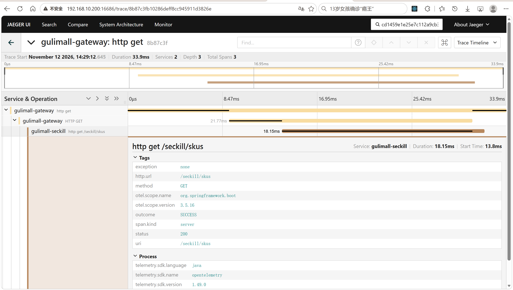
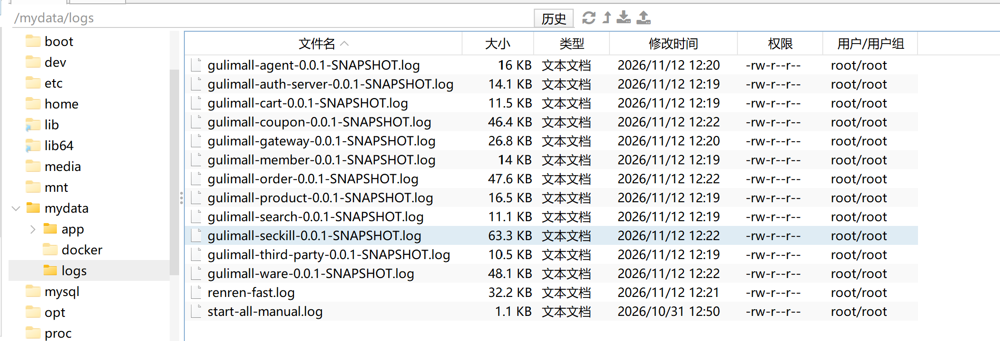
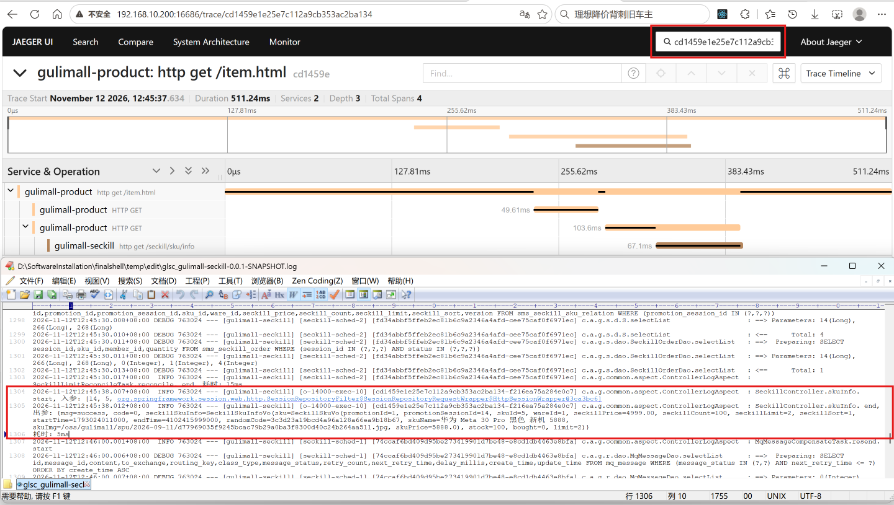
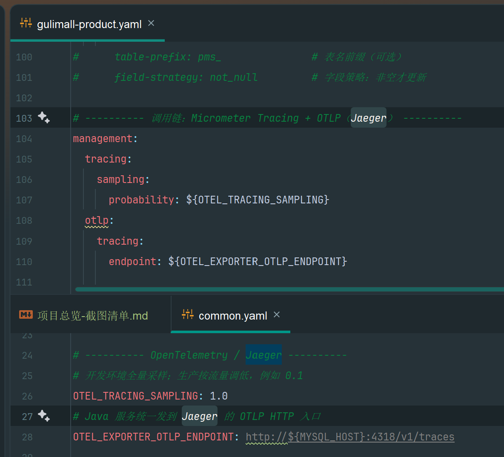
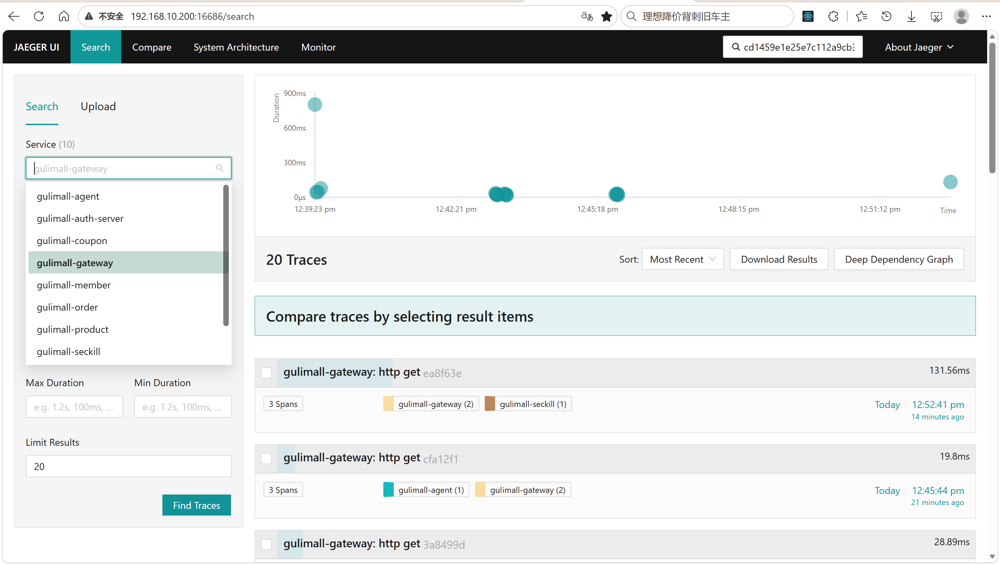
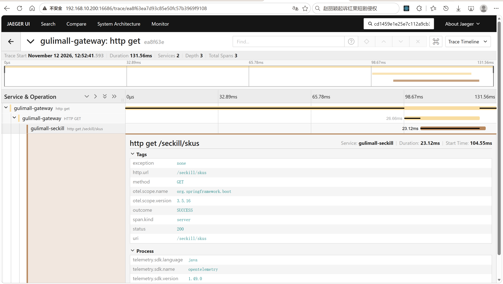

# 16.1 可观测性与日志-介绍

> 本篇介绍可观测性与日志：日志记录什么、Controller 日志切面怎么工作、网关日志怎么脱敏、traceId 怎么贯穿一次请求、Micrometer/OpenTelemetry/OTLP/Jaeger 怎么配合、采样率怎么定、定时任务为什么自成根 trace、各模块怎么接入。

---

## 1. 这个功能是干什么的

可观测性解决的是“系统出问题时，能不能快速说清楚发生了什么”。它由三类信号组成：

| 信号 | 回答的问题 | 项目落点 |
|---|---|---|
| 日志 | 这一刻发生了什么，入参、出参、耗时、异常是什么 | `ControllerLogAspect`、`RtGlobalFilter`、`[ALERT]` 日志 |
| 指标 | 系统整体是否健康，CPU、GC、线程、连接池是否吃紧 | VisualVM、Arthas、JVM 启动参数 |
| 链路 | 一次请求跨了哪些服务，时间花在哪个服务 | Micrometer Tracing + OTLP + Jaeger |

日志在业务上有四个直接作用：

1. **还原一次请求**：Controller 切面记录 `类名.方法名 start`、入参、出参和耗时，能直接看到某个接口收了什么参数、返回了什么结果、执行了多久。
2. **串联跨服务调用**：网关、秒杀、商品、订单各自输出日志，靠同一个 traceId 把分散的日志拼成一条完整链路。
3. **暴露需要人工处理的异常**：库存 key 缺失、限购计数异常这类“数据可能已经不一致”的情况，用 `[ALERT]` 前缀标记，日志平台按关键字告警。
4. **支撑压测和故障复盘**：压测时看每个接口的耗时日志，故障时按 traceId 找回整条调用链。

整体路径：

```text
浏览器
  │
  ├─ Nginx / Gateway ── RtGlobalFilter 记录请求、响应、路由和耗时
  │
  ├─ 业务服务 ── ControllerLogAspect 记录 start / end / 异常
  │        │
  │        ├─ Micrometer Tracing 生成 span
  │        │      └─ OTel Bridge ── OTLP HTTP(4318) ── Jaeger(16686)
  │        │
  │        └─ [ALERT] 日志 + 模块日志文件
  │
  └─ 定时任务 ── 独立根 trace ── Feign 下游 client span
```

不做的部分要说清楚：

1. 不采集 SQL、Redis、RabbitMQ 的子 span。
2. 不做日志采集平台，日志只写本地文件和控制台。
3. 不做 metrics 导出，指标靠 VisualVM 和 Arthas 现场观察。
4. 不保证 trace 持久化，Jaeger 默认内存存储，容器重启后历史 trace 丢失。

## 2. 用户、管理员、开发者怎么操作

### 2.1 用户怎么操作

用户不直接操作日志和链路系统。用户能看到的是：

1. 页面正常返回数据，或者收到统一错误提示。
2. 接口被限流时收到“当前抢购人数过多，请稍后再试”这类业务提示。
3. 页面不会因为 Jaeger 不可用或采样率为 0 而报错。

用户的每次请求都会被动产生日志和 span，但不需要做任何配置。traceId 不返回给页面，避免把内部链路标识暴露出去。

### 2.2 管理员和运维怎么操作

1. 登录服务器，进入日志目录 `/mydata/logs`。
2. 按进程查看日志，例如 `tail -f /mydata/logs/gulimall-seckill-0.0.1-SNAPSHOT.log`。
3. 按关键字过滤异常，例如 `grep "\[ALERT\]" gulimall-seckill-0.0.1-SNAPSHOT.log`。
4. 从日志里复制 traceId，打开 `http://<your-vm-host-ip>:16686`。
5. 在 Jaeger 左侧选择 service，例如 `gulimall-seckill`，按 traceId 或时间范围查询。
6. 打开一条 trace，按 span 层级看网关、入口服务、Feign 下游各段耗时。
7. 对 `[ALERT]` 日志安排人工核对，或者等待对账任务修复。
8. 需要调整采样率时，修改 `config/common.yaml` 的 `OTEL_TRACING_SAMPLING`，重启对应服务。

### 2.3 开发者怎么操作

1. 新模块要接入链路时，在模块 `pom.xml` 引入 actuator、`micrometer-tracing-bridge-otel`、`opentelemetry-exporter-otlp`。
2. 模块有 Feign 调用时，再引入 `feign-micrometer`，跨服务 traceId 才会继续传播。
3. 在模块 yml 增加 `management.tracing.sampling.probability` 和 `management.otlp.tracing.endpoint`。
4. 不需要手写拦截器，也不需要给 Controller 加注解；HTTP server span 和 Feign client span 由框架自动生成。
5. 需要关闭 Controller 日志切面时，设置 `gulimall.controller-log.enabled=false`。
6. 本地验证链路时运行 `Flow18ObservabilityTest`，确认 Tracer Bean、Jaeger 服务列表和 traceparent 传播。
7. 新增日志时先判断级别：可自愈的用 `warn`，业务失败但状态明确的用 `error`，数据可能不一致的用 `error` 加 `[ALERT]` 前缀。
8. 打印请求头前先脱敏，Cookie 只留名字，Authorization 和 token 只留“存在”。

## 3. 整体设计思路

### 3.1 业务上怎么设计

#### 3.1.1 三类信号各管一段

日志、指标、链路不是互相替代的关系：

```text
日志  → 具体某个请求做了什么，参数、返回值、异常是什么
指标  → 整个进程健不健康，CPU、GC、线程、堆是否吃紧
链路  → 一次请求跨了哪些服务，每一段花了多久
```

排查顺序通常是：先看日志确认现象，再看指标判断是“在算”还是“在等”，最后看链路定位到具体服务和调用段。

#### 3.1.2 日志分级与告警规则

日志级别按“能不能自愈”划分：

1. `info`：正常业务流转，Controller 的 start/end、关键状态变化。
2. `warn`：可降级、可自愈，例如缓存未命中回源、远程取商品名失败。
3. `error`：业务失败但状态明确，例如下游返回错误、参数不合法。
4. `error` + `[ALERT]`：数据可能已经不一致，需要人工确认或对账修复。

典型 `[ALERT]` 场景：

| 位置 | 日志前缀 | 含义 |
|---|---|---|
| `SeckillStockReconcileTask` | `[ALERT][seckill-reconcile]` | 秒杀库存 key 缺失、值异常、不是数字 |
| `SeckillSkuServiceImpl` | `[ALERT][seckill-query]` | Redis 读取商品失败、hash 缺失回源 |
| `SeckillSkuServiceImpl` | `[ALERT][seckill-sku-info]` | 库存 key 缺失、限购读取失败 |
| `SeckillLimitReconcileTask` | `[ALERT][seckill-limit-reconcile]` | 限购计数按订单重建 |

区分原则：能自动恢复的不要打 `[ALERT]`，否则告警会被日常噪声淹没；只有“需要人看一眼数据”的情况才打。

#### 3.1.3 链路追踪的业务边界

链路只覆盖三类调用：

1. HTTP 请求：浏览器、网关、Servlet 服务之间的入口和出口。
2. Feign 调用：order → seckill、seckill → product 这类跨服务调用。
3. `@Scheduled` 定时任务：每日上架、每分钟对账。

不覆盖的部分：

1. MQ 消费没有 consumer span。
2. 自定义线程池没有传播 Micrometer 上下文，异步 Feign 会断链。
3. MySQL、Redis 客户端没有子 span。

这些边界要在业务上明确，否则看到“链路不完整”时会误判成 tracing 配置错误。

#### 3.1.4 定时任务为什么自成根 trace

定时任务运行在调度线程池上，没有 HTTP 请求上下文。每次任务执行时：

```text
调度线程触发任务
  → 没有父 trace
  → 任务自身形成根 trace
  → 任务内 Feign 调用生成 client span，挂在任务 span 下
```

这样在 Jaeger 里可以把“对账任务触发的远程调用”和“用户请求触发的远程调用”分开。排查定时任务时按任务名和时间段查；排查用户请求时按用户请求的 traceId 查，两边不会混在一起。

#### 3.1.5 采样策略

采样率决定“多少请求会生成并上报 span”：

| 环境 | `probability` | 说明 |
|---|---|---|
| 开发 / 联调 | `1.0` | 每个请求都上报，方便核对完整链路 |
| 预发 | `0.3` ~ `0.5` | 保留足够样本，控制 Jaeger 存储 |
| 生产 | `0.05` ~ `0.1` | 按流量和存储容量调整 |
| 关闭 | `0` | 不创建 span，也不导出 |

采样是各服务本地概率采样，不是全链路统一决策。上游采样、下游不采样时，下游可能没有 span，这是正常现象。

#### 3.1.6 敏感信息脱敏

日志要能排查问题，但不能泄露凭证：

| 头 | 日志表现 | 原因 |
|---|---|---|
| `Cookie` / `Set-Cookie` | 只输出 Cookie 名，如 `GULIMALLSESSION` | 会话凭证不能落盘 |
| `Authorization` | `<redacted>` | Bearer token / Basic 凭证 |
| `token` / `x-token` | `<redacted>` | 自定义认证头 |
| 其它头 | 原样输出 | 排查路由、内容类型、UA 需要 |

### 3.2 技术上怎么设计

#### 3.2.1 四段式链路数据流

```text
应用
  │  Micrometer Tracing 生成 span
  ▼
OpenTelemetry Bridge
  │  统一成 OTel 数据模型
  ▼
OTLP HTTP Exporter
  │  POST http://<your-vm-host-ip>:4318/v1/traces
  ▼
Jaeger 2.6.0
  │  Web UI http://<your-vm-host-ip>:16686
  ▼
服务列表 / trace 详情 / span 耗时
```

Jaeger 2.6.0 内置 OTel Collector，原生接收 OTLP，不需要额外部署 collector。`deploy/docker-compose.yaml` 中的 Jaeger 暴露三个端口：

```yaml
jaeger:
  # Jaeger v2：内置 OTel Collector，原生接收 OTLP
  image: jaegertracing/jaeger:2.6.0
  container_name: jaeger2.6.0
  restart: always
  ports:
    # Web UI
    - "16686:16686"
    # OTLP gRPC
    - "4317:4317"
    # OTLP HTTP
    - "4318:4318"
  environment:
    TZ: Asia/Shanghai
```

16686 给浏览器查询，4317 给 gRPC 客户端，4318 给 Java 服务的 OTLP HTTP exporter。三者的职责不同，不能只开 16686。

#### 3.2.2 W3C traceparent 跨服务传播

跨服务传播使用 W3C Trace Context，请求头格式：

```text
traceparent: 00-<32 位 traceId>-<16 位 spanId>-01
```

- `00`：版本号。
- 第二段：32 位十六进制 traceId，整条链路共享。
- 第三段：16 位十六进制 spanId，当前这一段调用的标识。
- `01`：采样标记，表示这条链路被采样。

入口服务从 `traceparent` 解析上下文，后续 Feign 调用由 `feign-micrometer` 自动把当前上下文写进下游请求头，不需要手写拦截器。

#### 3.2.3 自动配置解决公共包扫描不到

`ControllerLogAspect` 放在 `gulimall-common` 的 `com.atguigu.gulimall.common.aspect` 包。业务模块的 `@SpringBootApplication` 默认只扫描自己模块的包，扫不到 common，所以切面不能直接标 `@Component`。

项目用 Spring Boot 3 的自动配置机制：

```text
META-INF/spring/org.springframework.boot.autoconfigure.AutoConfiguration.imports
  → ControllerLogAutoConfiguration
  → @Bean ControllerLogAspect
```

这样每个业务模块只要依赖 common，切面就自动生效，不需要在每个模块重复写配置。

#### 3.2.4 AOP 切点与响应式返回值

切点覆盖两类包：

```text
execution(* com.atguigu..controller..*(..))
execution(* com.atguigu..web..*(..))
```

`controller` 包是后台 CRUD 控制器，`web` 包是面向页面的控制器。两者并列，覆盖 product、coupon、member、order、ware、search、third-party 等模块。

响应式返回值是“懒”的：方法返回 `Mono` / `Flux` 时，流还没开始执行。直接打印 `result.toString()` 只能得到 `MonoOnErrorResume` 这类对象名，耗时恒为 0。切面必须把日志挂到流上，等数据真正到达或出错时再打印。

#### 3.2.5 日志文件与级别

运行期日志有两个去向：

1. 控制台：沿用 Spring Boot 默认 pattern，框架日志照常显示。
2. 文件：项目保留了一份公共日志模板，按模块名分目录、按小时滚动。

`config/common.yaml` 统一设置项目包日志级别：

```yaml
logging:
  level:
    com.atguigu.gulimall: debug
```

级别放在公共配置里，所有模块一致；需要单独调整某个模块时，在模块 yml 覆盖即可。

#### 3.2.6 模块接入矩阵

tracing 依赖按模块单独引入，不放进 `gulimall-common`，避免没有追踪需求的模块被动加载：

| 模块 | tracing | feign-micrometer | actuator |
|---|---|---|---|
| `gulimall-gateway` | 是 | 否（WebFlux 自身传播） | 是 |
| `gulimall-auth-server` | 是 | 是 | 是 |
| `gulimall-member` | 是 | 是 | 是 |
| `gulimall-product` | 是 | 是 | 是 |
| `gulimall-order` | 是 | 是 | 是 |
| `gulimall-ware` | 是 | 是 | 是 |
| `gulimall-coupon` | 是 | 是 | 是 |
| `gulimall-seckill` | 是 | 是 | 是 |
| `gulimall-agent` | 是 | 是 | 是 |
| `gulimall-search` / `gulimall-cart` / `gulimall-third-party` | 否 | 否 | 否 |

## 4. 详细代码、配置和解释

第 4 章按“组件为什么存在 → 关键概念 → 正常链路 → 代码分块解释 → 一次完整示例 → 边界与可优化点”组织。代码前面先说明这一段在链路里承担什么，代码后面按 1、2、3 的顺序解释执行过程和设计原因。

### 4.1 ControllerLogAspect：Controller 统一日志切面

#### 4.1.1 这个类解决什么问题

一次页面请求进入业务模块后，排查问题首先要回答五件事：调用了哪个 Controller 方法、带了什么参数、返回了什么、执行了多久、有没有抛异常。如果每个 Controller 各自写日志，格式会不一致，新增接口容易漏，改日志格式要改几十处。这个切面放在 `gulimall-common`，统一拦截所有业务模块的 Controller 方法，把 start、入参、出参、耗时和异常记录成同一种格式。

链路位置：

```text
浏览器 → Nginx → 网关(RtGlobalFilter)
                    → 业务服务 Controller 方法
                         └─ ControllerLogAspect 在方法前后记录日志
                    → Service / MySQL / Redis / Feign 下游
```

调用方是 Spring AOP 代理，切面由 `ControllerLogAutoConfiguration` 注册成 Bean；上游是经过网关的 HTTP 请求，下游是 Controller 原本调用的 Service。切面只读参数和返回值，不修改请求和响应，也不吞异常。

#### 4.1.2 切点与返回值类型

切点覆盖两类包：`controller` 包是后台 CRUD 控制器，`web` 包是面向页面的控制器。两者并列，因而 product、coupon、member、order、ware、search、third-party 等模块都能被覆盖。

方法返回值有三种形态，日志触发时机不同：

| 返回类型 | 日志时机 | 记录内容 |
|---|---|---|
| 普通对象 / `void` | `proceed()` 返回后 | 出参和总耗时 |
| `Mono` | 流成功结束或流内出错 | 成功值或异常，真实耗时 |
| `Flux` | 流完成或流内出错 | 元素个数或异常，真实耗时 |

`Mono` 和 `Flux` 是懒执行的，方法返回时流还没开始跑。直接在返回处打印只能得到 `MonoOnErrorResume` 这类对象名，耗时恒为 0，所以日志必须挂到流上。

#### 4.1.3 代码与解释

这段代码是切面的全部实现：定义切点、环绕通知、结束日志和流内异常日志。

```java
package com.atguigu.gulimall.common.aspect;

import lombok.extern.slf4j.Slf4j;
import org.aspectj.lang.ProceedingJoinPoint;
import org.aspectj.lang.annotation.Around;
import org.aspectj.lang.annotation.Aspect;
import org.aspectj.lang.annotation.Pointcut;
import reactor.core.publisher.Flux;
import reactor.core.publisher.Mono;

import java.util.Arrays;
import java.util.concurrent.atomic.AtomicLong;

/**
 * Controller 请求日志切面
 * <p>
 * 拦截所有微服务的 controller 方法，在方法执行前后打印日志：
 * <ul>
 *     <li>方法开始：{@code 类名.方法名 start, 入参: [...]}，无入参只打印 {@code 类名.方法名 start}</li>
 *     <li>方法结束：{@code 类名.方法名 end, 出参: {...}, 耗时: xxms}，无出参只打印 {@code 类名.方法名 end, 耗时: xxms}</li>
 * </ul>
 * 由于本类位于 {@code com.atguigu.gulimall.common}（业务模块默认扫不到），
 * 由 {@link com.atguigu.gulimall.common.aspect.ControllerLogAutoConfiguration} 通过 {@code AutoConfiguration.imports} 注册为 Bean 生效。
 *
 * <p><b>关于 Mono / Flux 返回值</b>：响应式返回值是「懒」的 —— 方法返回时流还没开始执行，
 * 所以不能在方法返回处直接打印出参和耗时（那样只会得到 {@code MonoOnErrorResume} 这样的
 * 对象名字符串，耗时恒为 0）。必须把日志挂到流上，等数据真正到达 / 出错时再打印。
 *
 * @author liujiaxu
 */
@Aspect
@Slf4j
public class ControllerLogAspect {

    /**
     * 切点：com.atguigu 下任意层级中，以下两类包及其子包里的所有方法（两者【并列】）：
     * <ul>
     *     <li>名为 {@code controller} 的包 —— 后台 CRUD 控制器，
     *         覆盖 product / coupon / member / order / ware / search / third-party 等模块</li>
     *     <li>名为 {@code web} 的包 —— 面向页面的控制器，
     *         如 {@code com.atguigu.gulimall.product.web.IndexController}（Thymeleaf 页面 + 页面 AJAX 接口）</li>
     * </ul>
     */
    @Pointcut("execution(* com.atguigu..controller..*(..)) || execution(* com.atguigu..web..*(..))")
    public void controllerPointcut() {
    }

    /**
     * 环绕通知：方法执行前后打印 start / end 日志 + 耗时
     */
    @Around("controllerPointcut()")
    public Object logAround(ProceedingJoinPoint joinPoint) throws Throwable {

        // 类名 + 方法名（如 ProductController.list）
        String classAndMethod = joinPoint.getSignature().getDeclaringType().getSimpleName()
                + "." + joinPoint.getSignature().getName();

        // 1、方法开始：打印 start + 入参（无入参只打印 start）
        Object[] args = joinPoint.getArgs();
        if (args != null && args.length > 0) {
            log.info("{}. start, 入参: {}", classAndMethod, Arrays.toString(args));
        } else {
            log.info("{}. start", classAndMethod);
        }

        long start = System.currentTimeMillis();

        Object result;
        try {
            result = joinPoint.proceed();
        } catch (Throwable e) {
            // 同步抛出的异常：在这里记一笔再往外抛（交给全局异常处理器）
            log.error("{}. 抛出异常, 耗时: {}ms, 异常: {}", classAndMethod,
                    System.currentTimeMillis() - start, e.toString());
            throw e;
        }

        // ==================== 响应式返回值：Mono ====================
        // doOnSuccess 在 Mono 成功结束时触发【一次】（空 Mono 也会触发，value 为 null），
        // doOnError 在流内出错时触发 —— 这才能真正拿到结果和真实耗时
        if (result instanceof Mono<?> mono) {
            return mono
                    .doOnSuccess(value -> logEnd(classAndMethod, value, start))
                    .doOnError(e -> logReactiveError(classAndMethod, e, start));
        }

        // ==================== 响应式返回值：Flux ====================
        // Flux 可能有大量元素，把内容全打进日志会刷屏，所以只统计元素个数
        if (result instanceof Flux<?> flux) {
            AtomicLong count = new AtomicLong();
            return flux
                    .doOnNext(v -> count.incrementAndGet())
                    .doOnComplete(() -> log.info("{}. end(Flux), 元素数: {}, 耗时: {}ms",
                            classAndMethod, count.get(), System.currentTimeMillis() - start))
                    .doOnError(e -> logReactiveError(classAndMethod, e, start));
        }

        // ==================== 普通返回值：返回时结果已就绪 ====================
        logEnd(classAndMethod, result, start);
        return result;
    }

    /**
     * 打印结束日志（出参 + 耗时）
     */
    private void logEnd(String classAndMethod, Object result, long start) {
        long cost = System.currentTimeMillis() - start;
        if (result != null) {
            log.info("{}. end, 出参: {}\n耗时: {}ms", classAndMethod, result, cost);
        } else {
            log.info("{}. end, 耗时: {}ms", classAndMethod, cost);
        }
    }

    /**
     * 打印响应式流内部的异常
     *
     * <p>注意：流内异常不会传播到切面（它是异步发生的，切面早已返回），
     * 所以必须单独记一笔，否则这类错误在日志里会完全不可见。
     */
    private void logReactiveError(String classAndMethod, Throwable e, long start) {
        log.error("{}. 流式异常, 耗时: {}ms, 异常: {}", classAndMethod,
                System.currentTimeMillis() - start, e.toString());
    }

}
```

1. `@Aspect` 声明切面，`@Slf4j` 提供 `log`；类上没有 `@Component`，实例由自动配置创建。
2. `@Pointcut` 用 `||` 连接两个 execution 表达式：任意层级下名为 `controller` 的包，或名为 `web` 的包，包内所有方法都匹配。
3. `logAround()` 拿到 `ProceedingJoinPoint` 后，用 `getDeclaringType().getSimpleName()` 加 `getName()` 拼出 `ProductController.list` 这样的标识，后续 start 和 end 用同一标识，便于按接口搜索。
4. `getArgs()` 取参数数组。数组非空时用 `Arrays.toString()` 打印入参，空数组或 null 时只打印 start，避免出现一个空数组。
5. 记录 `start` 毫秒时间戳，然后调用 `joinPoint.proceed()` 执行目标方法。
6. 目标方法同步抛异常时，先打印异常和耗时，再把异常原样抛出。异常仍然交给全局异常处理器，切面只负责留痕。
7. 返回 `Mono` 时，用 `doOnSuccess` 挂结束日志，用 `doOnError` 挂流内异常日志，再把新的 `Mono` 返回。`doOnSuccess` 在流成功结束时触发一次，空流也会触发，value 为 null。
8. 返回 `Flux` 时，用 `AtomicLong` 在 `doOnNext` 里计数，`doOnComplete` 打印元素数和耗时，`doOnError` 打印异常。Flux 可能有大量元素，只统计个数，避免日志刷屏。
9. 普通返回值在方法返回时已经就绪，直接调用 `logEnd()` 打印出参和耗时，然后返回原结果。
10. `logEnd()` 统一计算耗时。结果非 null 时打印出参，为 null 时只打印耗时。
11. `logReactiveError()` 单独记录流内异常。这类异常异步发生，发生时切面早已返回，不单独记就会在日志里完全消失。

#### 4.1.4 一次请求示例

页面请求商品详情，返回普通对象：

```text
GET /gulimall/product/skuinfo/info/1

ProductSkuInfoController.info. start, 入参: [1]
ProductSkuInfoController.info. end, 出参: {"skuId":1,"skuTitle":"...","price":5999.00}
耗时: 3ms
```

页面首页接口返回 `Mono` 时，日志分两次出现：

```text
IndexController.index. start
# 流开始执行，查缓存或数据库
IndexController.index. end, 出参: {...}
耗时: 12ms
```

#### 4.1.5 它不做什么

1. 不记录请求 URL、请求头、客户端 IP、HTTP 状态码，这些字段在网关的 `RtGlobalFilter` 里。
2. 不修改返回值，也不处理异常；异常继续抛给全局异常处理器。
3. 不创建 span，不写 traceId；链路标识由 Micrometer Tracing 生成。
4. 不做参数脱敏，当前直接调用 `Arrays.toString()`。
5. 对同类内部方法调用不生效，自调用不经过 Spring 代理。

#### 4.1.6 边界与可优化点

1. `Arrays.toString()` 会把密码、手机号、token 等敏感字段原样落盘，生产环境应按字段名脱敏。
2. 出参可能是大对象，完整打印增加日志量和序列化开销，可以只打印关键字段或限制长度。
3. 切点覆盖所有 `controller` 和 `web` 包，健康检查、静态资源接口也会记录，可以排除 `health` 等路径。
4. 日志级别固定为 `info`，高频接口日志量很大，可以按接口或包调整级别。
5. 切面没有实现 `Ordered`，同时存在多个切面时执行顺序不确定。

### 4.2 ControllerLogAutoConfiguration：切面自动配置

#### 4.2.1 这个类解决什么问题

`ControllerLogAspect` 位于 `com.atguigu.gulimall.common.aspect`。业务模块的主启动类只扫描自己的包，例如 `com.atguigu.gulimall.product`，扫不到 common 包，切面直接标 `@Component` 不会被创建。这个自动配置类通过 Spring Boot 的自动配置机制把切面注册成 Bean，让所有依赖 common 的模块自动获得日志能力，并提供一个总开关 `gulimall.controller-log.enabled`。

链路位置：

```text
模块启动 → 读取 AutoConfiguration.imports
         → ControllerLogAutoConfiguration
         → 条件命中
         → ControllerLogAspect Bean
         → Spring AOP 织入 Controller
```

调用方是 Spring Boot 启动流程；上游是 classpath 上的导入清单；下游是切面 Bean 和 AOP 代理。

#### 4.2.2 关键注解

| 注解 / 属性 | 作用 |
|---|---|
| `@AutoConfiguration` | 声明自动配置类，由导入清单加载 |
| `@ConditionalOnProperty` | 检查开关属性 |
| `havingValue = "true"` | 属性值为 true 才生效 |
| `matchIfMissing = true` | 属性缺失时默认生效 |
| `@Bean` | 把切面实例交给 Spring 容器 |

#### 4.2.3 代码与解释

自动配置类只做一件事：条件满足时创建切面实例。

```java
package com.atguigu.gulimall.common.aspect;

import org.springframework.boot.autoconfigure.AutoConfiguration;
import org.springframework.boot.autoconfigure.condition.ConditionalOnProperty;
import org.springframework.context.annotation.Bean;

/**
 * Controller 日志切面自动配置
 * <p>
 * 通过 {@code META-INF/spring/org.springframework.boot.autoconfigure.AutoConfiguration.imports} 注册，
 * 使 {@link ControllerLogAspect} 在所有业务微服务中生效（业务模块 {@code @SpringBootApplication}
 * 默认扫不到 {@code com.atguigu.gulimall.common} 包，故不能用 @Component）。
 * <p>
 * 可通过 {@code gulimall.controller-log.enabled=false} 关闭（默认开启）。
 *
 * @author liujiaxu
 */
@AutoConfiguration
@ConditionalOnProperty(name = "gulimall.controller-log.enabled", havingValue = "true", matchIfMissing = true)
public class ControllerLogAutoConfiguration {

    /**
     * 注册 Controller 日志切面
     */
    @Bean
    public ControllerLogAspect controllerLogAspect() {
        return new ControllerLogAspect();
    }
}
```

1. `@AutoConfiguration` 让该类成为自动配置，不需要被包扫描发现。
2. `@ConditionalOnProperty` 指定属性名 `gulimall.controller-log.enabled`，值为 `true` 时匹配。
3. `matchIfMissing = true` 表示模块没有配置该属性时也创建切面，默认开启。
4. `controllerLogAspect()` 直接 `new ControllerLogAspect()`，返回实例交给容器管理。
5. 容器创建 Bean 后，Spring AOP 根据 `@Aspect` 和切点织入代理，Controller 方法调用进入 `logAround()`。

#### 4.2.4 一次启动示例

```text
gulimall-product 启动
→ 读取 common 的 AutoConfiguration.imports
→ 加载 ControllerLogAutoConfiguration
→ 查找 gulimall.controller-log.enabled
→ 未配置，matchIfMissing=true，条件命中
→ 创建 ControllerLogAspect
→ Controller 被代理
→ 请求进入时输出 start / end 日志
```

模块配置 `gulimall.controller-log.enabled=false` 时，条件不命中，切面不创建，Controller 不再输出 start / end 日志，其他功能不受影响。

#### 4.2.5 它不做什么

1. 不做包扫描，也不改变业务模块 `@SpringBootApplication` 的扫描范围。
2. 不控制切面内部逻辑，切点、日志格式都在 `ControllerLogAspect` 里。
3. 不提供按模块、按包的细粒度开关，只有总开关。
4. 不管理多个切面之间的顺序。

#### 4.2.6 边界与可优化点

1. 只有总开关，无法只关闭某个模块或某个包，可以扩展成 `gulimall.controller-log.exclude-packages`。
2. 切面没有实现 `Ordered`，与其他切面共存时优先级不确定，可以显式指定顺序。
3. 自动配置类名与导入清单必须严格对应，重构包名时漏改会导致启动失败。

### 4.3 AutoConfiguration.imports：自动配置注册清单

#### 4.3.1 这段配置解决什么问题

`gulimall-common` 里有一批必须在所有业务模块生效的公共配置：Shiro 权限、Controller 日志切面、全局模型注入、城市数据的 Redis 实现和降级实现。这些类都不在业务模块的扫描路径下，需要由 Spring Boot 的自动配置机制统一加载。导入清单就是这些配置类的白名单，写在 common 的 `META-INF/spring/org.springframework.boot.autoconfigure.AutoConfiguration.imports` 中。

链路位置：业务模块启动 → Spring Boot 扫描 classpath 下所有导入清单 → 逐行读取类名 → 注册自动配置类 → 按条件创建 Bean。

#### 4.3.2 清单内容

清单共五行，每行一个全限定类名：

```text
com.atguigu.gulimall.common.config.ShiroConfig
com.atguigu.gulimall.common.aspect.ControllerLogAutoConfiguration
com.atguigu.gulimall.common.config.GlobalModelAdviceAutoConfiguration
com.atguigu.gulimall.common.config.RedisCityAutoConfiguration
com.atguigu.gulimall.common.config.CityAutoConfiguration
```

1. `ShiroConfig`：注册 Shiro 的 Realm、安全管理器和过滤器，让 `@RequiresPermissions` 生效。该类由 `gulimall.shiro.enabled=true` 控制，默认不开启。
2. `ControllerLogAutoConfiguration`：注册 Controller 日志切面，默认开启。
3. `GlobalModelAdviceAutoConfiguration`：注册全局模型注入的 `@ControllerAdvice`，只在 Servlet Web 应用中生效。
4. `RedisCityAutoConfiguration`：classpath 有 Redis 时注册基于 Redis 的城市数据存储，并保证在 `CityAutoConfiguration` 前面加载。
5. `CityAutoConfiguration`：注册城市、省市区接口，并在没有其它 `CityStore` 实现时退化成只依赖 Cookie 的实现。

#### 4.3.3 加载链路

1. Spring Boot 启动时扫描所有依赖 jar 中的 `AutoConfiguration.imports`。
2. 读取 common 清单中的五个类名。
3. 结合 `@AutoConfiguration` 的 before / after 关系和条件注解排序。
4. 条件命中的配置类被注册为 Bean 定义。
5. 条件不命中的配置类整体跳过，类里的 `@Bean` 不会创建。

#### 4.3.4 一次加载示例

以 `gulimall-product` 启动为例：

```text
读取 common 导入清单
→ ShiroConfig 未配置 gulimall.shiro.enabled，跳过
→ ControllerLogAutoConfiguration 条件命中，注册切面
→ GlobalModelAdviceAutoConfiguration 是 Servlet 应用，注册全局模型通知
→ RedisCityAutoConfiguration 有 StringRedisTemplate，注册 RedisCityStore
→ CityAutoConfiguration 发现已有 CityStore，跳过 CookieOnlyCityStore，仅注册城市接口
```

同一个清单在 gateway 中加载时，`GlobalModelAdviceAutoConfiguration` 和城市相关配置因为不是 Servlet 应用而整体跳过，不会因为缺少 Servlet API 导致启动失败。

#### 4.3.5 它不做什么

1. 不决定配置类内部的 Bean 逻辑，只负责把类交给 Spring Boot。
2. 不保证配置类之间的业务顺序，顺序由 `@AutoConfigureBefore` / `@AutoConfigureAfter` 控制。
3. 不做开关控制，开关由各配置类自己的条件注解完成。

#### 4.3.6 边界与可优化点

1. 清单里的类必须存在且可加载，删除类时忘记删清单会导致启动失败。
2. 清单只写类名，没有说明用途，排查时仍需对照源码；可以在类注释中补一句职责说明。
3. 依赖可选组件的配置类应加 `@ConditionalOnClass`，避免缺少依赖时整个应用启动失败。

### 4.4 RtGlobalFilter：网关请求与响应日志

#### 4.4.1 这个类解决什么问题

网关是所有页面请求的唯一入口。页面出现 404、502、路由错乱或响应变慢时，需要先确认请求有没有到网关、带了什么头、匹配了哪条路由、转发到哪个服务、最终状态码和总耗时是多少。这个全局过滤器对全部路由生效，不需要在 yaml 里逐条配置，同时把 Cookie、Authorization、token 这类凭证脱敏后再落盘。

链路位置：

```text
Nginx → 网关 RtGlobalFilter(记录请求)
        → 路由匹配 → 过滤器链 → 业务服务
        → 响应返回 → doFinally(记录响应和耗时)
```

调用方是 Spring Cloud Gateway 的过滤器链，全局过滤器由容器自动收集；上游是 Nginx 转发的请求，下游是目标服务的路由转发。

#### 4.4.2 关键属性与脱敏规则

| 属性 / 头 | 作用 |
|---|---|
| `GATEWAY_ROUTE_ATTR` | 命中的路由对象，取路由 id |
| `GATEWAY_REQUEST_URL_ATTR` | 实际转发目标，通常是 `lb://服务名` |
| `doFinally` | 响应式链结束后回调，能拿到最终状态 |
| `getOrder()` | 过滤器顺序，数值越小越先执行 |
| `Cookie` / `Set-Cookie` | 只输出 Cookie 名 |
| `Authorization` / `token` / `x-token` | 输出 `<redacted>` |
| 其它头 | 原样输出 |

#### 4.4.3 代码与解释

这段代码包含过滤器主体和两个脱敏辅助方法。

```java
package com.atguigu.gulimall.gateway.filter;

import org.slf4j.Logger;
import org.slf4j.LoggerFactory;
import org.springframework.cloud.gateway.filter.GatewayFilterChain;
import org.springframework.cloud.gateway.filter.GlobalFilter;
import org.springframework.cloud.gateway.route.Route;
import org.springframework.cloud.gateway.support.ServerWebExchangeUtils;
import org.springframework.core.Ordered;
import org.springframework.http.HttpHeaders;
import org.springframework.http.server.reactive.ServerHttpRequest;
import org.springframework.http.server.reactive.ServerHttpResponse;
import org.springframework.stereotype.Component;
import org.springframework.web.server.ServerWebExchange;
import reactor.core.publisher.Mono;

import java.net.URI;
import java.util.LinkedHashSet;
import java.util.List;
import java.util.Locale;
import java.util.Set;

/**
 * 自定义全局过滤器：打印请求 URI 与耗时（仿照 cloud-demo/gateway 学习示例移植）
 *
 * <p>全局过滤器对所有路由自动生效，无需在 yaml 中配置；实现 {@link Ordered}
 * 控制执行优先级，数值越小越先执行。</p>
 */
@Component
public class RtGlobalFilter implements GlobalFilter, Ordered {

    private static final Logger log = LoggerFactory.getLogger(RtGlobalFilter.class);

    @Override
    public Mono<Void> filter(ServerWebExchange exchange, GatewayFilterChain chain) {
        ServerHttpRequest request = exchange.getRequest();
        String uri = request.getURI().toString();
        long start = System.currentTimeMillis();

        // 1. 打印进入网关的完整请求信息：
        //    method / uri / 远端地址 / 全部请求头。
        //    Cookie 只打印名字不打印值，token/authorization 只打印“存在”，避免泄露凭证。
        log.info("[gateway-request] method={} uri={} remote={} headers={}",
                request.getMethod(), uri, request.getRemoteAddress(), formatHeaders(request.getHeaders()));

        // 2. 响应式编程是异步执行，doFinally 在整条链路结束后回调；
        //    这时才能拿到最终响应状态、响应头、命中的路由和转发目标。
        return chain.filter(exchange)
                .doFinally(signal -> {
                    ServerHttpResponse response = exchange.getResponse();
                    Route route = exchange.getAttribute(ServerWebExchangeUtils.GATEWAY_ROUTE_ATTR);
                    URI target = exchange.getAttribute(ServerWebExchangeUtils.GATEWAY_REQUEST_URL_ATTR);
                    long end = System.currentTimeMillis();
                    log.info("[gateway-response] signal={} method={} uri={} status={} route={} target={} headers={} cost={}ms",
                            signal, request.getMethod(), uri, response.getStatusCode(),
                            route == null ? null : route.getId(), target,
                            formatHeaders(response.getHeaders()), end - start);
                });
    }

    /**
     * 打印全部请求头/响应头。
     *
     * @param headers 请求头或响应头
     * @return 格式化后的头信息
     */
    private String formatHeaders(HttpHeaders headers) {
        // 1. Cookie、Authorization、token 属于敏感信息，只保留名字或是否存在
        StringBuilder result = new StringBuilder("{");
        headers.forEach((name, values) -> {
            if (result.length() > 1) {
                result.append(", ");
            }
            String lower = name.toLowerCase(Locale.ROOT);
            if ("cookie".equals(lower) || "set-cookie".equals(lower)) {
                result.append(name).append("=<names:").append(cookieNames(values)).append(">");
            } else if ("authorization".equals(lower) || "token".equals(lower) || "x-token".equals(lower)) {
                result.append(name).append("=<redacted>");
            } else {
                result.append(name).append("=").append(values);
            }
        });
        return result.append("}").toString();
    }

    /**
     * 从 Cookie / Set-Cookie 中只提取 Cookie 名，不输出值。
     *
     * @param values Cookie 头的值列表
     * @return 逗号分隔的 Cookie 名
     */
    private String cookieNames(List<String> values) {
        Set<String> names = new LinkedHashSet<>();
        for (String value : values) {
            for (String part : value.split(";")) {
                int equals = part.indexOf('=');
                if (equals > 0) {
                    names.add(part.substring(0, equals).trim());
                }
            }
        }
        return String.join(",", names);
    }

    @Override
    public int getOrder() {
        return 0;
    }
}
```

1. `filter()` 先取 `ServerHttpRequest`，记录完整 URI 和开始时间。
2. 打印 `[gateway-request]`，内容是 method、uri、remoteAddress 和格式化后的请求头。
3. `chain.filter(exchange)` 把请求继续交给路由和后续过滤器。
4. 在返回的 `Mono` 上挂 `doFinally`，响应式链结束、取消或出错时都会回调。
5. 回调里取响应对象、命中路由和转发目标，算出总耗时，打印 `[gateway-response]`。
6. `formatHeaders()` 遍历所有头，按小写名称判断类型。
7. Cookie 和 Set-Cookie 用 `cookieNames()` 只提取名字，值不落盘。
8. Authorization、token、x-token 统一输出 `<redacted>`，能看出存在，但拿不到内容。
9. 其它头原样输出，排查内容类型、UA、链路头时仍然可用。
10. `cookieNames()` 按 `;` 拆分 Cookie，取第一个 `=` 前面的部分作为名字，用 `LinkedHashSet` 去重并保持顺序。
11. `getOrder()` 返回 0，过滤器在链中靠前执行。

#### 4.4.4 一次请求示例

```text
GET http://gulimall.vip/api/product/category/list/tree

[gateway-request] method=GET uri=http://gulimall.vip/api/product/category/list/tree
remote=/192.168.10.1:52134 headers={host=[gulimall.vip], cookie=<names:GULIMALLSESSION>,
authorization=<redacted>, user-agent=[Mozilla/5.0 ...]}

[gateway-response] signal=onComplete method=GET uri=... status=200 OK
route=product-route target=lb://gulimall-product headers={...} cost=18ms
```

请求日志和响应日志通过同一个 URI 关联。响应日志只在整个链路结束后出现，因此 `cost` 包含业务服务处理时间。

#### 4.4.5 它不做什么

1. 不记录请求体和响应体，参数问题仍要结合业务服务日志。
2. 不修改请求头、不做鉴权、不做路由选择。
3. 不生成 span，链路信息由网关的 tracing 依赖负责。
4. 不按路由单独配置，所有路由共用同一套日志格式。

#### 4.4.6 边界与可优化点

1. 全量请求头可能很长，可以对头数量或单个头长度做截断。
2. 日志级别固定为 `info`，高并发下网关日志量很大，可以按采样或按路径降级。
3. 响应体的状态只记录状态码，不记录错误信息，排查 500 时还要看目标服务日志。
4. `getOrder()` 返回 0，顺序靠前；如果需要统计其它过滤器耗时，可以调整顺序。
5. 日志里的 remoteAddress 是直连地址，经过 Nginx 后通常是 Nginx 的地址，真实客户端 IP 要看 `X-Forwarded-For`。



### 4.5 日志文件与 logback 配置

#### 4.5.1 这段配置解决什么问题

应用运行期的日志有两个去向：控制台方便开发时直接看，文件方便服务器上按进程排查。如果所有日志都堆在一个文件里，模块之间会互相淹没；如果不滚动，磁盘很快被写满；如果框架日志也全部落盘，业务日志会被无关内容覆盖。公共日志模板解决三件事：按模块分目录、按小时滚动并限制历史总量、文件只收项目包日志。

链路位置：

```text
业务代码 log.info()
→ SLF4J
→ Logback
├─ CONSOLE → 标准输出
└─ FILE    → logs/模块名/模块名_yyyy-MM-dd_HH.log
```

模板文件放在 `gulimall-common/src/main/resources/logback-spring.xml_bk`。后缀 `_bk` 表示它是备份模板，不参与运行；需要按模块落盘时，改名成 `logback-spring.xml` 并重新构建。

#### 4.5.2 文件名与生效条件

Spring Boot 查找 Logback 配置的顺序是 `logback-test.xml`、`logback.xml`、`logback-spring.xml`，找到第一个就停止。模块里如果同时存在 `logback.xml`，模板会被忽略。改名后必须重新构建，否则 `target/classes` 里仍然是旧文件。

#### 4.5.3 代码与解释

这段配置定义文件输出、滚动策略、项目包 logger 和控制台输出。

```xml
<springProperty name="MODULE_NAME" source="spring.application.name" defaultValue="application"/>

<property name="LOG_PATH" value="logs/${MODULE_NAME}"/>
<property name="LOG_FILE_NAME" value="${MODULE_NAME}"/>

<appender name="FILE" class="ch.qos.logback.core.rolling.RollingFileAppender">
    <rollingPolicy class="ch.qos.logback.core.rolling.TimeBasedRollingPolicy">
        <fileNamePattern>${LOG_PATH}/${LOG_FILE_NAME}_%d{yyyy-MM-dd_HH}.log</fileNamePattern>
        <maxHistory>720</maxHistory>
        <totalSizeCap>4GB</totalSizeCap>
    </rollingPolicy>
    <encoder>
        <pattern>%d{yyyy-MM-dd HH:mm:ss.SSS} [%thread] %-5level %class.%method:%line - %msg%n</pattern>
    </encoder>
</appender>

<logger name="com.atguigu.gulimall" level="INFO">
    <appender-ref ref="FILE" level="TRACE"/>
</logger>
<root level="INFO">
    <appender-ref ref="CONSOLE"/>
</root>
```

1. `<springProperty>` 从 `spring.application.name` 取模块名，没有配置时用 `application`。
2. `LOG_PATH` 拼成 `logs/模块名`，`LOG_FILE_NAME` 也使用模块名。
3. `RollingFileAppender` 定义文件输出，滚动策略使用时间。
4. `fileNamePattern` 带 `yyyy-MM-dd_HH`，每小时生成一个新文件。
5. `maxHistory=720` 按小时计算，保留 30 天。
6. `totalSizeCap=4GB` 限制所有历史文件的总大小，超过后从最旧的文件开始删除。
7. `encoder` 的 pattern 包含时间、线程、级别、类名、方法名、行号和消息，排查时能定位到具体代码行。
8. `logger name="com.atguigu.gulimall"` 只把项目包日志接入 FILE appender，级别为 INFO。
9. `root` 绑定 CONSOLE，框架日志仍然输出到控制台。

#### 4.5.4 日志级别

公共配置统一设置项目包级别：

```yaml
logging:
  level:
    com.atguigu.gulimall: debug
```

这行让项目包输出 `debug` 及以上日志。排查某个类时可以临时在模块 yml 里设置 `logging.level.com.atguigu.gulimall.seckill=debug`，排查结束后恢复，避免长期高频日志。

#### 4.5.5 一次写入示例

```text
10:20:31.123 [http-nio-10000-exec-2] INFO  c.a.g.p.c.SkuInfoController.info:45 - SkuInfoController.info. start, 入参: [1]
→ 写入 logs/gulimall-product/gulimall-product_2026-11-12_10.log
→ 同一小时内的日志追加到同一个文件
→ 下一个小时创建 gulimall-product_2026-11-12_11.log
→ 30 天后或总量超过 4GB 时删除最旧文件
```

按模块分目录后，product、seckill、order 的文件互不干扰，`tail -f` 只需要盯一个文件。



启用 Micrometer Tracing 并使用 Spring Boot 默认日志 pattern 时，控制台日志会带 traceId 和 spanId。一次请求从网关进入后，同一个 traceId 会贯穿入口服务、Feign 下游和定时任务里的远程调用，复制 traceId 即可在 Jaeger 中定位完整链路。



模板的 pattern 没有 traceId 字段，文件日志不会自动带链路标识。需要按 traceId 检索文件时，要把 `%X{traceId:-}` 和 `%X{spanId:-}` 加进 pattern。

#### 4.5.6 它不做什么

1. 不采集日志，不上传到日志平台，只写本地文件和控制台。
2. 不主动开启文件输出，模板默认带 `_bk` 后缀，需要人工启用。
3. 不控制框架日志的文件输出，框架日志只走 root 的 CONSOLE。
4. 不做日志脱敏，敏感字段仍由业务代码和网关负责。

#### 4.5.7 边界与可优化点

1. 模板 pattern 没有 traceId/spanId，文件日志无法直接按链路关联，应补 `%X{traceId:-}` 和 `%X{spanId:-}`。
2. 按小时滚动在低频模块会产生大量小文件，可以改为按天滚动或按大小滚动。
3. `logs/` 是相对路径，启动目录不同会写到不同位置，部署时应固定工作目录。
4. 同步写文件会增加请求耗时，高并发下可以改成 `AsyncAppender`。
5. 没有按单文件大小切分，单个小时日志过大时不利于传输和归档。
6. 历史文件没有压缩，30 天全量保留会占用较多磁盘。

### 4.6 Tracing 依赖与 yml 配置

#### 4.6.1 这段配置解决什么问题

日志只能说明单个服务里发生了什么，回答不了“一次请求跨了哪些服务、每一段花了多久”。链路追踪需要四样能力：创建 span、把 span 模型桥接到 OpenTelemetry、把 span 导出到 Jaeger、在 Feign 调用时把上下文传给下游。依赖按模块引入，不放进 common，避免没有追踪需求的模块也启动 exporter 上报线程。

链路位置：

```text
业务服务 Micrometer Tracing 创建 span
→ OTel Bridge 统一数据模型
→ OTLP HTTP Exporter
→ Jaeger 4318 接收
→ Web UI 16686 查询
```

调用方是各业务模块的自动配置，上游是 HTTP server span 和 Feign client span，下游是 Jaeger。

#### 4.6.2 关键依赖与配置

| 依赖 / 配置 | 作用 |
|---|---|
| `spring-boot-starter-actuator` | 提供 Micrometer 基础设施和 `Tracer` Bean |
| `micrometer-tracing-bridge-otel` | 把 Micrometer span 模型桥接到 OTel |
| `opentelemetry-exporter-otlp` | 提供 OTLP HTTP exporter |
| `feign-micrometer` | 创建 Feign client span 并注入 `traceparent` |
| `management.tracing.sampling.probability` | 本地采样概率 |
| `management.otlp.tracing.endpoint` | OTLP HTTP 接收地址 |

#### 4.6.3 依赖与解释

以 `gulimall-product/pom.xml` 为例，三个基础依赖缺一不可：

```xml
<!-- 调用链：Micrometer Tracing + OTLP（Jaeger） -->
<dependency>
    <groupId>org.springframework.boot</groupId>
    <artifactId>spring-boot-starter-actuator</artifactId>
</dependency>
<dependency>
    <groupId>io.micrometer</groupId>
    <artifactId>micrometer-tracing-bridge-otel</artifactId>
</dependency>
<dependency>
    <groupId>io.opentelemetry</groupId>
    <artifactId>opentelemetry-exporter-otlp</artifactId>
</dependency>
```

有 Feign 调用的模块再增加一个传播依赖：

```xml
<dependency>
    <groupId>io.github.openfeign</groupId>
    <artifactId>feign-micrometer</artifactId>
</dependency>
```

1. `spring-boot-starter-actuator` 提供 `Tracer`、`ObservationRegistry` 等 Bean，缺少它就没有 span 生成能力。
2. `micrometer-tracing-bridge-otel` 把 Micrometer 的 span 模型翻译成 OTel 数据模型，是桥接层。
3. `opentelemetry-exporter-otlp` 负责把 OTel span 按 OTLP 协议发出去。
4. `feign-micrometer` 在 Feign 调用时创建 client span，并把当前 trace 上下文写进下游请求头。
5. 依赖按模块引入而不是放进 common，避免 search、cart、third-party 等模块被动加载 exporter。

#### 4.6.4 公共变量与模块 yml

公共配置只定义一次采样率和接收地址：

```yaml
# ---------- OpenTelemetry / Jaeger ----------
# 开发环境全量采样；生产按流量调低，例如 0.1
OTEL_TRACING_SAMPLING: 1.0
# Java 服务统一发到 Jaeger 的 OTLP HTTP 入口
OTEL_EXPORTER_OTLP_ENDPOINT: http://${MYSQL_HOST}:4318/v1/traces
```

每个模块只引用变量：

```yaml
# ---------- 调用链：Micrometer Tracing + OTLP（Jaeger） ----------
management:
  tracing:
    sampling:
      probability: ${OTEL_TRACING_SAMPLING}
  otlp:
    tracing:
      endpoint: ${OTEL_EXPORTER_OTLP_ENDPOINT}
```

1. `OTEL_TRACING_SAMPLING` 控制采样概率，开发环境用 1.0，生产按流量调低。
2. `OTEL_EXPORTER_OTLP_ENDPOINT` 指向 Jaeger 的 OTLP HTTP 入口，路径必须是 `/v1/traces`。
3. 模块 yml 的 `management.tracing.sampling.probability` 引用采样变量。
4. `management.otlp.tracing.endpoint` 引用地址变量。
5. 修改地址或采样率只改公共配置，模块不需要逐个调整。
6. 服务启动时读取采样率，每次创建新 trace 时按概率决定是否记录。
7. 被采样的 span 由 exporter 按批异步发送，不阻塞业务线程。

采样率建议：

| 环境 | 概率 | 说明 |
|---|---|---|
| 开发 / 联调 | `1.0` | 每个请求都上报，方便核对 |
| 预发 | `0.3` ~ `0.5` | 保留足够样本 |
| 生产 | `0.05` ~ `0.1` | 按流量和存储容量调整 |
| 关闭 | `0` | 不创建 span，也不导出 |

#### 4.6.5 一次链路示例

页面请求 `/gulimall/seckill/skus` 经过网关转发到 seckill，seckill 再通过 Feign 调用 product：

```text
gateway: GET /seckill/skus          server span
  └─ seckill: GET /seckill/skus     server span
       └─ seckill → product         client span
            └─ product: /sku/info   server span
```

四段 span 共享同一个 traceId，在 Jaeger 里按父子关系展开，可以直接看到网关、seckill、Feign 下游、product 各段耗时。



Jaeger 服务列表中的服务名就是各模块的 `spring.application.name`，没有引入追踪依赖的模块不会出现在列表里：



打开一条 trace，按 span 层级可以看到每一段的开始时间、耗时和状态：



#### 4.6.6 它不做什么

1. 不部署独立 collector，Jaeger 2.x 内置 OTel Collector，直接接收 OTLP。
2. 不采集 MySQL、Redis、RabbitMQ 的子 span。
3. 不保证 trace 持久化，Jaeger 默认内存存储，容器重启后历史数据丢失。
4. 不做 tail sampling，采样在请求开始时按本地概率决定。
5. 不自动传播自定义线程池里的上下文，异步 Feign 可能断链。

#### 4.6.7 边界与可优化点

1. 本地概率采样可能刚好漏掉慢请求，可以引入 tail sampling，按耗时或错误率补采。
2. endpoint 写的是固定 IP，跨环境部署时要确保公共配置被正确覆盖。
3. 没有配置 exporter 的超时和队列大小，Jaeger 不可达时依赖默认行为。
4. 采样率修改后需要重启服务，可以改成 Nacos 动态配置。
5. `feign-micrometer` 只覆盖 Feign，RestTemplate、WebClient 需要各自的传播配置。

### 4.7 W3C traceparent 与集成验证

#### 4.7.1 这段验证解决什么问题

依赖齐全、`Tracer` Bean 存在，只能说明配置被加载，不能说明入口能解析上游上下文、span 能导出、Jaeger 能按 traceId 查到。集成测试用已知的 traceId 构造标准 `traceparent` 请求头，发真实请求后到 Jaeger API 反查，覆盖入口解析、span 创建、导出和检索四段。

链路位置：

```text
测试构造 traceparent
→ HTTP 请求进入 gulimall-seckill
→ 入口解析上下文
→ 业务 span + Feign client span
→ OTLP exporter
→ Jaeger /api/traces/{traceId}
→ 测试断言
```

测试类是 `gulimall-seckill` 的 `Flow18ObservabilityTest`。

#### 4.7.2 traceparent 结构

```text
traceparent: 00-<32 位 traceId>-<16 位 spanId>-01
             │   │                  │             │
             │   │                  │             └─ 采样标记，01 表示采样
             │   │                  └─ 当前这一段调用的 spanId
             │   └─ 整条链路共享的 traceId
             └─ 版本号
```

入口服务解析该头后创建同 traceId 的 server span，Feign 调用再由 `feign-micrometer` 继续向下游写新的 spanId。

#### 4.7.3 代码与解释

测试片段直接构造请求头并调用秒杀商品接口：

```java
String traceId = randomHex(32);
String spanId = randomHex(16);
HttpHeaders headers = headers(null);
headers.set("traceparent", "00-" + traceId + "-" + spanId + "-01");
rest.exchange(localUrl("/seckill/skus?sessionId=" + fixture.sessionId()),
        HttpMethod.GET, new HttpEntity<>(headers), Map.class);
```

1. `randomHex(32)` 生成 32 位十六进制 traceId，`randomHex(16)` 生成 16 位 spanId。
2. 用 `00-traceId-spanId-01` 拼成标准 `traceparent`，`01` 表示强制采样。
3. `rest.exchange()` 带着该头发起 `/seckill/skus` 请求，入口服务按头解析上下文。
4. 服务内部如果有 Feign 调用，client span 继续使用同一个 traceId。
5. 测试随后轮询 Jaeger 的 `/api/traces/{traceId}`，确认链路已经上报并能按 traceId 查到。
6. 查不到时等待重试，超过等待时间才判定失败。

#### 4.7.4 一次验证示例

```text
1. 生成 traceId=4bf92f3577b34da6a3ce929d0e0e4736
2. 生成 spanId=00f067aa0ba902b7
3. 请求头 traceparent: 00-4bf92f3577b34da6a3ce929d0e0e4736-00f067aa0ba902b7-01
4. GET /seckill/skus?sessionId=14
5. seckill 解析出同一个 traceId
6. span 写入本地缓冲，exporter 批量上报
7. 测试请求 http://<your-vm-host-ip>:16686/api/traces/4bf92f3577b34da6a3ce929d0e0e4736
8. 返回的 spans 中包含 seckill 的入口 span 和下游 client span
9. 断言通过
```

#### 4.7.5 它不做什么

1. 不验证所有模块，只覆盖 gulimall-seckill 及其下游。
2. 不做性能验证，不统计 exporter 对接口耗时的影响。
3. 不验证 MQ 消费和自定义线程池的上下文传播。
4. 不主动创建 Jaeger 依赖，环境不可用时跳过测试。

#### 4.7.6 边界与可优化点

1. 测试依赖 Jaeger 可用，环境不可用时通过 `Assumptions` 跳过，不算业务失败。
2. 等待上报的时间固定，网络慢时可能误判，可以改成可配置的轮询次数和间隔。
3. 只验证 seckill 到 Jaeger，没有覆盖 gateway 和 product 的完整跨服务链路。
4. 测试数据依赖 fixture，fixture 失效时会先失败在业务接口，而不是链路断言。

### 4.8 定时任务根 trace 与调度线程池

#### 4.8.1 这段配置解决什么问题

秒杀对账、限购重建、优惠券场次结算都依赖定时任务。Spring 默认的调度线程池只有 1 个线程，多个任务会互相排队；线程名默认没有业务含义，日志和 Arthas 里分不清是哪个模块；任务运行在调度线程上，没有 HTTP 请求上下文，需要形成独立的根 trace，才能和用户请求分开排查。

链路位置：

```text
调度线程池(模块名-sched-N)
→ @Scheduled 方法
→ 独立根 trace
→ Feign 调用生成 client span
→ 下游服务 server span
```

#### 4.8.2 配置与解释

公共配置统一设置线程池大小、线程名前缀和停机等待：

```yaml
spring:
  task:
    scheduling:
      pool:
        size: 4
      thread-name-prefix: ${spring.application.name}-sched-
      shutdown:
        await-termination: true
        await-termination-period: 30s
```

1. `spring.task.scheduling.pool.size=4` 把默认单线程改成 4 个线程，降低任务互相排队。
2. `thread-name-prefix` 使用 `模块名-sched-`，例如 `gulimall-seckill-sched-1`，日志和 Arthas 线程列表能直接看出归属。
3. `shutdown.await-termination=true` 让应用停机时等待在途任务。
4. `await-termination-period=30s` 最多等 30 秒，超时后强制结束。
5. 任务由调度线程执行，没有 HTTP 上下文，Micrometer Tracing 为其创建新的根 trace。
6. 任务内的 Feign 调用生成 client span，挂在任务 span 下，不依赖用户请求的 traceId。

#### 4.8.3 任务与链路

| 模块 | 任务 | 触发时间 | 远程调用 |
|---|---|---|---|
| `gulimall-seckill` | `SeckillOrderReconcileTask` | 每分钟第 15 秒 | `OrderFeignClient` 查订单状态 |
| `gulimall-seckill` | `SeckillLimitReconcileTask` | 每分钟第 30 秒 | 无 |
| `gulimall-coupon` | `SeckillSettleScheduled` | 每天 03:00 | 结算场次 |
| `gulimall-coupon` | `SeckillStockReconcileTask` | 每天 03:00 | 对账秒杀库存 |

每个任务执行一次就产生一条独立 trace。排查定时任务时按 service 和任务操作名查询；排查用户请求时按用户请求的 traceId 查询，两边不会混在一起。

#### 4.8.4 一次执行示例

```text
10:21:15 调度线程 gulimall-seckill-sched-1 触发 SeckillOrderReconcileTask
→ 没有父 trace，创建根 span
→ 记录任务开始日志
→ 查询需要处理的秒杀订单
→ 调用 OrderFeignClient，生成 client span
→ order 服务创建 server span 并返回订单状态
→ 按结果更新秒杀单或回补库存
→ 任务结束，span 批量上报
→ Jaeger 按 service=gulimall-seckill 和任务操作名可查到
```

#### 4.8.5 它不做什么

1. 不为任务提供分布式锁或幂等，多实例部署时同一个任务可能重复执行。
2. 不把 trace 上下文传播到任务内部自定义的线程池，异步 Feign 可能断链。
3. 不做失败重试和告警，任务异常只记录日志。
4. 不控制任务执行时长，任务超时不会自动取消。

#### 4.8.6 边界与可优化点

1. 线程池固定为 4，任务变多或单任务耗时变长时需要重新评估。
2. 没有为任务配置 `TaskDecorator`，任务内异步线程不会继承 trace 上下文。
3. 任务异常只记录日志，没有统一的重试和告警，可以接入 `[ALERT]` 或告警平台。
4. 多实例部署时任务没有抢占机制，对账任务应保证幂等或加分布式锁。

### 4.9 `[ALERT]` 日志写法

#### 4.9.1 这段写法解决什么问题

有一类异常不属于“接口报错”，而是“数据可能已经不一致”：秒杀库存 key 丢失、限购计数无法读取、对账发现值不是数字。这类问题不会自动恢复，需要人工核对或由对账任务补数据。普通 `error` 日志和业务异常混在一起，很难配告警规则；统一用固定前缀 `[ALERT][业务域]` 标记，日志平台按关键字匹配，就能把真正需要人处理的事件单独拎出来。

链路位置：

```text
对账任务 / 秒杀服务
→ 检测到数据异常
→ log.error("[ALERT][业务域] 定位字段")
→ 本地日志文件 / 日志平台
→ 告警规则匹配 / 人工核对
```

#### 4.9.2 前缀与字段规范

| 部分 | 示例 | 作用 |
|---|---|---|
| `[ALERT]` | 固定前缀 | 日志平台告警规则的匹配关键字 |
| `[业务域]` | `seckill-sku-info` | 区分告警归属和负责人 |
| 定位字段 | `sessionId=14 skuId=1` | 快速定位到具体场次和商品 |

只有“数据可能不一致、需要人工确认”的情况才打 `[ALERT]`；缓存未命中回源、远程取名称失败这类可以自愈的情况用 `warn`，避免告警被日常噪声淹没。

#### 4.9.3 代码与解释

以秒杀库存 key 缺失为例：

```java
log.error("[ALERT][seckill-sku-info] 秒杀库存 key 缺失 sessionId={} skuId={}",
        sessionId, skuId);
```

1. 业务先读 Redis 中的秒杀库存 key。
2. key 不存在，进入缺失分支。
3. `log.error` 打印固定前缀 `[ALERT][seckill-sku-info]`，后面跟一句可读的说明。
4. 花括号依次填入 `sessionId` 和 `skuId`，定位到具体场次和商品。
5. 库存按 0 返回，页面显示已抢光，避免继续下超出库存的单。
6. 日志平台匹配 `[ALERT]` 前缀后触发告警，人工或对账任务补数据。

#### 4.9.4 一次告警示例

```text
1. 用户请求秒杀商品，sessionId=14，skuId=1
2. 读 Redis 库存 key，返回 null
3. 输出：[ALERT][seckill-sku-info] 秒杀库存 key 缺失 sessionId=14 skuId=1
4. 接口返回库存 0，页面显示已抢光
5. 日志平台按 [ALERT] 匹配，通知秒杀负责人
6. 人工检查 Redis 或触发库存对账，修复后 key 恢复
```

#### 4.9.5 它不做什么

1. 不自动修复数据，只负责标记和留痕。
2. 不做告警去重和抑制，同一个 key 持续缺失会重复打印。
3. 不输出结构化 JSON，字段仍要靠日志文本解析。
4. 不发送通知，通知由日志平台或告警系统完成。

#### 4.9.6 边界与可优化点

1. 日志没有统一的结构化字段，排查时仍要靠正则提取，可以改成 JSON 日志。
2. 告警没有去重和限流，同一 key 缺失会每分钟重复打印，可以加计数或时间窗抑制。
3. 只记录日志，没有自动修复，库存 key 缺失依赖对账任务或人工补数据。
4. `[ALERT]` 的使用标准依赖开发约定，缺少统一检查，容易把可自愈异常也标成告警。


## 5. 数据怎么流转

### 5.1 日志数据流

```text
浏览器请求
  → 网关 RtGlobalFilter
  → 业务服务 ControllerLogAspect
  → SLF4J / Logback
  → 控制台 + 日志文件
  → grep / tail / 日志平台
```

日志本身不写数据库、不发 MQ，只落本地文件和控制台。网关日志和业务日志分属不同进程，靠 traceId 关联。

### 5.2 链路数据流

```text
入口请求
  → 创建 server span
  → Feign 调用创建 client span
  → 下游服务创建 server span
  → 所有 span 进入本地缓冲
  → OTLP exporter 批量 POST
  → Jaeger 存储并建立索引
  → 按 service / operation / traceId 查询
```

span 上报是异步的，不阻塞业务线程。应用停机或队列满时，尾部 span 可能丢失。

### 5.3 数据存储与检索

| 数据 | 存储位置 | 检索方式 |
|---|---|---|
| 业务日志 | 本地日志文件 | `tail`、`grep`、日志平台 |
| 网关日志 | 网关进程日志文件 | 按 URI、status、route 过滤 |
| span | Jaeger（默认内存） | service、operation、traceId、时间范围 |
| 告警日志 | 本地文件 + 日志平台 | `[ALERT]` 关键字 |

### 5.4 接口与配置

| 配置 / 接口 | 作用 |
|---|---|
| `gulimall.controller-log.enabled` | Controller 日志切面开关 |
| `logging.level.com.atguigu.gulimall` | 项目包日志级别 |
| `OTEL_TRACING_SAMPLING` | 采样概率 |
| `OTEL_EXPORTER_OTLP_ENDPOINT` | OTLP HTTP 接收地址 |
| `http://IP:16686` | Jaeger Web UI |
| `http://IP:4318/v1/traces` | OTLP HTTP 上报入口 |

## 6. 一次请求的完整执行流程

### 6.1 页面请求经过网关和业务服务

1. 浏览器访问 `http://gulimall.vip/gulimall/seckill/skus?sessionId=14`。
2. Nginx 按 Host 转发到网关。
3. 网关创建 `gulimall-gateway` 的 server span。
4. `RtGlobalFilter.filter()` 记录 `[gateway-request]`，包含方法、URI、远端地址和脱敏后的请求头。
5. 网关匹配 `seckill-route`，执行 `StripPrefix=1`，转发到 `lb://gulimall-seckill`。
6. 网关把当前 trace 上下文写进下游请求的 `traceparent`。
7. seckill 读取 `traceparent`，创建同一 traceId 的 server span。
8. 请求进入 `SeckillController`，`ControllerLogAspect` 打印 `SeckillController.skus. start, 入参: ...`。
9. 业务方法执行，查 Redis 或数据库。
10. 方法返回，切面打印 `SeckillController.skus. end, 出参: ..., 耗时: xxms`。
11. 如果方法内调用 Feign，`feign-micrometer` 创建 client span，并把上下文继续传给下游。
12. 下游 product 创建 server span，执行 `SkuInfoController`，切面同样记录 start/end。
13. 响应沿原路返回，网关 `doFinally` 打印 `[gateway-response]`，包含状态码、路由、目标和总耗时。
14. OTLP exporter 异步把各段 span 发到 Jaeger。
15. 打开 Jaeger，按 traceId 可以看到网关、seckill、product 的连续 span。

### 6.2 定时任务执行

1. 调度线程池到点触发 `SeckillOrderReconcileTask`。
2. 任务线程没有 HTTP 上下文，形成独立根 trace。
3. 任务记录开始日志，查询需要处理的秒杀订单。
4. 任务调用 `OrderFeignClient` 查订单状态，生成 client span。
5. order 服务创建 server span，返回订单状态。
6. 任务按结果更新秒杀单或回补库存。
7. 任务结束，span 上报到 Jaeger。
8. 在 Jaeger 按 service `gulimall-seckill` 和 operation 查询，可以看到独立的对账任务 trace。

### 6.3 日志写入文件

1. 业务代码调用 `log.info()` 或 `log.error()`。
2. SLF4J 交给 Logback。
3. 控制台 appender 输出到标准输出，由部署脚本重定向到进程日志文件。
4. 如果启用了公共日志模板，FILE appender 按模块目录和小时文件写入。
5. 日志文件按 `maxHistory` 和 `totalSizeCap` 滚动清理。
6. 运维用 `tail`、`grep` 或日志平台检索。

## 7. 异常、边界、踩坑

1. **Jaeger 不可用**：exporter 上报失败只影响链路，不影响业务接口返回。排查时先确认 4318 端口和 endpoint 路径。
2. **采样率为 0**：不创建 span，Jaeger 看不到新数据，但接口正常。排查前先确认 `OTEL_TRACING_SAMPLING`。
3. **模块没有引入依赖**：该模块没有 server span，链路在它这里断开。检查 pom 是否有 actuator、bridge、exporter。
4. **有 Feign 但没有 `feign-micrometer`**：client span 缺失，下游可能生成新的根 trace，traceId 对不上。
5. **直连秒杀子域**：请求没有经过网关，自然没有网关 span，不等于链路丢失。
6. **时钟不一致**：多台机器时间偏差会导致 span 时间线错乱，表现为子 span 比父 span 还早。部署时统一 NTP。
7. **MQ 消费没有 consumer span**：消费者内部如果调用 Feign，会形成新的根 trace，和生产者 trace 断链。
8. **自定义线程池断链**：`MyThreadConfig` 只复制 `RequestAttributes`，没有传播 Micrometer 上下文，异步 Feign 会断链。
9. **`@Async` 或 `CompletableFuture` 断链**：原因同上，需要额外的上下文传播装饰器。
10. **`logback.xml` 抢占**：classpath 上存在 `logback.xml` 时，`logback-spring.xml` 被忽略；删掉旧文件后要重新构建。
11. **日志文件没有 traceId**：公共模板的 pattern 没有 `%X{traceId:-}`，文件日志无法直接按链路关联。
12. **切面自调用失效**：同类内部方法调用不经过 Spring 代理，不会触发切面。
13. **Mono/Flux 耗时恒为 0**：直接打印响应式返回值只能拿到对象名，必须把日志挂到流上。
14. **Flux 刷屏**：把全部元素打进日志会撑大文件，切面只统计元素个数。
15. **Cookie 泄露**：网关日志如果原样打印 Cookie，会话凭证会落盘；`formatHeaders()` 只保留名字。
16. **`[ALERT]` 过多**：可自愈的异常也打 `[ALERT]` 会造成告警疲劳，应按“是否需要人工核对”区分。
17. **日志目录不固定**：`logs/` 是相对路径，启动目录变化会写到不同位置；部署脚本要固定工作目录。
18. **停机丢尾部 span**：exporter 队列里的 span 在进程退出时可能来不及发送，属于可接受的观测损失。

## 8. 本篇小结

1. 可观测性由日志、指标、链路三类信号组成，分别回答“发生了什么”“系统健不健康”“请求走到哪”。
2. `ControllerLogAspect` 统一记录 Controller 的 start、end、入参、出参、耗时和异常。
3. 切面通过 `ControllerLogAutoConfiguration` 和 `AutoConfiguration.imports` 注册，解决 common 包扫描不到的问题。
4. `Mono` 用 `doOnSuccess` 记录结束，`Flux` 用 `doOnNext` 计数、`doOnComplete` 记录完成，避免耗时恒为 0 和日志刷屏。
5. `RtGlobalFilter` 记录网关请求和响应，Cookie 只留名字，Authorization 和 token 打码。
6. 公共日志模板按模块分目录、按小时滚动，文件只收 `com.atguigu.gulimall` 包日志。
7. 链路数据流是 Micrometer Tracing → OTel Bridge → OTLP HTTP → Jaeger。
8. 跨服务传播使用 W3C `traceparent`，`feign-micrometer` 自动注入下游请求头。
9. 采样率开发环境 1.0，生产按流量调低；采样率 0 时业务正常，只是没有新 span。
10. 定时任务没有 HTTP 上下文，每次执行形成独立根 trace，任务内 Feign 的 client span 挂在任务 span 下。
11. 当前主要优化点：日志字段脱敏、文件 pattern 增加 traceId、异步日志、tail sampling、线程池上下文传播、`[ALERT]` 告警去重。
