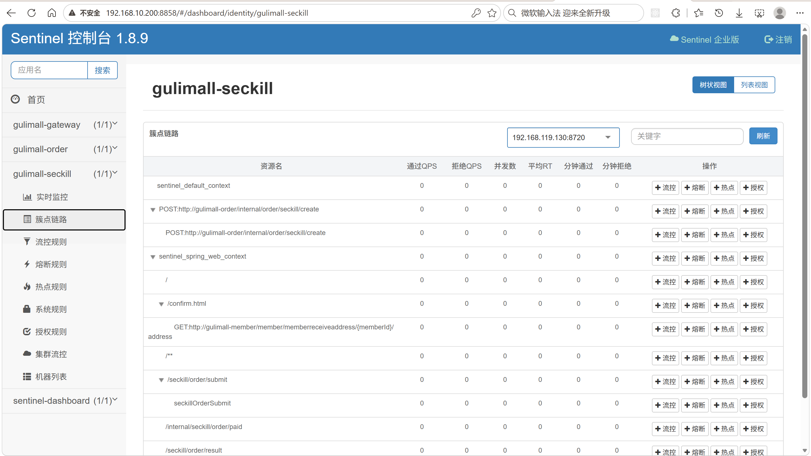
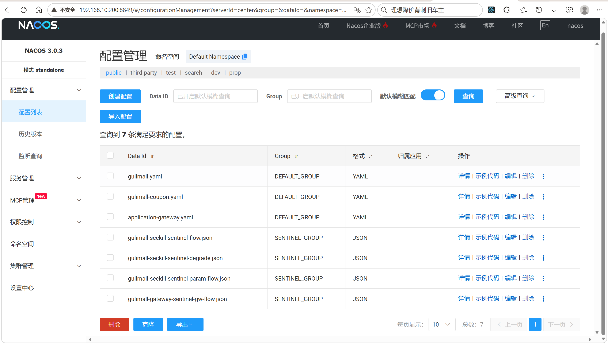
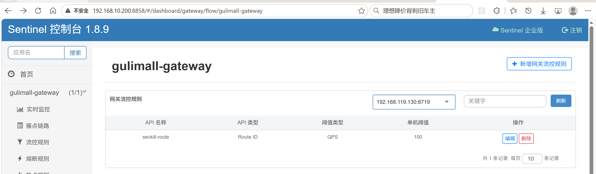
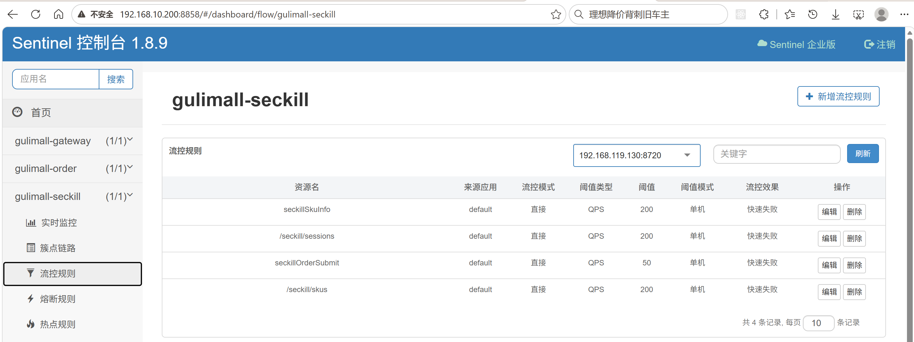
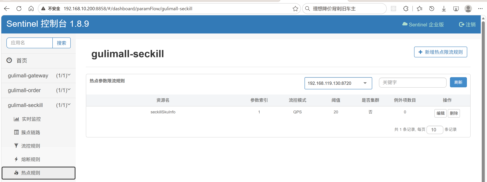
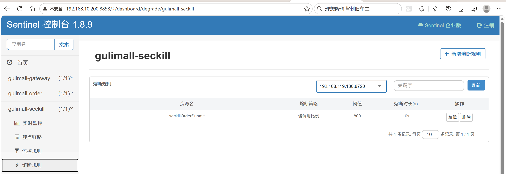

# 16.2 Sentinel 限流熔断-介绍

> 本篇介绍 Sentinel 限流熔断：业务上保护哪些入口、规则有哪几类、网关怎么按路由限流、抢购和商品详情怎么按资源限流、热点参数怎么按 skuId 限流、慢调用怎么熔断、被拦后返回什么错误码、Feign 降级怎么做、规则怎么持久化到 Nacos、Dashboard 怎么用。

> Sentinel 相关文档与配置：[Sentinel 文档](../Sentinel/Sentinel.md)、[规则说明](../../deploy/sentinel/README.md)、[网关流控](../../deploy/sentinel/gulimall-gateway-sentinel-gw-flow.json)、[秒杀流控](../../deploy/sentinel/gulimall-seckill-sentinel-flow.json)、[秒杀熔断](../../deploy/sentinel/gulimall-seckill-sentinel-degrade.json)、[热点参数](../../deploy/sentinel/gulimall-seckill-sentinel-param-flow.json)。

---

## 1. 这个功能是干什么的

Sentinel 是流量治理组件，解决的是“流量超过系统能力时，怎么快速拒绝，避免整个服务被拖垮”。在秒杀场景里，它承担四个业务作用：

1. **入口保护**：网关对秒杀路由限流，超量请求在入口就被拒绝，不再进入业务服务。
2. **热点隔离**：同一个热门 SKU 被大量用户同时查询时，按 `skuId` 单独限流，避免一个商品挤占整条链路的配额。
3. **故障熔断**：抢购接口变慢时，按慢调用比例打开熔断器，冷却期内直接拒绝，给下游恢复时间。
4. **调用方自保**：Feign 调用失败时走 fallback，调用方主流程不被下游拖死。

Sentinel 的规则类型：

| 规则 | 作用 | 项目是否使用 |
|---|---|---|
| 流控规则 | 按 QPS 或线程数限制资源 | 是 |
| 熔断规则 | 按慢调用比例、异常比例或异常数熔断 | 是 |
| 热点参数规则 | 按方法参数值分别限流 | 是 |
| 系统规则 | 按 CPU、负载、线程数等系统指标保护 | 否 |
| 授权规则 | 按调用来源放行或拒绝 | 否 |
| 网关流控规则 | 按路由 ID 或 API 分组限流 | 是 |

项目接入范围：

| 模块 | 用途 | 客户端端口 |
|---|---|---|
| `gulimall-gateway` | 网关入口限流（gw-flow） | 8719 |
| `gulimall-seckill` | 抢购接口、商品查询、热点参数 | 8720 |
| `gulimall-order` | `SeckillFeignClient` 的 Feign fallback | 8721 |

三层拦截的位置：

```text
第一层：网关路由 seckill-route      → 100 QPS
第二层：seckill Web URL 资源        → /seckill/sessions、/seckill/skus 各 200 QPS
第三层：方法资源 @SentinelResource  → seckillOrderSubmit 50 QPS、seckillSkuInfo 200 QPS
第四层：Feign fallback              → 下游不可用时降级返回
```

越靠近入口，拒绝成本越低。网关限流不需要进入业务服务；方法资源限流能精确到某个接口；Feign fallback 是最后一道兜底。

不做的部分：

1. 不做登录鉴权、库存校验、库存扣减和建单。
2. 不做集群限流，所有规则都是单实例阈值。
3. 被限流的请求不读不写秒杀 Redis key，也不写业务表。
4. 不为关键写链路的 Feign 调用配置“假成功” fallback。

## 2. 用户、管理员、开发者怎么操作

### 2.1 用户怎么操作

用户不配置规则，只感知限流结果：

1. 抢购被限流时，页面收到 `14013`，提示“当前抢购人数过多，请稍后再试”。
2. 商品详情被热点限流时，同样收到 `14013`，可以稍后刷新。
3. 商品详情查询出现非限流异常时，收到 `14009`，提示“秒杀商品信息查询失败，请稍后再试”。
4. 未登录抢购时，在进入 Sentinel 资源前就被登录拦截器拦下，返回 `14001`。

用户看到的是统一 JSON，不需要理解是网关限流、热点限流还是熔断。

### 2.2 管理员怎么操作

1. 打开 Sentinel Dashboard：`http://<your-vm-host-ip>:8858`，默认账号密码 `sentinel / sentinel`。
2. 在“机器列表”确认 `gulimall-gateway`、`gulimall-seckill`、`gulimall-order` 已经注册。
3. 在“簇点链路”查看各资源的 QPS、RT、拒绝数和异常数。
4. 临时验证规则时，可以在 Dashboard 直接新建或修改规则，观察效果。
5. 正式修改规则时，登录 Nacos，在 `SENTINEL_GROUP` 下修改对应的 Data ID。
6. 修改后客户端会监听 Nacos 变更并重新加载规则，不需要重启服务。
7. 需要调整客户端端口时，修改模块 yml 的 `spring.cloud.sentinel.transport.port`。
8. 需要排查限流来源时，看业务日志里的 `[seckill] 抢购被限流/熔断：FlowException` 这类记录。

### 2.3 开发者怎么操作

1. 新模块接入 Sentinel 时，引入 `spring-cloud-starter-alibaba-sentinel`。
2. Spring Boot 3 / Jakarta 的 Web MVC 模块，还需要引入 `sentinel-spring-webmvc-v6x-adapter`，才能自定义 `BlockExceptionHandler`。
3. 网关模块额外引入 `spring-cloud-alibaba-sentinel-gateway`。
4. 规则要持久化时，引入 `sentinel-datasource-nacos`。
5. 在 yml 配置 Dashboard 地址、客户端端口和 Nacos 数据源。
6. 方法级限流在 Controller 方法上加 `@SentinelResource`，并指定 `blockHandler` 或 `fallback`。
7. Feign 调用需要降级时，在 `@FeignClient` 上指定 `fallback`，并开启 `feign.sentinel.enabled=true`。
8. 规则阈值先写开发默认值，压测后再按实际容量调整。
9. 新增规则后先用 `Flow17SentinelTest` 验证流控、熔断、热点参数和 fallback。

## 3. 整体设计思路

### 3.1 业务上怎么设计

#### 3.1.1 三层拦截的职责

```text
网关层
  看的是“哪个路由被打了多少流量”
  适合挡住整条链路的洪峰

Web 层
  看的是“哪个 URL 被打了多少流量”
  适合保护不需要业务参数的查询接口

方法层
  看的是“哪个业务方法被调用了多少次”
  适合保护抢购、商品详情这种核心资源

Feign 层
  看的是“下游不可用时调用方怎么办”
  适合 best-effort 调用和可降级查询
```

三层不是重复配置，而是不同粒度。网关限流拦住的是“整个秒杀模块”的入口流量；Web 层能单独限制场次查询和商品列表；方法层能精确到抢购提交和商品详情。

#### 3.1.2 抢购接口的规则

`seckillOrderSubmit` 同时配置流控和熔断：

```text
流控：50 QPS，快速失败
熔断：慢调用比例，RT > 800ms、比例 ≥ 0.5、统计窗口 10 秒、最小请求数 10、熔断 10 秒
```

业务含义：

1. 正常流量下，50 QPS 是单实例能承受的抢购提交上限。
2. 超过 50 QPS 直接拒绝，不进入 Redis 预扣，不占库存。
3. 如果 10 秒内至少有 10 个请求，且一半以上超过 800ms，说明下游或 Redis 已经变慢，打开熔断器。
4. 熔断 10 秒内所有抢购请求直接失败，不再继续压下游。
5. 10 秒后进入半开状态，放少量请求探测，成功则恢复，失败则继续熔断。

#### 3.1.3 商品详情的规则

`seckillSkuInfo` 同时配置热点参数和流控：

```text
热点参数：参数下标 1（skuId），同一个 skuId 每秒 20 次
流控：200 QPS
```

业务含义：

1. 先按 `skuId` 限流，防止一个爆款商品被反复查询。
2. 再按整个资源限流，防止所有商品加起来把服务打满。
3. 两个规则都命中时，返回同一个 `14013`。
4. 热点限流是单实例语义，多实例部署时总配额按实例数放大。

#### 3.1.4 场次和商品列表的规则

`/seckill/sessions` 和 `/seckill/skus` 是 Web URL 资源，各限制 200 QPS：

1. 场次查询是页面首屏接口，流量大但逻辑简单。
2. 商品列表从 Redis hash 读取，单次耗时低。
3. 200 QPS 是开发默认值，压测后按实际容量调整。
4. 这两个接口没有方法级注解，靠 Spring MVC 适配器自动把 URL 注册成资源。

#### 3.1.5 熔断策略的选择

Sentinel 支持三种熔断策略：

| 策略 | 触发条件 | 适用场景 |
|---|---|---|
| 慢调用比例 | 慢调用比例超过阈值 | 下游变慢但还没大量报错 |
| 异常比例 | 异常请求比例超过阈值 | 下游大量抛异常 |
| 异常数 | 异常请求数量超过阈值 | 低流量下少量异常就熔断 |

项目选择慢调用比例，原因是抢购接口的主要风险是“变慢”而不是“报错”。Redis 或下游变慢时，请求不会立刻失败，但线程会被占住，慢调用比例能更早发现这种劣化。

#### 3.1.6 Feign 降级的分级

Feign fallback 不是所有调用都适合配：

| 调用 | 是否配 fallback | 原因 |
|---|---|---|
| order → seckill 释放/支付回填 | 是 | best-effort，有对账任务兜底 |
| seckill → product 查商品 | 是 | 页面可降级，不阻断抢购 |
| order → 建单/订单状态查询 | 否 | 关键写链路，不能把“服务不可用”误判成“订单不存在” |

关键写链路宁可失败重试，也不要返回假数据。fallback 返回“订单不存在”会让监听器误判并回补库存，造成数据不一致。

### 3.2 技术上怎么设计

#### 3.2.1 客户端、Dashboard 与 Nacos 的关系

```text
业务服务
  │ 启动时注册、定时上报指标
  ├──────────────► Sentinel Dashboard（8858，展示和临时改规则）
  │
  │ 启动时拉取规则、监听变更
  └──────────────► Nacos（SENTINEL_GROUP，正式规则来源）
```

三个角色的分工：

1. 客户端：统计流量、判断规则、执行拦截。
2. Dashboard：展示机器和指标，提供临时验证入口。
3. Nacos：规则的持久化来源，客户端重启后从这里重新加载。

Dashboard 默认把规则存在自己的内存里，重启后丢失；在 Dashboard 修改规则也不会写回 Nacos。正式规则统一放 Nacos。

#### 3.2.2 客户端端口不能冲突

同一台机器上多个 Sentinel 客户端不能都用默认 8719：

```text
gateway  → 8719
seckill  → 8720
order    → 8721
```

端口冲突会导致后启动的客户端注册失败或规则推送异常。新增模块时必须分配独立端口。

#### 3.2.3 三种适配器

不同 Web 技术栈用不同适配器：

| 场景 | 适配器 / 回调 | 项目实现 |
|---|---|---|
| 网关 WebFlux | `GatewayCallbackManager` | `SentinelGatewayConfig` |
| Servlet Web MVC（Spring Boot 3） | `webmvc_v6x` 的 `BlockExceptionHandler` | `SentinelWebBlockHandler` |
| 方法资源 | `@SentinelResource` 的 `blockHandler` / `fallback` | `SeckillOrderController`、`SeckillController` |
| Feign | `@FeignClient(fallback)` | `SeckillFeignClientFallback`、`ProductFeignClientFallback` |

网关是 WebFlux，不能用 Servlet 的 `BlockExceptionHandler`；Spring Boot 3 使用 Jakarta 命名空间，必须用 `webmvc_v6x` 适配器，`handle` 方法比旧版多一个 `resourceName` 参数。

#### 3.2.4 规则 JSON 的字段

四类规则的 JSON 字段不同，但核心结构一致：

```text
resource        资源名，必须是路由 ID、URL 或 @SentinelResource 的 value
grade           阈值类型：0 线程数，1 QPS
count           阈值
controlBehavior 流控效果：0 快速失败，1 Warm Up，2 排队等待
strategy        流控模式：0 直接，1 关联，2 链路
```

熔断规则额外有 `timeWindow`、`minRequestAmount`、`statIntervalMs`、`slowRatioThreshold`；热点规则额外有 `paramIdx`、`durationInSec`；网关规则额外有 `resourceMode`、`intervalSec`、`burst`。

#### 3.2.5 错误码设计

限流和熔断统一使用 `14013`：

```text
14013  SECKILL_FLOW_LIMIT  当前抢购人数过多，请稍后再试
14009  SECKILL_PARAM_INVALID  秒杀参数不合法（商品详情 fallback 使用）
14012  SECKILL_ORDER_BUILD_FAILED  秒杀订单创建失败（Feign fallback 使用）
```

错误码前两位 `14` 对应秒杀模块端口 14000，便于从错误码直接定位服务。

#### 3.2.6 HTTP 状态码的差异

```text
网关限流    → HTTP 429 + R JSON
seckill Web → HTTP 200 + R JSON
方法资源    → HTTP 200 + R JSON
```

调用方不能只看 HTTP 状态码，必须统一按响应体 `code` 判断是否被限流。网关返回 429 是为了符合 HTTP 语义，业务服务返回 200 是为了让前端走正常响应解析。

## 4. 详细代码、配置和解释

Sentinel 的保护点分布在四层：部署层提供 Dashboard，配置层把规则从 Nacos 拉到客户端，入口层由网关和 Web 适配器拦截 URL 流量，方法层和 Feign 层保护具体业务资源并提供降级。请求从外到内依次经过这些位置，越靠外的拦截成本越低，越靠内的拦截越精确。以下按请求进入系统的顺序展开，每个部分先说明它在链路里的位置和上下游，再给出代码或配置，最后按 1、2、3 解释执行顺序、判断条件和边界。

### 4.1 Dashboard 部署与客户端依赖

#### 4.1.1 这段配置解决什么问题

秒杀规则上线后，运营和开发需要回答三个问题：规则有没有推到实例、当前 QPS 和 RT 是多少、被拒绝的请求有多少。Dashboard 提供机器列表、簇点链路和实时指标，临时调整阈值也在这里完成。它属于控制面，不参与每个请求的拦截；真正执行拦截的是各服务进程里的 Sentinel 客户端。

客户端依赖决定拦截能力是否完整：核心 starter 提供过滤器和注解切面，Web MVC 适配器提供 `BlockExceptionHandler`，网关适配器提供路由级流控，Nacos 数据源提供规则持久化。少一个依赖，对应层的保护就会缺失。

链路上的位置：

```text
部署层：docker compose 启动 Dashboard:8858
   │ 客户端启动时注册、定时上报指标
   ▼
客户端：gateway / seckill / order 各自连接 Dashboard
   │ 启动时从 Nacos 拉规则
   ▼
运行时：过滤器、拦截器、注解切面按规则判断请求
```

Dashboard 只负责展示和临时验证，正式规则保存在 Nacos。客户端重启后从 Nacos 重新加载，不依赖 Dashboard 的内存状态。

#### 4.1.2 Dashboard 容器配置

`deploy/docker-compose.yaml` 中的 Dashboard 定义：

```yaml
sentinel-dashboard:
  # 社区镜像（阿里官方未发布 Docker 镜像，官方只有 jar）
  # 与客户端 sentinel 1.8.9 配套
  image: bladex/sentinel-dashboard:1.8.9
  container_name: sentinel1.8.9
  restart: always
  ports:
    # 控制台地址 http://服务器IP:8858
    # 默认账号密码：sentinel / sentinel
    - "8858:8858"
  environment:
    TZ: Asia/Shanghai
```

1. `image` 固定 1.8.9，与客户端、适配器、Nacos 数据源保持一致。版本不一致时，客户端注册或规则推送可能出现协议不兼容。
2. `container_name` 固定为 `sentinel1.8.9`，排查时可以直接按容器名查日志。
3. `ports` 把容器内的 8858 映射到宿主机 8858，浏览器通过 `http://<your-vm-host-ip>:8858` 访问控制台。
4. `restart: always` 让容器在 Docker 重启后自动拉起，避免 Dashboard 掉线导致指标看不到。
5. `TZ` 设置时区，控制台展示的时间与业务日志一致。
6. 没有挂载数据卷，Dashboard 的规则只存在容器内存里，容器重建后丢失。正式规则必须放 Nacos。

#### 4.1.3 客户端依赖

所有接入 Sentinel 的模块都引入核心 starter：

```xml
<dependency>
    <groupId>com.alibaba.cloud</groupId>
    <artifactId>spring-cloud-starter-alibaba-sentinel</artifactId>
</dependency>
```

1. 这个 starter 触发 Sentinel 的自动配置，注册 `CommonFilter`、`SentinelResourceAspect`，并在检测到 Web MVC 适配器时注册 Web 拦截器。
2. Web MVC 适配器提供的 `SentinelWebInterceptor` 把每个 Spring MVC 请求路径注册成 URL 资源，后续 `/seckill/sessions`、`/seckill/skus` 的流控规则才有资源可挂。
3. `SentinelResourceAspect` 负责识别 `@SentinelResource`，没有它，方法上的注解不会生效。
4. starter 同时提供 transport 模块，客户端启动后据此连接 Dashboard 并上报指标。

Spring Boot 3 / Jakarta 下要自定义 Web 层 `BlockExceptionHandler`，还需要 Web MVC v6x 适配器：

```xml
<dependency>
    <groupId>com.alibaba.csp</groupId>
    <artifactId>sentinel-spring-webmvc-v6x-adapter</artifactId>
    <version>1.8.9</version>
</dependency>
```

1. Spring Boot 3 使用 Jakarta 命名空间，旧版 `webmvc` 适配器依赖 `javax.servlet`，编译和运行都不兼容。
2. v6x 适配器提供 `com.alibaba.csp.sentinel.adapter.spring.webmvc_v6x.callback.BlockExceptionHandler`，`SentinelWebBlockHandler` 实现的正是这个接口。
3. 没有这个依赖，自定义 Handler 不会被识别，Web 层限流仍然返回 Sentinel 默认的纯文本。
4. 版本固定 1.8.9，与 Dashboard 和核心客户端配套。

网关模块额外引入网关适配器：

```xml
<dependency>
    <groupId>com.alibaba.cloud</groupId>
    <artifactId>spring-cloud-alibaba-sentinel-gateway</artifactId>
</dependency>
```

1. 网关基于 WebFlux，Servlet 的过滤器和 `BlockExceptionHandler` 在网关里不生效。
2. 这个适配器提供 `SentinelGatewayFilter` 和 `GatewayCallbackManager`，前者执行 `gw-flow` 规则，后者注册被拦截后的响应。
3. 没有这个依赖，`gw-flow` 规则不会被加载，`SentinelGatewayConfig` 也找不到 `GatewayCallbackManager`。

规则需要跨重启保留时，再引入 Nacos 数据源：

```xml
<dependency>
    <groupId>com.alibaba.csp</groupId>
    <artifactId>sentinel-datasource-nacos</artifactId>
    <version>1.8.9</version>
</dependency>
```

1. 这个依赖提供 Nacos 数据源实现，Spring Cloud Alibaba 的 `datasource.*.nacos` 配置才能被解析。
2. 客户端启动时通过它读取 Nacos 配置，并注册监听器。
3. 没有它，规则只能从 Dashboard 临时推送，服务重启后全部丢失。
4. 版本同样固定 1.8.9，避免反序列化规则时字段不匹配。

#### 4.1.4 一次启动与注册示例

```text
1. docker compose 启动 sentinel-dashboard 容器
2. 浏览器打开 http://<your-vm-host-ip>:8858，用 sentinel / sentinel 登录
3. 启动 gulimall-gateway，客户端连接 Dashboard，绑定 8719
4. 启动 gulimall-seckill，客户端连接 Dashboard，绑定 8720
5. 启动 gulimall-order，客户端连接 Dashboard，绑定 8721
6. 机器列表出现三个服务
7. 簇点链路出现网关路由、URL 资源和方法资源
8. 访问一次抢购接口，指标里能看到 QPS、RT 和拒绝数
```

Dashboard 上的机器列表只说明客户端注册成功，不代表规则已经生效。规则是否加载，要看簇点链路里对应资源是否存在，以及客户端日志里有没有数据源加载记录。



#### 4.1.5 它不做什么

1. 不保存正式规则。Dashboard 默认把规则放在内存里，容器或进程重启后丢失，修改规则也不会写回 Nacos。
2. 不做鉴权加固。默认账号密码是 `sentinel / sentinel`，生产环境需要改密码并限制访问来源。
3. 不做告警推送。限流、熔断指标只能人工查看，没有接入邮件或即时消息。
4. 不替代客户端。Dashboard 停机时，已经加载到客户端内存的规则继续生效，但新的规则变更无法推送。
5. 不保证多实例规则一致。每个客户端独立连接 Dashboard、独立拉取 Nacos，实例之间的规则同步依赖 Nacos 配置本身。

#### 4.1.6 边界与可优化点

1. Dashboard 没有持久化改造，重启后内存规则丢失；正式规则统一维护在 Nacos。
2. 默认账号密码没有修改，生产环境应改密码并限制访问来源。
3. 没有配置 Dashboard 告警，限流指标只能人工查看。
4. 客户端、Dashboard、适配器和数据源版本需要一起升级，单独升级某一项容易出现协议不一致。

### 4.2 seckill 的 Sentinel 配置与 Nacos 数据源

#### 4.2.1 这段配置解决什么问题

`gulimall-seckill` 同时承载抢购提交、秒杀场次、秒杀商品列表和商品详情查询。这些接口的流量特征完全不同：抢购提交是低频写请求，场次和商品列表是高频读请求，商品详情会被单个爆款 SKU 集中打满。三类流量需要三套规则，规则还要在服务重启后继续有效，运维改阈值时不能重启服务。

这段配置解决三件事：指定 Dashboard 地址和客户端端口；启动时从 Nacos 拉取流控、熔断、热点参数三类规则；监听 Nacos 变更并自动刷新本地规则。

链路上的位置：

```text
Nacos SENTINEL_GROUP
   │ 启动时拉取、变更时推送
   ▼
gulimall-seckill Sentinel 客户端
   ├── FlowRuleManager
   ├── DegradeRuleManager
   └── ParamFlowRuleManager
   │ 请求到达时按资源名查询规则
   ▼
Web 拦截器、@SentinelResource 切面
```

上游是 Nacos 配置中心，下游是 seckill 进程内的三个规则管理器和拦截器。Dashboard 只做展示，不参与规则存储。

#### 4.2.2 关键配置项

| 配置项 | 作用 | 当前值 |
|---|---|---|
| `transport.dashboard` | 客户端连接的 Dashboard 地址 | `${SENTINEL_DASHBOARD}` |
| `transport.port` | 客户端本地注册端口 | 8720 |
| `eager` | 启动即初始化，不等第一次请求 | `true` |
| `datasource.flow` | 流控规则数据源 | `gulimall-seckill-sentinel-flow.json` |
| `datasource.degrade` | 熔断规则数据源 | `gulimall-seckill-sentinel-degrade.json` |
| `datasource.param-flow` | 热点参数数据源 | `gulimall-seckill-sentinel-param-flow.json` |
| `group-id` | Nacos 分组 | `SENTINEL_GROUP` |
| `rule-type` | 规则类型，决定加载到哪个管理器 | `flow` / `degrade` / `param-flow` |

`rule-type` 必须和 Data ID 里的规则内容匹配。把流控规则配成 `degrade`，客户端会按熔断规则反序列化，字段对不上，规则不会生效。

#### 4.2.3 配置代码与解释

`config/gulimall-seckill.yaml` 中的 Sentinel 部分：

```yaml
spring:
  cloud:
    sentinel:
      transport:
        dashboard: ${SENTINEL_DASHBOARD}
        # 同一台机器上多个服务不能都用 8719
        port: 8720
      eager: true
      # 规则持久化：从 Nacos 读取，客户端重启也不会丢
      datasource:
        flow:
          nacos:
            server-addr: ${NACOS_ADDR}
            data-id: gulimall-seckill-sentinel-flow.json
            group-id: SENTINEL_GROUP
            data-type: json
            rule-type: flow
            username: ${NACOS_USERNAME}
            password: ${NACOS_PASSWORD}
        degrade:
          nacos:
            server-addr: ${NACOS_ADDR}
            data-id: gulimall-seckill-sentinel-degrade.json
            group-id: SENTINEL_GROUP
            data-type: json
            rule-type: degrade
            username: ${NACOS_USERNAME}
            password: ${NACOS_PASSWORD}
        param-flow:
          nacos:
            server-addr: ${NACOS_ADDR}
            data-id: gulimall-seckill-sentinel-param-flow.json
            group-id: SENTINEL_GROUP
            data-type: json
            rule-type: param-flow
            username: ${NACOS_USERNAME}
            password: ${NACOS_PASSWORD}
```

1. `transport.dashboard` 从环境变量读取 Dashboard 地址。地址为空时客户端不注册 Dashboard，但 Nacos 数据源仍然可以加载规则。
2. `transport.port` 固定 8720。同一台机器上 gateway 用 8719、seckill 用 8720、order 用 8721，端口冲突会导致后启动的客户端注册失败。
3. `eager: true` 让客户端在启动阶段初始化。默认是懒加载，第一次请求到达才初始化，抢购场景第一次请求就可能遇到洪峰。
4. `datasource.flow` 声明流控数据源，从 `gulimall-seckill-sentinel-flow.json` 读取规则，按 `rule-type: flow` 加载到 `FlowRuleManager`。
5. `datasource.degrade` 声明熔断数据源，从 `gulimall-seckill-sentinel-degrade.json` 读取规则，按 `rule-type: degrade` 加载到 `DegradeRuleManager`。
6. `datasource.param-flow` 声明热点参数数据源，从 `gulimall-seckill-sentinel-param-flow.json` 读取规则，按 `rule-type: param-flow` 加载到 `ParamFlowRuleManager`。
7. `group-id` 统一为 `SENTINEL_GROUP`，把 Sentinel 规则和普通业务配置分开，避免误改。
8. `data-type: json` 表示配置内容是 JSON 数组，客户端按对应规则类型反序列化。
9. `username` 和 `password` 从环境变量读取，不在配置文件里写明文。
10. 三个数据源各自独立加载，其中一个 Data ID 不存在或 JSON 写错，只影响对应类型，不会阻塞另外两类规则。

#### 4.2.4 一次规则加载示例

```text
1. gulimall-seckill 启动
2. Sentinel 客户端因 eager=true 立即初始化
3. 连接 SENTINEL_DASHBOARD，绑定本地 8720
4. 读取 flow 数据源：GET gulimall-seckill-sentinel-flow.json
5. 反序列化 4 条 FlowRule，加载到 FlowRuleManager
6. 读取 degrade 数据源：GET gulimall-seckill-sentinel-degrade.json
7. 反序列化 1 条 DegradeRule，加载到 DegradeRuleManager
8. 读取 param-flow 数据源：GET gulimall-seckill-sentinel-param-flow.json
9. 反序列化 1 条 ParamFlowRule，加载到 ParamFlowRuleManager
10. 三个数据源分别注册 Nacos 监听器
11. 在 Nacos 修改阈值并发布，客户端收到变更通知，重新加载对应规则
```

规则加载完成后，请求命中资源名时由拦截器查询对应管理器。资源名写错时，规则存在但不会命中，表现为“规则配了却没有效果”。



#### 4.2.5 它不做什么

1. 不写回 Nacos。客户端只读取规则，Dashboard 上修改的规则也不会同步到 Nacos。
2. 不校验阈值是否合理。50 QPS、200 QPS、20 次/秒都是配置值，客户端只按数字执行。
3. 不做本地兜底。Nacos 不可用且本地没有缓存时，对应规则为空，流量不受控。
4. 不做多实例聚合。每条规则都是单实例阈值，多实例部署时总配额按实例数放大。
5. 不负责资源名的创建。资源名来自 URL、路由 ID 或 `@SentinelResource` 的 `value`，配置层只认名字。

#### 4.2.6 边界与可优化点

1. Nacos 不可用时规则加载失败，流量不受控；需要本地兜底规则或启动检查。
2. 规则 JSON 写错时客户端可能只记录日志，不阻塞启动；需要增加规则校验和告警。
3. 规则阈值为单实例语义，多实例部署时要在 Nacos 里按实例数调整。
4. 三个数据源的 Data ID 没有版本管理，修改后难以对比历史阈值。
5. 客户端端口 8720 是硬编码，新增实例或改变部署密度时需要重新分配端口段。

### 4.3 网关流控与统一响应

#### 4.3.1 这段配置和这个类解决什么问题

网关是所有外部请求的第一站。秒杀开始瞬间，场次查询、商品列表和抢购提交会同时涌入，如果全部放行，seckill 服务会在进入业务逻辑前就被打满。网关流控按路由统计流量，超量请求在网关直接拒绝，不占用业务服务的线程和连接。

被拒绝的请求需要一个统一响应。网关基于 WebFlux，不能使用 Servlet 的 `BlockExceptionHandler`，所以用 `GatewayCallbackManager` 注册回调，返回 HTTP 429 和项目统一的 `R` JSON。

链路上的位置：

```text
浏览器 / Nginx / JMeter
   │ /gulimall/seckill/**
   ▼
Spring Cloud Gateway 匹配 seckill-route
   ▼
Sentinel 网关过滤器检查 gw-flow: 100 QPS
   ├── 超限：GatewayCallbackManager 返回 429 + 14013
   └── 放行：StripPrefix=1 → lb://gulimall-seckill
```

上游是 Nginx 和外部调用方，下游是 `gulimall-seckill`。网关只做路由级保护，不解析抢购参数，也不知道是哪个 SKU。

#### 4.3.2 网关流控的关键概念

| 字段 | 含义 | 当前值 |
|---|---|---|
| `resource` | 资源名，按路由限流时等于路由 ID | `seckill-route` |
| `resourceMode` | 0 按路由 ID，1 按 API 分组 | 0 |
| `grade` | 0 线程数，1 QPS | 1 |
| `count` | 阈值 | 100 |
| `intervalSec` | 统计窗口 | 1 秒 |
| `controlBehavior` | 0 快速失败 | 0 |
| `burst` | 令牌桶额外容量 | 0 |
| `maxQueueingTimeoutMs` | 排队等待超时 | 500 |

`resource` 必须和 `gulimall-gateway/src/main/resources/application-gateway.yaml` 里的路由 `id` 完全一致。路由 id 改成别的名字而规则没改，限流不会生效。

#### 4.3.3 网关配置与规则

网关的 Sentinel 配置：

```yaml
spring:
  cloud:
    sentinel:
      transport:
        dashboard: ${SENTINEL_DASHBOARD}
        port: 8719
      eager: true
      # 网关流控规则从 Nacos 读取
      datasource:
        gw-flow:
          nacos:
            server-addr: ${NACOS_ADDR}
            data-id: gulimall-gateway-sentinel-gw-flow.json
            group-id: SENTINEL_GROUP
            data-type: json
            rule-type: gw-flow
            username: ${NACOS_USERNAME}
            password: ${NACOS_PASSWORD}
```

1. `port: 8719` 是网关客户端的注册端口，与 seckill 的 8720、order 的 8721 区分。
2. `eager: true` 让网关启动时就连接 Dashboard、加载规则，避免第一波流量到达时才初始化。
3. `datasource.gw-flow` 是网关专用数据源，`rule-type: gw-flow` 会把内容加载到 `GatewayFlowRuleManager`。
4. 数据源只有一个 `gw-flow`，网关不加载普通流控、熔断和热点规则。网关层只需要路由级限流。
5. Nacos 地址、账号、密码同样从环境变量读取。

网关规则文件：

```json
[
  {
    "resource": "seckill-route",
    "resourceMode": 0,
    "grade": 1,
    "count": 100,
    "intervalSec": 1,
    "controlBehavior": 0,
    "burst": 0,
    "maxQueueingTimeoutMs": 500,
    "paramItem": null
  }
]
```

1. `resource` 是 `seckill-route`，对应网关里 `Path=/gulimall/seckill/**` 的路由。
2. `resourceMode: 0` 表示按路由 ID 统计，同一个路由下的所有路径共享 100 QPS。
3. `grade: 1` 表示按 QPS 限流，不是按并发线程数。
4. `count: 100` 表示每秒放行 100 个请求。
5. `intervalSec: 1` 表示统计窗口为 1 秒。
6. `controlBehavior: 0` 表示快速失败，超过阈值直接拒绝，不排队。
7. `burst: 0` 表示不额外开令牌桶容量，阈值就是硬上限。
8. `maxQueueingTimeoutMs: 500` 只在排队等待模式下有意义，当前快速失败模式不会用到。
9. `paramItem: null` 表示不按参数细分，当前是整条路由统一限流。

#### 4.3.4 统一响应代码与解释

网关被限流后，通过 `GatewayCallbackManager` 返回统一 JSON：

```java
package com.atguigu.gulimall.gateway.config;

import com.alibaba.csp.sentinel.adapter.gateway.sc.callback.GatewayCallbackManager;
import com.atguigu.gulimall.common.enums.BizCodeEnum;
import com.atguigu.gulimall.common.utils.R;
import jakarta.annotation.PostConstruct;
import org.springframework.context.annotation.Configuration;
import org.springframework.http.HttpStatus;
import org.springframework.http.MediaType;
import org.springframework.web.reactive.function.BodyInserters;
import org.springframework.web.reactive.function.server.ServerResponse;

/**
 * 网关层 Sentinel 被限流/熔断时统一返回项目 R JSON。
 */
@Configuration
public class SentinelGatewayConfig {

    @PostConstruct
    public void initBlockHandler() {
        GatewayCallbackManager.setBlockHandler((exchange, throwable) ->
                ServerResponse.status(HttpStatus.TOO_MANY_REQUESTS)
                        .contentType(MediaType.APPLICATION_JSON)
                        .body(BodyInserters.fromValue(
                                R.error(BizCodeEnum.SECKILL_FLOW_LIMIT.getCode(),
                                        BizCodeEnum.SECKILL_FLOW_LIMIT.getMsg()))));
    }
}
```

1. `@Configuration` 让 Spring 创建配置类，`@PostConstruct` 在 Bean 初始化完成后执行 `initBlockHandler()`。
2. `GatewayCallbackManager.setBlockHandler()` 注册的是全局回调，所有网关资源被拦截时都会走这里。
3. 回调参数 `exchange` 是当前请求上下文，`throwable` 是触发的 `BlockException` 子类。
4. `ServerResponse.status(HttpStatus.TOO_MANY_REQUESTS)` 返回 HTTP 429，符合“请求过多”的标准语义。
5. `contentType(MediaType.APPLICATION_JSON)` 声明响应体是 JSON，调用方按 JSON 解析。
6. `R.error(...)` 使用 `SECKILL_FLOW_LIMIT`，返回 `code=14013` 和“当前抢购人数过多，请稍后再试”。
7. `BodyInserters.fromValue(...)` 把 `R` 对象作为响应体写入，WebFlux 负责序列化。
8. 回调没有区分 `FlowException`、`DegradeException` 和系统规则，当前统一返回 14013。

#### 4.3.5 一次请求示例

正常请求：

```text
1. 浏览器访问 http://gulimall.vip/gulimall/seckill/sessions
2. Nginx 按 Host 转发到网关
3. 网关匹配 seckill-route
4. Sentinel 网关过滤器统计当前 1 秒窗口
5. 当前请求数 80，低于 100，放行
6. StripPrefix=1 去掉 gulimall，路径变为 /seckill/sessions
7. 转发到 lb://gulimall-seckill
```

超限请求：

```text
1. 同一秒内第 101 个请求到达网关
2. Sentinel 网关过滤器触发 BlockException
3. GatewayCallbackManager 回调返回 HTTP 429
4. 响应体：{"code":14013,"msg":"当前抢购人数过多，请稍后再试"}
5. 请求不再转发到 seckill，业务服务无感知
```



#### 4.3.6 它不做什么

1. 不做登录鉴权。网关只按路由限流，登录校验由 seckill 的登录拦截器完成。
2. 不区分限流原因。所有 `BlockException` 都返回 14013，调用方无法知道是 QPS 超限还是熔断。
3. 不设置 `Retry-After`，调用方不知道多久后可以重试。
4. 不做业务参数级限流。同一个路由下所有请求共享配额，无法按 `skuId` 细分。
5. 不保证规则实时一致。规则变更依赖 Nacos 推送，推送延迟期间各实例阈值可能不同。

#### 4.3.7 边界与可优化点

1. 回调没有区分限流、熔断和系统规则，统一返回同一个错误码；可以按 `throwable` 类型细分。
2. 没有设置 `Retry-After` 响应头，调用方不知道多久后重试。
3. 网关规则只在 Nacos 维护，部分 Dashboard 版本没有 `gw-flow` 管理页面。
4. `burst: 0` 让阈值成为硬上限，突发流量没有缓冲；需要容忍短时突发时可以提高 `burst` 并配合令牌桶。
5. 100 QPS 是单实例阈值，网关多实例部署时总配额会按实例数放大。

### 4.4 Web 层 BlockExceptionHandler

#### 4.4.1 这个类解决什么问题

部分请求不经过网关，例如 Nginx 直接把 `seckill.gulimall.vip` 转发到 seckill，或者 JMeter 直连 14000 端口压测。这些请求进入 seckill 后，由 Spring MVC 适配器把 URL 注册成资源，`/seckill/sessions` 和 `/seckill/skus` 各限制 200 QPS。

Sentinel 默认被拦截后返回纯文本 `Blocked by Sentinel (flow limiting)`，前端按 JSON 解析会失败。这个类负责把拦截结果换成项目统一的 `R` 结构，并保持 HTTP 200，让前端按业务错误处理。

链路上的位置：

```text
浏览器 / JMeter
   │ 直连 seckill:14000
   ▼
Servlet 容器 → Spring MVC 拦截器
   ▼
Sentinel Web MVC 适配器把 URL 注册成资源
   ├── 超限：BlockException
   │      → SentinelWebBlockHandler.handle()
   │      → HTTP 200 + R(14013)
   └── 放行：进入 Controller
```

上游是前端页面、Nginx 直连和压测工具，下游是 `SeckillController` 的场次查询和商品列表方法。这个 Handler 只处理 URL 资源，不处理方法上的 `@SentinelResource`。

#### 4.4.2 适配器与资源名

| 资源 | 来源 | 规则 |
|---|---|---|
| `/seckill/sessions` | Spring MVC 适配器自动注册 | 200 QPS |
| `/seckill/skus` | Spring MVC 适配器自动注册 | 200 QPS |

这两个接口没有 `@SentinelResource`，资源名就是请求路径。路径带上下文前缀或改写规则时，资源名会随之变化，Nacos 里的规则也要同步修改。

#### 4.4.3 代码与解释

`gulimall-seckill/src/main/java/com/atguigu/gulimall/seckill/config/SentinelWebBlockHandler.java`：

```java
package com.atguigu.gulimall.seckill.config;

import com.alibaba.csp.sentinel.adapter.spring.webmvc_v6x.callback.BlockExceptionHandler;
import com.alibaba.csp.sentinel.slots.block.BlockException;
import com.atguigu.gulimall.common.enums.BizCodeEnum;
import com.atguigu.gulimall.common.utils.R;
import com.fasterxml.jackson.databind.ObjectMapper;
import jakarta.servlet.http.HttpServletRequest;
import jakarta.servlet.http.HttpServletResponse;
import org.springframework.beans.factory.annotation.Autowired;
import org.springframework.stereotype.Component;

/**
 * Web 层统一限流/熔断响应：返回项目统一的 R JSON，而不是 Sentinel 默认的纯文本。
 */
@Component
public class SentinelWebBlockHandler implements BlockExceptionHandler {

    @Autowired
    private ObjectMapper objectMapper;

    @Override
    public void handle(HttpServletRequest request, HttpServletResponse response,
                       String resourceName, BlockException e) throws Exception {
        // 1. HTTP 状态码仍然返回 200，让前端走正常响应解析，而不是当成服务器错误
        response.setStatus(HttpServletResponse.SC_OK);
        // 2. 声明响应体是 UTF-8 的 JSON，避免中文提示乱码
        response.setContentType("application/json;charset=UTF-8");
        // 3. 用项目统一的 R 结构包装限流错误码和提示，前端按业务错误处理
        R result = R.error(BizCodeEnum.SECKILL_FLOW_LIMIT.getCode(),
                BizCodeEnum.SECKILL_FLOW_LIMIT.getMsg());
        // 4. 把 R 对象序列化成 JSON 写回响应体，替换 Sentinel 默认的纯文本提示
        response.getWriter().write(objectMapper.writeValueAsString(result));
    }
}
```

1. `@Component` 把 Handler 注册成 Spring Bean，v6x 适配器启动时会查找这个类型的 Bean。
2. `implements BlockExceptionHandler` 是 v6x 适配器的回调接口，`handle` 方法比旧版多一个 `resourceName` 参数，可以知道被拦截的是哪个 URL。
3. `objectMapper` 由 Spring Boot 自动配置注入，复用项目统一的 JSON 序列化规则。
4. `response.setStatus(SC_OK)` 把 HTTP 状态码设为 200。限流是业务结果，不是服务器错误，前端按正常响应解析。
5. `response.setContentType("application/json;charset=UTF-8")` 保证中文提示不乱码。
6. `R.error(...)` 把 `SECKILL_FLOW_LIMIT` 包装成 `code=14013`、`msg=当前抢购人数过多，请稍后再试`。
7. `objectMapper.writeValueAsString(result)` 序列化成 JSON 字符串，`response.getWriter().write(...)` 写回响应体。
8. 方法结束后请求直接返回，不进入 Controller，也不读 Redis。

#### 4.4.4 一次请求示例

```text
1. JMeter 直连 http://<your-windows-host-ip>:14000/seckill/skus?sessionId=14
2. 请求进入 Servlet 容器
3. Sentinel Web 适配器统计 /seckill/skus 的 QPS
4. 当前 1 秒内第 201 个请求，触发 FlowException
5. 适配器调用 SentinelWebBlockHandler.handle()
6. 设置 HTTP 200、Content-Type application/json;charset=UTF-8
7. 写入 {"code":14013,"msg":"当前抢购人数过多，请稍后再试"}
8. SeckillController.skus() 不执行，Redis 商品 hash 不读取
```

#### 4.4.5 它不做什么

1. 不处理方法资源。`@SentinelResource` 的拦截由注解切面完成，走 `blockHandler`，不经过这个 Handler。
2. 不处理网关请求。网关是 WebFlux，使用 `GatewayCallbackManager`。
3. 不区分资源名。所有 URL 资源被拦截都返回 14013，`resourceName` 只作为参数传入，没有写进日志。
4. 不区分限流和熔断。`BlockException` 的所有子类走同一段响应逻辑。
5. 不负责登录校验。登录拦截器在 Sentinel 资源检查前执行，未登录请求返回 14001。

#### 4.4.6 边界与可优化点

1. 所有 `BlockException` 都返回 14013，没有区分热点参数、流控和熔断。
2. 没有记录 `resourceName`，排查时不知道是哪个 URL 被限流；可以把 `resourceName` 写进日志。
3. `ObjectMapper` 字段注入可以用构造器注入，便于测试。
4. 200 QPS 是开发默认值，和机器配置、Redis 性能有关，压测后需要按实际容量调整。
5. 这个 Handler 只覆盖 seckill 的 URL 资源，其他模块接入时需要各自实现或抽公共组件。

### 4.5 抢购方法资源 `seckillOrderSubmit`

#### 4.5.1 这个类解决什么问题

`/seckill/order/submit` 是整条秒杀链路最关键的写入口。请求通过后，业务会做 Redis 库存预扣、写预扣记录、发建单消息，任何一步都比普通查询昂贵。抢购开始瞬间的流量峰值远高于日常，必须在进入这些操作前把超量请求拦住。

`seckillOrderSubmit` 同时配置流控和熔断：流控限制 50 QPS，熔断按慢调用比例判断下游是否变慢。资源点放在 Controller 方法最外层，被拦请求不进入 Service，因此不会占用库存。

链路上的位置：

```text
网关 seckill-route 100 QPS
   ▼
seckill 登录拦截器
   ▼
SeckillOrderController.submit()
   ▼
@SentinelResource("seckillOrderSubmit")
   ├── FlowSlot: 50 QPS
   ├── DegradeSlot: 慢调用比例熔断
   └── 放行：SeckillOrderService.submit()
          → Redis 预扣
          → 写预扣记录
          → 发建单消息
```

上游是网关和登录拦截器，下游是 Redis 预扣、消息队列和建单消费者。资源点越靠外，被拦请求造成的副作用越小。

#### 4.5.2 关键接口与规则

| 项 | 值 | 说明 |
|---|---|---|
| 资源名 | `seckillOrderSubmit` | 与 Nacos 规则里的 `resource` 一致 |
| 流控阈值 | 50 QPS | 单实例阈值，快速失败 |
| 熔断策略 | 慢调用比例 | `grade=0` |
| 慢调用 RT | 800 ms | 超过该耗时算慢调用 |
| 慢调用比例 | 0.5 | 窗口内一半以上是慢调用则熔断 |
| 统计窗口 | 10 秒 | `statIntervalMs=10000` |
| 最小请求数 | 10 | 窗口内至少 10 个请求才判断 |
| 熔断时长 | 10 秒 | `timeWindow=10` |

Sentinel 的 `FlowSlot` 先检查流控，`DegradeSlot` 再检查熔断。两个 Slot 都放行后才执行方法体。

#### 4.5.3 代码与解释

`SeckillOrderController` 中的抢购入口和兜底方法：

```java
/**
 * 抢购入口。Sentinel 资源点在方法最外层，
 * 被限流时不会进入 Redis 扣减，因此不会占库存。
 */
@SentinelResource(value = "seckillOrderSubmit", blockHandler = "submitBlocked")
@PostMapping("/submit")
public R submit(@RequestBody SeckillOrderSubmitVo vo) {
    // 1. 登录会员由拦截器放进 ThreadLocal
    MemberResponseVo member = currentMember();
    // 2. Redis 预扣 + 落预扣记录 + 发建单消息
    return R.ok().put("seckillOrder", seckillOrderService.submit(vo, member));
}

/**
 * Sentinel 限流/熔断降级：返回统一错误码，前端提示稍后再试
 */
public R submitBlocked(SeckillOrderSubmitVo vo, BlockException ex) {
    // 1. 先记一条告警日志，方便排查是哪个资源、哪种限流规则把请求拦下来的
    log.warn("[seckill] 抢购被限流/熔断：{}", ex.getClass().getSimpleName());
    // 2. 返回统一的限流错误码和提示，前端据此告诉用户稍后再试
    return R.error(BizCodeEnum.SECKILL_FLOW_LIMIT.getCode(),
            BizCodeEnum.SECKILL_FLOW_LIMIT.getMsg());
}
```

1. `@SentinelResource(value = "seckillOrderSubmit")` 把方法注册成资源，资源名必须与 Nacos 流控、熔断规则里的 `resource` 完全一致。
2. `blockHandler = "submitBlocked"` 指定被拦截后的兜底方法。所有 `BlockException` 走这里，业务异常不走这里。
3. `@PostMapping("/submit")` 决定实际路径。类上是 `/seckill/order`，完整路径是 `/seckill/order/submit`。
4. 请求进入方法后，Sentinel 切面先检查 `FlowSlot`，超过 50 QPS 抛 `FlowException`。
5. `FlowSlot` 放行后检查 `DegradeSlot`，熔断器打开时抛 `DegradeException`。
6. 两个 Slot 都放行，才执行 `currentMember()`。会员对象由登录拦截器放进 `ThreadLocal`，这里只负责取出和校验。
7. `seckillOrderService.submit(vo, member)` 执行 Redis 预扣、写预扣记录、发建单消息。
8. 被拦截时调用 `submitBlocked(vo, ex)`，记录日志并返回 14013，Service 不会执行。
9. `submitBlocked` 的签名必须与原方法一致，末尾多一个 `BlockException`，返回值和访问修饰符也要一致，否则 Sentinel 找不到兜底方法。

#### 4.5.4 一次请求示例

正常抢购：

```text
1. 用户点击抢购，POST /gulimall/seckill/order/submit
2. 网关 seckill-route 当前 80 QPS，放行
3. StripPrefix=1 后转发到 seckill
4. 登录拦截器解析会员，放入 ThreadLocal
5. 进入 submit()，Sentinel 检查 seckillOrderSubmit
6. 当前 1 秒内第 30 个请求，低于 50，流控放行
7. 熔断器处于关闭状态，熔断检查放行
8. currentMember() 取出会员
9. seckillOrderService.submit() 执行 Redis 预扣、写预扣记录、发消息
10. 返回 R.ok()，带 seckillOrder
```

被流控：

```text
1. 同一秒内第 51 个请求到达
2. FlowSlot 抛出 FlowException
3. 切面调用 submitBlocked()
4. 日志记录 FlowException
5. 返回 14013
6. Redis 不预扣，库存不变
```

被熔断：

```text
1. 10 秒窗口内请求数达到 10
2. 超过一半请求 RT 大于 800 ms
3. 熔断器打开
4. 后续 10 秒内请求直接抛 DegradeException
5. submitBlocked() 返回 14013
6. 10 秒后进入半开状态，放少量请求探测
7. 探测成功关闭熔断器，失败则继续熔断
```



#### 4.5.5 它不做什么

1. 不做登录校验。未登录请求在进入资源前就被登录拦截器拦下，返回 14001。
2. 不扣库存。被限流或熔断的请求不会执行 `seckillOrderService.submit()`，Redis 预扣不会发生。
3. 不区分限流和熔断。`submitBlocked()` 对两类异常返回同一个错误码。
4. 不记录业务参数。日志只有异常类名，没有 `sessionId`、`skuId`。
5. 不做多实例聚合。50 QPS 是单实例阈值。

#### 4.5.6 边界与可优化点

1. `submitBlocked()` 只记录异常类名，没有记录 `vo` 里的 `sessionId`、`skuId`，排查时缺少上下文。
2. 流控和熔断返回同一个错误码，前端无法区分“被限流”和“服务降级”。
3. 50 QPS 是单实例阈值，多实例部署时总配额会放大。
4. 熔断只按慢调用比例，Redis 快速报错但耗时不高时不会触发熔断；需要时可以叠加异常比例规则。
5. 资源点在方法最外层，限流判断发生在 `currentMember()` 前，未登录请求也会占用 QPS 配额。

### 4.6 商品详情方法资源 `seckillSkuInfo`

#### 4.6.1 这个类解决什么问题

商品详情页的秒杀模式需要返回价格、限购数量、已购数量和剩余库存。这个接口允许游客访问，流量比抢购提交大得多，而且会被单个爆款 SKU 集中打满：同一个 `skuId` 可能在一秒内被大量用户同时刷新。

`seckillSkuInfo` 同时配置热点参数和流控：热点规则按 `skuId` 限制同一商品每秒 20 次，流控规则限制整个资源 200 QPS。业务方法抛非 `BlockException` 异常时，`fallback` 返回 14009，避免 500 直接落到详情页。

链路上的位置：

```text
商品详情页 / 网关 / Nginx
   ▼
SeckillController.skuInfo()
   ▼
@SentinelResource("seckillSkuInfo")
   ├── ParamFlowSlot: 同一 skuId 20 次/秒
   ├── FlowSlot: 200 QPS
   ├── 放行：SeckillSkuService.getSkuInfo()
   │      → Redis 读秒杀商品
   │      → 必要时 Feign 调 product
   └── 业务异常：skuInfoFallback() → 14009
```

上游是商品详情页和网关，下游是 `SeckillSkuService`、Redis 和 product 服务。热点规则只影响单个 SKU，流控规则保护整个资源。

#### 4.6.2 关键接口与参数下标

| 参数位置 | 参数名 | 用途 |
|---|---|---|
| 0 | `sessionId` | 秒杀场次 |
| 1 | `skuId` | 商品 id，热点规则按它限流 |
| 2 | `session` | 登录态，游客可以为空 |

热点规则的 `paramIdx=1` 对应 `skuId`。写成 0 会按场次限流，写成 2 会按会话对象限流，都达不到“单个爆款商品隔离”的目的。

`blockHandler` 与 `fallback` 的分工：

| 特性 | blockHandler | fallback |
|---|---|---|
| 兜底异常 | 仅 `BlockException` | 所有 `Throwable` |
| 触发场景 | 限流、熔断、热点、授权规则 | 业务异常、运行时异常 |
| 项目用途 | 返回 14013 | 返回 14009 |

两个方法都存在时，`BlockException` 优先走 `blockHandler`，其它异常走 `fallback`。

#### 4.6.3 代码与解释

`SeckillController` 中的商品详情方法和两个兜底方法：

```java
@SentinelResource(value = "seckillSkuInfo",
        blockHandler = "skuInfoBlocked", fallback = "skuInfoFallback")
@GetMapping("/sku/info")
public R skuInfo(@RequestParam("sessionId") Long sessionId,
                 @RequestParam("skuId") Long skuId,
                 HttpSession session) {
    // 1. 游客 memberId 为空，已购按 0
    MemberResponseVo member = session == null ? null
            : (MemberResponseVo) session.getAttribute(AuthServerConstant.LOGIN_USER);
    Long memberId = member == null ? null : member.getId();
    // 2. 把会员信息带进查询，登录用户能算出已购数量，游客已购按 0 处理
    return R.ok().put("seckillSkuInfo",
            seckillSkuService.getSkuInfo(sessionId, skuId, memberId));
}

/**
 * 热点参数/流控被拦时：返回统一错误码
 */
public R skuInfoBlocked(Long sessionId, Long skuId, HttpSession session, BlockException ex) {
    // 1. 被 Sentinel 限流时返回统一的限流错误码，前端按普通业务提示让用户稍后再试
    return R.error(com.atguigu.gulimall.common.enums.BizCodeEnum.SECKILL_FLOW_LIMIT.getCode(),
            com.atguigu.gulimall.common.enums.BizCodeEnum.SECKILL_FLOW_LIMIT.getMsg());
}

/**
 * 商品查询异常兜底：不把 500 抛给前端
 */
public R skuInfoFallback(Long sessionId, Long skuId, HttpSession session, Throwable t) {
    // 1. 查询过程抛出异常时兜底返回友好错误，不让 500 直接落到商品详情页
    return R.error(com.atguigu.gulimall.common.enums.BizCodeEnum.SECKILL_PARAM_INVALID.getCode(),
            "秒杀商品信息查询失败，请稍后再试");
}
```

1. `@SentinelResource(value = "seckillSkuInfo")` 注册资源，资源名与 Nacos 里的热点规则、流控规则一致。
2. `blockHandler = "skuInfoBlocked"` 处理所有 `BlockException`，包括 `ParamFlowException` 和 `FlowException`。
3. `fallback = "skuInfoFallback"` 处理业务方法抛出的非 `BlockException` 异常。
4. 请求进入方法后，`ParamFlowSlot` 先按 `paramIdx=1` 取 `skuId`，统计该参数值的调用次数。
5. 同一个 `skuId` 每秒超过 20 次时抛 `ParamFlowException`，调用 `skuInfoBlocked()`。
6. 热点规则放行后，`FlowSlot` 检查整个资源是否超过 200 QPS，超过时抛 `FlowException`。
7. 两个规则都放行，才从 `HttpSession` 取会员信息。`session` 为空或没有登录用户时 `memberId` 为 null。
8. `seckillSkuService.getSkuInfo(sessionId, skuId, memberId)` 查询商品，登录用户计算已购数量，游客按 0 处理。
9. 业务抛异常时调用 `skuInfoFallback()`，返回 14009 和“秒杀商品信息查询失败，请稍后再试”。
10. 两个兜底方法的签名都与原方法一致，末尾分别多一个 `BlockException` 和 `Throwable`。

#### 4.6.4 一次请求示例

热点限流：

```text
1. 请求 GET /seckill/sku/info?sessionId=14&skuId=5
2. 进入 skuInfo()，参数下标 1 是 skuId=5
3. ParamFlowSlot 统计 skuId=5 在当前 1 秒内的次数
4. 第 21 次请求触发 ParamFlowException
5. 调用 skuInfoBlocked()，返回 14013
6. 其他 skuId 的请求不受影响
```

整体流控：

```text
1. 同一秒内所有 SKU 的请求合计超过 200
2. ParamFlowSlot 对各自 SKU 都放行
3. FlowSlot 检查 seckillSkuInfo 资源，触发 FlowException
4. 调用 skuInfoBlocked()，返回 14013
5. 所有商品详情请求都被拒绝
```

业务异常降级：

```text
1. 热点和流控都放行
2. seckillSkuService.getSkuInfo() 抛运行时异常
3. 切面调用 skuInfoFallback()
4. 返回 14009 和“秒杀商品信息查询失败，请稍后再试”
5. 前端显示降级提示，不显示 500 错误页
```



#### 4.6.5 它不做什么

1. 不校验参数合法性。`sessionId`、`skuId` 为空时由业务层处理，Sentinel 只负责流量统计。
2. 不做登录拦截。游客可以访问，登录用户才会带出已购数量。
3. 不区分热点限流和整体流控。两种 `BlockException` 都返回 14013。
4. 不缓存商品数据。Redis 读取和 Feign 调用都在 `SeckillSkuService` 里。
5. 不做多实例热点聚合。20 次/秒是单实例阈值。

#### 4.6.6 边界与可优化点

1. 热点规则只对 `skuId` 生效，没有对 `sessionId` 做例外项配置。
2. `skuInfoBlocked()` 没有记录 `skuId`，排查时不知道哪个商品被限流。
3. `skuInfoFallback()` 把参数错误和查询异常都归为 14009，语义偏宽。
4. 热点限流是单实例语义，多实例部署时同一 SKU 的总配额会放大。
5. 热点规则没有例外项，无法给重点 SKU 单独放宽或收紧。

### 4.7 流控、熔断、热点规则 JSON

#### 4.7.1 这些规则解决什么问题

阈值不能写死在代码里。秒杀活动有场次，不同场次的商品数量、库存和预期流量不同，运营需要在不发版的情况下调整阈值。三类规则放在 Nacos 的 `SENTINEL_GROUP` 下，客户端按 `rule-type` 加载到不同管理器，运行时按资源名匹配。

规则文件和代码的分工：

```text
Nacos Data ID
   │ 客户端启动/变更时读取
   ▼
FlowRuleManager / DegradeRuleManager / ParamFlowRuleManager
   │ 请求到达资源时查询
   ▼
拦截器、注解切面执行判断
```

规则只描述“什么资源、什么条件、什么阈值”，不描述业务逻辑。资源名写错、类型配错、字段拼错，规则都不会生效。

#### 4.7.2 流控规则

流控规则文件：

```json
[
  {
    "resource": "seckillOrderSubmit",
    "limitApp": "default",
    "grade": 1,
    "count": 50,
    "strategy": 0,
    "controlBehavior": 0,
    "clusterMode": false
  },
  {
    "resource": "seckillSkuInfo",
    "limitApp": "default",
    "grade": 1,
    "count": 200,
    "strategy": 0,
    "controlBehavior": 0,
    "clusterMode": false
  },
  {
    "resource": "/seckill/sessions",
    "limitApp": "default",
    "grade": 1,
    "count": 200,
    "strategy": 0,
    "controlBehavior": 0,
    "clusterMode": false
  },
  {
    "resource": "/seckill/skus",
    "limitApp": "default",
    "grade": 1,
    "count": 200,
    "strategy": 0,
    "controlBehavior": 0,
    "clusterMode": false
  }
]
```

1. 第 1 条规则作用于 `seckillOrderSubmit`，限制抢购提交 50 QPS。
2. 第 2 条规则作用于 `seckillSkuInfo`，限制商品详情 200 QPS。
3. 第 3 条规则作用于 `/seckill/sessions`，限制场次查询 200 QPS。
4. 第 4 条规则作用于 `/seckill/skus`，限制商品列表 200 QPS。
5. `limitApp: "default"` 表示不区分调用来源，所有来源共用同一个阈值。
6. `grade: 1` 表示按 QPS 限流，`grade: 0` 会变成按并发线程数限流。
7. `strategy: 0` 表示直接模式，只统计当前资源，不做关联或链路统计。
8. `controlBehavior: 0` 表示快速失败，超限立即抛 `FlowException`。
9. `clusterMode: false` 表示单机限流，每个实例独立计数。
10. 四条规则都使用相同的策略，区别只在资源名和阈值。

#### 4.7.3 熔断规则

熔断规则文件：

```json
[
  {
    "resource": "seckillOrderSubmit",
    "grade": 0,
    "count": 800,
    "timeWindow": 10,
    "minRequestAmount": 10,
    "statIntervalMs": 10000,
    "slowRatioThreshold": 0.5
  }
]
```

1. `resource` 是 `seckillOrderSubmit`，与抢购方法资源名一致。
2. `grade: 0` 表示慢调用比例熔断，`grade: 1` 是异常比例，`grade: 2` 是异常数。
3. `count: 800` 是慢调用判定阈值，请求 RT 超过 800 ms 算慢调用。
4. `statIntervalMs: 10000` 表示统计窗口 10 秒。
5. `minRequestAmount: 10` 表示窗口内至少 10 个请求才开始判断，避免低流量误熔断。
6. `slowRatioThreshold: 0.5` 表示慢调用比例达到 50% 时打开熔断器。
7. `timeWindow: 10` 表示熔断持续 10 秒，之后进入半开状态放少量请求探测。
8. 只有抢购提交配置熔断，商品详情、场次查询和商品列表没有熔断规则。

#### 4.7.4 热点参数规则

热点参数规则文件：

```json
[
  {
    "resource": "seckillSkuInfo",
    "paramIdx": 1,
    "count": 20,
    "grade": 1,
    "durationInSec": 1,
    "controlBehavior": 0,
    "maxQueueingTimeMs": 0,
    "paramFlowItemList": []
  }
]
```

1. `resource` 是 `seckillSkuInfo`，规则只作用于商品详情资源。
2. `paramIdx: 1` 表示取方法第 2 个参数，也就是 `skuId`。
3. `count: 20` 表示同一个参数值每秒最多 20 次。
4. `grade: 1` 表示按 QPS 统计，不是按并发线程数。
5. `durationInSec: 1` 表示统计窗口 1 秒。
6. `controlBehavior: 0` 表示快速失败，超过阈值直接抛 `ParamFlowException`。
7. `maxQueueingTimeMs: 0` 表示不排队，快速失败模式下不会用到。
8. `paramFlowItemList: []` 表示没有例外项，所有 `skuId` 使用同一阈值。

#### 4.7.5 一次规则生效示例

```text
1. 运营在 Nacos 把 seckillOrderSubmit 的 count 从 50 改成 80
2. 点击发布，Nacos 通知 gulimall-seckill 客户端
3. 客户端重新读取 gulimall-seckill-sentinel-flow.json
4. 反序列化成 4 条 FlowRule
5. FlowRuleManager 替换旧规则
6. 下一个请求到达时按 80 QPS 判断
7. 不需要重启服务，也不需要改代码
```

规则变更只影响之后的请求，已经进入业务方法的请求不会被打断。



#### 4.7.6 它不做什么

1. 不定义资源。资源名来自代码或路由，规则只按名字匹配。
2. 不做集群限流。所有规则都是单机模式，实例之间不共享计数。
3. 不做阈值自适应。50、200、20 都是固定值，不会根据负载自动调整。
4. 不保证修改后立即全量生效。Nacos 推送有延迟，实例之间可能短暂不一致。
5. 不处理规则冲突。同一资源多条规则同时存在时，由 Sentinel 的 Slot 顺序决定哪条先判断。

#### 4.7.7 边界与可优化点

1. 规则没有配置 Warm Up 或排队等待，冷启动和突发流量都直接快速失败。
2. 熔断只对抢购接口配置，商品详情和场次查询没有熔断规则。
3. 热点规则没有例外项，无法给重点 SKU 单独放宽或收紧。
4. 规则 JSON 没有版本管理，修改后难以对比历史阈值。
5. 50 QPS、200 QPS、20 次/秒都是开发默认值，必须压测后按实际容量调整。

### 4.8 Feign fallback

#### 4.8.1 这段代码解决什么问题

秒杀链路里有两类 Feign 调用：order 通知 seckill 释放库存或回填支付状态，seckill 查询 product 的商品信息。两类调用都不应该因为下游不可用而拖死调用方。

order 的释放和回填是 best-effort：seckill 不可用时，订单状态仍然要继续流转，失败记录留给对账任务补偿。seckill 查商品是可降级查询：product 不可用时，页面退化为普通商品页，上架任务跳过该 SKU，不影响抢购主链路。

链路上的位置：

```text
order 取消/超时监听器
   → SeckillFeignClient.releaseSeckillOrder()
   → Sentinel 包装 Feign 调用
   → seckill 不可用：SeckillFeignClientFallback

seckill 商品上架/详情
   → ProductFeignClient.getSkuInfo()
   → Sentinel 包装 Feign 调用
   → product 不可用：ProductFeignClientFallback
```

上游是 order 的订单状态监听器和 seckill 的商品查询逻辑，下游是 seckill 和 product。fallback 只改变调用方的处理方式，不负责补偿下游数据。

#### 4.8.2 order 调 seckill 的接口与降级

接口定义：

```java
@FeignClient(value = "gulimall-seckill", fallback = SeckillFeignClientFallback.class)
public interface SeckillFeignClient {

    @PostMapping("/internal/seckill/order/release")
    R releaseSeckillOrder(@RequestParam("orderSn") String orderSn,
                          @RequestParam("reason") String reason);

    /**
     * 支付成功：实时把秒杀单置为已支付，失败由对账任务兜底。
     */
    @PostMapping("/internal/seckill/order/paid")
    R markSeckillOrderPaid(@RequestParam("orderSn") String orderSn);
}
```

1. `@FeignClient(value = "gulimall-seckill")` 通过服务名调用 seckill，地址由 Nacos 服务发现提供。
2. `fallback = SeckillFeignClientFallback.class` 指定降级实现，下游不可用时由这个类接管。
3. `releaseSeckillOrder` 用于订单取消或超时后释放秒杀库存，参数是订单号和释放原因。
4. `markSeckillOrderPaid` 用于支付成功后回填秒杀单状态，失败由对账任务补偿。
5. 两个接口都是通知型调用，调用方不需要等待业务结果才能继续。

降级实现：

```java
@Slf4j
@Component
public class SeckillFeignClientFallback implements SeckillFeignClient {

    @Override
    public R releaseSeckillOrder(String orderSn, String reason) {
        log.error("[order-feign] 通知秒杀释放失败，等待对账：orderSn={} reason={}", orderSn, reason);
        return R.error(BizCodeEnum.SECKILL_ORDER_BUILD_FAILED.getCode(),
                "秒杀服务繁忙，库存释放稍后对账处理");
    }

    @Override
    public R markSeckillOrderPaid(String orderSn) {
        log.error("[order-feign] 通知秒杀支付回填失败，等待对账：orderSn={}", orderSn);
        return R.error(BizCodeEnum.SECKILL_ORDER_BUILD_FAILED.getCode(),
                "秒杀服务繁忙，支付状态稍后对账处理");
    }
}
```

1. `@Component` 把 fallback 注册成 Spring Bean，Feign 创建代理时才能注入。
2. `implements SeckillFeignClient` 保证方法签名与接口一致，否则 Feign 找不到降级方法。
3. `releaseSeckillOrder` 记录订单号和原因，返回 14012 和“库存释放稍后对账处理”。
4. `markSeckillOrderPaid` 记录订单号，返回 14012 和“支付状态稍后对账处理”。
5. 两个方法都只记日志，不抛异常，避免降级本身再次失败。
6. order 主流程不检查这个返回码，订单状态继续流转，补偿交给对账任务。

#### 4.8.3 seckill 调 product 的接口与降级

接口定义：

```java
@FeignClient(value = "gulimall-product", fallback = ProductFeignClientFallback.class)
public interface ProductFeignClient {

    /** 查单个 sku 的名称、价格、默认图 */
    @GetMapping("/product/skuinfo/info/{skuId}")
    R getSkuInfo(@PathVariable("skuId") Long skuId);
}
```

1. `@FeignClient(value = "gulimall-product")` 通过服务名调用 product。
2. `fallback = ProductFeignClientFallback.class` 指定降级实现。
3. `getSkuInfo` 查询单个 SKU 的名称、价格和默认图，供秒杀商品组装展示信息。

降级实现：

```java
@Slf4j
@Component
public class ProductFeignClientFallback implements ProductFeignClient {

    @Override
    public R getSkuInfo(Long skuId) {
        // 1. 记错误日志并把 skuId 带上，便于事后知道是哪个商品查询失败
        log.error("[seckill-feign] 查询商品失败，降级返回空 skuInfo：skuId={}", skuId);
        // 2. 返回不带 skuInfo 的成功响应，让页面降级、上架任务跳过这个商品而不是整条链路失败
        return R.ok();
    }
}
```

1. `getSkuInfo` 在 product 超时或不可用时被调用。
2. 记录 `skuId`，便于事后定位是哪个商品查询失败。
3. 返回 `R.ok()`，HTTP 状态和业务码都是成功，但响应里没有 `skuInfo` 数据。
4. 调用方必须同时判断 `code=0` 和 `skuInfo` 是否存在，只判断 `code` 会把降级当成功。
5. 页面拿到空数据后退化为普通商品页，上架任务跳过该 SKU。

#### 4.8.4 开启 Feign fallback

```yaml
feign:
  sentinel:
    enabled: true
```

1. `feign.sentinel.enabled` 打开 Feign 与 Sentinel 的集成。
2. 打开后，Feign 调用会被 Sentinel 包装，异常和超时才能触发 fallback。
3. 没有这个开关，`@FeignClient(fallback=...)` 不会生效，下游异常直接抛给调用方。
4. 这个配置在 `gulimall-seckill.yaml` 中，order 模块接入 Feign fallback 时也需要相同配置。

#### 4.8.5 一次降级示例

order 通知 seckill 释放库存：

```text
1. 订单超时未支付，order 监听器调用 releaseSeckillOrder(orderSn, "timeout")
2. Feign 向 gulimall-seckill 发起 POST /internal/seckill/order/release
3. seckill 实例不可用或调用超时
4. Sentinel 触发 SeckillFeignClientFallback
5. fallback 记录 orderSn 和 reason
6. 返回 14012
7. order 主流程继续，订单状态变为已取消
8. 对账任务后续按 orderSn 补释放秒杀库存
```

seckill 查询商品：

```text
1. 上架任务调用 getSkuInfo(skuId)
2. Feign 向 gulimall-product 发起 GET /product/skuinfo/info/{skuId}
3. product 超时或不可用
4. 触发 ProductFeignClientFallback
5. 记录 skuId
6. 返回 R.ok()，不带 skuInfo
7. 上架任务判断 skuInfo 为空，跳过该商品
8. 其他商品继续上架，整批任务不失败
```

#### 4.8.6 它不做什么

1. 不补偿下游数据。fallback 只记录日志，库存释放和支付回填依赖对账任务。
2. 不重试。Feign 调用失败后直接走 fallback，没有自动重试。
3. 不区分超时和业务异常。所有触发 fallback 的异常都返回同一个错误码。
4. 不保护关键写链路。order 的建单和订单状态查询没有配置 fallback。
5. 不记录原始异常。fallback 方法只能看到参数，看不到下游返回的错误信息。

#### 4.8.7 边界与可优化点

1. `ProductFeignClientFallback` 返回 `R.ok()` 但空数据，调用方只判断 `code=0` 会把降级当成功，需要同时判断 `skuInfo` 是否存在。
2. fallback 没有记录原始异常，排查时只能看到降级结果。
3. Feign 超时时间要和 Sentinel 熔断窗口匹配，否则下游慢时调用方线程仍会被占住。
4. 没有为 fallback 次数配置指标，无法判断降级是否频繁。
5. 关键写链路不能配置“假成功” fallback。建单和订单状态查询返回“订单不存在”会让监听器误判并回补库存，造成数据不一致。

### 4.9 错误码与统一返回

#### 4.9.1 这段枚举解决什么问题

限流可能发生在网关、Web 层、方法资源或 Feign 降级，调用方需要一个稳定的判断依据。HTTP 状态码在不同层不一致：网关返回 429，业务服务返回 200，Feign fallback 也返回 200。只看 HTTP 状态码无法区分“被限流”“参数错误”和“建单失败”。

`BizCodeEnum` 给秒杀模块分配 `14` 段错误码，统一通过响应体里的 `code` 表达结果。前端、压测脚本和监控都按 `code` 判断，不依赖 HTTP 状态码。

链路上的位置：

```text
网关 429 + 14013
Web 层 200 + 14013
方法资源 200 + 14013
商品详情 fallback 200 + 14009
Feign fallback 200 + 14012
   │
   ▼
前端按 code 展示提示，监控按 code 统计
```

上游是网关、Web Handler、方法兜底和 Feign fallback，下游是前端页面和监控系统。错误码只表达结果，不负责生成提示文案之外的业务动作。

#### 4.9.2 错误码定义与解释

`BizCodeEnum` 中的秒杀段：

```java
/* ==================== 14：秒杀 gulimall-seckill 14000 ==================== */
/** 秒杀接口需要登录态 */
SECKILL_NOT_LOGIN(14001, "请先登录后再抢购"),
/** 还没到开始时间 */
SECKILL_NOT_STARTED(14002, "秒杀活动还没开始"),
/** 已过结束时间或场次已停止 */
SECKILL_ENDED(14003, "秒杀活动已结束"),
/** Redis 库存不够 */
SECKILL_STOCK_INSUFFICIENT(14004, "手慢了，商品已抢光"),
/** 超过每人限购数量 */
SECKILL_LIMIT_EXCEEDED(14005, "超过每人限购数量"),
/** 10 秒内的重复请求 */
SECKILL_REQUEST_DUPLICATE(14006, "请求处理中，请勿重复提交"),
/** 随机码和上架时写进 Redis 的对不上 */
SECKILL_RANDOM_CODE_INVALID(14007, "秒杀随机码无效，请刷新页面"),
/** 秒杀订单不存在或不属于当前会员 */
SECKILL_ORDER_NOT_FOUND(14008, "秒杀订单不存在或无权操作"),
/** 场次、商品、数量、地址等参数不合法 */
SECKILL_PARAM_INVALID(14009, "秒杀参数不合法"),
/** 释放秒杀库存时状态冲突 */
SECKILL_RELEASE_CONFLICT(14010, "秒杀库存释放冲突，请稍后重试"),
/** 场次不存在、未启用或商品不在场次里 */
SECKILL_SESSION_INVALID(14011, "秒杀场次不存在或已停用"),
/** 建单消息投递或建单失败 */
SECKILL_ORDER_BUILD_FAILED(14012, "秒杀订单创建失败，库存已退回"),
/** Sentinel 限流/熔断 */
SECKILL_FLOW_LIMIT(14013, "当前抢购人数过多，请稍后再试"),
```

1. `14001`：登录拦截器发现没有登录态，请求不进入 Sentinel 资源。
2. `14002` 和 `14003`：场次未开始或已结束，属于业务时间判断。
3. `14004` 和 `14005`：Redis 库存不足或超过每人限购，属于库存与限购判断。
4. `14006`：10 秒内重复提交，属于幂等控制。
5. `14007` 和 `14008`：随机码无效或秒杀订单不属于当前会员。
6. `14009`：参数不合法，同时被商品详情的 `fallback` 复用为“商品信息查询失败”。
7. `14010` 和 `14011`：库存释放状态冲突、场次不存在或已停用。
8. `14012`：建单消息投递或建单失败，也被 Feign fallback 复用为“稍后对账处理”。
9. `14013`：Sentinel 限流、熔断、热点参数的统一错误码。
10. 错误码前两位 `14` 对应秒杀服务端口 14000，拿到错误码可以直接定位到秒杀模块。

#### 4.9.3 各层的返回组合

| 层 | HTTP 状态 | 响应体 code | 触发条件 |
|---|---|---|---|
| 网关 | 429 | 14013 | 路由超过 100 QPS |
| Web 层 | 200 | 14013 | URL 资源超过 200 QPS |
| 抢购方法 | 200 | 14013 | 流控或熔断 |
| 商品详情方法 | 200 | 14013 | 热点参数或流控 |
| 商品详情 fallback | 200 | 14009 | 查询抛非 `BlockException` 异常 |
| order Feign fallback | 200 | 14012 | seckill 不可用 |

调用方不能只看 HTTP 状态码。网关的 429 是 HTTP 语义，业务服务的 200 是为了让前端走正常响应解析，两者都要读响应体里的 `code`。

#### 4.9.4 一次前端处理示例

```text
1. 用户点击抢购，前端收到 HTTP 200
2. 响应体 code=14013
3. 前端显示“当前抢购人数过多，请稍后再试”
4. 用户刷新商品详情，收到 HTTP 200
5. 响应体 code=14009
6. 前端显示“秒杀商品信息查询失败，请稍后再试”
7. 用户通过网关访问场次列表，收到 HTTP 429
8. 响应体 code=14013
9. 前端同样按 14013 展示限流提示
```

#### 4.9.5 它不做什么

1. 不决定 HTTP 状态码。HTTP 状态由网关和 Web 层各自设置，错误码只进响应体。
2. 不区分限流和熔断。两类异常共用 14013。
3. 不做多语言。提示文案固定为中文。
4. 不记录调用链路。错误码里没有场次、商品、订单维度。
5. 不替代异常处理。业务异常仍然由统一异常处理器转换，错误码只提供枚举。

#### 4.9.6 边界与可优化点

1. 网关限流、方法限流、熔断共用 14013，无法区分具体原因。
2. 14009 既表示参数不合法，又表示商品查询失败，语义有重叠。
3. 错误码没有和 HTTP 状态码建立统一映射，网关返回 429、业务返回 200。
4. 错误码没有细分到 SKU 或场次，排查限流问题时需要结合日志。
5. 前端提示文案写在前端，错误码调整后需要同步修改页面。

## 5. 数据怎么流转

### 5.1 规则加载

```text
Nacos SENTINEL_GROUP
  ├── gulimall-seckill-sentinel-flow.json
  ├── gulimall-seckill-sentinel-degrade.json
  ├── gulimall-seckill-sentinel-param-flow.json
  └── gulimall-gateway-sentinel-gw-flow.json
        │
        ▼
Sentinel 客户端启动
  → 按 rule-type 反序列化
  → 加载到 FlowRuleManager / DegradeRuleManager / ParamFlowRuleManager
  → 注册 Nacos 监听器
  → 规则变更时重新加载
```

规则只存在客户端内存和 Nacos，不写数据库。Dashboard 展示的是客户端上报的数据。

### 5.2 请求被限流的流转

```text
请求
  → 网关匹配 seckill-route
  → gw-flow 检查 100 QPS
      ├── 超限：HTTP 429 + 14013，请求结束
      └── 放行：StripPrefix=1，转发到 seckill
  → LoginUserInterceptor 校验登录
  → Web URL 资源检查 200 QPS
      ├── 超限：HTTP 200 + 14013，请求结束
      └── 放行：进入 Controller
  → @SentinelResource 检查资源规则
      ├── 热点参数：同一 skuId 超过 20 次/秒 → 14013
      ├── 流控：超过 50 或 200 QPS → 14013
      ├── 熔断：RT > 800ms 且比例 ≥ 0.5 → 14013
      └── 放行：执行业务
```

### 5.3 数据变化

| 数据 | 是否变化 | 说明 |
|---|---|---|
| Nacos 规则 | 启动和变更时读取 | 不写回 |
| 客户端内存 | 保存规则、统计窗口、熔断状态 | 进程内 |
| 秒杀 Redis key | 被限流的请求不读不写 | 放行后才操作 |
| `sms_seckill_order` | 被限流的请求不写 | 放行且建单成功才写 |
| 业务表 | 限流不影响 | 只在放行后由业务写 |

### 5.4 接口与配置

| 配置 / 接口 | 作用 |
|---|---|
| `spring.cloud.sentinel.transport.dashboard` | Dashboard 地址 |
| `spring.cloud.sentinel.transport.port` | 客户端注册端口 |
| `spring.cloud.sentinel.eager` | 启动即初始化 |
| `spring.cloud.sentinel.datasource.*` | Nacos 规则数据源 |
| `feign.sentinel.enabled` | 开启 Feign fallback |
| `http://IP:8858` | Sentinel Dashboard |
| Nacos `SENTINEL_GROUP` | 规则持久化分组 |

## 6. 一次请求的完整执行流程

### 6.1 网关场次查询被限流

1. 浏览器访问 `http://gulimall.vip/gulimall/seckill/sessions`。
2. Nginx 按 Host 转发到网关。
3. 网关匹配 `seckill-route`。
4. Sentinel 网关过滤器检查 `gw-flow` 规则。
5. 1 秒内请求超过 100 时，触发 `BlockException`。
6. `SentinelGatewayConfig` 注册的回调返回 HTTP 429 和 `14013`。
7. 请求不再转发到 seckill，也不产生业务日志和 span 之外的业务操作。
8. 未超限时执行 `StripPrefix=1`，转发到 `lb://gulimall-seckill`。

### 6.2 商品列表直连被限流

1. 浏览器或 JMeter 直接访问 `http://seckill.gulimall.vip/seckill/skus?sessionId=14`。
2. 请求不经过网关，直接进入 seckill。
3. Web MVC 适配器把 `/seckill/skus` 注册成 URL 资源。
4. Sentinel 统计 QPS，超过 200 时抛 `FlowException`。
5. `SentinelWebBlockHandler.handle()` 返回 HTTP 200 和 `14013`。
6. 业务方法不执行，不读 Redis 商品 hash。

### 6.3 抢购提交被流控

1. 用户点击抢购，请求 `POST /seckill/order/submit`。
2. 登录拦截器校验登录态，未登录返回 14001。
3. 进入 `SeckillOrderController.submit()`，Sentinel 检查 `seckillOrderSubmit`。
4. `FlowSlot` 检查 50 QPS，超限抛 `FlowException`。
5. 调用 `submitBlocked()`，记录日志并返回 14013。
6. 未超限时检查 `DegradeSlot`，熔断器打开则抛 `DegradeException`。
7. 仍未命中时执行 `currentMember()` 和 `seckillOrderService.submit()`。
8. 业务执行 Redis 预扣、落预扣记录、发建单消息。

### 6.4 商品详情被热点参数限流

1. 请求 `GET /seckill/sku/info?sessionId=14&skuId=5`。
2. `SeckillController.skuInfo()` 进入 `seckillSkuInfo` 资源。
3. `ParamFlowSlot` 按 `paramIdx=1` 取 `skuId=5`。
4. 同一 `skuId` 1 秒内超过 20 次，抛 `ParamFlowException`。
5. 调用 `skuInfoBlocked()`，返回 14013。
6. 热点规则放行后，`FlowSlot` 检查 200 QPS。
7. 都放行时执行 `seckillSkuService.getSkuInfo()`。
8. 业务抛非 `BlockException` 异常时，调用 `skuInfoFallback()`，返回 14009。

### 6.5 抢购接口触发熔断

1. 抢购接口持续变慢，多个请求 RT 超过 800ms。
2. 10 秒统计窗口内请求数达到 10。
3. 慢调用比例达到 0.5，熔断器打开。
4. 后续 10 秒内的抢购请求直接抛 `DegradeException`。
5. `submitBlocked()` 返回 14013，不进入 Redis。
6. 10 秒后进入半开状态，放少量请求探测。
7. 探测成功则关闭熔断，失败则继续熔断。

### 6.6 order 通知 seckill 失败

1. 订单取消或超时，order 调用 `SeckillFeignClient.releaseSeckillOrder()`。
2. seckill 不可用或调用超时。
3. Sentinel 触发 `SeckillFeignClientFallback`。
4. fallback 记录错误日志，返回 14012。
5. order 主流程继续，不回滚订单状态。
6. 对账任务后续按订单号补偿秒杀库存。

## 7. 异常、边界、踩坑

1. **Nacos 不可用**：规则加载失败，流量不受控；需要本地兜底规则或启动检查。
2. **规则 JSON 错误**：客户端反序列化失败，对应规则不生效；修改后要检查客户端日志。
3. **客户端端口冲突**：同一台机器都用 8719，后启动的注册失败；gateway、seckill、order 分别使用 8719、8720、8721。
4. **Dashboard 看不到服务**：客户端懒加载，第一次请求后才注册；访问一次接口再看。
5. **规则重启后丢失**：规则只从 Dashboard 推送，没有 Nacos 数据源；检查 `datasource` 配置。
6. **Dashboard 修改不生效**：Nacos 和 Dashboard 同时存在时以最后加载为准；正式规则统一在 Nacos 改。
7. **网关限流不生效**：`gw-flow` 的 `resource` 和路由 `id` 不一致，或没有引入 `spring-cloud-alibaba-sentinel-gateway`。
8. **Web 层 Handler 编译不过**：Spring Boot 3 必须用 `webmvc_v6x` 适配器，不能用旧版 `webmvc`。
9. **`blockHandler` 找不到**：方法名、参数列表、返回值不匹配；末尾必须多一个 `BlockException`。
10. **热点参数下标写错**：`paramIdx=1` 才是 `skuId`；写成 0 会按 `sessionId` 限流。
11. **热点限流影响所有用户**：同一 SKU 超过 20 次/秒，正常用户也会被拒绝；阈值要按业务容量设置。
12. **熔断是全局开关**：熔断器打开后，所有用户的抢购请求都被拒绝，不是只影响慢请求。
13. **网关 429 与业务 200 混用**：调用方不能只看 HTTP 状态码，必须同时看响应体 `code`。
14. **Feign fallback 不生效**：调用方没有 Sentinel starter，或没有配置 `feign.sentinel.enabled=true`。
15. **fallback 返回假成功**：`ProductFeignClientFallback` 返回 `R.ok()` 但空数据，调用方只判断 `code=0` 会把降级当成功。
16. **关键链路配了 fallback**：建单、订单状态查询不能返回“订单不存在”，否则监听器误判并回补库存。
17. **单实例阈值**：所有规则都是单实例语义，多实例部署时总配额按实例数放大。
18. **规则阈值照搬**：50 QPS、200 QPS、20 次/秒是开发默认值，必须压测后调整。
19. **Dashboard 无持久化**：Dashboard 内存里的规则重启丢失，不能作为正式规则来源。
20. **客户端版本不匹配**：Sentinel 客户端、Dashboard、适配器版本不一致会导致规则推送或回调异常。

## 8. 本篇小结

1. Sentinel 负责流量控制、熔断降级、热点参数和网关流控，是秒杀链路的入口保护。
2. 项目做四层拦截：网关路由 100 QPS、Web URL 各 200 QPS、方法资源 50/200 QPS、Feign fallback。
3. `seckillOrderSubmit` 配 50 QPS 流控和慢调用比例熔断，资源点在方法最外层，被拦请求不占库存。
4. `seckillSkuInfo` 先用热点参数按 `skuId` 限 20 次/秒，再过 200 QPS 流控。
5. `blockHandler` 只处理 `BlockException`，`fallback` 处理所有 `Throwable`；方法签名末尾多一个异常参数。
6. 网关是 WebFlux，用 `GatewayCallbackManager` 返回 HTTP 429；业务服务用 `webmvc_v6x` 的 `BlockExceptionHandler` 返回 HTTP 200。
7. 限流和熔断统一返回 14013；商品详情非限流异常返回 14009；Feign fallback 返回 14012。
8. 规则持久化在 Nacos 的 `SENTINEL_GROUP`，客户端启动时拉取并监听变更；Dashboard 只用于观察和临时验证。
9. Feign fallback 分级：best-effort 调用配降级，关键写链路不配假成功。
10. 当前主要优化点：错误码细分、热点例外项、规则版本管理、多实例阈值调整、Dashboard 鉴权和持久化。
