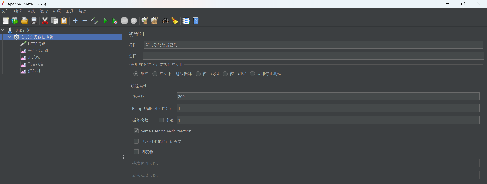
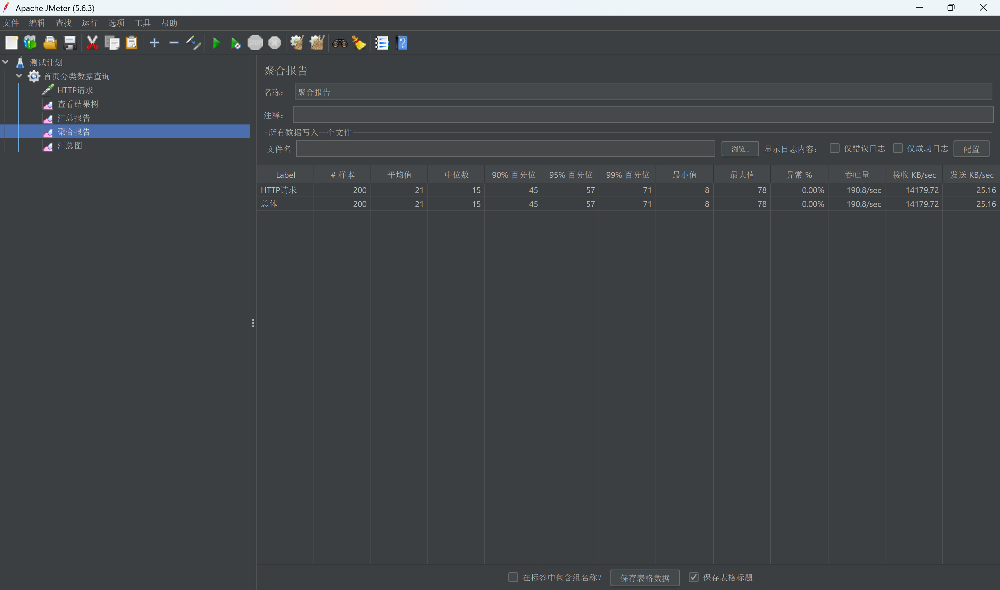
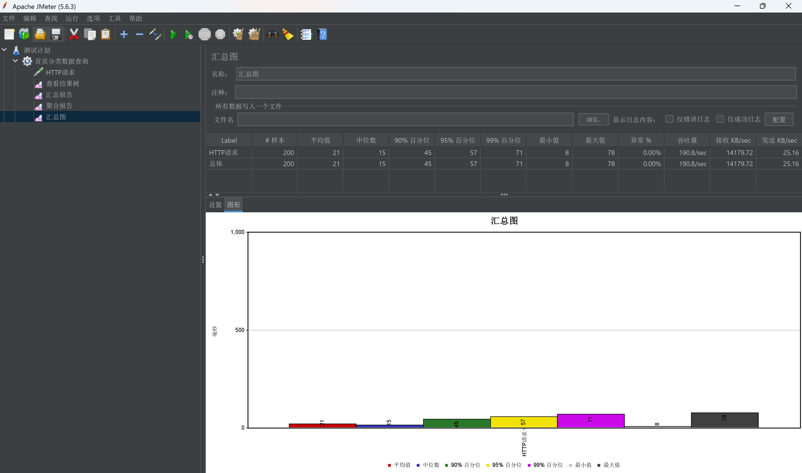
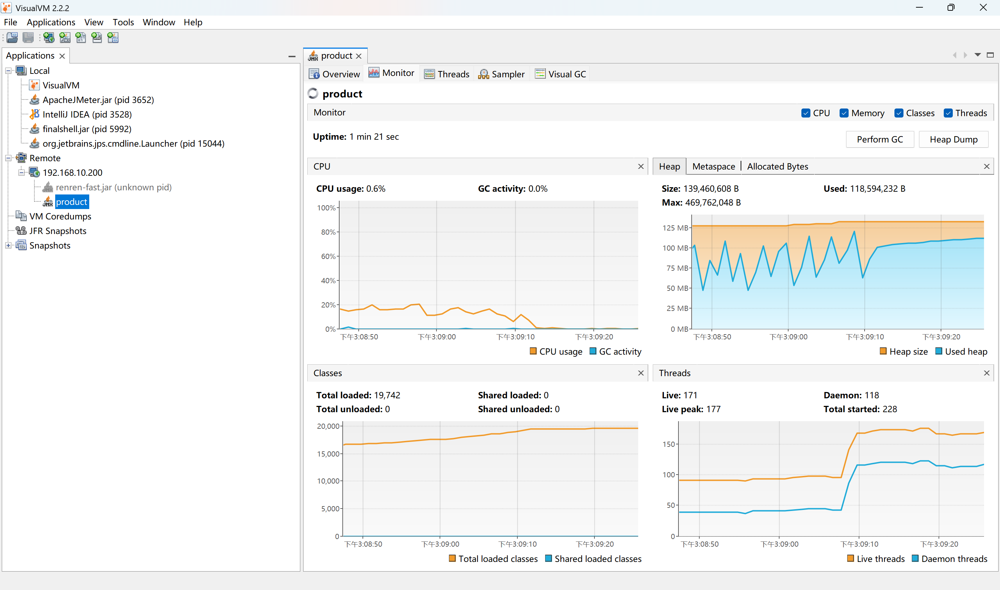
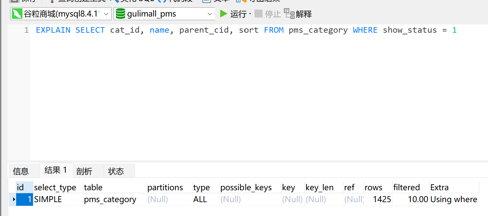
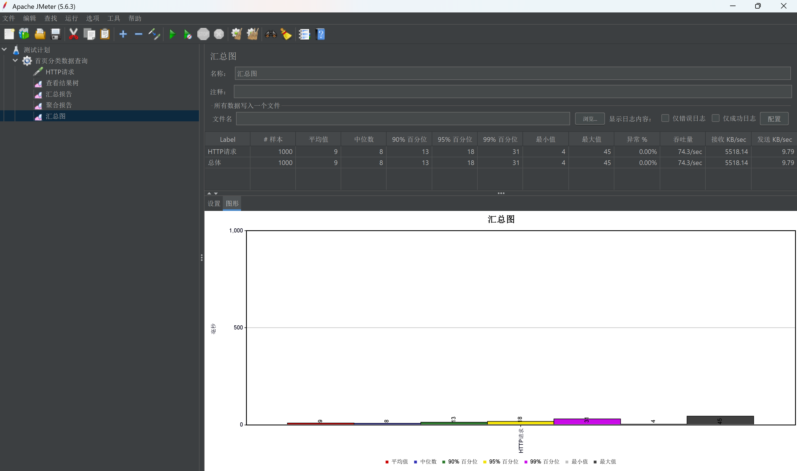

# 16.3 JMeter 压测与性能优化-介绍

> 本篇介绍 JMeter 压测与性能优化：压测业务怎么选、8 个场景分别验证什么、JMeter 脚本怎么组织、聚合报告怎么读、VisualVM 和 Arthas 怎么定位瓶颈、SQL 与索引怎么判断、JVM/Tomcat/连接池/Redisson 怎么调、优化前后差多少、代码统计脚本怎么用。

> 性能测试相关文档：[测试手册](../性能测试/性能测试-测试手册.md)、[常见问题](../性能测试/性能测试-常见问题手册.md)、[SQL 优化](../性能测试/SQL性能优化与索引优化_MySQL版.md)、[B+ 树索引](../性能测试/B+树索引-聚簇索引与二级索引.md)、[JVM 内存](../性能测试/JVM内存结构与GC分区.md)。

---

## 1. 这个功能是干什么的

压测解决的是“系统到底能扛多少、慢在哪里、优化有没有效果”。没有压测，性能优化只能靠感觉；有了压测，才能把“有点慢”变成可比较的数字。

压测业务分三类：

1. **容量基线**：首页分类查询，读多写少，用来测服务本身的读取能力。
2. **限流验证**：秒杀网关、商品列表、商品详情、抢购提交，用来验证 Sentinel 规则是否按预期拒绝。
3. **业务链路**：购物车修改数量、运输信息查询，用来验证完整业务接口在并发下的表现。

三个工具分工：

| 工具 | 定位 | 回答什么问题 | 运行位置 |
|---|---|---|---|
| JMeter | 压测客户端 | 慢不慢、有多慢 | Windows 压测机 |
| VisualVM | JVM 监控 | 哪里在耗资源，CPU、GC、线程是否异常 | Windows 通过 JMX 连远程 JVM |
| Arthas | 在线诊断 | 具体哪个方法慢，耗时花在哪一层 | Linux attach 到目标 JVM |

整体排查路径：

```text
① JMeter 压测
   得到中位数、P90、P99、吞吐量、异常率
        ↓
② VisualVM 看资源
   CPU、GC、堆、线程数
        ↓
③ Arthas trace 方法
   找到占比最高的调用链节点
        ↓
④ 看代码和配置
   连接池、线程池、缓存、SQL、远程调用
        ↓
⑤ 分层优化
   每改一层压一轮，记录对比
```

压测不做的事：

1. 不用压测结果代替业务正确性验证。
2. 不在生产环境直接压测，先在测试环境找到问题并验证修改效果。
3. 不把“压测机发不出请求”误判成服务端瓶颈。
4. 不只调一个参数就宣布优化完成，必须分层验证。

## 2. 用户、管理员、开发者怎么操作

### 2.1 用户怎么操作

用户不运行压测，只感知结果：

1. 页面打开速度、商品列表加载速度、下单响应速度。
2. 秒杀场景下是否收到“当前抢购人数过多，请稍后再试”。
3. 高并发时是否出现超时、白屏或重复提交。

用户的真实体验对应压测里的中位数和 P90/P99，而不是平均值。平均值容易被少量极端值拉高或拉低。

### 2.2 管理员怎么操作

1. 确认压测环境干净：关闭 IDEA、浏览器、杀毒软件，避免抢 CPU。
2. 确认被测服务、MySQL、Redis、Nacos、网关已经启动。
3. 确认压测地址：直连服务用于定位服务本身，走 Nginx/网关用于验证完整链路。
4. 先跑一轮预热，丢弃结果，让 JIT 编译完成、连接池建好连接。
5. 用非 GUI 模式运行 JMeter，减少压测机自身开销。
6. 查看聚合报告的异常率，异常率不为 0 时先解决错误，再看响应时间。
7. 记录中位数、P90、P99、吞吐量，和基线对比。
8. 压测结束后清理测试订单、释放库存，避免影响后续测试。

### 2.3 开发者怎么操作

1. 选择场景：容量基线、限流验证或业务链路。
2. 打开对应 `.jmx`，在 Test Plan 的 User Defined Variables 修改变量。
3. 确认线程数、Ramp-Up、循环次数和目标地址。
4. 运行 JMeter，查看结果树确认请求返回 200。
5. 查看聚合报告，记录核心指标。
6. 用 VisualVM 连接 JMX 端口，先看 CPU、GC、堆和线程数。
7. 用 Arthas `trace` 追踪耗时最高的方法。
8. 结合代码和配置定位根因。
9. 一次只改一层，改完重新压测，记录对比。
10. 复测条件保持一致：线程数、Ramp-Up、循环次数、请求地址都不变。

## 3. 整体设计思路

### 3.1 业务上怎么设计

#### 3.1.1 8 个场景的分工

`jmeter/` 目录包含 7 个 `.jmx` 脚本，加上性能排查使用的 200 并发首页分类基线，共 8 个场景：

| 场景 | 脚本 | 线程 / Ramp-Up / 循环 | 目标 | 预期 |
|---|---|---|---|---|
| 网关场次查询限流 | `秒杀-网关场次查询限流.jmx` | 200 / 1s / 5 | `gulimall.vip/gulimall/seckill/sessions` | 超过 100 QPS 返回 429 |
| 商品列表直连限流 | `秒杀-商品列表直连限流.jmx` | 300 / 1s / 5 | `seckill.gulimall.vip/seckill/skus` | 超过 200 QPS 返回 14013 |
| 商品详情热点参数 | `秒杀-商品详情热点参数.jmx` | 100 / 1s / 10 | `seckill.gulimall.vip/seckill/sku/info` | 同一 skuId 超过 20 QPS 返回 14013 |
| 抢购接口限流 | `秒杀-抢购接口限流.jmx` | 100 / 1s / 5 | `seckill.gulimall.vip/seckill/order/submit` | 超过 50 QPS 返回 14013，其余 14005/14004/0 |
| 购物车修改数量 | `购物车修改商品数量.jmx` | 200 / 1s / 1 | `cart.gulimall.vip/countItem` | 200 且数量正确更新 |
| 运输信息查询 | `运输信息查询.jmx` | 200 / 1s / 1 | `order.gulimall.vip/fare` | 200 且运费返回 |
| 首页分类数据查询 | `首页分类数据查询.jmx` | 200 / 1s / 1 | `localhost:10000/index/catelog.json` | 200 且分类树完整 |
| 首页分类基线 | 性能排查用例 | 200 / 1s / 1 | `product:10000/index/catelog.json` | 记录中位数、P90、P99、吞吐量 |

场景选择原则：

1. 验证限流规则时，线程数要明显高于阈值，否则打不到限流边界。
2. 验证业务链路时，循环次数不要太多，避免真实消耗库存或生成大量订单。
3. 定位服务本身时直连服务端口，绕开 Nginx 和网关，排除干扰。
4. 验证完整链路时走域名，观察网关、Nginx、服务三段的总耗时。

#### 3.1.2 压测步骤

```text
准备环境
  → 确认中间件和服务启动
  → 确认变量、Cookie、randomCode
  → 预热一轮
  → 正式压测
  → 记录指标
  → 定位瓶颈
  → 分层优化
  → 同条件复测
  → 清理测试数据
```

每一步都要留下记录。没有基线数字，后面的优化无法证明有效。

#### 3.1.3 核心指标怎么读

| 指标 | 含义 | 怎么用 |
|---|---|---|
| 样本数 | 实际发出的请求数 | 和“线程数 × 循环次数”对照，确认没有少发 |
| 平均值 | 所有请求的平均耗时 | 容易被极端值影响，参考意义有限 |
| 中位数 | 50% 请求在这个时间内完成 | 代表典型用户体验 |
| P90 | 90% 请求在这个时间内完成 | 性能验收的核心指标 |
| P99 | 99% 请求在这个时间内完成 | 反映长尾和最差体验 |
| 异常率 | 失败请求占比 | 必须为 0，非 0 时响应时间没有参考价值 |
| 吞吐量 | 每秒完成的请求数 | 反映系统处理能力 |

一个查分类列表的简单读接口，正常应在几十毫秒内返回。基线中位数是 2260ms，比正常水平慢了两个数量级，说明确实有严重问题。

#### 3.1.4 优化优先级

| 层次 | 改动成本 | 收益 | 优先级 |
|---|---|---|---|
| Caffeine L1 + Redis L2 + 启动预热 | 低 | 最高，直接砍掉绝大部分数据库访问 | ★★★ |
| Redisson 超时重试 | 极低 | 高，避免长尾被放大 | ★★★ |
| 数据库连接池 | 极低 | 中，缓解排队 | ★★★ |
| Tomcat 线程与连接数 | 低 | 中 | ★★ |
| JVM 内存参数 | 低 | 视内存情况 | ★★ |
| SQL / 索引 | 中 | 视数据量 | ★ |

顺序原则：先加缓存降低数据库访问量，再调连接池和线程池承接剩余请求，最后才怀疑 SQL 本身。反过来先调池子，数据库压力没变，只是把排队位置换了。

### 3.2 技术上怎么设计

#### 3.2.1 JMeter 脚本结构

一个 `.jmx` 至少包含四部分：

```text
Test Plan
  ├── User Defined Variables   变量：host、port、sessionId、skuId、Cookie
  ├── ThreadGroup              并发模型：线程数、Ramp-Up、循环次数
  ├── HTTPSamplerProxy         请求：协议、域名、端口、路径、方法、请求头
  └── ResultCollector          报告：查看结果树、聚合报告、汇总报告
```

线程组决定“多少并发、多快启动、每个线程发几次”；HTTP 请求决定“打哪个地址”；结果收集器决定“看哪些指标”。

#### 3.2.2 排查漏斗

```text
压测发现慢
    │
    ├─ 异常率 > 0？ ──是──→ 先解决错误
    │               否
    ↓
看资源
    │
    ├─ CPU 高 ────────────→ 在算：Sampler 找最耗 CPU 的方法
    ├─ GC 频繁/堆只涨不降 → 内存问题：Visual GC、dump、MAT
    ├─ 线程数顶到平台期 ──→ 线程/连接池不够
    └─ CPU 低、GC 低 ─────→ 在等：Arthas trace
                                     │
                                     ├─ DAO 占比高 → 等连接 / SQL 慢 / 查询次数多
                                     ├─ Feign 占比高 → 超时太长 / 串行可并行
                                     └─ 自定义方法占比高 → 看算法和循环
```

判断“在算”还是“在等”的通用方法：

```text
CPU 时间 ÷ 墙钟时间 ≈ 1    → 在算
CPU 时间 ÷ 墙钟时间 << 1   → 在等
```

Arthas 的 `trace` 测的是墙钟时间，包含等待。一个方法耗时 1.8 秒，不代表它计算了 1.8 秒，很可能是在排队等数据库连接。

#### 3.2.3 分层优化模型

```text
请求
  → Tomcat 工作线程
  → 业务线程池
  → 数据库连接池 / Redis 连接池
  → MySQL / Redis
  → 下游 Feign
```

每一层都可能是瓶颈：

1. Tomcat 线程不够，请求在容器层排队。
2. 数据库连接池不够，线程拿到请求后卡在 `getConnection()`。
3. Redis 连接池不够或客户端重试放大，长尾变长。
4. SQL 慢或查询次数多，数据库 CPU 升高。
5. Feign 超时太长，调用方线程被下游占住。

优化时要把线程数和连接池匹配起来：Tomcat 300 线程配 Hikari 10 连接，290 个线程拿到请求后仍然卡在等连接，只是换了个地方排队。

#### 3.2.4 缓存层次

分类数据是典型的“读极多、写极少”字典数据，最终方案是三级缓存：

```text
请求
  → Caffeine L1（进程内，命中率极高，零网络 IO）
  → Redis L2（跨实例共享，命中后回填 L1）
  → MySQL L3（最终事实）
```

只加 Redis 不够：缓存值 66KB 时，200 个线程同时读 Redis 会把网络 IO 和连接池打满，长尾反而变差。Caffeine L1 让绝大多数请求根本不产生网络 IO，Redis 读取退化成低频且无竞争的操作。

## 4. 详细代码、配置和解释

第 4 章按“场景 → 脚本 → 指标 → 定位 → 分层优化”组织。每个小节先说明这段脚本、配置或这张表在压测链路里承担什么，再解释关键字段和正常链路，然后按代码块逐段说明执行顺序、条件和原因，最后给出一次完整示例与边界。

### 4.1 压测脚本：线程组与 HTTP 请求

#### 4.1.1 这段脚本解决什么问题

首页分类查询是容量基线场景：读多写少、不需要登录态、不会消耗库存，适合观察服务本身在突发并发下的响应时间。JMeter 在这里扮演压测客户端，模拟 200 个用户在同一秒打开首页；请求直连 product 服务的 10000 端口，跳过 Nginx 和网关，先把“Tomcat → 业务方法 → 缓存 → 数据库”这一段单独量出来。上游是 Windows 压测机，下游是 product 的 `/index/catelog.json`，结果写入聚合报告，成为后续每一轮优化的比较基准。

脚本只承担三件事：定义并发模型、定义请求地址、把结果交给监听器。限流规则、缓存命中、SQL 快慢都不由脚本判断，脚本只负责稳定地制造压力。

#### 4.1.2 并发模型的关键字段

| 字段 | 取值 | 含义 | 对结果的影响 |
|---|---|---|---|
| `ThreadGroup.num_threads` | 200 | 并发线程数 | 决定同一时刻能发出多少请求 |
| `ThreadGroup.ramp_time` | 1 | 启动全部线程所用的秒数 | 1 秒表示瞬时冲击，数值越大压力越平缓 |
| `LoopController.loops` | 1 | 每个线程的循环次数 | 样本数等于线程数乘循环次数 |
| `ThreadGroup.same_user_on_next_iteration` | true | 循环之间复用同一用户状态 | 循环多次时 Cookie、连接尽量保持 |
| `ThreadGroup.on_sample_error` | continue | 单个请求出错后的动作 | 出错不中断整轮测试，便于统计异常率 |
| `LoopController.continue_forever` | false | 是否无限循环 | 关闭后循环次数才可控 |

200 线程、1 秒内全部启动、每个线程只发一次，样本数固定为 200。这个组合测的是“瞬时 200 并发”的冲击效果，不是长时间的稳态吞吐。需要看稳态能力时，应延长 Ramp-Up 或增加循环次数，让压力持续一段时间。

#### 4.1.3 线程组代码与解释

线程组是整份脚本的入口，决定压测机创建多少线程、多快启动、每个线程执行几轮。

```xml
<ThreadGroup guiclass="ThreadGroupGui" testclass="ThreadGroup" testname="首页分类数据查询">
  <intProp name="ThreadGroup.num_threads">200</intProp>
  <intProp name="ThreadGroup.ramp_time">1</intProp>
  <boolProp name="ThreadGroup.same_user_on_next_iteration">true</boolProp>
  <stringProp name="ThreadGroup.on_sample_error">continue</stringProp>
  <elementProp name="ThreadGroup.main_controller" elementType="LoopController" guiclass="LoopControlPanel" testclass="LoopController" testname="循环控制器">
    <stringProp name="LoopController.loops">1</stringProp>
    <boolProp name="LoopController.continue_forever">false</boolProp>
  </elementProp>
</ThreadGroup>
```

1. `testname` 是线程组名称，只用于界面识别，出现在结果树和报告里，方便区分不同场景。
2. `ThreadGroup.num_threads=200`：JMeter 创建 200 个工作线程，这是压测机侧的并发上限，不等于服务端一定同时处理 200 个请求。
3. `ThreadGroup.ramp_time=1`：200 个线程在 1 秒内全部启动，压力几乎同时到达，用于测极限和暴露排队问题。
4. `same_user_on_next_iteration=true`：同一个线程的多次循环复用用户状态，循环次数大于 1 时，Cookie 和连接不会被反复重置。
5. `on_sample_error=continue`：某个请求返回 4xx、5xx 或超时后，线程继续执行后续循环，整轮测试不会中断，异常率才有统计意义。
6. `LoopController.loops=1`：每个线程只发一个请求，总样本数等于 200 × 1 = 200。
7. `continue_forever=false`：关闭无限循环，否则 `loops` 不生效，测试会一直跑到手工停止。

Ramp-Up 是最容易被忽略的参数。设为 1 秒表示 200 个用户几乎同时到达，服务端要在一瞬间接住全部压力；设为 200 秒表示每秒只增加一个用户，测到的是逐步加压后的稳态表现。测容量上限用小值，测长时间稳定性用大值，两种结果不能直接比较。

#### 4.1.4 HTTP 请求代码与解释

线程组只决定“多少人”，真正决定“打哪里”的是 HTTP 取样器。这个取样器指向首页分类 JSON 接口，使用短连接以外的默认 KeepAlive 行为。

```xml
<HTTPSamplerProxy guiclass="HttpTestSampleGui" testclass="HTTPSamplerProxy" testname="HTTP请求">
  <boolProp name="HTTPSampler.image_parser">true</boolProp>
  <boolProp name="HTTPSampler.concurrentDwn">true</boolProp>
  <intProp name="HTTPSampler.concurrentPool">6</intProp>
  <stringProp name="HTTPSampler.domain">localhost</stringProp>
  <stringProp name="HTTPSampler.port">10000</stringProp>
  <stringProp name="HTTPSampler.protocol">http</stringProp>
  <stringProp name="HTTPSampler.path">/index/catelog.json</stringProp>
  <boolProp name="HTTPSampler.follow_redirects">true</boolProp>
  <stringProp name="HTTPSampler.method">GET</stringProp>
  <boolProp name="HTTPSampler.use_keepalive">true</boolProp>
  <boolProp name="HTTPSampler.postBodyRaw">false</boolProp>
  <elementProp name="HTTPsampler.Arguments" elementType="Arguments" guiclass="HTTPArgumentsPanel" testclass="Arguments" testname="用户定义的变量">
    <collectionProp name="Arguments.arguments"/>
  </elementProp>
</HTTPSamplerProxy>
```

1. `protocol=http`：使用明文 HTTP，压测环境在内网，不需要 TLS 握手开销。
2. `domain=localhost`、`port=10000`：直接访问 product 服务，不经过 Nginx 和网关，排除网络转发和网关限流的影响。
3. `path=/index/catelog.json`：首页分类 JSON 接口，返回完整分类树，是典型的读多写少数据。
4. `method=GET`：只读请求，不会修改数据库，压测可以重复执行。
5. `follow_redirects=true`：遇到 3xx 自动跟随，避免把重定向响应误当成业务结果。
6. `use_keepalive=true`：复用 TCP 连接，更接近真实浏览器的连续请求行为，也减少压测机自身的建连开销。
7. `postBodyRaw=false` 且 `Arguments.arguments` 为空：GET 请求没有请求体，参数为空是正常配置。
8. `image_parser`、`concurrentDwn`、`concurrentPool` 控制页面内嵌资源的解析和下载。JSON 响应没有图片，这几项不影响结果，保留默认值即可。

为什么直连服务：定位服务本身时，直连 `product:10000` 可以把 Nginx、网关、DNS 都移出嫌疑范围，压出来的耗时更容易对应到 Java 方法和数据库。验证完整链路时再改回域名，两者的数据不能混用。

#### 4.1.5 一次完整请求示例

```text
1. JMeter 读取线程组，创建 200 个线程
2. Ramp-Up 为 1 秒，200 个线程在约 1 秒内全部启动
3. 每个线程执行一次 HTTP 取样器
4. 取样器向 http://localhost:10000/index/catelog.json 发 GET 请求
5. product 的 Tomcat 接收连接，交给工作线程
6. 业务方法查 Caffeine，未命中则查 Redis 或 MySQL
7. 响应沿原连接返回 JMeter
8. 每个线程循环 1 次后结束，共产生 200 个样本
9. 聚合报告汇总耗时、百分位、异常率和吞吐量
```

这 200 个样本是后面所有指标的基础。样本数不足 200，说明线程没有全部启动、请求被压测机提前中断，或者结果监听器丢了数据；异常率不为 0，说明测到的不是正常业务路径。

#### 4.1.6 它不做什么

1. 不校验响应体内容，只看 HTTP 状态和耗时；业务返回错误码但状态为 200 时，脚本不会主动判失败。
2. 不模拟用户思考时间，所有请求几乎同时发出，压力比真实用户更集中。
3. 不参数化用户、商品或场次，所有线程打同一个地址。
4. 不负责启动服务、清缓存或清数据库，环境准备在脚本之外完成。

#### 4.1.7 边界与可优化点

1. `localhost` 只适合压测机和服务在同一台机器；压远程服务要改成服务器 IP 或域名，否则请求根本没有离开本机。
2. KeepAlive 更接近真实浏览器，但会复用连接，压测连接池和 Tomcat 连接数时要明确这一点。
3. 200 个样本偏少，单轮结果容易受 GC、JIT 和系统抖动影响，正式结论应至少压 3 轮取中间值。
4. 脚本没有响应断言，接口返回 500 但耗时很短的请求会拉低中位数，必须结合异常率一起看。
5. GUI 模式下的结果树和聚合报告本身消耗压测机资源，大并发应使用非 GUI 模式并把结果写入文件。



### 4.2 秒杀压测脚本与变量

#### 4.2.1 这四个脚本解决什么问题

秒杀链路同时受多层保护：网关路由限流、秒杀服务 Web 资源限流、商品详情热点参数限流、抢购提交限流。四个脚本分别把压力打在对应层上，用来验证 Sentinel 规则是否在阈值附近开始拒绝，而不是等到数据库或库存层才崩。上游是 JMeter 经 Nginx 访问 `gulimall.vip` 或 `seckill.gulimall.vip`，下游是 gateway、seckill 服务以及 Redis、MySQL。脚本只制造并发并记录返回码，规则是否生效由结果码对照判断。

#### 4.2.2 变量清单

四个脚本共用一组 User Defined Variables，换环境时只改变量，不改请求路径。

| 变量 | 默认值 | 说明 |
|---|---|---|
| `targetHost` | `<your-vm-host-ip>` | Nginx 所在虚拟机 |
| `targetPort` | `80` | Nginx 端口 |
| `siteHost` | `gulimall.vip` 或 `seckill.gulimall.vip` | 网关测试用主域，直连用秒杀子域 |
| `sessionId` | `14` | 秒杀场次 id |
| `skuId` | `5` | 秒杀商品 id |
| `addrId` | `2` | 抢购用的收货地址 id |
| `gulimallSession` | 预置 Cookie | 登录会话 |
| `randomCode` | 预置随机码 | 从 Redis 商品 hash 读取 |

`sessionId`、`skuId` 决定打哪个场次的哪个商品；`addrId` 只在抢购提交时使用；`gulimallSession` 和 `randomCode` 决定请求能否通过登录校验和秒杀随机码校验。场次、商品或会员变化后，这些值必须同步替换，否则压力仍然能打到接口，但业务会在更早的校验分支返回。

#### 4.2.3 四个场景的调用链与预期

| 场景 | 线程 / Ramp-Up / 循环 | 请求入口 | 经过的层 | 预期结果 |
|---|---|---|---|---|
| 网关场次查询限流 | 200 / 1s / 5 | `gulimall.vip/gulimall/seckill/sessions` | Nginx → 网关 `seckill-route` → seckill | 超过 100 QPS 返回 HTTP 429，body 中 `code=14013` |
| 商品列表直连限流 | 300 / 1s / 5 | `seckill.gulimall.vip/seckill/skus` | Nginx → seckill Web 资源 | 超过 200 QPS 返回 `14013` |
| 商品详情热点参数 | 100 / 1s / 10 | `seckill.gulimall.vip/seckill/sku/info` | Nginx → seckill → 热点参数规则 | 同一 `skuId` 超过 20 次/秒返回 `14013` |
| 抢购接口限流 | 100 / 1s / 5 | `seckill.gulimall.vip/seckill/order/submit` | Nginx → seckill → 库存与订单链路 | 超过 50 QPS 返回 `14013`，其余为 `14005`、`14004` 或 `0` |

网关场次查询的拒绝发生在网关层，HTTP 状态是 429；直连秒杀服务的三个场景不经过网关，拒绝由 Sentinel 在服务内完成，HTTP 状态仍是 200，业务码为 14013。两种表现不同，判断时要按各自的入口看，不能只盯 HTTP 状态。

`14005` 表示超过每人限购，`14004` 表示库存不足，`0` 表示抢购成功。抢购场景里这些码同时出现是正常的：限流规则先拦掉超出阈值的部分，剩下的请求继续走限购和库存判断。

#### 4.2.4 一次完整执行示例

```text
1. 确认 Sentinel Dashboard、Nacos 规则和 seckill 服务已启动
2. 打开目标 .jmx，在 Test Plan 的 User Defined Variables 修改 targetHost、targetPort、siteHost
3. 从浏览器 Cookie 或登录响应中取 GULIMALLSESSION
4. 从 Redis 的 seckill:session:14:skus 中取当前商品的 randomCode
5. 修改 sessionId、skuId、addrId 为当前测试数据
6. 确认线程数、Ramp-Up、循环次数与场景表一致
7. 运行脚本，在结果树确认请求能到达接口
8. 查看聚合报告，统计 429、14013、14005、14004、0 各自的数量
9. 对照 Sentinel 阈值判断拒绝比例是否符合预期
10. 清理测试订单，或调用取消接口释放库存
```

只验证限流时，可以先不填正确的 Cookie 和随机码，请求仍然会到达 Sentinel 资源；要验证完整抢购链路，两者必须有效。把业务参数错误造成的 14007、14008 当成限流不生效，是最常见的误判来源。

#### 4.2.5 限流压测为什么也要填 Cookie 和随机码

Sentinel 规则挂在业务资源上，资源入口处的登录校验、场次校验、随机码校验先执行。Cookie 无效时，请求在鉴权层就被拒绝，根本走不到库存和订单逻辑；随机码无效时，请求会在秒杀校验分支返回业务错误。此时压力确实打到了服务，但测到的是校验分支的耗时和返回码，不是抢购主链路。要观察限流之后的业务表现，登录态和随机码必须与真实用户一致。

#### 4.2.6 边界与可优化点

1. 变量值写死在脚本里，换环境要逐个文件修改；可以用 CSV Data Set Config 统一管理多组用户、商品和地址。
2. Cookie 和随机码会过期，压测前需要重新获取；可以加前置脚本自动登录并从 Redis 取随机码。
3. 抢购测试会真实消耗库存并生成 `sms_seckill_order`、`oms_order`，重复执行会积累测试数据。压完必须取消订单或按测试数据清理。
4. 300 线程、1 秒 Ramp-Up 对压测机本身也是压力，压测机 CPU 或网络先打满时，测到的是客户端瓶颈，不是服务端瓶颈。
5. 同一 `skuId` 的热点参数测试要求所有线程打同一个商品；参数化商品会让热点规则失效，测试目的随之改变。
6. 场次过期、商品下架、库存为 0 都会改变返回码分布，执行前要确认测试数据处于可抢购状态。

### 4.3 基线结果与聚合报告

#### 4.3.1 这份报告解决什么问题

聚合报告位于压测链路的末端，把 200 个样本压缩成可比较的数字。它回答三个问题：请求是否全部成功、典型用户等多久、最慢的一批用户等多久。没有这份基线，后面的缓存、连接池、Redisson 调整都无法证明有效。上游是 JMeter 取样器，下游是 VisualVM、Arthas 和代码排查。

#### 4.3.2 指标与基线数值

200 并发压 `/index/catelog.json` 的聚合报告：

| 指标 | 数值 |
|---|---|
| 样本数 | 200 |
| 平均值 | 2257 ms |
| 中位数 | 2260 ms |
| 90% 百分位 | 3688 ms |
| 95% 百分位 | 3825 ms |
| 99% 百分位 | 3877 ms |
| 最小值 | 326 ms |
| 最大值 | 4379 ms |
| 异常率 | 0.00% |
| 吞吐量 | 40.8 /sec |

样本数 200 与“200 线程 × 1 次循环”一致，说明请求全部发出。吞吐量 40.8 每秒与中位数 2260ms 相互印证：200 个请求在约 4.9 秒内完成，平均每秒完成约 40 个。一个查分类列表的简单读接口正常应在几十毫秒内返回，中位数 2260ms 比正常水平慢了两个数量级，说明问题不在偶发抖动，而在稳定存在的等待。

#### 4.3.3 聚合报告的执行流程

1. JMeter 为每个请求记录开始时间、结束时间和响应码。
2. 所有样本结束后，按响应时间升序排序。
3. 取第 50%、90%、95%、99% 位置的耗时，得到中位数和各百分位。
4. 统计非 2xx、非 3xx 或超时的请求，计算异常率。
5. 用样本数除以测试持续时间，得到吞吐量。
6. 把结果写入聚合报告，供人工判读。

#### 4.3.4 为什么先看异常率

异常率为 0 才能保证测到的是正常业务路径。大量请求返回 4xx 或 5xx 时，压出来的“响应时间”实际是错误处理的耗时，响应越快反而说明失败得越早，没有参考价值。先确认 200 和异常率，再看中位数与百分位，顺序不能反。

#### 4.3.5 一次基线判定示例

```text
1. 200 个样本全部返回 200，异常率 0.00%
2. 中位数 2260ms，典型请求要等 2 秒以上
3. P90 为 3688ms，十分之一的请求超过 3.7 秒
4. P99 为 3877ms，长尾接近 4 秒
5. 最小值 326ms，说明服务并非完全不可用，而是大部分请求在排队
6. 判断：存在稳定的资源等待，不是偶发 GC 或网络抖动
7. 下一步：VisualVM 看 CPU、GC、堆和线程数，确认在算还是在等
```

百分位画成柱状图后，中位数和 P90 的差距更直观。基线中位数 2260ms、P90 3688ms，分布很分散，说明有一部分请求被同一个资源拖住，而不是所有请求均匀变慢。





#### 4.3.6 边界与可优化点

1. 平均值受极端值影响大，应优先看中位数和 P90/P99；平均值 2257ms 与中位数接近，说明慢不是少数极端请求造成的，而是大面积请求都落在同一慢区间。
2. 单轮 200 样本偏少，结论容易受抖动影响；可以多压几轮取中间值。
3. 报告只有客户端视角，没有记录压测时的 CPU、GC、连接池指标，定位时要重新采集。
4. 聚合报告不保存每个请求的明细，需要看单条耗时分布时应同时启用结果树或写入 JTL 文件。
5. 压测机与服务同机时，JMeter 自身会争抢 CPU 和内存，中位数可能被客户端开销拉高。

### 4.4 瓶颈定位：VisualVM 与 Arthas

#### 4.4.1 这个排查流程解决什么问题

JMeter 只说明“慢”，不说明“慢在哪”。VisualVM 从资源角度看 CPU、GC、堆和线程是否吃紧；Arthas 从方法角度看一次请求的墙钟耗时花在哪个调用节点。两者组合用于区分“在算”和“在等”。上游是聚合报告，下游指向代码、连接池、缓存或 SQL。

#### 4.4.2 VisualVM 面板读数

| 面板 | 数值 | 解读 |
|---|---|---|
| CPU | 1.2% | 几乎不干活 |
| GC 活动 | 0.0% | 没有 GC 压力 |
| Heap Size / Used | 104 MB / 79 MB | 堆用了一半，正常 |
| Live Threads | 90 | 线程数正常 |
| Total loaded classes | 20,019 | 正常 |

CPU 只有 1.2%、GC 是 0，但每个请求要 2.2 秒。如果瓶颈是计算或内存，CPU 或 GC 必然有一项飙高；两项都低，只剩一种可能：线程在等数据库连接、等远程调用、等锁或等 I/O。这一步的价值在于排除法，先用低成本指标把“算”和“内存”排除掉。

#### 4.4.3 Arthas trace 代码与解释

确认线程在等之后，需要知道等在哪一层。`trace` 把一次调用的耗时按方法调用树展开，百分比表示当前节点占父节点耗时的比例。

```text
---ts=2026-09-20 20:01:03.972;thread_name=http-nio-10000-exec-329;id=829;...
   ---[228.7397ms] com.atguigu.gulimall.product.service.impl.CategoryServiceImpl$$SpringCGLIB$$0:getCatelogJson()
       `---[99.97% 228.6721ms ] org.springframework.cglib.proxy.MethodInterceptor:intercept()
           `---[99.37% 227.2351ms ] com.atguigu.gulimall.product.service.impl.CategoryServiceImpl:getCatelogJson()
               `---[80.66% 183.2935ms ] com.atguigu.gulimall.product.service.impl.CategoryServiceImpl:getAllCategory() #162
```

1. 第一行是 trace 的时间、线程名和线程 id，说明这次采样来自处理请求的 Tomcat 工作线程。
2. 根节点 `CategoryServiceImpl$$SpringCGLIB$$0:getCatelogJson()` 耗时 228.7397ms，是这次请求在分类方法上的总墙钟时间。
3. `MethodInterceptor:intercept()` 占 99.97%，说明几乎全部时间都进入了 Spring 代理后的真实方法，代理本身没有开销。
4. 真实 `CategoryServiceImpl:getCatelogJson()` 耗时 227.2351ms，与根节点基本一致。
5. `getAllCategory()` 耗时 183.2935ms，占父节点的 80.66%，是当前采样里最大的子节点。
6. `#162` 是方法被调用的行号，用于回到源码定位具体调用位置。
7. 百分比是相对父节点的占比，不是相对总耗时的绝对比例；看树时要沿着占比最高的分支往下走。

这段 trace 截取的是其中一次 228ms 的调用，用于展示调用树结构；基线中还有耗时 4787ms 的请求，两者并不矛盾，差别来自采样时刻的连接排队长度。

单次 trace 只能说明这一次调用的分布。缓存命中、GC 停顿、连接池排队都会让单次结果偏大或偏小，因此需要连续多次 trace。连续采样中 `getAllCategory()` 稳定占 80% 到 99%，才能确认它是稳定的主要耗时点，而不是偶发抖动。

#### 4.4.4 一次定位示例

```text
1. 聚合报告显示中位数 2260ms，异常率 0
2. VisualVM 通过 JMX 连接 product JVM
3. Monitor 面板看到 CPU 1.2%、GC 0%、堆 79MB/104MB、线程 90
4. 判断不是 CPU 密集，也不是内存问题
5. Sampler 看到 getCatelogJson 的 CPU 时间只有 271ms，墙钟耗时 4787ms
6. CPU 时间与墙钟时间比值约 0.06，明确是阻塞型问题
7. Arthas trace getCatelogJson，getAllCategory 占 80% 以上
8. 连续多次 trace，占比稳定，确认数据库访问是主要耗时点
9. 回到代码和配置，检查缓存是否命中、连接池是否够用
```

#### 4.4.5 为什么 CPU 时间远小于墙钟时间

CPU 时间是线程真正占用处理器执行指令的时间，墙钟时间是从方法开始到结束的真实耗时，包含等待。两者接近，说明线程一直在算；两者差距大，说明线程大部分时间在等。基线数据 CPU 271ms、墙钟 4787ms，比值约 0.06，等待占了九成以上。此时继续优化算法或减少循环没有意义，应该去查连接池、缓存、锁和远程调用。

`trace` 测的是墙钟时间，一个方法耗时 1.8 秒不代表它计算了 1.8 秒，很可能是在排队等数据库连接。诊断时必须把 CPU 采样和墙钟 trace 放在一起看，单看任何一个都会得出错误结论。

#### 4.4.6 边界与可优化点

1. JMX 默认关闭，启动参数要显式打开；`authenticate=false` 和 `ssl=false` 只能在纯内网测试机使用，生产环境必须保留认证。
2. 单次 trace 可能碰上缓存命中或 GC 停顿，要多看几次，确认占比稳定后再下结论。
3. VisualVM Sampler 的 CPU 采样不能替代 Arthas 的墙钟耗时，两者统计口径不同，要结合看。
4. Arthas 只能追踪进入该 JVM 的方法，跨服务调用需要分别 attach 到上下游 JVM。
5. `trace` 会带来额外开销，生产环境应限制采样次数和耗时阈值，避免诊断工具本身拖慢服务。



### 4.5 SQL 与索引

#### 4.5.1 这组执行计划与索引解决什么问题

在怀疑 SQL 时，先用 `EXPLAIN` 确认查询是否真的慢；在确认真需要索引时，再给高并发写入和幂等查询表加约束。这个判断位于“缓存和连接池”之后：拿不到连接和 SQL 执行慢是两件事，前者靠降低数据库访问量和扩大池子解决，后者才靠索引。上游是 Arthas 指出的 DAO 占比，下游是 MySQL 执行计划和表结构。

#### 4.5.2 分类查询的执行计划

分类接口每次回源都会执行一条按显示状态过滤的查询。用 `EXPLAIN` 看它是否走索引、扫描多少行。

```sql
EXPLAIN SELECT cat_id, name, parent_cid, sort
FROM pms_category
WHERE show_status = 1;
```

1. MySQL 解析 SQL，生成候选执行计划并估算成本。
2. `pms_category` 只有主键索引，`show_status` 上没有二级索引。
3. 执行计划的 `type=ALL`、`key=NULL`，表示全表扫描，没有使用索引。
4. 表只有约 1400 行，全表扫描在内存和缓冲池里完成，耗时是毫秒级。
5. 真正的瓶颈是 200 个线程抢 10 个数据库连接，不是这 1400 行的扫描。
6. 因此没有为了消除 `ALL` 强行加索引，加了也不会改变排队位置。

`type=ALL` 只说明访问方式是全表扫描，不直接等于“慢”。判断是否要优化，要把扫描行数、表大小、缓冲池命中率和实际耗时放在一起看。

#### 4.5.3 为什么全表扫描不一定慢

索引的价值来自“快速缩小扫描范围”。`WHERE show_status = 1` 的选择性很低：分类表中绝大多数记录都是显示状态，走索引反而要先读索引再回表，成本可能高于直接顺序扫描。几百行、几千行的字典表，全表扫描几毫秒就结束；几十万行、几百万行的业务表才需要认真设计索引。先确认 SQL 真的是瓶颈，再动手，否则只是增加了写入维护成本。

#### 4.5.4 高并发幂等表的索引

秒杀订单表承担重复提交拦截、对账扫描、场次统计和会员限购查询，索引是业务正确性和并发性能的一部分，不只是加速查询。

```sql
create table sms_seckill_order
(
   id                   bigint not null auto_increment comment 'id',
   order_sn             char(32) not null comment '秒杀订单号，全链路幂等键',
   request_id           varchar(64) not null comment '客户端请求id',
   member_id            bigint not null comment '会员id',
   session_id           bigint not null comment '秒杀场次id',
   sku_id               bigint not null comment '商品id',
   status               tinyint not null default 0 comment '0待建单 1已建单 2已释放 3建单失败 4已支付',
   update_time          datetime not null default current_timestamp on update current_timestamp comment '更新时间',
   primary key (id),
   unique key uk_order_sn (order_sn),
   unique key uk_request_id (request_id),
   key idx_status_update (status, update_time),
   key idx_session_sku_status (session_id, sku_id, status),
   key idx_member_status (member_id, status)
);
```

索引分工：

| 表 | 索引 | 用途 |
|---|---|---|
| `gulimall_sms.sms_seckill_order` | `uk_order_sn` | 订单号幂等 |
| `gulimall_sms.sms_seckill_order` | `uk_request_id` | 客户端重复提交幂等 |
| `gulimall_sms.sms_seckill_order` | `idx_status_update` | 对账任务按状态 + 时间扫描 |
| `gulimall_sms.sms_seckill_order` | `idx_session_sku_status` | 场次商品维度查询与统计 |
| `gulimall_sms.sms_seckill_order` | `idx_member_status` | 会员限购与订单查询 |
| `gulimall_oms.oms_order` | `uk_order_sn` | 订单号唯一 |
| `gulimall_wms.wms_ware_order_task` | `uk_order_sn` + `idx_biz_status_create` | 库存工作单幂等 + 按业务状态扫描 |
| `gulimall_wms.mq_message` | `uk_message_id` + `idx_status_retry` | 本地消息幂等 + 补偿扫描 |

1. `uk_order_sn`：订单号唯一，重复建单在数据库层被挡住，是最后一道幂等防线。
2. `uk_request_id`：客户端请求 id 唯一，用户重复点击或网关重试时不会生成两笔订单。
3. `idx_status_update`：对账任务按 `status` 加 `update_time` 扫描待处理单，联合索引让范围扫描只碰目标区间。
4. `idx_session_sku_status`：按场次和商品统计销量、判断库存状态，三个字段的顺序与查询条件一致。
5. `idx_member_status`：会员限购要先统计该会员已购数量，这个索引把统计范围限制在单个会员内。
6. 库存工作单和本地消息表同样用唯一键保证幂等，用状态加时间索引支撑补偿任务。

#### 4.5.5 一次判断示例

```text
1. Arthas 显示 getAllCategory 占 80% 以上
2. EXPLAIN 显示 type=ALL，但表只有约 1400 行
3. 单次 SQL 执行 1ms 到 2ms，数据库 CPU 没有明显升高
4. 200 个线程平均等待 1.8 秒才拿到连接
5. 结论：瓶颈在连接获取，不在 SQL 执行
6. 处理：先加缓存降低查库次数，再评估连接池
7. 不给 pms_category.show_status 加索引
8. 把索引预算留给秒杀订单、库存工作单、本地消息等高并发表
```

#### 4.5.6 边界与可优化点

1. 索引不是越多越好，写入频繁的表每多一个索引就多一份维护成本，插入和更新都会变慢。
2. 联合索引要遵守最左前缀，查询条件顺序与索引列顺序不匹配时，后面的列用不上索引。
3. 深分页 `LIMIT 100000, 10` 会扫描大量无用行，应改成基于游标的分页。
4. 索引失效场景包括函数包裹字段、`LIKE '%xx'` 前置通配、隐式类型转换和列上做运算。
5. `EXPLAIN` 的 `rows` 是估算值，数据分布变化后估算可能失真，复杂 SQL 应结合 `EXPLAIN ANALYZE` 或慢查询日志。
6. 唯一索引既是查询索引也是业务约束，设计时要先确认业务是否允许重复，不能只为提速随意加唯一键。



### 4.6 JVM 内存参数

#### 4.6.1 这段配置解决什么问题

服务以 13 个 Java 进程跑在同一台 15G 虚拟机上，堆、元空间、代码缓存和线程栈都要预先分配。参数的目标不是把单进程调到最大，而是让所有进程在有限内存里稳定运行，避免运行期反复扩容触发 Full GC，并在 OOM 时留下现场。它位于部署层，在服务启动前一次性确定，压测和线上共用同一套口径。

#### 4.6.2 公共 JVM 参数

所有 Java 进程共用一组基础参数，负责限制非堆内存、线程栈和 OOM 现场。

```bash
COMMON_OPTS="-XX:MaxMetaspaceSize=192m -XX:ReservedCodeCacheSize=96m -Xss512k -XX:+HeapDumpOnOutOfMemoryError -XX:HeapDumpPath=${LOG_DIR}"
```

1. `COMMON_OPTS` 是一个 shell 变量，启动每个 jar 时拼接到 `java` 命令后面。
2. `MaxMetaspaceSize=192m` 限制元空间上限，避免类加载过多或动态代理膨胀导致元空间无限增长。
3. `ReservedCodeCacheSize=96m` 限制 JIT 编译后的机器码缓存，防止代码缓存占满后 JIT 停止编译、性能下降。
4. `Xss512k` 降低单线程栈大小，线程越多，native 内存占用越明显，512k 足够普通业务方法使用。
5. `HeapDumpOnOutOfMemoryError` 在发生 OOM 时自动生成堆转储，保留现场。
6. `HeapDumpPath=${LOG_DIR}` 把 dump 文件写到日志目录，方便统一收集和事后分析。

#### 4.6.3 按模块分配堆

| 模块 | 堆参数 | 说明 |
|---|---|---|
| `gulimall-product` / `gulimall-order` | `-Xms128m -Xmx448m` | 主要业务服务，堆稍大 |
| `gulimall-gateway` | `-Xms128m -Xmx320m` | WebFlux，堆中等 |
| `gulimall-agent` | `-Xms128m -Xmx512m -XX:MaxMetaspaceSize=256m` | LangChain4j / Milvus / MinIO 客户端类多 |
| 其它业务服务 | `-Xms64m -Xmx256m` | coupon/member/ware/search/cart/auth/seckill/renren-fast/third-party |

所有 Java 进程的堆上限都在 256MB 到 512MB 之间，合计约 4.0G，实际占用通常更低。这样分配是为了给 MySQL、ES、Kibana、Milvus 等容器留出内存，而不是让某个服务独占虚拟机。

`-Xms` 和 `-Xmx` 取相同值，可以避免堆反复扩容和收缩。每次扩容都可能触发 Full GC，白送性能损失；固定堆大小让 JVM 在启动时就申请好内存，运行期更稳定。

#### 4.6.4 容器环境参数

容器里不使用固定 `-Xmx`，而是按容器内存比例计算堆上限。

```dockerfile
ENV TZ=Asia/Shanghai \
    JAVA_TOOL_OPTIONS="-XX:MaxRAMPercentage=75 -XX:MaxMetaspaceSize=192m -XX:ReservedCodeCacheSize=96m -Xss512k -Duser.timezone=Asia/Shanghai -Dfile.encoding=UTF-8"
```

1. 容器启动时读取 `JAVA_TOOL_OPTIONS`，其中的参数对所有 Java 进程生效。
2. `MaxRAMPercentage=75` 表示堆最多占容器内存的 75%，容器内存调整后堆上限跟着变化。
3. 元空间、代码缓存和线程栈单独限制，避免非堆部分挤占堆空间。
4. `TZ`、`user.timezone` 和 `file.encoding` 固定时区与编码，避免日志时间错乱和中文乱码。

Java 10 以上能识别容器内存限制，但不写 `-Xmx` 时默认只使用容器内存的四分之一。给容器 4G，JVM 只用 1G，剩余内存闲置。显式写 `-Xmx` 或 `MaxRAMPercentage` 才能用满可用内存。

#### 4.6.5 一次启动示例

```text
1. start-all.sh 读取 COMMON_OPTS
2. 按 jar 名匹配模块，决定堆参数
3. 先启动 coupon、member、product 等基础服务，每个间隔 5 秒
4. 第二批启动 order 和 agent，等基础服务注册完成
5. 第三批启动 renren-fast
6. 最后启动 gateway
7. 每个进程带上公共参数和模块堆参数
8. 进程日志按 jar 名写入 LOG_DIR
9. OOM 时 dump 文件同样写入 LOG_DIR
```

#### 4.6.6 边界与可优化点

1. `-Xmx` 不要超过物理内存的 50% 到 70%，要留给元空间、直接内存、线程栈和操作系统。
2. GC 日志没有统一配置，排查 GC 问题时要临时加参数；建议在公共参数里固定 GC 日志路径和滚动策略。
3. 堆大小是静态配置，流量变化大时可以结合监控动态调整，或改用容器按比例分配。
4. 容器内使用 `MaxRAMPercentage` 时，要确认容器 memory limit 设置正确，否则 JVM 会按宿主机内存计算。
5. `HeapDumpPath` 所在磁盘必须有足够空间，dump 文件可能接近堆上限大小。
6. `MaxMetaspaceSize=192m` 对普通业务服务够用，agent 单独放宽到 256m；新增大量动态代理或脚本引擎时要重新评估。

### 4.7 Tomcat 线程与连接数

#### 4.7.1 这段配置解决什么问题

Tomcat 是请求进入 Java 服务的第一道容器层，线程数、连接数和排队队列决定请求在容器层等多久。product 服务把工作线程从默认 200 小幅上调到 300，把最大连接数提高到 10000，同时控制等待队列长度。它位于 Nginx 和网关之后、业务线程与数据库连接池前面，是整条链路的第一个排队点。

#### 4.7.2 配置代码与解释

```yaml
server:
  port: 10000

  tomcat:
    # 工作线程上限（默认 200）。
    # ⚠️ 不用盲目调大：加了 L1 本地缓存后命中路径只要 ~1ms，线程周转极快，
    #    200 线程的吞吐上限已在 10 万 QPS 量级，再调大收益很小、反而增加上下文切换成本。
    #    真正的硬约束是下面的 max-connections（连接数），不是线程数。
    threads:
      max: 300             # 默认 200，小幅上调留点余量
      min-spare: 50        # 默认 10：保持常驻线程，避免突发流量时现建（建线程是同步开销）
    # 能同时建立的最大连接数（默认 8192）。目标是撑 10000 并发的话，
    # 这一项必须 >= 10000，否则多出来的连接会被直接拒掉 —— 这才是本节的硬指标
    max-connections: 10000
    # 所有工作线程都忙时，还能排队的请求数（默认 100）。
    # ⚠️ 队列不能太长：排进去的请求要一直干等到 connection-timeout 才报错，用户体感极差。
    #    经验上别超过 threads.max
    accept-count: 300
    # 建立连接的超时（毫秒，默认 20000）
    connection-timeout: 20000
```

1. `server.port=10000`：product 服务监听端口，Nginx 和网关按这个端口转发。
2. `threads.max=300`：工作线程上限。线程负责执行 Servlet 和业务方法，数量过多会增加上下文切换和栈内存开销。
3. `threads.min-spare=50`：常驻空闲线程数。保持 50 个热线程，突发流量到来时不用现建线程，建线程是同步开销。
4. `max-connections=10000`：同时能建立的最大连接数，包含 KeepAlive 连接。目标并发超过这个值时，多出来的连接会被直接拒绝。
5. `accept-count=300`：工作线程全部忙时，允许进入等待队列的请求数。队列排满后新连接被拒绝。
6. `connection-timeout=20000`：建立连接的超时时间，单位毫秒。排队超过这个时间仍未处理的请求会失败。

为什么线程数只从 200 调到 300：加上 Caffeine L1 后，命中路径只要约 1ms，线程周转极快，200 到 300 个线程已经能支撑很高的吞吐。继续调大收益很小，反而增加上下文切换成本。真正限制高并发接入的是 `max-connections`，不是工作线程数。

#### 4.7.3 一次请求在容器层的流转

```text
1. Nginx 或网关建立 TCP 连接
2. Tomcat Acceptor 接收连接，交给 Poller
3. 连接数未超过 max-connections 时保留连接
4. 请求到达，从线程池取工作线程
5. 有空闲线程则直接执行业务方法
6. 线程全部忙时，请求进入 accept-count 队列
7. 队列也满时，新连接被拒绝
8. 排队超过 connection-timeout 仍未处理，连接超时
9. 业务方法返回，线程归还线程池
```

队列不是越大越好。排进队列的请求要一直等到有线程空闲，等待时间计入 `connection-timeout`，用户侧表现为长时间无响应。`accept-count` 经验上不要超过 `threads.max`，让系统快速拒绝而不是让用户干等。

#### 4.7.4 为什么线程数和连接池要匹配

```text
Tomcat 300 线程
Hikari 默认 10 连接
        ↓
290 个线程拿到请求后仍卡在等连接
        ↓
换了个地方排队
```

只调大 Tomcat 线程没有意义。线程数应约等于数据库连接池上限的 2 到 3 倍，给不查数据库的请求留余量。如果 300 个线程里有 200 个都要查库，而连接池只有 10 个连接，大部分线程只是从容器队列换到了连接池队列，总耗时不会改善。

#### 4.7.5 边界与可优化点

1. 线程数不是越大越好，每线程约 1MB 栈空间，线程多了内存和上下文切换成本都上升。
2. `accept-count` 超过线程数会让用户等更久，建议不超过 `threads.max`。
3. 网关是 WebFlux，不适用这套 Tomcat 参数；网关不能写阻塞代码，否则事件循环线程会被占死。
4. `connection-timeout` 是建连和排队超时，不是业务请求超时；业务超时要单独配置。
5. `max-connections` 受操作系统文件描述符限制，调大前要确认 `ulimit -n` 足够。
6. KeepAlive 连接会计入 `max-connections`，长连接越多，可用于新请求的连接越少。

### 4.8 数据库连接池

#### 4.8.1 这段配置解决什么问题

Hikari 决定同一时刻有多少请求能真正拿到数据库连接。200 并发同时查库时，池上限直接决定排队长度和等连接时间。它位于业务线程之后、MySQL 前面；在分类接口的基线里，这一层是慢的主要发生地。

#### 4.8.2 product 数据源配置

product 服务保留了一组被注释掉的调优参数，用来记录“曾怀疑连接池过小”的判断过程。

```yaml
spring:
  datasource:
    username: ${MYSQL_USERNAME}
    password: ${MYSQL_PASSWORD}
    url: jdbc:mysql://${MYSQL_HOST}:${MYSQL_PORT}/gulimall_pms?useUnicode=true&characterEncoding=UTF-8&serverTimezone=Asia/Shanghai&allowPublicKeyRetrieval=true
    driver-class-name: com.mysql.cj.jdbc.Driver

    # JMeter + arthas 性能测试后发现数据库连接池最大连接数过小，导致并发数据库访问出现等待
    # 实际解决方案会 缓存@Cacheable(value = "category", key = "'all'") + Redis 一起解决，增大连接数并不是最优解
#    hikari:
#      maximum-pool-size: 50  # 建议值，需结合数据库服务器配置
#      connection-timeout: 3000
```

1. `url` 中的 `useUnicode`、`characterEncoding` 保证中文正常，`serverTimezone` 避免时区错误，`allowPublicKeyRetrieval` 适配 MySQL 8 的公钥检索。
2. 没有启用的 `hikari` 段不是配置失效，而是有意保留的备选方案：连接池从 10 调到 50 只能缓解排队，数据库访问量没有减少。
3. 最终采用 `@Cacheable` 加 Redis 加 Caffeine 降低查库次数，而不是把连接池当作第一手段。
4. `connection-timeout=3000` 的含义是等连接最多 3 秒，不是 SQL 执行超时；它让池满时快速暴露问题。

#### 4.8.3 小流量练习服务的连接池

`gulimall-k8s` 是独立练习服务，流量小，连接池按小规模配置。

```yaml
spring:
  datasource:
    hikari:
      maximum-pool-size: 10
      minimum-idle: 2
      connection-timeout: 5000
```

1. `maximum-pool-size=10`：池上限 10，适合低并发练习场景，不占用过多数据库连接。
2. `minimum-idle=2`：保持 2 个空闲连接，减少资源占用，同时避免每次请求都新建连接。
3. `connection-timeout=5000`：等连接最多 5 秒，超过后快速失败，避免请求无限等待。

#### 4.8.4 连接池参数取舍

| 参数 | 作用 | 项目取值 / 建议 |
|---|---|---|
| `maximum-pool-size` | 池上限 | 分类服务靠缓存降低访问量；需要时 50 足够 |
| `minimum-idle` | 保底空闲连接 | 10，避免冷启动现建连接 |
| `connection-timeout` | 等连接超时 | 3000ms，快速失败暴露问题 |
| `max-lifetime` | 连接最大存活 | 小于 MySQL `wait_timeout` |
| `idle-timeout` | 空闲回收 | 10 分钟 |

#### 4.8.5 一次 200 并发取连接示例

```text
1. 200 个请求同时到达 product
2. Tomcat 300 个工作线程都能接住
3. 业务方法同时调用数据库，Hikari 池上限为 10
4. 10 个线程拿到连接，执行 1ms 到 2ms 的 SQL
5. 其余 190 个线程在池外排队
6. 连接归还后，排队线程依次获取
7. 平均排队 1.8 秒，SQL 本身只占几毫秒
8. Arthas 看到的 1.8 秒耗时，大部分是 getConnection 的等待
9. 加缓存后查库次数下降，连接池压力随之下降
```

#### 4.8.6 为什么连接池不是越大越好

连接池上限受 MySQL `max_connections` 限制，每个连接在数据库端也占内存和线程资源。经验值是 CPU 核数乘 2 加磁盘数，单机 MySQL 配 50 比较合理。把池从 10 调到 50 只能减少排队，数据库压力一点没减少；如果 SQL 本身慢或查询次数多，放大池子只是让更多请求同时压到数据库，可能让情况更糟。

#### 4.8.7 边界与可优化点

1. `connection-timeout` 不是 SQL 执行超时，它只管从池里拿连接；SQL 超时要单独配置。
2. `max-lifetime` 必须小于 MySQL 的 `wait_timeout`，否则会拿到服务端已关闭的死连接。
3. 连接池监控没有接入指标，池满时要靠日志或 Arthas 观察。
4. 池大小要与 Tomcat 线程数匹配，线程远多于连接时，多出来的线程只是换地方排队。
5. 读写分离或多数据源场景要分别计算池大小，不能共用一个上限。
6. 长事务会长时间占用连接，业务方法要避免在事务里做远程调用或等待用户输入。

### 4.9 Redisson 超时、重试与连接池

#### 4.9.1 这段配置解决什么问题

分类接口加 Redis 后，瓶颈从 MySQL 转到 Redis 客户端。Redisson 的超时、重试和连接池决定一次慢命令会阻塞多久、失败后会不会被放大。它位于业务方法之后、Redis 前面，参数目标是把偶发慢命令快速暴露，而不是让它拖住请求线程十几秒。

#### 4.9.2 核心参数代码与解释

```java
single.setTimeout(1000);
single.setRetryAttempts(1);
single.setConnectTimeout(3000);
single.setConnectionPoolSize(128);
single.setConnectionMinimumIdleSize(32);
single.setIdleConnectionTimeout(30000);
single.setPingConnectionInterval(30000);
```

1. `setTimeout(1000)`：单条命令最多等待 1000ms，超时判定失败。局域网内一条正常 GET 只要几毫秒，3 秒的默认值过于宽松。
2. `setRetryAttempts(1)`：失败后只重试 1 次，用于吸收瞬时网络抖动。每多一次重试，就要再等一个完整的超时加间隔。
3. `setConnectTimeout(3000)`：建立 TCP 连接最多等 3 秒，默认 10 秒会造成灾难性的干等。
4. `setConnectionPoolSize(128)`：命令连接池上限从默认 64 扩大到 128，减少 200 并发下的等连接时间。
5. `setConnectionMinimumIdleSize(32)`：保持 32 个常驻空闲连接，避免请求到来时才同步建连。
6. `setIdleConnectionTimeout(30000)`：空闲连接 30 秒后回收，避免压测间隙把连接全部关掉，下一波请求重新建连。
7. `setPingConnectionInterval(30000)`：每 30 秒发送一次 PING，防止连接被服务端或中间设备静默断开。

#### 4.9.3 调优前后

| 指标 | 默认 | 调整后 |
|---|---|---|
| 单条命令超时 | 3000ms | 1000ms |
| 重试次数 | 4 | 1 |
| 建连超时 | 10000ms | 3000ms |
| 命令连接池 | 64 | 128 |
| 最小空闲连接 | 24 | 32 |
| 空闲回收 | 10000ms | 30000ms |
| 最坏耗时 | 约 18s | 约 3.5s |

#### 4.9.4 为什么默认参数会把长尾放大

Redisson 默认 `timeout=3000`、`retryAttempts=4`、`retryInterval=1500`，一次失败不只是多等 3 秒，而是“超时 + 间隔 + 再超时”的循环。

```text
一个重试周期 = 3000(等超时) + 1500(等间隔) = 4500ms
前 2 次超时后第 3 次成功 = 3000+1500+3000+1500 ≈ 9.0s
前 3 次超时后第 4 次成功 = 再加 3000+1500 ≈ 13.5s
```

一个偶发慢命令会被放大成 9 到 13.5 秒。Lettuce 没有这套重试策略，一个命令慢就慢，超时后照样返回；换成 Redisson 后，同一个慢命令变成了长尾灾难。压测中出现“中位数 8ms、P90 10435ms、最大值 13697ms”的分布，来源就在这里。

#### 4.9.5 一次慢命令示例

```text
1. 200 个线程同时读取 catelogJSON，缓存值约 66KB
2. 命令连接池只有 64 个连接，部分命令在池外排队
3. 排队时间超过默认 3000ms，Redisson 判定当前命令超时
4. 按默认策略重试，先等 1500ms 重试间隔，再等下一次超时
5. 第二次或第三次重试成功，总耗时被放大到 9 秒到 13.5 秒
6. 客户端看到的是少量请求卡住约 10 秒，大多数请求仍然很快
7. 收紧 timeout、减少重试、扩大连接池后，最坏耗时降到约 3.5 秒
8. 再通过 Caffeine L1 和 GZIP 压缩降低 Redis 读取频率与数据量，长尾才真正消失
```

#### 4.9.6 代价

收紧超时后，原本“卡 10 秒但最终成功”的请求会快速失败。必须配合降级兜底，例如 Redis 超时直接查数据库并回写，否则只是把长尾问题换成了错误率问题。压测中第 2 轮异常率升到 19%，就是快速失败暴露出来的慢命令，需要靠降级承接，而不是把超时再调回去。

#### 4.9.7 边界与可优化点

1. 订阅连接池 `subscriptionConnectionPoolSize` 保持默认 50；分布式锁竞争更激烈时，这是第一个要看的参数。
2. `nettyThreads` 和 `threads` 保持默认，当前负载下未观察到瓶颈。
3. 超时值后续还能继续收紧到 500ms 以内，前提是缓存值已经压缩并且 L1 命中率足够高。
4. 生产环境应使用集群模式或哨兵模式，避免单点故障。
5. 调小超时和重试不能替代降低 Redis 访问量，根本手段仍是本地缓存、压缩和减少大 key。
6. 快速失败必须配合监控和告警，否则错误率上升时不容易及时发现。

### 4.10 Caffeine L1 与缓存配置

#### 4.10.1 这段配置解决什么问题

Redis 命中仍然意味着一次网络 IO 和一次连接占用。200 个线程同时读 66KB 的分类缓存时，连接池和带宽都会成为新的长尾来源。Caffeine L1 在进程内保存同一份数据，命中时不产生网络 IO，让 Redis 读取退化为低频操作。它位于业务方法前面、Redis 前面，是分类接口从“快但长尾严重”走向“稳定低延迟”的关键一层。

#### 4.10.2 配置代码与解释

```yaml
spring:
  cache:
    type: caffeine
    caffeine:
      spec: maximumSize=100,expireAfterWrite=5m
```

1. `type=caffeine`：把 Spring Cache 的实现从默认的简单缓存换成 Caffeine。默认实现不淘汰、不过期，不能用于生产。
2. `maximumSize=100`：本地缓存最多保存 100 个 key。分类树只有一个 key，100 足够覆盖当前缓存类型。
3. `expireAfterWrite=5m`：写入 5 分钟后过期。过期后重新从 Redis 加载，保证本地缓存不会无限期保留旧值。

#### 4.10.3 一次读请求的缓存层级

```text
1. 请求进入 getCatelogJson
2. @Cacheable 先查 Caffeine L1
3. 命中：直接返回，不访问 Redis，不查数据库
4. 未命中：进入方法体，读 Redis 的 catelogJSON
5. Redis 命中：GZIP 解压并反序列化后返回
6. Redis 未命中：抢 catelog-lock，只放一个线程查数据库
7. 查库结果组装后写回 Redis
8. 方法返回，Spring 把结果写入 Caffeine
9. 5 分钟内后续请求直接命中 L1
```

#### 4.10.4 为什么 L1 是治本手段

只加 Redis 时，200 个线程同时读一个 66KB 的缓存值，网络 IO 等于线程数乘 key 大小，连接池和带宽都会吃紧。Caffeine L1 命中时没有网络 IO，Redis 读取退化成低频且无竞争的操作，长尾自然消失。GZIP 把缓存值从 66KB 压到 14.7KB，进一步降低单次读取耗时，两者配合才能把 P99 压到 20ms 以内。

#### 4.10.5 为什么 TTL 取 5 分钟

`sync=true` 下，L1 过期时并发请求会集体阻塞等待一次重载。TTL 越短，这种集体等待越频繁，30 秒时实测每 30 秒就出现一次。5 分钟是多实例不一致窗口和重载频率之间的折中，对分类这种几乎不变的字典数据可以接受。需要更快看到数据变化时，可以在写操作后主动清本地缓存，而不是一味缩短 TTL。

#### 4.10.6 边界与可优化点

1. 多实例部署时各节点 L1 有最长 5 分钟的不一致窗口；可以加 Redis Pub/Sub 广播清缓存。
2. `maximumSize=100` 对分类数据够用，缓存更多类型时要重新评估容量和淘汰策略。
3. 缓存穿透、击穿、雪崩要分别处理：空值短 TTL、两级锁、TTL 加随机值。
4. `@CacheEvict` 只清 L1，清不到 Redis；写操作要在事务提交后手动清两层。
5. 本地缓存占用 JVM 堆，缓存大对象或大量 key 时要计算堆占用，避免把 GC 压力带回来。
6. `sync=true` 只保证同一 key 的单线程加载，跨实例仍需分布式锁或消息广播配合。

### 4.11 tools 代码统计

#### 4.11.1 这个脚本解决什么问题

项目包含后端、前端、SQL、配置和脚本多类文件，人工统计容易口径不一。这个脚本提供可重复的代码规模口径：按类别统计文件数、总行数和非空行数，默认排除构建产物、依赖目录、日志和第三方前端库。它是维护工具，不参与压测链路，但能为性能优化涉及的代码范围提供规模参考。

#### 4.11.2 用法与参数

```powershell
powershell -NoProfile -ExecutionPolicy Bypass -File count-code.ps1
powershell -NoProfile -ExecutionPolicy Bypass -File count-code.ps1 -IncludeVendor
powershell -NoProfile -ExecutionPolicy Bypass -File count-code.ps1 -IncludeDocs
```

1. 第一条命令按默认口径统计，排除 `node_modules`、`dist`、`target`、`logs`、`document/` 等目录。
2. `-IncludeVendor` 把第三方前端库算进来，用于核对完整前端资源规模。
3. `-IncludeDocs` 把 Markdown 文档算进来，用于查看文档规模。
4. 也可以直接运行 `tools/count-code.cmd`，它内部调用 PowerShell 脚本并把参数原样传过去。

#### 4.11.3 当前统计结果

| 类别 | 文件数 | 总行数 | 非空行数 |
|---|---:|---:|---:|
| Backend main | 891 | 63048 | 54100 |
| Backend tests | 57 | 8824 | 7743 |
| Frontend main | 334 | 108120 | 100671 |
| Frontend tests | 7 | 184 | 166 |
| SQL | 85 | 4735 | 4057 |
| Config | 114 | 15903 | 15044 |
| Scripts | 23 | 3294 | 2989 |
| Templates/Other | 11 | 554 | 492 |
| **合计** | **1522** | **204662** | **185262** |

#### 4.11.4 一次统计示例

```text
1. 从脚本所在目录向上找到项目根目录
2. 递归遍历所有文件
3. 跳过 node_modules、dist、target、logs、.idea 等目录
4. 默认跳过第三方前端库和压缩文件
5. 按扩展名归类：Java 主代码、测试、SQL、Config、Scripts、Docs
6. 逐文件统计总行数和非空行数
7. 按类别汇总，再按顶层模块汇总
8. 输出两张表
```

#### 4.11.5 为什么默认排除文档和第三方库

`document/`、`*.md` 和前端 `node_modules`、`element-ui` 不是项目业务代码，算进去会虚高。默认只统计业务主代码、测试、SQL、配置和脚本；需要看文档规模时加 `-IncludeDocs`，需要核对第三方资源时加 `-IncludeVendor`。统一口径后，不同时间点的统计结果才有可比性。

#### 4.11.6 边界与可优化点

1. 统计口径按扩展名和路径判断，新增语言或新目录时要补规则。
2. 生成代码和手写代码没有区分，数字里包含 renren-generator 生成的 CRUD。
3. 可以按 Git 提交范围统计增量，观察每个阶段的代码量变化。
4. 只统计行数，不衡量复杂度、重复度和测试覆盖率，不能单独作为质量指标。
5. 脚本依赖文件系统遍历，超大仓库或网络盘上执行会变慢。

### 4.12 优化前后对比

#### 4.12.1 这张表解决什么问题

性能优化最容易犯的错误是一次改很多项，最后不知道哪项有效。逐轮对比表把每次改动和指标放在一起，用来证明哪一层真正把长尾压下去。它位于所有优化之后，输入是每轮同条件压测的聚合报告，输出是下一步优化方向的依据。

#### 4.12.2 逐轮结果

| 轮次 | 改动 | 中位数 | P99 | 吞吐量 | 异常率 |
|---|---|---|---|---|---|
| 基线 | 全默认配置 | 2260 ms | P90 3688 ms | 40.8 /sec | 0% |
| 第 1 轮 | + Redis 缓存（Redisson 默认参数） | 8 ms | 13005 ms | 14.3 /sec | 0% |
| 第 2 轮 | + 收紧 Redisson 超时重试 | 8 ms | 3182 ms | 48.1 /sec | 19% |
| 第 3 轮 | + 降级兜底（catch 漏了 return） | 10 ms | 9453 ms | 17.6 /sec | 0% |
| 第 5 轮 | + Caffeine L1 + 启动预热 + GZIP | 5 ms | 18 ms | 197.2 /sec | 0% |

第 4 轮修好 catch 并加 GZIP 压缩，与第 5 轮合并测量，所以表中没有单独列出第 4 轮。合并测量的代价是 GZIP 的单独收益无法拆分，只能从缓存值大小变化间接判断。

#### 4.12.3 一次对比的阅读顺序

```text
1. 先看异常率，确认每轮测到的是正常业务路径
2. 再看中位数，判断典型用户是否变快
3. 重点看 P99，判断长尾是否被压下去
4. 结合吞吐量，判断系统整体处理能力是否提升
5. 对照改动内容，找出指标变化对应的层
6. 发现异常率或 P99 反弹时，回到该轮改动找原因
7. 确认复测条件一致后再比较下一轮
```

#### 4.12.4 关键结论

1. 加缓存不等于变快。第 1 轮中位数从 2260ms 降到 8ms，但 P90 从 3688ms 涨到 10435ms，压力从 MySQL 转移到了 Redis。
2. 降级 catch 必须 `return`。第 3 轮的 catch 查了库、写了 Redis 却没有返回，又走了一遍分布式锁，P99 反而涨到 9453ms。
3. 真正让 P99 达标的是把 Redis 从关键路径挪走。Caffeine L1 命中时没有网络 IO，Redis 读取退化为低频无竞争操作；GZIP 把缓存值从 66KB 压到 14.7KB，进一步降低单次读取耗时。
4. Redisson 默认的“超时 + 重试”会把偶发慢命令放大到 13.5 秒。`timeout=3000`、`retryAttempts=4`、`retryInterval=1500`，三次超时后成功约 9 秒，四次约 13.5 秒。
5. 收紧超时必须配合降级。第 2 轮异常率 19%，说明快速失败暴露了问题，但没有兜底就会把长尾换成错误率。

#### 4.12.5 边界与可优化点

1. 第 4 轮和第 5 轮合并测量，无法单独看 GZIP 的收益。
2. 每轮只压一次，偶发抖动可能影响结论；应至少压 3 轮取中间值。
3. 没有记录每轮的 CPU、GC、连接池指标，无法量化资源变化。
4. 轮次之间的缓存状态、JIT 状态和数据量要一致，否则数字不可比。
5. 表格只记录少数指标，完整结论还应结合日志、Arthas 采样和数据库监控。



## 5. 数据怎么流转

### 5.1 压测请求的数据流

```text
JMeter 线程
  → HTTP 请求
  → Nginx / Gateway（可选）
  → Tomcat 工作线程
  → 业务线程池
  → Hikari 连接池 / Redisson 连接池
  → MySQL / Redis
  → 下游 Feign
  → 响应返回 JMeter
  → 聚合报告统计
```

每一层都可能有队列。请求慢不代表某一层计算慢，可能只是在某一层排队。

### 5.2 定位数据流

```text
JMeter 聚合报告
  → 中位数、P90、P99、吞吐量、异常率
  → VisualVM Monitor：CPU、GC、堆、线程
  → VisualVM Sampler：方法级 CPU 时间
  → Arthas trace：方法级墙钟时间
  → 代码和配置：连接池、线程池、缓存、SQL、远程调用
```

CPU 时间远小于墙钟时间时，重点查“等”；两者接近时，重点查“算”。

### 5.3 优化数据流

```text
基线压测
  → 定位瓶颈
  → 改一层
  → 同条件复测
  → 记录对比
  → 改下一层
```

缓存降低数据库访问量，连接池和线程池承接剩余请求，JVM 参数保证内存稳定，SQL 索引只在确认真是瓶颈时才动。

### 5.4 数据表与脚本

| 对象 | 作用 |
|---|---|
| `jmeter/*.jmx` | 压测脚本 |
| `jmeter/秒杀测试说明.md` | 变量、Cookie、随机码、清场步骤 |
| `deploy/app/start-all.sh` | JVM 参数和进程启动 |
| `config/gulimall-product.yaml` | Tomcat、Caffeine、数据源 |
| `MyRedissonConfig` | Redis 超时、重试、连接池 |
| `sms_seckill_order` | 秒杀订单幂等和索引 |
| `tools/count-code.ps1` | 代码统计 |

## 6. 一次压测与优化的完整执行流程

### 6.1 基线压测

1. 启动 MySQL、Redis、Nacos 和 product 服务。
2. 确认 JMeter 脚本的域名、端口、路径正确。
3. 先跑一轮预热，丢弃结果。
4. 用 200 线程、Ramp-Up 1 秒、循环 1 次压 `/index/catelog.json`。
5. 查看结果树，确认响应码 200。
6. 查看聚合报告，记录样本数、中位数、P90、P99、吞吐量和异常率。
7. 异常率为 0，中位数 2260ms，确认存在严重性能问题。

### 6.2 定位瓶颈

1. VisualVM 通过 JMX 连接 product 服务。
2. Monitor 面板看到 CPU 1.2%、GC 0%、堆正常。
3. 判断不是 CPU 密集，也不是内存问题，而是在等。
4. Sampler 看到 `getCatelogJson` 的 CPU 时间只有 271ms，墙钟耗时 4787ms。
5. Arthas `trace` 追踪 `getCatelogJson`，`getAllCategory()` 占 80% 到 99%。
6. 连续多次 trace，占比稳定，确认是数据库访问瓶颈。
7. 查看配置，发现 Hikari 连接池默认只有 10 个连接。
8. 查看代码，发现分类数据每次都查库，没有缓存。

### 6.3 第一层优化：加 Redis

1. 给 `getCatelogJson()` 加 `@Cacheable`。
2. 查询结果写入 Redis。
3. 重新压测，中位数降到 8ms。
4. P99 涨到 13005ms，吞吐量降到 14.3/sec。
5. 判断压力从 MySQL 转移到了 Redis。

### 6.4 第二层优化：收紧 Redisson 超时重试

1. 修改 `MyRedissonConfig`，`timeout` 从 3000 改为 1000。
2. `retryAttempts` 从 4 改为 1。
3. `connectTimeout` 从 10000 改为 3000。
4. 连接池从 64 扩大到 128。
5. 重新压测，P99 降到 3182ms。
6. 异常率升到 19%，说明快速失败暴露了慢命令。
7. 需要加降级兜底。

### 6.5 第三层优化：修好降级并压缩缓存

1. catch 分支查库、写 Redis 后必须 `return`。
2. 缓存 JSON 用 GZIP 压缩成 byte[]，66KB 降到 14.7KB。
3. 重新压测，异常率回到 0%。
4. P99 仍然受 Redis 读取竞争影响。

### 6.6 第四层优化：Caffeine L1 与预热

1. 引入 Caffeine 本地缓存，配置 `maximumSize=100`、`expireAfterWrite=5m`。
2. `@Cacheable` 加 `sync=true`，同一个 key 只放一个线程加载。
3. 应用启动时预热分类树，把冷加载挪出用户请求路径。
4. 重新压测，中位数 5ms，P99 18ms，吞吐量 197.2/sec。
5. P99 达到 200ms 以内的目标。

### 6.7 复核

1. 确认复测条件一致：线程数、Ramp-Up、循环次数、请求地址都不变。
2. 每轮至少压 3 次，取中间值。
3. 压测前重启服务，保证 JVM 状态干净。
4. 看 Redis 命中率接近 100%。
5. 看 MySQL `Com_select` 增量明显下降。
6. 用 Arthas 确认 `getAllCategory()` 已经从调用链里消失。
7. 清理测试订单和压测数据。

## 7. 异常、边界、踩坑

1. **异常率不为 0**：先解决错误，再看响应时间；错误响应时间没有参考价值。
2. **压测机先成为瓶颈**：JMeter 自身也吃 CPU 和内存，大并发优先用非 GUI 模式，并加大 JMeter 堆。
3. **压测环境不干净**：IDEA、浏览器、杀毒软件会抢 CPU，压测前关闭。
4. **压测地址选错**：直连服务和走域名测的是不同链路，排查阶段建议直连服务。
5. **脚本路径写错**：`catalog.json` 和 `catelog.json` 差一个字母就会 404，压出来的是错误处理耗时。
6. **没有预热**：JIT 未编译、连接池未建立，第一轮数据偏高。
7. **复测条件变化**：线程数、Ramp-Up、循环次数、请求地址任何一项变化，数据都不可比。
8. **只调连接池**：连接池只是缓解排队，数据库压力没变，问题会被往后推。
9. **只加 Redis**：压力从 MySQL 转移到 Redis，P90 反而可能更差。
10. **Redisson 重试放大**：默认 4 次重试会把偶发慢命令放大到 13.5 秒。
11. **降级 catch 没 return**：一次失败变成两次开销，P99 反而更高。
12. **缓存大 key**：单次读取几十 KB，并发下网络 IO 很大；应 GZIP 压缩或拆分。
13. **缓存穿透**：反复查不存在的 key，每次都打数据库；缓存空值或加布隆过滤器。
14. **缓存击穿**：热点 key 过期瞬间大量请求涌向数据库；用 `sync=true` 和分布式锁两级挡。
15. **缓存雪崩**：大批 key 同时过期；TTL 加随机值错开。
16. **看到 `ALL` 就加索引**：`pms_category` 只有约 1400 行，全表扫描几毫秒，真正瓶颈是拿不到连接。
17. **JMX 全开**：`authenticate=false` 和 `ssl=false` 等于把 JVM 敞开，只能在纯内网测试机使用。
18. **异常率与长尾混淆**：第 2 轮异常率 19% 是快速失败的结果，不是业务错误；要结合降级一起看。
19. **只看平均值**：平均值受极端值影响，应优先看中位数和 P90/P99。
20. **优化后不复测**：没有同条件对比，无法证明改动有效。

## 8. 本篇小结

1. 压测分容量基线、限流验证和业务链路三类，`jmeter/` 有 7 个脚本，加上首页分类基线共 8 个场景。
2. 线程组决定并发模型，Ramp-Up 越小压力越集中，循环次数决定样本量。
3. 聚合报告先看异常率，再看中位数、P90/P99 和吞吐量；平均值参考意义有限。
4. 排查顺序是 JMeter 量化、VisualVM 看资源、Arthas 定位方法、看代码和配置、分层优化、同条件复测。
5. CPU 时间远小于墙钟时间说明在等，不是 CPU 计算问题；Arthas trace 测的是墙钟时间。
6. 基线中位数 2260ms、P90 3688ms，根因是 200 并发抢 Hikari 默认 10 个连接。
7. 只加 Redis 会把压力转移到 Redis，P99 可能更差；Caffeine L1 让请求不产生网络 IO，才是治本手段。
8. Redisson 默认超时重试会把偶发慢命令放大到 13.5 秒，收紧超时必须配合降级兜底。
9. 分类表约 1400 行，全表扫描不是瓶颈；真正需要索引的是秒杀订单、库存工作单、本地消息等高并发幂等表。
10. Tomcat 线程、连接池、JVM 堆要匹配；连接池不是越大越好，缓存降低访问量才是优先项。
11. 优化按“缓存 → Redisson → 连接池/线程池 → JVM → SQL”推进，每层单独压测记录。
12. 最终中位数 5ms、P99 18ms、吞吐量 197.2/sec，异常率 0%，P99 达到 200ms 以内的目标。
13. 当前主要优化点：多轮取中值、补齐资源指标、增量代码统计、缓存广播、索引持续复核。
