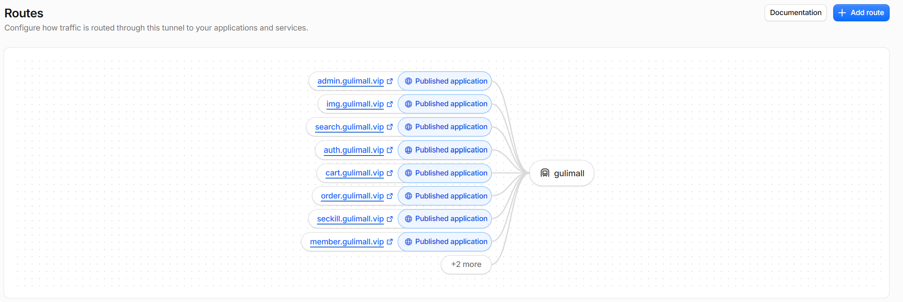
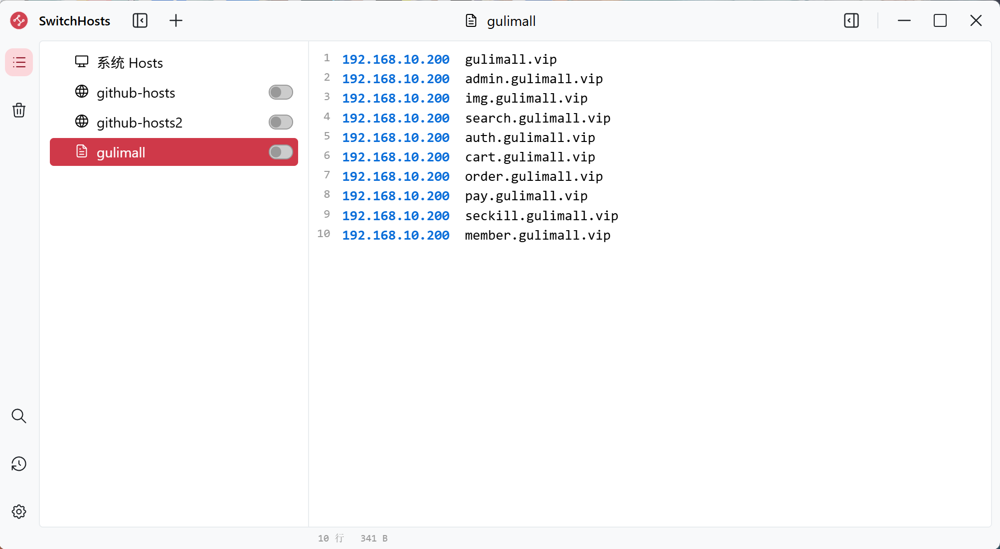
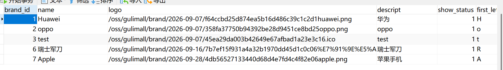
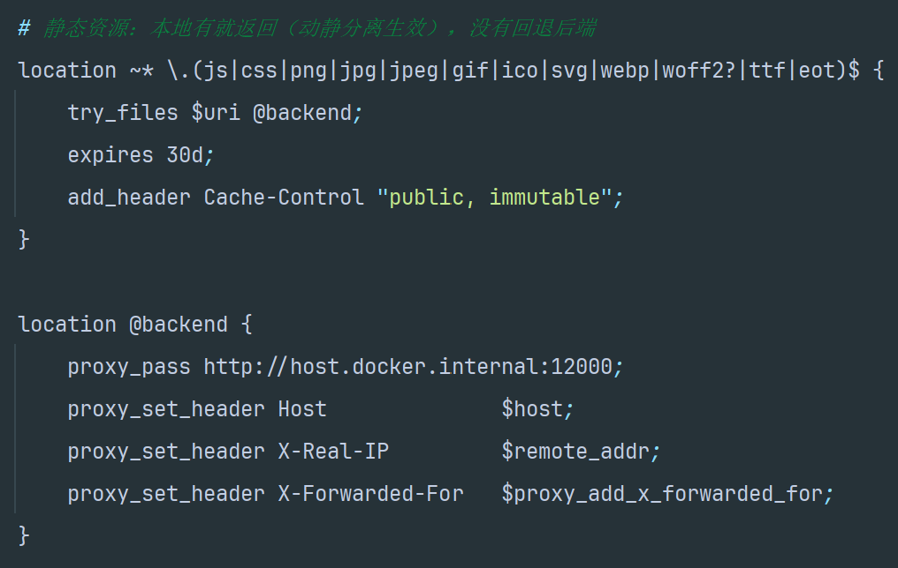
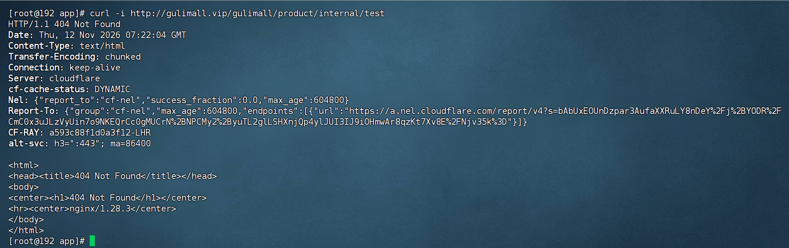
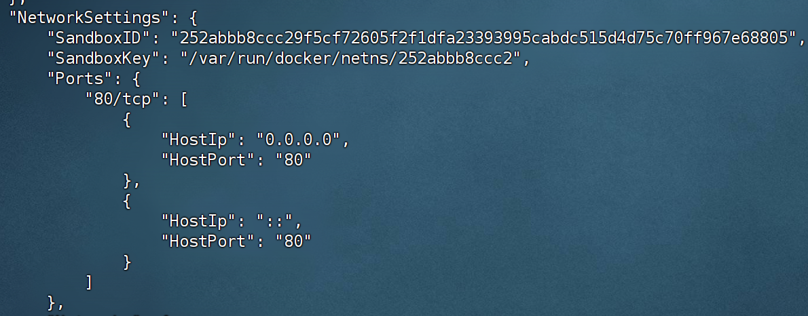

# 17.1 Nginx 多子域-介绍

> 一个 Nginx 实例同时承载商城前台、管理端、搜索、登录、购物车、订单、秒杀、个人中心和图片共 9 个站点。入口只有一个 80 端口，站点靠 HTTP 请求头里的 `Host` 区分。

> Nginx 相关文档与配置：[Nginx 文档](../Nginx/Nginx.md)、[新模块静态资源接入](../Nginx/新模块静态资源接入.md)、[nginx.conf](../../deploy/nginx/conf/nginx.conf)、[gulimall.conf](../../deploy/nginx/conf/conf.d/gulimall.conf)、[img-proxy.inc](../../deploy/nginx/conf/conf.d/img-proxy.inc)、[ai-widget.inc](../../deploy/nginx/conf/conf.d/ai-widget.inc)、[location-proxy.inc](../../deploy/nginx/conf/conf.d/location-proxy.inc)、[fenci.txt](../../deploy/nginx/html/es/fenci.txt)、[gulimall-host.txt](../../deploy/gulimall-host.txt)。

---

## 1. 这个功能是干什么的

浏览器访问 `gulimall.vip`、`search.gulimall.vip`、`admin.gulimall.vip` 时，DNS 都解析到同一台虚拟机 `<your-vm-host-ip>`，最终都进入同一个 Nginx 容器。Nginx 读取请求头里的 `Host`，用 `server_name` 把请求分给不同的 `server` 块，再按路径转发给对应的 Java 服务、静态目录或 MinIO。

这套入口承担五件事：

1. **统一入口**：公网只需要开放 Nginx 的 80 端口，网关 88 和各微服务 10000 以上的端口不直接暴露。
2. **按域名分流**：9 个域名对应 9 个 `server` 块，每个站点负责一组页面和接口。
3. **动静分离**：图片、CSS、JS、字体如果本地有文件，Nginx 直接返回；本地没有才回退给 Java。
4. **图片统一路径**：数据库只存 `/oss/<bucket>/<对象>` 这样的根相对路径，Nginx 把它转给 MinIO。
5. **保护内部接口**：`/gulimall/*/internal/**` 这类服务间接口在 Nginx 层直接返回 404，外部拿不到。

域名和职责对应如下：

| 域名 | 主要职责 | 后端 |
|---|---|---|
| `gulimall.vip` | 商城前台页面、微服务接口、IK 词库 | product :10000、gateway :88 |
| `admin.gulimall.vip` | 管理端 Vue 页面、后台接口 | 本地 `html/admin/`、gateway :88 |
| `img.gulimall.vip` | 图片独立直链 | MinIO :9000 |
| `search.gulimall.vip` | 搜索页 | search :12000 |
| `auth.gulimall.vip` | 登录、注册 | auth-server :20000 |
| `cart.gulimall.vip` | 购物车 | cart :13000 |
| `order.gulimall.vip` | 订单、支付页 | order :9000 |
| `seckill.gulimall.vip` | 秒杀页 | seckill :14000 |
| `member.gulimall.vip` | 个人中心 | member :8000 |



图中最外层是 Cloudflare，往内是 Nginx 的 9 个 `server` 块，最内层是各微服务和 MinIO。所有站点共用同一个 Nginx 配置目录，新增站点只需要增加一个 `server` 块。

---

## 2. 怎么操作

### 2.1 配置本地 hosts

局域网调试时，让 9 个域名都指向 Nginx 所在机器。Windows 的 hosts 路径是 `C:\Windows\System32\drivers\etc\hosts`，Linux 是 `/etc/hosts`。

```text
<your-vm-host-ip>  gulimall.vip
<your-vm-host-ip>  admin.gulimall.vip
<your-vm-host-ip>  img.gulimall.vip
<your-vm-host-ip>  search.gulimall.vip
<your-vm-host-ip>  auth.gulimall.vip
<your-vm-host-ip>  cart.gulimall.vip
<your-vm-host-ip>  order.gulimall.vip
<your-vm-host-ip>  pay.gulimall.vip
<your-vm-host-ip>  seckill.gulimall.vip
<your-vm-host-ip>  member.gulimall.vip
```

这 10 行让浏览器在局域网内直接访问虚拟机，不经过 Cloudflare。公网访问时由 Cloudflare DNS 解析，不需要在本地 hosts 写这些记录；两边同时写会让浏览器绕过 Cloudflare，回调测试结果和线上不一致。



### 2.2 修改站点配置

站点配置在 `deploy/nginx/conf/conf.d/`：

| 文件 | 作用 |
|---|---|
| `gulimall.conf` | 9 个 `server` 块和网关 `upstream` |
| `img-proxy.inc` | `/oss/` 转 MinIO，被多个站点引入 |
| `location-proxy.inc` | `/location/` 转 third-party 的百度地图接口 |
| `ai-widget.inc` | AI 助手 SSE 转发和内部接口 404 |

改动后先在容器里检查语法，再重启或重载：

```bash
docker exec nginx nginx -t
docker exec nginx nginx -s reload
```

`nginx -t` 只检查配置语法和文件是否存在，不检查后端服务是否在线。语法通过后 `reload` 让工作进程加载新配置，旧连接处理完再退出。挂载的主配置和站点目录都是只读的，修改必须发生在宿主机 `deploy/nginx/conf/` 下。

### 2.3 验证站点分流

用 `curl` 带 `Host` 头直接测试 Nginx，不依赖浏览器和 DNS：

```bash
curl -I -H "Host: gulimall.vip"        http://<your-vm-host-ip>/
curl -I -H "Host: search.gulimall.vip" http://<your-vm-host-ip>/list.html
curl -I -H "Host: admin.gulimall.vip"  http://<your-vm-host-ip>/
curl -I -H "Host: auth.gulimall.vip"   http://<your-vm-host-ip>/login.html
```

返回 200 表示页面链路正常，返回 302 表示登录拦截或页面跳转正常。返回 502 说明 Nginx 到上游 Java 服务不通，返回 404 且响应体是 Spring 的 JSON，说明 `Host` 没有匹配到正确的 `server`，请求落到了主站。

### 2.4 新增一个带页面的模块

1. 把模块的 `src/main/resources/static/<目录>` 复制到 Nginx 的 `html/<目录>`。
2. 页面里的相对引用加上模块前缀，例如 `login/JD_img/logo.jpg`。
3. Controller 使用根级路径，例如 `/login.html`，不要写成 `/auth/login.html`。
4. 新域名需要增加 `server` 块和 hosts 记录。

静态资源拷贝命令如下：

```bash
scp -r D:\SoftwareInstallation\gulimall\gulimall-auth-server\src\main\resources\static\login root@<your-vm-host-ip>:/mydata/docker/nginx/html/
scp -r D:\SoftwareInstallation\gulimall\gulimall-auth-server\src\main\resources\static\reg   root@<your-vm-host-ip>:/mydata/docker/nginx/html/
scp -r D:\SoftwareInstallation\gulimall\gulimall-cart\src\main\resources\static\cart         root@<your-vm-host-ip>:/mydata/docker/nginx/html/
scp -r D:\SoftwareInstallation\gulimall\gulimall-order\src\main\resources\static\pay         root@<your-vm-host-ip>:/mydata/docker/nginx/html/
```

静态文件是 Nginx 直接读取的，拷贝完立即生效，不需要重启。只有修改 `.conf` 才需要 `reload` 或重启容器。

---

## 3. 整体设计思路

### 3.1 业务上怎么设计

#### 3.1.1 一个入口，多个站点

业务上把“用户访问哪个功能”映射成“访问哪个子域名”。用户不需要记住不同端口，只需要打开对应域名。端口只在服务器内部使用，公网只暴露 Nginx 的 80。

这种设计的直接好处：

1. 以后上 HTTPS 只需要在 Nginx 或 Cloudflare 一处配置证书。
2. 微服务地址变化时，只改 Nginx 的 `proxy_pass`，用户访问地址不变。
3. 每个站点可以单独配置缓存、上传大小、超时和静态资源目录。

#### 3.1.2 登录态按域名隔离

订单站和支付回调使用不同域名：

- 用户平时访问 `order.gulimall.vip`，登录 Cookie 属于这个域。
- 支付宝异步通知访问 `pay.gulimall.vip`，只用于服务器到服务器的回调。
- `return_url` 保留 `http://order.gulimall.vip/pay/return`，用户浏览器回到原站点，登录态仍然有效。

如果把用户平时访问的支付页也改成 `pay.gulimall.vip`，Cookie 域不同，用户会被要求重新登录。支付回调域名只承担 `notify`，不承担用户会话。

#### 3.1.3 静态与动态分开

页面分为两类：

| 类型 | 例子 | 处理方式 |
|---|---|---|
| 静态资源 | `.js`、`.css`、`.png`、`.jpg`、字体 | Nginx 本地有就直出，没有回退 Java |
| 动态页面 | Thymeleaf 模板、接口 JSON | 反向代理给 Java |

静态资源使用 `try_files $uri @backend`。本地有文件时直接返回，减少 Java 线程和内存占用；本地没有时转给 Java，避免漏拷文件直接 404。

`expires 30d` 和 `Cache-Control: public, immutable` 只加在静态扩展名上，正则里故意不包含 `html`。页面入口如果被缓存 30 天，前端发版后用户会一直拿到旧页面。

#### 3.1.4 图片走两条路

图片有两种访问形式，指向同一个 MinIO 对象：

1. **页面内图片**：数据库和 ES 存 `/oss/gulimall/brand/x.png`，浏览器用当前页面的源补全，Nginx 命中 `img-proxy.inc` 的 `location ^~ /oss/`。
2. **图片直链**：直接访问 `http://img.gulimall.vip/gulimall/brand/x.png`，由 `img.gulimall.vip` 站点的 `location /` 转给 MinIO。



数据库不存 IP 和域名，换域名时存量数据不需要修改。代价是必须经过 Nginx 访问；直连 `localhost:10000` 时 `/oss/...` 会打到 Java 服务上并返回 404。

#### 3.1.5 `/location/` 隐藏第三方 AK

百度地图逆地址解析由 third-party 服务调用，AK 不暴露给浏览器。前端请求同源 `/location/reverse?lat=..&lng=..`，Nginx 转成 `http://host.docker.internal:30000/baidu/map/reverse`。

这样浏览器只看到同源路径，不会出现跨域，也不会在页面源码里出现 AK。

#### 3.1.6 内部接口对外 404

AI 助手需要读取商品、订单等模块的内部数据，这些接口挂在 `/gulimall/<模块>/internal/**`。服务间调用带共享密钥，普通浏览器没有密钥。

Nginx 对这类路径直接返回 404：

```nginx
location ~ ^/gulimall/[^/]+/internal/ {
    return 404;
}
```

返回 404 而不是 403，是为了不暴露“这个路径存在但没权限”。外部扫描只能得到“没有这个资源”。

#### 3.1.7 缓存规则

| 内容 | 源站头 | 目的 |
|---|---|---|
| `/es/fenci.txt` | `Cache-Control: no-store` | IK 每分钟拉最新词库 |
| 静态扩展名 | `expires 30d` + `immutable` | 减少重复下载 |
| `/oss/` 图片 | `expires 7d` + `public` | 图片内容不变，减少回源 |
| `img.gulimall.vip` | `expires 7d` + `public` | 图片直链缓存 |
| HTML 和接口 | 不设置长缓存 | 页面含登录态、价格、库存 |

### 3.2 技术上怎么设计

#### 3.2.1 基于 Host 的虚拟主机

Nginx 在 `listen 80` 后读取请求头 `Host`，逐个匹配 `server_name`。匹配成功进入对应 `server` 块，匹配失败进入该端口上的第一个 `server` 块。

当前第一个 `server` 是 `gulimall.vip`，所以 Host 不匹配时会落到主站。典型症状是访问 `auth.gulimall.vip` 却返回 product 的 `No static resource login.html`。排查时先看 Nginx 实际加载的配置和请求头。

#### 3.2.2 location 优先级

Nginx 的 `location` 匹配顺序：

1. `=` 精确匹配，命中立即结束。
2. `^~` 前缀匹配，命中后不再检查正则。
3. `~` 和 `~*` 正则匹配，按配置顺序第一条命中生效。
4. 普通前缀匹配，取最长的那条。

这套顺序解释了三个写法：

- `/oss/` 必须用 `^~`，否则会被静态资源正则 `\.(png|jpg)$` 截走，当成本地文件去找。
- `/gulimall/agent/` 必须用 `^~`，保证 SSE 请求进入代理而不是被其他正则干扰。
- 静态资源正则优先于 `location /`，所以本地没文件时必须 `try_files` 回退到 `@backend`。

#### 3.2.3 反向代理与真实客户端信息

所有代理都设置四个头：

```nginx
proxy_set_header Host              $host;
proxy_set_header X-Real-IP         $remote_addr;
proxy_set_header X-Forwarded-For   $proxy_add_x_forwarded_for;
proxy_set_header X-Forwarded-Proto $scheme;
```

`Host` 保留用户访问的域名，后端拼回调地址和重定向地址时使用。`X-Real-IP` 是直连 Nginx 的客户端地址。`X-Forwarded-For` 是代理链，使用追加而不是覆盖。`X-Forwarded-Proto` 让后端知道原始协议是 HTTP 还是 HTTPS。

#### 3.2.4 upstream 与长连接

网关单独定义成 `upstream gulimall_gateway`，并在其中配置 `keepalive 32`。`proxy_pass` 引用这个名字，以后网关挂多个实例时只改 `upstream`。

长连接要同时满足三个条件：

1. `upstream` 里写 `keepalive 32`。
2. `location` 里写 `proxy_http_version 1.1`。
3. 清空 `Connection` 头：`proxy_set_header Connection ""`。

少任何一条，Nginx 和网关之间仍然是短连接。

#### 3.2.5 host.docker.internal 回连宿主机

Nginx 运行在 Docker 容器里，网关和微服务运行在宿主机。容器内访问宿主机使用 `host.docker.internal`，由 compose 的 `extra_hosts` 注入解析。

本地开发时 Java 在 Windows `<your-windows-host-ip>`，`WINDOWS_HOST_IP` 填这个地址；全部迁到 Linux 后改成 `host-gateway`，解析成 Docker 网桥地址。

MinIO 和 Nginx 都在 compose 网络里，所以 `proxy_pass http://minio:9000` 直接使用服务名，不走宿主机端口。Nginx 在加载配置时就会解析 `minio`，因此 compose 里给 Nginx 加了 `depends_on: minio`。

#### 3.2.6 压缩

主配置开启 gzip，只压缩文本类型。图片和视频本身已经是压缩格式，再压只会浪费 CPU。压缩级别 5 是速度和压缩比的平衡点，小于 1KB 的响应不压缩。

`gzip_vary on` 会加 `Vary: Accept-Encoding`，让 Cloudflare 等中间缓存区分“压缩版”和“未压缩版”，避免缓存串味。

#### 3.2.7 日志

访问日志和错误日志都输出到容器标准输出。官方镜像把 `/var/log/nginx/access.log` 和 `error.log` 软链接到 stdout/stderr，所以 `docker logs nginx` 能直接看到。

compose 里故意不挂载日志目录。挂载会覆盖镜像自带的软链接，日志落到文件，`docker compose logs` 就看不到了。

---

## 4. 详细代码、配置和解释

这一节按配置文件的职责组织。每个文件先说明负责什么，再贴完整内容，再说明执行步骤、设计原因和可优化点。

### 4.1 nginx.conf：主配置

**职责**：

1. 定义工作进程、连接数和日志格式。
2. 开启 sendfile、gzip、上传大小限制。
3. 引入 `conf.d` 下的所有站点配置。

**完整配置**：

```nginx
# ============================================================
# Nginx 主配置
#
# 挂载到容器内 /etc/nginx/nginx.conf（【覆盖】镜像自带的主配置）
#
# ⚠️ 首次启动前宿主必须【已存在】该文件 —— 否则 Docker 会把挂载点
#    创建成一个同名【目录】，nginx 启动读配置直接报错。
# ⚠️ 改完要 docker compose restart nginx 才生效。
# ============================================================


# 运行 nginx 工作进程的系统用户（alpine 镜像里预置了 nginx 这个用户）
user  nginx;

# 工作进程个数：auto = 自动等于 CPU 核数，充分利用多核
worker_processes  auto;

# 错误日志：路径 + 记录级别（warn 表示记录 warn 及以上级别）
# 该路径被镜像预置的软链接转到了容器 stderr，所以 docker compose logs 能看到
error_log  /var/log/nginx/error.log warn;

# 存放主进程 PID 的文件（nginx -s reload/stop 靠它找到进程号）
pid        /var/run/nginx.pid;


# ---------- 事件模型配置 ----------
events {

    # 单个工作进程能同时处理的最大连接数
    worker_connections  1024;
}


# ---------- HTTP 服务配置 ----------
http {

    # 引入 MIME 类型映射表：让 nginx 知道 .html→text/html、.css→text/css、.js→application/javascript
    # 少了这一行，浏览器会把所有文件当成二进制流下载，而不是按类型渲染
    include       /etc/nginx/mime.types;

    # 上面映射表里没命中的扩展名，一律按二进制流（application/octet-stream）返回
    default_type  application/octet-stream;

    # 自定义访问日志格式，起名 main（下面 access_log 引用它）
    #   $remote_addr           客户端 IP —— nginx 是最外层入口，所以这就是真实 IP
    #   $remote_user           客户端认证用户（未启用认证时是 -）
    #   $time_local            本地时间
    #   $request               请求行，如 "GET /gulimall/product/list HTTP/1.1"
    #   $status                响应状态码
    #   $body_bytes_sent       响应体字节数（不含响应头）
    #   $http_referer          来源页面
    #   $http_user_agent       浏览器 UA
    #   $http_x_forwarded_for  代理链（排查多层代理时的对照用）
    log_format  main  '$remote_addr - $remote_user [$time_local] "$request" '
                      '$status $body_bytes_sent "$http_referer" '
                      '"$http_user_agent" "$http_x_forwarded_for"';

    # 访问日志：用上面的 main 格式输出
    # 该路径被镜像预置的软链接转到了容器 stdout，所以用 docker compose logs -f nginx 就能看
    access_log  /var/log/nginx/access.log  main;

    # 零拷贝：文件数据直接从磁盘送到网卡，省掉"内核态→用户态→内核态"的两次拷贝
    # 作用对象是静态文件，对反代场景影响不大，但保留着没有副作用
    sendfile        on;

    # 与 sendfile 配合：攒够一个完整的数据包再发，减少网络报文数量
    tcp_nopush      on;

    # 长连接保持时间（秒）：同一个 TCP 连接上可以连续发送多个请求后再断开
    keepalive_timeout  65;

    # 客户端请求体（表单提交、文件上传）的大小上限。
    # 默认只有 1m，后台管理提交表单或经网关传文件时会报 413 Request Entity Too Large
    client_max_body_size 20m;

    # ---------- 响应压缩 ----------
    # 开启 gzip 压缩（只压文本类；图片/视频本身就是压缩格式，再压纯属浪费 CPU）
    gzip              on;

    # 响应小于 1KB 就不压了 —— 压缩头本身就有开销，小文件压了反而更大
    gzip_min_length   1k;

    # 压缩级别 1~9，数字越大压得越小但越费 CPU；5 是速度与压缩比的平衡点
    gzip_comp_level   5;

    # 哪些 Content-Type 需要压缩（对应上面 mime.types 里的类型）
    gzip_types        text/plain text/css application/json application/javascript
                      text/xml application/xml image/svg+xml;

    # 在响应里加一个 Vary: Accept-Encoding 头，
    # 告诉中间的缓存（CDN/代理）"这个响应压不压缩取决于请求头"，避免缓存串味
    gzip_vary         on;

    # ---------- 引入站点配置 ----------
    # conf.d 目录下每个 .conf 文件是一个 server 块（本站点配在 gulimall.conf）
    # 本行必须放在最后：它引用的文件里会用到上面定义的 log_format 等
    include /etc/nginx/conf.d/*.conf;
}
```

主配置是全局层，站点配置是局部层。`include /etc/nginx/conf.d/*.conf` 放在 `http` 块最后，保证站点配置能使用前面定义的日志格式和 MIME 类型。

**步骤**：

1. 宿主机先存在 `deploy/nginx/conf/nginx.conf`，再启动容器。
2. compose 把该文件挂载到 `/etc/nginx/nginx.conf`，只读。
3. 修改后执行 `docker exec nginx nginx -t`。
4. 检查通过后执行 `docker exec nginx nginx -s reload`。
5. 用 `docker logs nginx` 观察错误日志。

**原因**：

1. `worker_processes auto` 让工作进程数跟随 CPU 核数。
2. `sendfile on` 适合静态文件，减少数据拷贝。
3. `client_max_body_size 20m` 解决后台上传和表单提交的 413。
4. gzip 只压文本，避免压缩图片浪费 CPU。
5. 日志走 stdout，和 Docker 日志体系一致。

**优化点**：

1. `worker_connections 1024` 对当前规模够用，连接数增加时可以调大并同步调整系统 `ulimit`。
2. 没有配置 `proxy_cache`。图片和静态资源目前靠浏览器缓存，CDN 缓存由 Cloudflare 负责。
3. 没有配置限流。公网开放后可以对登录和支付接口增加 `limit_req`。
4. 没有配置 HTTPS。当前 TLS 在 Cloudflare 边缘终结，源站到 Nginx 是 HTTP，适合内网链路。生产环境可以在 Nginx 直接终止 TLS。

### 4.2 gulimall.conf：9 个站点与网关 upstream

**职责**：

1. 定义网关 `upstream`。
2. 定义 9 个 `server` 块。
3. 为每个站点配置静态资源、`/oss/`、`/location/`、AI 助手和内部接口规则。

**完整配置**：

```nginx
# ============================================================
# gulimall 站点配置
#
# 挂载到容器内 /etc/nginx/conf.d/gulimall.conf
# 由主配置 nginx.conf 最后的  include /etc/nginx/conf.d/*.conf;  引入
#
# 站点靠【请求头里的 Host】区分（nginx 用 server_name 匹配）：
#   gulimall.vip       客户端（Thymeleaf）+ 微服务接口 + IK 词库
#   admin.gulimall.vip 管理端（Vue 静态）+ 所有接口
#   img.gulimall.vip   图片（反代到 MinIO）
#   search.gulimall.vip 搜索页（Thymeleaf）
#
# ⚠️ 所以【访问端必须配 hosts】，用 IP 访问时 Host 是 IP，哪个 server_name 都匹配不上。
# ============================================================


# ------------------------------------------------------------
# 上游服务器组：网关
# ------------------------------------------------------------
# upstream 定义一个"后端服务池"，下面的 proxy_pass 可以直接引用这个名字。
# 好处：后端地址只写这一处，以后挂多个实例做负载均衡也只改这里。
upstream gulimall_gateway {

    # 网关的地址。
    # ⚠️ 网关是跑在【宿主机】上的 Java 进程，不是容器，所以用 host.docker.internal 指回宿主。
    #    这个名字由 compose 的 extra_hosts 注入（解析成 docker 网桥 IP 172.17.0.1）。
    #    用 hosts 记录而不是域名，好处是【网关没启动时 nginx 也能正常启动】
    #    —— 若这里写域名且解析失败，nginx 会直接起不来。
    server host.docker.internal:88;

    # 与上游保持 32 个空闲长连接，避免每个请求都重新握手。
    # 需配合下面 location 里的 proxy_http_version 1.1 + proxy_set_header Connection "" 才生效
    keepalive 32;
}


# ============================================================
# 站点一：主站 gulimall.vip
# ============================================================
server {

    # 监听容器内 80 端口（宿主机通过 compose 的 "80:80" 映射进来）
    listen 80;

    # 域名匹配：只有请求头 Host 为 gulimall.vip 的请求才进这个 server 块
    server_name gulimall.vip;
    include /etc/nginx/conf.d/ai-widget.inc;

    include /etc/nginx/conf.d/location-proxy.inc;

    # 静态文件根目录。
    # 当前 location / 已改成反向代理，这里暂时用不到；
    # 保留是为了以后客户端改回纯静态前端时不用再动结构。
    root /usr/share/nginx/html;

    # 访问目录时默认查找的文件名
    index index.html;

    # 图片：/oss/<bucket>/<对象> → MinIO。存库的就是这种根相对路径，
    # 浏览器用【当前页面的源】补全，所以换域名不用改数据 —— 详见 img-proxy.inc 顶部
    include /etc/nginx/conf.d/img-proxy.inc;


    # ------------------------------------------------------------
    # 1、微服务接口 → 网关
    # ------------------------------------------------------------
    # 路径匹配：请求路径以 /gulimall/ 开头的走这里。
    # nginx 的 location 优先级：精确(=) > 正则(~*) > 前缀最长匹配。
    # 所以下面那个被注释的正则 location 一旦启用，会优先于 location /
    location /gulimall/ {

        # 转给上面定义的 upstream，路径【原样透传，不做 rewrite】：
        #     http://gulimall.vip/gulimall/product/brand/list
        #   → 网关收到 /gulimall/product/brand/list
        # 网关路由本来就是按 /gulimall/xxx/** 配的，路径完全对齐，
        # 少一层 rewrite 就少一个出错点。
        proxy_pass http://gulimall_gateway;

        # 用 HTTP/1.1 跟上游通信（1.0 不支持长连接，上面 keepalive 会失效）
        proxy_http_version 1.1;

        # 传给后端的请求头（不加的话后端只能看到 nginx 的 IP）：
        # Host：保留客户端访问时用的域名，后端拼回调/重定向地址时要用
        proxy_set_header Host              $host;
        # X-Real-IP：真实客户端 IP（后端写日志、做限流时用）
        proxy_set_header X-Real-IP         $remote_addr;
        # X-Forwarded-For：代理链（客户端IP → 各级代理IP），是【追加】不是覆盖
        proxy_set_header X-Forwarded-For   $proxy_add_x_forwarded_for;
        # X-Forwarded-Proto：原始协议（http/https），后端判断是否需要重定向时用
        proxy_set_header X-Forwarded-Proto $scheme;

        # 清空 Connection 头 —— 配合 upstream 的 keepalive，复用与上游的连接
        proxy_set_header Connection        "";
    }


    # ------------------------------------------------------------
    # 2、IK 远程分词词库
    # ------------------------------------------------------------
    # ES 的 IK 插件按 IKAnalyzer.cfg.xml 里的 remote_ext_dict 定时来拉这个文件（默认每分钟）
    location /es/ {

        # 声明响应编码是 UTF-8：浏览器直接打开 /es/fenci.txt 时中文不乱码。
        #（IK 自己按 UTF-8 解码，不依赖这个响应头，删掉也不影响分词）
        charset utf-8;

        # 禁止缓存：no-store 最彻底（比 no-cache 更强，根本不存）。
        # 词库会改动、IK 每分钟拉一次，必须每次都拿到最新内容，
        # 否则会出现"改了词库但分词没变化"这种极难排查的问题。
        # 注意：不要同时再写 expires，两者会产生重复的 Cache-Control 头
        add_header Cache-Control "no-store";
    }

    # 静态资源：命中后缀的，Nginx 直接返回本地文件（动静分离在这里生效）
    location ~* \.(js|css|png|jpg|jpeg|gif|ico|svg|webp|woff2?|ttf|eot)$ {

        root /usr/share/nginx/html;

        # 本地磁盘找到就直接返回；找不到则回退给 @backend。
        # ⚠️ 这个兜底是【必须】的：漏拷的资源不会变成 404，而是转给 Java 处理。
        #    所以先把资源放上去，动静分离自然生效；空目录也不会出错。
        try_files $uri @backend;

        # 长缓存：文件名带 hash 的资源内容永不变化。
        # ⚠️ 注意正则里【没有 html】—— index.html / list.html / item.html 是页面入口，
        #    必须不缓存，否则前端发版后用户拿到的还是旧页面。这个坑一旦踩上极难排查。
        expires 30d;
        add_header Cache-Control "public, immutable";
    }

    # 回退目标：上面的 try_files 没找到时走这里
    location @backend {
        proxy_pass http://host.docker.internal:10000;
        proxy_set_header Host $host;
        proxy_set_header X-Real-IP $remote_addr;
        proxy_set_header X-Forwarded-For $proxy_add_x_forwarded_for;
    }

    # ------------------------------------------------------------
    # 3、客户端页面（商城前台）
    # ------------------------------------------------------------
    # 所有没被上面更具体规则命中的请求都落到这里
    location / {

        # 客户端是 Thymeleaf 渲染的（gulimall-product 的 templates/index.html），
        # 不是静态文件，所以这里【反向代理】到 gulimall-product。
        # 同样用 host.docker.internal 指回宿主机上的 Java 进程。
        proxy_pass http://host.docker.internal:10000;

        # 下面几个头与 /gulimall/ 那段同理，保证后端拿得到真实客户端信息
        proxy_http_version 1.1;

        proxy_set_header Host              $host;
        proxy_set_header X-Real-IP         $remote_addr;
        proxy_set_header X-Forwarded-For   $proxy_add_x_forwarded_for;
        proxy_set_header X-Forwarded-Proto $scheme;
    }

    # 【旧配置】托管本地静态文件 —— 客户端改回静态前端（Vue dist）时启用
    # location / {
    #     try_files $uri $uri/ /index.html;
    # }


    # ------------------------------------------------------------
    # 【已停用】静态资源缓存
    # ------------------------------------------------------------
    # ⚠️ 必须停用：正则 location(~*) 在 nginx 里【优先于】前缀匹配 location /，
    #    留着的话 /static/、/assets/ 开头的请求会被当成本地文件去找（本地没有 → 404），
    #    而不会转发给 gulimall-product。改回纯静态前端时再启用。
    #
    # location ~* ^/(static|assets)/.*\.(js|css|png|jpg|jpeg|gif|ico|svg|woff2?|ttf|eot)$ {
    #
    #     expires 30d;                                  # 浏览器缓存 30 天
    #
    #     add_header Cache-Control "public, immutable";  # immutable：内容永不变化，浏览器不必再回来校验
    #
    # }
    #
    #
    # # index.html 不能缓存，否则前端发版后用户拿到的还是旧页面
    # location = /index.html {                           # 精确匹配 =，优先级最高
    #
    #     add_header Cache-Control "no-cache, no-store, must-revalidate";
    #
    #     expires -1;                                    # -1 = 立即过期
    #
    # }

}


# ============================================================
# 站点二：管理端 admin.gulimall.vip
# ============================================================
# 页面：renren-fast-vue 构建出的 dist 放到 /mydata/docker/nginx/html/admin/
# 接口：前端 baseUrl 配成【相对路径】/gulimall（见 renren-fast-vue/static/config/index-prod.js）
#       —— 页面和接口同源，换 IP / 换域名都不用重新构建前端。
#       业务接口和管理端自身的接口【都走网关】——
#       网关的 admin_route（Path=/gulimall/** 兜底）会把非业务路径转给 renren-fast
server {

    listen 80;

    server_name admin.gulimall.vip;
    include /etc/nginx/conf.d/ai-widget.inc;

    # 静态资源根目录：注意这里是 html/admin，不是 html
    root /usr/share/nginx/html/admin;

    index index.html;

    # 图片：/oss/<bucket>/<对象> → MinIO。存库的就是这种根相对路径，
    # 浏览器用【当前页面的源】补全，所以换域名不用改数据 —— 详见 img-proxy.inc 顶部
    include /etc/nginx/conf.d/img-proxy.inc;


    # 所有接口，同样原样透传给网关
    location /gulimall/ {

        proxy_pass http://gulimall_gateway;

        proxy_http_version 1.1;

        proxy_set_header Host              $host;
        proxy_set_header X-Real-IP         $remote_addr;
        proxy_set_header X-Forwarded-For   $proxy_add_x_forwarded_for;
        proxy_set_header X-Forwarded-Proto $scheme;

        proxy_set_header Connection        "";
    }


    # 管理端页面（Vue 打包出来的静态文件）
    location / {

        # 依次尝试：
        #   $uri        磁盘上有这个文件就直接返回（js/css/图片等）
        #   $uri/       是个目录就找里面的 index
        #   /index.html 都没有就回退到入口页，交给前端路由处理
        # 最后这个回退是【必须】的：Vue 用 history 模式时，
        # 刷新 /product/list 这类子路由在磁盘上找不到对应文件，没有回退就直接 404
        try_files $uri $uri/ /index.html;
    }

}


# ============================================================
# 站点三：图片 img.gulimall.vip
# ============================================================
# 独立的图片直链：用 http://img.gulimall.vip/gulimall/brand/xxx.png 访问 MinIO 对象。
# 好处：地址与 MinIO 的实际部署（IP:端口）解耦，也与"页面在哪个站点"解耦。
#
# ⚠️ 这和页面里用的 /oss/... 是【两条路、同一个对象】，别搞混：
#      · 页面图片：数据库 / ES 里存根相对路径 /oss/gulimall/brand/x.png，
#        由各站点 include img-proxy.inc 转发（见该文件顶部）—— 当前用的就是这条
#      · 图片直链：img.gulimall.vip/gulimall/brand/x.png，即本站点，路径原样透传
#    本站点【不 include img-proxy.inc】。
server {

    listen 80;

    server_name img.gulimall.vip;

    location / {

        # minio 是 compose 网络内的服务名，同一网络内可直接互相访问
        # （MinIO 和 Nginx 都在 compose 里，所以不用写宿主 IP）
        proxy_pass http://minio:9000;

        proxy_http_version 1.1;

        # 这里不传 Connection: "" —— MinIO 不需要长连接复用
        proxy_set_header Host              $host;
        proxy_set_header X-Real-IP         $remote_addr;
        proxy_set_header X-Forwarded-For   $proxy_add_x_forwarded_for;

        # 图片是静态内容，让浏览器缓存 7 天，减少回源
        expires 7d;

        # 配合上面的 expires，声明可以被公共缓存（CDN/代理）保存
        add_header Cache-Control "public";

        # 只放行读请求，其余方法（PUT/DELETE/POST 等）一律拒绝。
        # 因为上传是前端拿 presigned URL 直传 MinIO 的 19000 端口，不经过这里，
        # 所以没必要开放写方法，关掉更安全。
        limit_except GET HEAD {
            deny all;
        }
    }

}

# ============================================================
# 站点四：搜索页 search.gulimall.vip
# ============================================================
server {
    listen 80;
    server_name search.gulimall.vip;
    include /etc/nginx/conf.d/ai-widget.inc;

    include /etc/nginx/conf.d/location-proxy.inc;

    # ★ root 指到 html/（不是 html/search/）—— 和 product 一个套路：
    #   模板里的静态资源引用带 search/ 前缀（./search/css/index.css），
    #   所以 URL /search/css/index.css 正好命中磁盘 html/search/css/index.css。
    root /usr/share/nginx/html;

    # 页面由后端 Thymeleaf 渲染（templates/list.html），不是静态文件。
    # 这里其实【用不上】index——location / 是 proxy_pass，而 index 是静态文件处理器，
    # 同一个 location 只能有一个内容处理器，所以 index 永远不会被触发。
    # 写 list.html 只是表明"这个站点的入口页是 list.html"，别被 index.html 误导。
    index list.html;

    # 图片：/oss/<bucket>/<对象> → MinIO。存库的就是这种根相对路径，
    # 浏览器用【当前页面的源】补全，所以换域名不用改数据 —— 详见 img-proxy.inc 顶部
    include /etc/nginx/conf.d/img-proxy.inc;

    # 静态资源：本地有就返回（动静分离生效），没有回退后端
    location ~* \.(js|css|png|jpg|jpeg|gif|ico|svg|webp|woff2?|ttf|eot)$ {
        try_files $uri @backend;
        expires 30d;
        add_header Cache-Control "public, immutable";
    }

    location @backend {
        proxy_pass http://host.docker.internal:12000;
        proxy_set_header Host              $host;
        proxy_set_header X-Real-IP         $remote_addr;
        proxy_set_header X-Forwarded-For   $proxy_add_x_forwarded_for;
    }

    location / {
        proxy_pass http://host.docker.internal:12000;
        proxy_http_version 1.1;
        proxy_set_header Host              $host;
        proxy_set_header X-Real-IP         $remote_addr;
        proxy_set_header X-Forwarded-For   $proxy_add_x_forwarded_for;
        proxy_set_header X-Forwarded-Proto $scheme;
    }
}

# ============================================================
# 站点五：登录页 auth.gulimall.vip
# ============================================================
server {
    listen 80;
    server_name auth.gulimall.vip;
    include /etc/nginx/conf.d/ai-widget.inc;

    # ★ root 指到 html/（不是 html/auth）—— 因为页面引用带模块前缀
    root /usr/share/nginx/html;

    # 图片走 /oss/ → MinIO
    include /etc/nginx/conf.d/img-proxy.inc;

    # 静态资源：本地有就直出，没有回退给后端
    location ~* \.(js|css|png|jpg|jpeg|gif|ico|svg|webp|woff2?|ttf|eot)$ {
        try_files $uri @backend;
        expires 30d;
        add_header Cache-Control "public, immutable";
    }

    location @backend {
        proxy_pass http://host.docker.internal:20000;      # ← 改成本模块端口
        proxy_set_header Host            $host;
        proxy_set_header X-Real-IP       $remote_addr;
        proxy_set_header X-Forwarded-For $proxy_add_x_forwarded_for;
    }

    location / {
        proxy_pass http://host.docker.internal:20000;      # ← 同上一处
        proxy_http_version 1.1;
        proxy_set_header Host              $host;
        proxy_set_header X-Real-IP         $remote_addr;
        proxy_set_header X-Forwarded-For   $proxy_add_x_forwarded_for;
        proxy_set_header X-Forwarded-Proto $scheme;
    }
}

# ============================================================
# 站点六：购物车 cart.gulimall.vip
# ============================================================
server {
    listen 80;
    server_name cart.gulimall.vip;
    include /etc/nginx/conf.d/ai-widget.inc;

    include /etc/nginx/conf.d/location-proxy.inc;

    # ★ root 指到 html/（不是 html/auth）—— 因为页面引用带模块前缀
    root /usr/share/nginx/html;

    # 图片走 /oss/ → MinIO
    include /etc/nginx/conf.d/img-proxy.inc;

    # 静态资源：本地有就直出，没有回退给后端
    location ~* \.(js|css|png|jpg|jpeg|gif|ico|svg|webp|woff2?|ttf|eot)$ {
        try_files $uri @backend;
        expires 30d;
        add_header Cache-Control "public, immutable";
    }

    location @backend {
        proxy_pass http://host.docker.internal:13000;      # ← 改成本模块端口
        proxy_set_header Host            $host;
        proxy_set_header X-Real-IP       $remote_addr;
        proxy_set_header X-Forwarded-For $proxy_add_x_forwarded_for;
    }

    location / {
        proxy_pass http://host.docker.internal:13000;      # ← 同上一处
        proxy_http_version 1.1;
        proxy_set_header Host              $host;
        proxy_set_header X-Real-IP         $remote_addr;
        proxy_set_header X-Forwarded-For   $proxy_add_x_forwarded_for;
        proxy_set_header X-Forwarded-Proto $scheme;
    }
}

# ============================================================
# 站点七：订单 order.gulimall.vip
# ============================================================
server {
    listen 80;
    server_name order.gulimall.vip;
    include /etc/nginx/conf.d/ai-widget.inc;

    include /etc/nginx/conf.d/location-proxy.inc;

    # ★ root 指到 html/（不是 html/order）—— 因为页面引用带模块前缀
    root /usr/share/nginx/html;

    # 图片走 /oss/ → MinIO
    include /etc/nginx/conf.d/img-proxy.inc;

    # 静态资源：本地有就直出，没有回退给后端
    location ~* \.(js|css|png|jpg|jpeg|gif|ico|svg|webp|woff2?|ttf|eot)$ {
        try_files $uri @backend;
        expires 30d;
        add_header Cache-Control "public, immutable";
    }

    location @backend {
        proxy_pass http://host.docker.internal:9000;      # ← 改成本模块端口
        proxy_set_header Host            $host;
        proxy_set_header X-Real-IP       $remote_addr;
        proxy_set_header X-Forwarded-For $proxy_add_x_forwarded_for;
    }

    location / {
        proxy_pass http://host.docker.internal:9000;      # ← 同上一处
        proxy_http_version 1.1;
        proxy_set_header Host              $host;
        proxy_set_header X-Real-IP         $remote_addr;
        proxy_set_header X-Forwarded-For   $proxy_add_x_forwarded_for;
        proxy_set_header X-Forwarded-Proto $scheme;
    }
}

# ============================================================
# 站点七：秒杀 seckill.gulimall.vip
# ============================================================
server {
    listen 80;
    server_name seckill.gulimall.vip;
    include /etc/nginx/conf.d/ai-widget.inc;

    # ★ root 指到 html/（不是 html/seckill）—— 页面引用带模块前缀
    root /usr/share/nginx/html;

    # 图片走 /oss/ → MinIO
    include /etc/nginx/conf.d/img-proxy.inc;

    # 静态资源：本地有就直出，没有回退给后端
    location ~* \.(js|css|png|jpg|jpeg|gif|ico|svg|webp|woff2?|ttf|eot)$ {
        try_files $uri @backend;
        expires 30d;
        add_header Cache-Control "public, immutable";
    }

    location @backend {
        proxy_pass http://host.docker.internal:14000;
        proxy_set_header Host            $host;
        proxy_set_header X-Real-IP       $remote_addr;
        proxy_set_header X-Forwarded-For $proxy_add_x_forwarded_for;
    }

    location / {
        proxy_pass http://host.docker.internal:14000;
        proxy_http_version 1.1;
        proxy_set_header Host              $host;
        proxy_set_header X-Real-IP         $remote_addr;
        proxy_set_header X-Forwarded-For   $proxy_add_x_forwarded_for;
        proxy_set_header X-Forwarded-Proto $scheme;
    }
}

# ============================================================
# 站点八：个人中心 member.gulimall.vip
# ============================================================
server {
    listen 80;
    server_name member.gulimall.vip;
    include /etc/nginx/conf.d/ai-widget.inc;

    root /usr/share/nginx/html;
    include /etc/nginx/conf.d/img-proxy.inc;

    location ~* \.(js|css|png|jpg|jpeg|gif|ico|svg|webp|woff2?|ttf|eot)$ {
        try_files $uri @backend;
        expires 30d;
        add_header Cache-Control "public, immutable";
    }

    location @backend {
        proxy_pass http://host.docker.internal:8000;
        proxy_set_header Host            $host;
        proxy_set_header X-Real-IP       $remote_addr;
        proxy_set_header X-Forwarded-For $proxy_add_x_forwarded_for;
    }

    location / {
        proxy_pass http://host.docker.internal:8000;
        proxy_http_version 1.1;
        proxy_set_header Host              $host;
        proxy_set_header X-Real-IP         $remote_addr;
        proxy_set_header X-Forwarded-For   $proxy_add_x_forwarded_for;
        proxy_set_header X-Forwarded-Proto $scheme;
    }
}
```

9 个 `server` 块都监听 80，靠 `server_name` 区分。主站和管理端都把 `/gulimall/` 原样转给网关；搜索、登录、购物车、订单、秒杀、个人中心把 `/` 转给各自服务；图片站点把 `/` 转给 MinIO。



**步骤**：

1. 确认 `deploy/nginx/conf/conf.d/` 下四个文件都存在。
2. 执行 `docker exec nginx nginx -t`。
3. 执行 `docker exec nginx nginx -s reload`。
4. 用 `curl -H "Host: ..."` 逐个验证站点。
5. 查看 `docker logs nginx --tail 50` 确认没有 404 或 502。

**原因**：

1. 主站和管理端的接口路径都以 `/gulimall/` 开头，网关路由按这个前缀配置，原样透传不需要 `rewrite`。
2. 管理端页面是 Vue 打包产物，`try_files $uri $uri/ /index.html` 支持 history 路由刷新。
3. 图片站点只允许 GET 和 HEAD，上传走预签名 URL 直传 MinIO，不需要开放写方法。
4. 每个业务站点的静态资源都先找本地，再回退 Java，兼顾性能和可用性。
5. 首页和 HTML 不进入 30 天缓存，避免发版后旧页面长期存在。

**优化点**：

1. 9 个 `server` 块有大量重复的静态资源和 `@backend` 配置，可以抽成 `include` 片段减少重复。
2. `gulimall.conf` 中第三个秒杀站点注释写成了“站点七”，实际是第八个站点，注释编号可以统一。
3. 静态资源文件名不带内容 hash，30 天缓存需要配合 Cloudflare 清缓存或 URL 版本参数。
4. 可以给上传路径单独配置更大的 `client_max_body_size`，而不是全局 20m。
5. 可以为健康检查增加固定的 `/health` 路径，避免依赖业务页面。

### 4.3 img-proxy.inc：`/oss/` 转 MinIO

**职责**：

1. 把 `/oss/<bucket>/<对象>` 转成 MinIO 的 `/<bucket>/<对象>`。
2. 只允许读请求。
3. 给图片设置 7 天浏览器缓存。

**完整配置**：

```nginx
# ============================================================
# 对象存储转发片段：/oss/<bucket>/<对象> → MinIO
# ------------------------------------------------------------
# 该文件不是独立站点，而是被各 server 块 include 进来。
# 当前被 3 个站点 include：gulimall.vip、admin.gulimall.vip、search.gulimall.vip
# （img.gulimall.vip 不走这里 —— 它整个 location / 直接反代 MinIO，见 gulimall.conf）。
#
# 数据库 / ES 里存的图片地址就是这个形式（【根相对路径】），形如：
#     /oss/gulimall/brand/2026-09-07/xxx.png
#
# 【⚠️ 为什么前缀是 /oss 而不是 /img —— 这个坑踩过】
#   前端模板里本来就有大量相对引用写的是 `img/xxx.jpg`（JD 模板自带的占位图，几百处）。
#   页面在根路径下时（搜索页就是 /list.html），这些相对路径会被浏览器解析成
#   /img/xxx.jpg —— 和"图片资源前缀 /img/"撞在一起。
#   于是 nginx 把它们也转给了 MinIO，MinIO 收到的不含 bucket，直接返回：
#       400 Bad Request  Content-Type: application/xml  （还带着 X-Amz-* 响应头）
#   换成 /oss 后不再冲突（已 grep 确认全项目没有以 oss/ 开头的相对引用）。
#
# 【为什么存相对路径，而不是带 IP / 域名的绝对地址】
#   以 / 开头时，浏览器会用【当前页面的源】自动补全：
#     页面在 gulimall.vip  →  http://gulimall.vip/oss/gulimall/...
#     将来换域名 / 上公网   →  自动跟着变，数据库一个字都不用改
#   图片跟着页面走 —— 所以库里【不存任何 IP / 域名】。
#   存绝对地址则做不到：域名或 IP 一变，存量数据的地址全失效。
#   ⚠️ 代价：必须【经过 nginx】访问。直连服务端口（localhost:10000、localhost:12000）
#      时 /oss/... 会打到那个服务上 → 404 —— 开发时务必用域名访问。
#
# ⚠️ 必须用 ^~ 修饰符。
#    各站点的静态资源用正则在拦（location ~* \.(png|jpg|...)$），
#    而 nginx 的优先级是【正则 > 前缀匹配】—— 不加 ^~ 的话 /oss/xxx.png 会被那条正则截走，
#    当成本地静态文件去找，找不到再回退给后端 → 后端没这个路径 → 404。
#    ^~ 的语义是"前缀命中后【不再检查正则】"，正是这里要的。
#
# ⚠️ proxy_pass 末尾的斜杠不能少。
#    它会把 /oss/ 这段前缀替换掉再转发：
#        /oss/gulimall/brand/x.png  →  MinIO 收到  /gulimall/brand/x.png（bucket/对象）
#    写成不带斜杠的 http://minio:9000，会把 /oss 一起带过去 → MinIO 400/404。
#
# minio 是 compose 网络内的服务名，容器之间可直接访问。
# 注意连的是【容器内的 9000】，不是虚拟机的 9000 —— 宿主上对外映射的是 19000:9000，
# 容器之间走 compose 网络直连，不经过宿主端口。和站点三 img.gulimall.vip 是同一个写法。
#
# ⚠️ nginx 在【加载配置时】就要解析 minio 这个名字，解析不了会直接启动失败
#    （不是运行时 502，是 nginx 根本起不来）。这个约束【本来就有】——
#    img.gulimall.vip 站点一直就是这么写的，不是该文件引入的。
#    已在 docker-compose.yaml 的 nginx 服务里加 depends_on: minio 保证启动顺序。
#
# 【将来 MinIO 上分布式集群时怎么改】
#   现在是单节点写法：一个服务名 = 一个地址。集群模式下要改成 upstream 列多个节点，
#   照抄同一份 conf.d 里 gateway 那段 upstream 的写法：
#
#       upstream minio_cluster {
#           server minio1:9000;
#           server minio2:9000;
#           server minio3:9000;
#           server minio4:9000;
#       }
#       location ^~ /oss/ { proxy_pass http://minio_cluster/; }
#
#   分布式 MinIO 的任意节点都能服务任意对象（对象落在哪个节点由集群内部路由），
#   所以简单轮询是安全的，不需要一致性哈希。
#   ⚠️ upstream 里的域名同样是【启动时】解析的，有一个节点解析不了 nginx 就起不来；
#      nginx 1.28 支持给 upstream 成员加 `resolve` 并配 `resolver`，改成运行时解析。
# ============================================================

location ^~ /oss/ {

    proxy_pass http://minio:9000/;

    proxy_http_version 1.1;

    proxy_set_header Host            $host;
    proxy_set_header X-Real-IP       $remote_addr;
    proxy_set_header X-Forwarded-For $proxy_add_x_forwarded_for;

    # 图片是静态内容，让浏览器缓存 7 天，减少回源
    expires 7d;
    add_header Cache-Control "public";

    # 只放行读请求。
    # 上传是前端拿 presigned URL 直传 MinIO 的 19000 端口，不经过这里，
    # 所以没必要开放写方法，关掉更安全（和 img.gulimall.vip 站点保持一致）。
    limit_except GET HEAD {
        deny all;
    }
}
```

`proxy_pass` 末尾的斜杠是路径替换的关键。带斜杠时，`/oss/` 被替换成 `/`，MinIO 收到 bucket 和对象名；不带斜杠时，`/oss` 会一起传给 MinIO，返回 400 或 404。

**步骤**：

1. 在需要图片的 `server` 块里写 `include /etc/nginx/conf.d/img-proxy.inc;`。
2. 确认数据库存的是 `/oss/...` 根相对路径。
3. 浏览器通过当前站点访问图片，Nginx 命中 `^~ /oss/`。
4. Nginx 去掉 `/oss/` 前缀，转发到 `minio:9000`。
5. MinIO 返回对象，Nginx 加上 7 天缓存头。

**原因**：

1. `/oss` 前缀避开模板里大量 `img/xxx.jpg` 相对引用的冲突。
2. `^~` 保证图片请求不被静态资源正则截走。
3. 只读方法限制降低误删和恶意写入风险。
4. 根相对路径让域名变化不影响存量数据。

**优化点**：

1. MinIO 上集群后改成 `upstream` 多节点。
2. 可以在 Nginx 增加图片格式转换和缩略图，减轻 MinIO 压力。
3. 可以给 `/oss/` 增加防盗链和签名校验。
4. 7 天缓存与 Cloudflare 的 7 天边缘缓存叠加，发版替换同名图片时需要清缓存。

### 4.4 location-proxy.inc：`/location/` 转 third-party

**职责**：

1. 把浏览器的同源 `/location/` 请求转给 third-party 的百度地图接口。
2. 隐藏第三方 AK，避免跨域。

**完整配置**：

```nginx
# 所有站点共用的地址定位代理：
# 浏览器请求同源 /location/reverse?lat=..&lng=..，
# Nginx 转发到 third-party 的 /baidu/map/reverse，避免跨域和 AK 暴露。
location /location/ {
    proxy_pass http://host.docker.internal:30000/baidu/map/;
    proxy_http_version 1.1;
    proxy_set_header Host            $host;
    proxy_set_header X-Real-IP       $remote_addr;
    proxy_set_header X-Forwarded-For $proxy_add_x_forwarded_for;
}
```

`proxy_pass` 末尾带 `/baidu/map/`，会把 `/location/` 前缀替换掉。浏览器请求 `/location/reverse`，third-party 收到 `/baidu/map/reverse`。

**步骤**：

1. 在主站、搜索、购物车、订单等需要地址定位的站点引入该片段。
2. 前端请求 `/location/reverse?lat=..&lng=..`。
3. Nginx 转发到 third-party 的 30000 端口。
4. third-party 使用服务端 AK 调百度地图。
5. 结果原路返回浏览器。

**原因**：

1. 同源请求不触发浏览器跨域限制。
2. AK 只存在服务端配置，不出现在页面源码。
3. 路径替换规则固定，前端不需要知道 third-party 的真实路径。

**优化点**：

1. 可以给该路径增加限流，防止被刷。
2. 可以对返回结果做短缓存，百度地图逆地址解析结果短期内不会变化。
3. 可以把 AK 放进 Secret 管理，而不是明文配置。

### 4.5 ai-widget.inc：AI 助手与内部接口 404

**职责**：

1. 把 `/gulimall/agent/` 转给网关，支持 SSE 流式输出。
2. 对 `/gulimall/*/internal/**` 直接返回 404。

**完整配置**：

```nginx
# ============================================================
# 谷粒商城 AI 助手：所有用户端/管理端站点共用
# ------------------------------------------------------------
# 1. /gulimall/agent/** 转发到网关，支持 SSE 长连接（必须关缓冲）
# 2. /gulimall/*/internal/** 是业务模块给 agent 的内部接口，对外一律 404
# ============================================================

location ^~ /gulimall/agent/ {
    proxy_pass http://gulimall_gateway;

    # SSE：HTTP/1.1 + 清空 Connection，才能保持长连接
    proxy_http_version 1.1;
    proxy_set_header Connection "";
    proxy_set_header Host $host;
    proxy_set_header X-Real-IP $remote_addr;
    proxy_set_header X-Forwarded-For $proxy_add_x_forwarded_for;

    # 关键：不缓冲，否则前端会等模型全部生成完才一次性收到
    proxy_buffering off;
    proxy_cache off;
    gzip off;

    # 模型思考 + 工具调用可能超过 1 分钟
    proxy_read_timeout 300s;
    proxy_send_timeout 300s;
}

# 内部只读接口不允许外部访问（即使知道路径也拿不到 X-Internal-Token）
location ~ ^/gulimall/[^/]+/internal/ {
    return 404;
}
```

SSE 需要关闭 `proxy_buffering`、`proxy_cache` 和 `gzip`，否则 Nginx 会把模型输出攒在缓冲区，前端看起来像一次性返回。超时设置为 300 秒，覆盖模型思考和工具调用时间。



**步骤**：

1. 每个用户端和管理端 `server` 块引入该片段。
2. 前端请求 `/gulimall/agent/chat/stream`。
3. Nginx 命中 `^~ /gulimall/agent/`，转发网关。
4. 响应不缓冲，逐段返回浏览器。
5. 外部请求 `/gulimall/product/internal/...` 时命中正则，直接 404。

**原因**：

1. `^~` 保证 SSE 路径不被其他正则截走。
2. 清空 `Connection` 维持长连接。
3. 关闭缓冲和压缩保证流式效果。
4. 内部接口 404 不暴露存在性。

**优化点**：

1. 可以按模型响应时间继续调大超时。
2. 可以给 SSE 路径单独配置连接数限制。
3. 可以在网关层再做一次内部接口拦截，形成双层保护。
4. 可以在 Nginx 记录 `/gulimall/*/internal/` 的访问日志，观察扫描行为。

### 4.6 compose 中的 nginx 服务

**职责**：

1. 启动 `nginx:1.28-alpine` 容器。
2. 映射 80 端口。
3. 挂载主配置、站点配置、静态资源和证书目录。
4. 注入 `host.docker.internal` 解析。

**完整配置**：

```yaml
  nginx:
    # 官方镜像
    # 1.28 是当前 stable 分支（1.29 是 mainline，生产不用）
    # alpine 变体体积小；如需完全固定补丁版，先 docker pull 验证存在后再改具体版本号
    image: nginx:1.28-alpine

    # 容器名称
    container_name: nginx

    # 开机自动重启
    restart: always

    # 等 minio 创建好再启动 nginx。
    # 原因：nginx 在【加载配置时】就会解析配置里的服务名，而 conf.d 下有多处
    #       proxy_pass http://minio:9000（img.gulimall.vip 站点 + 各站点的 /img/ 路由）
    #       —— 名字解析不了，nginx 会直接启动失败（不是运行时 502，是根本起不来）。
    # 为什么用 service_started 而不是 service_healthy：MinIO 没配 healthcheck。
    #       容器一旦创建入网，DNS 就能解析这个名字；nginx 启动时【并不会连】9000，
    #       所以"已启动"就够了，不需要等它真的能服务。
    # （kibana 依赖 elasticsearch 用的是 service_healthy，因为 ES 配了 healthcheck）
    depends_on:
      minio:
        condition: service_started

    ports:
      # 宿主机80 -> Nginx80，对外唯一入口（靠【域名】区分站点）
      # ⚠️ 访问端必须配 hosts 才能解析这些域名。
      # 以后上 HTTPS 再加一行 "443:443"
      - "80:80"

    environment:
      TZ: Asia/Shanghai

    # 让容器内能用 host.docker.internal 指回【宿主机】
    # 因为网关 gulimall-gateway 是跑在宿主机上的 Java 进程，不是容器
    # （host-gateway 是 Docker 20.10+ 的保留值，Linux 上需显式声明才有这个名字）
    extra_hosts:
      # 本地开发：Java 服务跑在 Windows 上 （WindowsIP <your-windows-host-ip>）
      - "host.docker.internal:${WINDOWS_HOST_IP}"

    volumes:
      # 主配置：覆盖镜像自带的 /etc/nginx/nginx.conf
      # ⚠️ 宿主必须【已存在】该文件，否则 Docker 会把它创建成同名【目录】，启动报错
      - ./nginx/conf/nginx.conf:/etc/nginx/nginx.conf:ro

      # 站点配置目录：每个 .conf 文件一个 server 块
      # （挂空目录会顶掉镜像自带的 default.conf，正是需要的结果）
      - ./nginx/conf/conf.d:/etc/nginx/conf.d:ro

      # 静态资源根目录：前端 dist、IK 词库都放这里
      # 容器内只读，防止容器进程意外改写宿主文件
      - ./nginx/html:/usr/share/nginx/html:ro

      # 证书目录（HTTPS 用，先预留；没证书时留空目录即可）
      - ./nginx/certs:/etc/nginx/certs:ro

    # 说明：这里【没有】挂载日志目录
    # 官方镜像预置了 access.log/error.log → /dev/stdout、/dev/stderr 的软链接，
    # 一旦挂载宿主目录就会把这些软链接覆盖掉，日志改落文件、docker compose logs 就看不到了。
    # 保持现状 → 用 docker compose logs -f nginx 查看（与其他服务一致）。
    # 生产要落文件 + logrotate 时，再加：
    #   - ./nginx/logs:/var/log/nginx
```

`WINDOWS_HOST_IP` 在 `config/docker-compose.env` 中定义。Java 在 Windows 时填 `<your-windows-host-ip>`，全部迁到 Linux 后填 `host-gateway`。



**步骤**：

1. 在 `config/docker-compose.env` 设置 `WINDOWS_HOST_IP`。
2. 确认宿主机已存在 `deploy/nginx/conf/nginx.conf`。
3. 执行 `docker compose --env-file /mydata/app/config/docker-compose.env up -d --force-recreate nginx`。
4. 执行 `docker exec nginx getent hosts host.docker.internal` 确认解析。
5. 执行 `docker exec nginx nginx -t` 检查配置。

**原因**：

1. 配置目录只读挂载，容器进程无法改写宿主机文件。
2. 不挂载日志目录，保留 stdout 软链接，方便统一查看日志。
3. `depends_on` 保证 MinIO 服务名在 Nginx 启动时可解析。
4. `extra_hosts` 让容器能回连宿主机上的 Java 进程。

**优化点**：

1. 生产环境可以增加日志卷和 logrotate。
2. 可以固定镜像补丁版本，避免 `1.28-alpine` 漂移。
3. 可以增加健康检查，让 compose 能判断 Nginx 是否真正可用。
4. 可以把证书目录换成真实证书并增加 443 监听。

---

## 5. 数据怎么流转

### 5.1 域名解析与 Host 匹配

请求从浏览器到 Nginx 站点选择的过程如下。

```text
浏览器输入 https://search.gulimall.vip/list.html
  → Cloudflare DNS 解析到 Cloudflare 边缘
  → Cloudflare Tunnel 把请求转到 http://<your-vm-host-ip>:80
  → 请求头保留 Host: search.gulimall.vip
  → Nginx 匹配 server_name search.gulimall.vip
  → 进入搜索站点 server 块
```

Cloudflare Tunnel 默认保留原始 Host，Nginx 才能匹配到正确站点。如果中间代理改写了 Host，请求会落到第一个 `server` 块。

### 5.2 静态资源

静态资源请求先在本地磁盘查找，找不到再回退后端。

```text
GET /search/css/index.css
  → 命中静态资源正则
  → try_files 先找 /usr/share/nginx/html/search/css/index.css
  → 找到：直接返回，带 30 天缓存
  → 没找到：转 @backend 的 search:12000
```

本地文件存在时，请求不会进入 Java。文件缺失时自动回退，页面不会因为漏拷一个 CSS 就 404。

### 5.3 动态接口

接口请求经 Nginx 和网关到达具体服务。

```text
GET /gulimall/product/brand/list
  → 命中 location /gulimall/
  → proxy_pass 到 upstream gulimall_gateway
  → 网关按路径路由到 product 服务
  → product 返回 JSON
  → Nginx 原样返回浏览器
```

接口路径不做 `rewrite`，网关收到的路径和浏览器请求的路径一致。

### 5.4 图片

页面图片和图片直链分别走不同的 Nginx location。

```text
页面：
  → 命中 location ^~ /oss/
  → 去掉 /oss/ 前缀
  → 转发 http://minio:9000/gulimall/brand/x.png
  → MinIO 返回对象
  → 浏览器缓存 7 天
```

图片直链走另一条路：

```text
GET http://img.gulimall.vip/gulimall/brand/x.png
  → 命中 img 站点 location /
  → 原样转发 http://minio:9000/gulimall/brand/x.png
```

两条路的最终对象相同，区别是页面图片依赖当前站点的源，图片直链依赖独立域名。

### 5.5 内部接口拦截

内部接口在 Nginx 层被直接拦截。

```text
GET /gulimall/product/internal/stock/1
  → Nginx 匹配正则 ^/gulimall/[^/]+/internal/
  → 直接 return 404
  → 请求不会到达网关和 product
```

---

## 6. 完整执行流程

### 6.1 用户打开商城首页

1. 浏览器访问 `https://gulimall.vip/`。
2. Cloudflare 完成 TLS 终结，Tunnel 把请求转到 Nginx 的 80。
3. Nginx 用 Host `gulimall.vip` 匹配主站 `server`。
4. 请求路径 `/` 命中 `location /`。
5. Nginx 转发到 `host.docker.internal:10000`。
6. product 用 Thymeleaf 渲染首页并返回 HTML。
7. 浏览器解析 HTML，继续请求 CSS、JS、图片。
8. 静态资源命中正则，Nginx 先找本地文件，找到直接返回。
9. 图片请求命中 `^~ /oss/`，转给 MinIO。
10. 首页加载完成。

### 6.2 管理员打开后台

1. 浏览器访问 `https://admin.gulimall.vip/`。
2. Nginx 匹配管理端 `server`。
3. `location /` 的 `try_files` 返回 `html/admin/index.html`。
4. Vue 路由接管页面。
5. 管理端请求 `/gulimall/product/brand/list?page=1&limit=10`。
6. Nginx 命中 `/gulimall/`，转给网关。
7. 网关按路径找 product 服务，返回 JSON。
8. 页面渲染表格。

### 6.3 用户搜索

1. 浏览器访问 `https://search.gulimall.vip/list.html?keyword=手机`。
2. Nginx 匹配搜索站点。
3. `location /` 转给 search 的 12000。
4. search 查询 ES，渲染 `list.html`。
5. 页面引用的 `search/css/index.css` 由 Nginx 静态资源规则处理。
6. 页面图片 `/oss/...` 由 `img-proxy.inc` 转 MinIO。

### 6.4 新增一个站点

1. 在 `gulimall.conf` 末尾增加 `server` 块。
2. 设置 `server_name coupon.gulimall.vip`。
3. 配置 `root /usr/share/nginx/html`。
4. 引入 `img-proxy.inc`、`location-proxy.inc`、`ai-widget.inc`。
5. 配置静态资源正则和 `@backend`。
6. `location /` 转给 coupon 的 7000 端口。
7. 在 hosts 和 Cloudflare Route 增加 `coupon.gulimall.vip`。
8. 执行 `nginx -t` 和 `reload`。
9. 用 `curl -H "Host: coupon.gulimall.vip"` 验证。

---

## 7. 异常、边界、踩坑

1. **Host 不匹配落到主站**：访问 `auth.gulimall.vip` 却返回 product 的 `No static resource login.html`。原因是 Nginx 没有加载新 `server` 块，或者请求头 Host 被改写。先看 `nginx -T | grep server_name` 和 `curl -H` 结果。

2. **修改配置没生效**：改完 `.conf` 只拷贝文件没有 `reload`，Nginx 还在用内存里的旧配置。执行 `nginx -t` 后 `nginx -s reload`。

3. **挂载路径写成目录**：宿主机上不存在的配置文件被 Docker 创建成同名目录，Nginx 启动报错。启动前必须保证文件存在。

4. **`/oss/` 返回 400**：`proxy_pass http://minio:9000` 少了末尾斜杠，MinIO 收到带 `/oss` 的路径。改成 `http://minio:9000/`。

5. **图片请求被静态正则截走**：`/oss/` 没有用 `^~`，正则优先匹配，Nginx 去本地找文件，找不到回退 Java，返回 404。补上 `^~`。

6. **静态资源 404**：本地文件没有拷到 `html/`，`try_files` 回退到 Java，Java 没有这个静态路径。检查 `root` 和文件目录，注意 Linux 区分大小写。

7. **`/es/fenci.txt` 被缓存**：IK 每分钟拉词库，缓存后改了词库分词不变。保留 `Cache-Control: no-store`，不要同时写 `expires`。

8. **HTML 被缓存 30 天**：静态资源正则包含 `html`，页面入口被长缓存，发版后用户看到旧页面。正则里必须排除 `html`。

9. **413 Request Entity Too Large**：后台上传超过 1m。主配置已改为 `client_max_body_size 20m`，更大的文件走 MinIO 预签名直传。

10. **502 Bad Gateway**：Nginx 到上游 Java 不通。检查 Java 是否启动、端口是否监听、`host.docker.internal` 是否解析到正确地址。

11. **admin 刷新子路由 404**：Vue history 模式没有 `try_files $uri $uri/ /index.html` 回退。补上回退规则。

12. **内部接口 404 但仍被扫描**：Nginx 返回 404 是预期行为，访问日志里会出现扫描记录。可以配合网关和防火墙限流。

13. **SSE 一次性返回**：`proxy_buffering` 没有关闭，或者 gzip 打开了。SSE 路径必须关闭缓冲、缓存和压缩。

14. **MinIO 未启动导致 Nginx 起不来**：Nginx 加载配置时解析 `minio` 失败，不是运行时 502。保证 `depends_on` 和 compose 网络正常。

15. **网关未启动但 Nginx 能启动**：`upstream` 使用 `host.docker.internal` 的 hosts 记录，不在启动时连接网关。请求到达时才返回 502，这种设计避免了网关启动顺序影响 Nginx。

---

## 8. 小结

1. 一个 Nginx 实例用 9 个 `server` 块承载 9 个站点，入口只有 80 端口。
2. 站点靠请求头 `Host` 和 `server_name` 区分，Cloudflare Tunnel 必须保留原始 Host。
3. `location` 优先级是精确匹配、`^~` 前缀、正则、普通前缀，`/oss/` 和 `/gulimall/agent/` 必须用 `^~`。
4. `/oss/` 转 MinIO 时 `proxy_pass` 末尾斜杠负责去掉前缀，少斜杠会返回 400。
5. 静态资源先找本地再回退 Java，HTML 不进入长缓存。
6. `/es/fenci.txt` 使用 `no-store`，保证 IK 每次拿到最新词库。
7. `img.gulimall.vip` 和页面内 `/oss/` 是两条路，指向同一批 MinIO 对象。
8. `/location/` 隐藏第三方 AK，`/gulimall/*/internal/` 对外直接 404。
9. 网关使用 `upstream` 和 `keepalive`，长连接需要 HTTP/1.1 和清空 `Connection`。
10. 容器通过 `host.docker.internal` 回连宿主机 Java，日志走 stdout，配置目录只读挂载。
