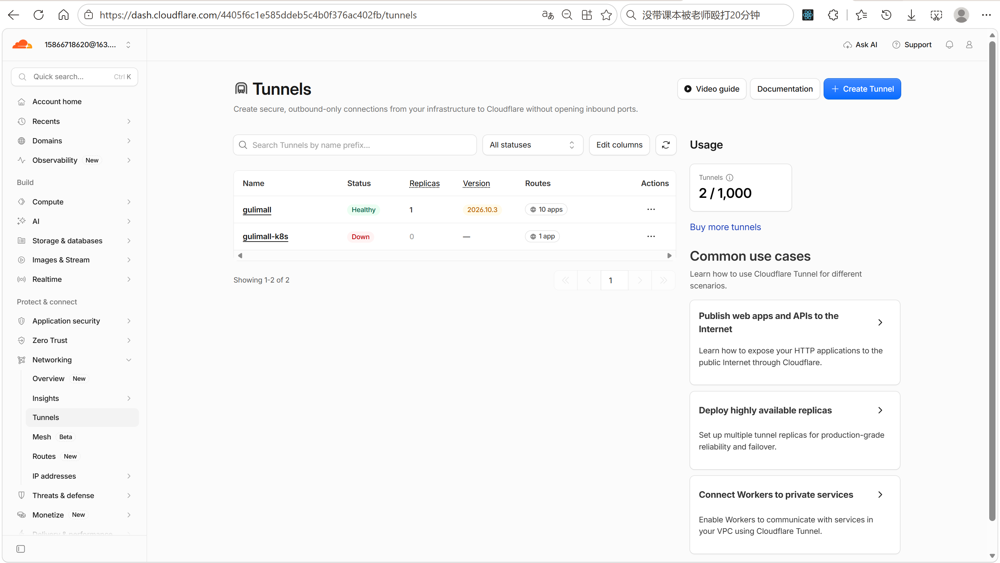
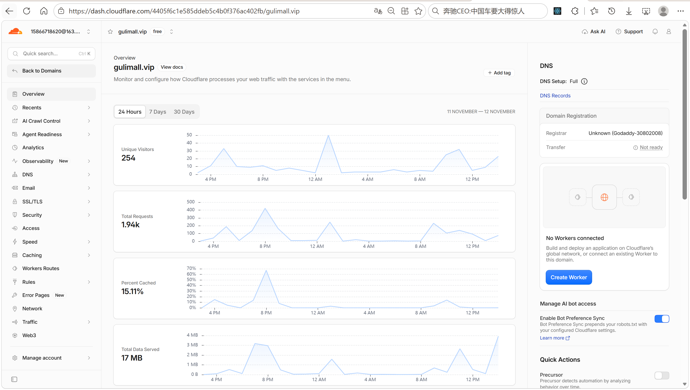
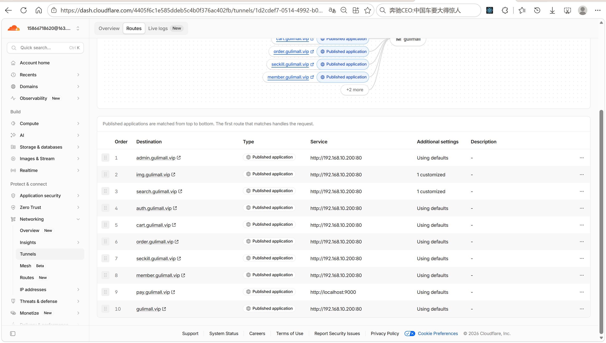
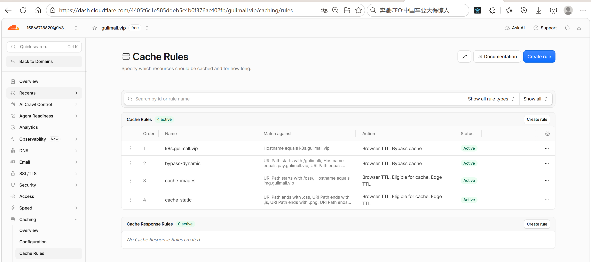
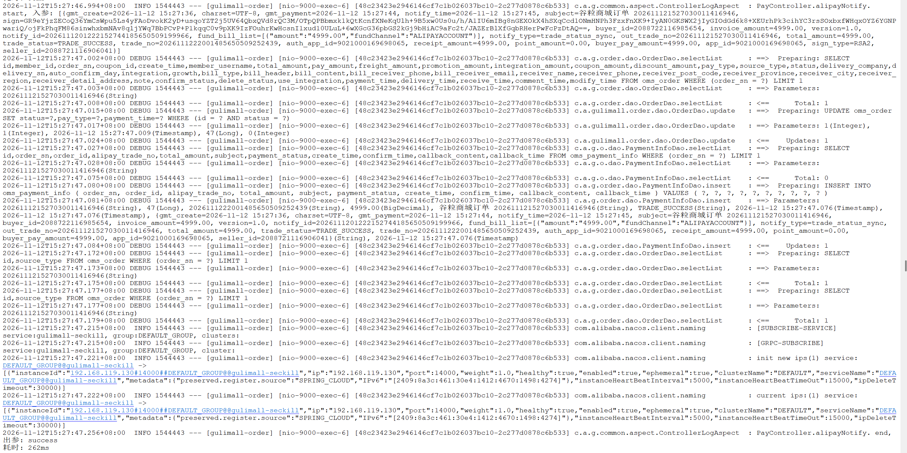

# 17.2 Cloudflare Tunnel 与支付回调-介绍

> 本地和虚拟机上的服务没有公网 IP。Cloudflare Tunnel 把 `gulimall.vip` 系列域名映射到内网 Nginx，把 `pay.gulimall.vip` 直接映射到订单服务的支付回调。支付宝服务器能够通过公网地址访问 `/pay/notify`，订单状态才能同步。

> Tunnel 相关文档与配置：[Cloudflare Tunnel 配置指南](../内网穿透/Cloudflare-Tunnel-配置指南.md)、[Deploy部署流程](../Deploy/Deploy部署流程.md)、[cloudflared 安装包](../../deploy/cloudflare/cloudflared-linux-x86_64.rpm)。

---

## 1. 这个功能是干什么的

支付宝的异步通知由支付宝服务器主动发起，请求必须能从一个公网地址打到订单服务的 `/pay/notify`。开发环境中的订单服务和 Nginx 都在局域网里，没有固定公网 IP，也没有开放入站端口。Cloudflare Tunnel 在内网机器上运行一个 `cloudflared` 进程，由它主动向 Cloudflare 建立出站长连接，公网请求通过这条连接回到内网。

这套链路承担四件事：

1. **公网访问**：`gulimall.vip`、`admin.gulimall.vip`、`search.gulimall.vip` 等域名通过 Tunnel 指向 Nginx 的 80。
2. **支付回调**：`pay.gulimall.vip` 直接指向订单服务的 9000，支付宝的 `notify_url` 使用这个域名。
3. **TLS 终结**：HTTPS 在 Cloudflare 边缘完成，内网到 Nginx 和订单服务使用 HTTP。
4. **缓存控制**：页面、接口、支付回调和词库绕过缓存，静态资源和图片按规则缓存。

域名与回源地址对应如下：

| 公网域名 | Service URL | 最终去向 |
|---|---|---|
| `gulimall.vip` | `http://<your-vm-host-ip>:80` | Nginx 主站 |
| `admin.gulimall.vip` | `http://<your-vm-host-ip>:80` | Nginx 管理端 |
| `img.gulimall.vip` | `http://<your-vm-host-ip>:80` | Nginx 图片站 |
| `search.gulimall.vip` | `http://<your-vm-host-ip>:80` | Nginx 搜索站 |
| `auth.gulimall.vip` | `http://<your-vm-host-ip>:80` | Nginx 登录站 |
| `cart.gulimall.vip` | `http://<your-vm-host-ip>:80` | Nginx 购物车站 |
| `order.gulimall.vip` | `http://<your-vm-host-ip>:80` | Nginx 订单站 |
| `seckill.gulimall.vip` | `http://<your-vm-host-ip>:80` | Nginx 秒杀站 |
| `member.gulimall.vip` | `http://<your-vm-host-ip>:80` | Nginx 个人中心 |
| `pay.gulimall.vip` | `http://<your-vm-host-ip>:9000` | 订单服务，直接处理回调 |

前 9 个域名都指向 Nginx，由 Nginx 按 Host 选择站点。`pay` 不经过 Nginx，因为支付回调只需要一个固定路径，直接到订单服务可以减少一层转发和配置。



图中实线是用户访问链路，虚线是支付宝服务器回调链路。两条链路都从 Cloudflare 边缘进入 Tunnel，再由 `cloudflared` 转到内网。

---

## 2. 怎么操作

### 2.1 前置条件

1. 一个域名，例如 `gulimall.vip`。
2. 域名托管到 Cloudflare，状态为 Active。
3. 目标机器能访问外网，允许出站连接。
4. 订单服务和 Nginx 已在内网启动。

### 2.2 把域名接入 Cloudflare

1. 登录 Cloudflare Dashboard。
2. 进入 Domains，选择 Add a domain。
3. 输入 `gulimall.vip`，选择 Free 计划。
4. Cloudflare 扫描现有 DNS 记录，新域名通常为空，直接继续。
5. 复制 Cloudflare 给出的两个 nameserver。
6. 到域名注册商修改 NS，把原来的 nameserver 替换成 Cloudflare 的两个。
7. 等待 Cloudflare 状态变成 Active。



验证 NS 是否生效：

```bash
nslookup -type=ns gulimall.vip
```

输出中出现 `ns.cloudflare.com` 说明 NS 已生效。切换到 Cloudflare NS 后，注册商原来的解析记录不再生效；如果域名有 MX、TXT 记录，需要先在 Cloudflare 重建。

### 2.3 创建 Tunnel

1. 进入 Zero Trust 或 Networking 下的 Tunnels。
2. 点击 Create a tunnel。
3. Connector 选择 Cloudflared。
4. Tunnel 名称填 `gulimall`。
5. 选择运行环境：Windows、Debian、Red Hat 或 Docker。
6. 复制页面给出的安装命令。
7. 在目标机器执行安装命令。
8. 等待 Tunnel 状态变成 Healthy，Active replicas 至少为 1。

### 2.4 安装 cloudflared

Windows 可以使用 winget：

```bat
winget install --id Cloudflare.cloudflared
```

也可以从 Cloudflare 官方下载页获取 `cloudflared-windows-amd64.exe`，重命名为 `cloudflared.exe` 并加入 PATH。安装后检查版本：

```bat
cloudflared --version
```

Linux 使用 RPM 安装，仓库中已经提供离线包：

```bash
rpm -ivh /opt/gulimall/deploy/cloudflare/cloudflared-linux-x86_64.rpm
cloudflared --version
```

如果提示已经安装，使用覆盖安装：

```bash
rpm -Uvh --replacepkgs /opt/gulimall/deploy/cloudflare/cloudflared-linux-x86_64.rpm
```

Windows 作为服务运行时以 LocalSystem 账户启动，不会读取当前用户目录下的 `config.yml`。使用 Dashboard 生成的 token 安装服务可以避开这个路径问题：

```bat
cloudflared.exe service install <TOKEN>
```

Linux 注册为系统服务：

```bash
cloudflared service install <TOKEN>
systemctl enable --now cloudflared
systemctl status cloudflared --no-pager
```

服务启动后，Tunnel 状态和连接日志是判断是否注册成功的依据。

### 2.5 添加 Route

1. 打开 Tunnel 详情页。
2. 进入 Routes，选择 Add route。
3. 选择 Public hostname。
4. 按域名表填写 Subdomain、Domain、Path、Type 和 Service URL。
5. 保存后 Cloudflare 自动创建对应 DNS 记录。

根域名没有 Subdomain，Domain 填 `gulimall.vip`；`pay` 的 Subdomain 填 `pay`，Service URL 填 `http://<your-vm-host-ip>:9000`。

### 2.6 配置支付宝回调

`config/common.yaml` 中的回调地址：

```text
ALIPAY_NOTIFY_URL=https://pay.gulimall.vip/pay/notify
ALIPAY_RETURN_URL=http://order.gulimall.vip/pay/return
```

`notify` 由支付宝服务器访问，必须走公网 `pay.gulimall.vip`；`return` 由用户浏览器访问，保留 `order.gulimall.vip`，这样用户原来的登录 Cookie 仍然有效。

修改配置后重启订单服务，重新发起支付。订单服务启动时会读取 `ALIPAY_NOTIFY_URL` 和 `ALIPAY_RETURN_URL`，运行中修改文件不会自动生效。

### 2.7 测试回调

先测试隧道是否通到订单服务：

```bash
curl -I https://pay.gulimall.vip/pay.html
```

返回 200 或 302 说明隧道已经通到订单服务。

再测试回调接口：

```bash
curl -X POST https://pay.gulimall.vip/pay/notify -d "test=1"
```

预期返回纯文本：

```text
failure
```

手工请求没有支付宝签名，验签失败返回 `failure` 是正常结果。能返回 `failure` 说明两件事：隧道通了，`/pay/notify` 没有被登录拦截器重定向。

### 2.8 清理缓存

静态资源文件名不带内容 hash，修改 CSS 或 JS 后需要清理 Cloudflare 边缘缓存：

1. 进入 Caching，选择 Configuration。
2. 点击 Purge Cache。
3. 选择 Purge Everything。

长期方案是给静态资源 URL 加版本参数，例如 `?v=20261110`。

---

## 3. 整体设计思路

### 3.1 业务上怎么设计

#### 3.1.1 支付回调只用一个固定域名

支付宝后台配置的 `notify_url` 必须长期稳定。Quick Tunnel 每次启动都会生成新的随机域名，重启后回调地址失效，因此正式支付回调使用 Named Tunnel 的 `pay.gulimall.vip`。

`pay.gulimall.vip` 只承担服务器到服务器的异步通知，不承担用户页面访问。用户仍然从 `order.gulimall.vip` 进入支付页，登录态和购物流程不受影响。

#### 3.1.2 notify 与 return 分工

| 地址 | 谁访问 | 作用 | 要求 |
|---|---|---|---|
| `notify_url` | 支付宝服务器 POST | 支付结果的主要依据 | 公网可访问，处理成功返回 `success` |
| `return_url` | 用户浏览器 GET | 支付完成后跳回页面 | 可以带登录态，不能作为支付成功的唯一依据 |

订单服务收到 `notify` 后先验签，再更新订单和支付信息。`return` 只是把用户带回订单列表，支付结果仍以 `notify` 或主动查单为准。

#### 3.1.3 登录拦截必须放行回调

订单服务的 `LoginUserInterceptor` 拦截所有路径。支付宝服务器没有商城的 `GULIMALLSESSION`，如果 `/pay/notify` 和 `/pay/return` 不放行，请求会被 302 到登录页，支付宝收到 HTML 而不是 `success`，会一直重试。

#### 3.1.4 Cloudflare Access 不能拦回调

如果给 `order.gulimall.vip` 或 `pay.gulimall.vip` 开启 Cloudflare Access，支付宝 POST 会先收到登录页。必须为 `/pay/notify` 创建 Bypass 策略，或者不要对支付域名启用 Access。

#### 3.1.5 缓存按内容类型区分

| 内容 | 是否允许边缘缓存 | 原因 |
|---|---|---|
| `/`、`*.html` | 不允许 | 页面含登录态、价格、库存 |
| `/gulimall/**` | 不允许 | 接口数据随用户和库存变化 |
| `/es/fenci.txt` | 不允许 | IK 每分钟拉最新词库 |
| `pay.gulimall.vip/**` | 不允许 | 支付回调和支付页不能缓存 |
| `.css`、`.js`、字体 | 允许 | 静态内容，但要控制 TTL |
| `/oss/**`、`img.gulimall.vip/**` | 允许 | 图片内容稳定 |

规则按顺序匹配，Bypass 规则必须放在最前面。

### 3.2 技术上怎么设计

#### 3.2.1 Named Tunnel 与 Quick Tunnel

| 对比项 | Quick Tunnel | Named Tunnel |
|---|---|---|
| 域名 | 随机 `trycloudflare.com` | 自定义固定域名 |
| 重启后地址 | 会变化 | 不变 |
| SSE | 不支持 | 支持 |
| 稳定性 | 调试用，无可用性保证 | 适合长期使用 |
| 适用场景 | 临时测试 | 支付回调、准生产 |

支付回调必须使用 Named Tunnel。Quick Tunnel 只适合临时验证接口是否可达。

#### 3.2.2 出站连接

`cloudflared` 主动连接 Cloudflare 边缘，不需要在路由器上开放入站端口，也不需要公网 IP。内网服务只需要让 `cloudflared` 能访问到 Service URL。

Service URL 的写法取决于 `cloudflared` 和服务的相对位置：

1. `cloudflared` 和订单服务在同一台机器：`http://localhost:9000`。
2. `cloudflared` 在虚拟机、订单服务在另一台机器：`http://<订单服务IP>:9000`。
3. `cloudflared` 在虚拟机、Nginx 也在虚拟机：`http://localhost:80`。
4. `cloudflared` 用 Docker 运行：Linux 可以加 `--network host`，Windows 使用 `http://host.docker.internal:9000`。

#### 3.2.3 DNS 与 Host 保留

Cloudflare 自动为 Public hostname 创建 CNAME 记录，指向 Tunnel。请求到达 Nginx 时，Host 仍然是用户访问的域名，Nginx 才能用 `server_name` 匹配站点。

`pay.gulimall.vip` 不经过 Nginx，Host 对订单服务没有影响，但订单服务生成支付表单时使用的 `notify_url` 必须和支付宝后台配置一致。

#### 3.2.4 缓存规则

Cloudflare 默认会缓存一部分静态资源。业务页面和接口如果不显式绕过，可能出现“改了 CSS 页面没变”“接口数据不刷新”的问题。

规则设计：

1. Bypass 动态内容：`/gulimall/`、`pay.gulimall.vip`、`/es/fenci.txt`、`.html`、`/`、带 `GULIMALLSESSION` 的请求。
2. 图片长缓存：`/oss/` 和 `img.gulimall.vip`，边缘 7 天，浏览器 7 天。
3. 静态资源短缓存：CSS、JS、字体、图片后缀，边缘 1 天，浏览器 4 小时。

静态资源文件名不带 hash，缓存时间不能太长。图片内容稳定，可以放心缓存 7 天。

#### 3.2.5 Cloudflare 只缓存 GET 和 HEAD

支付宝 `notify` 是 POST，本身不会被缓存。Bypass `pay` 规则是为了避免支付页和它的静态资源被缓存后干扰排查。

#### 3.2.6 SSE 与超时

Named Tunnel 支持 SSE，Quick Tunnel 不支持。Cloudflare 免费版代理存在大约 100 秒超时，AI 聊天的流式超时配置为 90 秒。如果模型长时间没有输出 token，连接可能被 Cloudflare 断开并返回 524。

---

## 4. 详细代码、配置和解释

这一节按 Tunnel、DNS、支付配置、回调代码和缓存规则组织。每部分先说明职责，再贴完整配置，再说明步骤、原因和优化点。

### 4.1 Route 表：10 个公网主机名

**职责**：

1. 把 9 个站点域名指向 Nginx。
2. 把 `pay.gulimall.vip` 指向订单服务。
3. 定义 Cloudflare 自动创建的 DNS 记录。

**完整配置**：

```text
Subdomain       Domain          Path    Type    Service URL
留空（根域名）  gulimall.vip    留空    HTTP    http://<your-vm-host-ip>:80
admin           gulimall.vip    留空    HTTP    http://<your-vm-host-ip>:80
img             gulimall.vip    留空    HTTP    http://<your-vm-host-ip>:80
search          gulimall.vip    留空    HTTP    http://<your-vm-host-ip>:80
auth            gulimall.vip    留空    HTTP    http://<your-vm-host-ip>:80
cart            gulimall.vip    留空    HTTP    http://<your-vm-host-ip>:80
order           gulimall.vip    留空    HTTP    http://<your-vm-host-ip>:80
seckill         gulimall.vip    留空    HTTP    http://<your-vm-host-ip>:80
member          gulimall.vip    留空    HTTP    http://<your-vm-host-ip>:80
pay             gulimall.vip    留空    HTTP    http://<your-vm-host-ip>:9000
```

前 9 条 Route 的 Service URL 相同，靠 Nginx 的 Host 匹配区分站点。`pay` 直接到订单服务，不经过 Nginx。



**步骤**：

1. 打开 Tunnel 详情页。
2. 进入 Routes，逐条添加 Public hostname。
3. Subdomain 填 `admin`、`img`、`search` 等，根域名留空。
4. Domain 统一填 `gulimall.vip`。
5. Type 选择 HTTP。
6. Service URL 按表填写。
7. 保存后检查 DNS 记录是否自动出现。

**原因**：

1. 9 个站点共用 Nginx，新增站点只需要新增一条 Route 和一个 `server` 块。
2. `pay` 独立指向订单服务，回调路径最短。
3. HTTP 源站适合内网链路，TLS 在 Cloudflare 边缘完成。

**优化点**：

1. `cloudflared` 迁到虚拟机后，Nginx 相关地址可以改成 `http://localhost:80`。
2. 可以给 `pay` 单独使用一个 Tunnel，隔离支付流量。
3. 可以用 Terraform 管理 Route，避免手工漏配。
4. 可以给每个域名配置独立的 Access 策略。

### 4.2 cloudflared 本地配置

**职责**：

1. 以命名隧道方式运行 `cloudflared`。
2. 把公网主机名映射到本地服务。
3. 未命中任何主机名时返回 404。

**完整配置**：

```yaml
tunnel: <TUNNEL_ID>
credentials-file: C:\Users\<用户名>\.cloudflared\<TUNNEL_ID>.json

ingress:
  - hostname: gulimall.vip
    service: http://localhost:9000
  - hostname: pay.gulimall.vip
    service: http://localhost:9000
  - service: http_status:404
```

这是 CLI 本地管理方式的 `config.yml`。使用 Dashboard + token 方式时，Routes 存在 Cloudflare 云端，不需要本地配置文件。

**步骤**：

1. 执行 `cloudflared tunnel login` 登录 Cloudflare。
2. 执行 `cloudflared tunnel create gulimall-dev` 创建隧道。
3. 执行 `cloudflared tunnel route dns gulimall-dev pay.gulimall.vip` 绑定域名。
4. 把配置写入用户目录的 `.cloudflared/config.yml`。
5. 执行 `cloudflared tunnel run gulimall-dev` 启动。

**原因**：

1. `ingress` 按顺序匹配，最后一条没有 `hostname` 的规则是兜底。
2. `http_status:404` 让未配置的域名返回 404，而不是落到某个服务。
3. 本地配置文件方式适合开发环境，Dashboard 方式适合长期维护。

**优化点**：

1. 生产环境使用 Dashboard + token，避免 LocalSystem 读取不到用户目录配置。
2. 可以配置多个 replica 做高可用，但每个 connector 必须能访问同一个 Service URL。
3. 可以把 `config.yml` 纳入配置管理，但凭证 JSON 不能提交到 Git。

### 4.3 Windows 服务与 LocalSystem 路径

**职责**：

1. 说明 Windows 服务运行账户和配置路径。
2. 避免改了用户目录配置但服务不生效。

**完整配置**：

```text
C:\Windows\System32\config\systemprofile\.cloudflared\config.yml
C:\Windows\System32\config\systemprofile\.cloudflared\<TUNNEL_ID>.json
```

Windows 服务以 LocalSystem 账户运行，读取的是系统账户目录，不是当前登录用户目录。凭证文件和配置必须放到上面的路径，并修改注册表 `ImagePath`：

```text
C:\SoftwareInstallation\cloudflared\cloudflared.exe --config=C:\Windows\System32\config\systemprofile\.cloudflared\config.yml tunnel run
```

**步骤**：

1. 停止 `cloudflared` 服务。
2. 把配置和凭证复制到系统账户目录。
3. 修改注册表 `ImagePath`。
4. 重启服务。
5. 用 `journalctl` 或 Windows 事件日志确认连接。

**原因**：

1. 服务账户和登录用户是两套环境。
2. Dashboard + token 方式不需要本地配置文件，可以避开路径问题。

**优化点**：

1. 优先使用 token 安装服务。
2. 把配置路径写入部署脚本，减少手工修改注册表。

### 4.4 支付宝配置

**职责**：

1. 配置应用 ID、私钥、支付宝公钥、网关和回调地址。
2. 让订单服务生成正确的支付表单和验签参数。

**完整配置**：

```yaml
gulimall:
  alipay:
    app-id: ${ALIPAY_APP_ID}
    private-key: ${ALIPAY_PRIVATE_KEY}
    alipay-public-key: ${ALIPAY_PUBLIC_KEY}
    gateway-url: ${ALIPAY_GATEWAY}
    notify-url: ${ALIPAY_NOTIFY_URL}
    return-url: ${ALIPAY_RETURN_URL}
    sign-type: RSA2
    charset: UTF-8
    format: json
```

对应的环境变量在 `config/common.yaml`：

```yaml
# 支付宝沙箱支付配置
ALIPAY_APP_ID: <your-alipay-app-id>
ALIPAY_PRIVATE_KEY: <your-alipay-private-key>
ALIPAY_PUBLIC_KEY: <your-alipay-public-key>
ALIPAY_GATEWAY: https://openapi-sandbox.dl.alipaydev.com/gateway.do
ALIPAY_NOTIFY_URL: https://pay.gulimall.vip/pay/notify
ALIPAY_RETURN_URL: http://order.gulimall.vip/pay/return
```

`notify-url` 和 `return-url` 使用不同域名。`notify` 由支付宝服务器访问，必须是公网地址；`return` 由浏览器访问，保留订单站域名可以复用登录态。

**步骤**：

1. 在支付宝开放平台创建沙箱应用，获取 APPID。
2. 配置应用私钥和支付宝公钥。
3. 把回调地址写入 `config/common.yaml` 或环境变量。
4. 启动订单服务。
5. 发起支付，确认支付宝表单里的 `notify_url` 是 `https://pay.gulimall.vip/pay/notify`。

**原因**：

1. RSA2 是支付宝推荐的签名算法。
2. 私钥只存在服务端，不能放在前端。
3. 回调地址与后台配置必须完全一致，包括协议、域名和路径。

**优化点**：

1. 私钥应放入密钥管理系统，不提交到 Git。
2. 生产环境使用正式网关地址，不使用沙箱地址。
3. 回调地址可以按环境使用不同子域名，例如 `pay-dev.gulimall.vip`。

### 4.5 登录拦截放行回调

**职责**：

1. 让 `/pay/notify` 和 `/pay/return` 跳过登录拦截。
2. 保留其他业务路径的登录校验。

**完整配置**：

```java
@Configuration
public class OrderWebConfiguration implements WebMvcConfigurer {

    @Autowired
    LoginUserInterceptor loginUserInterceptor;

    @Override
    public void addInterceptors(InterceptorRegistry registry) {
        registry.addInterceptor(loginUserInterceptor)
                .excludePathPatterns("/error",
                        "/confirm/js/**", "/confirm/css/**", "/confirm/img/**",
                        "/pay/css/**", "/pay/js/**", "/pay/img/**",
                        // 支付宝回调用的是服务器之间的请求，没有登录会话，必须放行
                        "/pay/notify", "/pay/return",
                        // 城市保存 / 省市区动态数据：未登录也要能用
                        "/city/save", "/region/**",
                        // ===== 后台管理 CRUD =====
                        // 这些接口由 renren-fast-vue 调用，后台有自己的登录态；
                        // 不能再套商城的 GULIMALLSESSION，否则后台页面会被 302 到商城登录页。
                        "/order/order/**", "/order/orderitem/**",
                        "/order/orderreturnapply/**", "/order/orderreturnreason/**",
                        "/order/ordersetting/**", "/order/orderoperatehistory/**",
                        "/order/paymentinfo/**", "/order/refundinfo/**",
                        // ===== 服务内部调用：seckill 消费建单消息时没有用户会话 =====
                        "/internal/**");
    }
}
```

`/pay/notify` 和 `/pay/return` 在拦截器里放行。支付宝服务器没有 Cookie，不放行会被 302 到登录页。

**步骤**：

1. 订单服务启动时加载 `OrderWebConfiguration`。
2. 拦截器注册到所有路径。
3. 请求进入 `/pay/notify` 时匹配排除规则，不执行登录校验。
4. 请求进入支付页时仍然执行登录校验。

**原因**：

1. 支付回调没有用户会话，登录校验必然失败。
2. 支付页需要登录，不能把整个 `/pay/**` 都放行。

**优化点**：

1. 可以把回调路径单独抽成白名单配置，避免硬编码。
2. 可以给回调接口增加来源 IP 校验，作为验签之外的第二层保护。

### 4.6 回调入口与验签

**职责**：

1. 接收支付宝 POST 参数。
2. 把参数交给 `AlipayService.handleNotify`。
3. 返回纯文本 `success` 或 `failure`。

**完整配置**：

```java
    /**
     * 执行顺序 3：支付宝服务器异步通知（POST）。
     * 这个请求没有用户登录会话，所以 /pay/notify 必须在拦截器里放行。
     * 返回值必须是纯文本 success/failure。
     */
    @PostMapping("/pay/notify")
    @ResponseBody
    public String alipayNotify(@RequestParam Map<String, String> params) {
        return alipayService.handleNotify(params);
    }

    /**
     * 执行顺序 4：用户浏览器同步跳回（GET）。
     * 支付结果仍以异步通知或主动查单为准，这里只是把用户带回订单列表。
     */
    @GetMapping("/pay/return")
    public String alipayReturn(@RequestParam Map<String, String> params) {
        alipayService.handleReturn(params);
        return "redirect:/list.html";
    }
```

Controller 只做参数接收和结果返回。`@ResponseBody` 保证返回纯文本，不能被视图解析器渲染成 HTML。

**步骤**：

1. 支付宝服务器 POST 到 `/pay/notify`。
2. Spring MVC 把表单参数绑定到 `Map<String, String>`。
3. Controller 调用 `handleNotify`。
4. 返回值原样写入响应体。
5. 支付宝收到 `success` 后停止重试。

**原因**：

1. 纯文本 `success` 是支付宝识别处理成功的约定。
2. 返回 JSON 或 HTML 会被支付宝当成失败，导致重复通知。

**优化点**：

1. 可以在 Controller 记录请求来源和耗时。
2. 可以增加限流，防止伪造请求消耗验签资源。

### 4.7 handleNotify：验签、幂等与后续动作

**职责**：

1. 验签，确认请求来自支付宝。
2. 校验 `app_id`。
3. 判断交易状态。
4. 更新订单和支付信息。
5. 通知库存、购物车和秒杀。

**完整配置**：

```java
    /**
     * 支付宝异步通知。处理成功返回 success，支付宝才会停止重试。
     */
    public String handleNotify(Map<String, String> params) {
        try {
            // 执行顺序 1：验签。
            // 用支付宝公钥验证签名，确认这次 POST 真的是支付宝发的，而不是别人伪造回调。
            if (!verify(params)) {
                log.warn("[alipay-notify] 验签失败，params={}", params);
                return "failure";
            }

            // 执行顺序 2：校验 app_id（应用 ID），防止把别的支付宝应用的回调串到本项目。
            if (!properties.getAppId().equals(params.get("app_id"))) {
                log.warn("[alipay-notify] app_id 不匹配，expected={}, actual={}",
                        properties.getAppId(), params.get("app_id"));
                return "failure";
            }

            // 执行顺序 3：看 trade_status（交易状态）。
            // TRADE_SUCCESS=支付成功，TRADE_FINISHED=交易完成；其它状态不处理，
            // 但仍然返回 success，告知支付宝通知已接收，避免一直重试。
            String tradeStatus = params.get("trade_status");
            if (!"TRADE_SUCCESS".equals(tradeStatus)
                    && !"TRADE_FINISHED".equals(tradeStatus)) {
                return "success";
            }

            // 执行顺序 4：更新订单状态 + 写 oms_payment_info（支付信息表）。
            // out_trade_no 是商户订单号，trade_no 是支付宝交易流水号。
            String orderSn = params.get("out_trade_no");
            String tradeNo = params.get("trade_no");
            BigDecimal paidAmount = new BigDecimal(params.get("total_amount"));

            boolean paid = orderService.markOrderPaid(
                    orderSn, tradeNo, paidAmount, params.toString());

            // 执行顺序 5：订单 DB 提交后，再调 ware.markPaid 把锁定库存转真实扣减，
            // 并从购物车删除这次已支付的商品。
            if (paid) {
                notifyWarePaid(orderSn);
                clearCartQuietly(orderSn);
                notifySeckillPaid(orderSn);
            } else if (orderService.isOrderClosed(orderSn)) {
                // 订单已超时关闭，但用户又付款成功：全额原路退款
                alipayRefundService.refundLatePayment(
                        orderSn, tradeNo, paidAmount, params.toString());
            }
            // 返回纯文本 success，支付宝收到后就不再重试这条通知。
            return "success";
        } catch (Exception e) {
            log.error("[alipay-notify] 处理失败，params={}", params, e);
            return "failure";
        }
    }
```

验签使用支付宝公钥和 RSA2。`markOrderPaid` 返回 `false` 时，如果订单已经关闭，说明用户超时后又付款，走自动退款。

**步骤**：

1. 验签失败返回 `failure`，支付宝会重试。
2. `app_id` 不匹配返回 `failure`，防止跨应用回调。
3. 非成功状态返回 `success`，避免支付宝重复通知。
4. 成功状态更新订单和支付信息。
5. 订单从未支付变为已支付时，通知库存扣减、清理购物车、通知秒杀。
6. 订单已关闭但收到付款时，发起全额退款。
7. 处理成功返回 `success`。

**原因**：

1. 验签防止伪造回调。
2. `app_id` 校验防止多个应用共用回调地址时串单。
3. 非成功状态返回 `success` 是支付宝的约定，表示通知已收到。
4. 订单更新成功后再通知其他服务，避免订单未落库就扣库存。

**优化点**：

1. `markOrderPaid` 需要保证幂等，重复通知不能重复扣库存。
2. `notifyWarePaid` 失败时应有补偿任务，不能只靠日志。
3. 可以记录每次通知的原始参数，方便对账。
4. 可以对 `total_amount` 与订单金额做严格校验，防止金额被篡改。

### 4.8 Cache Rules

**职责**：

1. 动态内容绕过缓存。
2. 图片长缓存。
3. 静态资源短缓存。

**完整配置**：

规则 1，Bypass 动态内容：

```text
(starts_with(http.request.uri.path, "/gulimall/"))
or (http.host eq "pay.gulimall.vip")
or (http.request.uri.path eq "/es/fenci.txt")
or (ends_with(http.request.uri.path, ".html"))
or (http.request.uri.path eq "/")
or (http.cookie contains "GULIMALLSESSION")
```

规则 2，图片长缓存：

```text
(starts_with(http.request.uri.path, "/oss/"))
or (http.host eq "img.gulimall.vip")
```

规则 3，静态资源短缓存：

```text
(ends_with(http.request.uri.path, ".css"))
or (ends_with(http.request.uri.path, ".js"))
or (ends_with(http.request.uri.path, ".png"))
or (ends_with(http.request.uri.path, ".jpg"))
or (ends_with(http.request.uri.path, ".jpeg"))
or (ends_with(http.request.uri.path, ".gif"))
or (ends_with(http.request.uri.path, ".ico"))
or (ends_with(http.request.uri.path, ".svg"))
or (ends_with(http.request.uri.path, ".webp"))
or (ends_with(http.request.uri.path, ".woff"))
or (ends_with(http.request.uri.path, ".woff2"))
or (ends_with(http.request.uri.path, ".ttf"))
or (ends_with(http.request.uri.path, ".eot"))
```

规则 1 的 Then 选择 Bypass cache。规则 2 的边缘 TTL 选择 7 天，浏览器 TTL 选择 7 天。规则 3 的边缘 TTL 选择 1 天，浏览器 TTL 选择 4 小时。



**步骤**：

1. 进入 Caching，选择 Cache Rules。
2. 创建规则 1，粘贴表达式，选择 Bypass cache。
3. 创建规则 2，粘贴表达式，设置 7 天 TTL。
4. 创建规则 3，粘贴表达式，设置 1 天和 4 小时 TTL。
5. 保存后按顺序检查规则。
6. 用 `curl -I` 查看 `cf-cache-status`。

**原因**：

1. Bypass 放最前面，动态内容不会进入缓存。
2. 图片内容稳定，7 天缓存减少回源。
3. 静态文件名不带 hash，1 天和 4 小时足够短，发版后不会长期拿旧文件。
4. 免费版不支持 `matches` 正则，使用 `ends_with` 组合。

**优化点**：

1. 给静态资源 URL 加内容 hash 后可以延长缓存。
2. 可以用 Cloudflare 的 Purge by URL 精细清理。
3. 可以把规则迁移到 Terraform 管理。
4. 可以给 `pay` 域名单独设置更严格的规则。

---

## 5. 数据怎么流转

### 5.1 用户访问页面

用户从订单站打开支付页的链路如下。

```text
浏览器
  → https://order.gulimall.vip/pay.html?orderSn=...
  → Cloudflare DNS 解析
  → Cloudflare 边缘完成 TLS
  → Tunnel 转到 http://<your-vm-host-ip>:80
  → Nginx 按 Host 匹配 order 站点
  → 转发 order:9000
  → order 渲染支付页
```

页面请求只读取订单数据，不改变支付状态。支付状态的变化由后续的异步通知驱动。

### 5.2 支付宝异步通知

支付宝服务器 POST 到订单服务后的处理链路如下。

```text
支付宝服务器
  → POST https://pay.gulimall.vip/pay/notify
  → Cloudflare 边缘
  → Tunnel 转到 http://<your-vm-host-ip>:9000
  → 订单服务 PayController.alipayNotify
  → AlipayService.handleNotify
  → 验签 → 校验 app_id → 判断 trade_status
  → 更新 oms_order 和 oms_payment_info
  → 通知 ware 扣减库存
  → 清理购物车
  → 通知秒杀
  → 返回 success
```

回调处理完成后，订单、支付信息、库存和购物车都进入新状态。



### 5.3 用户同步跳回

支付宝把浏览器同步跳回订单站的过程如下。

```text
支付宝把浏览器重定向到 http://order.gulimall.vip/pay/return
  → Cloudflare
  → Nginx order 站点
  → order:9000
  → handleReturn 验签
  → 主动查单
  → 订单已支付则更新
  → 重定向 /list.html
```

`return` 只负责把用户带回页面，支付结果以 `notify` 或主动查单为准。

### 5.4 库存与购物车

订单从未支付变为已支付后，订单服务调用 ware 的 `markPaid`，把锁定库存转成真实扣减。非秒杀订单还会调用 cart 的 `deleteCheckedItems`，删除这次下单的商品。秒杀订单不经过购物车，跳过删除。

---

## 6. 完整执行流程

### 6.1 首次配置 Tunnel

1. 购买域名并修改 NS 到 Cloudflare。
2. 等待域名状态变成 Active。
3. 创建 Named Tunnel `gulimall`。
4. 在虚拟机安装 `cloudflared`。
5. 执行 `cloudflared service install <TOKEN>`。
6. 启动服务并确认 Tunnel Healthy。
7. 添加 10 条 Route。
8. 确认 DNS 记录自动创建。
9. 用 `curl` 测试根域名和 `pay` 域名。
10. 配置支付宝回调地址并重启订单服务。

### 6.2 用户支付成功

1. 用户在 `order.gulimall.vip` 打开支付页。
2. 点击支付宝支付，订单服务生成支付表单。
3. 浏览器跳转到支付宝沙箱收银台。
4. 用户完成付款。
5. 支付宝服务器 POST `https://pay.gulimall.vip/pay/notify`。
6. Cloudflare 把请求转到 Tunnel。
7. `cloudflared` 把请求转到订单服务 9000。
8. 订单服务验签。
9. 订单状态从 0 改为 1。
10. 写入 `oms_payment_info`。
11. 调用 ware 扣减库存。
12. 删除购物车商品。
13. 通知秒杀服务。
14. 返回 `success`。
15. 支付宝停止重试。
16. 浏览器跳回 `order.gulimall.vip/pay/return`。
17. 订单服务主动查单，确认状态。
18. 浏览器回到订单列表。

### 6.3 重复通知

1. 支付宝没有及时收到 `success` 时会重复通知。
2. 订单服务重新验签。
3. `markOrderPaid` 检查订单当前状态。
4. 已经支付的订单不再重复扣库存。
5. 继续返回 `success`。
6. 支付宝停止重试。

### 6.4 订单已关闭但收到付款

1. 订单超时关闭。
2. 用户仍然完成付款。
3. 支付宝通知到达。
4. `markOrderPaid` 发现订单已关闭。
5. 调用 `refundLatePayment` 发起全额退款。
6. 返回 `success`。
7. 退款结果由退款服务处理。

---

## 7. 异常、边界、踩坑

1. **本地访问 `.vip` 返回 530**：浏览器走了代理或 Clash/TUN，不是本机 hosts。给 `DOMAIN-SUFFIX,gulimall.vip` 加 DIRECT，或关闭代理的 DNS 覆写。

2. **502 Bad Gateway**：`cloudflared` 没有连上，或者 Service URL 地址和端口不对。检查 `systemctl status cloudflared`、`journalctl -u cloudflared` 和 `curl -I http://127.0.0.1:9000`。

3. **404**：Public Hostname 和实际访问域名不一致，或者本地服务路径不对。

4. **Tunnel 不 Healthy**：出站网络被限制，token 过期，或者防火墙拦截出站。检查 UDP 7844，可以改用 HTTP/2 传输。

5. **支付宝 notify 收不到**：地址不是公网、被 Access 拦截、被登录拦截器拦截，或者处理没有返回 `success`。

6. **notify 返回登录页 HTML**：`/pay/notify` 没有加入拦截器白名单。检查 `OrderWebConfiguration`。

7. **notify 返回 `failure`**：手工请求没有签名是正常结果；真实回调返回 `failure` 要检查支付宝公钥、`app_id` 和签名类型。

8. **改了 config 不生效**：Windows 服务读取 LocalSystem 配置路径，或者订单服务没有重启。检查服务配置和进程启动参数。

9. **Quick Tunnel 地址变化**：重启后随机域名变化，支付宝配置失效。支付回调使用 Named Tunnel。

10. **域名一直 Pending**：NS 没有改对或还没生效。用 `nslookup -type=ns` 检查。

11. **页面改了但内容不变**：Cloudflare 缓存了静态资源。执行 Purge Cache，或检查 Cache Rules 顺序。

12. **接口被缓存**：Bypass 规则没有覆盖 `/gulimall/`，或者规则顺序错误。Bypass 必须放最前面。

13. **SSE 没有流式效果**：使用了 Quick Tunnel，或者 Rocket Loader 改写了 JS。改用 Named Tunnel，关闭 Rocket Loader。

14. **524 超时**：模型响应超过 Cloudflare 免费版超时。降低流式超时或更换模型。

15. **回调重复扣库存**：`markOrderPaid` 不幂等，重复通知会重复执行后续动作。必须在订单状态更新处做幂等判断。

---

## 8. 小结

1. Cloudflare Tunnel 让没有公网 IP 的内网服务获得稳定的公网入口，`cloudflared` 主动建立出站连接。
2. 9 个站点域名指向 Nginx 的 80，`pay.gulimall.vip` 直接指向订单服务的 9000。
3. 支付回调使用 Named Tunnel，Quick Tunnel 地址会变化且不支持 SSE。
4. `notify_url` 必须是公网地址，`return_url` 保留订单站域名以复用登录态。
5. `OrderWebConfiguration` 必须放行 `/pay/notify` 和 `/pay/return`。
6. `handleNotify` 先验签，再校验 `app_id`，再判断交易状态。
7. 订单更新成功后，才通知库存、购物车和秒杀。
8. 重复通知依赖 `markOrderPaid` 的幂等性，不能重复扣库存。
9. Cache Rules 按 Bypass、图片、静态资源顺序配置，Bypass 必须最前。
10. 常见故障按 530、502、404、524 和回调拦截顺序排查。
