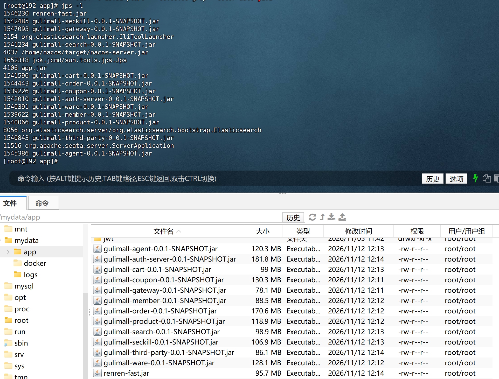
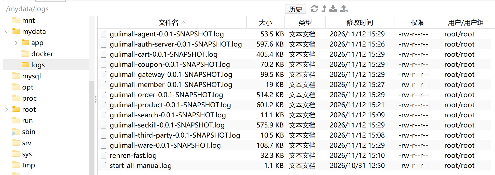
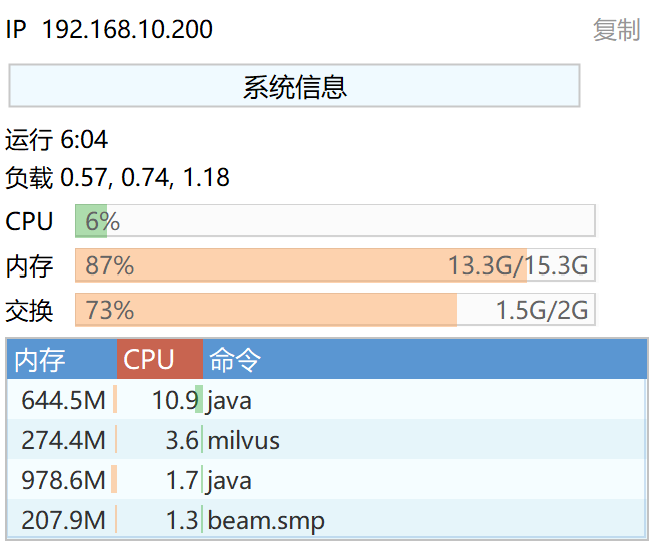
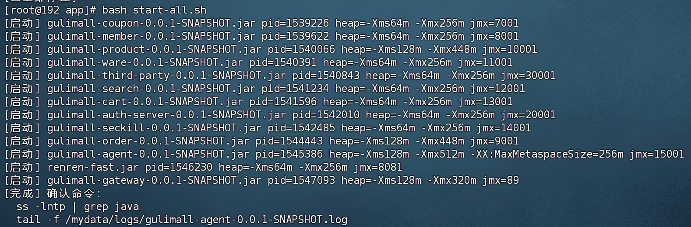
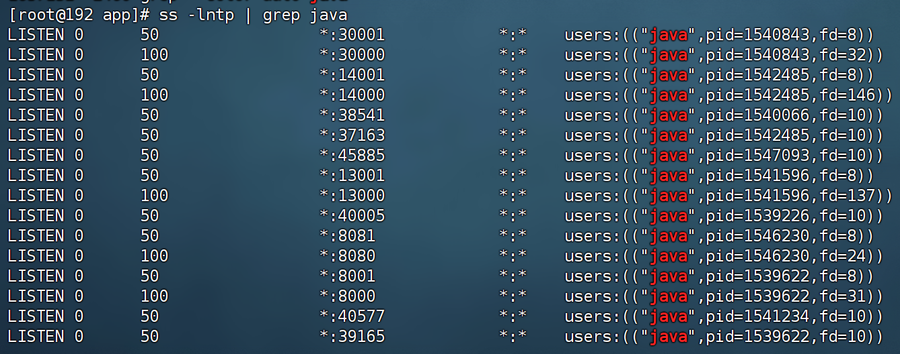

# 17.3 Linux 部署与启动脚本-介绍

> 项目从 Windows 开发机迁到 Linux 服务器后，13 个 Java 进程不再由 IDEA 启动，而是用 `start-all.sh` 分批拉起、用 `stop-all.sh` 统一停止。脚本负责 JVM 堆大小、启动顺序、日志文件和重复启动判断。

> 部署相关文档与脚本：[Deploy部署流程](../Deploy/Deploy部署流程.md)、[Deploy组件一览](../Deploy/Deploy组件一览.md)、[app/README.txt](../../deploy/app/README.txt)、[start-all.sh](../../deploy/app/start-all.sh)、[stop-all.sh](../../deploy/app/stop-all.sh)、[docker-compose.yaml](../../deploy/docker-compose.yaml)、[gulimall-host.txt](../../deploy/gulimall-host.txt)。

---

## 1. 这个功能是干什么的

开发阶段每个服务都在 IDEA 里单独启动，改代码后重启方便。部署到 Linux 后没有 IDEA，服务器内存也只有 15G，需要一套可重复执行的启动方式：

1. 一次性启动 13 个 Java 进程。
2. 按依赖顺序分批启动，避免同时抢 CPU 和数据库连接。
3. 给不同模块分配不同堆上限，防止单个进程吃满内存。
4. 每个进程输出独立日志，方便排查。
5. 重复执行脚本时跳过已在运行的进程。
6. 提供统一停止脚本，只杀本项目进程。

部署范围如下：

| 服务 | 端口 | jar | 数据库 |
|---|---|---|---|
| gulimall-gateway | 88 | `gulimall-gateway-0.0.1-SNAPSHOT.jar` | — |
| gulimall-coupon | 7000 | `gulimall-coupon-0.0.1-SNAPSHOT.jar` | `gulimall_sms` |
| gulimall-member | 8000 | `gulimall-member-0.0.1-SNAPSHOT.jar` | `gulimall_ums` |
| gulimall-order | 9000 | `gulimall-order-0.0.1-SNAPSHOT.jar` | `gulimall_oms` |
| gulimall-product | 10000 | `gulimall-product-0.0.1-SNAPSHOT.jar` | `gulimall_pms` |
| gulimall-ware | 11000 | `gulimall-ware-0.0.1-SNAPSHOT.jar` | `gulimall_wms` |
| gulimall-search | 12000 | `gulimall-search-0.0.1-SNAPSHOT.jar` | —（ES） |
| gulimall-cart | 13000 | `gulimall-cart-0.0.1-SNAPSHOT.jar` | —（Redis） |
| gulimall-seckill | 14000 | `gulimall-seckill-0.0.1-SNAPSHOT.jar` | `gulimall_sms` |
| gulimall-agent | 15000 | `gulimall-agent-0.0.1-SNAPSHOT.jar` | `gulimall_ai` |
| gulimall-auth-server | 20000 | `gulimall-auth-server-0.0.1-SNAPSHOT.jar` | —（Redis Session） |
| gulimall-third-party | 30000 | `gulimall-third-party-0.0.1-SNAPSHOT.jar` | —（MinIO） |
| renren-fast | 8080 | `renren-fast.jar` | `gulimall_admin` |



13 个进程全部运行在 `/mydata/app`，日志写到 `/mydata/logs`。Nginx 容器通过 `host.docker.internal` 回连这些进程。

---

## 2. 怎么操作

### 2.1 构建

在 Windows 开发机停止 IDEA 中运行的服务，避免 `mvn clean` 删除正在使用的 jar：

```bash
cd /d D:\SoftwareInstallation\gulimall
mvn clean package -DskipTests
```

全量构建会把 `gulimall-common` 和 `gulimall-api` 一起安装到本地仓库，避免只构建单个模块时缺少依赖。管理端后端单独构建：

```bash
cd /d D:\SoftwareInstallation\gulimall\renren-fast
mvn clean package -DskipTests
```

两个构建命令分别生成微服务 jar 和管理端 jar。

### 2.2 上传

在服务器创建目录：

```bash
mkdir -p /mydata/app /mydata/logs
```

上传 jar：

```bash
scp D:\SoftwareInstallation\gulimall\gulimall-gateway\target\gulimall-gateway-0.0.1-SNAPSHOT.jar root@<your-vm-host-ip>:/mydata/app/
scp D:\SoftwareInstallation\gulimall\gulimall-coupon\target\gulimall-coupon-0.0.1-SNAPSHOT.jar root@<your-vm-host-ip>:/mydata/app/
scp D:\SoftwareInstallation\gulimall\gulimall-member\target\gulimall-member-0.0.1-SNAPSHOT.jar root@<your-vm-host-ip>:/mydata/app/
scp D:\SoftwareInstallation\gulimall\gulimall-order\target\gulimall-order-0.0.1-SNAPSHOT.jar root@<your-vm-host-ip>:/mydata/app/
scp D:\SoftwareInstallation\gulimall\gulimall-product\target\gulimall-product-0.0.1-SNAPSHOT.jar root@<your-vm-host-ip>:/mydata/app/
scp D:\SoftwareInstallation\gulimall\gulimall-ware\target\gulimall-ware-0.0.1-SNAPSHOT.jar root@<your-vm-host-ip>:/mydata/app/
scp D:\SoftwareInstallation\gulimall\gulimall-search\target\gulimall-search-0.0.1-SNAPSHOT.jar root@<your-vm-host-ip>:/mydata/app/
scp D:\SoftwareInstallation\gulimall\gulimall-cart\target\gulimall-cart-0.0.1-SNAPSHOT.jar root@<your-vm-host-ip>:/mydata/app/
scp D:\SoftwareInstallation\gulimall\gulimall-seckill\target\gulimall-seckill-0.0.1-SNAPSHOT.jar root@<your-vm-host-ip>:/mydata/app/
scp D:\SoftwareInstallation\gulimall\gulimall-agent\target\gulimall-agent-0.0.1-SNAPSHOT.jar root@<your-vm-host-ip>:/mydata/app/
scp D:\SoftwareInstallation\gulimall\gulimall-auth-server\target\gulimall-auth-server-0.0.1-SNAPSHOT.jar root@<your-vm-host-ip>:/mydata/app/
scp D:\SoftwareInstallation\gulimall\gulimall-third-party\target\gulimall-third-party-0.0.1-SNAPSHOT.jar root@<your-vm-host-ip>:/mydata/app/
scp D:\SoftwareInstallation\gulimall\renren-fast\target\renren-fast.jar root@<your-vm-host-ip>:/mydata/app/
```

上传配置目录：

```bash
scp -r D:\SoftwareInstallation\gulimall\config root@<your-vm-host-ip>:/mydata/app/
```

`config/` 含明文密码，不在 Git 里，换机器必须单独拷贝。占位符没有默认值时，配置不到位会直接启动失败。

### 2.3 启动

启动脚本需要执行权限，并以 root 身份运行。

```bash
chmod +x /mydata/app/start-all.sh
/mydata/app/start-all.sh
```

脚本会按批次启动 13 个进程，每批之间等待若干秒。脚本执行完只代表进程已经拉起，不代表 Spring Boot 已经启动完成。

### 2.4 停止

停止脚本会匹配本项目的 jar 名并结束进程。

```bash
chmod +x /mydata/app/stop-all.sh
/mydata/app/stop-all.sh
```

停止脚本只匹配本项目的 jar 名，不会误杀其他 Java 进程。

### 2.5 更新单个服务

只重启一个模块时，先结束旧进程，再按相同堆参数启动新进程。

```bash
pkill -f 'gulimall-product-0\.0\.1-SNAPSHOT\.jar'
sleep 3
cd /mydata/app
nohup java -Xms128m -Xmx448m -XX:MaxMetaspaceSize=192m -XX:ReservedCodeCacheSize=96m -Xss512k -jar gulimall-product-0.0.1-SNAPSHOT.jar > /mydata/logs/gulimall-product-0.0.1-SNAPSHOT.log 2>&1 &
```

单服务更新只影响一个模块，其他模块保持运行。堆参数要和 `start-all.sh` 中的 `heap_for` 保持一致，否则重启后内存占用会变化。

### 2.6 检查端口

端口检查是判断 13 个进程是否全部拉起的最快方式。

```bash
for p in 88 7000 8000 9000 10000 11000 12000 13000 14000 15000 20000 30000 8080; do printf "%-6s " $p; ss -lntp | grep -q ":$p " && echo OK || echo DOWN; done
```

13 个端口全部 OK 才说明进程都进入监听状态。88 是网关端口，也是唯一一个小于 1024 的特权端口。

### 2.7 检查日志

日志中的 Started 记录用于确认 Spring Boot 启动完成。

```bash
tail -f /mydata/logs/gulimall-product-0.0.1-SNAPSHOT.log
tail -f /mydata/logs/gulimall-agent-0.0.1-SNAPSHOT.log
grep -l "Started Gulimall" /mydata/logs/*.log
```

日志文件名和 jar 名一致，`${jar%.jar}.log` 去掉 `.jar` 后缀后加上 `.log`。



---

## 3. 整体设计思路

### 3.1 业务上怎么设计

#### 3.1.1 启动分四批

服务之间存在依赖：

1. coupon、member、product、ware、third-party、search、cart、auth-server、seckill 是基础服务，先注册到 Nacos。
2. order 依赖 ware、coupon、member，等基础服务注册后再启动。
3. agent 依赖 Nacos、MySQL、Redis、MinIO，启动后工具在请求时才调业务服务。
4. renren-fast 是独立管理端后端。
5. gateway 是统一入口，最后启动。

启动顺序：

| 批次 | 服务 | 间隔 |
|---|---|---|
| 第一批 | coupon、member、product、ware、third-party、search、cart、auth-server、seckill | 每个间隔 5 秒 |
| 第二批 | order、agent | 等 20 秒后 order，再等 10 秒 agent |
| 第三批 | renren-fast | 等 10 秒 |
| 第四批 | gateway | 最后启动 |

#### 3.1.2 13 个进程的堆预算

虚拟机 15G 内存，还要运行 MySQL、ES、Kibana、Milvus 等容器。13 个 Java 进程不能都按 512m 堆启动，否则容器和系统会被挤出内存。

当前分配：

| 模块 | 堆上限 |
|---|---|
| product、order | 448m |
| gateway | 320m |
| agent | 512m，元空间 256m |
| 其余模块 | 256m |

堆上限合计约 4.0G，实际占用通常低于上限。JIT 代码缓存、元空间和线程栈统一压低，减少每个进程的 native 内存。



#### 3.1.3 本地与服务器的差异

| 项目 | Windows 本地 | Linux 服务器 |
|---|---|---|
| 启动方式 | IDEA 运行 Application | `java -jar` |
| 工作目录 | 项目源码目录 | `/mydata/app` |
| 配置读取 | IDEA 工作目录下的 `config/` | `/mydata/app/config/` |
| 日志 | IDEA 控制台 | `/mydata/logs/*.log` |
| 停止方式 | IDEA 停止按钮 / `taskkill` | `pkill` |
| 进程查看 | 任务管理器 / `netstat -ano` | `pgrep` / `ss -lntp` |
| 注册到 Nacos 的 IP | `<your-windows-host-ip>` | `<your-vm-host-ip>` |
| Nginx 回连地址 | `host.docker.internal` 指向 Windows | `host.docker.internal` 指向 Linux 网桥 |
| 文件路径大小写 | 不敏感 | 敏感 |

Windows 和 Linux 同时运行会导致 Nacos 里出现两套实例。网关轮询到 Windows 实例时正常，轮询到已经停止的实例时 502。迁移时必须先停掉 Windows 上的所有服务，等 30 秒后在 Nacos 控制台确认没有 `<your-windows-host-ip>` 的实例。

#### 3.1.4 配置目录必须随 jar 一起上传

`config/` 里有各服务的 yaml 和 `docker-compose.env`。jar 只带默认配置，环境相关的主机、密码、回调地址都在 `config/` 里。配置缺失时启动日志会出现：

```text
Could not resolve placeholder 'MYSQL_HOST'
```

该错误说明配置目录没有随 jar 一起上传，或者工作目录不对。

#### 3.1.5 日志按 jar 名区分

13 个进程共用一个日志目录，文件名必须可区分。脚本使用 `$LOG_DIR/${jar%.jar}.log`，`gulimall-product-0.0.1-SNAPSHOT.jar` 对应 `gulimall-product-0.0.1-SNAPSHOT.log`。

### 3.2 技术上怎么设计

#### 3.2.1 nohup 与后台运行

`nohup java ... > log 2>&1 &` 做三件事：

1. `nohup` 让进程忽略挂断信号，终端关闭后继续运行。
2. `> log 2>&1` 把标准输出和标准错误都写入同一个日志文件。
3. `&` 把进程放到后台，脚本继续执行下一条命令。

#### 3.2.2 pgrep 防止重复启动

`start()` 先用 `pgrep -f "$jar"` 检查进程是否存在。已经存在时打印跳过并返回，不会启动第二个实例。重复执行脚本是安全的。

#### 3.2.3 分批等待

第一批每个服务间隔 5 秒，第二批前等 20 秒，给 Nacos 注册和连接池初始化留时间。等待时间不是精确的启动完成信号，只是降低同时抢资源的概率。

#### 3.2.4 特权端口

网关 88 小于 1024，Linux 普通用户不能绑定。脚本必须用 root 执行，或者给 Java 二进制授予 `CAP_NET_BIND_SERVICE`。当前部署使用 root。

#### 3.2.5 工作目录

脚本先 `cd "$APP_DIR"`，保证 `./config/*.yaml` 能读到。Spring Boot 默认从工作目录的 `config/` 加载配置，工作目录不对时配置会被忽略。

#### 3.2.6 停止脚本的匹配范围

`stop-all.sh` 使用：

```bash
pkill -f 'gulimall-.*-0\.0\.1-SNAPSHOT\.jar'
pkill -f 'renren-fast\.jar'
```

正则只匹配本项目 jar，不会杀掉其他 Java 程序。`renren-fast.jar` 单独一条，因为它的文件名不符合 `gulimall-*-0.0.1-SNAPSHOT.jar` 格式。

#### 3.2.7 JVM 公共参数

公共 JVM 参数统一压低元空间、代码缓存和线程栈。

```text
-XX:MaxMetaspaceSize=192m
-XX:ReservedCodeCacheSize=96m
-Xss512k
-XX:+HeapDumpOnOutOfMemoryError
-XX:HeapDumpPath=/mydata/logs
```

元空间和 JIT 代码缓存设上限，线程栈从默认 1M 降到 512k，减少每个线程的 native 内存。OOM 时自动生成堆转储，文件写到日志目录。

---

## 4. 详细代码、配置和解释

这一节按启动脚本、停止脚本、部署说明、配置文件和验证命令组织。每部分先说明职责，再贴完整内容，再说明步骤、原因和优化点。

### 4.1 start-all.sh：分批启动 13 个进程

**职责**：

1. 固定工作目录和日志目录。
2. 定义公共 JVM 参数。
3. 按模块分配堆上限。
4. 按批次启动进程。
5. 跳过已在运行的进程。

**完整配置**：

```bash
#!/usr/bin/env bash
# gulimall 全量启动脚本（13 个 Java 进程）
set -u

# 1) 固定目录：cwd 必须是 /mydata/app，否则 ./config/*.yaml 读不到
APP_DIR=/mydata/app
LOG_DIR=/mydata/logs

# 2) 公共 JVM 参数：压低元空间、JIT 代码缓存和线程栈，减少每个进程的 native 内存
COMMON_OPTS="-XX:MaxMetaspaceSize=192m -XX:ReservedCodeCacheSize=96m -Xss512k -XX:+HeapDumpOnOutOfMemoryError -XX:HeapDumpPath=${LOG_DIR}"

mkdir -p "$LOG_DIR"
cd "$APP_DIR" || exit 1

# 3) 按模块分配堆上限：
#    15G 虚拟机还要跑 MySQL/ES/Kibana/Milvus 等容器，13 个 Java 进程不能都吃 512m。
#    product/order 448m、gateway 320m、AI agent 512m、其余模块 256m；
#    所有 Java 进程都在 256～512m 区间，堆上限合计约 4.0G，实际占用通常更低。
heap_for() {
  case "$1" in
    gulimall-product-*.jar|gulimall-order-*.jar)
      echo "-Xms128m -Xmx448m"
      ;;
    gulimall-gateway-*.jar)
      echo "-Xms128m -Xmx320m"
      ;;
    gulimall-agent-*.jar)
      # LangChain4j / Milvus / MinIO 客户端类多，元空间单独放宽；
      # 如果 RAG 大量入库时仍 OOM，再继续往上加
      echo "-Xms128m -Xmx512m -XX:MaxMetaspaceSize=256m"
      ;;
    *)
      # coupon/member/ware/search/cart/auth/seckill/renren-fast/third-party
      echo "-Xms64m -Xmx256m"
      ;;
  esac
}

# 4) 启动单个 jar：已在运行则跳过；日志按 jar 名区分
start() {
  local jar="$1"
  if pgrep -f "$jar" >/dev/null 2>&1; then
    echo "[跳过] $jar 已在运行"
    return 0
  fi
  local heap
  heap="$(heap_for "$jar")"
  nohup java $COMMON_OPTS $heap -jar "$jar" > "$LOG_DIR/${jar%.jar}.log" 2>&1 &
  echo "[启动] $jar pid=$! heap=$heap"
}

# 5) 第一批：基础业务服务（每个间隔 5 秒，避免同时抢 CPU/连接）
#    内存实在紧张时，seckill/third-party 可以按需注释；coupon/ware 在下单链路里不要省。
for jar in \
  gulimall-coupon-0.0.1-SNAPSHOT.jar \
  gulimall-member-0.0.1-SNAPSHOT.jar \
  gulimall-product-0.0.1-SNAPSHOT.jar \
  gulimall-ware-0.0.1-SNAPSHOT.jar \
  gulimall-third-party-0.0.1-SNAPSHOT.jar \
  gulimall-search-0.0.1-SNAPSHOT.jar \
  gulimall-cart-0.0.1-SNAPSHOT.jar \
  gulimall-auth-server-0.0.1-SNAPSHOT.jar \
  gulimall-seckill-0.0.1-SNAPSHOT.jar
do
  start "$jar"
  sleep 5
done

# 6) 第二批：订单 + AI 助手（等基础服务注册完）
sleep 20
start gulimall-order-0.0.1-SNAPSHOT.jar
sleep 10
start gulimall-agent-0.0.1-SNAPSHOT.jar
sleep 10

# 7) 第三批：管理端后端
start renren-fast.jar
sleep 10

# 8) 第四批：网关（最后启动）
start gulimall-gateway-0.0.1-SNAPSHOT.jar

echo "[完成] 确认命令："
echo "  ss -lntp | grep java"
echo "  tail -f $LOG_DIR/gulimall-agent-0.0.1-SNAPSHOT.log"
```

脚本分为目录设置、公共参数、堆分配、单进程启动、四批启动五部分。`heap_for` 用 `case` 匹配 jar 名，匹配不到时走默认 256m。



**步骤**：

1. 确认 `/mydata/app` 下有 13 个 jar。
2. 确认 `/mydata/app/config` 下有各服务配置。
3. 执行 `chmod +x /mydata/app/start-all.sh`。
4. 执行 `/mydata/app/start-all.sh`。
5. 观察输出中的跳过和启动记录。
6. 用端口检查确认 13 个端口监听。

**原因**：

1. `set -u` 让未定义变量直接报错，避免拼写错误导致空路径。
2. `cd "$APP_DIR"` 保证配置读取。
3. `pgrep` 防止重复启动。
4. `nohup` 保证终端关闭后进程继续运行。
5. 分批启动降低 Nacos、数据库和 CPU 的瞬时压力。

**优化点**：

1. 可以用 `systemd` 管理每个服务，获得自动重启和开机自启。
2. 可以用 `wait-for-it` 或健康检查替代固定 `sleep`。
3. 可以把 jar 名和端口抽成配置文件，避免脚本写死。
4. 可以增加启动失败检测，启动后立即检查端口和日志。
5. 可以把堆参数改成环境变量，按机器内存调整。

### 4.2 stop-all.sh：只停止本项目进程

**职责**：

1. 匹配本项目的所有 jar。
2. 等待 3 秒。
3. 确认是否还有残留进程。

**完整配置**：

```bash
#!/usr/bin/env bash
# 1) 只杀本项目 jar，避免误杀其他 Java 进程
pkill -f 'gulimall-.*-0\.0\.1-SNAPSHOT\.jar'
pkill -f 'renren-fast\.jar'

# 2) 等 3 秒后确认
sleep 3
pgrep -af 'gulimall-.*\.jar|renren-fast\.jar' || echo "[已全部停止]"
```

`pkill -f` 匹配完整命令行，不匹配进程名。`sleep 3` 给 JVM 关闭钩子和端口释放留时间。`pgrep -af` 有输出说明还有残留，没有输出时打印已全部停止。

**步骤**：

1. 执行 `chmod +x /mydata/app/stop-all.sh`。
2. 执行 `/mydata/app/stop-all.sh`。
3. 观察输出是否有残留进程。
4. 用 `ss -lntp` 确认端口释放。

**原因**：

1. 只匹配项目 jar，避免杀掉 Jenkins、Nacos 等其他 Java 进程。
2. 等待 3 秒让 Spring Boot 完成优雅停机。
3. 停止后确认，避免端口被旧进程占用。

**优化点**：

1. 可以增加 `-9` 兜底，超时后强制结束。
2. 可以按批次逆序停止，先停网关再停业务服务。
3. 可以记录停止时间到运维日志。

### 4.3 README.txt：启动、停止和单服务重启

**职责**：

1. 记录脚本权限和常用命令。
2. 给出单个服务重启示例。

**完整配置**：

```text
chmod +x /mydata/app/start-all.sh
/mydata/app/start-all.sh
chmod +x /mydata/app/stop-all.sh
/mydata/app/stop-all.sh

pkill -f gulimall-member-0.0.1-SNAPSHOT.jar
sleep 3
cd /mydata/app
nohup java -Xms256m -Xmx512m -jar gulimall-member-0.0.1-SNAPSHOT.jar > /mydata/logs/gulimall-member-0.0.1-SNAPSHOT.log 2>&1 &
```

单服务示例使用 512m 堆，和 `start-all.sh` 中 member 的 256m 不一致。实际重启时应以脚本的 `heap_for` 结果为准。

**步骤**：

1. 首次部署赋予脚本执行权限。
2. 日常启动执行 `start-all.sh`。
3. 日常停止执行 `stop-all.sh`。
4. 只更新一个模块时按 README 的单服务命令执行。

**原因**：

1. 把常用命令放在一个文件里，减少查文档次数。
2. 单服务重启比重启全部快，适合小范围更新。

**优化点**：

1. README 中的堆参数应和脚本同步。
2. 可以增加日志查看和端口检查命令。
3. 可以增加“启动前检查配置目录”的步骤。

### 4.4 部署环境配置

**职责**：

1. 定义 Nginx 回连 Windows 或 Linux 的地址。
2. 定义各服务连接中间件的主机地址。
3. 保证 Windows 和 Linux 不同时注册到 Nacos。

**完整配置**：

```bash
WINDOWS_HOST_IP=host-gateway     # Java 跑在 Linux 时用这个
VM_HOST_IP=<your-vm-host-ip>        # 本机局域网 IP
```

本地联调时 Java 还在 Windows，`WINDOWS_HOST_IP` 要填 `<your-windows-host-ip>`，否则 Nginx 容器会去连 Linux 的 `172.17.0.1`，表现为 502。Java 全部迁到 Linux 后才改成 `host-gateway`。

`config/common.yaml` 中的中间件地址：

```bash
MYSQL_HOST=<your-vm-host-ip>
REDIS_HOST=<your-vm-host-ip>
NACOS_ADDR=<your-vm-host-ip>:8848
ES_URIS=<your-vm-host-ip>:9200
MINIO_ENDPOINT=<your-vm-host-ip>:19000
RABBITMQ_HOST=<your-vm-host-ip>
```

这些地址必须是目标机 IP。Java 在 Windows 时中间件仍在虚拟机，地址不变；Java 迁到 Linux 后可以改成 `127.0.0.1`，也可以继续使用局域网 IP。

**步骤**：

1. 修改 `config/docker-compose.env`。
2. 点击后重建 Nginx：`docker compose --env-file /mydata/app/config/docker-compose.env up -d --force-recreate nginx`。
3. 执行 `docker exec nginx getent hosts host.docker.internal` 确认解析。
4. 检查 `config/common.yaml` 的主机地址。
5. 停掉 Windows 上的服务。

**原因**：

1. `host.docker.internal` 的解析由 compose 的 `extra_hosts` 注入。
2. 中间件地址写错时服务启动会连接失败。
3. 两套实例同时注册会让网关轮询到已经停止的实例。

**优化点**：

1. 可以用配置中心统一下发中间件地址。
2. 可以给每个环境使用不同的配置文件。
3. 可以把敏感密码放入密钥管理系统。

### 4.5 端口与日志验证

**职责**：

1. 确认 13 个端口全部监听。
2. 确认 Spring Boot 启动完成。
3. 确认 Nacos 注册实例数量。

**完整配置**：

```bash
for p in 88 7000 8000 9000 10000 11000 12000 13000 14000 15000 20000 30000 8080; do printf "%-6s " $p; ss -lntp | grep -q ":$p " && echo OK || echo DOWN; done
```

这行命令逐个检查端口，输出 OK 或 DOWN。`ss -lntp` 显示 TCP 监听端口和进程名，需要 root 才能看到所有进程。

```bash
grep -l "Started Gulimall" /mydata/logs/*.log
grep -l "Started RenrenApplication" /mydata/logs/renren-fast.log
grep -l "Started GulimallAgentApplication" /mydata/logs/gulimall-agent-0.0.1-SNAPSHOT.log
```

日志出现 `Started` 说明 Spring Boot 完成启动。`grep -l` 只输出文件名，适合快速确认哪些服务已经启动。

**步骤**：

1. 启动后先执行端口检查。
2. 再检查日志中的 `Started`。
3. 打开 Nacos 控制台确认服务列表。
4. 检查实例 IP 是否全部为 `<your-vm-host-ip>`。

**原因**：

1. 端口监听是进程存活的直接证据。
2. `Started` 是 Spring Boot 启动完成的标志。
3. Nacos 实例 IP 能发现 Windows 和 Linux 双注册。

**优化点**：

1. 可以写一个健康检查脚本，返回非零退出码。
2. 可以把端口和日志检查接入监控。
3. 可以在启动脚本末尾自动执行检查。

---

## 5. 数据怎么流转

### 5.1 启动链路

启动脚本按批次拉起进程并注册到 Nacos。

```text
执行 start-all.sh
  → 创建 /mydata/logs
  → 进入 /mydata/app
  → 第一批启动基础服务
  → 每个进程读取 ./config/*.yaml
  → 连接 MySQL、Redis、Nacos、RabbitMQ、ES、MinIO
  → 注册到 Nacos
  → 第二批启动 order 和 agent
  → 第三批启动 renren-fast
  → 第四批启动 gateway
  → 13 个端口进入监听
```

所有进程进入监听后，请求才能通过 Nginx 到达对应服务。

### 5.2 请求链路

请求从 Cloudflare 进入 Nginx，再转到宿主机上的 Java 服务。

```text
浏览器
  → Cloudflare Tunnel
  → Nginx 80
  → host.docker.internal:对应端口
  → Java 服务
  → MySQL / Redis / ES / MinIO
```

Nginx 不关心 Java 进程是 IDEA 启动还是 `java -jar` 启动，只关心 `host.docker.internal` 能否解析到宿主机、端口是否监听。

### 5.3 停止链路

停止脚本按 jar 名结束进程并确认端口释放。

```text
执行 stop-all.sh
  → pkill 匹配 gulimall-*-0.0.1-SNAPSHOT.jar
  → pkill 匹配 renren-fast.jar
  → 等待 3 秒
  → pgrep 确认无残留
  → 端口释放
```

停止完成后，Nacos 中的实例会随心跳超时被移除。

### 5.4 日志链路

每个进程的输出都落到独立日志文件。

```text
java 进程
  → 标准输出和标准错误
  → nohup 重定向到 /mydata/logs/<jar名>.log
  → tail -f 查看
```

---

## 6. 完整执行流程

### 6.1 首次部署

1. 在 Windows 执行 `mvn clean package -DskipTests`。
2. 构建 renren-fast。
3. 在服务器创建 `/mydata/app` 和 `/mydata/logs`。
4. 上传 13 个 jar。
5. 上传 `config/`。
6. 上传 SQL 并初始化 `gulimall_ai`。
7. 修改 `config/docker-compose.env` 和 `common.yaml`。
8. 停掉 Windows 上的 13 个服务。
9. 执行 `start-all.sh`。
10. 检查 13 个端口。
11. 检查日志中的 `Started`。
12. 在 Nacos 确认实例 IP。
13. 重建 Nginx 并检查 `host.docker.internal`。
14. 浏览器访问各站点。



### 6.2 日常启动

1. 确认中间件容器已启动。
2. 执行 `/mydata/app/start-all.sh`。
3. 脚本跳过已在运行的进程。
4. 新进程按批次启动。
5. 执行端口检查。
6. 打开首页确认。

### 6.3 更新一个模块

1. 在 Windows 重新构建该模块。
2. 上传新 jar。
3. 执行 `pkill -f '<jar名>'`。
4. 等待 3 秒。
5. 在 `/mydata/app` 下执行 `nohup java ... &`。
6. 检查端口和日志。
7. 通过 Nginx 验证接口。

### 6.4 全量停止

1. 执行 `/mydata/app/stop-all.sh`。
2. 脚本匹配本项目 jar。
3. 等待 3 秒。
4. 检查是否有残留。
5. 检查端口是否释放。
6. 需要时停止中间件容器。

---

## 7. 异常、边界、踩坑

1. **配置读不到**：脚本没有在 `/mydata/app` 下执行，`./config/*.yaml` 找不到。日志出现 `Could not resolve placeholder`。脚本已经 `cd "$APP_DIR"`，手工启动时也要先进入该目录。

2. **端口 88 绑定失败**：普通用户不能绑定小于 1024 的端口。用 root 执行，或给 Java 授予 `CAP_NET_BIND_SERVICE`。

3. **OOM**：15G 内存同时跑 13 个 JVM 和多个容器，堆上限过大或容器占用过高都会触发 OOM。先看 `free -h` 和日志中的 `OutOfMemoryError`，再降未使用模块的 `-Xmx`。

4. **启动成功但 Nacos 有两套实例**：Windows 上的服务没有停，注册了 `<your-windows-host-ip>`。停掉 Windows 服务，等 30 秒再确认。

5. **Nginx 502**：Java 进程没有监听端口，或者 `host.docker.internal` 解析错误。检查 `ss -lntp` 和 `docker exec nginx getent hosts host.docker.internal`。

6. **重复执行脚本启动两个实例**：`pgrep` 匹配失败，可能是 jar 名不同或启动命令不带完整 jar 名。检查 `pgrep -af java`。

7. **停止脚本误杀**：正则写得太宽会匹配其他 Java 进程。当前只匹配 `gulimall-*-0.0.1-SNAPSHOT.jar` 和 `renren-fast.jar`。

8. **日志文件没有生成**：`/mydata/logs` 没有写权限，或者进程启动瞬间就失败。检查目录权限和 `nohup` 输出。

9. **日志太大占满磁盘**：没有日志轮转。可以配置 logrotate 或定期清理。

10. **文件路径大小写**：Windows 不区分大小写，Linux 区分。静态资源和配置文件大小写不一致会导致 404 或启动失败。

11. **配置文件权限**：`config/` 含明文密码，权限过宽会被其他用户读取。建议设置为仅 root 可读。

12. **启动顺序不满足依赖**：order 在 ware 注册前启动，第一次下单可能找不到库存服务。脚本已经等待，仍失败时可以手动重启 order。

13. **agent 启动慢**：LangChain4j、Milvus、MinIO 客户端类多，启动时间比普通模块长。给 agent 单独的元空间和堆上限。

14. **时区不一致**：容器和 Java 进程时区不同会导致订单时间和支付时间偏差。统一使用 `Asia/Shanghai`。

15. **手工启动遗漏堆参数**：单服务重启时只写 `-jar`，没有公共 JVM 参数，内存占用会变大。按脚本的 `COMMON_OPTS` 和 `heap_for` 结果执行。

---

## 8. 小结

1. 13 个 Java 进程由 `start-all.sh` 分批启动，`stop-all.sh` 统一停止。
2. 启动顺序是基础服务、订单和 AI、管理端、网关。
3. 15G 内存下按模块分配 256m 到 512m 堆，公共 JVM 参数压低元空间、代码缓存和线程栈。
4. `pgrep` 防止重复启动，`pkill` 只杀本项目 jar。
5. 日志按 jar 名写到 `/mydata/logs`，`nohup` 保证终端关闭后进程继续运行。
6. 工作目录必须是 `/mydata/app`，否则 `config/` 读不到。
7. 网关 88 是特权端口，脚本需要 root 执行。
8. Windows 本地和 Linux 服务器的启动方式、路径、进程命令、Nacos IP 都不同。
9. 迁移时必须停掉 Windows 服务，避免 Nacos 双注册导致网关轮询到失效实例。
10. 部署后按端口、日志、Nacos 实例和浏览器访问四层验证。
