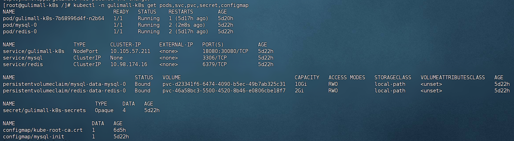
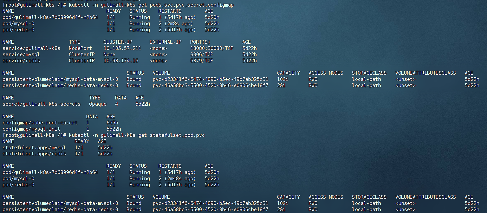
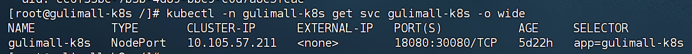
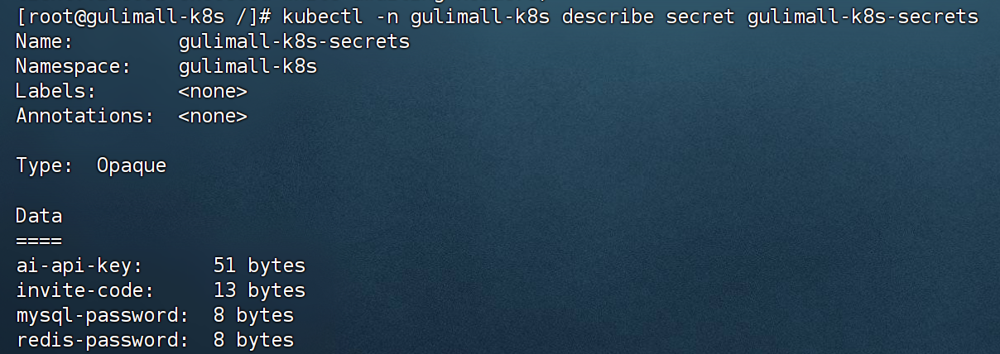
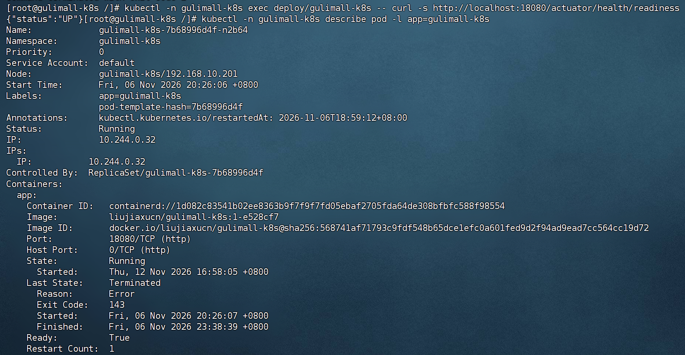
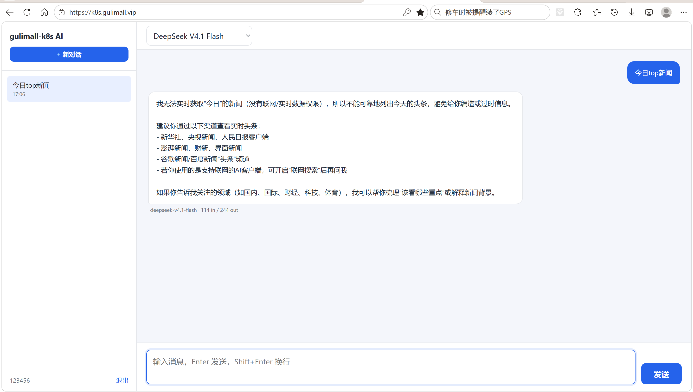

# 18.1 K8s 部署-介绍

> 在单节点 Kubernetes 集群上部署 gulimall-k8s 独立 AI 对话服务。MySQL 和 Redis 使用 StatefulSet 与 PVC 保存数据，应用使用 Deployment 和 NodePort 暴露端口，配置和密钥通过 Secret 注入，容器以非 root 用户运行。

> K8s 相关文档：[K8s 部署与 DevOps](../k8s/K8S部署%26DevOps.md)、[生产级多集群 K8s 与 Jenkins](../Deploy/Gulimall生产级多集群K8S与Jenkins部署流程.md)。

---

## 1. 这个功能是干什么的

gulimall-k8s 是一个独立的 AI 对话服务，不依赖 Nacos，也不调用其他业务微服务。它只依赖 MySQL、Redis 和 OpenAI 兼容模型服务。部署目标是一个 CentOS Stream 10 单节点集群，所有资源放在 `gulimall-k8s` 命名空间。

Kubernetes 负责五件事：

1. **隔离资源**：命名空间把该项目的 Pod、Service、Secret、ConfigMap 和 PVC 分开管理。
2. **保存数据**：MySQL 和 Redis 使用 StatefulSet，数据目录挂载 PVC，Pod 重建后数据不丢。
3. **维持副本**：Deployment 保证应用 Pod 始终有一个在运行，Pod 异常退出后自动重建。
4. **健康检查**：启动探针、就绪探针、存活探针分别控制启动、接流量和重启。
5. **安全运行**：应用以非 root 用户运行，根文件系统只读，密钥从 Secret 注入。

集群基线：

| 项目 | 取值 |
|---|---|
| 操作系统 | CentOS Stream 10 |
| CPU / 内存 / 磁盘 | 8 核 / 15GiB / 66GiB |
| 节点 IP | <your-k8s-master-ip> |
| Kubernetes | v1.34.x，kubeadm 单节点 |
| 容器运行时 | containerd 2.x |
| CNI | Flannel |
| 存储 | local-path-provisioner |
| 应用端口 | 18080 |
| NodePort | 30080 |
| 公网域名 | `https://k8s.gulimall.vip` |



命名空间是该项目的资源边界，日常查看资源都带 `-n gulimall-k8s`。

---

## 2. 怎么操作

### 2.1 创建命名空间

命名空间是后续所有资源的作用域。

```bash
kubectl apply -f /opt/gulimall/gulimall-k8s/k8s/00-namespace.yaml
kubectl get namespace gulimall-k8s
```

命名空间创建后，后续的 Secret、ConfigMap、MySQL、Redis 和应用都放在这个命名空间里。

### 2.2 创建 Secret

MySQL 密码、Redis 密码、邀请码和 AI Key 放在 Secret 中。先读取 AI Key：

```bash
read -rsp '请输入 AI_API_KEY: ' AI_KEY; echo
```

再用单行命令创建 Secret：

```bash
kubectl -n gulimall-k8s create secret generic gulimall-k8s-secrets --from-literal=mysql-password='<your-password>' --from-literal=redis-password='<your-password>' --from-literal=invite-code='<your-invite-code>' --from-literal=ai-api-key="$AI_KEY" --dry-run=client -o yaml | kubectl apply -f -
```

命令必须保持单行。多行粘贴时，`--from-literal` 的文本可能被写进 `ai-api-key` 的值，导致 Key 长度和前缀错误。

### 2.3 创建 MySQL 初始化 ConfigMap

初始化 SQL 通过 ConfigMap 挂载到 MySQL 容器。

```bash
kubectl -n gulimall-k8s create configmap mysql-init --from-file=init.sql=/opt/gulimall/gulimall-k8s/sql/init.sql --dry-run=client -o yaml | kubectl apply -f -
kubectl -n gulimall-k8s get configmap mysql-init
```

ConfigMap 挂载到 MySQL 容器的 `/docker-entrypoint-initdb.d`，官方镜像只在数据目录为空时执行初始化脚本。

### 2.4 部署 MySQL

先部署 MySQL，再等待 Pod 进入 Ready。

```bash
kubectl apply -f /opt/gulimall/gulimall-k8s/k8s/10-mysql.yaml
kubectl -n gulimall-k8s get pods,pvc,svc
```

等待 `mysql-0` 变成 `Running` 且 `READY 1/1`：

```bash
kubectl -n gulimall-k8s get pod mysql-0 -w
```

这条命令持续输出 Pod 状态，出现 Running 和 1/1 后再继续。

### 2.5 部署 Redis

Redis 部署完成后用 redis-cli 验证密码和连通性。

```bash
kubectl apply -f /opt/gulimall/gulimall-k8s/k8s/20-redis.yaml
kubectl -n gulimall-k8s get pods,pvc,svc
```

等待 `redis-0` 变成 `Running`，再验证：

```bash
kubectl -n gulimall-k8s exec -it redis-0 -- redis-cli -a <your-password> ping
```

输出 `PONG` 说明 Redis 正常。

### 2.6 部署应用

应用清单包含 Deployment 和 NodePort Service。

```bash
kubectl apply -f /opt/gulimall/gulimall-k8s/k8s/30-app.yaml
kubectl -n gulimall-k8s get pods,svc,deploy
kubectl -n gulimall-k8s rollout status deployment/gulimall-k8s
```

应用 Pod 变成 `1/1 Running` 后，访问 NodePort：

```bash
curl -s http://127.0.0.1:30080/actuator/health
```

返回 `{"status":"UP"}` 说明应用、MySQL 和 Redis 都正常。

### 2.7 查看日志和排查

日志、上一次容器日志和 Pod 事件是排查启动问题的三个入口。

```bash
kubectl -n gulimall-k8s logs -f deployment/gulimall-k8s
kubectl -n gulimall-k8s logs deployment/gulimall-k8s --previous
kubectl -n gulimall-k8s describe pod -l app=gulimall-k8s
```

容器重启后，当前日志可能为空，`--previous` 查看上一次容器日志。

---

## 3. 整体设计思路

### 3.1 业务上怎么设计

#### 3.1.1 单节点学习集群

整个集群只有一个控制平面和一个 etcd，节点宕机时全部服务不可用。业务 Pod 可以调度到控制平面，需要移除控制平面污点。

单节点适合学习和 CI/CD 流程练习，不具备高可用。生产环境至少需要三个控制平面节点和多个工作节点。

#### 3.1.2 数据持久化

MySQL 和 Redis 都是有状态服务：

| 服务 | 数据目录 | PVC 大小 | 存储类 |
|---|---|---|---|
| MySQL | `/var/lib/mysql` | 10Gi | `local-path` |
| Redis | `/data` | 2Gi | `local-path` |

`local-path` 把数据保存在节点本地 `/opt/local-path-provisioner`。Pod 重建后重新挂载同一个 PVC，数据保留；节点磁盘损坏时数据无法恢复，重要数据需要额外备份。

#### 3.1.3 应用单副本

应用使用内存 `HttpSession`，登录态保存在当前 Pod 内存里。如果扩到多个副本，用户第一次登录落在 Pod A，下一次请求被负载均衡到 Pod B，Pod B 没有这个 Session，用户会被要求重新登录。

因此：

1. 副本数保持 1。
2. 更新策略使用 `Recreate`，先删除旧 Pod 再创建新 Pod。
3. 不使用滚动更新，避免新旧 Pod 同时接收请求。

代价是发布期间有短暂中断。需要多副本时，先接入 Spring Session Redis，把 Session 存到 Redis，再改副本数和更新策略。

#### 3.1.4 资源预算

15GiB 内存要同时运行系统组件、控制平面、Jenkins、MySQL、Redis、应用和镜像缓存。资源分配：

| 组件 | 内存 | 磁盘 |
|---|---|---|
| 系统 + containerd + kubelet | 1～1.5GiB | 8～10GiB |
| kubeadm 控制平面 | 1.2～1.5GiB | 2～3GiB |
| Jenkins | 1～1.5GiB 空闲 / 3～4GiB 构建 | 3～5GiB |
| MySQL | 0.6～1GiB | 10GiB PVC |
| Redis | 0.2～0.5GiB | 2GiB PVC |
| 应用 | 0.5～0.8GiB | 0.5～1GiB |
| 镜像和日志 | — | 5～10GiB |

kubelet 需要配置 `systemReserved` 和 `kubeReserved`，否则业务 Pod 吃满内存后系统组件会被挤出。

#### 3.1.5 公网访问

Cloudflare Tunnel `gulimall-k8s` 把 `k8s.gulimall.vip` 转到 `http://127.0.0.1:30080`。NodePort 在节点上监听 30080，Tunnel 不需要经过 Nginx。

聊天接口使用 SSE，必须使用 Named Tunnel，Quick Tunnel 不支持 SSE。

### 3.2 技术上怎么设计

#### 3.2.1 StatefulSet 与 Deployment 的区别

| 对象 | 使用场景 | 特点 |
|---|---|---|
| StatefulSet | MySQL、Redis | 稳定网络标识、稳定存储、按顺序启动 |
| Deployment | 无状态应用 | Pod 可任意替换、支持滚动更新 |

MySQL 使用 StatefulSet 后，Pod 名固定为 `mysql-0`，PVC 名固定为 `mysql-data-mysql-0`，重建后仍然挂载同一块存储。

#### 3.2.2 Headless Service

MySQL 的 Service 设置 `clusterIP: None`，成为 Headless Service。StatefulSet 通过 `serviceName: mysql` 给 Pod 提供稳定 DNS：`mysql-0.mysql.gulimall-k8s.svc.cluster.local`。

Redis 的 Service 是普通 ClusterIP，应用通过 `redis:6379` 访问，不需要稳定 Pod DNS。

#### 3.2.3 三类探针

| 探针 | 作用 | 失败后果 |
|---|---|---|
| startupProbe | 判断容器是否启动完成 | 未通过前不执行其他探针 |
| readinessProbe | 判断是否可以接流量 | 失败时从 Service Endpoints 移除 |
| livenessProbe | 判断容器是否还活着 | 失败时重启容器 |

MySQL 和 Redis 使用 `exec` 探针执行 `mysqladmin ping` 和 `redis-cli ping`。应用使用 `httpGet` 访问 Spring Boot Actuator 的 `/actuator/health/liveness` 和 `/actuator/health/readiness`。

#### 3.2.4 就绪探针检查依赖

应用 `application.yaml` 配置：

```yaml
management:
  endpoint:
    health:
      probes:
        enabled: true
      group:
        readiness:
          include: readinessState,db,redis
```

readiness 组包含 `db` 和 `redis`。MySQL 或 Redis 没有就绪时，readiness 返回 DOWN，Pod 不接流量。liveness 只检查进程本身，避免数据库短暂抖动导致应用被反复重启。

#### 3.2.5 Secret 注入

Secret `gulimall-k8s-secrets` 有四个 key：

| Key | 用途 |
|---|---|
| `mysql-password` | MySQL root 密码，同时供应用连接 |
| `redis-password` | Redis 密码，同时供应用连接 |
| `invite-code` | 登录和注册邀请码 |
| `ai-api-key` | OpenAI 兼容模型密钥 |

密码不写进 Deployment，容器通过 `secretKeyRef` 读取。Secret 是 base64 编码，不是加密，能读取 Secret 的人仍然能看到明文，因此 Secret 的 RBAC 权限要收紧。

#### 3.2.6 SecurityContext

应用 Pod 设置：

```yaml
securityContext:
  runAsNonRoot: true
  runAsUser: 10001
  runAsGroup: 10001
  fsGroup: 10001
```

容器设置：

```yaml
securityContext:
  allowPrivilegeEscalation: false
  readOnlyRootFilesystem: true
  capabilities:
    drop:
      - ALL
```

非 root 用户和只读根文件系统降低容器逃逸风险。应用需要写临时文件，挂载一个 `emptyDir` 到 `/tmp`。

#### 3.2.7 优雅停机

应用配置：

```yaml
server:
  shutdown: graceful
spring:
  lifecycle:
    timeout-per-shutdown-phase: 30s
```

Deployment 配置：

```yaml
terminationGracePeriodSeconds: 40
lifecycle:
  preStop:
    exec:
      command: ["sh", "-c", "sleep 5"]
```

Pod 收到终止信号后，先执行 `preStop` 等待 5 秒，让 Service 把 Pod 从 Endpoints 移除，再发送 SIGTERM。应用优雅停机最长等待 30 秒，总宽限时间 40 秒。

---

## 4. 详细代码、配置和解释

这一节按命名空间、MySQL、Redis、应用、Secret 和探针配置组织。每部分先说明职责，再贴完整清单，再说明步骤、原因和优化点。

### 4.1 00-namespace.yaml：命名空间

**职责**：

1. 创建 `gulimall-k8s` 命名空间。
2. 把项目资源和其他命名空间隔离。

**完整配置**：

```yaml
apiVersion: v1
kind: Namespace
metadata:
  name: gulimall-k8s
```

命名空间是资源分组边界，Service 的 DNS 名称、RBAC 权限和资源配额都可以按命名空间隔离。

**步骤**：

1. 执行 `kubectl apply -f 00-namespace.yaml`。
2. 执行 `kubectl get namespace gulimall-k8s`。
3. 后续所有资源都带 `-n gulimall-k8s`。

**原因**：

1. 避免和生产或其他练习项目混在一起。
2. Jenkins 的 ServiceAccount 只授权这个命名空间。

**优化点**：

1. 可以增加 `ResourceQuota` 限制命名空间总资源。
2. 可以增加 `LimitRange` 设置默认 requests 和 limits。
3. 可以增加网络策略限制 Pod 之间访问。

### 4.2 10-mysql.yaml：MySQL StatefulSet、Service 和 PVC

**职责**：

1. 创建 Headless Service 给 StatefulSet 提供稳定网络标识。
2. 创建单副本 MySQL StatefulSet。
3. 挂载初始化 SQL 和数据 PVC。
4. 配置三类探针和资源限制。

**完整配置**：

```yaml
apiVersion: v1
kind: Service
metadata:
  name: mysql
  namespace: gulimall-k8s
  labels:
    app: mysql
spec:
  clusterIP: None
  selector:
    app: mysql
  ports:
    - name: mysql
      port: 3306
      targetPort: 3306
---
apiVersion: apps/v1
kind: StatefulSet
metadata:
  name: mysql
  namespace: gulimall-k8s
spec:
  serviceName: mysql
  replicas: 1
  selector:
    matchLabels:
      app: mysql
  template:
    metadata:
      labels:
        app: mysql
    spec:
      securityContext:
        fsGroup: 999
      containers:
        - name: mysql
          image: mysql:8.4.11
          imagePullPolicy: IfNotPresent
          args:
            - --character-set-server=utf8mb4
            - --collation-server=utf8mb4_0900_ai_ci
            - --default-time-zone=+08:00
          env:
            - name: MYSQL_ROOT_PASSWORD
              valueFrom:
                secretKeyRef:
                  name: gulimall-k8s-secrets
                  key: mysql-password
            - name: MYSQL_DATABASE
              value: gulimall_k8s_ai
            - name: TZ
              value: Asia/Shanghai
          ports:
            - name: mysql
              containerPort: 3306
          volumeMounts:
            - name: mysql-data
              mountPath: /var/lib/mysql
            - name: mysql-init
              mountPath: /docker-entrypoint-initdb.d
              readOnly: true
          resources:
            requests:
              cpu: "100m"
              memory: "256Mi"
            limits:
              cpu: "1000m"
              memory: "1Gi"
          startupProbe:
            exec:
              command:
                - sh
                - -c
                - mysqladmin ping -h 127.0.0.1 -uroot -p"$MYSQL_ROOT_PASSWORD" --silent
            failureThreshold: 30
            periodSeconds: 5
          readinessProbe:
            exec:
              command:
                - sh
                - -c
                - mysqladmin ping -h 127.0.0.1 -uroot -p"$MYSQL_ROOT_PASSWORD" --silent
            periodSeconds: 5
            failureThreshold: 3
          livenessProbe:
            exec:
              command:
                - sh
                - -c
                - mysqladmin ping -h 127.0.0.1 -uroot -p"$MYSQL_ROOT_PASSWORD" --silent
            periodSeconds: 10
            failureThreshold: 3
      volumes:
        - name: mysql-init
          configMap:
            name: mysql-init
  volumeClaimTemplates:
    - metadata:
        name: mysql-data
      spec:
        accessModes:
          - ReadWriteOnce
        storageClassName: local-path
        resources:
          requests:
            storage: 10Gi
```

`clusterIP: None` 让 Service 成为 Headless Service。`volumeClaimTemplates` 为每个副本创建独立 PVC，单副本时 PVC 名为 `mysql-data-mysql-0`。`fsGroup: 999` 让挂载目录属于 MySQL 容器内的组，避免数据目录权限错误。



**步骤**：

1. 先创建 Secret 和 `mysql-init` ConfigMap。
2. 执行 `kubectl apply -f 10-mysql.yaml`。
3. 执行 `kubectl -n gulimall-k8s get pods,pvc,svc`。
4. 等待 `mysql-0` 变成 `Running`。
5. 用 `kubectl logs -f mysql-0` 查看初始化日志。
6. 进入容器验证数据库和表。

**原因**：

1. StatefulSet 保证 Pod 名和 PVC 稳定。
2. Headless Service 让 StatefulSet 有稳定 DNS。
3. 初始化 SQL 通过 ConfigMap 挂载，避免把 SQL 打进镜像。
4. 探针使用 `mysqladmin ping`，不依赖业务库。

**优化点**：

1. 单副本 MySQL 不具备高可用，生产环境应使用主从或托管数据库。
2. `local-path` 数据在节点本地，节点损坏会丢数据，需要定期备份。
3. 可以使用 `mysql_native_password` 之外的认证插件，按客户端版本调整。
4. 可以把初始化 SQL 改成 Job，避免依赖镜像的初始化逻辑。

### 4.3 20-redis.yaml：Redis StatefulSet、Service 和 PVC

**职责**：

1. 创建普通 ClusterIP Service。
2. 创建单副本 Redis StatefulSet。
3. 开启 AOF 持久化。
4. 配置密码、探针和 PVC。

**完整配置**：

```yaml
apiVersion: v1
kind: Service
metadata:
  name: redis
  namespace: gulimall-k8s
  labels:
    app: redis
spec:
  selector:
    app: redis
  ports:
    - name: redis
      port: 6379
      targetPort: 6379
---
apiVersion: apps/v1
kind: StatefulSet
metadata:
  name: redis
  namespace: gulimall-k8s
spec:
  serviceName: redis
  replicas: 1
  selector:
    matchLabels:
      app: redis
  template:
    metadata:
      labels:
        app: redis
    spec:
      securityContext:
        fsGroup: 999
      containers:
        - name: redis
          image: redis:7.2.12
          imagePullPolicy: IfNotPresent
          command:
            - sh
            - -c
          args:
            - exec redis-server --requirepass "$REDIS_PASSWORD" --appendonly yes --appendfsync everysec
          env:
            - name: REDIS_PASSWORD
              valueFrom:
                secretKeyRef:
                  name: gulimall-k8s-secrets
                  key: redis-password
            - name: TZ
              value: Asia/Shanghai
          ports:
            - name: redis
              containerPort: 6379
          volumeMounts:
            - name: redis-data
              mountPath: /data
          resources:
            requests:
              cpu: "50m"
              memory: "128Mi"
            limits:
              cpu: "500m"
              memory: "512Mi"
          startupProbe:
            exec:
              command:
                - sh
                - -c
                - redis-cli -a "$REDIS_PASSWORD" ping | grep -q PONG
            failureThreshold: 30
            periodSeconds: 2
          readinessProbe:
            exec:
              command:
                - sh
                - -c
                - redis-cli -a "$REDIS_PASSWORD" ping | grep -q PONG
            periodSeconds: 5
            failureThreshold: 3
          livenessProbe:
            exec:
              command:
                - sh
                - -c
                - redis-cli -a "$REDIS_PASSWORD" ping | grep -q PONG
            periodSeconds: 10
            failureThreshold: 3
  volumeClaimTemplates:
    - metadata:
        name: redis-data
      spec:
        accessModes:
          - ReadWriteOnce
        storageClassName: local-path
        resources:
          requests:
            storage: 2Gi
```

`--appendonly yes --appendfsync everysec` 开启 AOF，每秒同步一次。`redis-cli -a "$REDIS_PASSWORD" ping` 验证密码和连通性。

**步骤**：

1. 先创建 Secret。
2. 执行 `kubectl apply -f 20-redis.yaml`。
3. 等待 `redis-0` 变成 `Running`。
4. 执行 `redis-cli -a <your-password> ping`。
5. 输出 `PONG` 后继续部署应用。

**原因**：

1. Redis Service 使用 ClusterIP，应用通过服务名访问。
2. AOF 保证重启后数据不丢。
3. 探针带密码，验证的是真实可用的 Redis 实例。

**优化点**：

1. 单副本 Redis 不具备高可用，生产环境应使用哨兵或集群。
2. 可以把密码改成环境变量文件，避免命令行出现明文。
3. 可以配置 `maxmemory` 和淘汰策略，防止内存打满。
4. 可以定期做 RDB 备份。

### 4.4 30-app.yaml：应用 Deployment 和 NodePort Service

**职责**：

1. 创建 NodePort Service，把 30080 映射到容器的 18080。
2. 创建单副本 Deployment。
3. 注入 MySQL、Redis、邀请码和 AI Key。
4. 配置启动、就绪、存活探针。
5. 以非 root 用户和只读根文件系统运行。

**完整配置**：

```yaml
apiVersion: v1
kind: Service
metadata:
  name: gulimall-k8s
  namespace: gulimall-k8s
  labels:
    app: gulimall-k8s
spec:
  type: NodePort
  selector:
    app: gulimall-k8s
  ports:
    - name: http
      port: 18080
      targetPort: 18080
      nodePort: 30080
---
apiVersion: apps/v1
kind: Deployment
metadata:
  name: gulimall-k8s
  namespace: gulimall-k8s
  labels:
    app: gulimall-k8s
spec:
  replicas: 1
  # 应用使用内存 HttpSession，单副本 + Recreate，避免滚动更新时新旧 Pod 同时接收请求导致登录态丢失
  strategy:
    type: Recreate
  selector:
    matchLabels:
      app: gulimall-k8s
  template:
    metadata:
      labels:
        app: gulimall-k8s
    spec:
      automountServiceAccountToken: false
      securityContext:
        runAsNonRoot: true
        runAsUser: 10001
        runAsGroup: 10001
        fsGroup: 10001
      containers:
        - name: app
          image: liujiaxucn/gulimall-k8s:latest
          imagePullPolicy: Always
          ports:
            - name: http
              containerPort: 18080
          env:
            - name: TZ
              value: Asia/Shanghai
            - name: MYSQL_HOST
              value: mysql
            - name: MYSQL_PORT
              value: "3306"
            - name: MYSQL_DATABASE
              value: gulimall_k8s_ai
            - name: MYSQL_USERNAME
              value: root
            - name: MYSQL_PASSWORD
              valueFrom:
                secretKeyRef:
                  name: gulimall-k8s-secrets
                  key: mysql-password
            - name: REDIS_HOST
              value: redis
            - name: REDIS_PORT
              value: "6379"
            - name: REDIS_PASSWORD
              valueFrom:
                secretKeyRef:
                  name: gulimall-k8s-secrets
                  key: redis-password
            - name: INVITE_CODE
              valueFrom:
                secretKeyRef:
                  name: gulimall-k8s-secrets
                  key: invite-code
            - name: AI_API_KEY
              valueFrom:
                secretKeyRef:
                  name: gulimall-k8s-secrets
                  key: ai-api-key
            - name: JAVA_TOOL_OPTIONS
              value: "-XX:MaxRAMPercentage=75 -XX:MaxMetaspaceSize=192m -XX:ReservedCodeCacheSize=96m -Xss512k -Duser.timezone=Asia/Shanghai -Dfile.encoding=UTF-8"
          resources:
            requests:
              cpu: "100m"
              memory: "256Mi"
            limits:
              cpu: "500m"
              memory: "768Mi"
          startupProbe:
            httpGet:
              path: /actuator/health/liveness
              port: http
            failureThreshold: 30
            periodSeconds: 2
          readinessProbe:
            httpGet:
              path: /actuator/health/readiness
              port: http
            periodSeconds: 5
            failureThreshold: 3
          livenessProbe:
            httpGet:
              path: /actuator/health/liveness
              port: http
            periodSeconds: 10
            failureThreshold: 3
          lifecycle:
            preStop:
              exec:
                command: ["sh", "-c", "sleep 5"]
          securityContext:
            allowPrivilegeEscalation: false
            readOnlyRootFilesystem: true
            capabilities:
              drop:
                - ALL
          volumeMounts:
            - name: tmp
              mountPath: /tmp
      terminationGracePeriodSeconds: 40
      volumes:
        - name: tmp
          emptyDir: {}
```

Service 的 `nodePort: 30080` 在节点上监听，Cloudflare Tunnel 指向 `http://127.0.0.1:30080`。Deployment 的 `strategy: Recreate` 保证发布时不会出现两个携带不同登录态的 Pod。



**步骤**：

1. 先创建 Secret、MySQL、Redis。
2. 执行 `kubectl apply -f 30-app.yaml`。
3. 执行 `kubectl -n gulimall-k8s get pods,svc,deploy`。
4. 等待 `rollout status` 完成。
5. 执行 `curl -s http://127.0.0.1:30080/actuator/health`。
6. 浏览器打开 `http://<your-k8s-master-ip>:30080`。

**原因**：

1. `Recreate` 适合内存 Session，避免登录态分裂。
2. Secret 注入密码，Deployment 清单可以提交到 Git。
3. 非 root 用户和只读根文件系统降低安全风险。
4. `preStop` 和优雅停机配合，减少发布时的请求中断。
5. `MaxRAMPercentage=75` 让 JVM 按容器内存限制自动计算堆大小。

**优化点**：

1. `imagePullPolicy: Always` 每次重启都会拉镜像，服务器重启后代理不可用会进入 ImagePullBackOff。节点有缓存时可以改成 `IfNotPresent`。
2. 单副本不具备高可用，接入 Spring Session Redis 后可以扩副本。
3. 可以使用私有镜像仓库和 `imagePullSecret`。
4. 可以增加 PodDisruptionBudget 和反亲和性。
5. 可以把镜像 tag 固定为版本号，避免 `latest` 漂移。

### 4.5 Secret 与 ConfigMap

**职责**：

1. 保存 MySQL 密码、Redis 密码、邀请码和 AI Key。
2. 保存 MySQL 初始化 SQL。
3. 让 Deployment 通过引用读取，不把明文写进清单。

**完整配置**：

```bash
kubectl -n gulimall-k8s create secret generic gulimall-k8s-secrets --from-literal=mysql-password='<your-password>' --from-literal=redis-password='<your-password>' --from-literal=invite-code='<your-invite-code>' --from-literal=ai-api-key="$AI_KEY" --dry-run=client -o yaml | kubectl apply -f -
```

这条命令先生成 Secret YAML，再通过管道交给 `kubectl apply`。`--dry-run=client` 只生成清单，不直接提交。

```bash
kubectl -n gulimall-k8s create configmap mysql-init --from-file=init.sql=/opt/gulimall/gulimall-k8s/sql/init.sql --dry-run=client -o yaml | kubectl apply -f -
```

这条命令把 `init.sql` 作为 ConfigMap 的一个 key，挂载到 MySQL 的初始化目录。

**步骤**：

1. 读取 AI Key，不写入 shell 历史。
2. 创建 Secret。
3. 创建 ConfigMap。
4. 执行 `kubectl -n gulimall-k8s get secret,configmap`。
5. 修改密码或 Key 后重新创建 Secret，再重启应用 Pod。

**原因**：

1. Secret 和 Deployment 分离，清单可以进入 Git。
2. ConfigMap 让初始化 SQL 独立更新。
3. `--dry-run=client` 加 `apply` 支持重复执行。

**优化点**：

1. Secret 只是 base64 编码，生产环境应使用 Sealed Secrets、External Secrets 或云密钥管理。
2. 可以给 Secret 增加 `immutable: true`，防止误改。
3. 可以定期轮换密码和 AI Key。
4. 可以把初始化 SQL 改成 Job，避免 ConfigMap 过大。



### 4.6 探针与健康检查配置

**职责**：

1. 让 Kubernetes 知道应用何时启动完成、何时可以接流量、何时需要重启。
2. readiness 同时检查 MySQL 和 Redis。

**完整配置**：

```yaml
management:
  endpoints:
    web:
      exposure:
        include: health,info
  endpoint:
    health:
      probes:
        enabled: true
      group:
        readiness:
          include: readinessState,db,redis
```

`probes.enabled: true` 开启 `/actuator/health/liveness` 和 `/actuator/health/readiness`。readiness 组包含 `readinessState`、`db` 和 `redis`，数据库或 Redis 不可用时 Pod 不接流量。



**步骤**：

1. 应用启动时 Actuator 注册健康检查端点。
2. startupProbe 每 2 秒访问 liveness，最多 30 次。
3. 启动完成后 readinessProbe 每 5 秒检查 readiness。
4. readiness 通过后 Pod 加入 Service Endpoints。
5. livenessProbe 每 10 秒检查进程，失败 3 次后重启容器。

**原因**：

1. 启动探针给慢启动应用留足时间。
2. 就绪探针检查依赖，避免数据库未就绪时接流量。
3. 存活探针只检查进程，避免数据库抖动导致应用反复重启。

**优化点**：

1. 可以给探针增加 `timeoutSeconds` 和 `initialDelaySeconds`。
2. 可以把 readiness 的依赖检查拆成独立端点。
3. 可以在网关或 Cloudflare 层增加外部健康检查。

### 4.7 集群内网络验证

**职责**：

1. 确认 Service DNS 和端口连通。
2. 区分“Pod 创建成功”和“容器可以执行命令”。

**完整配置**：

```bash
kubectl -n gulimall-k8s run nettest --image=busybox:1.36 --restart=Never -- sleep 3600
kubectl -n gulimall-k8s wait --for=condition=Ready pod/nettest --timeout=180s
kubectl -n gulimall-k8s exec -it nettest -- sh -c "nc -w 3 mysql 3306 </dev/null && echo mysql-open || echo mysql-closed; nc -w 3 redis 6379 </dev/null && echo redis-open || echo redis-closed"
kubectl -n gulimall-k8s delete pod nettest
```

`kubectl run` 只代表 Pod 对象创建成功，容器可能还在拉镜像。直接 `exec` 会报 `container not found`，必须先等待 Pod Ready。

**步骤**：

1. 创建临时 busybox Pod。
2. 等待 Pod Ready。
3. 用 `nc` 测试 MySQL 和 Redis 端口。
4. 删除临时 Pod。

**原因**：

1. 验证 Service DNS 和网络策略。
2. 避免把镜像拉取失败误判为网络问题。

**优化点**：

1. 可以把这个检查写成 Job。
2. 可以在 CI 中增加集群内连通性测试。
3. 可以使用 `kubectl debug` 替代临时 Pod。

---

## 5. 数据怎么流转

### 5.1 应用启动

Pod 从创建到加入 Service Endpoints 的过程如下。

```text
Deployment 创建 Pod
  → 调度到节点
  → 拉取镜像
  → 创建容器
  → 注入 Secret 环境变量
  → 启动 Spring Boot
  → startupProbe 访问 liveness
  → 连接 mysql:3306
  → 连接 redis:6379
  → readinessProbe 访问 readiness
  → Pod 加入 Service Endpoints
  → NodePort 30080 可访问
```

只有 readiness 通过后，Service 才会把流量转给该 Pod。

### 5.2 用户请求

公网请求经 Tunnel、NodePort 和 Service 到达 Pod。

```text
浏览器
  → https://k8s.gulimall.vip
  → Cloudflare Tunnel
  → http://127.0.0.1:30080
  → Service gulimall-k8s
  → Pod 18080
  → 应用处理
  → MySQL / Redis
```

请求处理期间，应用通过服务名访问 MySQL 和 Redis。



### 5.3 MySQL 数据

MySQL 数据目录由 PVC 持久化。

```text
mysql-0
  → /var/lib/mysql
  → PVC mysql-data-mysql-0
  → local-path 节点本地目录
```

Pod 删除后 StatefulSet 重新创建 `mysql-0`，挂载同一个 PVC，数据保留。

### 5.4 Redis 数据

Redis 数据通过 AOF 保存到 PVC。

```text
redis-0
  → /data
  → PVC redis-data-redis-0
  → AOF 文件
```

Redis 每次写入都会追加到 AOF，重启后从 AOF 恢复。

### 5.5 配置与密钥

应用通过 Secret 和 ConfigMap 获取运行配置。

```text
Secret gulimall-k8s-secrets
  → mysql-password → MYSQL_PASSWORD
  → redis-password → REDIS_PASSWORD
  → invite-code → INVITE_CODE
  → ai-api-key → AI_API_KEY

ConfigMap mysql-init
  → /docker-entrypoint-initdb.d/init.sql
```

---

## 6. 完整执行流程

### 6.1 首次部署

1. 安装 containerd、kubeadm、kubectl。
2. 执行 `kubeadm init`。
3. 安装 Flannel。
4. 移除控制平面污点。
5. 安装 local-path 存储并设为默认 StorageClass。
6. 创建命名空间。
7. 创建 Secret。
8. 创建 MySQL 初始化 ConfigMap。
9. 部署 MySQL，等待 Ready。
10. 部署 Redis，等待 Ready。
11. 部署应用，等待 rollout 完成。
12. 访问健康检查。
13. 浏览器登录并测试聊天。

### 6.2 应用发布

1. Jenkins 构建新镜像。
2. `kubectl apply -f 30-app.yaml`。
3. `kubectl set image` 更新镜像 tag。
4. `rollout status` 等待新 Pod Ready。
5. `Recreate` 策略先删除旧 Pod 再创建新 Pod。
6. 发布期间短暂中断。
7. 用户重新登录，聊天历史仍在 Redis。

### 6.3 节点重启

1. containerd、kubelet 开机自启。
2. StatefulSet 重建 MySQL 和 Redis Pod。
3. PVC 重新挂载。
4. Deployment 重建应用 Pod。
5. 如果镜像没有缓存且网络不可用，应用可能进入 ImagePullBackOff。
6. 恢复网络或改 `imagePullPolicy` 后 Pod 启动。
7. Cloudflare Tunnel 重新连上 NodePort。

### 6.4 数据备份

1. 执行 `mysqldump` 导出 `gulimall_k8s_ai`。
2. 备份文件保存到节点外的存储。
3. Redis 触发 `BGSAVE`。
4. PVC 数据目录也需要备份。
5. 恢复时先恢复 MySQL，再重启应用。

---

## 7. 异常、边界、踩坑

1. **PVC Pending**：`local-path` 没有安装，或者 StorageClass 没有设为默认。执行 `kubectl get storageclass` 和 `kubectl describe pvc`。

2. **MySQL CrashLoopBackOff**：密码错误、PVC 权限错误、初始化 SQL 失败。查看 `kubectl logs mysql-0`。

3. **表不存在**：MySQL 官方镜像只在数据目录为空时执行初始化脚本。PVC 已有旧数据时需要手动导入。

4. **Redis CrashLoopBackOff**：密码变量为空、启动命令错误、PVC 权限错误。查看 `kubectl logs redis-0`。

5. **应用 CrashLoopBackOff**：MySQL 或 Redis 连接失败、表不存在、AI Key 为空。查看 `kubectl logs deployment/gulimall-k8s --previous`。

6. **readiness 一直 DOWN**：数据库或 Redis 未就绪。访问 `/actuator/health` 查看具体组件。

7. **NodePort 访问不了**：Pod 没有 Ready，Service Endpoints 为空。执行 `kubectl get endpoints gulimall-k8s`。

8. **ImagePullBackOff**：镜像名错误、代理不可用、Docker Hub 限流、仓库私有。执行 `kubectl describe pod` 查看事件。

9. **节点磁盘不足**：镜像、日志、PVC 占用。执行 `df -h /` 和 `du -h --max-depth=1 /var/lib/containerd`。

10. **发布后登录态丢失**：内存 Session 在旧 Pod 里，新 Pod 没有。单副本 `Recreate` 可以避免新旧并存，但用户仍需要重新登录。

11. **扩副本后登录混乱**：多个 Pod 各自保存 Session，负载均衡到不同 Pod 时登录态不一致。先接入 Spring Session Redis。

12. **Secret 修改不生效**：环境变量只在容器启动时注入，修改 Secret 后需要 `rollout restart`。

13. **只读根文件系统导致启动失败**：应用需要写临时文件，必须挂载 `emptyDir` 到 `/tmp`。

14. **非 root 用户权限不足**：镜像内文件属主和 `runAsUser` 不一致。Dockerfile 里创建相同 uid 的用户并修改属主。

15. **单节点故障**：控制平面、etcd、业务 Pod 都在同一台机器，节点宕机时全部不可用。生产环境需要多节点。

---

## 8. 小结

1. 所有资源放在 `gulimall-k8s` 命名空间。
2. MySQL 和 Redis 使用 StatefulSet，PVC 用 `local-path`，数据保存在节点本地。
3. MySQL 使用 Headless Service，Redis 使用普通 ClusterIP。
4. 应用使用 Deployment 和 NodePort 30080。
5. 内存 Session 决定应用单副本和 `Recreate` 策略。
6. 启动、就绪、存活三类探针分别控制启动、接流量和重启。
7. readiness 同时检查 MySQL 和 Redis，依赖未就绪时不接流量。
8. 密码、邀请码和 AI Key 放在 Secret，初始化 SQL 放在 ConfigMap。
9. 应用以非 root 用户运行，根文件系统只读，能力全部丢弃。
10. 单节点和单副本不具备高可用，生产环境需要多节点、数据库主从、Redis 哨兵和 Session 共享。
