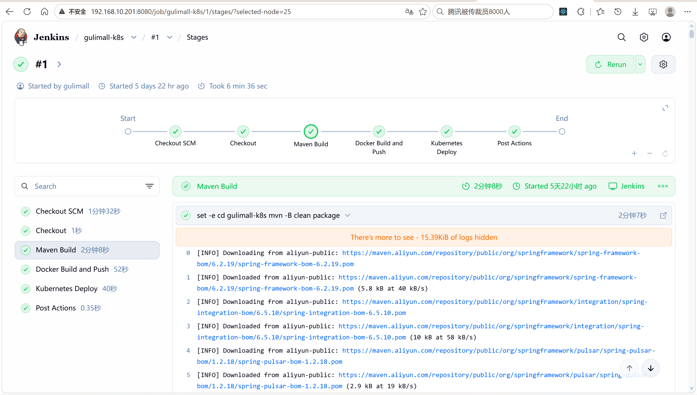
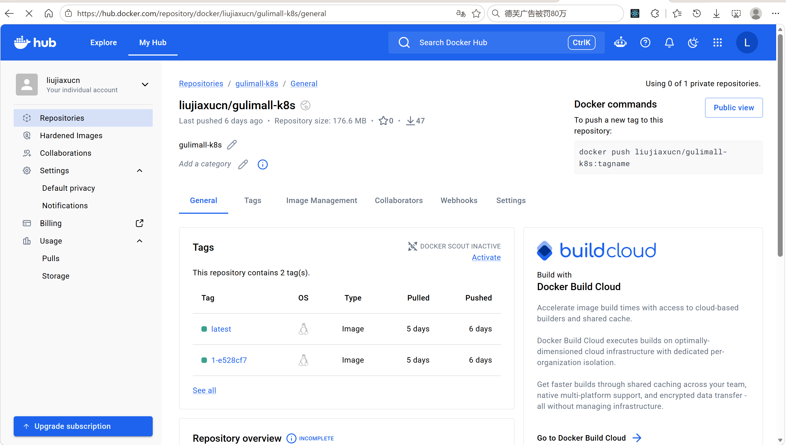
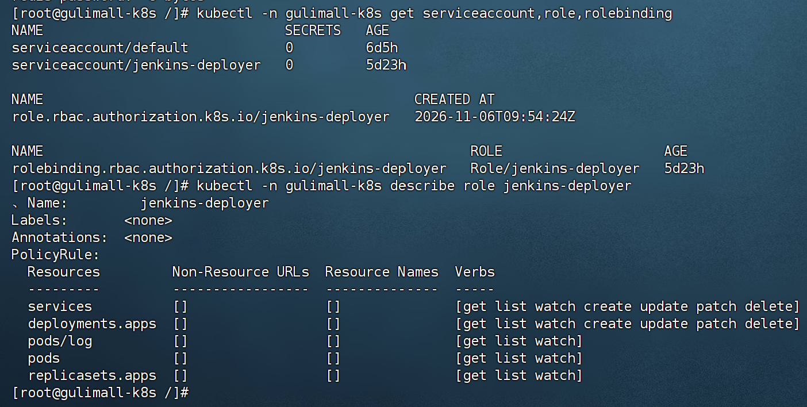
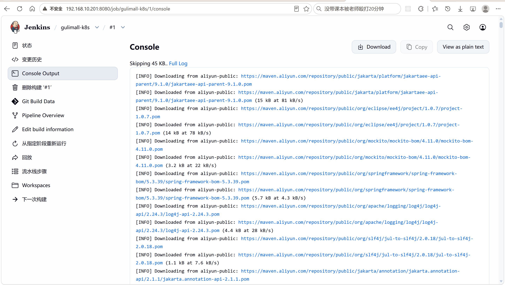
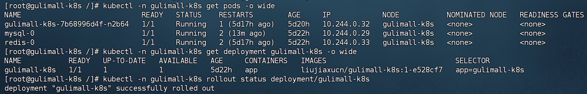

# 18.2 Jenkins 流水线-介绍

> Jenkins 从 GitHub 拉取 gulimall-k8s 代码，执行 Maven 构建和单元测试，构建 Docker 镜像并推送到 Docker Hub，最后用 kubectl 更新 Kubernetes Deployment 并等待发布完成。

> Jenkins 相关文档：[K8s 部署与 DevOps](../k8s/K8S部署%26DevOps.md)、[生产级多集群 K8s 与 Jenkins](../Deploy/Gulimall生产级多集群K8S与Jenkins部署流程.md)。

---

## 1. 这个功能是干什么的

gulimall-k8s 的发布由 Jenkins 手动触发。流水线把“拉代码、编译、打镜像、推镜像、更新 Kubernetes”串成一条可重复执行的流程，减少手工操作。

流水线承担五件事：

1. **拉取代码**：从 GitHub 拉取指定分支。
2. **构建与测试**：执行 `mvn clean package`，单元测试失败立即停止。
3. **构建镜像**：用 Dockerfile 把 jar 打进 JRE 21 运行镜像。
4. **推送镜像**：把版本 tag 和 `latest` 推送到 Docker Hub。
5. **发布到 Kubernetes**：应用清单、更新镜像、等待 rollout 完成。

流水线阶段：

| 阶段 | 作用 | 产物 |
|---|---|---|
| Checkout | 拉取代码并生成镜像 tag | `IMAGE_TAG` |
| Maven Build | 编译、测试、打包 | `target/gulimall-k8s-1.0.0.jar` |
| Docker Build and Push | 构建并推送镜像 | Docker Hub 两个 tag |
| Kubernetes Deploy | 应用清单、更新镜像、等待发布 | 新 Pod |



四个阶段顺序执行，前一个阶段失败时后面的阶段不会执行。

---

## 2. 怎么操作

### 2.1 安装 Jenkins

在 CentOS Stream 10 上安装 JDK 21、Git、Maven 和 Jenkins WAR，并用 systemd 管理：

```bash
dnf install -y java-21-openjdk java-21-openjdk-devel git
systemctl enable --now jenkins
systemctl status jenkins --no-pager
```

Jenkins 默认监听 8080，浏览器打开 `http://<your-k8s-master-ip>:8080`，输入初始管理员密码，安装推荐插件。

### 2.2 安装插件

必需插件：

| 插件 | 用途 |
|---|---|
| Git | `checkout scm` 拉取代码 |
| Pipeline | 声明式流水线 |
| Pipeline: Declarative | Jenkinsfile 语法 |
| Credentials Binding | `withCredentials` 注入凭据 |

Docker Pipeline 和 Kubernetes CLI 是可选的。流水线直接调用 shell 的 `docker` 和 `kubectl`，不装这两个插件也能运行。

### 2.3 创建凭据

| 凭据 ID | 类型 | 内容 |
|---|---|---|
| `github-pat` | Username with password | GitHub 用户名 + PAT |
| `dockerhub-credentials` | Username with password | Docker Hub 用户名 + Access Token |
| `kubeconfig-gulimall-k8s` | Secret file | Jenkins 专用 kubeconfig |

GitHub 私有仓库必须使用 PAT，不能使用账号密码。Docker Hub 必须使用 Access Token，不能使用登录密码。

### 2.4 创建流水线任务

1. Jenkins 首页点击 New Item。
2. 名称填 `gulimall-k8s`。
3. 类型选择 Pipeline。
4. Definition 选择 Pipeline script from SCM。
5. SCM 选择 Git。
6. Repository URL 填 GitHub 仓库地址。
7. Credentials 选择 `github-pat`。
8. Branch Specifier 填 `*/develop/gulimall/v0.1`。
9. Script Path 填 `gulimall-k8s/Jenkinsfile`。
10. 保存。

### 2.5 手动构建

1. 进入任务页面。
2. 点击 Build Now。
3. 打开 Build History 中的最新构建。
4. 进入 Console Output 观察四个阶段。
5. 构建成功后检查 Docker Hub 和 Kubernetes。

### 2.6 验证发布

发布完成后检查 Pod、rollout 状态和当前镜像。

```bash
kubectl -n gulimall-k8s get pods,svc,deploy
kubectl -n gulimall-k8s rollout status deployment/gulimall-k8s
kubectl -n gulimall-k8s get deployment gulimall-k8s -o wide
```

新 Pod 为 `1/1 Running`，Deployment 显示当前镜像 tag，说明发布完成。

### 2.7 回滚

回滚使用 Kubernetes 保存的发布历史。

```bash
kubectl -n gulimall-k8s rollout history deployment/gulimall-k8s
kubectl -n gulimall-k8s rollout undo deployment/gulimall-k8s
kubectl -n gulimall-k8s rollout status deployment/gulimall-k8s
```

回滚到指定版本：

```bash
kubectl -n gulimall-k8s rollout undo deployment/gulimall-k8s --to-revision=1
```

回滚由 Kubernetes 完成，不需要重新构建镜像。

---

## 3. 整体设计思路

### 3.1 业务上怎么设计

#### 3.1.1 手动触发

当前流水线由人工点击 Build Now 触发，没有配置 GitHub Webhook。手动触发适合学习和控制发布节奏，代价是代码提交后不会自动发布。

#### 3.1.2 分支与代码范围

流水线只构建 `gulimall-k8s` 模块。该模块的父 POM 是 `spring-boot-starter-parent`，不在根 `pom.xml` 的 `<modules>` 里，因此需要在模块目录下单独执行 Maven。

代码提交到 `develop/gulimall/v0.1` 分支，Jenkins 任务的 Branch Specifier 指向该分支。

#### 3.1.3 镜像版本

镜像 tag 使用：

```text
<BUILD_NUMBER>-<GIT_SHORT_SHA>
```

例如 `42-ee768a4`。构建号保证每次构建唯一，Git 短提交标识代码版本。每次还推送一个 `latest`，方便手工拉取最新镜像。

不使用固定版本号的原因是：固定 tag 会覆盖旧镜像，回滚时无法确定对应哪次构建。

#### 3.1.4 公开镜像仓库

当前使用 Docker Hub 公开仓库 `liujiaxucn/gulimall-k8s`。公开仓库不需要 `imagePullSecret`，Kubernetes 可以直接拉取。

公开仓库不能放任何密钥。应用的 AI Key、数据库密码都通过 Kubernetes Secret 注入，不打进镜像。

#### 3.1.5 发布策略

应用使用内存 `HttpSession`，Deployment 使用 `Recreate`。流水线执行 `kubectl apply` 和 `set image` 后，Kubernetes 先删除旧 Pod，再创建新 Pod。

发布期间有短暂中断，但不会出现新旧 Pod 同时接收请求导致登录态分裂。

#### 3.1.6 回滚

Kubernetes 保存 Deployment 的发布历史。回滚使用 `kubectl rollout undo`，把 Pod 模板恢复到上一个版本。镜像 tag 已经推送到 Docker Hub，回滚时直接拉取旧 tag。

### 3.2 技术上怎么设计

#### 3.2.1 声明式流水线

Jenkinsfile 使用 `pipeline { agent any ... }` 声明式语法。结构分为 `environment`、`stages` 和 `post`：

1. `environment` 定义镜像仓库、命名空间、Deployment 名称和凭据 ID。
2. `stages` 定义四个阶段。
3. `post` 定义成功、失败和始终执行的动作。

#### 3.2.2 凭据绑定

`withCredentials` 把 Jenkins 凭据注入为环境变量或文件：

1. Docker Hub 用户名密码注入 `DOCKER_USER` 和 `DOCKER_PASS`。
2. kubeconfig 文件注入 `KUBECONFIG`。

凭据不会出现在 Jenkinsfile 和构建日志里。`docker login` 使用 `--password-stdin`，密码不进入命令行历史。

#### 3.2.3 Docker 构建

Dockerfile 使用 `eclipse-temurin:21-jre-jammy`，只包含 JRE，不包含整套 JDK。镜像内创建 uid 10001 的非 root 用户，和 Deployment 的 `securityContext` 对齐。

Jenkins 用户必须加入 docker 组，才能访问 `/var/run/docker.sock`。

#### 3.2.4 kubectl 发布

发布分三步：

1. `kubectl apply -f 30-app.yaml` 创建或更新 Deployment 和 Service。
2. `kubectl set image` 把容器镜像改成当前构建的 tag。
3. `kubectl rollout status` 等待发布完成，超时 180 秒。

先 `apply` 再 `set image` 的原因是：清单里可能新增环境变量、探针或资源限制，`apply` 保证这些字段生效；`set image` 只负责镜像 tag。

#### 3.2.5 RBAC 最小权限

Jenkins 使用 `jenkins-deployer` ServiceAccount，只授权 `gulimall-k8s` 命名空间：

1. Deployment 的读写。
2. ReplicaSet 的只读。
3. Service 的读写。
4. Pod 和 Pod 日志的只读。

没有集群级权限，不能操作其他命名空间。

#### 3.2.6 kubeconfig

kubeconfig 包含 CA 证书、API Server 地址和 ServiceAccount Token。Token 通过 `kubectl create token` 生成，有效期一年。

kubeconfig 作为 Secret file 凭据上传到 Jenkins，流水线运行时写入临时文件，通过 `KUBECONFIG` 环境变量使用。

#### 3.2.7 工作区

`checkout scm` 把仓库拉到 Jenkins 工作区。后续 `cd gulimall-k8s` 进入模块目录，`docker build ... gulimall-k8s` 使用同一目录作为构建上下文。

---

## 4. 详细代码、配置和解释

这一节按 Jenkinsfile、Dockerfile、RBAC、kubeconfig 和验证命令组织。每部分先说明职责，再贴完整内容，再说明步骤、原因和优化点。

### 4.1 Jenkinsfile：四阶段流水线

**职责**：

1. 拉取代码并生成镜像 tag。
2. 执行 Maven 构建和测试。
3. 构建并推送 Docker 镜像。
4. 更新 Kubernetes Deployment 并等待发布。

**完整配置**：

```groovy
pipeline {
    agent any

    environment {
        // 1. Docker Hub 公开仓库
        IMAGE_REPO = 'liujiaxucn/gulimall-k8s'

        // 2. 镜像 tag 在 Checkout 阶段拿到 GIT_COMMIT 后生成

        // 3. k8s 命名空间和 Deployment 名称
        K8S_NAMESPACE = 'gulimall-k8s'
        K8S_DEPLOYMENT = 'gulimall-k8s'

        // 4. Jenkins 凭据 ID
        DOCKER_CREDENTIALS_ID = 'dockerhub-credentials'
        KUBECONFIG_CREDENTIALS_ID = 'kubeconfig-gulimall-k8s'
    }

    stages {
        stage('Checkout') {
            steps {
                // 1. 拉取当前 Job 配置的 Git 分支
                checkout scm

                // 2. checkout 后 GIT_COMMIT 才有值，用它生成镜像 tag
                script {
                    env.IMAGE_TAG = "${env.BUILD_NUMBER}-${env.GIT_COMMIT ? env.GIT_COMMIT.take(7) : 'nogit'}"
                }
            }
        }

        stage('Maven Build') {
            steps {
                // 1. 进入独立模块目录构建，根 pom 不包含该模块
                // 2. 运行单元测试，失败立即停止流水线
                sh '''
                  set -e
                  cd gulimall-k8s
                  mvn -B clean package
                '''
            }
        }

        stage('Docker Build and Push') {
            steps {
                withCredentials([usernamePassword(
                    credentialsId: env.DOCKER_CREDENTIALS_ID,
                    usernameVariable: 'DOCKER_USER',
                    passwordVariable: 'DOCKER_PASS'
                )]) {
                    // 1. 用 Docker Hub Access Token 登录
                    // 2. 构建版本 tag 和 latest
                    // 3. 两个 tag 都推送
                    sh '''
                      set -e
                      echo "$DOCKER_PASS" | docker login -u "$DOCKER_USER" --password-stdin
                      docker build -t "${IMAGE_REPO}:${IMAGE_TAG}" -t "${IMAGE_REPO}:latest" gulimall-k8s
                      docker push "${IMAGE_REPO}:${IMAGE_TAG}"
                      docker push "${IMAGE_REPO}:latest"
                    '''
                }
            }
        }

        stage('Kubernetes Deploy') {
            steps {
                withCredentials([file(
                    credentialsId: env.KUBECONFIG_CREDENTIALS_ID,
                    variable: 'KUBECONFIG'
                )]) {
                    // 1. 先应用 Deployment/Service
                    // 2. 把镜像改成这一次构建的版本 tag
                    // 3. 等待滚动/重建完成
                    sh '''
                      set -e
                      kubectl -n "${K8S_NAMESPACE}" apply -f gulimall-k8s/k8s/30-app.yaml
                      kubectl -n "${K8S_NAMESPACE}" set image deployment/${K8S_DEPLOYMENT} app="${IMAGE_REPO}:${IMAGE_TAG}"
                      kubectl -n "${K8S_NAMESPACE}" rollout status deployment/${K8S_DEPLOYMENT} --timeout=180s
                    '''
                }
            }
        }
    }

    post {
        always {
            // 1. 无论成功失败都退出 Docker 登录
            sh 'docker logout || true'
        }
        success {
            echo "部署成功：${IMAGE_REPO}:${IMAGE_TAG}"
        }
        failure {
            echo "流水线失败，查看 Jenkins 控制台、kubectl describe 和 kubectl logs"
        }
    }
}
```

四个阶段按顺序执行。`set -e` 让 shell 命令失败时立即退出，避免错误被后续命令掩盖。`post.always` 无论成功失败都执行 `docker logout`。



**步骤**：

1. Jenkins 拉取分支代码。
2. Checkout 阶段读取 `GIT_COMMIT`，生成 `IMAGE_TAG`。
3. Maven 阶段进入 `gulimall-k8s` 执行测试和打包。
4. Docker 阶段登录、构建两个 tag、推送两个 tag。
5. Kubernetes 阶段应用清单、更新镜像、等待 rollout。
6. 控制台输出部署成功的 tag。

**原因**：

1. 构建号和短提交组合保证 tag 唯一且可追溯。
2. 单元测试失败立即停止，避免把坏镜像推上去。
3. 同时推送版本 tag 和 `latest`，兼顾回滚和手工拉取。
4. `apply` 保证清单字段生效，`set image` 只改镜像。
5. `rollout status` 让流水线等待发布结果，不会提前报成功。

**优化点**：

1. 可以增加 GitHub Webhook，代码提交自动触发。
2. 可以增加 `kubectl diff`，发布前查看变更。
3. 可以增加镜像漏洞扫描。
4. 可以把 `latest` 推送改成可选，避免误用。
5. 可以增加构建保留策略，清理旧构建。

### 4.2 Dockerfile：JRE 21 运行镜像

**职责**：

1. 使用 JRE 21 作为基础镜像。
2. 创建固定 uid 的非 root 用户。
3. 复制 Jenkins 打好的 jar。
4. 设置时区和 JVM 容器参数。
5. 暴露 18080 并启动应用。

**完整配置**：

```dockerfile
# ============================================================
# gulimall-k8s 运行镜像
# ------------------------------------------------------------
# Jenkins 先执行 mvn clean package，再把 target 下的 jar 打进镜像。
# 使用 JRE 21，不把整套 JDK 带进运行镜像。
# ============================================================

FROM eclipse-temurin:21-jre-jammy

# 1. 创建固定 uid/gid 的非 root 用户，和 Deployment 的 securityContext 对齐
RUN groupadd --gid 10001 app \
    && useradd --uid 10001 --gid 10001 --system --home-dir /app --shell /usr/sbin/nologin app

# 2. 工作目录
WORKDIR /app

# 3. 复制 Jenkins 已经打好的 jar
COPY target/gulimall-k8s-1.0.0.jar /app/app.jar

# 4. 修改属主
RUN chown -R app:app /app

# 5. 切换非 root 用户
USER 10001:10001

# 6. 服务端口
EXPOSE 18080

# 7. 时区和 JVM 容器参数
ENV TZ=Asia/Shanghai \
    JAVA_TOOL_OPTIONS="-XX:MaxRAMPercentage=75 -XX:MaxMetaspaceSize=192m -XX:ReservedCodeCacheSize=96m -Xss512k -Duser.timezone=Asia/Shanghai -Dfile.encoding=UTF-8"

# 8. 启动
ENTRYPOINT ["java", "-jar", "/app/app.jar"]
```

镜像内用户 uid 10001 和 Deployment 的 `runAsUser` 一致。`COPY` 的源文件是 Jenkins 在宿主机上构建出的 jar，不是镜像内构建。

**步骤**：

1. Jenkins 执行 `mvn clean package` 生成 `target/gulimall-k8s-1.0.0.jar`。
2. 执行 `docker build -t liujiaxucn/gulimall-k8s:<tag> gulimall-k8s`。
3. Docker 以 `gulimall-k8s` 为上下文，读取 Dockerfile。
4. 复制 jar 并设置属主。
5. 推送镜像到 Docker Hub。

**原因**：

1. JRE 镜像比 JDK 小，减少拉取时间。
2. 非 root 用户降低容器逃逸风险。
3. `MaxRAMPercentage=75` 让 JVM 按容器内存限制计算堆。
4. 固定时区和编码，避免时间与中文乱码。

**优化点**：

1. 可以使用多阶段构建，在镜像内完成 Maven 构建。
2. 可以增加 `HEALTHCHECK`，不过 Kubernetes 探针已经覆盖。
3. 可以固定基础镜像 digest，避免标签漂移。
4. 可以增加 `dumb-init` 处理信号，当前 JVM 已能处理 SIGTERM。

### 4.3 40-jenkins-rbac.yaml：ServiceAccount、Role 和 RoleBinding

**职责**：

1. 创建 Jenkins 专用 ServiceAccount。
2. 只授权 `gulimall-k8s` 命名空间的必要资源。
3. 把权限绑定到 ServiceAccount。

**完整配置**：

```yaml
apiVersion: v1
kind: ServiceAccount
metadata:
  name: jenkins-deployer
  namespace: gulimall-k8s
---
apiVersion: rbac.authorization.k8s.io/v1
kind: Role
metadata:
  name: jenkins-deployer
  namespace: gulimall-k8s
rules:
  - apiGroups: ["apps"]
    resources: ["deployments"]
    verbs: ["get", "list", "watch", "create", "update", "patch", "delete"]
  - apiGroups: ["apps"]
    resources: ["replicasets"]
    verbs: ["get", "list", "watch"]
  - apiGroups: [""]
    resources: ["services"]
    verbs: ["get", "list", "watch", "create", "update", "patch", "delete"]
  - apiGroups: [""]
    resources: ["pods", "pods/log"]
    verbs: ["get", "list", "watch"]
---
apiVersion: rbac.authorization.k8s.io/v1
kind: RoleBinding
metadata:
  name: jenkins-deployer
  namespace: gulimall-k8s
subjects:
  - kind: ServiceAccount
    name: jenkins-deployer
    namespace: gulimall-k8s
roleRef:
  apiGroup: rbac.authorization.k8s.io
  kind: Role
  name: jenkins-deployer
```

Role 只作用于 `gulimall-k8s` 命名空间。Deployment 需要写权限，ReplicaSet、Pod 和日志只读，Service 需要写权限。



**步骤**：

1. 执行 `kubectl apply -f 40-jenkins-rbac.yaml`。
2. 执行 `kubectl -n gulimall-k8s get serviceaccount,role,rolebinding`。
3. 生成 kubeconfig。
4. 以 Jenkins 用户测试权限。

**原因**：

1. 不使用 `admin.conf`，避免 Jenkins 拥有集群管理员权限。
2. 只授予发布所需资源，降低误操作范围。
3. RoleBinding 把权限绑定到命名空间级 ServiceAccount。

**优化点**：

1. 可以进一步限制 `delete` 权限。
2. 可以增加 `events` 只读权限，方便排查。
3. 可以给不同环境使用不同 ServiceAccount。
4. 可以定期轮换 Token。

### 4.4 生成 Jenkins 专用 kubeconfig

**职责**：

1. 读取集群 CA 证书。
2. 为 ServiceAccount 生成 Token。
3. 写入 kubeconfig。
4. 让 Jenkins 用户能使用 kubectl。

**完整配置**：

```bash
CA_DATA=$(base64 -w0 /etc/kubernetes/pki/ca.crt)
TOKEN=$(kubectl -n gulimall-k8s create token jenkins-deployer --duration=8760h)

mkdir -p /var/lib/jenkins/.kube
cat > /var/lib/jenkins/.kube/config <<EOF
apiVersion: v1
kind: Config
clusters:
- name: gulimall-k8s
  cluster:
    certificate-authority-data: ${CA_DATA}
    server: https://<your-k8s-master-ip>:6443
users:
- name: jenkins-deployer
  user:
    token: ${TOKEN}
contexts:
- name: jenkins-deployer
  context:
    cluster: gulimall-k8s
    user: jenkins-deployer
    namespace: gulimall-k8s
current-context: jenkins-deployer
EOF

chown -R jenkins:jenkins /var/lib/jenkins/.kube
chmod 600 /var/lib/jenkins/.kube/config
```

Token 有效期 `8760h` 是一年。API Server 限制时长时可以改成 `720h`，过期前重新生成。

测试权限：

```bash
sudo -u jenkins /usr/bin/kubectl --kubeconfig=/var/lib/jenkins/.kube/config -n gulimall-k8s get pods
```

返回 Pod 列表或 `No resources found` 都正常，返回 `Forbidden` 说明 RBAC 没有生效。

**步骤**：

1. 应用 RBAC 清单。
2. 读取 CA 证书并 base64 编码。
3. 生成 ServiceAccount Token。
4. 写入 kubeconfig。
5. 修改属主和权限。
6. 以 Jenkins 用户测试。
7. 把 kubeconfig 作为 Secret file 上传到 Jenkins。

**原因**：

1. kubeconfig 使用命名空间级 Token，不是管理员证书。
2. `chmod 600` 防止其他用户读取 Token。
3. Secret file 凭据由 Jenkins 管理，不提交到 Git。

**优化点**：

1. 可以把 kubeconfig 生成写成脚本或 Ansible 任务。
2. 可以在 Token 过期前自动轮换。
3. 可以使用 OIDC 或云厂商的短期凭据替代长期 Token。
4. 可以把 kubeconfig 存入 Jenkins 凭据而不是节点文件。

### 4.5 Jenkins 任务与凭据配置

**职责**：

1. 指定代码仓库、分支和 Jenkinsfile 路径。
2. 指定凭据 ID。
3. 控制构建触发方式。

**完整配置**：

```text
任务名称：gulimall-k8s
任务类型：Pipeline
Definition：Pipeline script from SCM
SCM：Git
Repository URL：https://github.com/liu-jiaxu/gulimall.git
Credentials：github-pat
Branch Specifier：*/develop/gulimall/v0.1
Script Path：gulimall-k8s/Jenkinsfile
```

这些配置决定 Jenkins 从哪里拉代码、用哪个分支、执行哪个 Jenkinsfile。

**步骤**：

1. 创建 Pipeline 任务。
2. 配置 SCM 和分支。
3. 配置 Script Path。
4. 保存。
5. 点击 Build Now。

**原因**：

1. Jenkinsfile 放在仓库里，流水线变更和代码一起版本化。
2. 分支固定，避免误构建其他分支。
3. Script Path 指向模块目录，支持一个仓库多个流水线。

**优化点**：

1. 可以增加参数化构建，选择镜像 tag 或环境。
2. 可以配置 Webhook 自动触发。
3. 可以增加并发构建控制。
4. 可以增加构建保留数量和超时。

### 4.6 发布验证与回滚命令

**职责**：

1. 确认 Deployment 状态和镜像 tag。
2. 确认 Pod Ready。
3. 必要时回滚。

**完整配置**：

```bash
kubectl -n gulimall-k8s get pods,svc,deploy
kubectl -n gulimall-k8s rollout status deployment/gulimall-k8s
kubectl -n gulimall-k8s get deployment gulimall-k8s -o wide
kubectl -n gulimall-k8s rollout history deployment/gulimall-k8s
```

这组命令分别查看资源、等待发布、查看镜像和查看历史。

```bash
kubectl -n gulimall-k8s rollout undo deployment/gulimall-k8s
kubectl -n gulimall-k8s rollout status deployment/gulimall-k8s
```

回滚后仍然等待 rollout，确认旧版本重新可用。

**步骤**：

1. Jenkins 构建完成后执行查看命令。
2. 确认 Pod 为 `1/1 Running`。
3. 确认镜像 tag 是该次构建的 tag。
4. 访问健康检查和页面。
5. 出现问题执行回滚。

**原因**：

1. `rollout status` 是发布完成的直接证据。
2. `rollout history` 保存每次发布的版本。
3. `rollout undo` 不需要重新构建镜像。

**优化点**：

1. 可以把验证命令放进流水线后续阶段。
2. 可以增加自动回滚，rollout 失败时执行 undo。
3. 可以增加发布通知。

---

## 5. 数据怎么流转

### 5.1 代码到镜像

从代码提交到镜像推送的链路如下。

```text
开发者提交代码到 GitHub
  → Jenkins Checkout
  → 生成 IMAGE_TAG
  → Maven 编译和测试
  → target/gulimall-k8s-1.0.0.jar
  → docker build
  → 镜像 liujiaxucn/gulimall-k8s:<tag>
  → docker push
  → Docker Hub
```

镜像推送完成后，Kubernetes 才能拉取到新版本。

### 5.2 镜像到 Pod

从更新 Deployment 到新 Pod 接流量的链路如下。

```text
Jenkins Kubernetes Deploy
  → kubectl apply 30-app.yaml
  → kubectl set image deployment/gulimall-k8s app=<tag>
  → Deployment 创建新 ReplicaSet
  → Recreate 策略删除旧 Pod
  → 创建新 Pod
  → kubelet 拉取镜像
  → 容器启动
  → startupProbe 通过
  → readinessProbe 通过
  → Pod 加入 Service Endpoints
  → NodePort 30080 可访问
```

新 Pod Ready 后，NodePort 才会有后端。

### 5.3 公网访问

公网请求经 Cloudflare Tunnel 和 NodePort 到达 Pod。

```text
浏览器
  → https://k8s.gulimall.vip
  → Cloudflare Tunnel
  → http://127.0.0.1:30080
  → Service
  → Pod 18080
```

这条链路不经过 Nginx，Tunnel 直接指向 NodePort。

### 5.4 回滚

回滚把 Deployment 恢复到上一个 ReplicaSet。

```text
kubectl rollout undo
  → Deployment 恢复到上一个 ReplicaSet
  → 创建旧版本 Pod
  → readiness 通过
  → 旧版本重新接流量
```

---

## 6. 完整执行流程

### 6.1 一次成功构建

1. 开发者提交代码到 GitHub。
2. Jenkins 手动触发 Build Now。
3. Checkout 阶段拉取分支。
4. 读取 `GIT_COMMIT`，生成 `IMAGE_TAG`。
5. Maven 阶段执行 `mvn -B clean package`。
6. 单元测试通过，生成 jar。
7. Docker 阶段登录 Docker Hub。
8. 构建版本 tag 和 `latest`。
9. 推送版本 tag。
10. 推送 `latest`。
11. Kubernetes 阶段应用 `30-app.yaml`。
12. 执行 `kubectl set image`。
13. 执行 `kubectl rollout status`。
14. Recreate 策略删除旧 Pod。
15. 创建新 Pod。
16. 新 Pod 拉取镜像并启动。
17. 探针通过，Pod Ready。
18. 流水线输出部署成功。
19. 访问 NodePort 和公网域名验证。



### 6.2 一次失败构建

1. Maven 阶段单元测试失败。
2. `set -e` 让 shell 立即退出。
3. 流水线在 Maven Build 阶段停止。
4. 后续 Docker 和 Kubernetes 阶段不执行。
5. `post.always` 执行 `docker logout`。
6. `post.failure` 输出排查提示。
7. 旧版本 Pod 继续运行。
8. 修复代码后重新构建。

### 6.3 发布后回滚

1. 发现新版本异常。
2. 执行 `kubectl rollout history` 查看版本。
3. 执行 `kubectl rollout undo`。
4. Deployment 创建旧版本 Pod。
5. `rollout status` 等待完成。
6. 旧版本 Pod Ready。
7. 访问页面确认恢复。



### 6.4 修改 Secret 后重启

1. 重新创建 Secret。
2. 执行 `kubectl rollout restart deployment/gulimall-k8s`。
3. 旧 Pod 删除。
4. 新 Pod 注入新的环境变量。
5. 应用启动并读取新配置。

---

## 7. 异常、边界、踩坑

1. **访问 docker.sock 权限拒绝**：Jenkins 用户没有加入 docker 组。执行 `usermod -aG docker jenkins` 后重启 Jenkins。

2. **拉取 GitHub 超时**：Jenkins systemd 没有配置代理，或者 `NO_PROXY` 包含了 GitHub。检查 `HTTP_PROXY` 和 `HTTPS_PROXY`。

3. **GitHub 认证失败**：私有仓库使用账号密码，或者 PAT 权限不足。使用 Classic PAT 的 `repo` 权限。

4. **`mvn: command not found`**：Maven 没有安装或软链接不存在。检查 `/usr/bin/mvn` 和 Jenkins systemd 的 `PATH`。

5. **`kubectl: command not found`**：kubectl 没有安装或不在 PATH。检查 `/usr/bin/kubectl`。

6. **Docker Hub 推送 401**：使用了登录密码而不是 Access Token，或者凭据 ID 不对。检查 `dockerhub-credentials`。

7. **kubectl 返回 Forbidden**：RBAC 没有应用，或者 kubeconfig 的命名空间不对。检查 `40-jenkins-rbac.yaml` 和 kubeconfig。

8. **rollout 超时**：新 Pod 启动失败。执行 `kubectl describe pod` 和 `kubectl logs` 查看原因。

9. **Pod ImagePullBackOff**：镜像 tag 不存在、Docker Hub 限流、代理不可用、仓库私有。执行 `kubectl describe pod` 查看事件。

10. **服务器重启后 502**：应用 Pod 处于 ImagePullBackOff，Service Endpoints 为空，NodePort 没有后端，Cloudflare 返回 502。节点有缓存时可以把 `imagePullPolicy` 改成 `IfNotPresent`。

11. **Token 过期**：kubeconfig 中的 Token 超过有效期，kubectl 返回 401。重新生成 Token 并更新 Jenkins 凭据。

12. **`latest` 与版本 tag 不一致**：两个 tag 分开推送，中间失败会导致不一致。可以先推版本 tag，再推 `latest`，失败时重新执行。

13. **构建号重复**：Jenkins 任务重建或构建号重置后 tag 可能重复。可以加时间戳或提交号短哈希。

14. **流水线成功但页面没更新**：镜像 tag 更新了，但 Deployment 没有滚动或 Pod 拉取旧缓存。检查 `kubectl get deployment -o wide` 和 Pod 的镜像。

15. **发布中断**：`Recreate` 策略发布期间有短暂中断。需要零中断时先接入 Spring Session Redis，改用多副本和滚动更新。

---

## 8. 小结

1. Jenkins 流水线分为 Checkout、Maven Build、Docker Build and Push、Kubernetes Deploy 四个阶段。
2. 镜像 tag 使用构建号和 Git 短提交，保证唯一且可追溯。
3. Maven 阶段执行单元测试，失败时立即停止流水线。
4. Dockerfile 使用 JRE 21，镜像内以 uid 10001 的非 root 用户运行。
5. 镜像同时推送版本 tag 和 `latest`。
6. Kubernetes 发布先 `apply` 清单，再 `set image`，最后等待 `rollout status`。
7. Jenkins 使用命名空间级 ServiceAccount 和 Role，不使用管理员权限。
8. kubeconfig 包含 CA 证书、API Server 地址和一年期 Token。
9. 应用使用内存 Session，Deployment 使用 `Recreate`，发布期间有短暂中断。
10. 回滚使用 `kubectl rollout undo`，旧镜像已经在 Docker Hub 中，不需要重新构建。
