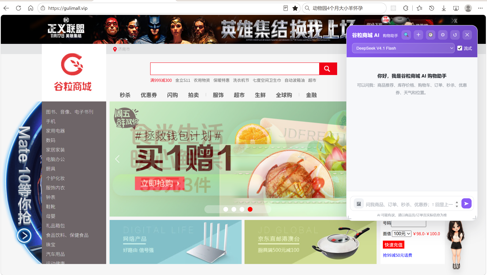
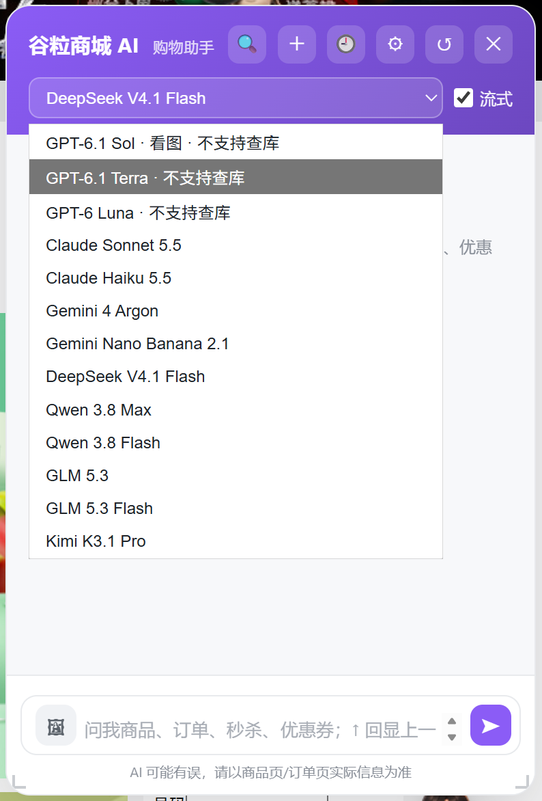
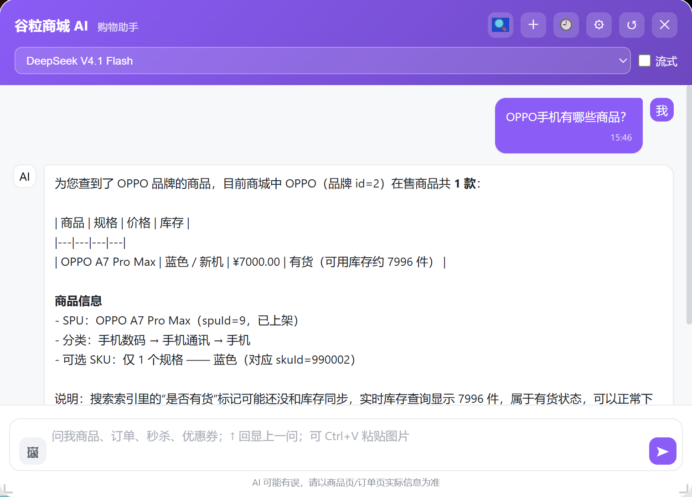
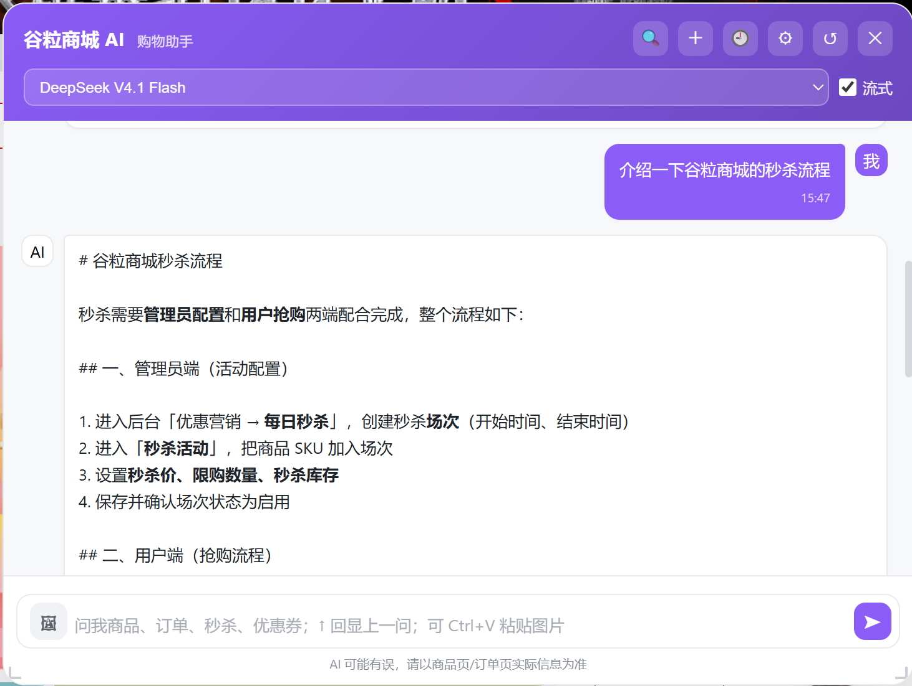
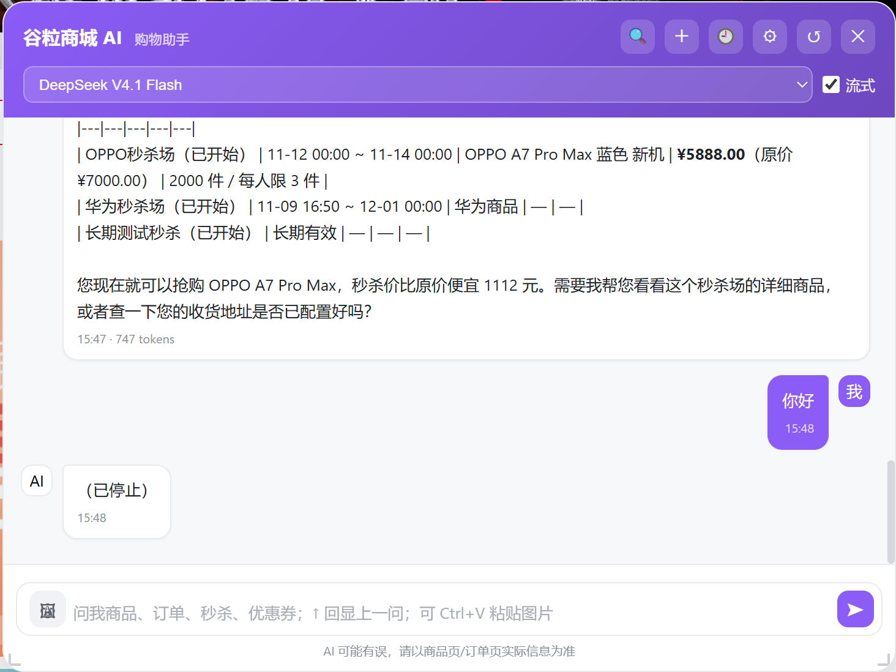
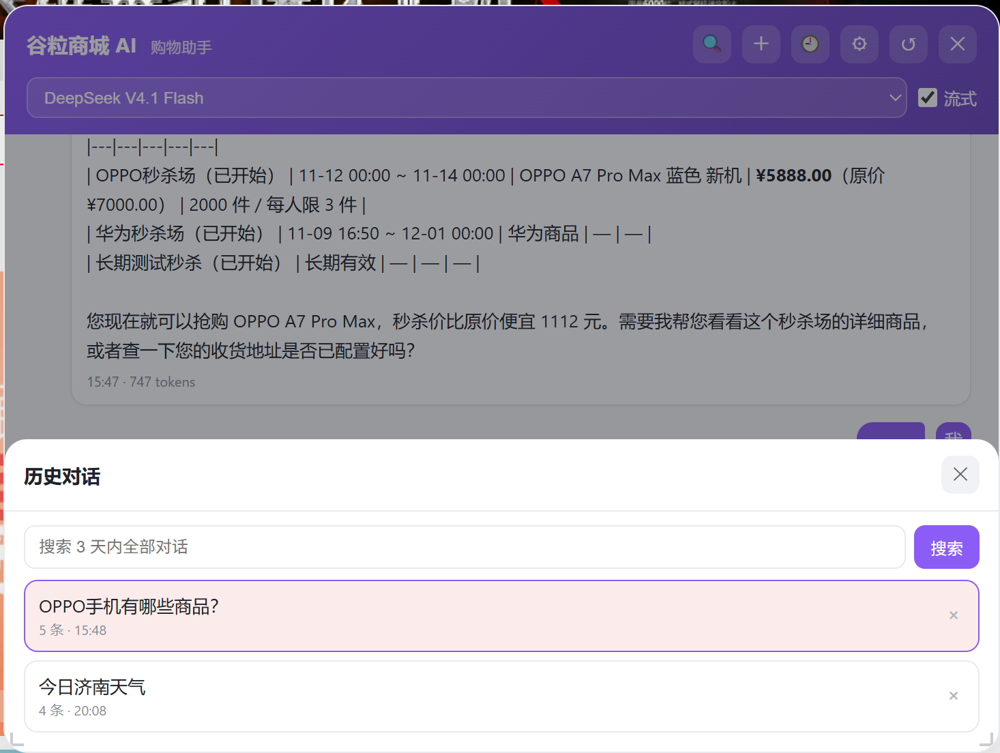
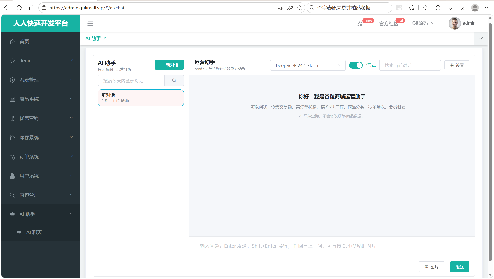

# 19.1 AI 多模型与对话-介绍

> 本篇介绍谷粒商城的 AI 多模型与对话链路：独立服务 gulimall-agent 怎么同时服务用户端和管理端，模型目录怎么把配置和自定义模型合并成一份列表，工厂怎么按协议创建并缓存模型，普通对话、SSE 流式对话和停止生成怎么走，Redis 里的会话、消息和模型记忆怎么分工，以及模型、Redis、RAG 不可用时怎么降级。

---

## 1. 这个功能是干什么的

AI 对话解决“用自然语言问商城问题”的需求。用户问“小米手机多少钱”“本人订单到哪了”，管理员问“今天有多少订单”“哪些商品库存不足”，都由 `gulimall-agent` 统一回答。

`gulimall-agent` 是一个独立微服务，端口 `15000`，不直接读写商品、订单、库存等业务表。它的职责是：

1. 接收用户或管理员的自然语言消息。
2. 按身份选择提示词，按模型目录选择模型。
3. 让模型通过 Function Calling 调各业务模块的只读接口。
4. 把工具结果交回模型，生成中文回答。
5. 把会话、记忆、图片、设置和 RAG 知识库持久化。

用户端和管理端共用同一套模型、工具、会话和 RAG，但权限边界不同：

| 对比项 | 用户端 | 管理端 |
|---|---|---|
| 登录入口 | auth-server | renren-fast |
| agent JWT 角色 | `user` | `admin` |
| 可见会话 | 本人会话 | 本人（管理员）会话 |
| 可用工具 | 公共只读工具 + 本人购物车/订单/会员 | 公共只读工具 + 全部订单/会员概要/仓库 |
| 提示词范围 | 商城购物、本人数据 | 商城运营、全部数据、技术概览 |

对话有三个接口：

| 方法 | 路径 | 说明 |
|---|---|---|
| POST | `/agent/chat` | 普通对话，一次性返回完整回答 |
| POST | `/agent/chat/stream` | SSE 流式对话，逐段推送 token |
| POST | `/agent/chat/stop` | 停止当前会话正在输出的流 |



## 2. 用户、管理员、开发者怎么操作

### 2.1 用户端打开聊天窗

1. 用户在商城任意页面看到右下角的悬浮宠物。
2. 点击宠物，打开聊天面板。
3. 前端先调 `GET /agent/auth/me` 判断登录态。
4. 已登录时加载模型列表、用户设置和最近会话。
5. 未登录时显示登录遮罩，引导去 `auth.gulimall.vip` 登录。

用户端聊天窗由 `chat-widget.js` 注入，页面只需要引入一个脚本：

```html
<script src="/gulimall/agent/widget/chat-widget.js" defer></script>
```

脚本加载后自动创建 CSS、宠物、聊天面板和事件绑定，业务页面不需要写额外结构。

### 2.2 选择模型

聊天输入框上方有模型下拉框。下拉框里的内容来自 `GET /agent/models`，包括：

1. `config/gulimall-agent.yaml` 里配置的内置模型。
2. 当前用户自己添加的 OpenAI 兼容模型。

每个模型只展示 `displayName`，页面不会拿到 `baseUrl` 和 `apiKey`。



### 2.3 发起普通对话

1. 输入问题，点击发送。
2. 前端先确保已有 `conversationId`，没有就调 `POST /agent/conversations` 新建。
3. 请求体带上 `conversationId`、`message`、`modelId`、`imageIds`。
4. 后端保存用户消息，调用模型，保存 AI 回复。
5. 前端把返回的 `data.content` 渲染成 AI 气泡。

普通对话适合短问题，响应一次性返回，前端实现简单。



### 2.4 发起流式对话

1. 打开“流式”开关。
2. 发送消息后，前端用 `fetch` 请求 `/agent/chat/stream`。
3. 服务端返回 `text/event-stream`。
4. 前端持续读响应体，按 `event:` 和 `data:` 两行解析 SSE。
5. 收到 `delta` 就把 token 追加到当前气泡。
6. 收到 `done` 结束流式状态，收到 `error` 显示错误。

流式对话的首字更快，长回答不会让用户一直等空白页。



### 2.5 停止生成

1. 流式输出期间，发送按钮旁边出现“停止”。
2. 点击后，前端先调 `POST /agent/chat/stop`，带上 `conversationId`。
3. 服务端给当前 `streamId` 写停止标记。
4. 前端同时中断 `fetch` 的 `AbortController`。
5. 已经生成的部分会保存到会话，刷新后仍能看到。

停止只影响当前这条流，不影响同一会话之后新发起的对话。



### 2.6 查看历史与会话内搜索

1. 点击聊天窗的历史按钮，调 `GET /agent/conversations`。
2. 列表按最后活跃时间倒序排列。
3. 点击某个会话，调 `GET /agent/conversations/{id}/messages` 加载最近 20 条。
4. 向上滚动时带 `before` 参数继续加载更早消息。
5. 会话内搜索调 `GET /agent/conversations/{id}/messages/search`。
6. 全局搜索调 `GET /agent/conversations/search`，范围是最近 3 天的会话。



### 2.7 管理端使用聊天

管理端入口是 `renren-fast-vue` 的 `/ai/chat` 页面：

1. 管理员先用管理端账号登录。
2. 页面加载时调 `GET /agent/auth/me`，确认 `type=ADMIN`。
3. 如果不是管理员，先调 `/sys/agent/jwt/refresh` 换一次 agent JWT，再查一次。
4. 确认身份后加载设置、模型和会话。
5. 管理端的工具集比用户端多全部订单、任意会员概要、仓库查询。



### 2.8 开发者配置模型

模型配置分两层：

1. `defaults` 放所有模型共用的默认值。
2. `models` 只写和默认值不同的项。

这样新增模型时只写差异，不会重复写 `baseUrl`、`apiKey`、超时等公共参数。

```yaml
gulimall:
  ai:
    defaults:
      provider: openai-compatible
      base-url: ${AI_CLOSEAI_BASE_URL}
      api-key: ${AI_CLOSEAI_API_KEY}
      max-retries: 2
      temperature: 0.7
      timeout: 60s
      streaming-timeout: 90s
      streaming: true
      tools: true
      enabled: true
    default-model: deepseek-v4.1-flash
    models:
      - id: gpt-6.1-sol
        display-name: GPT-6.1 Sol
        model-name: gpt-6.1-sol
        temperature-supported: false
        tools: false
        vision: true
        sort: 10
      - id: deepseek-v4.1-flash
        display-name: DeepSeek V4.1 Flash
        model-name: deepseek-v4.1-flash
        sort: 80
```

`defaults` 里的 `${AI_CLOSEAI_BASE_URL}` 和 `${AI_CLOSEAI_API_KEY}` 必须能从环境变量或 `config/common.yaml` 解析，缺失时启动失败，避免模型带着空 key 运行。

## 3. 整体设计思路

### 3.1 业务上怎么设计

#### 3.1.1 两端共用一套对话底座

用户端和管理端的区别只在三处：

1. 身份来源不同：auth-server 签发 `user`，renren-fast 签发 `admin`。
2. 提示词不同：用户端是购物助手，管理端是运营助手。
3. 工具集不同：用户端只能查本人数据，管理端可以查全量数据。

模型、会话、记忆、流式协议、图片和 RAG 都是同一套实现。这样新增能力只做一次，两端都能用。

#### 3.1.2 模型目录分层

业务上把模型分成两类：

1. 内置模型：写在 yaml 里，所有身份可见。
2. 自定义模型：用户自己填 `baseUrl`、`modelName`、`apiKey`，只对创建者可见。

页面需要一份合并后的列表，且按 `sort` 排序。这个合并逻辑集中在 `ModelCatalog`，调用方不关心模型来自 yaml 还是 MySQL。

#### 3.1.3 会话与模型记忆分开

会话保存“页面看到的完整消息”，模型记忆保存“模型上下文窗口里的最近 40 条”。

分开的原因：

1. 页面历史要完整，用户往上翻能看到几天前的消息。
2. 模型上下文不能无限增长，否则 token 费用高、响应慢。
3. 记忆窗口截断时，不能把页面历史一起删掉。

#### 3.1.4 流式事件契约

流式接口固定四种事件：

| 事件 | 含义 | 前端动作 |
|---|---|---|
| `meta` | 会话已就绪，返回会话 id、消息 id、模型 id | 记录 id，开始展示 |
| `delta` | 一段新增 token | 追加到当前气泡 |
| `done` | 正常结束或用户停止 | 结束流式状态 |
| `error` | 校验、抢锁、保存或模型异常 | 显示错误，结束流式状态 |

事件名和字段固定，前端不需要根据 HTTP 状态码猜业务结果。

#### 3.1.5 降级原则

对话主链路必须能在依赖故障时继续工作：

1. RAG 不可用：不挂检索器，按纯对话回答。
2. 模型不支持工具：不挂工具集，并明确告诉模型不能查实时数据。
3. Redis 缓存异常：会话和记忆会受影响，但错误要转成可读提示。
4. 流式回调不触发：用超时看门狗主动收尾，释放会话锁。

### 3.2 技术上怎么设计

#### 3.2.1 模型目录与默认值合并

`ModelCatalog.init` 在启动时遍历 yaml 里的模型，对每个模型调用 `withDefaults` 复制一份并补齐默认值，再按 `sort` 排序，最后用 `List.copyOf` 保存为不可变列表。

合并规则：

1. `displayName` 没配用 `id`。
2. `modelName` 没配用 `id`。
3. `provider`、`baseUrl`、`apiKey`、`streaming`、`tools`、`enabled`、`temperature`、`maxRetries`、`timeout`、`streamingTimeout`、日志开关没配都继承 `defaults`。
4. `vision` 不继承，必须每个模型单独配。
5. `temperatureSupported` 默认 `true`，特殊模型配 `false`。

#### 3.2.2 策略工厂

`ModelFactory` 构造时收集 Spring 里所有 `ChatModelStrategy`，按 `provider()` 放进 `strategyMap`。创建模型时：

1. 先校验 `apiKey`。
2. 用“模型 id + baseUrl + modelName + temperature + timeout + streamingTimeout + apiKey 哈希”组成缓存 key。
3. 缓存命中直接返回。
4. 未命中时按 provider 找策略，创建后放进缓存。

目前只有 `openai-compatible` 一个策略。以后接原生 Claude、Gemini 协议，只要新增一个 `@Component` 实现，工厂会自动收集。

#### 3.2.3 每次请求单独构建 AI Service

`AssistantFactory` 不把 AI Service 做成单例，原因是：

1. 系统提示词随 USER/ADMIN 和用户自定义提示词变化。
2. 每个用户只能看到自己的工具和会话记忆。
3. 构建本身很轻，真正重的模型对象由 `ModelFactory` 缓存。

构建内容：

1. `MessageWindowChatMemory`，窗口 40 条，存储用 `RedisChatMemoryStore`。
2. `systemMessageProvider`，按身份生成提示词。
3. 模型支持工具时挂 `toolBundleFactory.create(principal, conversationId)`。
4. RAG 可用时挂 `roleAwareContentRetriever.forPrincipal(principal)`。

#### 3.2.4 会话串行锁

同一会话同一时间只允许一个请求。锁 key 是 `gulimall:ai:lock:conv:{conversationId}`，用 `setIfAbsent` 写入，TTL 300 秒。

锁的目的是避免两条消息同时写模型记忆，导致上下文顺序错乱。抢不到锁返回 `15006 CONVERSATION_BUSY`。

#### 3.2.5 流 ID 与停止标记

每次流式请求生成一个随机 `streamId`，写入 `gulimall:ai:stream:{conversationId}`，TTL 5 分钟。

停止接口只把当前 `streamId` 写入 `gulimall:ai:stop:{conversationId}`，TTL 120 秒。流回调每次判断停止标记是否等于自己的 `streamId`，因此只停当前流，不影响之后新发起的流。

#### 3.2.6 超时看门狗

LangChain4J 1.0.1 的 SSE 监听器可能吞掉工具执行异常，导致 `onComplete` 和 `onError` 都不触发。

`ChatOrchestrator.stream` 额外注册一个延迟任务，时间是“流式超时 + 30 秒”。到点仍未完成时：

1. 用 CAS 把 `completed` 置为 `true`。
2. 推一条 `error` 事件。
3. 清理 stream/stop key。
4. 释放会话锁。
5. 关闭 SSE。

#### 3.2.7 Redis key 分工

| Key | 类型 | 作用 | TTL |
|---|---|---|---|
| `gulimall:ai:conv:index:{USER:1}` | ZSET | 会话索引，score 是最后活跃时间 | 3 天 |
| `gulimall:ai:conv:meta:{convId}` | HASH | 标题、模型、消息数、时间 | 3 天 |
| `gulimall:ai:conv:msg:{convId}` | LIST | 完整 UI 消息 JSON | 3 天 |
| `gulimall:ai:memory:{convId}` | STRING | 模型记忆窗口 | 3 天 |
| `gulimall:ai:lock:conv:{convId}` | STRING | 会话串行锁 | 300 秒 |
| `gulimall:ai:stream:{convId}` | STRING | 当前流 id | 5 分钟 |
| `gulimall:ai:stop:{convId}` | STRING | 停止标记 | 120 秒 |

## 4. 详细代码、配置和解释

第 4 章按一次对话的真实调用顺序展开：模型定义和模型目录决定“有哪些模型”，策略和工厂决定“模型怎么创建”，Controller 和 Orchestrator 决定“一次对话怎么走”，AssistantFactory 决定“模型旁边挂什么”，ConversationService 和 RedisChatMemoryStore 决定“历史和记忆存在哪”，最后是用户端和管理端的前端实现。每个小节先说明该类在链路里解决什么问题、由谁调用，再给出关键字段或接口，随后按代码块解释执行顺序和设计原因，最后补一次完整示例与边界。

### 4.1 AiModelDefinition：模型定义

#### 4.1.1 这个类解决什么问题

`gulimall-agent` 的模型来源有两处：`config/gulimall-agent.yaml` 里的内置模型，以及 MySQL `gulimall_ai` 里用户自建的 OpenAI 兼容模型。模型下拉框、对话入口、模型工厂、视觉识别都要读取同一份模型信息。如果每个环节各自维护 Map 或 DTO，字段名、空值语义和默认值处理很快会分叉：下拉框能显示的模型，工厂可能因为少了 `baseUrl` 创建失败；自定义模型能入库，对话入口却拿不到 `modelName`。

`AiModelDefinition` 是这条链路的统一数据载体，承接上游配置和数据库，向下游提供同一套字段：

1. Spring Boot 把 yaml 的 `gulimall.ai.models` 绑定成该对象。
2. `SettingsService` 把 MySQL 里的自定义模型行转换成该对象。
3. `ModelCatalog` 把两份列表合并、补齐默认值后交给对话入口。
4. `ModelFactory` 按该对象里的连接参数创建 LangChain4J 模型。
5. `VisionAnalysisService` 用 `vision` 字段判断某个模型能否处理图片。

这个类只描述“一个模型需要哪些信息”，不包含创建、缓存、校验等行为。字段怎么被填充、怎么被消费，分别由模型目录和模型工厂负责。

#### 4.1.2 字段与业务含义

| 字段 | 类型 | 业务含义 | 空值与默认值 |
|---|---|---|---|
| `id` | `String` | 页面和接口使用的模型标识 | 必填；内置模型用模型名，自定义模型用 `custom:{uuid}` |
| `displayName` | `String` | 下拉框展示名称 | 为空时回退到 `id` |
| `modelName` | `String` | 发给模型服务的 `model` 字段 | 必填；为空时回退到 `id` |
| `provider` | `String` | 模型协议，决定使用哪个策略 | 默认 `openai-compatible` |
| `baseUrl` | `String` | 模型服务地址 | 为空时继承 `defaults.base-url` |
| `apiKey` | `String` | 模型服务密钥 | 为空时继承 `defaults.api-key` |
| `vision` | `boolean` | 是否支持图片输入 | 不继承，必须逐个模型声明 |
| `streaming` | `Boolean` | 是否允许流式对话 | `null` 表示继承默认值 |
| `tools` | `Boolean` | 是否挂载 Function Calling 工具 | `null` 表示继承默认值 |
| `enabled` | `Boolean` | 是否在页面和接口中可见 | `null` 表示继承默认值；最终为 `false` 时被过滤 |
| `sort` | `int` | 下拉框排序，值小的靠前 | 默认 0 |
| `temperature` | `Double` | 采样温度 | 为空时继承默认值 |
| `temperatureSupported` | `Boolean` | 是否允许向模型发送温度 | 默认 `true` |
| `maxRetries` | `Integer` | 普通模型的重试次数 | 为空时继承默认值 |
| `timeout` | `Duration` | 普通对话超时 | 为空时继承默认值 |
| `streamingTimeout` | `Duration` | 流式对话超时 | 为空时继承默认值 |
| `logRequests` | `Boolean` | 是否打印请求体 | 为空时继承默认值 |
| `logResponses` | `Boolean` | 是否打印响应体 | 为空时继承默认值 |
| `custom` | `boolean` | 是否为用户自建模型 | 默认 `false`，页面据此显示删除入口 |
| `customModelId` | `Long` | 自定义模型在 MySQL 的主键 | 内置模型为 `null` |

#### 4.1.3 代码与解释

这段代码定义对象本身。它既被 yaml 绑定，也被 `SettingsService` 转换，因此字段全部使用包装类型或可空类型，让“未配置”和“配置为 false”能够区分。

```java
@Data
public class AiModelDefinition {

    @NotBlank
    private String id;

    private String displayName;

    @NotBlank
    private String modelName;

    private String provider = "openai-compatible";

    private String baseUrl;

    private String apiKey;

    private boolean vision;

    private Boolean streaming;

    private Boolean tools;

    private Boolean enabled;

    private int sort;

    private Double temperature;

    private Boolean temperatureSupported = true;

    private Integer maxRetries;

    private Duration timeout;

    private Duration streamingTimeout;

    private Boolean logRequests;

    private Boolean logResponses;

    private boolean custom;

    private Long customModelId;
}
```

1. `@Data` 生成 getter、setter、`equals`、`hashCode` 和 `toString`。配置绑定、对象复制和页面 JSON 序列化都依赖这些方法；`toString` 会把字段全部拼出来，日志里直接打印整个对象可能带出 `apiKey`，需要在调用处控制。
2. `@NotBlank` 标在 `id` 和 `modelName` 上，表达这两个字段不能为空。配置绑定或请求校验开启校验时，空值会被拦截；如果没有触发校验，仍然要靠 `ModelCatalog` 的回退逻辑兜底。
3. `provider` 初始化为 `openai-compatible`，这样只配置模型名和密钥的模型也能直接走默认策略。
4. `vision` 使用基本类型 `boolean`，默认 `false`。图片能力不能靠全局默认值继承，否则所有模型都会被误认为能看图。
5. `streaming`、`tools`、`enabled`、`temperature`、`maxRetries`、`timeout`、`streamingTimeout`、日志开关都使用包装类型，`null` 明确表示“没有单独配置，交给默认值”。
6. `temperatureSupported` 初始化为 `true`，只有明确配置成 `false` 的模型才不发送温度。这个字段用于兼容“传温度就返回 400”的模型。
7. `sort` 是基本类型，未配置时为 0；排序逻辑在 `ModelCatalog` 的 `list` 中再次执行。
8. `custom` 和 `customModelId` 用于区分来源。页面根据 `custom` 显示“自定义”标记，删除自定义模型时使用 `customModelId` 定位数据库行。

#### 4.1.4 复制并替换超时 withTimeout

看图链路比普通对话慢：图片需要先下载，再交给视觉模型识别，同样的超时时间往往不够。`visionAnalysisService.analyze` 在调用视觉模型前会调用 `withTimeout` 换一份超时更长的定义。模型定义可能来自 `ModelCatalog` 中共享的内置模型列表，直接在原对象上 `setTimeout` 会改掉其他请求正在使用的对象，因此这个方法返回副本。

```java
public AiModelDefinition withTimeout(Duration timeout) {
    AiModelDefinition copy = new AiModelDefinition();
    copy.id = id;
    copy.displayName = displayName;
    copy.modelName = modelName;
    copy.provider = provider;
    copy.baseUrl = baseUrl;
    copy.apiKey = apiKey;
    copy.vision = vision;
    copy.streaming = streaming;
    copy.tools = tools;
    copy.enabled = enabled;
    copy.sort = sort;
    copy.temperature = temperature;
    copy.temperatureSupported = temperatureSupported;
    copy.maxRetries = maxRetries;
    copy.timeout = timeout;
    copy.streamingTimeout = streamingTimeout;
    copy.logRequests = logRequests;
    copy.logResponses = logResponses;
    copy.custom = custom;
    copy.customModelId = customModelId;
    return copy;
}
```

1. 新建一个 `AiModelDefinition`，不复用入参对象。
2. 逐个复制标识、展示、连接和能力字段，保证副本与原件在创建模型时行为一致。
3. `timeout` 使用入参替换，其余字段原样复制；`streamingTimeout` 不受影响，流式对话仍按原配置执行。
4. `temperatureSupported`、`maxRetries`、日志开关一起复制，避免副本创建出的模型和原件出现参数差异。
5. `custom` 与 `customModelId` 原样保留，页面标注和删除能力不会因为超时副本丢失。
6. 复制而不是加锁修改，原因是模型定义会被多个并发请求共享；加锁只能保证修改瞬间安全，无法保证使用期间不被其他请求改掉。

#### 4.1.5 一次字段流转示例

用户在下拉框选择 `deepseek-v4.1-flash` 并发送消息，字段依次经过四个环节：

1. yaml 的 `models` 列表绑定出一个只写了 `id`、`display-name`、`model-name`、`sort` 的对象，`base-url` 和 `api-key` 为空。
2. `ModelCatalog.init` 调用 `withDefaults`，把空的 `baseUrl`、`apiKey`、`temperature`、`timeout` 补成 `defaults` 里的值，`vision` 保持 `false`。
3. `ChatOrchestrator.prepare` 调用 `modelCatalog.find`，返回补齐后的对象，并把它放进 `Prepared`。
4. `AssistantFactory` 把对象交给 `ModelFactory.chat`，后者用 `id + baseUrl + modelName + temperature + timeout + streamingTimeout + apiKey 哈希` 组成缓存键。
5. `OpenAiCompatibleChatModelStrategy` 用同一个对象构造 `OpenAiChatModel`，实际发给模型服务的是补齐后的 `modelName` 和 `baseUrl`。

#### 4.1.6 它不做什么

1. 不映射数据库表，没有 MyBatis-Plus 注解；自定义模型入库和出库由 `SettingsService` 转换。
2. 不校验 `baseUrl` 是否是合法 URL，也不校验 `apiKey` 是否有效。
3. 不表示模型运行时的健康状态，调用失败不会回写这个对象。
4. 不负责模型缓存，缓存键和缓存生命周期在 `ModelFactory`。
5. 不决定模型是否对当前用户可见，可见性由 `ModelCatalog.list` 合并和过滤。

#### 4.1.7 边界与可优化点

1. 字段较多，`withTimeout` 手写逐字段复制。以后新增字段如果忘记补进这个方法，超时副本会丢失该字段，建议改成 Builder 或 `toBuilder`。
2. `apiKey` 以明文存在对象里，`@Data` 生成的 `toString` 会包含它。日志、异常信息和链路追踪中不要整体打印模型定义。
3. `vision` 不继承默认值是刻意设计，但 yaml 少写一个 `vision` 就会让模型失去看图能力，配置检查可以补一条提示。
4. `custom` 与 `customModelId` 没有强制一致性校验，自定义模型必须同时带 id；转换层需要保证两者一起赋值。
5. `id` 在内外置模型之间没有唯一性约束。内置模型与自定义模型使用同一个 `id` 时，`find` 会返回列表里靠前的一个，后一个永远不会被选中。

### 4.2 ModelCatalog：模型目录

#### 4.2.1 这个类解决什么问题

页面模型下拉、对话选模型、看图选模型都需要“当前身份可见的模型列表”。列表由内置模型和用户自建模型组成，还要过滤停用模型、按 `sort` 排序、在没有指定模型时回退到默认模型。如果让 Controller 自己拼，用户端和管理端会出现不同顺序，默认模型缺失时也会各写一套错误提示。

`ModelCatalog` 是模型可见性的唯一出口：

1. 启动时把 yaml 模型补齐默认值并固定成列表。
2. 运行时把内置模型和当前身份的自定义模型合并、过滤、排序。
3. 按 `id` 查找模型，找不到抛统一业务异常。
4. 按视觉能力挑选图片模型。

它的上游是 `AiProperties` 和 `SettingsService`，下游是模型列表接口、`ChatOrchestrator.prepare` 和 `VisionAnalysisService`。模型工厂不关心可见性，只接收目录返回的定义。

#### 4.2.2 对外方法与调用方

| 方法 | 调用方 | 作用 | 失败行为 |
|---|---|---|---|
| `init` | Spring 容器 | 启动时合并默认值、排序、固定列表 | 配置异常时启动阶段暴露 |
| `list(principal)` | 模型列表接口、对话入口 | 返回当前身份可见且启用的模型 | 不抛异常，返回空列表时前端无模型可选 |
| `find(principal, modelId)` | `ChatOrchestrator.prepare`、`VisionAnalysisService` | 按 id 取模型，id 为空时用默认模型 | 找不到抛 `MODEL_NOT_FOUND`，业务码 `15004` |
| `defaultModel(principal)` | 需要默认模型的调用方 | 取 `default-model` 对应的模型 | 默认模型不存在时抛 `15004` |
| `visionModel(principal)` | `VisionAnalysisService` | 取配置的视觉模型或第一个视觉模型 | 没有视觉模型时抛 `15004` |

#### 4.2.3 代码与解释

这段代码负责目录的初始化、合并、查找和视觉模型选择。阅读时先看 `init` 和 `list`，再看两个查找方法，就能对应到“启动时”和“每次请求时”两个阶段。

```java
@Component
@RequiredArgsConstructor
public class ModelCatalog {

    private final AiProperties properties;
    private final SettingsService settingsService;

    private List<AiModelDefinition> builtInModels = List.of();

    @PostConstruct
    public void init() {
        List<AiModelDefinition> initialized = new ArrayList<>();
        for (AiModelDefinition definition : properties.getModels()) {
            initialized.add(withDefaults(definition));
        }
        initialized.sort(Comparator.comparingInt(AiModelDefinition::getSort));
        this.builtInModels = List.copyOf(initialized);
    }

    public List<AiModelDefinition> list(Principal principal) {
        List<AiModelDefinition> result = new ArrayList<>(builtInModels);
        if (principal != null) {
            result.addAll(settingsService.listCustomModels(principal));
        }
        return result.stream()
                .filter(def -> Boolean.TRUE.equals(def.getEnabled()))
                .sorted(Comparator.comparingInt(AiModelDefinition::getSort))
                .toList();
    }

    public AiModelDefinition find(Principal principal, String modelId) {
        String id = StringUtils.hasText(modelId) ? modelId : properties.getDefaultModel();
        return list(principal).stream()
                .filter(def -> def.getId().equals(id))
                .findFirst()
                .orElseThrow(() -> new AgentException(AgentErrorCode.MODEL_NOT_FOUND, "模型不存在：" + id));
    }

    public AiModelDefinition defaultModel(Principal principal) {
        return find(principal, properties.getDefaultModel());
    }

    public AiModelDefinition visionModel(Principal principal) {
        List<AiModelDefinition> models = list(principal);
        String configured = properties.getImage().getVisionModel();
        for (AiModelDefinition model : models) {
            if (model.isVision() && model.getId().equals(configured)) {
                return model;
            }
        }
        return models.stream()
                .filter(AiModelDefinition::isVision)
                .findFirst()
                .orElseThrow(() -> new AgentException(AgentErrorCode.MODEL_NOT_FOUND, "没有可用的视觉模型"));
    }
}
```

1. `@Component` 把目录注册成单例，`@RequiredArgsConstructor` 注入 `AiProperties` 和 `SettingsService`。目录本身无状态，可以在并发请求间共享。
2. `builtInModels` 初始化为空列表，避免 `@PostConstruct` 执行前被访问时出现 `null`。
3. `init` 在 Spring 完成依赖注入后执行，遍历 yaml 的模型列表，对每个模型调用 `withDefaults`。
4. 初始化结果按 `sort` 升序排列，`List.copyOf` 生成不可变列表。列表结构在启动后不再变化，多个请求共享同一份引用。
5. `list` 先把内置模型放进新列表，保证内置模型在前、自定义模型在后；`principal` 为空时只返回内置模型。
6. `principal` 不为空时，从 `SettingsService` 读取当前用户的自定义模型并追加到列表。
7. 合并后过滤掉 `enabled` 不为 `true` 的模型。这里用 `Boolean.TRUE.equals`，`null` 会被当作停用，防止默认值没有补齐时误放出模型。
8. 过滤后按 `sort` 升序排序，`sort` 相同的模型保持合并时的先后顺序，内置模型优先。
9. `find` 在 `modelId` 为空或空白时改用 `properties.getDefaultModel()`，所以前端不传模型也能对话。
10. `find` 复用 `list` 的结果，只查找当前身份可见的模型。用户不能通过伪造 `modelId` 使用别人的自定义模型。
11. 找不到时抛 `AgentException(MODEL_NOT_FOUND, "模型不存在：" + id)`，由全局异常处理转成 `15004`。
12. `defaultModel` 直接以配置的默认模型 id 调 `find`，默认模型被停用或删除时同样返回 `15004`，不会悄悄换一个模型。
13. `visionModel` 先读 `image.vision-model` 配置，只有在可见列表里找到 `vision=true` 且 id 匹配的模型时才返回。
14. 配置的视觉模型不可用时，退到列表里第一个 `vision=true` 的模型，保证看图功能尽量可用。
15. 一个视觉模型都没有时抛 `MODEL_NOT_FOUND`，提示“没有可用的视觉模型”。

内置模型使用不可变列表的原因：启动后模型集合来自配置文件，不会在运行期增删；共享同一份列表可以避免每个请求重复合并默认值和排序。自定义模型每次请求都查 MySQL，因此新增、删除或修改后立即生效，不需要重启。

#### 4.2.4 合并默认值 withDefaults

yaml 只要求每个模型写差异字段，公共连接参数放在 `defaults` 里。`withDefaults` 在一次遍历中把“模型自己的值、全局默认值、字段固定默认值”按优先级合并，输出一份可以直接交给工厂的定义。

```java
private AiModelDefinition withDefaults(AiModelDefinition source) {
    AiModelDefinition def = new AiModelDefinition();

    def.setId(source.getId());

    def.setDisplayName(StringUtils.hasText(source.getDisplayName()) ? source.getDisplayName() : source.getId());

    def.setModelName(StringUtils.hasText(source.getModelName()) ? source.getModelName() : source.getId());

    def.setProvider(StringUtils.hasText(source.getProvider()) ? source.getProvider() : properties.getDefaults().getProvider());

    def.setBaseUrl(StringUtils.hasText(source.getBaseUrl()) ? source.getBaseUrl() : properties.getDefaults().getBaseUrl());

    def.setApiKey(StringUtils.hasText(source.getApiKey()) ? source.getApiKey() : properties.getDefaults().getApiKey());

    def.setVision(source.isVision());

    def.setStreaming(source.getStreaming() == null ? properties.getDefaults().isStreaming() : source.getStreaming());

    def.setTools(source.getTools() == null ? properties.getDefaults().isTools() : source.getTools());

    def.setEnabled(source.getEnabled() == null ? properties.getDefaults().isEnabled() : source.getEnabled());

    def.setSort(source.getSort());

    def.setTemperature(source.getTemperature() == null ? properties.getDefaults().getTemperature() : source.getTemperature());

    def.setTemperatureSupported(source.getTemperatureSupported() == null
            ? Boolean.TRUE : source.getTemperatureSupported());

    def.setMaxRetries(source.getMaxRetries() == null ? properties.getDefaults().getMaxRetries() : source.getMaxRetries());

    def.setTimeout(source.getTimeout() == null ? properties.getDefaults().getTimeout() : source.getTimeout());

    def.setStreamingTimeout(source.getStreamingTimeout() == null
            ? properties.getDefaults().getStreamingTimeout() : source.getStreamingTimeout());

    def.setLogRequests(source.getLogRequests() == null ? properties.getDefaults().isLogRequests() : source.getLogRequests());

    def.setLogResponses(source.getLogResponses() == null ? properties.getDefaults().isLogResponses() : source.getLogResponses());

    def.setCustom(source.isCustom());

    def.setCustomModelId(source.getCustomModelId());

    return def;
}
```

1. 新建 `AiModelDefinition`，不修改 yaml 绑定出来的原对象，避免启动阶段的合并污染原始配置。
2. `id` 原样复制，它是模型唯一标识，不参与默认值合并。
3. `displayName` 为空时回退到 `id`，保证下拉框一定有文字。
4. `modelName` 为空时回退到 `id`，保证请求里一定有 `model` 字段。
5. `provider` 为空时继承 `defaults.provider`，仍为空则由对象字段初始值兜底。
6. `baseUrl` 和 `apiKey` 为空时继承全局默认值，这是环境变量注入的主要入口。
7. `vision` 直接复制，不继承。看图和文本模型在服务端是不同能力，不能因为默认配置误开。
8. `streaming`、`tools`、`enabled` 用 `null` 判断是否继承；显式配置 `false` 时保留 `false`。
9. `sort` 直接复制，未配置时为 0，后续由 `list` 统一排序。
10. `temperature` 为空时继承默认值，支持需要固定温度的模型单独覆盖。
11. `temperatureSupported` 只有显式为 `false` 才保持 `false`，其余情况一律为 `true`。
12. `maxRetries`、`timeout`、`streamingTimeout` 为空时继承默认值，普通对话和流式对话可以分别控制超时。
13. `logRequests`、`logResponses` 为空时继承默认值，生产环境可以在 `defaults` 里统一关闭。
14. `custom` 和 `customModelId` 原样保留，合并逻辑不改变模型来源。
15. 方法没有修改入参，也没有共享可变字段，多个模型可以并发调用。

#### 4.2.5 一次模型选择示例

用户 A 的默认模型是 `deepseek-v4.1-flash`，又自建了一个 `custom:8f3a`：

1. `init` 把 yaml 中的内置模型补齐并排序，列表里包含 `gpt-6.1-sol`（`sort=10`）和 `deepseek-v4.1-flash`（`sort=80`）。
2. 模型列表接口调用 `list(principal)`，先放入两个内置模型，再追加 A 的自定义模型。
3. 自定义模型 `sort=50`，最终顺序为 `gpt-6.1-sol`、`custom:8f3a`、`deepseek-v4.1-flash`。
4. 用户发送消息时前端传 `modelId=deepseek-v4.1-flash`，`find` 在合并列表里找到该模型。
5. 如果前端不传 `modelId`，`find` 使用 `default-model`，仍然落到 `deepseek-v4.1-flash`。
6. 如果该模型在 yaml 里被改成 `enabled: false`，`list` 会把它过滤掉，`find` 返回 `15004`，前端提示模型不存在。
7. 用户 B 调用同一个接口时，`SettingsService` 只返回 B 的自定义模型，A 的 `custom:8f3a` 不会出现在 B 的列表里。

#### 4.2.6 它不做什么

1. 不创建 LangChain4J 模型对象，创建由 `ModelFactory` 和策略完成。
2. 不持久化自定义模型，读写 MySQL 的职责在 `SettingsService`。
3. 不检测 `baseUrl` 是否可达、`apiKey` 是否有效，首次调用失败才会暴露连接问题。
4. 不校验模型是否支持工具或流式，能力开关只做记录，是否挂载由 `AssistantFactory` 决定。
5. 不处理管理员和普通用户的身份差异，只依赖传入的 `principal` 过滤自定义模型。

#### 4.2.7 边界与可优化点

1. `list` 每次请求都查一次自定义模型表，对话链路每个请求至少调用一次 `find`。用户量大时 MySQL 压力明显，可以加短 TTL 本地缓存，并在新增、删除自定义模型时主动失效。
2. `visionModel` 在配置的模型不可用时静默退到第一个视觉模型，调用方无法知道发生了回退。可以补一条告警日志或在返回值里带上实际模型 id。
3. `List.copyOf` 只保证列表结构不可变，列表里的 `AiModelDefinition` 仍然可变。任何调用方直接 `set` 字段都会影响所有共享该对象的请求，`withTimeout` 之所以返回副本，就是为了避开这一点。
4. 内置模型和自定义模型使用同一个 `id` 时，列表里会出现两个同 id 对象，`find` 总取第一个。新增自定义模型时应校验 id 不与内置模型冲突。
5. `enabled` 在合并后仍然可能为 `null`，`list` 用 `Boolean.TRUE.equals` 过滤会把它当停用。如果业务希望“未配置即启用”，需要在 `withDefaults` 里显式补 `true`。

### 4.3 ChatModelStrategy：模型创建策略

#### 4.3.1 这个接口解决什么问题

不同模型供应商的接入方式不同：OpenAI 兼容协议、原生 Claude 协议、Gemini SDK，构建器参数、流式接口和错误类型都不一样。如果 `ModelFactory` 直接写 `if (provider.equals(...))` 并 `new` 各家 SDK 对象，每接入一家都要改工厂，条件分支会越来越多，工厂也会依赖所有厂商的类。

`ChatModelStrategy` 把“某个 provider 怎么创建模型”抽成策略接口。工厂只保留一张 `provider → 策略` 的表，按模型定义里的 `provider` 选实现。当前只有 `openai-compatible` 一个实现，以后接入新协议只需要新增一个 `@Component`，工厂构造时会自动收集。

#### 4.3.2 方法契约

| 方法 | 入参 | 返回 | 说明 |
|---|---|---|---|
| `provider()` | 无 | provider 字符串 | 必须与模型定义里的 `provider` 一致，用于工厂注册 |
| `createChatModel` | 模型定义、监听器 | `ChatModel` | 创建一次性返回完整回答的模型 |
| `createStreamingChatModel` | 模型定义、监听器 | `StreamingChatModel` | 创建逐 token 返回的流式模型 |

#### 4.3.3 代码与解释

接口只有三个方法，没有继承其他接口，也没有默认实现。这样新增协议时不需要理解工厂内部结构，只要把三个方法实现正确。

```java
public interface ChatModelStrategy {

    String provider();

    ChatModel createChatModel(AiModelDefinition definition, ChatModelListener listener);

    StreamingChatModel createStreamingChatModel(AiModelDefinition definition, ChatModelListener listener);
}
```

1. `provider()` 返回协议标识。`ModelFactory` 构造时以它为 key 注册，模型定义里的 `provider` 必须能匹配到某个实现，否则创建时抛“不支持的模型协议”。
2. `createChatModel` 接收完整的模型定义和监听器，返回 `ChatModel`。普通对话、工具调用、RAG 都通过这个对象执行。
3. `createStreamingChatModel` 返回 `StreamingChatModel`，供 `/agent/chat/stream` 使用。
4. 普通和流式分成两个方法，而不是一个方法加布尔参数：两者的构建器类型不同，超时字段不同，部分供应商的流式实现也不支持重试。
5. 监听器由工厂统一传入，策略只负责挂到构建器上。策略不创建监听器，也不决定日志格式。
6. 接口不暴露 `supports(AiModelDefinition)`，同一 provider 下的方言差异由实现内部处理。

#### 4.3.4 一次策略选择示例

`ModelFactory` 创建时拿到 Spring 注入的 `List<ChatModelStrategy>`：

1. 遍历列表，对每个实现调用 `provider()`。
2. 把返回值作为 key，实现对象作为 value 放进 `strategyMap`。
3. 对话请求带来一个 `provider=openai-compatible` 的模型定义。
4. `strategy(definition)` 从 map 里取出 `OpenAiCompatibleChatModelStrategy`。
5. 调用策略的 `createChatModel`，由策略把定义翻译成 SDK 构建器参数。
6. 如果模型定义的 `provider` 写成 `openai` 或其他未注册值，map 查不到，抛 `MODEL_NOT_FOUND`，提示“不支持的模型协议”。

#### 4.3.5 它不做什么

1. 不解析 yaml，也不读取数据库，模型定义由调用方传入。
2. 不缓存创建出的模型，缓存由 `ModelFactory` 负责。
3. 不判断模型是否支持视觉或工具，能力开关在模型定义里。
4. 不处理重试策略的差异，重试次数由模型定义交给各实现使用。
5. 不统一异常类型，SDK 抛出的连接异常会原样向上传递。

#### 4.3.6 边界与可优化点

1. 同一 provider 下如果存在多种方言，例如 OpenAI 官方与兼容代理的参数差异，当前只能写在一个实现里。可以增加 `supports(AiModelDefinition)` 让工厂按定义选择更细的实现。
2. 图片模型和向量模型没有纳入策略，仍然由 `ModelFactory` 直接创建。接入非 OpenAI 协议时，这两类模型会成为新的分支点。
3. 工厂把“协议不支持”和“模型不存在”都映射成 `MODEL_NOT_FOUND`，前端提示相同，排查时只能看服务端日志。可以拆成独立错误码。
4. 策略实现抛出的异常没有统一包装，`ChatOrchestrator` 只能用兜底异常转成“AI 调用失败”。需要区分配置错误和网络错误时，应在策略层补充异常转换。

### 4.4 OpenAiCompatibleChatModelStrategy：OpenAI 兼容实现

#### 4.4.1 这个类解决什么问题

closeai 平台把 GPT、Claude、Gemini、DeepSeek、Qwen、GLM、Kimi 都包装成 OpenAI 协议，对调用方来说只有 `baseUrl`、`apiKey`、`modelName` 三个连接参数不同。如果为每个厂商写一个策略，代码几乎完全重复，新增模型还要改代码。

`OpenAiCompatibleChatModelStrategy` 用一套 LangChain4J 的 OpenAI 构建器覆盖所有兼容模型。它负责把 `AiModelDefinition` 翻译成构建器参数，处理温度开关、超时、日志开关和链路监听器；上游是 `ModelFactory`，下游是 closeai 或自建 OpenAI 兼容网关。

#### 4.4.2 代码与解释

这段代码包含普通模型和流式模型两个构建入口。两者的字段基本对称，差异集中在构建器类型、超时字段和重试能力。

```java
@Component
public class OpenAiCompatibleChatModelStrategy implements ChatModelStrategy {

    public static final String PROVIDER = "openai-compatible";

    @Override
    public String provider() {
        return PROVIDER;
    }

    @Override
    public ChatModel createChatModel(AiModelDefinition definition, ChatModelListener listener) {
        var builder = OpenAiChatModel.builder()
                .apiKey(definition.getApiKey())
                .baseUrl(definition.getBaseUrl())
                .modelName(definition.getModelName())
                .maxRetries(definition.getMaxRetries())
                .timeout(definition.getTimeout())
                .logRequests(definition.getLogRequests())
                .logResponses(definition.getLogResponses());

        if (!Boolean.FALSE.equals(definition.getTemperatureSupported())) {
            builder.temperature(definition.getTemperature());
        }

        if (listener != null) {
            builder.listeners(List.of(listener));
        }
        return builder.build();
    }

    @Override
    public StreamingChatModel createStreamingChatModel(AiModelDefinition definition, ChatModelListener listener) {
        var builder = OpenAiStreamingChatModel.builder()
                .apiKey(definition.getApiKey())
                .baseUrl(definition.getBaseUrl())
                .modelName(definition.getModelName())
                .timeout(definition.getStreamingTimeout())
                .logRequests(definition.getLogRequests())
                .logResponses(definition.getLogResponses());

        if (!Boolean.FALSE.equals(definition.getTemperatureSupported())) {
            builder.temperature(definition.getTemperature());
        }

        if (listener != null) {
            builder.listeners(List.of(listener));
        }
        return builder.build();
    }
}
```

1. `@Component` 让工厂在构造时自动收集这个策略，不需要手工注册。
2. `PROVIDER` 常量固定为 `openai-compatible`，与 yaml 默认值和模型定义字段初始值保持一致。
3. `provider()` 返回该常量，工厂用它作为 `strategyMap` 的 key。
4. `createChatModel` 使用 `OpenAiChatModel.builder()`，依次设置 `apiKey`、`baseUrl`、`modelName`。
5. `maxRetries` 只设置在普通模型上。网络抖动时 SDK 会按配置重试，流式接口没有对应参数。
6. `timeout` 使用模型定义的普通对话超时；日志开关按模型定义决定是否打印请求和响应。
7. 温度只在 `temperatureSupported` 不为 `false` 时设置。使用 `Boolean.FALSE.equals` 判断，`null` 会被当作支持温度，与模型定义的默认值一致。
8. 监听器不为空时挂到构建器上，当前工厂传入的是 `TracingChatModelListener`，用于记录 TraceID、耗时和 token 用量。
9. `createStreamingChatModel` 使用 `OpenAiStreamingChatModel.builder()`，连接参数与普通模型一致。
10. 流式构建器使用 `streamingTimeout`，与普通对话的超时分开配置。
11. 流式构建器同样按 `temperatureSupported` 决定是否发送温度。
12. 流式构建器没有 `maxRetries`，代码里不设置重试，网络中断只能靠前端重新发起。
13. 两个方法最后都调用 `build()`，构建阶段才会校验必填参数；缺少 `apiKey` 或 `baseUrl` 时异常从 SDK 抛出。

#### 4.4.3 普通模型与流式模型的差异

| 对比项 | 普通模型 | 流式模型 |
|---|---|---|
| 构建器 | `OpenAiChatModel` | `OpenAiStreamingChatModel` |
| 超时字段 | `timeout` | `streamingTimeout` |
| 重试 | 支持 `maxRetries` | 构建器没有该参数 |
| 返回类型 | `ChatModel` | `StreamingChatModel` |
| 使用场景 | `/agent/chat`、工具调用、RAG | `/agent/chat/stream` |
| 温度开关 | 相同 | 相同 |
| 监听器 | 相同 | 相同 |

#### 4.4.4 一次模型创建示例

模型 `gpt-6.1-sol` 配置了 `temperature-supported: false`，并且支持视觉：

1. `ModelFactory.chat` 校验 key 后未命中缓存，调用该策略。
2. `createChatModel` 创建普通模型构建器，设置密钥、地址、模型名和重试次数。
3. 因为 `temperatureSupported=false`，跳过 `builder.temperature(...)`，避免服务端返回 400。
4. 挂上追踪监听器，构建出 `ChatModel`。
5. 工厂把对象按缓存键写入 `chatCache`，下一次同参数请求直接复用。
6. 如果同一模型被用于流式对话，`createStreamingChatModel` 会另外构建一个流式对象，放进 `streamingCache`，两者不共用。

#### 4.4.5 它不做什么

1. 不处理非 OpenAI 协议，原生 Claude、Gemini SDK 需要新增策略实现。
2. 不实现自定义重试，流式请求失败后没有自动重连。
3. 不校验 `modelName` 是否在服务端存在，错误由服务端返回。
4. 不做模型降级，主模型失败不会自动切到备用模型。
5. 不管理连接池，连接由 LangChain4J 和底层 HTTP 客户端维护。

#### 4.4.6 边界与可优化点

1. 流式没有重试，长回答在网络抖动时容易中断。可以在 `ChatOrchestrator` 层记录失败次数并由前端提示重试，或在 SDK 升级后使用支持重试的构建器。
2. `logResponses=true` 会把模型响应写入日志，可能包含用户隐私和工具返回的业务数据。生产环境应在 `defaults` 里关闭，或接入脱敏。
3. 温度按布尔开关整体发送或不发送，不能表达“只发送部分采样参数”。需要更细控制时，应把参数改成可空对象，而不是布尔。
4. closeai 平台的模型名与官方模型名不完全一致，配置写错时只在首次调用暴露。可以在启动阶段做一次轻量校验或维护模型名白名单。

### 4.5 ModelFactory：模型工厂

#### 4.5.1 这个类解决什么问题

LangChain4J 的模型对象内部持有 HTTP 连接池、重试器和序列化配置。每次对话都新建一个模型对象，会重复建立连接池、重复解析配置，模型数量多、并发高时开销明显。另一方面，模型对象本身是线程安全的，可以跨请求复用。

`ModelFactory` 位于 `AssistantFactory` 和策略之间，解决三件事：

1. 按 `provider` 选择策略创建模型。
2. 把创建好的普通模型、流式模型、图片模型按连接参数缓存，后续请求直接复用。
3. 在调用前校验 `apiKey`，把配置缺失转成可读业务异常，而不是等 SDK 发请求后收到 401。

上游是 `AiProperties`、`TracingChatModelListener` 和所有 `ChatModelStrategy`，下游是 `AssistantFactory`。向量模型单独用一个字段保存，图片模型按模型 id 缓存。

#### 4.5.2 缓存对象与缓存键

| 缓存 | 类型 | key | 说明 |
|---|---|---|---|
| `chatCache` | `ConcurrentHashMap` | 连接参数拼接串 | 普通对话模型 |
| `streamingCache` | `ConcurrentHashMap` | 连接参数拼接串 | 流式对话模型 |
| `embeddingModel` | `volatile` 字段 | 无 | 全局一个向量模型，配置变更后重启生效 |
| `imageCache` | `ConcurrentHashMap` | 模型 id | 图片生成模型 |

缓存键包含 `id`、`baseUrl`、`modelName`、`temperature`、`timeout`、`streamingTimeout` 和 `apiKey` 的哈希。任何一个影响连接或请求行为的字段变化都会生成新 key，避免继续使用旧配置创建的模型。`apiKey` 只放哈希，缓存键会出现在日志和内存 dump 中时不会直接暴露明文。

#### 4.5.3 代码与解释

这段代码负责策略注册、缓存查找、按需创建和配置校验。普通模型与流式模型走相同的流程，只是缓存和创建方法不同。

```java
@Slf4j
@Component
public class ModelFactory {

    private final AiProperties properties;
    private final TracingChatModelListener listener;
    private final Map<String, ChatModelStrategy> strategyMap = new HashMap<>();

    private final Map<String, ChatModel> chatCache = new ConcurrentHashMap<>();
    private final Map<String, StreamingChatModel> streamingCache = new ConcurrentHashMap<>();
    private volatile EmbeddingModel embeddingModel;
    private final Map<String, ImageModel> imageCache = new ConcurrentHashMap<>();

    public ModelFactory(AiProperties properties,
                        TracingChatModelListener listener,
                        List<ChatModelStrategy> strategies) {
        this.properties = properties;
        this.listener = listener;
        for (ChatModelStrategy strategy : strategies) {
            strategyMap.put(strategy.provider(), strategy);
        }
    }

    public ChatModel chat(AiModelDefinition definition) {
        requireApiKey(definition.getApiKey());

        String cacheKey = cacheKey(definition);
        ChatModel cached = chatCache.get(cacheKey);
        if (cached != null) {
            return cached;
        }

        ChatModel created = strategy(definition).createChatModel(definition, listener);
        chatCache.put(cacheKey, created);
        log.info("创建对话模型 id={} model={}", definition.getId(), definition.getModelName());
        return created;
    }

    public StreamingChatModel streaming(AiModelDefinition definition) {
        requireApiKey(definition.getApiKey());

        String cacheKey = cacheKey(definition);
        StreamingChatModel cached = streamingCache.get(cacheKey);
        if (cached != null) {
            return cached;
        }

        StreamingChatModel created = strategy(definition).createStreamingChatModel(definition, listener);
        streamingCache.put(cacheKey, created);
        log.info("创建流式模型 id={} model={}", definition.getId(), definition.getModelName());
        return created;
    }

    private ChatModelStrategy strategy(AiModelDefinition definition) {
        ChatModelStrategy strategy = strategyMap.get(definition.getProvider());
        if (strategy == null) {
            throw new AgentException(AgentErrorCode.MODEL_NOT_FOUND,
                    "不支持的模型协议：" + definition.getProvider());
        }
        return strategy;
    }

    private String cacheKey(AiModelDefinition definition) {
        int keyHash = definition.getApiKey() == null ? 0 : definition.getApiKey().hashCode();
        return definition.getId() + "|"
                + definition.getBaseUrl() + "|"
                + definition.getModelName() + "|"
                + definition.getTemperature() + "|"
                + definition.getTimeout() + "|"
                + definition.getStreamingTimeout() + "|"
                + keyHash;
    }

    private void requireApiKey(String apiKey) {
        if (apiKey == null || apiKey.isBlank()) {
            throw new AgentException(AgentErrorCode.AI_NOT_CONFIGURED,
                    "AI 未配置：请设置环境变量 LangChain4J_CloseAI 或在 config/common.yaml 填 AI_CLOSEAI_API_KEY");
        }
    }
}
```

1. `@Slf4j` 提供创建模型时的日志，`@Component` 把工厂注册成单例。
2. `strategyMap` 保存 `provider → 策略`，在构造器中一次性填充，运行期只读。
3. `chatCache`、`streamingCache` 使用 `ConcurrentHashMap`，支持并发请求同时读写。
4. `embeddingModel` 使用 `volatile`，保证多线程看到最新的引用；它只有一个全局实例，不按模型定义区分。
5. `imageCache` 按模型 id 缓存图片模型，图片模型通常随模型切换而变化。
6. 构造器接收所有策略实现，遍历后调用 `provider()` 注册。新增策略类不需要改工厂代码。
7. `chat` 先调用 `requireApiKey`，`apiKey` 为空时立即抛 `AI_NOT_CONFIGURED`，避免带着空 key 发请求。
8. 用 `cacheKey` 生成缓存键，先查 `chatCache`，命中直接返回，不重复创建连接池。
9. 未命中时调用 `strategy(definition)` 找到实现，再用 `createChatModel` 创建模型。
10. 创建结果放进 `chatCache` 并记录模型 id 和模型名，方便确认缓存是否生效。
11. `streaming` 流程与 `chat` 对称，但使用独立的 `streamingCache` 和 `createStreamingChatModel`。同一个模型定义的普通对象和流式对象参数不同，不能混用。
12. `strategy` 从 map 取实现，取不到时抛 `MODEL_NOT_FOUND`，提示“不支持的模型协议”。
13. `cacheKey` 把 id、地址、模型名、温度、两个超时和 `apiKey` 哈希拼接。`id` 放进去是为了让同参数但不同展示名的模型分开缓存。
14. `requireApiKey` 在空白时抛出 `AI_NOT_CONFIGURED`，异常信息直接给出环境变量名和配置文件路径，便于部署排查。
15. 创建日志只在缓存未命中时打印，不会在每个请求里刷屏。

#### 4.5.4 一次调用示例

首次请求使用 `deepseek-v4.1-flash`：

1. `AssistantFactory` 调 `modelFactory.chat(definition)`。
2. `requireApiKey` 检查到 key 非空。
3. `cacheKey` 生成 `deepseek-v4.1-flash|https://...|deepseek-v4.1-flash|0.7|PT60S|PT90S|123456`。
4. `chatCache` 未命中，`strategy` 找到 OpenAI 兼容策略。
5. 策略创建 `OpenAiChatModel`，工厂写入缓存并打印“创建对话模型”。
6. 第二个请求带相同定义，缓存键一致，直接返回同一个模型对象，不再打印创建日志。
7. 用户的自定义模型被删除后，删除逻辑调用 `evict(modelId)` 和 `evictPrefix("custom:")` 清理相关 key，下一次请求重新创建。
8. 用户修改了自定义模型的 `baseUrl`，缓存键中的地址变化，自动落到新的缓存项，不会继续使用旧地址。

#### 4.5.5 它不做什么

1. 不判断模型是否可见、是否启用，模型目录已经过滤。
2. 不实现 HTTP 重试，`maxRetries` 交给 LangChain4J 的模型对象。
3. 不持久化模型定义，也不回写数据库。
4. 不限制并发调用数，限流由上层或网关负责。
5. 不主动探测模型健康状态，缓存中的模型失效后仍然会被返回。

#### 4.5.6 边界与可优化点

1. 缓存没有容量上限，模型定义组合多时可能持续占用内存。可以换成带最大容量的缓存，例如 Caffeine，并按访问频率淘汰。
2. `apiKey` 使用 `hashCode`，理论上存在碰撞，两个不同 key 可能共享缓存项。严格场景可以改用 SHA-256 截断值。
3. `embeddingModel` 是单个 `volatile` 字段，修改向量模型配置后需要重启或显式清理，不能按定义切换。
4. 缓存键没有包含 `provider`，同一 `id`、地址和模型名但不同协议的定义会命中同一个缓存。可以在 key 里补 `provider`。
5. 创建失败时没有负缓存，模型服务持续不可用会导致每个请求都尝试创建并打印异常日志。

### 4.6 ChatController：对话入口

#### 4.6.1 这个类解决什么问题

用户端聊天窗和管理端 AI 页面都通过 HTTP 调 `gulimall-agent`。普通对话要一次性返回 JSON，流式对话要保持长连接并推送 SSE，停止接口要通知服务端中断当前流，身份接口要告诉前端当前是用户还是管理员。

`ChatController` 是这些请求的入口，只做协议适配：

1. 接收请求体、路径和当前身份。
2. 普通接口把结果包装成统一响应 `R`。
3. 流式接口手动解析身份，失败时也用 SSE 事件返回，避免前端拿到 JSON 解析失败。
4. 停止接口只传递会话 id，具体停哪条流由编排层判断。

Controller 不校验消息长度、不选模型、不保存会话，这些都在 `ChatOrchestrator`。它的上游是 Nginx 和 Gateway，下游是 `ChatOrchestrator` 与 `PrincipalResolver`。

#### 4.6.2 接口清单

| 方法 | 路径 | 返回 | 说明 |
|---|---|---|---|
| `POST` | `/agent/chat` | `R`，`data` 为 `ChatResponseDto` | 普通对话，模型回答完整后返回 |
| `POST` | `/agent/chat/stream` | `SseEmitter`，`text/event-stream` | 流式对话，事件为 `meta/delta/done/error` |
| `POST` | `/agent/chat/stop` | `R` | 请求体带 `conversationId`，写停止标记 |
| `GET` | `/agent/auth/me` | `R`，`data` 含身份字段 | 前端确认当前 agent 身份 |

网关转发前会去掉 `/gulimall` 前缀，浏览器实际请求路径是 `/gulimall/agent/...`。

#### 4.6.3 代码与解释

这段代码展示四个接口和 SSE 错误输出。普通接口依赖参数解析器注入 `Principal`，流式接口因为返回类型特殊，改为手动解析。

```java
@RestController
@RequestMapping("/agent")
@RequiredArgsConstructor
public class ChatController {

    private final ChatOrchestrator chatOrchestrator;
    private final PrincipalResolver principalResolver;
    private final ObjectMapper objectMapper;

    @PostMapping("/chat")
    public R chat(Principal principal, @RequestBody ChatRequest request) {
        return R.ok().put("data", chatOrchestrator.chat(principal, request));
    }

    @PostMapping(value = "/chat/stream", produces = MediaType.TEXT_EVENT_STREAM_VALUE)
    public SseEmitter stream(HttpServletRequest httpRequest, @RequestBody ChatRequest request) {
        Principal principal;
        try {
            principal = principalResolver.resolve(httpRequest);
        } catch (AgentException ex) {
            return errorEmitter(ex.getCode(), ex.getMessage());
        }
        if (principal == null) {
            return errorEmitter(AgentErrorCode.NOT_LOGIN, "请先登录后再使用 AI 助手");
        }
        return chatOrchestrator.stream(principal, request);
    }

    @PostMapping("/chat/stop")
    public R stop(Principal principal, @RequestBody Map<String, Object> body) {
        Object conversationId = body == null ? null : body.get("conversationId");
        chatOrchestrator.stop(principal, conversationId == null ? null : String.valueOf(conversationId));
        return R.ok();
    }

    @GetMapping("/auth/me")
    public R me(Principal principal) {
        Map<String, Object> data = new LinkedHashMap<>();
        data.put("type", principal.type().name());
        data.put("id", principal.id());
        data.put("username", principal.username());
        data.put("displayName", principal.displayName());
        return R.ok().put("data", data);
    }

    private SseEmitter errorEmitter(int code, String message) {
        SseEmitter emitter = new SseEmitter(30_000L);
        try {
            Map<String, Object> data = new LinkedHashMap<>();
            data.put("code", code);
            data.put("message", message);
            emitter.send(SseEmitter.event()
                    .name("error")
                    .data(objectMapper.writeValueAsString(data), MediaType.APPLICATION_JSON));
        } catch (Exception ignored) {
        }
        emitter.complete();
        return emitter;
    }
}
```

1. `@RestController` 和 `@RequestMapping("/agent")` 让四个接口共用 `/agent` 前缀，返回值直接写响应体。
2. `ChatController` 构造器注入 `ChatOrchestrator`、`PrincipalResolver` 和 `ObjectMapper`，依赖全部通过构造器传入，便于测试。
3. `/chat` 接收 `Principal` 和 `ChatRequest`。`Principal` 由 `PrincipalArgumentResolver` 从 agent JWT 解析，未登录时由解析器统一处理。
4. 普通接口把编排层返回的 `ChatResponseDto` 放进 `R` 的 `data` 字段，前端取 `data.data.content` 渲染回答。
5. `/chat/stream` 声明 `produces = text/event-stream`，Spring 会用 `SseEmitter` 保持连接。
6. 流式接口手动调用 `principalResolver.resolve(httpRequest)`，因为前端期望所有错误都以 SSE 事件出现，不能在这里返回普通 JSON。
7. 身份解析抛 `AgentException` 时，交给 `errorEmitter` 输出 `error` 事件，HTTP 状态仍为 200，前端按事件处理。
8. 解析结果为空时输出未登录事件，提示“请先登录后再使用 AI 助手”。
9. 身份正常时把请求转给 `chatOrchestrator.stream`，由编排层创建连接并注册模型回调。
10. `/chat/stop` 从请求体读取 `conversationId`，请求体为空或字段缺失时传 `null` 给编排层，由编排层校验并抛业务异常。
11. `conversationId` 统一用 `String.valueOf` 转成字符串，兼容前端传数字或字符串。
12. `/auth/me` 返回 `type`、`id`、`username`、`displayName`。管理端页面据此判断是否为 `ADMIN`。
13. `errorEmitter` 创建 30 秒的 `SseEmitter`，把错误码和消息序列化成 JSON，以 `error` 事件发送后立即 `complete`。
14. `errorEmitter` 中的发送异常被吞掉，因为连接可能已经断开，此时没有其他可做的处理。

#### 4.6.4 一次普通请求与一次未登录流式请求

普通对话：

1. 浏览器 `POST /gulimall/agent/chat`，请求体包含 `conversationId`、`message`、`modelId`、`imageIds`。
2. Gateway 去掉前缀后进入 `ChatController.chat`。
3. 参数解析器从 Cookie 里的 agent JWT 解析出 `Principal`。
4. 编排层返回 `ChatResponseDto`，Controller 包装成 `R.ok().put("data", ...)`。
5. 前端读取 `data.data.content` 和 token 用量，追加 AI 气泡。

未登录流式请求：

1. 浏览器 `POST /gulimall/agent/chat/stream`，没有有效 agent JWT。
2. `principalResolver.resolve` 抛 `AgentException` 或返回 `null`。
3. Controller 不抛 HTTP 错误，而是创建 `SseEmitter` 并发送 `event:error`，数据包含 `code=15001` 和“请先登录后再使用 AI 助手”。
4. 前端按 SSE 解析，把错误显示在气泡或提示条里。

#### 4.6.5 它不做什么

1. 不校验消息内容和图片数量，`prepare` 负责。
2. 不选择模型、不读取用户设置，`prepare` 负责。
3. 不保存用户消息和 AI 回复，编排层负责。
4. 不生成 `delta` 事件，token 推送在编排层的流回调里。
5. 不签发或刷新 JWT，签发在 auth-server 和 renren-fast。

#### 4.6.6 边界与可优化点

1. `errorEmitter` 的超时固定 30 秒，可以抽成配置项，避免不同环境行为不一致。
2. `/auth/me` 直接返回用户名和展示名，没有额外脱敏。当前只在本服务内部使用，接入第三方时需要重新评估。
3. 流式接口的 `Principal` 解析和 `errorEmitter` 逻辑与编排层的错误处理有重复，可以抽成公共方法，减少事件格式不一致的风险。
4. Controller 没有统一处理 `ChatRequest` 为 `null` 的情况，请求体缺失时会在编排层触发空指针或业务异常。可以在入口加 `@RequestBody(required = false)` 并明确提示。

### 4.7 ChatOrchestrator：对话编排

#### 4.7.1 这个类解决什么问题

一次对话不只是“调模型”这么简单，还要依次完成：校验消息和图片、读取用户设置、选择模型、找到或创建会话、抢会话锁、保存用户消息、构建带记忆和工具的 AI Service、调用模型、保存回复、释放锁、清理流状态。普通对话和流式对话的大部分步骤相同，差别只在模型返回方式和响应协议。

`ChatOrchestrator` 是这条主链路的唯一实现，`ChatController` 只把请求转进来。它连接的上游有身份、消息、模型目录、会话服务和 Redis；下游有 `AssistantFactory`、模型服务、工具和 RAG。把普通与流式放在同一个类里，可以让校验、锁、消息保存和回复保存只有一份逻辑。

#### 4.7.2 普通对话链路

普通对话的目标是拿到完整回答后一次性返回。入口先做请求准备，再抢锁、保存用户消息、构建 AI Service、调用模型、保存回复，最后释放锁。

```java
public ChatResponseDto chat(Principal principal, ChatRequest request) {
    Prepared prepared = prepare(principal, request);

    String lockKey = acquireLock(prepared.conversationId());
    try {
        appendUserMessage(prepared);

        ShopAssistant assistant = assistantFactory.assistant(
                principal, prepared.model(), prepared.customPrompt(), prepared.conversationId());
        String answer = assistant.chat(prepared.conversationId(), prepared.userText());

        return saveAssistant(prepared, answer, null);
    } catch (AgentException ex) {
        throw ex;
    } catch (Exception ex) {
        log.error("AI 普通对话失败 conversationId={}", prepared.conversationId(), ex);
        throw new AgentException(AgentErrorCode.MODEL_CALL_FAILED,
                "AI 调用失败：" + rootMessage(ex), ex);
    } finally {
        redisTemplate.delete(lockKey);
    }
}
```

1. `prepare` 完成所有请求级校验，返回 `Prepared`，里面包含会话 id、模型、拼接后的用户文本、用户消息对象和预生成的 AI 消息 id。
2. `acquireLock` 用 Redis 给当前会话加锁，同一会话同一时间只允许一个请求，抢不到抛 `CONVERSATION_BUSY`。
3. `appendUserMessage` 把用户消息写进会话的完整消息列表。先保存再调模型，模型失败时用户仍能看到自己发过的问题。
4. `assistantFactory.assistant` 按当前身份、模型、自定义提示词和会话 id 构建 AI Service，挂上记忆、工具和 RAG。
5. `assistant.chat` 调用模型，模型可能触发工具查询或知识库检索，最终返回完整文本。
6. `saveAssistant` 保存 AI 消息并组装 `ChatResponseDto`，空回答会被替换成兜底提示。
7. `catch AgentException` 原样抛出，保留业务码，例如消息非法、模型不存在、会话忙。
8. 其他异常记录日志后转成 `MODEL_CALL_FAILED`，对外只暴露根因消息，避免把堆栈返回给前端。
9. `finally` 删除锁。无论模型成功、业务异常还是运行时异常，锁都会释放，不会把会话永久卡住。

#### 4.7.3 请求校验 prepare

`prepare` 是所有对话请求进入业务逻辑前的统一关卡。它把“消息、图片、用户设置、模型、会话”五件事一次处理完，后面的普通和流式链路共用同一个 `Prepared`。

```java
private Prepared prepare(Principal principal, ChatRequest request) {
    String message = request.getMessage() == null ? "" : request.getMessage().trim();
    List<String> imageIds = request.getImageIds() == null ? List.of() : request.getImageIds();
    int maxChars = properties.getConversation().getMaxMessageChars();
    if (!StringUtils.hasText(message) && imageIds.isEmpty()) {
        throw new AgentException(AgentErrorCode.MESSAGE_INVALID, "消息不能为空");
    }
    if (message.length() > maxChars) {
        throw new AgentException(AgentErrorCode.MESSAGE_INVALID, "消息不能超过 " + maxChars + " 字");
    }

    List<String> imageUrls = new ArrayList<>();
    String userText = message;
    if (!imageIds.isEmpty()) {
        int maxImages = properties.getImage().getMaxImagesPerMessage();
        if (imageIds.size() > maxImages) {
            throw new AgentException(AgentErrorCode.IMAGE_INVALID,
                    "一条消息最多上传 " + maxImages + " 张图片");
        }
        StringBuilder analyses = new StringBuilder();
        for (String imageId : imageIds) {
            ImageMetadataService.ImageMeta meta = imageMetadataService.get(principal, imageId);
            byte[] bytes = imageStorageService.download(meta.objectKey());
            String analysis = visionAnalysisService.analyze(principal, bytes, meta.mime(), message);
            analyses.append(analysis).append("\n");
            imageUrls.add(meta.url());
        }
        String question = StringUtils.hasText(message) ? message : "请描述这张图片的内容";
        userText = "用户上传了图片，视觉识别结果如下：\n" + analyses
                + "\n用户问题：" + question + "\n请结合识别结果回答。";
    }

    AiUserSetting setting = settingsService.getOrCreate(principal);
    String modelId = StringUtils.hasText(request.getModelId()) ? request.getModelId() : setting.getDefaultModel();
    AiModelDefinition model = modelCatalog.find(principal, modelId);

    String conversationId = conversationService.getOrCreate(
            principal, request.getConversationId(), model.getId());

    long now = System.currentTimeMillis();
    ChatMessageDto userMessage = new ChatMessageDto();
    userMessage.setId(UUID.randomUUID().toString().replace("-", ""));
    userMessage.setRole("user");
    userMessage.setContent(StringUtils.hasText(message) ? message : "[图片]");
    userMessage.setImageUrls(imageUrls);
    userMessage.setImageIds(new ArrayList<>(imageIds));
    userMessage.setCreatedAt(now);
    userMessage.setStatus("ok");

    return new Prepared(principal, conversationId, model, userText,
            setting.getCustomPrompt(), userMessage,
            UUID.randomUUID().toString().replace("-", ""));
}
```

1. `message` 先判空再 `trim`，请求体为 `null` 时得到空串，避免空指针。
2. `imageIds` 为空时用不可变空列表，后续循环和字段复制都不需要再判空。
3. 读取 `conversation.max-message-chars`，作为单条消息的最大字符数。
4. 文字为空且没有图片时抛 `MESSAGE_INVALID`，提示“消息不能为空”。
5. 文字超过上限时同样抛 `MESSAGE_INVALID`，在进入模型前挡住超长请求。
6. 有图片时先读取单条消息的最大图片数，超过上限抛 `IMAGE_INVALID`。
7. 逐张图片处理：`imageMetadataService.get` 校验图片归属并拿到元数据，用户只能使用自己上传的图片。
8. `imageStorageService.download` 从 MinIO 下载图片字节，供视觉模型识别。
9. `visionAnalysisService.analyze` 调用视觉模型，得到这段图片的文字描述。
10. 每张图片的分析结果拼进 `analyses`，图片 URL 收集到 `imageUrls`，前者给模型，后者给前端展示。
11. 纯图片消息没有文字时，用“请描述这张图片的内容”作为问题；有文字时沿用原问题。
12. `userText` 被重新拼成“图片识别结果 + 用户问题 + 回答要求”，模型看到的是文字，不需要直接处理二进制图片。
13. `settingsService.getOrCreate` 读取当前用户的设置，没有记录时创建默认设置。
14. 请求里的 `modelId` 优先，为空时使用用户设置里的默认模型。
15. `modelCatalog.find` 在当前身份可见的模型里查找，找不到抛 `MODEL_NOT_FOUND`。
16. `conversationService.getOrCreate` 在会话 id 为空时新建，否则校验会话归属并返回原 id。
17. 构造统一格式的用户消息对象：随机 id、角色 `user`、内容、图片 URL、图片 id、创建时间、状态 `ok`。
18. 内容为空时用 `[图片]` 占位，保证会话列表和气泡至少有文字可显示。
19. `Prepared` 同时携带预生成的 AI 消息 id，流式请求可以在 `meta` 事件里提前告诉前端消息 id。
20. `prepare` 不写 Redis、不调模型，只做校验和对象组装，因此可以在加锁前执行，失败时不会占用会话锁。

#### 4.7.4 流式对话链路

流式对话需要保持 SSE 连接，并按 token 推送。它比普通对话多出连接建立、流状态、停止判断、看门狗和回调收尾，但准备、锁、用户消息和回复保存仍复用同一套方法。

```java
public SseEmitter stream(Principal principal, ChatRequest request) {
    // 1. 先做校验；失败也要用 SSE 的 error 事件返回，前端才能统一处理
    Prepared prepared;
    try {
        prepared = prepare(principal, request);
    } catch (AgentException ex) {
        SseEmitter emitter = new SseEmitter(300_000L);
        sendEvent(emitter, "error", Map.of("code", ex.getCode(), "message", ex.getMessage()));
        emitter.complete();
        return emitter;
    }

    // 2. 创建长连接（5 分钟），前端收到 meta 后开始展示
    SseEmitter emitter = new SseEmitter(300_000L);
    String lockKey;
    try {
        lockKey = acquireLock(prepared.conversationId());
    } catch (AgentException ex) {
        // 会话忙等错误也要用 SSE 事件返回，避免前端拿到 JSON 解析失败
        sendEvent(emitter, "error", Map.of("code", ex.getCode(), "message", ex.getMessage()));
        emitter.complete();
        return emitter;
    }
    AtomicBoolean released = new AtomicBoolean(false);
    Runnable release = () -> {
        if (released.compareAndSet(false, true)) {
            redisTemplate.delete(lockKey);
        }
    };
    emitter.onCompletion(release);
    emitter.onTimeout(release);
    emitter.onError(error -> release.run());

    // 记录当前流 id，停止接口只认这一个 id，不影响后续新对话
    String streamId = UUID.randomUUID().toString().replace("-", "");
    redisTemplate.opsForValue().set(
            STREAM_PREFIX + prepared.conversationId(), streamId, Duration.ofMinutes(5));

    try {
        appendUserMessage(prepared);
    } catch (Exception ex) {
        clearStream(prepared.conversationId(), streamId);
        release.run();
        sendEvent(emitter, "error", Map.of("code", 15010, "message", "保存消息失败"));
        emitter.complete();
        return emitter;
    }

    sendEvent(emitter, "meta", Map.of(
            "conversationId", prepared.conversationId(),
            "messageId", prepared.assistantMessageId(),
            "modelId", prepared.model().getId()
    ));

    // 3. 构建流式服务并注册回调
    try {
        ShopStreamingAssistant assistant = assistantFactory.streamingAssistant(
                principal, prepared.model(), prepared.customPrompt(), prepared.conversationId());
        TokenStream tokenStream = assistant.chatStream(prepared.conversationId(), prepared.userText());
        StringBuilder fullText = new StringBuilder();
        AtomicBoolean completed = new AtomicBoolean(false);
        AtomicBoolean stopped = new AtomicBoolean(false);

        // 1. 兜底超时：LangChain4J 1.0.1 的 SSE 监听器会吞掉工具执行异常，
        //    onComplete/onError 可能永远不触发；超过流式超时 + 30 秒仍没完成时主动收尾
        long watchdogSeconds = Math.max(30,
                properties.getDefaults().getStreamingTimeout().getSeconds() + 30);
        CompletableFuture.delayedExecutor(watchdogSeconds, TimeUnit.SECONDS).execute(() -> {
            if (completed.compareAndSet(false, true)) {
                log.warn("AI 流式对话超时 conversationId={} streamId={}",
                        prepared.conversationId(), streamId);
                // 2. 通知前端、清理当前流并释放会话锁，避免一直提示“上一条消息还在处理中”
                sendEvent(emitter, "error", Map.of(
                        "code", 15010,
                        "message", "AI 回复超时，请重试"
                ));
                clearStream(prepared.conversationId(), streamId);
                release.run();
                emitter.complete();
            }
        });

        tokenStream.onPartialResponse(token -> {
            // 1. 用户点了停止：后续 token 不再追加、不再推给浏览器
            if (isStopped(prepared.conversationId(), streamId)) {
                stopped.set(true);
                return;
            }
            // 2. 正常 token 立即推给浏览器
            fullText.append(token);
            sendEvent(emitter, "delta", Map.of("content", token));
        }).onCompleteResponse(response -> {
            // 2. 完成后把完整回复落 Redis，并通知前端结束
            if (!completed.compareAndSet(false, true)) {
                return;
            }
            try {
                if (stopped.get() || isStopped(prepared.conversationId(), streamId)) {
                    // 被强制结束：只保存已经推给浏览器的部分，刷新后也能看到
                    Map<String, Object> done = new LinkedHashMap<>();
                    done.put("conversationId", prepared.conversationId());
                    done.put("messageId", prepared.assistantMessageId());
                    done.put("modelId", prepared.model().getId());
                    String partial = fullText.toString();
                    if (StringUtils.hasText(partial)) {
                        ChatResponseDto saved = saveAssistant(prepared, partial, response.tokenUsage());
                        done.put("inputTokens", saved.getInputTokens());
                        done.put("outputTokens", saved.getOutputTokens());
                    }
                    done.put("stopped", true);
                    sendEvent(emitter, "done", done);
                    return;
                }
                String text = extractText(response, fullText.toString());
                ChatResponseDto saved = saveAssistant(prepared, text, response.tokenUsage());
                Map<String, Object> done = new LinkedHashMap<>();
                done.put("conversationId", saved.getConversationId());
                done.put("messageId", saved.getMessageId());
                done.put("modelId", saved.getModelId());
                done.put("inputTokens", saved.getInputTokens());
                done.put("outputTokens", saved.getOutputTokens());
                sendEvent(emitter, "done", done);
            } finally {
                clearStream(prepared.conversationId(), streamId);
                release.run();
                emitter.complete();
            }
        }).onError(error -> {
            // 3. 模型异常：推 error 事件并释放锁
            log.error("AI 流式对话失败 conversationId={}", prepared.conversationId(), error);
            if (completed.compareAndSet(false, true)
                    && !stopped.get()
                    && !isStopped(prepared.conversationId(), streamId)) {
                sendEvent(emitter, "error", Map.of(
                        "code", 15010,
                        "message", "AI 调用失败：" + rootMessage(error)
                ));
            }
            clearStream(prepared.conversationId(), streamId);
            release.run();
            emitter.complete();
        }).start();
    } catch (Exception ex) {
        log.error("启动流式对话失败 conversationId={}", prepared.conversationId(), ex);
        sendEvent(emitter, "error", Map.of("code", 15010, "message", rootMessage(ex)));
        clearStream(prepared.conversationId(), streamId);
        release.run();
        emitter.complete();
    }
    return emitter;
}
```

1. `prepare` 失败时不能返回 JSON，创建一个 5 分钟的 `SseEmitter`，发送 `error` 事件后立即结束，前端按事件显示错误。
2. 准备成功后创建长连接 `SseEmitter`，超时 5 分钟。前端收到 `meta` 后才开始展示回答。
3. 抢会话锁。抢不到同样用 `error` 事件返回，避免前端把 JSON 当 SSE 解析失败。
4. `released` 是只释放一次的开关。`onCompletion`、`onTimeout`、`onError` 和正常结束都可能触发释放，CAS 保证删除锁只执行一次。
5. 生成 `streamId` 写入 `STREAM_PREFIX + conversationId`，TTL 5 分钟。停止接口只认这个 id，不会误停后续新发起的流。
6. 保存用户消息失败时先清理流状态、释放锁，再发送“保存消息失败”事件。此时还没有开始调模型。
7. 发送 `meta` 事件，带上会话 id、预生成的 AI 消息 id 和模型 id。前端用这些 id 建立占位气泡。
8. 构建流式 AI Service 并拿到 `TokenStream`。构建过程与普通版本共用 `AssistantFactory`，只是模型换成流式模型。
9. `fullText` 累积所有已经推给浏览器的 token，流结束或停止时用它保存部分回答。
10. `completed` 保证收尾只执行一次，`stopped` 记录用户是否点过停止。
11. 看门狗延迟时间取“流式超时 + 30 秒”，最少 30 秒。LangChain4J 1.0.1 的 SSE 监听器可能吞掉工具执行异常，导致完成和错误回调都不触发。
12. 看门狗用 CAS 抢占 `completed`。到点仍未完成时记录告警，给前端发送超时错误。
13. 超时分支同时清理当前流、释放会话锁并关闭 SSE，避免会话一直提示“上一条消息还在处理中”。
14. `onPartialResponse` 每个 token 先查停止标记。用户点过停止或 Redis 里的停止标记等于当前 `streamId` 时，把 `stopped` 置为 `true` 并丢弃这个 token。
15. 未被停止时，token 追加到 `fullText` 并作为 `delta` 事件推给浏览器。
16. `onCompleteResponse` 先 CAS `completed`，重复回调直接返回，避免保存两次回答。
17. 如果用户停止过，只保存已经推给浏览器的部分，`done` 事件带 `stopped=true`；没有内容时不保存空消息。
18. 正常完成时从响应里提取文本，保存 AI 消息，并把会话 id、消息 id、模型 id 和 token 用量放进 `done` 事件。
19. 所有正常收尾都在 `finally` 里清理流状态、释放锁、关闭 SSE，保证连接和 Redis key 不残留。
20. `onError` 记录模型异常，未被停止时发送 `error` 事件；停止过的请求不再重复报错。
21. `onError` 同样清理流状态、释放锁、关闭连接。
22. 启动流式服务本身抛异常时，走与外层相同的错误输出，避免连接建立后没有任何事件。
23. 方法最后返回 `emitter`，Spring 接管连接的发送和关闭。

停止标记只影响当前流：每个流有自己的 `streamId`，回调只判断 Redis 里的停止标记是否等于自己的 id。旧流留下的停止标记不会影响新流。

#### 4.7.5 停止生成

停止接口不直接中断模型调用，也不删除已经生成的内容。它只做两件事：校验会话归属，把当前 `streamId` 写成停止标记。真正的 token 丢弃发生在流回调里。

```java
public void stop(Principal principal, String conversationId) {
    if (!StringUtils.hasText(conversationId)) {
        throw new AgentException(AgentErrorCode.MESSAGE_INVALID, "conversationId 不能为空");
    }

    conversationService.getOrCreate(principal, conversationId, null);

    String streamId = redisTemplate.opsForValue().get(STREAM_PREFIX + conversationId);
    if (StringUtils.hasText(streamId)) {
        redisTemplate.opsForValue().set(
                STOP_PREFIX + conversationId, streamId, Duration.ofSeconds(120));
    }
}
```

1. `conversationId` 为空或空白时抛 `MESSAGE_INVALID`，提示不能为空。
2. `conversationService.getOrCreate` 校验会话是否存在、是否属于当前身份。借用“取或建”的校验逻辑，不新建会话。
3. 从 `STREAM_PREFIX + conversationId` 读取当前正在输出的 `streamId`。
4. `streamId` 存在时，把它写入 `STOP_PREFIX + conversationId`，TTL 120 秒。流回调在下一次 token 到达时就能看到停止标记。
5. `streamId` 不存在说明当前没有流在输出，接口仍然返回成功，前端的中断操作不需要区分这种情况。
6. 停止标记是“请求停止”的信号，不保证立刻停止。如果模型正在执行工具调用，要等下一次 token 回调才会丢弃。
7. 已经生成的部分由 `onCompleteResponse` 保存，停止不会删除用户已经看到的回答。

#### 4.7.6 一次完整示例

普通对话：

1. 用户发送“小米手机多少钱”，前端带 `conversationId`、`message` 和 `modelId`。
2. `prepare` 校验文字长度，没有图片，读取用户设置和模型，校验会话归属。
3. 抢会话锁成功。
4. 保存用户消息，会话标题如果仍是默认值，会更新为这条问题的前 20 个字。
5. 构建 AI Service，模型支持工具时挂上商品查询工具。
6. 模型判断需要查库，调用工具拿到商品价格，再生成回答。
7. `saveAssistant` 保存 AI 消息，返回内容和 token 用量。
8. `finally` 删除会话锁，前端渲染回答。

流式对话被停止：

1. 用户发送消息，服务端写 `streamId` 并推 `meta`。
2. 模型开始输出，每个 token 作为 `delta` 推送，`fullText` 同步累积。
3. 用户点击停止，前端调 `/agent/chat/stop`，服务端把当前 `streamId` 写入停止标记。
4. 前端同时中断 `fetch`，已经收到的 token 留在页面。
5. 下一个 token 到达回调，`isStopped` 返回 `true`，`stopped` 置为 `true`，该 token 和后续 token 都不再推送。
6. 模型回调结束后，`onCompleteResponse` 保存 `fullText` 里的部分内容，推 `done` 并带 `stopped=true`。
7. 清理流状态、释放锁、关闭 SSE。
8. 用户刷新页面，从会话消息列表里仍能看到这部分回答。

#### 4.7.7 它不做什么

1. 不解析 JWT，身份由 Controller 和参数解析器提供。
2. 不决定模型是否可见，模型目录已经完成过滤。
3. 不实现工具方法，工具由 `ToolBundleFactory` 按身份组装。
4. 不实现会话存储，消息读写由 `ConversationService` 负责。
5. 不实现模型记忆，记忆窗口和序列化由 `RedisChatMemoryStore` 负责。
6. 不渲染前端消息，SSE 事件只负责传输。

#### 4.7.8 边界与可优化点

1. `stream` 方法较长，包含连接建立、锁释放、看门狗和三类回调。可以拆成“准备连接、注册回调、收尾清理”三个方法，降低阅读和修改风险。
2. 会话锁 TTL 固定 300 秒，超长回答或模型长时间执行工具时可能提前过期。可以按模型的 `streamingTimeout` 动态计算，并在流回调中续期。
3. `prepare` 在加锁前下载并识别图片，图片多时会有较长耗时，期间其他请求可能先拿到会话锁。图片识别可以放到锁内，或对图片结果做缓存。
4. 纯图片消息的 `userText` 完全由识别结果拼接，识别失败会让整个请求失败，没有“只发图片不识别”的降级路径。
5. `extractText` 的兜底逻辑依赖 `fullText`，两者不一致时以响应为准。可以对空响应增加一次重试或提示，而不是直接保存空内容。
6. 看门狗只覆盖“回调不触发”的场景，不处理模型调用一直阻塞但仍有心跳的情况。可以同时记录最后一次 token 时间，按空闲时间判断超时。
7. 停止接口只写标记，不主动中断底层 HTTP 请求，模型仍会继续计算到结束，只是结果被丢弃。需要真正节省 token 时，可以同时调用 SDK 的取消接口。

### 4.8 AssistantFactory：按请求构建 AI Service

#### 4.8.1 这个类解决什么问题

LangChain4J 的 AI Service 把模型、记忆、系统提示词、工具和知识库检索组合成一个接口。用户端和管理端的提示词不同，每个用户只能访问自己的购物车、订单和会话记忆，模型是否支持工具也随模型定义变化。如果 AI Service 做成单例，这些差异无法同时满足。

`AssistantFactory` 在每次对话时构建一个新的 AI Service，但只构建“轻”的部分：

1. 模型对象由 `ModelFactory` 缓存，不在每次请求里重建。
2. 记忆窗口按会话 id 创建，底层存储是 Redis。
3. 系统提示词按身份、用户自定义提示词和模型能力生成。
4. 模型支持工具时挂载当前身份可用的工具集。
5. RAG 可用时挂载按身份过滤的检索器。

上游是 `ChatOrchestrator`，下游是 `ModelFactory`、`ToolBundleFactory`、`RoleAwareContentRetriever` 和 `RedisChatMemoryStore`。

#### 4.8.2 普通 AI Service 组装

普通对话需要一次性返回完整回答。组装时先确定记忆窗口，再挂模型、提示词、工具和检索器，最后 `build` 出 `ShopAssistant`。

```java
public ShopAssistant assistant(Principal principal, AiModelDefinition model,
                               String customPrompt, String conversationId) {
    ChatMemoryProvider memoryProvider = memoryId -> MessageWindowChatMemory.builder()
            .id(memoryId)
            .maxMessages(properties.getConversation().getMemoryMaxMessages())
            .chatMemoryStore(redisChatMemoryStore)
            .build();

    AiServices<ShopAssistant> builder = AiServices.builder(ShopAssistant.class)
            .chatModel(modelFactory.chat(model))
            .chatMemoryProvider(memoryProvider)
            .systemMessageProvider(memoryId -> systemPrompt(principal, customPrompt, model));

    if (Boolean.TRUE.equals(model.getTools())) {
        builder.tools(toolExecutors(toolBundleFactory.create(principal, conversationId)));
    }

    ContentRetriever retriever = roleAwareContentRetriever.forPrincipal(principal);
    if (retriever != null) {
        builder.contentRetriever(retriever);
    }
    return builder.build();
}
```

1. `memoryProvider` 为每个 `memoryId` 创建 `MessageWindowChatMemory`，`memoryId` 实际是会话 id。
2. 记忆窗口大小取 `conversation.memory-max-messages`，当前配置为 40 条，超过后由 LangChain4J 截断最早的普通消息。
3. `chatMemoryStore` 指定 `RedisChatMemoryStore`，窗口内容落到 Redis，不在 JVM 内存里。
4. `AiServices.builder` 用 `ShopAssistant` 接口生成代理对象，调用接口方法时会走模型。
5. `chatModel` 从 `ModelFactory.chat` 取缓存模型，普通对话使用非流式对象。
6. `chatMemoryProvider` 让不同会话拥有独立记忆，避免 A 会话的上下文串到 B 会话。
7. `systemMessageProvider` 每次调用时生成系统提示词，内容取决于身份、用户自定义提示词和模型能力。
8. `tools` 只在模型定义 `tools=true` 时挂载。工具集由 `ToolBundleFactory.create(principal, conversationId)` 按身份生成。
9. `toolExecutors` 把工具对象里的 `@Tool` 方法转换成 LangChain4J 需要的规格和执行器映射。
10. RAG 检索器由 `roleAwareContentRetriever.forPrincipal` 返回，不可用时返回 `null`。
11. 检索器不为空才挂到 AI Service。RAG 故障时不影响纯对话，模型仍然可以回答。
12. `build()` 生成 `ShopAssistant` 代理，调用方随后用会话 id 和用户文本发起对话。

#### 4.8.3 流式 AI Service 组装

流式版本与普通版本结构相同，唯一的实质差异是使用 `StreamingChatModel`，返回 `ShopStreamingAssistant`。记忆、提示词、工具和 RAG 的挂载规则完全一致。

```java
public ShopStreamingAssistant streamingAssistant(Principal principal, AiModelDefinition model,
                                                 String customPrompt, String conversationId) {
    ChatMemoryProvider memoryProvider = memoryId -> MessageWindowChatMemory.builder()
            .id(memoryId)
            .maxMessages(properties.getConversation().getMemoryMaxMessages())
            .chatMemoryStore(redisChatMemoryStore)
            .build();

    AiServices<ShopStreamingAssistant> builder = AiServices.builder(ShopStreamingAssistant.class)
            .streamingChatModel(modelFactory.streaming(model))
            .chatMemoryProvider(memoryProvider)
            .systemMessageProvider(memoryId -> systemPrompt(principal, customPrompt, model));

    if (Boolean.TRUE.equals(model.getTools())) {
        builder.tools(toolExecutors(toolBundleFactory.create(principal, conversationId)));
    }

    ContentRetriever retriever = roleAwareContentRetriever.forPrincipal(principal);
    if (retriever != null) {
        builder.contentRetriever(retriever);
    }
    return builder.build();
}
```

1. 记忆窗口的创建方式与普通版本相同，窗口大小和存储实现都复用配置。
2. `AiServices.builder` 的接口类型换成 `ShopStreamingAssistant`，调用后返回 `TokenStream`。
3. `streamingChatModel` 从 `ModelFactory.streaming` 取流式模型，与普通模型使用不同缓存。
4. `chatMemoryProvider`、`systemMessageProvider` 与普通版本一致，保证同一会话在两种模式下共享上下文。
5. 工具挂载条件仍然是 `tools=true`，工具集按当前身份和会话生成。
6. RAG 检索器同样按身份返回，可用时才挂载。
7. 两个版本分开写而不是泛型复用，是因为接口类型和模型类型不同；强行合并会让类型参数和构建器调用变得难读。

#### 4.8.4 工具执行器包装

LangChain4J 1.0.1 默认的工具执行器在模型显式传 `null` 数字参数时会抛空指针。模型生成的 JSON 参数并不总是完整，例如查询订单时只传了状态没传页码，默认执行器可能把 `null` 直接塞进基本类型参数。自定义执行器在调用工具前过滤 `null`，并把执行异常转成模型能读懂的文本。

```java
private Map<ToolSpecification, ToolExecutor> toolExecutors(List<Object> tools) {
    Map<ToolSpecification, ToolExecutor> executors = new LinkedHashMap<>();
    for (Object tool : tools) {
        for (Method method : tool.getClass().getMethods()) {
            if (!method.isAnnotationPresent(Tool.class)) {
                continue;
            }
            executors.put(ToolSpecifications.toolSpecificationFrom(method),
                    new NullSafeToolExecutor(tool, method));
        }
    }
    return executors;
}
```

1. 创建 `LinkedHashMap`，保持工具方法的发现顺序，便于日志和排查。
2. 遍历 `ToolBundleFactory` 返回的工具对象。
3. 对每个工具对象反射获取全部公开方法。
4. 只处理带 `@Tool` 注解的方法，普通方法不暴露给模型。
5. `ToolSpecifications.toolSpecificationFrom` 把方法签名、参数说明和描述转成模型可见的工具规格。
6. `NullSafeToolExecutor` 包装工具对象和方法，负责过滤 `null` 参数、调用方法、捕获异常。
7. 规格和执行器成对放入 map，LangChain4J 按规格匹配模型返回的工具调用。
8. 工具对象里的 `@Tool` 方法数量决定最终可用的工具数量，没有注解的方法不会被模型看到。

#### 4.8.5 系统提示词补充

基础提示词由 `PromptService` 按身份生成，用户自定义提示词会追加进去。`AssistantFactory` 再根据模型是否支持工具补一段能力说明：不支持工具时明确告诉模型不能查实时数据，支持工具时约束参数 JSON 格式。

```java
private String systemPrompt(Principal principal, String customPrompt, AiModelDefinition model) {
    String prompt = promptService.build(principal, customPrompt);

    if (!Boolean.TRUE.equals(model.getTools())) {
        prompt += "\n\n【能力提示】当前模型不支持工具查询，无法获取实时库存/订单/购物车数据。"
                + "遇到这类问题，请如实告诉用户“当前模型不能查询实时数据，请切换到支持查库的模型（如 DeepSeek）”。";
    } else {
        prompt += "\n\n【工具参数格式】调用工具时，arguments 必须是严格 JSON："
                + "字段名和字符串值必须用英文双引号，不能有尾随逗号，不能使用中文逗号、中文冒号或 Markdown 代码块。";
    }
    return prompt;
}
```

1. `promptService.build` 生成基础提示词，内容随 `principal` 的类型和用户自定义提示词变化。
2. 模型不支持工具时，追加“当前模型不支持工具查询”的说明。
3. 提示词明确要求模型在遇到库存、订单、购物车问题时告知用户切换模型，减少编造实时数据。
4. 模型支持工具时，追加工具参数格式约束。
5. 约束要求 `arguments` 是严格 JSON，字段名和字符串值用英文双引号，不能有尾随逗号、中文标点或 Markdown 代码块。
6. 这些约束只影响提示词，不改变工具执行器的容错；格式仍可能出错，执行器负责把错误转成可读结果。
7. 每次请求都重新拼提示词，可以保证用户修改设置后立即生效，不需要缓存失效逻辑。

#### 4.8.6 一次组装示例

用户端一次带工具的普通对话：

1. `ChatOrchestrator.chat` 调用 `assistantFactory.assistant(principal, model, customPrompt, conversationId)`。
2. 模型定义 `tools=true`，进入工具挂载分支。
3. `ToolBundleFactory` 按 `USER` 身份返回商品、购物车、本人订单等工具。
4. `toolExecutors` 扫描这些对象里的 `@Tool` 方法，生成规格和执行器。
5. `systemMessageProvider` 拼接用户端提示词和工具参数格式约束。
6. RAG 可用时挂检索器，不可用时跳过。
7. `build()` 返回 `ShopAssistant`，`assistant.chat` 执行时模型可以调用工具。
8. 模型调用工具时，`NullSafeToolExecutor` 过滤空参数、执行方法、把结果转成文本交回模型。

#### 4.8.7 它不做什么

1. 不创建模型对象，模型来自 `ModelFactory` 的缓存。
2. 不决定某个身份能用哪些工具，`ToolBundleFactory` 负责。
3. 不保存会话消息，只使用记忆窗口。
4. 不实现记忆存储，`RedisChatMemoryStore` 负责读写 Redis。
5. 不生成基础提示词，`PromptService` 负责。
6. 不处理流式事件的发送，`ChatOrchestrator` 负责。

#### 4.8.8 边界与可优化点

1. 每次请求都重新拼系统提示词和工具执行器映射，工具多时反射扫描有开销。可以缓存基础提示词和工具规格，只在身份或工具集变化时刷新。
2. `getMethods()` 包含继承方法。当前工具类没有继承带 `@Tool` 的父类，行为可控；以后引入继承时需要按声明类去重。
3. 记忆窗口按消息条数截断，不按 token 数截断。长消息或工具结果较多时，40 条可能超过模型上下文，需要在 `MessageWindowChatMemory` 之外补 token 预算。
4. 工具挂载只看模型定义，不看当前用户是否有权限。权限完全依赖 `ToolBundleFactory`，新增工具时必须在工具集层面做好隔离。
5. RAG 不可用时静默跳过，用户不会知道知识库没有参与回答。可以在回答里提示“当前未启用知识库”，或记录指标。

### 4.9 ConversationService：多会话与消息

#### 4.9.1 这个类解决什么问题

聊天窗要展示历史会话列表、每个会话的消息、消息数、标题和最后活跃时间，还要支持删除和搜索。会话数据读写频繁、允许短暂丢失、不需要事务，放在 Redis 比 MySQL 更合适。`gulimall_ai` 只保存用户设置和自定义模型这类需要长期保留的数据。

`ConversationService` 负责：

1. 创建会话并写入元数据。
2. 按会话 id 取会话，校验归属。
3. 追加消息并更新标题、消息数、活跃时间。
4. 删除会话及其消息和记忆。
5. 维护会话索引，支持按最近活跃排序和数量上限淘汰。

上游是 `ChatOrchestrator` 和会话管理接口，下游是 Redis。模型记忆不在这里，由 `RedisChatMemoryStore` 单独保存。

#### 4.9.2 Redis 存储结构

| Key | 类型 | 内容 | TTL |
|---|---|---|---|
| `gulimall:ai:conv:index:{USER:1}` | ZSET | 会话 id，score 为最后活跃时间 | 3 天滑动 |
| `gulimall:ai:conv:meta:{convId}` | HASH | 归属、标题、模型、创建时间、更新时间、消息数 | 3 天滑动 |
| `gulimall:ai:conv:msg:{convId}` | LIST | 完整 UI 消息 JSON | 3 天滑动 |
| `gulimall:ai:memory:{convId}` | STRING | 模型记忆窗口 | 3 天滑动 |

索引按身份分 key，用户端和管理端的会话互不干扰。所有 key 在每次写入时续期，活跃会话不会因为固定过期时间被清掉。

#### 4.9.3 创建会话

创建会话发生在用户第一次发消息或主动点“新对话”时。方法先检查当前身份的会话数量，超过上限就淘汰最久未使用的会话，然后写入元数据和索引。

```java
public String create(Principal principal, String modelId) {
    String indexKey = indexKey(principal);
    Long count = redisTemplate.opsForZSet().zCard(indexKey);
    int max = properties.getConversation().getMaxConversationsPerPrincipal();
    if (count != null && count >= max) {
        Set<String> oldest = redisTemplate.opsForZSet().range(indexKey, 0, 0);
        if (oldest != null) {
            for (String oldId : oldest) {
                deleteById(oldId);
            }
        }
    }

    String conversationId = UUID.randomUUID().toString().replace("-", "");
    long now = System.currentTimeMillis();
    Map<String, String> meta = Map.of(
            "ownerType", principal.type().name(),
            "ownerId", String.valueOf(principal.id()),
            "title", TITLE_DEFAULT,
            "modelId", modelId == null ? "" : modelId,
            "createdAt", String.valueOf(now),
            "updatedAt", String.valueOf(now),
            "messageCount", "0"
    );
    String metaKey = META + conversationId;
    redisTemplate.opsForHash().putAll(metaKey, meta);
    redisTemplate.expire(metaKey, ttl());

    redisTemplate.opsForZSet().add(indexKey, conversationId, now);
    redisTemplate.expire(indexKey, ttl());
    return conversationId;
}
```

1. `indexKey(principal)` 生成当前身份的会话索引 key，用户和管理员各有一份。
2. `zCard` 读取索引里的会话数量。
3. 读取 `conversation.max-conversations-per-principal`，当前配置为 50。
4. 数量达到上限时，用 `range(indexKey, 0, 0)` 取 score 最小的一个会话，也就是最久未活跃的会话。
5. 对取到的会话调用 `deleteById`，同时删除消息、元数据和模型记忆。
6. 生成 32 位无连字符的 UUID 作为会话 id。
7. 记录当前时间，作为创建时间和首次活跃时间。
8. 组装元数据：归属类型、归属 id、默认标题、模型 id、创建时间、更新时间、消息数 0。
9. `putAll` 写入元数据 HASH，`expire` 设置 TTL。
10. 把会话 id 加入索引 ZSET，score 为当前时间。
11. 索引同样续期，避免索引比会话先过期。
12. 返回会话 id，调用方把它放进响应或 `Prepared`。

淘汰最久未用会话的目的是防止 Redis 无限增长。当前按单个身份最多 50 个会话，超过后删除一个旧会话，删除是硬删除，没有恢复入口。

#### 4.9.4 取或建会话

`getOrCreate` 是会话链路的统一入口。前端传了会话 id 就校验存在性和归属，没传就新建。所有对话请求、停止请求和删除请求都先经过这个方法，避免直接操作别人的会话。

```java
public String getOrCreate(Principal principal, String conversationId, String modelId) {
    if (!StringUtils.hasText(conversationId)) {
        return create(principal, modelId);
    }

    Map<Object, Object> meta = redisTemplate.opsForHash().entries(META + conversationId);
    if (meta.isEmpty()) {
        throw new AgentException(AgentErrorCode.MODEL_NOT_FOUND, "会话不存在或已过期，请新建对话");
    }

    if (!principal.type().name().equals(String.valueOf(meta.get("ownerType")))
            || !String.valueOf(principal.id()).equals(String.valueOf(meta.get("ownerId")))) {
        throw new AgentException(AgentErrorCode.NOT_LOGIN, "无权访问该会话");
    }
    return conversationId;
}
```

1. `conversationId` 为空或空白时直接调用 `create`，新会话使用当前模型。
2. 读取元数据 HASH，`entries` 返回全部字段。
3. 元数据为空说明会话不存在、已过期或已被淘汰，抛 `MODEL_NOT_FOUND` 并提示新建对话。
4. 比较 `ownerType` 和 `ownerId`，两者都与当前身份一致才允许访问。
5. 归属不一致时抛 `NOT_LOGIN`，提示“无权访问该会话”。即使用户猜到别人的会话 id，也无法读写。
6. 校验通过后返回原会话 id，不刷新元数据，也不修改活跃时间。活跃时间由追加消息和查询列表更新。

#### 4.9.5 追加消息

用户消息和 AI 消息都通过 `append` 写入。方法除了保存消息本身，还要维护消息数、活跃时间、会话标题和索引顺序。

```java
public void append(Principal principal, String conversationId, ChatMessageDto message) {
    String msgKey = MSG + conversationId;
    redisTemplate.opsForList().rightPush(msgKey, toJson(message));
    redisTemplate.expire(msgKey, ttl());

    String metaKey = META + conversationId;
    long now = System.currentTimeMillis();
    redisTemplate.opsForHash().increment(metaKey, "messageCount", 1);
    redisTemplate.opsForHash().put(metaKey, "updatedAt", String.valueOf(now));
    if (StringUtils.hasText(message.getModelId())) {
        redisTemplate.opsForHash().put(metaKey, "modelId", message.getModelId());
    }

    Object title = redisTemplate.opsForHash().get(metaKey, "title");
    if (TITLE_DEFAULT.equals(title) && "user".equals(message.getRole())) {
        String content = message.getContent() == null ? "" : message.getContent().trim();
        String newTitle = content.length() > 20 ? content.substring(0, 20) : content;
        if (StringUtils.hasText(newTitle)) {
            redisTemplate.opsForHash().put(metaKey, "title", newTitle);
        }
    }
    redisTemplate.expire(metaKey, ttl());

    String indexKey = indexKey(principal);
    redisTemplate.opsForZSet().add(indexKey, conversationId, now);
    redisTemplate.expire(indexKey, ttl());
}
```

1. 计算消息 LIST 的 key，把消息对象序列化成 JSON 后右推入列表。
2. 为消息 LIST 续期，保证活跃会话不会过期。
3. 消息数使用 `increment` 原子加一，多个实例并发追加时不会丢计数。
4. 更新元数据的 `updatedAt`，会话列表按这个时间排序。
5. 消息带 `modelId` 时同步更新会话元数据里的模型，切换模型后列表显示最新模型。
6. 读取当前标题，判断是否仍是默认标题。
7. 只有默认标题且当前消息是用户消息时才生成新标题。
8. 标题取消息内容前 20 个字符，内容为空时保持默认标题。
9. 新标题写回元数据，后续消息不再覆盖。
10. 元数据再次续期，和消息 LIST 保持相同生命周期。
11. 会话 id 写入索引 ZSET，score 更新为当前时间，会话排到列表最前。
12. 索引续期，保证活跃会话的索引不会先过期。

#### 4.9.6 删除会话

删除会话要先校验归属，再同时清掉消息、元数据和模型记忆，最后从索引里移除。

```java
public void delete(Principal principal, String conversationId) {
    getOrCreate(principal, conversationId, null);
    deleteById(conversationId);
    redisTemplate.opsForZSet().remove(indexKey(principal), conversationId);
}

private void deleteById(String conversationId) {
    redisTemplate.delete(List.of(MSG + conversationId, META + conversationId, MEMORY + conversationId));
}
```

1. `getOrCreate` 校验会话存在且属于当前身份，不存在或不属于直接抛异常。
2. `deleteById` 删除消息 LIST、元数据 HASH 和模型记忆三个 key。
3. 从当前身份的索引 ZSET 中移除会话 id。
4. 模型记忆必须一起删除，否则新会话复用同一个 id 时可能读到旧上下文。当前 id 是随机 UUID，复用概率极低，但清理仍然必要。
5. 删除是硬删除，删除后刷新页面不会恢复会话。

#### 4.9.7 一次完整示例

用户第一次发消息：

1. 前端没有 `conversationId`，请求 `POST /agent/conversations` 或直接发消息由 `prepare` 调 `getOrCreate`。
2. `getOrCreate` 发现 id 为空，调用 `create`。
3. 当前身份没有会话，跳过淘汰。
4. 写入元数据，标题为“新对话”，消息数 0。
5. 索引 ZSET 加入新会话 id。
6. `prepare` 返回会话 id，`appendUserMessage` 写入第一条用户消息。
7. `append` 把消息右推进 LIST，消息数变为 1，标题改为问题前 20 个字。
8. 索引 score 更新，会话在历史列表里排到最前。
9. AI 回答保存后，消息数变为 2，`updatedAt` 再次更新。
10. 用户刷新页面，会话列表能看到标题和最后活跃时间，点进去能看到两条消息。

#### 4.9.8 它不做什么

1. 不保存模型记忆，记忆由 `RedisChatMemoryStore` 单独读写。
2. 不保存用户设置和自定义模型，这些在 MySQL `gulimall_ai`。
3. 不做全文检索索引，搜索接口按自身实现扫描消息。
4. 不做软删除，删除后没有回收站。
5. 不负责消息内容校验，校验在 `prepare` 和 `saveAssistant`。

#### 4.9.9 边界与可优化点

1. 会话列表逐个读取元数据，会话多时是 N 次 Redis 调用。可以使用 pipeline 或 `multiGet` 批量读取。
2. 标题按字符截断，没有考虑中文、emoji 和显示宽度。20 个字符在界面上可能过长或过短。
3. 会话数量上限按条数计算，不按内存占用。消息很长时，50 个会话仍可能占用较多 Redis 内存。
4. `append` 每次续期所有相关 key，高并发时会话的 TTL 更新较频繁。可以把续期改成按时间窗口节流。
5. 删除会话没有二次确认的服务端校验，完全依赖前端弹窗。误删后无法恢复，生产环境可以考虑软删除或延迟清理。
6. 索引 ZSET 只按活跃时间排序，不支持按标题或关键词排序。搜索功能需要在 Redis 里额外维护索引，或者落到搜索引擎。

### 4.10 RedisChatMemoryStore：模型记忆

#### 4.10.1 这个类解决什么问题

页面历史要完整，模型上下文不能无限增长。一个会话聊了几天，消息可能有几百条；如果全部塞给模型，token 费用高、响应慢，还会超过模型上下文窗口。LangChain4J 的 `MessageWindowChatMemory` 负责按条数截断上下文，`ChatMemoryStore` 负责把截断后的窗口持久化。

`RedisChatMemoryStore` 实现 `ChatMemoryStore`，把模型记忆窗口存到 Redis。上游是 `AssistantFactory` 创建的 `MessageWindowChatMemory`，下游是 Redis 的 `gulimall:ai:memory:{convId}`。它只保存模型上下文，不保存页面看到的完整消息，两者分开。

#### 4.10.2 代码与解释

这个类实现三个接口方法：读消息、写消息、删消息。所有异常都按“读取失败返回空、写入按覆盖处理、删除直接删 key”处理。

```java
@Slf4j
@Component
@RequiredArgsConstructor
public class RedisChatMemoryStore implements ChatMemoryStore {

    public static final String PREFIX = "gulimall:ai:memory:";

    private final StringRedisTemplate redisTemplate;
    private final AiProperties properties;

    @Override
    public List<ChatMessage> getMessages(Object memoryId) {
        String json = redisTemplate.opsForValue().get(PREFIX + memoryId);
        if (json == null || json.isBlank()) {
            return List.of();
        }

        try {
            return ChatMessageDeserializer.messagesFromJson(json);
        } catch (Exception ex) {
            log.warn("聊天记忆反序列化失败 memoryId={}：{}", memoryId, ex.getMessage());
            return List.of();
        }
    }

    @Override
    public void updateMessages(Object memoryId, List<ChatMessage> messages) {
        String json = ChatMessageSerializer.messagesToJson(messages);
        redisTemplate.opsForValue().set(PREFIX + memoryId, json, properties.getConversation().getTtl());
    }

    @Override
    public void deleteMessages(Object memoryId) {
        redisTemplate.delete(PREFIX + memoryId);
    }
}
```

1. `@Slf4j`、`@Component` 和构造器注入让这个存储成为 Spring Bean，`AssistantFactory` 可以直接注入。
2. `PREFIX` 固定为 `gulimall:ai:memory:`，与 Redis key 规划保持一致。
3. `getMessages` 读取整个 JSON 字符串，key 不存在时返回空列表。
4. 返回 `List.of()` 而不是 `null`，符合 `ChatMemoryStore` 的接口约定，调用方不需要判空。
5. 反序列化使用 LangChain4J 的 `ChatMessageDeserializer`，能还原用户消息、AI 消息和工具消息。
6. 反序列化失败时记录告警并返回空列表，避免一条坏数据让整个会话打不开。
7. `updateMessages` 把整个窗口序列化成 JSON，覆盖写入 Redis。
8. 写入时使用 `conversation.ttl` 作为过期时间，与完整消息的 TTL 一致。
9. `deleteMessages` 直接删除 key，删除会话时清理记忆。
10. 窗口截断由 `MessageWindowChatMemory` 在调用 `updateMessages` 前完成，存储层只负责原样保存传入的列表。

#### 4.10.3 一次记忆更新示例

1. 用户发来第 41 条消息，`MessageWindowChatMemory` 读取当前窗口。
2. 窗口已有 40 条，加入新消息后超过上限。
3. 记忆实现按配置移除最早的消息，保留最近 40 条。
4. 调用 `updateMessages` 把新窗口序列化。
5. `RedisChatMemoryStore` 覆盖 `gulimall:ai:memory:{convId}`，续期 3 天。
6. 模型只看到最近 40 条，页面历史仍然保留全部消息。
7. 用户向上翻历史时，`ConversationService` 从消息 LIST 读取，不受记忆窗口影响。
8. Redis 里的记忆 key 过期后，下一次对话从空窗口开始，页面历史不受影响。

#### 4.10.4 它不做什么

1. 不做摘要或压缩，截断就是丢弃最早的消息。
2. 不按 token 数控制窗口，只按消息条数。
3. 不保存完整对话历史，历史由 `ConversationService` 保存。
4. 不处理多实例并发写冲突，同一会话的并发由上层会话锁串行化。
5. 不主动清理其他会话的记忆，TTL 到期自动删除。

#### 4.10.5 边界与可优化点

1. 窗口固定 40 条，长消息或工具结果较多时可能超过模型上下文。可以按 token 预算动态调整，或对工具结果做截断。
2. 反序列化失败后没有删除坏 key，下一次读取仍会失败并打印同样的告警。可以在捕获异常时删除该 key。
3. 每次更新都覆盖整个窗口，消息多时 JSON 较大。可以只追加增量，或者把窗口拆成多段存储。
4. 记忆和完整消息分开存，删除会话时必须同时删除两个 key。新增存储时容易漏删，可以统一封装会话清理。
5. 记忆窗口没有保存摘要，用户问到很久以前的内容时模型无法回答。需要长期记忆时可以增加摘要层，把旧消息压缩成一段背景。

### 4.11 chat-widget.js：用户端发送与流式接收

#### 4.11.1 这段脚本解决什么问题

用户端聊天窗不是一个独立页面，而是由 `chat-widget.js` 注入到商城各页面右下角的悬浮宠物。脚本要自己创建 DOM 和样式，维护登录态、会话 id、模型选择、待发送图片、流式开关和历史列表。页面只需要引入一个 `<script>`，不需要关心聊天窗结构。

发送链路要解决四个问题：

1. 未登录时拦住请求并引导登录。
2. 发送前先在本地插入用户气泡，让界面立即响应。
3. 根据用户设置选择普通请求或流式请求。
4. 请求失败或用户停止时，把占位气泡收尾，避免一直显示打字动画。

上游是商城页面和 `chat-widget.js` 自身的状态对象，下游是 `/agent` 下的会话、模型和对话接口。

#### 4.11.2 发送链路 sendMessage

这段代码是用户点击发送后的主流程。它先做本地校验和乐观渲染，再根据流式开关选择请求方式，最后统一收尾。

```javascript
async function sendMessage() {
    if (state.busy) return;
    if (!state.loggedIn) {
        showLoginMask(true);
        toast('请先登录后再使用 AI 助手');
        return;
    }

    var text = (inputEl.value || '').trim();
    if (!text && !state.pendingImages.length) return;
    if (!state.conversationId) {
        await createConversation();
    }

    var imageIds = state.pendingImages.map(function (img) { return img.imageId; });
    var imageUrls = state.pendingImages.map(function (img) { return img.url; });

    var userMessage = {
        id: 'local-' + Date.now(),
        role: 'user',
        content: text || '[图片]',
        imageUrls: imageUrls,
        imageIds: imageIds,
        createdAt: Date.now(),
        status: 'ok'
    };
    state.messages.push(userMessage);
    state.filteredMessages = null;
    inputEl.value = '';
    state.recallIndex = -1;
    autoResizeInput();
    state.pendingImages = [];
    renderPendingImages();
    renderMessages();
    setBusy(true);

    var body = {
        conversationId: state.conversationId,
        message: text,
        modelId: state.modelId,
        imageIds: imageIds
    };

    try {
        if (state.streaming) {
            await sendStream(body);
        } else {
            await sendNormal(body);
        }
    } catch (e) {
        if (e && e.name === 'AbortError') {
            return;
        }
        var lastMessage = state.messages[state.messages.length - 1];
        if (lastMessage && lastMessage.streaming) {
            lastMessage.streaming = false;
            lastMessage.status = 'error';
            if (!lastMessage.content) {
                lastMessage.content = e.message || 'AI 回复中断，请重试';
            }
            updateStreamingMessage(lastMessage);
        }
        if (state.loggedIn) {
            toast(e.message || '发送失败');
            playPet('failed', { onDone: function () { playPet('idle'); } });
        }
    } finally {
        state.abortController = null;
        setBusy(false);
        refreshConversations();
    }
}
```

1. `state.busy` 为 `true` 时直接返回，防止用户连续点击发送造成同一会话并发请求。
2. 未登录时显示登录遮罩并提示，不发起请求。
3. 读取输入框内容并 `trim`，空文字且没有待发送图片时返回。
4. 没有会话 id 时先调用 `createConversation`，保证后续请求能带上会话。
5. 从待发送图片列表里取出图片 id 和 URL，图片 id 给后端，URL 给本地气泡展示。
6. 构造本地用户消息，id 用 `local-` 前缀加时间戳，角色为 `user`，内容为空时用 `[图片]` 占位。
7. 把本地消息推入 `state.messages`，同时清空搜索结果缓存 `filteredMessages`。
8. 清空输入框、重置召回下标、恢复输入框高度、清空待发送图片并重新渲染。
9. `renderMessages` 立即显示用户气泡，`setBusy(true)` 禁用发送按钮。
10. 请求体只带会话 id、文字、模型 id 和图片 id，不把图片 URL 或本地状态传给后端。
11. 流式开关打开时走 `sendStream`，否则走 `sendNormal`。
12. `AbortError` 是用户主动停止或被新请求中断，直接返回，不显示错误。
13. 其他异常时找到最后一条消息，如果它仍在流式状态，关闭 `streaming` 并标记为 `error`。
14. 占位消息没有内容时写入异常消息或“AI 回复中断，请重试”，避免留下空气泡。
15. 已登录时提示错误，并让宠物播放失败动画后回到待机。
16. `finally` 清空中断控制器、恢复发送按钮、刷新会话列表，保证失败后界面可继续操作。

#### 4.11.3 SSE 接收 sendStream

流式请求使用 `fetch` 而不是 `EventSource`，因为 `EventSource` 只支持 GET，不能带请求体，也不能方便地设置 `Content-Type` 和中断信号。脚本读取 `response.body` 的流，按空行拆分 SSE 块，再交给 `handleSseChunk` 解析事件名和数据。

```javascript
async function sendStream(body) {
    var placeholder = {
        id: 'stream-' + Date.now(),
        role: 'assistant',
        content: '',
        modelId: state.modelId,
        createdAt: Date.now(),
        streaming: true,
        status: 'ok'
    };
    state.messages.push(placeholder);
    renderMessages();

    state.abortController = new AbortController();
    var response = await fetch(API + '/chat/stream', {
        method: 'POST',
        credentials: 'include',
        headers: { 'Content-Type': 'application/json', 'Accept': 'text/event-stream' },
        body: JSON.stringify(body),
        signal: state.abortController.signal
    });

    var reader = response.body.getReader();
    var decoder = new TextDecoder();
    var buffer = '';

    while (true) {
        var step = await reader.read();
        if (step.done) break;
        buffer += decoder.decode(step.value, { stream: true });
        buffer = buffer.replace(/\r/g, '');
        var index;
        while ((index = buffer.indexOf('\n\n')) >= 0) {
            var chunk = buffer.slice(0, index);
            buffer = buffer.slice(index + 2);
            handleSseChunk(chunk, placeholder);
        }
    }
}
```

1. 创建流式占位消息，id 用 `stream-` 前缀，角色为 `assistant`，内容为空，`streaming=true`。
2. 把占位消息推入列表并立即渲染，用户能看到打字动画。
3. 创建 `AbortController`，后续停止时用它中断连接。
4. 用 `fetch` 请求 `/chat/stream`，带上 Cookie、JSON 请求头和 `text/event-stream` 接受类型。
5. `signal` 绑定中断控制器，前端停止时请求会被中止。
6. 从响应体拿到 `reader`，用 `TextDecoder` 按 UTF-8 解码。
7. 维护 `buffer`，跨多次读取拼接不完整的 SSE 块。
8. 循环读取数据块，流结束时退出。
9. `decoder.decode(step.value, {stream: true})` 允许跨块的多字节字符正确解码。
10. 去掉 `\r`，兼容 CRLF 换行。
11. 按 `\n\n` 查找完整块，SSE 以空行分隔事件。
12. 取出块内容后从 buffer 中删除，继续处理下一个块。
13. `handleSseChunk` 解析块内的 `event:` 和 `data:` 行，按事件类型更新占位消息。
14. 流结束但 buffer 里还有不完整块时，当前实现直接丢弃，依赖服务端以完整块结束。

#### 4.11.4 停止生成 stopStream

停止操作是“双保险”：先通知服务端写停止标记，再中断浏览器连接。即使其中一个请求失败，另一个路径也能让界面停止等待。

```javascript
async function stopStream() {
    var hasStreaming = state.messages.some(function (message) {
        return message.streaming;
    });
    if (!state.busy && !hasStreaming) return;

    var conversationId = state.conversationId;
    if (conversationId) {
        try {
            await request('/chat/stop', {
                method: 'POST',
                body: JSON.stringify({ conversationId: conversationId })
            });
        } catch (e) { }
    }

    if (state.abortController) {
        try { state.abortController.abort(); } catch (e) { }
        state.abortController = null;
    }

    var last = state.messages[state.messages.length - 1];
    if (last && last.streaming) {
        last.streaming = false;
        if (!last.content) last.content = '（已停止）';
    }
    renderMessages();
    setBusy(false);
    toast('已停止生成');
}
```

1. 检查当前是否有流式消息，既没有流式消息也不在忙碌状态时直接返回，避免空操作。
2. 记录当前会话 id，后续停止接口需要它。
3. 有会话 id 时调用 `/chat/stop`，请求体只带 `conversationId`。
4. 停止接口失败时吞掉异常，继续执行前端中断，服务端的流会靠看门狗或自然结束收尾。
5. 有中断控制器时调用 `abort()`，并清空引用。
6. 找到最后一条消息，如果仍在流式状态，关闭 `streaming`。
7. 占位消息没有内容时写入“（已停止）”，避免空气泡。
8. 重新渲染消息，恢复发送按钮，提示“已停止生成”。
9. 服务端保存的部分回答会在下一次加载会话时出现，前端不需要自己补全。

#### 4.11.5 一次完整示例

用户开启流式并发送“有哪些手机”：

1. `sendMessage` 检查登录态、输入内容和会话 id。
2. 本地插入用户气泡，清空输入框和待发送图片。
3. 调用 `sendStream`，插入空的 AI 占位气泡。
4. 服务端返回 `meta`，占位消息拿到真实的会话 id 和消息 id。
5. 模型逐段输出，`delta` 事件到达后追加到 `placeholder.content`，页面滚动到底部。
6. 输出结束，`done` 事件到达，`streaming` 关闭，记录 token 用量。
7. `finally` 恢复发送按钮，刷新历史会话列表。
8. 如果中途点击停止，`stopStream` 写停止标记并 `abort`，占位消息保留已经收到的内容。

#### 4.11.6 它不做什么

1. 不解析复杂 Markdown，页面已有的渲染样式决定最终展示效果。
2. 不做 SSE 自动重连，连接断开只能提示重试。
3. 不管理模型配置和自定义模型的增删，这些在设置页面完成。
4. 不校验服务端权限，权限由 agent 根据 JWT 判断。
5. 不保存会话到本地，刷新后从服务端重新加载。

#### 4.11.7 边界与可优化点

1. SSE 解析依赖空行分块，服务端必须严格按协议发送。可以在流结束时处理 buffer 里的残余数据，并增加事件数据 JSON 解析失败的保护。
2. 停止后占位消息的 token 用量没有更新，界面显示可能比服务端保存的少。
3. 普通请求和流式请求的异常收尾逻辑有重复，可以抽成公共方法。
4. 本地用户消息的 id 以 `local-` 开头，和服务端 id 不同。刷新后消息列表会重新加载，期间如果做消息合并需要处理 id 不一致。
5. 没有对超长回答做虚拟滚动，长回答会一次性渲染全部 DOM，低端设备可能卡顿。

### 4.12 管理端 chat.vue：身份确认与流式

#### 4.12.1 这个页面解决什么问题

管理端 AI 页面位于 `renren-fast-vue` 的 `/ai/chat`，登录体系与用户端不同：管理端先登录 renren-fast，页面再用管理端 token 换 agent JWT。这个 JWT 可能过期，也可能还是用户端身份。页面加载时必须确认当前 agent 身份是 `ADMIN`，否则会把用户端会话或工具能力带到管理端。

页面负责三件事：

1. 加载时确认身份，必要时刷新 agent JWT。
2. 用管理端 token 调用流式接口，按 SSE 事件更新气泡。
3. JWT 过期时移除失败气泡、刷新 token 并只重试一次。

上游是 renren-fast-vue 的登录态和 `streamSse` 工具，下游是 `/agent` 接口和 renren-fast 的 `/sys/agent/jwt/refresh`。

#### 4.12.2 身份确认 ensureAdminPrincipal

页面加载时先查 `/agent/auth/me`，根据返回的 `type` 判断身份。`USER` 说明 agent JWT 还是用户端身份，需要先用管理端 token 换一次；仍然不是 `ADMIN` 就拒绝加载。

```javascript
async ensureAdminPrincipal () {
  let data = await this.get('/agent/auth/me')
  let me = data.data || {}

  if (me.type === 'USER') {
    await this.refreshAgentJwt()
    data = await this.get('/agent/auth/me')
    me = data.data || {}
  }

  if (me.type !== 'ADMIN') {
    const error = new Error('当前登录身份不是管理员，请使用管理端账号登录')
    error.code = 15001
    throw error
  }
}
```

1. 调用 `GET /agent/auth/me`，返回当前 agent 身份。
2. `data.data` 是身份对象，接口异常时用空对象兜底。
3. 身份是 `USER` 时，说明管理端 Cookie 里的 agent JWT 缺失、过期或被用户端覆盖，先调用刷新接口。
4. 刷新后再查一次 `/agent/auth/me`，拿到新身份。
5. 身份仍不是 `ADMIN` 时构造错误，带上业务码 `15001`。
6. 抛出的错误由页面加载逻辑捕获，页面停留在错误提示，不继续加载设置、模型和会话。
7. 这个检查只确认身份类型，不校验具体菜单权限；菜单权限由 renren-fast 自身控制。

#### 4.12.3 刷新 agent JWT refreshAgentJwt

刷新接口由 renren-fast 的 `JWTFilter` 保护，管理端旧 token 有效时才重新签发 agent JWT。页面把刷新失败转成统一错误，交给上层决定是否提示重新登录。

```javascript
async refreshAgentJwt () {
  const { data } = await this.$http({
    url: this.$http.adornUrl('/sys/agent/jwt/refresh'),
    method: 'post'
  })
  if (data.code !== 0) {
    const error = new Error(data.msg || '登录已过期，请重新登录')
    error.code = data.code
    throw error
  }
}
```

1. 使用 `$http` 调用 `adornUrl('/sys/agent/jwt/refresh')`，路径指向 renren-fast，不是 agent 服务。
2. 请求方法为 `POST`，管理端 token 由请求拦截器自动带上。
3. 返回 `data.code !== 0` 时表示刷新失败，通常是管理端登录已过期。
4. 失败时构造错误，优先使用后端 `msg`，没有则提示“登录已过期，请重新登录”。
5. 错误带上后端业务码，上层可以据此区分登录失效和其他失败。
6. 刷新成功后不返回数据，agent JWT 由服务端写入 Cookie，页面后续请求自动携带。

#### 4.12.4 流式发送 sendStream

管理端流式发送与用户端结构一致，区别是使用 `streamSse` 工具、管理端 token 和 JWT 过期重试。请求失败时先移除占位气泡，刷新 token 后重新发送一次，避免留下半截回答。

```javascript
async sendStream (body, retried) {
  const placeholder = {
    id: 'stream-' + Date.now(),
    role: 'assistant',
    content: '',
    createdAt: Date.now(),
    streaming: true
  }
  this.messages.push(placeholder)
  this.$nextTick(this.scrollBottom)

  let jwtExpired = false
  this.abortController = new AbortController()
  try {
    await streamSse(
      this.$http.adornUrl('/agent/chat/stream'),
      body,
      Vue.cookie.get('token'),
      (event, payload) => {
        if (event === 'meta') {
          this.conversationId = payload.conversationId || this.conversationId
          placeholder.id = payload.messageId || placeholder.id
        } else if (event === 'delta') {
          placeholder.content += payload.content || ''
          this.$nextTick(this.scrollBottom)
        } else if (event === 'done') {
          placeholder.streaming = false
          placeholder.id = payload.messageId || placeholder.id
          placeholder.inputTokens = payload.inputTokens
          placeholder.outputTokens = payload.outputTokens
          this.$nextTick(this.scrollBottom)
        } else if (event === 'error') {
          if (payload.code === 15012 || payload.code === 15001) {
            placeholder.streaming = false
            jwtExpired = true
            return
          }
          placeholder.streaming = false
          placeholder.content = payload.message || 'AI 调用失败'
          this.$message.error(placeholder.content)
        }
      },
      this.abortController ? this.abortController.signal : undefined
    )
  } catch (e) {
    if (e && (e.code === 15012 || e.code === 15001) && !retried) {
      jwtExpired = true
    } else {
      throw e
    }
  }

  if (jwtExpired) {
    const pos = this.messages.indexOf(placeholder)
    if (pos >= 0) {
      this.messages.splice(pos, 1)
    }
    if (retried) {
      this.$message.error('登录已过期，请重新登录')
      const error = new Error('登录已过期，请重新登录')
      error.code = 15012
      throw error
    }
    await this.refreshAgentJwt()
    return this.sendStream(body, true)
  }
}
```

1. 创建流式占位消息，id 用 `stream-` 前缀，`streaming=true`。
2. 把占位消息推入列表，下一帧滚动到底部。
3. `jwtExpired` 标记这条流是否因为 JWT 失效被中断。
4. 创建 `AbortController`，页面离开或用户停止时中断请求。
5. 调用 `streamSse`，传入完整地址、请求体、管理端 token、事件回调和中断信号。
6. `meta` 事件更新会话 id 和消息 id，占位消息用服务端 id 替换本地 id。
7. `delta` 事件追加内容，并滚动到底部。
8. `done` 事件关闭流式状态，记录消息 id 和 token 用量。
9. `error` 事件带 `15012` 或 `15001` 时，关闭流式状态并标记 JWT 失效，不显示普通错误。
10. 其他错误关闭流式状态，把错误消息写入气泡并弹出提示。
11. `streamSse` 本身抛异常时，如果错误码是 `15012` 或 `15001` 且没有重试过，标记 JWT 失效。
12. 其他异常继续向上抛，由页面统一处理。
13. JWT 失效时先从消息列表里移除占位消息，避免刷新 token 后出现两个 AI 气泡。
14. 已经重试过一次仍然失效时，提示重新登录并抛出错误，不再递归重试。
15. 第一次失效时调用 `refreshAgentJwt`，成功后用 `retried=true` 重新发送同一请求。
16. 重试只做一次，刷新接口本身失败时不会再次触发刷新，避免无限循环。

#### 4.12.5 一次登录失效重试示例

管理员打开 `/ai/chat`，agent JWT 已过期：

1. 页面调用 `ensureAdminPrincipal`，`/agent/auth/me` 返回 `USER` 或失败。
2. 页面调用 `refreshAgentJwt`，使用 renren-fast 的管理端 token 换新的 agent JWT。
3. 再次查询 `/agent/auth/me`，返回 `ADMIN`，页面继续加载。
4. 发送消息时 agent JWT 在流式过程中过期，`streamSse` 收到 `error` 事件，业务码 `15012`。
5. 占位气泡被移除，`jwtExpired=true`。
6. 页面刷新 agent JWT，成功后重新调用 `sendStream(body, true)`。
7. 第二次请求成功，正常输出回答；如果仍然返回 `15012`，提示“登录已过期，请重新登录”，不再重试。

#### 4.12.6 它不做什么

1. 不签发 JWT，签发和刷新由 renren-fast 完成。
2. 不保存消息，消息由 agent 的 `ConversationService` 保存。
3. 不解析 SSE 原始字节，`streamSse` 负责分块和事件解析。
4. 不决定工具权限，工具由 agent 按 `ADMIN` 身份组装。
5. 不管理用户端的模型设置，管理端只读取当前身份可见的模型。

#### 4.12.7 边界与可优化点

1. 管理端和用户端各维护一份流式解析和占位消息逻辑，字段处理容易不一致。可以抽成公共组件或公共方法。
2. `Vue.cookie.get('token')` 只用于 renren-fast 的刷新接口，agent 侧只认 Cookie。两套 token 同时存在时，需要确保请求拦截器不会把管理端 token 错发给 agent。
3. 重试一次仍失败时没有区分“登录失效”和“网络异常”，提示可能不准确。
4. `streamSse` 的错误码判断和 `catch` 分支有重复，可以统一在一个地方处理 JWT 失效。
5. 占位消息移除后，已经收到的部分回答没有保存，刷新页面后只能看到用户消息。可以在移除前把部分内容写回本地状态，或由服务端在停止时保存。

## 5. 数据怎么流转

### 5.1 普通对话

```text
浏览器
  → POST /gulimall/agent/chat
  → Nginx → Gateway（StripPrefix=1）
  → ChatController.chat
  → ChatOrchestrator.prepare
       SettingsService 读用户设置
       ModelCatalog.find 选模型
       ConversationService.getOrCreate 取/建会话
  → acquireLock（Redis setIfAbsent，300 秒）
  → ConversationService.append 保存用户消息
  → AssistantFactory.assistant 构建 AI Service
  → ModelFactory.chat 取缓存模型
  → LangChain4J 调模型（可能触发工具/RAG）
  → ConversationService.append 保存 AI 消息
  → 返回 ChatResponseDto
  → finally 删除锁
```

### 5.2 流式对话

```text
浏览器 fetch /agent/chat/stream
  → ChatController.stream 手动解析 Principal
  → ChatOrchestrator.stream
  → prepare + acquireLock
  → 写 gulimall:ai:stream:{convId}
  → 保存用户消息
  → sendEvent("meta")
  → AssistantFactory.streamingAssistant
  → TokenStream.onPartialResponse → sendEvent("delta")
  → onCompleteResponse → 保存回复 → sendEvent("done")
  → clearStream + release + emitter.complete
```

### 5.3 停止

```text
浏览器 POST /agent/chat/stop
  → ChatOrchestrator.stop
  → 校验会话归属
  → 读 streamId
  → 写 gulimall:ai:stop:{convId}=streamId（120 秒）
  → 前端 AbortController.abort()
  → 流回调发现 isStopped=true，丢弃后续 token
```

### 5.4 存储分工

| 存储 | 保存内容 | 生命周期 |
|---|---|---|
| Redis `conv:index` | 会话 id 和最后活跃时间 | 3 天滑动 |
| Redis `conv:meta` | 标题、模型、消息数 | 3 天滑动 |
| Redis `conv:msg` | 完整 UI 消息 | 3 天滑动 |
| Redis `memory` | 模型上下文窗口 40 条 | 3 天滑动 |
| Redis `stream/stop/lock` | 流控制状态 | 分钟级 |
| MySQL `gulimall_ai` | 用户设置、自定义模型 | 长期 |

## 6. 完整执行流程

### 6.1 用户发起普通对话

1. 用户在聊天窗输入问题并点击发送。
2. 前端确保有 `conversationId`。
3. 前端插入本地用户气泡，设置 `busy=true`。
4. 请求 `POST /gulimall/agent/chat`。
5. Nginx 按域名转发到 Gateway。
6. Gateway 匹配 `agent-route`，去掉 `gulimall` 前缀。
7. 请求进入 `ChatController.chat`。
8. `PrincipalArgumentResolver` 从 `AGENT_JWT_USER` 解析身份。
9. `ChatOrchestrator.prepare` 校验消息长度和图片数量。
10. `SettingsService.getOrCreate` 读用户默认模型和自定义提示词。
11. `ModelCatalog.find` 在可见模型里找到目标模型。
12. `ConversationService.getOrCreate` 校验或新建会话。
13. `acquireLock` 抢 Redis 会话锁，抢不到返回 `15006`。
14. `appendUserMessage` 保存用户消息。
15. `AssistantFactory.assistant` 构建 AI Service，挂记忆、提示词、工具和 RAG。
16. `ModelFactory.chat` 从缓存取模型，没有则按策略创建。
17. 模型回答，过程中可能调用工具或检索知识库。
18. `saveAssistant` 保存 AI 消息。
19. 返回 `ChatResponseDto`。
20. 前端追加 AI 气泡。
21. `finally` 删除锁，恢复发送按钮。

### 6.2 用户发起流式对话

1. 用户打开流式开关并发送消息。
2. 前端插入流式占位气泡。
3. 请求 `POST /gulimall/agent/chat/stream`。
4. `ChatController.stream` 手动解析身份，失败时返回 `error` 事件。
5. `ChatOrchestrator.stream` 准备会话和锁。
6. 注册 `onCompletion`、`onTimeout`、`onError` 释放锁。
7. 生成 `streamId` 并写 Redis，TTL 5 分钟。
8. 保存用户消息。
9. 推 `meta` 事件。
10. `AssistantFactory.streamingAssistant` 构建流式 AI Service。
11. `assistant.chatStream` 返回 `TokenStream`。
12. 每个 token 触发 `onPartialResponse`。
13. 未被停止时追加到 `fullText` 并推 `delta`。
14. 完成时保存完整回复并推 `done`。
15. 清理 stream/stop key，释放锁，关闭 SSE。

### 6.3 用户停止生成

1. 用户点击“停止”。
2. 前端调 `POST /agent/chat/stop`。
3. `ChatOrchestrator.stop` 校验会话归属。
4. 读取当前 `streamId`。
5. 写入停止标记，TTL 120 秒。
6. 前端中断 `AbortController`。
7. 下一个 token 到达时 `isStopped` 返回 `true`。
8. 后续 token 不再追加，也不推给浏览器。
9. 模型回调结束，保存已经生成的部分。
10. 推 `done`，`stopped=true`。
11. 清理流状态并释放锁。

### 6.4 会话过期

1. 前端带旧 `conversationId` 发消息。
2. `ConversationService.getOrCreate` 读不到元数据。
3. 抛 `15004`“会话不存在或已过期，请新建对话”。
4. 前端提示用户新建会话。
5. 用户点击“新对话”，调 `POST /agent/conversations`。
6. 服务端创建新会话并返回 id。

## 7. 异常、边界、踩坑

1. **消息为空**：纯文字消息为空且没有图片时抛 `15005`；纯图片消息允许文字为空，用 `[图片]` 占位。
2. **消息过长**：超过 `conversation.max-message-chars` 抛 `15005`。
3. **模型不存在**：`ModelCatalog.find` 找不到抛 `15004`。
4. **API key 未配置**：`ModelFactory.requireApiKey` 在调用前抛 `15003`，避免发出请求后收到 401。
5. **会话不属于当前身份**：`getOrCreate` 校验 `ownerType` 和 `ownerId`，不匹配抛 `15001`。
6. **同一会话并发**：Redis 锁 300 秒，抢不到抛 `15006`，前端提示“上一条消息还在处理中”。
7. **流式身份解析失败**：`ChatController.stream` 不用参数解析器，手动解析并返回 SSE `error`，避免前端拿到 JSON 解析失败。
8. **流式超时**：看门狗在“流式超时 + 30 秒”后主动推 `error`、清流、释放锁，避免一直转圈。
9. **模型返回空内容**：`saveAssistant` 兜底为“（AI 没有返回内容，请稍后重试）”，不留空气泡。
10. **模型不支持工具**：`AssistantFactory` 不挂工具，并在系统提示词里明确告知，减少编造实时数据。
11. **RAG 不可用**：`RoleAwareContentRetriever.forPrincipal` 返回 `null`，AI Service 不挂检索器，按纯对话回答。
12. **Redis 不可用**：会话、记忆、锁都会失败，错误由全局异常处理转成 `99000` 或具体业务码。
13. **刷新循环**：前端收到 `15012/15001` 只重试一次，刷新接口本身失败时不再递归。
14. **停止标记残留**：`clearStream` 只在自己的 `streamId` 仍等于当前流时清理，避免清掉新流。
15. **多实例部署**：模型缓存、限流和会话锁都依赖 Redis，多实例之间能共享锁；模型缓存是进程内缓存，每个实例各建一份。
16. **自定义模型删除**：删除后 `evictPrefix("custom:")` 清缓存，但已经发起的长连接仍使用旧模型对象，需要等请求结束。
17. **日志泄露**：`logResponses=true` 可能把用户内容打进日志，生产环境应关闭或脱敏。
18. **JWT 过期**：agent JWT 只有 30 分钟，过期后前端先刷新再重试；JWT 本身无状态，退出登录只清 Cookie。

## 8. 本篇小结

1. `gulimall-agent` 是独立 AI 服务，不直接操作业务表，通过工具调业务模块的只读内部接口。
2. 模型配置分 `defaults` 和 `models` 两层，`ModelCatalog` 启动时合并成不可变列表。
3. `ModelFactory` 按 provider 选择策略，按连接参数生成缓存 key，模型对象复用。
4. 普通对话和流式对话共用 `ChatOrchestrator` 的准备、锁、会话和保存逻辑。
5. 流式接口用 SSE 四种事件 `meta/delta/done/error` 表达完整生命周期。
6. 停止生成只给当前 `streamId` 写标记，不影响之后新发起的流。
7. 会话、完整消息和模型记忆分开存 Redis，全部 3 天滑动过期，记忆窗口 40 条。
8. 同一会话用 Redis 锁串行处理，避免记忆并发覆盖。
9. 模型不支持工具、RAG 不可用、流式回调不触发时都有明确降级。
10. 主要优化方向：模型目录缓存、会话列表 pipeline、流式重试、提示词缓存、监控指标。
