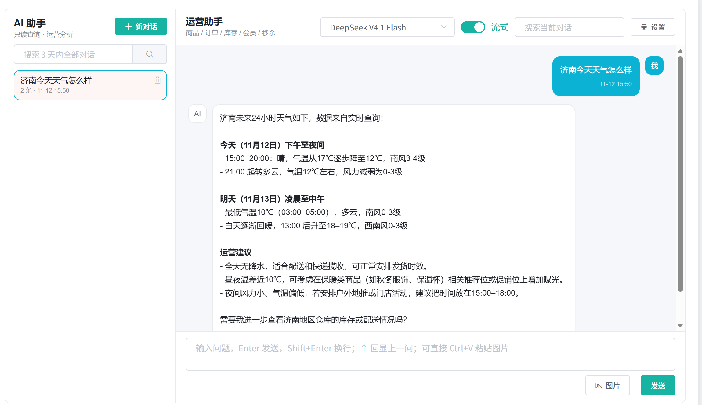
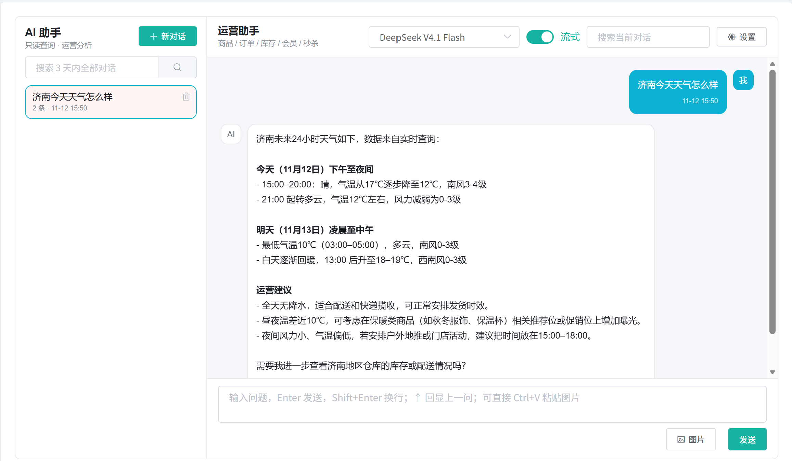
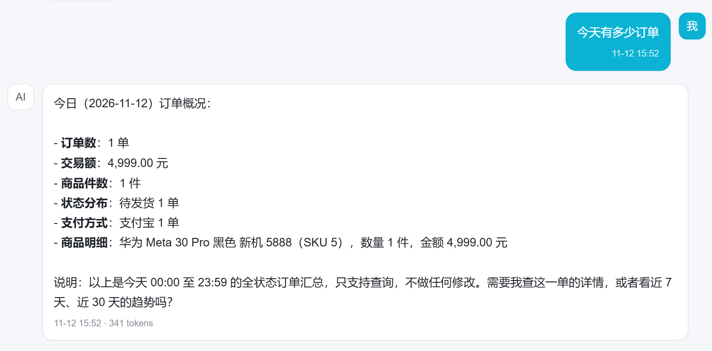
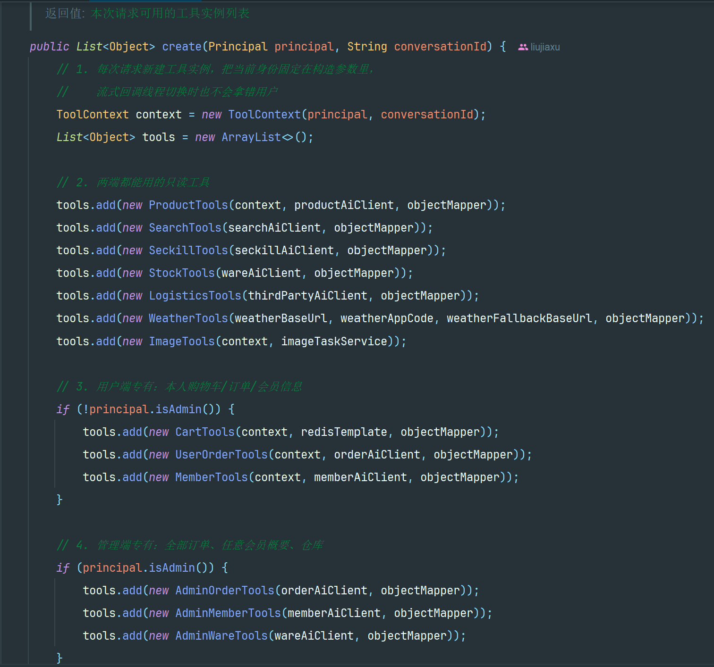

# 19.2 AI 工具与天气查询-介绍

> 本篇介绍谷粒商城 AI 的 Function Calling 工具链路：模型怎么看到工具、Java 侧怎么按角色组装工具、工具怎么拿到当前用户、天气工具怎么先查阿里云再回退 wttr.in、模型返回的非法参数怎么清洗，以及一次“济南天气怎么样”从 JWT 校验到 Redis 落库的完整步骤。

---

## 1. 这个功能是干什么的

AI 模型本身不知道商城今天的库存、订单和天气。工具（Function Calling）解决“让模型查真实数据”的问题：

1. 模型根据用户问题决定调用哪个工具。
2. Java 侧执行工具方法，调用业务模块的只读接口或第三方接口。
3. 工具结果转成 JSON 交回模型。
4. 模型结合工具结果生成最终回答。

`gulimall-agent` 的工具全部是只读查询，不提供新增、修改、删除、发货、退款等写操作。

工具分三类：

| 类别 | 工具 | 用户端 | 管理端 |
|---|---|---|---|
| 公共只读 | 商品、搜索、秒杀、库存、物流、天气、图片 | 可用 | 可用 |
| 用户专属 | 本人购物车、本人订单、会员资料/地址/优惠券/积分 | 可用 | 不可用 |
| 管理专属 | 全部订单检索、交易统计、任意会员概要、仓库列表 | 不可用 | 可用 |

天气查询是一个典型工具：

```text
用户：济南今天天气怎么样？
模型：调用 queryWeather(city="济南")
工具：POST 阿里云 24 小时天气接口
工具：返回天气 JSON
模型：把 JSON 整理成中文回答
```



## 2. 用户、管理员、开发者怎么操作

### 2.1 用户查询天气

1. 用户在聊天窗输入“济南天气怎么样”。
2. 后端把问题交给模型。
3. 模型判断需要调用 `queryWeather`。
4. 工具先查阿里云 24 小时天气。
5. 阿里云失败时自动回退 `wttr.in`。
6. 模型把结果整理成中文回答。

用户不需要知道工具名，也不需要看 JSON，只看到最终天气描述。



### 2.2 用户查询商品和订单

用户可以直接问：

1. “小米手机有哪些型号” → 商品搜索工具。
2. “这个 SKU 还有货吗” → 库存工具。
3. “本人订单到哪了” → 本人订单工具。
4. “本人购物车有什么” → 本人购物车工具。
5. “帮忙看看这个地址在哪” → 地址转经纬度工具。

用户端工具从 JWT 里取当前会员 id，只查本人数据。

### 2.3 管理员查询运营数据

管理员可以直接问：

1. “今天有多少订单” → 管理端订单统计工具。
2. “哪些商品库存不足” → 管理端库存工具。
3. “查一下会员 1001 的概要” → 管理端会员工具。
4. “仓库列表” → 管理端仓库工具。

管理端工具不接收“查询任意会员”的越权参数，工具集本身就不包含用户端工具。



### 2.4 开发者新增工具

新增一个工具分四步：

1. 新建工具类，方法上加 `@Tool` 和 `@P`。
2. 在 `ToolBundleFactory.create` 里按角色加入工具列表。
3. 如果工具要访问当前用户，构造时传入 `ToolContext`。
4. 工具返回值统一走 `ToolResult`，避免超长结果塞满上下文。

工具方法的返回值建议是字符串，内部用 `ToolResult.from` 或 `ToolResult.json` 转 JSON。



### 2.5 开发者配置天气

天气工具需要两个配置：

```yaml
WEATHER_BASE_URL: https://jmweather.market.alicloudapi.com
WEATHER_APP_CODE: <your-sms-app-code>
WEATHER_FALLBACK_BASE_URL: https://wttr.in
```

`WEATHER_APP_CODE` 为空时，工具直接返回“天气服务未配置”，不会编造天气。


## 3. 整体设计思路

### 3.1 业务上怎么设计

#### 3.1.1 工具只读

所有工具只查询，不写入。管理员问“帮忙把这个订单退款”，模型只能回答“当前 AI 只支持查询”。

只读的原因：

1. 自然语言有歧义，误操作代价高。
2. 写操作需要审批、幂等和审计，当前链路没有这些能力。
3. 只读工具可以直接调用业务模块的内部查询接口，不需要改业务表。

#### 3.1.2 角色边界

工具集按身份组装：

1. 公共工具两端都能用。
2. 用户端工具只有 `!principal.isAdmin()` 时加入。
3. 管理端工具只有 `principal.isAdmin()` 时加入。

即使模型被提示词诱导，也调用不到不存在的工具。权限边界在 Java 侧，不在提示词里。

#### 3.1.3 工具结果是事实来源

系统提示词明确规定：

1. 涉及库存、价格、订单、购物车、优惠券、秒杀等实时数据，必须先调工具。
2. 工具结果和知识库冲突时，以工具结果为准。
3. 不允许凭空编造实时数据。

RAG 只补充“功能和流程说明”，不提供实时库存和订单。

#### 3.1.4 天气只作为商城场景补充

天气工具用于：

1. 用户问配送地区天气。
2. 管理员问配送区域天气。
3. 地址定位后的天气补充。

天气不是核心业务数据，所以允许使用第三方接口，并且必须降级。

#### 3.1.5 工具结果要短

模型上下文有限，工具结果统一截断到 6000 字符。业务接口返回的 `R` 只取 `data`、`page` 或 `coupons`，不把整个响应塞进去。

### 3.2 技术上怎么设计

#### 3.2.1 规格与执行器

LangChain4J 的工具由两部分组成：

1. `ToolSpecification`：给模型看的工具名、参数和说明。
2. `ToolExecutor`：真正执行 Java 方法的执行器。

`AssistantFactory.toolExecutors` 遍历工具对象的所有方法，把带 `@Tool` 的方法生成规格，并用 `NullSafeToolExecutor` 包装默认执行器。

#### 3.2.2 工具上下文

`ToolContext` 是一个 record，保存当前 `Principal` 和 `conversationId`。

每个请求新建工具实例，把当前身份固定在构造参数里。这样流式回调线程切换时，也不会拿到其他用户的身份。

#### 3.2.3 内部接口鉴权

工具通过 Feign 调业务模块的 `/internal/ai/**` 接口。每个请求带 `X-Internal-Token`，业务模块用常量时间比较校验。

内部接口不对外开放，外部路径走网关后与 `/internal/ai/**` 不匹配，返回 404。

#### 3.2.4 参数清洗

不同模型的 Function Calling 输出不一致：

1. 有的带 Markdown 代码块。
2. 有的在最后一个字段后多逗号。
3. 有的用中文逗号、中文冒号。
4. 有的把 JSON 再包一层字符串。

`ToolArgumentNormalizer` 先修成标准 JSON，`NullSafeToolExecutor` 再删掉值为 null 的参数，最后交给默认执行器。

#### 3.2.5 天气双通道

天气工具优先调用阿里云：

1. 有 AppCode 才调用。
2. 表单提交 `area=城市`，按 UTF-8 编码。
3. 响应包含 `"success":true` 才采用。
4. 失败、异常、城市不支持时回退 `wttr.in`。
5. 兜底接口只保留模型需要的字段。


## 4. 详细代码、配置和解释

工具调用的代码分成五个位置：工具上下文、工具集工厂、工具实现、结果处理和执行器兼容层。单看任何一个类，都看不出一次调用怎么从 JWT 走到模型回答。本章按“这段代码解决什么问题 → 关键对象与链路位置 → 代码分块解释 → 一次完整示例 → 边界”组织，以天气查询为主线，其他工具只在与主线对照时出现。

### 4.1 ToolContext：工具身份上下文

#### 4.1.1 这个类解决什么问题

AI 对话是多用户并发的：同一个 JVM 里可能同时有多个会员在问自己的购物车，也可能有管理员在查全量订单。工具方法要查“当前用户的数据”，但模型传来的参数只有业务字段，没有身份。身份如果放在单例工具的字段里，两个请求会互相覆盖；如果放在 ThreadLocal 里，流式回答的工具调用可能切换到回调线程，取不到原请求的身份。

`ToolContext` 把身份和会话作为不可变对象显式传给工具，每个请求新建一份，工具从构造参数里拿到，不再依赖线程上下文。它由 `ToolBundleFactory.create` 创建，被 `ProductTools`、`CartTools`、`UserOrderTools`、`MemberTools`、`ImageTools` 读取。

#### 4.1.2 字段与业务含义

| 字段 | 类型 | 来源 | 用途 |
|---|---|---|---|
| `principal` | `Principal` | `AgentJwtService.verify` 解析 JWT 后得到 | 判断 USER/ADMIN，取会员 id 或管理员 id |
| `conversationId` | `String` | `ConversationService.getOrCreate` 返回 | 图片工具把生成结果写回当前会话；日志串联 |

`Principal` 自身包含 `type`、`id`、`username`、`displayName` 四个字段，并提供 `subject()` 生成 `USER:1` 这样的稳定标识、`isAdmin()` 判断管理端。工具只依赖这两个方法，不直接解析 JWT。

#### 4.1.3 在链路里的位置

```text
浏览器携带 JWT Cookie
  → PrincipalResolver 识别 AGENT_JWT_ADMIN / AGENT_JWT_USER
  → AgentJwtService.verify 验签并构造 Principal
  → ChatOrchestrator.prepare 取会话
  → AssistantFactory.assistant 构建 AI Service
  → ToolBundleFactory.create(principal, conversationId)
  → new ToolContext(principal, conversationId)
  → 工具实例持有 context
  → 模型发起工具调用时读取 context
```

`ToolContext` 不参与模型调用本身，只在 Java 侧工具方法执行时提供身份。模型看不到 `principal`，也拿不到别人的 id。

#### 4.1.4 代码与解释

这个 record 的定义很短，作用是让工具在任意线程执行时都能拿到创建它时的身份。

```java
public record ToolContext(Principal principal, String conversationId) {
}
```

1. `record` 自动生成全参构造器，`ToolBundleFactory` 的 `new ToolContext(principal, conversationId)` 直接完成赋值。
2. `principal` 保存身份。购物车、订单、会员工具用它拼会员 id；管理工具不读 `principal`，但也由同一个工厂创建。
3. `conversationId` 保存会话 id。图片工具用它把异步生成的任务结果写回会话列表。
4. 没有 setter。工具无法在执行过程中改身份，避免一次调用里身份被替换。
5. 没有业务方法。上下文只传数据，查什么、怎么查由各工具自己决定。

#### 4.1.5 一次完整示例

```text
1. 会员 1 登录用户端，Cookie 里是 AGENT_JWT_USER
2. 提问“本人购物车有什么”
3. AgentJwtService.verify 解析出 Principal(USER, 1, ...)
4. ConversationService.getOrCreate 返回 conv-abc
5. ToolBundleFactory 创建 ToolContext(USER:1 的 Principal, "conv-abc")
6. 模型调用 CartTools 的购物车方法
7. CartTools 从 context.principal().id() 取 1，只读 Redis 里会员 1 的购物车
8. 同一时刻会员 2 的请求使用另一份 ToolContext，id 为 2
```

两个请求各自持有自己的上下文，互不影响。

#### 4.1.6 它不做什么

1. 不校验 JWT，验签在 `AgentJwtService`。
2. 不判断会话归属，归属校验在 `ConversationService`。
3. 不保存模型记忆，记忆由 `RedisChatMemoryStore` 维护。
4. 不缓存，也不跨请求复用。
5. 不限制工具行为，只提供身份。

#### 4.1.7 边界与可优化点

1. 可以补 requestId 或 traceId，方便把一次对话里的多次工具调用串起来。
2. `conversationId` 对不需要会话的工具（天气、库存）没有用处，可以拆成两个上下文，或允许为 null。
3. `Principal` 里的 `type` 和 `id` 是宽松组合，工具直接拼字符串容易出错，可以提供 `memberId()` 之类的方法。
4. 上下文只包含身份，不包含用户选择的模型；工具如果需要模型信息，只能再传参数。

### 4.2 ToolBundleFactory：按角色组装工具集

#### 4.2.1 这个类解决什么问题

聊天窗的用户端和管理端共用一套后端。用户问“本人订单到哪了”，管理员问“今天有多少订单”，两句话都可能被模型翻译成工具调用。如果工具集不分角色，用户端模型就能调用“查全部订单”“查任意会员”这类接口。提示词只能约束模型的行为，拦不住提示词注入，真正的权限边界必须落在 Java 侧。

`ToolBundleFactory` 在每次请求时按 `Principal` 组装工具列表：公共只读工具两端都给，用户专属工具只在非管理员时加入，管理专属工具只在管理员时加入。模型看到的工具清单里根本没有越权工具，即使它想调用也找不到。这个类还负责把天气配置和各个 Feign 客户端注入到具体工具实例。

调用方是 `AssistantFactory`，上游是 JWT 解析出的 `Principal` 和 `ConversationService` 返回的会话 id，下游是 13 个工具类。

#### 4.2.2 工具清单与角色边界

| 工具类 | 能力 | 用户端 | 管理端 |
|---|---|---|---|
| `ProductTools` | 商品搜索、SKU/SPU 详情、分类、品牌 | 可用 | 可用 |
| `SearchTools` | ES 全文搜索 | 可用 | 可用 |
| `SeckillTools` | 秒杀场次和商品 | 可用 | 可用 |
| `StockTools` | SKU 库存 | 可用 | 可用 |
| `LogisticsTools` | 地址转经纬度、物流 | 可用 | 可用 |
| `WeatherTools` | 24 小时天气 | 可用 | 可用 |
| `ImageTools` | 图片生成任务 | 可用 | 可用 |
| `CartTools` | 本人购物车 | 可用 | 不可用 |
| `UserOrderTools` | 本人订单 | 可用 | 不可用 |
| `MemberTools` | 本人资料、地址、优惠券、积分 | 可用 | 不可用 |
| `AdminOrderTools` | 全部订单检索与统计 | 不可用 | 可用 |
| `AdminMemberTools` | 任意会员概要 | 不可用 | 可用 |
| `AdminWareTools` | 仓库列表 | 不可用 | 可用 |

边界由 `!principal.isAdmin()` 和 `principal.isAdmin()` 两个判断固定，不读取请求参数，也不看模型输出。

#### 4.2.3 在链路里的位置

```text
ChatOrchestrator.chat / stream
  → AssistantFactory.assistant / streamingAssistant
  → ToolBundleFactory.create(principal, conversationId)
  → List<Object> 工具实例
  → AssistantFactory.toolExecutors 生成 ToolSpecification
  → AiServices.builder().tools(...)
```

工厂只在构建 AI Service 时调用一次。工具执行阶段不再经过这个类。

#### 4.2.4 代码与解释

下面这个类承担两件事：持有所有下游客户端和天气配置；按角色返回工具实例列表。先看完整代码。

```java
@Service
public class ToolBundleFactory {

    private final ProductAiClient productAiClient;
    private final SearchAiClient searchAiClient;
    private final OrderAiClient orderAiClient;
    private final MemberAiClient memberAiClient;
    private final WareAiClient wareAiClient;
    private final SeckillAiClient seckillAiClient;
    private final ThirdPartyAiClient thirdPartyAiClient;
    private final ImageTaskService imageTaskService;
    private final StringRedisTemplate redisTemplate;
    private final ObjectMapper objectMapper;
    private final String weatherBaseUrl;
    private final String weatherAppCode;
    private final String weatherFallbackBaseUrl;

    public ToolBundleFactory(ProductAiClient productAiClient,
                             SearchAiClient searchAiClient,
                             OrderAiClient orderAiClient,
                             MemberAiClient memberAiClient,
                             WareAiClient wareAiClient,
                             SeckillAiClient seckillAiClient,
                             ThirdPartyAiClient thirdPartyAiClient,
                             ImageTaskService imageTaskService,
                             StringRedisTemplate redisTemplate,
                             ObjectMapper objectMapper,
                             @Value("${WEATHER_BASE_URL:https://jmweather.market.alicloudapi.com}") String weatherBaseUrl,
                             @Value("${WEATHER_APP_CODE:}") String weatherAppCode,
                             @Value("${WEATHER_FALLBACK_BASE_URL:https://wttr.in}") String weatherFallbackBaseUrl) {
        this.productAiClient = productAiClient;
        this.searchAiClient = searchAiClient;
        this.orderAiClient = orderAiClient;
        this.memberAiClient = memberAiClient;
        this.wareAiClient = wareAiClient;
        this.seckillAiClient = seckillAiClient;
        this.thirdPartyAiClient = thirdPartyAiClient;
        this.imageTaskService = imageTaskService;
        this.redisTemplate = redisTemplate;
        this.objectMapper = objectMapper;
        this.weatherBaseUrl = weatherBaseUrl;
        this.weatherAppCode = weatherAppCode;
        this.weatherFallbackBaseUrl = weatherFallbackBaseUrl;
    }

    public List<Object> create(Principal principal, String conversationId) {
        ToolContext context = new ToolContext(principal, conversationId);
        List<Object> tools = new ArrayList<>();

        tools.add(new ProductTools(context, productAiClient, objectMapper));
        tools.add(new SearchTools(searchAiClient, objectMapper));
        tools.add(new SeckillTools(seckillAiClient, objectMapper));
        tools.add(new StockTools(wareAiClient, objectMapper));
        tools.add(new LogisticsTools(thirdPartyAiClient, objectMapper));
        tools.add(new WeatherTools(weatherBaseUrl, weatherAppCode, weatherFallbackBaseUrl, objectMapper));
        tools.add(new ImageTools(context, imageTaskService));

        if (!principal.isAdmin()) {
            tools.add(new CartTools(context, redisTemplate, objectMapper));
            tools.add(new UserOrderTools(context, orderAiClient, objectMapper));
            tools.add(new MemberTools(context, memberAiClient, objectMapper));
        }

        if (principal.isAdmin()) {
            tools.add(new AdminOrderTools(orderAiClient, objectMapper));
            tools.add(new AdminMemberTools(memberAiClient, objectMapper));
            tools.add(new AdminWareTools(wareAiClient, objectMapper));
        }

        return tools;
    }
}
```

字段与构造器：

1. 7 个 Feign 客户端分别指向商品、搜索、订单、会员、仓库、秒杀、第三方模块。每个客户端只暴露 `/internal/ai/**` 只读接口。
2. `imageTaskService` 用于图片生成任务，`redisTemplate` 用于读取购物车，`objectMapper` 用于工具内 JSON 序列化。
3. 三个天气配置通过 `@Value` 注入，并给了开发默认值：主接口地址、AppCode、兜底地址。AppCode 默认为空，空值时天气工具直接返回未配置。
4. 构造器注入而不是字段注入，依赖不可变，测试时可以直接传入替身对象。

`create` 方法的执行顺序：

1. 创建 `ToolContext`，把身份和会话固定下来。
2. 先加 7 个公共工具。天气工具不需要身份，图片工具需要会话。
3. 非管理员追加购物车、本人订单、本人会员工具，这三个工具构造时都传 `context`。
4. 管理员追加全部订单、任意会员、仓库工具，这三个工具不传 `context`，因为管理工具不按会员过滤。
5. 返回 `ArrayList`，顺序就是模型看到的工具顺序。

为什么每次请求新建工具实例：工具实例很轻，持有的是 `context` 和客户端引用；真正的模型对象、连接池由 Spring 和 `ModelFactory` 管理。如果工具做成单例并持有 `principal`，并发请求会串身份。每次新建把“这次请求是谁”固化在对象里，流式回调切线程也不会丢。

为什么用两个独立的 if：用 `!isAdmin()` 和 `isAdmin()` 而不是 if/else，是为了让公共工具和角色工具的分组一眼可见；两个分支互斥，效果等价。

#### 4.2.5 一次完整示例

```text
用户端 USER:1 提问
  → create(USER:1, conv-1)
  → 公共 7 个：Product/Search/Seckill/Stock/Logistics/Weather/Image
  → 追加 Cart/UserOrder/Member
  → 共 10 个工具

管理端 ADMIN:1 提问
  → create(ADMIN:1, conv-2)
  → 公共 7 个：Product/Search/Seckill/Stock/Logistics/Weather/Image
  → 追加 AdminOrder/AdminMember/AdminWare
  → 共 10 个工具
```

两边的公共部分相同，差异只在后三个。USER 的工具集里没有 `AdminOrderTools`，模型无法通过任何参数调用到全量订单接口。

#### 4.2.6 它不做什么

1. 不执行工具，只创建对象。
2. 不校验工具方法内部的业务权限，例如“本人订单”只按 `principal.id` 查，越权校验落在 SQL 条件里。
3. 不检查下游服务是否在线，Feign 调用失败由工具和 `NullSafeToolExecutor` 处理。
4. 不做工具名去重，同名方法要在编写工具时避免。
5. 不缓存工具实例。

#### 4.2.7 边界与可优化点

1. 构造函数有 13 个参数，每加一个工具都要改签名，可以按业务域拆成多个子工厂，或改成注册表。
2. 工具清单写死在代码里，无法按环境或租户开关；生产环境可以改成配置驱动，并支持工具级熔断。
3. 公共工具里的 `ImageTools` 需要身份和会话，`WeatherTools` 不需要，统一传 `context` 会多传无用字段。
4. 两端各有 10 个工具，模型工具越多，选择错误率越高，可以按用户问题做工具预筛选。
5. 新增工具时如果忘记在两个分支里注册，模型永远看不到它，当前没有启动校验。

### 4.3 ProductTools：商品只读工具

#### 4.3.1 这个类解决什么问题

模型训练数据里的商品价格、型号、库存都是旧的，直接回答会编造。用户在聊天窗问“小米手机有哪些型号”“这个 SKU 多少钱”“商城有哪些分类”，需要实时查商品库。商品模块已经有只读的内部接口，`ProductTools` 的职责是给这些接口加上模型能理解的工具说明和参数说明，并把返回的统一响应压成模型能读的 JSON。

它面向模型，不面向浏览器：没有 Controller、没有页面，唯一入口是 LangChain4J 反射调用。上游是模型生成的 `ToolExecutionRequest`，下游是 `ProductAiClient` 和 `gulimall-product` 的 `/internal/ai/product/**` 接口。

#### 4.3.2 链路位置

```text
模型决定查询商品
  → ToolExecutionRequest{name=searchProducts, arguments={...}}
  → NullSafeToolExecutor.execute
  → DefaultToolExecutor 反射调用 ProductTools.searchProducts
  → ProductAiClient.search（Feign，带 X-Internal-Token）
  → gulimall-product 内部接口
  → R{code,msg,data}
  → ToolResult.from 只取 data
  → ToolExecutionResultMessage 交回模型
```

这条链路里，`ProductTools` 只做参数兜底和结果转换；鉴权、分页、SQL 都在商品模块。

#### 4.3.3 代码与解释

下面这段是商品搜索工具。它要处理模型给的空参数、非法页码和超大分页，再把 Feign 返回的 `R` 转成模型能读的文本。

```java
@Tool("按关键字、分类、品牌、价格区间搜索商品，返回 SKU 列表")
public String searchProducts(@P("搜索关键字，例如 手机、小米；可为空") String keyword,
                             @P("三级分类 id，可为空") Long categoryId,
                             @P("品牌 id，可为空") Long brandId,
                             @P("最低价格，可为空") Double minPrice,
                             @P("最高价格，可为空") Double maxPrice,
                             @P("页码，从 1 开始") Integer page,
                             @P("每页数量，最多 20") Integer size) {
    String pageStr = String.valueOf(page == null || page < 1 ? 1 : page);
    String sizeStr = String.valueOf(size == null ? 10 : Math.min(size, 20));

    Map<String, Object> response = client.search(
            keyword,
            categoryId == null ? null : String.valueOf(categoryId),
            brandId == null ? null : String.valueOf(brandId),
            minPrice == null ? null : String.valueOf(minPrice),
            maxPrice == null ? null : String.valueOf(maxPrice),
            pageStr,
            sizeStr
    );
    return ToolResult.from(response, mapper);
}
```

1. `@Tool` 的描述是给模型看的，说明这个工具能按关键字、分类、品牌、价格区间搜索，返回 SKU 列表。描述里不写 SQL、不写表名。
2. 7 个 `@P` 参数逐个说明含义和是否可为空。模型据此决定哪些参数可以不传。
3. `page` 为 null 或小于 1 时按第 1 页；`size` 为 null 时按 10 条，超过 20 时截到 20，防止模型一次拉取过多数据。
4. Feign 方法接收字符串参数，工具把 `Long`、`Double` 转成字符串，为 null 时传 null，表示不按该条件筛选。
5. 返回值走 `ToolResult.from`，业务成功只取 `data` 或 `page`，业务失败转成“查询失败：原因”。
6. 这个类里还有 `getSkuDetail`、`listCategories`、`listBrands`、`listSpuSkus`、`getSpuInfo`，结构相同：校验必填 id、调 Feign、走 `ToolResult`。

为什么参数兜底放在工具里而不是商品模块：模型可能传 `size=1000` 或 `page=0`，商品模块的内部接口也可能被其他调用方使用，不适合替 AI 兜底。工具层按模型的使用习惯做限制，业务模块保持自己的校验。

#### 4.3.4 一次完整示例

```text
用户：小米手机有哪些型号？
模型：调用 searchProducts(keyword="小米", page=1, size=10)
工具：pageStr=1，sizeStr=10
Feign：GET /internal/ai/product/search?keyword=小米&page=1&size=10
商品模块：返回 R{code=0, page={...}}
工具：ToolResult.from 取 page，序列化成 JSON
模型：从 SKU 列表里整理型号和价格，用中文回答
```

工具不负责挑型号，也不负责排序；筛选逻辑已经由商品模块完成。

#### 4.3.5 边界与可优化点

1. 没有校验 `minPrice <= maxPrice`，模型传反了会得到空结果，回答容易变成“没有找到”。
2. `size` 只处理了 null 和大于 20，传 0 会按 0 条查询，当前没有兜底。
3. `searchProducts` 和 `SearchTools` 的全文搜索能力重叠，模型可能选错；工具描述里要强调“条件筛选”和“全文检索”的差别。
4. 没有缓存，热门问题每次都查库；商品数据变化快，缓存要配合短 TTL 或失效通知。
5. 内部接口依赖 `X-Internal-Token`，token 配置错误时工具只会拿到 404 或错误响应，日志里需要能定位。
6. 工具返回的 SKU 字段由商品模块决定，字段过多时会挤占上下文，可以在工具层裁剪。

### 4.4 WeatherTools：天气工具完整实现

#### 4.4.1 这个类解决什么问题

天气不是商城数据库里的数据。用户问“济南明天适合收货吗”，管理员问“配送区域会下雨吗”，模型只能通过第三方接口拿实时天气。第三方接口有两个现实问题：主接口可能因为 AppCode 失效、城市不支持、网络抖动而失败；接口响应可能很大，直接塞给模型会挤占上下文。`WeatherTools` 因此设计成主接口加兜底接口：先查阿里云 24 小时天气，失败再查 wttr.in，兜底结果只保留模型需要的字段。

工具是公共只读工具，两端都能用，不读取 `Principal`，也不访问业务数据库。上游是模型生成的参数 `city`，下游是阿里云云市场和 wttr.in。

#### 4.4.2 关键配置与链路位置

| 配置项 | 默认值 | 用途 |
|---|---|---|
| `WEATHER_BASE_URL` | `https://jmweather.market.alicloudapi.com` | 阿里云主接口地址 |
| `WEATHER_APP_CODE` | 空 | 阿里云 AppCode；为空时工具直接返回未配置 |
| `WEATHER_FALLBACK_BASE_URL` | `https://wttr.in` | 兜底接口地址 |

```text
模型：queryWeather(city="济南")
  → NullSafeToolExecutor（清洗 null 参数）
  → WeatherTools.queryWeather
      ├── POST 阿里云 /weather/query/24h（表单 area=济南）
      └── 失败时 GET wttr.in /济南?format=j1&lang=zh
  → ToolResult.raw 截断
  → 模型生成中文回答
```

#### 4.4.3 代码与解释

这个类包含两个客户端、一个工具方法和一个兜底方法。客户端在构造时建好，超时固定，避免工具调用被无限挂起。先看完整实现。

```java
public class WeatherTools {

    private final RestClient restClient;
    private final String appCode;
    private final RestClient fallbackClient;
    private final ObjectMapper mapper;

    public WeatherTools(String baseUrl, String appCode, String fallbackBaseUrl, ObjectMapper mapper) {
        this.restClient = RestClient.builder()
                .baseUrl(baseUrl)
                .requestFactory(requestFactory(3000, 8000))
                .build();
        this.appCode = appCode;

        this.fallbackClient = RestClient.builder()
                .baseUrl(fallbackBaseUrl)
                .requestFactory(requestFactory(5000, 12000))
                .build();
        this.mapper = mapper;
    }

    private static SimpleClientHttpRequestFactory requestFactory(int connectTimeoutMs, int readTimeoutMs) {
        SimpleClientHttpRequestFactory factory = new SimpleClientHttpRequestFactory();
        factory.setConnectTimeout(connectTimeoutMs);
        factory.setReadTimeout(readTimeoutMs);
        return factory;
    }

    @Tool("查询某个城市/地区未来 24 小时天气")
    public String queryWeather(@P("城市或地区名，例如 济南、北京") String city) {
        if (!StringUtils.hasText(appCode)) {
            return "天气服务未配置：请设置环境变量 ALIYUN_WEATHER_APP_CODE";
        }
        if (city == null || city.isBlank()) {
            return "查询失败：城市不能为空";
        }

        try {
            MultiValueMap<String, String> form = new LinkedMultiValueMap<>();
            form.add("area", city.trim());
            String result = restClient.post()
                    .uri("/weather/query/24h")
                    .header("Authorization", "APPCODE " + appCode)
                    .contentType(new MediaType(MediaType.APPLICATION_FORM_URLENCODED, StandardCharsets.UTF_8))
                    .body(form)
                    .exchange((request, response) -> response.bodyTo(String.class));

            if (result != null && result.contains("\"success\":true")) {
                return ToolResult.raw(result);
            }
            return queryWttr(city, "阿里云天气返回失败");
        } catch (CancellationException ex) {
            if (Thread.currentThread().isInterrupted()) {
                return "天气查询已取消";
            }
            return queryWttr(city, "阿里云天气请求被取消");
        } catch (Exception ex) {
            return queryWttr(city, "阿里云天气调用异常："
                    + ex.getClass().getSimpleName() + "：" + ex.getMessage());
        }
    }

    private String queryWttr(String city, String reason) {
        try {
            String json = fallbackClient.get()
                    .uri(uriBuilder -> uriBuilder
                            .path("/{city}")
                            .queryParam("format", "j1")
                            .queryParam("lang", "zh")
                            .build(city.trim()))
                    .header("Accept-Language", "zh-CN")
                    .retrieve()
                    .body(String.class);
            if (!StringUtils.hasText(json)) {
                return "天气查询失败：" + reason + "；兜底接口也没有返回数据";
            }

            JsonNode root = mapper.readTree(json);
            JsonNode current = root.path("current_condition").path(0);
            Map<String, Object> data = new LinkedHashMap<>();
            data.put("source", "wttr.in");
            data.put("city", city.trim());
            data.put("reason", reason);
            data.put("current", Map.of(
                    "tempC", current.path("temp_C").asText(),
                    "feelsLikeC", current.path("FeelsLikeC").asText(),
                    "humidity", current.path("humidity").asText(),
                    "windKmph", current.path("windspeedKmph").asText(),
                    "desc", current.path("weatherDesc").path(0).path("value").asText(),
                    "observedAt", current.path("observation_time").asText()
            ));

            List<Map<String, String>> hourly = new ArrayList<>();
            JsonNode hours = root.path("weather").path(0).path("hourly");
            for (int i = 0; i < hours.size() && i < 8; i++) {
                JsonNode hour = hours.get(i);
                Map<String, String> item = new LinkedHashMap<>();
                item.put("time", hour.path("time").asText());
                item.put("tempC", hour.path("tempC").asText());
                item.put("desc", hour.path("weatherDesc").path(0).path("value").asText());
                item.put("chanceOfRain", hour.path("chanceofrain").asText());
                hourly.add(item);
            }
            data.put("hourly", hourly);
            return ToolResult.raw(mapper.writeValueAsString(data));
        } catch (CancellationException ex) {
            if (Thread.currentThread().isInterrupted()) {
                return "天气查询已取消";
            }
            return "天气查询失败：" + reason + "；兜底接口请求被取消";
        } catch (Exception ex) {
            return "天气查询失败：" + reason + "；兜底接口也失败："
                    + ex.getClass().getSimpleName() + "：" + ex.getMessage();
        }
    }
}
```

构造函数与请求工厂：

1. 主接口客户端 `baseUrl` 来自 `WEATHER_BASE_URL`，连接超时 3 秒、读取超时 8 秒。
2. 兜底客户端 `baseUrl` 来自 `WEATHER_FALLBACK_BASE_URL`，连接超时 5 秒、读取超时 12 秒，给第三方更宽的读取窗口。
3. 两个客户端都用 `SimpleClientHttpRequestFactory`，同步请求。工具调用被取消时只抛普通 IO 异常，处理路径比异步 HttpClient 简单。
4. `appCode` 保存在字段里，为空时 `queryWeather` 直接返回未配置。
5. `mapper` 用于解析 wttr.in 的 JSON。

`queryWeather` 的执行顺序：

1. AppCode 为空，返回“天气服务未配置”，不调用任何接口，避免编造。
2. 城市为空或全空白，返回参数错误。
3. 用 `LinkedMultiValueMap` 组装表单 `area=城市`，`contentType` 指定 `application/x-www-form-urlencoded` 和 UTF-8，中文城市名由消息转换器编码。
4. 请求头带 `Authorization: APPCODE {appCode}`。
5. `exchange` 读取响应体，不按状态码抛异常。阿里云业务失败时仍返回带 JSON 的响应，需要读 body 判断。
6. 响应包含 `"success":true`，原样交给 `ToolResult.raw` 截断。
7. 响应不成功，调用 `queryWttr(city, "阿里云天气返回失败")`。
8. 抛 `CancellationException` 时先看线程中断标记：已中断说明模型超时或用户停止，返回“已取消”，不再发起兜底请求。
9. 其他异常（网络、鉴权、解析）也走兜底，并把异常类名和消息带进原因。

`queryWttr` 的执行顺序：

1. GET `/{city}`，参数 `format=j1&lang=zh`，城市名走路径变量编码。
2. 解析 `current_condition[0]`，取温度、体感、湿度、风速、描述、观测时间。
3. 取 `weather[0].hourly` 前 8 个节点，3 小时间隔，覆盖 24 小时。
4. 组装 `source/city/reason/current/hourly`，`reason` 说明为什么走兜底。
5. 用 `ToolResult.raw` 序列化并截断到 6000 字符。
6. 兜底接口为空或抛异常时返回失败原因，异常同样区分取消和普通失败。

为什么主接口用表单而不是 JSON：阿里云 jmweather 对中文城市名敏感。字符串 body 如果编码不是 UTF-8，服务端会收到乱码并返回“未找到该地区”。表单对象交给 Spring 的 `FormHttpMessageConverter`，按指定的 UTF-8 编码，稳定得多。

为什么兜底只保留少数字段：wttr.in 的 `j1` 响应约 25KB，包含大量历史、天文和嵌套结构。模型只需要当前天气和 24 小时预报，裁剪后只有几 KB。

#### 4.4.4 一次完整示例

主接口成功：

```text
1. 用户问“济南天气怎么样”
2. 模型调用 queryWeather(city="济南")
3. AppCode 非空，城市非空
4. POST https://jmweather.market.alicloudapi.com/weather/query/24h
5. 表单 area=济南，UTF-8 编码
6. 响应包含 "success":true
7. ToolResult.raw 截断后返回
8. 模型把 JSON 整理成“济南当前温度、天气、未来 24 小时”回答
```

主接口失败：

```text
1. 阿里云返回 success=false 或请求超时
2. queryWeather 调用 queryWttr("济南", "阿里云天气返回失败")
3. GET https://wttr.in/济南?format=j1&lang=zh
4. 解析 current_condition[0] 和 weather[0].hourly
5. 只保留当前天气和 8 个 3 小时节点
6. reason 字段告诉模型这次数据来自兜底
7. 模型回答时说明数据来源和观测时间
```

#### 4.4.5 它不做什么

1. 不把城市名转换成经纬度，也不做行政区划校正；城市不支持时只能依赖兜底。
2. 不缓存天气，同一城市每次提问都会重新请求第三方。
3. 不重试主接口，失败直接降级。
4. 不生成自然语言，JSON 交给模型组织。
5. 不在请求被取消后继续执行兜底，避免用户已经停止还占用线程。

#### 4.4.6 边界与可优化点

1. AppCode 通过环境变量注入，代码里的默认值为空；配置错误时工具只会返回未配置或失败提示。返回提示里写的变量名是 `ALIYUN_WEATHER_APP_CODE`，实际注入项是 `WEATHER_APP_CODE`，排障时以配置项为准。
2. 城市名没有长度限制，超长字符串会拼进 URL。
3. 没有缓存和限流，高频查询会消耗第三方配额。
4. 没有指标，无法统计主接口成功率和兜底率。
5. 天气数据结构依赖 wttr.in 的字段名，对方改版会导致解析出空值，需要监控。
6. 两个 `RestClient` 在每次 `new WeatherTools` 时创建，虽然轻量，但连接无法跨请求复用；可以把 `RestClient` 做成 Bean。

### 4.5 ToolResult：工具结果统一处理

#### 4.5.1 这个类解决什么问题

业务模块的接口统一返回 `R`，包含 `code/msg/data/page` 等字段。模型不需要 `code`，也不需要 traceId、内部路径这类字段；如果整包塞进上下文，既浪费 token，也可能把内部信息带进回答。工具返回空值时，模型还可能把 `null` 当成“库存为 0”或“没有订单”。`ToolResult` 统一处理三件事：判断业务是否成功、只取模型需要的部分、限制长度并处理空值。

所有工具在返回前都会调用它，它是工具输出进入模型前的最后一道格式化。

#### 4.5.2 三个入口与链路位置

| 方法 | 输入 | 使用场景 |
|---|---|---|
| `from` | `Map`（业务 `R`） | 商品、订单、会员、库存等 Feign 接口 |
| `raw` | 已生成的 JSON 或文本 | 天气、物流等第三方接口 |
| `json` | 任意对象 | 工具内部组装的结构 |

```text
Feign / 第三方接口
  → 工具方法
  → ToolResult.from / raw / json
  → ToolExecutionResultMessage
  → 模型
```

#### 4.5.3 代码与解释

下面三个静态方法共用 6000 字符上限。类不可实例化，只提供静态工具方法。

```java
public static String from(Map<String, Object> response, ObjectMapper mapper) {
    if (response == null) {
        return "查询失败：服务返回为空";
    }

    Object code = response.get("code");
    if (code != null && !"0".equals(String.valueOf(code))) {
        Object msg = response.get("msg");
        return "查询失败：" + (msg == null ? code : msg);
    }

    if (response.containsKey("data")) {
        return json(response.get("data"), mapper);
    }
    if (response.containsKey("page")) {
        return json(response.get("page"), mapper);
    }
    if (response.containsKey("coupons")) {
        return json(response.get("coupons"), mapper);
    }
    return json(response, mapper);
}

public static String raw(String text) {
    if (text == null) {
        return "没有查到数据";
    }
    if (text.length() > MAX_LENGTH) {
        return text.substring(0, MAX_LENGTH) + "...(已截断)";
    }
    return text;
}

public static String json(Object value, ObjectMapper mapper) {
    if (value == null) {
        return "没有查到数据";
    }

    try {
        String json = mapper.writeValueAsString(value);
        if (json.length() > MAX_LENGTH) {
            return json.substring(0, MAX_LENGTH) + "...(已截断)";
        }
        return json;
    } catch (Exception ex) {
        return String.valueOf(value);
    }
}
```

`from` 的处理顺序：

1. 响应为 null，返回“查询失败：服务返回为空”。
2. 取 `code`，不为 0 时取 `msg` 返回；`msg` 为空时把 code 返回。模型看到的是业务错误，不是空数据。
3. 有 `data` 就只序列化 `data`。
4. 没有 `data` 但有 `page`，序列化 `page`，分页查询通常把列表放在这里。
5. 有 `coupons` 时序列化 `coupons`；都没有才返回整个响应。

`raw` 的处理顺序：

1. 文本为 null，返回“没有查到数据”。
2. 超过 6000 字符，截断并加“...(已截断)”。
3. 未超长原样返回，不再解析 JSON。

`json` 的处理顺序：

1. 对象为 null，返回“没有查到数据”。
2. 用传入的 `ObjectMapper` 序列化。
3. 超过 6000 字符截断并标记。
4. 序列化异常时退回 `String.valueOf(value)`，保证工具仍有输出。

为什么截断而不是让模型自己处理：模型上下文按 token 计费，一次超大响应可能把历史消息挤出窗口。截断是保底手段，优先做法还是只取必要字段。

#### 4.5.4 一次完整示例

```text
业务成功：R{code=0, msg="success", data=[...]}
  → from 取 data → JSON 数组 → 模型

业务失败：R{code=1, msg="商品不存在"}
  → from 返回 "查询失败：商品不存在" → 模型

第三方成功：阿里云返回 18KB JSON
  → raw 未超长，原样返回

第三方超大：wttr.in 原始 JSON 26KB
  → raw 截断到 6000 字符并加标记
```

#### 4.5.5 边界与可优化点

1. 6000 字符是硬编码，不同模型的上下文窗口不同，可以按模型配置。
2. 直接按字符截断可能切断 JSON 结构，模型解析会失败；更稳妥的做法是按字段裁剪或返回结构化对象。
3. `from` 只认 `data/page/coupons`，其他业务字段（例如 `list`、`total`）会被忽略。
4. 截断标记是中文，模型能理解，但前端如果直接展示工具结果会看到省略号。
5. 没有记录被截断的次数和原始长度，无法评估工具结果是否过大。

### 4.6 NullSafeToolExecutor：过滤 null 参数并兜底异常

#### 4.6.1 这个类解决什么问题

LangChain4J 1.0.1 的默认工具执行器有两个会在生产里放大的缺陷。第一，模型对“可为空”的参数会显式返回 null，默认执行器在转换数字参数时不做 null 判断，直接空指针；第二，模型返回的参数可能不是严格 JSON，解析异常会被流式 SSE 监听器吞掉，`onComplete` 和 `onError` 都不触发，前端一直转圈，会话锁也不释放。

`NullSafeToolExecutor` 在默认执行器外面包一层：先把参数修成标准 JSON 并删掉 null 键，再把执行异常转成模型可读的 JSON 错误结果。它不改变工具方法本身，所有工具共用这一层。

调用方是 `AssistantFactory.toolExecutors`，下游是 `DefaultToolExecutor`。

#### 4.6.2 链路位置

```text
AssistantFactory.toolExecutors
  → new NullSafeToolExecutor(tool, method)
  → 注册到 AiServices

模型返回 ToolExecutionRequest
  → NullSafeToolExecutor.execute
      → dropNullArguments
          → ToolArgumentNormalizer.normalize
          → 删除 null 键
      → DefaultToolExecutor.execute（反射调用工具方法）
      → 异常时 errorResult 转 JSON
```

#### 4.6.3 代码与解释

这个类的核心是“先清洗、再委托、异常兜底”三步。先看完整代码。

```java
@Slf4j
public class NullSafeToolExecutor implements ToolExecutor {

    private static final ObjectMapper MAPPER = new ObjectMapper();

    private final ToolExecutor delegate;

    public NullSafeToolExecutor(Object tool, Method method) {
        this.delegate = new DefaultToolExecutor(tool, method);
    }

    @Override
    public String execute(ToolExecutionRequest request, Object memoryId) {
        ToolExecutionRequest safeRequest = dropNullArguments(request);

        try {
            return delegate.execute(safeRequest, memoryId);
        } catch (Exception ex) {
            log.warn("工具执行失败 tool={} arguments={}", request.name(), request.arguments(), ex);
            return errorResult(ex);
        }
    }

    private String errorResult(Exception ex) {
        Throwable current = ex;
        while (current.getCause() != null && current.getCause() != current) {
            current = current.getCause();
        }
        String message = current.getMessage();
        String reason = message == null || message.isBlank()
                ? current.getClass().getSimpleName() : message;

        Map<String, Object> result = new LinkedHashMap<>();
        result.put("error", "工具调用失败：" + reason);
        try {
            return MAPPER.writeValueAsString(result);
        } catch (Exception ignored) {
            return "工具调用失败：" + reason;
        }
    }

    private ToolExecutionRequest dropNullArguments(ToolExecutionRequest request) {
        String json = request.arguments();
        if (json == null || json.isBlank()) {
            return request;
        }

        try {
            String normalized = ToolArgumentNormalizer.normalize(json);

            Map<String, Object> args = MAPPER.readValue(
                    normalized, new TypeReference<LinkedHashMap<String, Object>>() {
                    });
            boolean removed = args.entrySet().removeIf(entry -> entry.getValue() == null);

            String safeJson = removed ? MAPPER.writeValueAsString(args) : normalized;
            if (!removed && normalized.equals(json)) {
                return request;
            }

            return ToolExecutionRequest.builder()
                    .id(request.id())
                    .name(request.name())
                    .arguments(safeJson)
                    .build();
        } catch (Exception e) {
            return request;
        }
    }
}
```

构造器：

1. 保存委托执行器。
2. 用工具实例和方法创建 `DefaultToolExecutor`，真正的参数转换、反射调用、返回值序列化都由它完成。

`execute` 的执行顺序：

1. 调用 `dropNullArguments` 得到安全请求。
2. 委托 `DefaultToolExecutor.execute`。
3. 捕获所有异常，记录工具名和参数，返回 `errorResult`。异常不再上抛到流式回调。

`errorResult` 的执行顺序：

1. 沿 `getCause()` 找到最底层异常，避免模型只看到一层包装。
2. 取消息，消息为空时用异常类名。
3. 组装 `{"error":"工具调用失败：..."}`；JSON 序列化再失败就返回纯文本。

`dropNullArguments` 的执行顺序：

1. 参数为空或空白，原样返回，工具方法通常没有参数或有默认值。
2. 调用 `ToolArgumentNormalizer.normalize`，把代码块、尾随逗号、中文标点、双重编码修成标准 JSON。
3. 用 `LinkedHashMap` 解析，保持参数顺序，删除 value 为 null 的键。
4. 只要 JSON 被修复过，就把修复后的 JSON 放进新请求，不能退回原始非法参数；没有 null 且没有修复时直接返回原请求，省一次对象创建。
5. 用原 id、name 和清洗后的 arguments 重建 `ToolExecutionRequest`；解析失败时返回原请求，交给 `execute` 统一转成工具错误。

为什么删除 null 而不是给默认值：工具方法把“参数不存在”解释为“不按该条件筛选”，这和 null 的业务语义一致。给默认值会改变查询条件，例如把 `categoryId=null` 改成 0，可能查出错误分类。

为什么异常要转成工具结果：工具失败不应该让整条 SSE 流卡死。把错误交回模型，模型至少能告诉用户“查询失败，请稍后重试”，会话锁也能正常释放。

#### 4.6.4 一次完整示例

null 参数：

```text
1. 模型返回 {"city":"济南","days":null}
2. dropNullArguments 解析成 Map
3. 删除 days 键
4. 重建 arguments 为 {"city":"济南"}
5. DefaultToolExecutor 反射调用 queryWeather("济南")
6. 工具正常返回天气
```

非法 JSON：

```text
1. 模型返回 {"city"："济南"，}
2. ToolArgumentNormalizer 先转中文标点，再去尾随逗号
3. 修复成 {"city":"济南"}
4. 删除 null 键（没有）
5. 工具方法执行
```

无法修复：

```text
1. 模型返回一段无法解析的文本
2. dropNullArguments 返回原请求
3. DefaultToolExecutor 解析失败抛异常
4. execute 捕获，errorResult 返回 {"error":"工具调用失败：..."}
5. 模型根据错误结果回答“查询失败”
6. 会话锁和 SSE 正常结束
```

#### 4.6.5 它不做什么

1. 不校验业务参数，例如城市是否存在、页码是否合法。
2. 不重试工具调用，失败直接交给模型。
3. 不修复工具方法内部的异常，只把异常转成结果。
4. 不改变工具返回值的长度，截断由 `ToolResult` 负责。
5. 不解决并发和超时，超时由 `RestClient` 和模型侧控制。

#### 4.6.6 边界与可优化点

1. 这是对 LangChain4J 1.0.1 的兼容补丁，长期应升级到修复该问题的版本。
2. 捕获 `Exception` 会把编程错误也变成工具结果，虽然记录了 warn 日志，但排障时需要看日志才能发现。
3. 参数无法修复时只返回原始请求，错误信息不够具体，可以返回“参数不是合法 JSON”帮助模型重试。
4. 静态 `MAPPER` 可以复用，`TypeReference` 可以抽成常量。
5. `dropNullArguments` 每次都要解析 JSON，工具调用频繁时有一定开销，可以在模型层约束参数格式来减少修复。

### 4.7 ToolArgumentNormalizer：修复非严格 JSON

#### 4.7.1 这个类解决什么问题

不同模型厂商的 Function Calling 输出并不统一。DeepSeek、通义、OpenAI 兼容接口都可能出现：参数被包在 Markdown 代码块里、最后一个字段多一个逗号、用中文逗号和冒号、把 JSON 再包一层字符串。Jackson 默认解析器遇到这些内容直接抛异常，工具执行失败。这个类把这些非严格 JSON 修成标准 JSON，尽量让一次工具调用不因为格式问题失败。

它不直接面向模型，只在 `NullSafeToolExecutor.dropNullArguments` 里被调用一次。输入是模型原始参数，输出是标准 JSON 字符串；无法修复时抛 `IllegalArgumentException`，由执行器转成工具错误。

#### 4.7.2 修复规则与顺序

宽松解析器允许五类非标准写法：

1. Java 注释。
2. 单引号字符串。
3. 无引号字段名。
4. 尾随逗号。
5. 任意字符反斜杠转义。

修复按代价从低到高排列：

1. 去 Markdown 代码块，只去掉外层，不碰内容。
2. 用宽松解析器直接解析。
3. 失败后去尾随逗号，避免误伤字符串内部的逗号。
4. 仍失败时把字符串外的中文标点转成英文标点，再去一次尾随逗号。
5. 三次都失败抛异常。

最多递归 3 层，用于拆“JSON 字符串里再包 JSON”的双重编码。

#### 4.7.3 代码与解释

这一段先定义两个 `ObjectMapper`，再暴露一个空值安全的入口。`MAPPER` 负责输出标准 JSON，`LENIENT` 负责宽松读取，`normalize(String)` 负责空参数兜底。

```java
private static final ObjectMapper MAPPER = new ObjectMapper();

private static final ObjectMapper LENIENT = JsonMapper.builder()
        .enable(JsonReadFeature.ALLOW_JAVA_COMMENTS)
        .enable(JsonReadFeature.ALLOW_SINGLE_QUOTES)
        .enable(JsonReadFeature.ALLOW_UNQUOTED_FIELD_NAMES)
        .enable(JsonReadFeature.ALLOW_TRAILING_COMMA)
        .enable(JsonReadFeature.ALLOW_BACKSLASH_ESCAPING_ANY_CHARACTER)
        .build();

public static String normalize(String raw) {
    if (raw == null || raw.isBlank()) {
        return "{}";
    }
    return normalize(raw.trim(), 0);
}
```

1. `MAPPER` 是默认序列化器，输出严格 JSON。
2. `LENIENT` 打开五个 `JsonReadFeature`，分别允许注释、单引号、无引号字段名、尾随逗号、反斜杠转义任意字符。
3. 两个都是 `static final`，解析器配置只建一次。
4. 类不可实例化，构造器私有。
5. `normalize(String)` 收到 null 或空白，返回 `"{}"`，工具方法收到空参数而不是 null。
6. 非空时去掉首尾空白，从第 0 层进入递归。
7. 入口不判断格式，统一交给内部方法。

这个方法是修复主流程，先尝试最轻的修复，再逐步加码。

```java
private static String normalize(String raw, int depth) {
    if (depth > 2) {
        throw new IllegalArgumentException("工具参数嵌套层数过深");
    }

    String text = stripCodeFence(raw);

    try {
        return toJson(LENIENT.readValue(text, Object.class), depth);
    } catch (Exception ignored) {
    }

    String repaired = removeTrailingCommas(text);
    try {
        return toJson(LENIENT.readValue(repaired, Object.class), depth);
    } catch (Exception ignored) {
    }

    repaired = removeTrailingCommas(normalizePunctuation(repaired));
    try {
        return toJson(LENIENT.readValue(repaired, Object.class), depth);
    } catch (Exception ex) {
        throw new IllegalArgumentException("工具参数不是合法 JSON", ex);
    }
}
```

1. 超过 2 层抛异常，防止恶意或异常输入无限递归。
2. 先去掉 Markdown 代码块。
3. 用宽松解析器解析，成功就输出标准 JSON。
4. 第一次失败后去尾随逗号，再解析。
5. 第二次失败后处理中文标点，再去尾随逗号，最后解析。
6. 三次都失败抛 `IllegalArgumentException`，由 `NullSafeToolExecutor` 转成工具错误。

去代码块只处理最外层的反引号包裹，JSON 内部的字符串不受影响。

```java
private static String stripCodeFence(String text) {
    if (!text.startsWith("```")) {
        return text;
    }
    int firstLineEnd = text.indexOf('\n');
    if (firstLineEnd < 0) {
        return text;
    }
    String body = text.substring(firstLineEnd + 1);
    return body.replaceFirst("(?s)\\s*```\\s*$", "");
}
```

1. 不以反引号开头，原样返回。
2. 找第一行换行，找不到说明没有代码块内容，原样返回。
3. 取第一行之后的内容。
4. 用正则去掉结尾的反引号，允许后面有空白。

去尾随逗号最多循环 3 次，处理连续或嵌套的尾随逗号。

```java
private static String removeTrailingCommas(String text) {
    String result = text;
    for (int i = 0; i < 3; i++) {
        String next = result.replaceAll(",\\s*([}\\]])", "$1");
        if (next.equals(result)) {
            break;
        }
        result = next;
    }
    return result;
}
```

1. 正则 `,\s*([}\]])` 只匹配右括号前的逗号，不会碰字符串内部的逗号。
2. 每次替换后和原始文本比较，没有变化说明已清理完，提前退出。
3. 最多 3 轮，避免异常输入导致长时间循环。

中文标点处理是一个状态机，字符串内部的标点原样保留。

```java
private static String normalizePunctuation(String text) {
    StringBuilder out = new StringBuilder(text.length());
    boolean inString = false;
    char quote = 0;
    boolean escaped = false;

    for (int i = 0; i < text.length(); i++) {
        char c = text.charAt(i);

        if (inString) {
            if (escaped) {
                out.append(c);
                escaped = false;
            } else if (c == '\\') {
                out.append(c);
                escaped = true;
            } else if (c == quote) {
                inString = false;
                out.append(c);
            } else {
                out.append(c);
            }
            continue;
        }

        if (c == '"' || c == '\'') {
            inString = true;
            quote = c;
            out.append(c);
        } else if (c == '“' || c == '‘') {
            inString = true;
            quote = c == '“' ? '"' : '\'';
            out.append(quote);
        } else if (c == '”' || c == '’') {
            inString = false;
            out.append(quote == 0 ? '"' : quote);
        } else if (c == '，') {
            out.append(',');
        } else if (c == '：') {
            out.append(':');
        } else {
            out.append(c);
        }
    }
    return out.toString();
}
```

1. `inString`、`quote`、`escaped` 三个状态记录当前是否在字符串内、用哪种引号、是否处于转义。
2. 在字符串内时只处理转义和结束引号，其他字符原样追加。
3. 字符串外的英文双引号或单引号开启字符串。
4. 中文左引号转成对应英文引号并开启字符串。
5. 中文右引号结束字符串。
6. 字符串外的中文逗号、中文冒号转成英文符号。
7. 其他字符原样追加。

解析出来的结果必须是对象，字符串则按双重编码再拆一层。

```java
private static String toJson(Object value, int depth) throws Exception {
    if (value instanceof String stringValue) {
        return normalize(stringValue.trim(), depth + 1);
    }

    if (!(value instanceof Map<?, ?>)) {
        throw new IllegalArgumentException("工具参数不是 JSON 对象");
    }
    return MAPPER.writeValueAsString(value);
}
```

1. 值是一个字符串，说明模型把 JSON 包在字符串里，递归解析，层数加 1。
2. 值不是 `Map`，抛异常；工具参数必须是 JSON 对象。
3. 是 `Map` 就用 `MAPPER` 输出标准 JSON。

#### 4.7.4 一次完整示例

```text
模型原始参数：
{"city"："济南"，"days":null,}

修复过程：
1. stripCodeFence 检查外层，没有 Markdown 代码块
2. 宽松解析失败，中文冒号和中文逗号不是合法 JSON
3. removeTrailingCommas 去掉 null 后面的逗号，仍失败
4. normalizePunctuation 把字符串外的中文冒号和逗号转成英文
5. 再解析成功，得到 {"city":"济南","days":null}
6. toJson 输出标准 JSON
7. NullSafeToolExecutor 删除 null 键，得到 {"city":"济南"}
```

#### 4.7.5 边界与可优化点

1. 双重编码最多拆两层，三层以上会抛嵌套过深。
2. 中文标点处理是启发式，字符串外的中文引号如果用于普通文本，可能被误判成字符串边界。
3. 去尾随逗号的正则不会理解字符串转义，极端内容可能误改。
4. 失败样例没有落日志，排障时只能看到最终异常。
5. 可以引入更宽容的 JSON 解析库，或让模型侧严格约束输出格式。
6. 空参数返回 `{}`，如果工具方法有必填参数，仍会由方法内部校验。

### 4.8 AssistantFactory：挂载工具

#### 4.8.1 这个类解决什么问题

一次 AI 对话需要把模型、记忆、系统提示词、工具集和知识库检索器组装成一个 Java 接口的代理对象。这些要素随请求变化：用户身份决定工具集和提示词，会话 id 决定记忆窗口，模型定义决定是否支持工具，自定义提示词因人而异。如果做成单例，身份和提示词会串；如果每次新建模型对象，又太重。

`AssistantFactory` 的选择是：每次请求新建一个轻量的 AI Service 代理，重的模型对象交给 `ModelFactory` 缓存。它同时负责“模型不支持工具时不挂工具”，避免模型被要求调用不存在的工具。

调用方是 `ChatOrchestrator.chat` 和 `stream`，上游是 `Principal`、`AiModelDefinition`、自定义提示词、会话 id，下游是 `ModelFactory`、`RedisChatMemoryStore`、`PromptService`、`ToolBundleFactory`、`RoleAwareContentRetriever`。

#### 4.8.2 链路位置

```text
ChatController /chat 或 /chat/stream
  → ChatOrchestrator.prepare（校验、取模型、取会话、存用户消息）
  → AssistantFactory.assistant / streamingAssistant
      → ModelFactory.chat / streaming 取模型
      → RedisChatMemoryStore 提供记忆
      → PromptService.build 生成系统提示词
      → ToolBundleFactory.create 取工具
      → toolExecutors 生成规格和执行器
      → RoleAwareContentRetriever 提供知识库
  → assistant.chat / chatStream
```

#### 4.8.3 代码与解释

下面只展示工具挂载部分。完整类还负责记忆窗口、系统提示词和 RAG 检索器的组装。

```java
private Map<ToolSpecification, ToolExecutor> toolExecutors(List<Object> tools) {
    Map<ToolSpecification, ToolExecutor> executors = new LinkedHashMap<>();
    for (Object tool : tools) {
        for (Method method : tool.getClass().getMethods()) {
            if (!method.isAnnotationPresent(Tool.class)) {
                continue;
            }
            executors.put(ToolSpecifications.toolSpecificationFrom(method),
                    new NullSafeToolExecutor(tool, method));
        }
    }
    return executors;
}
```

1. 创建 `LinkedHashMap`，保持工具注册顺序。
2. 遍历工具实例列表。列表来自 `ToolBundleFactory.create`，已经按角色过滤。
3. 遍历每个工具对象的所有 public 方法。
4. 只处理带 `@Tool` 的方法；普通方法、getter、构造器都跳过。
5. 用 `ToolSpecifications.toolSpecificationFrom(method)` 生成给模型看的工具规格，包含工具名、参数 schema 和说明。
6. 用 `NullSafeToolExecutor` 包装同一个工具实例和方法，作为真正执行器。
7. 以规格为 key 放入映射，返回给 `AiServices.builder().tools(...)`。

调用方如何使用这个映射：`assistant()` 和 `streamingAssistant()` 都先判断 `model.getTools()` 是否为 true。为 true 才调用 `builder.tools(toolExecutors(...))`；为 false 时不挂任何工具，并在系统提示词里追加“当前模型不支持工具查询”，让模型如实说明能力边界。

为什么用 `tools(Map)` 而不是 `tools(Object...)`：直接传工具对象会用 LangChain4J 默认执行器，遇到 null 数字参数会空指针。传 `Map` 可以指定 `NullSafeToolExecutor`，同时保留工具规格。

为什么每次请求重新生成规格：`ToolSpecification` 由方法反射生成，成本不高；工具集随角色变化，缓存规格要按角色分桶，容易出错。

#### 4.8.4 一次完整示例

支持工具的模型：

```text
1. 用户选择 DeepSeek，模型定义 tools=true
2. ChatOrchestrator 取会话 conv-1，保存用户消息
3. AssistantFactory.assistant 构建记忆窗口
4. 生成系统提示词，包含“工具参数必须是严格 JSON”
5. ToolBundleFactory 返回用户端 10 个工具
6. toolExecutors 为每个 @Tool 方法生成一条规格
7. AiServices 组装完成
8. 模型调用 searchProducts，执行器走 NullSafeToolExecutor
9. 工具结果交回模型，生成回答
```

不支持工具的模型：

```text
1. 模型定义 tools=false
2. builder 不调用 tools(...)
3. 系统提示词追加“当前模型不支持工具查询”
4. 模型只能回答知识库和常识问题
5. 用户问库存时，模型说明需要切换支持工具的模型
```

工具规格数量取决于工具类里 `@Tool` 方法的数量，不是工具类数量。

#### 4.8.5 它不做什么

1. 不决定用户能用哪些工具，角色过滤在 `ToolBundleFactory`。
2. 不缓存 AI Service，每次请求重新组装。
3. 不管理模型连接和重试，`ModelFactory` 负责模型对象。
4. 不实现工具方法，只生成规格和执行器。
5. 不做工具名冲突检测，同名方法会覆盖前面的映射项。
6. 不处理流式回调的线程和锁，`ChatOrchestrator` 负责。

#### 4.8.6 边界与可优化点

1. 工具规格每次反射生成，可以按“角色 + 工具集版本”缓存。
2. `LinkedHashMap` 遇到同名工具规格会覆盖，启动时可以做一次冲突检测。
3. 可以记录每个工具的 schema，启动时校验参数类型和说明是否完整。
4. 工具集没有分组，模型看到全部工具；工具多时可以在提示词里按场景引导，或做两阶段工具选择。
5. 可以为工具调用增加超时和指标，当前只有模型侧超时。

### 4.9 一次天气查询的完整步骤

用户问“济南天气怎么样”，表面是一次普通对话，实际要经过身份校验、会话准备、工具组装、模型判断、第三方调用、降级、结果整理和消息落库。下面按执行顺序拆成九段，每段说明这一段在链路里解决什么问题。

```text
JWT → Principal → ToolContext → AI Service → 模型判断
  → NullSafeToolExecutor → WeatherTools → 阿里云 / wttr.in
  → ToolResult → 模型回答 → ConversationService → Redis
```

#### 4.9.1 JWT 校验

聊天接口不接收用户名，身份只能来自登录凭证。没有有效 JWT，请求在进入编排层前就被拒绝。

1. 浏览器请求 `POST /gulimall/agent/chat/stream`，Cookie 带 `AGENT_JWT_USER` 或 `AGENT_JWT_ADMIN`。
2. `PrincipalResolver` 先看 admin Cookie，再看 user Cookie；两者都没有抛未登录错误。
3. `AgentJwtService.verify` 读 JWT header 的 `kid`，用对应公钥验签，校验过期时间、`iss`、`role`。
4. 校验通过后构造 `Principal`，例如 `USER:1`；管理端是 `ADMIN:1`。

JWT 只用于确认身份，不携带购物车、订单等业务数据。

#### 4.9.2 身份进入工具上下文

天气工具本身不需要身份，但同一次请求里的购物车、订单工具需要。身份必须在构建工具集时固定下来，而不是等到执行时再查。

1. `ChatOrchestrator.prepare` 把 `Principal` 传给 `AssistantFactory`。
2. `AssistantFactory` 调用 `toolBundleFactory.create(principal, conversationId)`。
3. 工厂创建 `ToolContext(principal, conversationId)`。
4. 所有需要身份的工具实例持有这份上下文。

天气工具不读 `context`，但由同一个工厂创建，因此不需要为它单独设计身份传递。

#### 4.9.3 取会话

多轮对话需要把消息写进同一个会话，模型记忆也按会话隔离。会话 id 还决定图片工具把结果写回哪里。

1. `ConversationService.getOrCreate` 校验会话归属；没有会话时新建，并写入 `gulimall:ai:conv:meta:{convId}`。
2. 会话 id 传入 `ToolContext`。
3. `ChatOrchestrator.acquireLock` 用 `gulimall:ai:lock:conv:{convId}` 保证同一会话串行处理。
4. 用户消息先写入 `gulimall:ai:conv:msg:{convId}`，再调用模型。

会话锁在流式回答结束、出错或超时时释放，释放逻辑由 `release` 统一执行。

#### 4.9.4 RAG 与工具判断

模型需要先知道“这次能查什么”。工具集由角色决定，是否挂工具由模型能力决定，RAG 只补充功能和流程说明。

1. `ChatOrchestrator` 选择模型，模型定义里 `tools=true`。
2. `AssistantFactory.assistant` 或 `streamingAssistant` 挂工具集。
3. RAG 可用时同时挂 `RoleAwareContentRetriever`。
4. 模型读系统提示词和用户问题，判断需要调用 `queryWeather`。
5. 模型返回 `ToolExecutionRequest`：工具名 `queryWeather`，参数 `{"city":"济南"}`。

RAG 和工具不是二选一。模型可以先查知识库了解退货流程，再调订单工具查实际订单。

#### 4.9.5 阿里云天气

这一段是工具真正执行的部分。参数先经过清洗，再进入天气工具；天气工具按“配置检查 → 参数检查 → 主接口”的顺序执行。

1. `NullSafeToolExecutor.execute` 调用 `dropNullArguments`，清洗 null 和非法 JSON。
2. `DefaultToolExecutor` 反射调用 `WeatherTools.queryWeather("济南")`。
3. 检查 `WEATHER_APP_CODE` 是否配置，为空直接返回未配置。
4. 检查城市是否为空。
5. `POST /weather/query/24h`，表单 `area=济南`，UTF-8。
6. 请求头 `Authorization: APPCODE {appCode}`。
7. 用 `exchange` 读取响应体，判断是否包含 `"success":true`。

#### 4.9.6 降级

第三方接口失败不能让用户拿不到任何结果。降级链路把“主接口失败”转成“兜底接口继续查”，同时保留失败原因。

1. 阿里云返回 `success=false`，调用 `queryWttr(city, "阿里云天气返回失败")`。
2. 阿里云网络或鉴权异常，调用 `queryWttr`，原因带异常类名。
3. 请求被取消时先看线程中断标记，已中断不再发起兜底。
4. 兜底接口也失败，返回“天气查询失败：原因；兜底接口也失败：异常”。

降级只发生在工具内部，模型不需要知道主接口和兜底接口的区别。

#### 4.9.7 整理结果

第三方返回的 JSON 字段多、结构深，模型只需要当前天气和 24 小时预报。整理阶段负责裁剪和截断。

1. 阿里云成功时原样返回 JSON，由 `ToolResult.raw` 截断到 6000 字符。
2. 兜底成功时只保留 `source/city/reason/current/hourly`。
3. `current` 包含温度、体感、湿度、风速、描述、观测时间。
4. `hourly` 保留 8 个 3 小时节点，覆盖 24 小时。

`reason` 字段让模型知道数据来自兜底，回答时可以说明“主接口不可用，以下数据来自备用天气源”。

#### 4.9.8 模型生成回答

工具结果只是事实，最终回答由模型组织。普通对话一次性返回，流式对话逐 token 推送。

1. 工具结果作为 `ToolExecutionResultMessage` 交回模型。
2. 模型结合 JSON 生成中文回答，例如“济南当前 18 度，晴，未来 24 小时有小雨”。
3. 普通对话通过 `assistant.chat` 返回完整文本。
4. 流式对话通过 `onPartialResponse` 推 `delta` 事件，完成后推 `done`。
5. 模型不支持工具时，工具不会被调用，提示词要求如实说明无法查询实时天气。

#### 4.9.9 存 Redis

回答生成后要落库，否则刷新页面就丢了。会话数据和模型记忆是两套 Redis 结构，写入时机不同。

1. `ChatOrchestrator.saveAssistant` 组装 AI 消息，包含 id、role、content、modelId、token 用量。
2. `ConversationService.append` 把消息右推进 `gulimall:ai:conv:msg:{convId}`。
3. 更新 `gulimall:ai:conv:meta:{convId}` 的消息数、活跃时间、标题。
4. 更新 `gulimall:ai:conv:index:{USER:1}` 的 score。
5. 模型记忆由 `RedisChatMemoryStore` 单独写入 `gulimall:ai:memory:{convId}`。
6. 流式回答结束时清理 `stream` 和 `stop` 标记，释放会话锁。

两套结构分开的原因：页面历史需要完整消息（含图片 URL、token 用量），模型记忆只需要角色和文本，窗口大小也不同。

#### 4.9.10 它不做什么

1. 不保证第三方天气的实时性，wttr.in 的观测时间可能滞后。
2. 不做天气缓存，每次提问重新请求。
3. 不在工具层生成回答，回答由模型负责。
4. 不把工具中间结果写入会话，用户只看到最终回答。
5. 不在模型调用失败时回放工具结果，失败由 `ChatOrchestrator` 统一转成错误事件。

## 5. 数据怎么流转

### 5.1 工具调用链路

```text
浏览器问题
  → ChatController
  → ChatOrchestrator.prepare
  → AssistantFactory.assistant
       ToolBundleFactory.create(principal, conversationId)
       ToolSpecifications.toolSpecificationFrom(method)
       NullSafeToolExecutor 包装
  → 模型返回 ToolExecutionRequest
  → NullSafeToolExecutor.execute
       ToolArgumentNormalizer.normalize
       dropNullArguments
       DefaultToolExecutor 反射调用
  → WeatherTools.queryWeather
       ├── 阿里云 24h 天气
       └── wttr.in 兜底
  → ToolResult 截断
  → 模型生成最终回答
  → ConversationService.append
```

### 5.2 天气数据

| 数据 | 来源 | 用途 |
|---|---|---|
| 当前温度 | 阿里云或 wttr.in `temp_C` | 回答“现在多少度” |
| 体感温度 | wttr.in `FeelsLikeC` | 回答“体感如何” |
| 湿度 | wttr.in `humidity` | 回答“潮湿吗” |
| 风速 | wttr.in `windspeedKmph` | 回答“风大吗” |
| 天气描述 | wttr.in `weatherDesc` | 回答“下雨吗” |
| 观测时间 | wttr.in `observation_time` | 说明数据时间 |
| 小时预报 | wttr.in `hourly` 前 8 个 | 回答“未来 24 小时” |

### 5.3 内部接口

| 工具 | 内部接口 | 方法 |
|---|---|---|
| 商品搜索 | `/internal/ai/product/search` | GET |
| SKU 详情 | `/internal/ai/product/sku/{skuId}` | GET |
| 分类树 | `/internal/ai/product/categories` | GET |
| 订单 | `/internal/ai/order/**` | GET |
| 会员 | `/internal/ai/member/**` | GET |
| 库存 | `/internal/ai/ware/**` | GET |
| 搜索 | `/internal/ai/search/**` | GET |

所有内部接口都必须带 `X-Internal-Token`。

## 6. 完整执行流程

### 6.1 用户问“济南天气怎么样”

1. 用户在聊天窗输入问题。
2. 前端发 `POST /gulimall/agent/chat` 或 `/chat/stream`。
3. 身份解析得到 `USER:1`。
4. `prepare` 校验消息、模型和会话。
5. 抢会话锁。
6. 保存用户消息。
7. `AssistantFactory` 构建 AI Service。
8. `ToolBundleFactory.create` 加入 `WeatherTools`。
9. 每个 `@Tool` 方法生成工具规格。
10. 模型判断需要查天气，返回工具调用。
11. `NullSafeToolExecutor` 清洗参数。
12. `WeatherTools.queryWeather("济南")` 执行。
13. AppCode 已配置，城市非空。
14. 请求阿里云 24 小时天气。
15. 阿里云返回 `"success":true`。
16. `ToolResult.raw` 截断后返回。
17. 模型把 JSON 整理成中文回答。
18. `saveAssistant` 保存 AI 消息。
19. 普通对话返回响应，流式对话推 `done`。
20. 释放会话锁。

### 6.2 阿里云失败

1. `WeatherTools.queryWeather` 收到非 `success:true` 响应。
2. 调用 `queryWttr("济南", "阿里云天气返回失败")`。
3. wttr.in 返回当前天气和 8 个 3 小时节点。
4. 工具只保留模型需要的字段。
5. 返回 `ToolResult.raw`。
6. 模型在回答里说明数据来源是 wttr.in。
7. 用户看到天气，不会因为主接口失败而拿不到结果。

### 6.3 模型参数为 null

1. 模型返回 `{"city":"济南","days":null}`。
2. `NullSafeToolExecutor.dropNullArguments` 解析参数。
3. 删掉 `days` 键。
4. 重建 `ToolExecutionRequest`。
5. 默认执行器调用 `queryWeather`，不会因为 null 数字参数空指针。
6. 工具正常返回。

### 6.4 模型参数带中文逗号

1. 模型返回 `{"city"："济南"，"days":null}`。
2. 宽松解析失败。
3. `normalizePunctuation` 把字符串外的中文冒号和逗号转成英文符号。
4. `removeTrailingCommas` 再去一次尾随逗号。
5. 重新解析成功。
6. 删除 null 参数后执行工具。

## 7. 异常、边界、踩坑

1. **AppCode 未配置**：直接返回“天气服务未配置”，不调用接口，不编造天气。
2. **城市为空**：返回“查询失败：城市不能为空”。
3. **中文城市乱码**：必须用表单提交并指定 UTF-8，不能把中文直接拼进 String body。
4. **阿里云返回 400**：`exchange` 读取响应体，不抛异常，按 `success` 判断是否走兜底。
5. **请求被取消**：模型超时或用户停止会取消工具调用，此时不再发起兜底请求。
6. **兜底接口超时**：返回“天气查询失败：原因；兜底接口也失败：异常”，不阻塞会话。
7. **工具结果过长**：统一截断到 6000 字符，避免塞满上下文。
8. **模型传 null 参数**：`NullSafeToolExecutor` 删除 null 键，避免默认执行器空指针。
9. **参数不是合法 JSON**：先尝试修复，修不好返回工具错误，不抛到 SSE 回调。
10. **工具异常被吞**：LangChain4J 1.0.1 的 SSE 监听器会吞异常，`NullSafeToolExecutor` 把异常转成工具结果。
11. **越权工具**：用户端工具集不包含管理工具，模型无法调用不存在的工具。
12. **内部接口裸奔**：没有 `X-Internal-Token` 返回 404；服务端没配置 token 也返回 404，fail closed。
13. **工具结果与知识库冲突**：提示词规定以工具结果为准。
14. **模型不支持工具**：不挂工具集，提示词要求如实说明不能查实时数据。
15. **工具实例串身份**：每个请求新建工具实例，身份固定在 `ToolContext` 里。
16. **天气数据时效**：wttr.in 有观测时间，回答时应说明数据时间。
17. **第三方接口限流**：当前没有重试和缓存，高频查询可能被限流。
18. **工具名冲突**：不同工具类的方法名相同时，`ToolSpecification` 以工具名为 key，需要保证唯一。

## 8. 本篇小结

1. Function Calling 让模型决定“调哪个工具、传什么参数”，权限边界和参数清洗在 Java 侧完成。
2. `ToolBundleFactory` 按 USER/ADMIN 组装工具集，用户端永远拿不到管理工具。
3. `ToolContext` 每个请求一份，把当前身份和会话固定到工具实例里。
4. `WeatherTools` 优先查阿里云 24 小时天气，失败回退 wttr.in，主接口和兜底接口都有超时。
5. 中文城市名必须用表单提交并指定 UTF-8，否则阿里云会返回“未找到该地区”。
6. `ToolResult` 统一取业务数据并截断到 6000 字符。
7. `NullSafeToolExecutor` 过滤 null 参数，并把工具执行异常转成模型可读错误。
8. `ToolArgumentNormalizer` 修复代码块、尾随逗号、中文标点和双重编码。
9. 一次天气查询依次经过 JWT、身份、会话、RAG/工具判断、阿里云、降级、整理、模型、Redis。
10. 主要优化方向：天气缓存、第三方限流、工具级开关、参数 schema 校验、LangChain4J 升级。
