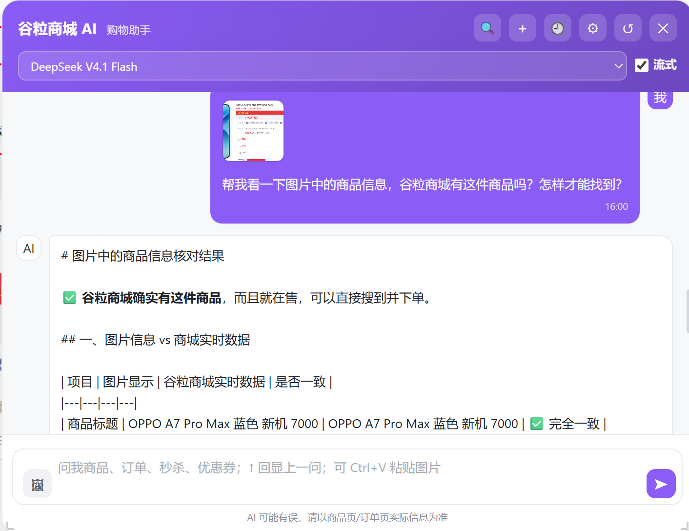
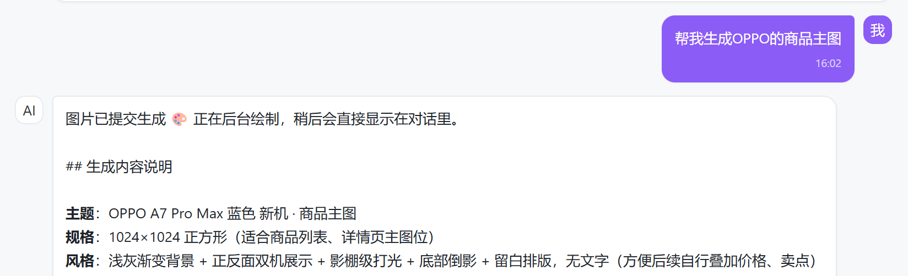
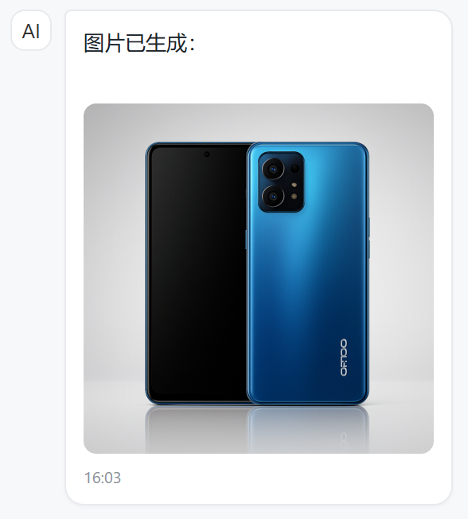
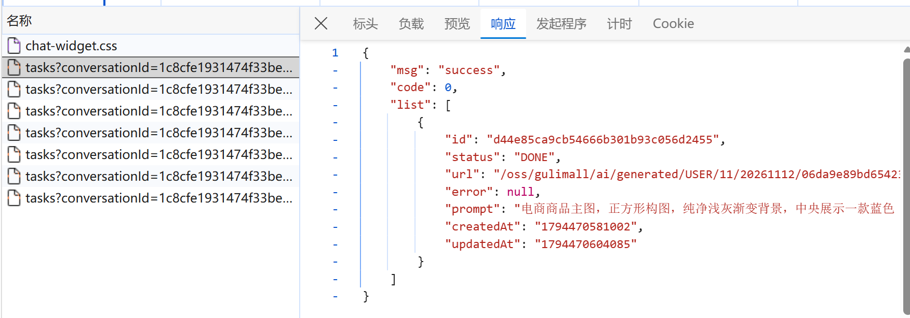

# 19.3 AI 图片识别与生成-介绍

> 本篇介绍谷粒商城 AI 的图片能力：上传时怎么按文件头校验真实类型、怎么缩放到 2048 像素、原图怎么存 MinIO、元数据怎么存 Redis、聊天时怎么用固定视觉模型识别图片、图片生成怎么做异步任务、前端怎么轮询任务状态、以及“只能生成商城相关图片”的确定性校验。

---

## 1. 这个功能是干什么的

图片能力分两条链路：

1. **看图**：用户上传图片，视觉模型识别内容，识别结果交给当前对话模型回答。
2. **生成**：用户描述需要的商城图片，图片模型异步生成，完成后写回会话。

两条链路使用的模型不同：

| 能力 | 模型 | 说明 |
|---|---|---|
| 看图 | `gpt-6.1-sol` | 固定视觉模型，支持图片输入 |
| 生成 | `gpt-image-1-mini` | 图片生成模型，只能画图，不能看图 |

`gpt-image-1-mini` 不能看图，所以“识别”和“生成”必须分开。用户上传图片后，先由视觉模型转成文字，再交给用户选择的对话模型。

图片接口：

| 方法 | 路径 | 说明 |
|---|---|---|
| POST | `/agent/images` | 上传图片，返回 `imageId` 和 URL |
| GET | `/agent/images/{imageId}` | 查询图片元数据 |
| POST | `/agent/images/generate` | 提交异步生成任务 |
| GET | `/agent/images/tasks?conversationId=` | 查询会话下的任务 |
| GET | `/agent/images/tasks/{taskId}` | 查询单个任务状态 |


## 2. 用户、管理员、开发者怎么操作

### 2.1 用户上传图片

1. 点击聊天输入框旁的图片按钮。
2. 选择本地图片，或直接 `Ctrl+V` 粘贴剪贴板图片。
3. 前端先判断大小不超过 8MB。
4. `POST /agent/images` 上传。
5. 后端校验大小、真实类型、尺寸，必要时缩放。
6. 图片存 MinIO，元数据存 Redis。
7. 前端把返回的 URL 显示成缩略图。
8. 输入问题后发送，请求体带 `imageIds`。

### 2.2 用户看图片问答

1. 用户上传图片并输入“这件衣服是什么颜色”。
2. 后端从 Redis 元数据找回 MinIO 对象。
3. 校验图片归属当前用户。
4. 视觉模型识别图片，结合问题输出文字。
5. 识别结果拼进用户消息，交给对话模型。
6. 对话模型生成最终回答。



### 2.3 用户生成图片

1. 用户输入“生成一张华为手机促销海报”。
2. 前端调 `POST /agent/images/generate`。
3. 后端校验提示词是否与商城相关。
4. 任务写入 Redis，状态 `PENDING`。
5. 任务提交到图片线程池。
6. 接口立即返回 `taskId`。
7. 前端提示“图片正在后台生成”。



### 2.4 用户查看生成结果

1. 前端每 4 秒查一次 `GET /agent/images/tasks?conversationId=`。
2. 任务状态从 `PENDING` 变 `RUNNING`。
3. 生成完成后变 `DONE`，图片上传 MinIO。
4. 后端把图片作为一条 AI 消息写进会话。
5. 前端刷新消息列表，显示生成的图片。



### 2.5 管理员使用图片能力

管理端和用户端共用同一套图片接口：

1. 管理端可以上传商品图，让视觉模型识别。
2. 管理端可以生成商城运营图。
3. 图片目录按 `ADMIN/{id}` 分开。
4. 任务和图片元数据都记录归属，管理员不能查看用户的任务。

### 2.6 开发者配置图片参数

```yaml
gulimall:
  ai:
    image:
      vision-model: gpt-6.1-sol
      timeout: 90s
      max-upload-bytes: 8388608
      allowed-types:
        - image/jpeg
        - image/png
        - image/webp
      max-images-per-message: 1
      generation:
        model-name: gpt-image-1-mini
        size: 1024x1024
        quality: medium
        timeout: 60s
        max-retries: 2
```

关键参数：

1. `vision-model`：看图固定使用的视觉模型。
2. `max-upload-bytes`：单张图片最大 8MB。
3. `max-images-per-message`：一条消息最多一张图。
4. `generation.size`：默认尺寸，支持 `1024x1536`、`1536x1024`、`1024x1024`。
5. `generation.quality`：默认质量，支持 `low/medium/high`。

## 3. 整体设计思路

### 3.1 业务上怎么设计

#### 3.1.1 上传不信任浏览器

浏览器传来的 `Content-Type` 可以伪造，所以服务端按文件头魔数判断真实类型：

1. JPEG：`FF D8 FF`。
2. PNG：`89 50 4E 47`。
3. WebP：`RIFF....WEBP`。

只允许这三种类型，其他一律拒绝。

#### 3.1.2 图片归属

上传时记录 `ownerType` 和 `ownerId`。聊天时只传 `imageId`，服务端凭元数据找回对象并校验归属。

不能只信前端传来的 URL，否则可以拿别人的图片 id 去看别人的图。

#### 3.1.3 看图与对话分开

视觉模型只负责“图片里有什么”，对话模型负责“结合商城知识回答”。

这样做的好处：

1. 视觉模型固定，不受用户选择模型影响。
2. 识别失败时返回错误说明，聊天继续，不会整条消息失败。
3. 识别结果可以拼进用户消息，普通对话和流式对话共用。

#### 3.1.4 生成限定商城范围

图片生成只允许：

1. 商品图、产品主图、详情图。
2. 促销海报、活动横幅、优惠券/秒杀宣传图。
3. 店铺/品牌视觉、Logo。

不允许：

1. 动物、风景、人物、动漫。
2. 与商城无关的艺术创作。

限制分两层：

1. 系统提示词告诉模型只生成商城相关图片。
2. `ImagePromptGuard` 在提交任务前做确定性关键词校验。

#### 3.1.5 生成异步化

图片生成通常要 1 到 3 分钟，同步等待会占住 Tomcat 线程、SSE 连接和前端界面。

所以改成：

1. 提交任务立即返回 `taskId`。
2. 后台线程池生成。
3. 状态存 Redis。
4. 完成后把图片消息写回会话。
5. 前端轮询任务状态。

### 3.2 技术上怎么设计

#### 3.2.1 上传校验

`ImageValidationService.validate` 做五步：

1. 文件为空、大小超过 8MB 拒绝。
2. 按魔数判断 MIME。
3. MIME 不在允许列表拒绝。
4. WebP 原样放行，因为 JDK 默认不能解码。
5. JPEG/PNG 用 `ImageIO` 解码，最大边超过 2048 时等比缩放，再重新编码。

#### 3.2.2 MinIO 存储

对象路径：

```text
上传：ai/upload/{USER|ADMIN}/{id}/{yyyyMMdd}/{uuid}.{ext}
生成：ai/generated/{USER|ADMIN}/{id}/{yyyyMMdd}/{uuid}.png
```

对外统一 `/oss/gulimall/...`，由 Nginx 反代到 MinIO。

#### 3.2.3 Redis 元数据

上传图片的元数据存 `gulimall:ai:img:{imageId}` HASH，TTL 3 天：

1. `ownerType`、`ownerId`：归属。
2. `objectKey`：MinIO 对象路径。
3. `url`：公开访问地址。
4. `mime`：图片类型。
5. `size`：字节数。

#### 3.2.4 视觉识别

`VisionAnalysisService.analyze`：

1. 取配置的视觉模型，复制一份并替换成看图超时 90 秒。
2. 图片转 base64。
3. 组装 `TextContent + ImageContent` 多模态消息。
4. 调模型。
5. 失败返回“图片识别失败：原因”，不抛异常。

#### 3.2.5 异步任务

`ImageTaskService.submit`：

1. 校验提示词和商城相关性。
2. 校验会话归属。
3. 生成 `taskId`，写任务 HASH，状态 `PENDING`。
4. 把任务 id 右推进会话任务列表。
5. 提交线程池。
6. 线程池拒绝时把状态改成 `FAILED` 并抛 `15010`。

状态机：

```text
PENDING → RUNNING → DONE
                  ↘ FAILED
```

#### 3.2.6 线程池

`ImageTaskExecutorConfig` 创建独立线程池：

1. 核心线程 1。
2. 最大线程 2。
3. 队列 20。
4. 线程名前缀 `ai-image-`。
5. 停机等待 60 秒。

图片模型很占资源，最多同时跑 2 个，队列满时立即提示“任务繁忙”，不无限堆积。

#### 3.2.7 轮询

前端每 4 秒查一次会话任务列表：

1. 第一次只记录已有任务，避免把历史图片当成新生成。
2. 有 `PENDING/RUNNING` 时提示一次“正在后台生成”。
3. 新 `FAILED` 任务提示失败原因。
4. 新 `DONE` 任务刷新消息列表。
5. 任务全部结束或面板关闭时停止轮询。

## 4. 详细代码、配置和解释

第 4 章按“上传校验 → 对象存储 → 元数据 → 视觉识别 → HTTP 入口 → 异步任务 → 图片模型 → 提示词边界 → 线程池 → 聊天带图 → 前端轮询”组织。每个 4.x 先说明这个类在链路里解决什么问题、由谁调用、依赖哪些下游，再列关键概念或接口，然后贴代码并逐段解释执行顺序，最后补一次完整示例、它不做什么和边界。

### 4.1 ImageValidationService：上传校验

#### 4.1.1 这个类解决什么问题

商城聊天窗允许用户上传商品截图、订单截图、竞品图，用来问“这件衣服是什么颜色”“这个包装图能不能改成促销海报”。上传入口是 `ImageController.upload`，文件来自浏览器，`Content-Type`、文件后缀、前端校验都可以伪造或绕过。

这个类位于整条图片链路的最前面，决定一个文件能不能进入 MinIO、能不能进入后续视觉识别。它只处理字节层面的合法性：大小、真实类型、能否解码、尺寸是否过大。归属校验、对象存储、元数据记录都在后面的类里，不在这里。

#### 4.1.2 关键概念

服务端不信任浏览器声明的 MIME，直接读文件头魔数：

| 类型 | 文件头 | 说明 |
|---|---|---|
| JPEG | `FF D8 FF` | 手机拍照、截图常见 |
| PNG | `89 50 4E 47` | 截图、透明图常见 |
| WebP | `52 49 46 46 ... 57 45 42 50` | `RIFF` 开头，第 9 到 12 字节是 `WEBP` |

允许的类型由 `gulimall.ai.image.allowed-types` 配置，默认只有 `image/jpeg`、`image/png`、`image/webp`。最大边长固定 2048 像素，超过就等比缩小。

校验结果封装成 `ValidatedImage`，包含处理后的字节、MIME、扩展名和宽高。后续的存储和元数据都只认这个结果，不再回头碰原始文件。

#### 4.1.3 代码与解释

这段代码承担上传链路的门禁：先挡体积，再认文件头，最后尝试解码和缩放，任何一步失败都转成统一的 `15008` 业务异常。

```java
@Service
@RequiredArgsConstructor
public class ImageValidationService {

    private static final int MAX_SIDE = 2048;

    private final AiProperties properties;

    public ValidatedImage validate(MultipartFile file) {
        if (file == null || file.isEmpty()) {
            throw new AgentException(AgentErrorCode.IMAGE_INVALID, "请选择要上传的图片");
        }
        long maxBytes = properties.getImage().getMaxUploadBytes();
        if (file.getSize() > maxBytes) {
            throw new AgentException(AgentErrorCode.IMAGE_INVALID,
                    "图片不能超过 " + (maxBytes / 1024 / 1024) + "MB");
        }

        try {
            byte[] bytes = file.getBytes();

            String mime = detectMime(bytes);
            if (mime == null || !properties.getImage().getAllowedTypes().contains(mime)) {
                throw new AgentException(AgentErrorCode.IMAGE_INVALID, "只支持 JPEG / PNG / WebP 图片");
            }

            if ("image/webp".equals(mime)) {
                return new ValidatedImage(bytes, mime, "webp", 0, 0);
            }

            BufferedImage image = ImageIO.read(new ByteArrayInputStream(bytes));
            if (image == null) {
                throw new AgentException(AgentErrorCode.IMAGE_INVALID, "图片文件已损坏或格式不支持");
            }

            BufferedImage resized = resizeIfNeeded(image);
            String extension = "image/png".equals(mime) ? "png" : "jpg";
            String format = "image/png".equals(mime) ? "png" : "jpg";
            ByteArrayOutputStream output = new ByteArrayOutputStream();
            ImageIO.write(resized, format, output);
            return new ValidatedImage(output.toByteArray(), mime, extension,
                    resized.getWidth(), resized.getHeight());
        } catch (AgentException ex) {
            throw ex;
        } catch (Exception ex) {
            throw new AgentException(AgentErrorCode.IMAGE_INVALID, "图片读取失败：" + ex.getMessage(), ex);
        }
    }

    private BufferedImage resizeIfNeeded(BufferedImage source) {
        int width = source.getWidth();
        int height = source.getHeight();
        int maxSide = Math.max(width, height);
        if (maxSide <= MAX_SIDE) {
            return source;
        }

        double ratio = (double) MAX_SIDE / maxSide;
        int targetW = Math.max(1, (int) Math.round(width * ratio));
        int targetH = Math.max(1, (int) Math.round(height * ratio));
        BufferedImage target = new BufferedImage(targetW, targetH, BufferedImage.TYPE_INT_RGB);
        Graphics2D graphics = target.createGraphics();
        graphics.setRenderingHint(RenderingHints.KEY_INTERPOLATION, RenderingHints.VALUE_INTERPOLATION_BILINEAR);
        graphics.drawImage(source, 0, 0, targetW, targetH, null);
        graphics.dispose();
        return target;
    }

    private String detectMime(byte[] bytes) {
        if (bytes.length >= 3
                && (bytes[0] & 0xFF) == 0xFF
                && (bytes[1] & 0xFF) == 0xD8
                && (bytes[2] & 0xFF) == 0xFF) {
            return "image/jpeg";
        }

        if (bytes.length >= 8
                && (bytes[0] & 0xFF) == 0x89
                && bytes[1] == 'P' && bytes[2] == 'N' && bytes[3] == 'G') {
            return "image/png";
        }

        if (bytes.length >= 12
                && bytes[0] == 'R' && bytes[1] == 'I' && bytes[2] == 'F' && bytes[3] == 'F'
                && bytes[8] == 'W' && bytes[9] == 'E' && bytes[10] == 'B' && bytes[11] == 'P') {
            return "image/webp";
        }
        return null;
    }

    public record ValidatedImage(byte[] bytes, String mimeType, String extension, int width, int height) {
    }
}
```

1. `@Service` 把校验逻辑注册成 Bean，`@RequiredArgsConstructor` 用构造器注入 `AiProperties`，配置从 yml 读取，不在代码里写死。
2. `MAX_SIDE = 2048` 是缩放阈值。视觉模型识别商品细节不需要更高分辨率，更大的图只会增加上传体积、base64 体积和调用费用。
3. `validate` 先判断 `file` 是否为空或没有内容，空文件直接抛 `IMAGE_INVALID`，不进入后续解码。
4. 从配置读取 `max-upload-bytes`，默认 8MB。这里用 `file.getSize()` 判断，不把文件读进内存就能挡掉超大文件。
5. `file.getBytes()` 把上传内容读成字节数组。后面判断魔数、解码、写 MinIO 都基于这份字节。
6. `detectMime` 只看文件头，不看浏览器传的 `Content-Type`。返回 `null` 表示不是允许的三种格式。
7. 再检查 MIME 是否在 `allowed-types` 列表里。魔数能识别出类型但配置没放行时，同样拒绝。
8. WebP 直接返回原始字节，扩展名写 `webp`，宽高记 0。原因是 JDK 自带的 `ImageIO` 默认不能解码 WebP，强行解码会失败。
9. JPEG 和 PNG 用 `ImageIO.read` 解码。返回 `null` 说明文件头像但内容损坏，提示文件已损坏。
10. `resizeIfNeeded` 只在最大边超过 2048 时创建新图，没超过就返回原图，避免无意义的重编码。
11. 扩展名和编码格式都按 MIME 决定：PNG 继续用 `png`，其余用 `jpg`。重新编码可以顺带丢掉图片里附带的元数据。
12. 返回 `ValidatedImage`，带上处理后的字节、MIME、扩展名和最终宽高。Controller 用这些值生成对象路径和返回给前端的尺寸。
13. `catch` 先放行 `AgentException`，保证业务错误码不被包装；其他异常统一转成“图片读取失败”，避免底层异常信息直接暴露给前端。

`resizeIfNeeded` 的计算顺序：

1. 取原图宽高和最大边。
2. 最大边不超过 2048 时原样返回。
3. 用 `2048 / 最大边` 算出缩放比例。
4. 宽高分别乘比例并四舍五入，最小保底 1 像素。
5. 创建 `TYPE_INT_RGB` 目标图，用双线性插值绘制。
6. 释放 `Graphics2D`，返回新图。

`detectMime` 的判断顺序：

1. 至少 3 字节且前 3 字节是 `FF D8 FF`，识别为 JPEG。
2. 至少 8 字节且前 4 字节是 `89 50 4E 47`，识别为 PNG。
3. 至少 12 字节且前 4 字节是 `RIFF`、第 9 到 12 字节是 `WEBP`，识别为 WebP。
4. 都不满足返回 `null`。

#### 4.1.4 一次完整示例

用户上传一张 3000×2000 的 JPEG 商品图：

```text
1. file.getSize() = 2.4MB，小于 8MB
2. 读字节，前三字节 FF D8 FF，detectMime 返回 image/jpeg
3. image/jpeg 在 allowed-types 中
4. ImageIO.read 解码成功
5. 最大边 3000 > 2048，比例 0.6827
6. 目标尺寸 2048×1365，双线性缩放
7. 按 jpg 重新编码
8. 返回 ValidatedImage(bytes, image/jpeg, jpg, 2048, 1365)
9. Controller 用 jpg 生成对象路径，用 2048 和 1365 返回给前端
```

#### 4.1.5 它不做什么

1. 不校验图片归属，任何人上传的图片在此时还没有 `ownerType` 和 `ownerId`。
2. 不写 MinIO，只返回处理后的字节。
3. 不写 Redis，元数据由 `ImageMetadataService` 负责。
4. 不做图片内容安全审核，不判断图片里是否包含违规内容。
5. 不处理 EXIF 旋转，手机照片的方向标记会被忽略。

#### 4.1.6 边界与可优化点

1. WebP 没有解码，宽高为 0，前端无法按真实尺寸占位，只能等图片加载后自适应。
2. 缩放统一用 `TYPE_INT_RGB`，带透明通道的 PNG 会丢失透明信息，透明区域可能变黑或变白。
3. `ImageIO.read` 对超大像素图会占用较多堆内存，8MB 的压缩文件解压后可能达到上亿像素，应增加像素总数上限。
4. 只校验文件头，不校验完整文件结构。WebP 原样放行时，损坏文件也能进入 MinIO，直到视觉模型调用失败才暴露。
5. 缩放使用双线性插值，速度够快，但缩小比例很大时细节会损失，可以改成逐级缩放。
6. 重新编码会丢掉 EXIF，商品图里的拍摄方向、色彩配置不会保留；如果业务需要，应先按 EXIF 旋转再缩放。

### 4.2 ImageStorageService：MinIO 存储

#### 4.2.1 这个类解决什么问题

图片字节不能放在应用本地磁盘：多实例部署时，请求落到另一台机器就找不到文件；容器重启后本地文件也会丢失。所以图片统一写入 MinIO，数据库和 Redis 只保存对象路径。

这个类被三个地方调用：`ImageController.upload` 存用户上传图，`ImageGenerationService.generate` 存模型生成图，`ChatOrchestrator.prepare` 通过 `download` 取回原图交给视觉模型。对外的访问地址统一是 `/oss/gulimall/...`，由 Nginx 反向代理到 MinIO，前端不直接暴露 MinIO 地址。

#### 4.2.2 关键概念

| 概念 | 含义 | 示例 |
|---|---|---|
| bucket | MinIO 里的顶层容器 | `gulimall` |
| objectKey | bucket 内的对象路径 | `ai/upload/USER/1001/20261112/abc.png` |
| publicPrefix | 对外访问前缀 | `/oss` |
| publicUrl | 浏览器可访问地址 | `/oss/gulimall/ai/upload/...` |

对象路径按“业务场景 / 身份类型 / 身份 id / 日期 / UUID”分层。日期目录让对象数量分散，UUID 避免同名覆盖，身份目录方便按用户排查和清理。

#### 4.2.3 代码与解释

这段代码承担对象存储的读写和公开地址拼接，是上传链路和生成链路的共同出口。

```java
@Slf4j
@Service
@RequiredArgsConstructor
public class ImageStorageService {

    private final MinioClient minioClient;

    @Value("${MINIO_BUCKET:gulimall}")
    private String bucket;

    @Value("${MINIO_PUBLIC_PREFIX:/oss}")
    private String publicPrefix;

    @PostConstruct
    public void ensureBucket() {
        try {
            boolean exists = minioClient.bucketExists(
                    BucketExistsArgs.builder().bucket(bucket).build());
            if (!exists) {
                minioClient.makeBucket(MakeBucketArgs.builder().bucket(bucket).build());
                log.info("已创建 MinIO bucket：{}", bucket);
            }
        } catch (Exception ex) {
            log.warn("检查 MinIO bucket 失败：{}", ex.getMessage());
        }
    }

    public String upload(byte[] bytes, String contentType, String objectKey) {
        try {
            minioClient.putObject(PutObjectArgs.builder()
                    .bucket(bucket)
                    .object(objectKey)
                    .stream(new ByteArrayInputStream(bytes), bytes.length, -1)
                    .contentType(contentType)
                    .build());
            return publicUrl(objectKey);
        } catch (Exception ex) {
            throw new IllegalStateException("图片上传 MinIO 失败：" + ex.getMessage(), ex);
        }
    }

    public byte[] download(String objectKey) {
        try (InputStream input = minioClient.getObject(GetObjectArgs.builder()
                .bucket(bucket)
                .object(objectKey)
                .build())) {
            return input.readAllBytes();
        } catch (Exception ex) {
            throw new IllegalStateException("读取 MinIO 图片失败：" + ex.getMessage(), ex);
        }
    }

    public String publicUrl(String objectKey) {
        return publicPrefix + "/" + bucket + "/" + objectKey;
    }
}
```

1. `@Slf4j` 提供日志，`@Service` 注册 Bean，`@RequiredArgsConstructor` 注入 `MinioClient`。
2. `bucket` 从环境变量 `MINIO_BUCKET` 读取，默认 `gulimall`；`publicPrefix` 从 `MINIO_PUBLIC_PREFIX` 读取，默认 `/oss`。部署环境换 bucket 或换代理前缀时不用改代码。
3. `ensureBucket` 带 `@PostConstruct`，应用启动完成后执行一次，检查 bucket 是否存在。
4. bucket 不存在时调用 `makeBucket` 创建。创建成功记一条 info 日志，方便确认初始化结果。
5. 检查或创建失败只记 warn，不抛异常。MinIO 暂时不可用时应用仍能启动，等第一次上传时再暴露问题。
6. `upload` 用 `putObject` 写入字节数组，`ByteArrayInputStream` 包装内存数据，长度传 `bytes.length`，分片大小传 `-1` 表示由客户端决定。
7. `contentType` 写入对象元数据，浏览器通过 Nginx 访问时能拿到正确的 MIME，图片可以直接预览。
8. 上传成功返回 `publicUrl(objectKey)`，调用方不需要自己拼地址。
9. `download` 用 `getObject` 打开输入流，try-with-resources 保证流关闭，`readAllBytes` 一次性读完全部内容。
10. `publicUrl` 按 `publicPrefix + "/" + bucket + "/" + objectKey` 拼接。Nginx 把 `/oss` 的请求转发到 MinIO 的 `gulimall` bucket。
11. 上传和下载失败都包成 `IllegalStateException`，保留原始异常原因，方便日志定位。

#### 4.2.4 一次完整示例

用户上传一张 PNG 截图：

```text
1. Controller 生成 objectKey：
   ai/upload/USER/1001/20261112/8f3c2a9e4b7d4c1fa2b6d0e5f7a8c9b1.png
2. upload(bytes, image/png, objectKey)
3. MinIO putObject：bucket=gulimall，object=上面的路径
4. 返回 /oss/gulimall/ai/upload/USER/1001/20261112/8f3c2a9e4b7d4c1fa2b6d0e5f7a8c9b1.png
5. 前端把该地址放进 img 标签，Nginx 反代到 MinIO 后显示图片
6. 聊天带图时，ChatOrchestrator 用同一个 objectKey 调 download 取回字节
```

#### 4.2.5 它不做什么

1. 不生成对象路径，路径由调用方按业务规则拼接。
2. 不记录图片归属和元数据，这些在 Redis 里。
3. 不删除对象，当前没有提供删除方法。
4. 不签发临时 URL，所有图片都走固定的公开前缀。
5. 不做图片压缩、转码或水印。

#### 4.2.6 边界与可优化点

1. 大文件一次性读入内存再上传，虽然有 8MB 上限兜底，生成图和多实例并发时仍会占用较多堆内存，可以改成分片或流式上传。
2. 没有设置对象生命周期规则，用户上传图和生成图会一直留在 MinIO，需要人工或定时任务清理。
3. 上传失败没有重试，网络抖动会直接让用户看到上传失败。
4. 公开前缀依赖 Nginx 配置，本地直接访问 MinIO 时地址不可用；生产环境应配合签名 URL 或鉴权代理。
5. `ensureBucket` 只在启动时检查一次，运行期间 bucket 被删除不会自动恢复。

### 4.3 ImageMetadataService：图片元数据

#### 4.3.1 这个类解决什么问题

MinIO 的对象路径和公开 URL 不能直接交给前端当图片 id 使用：路径里包含用户 id，容易被猜到；图片归属需要服务端判断；对象可能被清理，前端仍拿着旧地址。

这个类在 MinIO 之上加一层 `imageId` 间接层。上传成功后生成一个随机 `imageId`，把归属、对象路径、URL、MIME、大小写进 Redis HASH。聊天请求只传 `imageId`，服务端凭 `imageId` 找回元数据，先校验归属，再决定能不能用这张图。

调用方有两处：`ImageController.upload` 写入元数据，`ImageController.info` 和 `ChatOrchestrator.prepare` 读取元数据。

#### 4.3.2 关键字段

Redis key 是 `gulimall:ai:img:{imageId}`，类型 HASH：

| 字段 | 含义 | 用途 |
|---|---|---|
| `ownerType` | 身份类型 `USER` 或 `ADMIN` | 归属校验 |
| `ownerId` | 用户或管理员 id | 归属校验 |
| `objectKey` | MinIO 对象路径 | 下载原图 |
| `url` | 公开访问地址 | 前端缩略图 |
| `mime` | 图片 MIME | 视觉模型消息 |
| `size` | 字节数 | 展示和审计 |

TTL 复用会话配置 `gulimall.ai.conversation.ttl`，默认 3 天。图片消息本身也保留 3 天，两者生命周期对齐。

#### 4.3.3 代码与解释

这段代码承担元数据的写入和读取，并在读取时完成归属校验，是“图片 id 能不能被当前身份使用”的唯一判断点。

```java
@Service
@RequiredArgsConstructor
public class ImageMetadataService {

    private static final String PREFIX = "gulimall:ai:img:";

    private final StringRedisTemplate redisTemplate;
    private final AiProperties properties;

    public void save(Principal principal, String imageId, String objectKey,
                     String url, String mime, long size) {
        String key = PREFIX + imageId;
        redisTemplate.opsForHash().putAll(key, Map.of(
                "ownerType", principal.type().name(),
                "ownerId", String.valueOf(principal.id()),
                "objectKey", objectKey,
                "url", url,
                "mime", mime,
                "size", String.valueOf(size)
        ));
        redisTemplate.expire(key, properties.getConversation().getTtl());
    }

    public ImageMeta get(Principal principal, String imageId) {
        if (imageId == null || imageId.isBlank()) {
            throw new AgentException(AgentErrorCode.IMAGE_INVALID, "图片 id 不能为空");
        }
        Map<Object, Object> meta = redisTemplate.opsForHash().entries(PREFIX + imageId);
        if (meta.isEmpty()) {
            throw new AgentException(AgentErrorCode.IMAGE_INVALID, "图片不存在或已过期，请重新上传");
        }

        if (!principal.type().name().equals(String.valueOf(meta.get("ownerType")))
                || !String.valueOf(principal.id()).equals(String.valueOf(meta.get("ownerId")))) {
            throw new AgentException(AgentErrorCode.IMAGE_INVALID, "无权使用该图片");
        }

        return new ImageMeta(
                imageId,
                String.valueOf(meta.get("objectKey")),
                String.valueOf(meta.get("url")),
                String.valueOf(meta.get("mime")),
                Long.parseLong(String.valueOf(meta.get("size")))
        );
    }

    public record ImageMeta(String imageId, String objectKey, String url, String mime, long size) {
    }
}
```

1. `PREFIX = "gulimall:ai:img:"` 是所有图片元数据的公共前缀，后接 32 位 UUID。
2. `save` 接收当前身份、图片 id、对象路径、URL、MIME 和大小，调用方不需要关心 Redis 结构。
3. `putAll` 一次写入六个字段，减少多次网络往返。`ownerType` 和 `ownerId` 都转成字符串，和 `StringRedisTemplate` 的序列化方式一致。
4. `expire` 设置 TTL，时长取会话配置。元数据过期后，MinIO 对象仍然存在，但服务端不再认这个 `imageId`。
5. `get` 先判断 `imageId` 是否为空，空值直接抛 `IMAGE_INVALID`，避免拼出 `gulimall:ai:img:` 这种无效 key。
6. `entries` 读出整个 HASH。结果为空有两种可能：从未上传，或者已经过期。
7. 归属校验同时比较 `ownerType` 和 `ownerId`。只比 id 不够，用户和管理员可能使用相同的数字 id。
8. 校验通过后按字段组装 `ImageMeta`，`size` 用 `Long.parseLong` 转成数字。
9. `ImageMeta` 是 record，只暴露业务需要的五个字段，Redis 里的其他字段不往外传。

#### 4.3.4 一次完整示例

用户 1001 上传图片后提问：

```text
1. 上传成功，Redis 写入 gulimall:ai:img:5d1c...：
   ownerType=USER, ownerId=1001,
   objectKey=ai/upload/USER/1001/20261112/8f3c....png,
   url=/oss/gulimall/ai/upload/...png,
   mime=image/png, size=182341
2. 前端发送聊天请求，body 里带 imageIds=["5d1c..."]
3. ChatOrchestrator 调 get(principal, "5d1c...")
4. entries 命中，ownerType 和 ownerId 与当前身份一致
5. 返回 ImageMeta，后续用 objectKey 下载、用 url 展示
6. 换成另一个用户拿同一个 imageId 请求，归属不匹配，抛“无权使用该图片”
```

#### 4.3.5 它不做什么

1. 不校验图片内容，不判断 `imageId` 对应的对象是否还在 MinIO。
2. 不缓存元数据到本地，每次读取都走 Redis。
3. 不续期 TTL，读取不会延长元数据寿命。
4. 不提供批量查询，多张图片逐张调用 `get`。
5. 不删除元数据，过期由 Redis 自动完成。

#### 4.3.6 边界与可优化点

1. 元数据 3 天过期，MinIO 对象却是永久的。过期后用户重新发送旧 `imageId` 会提示重新上传，但对象仍占用存储，需要定期清理。
2. `size` 直接 `Long.parseLong`，Redis 里出现脏数据会抛数字格式异常，应捕获后按无效图片处理。
3. `url` 存的是写入时的地址，域名或代理前缀变化后旧数据会失效，可以改成读取时动态拼接。
4. 多张图片逐张读 Redis，一条消息多图时网络往返叠加，可以改成 pipeline 或批量 `multiGet`。
5. 用户删除图片、退出登录都没有清理入口，元数据只能等 TTL 到期。

### 4.4 VisionAnalysisService：视觉识别

#### 4.4.1 这个类解决什么问题

图片生成模型 `gpt-image-1-mini` 只能画图，不能看图；用户选择的对话模型也不一定支持图片输入。如果直接把图片交给对话模型，轻则报错，重则把二进制内容当文本处理。

这个类把“看图”单独抽出来，固定使用配置里的视觉模型 `gpt-6.1-sol`。它接收图片字节、MIME 和用户问题，返回一段文字识别结果。上游是 `ChatOrchestrator.prepare`，每张图片调用一次；下游是 `ModelCatalog` 和 `ModelFactory`，负责取模型定义和创建客户端。

识别结果不直接返回给用户，而是拼进用户消息，再交给用户选择的对话模型组织最终回答。这样视觉能力和对话能力解耦，换对话模型不影响看图。

#### 4.4.2 关键概念

LangChain4j 的多模态消息由两部分组成：

1. `TextContent`：提示词和用户问题。
2. `ImageContent`：base64 图片和 MIME。

两部分一起放进 `UserMessage`，模型才能同时看到文字和图片。图片转 base64 后体积会增加约三分之一，所以上传阶段先缩到 2048 像素。

视觉调用单独设置 90 秒超时，不复用普通对话的超时。图片编码和传输比纯文本慢，超时太短会频繁失败。

#### 4.4.3 代码与解释

这段代码承担单张图片的识别：取固定视觉模型、组装多模态消息、调用模型，并把失败转成可读文本而不是异常。

```java
@Slf4j
@Service
@RequiredArgsConstructor
public class VisionAnalysisService {

    private final ModelCatalog modelCatalog;
    private final ModelFactory modelFactory;
    private final AiProperties properties;

    public String analyze(Principal principal, byte[] imageBytes, String mimeType, String question) {
        try {
            AiModelDefinition definition = modelCatalog.visionModel(principal)
                    .withTimeout(properties.getImage().getTimeout());
            ChatModel model = modelFactory.chat(definition);

            String base64 = Base64.getEncoder().encodeToString(imageBytes);
            String prompt = "请客观识别这张图片的内容，并提取与下面问题相关的信息。"
                    + "不要编造图片里没有的东西。用户问题：" + question;

            UserMessage userMessage = UserMessage.from(List.of(
                    TextContent.from(prompt),
                    ImageContent.from(base64, mimeType)
            ));

            ChatResponse response = model.chat(userMessage);
            if (response == null || response.aiMessage() == null
                    || response.aiMessage().text() == null) {
                return "图片识别没有返回内容";
            }
            return response.aiMessage().text();
        } catch (Exception ex) {
            log.warn("图片识别失败：{}", ex.getMessage());
            return "图片识别失败：" + ex.getMessage();
        }
    }
}
```

1. `modelCatalog.visionModel(principal)` 取配置里固定的视觉模型，不受用户选择的对话模型影响。
2. `withTimeout` 复制一份模型定义并替换超时时间，避免修改共享的模型配置。
3. `modelFactory.chat(definition)` 按定义创建聊天客户端。
4. `Base64.getEncoder().encodeToString` 把图片字节转成 base64，供 `ImageContent` 使用。
5. 提示词要求“客观识别、不要编造”，并带上用户问题，让模型只提取与问题相关的信息。
6. `UserMessage.from(List.of(TextContent, ImageContent))` 组装多模态消息，文本在前、图片在后。
7. `model.chat(userMessage)` 发起同步调用。
8. 响应为空、消息为空或文本为空时返回“图片识别没有返回内容”，调用方拿到的是普通字符串。
9. 任何异常都只记 warn，返回“图片识别失败：原因”。不向上抛，保证聊天可以继续。
10. 返回的识别文本会被 `ChatOrchestrator` 拼进 `userText`，再交给对话模型。

#### 4.4.4 一次完整示例

用户上传一件衣服的图片，问“这件衣服是什么颜色”：

```text
1. ChatOrchestrator 校验 imageId 归属，从 MinIO 下载字节
2. analyze(principal, bytes, image/jpeg, "这件衣服是什么颜色")
3. 取 vision-model=gpt-6.1-sol，超时改成 90 秒
4. 字节转 base64
5. 组装：请客观识别这张图片的内容……用户问题：这件衣服是什么颜色
6. 视觉模型返回：图片中是一件女士上衣，颜色为藏蓝色，领口有白色装饰
7. 识别文本拼进 userText：用户上传了图片，视觉识别结果如下：……
8. 用户选择的对话模型基于这段文字生成最终回答
```

视觉模型不可用时：

```text
1. 调用超时或返回错误
2. catch 记录 warn
3. 返回“图片识别失败：Read timed out”
4. 对话模型仍然收到这段说明，可以回答“图片暂时无法识别，请重新上传”
5. 整条聊天请求不因为看图失败而失败
```

#### 4.4.5 它不做什么

1. 不校验图片归属，归属由调用方先通过 `ImageMetadataService.get` 完成。
2. 不下载图片，只接收字节。
3. 不缓存识别结果，同一张图重复提问会重复调用。
4. 不限制回答长度，识别文本可能很长。
5. 不判断图片是否与商城相关，只做客观描述。

#### 4.4.6 边界与可优化点

1. 失败返回字符串而不是抛异常，调用方无法区分“识别成功但内容为空”和“识别失败”，需要靠文案约定。
2. base64 会增加约 33% 体积，图多时请求体很大，可以按模型支持情况改用图片 URL。
3. 同一张图片被多次提问会重复识别，可以在 Redis 里按 `imageId` 缓存识别结果。
4. 多张图片串行识别，耗时叠加，可以改成并发调用。
5. 识别文本没有长度上限，长文本会挤占对话模型的上下文窗口，应截断或摘要。
6. 没有内容安全审核，图片里的敏感信息可能被原样描述出来。

### 4.5 ImageController：上传与任务接口

#### 4.5.1 这个类解决什么问题

聊天窗和后台页面都需要通过 HTTP 触发图片能力：上传、提交生成、查询任务、查询元数据。这个类只做请求转发和结果包装，具体校验、存储、任务调度都在 Service 里。

请求从网关进入，网关先去掉 `/gulimall` 前缀，所以类上的路径是 `/agent/images`。`Principal` 由 `PrincipalArgumentResolver` 从 JWT 解析，携带身份类型和 id，Controller 不需要自己解析 token。

用户端和管理端共用同一套接口，区别只在 `Principal` 的类型：`USER` 的图片进 `ai/upload/USER/{id}`，`ADMIN` 的图片进 `ai/upload/ADMIN/{id}`。

#### 4.5.2 接口清单

| 操作 | 方法与路径 | 调用的服务 | 返回 |
|---|---|---|---|
| 上传图片 | `POST /agent/images` | `validate` → `upload` → `save` | `imageId`、`url`、宽高 |
| 提交生成 | `POST /agent/images/generate` | `ImageTaskService.submit` | `taskId`、`PENDING` |
| 查会话任务 | `GET /agent/images/tasks?conversationId=` | `ImageTaskService.list` | 任务列表 |
| 查单任务 | `GET /agent/images/tasks/{taskId}` | `ImageTaskService.get` | 任务状态 |
| 查元数据 | `GET /agent/images/{imageId}` | `ImageMetadataService.get` | `imageId`、`url`、`mime`、`size` |

#### 4.5.3 代码与解释

这段代码承担 HTTP 层的参数接收和结果包装，把五个接口分别转给校验、存储、元数据和任务服务。

```java
@RestController
@RequestMapping("/agent/images")
@RequiredArgsConstructor
public class ImageController {

    private static final DateTimeFormatter DAY = DateTimeFormatter.BASIC_ISO_DATE;

    private final ImageValidationService validationService;
    private final ImageStorageService storageService;
    private final ImageMetadataService metadataService;
    private final ImageTaskService imageTaskService;

    @PostMapping
    public R upload(Principal principal, @RequestParam("file") MultipartFile file) {
        ImageValidationService.ValidatedImage image = validationService.validate(file);

        String objectKey = "ai/upload/" + principal.type().name() + "/" + principal.id()
                + "/" + LocalDate.now().format(DAY) + "/"
                + UUID.randomUUID().toString().replace("-", "") + "." + image.extension();
        String url = storageService.upload(image.bytes(), image.mimeType(), objectKey);

        String imageId = UUID.randomUUID().toString().replace("-", "");
        metadataService.save(principal, imageId, objectKey, url, image.mimeType(), image.bytes().length);

        Map<String, Object> data = new LinkedHashMap<>();
        data.put("imageId", imageId);
        data.put("url", url);
        data.put("width", image.width());
        data.put("height", image.height());
        return R.ok().put("data", data);
    }

    @PostMapping("/generate")
    public R generate(Principal principal, @RequestBody GenerateImageRequest request) {
        String taskId = imageTaskService.submit(
                principal, request.getConversationId(),
                request.getPrompt(), request.getSize(), request.getQuality());

        Map<String, Object> data = new LinkedHashMap<>();
        data.put("taskId", taskId);
        data.put("status", "PENDING");
        data.put("prompt", request.getPrompt());
        data.put("conversationId", request.getConversationId());
        return R.ok().put("data", data);
    }

    @GetMapping("/tasks")
    public R tasks(Principal principal,
                   @RequestParam("conversationId") String conversationId) {
        return R.ok().put("list", imageTaskService.list(principal, conversationId));
    }

    @GetMapping("/tasks/{taskId}")
    public R task(Principal principal, @PathVariable("taskId") String taskId) {
        return R.ok().put("data", imageTaskService.get(principal, taskId));
    }

    @GetMapping("/{imageId}")
    public R info(Principal principal, @PathVariable("imageId") String imageId) {
        ImageMetadataService.ImageMeta meta = metadataService.get(principal, imageId);
        Map<String, Object> data = new LinkedHashMap<>();
        data.put("imageId", meta.imageId());
        data.put("url", meta.url());
        data.put("mime", meta.mime());
        data.put("size", meta.size());
        return R.ok().put("data", data);
    }
}
```

1. `@RestController` + `@RequestMapping("/agent/images")`：五个接口共用前缀，返回 JSON。
2. `@RequiredArgsConstructor` 注入四个服务，Controller 不直接依赖 Redis、MinIO 或模型客户端。
3. `DAY` 是 `yyyyMMdd` 格式，用于对象路径里的日期目录。
4. `upload` 第一步调 `validate`，拿到已校验、已缩放的字节和宽高。
5. 拼对象路径：身份类型、身份 id、日期、32 位 UUID、扩展名。路径分层让对象数量分散，也方便按身份排查。
6. `storageService.upload` 写 MinIO 并返回公开 URL。
7. 生成独立的 `imageId`，和对象路径解耦。前端只拿 `imageId` 和 URL，不接触对象路径。
8. `metadataService.save` 把归属、对象路径、URL、MIME、大小写进 Redis。
9. 返回 `imageId`、`url`、`width`、`height`，用 `LinkedHashMap` 保证字段顺序稳定。
10. `generate` 只调 `submit`，拿到 `taskId` 后立即组装响应，不等待图片生成。
11. 响应里的 `status` 固定写 `PENDING`，和 Redis 里的初始状态一致。
12. `tasks` 按 `conversationId` 查任务列表，供前端轮询。
13. `task` 按 `taskId` 查单个任务，内部会校验归属。
14. `info` 按 `imageId` 查元数据，同样会校验归属，只返回展示需要的四个字段。

#### 4.5.4 一次请求示例

上传：

```text
POST /gulimall/agent/images
Content-Type: multipart/form-data
file=@product.jpg

网关去掉 gulimall 前缀 → /agent/images
PrincipalArgumentResolver 解析 JWT → USER/1001
validate：2.4MB JPEG → 缩放为 2048×1365
objectKey：ai/upload/USER/1001/20261112/8f3c....jpg
upload：写 MinIO，返回 /oss/gulimall/ai/upload/...
save：写 Redis gulimall:ai:img:5d1c...
响应：
{
  "code": 0,
  "data": {
    "imageId": "5d1c...",
    "url": "/oss/gulimall/ai/upload/USER/1001/20261112/8f3c....jpg",
    "width": 2048,
    "height": 1365
  }
}
```

提交生成：

```text
POST /gulimall/agent/images/generate
{
  "conversationId": "conv-123",
  "prompt": "生成一张华为手机促销海报",
  "size": "1024x1024",
  "quality": "medium"
}

响应立即返回：
{
  "code": 0,
  "data": {
    "taskId": "9a7b...",
    "status": "PENDING",
    "prompt": "生成一张华为手机促销海报",
    "conversationId": "conv-123"
  }
}
```

#### 4.5.5 它不做什么

1. 不做图片大小、类型、尺寸校验，全部交给 `ImageValidationService`。
2. 不直接操作 MinIO 和 Redis。
3. 不执行图片生成，只提交任务。
4. 不解析 JWT，身份由参数解析器注入。
5. 不处理权限区分，用户和管理员共用接口，靠 `Principal` 类型隔离目录。

#### 4.5.6 边界与可优化点

1. `upload` 和 `generate` 没有使用 `@Valid` 做请求体校验，提示词、尺寸、质量都靠 Service 兜底。
2. `generate` 没有幂等键，用户重复点击会提交多个任务，生成多张图。
3. 上传没有进度回调，大图前端只能等待请求结束。
4. `upload` 先上传 MinIO 再写 Redis，如果 Redis 写入失败，MinIO 里会留下孤儿对象。
5. 任务列表没有分页参数，Service 内部固定取最近 20 个，前端无法翻看更早的任务。
6. `info` 只返回元数据，不校验 MinIO 对象是否还存在，可能返回一个打不开的 URL。

### 4.6 ImageTaskService：异步任务

#### 4.6.1 这个类解决什么问题

图片生成通常要 1 到 3 分钟。如果接口同步等待，Tomcat 请求线程、SSE 连接和前端界面都会被占住，用户也不能继续聊天。

这个类把生成改成异步任务：提交时只写任务记录并返回 `taskId`，真正的模型调用放到独立线程池。任务状态存 Redis，前端按会话轮询。生成成功后把图片消息写回会话，失败则把失败原因写回会话。

上游是 `ImageController.generate`，下游是 `ImageTaskExecutorConfig` 提供的线程池、`ImageGenerationService` 和 `ConversationService`。

#### 4.6.2 任务字段与状态机

| 字段 | 含义 |
|---|---|
| `id` | 任务 id |
| `ownerType` / `ownerId` | 任务归属 |
| `conversationId` | 关联会话，可为空 |
| `prompt` | 生成描述 |
| `size` / `quality` | 尺寸和质量 |
| `status` | 任务状态 |
| `url` | 生成成功后的图片地址 |
| `error` | 失败原因 |
| `createdAt` / `updatedAt` | 创建和更新时间 |

状态流转：

```text
PENDING → RUNNING → DONE
                  ↘ FAILED
```

任务 HASH 存 `gulimall:ai:imgtask:{taskId}`，TTL 1 小时。会话任务列表存 `gulimall:ai:imgtask:conv:{conversationId}`，类型 List，TTL 1 小时。图片消息本身写进正常会话，保留 3 天。

#### 4.6.3 代码与解释

这段代码承担任务的创建、线程池提交、状态推进和会话回写，是异步生成的核心。

```java
@Slf4j
@Service
@RequiredArgsConstructor
public class ImageTaskService {

    private static final String TASK_KEY = "gulimall:ai:imgtask:";
    private static final String CONV_TASK_KEY = "gulimall:ai:imgtask:conv:";
    private static final Duration TTL = Duration.ofHours(1);

    private final StringRedisTemplate redisTemplate;
    private final ImageGenerationService generationService;
    private final ConversationService conversationService;

    @Resource(name = "imageTaskExecutor")
    private ThreadPoolTaskExecutor executor;

    public String submit(Principal principal, String conversationId,
                         String prompt, String size, String quality) {
        if (!StringUtils.hasText(prompt)) {
            throw new AgentException(AgentErrorCode.IMAGE_INVALID, "请描述要生成的图片内容");
        }
        if (!ImagePromptGuard.isProjectRelated(prompt)) {
            throw new AgentException(AgentErrorCode.IMAGE_INVALID,
                    "只能生成与谷粒商城相关的图片（商品图、促销海报、活动横幅、优惠券/秒杀宣传图等），这个需求不在范围内");
        }
        if (StringUtils.hasText(conversationId)) {
            conversationService.getOrCreate(principal, conversationId, null);
        }

        String taskId = UUID.randomUUID().toString().replace("-", "");
        long now = System.currentTimeMillis();
        Map<String, String> data = new LinkedHashMap<>();
        data.put("id", taskId);
        data.put("ownerType", principal.type().name());
        data.put("ownerId", String.valueOf(principal.id()));
        data.put("conversationId", conversationId == null ? "" : conversationId);
        data.put("prompt", prompt.trim());
        data.put("size", size == null ? "" : size);
        data.put("quality", quality == null ? "" : quality);
        data.put("status", "PENDING");
        data.put("createdAt", String.valueOf(now));
        data.put("updatedAt", String.valueOf(now));
        saveTask(taskId, data);

        if (StringUtils.hasText(conversationId)) {
            String key = CONV_TASK_KEY + conversationId;
            redisTemplate.opsForList().rightPush(key, taskId);
            redisTemplate.expire(key, TTL);
        }

        try {
            executor.execute(() -> runTask(taskId, principal, conversationId, prompt, size, quality));
        } catch (TaskRejectedException ex) {
            updateStatus(taskId, "FAILED", null, "图片生成任务繁忙，请稍后再试");
            throw new AgentException(AgentErrorCode.MODEL_CALL_FAILED, "图片生成任务繁忙，请稍后再试");
        }
        return taskId;
    }

    private void runTask(String taskId, Principal principal, String conversationId,
                         String prompt, String size, String quality) {
        updateStatus(taskId, "RUNNING", null, null);
        try {
            String url = generationService.generate(principal, prompt, size, quality);
            updateStatus(taskId, "DONE", url, null);

            appendImageMessage(principal, conversationId, prompt, url);
        } catch (Exception ex) {
            log.error("图片生成任务失败 taskId={}", taskId, ex);
            String message = ex.getMessage() == null ? ex.getClass().getSimpleName() : ex.getMessage();
            updateStatus(taskId, "FAILED", null, message);
            appendFailureMessage(principal, conversationId, message);
        }
    }

    private void appendMessage(Principal principal, String conversationId, String content) {
        if (!StringUtils.hasText(conversationId)) {
            return;
        }
        try {
            conversationService.getOrCreate(principal, conversationId, null);

            ChatMessageDto message = new ChatMessageDto();
            message.setId(UUID.randomUUID().toString().replace("-", ""));
            message.setRole("assistant");
            message.setContent(content);
            message.setCreatedAt(System.currentTimeMillis());
            message.setStatus("ok");
            conversationService.append(principal, conversationId, message);
        } catch (Exception ex) {
            log.warn("图片任务消息写入会话失败 conversationId={}：{}", conversationId, ex.getMessage());
        }
    }
}
```

1. `TASK_KEY` 是任务 HASH 前缀，`CONV_TASK_KEY` 是会话任务列表前缀，两个 key 分开，查询时可以按任务 id 或按会话查。
2. `TTL = 1 小时` 是过程数据的寿命。图片消息已经写进会话，任务状态不需要长期保留。
3. `StringRedisTemplate` 存任务和会话列表，`ImageGenerationService` 执行真正的生成，`ConversationService` 负责把结果写回会话。
4. `@Resource(name = "imageTaskExecutor")` 按名称取专用线程池，避免拿到 Spring Boot 默认的执行器。
5. `submit` 先判断提示词是否为空，空描述无法生成图片。
6. `ImagePromptGuard.isProjectRelated` 做确定性范围校验，不属于商城的描述在写任务前就被拒绝。
7. 有 `conversationId` 时调 `conversationService.getOrCreate`，确认会话存在且属于当前身份。
8. 生成 32 位 `taskId`，记录当前时间，组装任务 HASH 的初始字段。
9. `saveTask` 把字段写入 Redis 并设置 1 小时 TTL，此时前端已经能查到 `PENDING`。
10. 有会话时把 `taskId` 右推进 `CONV_TASK_KEY` 列表，并刷新列表 TTL，前端按会话轮询就能看到这个任务。
11. `executor.execute` 提交后台任务，lambda 捕获 `taskId`、身份、会话 id 和生成参数。
12. 队列满或线程池停止时 `execute` 抛 `TaskRejectedException`，这里把任务状态改成 `FAILED`，再抛 `15010` 告诉用户“任务繁忙”。
13. 提交成功后立即返回 `taskId`，不等待生成结果。
14. `runTask` 在线程池里执行，先把状态改成 `RUNNING`。
15. 调 `generationService.generate` 同步生成图片，这一步已经在独立线程里，不占用聊天请求线程。
16. 成功时状态改 `DONE`，记录图片 URL，再调 `appendImageMessage` 把 Markdown 图片消息写回会话。
17. 任何异常都记 error 日志，状态改 `FAILED` 并记录错误信息，再调 `appendFailureMessage` 把失败原因写回会话。
18. `appendMessage` 先判断 `conversationId`，为空表示这次生成没有关联会话，只更新任务状态。
19. 写消息前再调一次 `getOrCreate`，会话可能已经被用户删除；删除后 `append` 会失败，这里只记 warn，不影响任务状态。
20. 消息以 `assistant` 角色、`ok` 状态写入，前端刷新历史时能看到图片或失败说明。

任务查询部分不在代码块里，行为如下：

1. `get` 读任务 HASH，为空说明任务不存在或已过期，抛 `IMAGE_INVALID`。
2. `get` 用 `checkOwner` 校验 `ownerType` 和 `ownerId`，不是本人任务抛 `NOT_LOGIN`。
3. `list` 用 `range(key, -20, -1)` 取最近 20 个任务 id，避免列表无限增长。
4. `list` 逐个读任务 HASH，跳过已过期的任务，只把当前身份自己的任务放进结果。
5. `toView` 只返回 `id`、`status`、`url`、`error`、`prompt`、`createdAt`、`updatedAt`，不暴露归属字段。

#### 4.6.4 一次完整示例

用户提交“生成一张华为手机促销海报”：

```text
1. POST /agent/images/generate
2. submit：提示词非空，命中“手机”“促销”“海报”
3. 校验会话 conv-123 属于当前用户
4. 生成 taskId=9a7b...，写 HASH：
   status=PENDING, ownerType=USER, ownerId=1001, prompt=..., size=..., quality=...
5. taskId 右推进 gulimall:ai:imgtask:conv:conv-123
6. 提交线程池，接口立即返回 taskId
7. 线程池取到任务，runTask 把状态改成 RUNNING
8. ImageGenerationService 调图片模型，约 90 秒后返回 base64
9. 解码后上传 MinIO，得到 /oss/gulimall/ai/generated/...
10. 状态改 DONE，写入 url
11. appendImageMessage 写一条 assistant 消息：
    图片已生成，正文是 Markdown 图片语法，alt 为截断后的提示词，地址为生成 URL
12. 前端轮询到 DONE，刷新消息列表，图片显示在会话里
```

失败路径：

```text
1. 模型超时或返回错误
2. generate 抛 15010
3. runTask 捕获，状态改 FAILED，写入 error
4. appendFailureMessage 写一条“图片生成失败：原因”
5. 前端轮询到 FAILED，弹出失败提示
6. 任务 1 小时后过期，失败消息仍保留在会话里
```

#### 4.6.5 它不做什么

1. 不直接调用模型，模型调用在 `ImageGenerationService`。
2. 不创建线程池，线程池由 `ImageTaskExecutorConfig` 提供。
3. 不做失败重试，失败一次就结束。
4. 不提供取消入口，任务提交后无法撤销。
5. 不保证任务只执行一次，服务重启会丢失内存中排队和执行中的任务。
6. 不清理 MinIO 对象，只更新状态和写会话消息。

#### 4.6.6 边界与可优化点

1. 任务状态存在 Redis，服务重启后排队和执行中的任务丢失，前端会一直看到 `PENDING` 或 `RUNNING` 直到 TTL 过期。生产环境应换成 MQ 加任务表，消费失败可以重投。
2. `submit` 没有幂等键，重复点击会生成多个任务和多张图。
3. 线程池队列满时直接失败，用户只能稍后重试，可以改成排队等待或降级提示。
4. 任务没有取消接口，用户改变主意后无法停止已经提交的生成。
5. `appendMessage` 吞掉写会话异常，任务状态是 `DONE` 但会话里没有图片，前端只能靠任务列表看到结果。
6. 任务列表固定最近 20 个，长时间会话无法查更早的任务。
7. 任务 HASH 和会话任务列表 TTL 都是 1 小时，过期后前端再轮询就看不到任务，但图片消息还在。

### 4.7 ImageGenerationService：调用图片模型

#### 4.7.1 这个类解决什么问题

`ImageTaskService.runTask` 只负责任务状态和会话回写，真正和图片模型打交道的是这个类。它要处理三件事：把用户传的尺寸和质量收敛到模型支持的范围、调用模型拿到图片、把模型返回的 base64 解码后写入 MinIO。

上游是线程池里的 `runTask`，下游是 `ModelFactory.image` 和 `ImageStorageService.upload`。它返回的是可直接访问的图片 URL。

#### 4.7.2 关键参数

| 参数 | 允许值 | 默认 |
|---|---|---|
| `size` | `1024x1536`、`1536x1024`、`1024x1024` | 配置 `generation.size` |
| `quality` | `low`、`medium`、`high` | 配置 `generation.quality` |
| 提示词长度 | 最多 1000 字 | 无 |

尺寸和质量都是可选参数。传入非法值时回退默认，不把模型的 400 错误直接抛给用户。

#### 4.7.3 代码与解释

这段代码承担图片模型调用和结果落盘：先归一化参数，再调模型，最后把 base64 转成 MinIO 对象。

```java
@Slf4j
@Service
@RequiredArgsConstructor
public class ImageGenerationService {

    private static final DateTimeFormatter DAY = DateTimeFormatter.BASIC_ISO_DATE;

    private final ModelFactory modelFactory;
    private final ImageStorageService storageService;
    private final AiProperties properties;

    public String generate(Principal principal, String prompt, String size, String quality) {
        if (!StringUtils.hasText(prompt)) {
            throw new AgentException(AgentErrorCode.IMAGE_INVALID, "请描述要生成的图片内容");
        }
        String cleanPrompt = prompt.trim();
        if (cleanPrompt.length() > 1000) {
            throw new AgentException(AgentErrorCode.IMAGE_INVALID, "图片描述不能超过 1000 字");
        }

        try {
            String finalSize = normalizeSize(size);
            String finalQuality = normalizeQuality(quality);
            ImageModel model = modelFactory.image(finalSize, finalQuality);
            Response<Image> response = model.generate(cleanPrompt);
            Image image = response.content();
            if (image == null) {
                throw new AgentException(AgentErrorCode.MODEL_CALL_FAILED, "图片模型没有返回内容");
            }

            if (image.base64Data() == null || image.base64Data().isBlank()) {
                if (image.url() != null) {
                    return image.url().toString();
                }
                throw new AgentException(AgentErrorCode.MODEL_CALL_FAILED, "图片模型返回为空");
            }

            byte[] bytes = Base64.getDecoder().decode(image.base64Data());
            String objectKey = "ai/generated/" + principal.type().name() + "/" + principal.id()
                    + "/" + LocalDate.now().format(DAY) + "/"
                    + UUID.randomUUID().toString().replace("-", "") + ".png";
            return storageService.upload(bytes, "image/png", objectKey);
        } catch (AgentException ex) {
            throw ex;
        } catch (Exception ex) {
            log.error("图片生成失败", ex);
            throw new AgentException(AgentErrorCode.MODEL_CALL_FAILED,
                    "图片生成失败：" + ex.getMessage(), ex);
        }
    }

    private String normalizeSize(String size) {
        if ("1024x1536".equals(size) || "1536x1024".equals(size) || "1024x1024".equals(size)) {
            return size;
        }
        return properties.getImage().getGeneration().getSize();
    }

    private String normalizeQuality(String quality) {
        if ("low".equals(quality) || "medium".equals(quality) || "high".equals(quality)) {
            return quality;
        }
        return properties.getImage().getGeneration().getQuality();
    }
}
```

1. `modelFactory` 按尺寸和质量创建图片模型，`storageService` 负责上传，`properties` 提供默认值。
2. `generate` 再判断一次提示词非空，防止绕过 `ImageTaskService` 直接调用时传入空描述。
3. `trim` 去掉首尾空白，超过 1000 字直接拒绝，避免提示词过长导致模型拒绝或费用失控。
4. `normalizeSize` 只接受三种尺寸，其他值回退配置默认。模型对不支持的尺寸会直接返回 400，提前归一化更稳。
5. `normalizeQuality` 只接受三档质量，其他值回退配置默认。
6. `modelFactory.image(finalSize, finalQuality)` 创建带尺寸和质量参数的图片模型。
7. `model.generate(cleanPrompt)` 同步调用模型，返回 `Response<Image>`。
8. `response.content()` 为 `null` 说明模型没有返回图片，抛 `MODEL_CALL_FAILED`。
9. 优先使用 `base64Data`。为空时再看 `url`，有些代理会直接返回可访问地址，这种情况原样返回。
10. base64 和 url 都没有时抛“图片模型返回为空”。
11. `Base64.getDecoder().decode` 把 base64 还原成字节。
12. 生成对象路径：`ai/generated/{身份类型}/{身份 id}/{日期}/{UUID}.png`，和上传图分开目录。
13. 上传 MinIO，固定 `image/png`，返回公开 URL。
14. `AgentException` 原样抛出，保留业务错误码；其他异常包成 `MODEL_CALL_FAILED`，日志记录完整堆栈。

#### 4.7.4 一次完整示例

```text
1. runTask 调 generate(principal, "华为手机促销海报", "1024x1536", "high")
2. 提示词 9 个字，未超过 1000
3. size=1024x1536 合法，quality=high 合法
4. modelFactory.image("1024x1536", "high")
5. model.generate：约 90 秒后返回 base64
6. base64 解码为 PNG 字节
7. objectKey=ai/generated/USER/1001/20261112/6b2e....png
8. upload 返回 /oss/gulimall/ai/generated/USER/1001/20261112/6b2e....png
9. runTask 把该 URL 写入任务状态，并写回会话
```

代理直接返回 URL 时：

```text
1. base64Data 为空，url 不为空
2. 直接返回模型给的 URL
3. 任务状态 DONE，会话消息里的图片指向外部地址
4. 外部地址失效后，会话里的图片打不开
```

#### 4.7.5 它不做什么

1. 不创建任务，不更新任务状态，这些在 `ImageTaskService`。
2. 不校验提示词是否与商城相关，范围校验在提交阶段完成。
3. 不做图片内容审核。
4. 不重试模型调用，失败一次就向上抛。
5. 不记录提示词和图片的映射关系。

#### 4.7.6 边界与可优化点

1. 模型直接返回 URL 时没有转存 MinIO，外部地址可能过期或需要鉴权，长期不可用。
2. 没有内容审核，生成结果可能包含不合规内容。
3. 生成结果和提示词没有建立映射，运营无法按提示词统计生成效果。
4. base64 解码后整张图在内存里，尺寸大或并发高时会占用较多堆内存。
5. 模型调用超时由 `ImageTaskExecutorConfig` 和模型客户端配置决定，这里没有单独控制。
6. 没有把生成耗时、失败率上报到监控，排障只能看日志。

### 4.8 ImagePromptGuard：生成范围校验

#### 4.8.1 这个类解决什么问题

商城里的图片能力只服务于商品图、促销海报、活动横幅、优惠券和秒杀宣传图。如果不加限制，用户会把 AI 当成通用画图工具，生成动物、风景、人物、动漫，既偏离业务，也增加成本和合规风险。

限制分两层：系统提示词告诉模型“只生成商城相关图片”，这一层是软约束，模型可能不遵守；`ImagePromptGuard` 在提交任务前做确定性关键词校验，这一层是硬约束，不命中就直接拒绝，不消耗模型调用。

调用方是 `ImageTaskService.submit`，位置在写任务记录前、提交线程池前。

#### 4.8.2 判定规则

1. 提示词转小写。
2. 命中任意商城、商品、营销或商品类目关键词就允许。
3. 一个都没命中就拒绝。

关键词分四组：商城平台词、商品结构词、营销活动词、商品类目词。中英文都覆盖，例如 `谷粒`、`商城`、`product`、`sku`、`海报`、`优惠券`、`手机`、`生鲜`。

#### 4.8.3 代码与解释

这段代码承担提交前的确定性校验，只做关键词包含判断，不调用模型、不查数据库。

```java
public final class ImagePromptGuard {

    private static final List<String> RELATED_KEYWORDS = List.of(
            "谷粒", "商城", "购物", "电商", "网店", "店铺", "品牌", "会员", "gulimall", "mall", "shop",
            "e-commerce", "ecommerce", "commerce",
            "商品", "产品", "主图", "详情页", "详情图", "货架", "包装", "礼盒", "上新", "分类",
            "product", "sku", "spu", "listing",
            "海报", "促销", "优惠", "折扣", "秒杀", "活动", "横幅", "推广", "宣传", "广告",
            "优惠券", "红包", "满减", "banner", "poster", "promotion", "coupon", "seckill",
            "discount", "sale", "marketing", "advertisement", "logo",
            "手机", "服饰", "家电", "生鲜", "美妆", "母婴", "鞋", "箱包", "数码", "图书",
            "厨具", "珠宝", "汽车用品", "运动", "玩具", "食品", "饮料", "保健", "钟表", "电脑",
            "办公", "家居", "家装", "内衣", "乐器", "旅行", "充值", "票务", "整车"
    );

    private ImagePromptGuard() {
    }

    public static boolean isProjectRelated(String prompt) {
        if (prompt == null || prompt.isBlank()) {
            return false;
        }
        String text = prompt.toLowerCase(Locale.ROOT);

        for (String keyword : RELATED_KEYWORDS) {
            if (text.contains(keyword)) {
                return true;
            }
        }
        return false;
    }
}
```

1. `final class` 表示工具类不允许被继承，所有方法都是静态的。
2. `RELATED_KEYWORDS` 是只读关键词列表，按平台、商品、营销、类目四类排列，方便后续维护。
3. 私有构造器阻止外部 `new`，保证只通过静态方法调用。
4. `isProjectRelated` 先判断 `null` 或空白，空白描述直接返回 false。
5. `toLowerCase(Locale.ROOT)` 统一转小写，英文关键词不区分大小写，使用 `Locale.ROOT` 避免土耳其语等区域的特殊大小写规则。
6. 遍历关键词，`text.contains(keyword)` 命中任意一个就返回 true。
7. 全部遍历完仍未命中返回 false。
8. 判断是“包含”而不是“等于”，所以“生成一张华为手机促销海报”命中“手机”“促销”“海报”即可通过。

#### 4.8.4 示例

通过：

```text
华为手机促销海报        → 命中 手机、促销、海报
生鲜商品主图            → 命中 生鲜、商品、主图
谷粒商城 logo           → 命中 谷粒、商城、logo
2026 双十一优惠券banner → 命中 优惠券、banner
```

拒绝：

```text
画一只橘猫              → 没有命中任何关键词
风景插画                → 没有命中
动漫人物                → 没有命中
```

#### 4.8.5 它不做什么

1. 不调用模型做语义判断，只做字符串包含。
2. 不校验生成结果，只校验提交时的提示词。
3. 不区分关键词出现的语境，命中即放行。
4. 不维护同义词库，新词需要人工加进列表。
5. 不替代系统提示词，两层限制同时存在。

#### 4.8.6 边界与可优化点

1. 会误拒“给新上架的扫地机器人做一张宣传图”这类需求：描述明显属于商城，但没有命中任何类目词。
2. 会误放“商城风格的老虎插画”：命中“商城”，内容却与商城无关。
3. 关键词列表越长，维护成本越高，新增类目时容易漏配。
4. 中文没有分词，“华为手机”能命中“手机”，但“扫地机器人”不在列表里就会被拒。
5. 生产环境应结合模型分类器或人工审核，关键词只作为第一道快速过滤。
6. 关键词列表写死在代码里，调整需要重新发布，可以改成配置中心或数据库维护。

### 4.9 ImageTaskExecutorConfig：图片线程池

#### 4.9.1 这段配置解决什么问题

图片生成一次要 1 到 3 分钟，如果放在 Tomcat 请求线程里执行，并发几个用户就会把请求线程占满，聊天、上传、任务查询都会排队。也不能和普通业务共用线程池，否则图片生成会把其他异步任务拖慢。

这段配置单独创建一个名为 `imageTaskExecutor` 的线程池，只给 `ImageTaskService` 使用。线程数刻意压得很小，因为图片模型本身有并发限制，开太多线程只会让请求排队在模型侧，还会放大费用。

#### 4.9.2 参数

| 参数 | 值 | 含义 |
|---|---|---|
| `corePoolSize` | 1 | 常驻线程数 |
| `maxPoolSize` | 2 | 最大并发线程数 |
| `queueCapacity` | 20 | 等待队列长度 |
| `threadNamePrefix` | `ai-image-` | 线程名前缀，方便日志排查 |
| `waitForTasksToCompleteOnShutdown` | true | 停机时等待在途任务 |
| `awaitTerminationSeconds` | 60 | 最多等待 60 秒 |

#### 4.9.3 代码与解释

这段配置承担图片任务的线程隔离，Bean 名称就是 `ImageTaskService` 里 `@Resource` 指定的名称。

```java
@Configuration
public class ImageTaskExecutorConfig {

    @Bean(name = "imageTaskExecutor")
    public ThreadPoolTaskExecutor imageTaskExecutor() {
        ThreadPoolTaskExecutor executor = new ThreadPoolTaskExecutor();
        executor.setCorePoolSize(1);
        executor.setMaxPoolSize(2);
        executor.setQueueCapacity(20);
        executor.setThreadNamePrefix("ai-image-");
        executor.setWaitForTasksToCompleteOnShutdown(true);
        executor.setAwaitTerminationSeconds(60);
        executor.initialize();
        return executor;
    }
}
```

1. `@Configuration` 声明配置类，Spring 启动时加载。
2. `@Bean(name = "imageTaskExecutor")` 注册 Bean，名称必须和 `@Resource(name = "imageTaskExecutor")` 一致，否则注入不到。
3. `setCorePoolSize(1)`：常驻 1 个线程，空闲也不回收。
4. `setMaxPoolSize(2)`：最多同时跑 2 个生成任务，对应图片模型的并发上限。
5. `setQueueCapacity(20)`：核心线程忙时，新任务先进入队列，最多排 20 个。
6. `setThreadNamePrefix("ai-image-")`：日志和线程 dump 里能直接区分图片任务线程。
7. `setWaitForTasksToCompleteOnShutdown(true)`：应用停机时先等已提交的任务执行完，不立即中断。
8. `setAwaitTerminationSeconds(60)`：最多等 60 秒，超时后强制关闭。
9. `initialize()`：手动初始化线程池，让参数立即生效。

线程池的排队顺序需要特别说明。`ThreadPoolTaskExecutor` 底层是 `ThreadPoolExecutor`，执行顺序是：

1. 当前线程数小于核心数时，直接创建核心线程执行。
2. 核心线程满了，任务进入队列。
3. 队列满了，才创建非核心线程，直到最大线程数。
4. 队列满且线程数到最大值，触发拒绝策略。

按当前配置，同时能容纳 1 个核心线程执行、20 个任务排队、1 个非核心线程执行，共 22 个在途任务。第 23 个任务进入时队列已满、线程已到 2，默认 `AbortPolicy` 抛 `TaskRejectedException`。

#### 4.9.4 一次排队示例

```text
第 1 个任务：核心线程执行
第 2～21 个任务：进入队列等待
第 22 个任务：队列已满，创建非核心线程执行
第 23 个任务：队列满且线程到 2，抛 TaskRejectedException
             ImageTaskService 把状态改成 FAILED，返回 15010
```

#### 4.9.5 它不做什么

1. 不执行图片生成逻辑，只提供线程资源。
2. 不处理拒绝异常，拒绝后的状态更新由 `ImageTaskService` 完成。
3. 不做任务持久化，队列只在内存里。
4. 不做限流，队列长度就是唯一的缓冲。
5. 不监控队列长度和拒绝次数。

#### 4.9.6 边界与可优化点

1. 线程数和队列长度写死，应该按图片模型的并发配额和机器规格配置化。
2. 服务重启时队列里的任务全部丢失，`waitForTasksToCompleteOnShutdown` 只能处理正常停机，进程被杀时无效。
3. 默认拒绝策略是 `AbortPolicy`，第 23 个任务直接失败，可以改成 `CallerRunsPolicy` 让提交线程执行，或使用自定义策略降级。
4. 多实例部署时每个实例都有自己的线程池，实际并发是实例数乘以 2，可能超过模型配额。
5. 没有监控队列长度、活跃线程数和拒绝次数，容量问题只能靠用户反馈发现。
6. 60 秒停机等待可能不够一个完整的图片生成，超时后任务会被中断，状态停在 `RUNNING`。

### 4.10 ChatOrchestrator.prepare：聊天带图

#### 4.10.1 这个方法解决什么问题

聊天请求可以只发文字，也可以带一张图片。带图片时，如果直接把图片交给用户选择的对话模型，很多模型不支持图片输入，请求会失败。

`prepare` 在真正调用对话模型前做一次预处理：把 `imageIds` 逐张还原成图片，交给固定的视觉模型识别，再把识别结果拼成一段文字，替换用户消息正文。后续的流式和非流式对话都复用这段预处理结果，不需要各自实现一套看图逻辑。

上游是聊天的 Controller，下游是 `ImageMetadataService`、`ImageStorageService` 和 `VisionAnalysisService`。

#### 4.10.2 链路位置与输入

输入是 `ChatRequest`，关键字段：

1. `message`：用户文字，可以为空。
2. `imageIds`：上传接口返回的图片 id 列表。
3. `conversationId`：会话 id，可为空。
4. `modelId`：用户选择的对话模型，可为空。

输出是 `Prepared`，里面包含拼好的 `userText`、用户消息对象和要保存的原始文字。图片识别只影响 `userText`，用户消息里仍然保存原始文字和图片 URL，方便前端回显缩略图。

#### 4.10.3 代码与解释

这段代码承担“带图消息”的预处理：校验图片数量、逐张取元数据和字节、调视觉模型、拼接识别结果。

```java
List<String> imageUrls = new ArrayList<>();
String userText = message;
if (!imageIds.isEmpty()) {
    int maxImages = properties.getImage().getMaxImagesPerMessage();
    if (imageIds.size() > maxImages) {
        throw new AgentException(AgentErrorCode.IMAGE_INVALID,
                "一条消息最多上传 " + maxImages + " 张图片");
    }
    StringBuilder analyses = new StringBuilder();
    for (String imageId : imageIds) {
        ImageMetadataService.ImageMeta meta = imageMetadataService.get(principal, imageId);
        byte[] bytes = imageStorageService.download(meta.objectKey());
        String analysis = visionAnalysisService.analyze(principal, bytes, meta.mime(), message);
        analyses.append(analysis).append("\n");
        imageUrls.add(meta.url());
    }
    String question = StringUtils.hasText(message) ? message : "请描述这张图片的内容";
    userText = "用户上传了图片，视觉识别结果如下：\n" + analyses
            + "\n用户问题：" + question + "\n请结合识别结果回答。";
}
```

1. `imageUrls` 收集图片的公开地址，后面放进用户消息，前端聊天记录里显示缩略图。
2. `userText` 初始等于用户文字；没有图片时保持原样，有图片时被替换成“识别结果 + 用户问题”。
3. `imageIds` 非空才进入识别分支，纯文字聊天不产生任何视觉调用。
4. 从配置读取 `max-images-per-message`，默认 1。超过上限直接抛 `IMAGE_INVALID`，在调模型前挡住。
5. 遍历每张图片，先调 `imageMetadataService.get`，内部完成归属校验。不是本人上传的图片在这里被拒绝。
6. 用 `meta.objectKey()` 从 MinIO 下载原始字节。下载的是上传时的原图，不是前端缩略图。
7. `visionAnalysisService.analyze` 传入字节、MIME 和用户原始问题，返回识别文本。
8. 识别结果按图片追加到 `analyses`，每张结果占一行。
9. 同时把 `meta.url()` 加入 `imageUrls`，供前端展示。
10. 用户只发图片不发文字时，用“请描述这张图片的内容”作为问题，避免提示词里没有问题。
11. 拼接最终的 `userText`：说明这是用户上传的图片、附上识别结果、附上用户问题，并要求对话模型结合识别结果回答。
12. 后续流程用 `userText` 调对话模型，用户消息对象的 `content` 仍然是原始文字或 `[图片]`，`imageUrls` 和 `imageIds` 单独保存。

#### 4.10.4 一次完整示例

用户上传一张手机照片，输入“这个手机是什么颜色，适合做促销图吗”：

```text
1. ChatRequest.message = 这个手机是什么颜色，适合做促销图吗
2. ChatRequest.imageIds = ["5d1c..."]
3. prepare 读取 max-images-per-message=1，数量通过
4. get(principal, "5d1c...") 校验归属，返回 objectKey 和 url
5. download(objectKey) 取回原图字节
6. analyze：gpt-6.1-sol 识别出“黑色直板手机，背面有双摄，成色较新”
7. analyses = 黑色直板手机，背面有双摄，成色较新
8. question 取用户原始文字
9. userText =
   用户上传了图片，视觉识别结果如下：
   黑色直板手机，背面有双摄，成色较新
   用户问题：这个手机是什么颜色，适合做促销图吗
   请结合识别结果回答。
10. 对话模型基于 userText 生成回答
11. 用户消息保存：content=原始文字，imageUrls=[图片地址]，imageIds=["5d1c..."]
12. 前端渲染用户气泡时显示文字和缩略图
```

纯图片消息：

```text
1. message 为空，imageIds 非空，校验通过
2. 识别图片内容
3. question 使用“请描述这张图片的内容”
4. 用户消息 content 保存为 [图片]
5. 对话模型回答图片内容
```

#### 4.10.5 它不做什么

1. 不处理无图聊天，无图时直接走普通对话链路。
2. 不保存识别结果，只把结果拼进当前请求的 `userText`。
3. 不做图片压缩，压缩在上传阶段完成。
4. 不做多图并发识别，当前逐张串行。
5. 不重试识别失败，视觉模型返回失败文本后继续。

#### 4.10.6 边界与可优化点

1. 多张图片串行识别，每张都要下载、base64、调模型，耗时叠加。可以把 `max-images-per-message` 提高后改成并发。
2. 识别结果没有长度限制，图片内容复杂时可能挤占对话模型的上下文窗口。
3. 单张图片下载失败会让整条消息失败，可以改成单张降级为“图片读取失败”。
4. 识别结果以文本形式拼进用户消息，用户无法确认模型是否看错，可以保留结构化字段供前端展示。
5. 每次提问都重新识别同一张图片，可以按 `imageId` 缓存识别结果。
6. `userText` 里的识别结果没有转义，图片中的文字可能包含提示词注入内容，需要增加边界标记或过滤。

### 4.11 chat-widget.js：上传与任务轮询

#### 4.11.1 这段前端代码解决什么问题

聊天窗是一个嵌入页面的独立组件，需要处理两类交互：用户选择或粘贴图片后立即上传，拿到 `imageId` 和缩略图；提交生成任务后，在后台轮询任务状态，完成后刷新会话消息。

前端不能等图片生成完成再返回，也不能一直保持一个长连接。它用“上传拿 id、提交拿 taskId、定时轮询状态”的方式和后端配合。轮询还要区分首次加载和历史任务，避免把以前的生成图当成新结果反复提示。

#### 4.11.2 前端状态

| 状态 | 含义 |
|---|---|
| `state.loggedIn` | 是否登录 |
| `state.pendingImages` | 已上传、待随消息发送的图片 |
| `state.conversationId` | 当前会话 id |
| `state.imageTaskTimer` | 轮询定时器 |
| `state.imageTaskSeen` | 已经处理过的任务 id |
| `state.imageTaskInited` | 是否完成首次轮询 |
| `state.imageTaskNoticeShown` | 是否已经提示过“正在生成” |
| `state.busy` | 当前是否正在发送消息 |

#### 4.11.3 上传代码与解释

这段代码承担图片上传和待发送列表维护，位置在用户选择文件或粘贴之后、发送消息前。

```javascript
async function uploadFile(file) {
    if (!state.loggedIn) {
        showLoginMask(true);
        return;
    }
    if (file.size > 8 * 1024 * 1024) {
        toast('图片不能超过 8MB');
        return;
    }

    var form = new FormData();
    form.append('file', file);
    try {
        toast('正在上传图片...');
        var res = await request('/images', { method: 'POST', body: form });
        state.pendingImages.push(res.data);
        renderPendingImages();
        toast('图片已上传');
    } catch (e) {
        toast(e.message || '上传失败');
    }
}
```

1. 未登录直接显示登录遮罩，不发起上传。
2. 前端先挡 8MB，减少无效请求；后端仍会再校验一次，前端校验只是体验优化。
3. 用 `FormData` 包装文件，字段名 `file` 与后端 `@RequestParam("file")` 对应。
4. 上传过程提示“正在上传图片”，让用户知道请求在进行。
5. `request('/images', { method: 'POST', body: form })` 发请求，`request` 内部会拼接 `/agent` 前缀并携带登录信息。
6. 返回的 `res.data` 包含 `imageId`、`url`、宽高，放进 `state.pendingImages`。
7. `renderPendingImages()` 把待发送图片渲染成缩略图，用户可以删除后再发送。
8. 上传失败时优先显示后端错误信息，没有就用“上传失败”兜底。

#### 4.11.4 轮询代码与解释

这段代码承担生成任务的状态轮询，位置在面板打开后按固定间隔执行。

```javascript
function pollImageTasks() {
    if (!state.loggedIn || !state.conversationId) return;

    request('/images/tasks?conversationId=' + encodeURIComponent(state.conversationId))
        .then(function (res) {
            var list = res.list || [];

            if (!state.imageTaskInited) {
                state.imageTaskInited = true;
                list.forEach(function (task) { state.imageTaskSeen[task.id] = true; });
                if (list.some(function (task) { return task.status === 'DONE'; })) {
                    loadMessages();
                }
                return;
            }

            var pending = list.filter(function (task) {
                return task.status === 'PENDING' || task.status === 'RUNNING';
            });
            if (pending.length && !state.imageTaskNoticeShown) {
                state.imageTaskNoticeShown = true;
                toast('图片正在后台生成，完成后会自动显示');
            }

            var failed = list.filter(function (task) {
                return task.status === 'FAILED' && !state.imageTaskSeen[task.id];
            });
            failed.forEach(function (task) {
                state.imageTaskSeen[task.id] = true;
                toast('图片生成失败：' + (task.error || '未知错误'));
            });
            if (failed.length && !state.busy) {
                loadMessages();
            }

            var done = list.filter(function (task) {
                return task.status === 'DONE' && !state.imageTaskSeen[task.id];
            });
            if (done.length && !state.busy) {
                done.forEach(function (task) { state.imageTaskSeen[task.id] = true; });
                loadMessages().then(function () {
                    state.imageTaskNoticeShown = false;
                    toast('图片已生成');
                }).catch(function () {});
            }
        })
        .catch(function () { });
}
```

1. 未登录或没有会话直接返回，不发起请求。
2. 按 `conversationId` 请求任务列表，`encodeURIComponent` 防止会话 id 里的特殊字符破坏 URL。
3. 第一次轮询只做初始化：把列表里已有任务全部标记为已处理。
4. 首次列表里如果有 `DONE`，说明面板打开前已经生成完成，刷新一次消息列表把图片显示出来。
5. 首次轮询直接返回，不弹“正在生成”提示，避免把历史任务当成新任务。
6. 后续轮询先筛出 `PENDING` 和 `RUNNING` 的任务。
7. 只要还有进行中的任务，且当前会话没提示过，就提示一次“图片正在后台生成”，用 `imageTaskNoticeShown` 防止每 4 秒重复弹。
8. 筛出状态是 `FAILED` 且未处理过的任务，逐个标记并提示失败原因。
9. 有新的失败任务且当前不在发送消息，刷新消息列表，让失败消息出现在会话里。
10. 筛出状态是 `DONE` 且未处理过的任务。
11. 有新完成任务且当前不在发送消息时，先标记全部已处理，避免刷新期间重复触发。
12. `loadMessages()` 拉取最新会话消息，成功后重置“正在生成”提示并弹出“图片已生成”。
13. 任一步失败都静默，等下一次轮询重试，不打扰用户。

#### 4.11.5 启动与停止代码与解释

这段代码承担轮询生命周期管理，位置在聊天面板打开和关闭时。

```javascript
function startImageTaskPolling() {
    stopImageTaskPolling();
    state.imageTaskSeen = {};
    state.imageTaskInited = false;
    state.imageTaskNoticeShown = false;
    if (!state.loggedIn) return;
    state.imageTaskTimer = setInterval(pollImageTasks, 4000);
}

function stopImageTaskPolling() {
    if (state.imageTaskTimer) {
        clearInterval(state.imageTaskTimer);
        state.imageTaskTimer = null;
    }
}
```

1. `startImageTaskPolling` 先调 `stopImageTaskPolling`，防止重复打开面板时创建多个定时器。
2. 清空 `imageTaskSeen`，上一次会话处理过的任务 id 不能带到新会话。
3. 把 `imageTaskInited` 和 `imageTaskNoticeShown` 重置为 false，让新会话重新走首次初始化和提示逻辑。
4. 未登录不启动轮询，避免无效请求。
5. `setInterval(pollImageTasks, 4000)` 每 4 秒执行一次，定时器句柄存进 `state.imageTaskTimer`。
6. `stopImageTaskPolling` 有定时器时清除，并把句柄置空，保证可以重复调用。



#### 4.11.6 一次完整示例

```text
1. 用户打开聊天面板，startImageTaskPolling 启动 4 秒轮询
2. 第一次轮询：记录已有任务，若有 DONE 则刷新消息列表，然后返回
3. 用户点击图片按钮，选择一张 1.8MB 的 JPG
4. uploadFile 检查大小通过，POST /agent/images
5. 后端返回 imageId 和 URL，放进 pendingImages 并渲染缩略图
6. 用户输入问题并发送，请求体带 imageIds
7. 用户输入“生成一张手机促销海报”，POST /agent/images/generate
8. 后端返回 taskId，前端提示“图片正在后台生成”
9. 轮询查到 PENDING，imageTaskNoticeShown 已为 true，不重复提示
10. 任务变 RUNNING，状态不变，继续轮询
11. 任务变 DONE，标记已处理，loadMessages 刷新
12. 会话里出现生成的图片，提示“图片已生成”
13. 用户关闭面板，stopImageTaskPolling 清除定时器
```

#### 4.11.7 它不做什么

1. 不做图片压缩，压缩在后端上传校验阶段完成。
2. 不提交生成任务之外的图片处理，生成接口只接收提示词、尺寸和质量。
3. 不维护任务状态，状态完全来自后端轮询结果。
4. 不支持取消生成任务。
5. 不处理多标签页同步，每个标签页各自轮询。

#### 4.11.8 边界与可优化点

1. 固定 4 秒轮询，任务多、用户多时会给后端压力，可以改成指数退避或按是否有进行中任务动态调整。
2. 页面切到后台时没有暂停轮询，隐藏标签页仍持续请求，可以监听 `visibilitychange`。
3. 多个标签页打开同一会话会重复轮询、重复提示，可以通过 `BroadcastChannel` 或 `localStorage` 协调。
4. `imageTaskSeen` 只存在内存里，刷新页面后首次轮询会重新初始化，历史任务不会重复提示，但进行中的任务会重新提示一次。
5. 上传失败没有重试，网络抖动时需要用户重新选择文件。
6. 前端只挡 8MB，不校验类型和真实格式，伪造后缀的文件会等到后端才被拒绝。
7. 轮询失败完全静默，后端持续不可用时用户看不到任何异常，只能看到任务一直不完成。

## 5. 数据怎么流转

### 5.1 上传

```text
浏览器选择图片
  → POST /gulimall/agent/images
  → ImageController.upload
  → ImageValidationService.validate
       大小 → 魔数 → MIME 白名单 → 解码 → 缩放
  → ImageStorageService.upload
       MinIO ai/upload/{USER|ADMIN}/{id}/{yyyyMMdd}/{uuid}.{ext}
  → ImageMetadataService.save
       Redis gulimall:ai:img:{imageId}
  → 返回 imageId + url + width + height
```

### 5.2 看图

```text
聊天请求带 imageIds
  → ChatOrchestrator.prepare
  → ImageMetadataService.get 校验归属
  → ImageStorageService.download 取字节
  → VisionAnalysisService.analyze
       ModelCatalog.visionModel → ModelFactory.chat
       base64 + 用户问题 → 多模态消息
  → 识别结果拼进 userText
  → 对话模型生成回答
  → 保存到 Redis 会话
```

### 5.3 生成

```text
POST /agent/images/generate
  → ImageTaskService.submit
       提示词校验 → 会话归属 → 写任务 PENDING → 提交线程池
  → 立即返回 taskId
  → 线程池 runTask
       RUNNING → ImageGenerationService.generate
       → ModelFactory.image(size, quality)
       → 模型返回 base64
       → 解码 → MinIO ai/generated/...
       → DONE + url
       → 图片消息写回会话
```

### 5.4 存储

| 存储 | 内容 | TTL |
|---|---|---|
| MinIO `/gulimall/ai/upload/...` | 用户上传原图 | 长期，需人工清理 |
| MinIO `/gulimall/ai/generated/...` | AI 生成图 | 长期，需人工清理 |
| Redis `gulimall:ai:img:{imageId}` | 上传图片元数据 | 3 天 |
| Redis `gulimall:ai:imgtask:{taskId}` | 生成任务状态 | 1 小时 |
| Redis `gulimall:ai:imgtask:conv:{convId}` | 会话任务列表 | 1 小时 |
| Redis `gulimall:ai:conv:msg:{convId}` | 图片消息 | 3 天 |

## 6. 完整执行流程

### 6.1 上传图片

1. 用户在聊天窗点击图片按钮。
2. 选择本地图片。
3. 前端检查大小不超过 8MB。
4. 组装 `FormData`。
5. 请求 `POST /gulimall/agent/images`。
6. 网关去掉 `gulimall` 前缀。
7. `PrincipalArgumentResolver` 解析 JWT。
8. `ImageController.upload` 调 `validate`。
9. 文件非空，大小未超限。
10. 按魔数识别为 PNG。
11. MIME 在白名单。
12. `ImageIO` 解码成功。
13. 最大边超过 2048，等比缩放。
14. 重新编码为 PNG。
15. 生成对象路径。
16. 上传 MinIO。
17. 生成 `imageId`。
18. 元数据写 Redis，TTL 3 天。
19. 返回 `imageId`、URL、宽高。
20. 前端展示缩略图。

### 6.2 看图问答

1. 用户上传图片并输入问题。
2. 前端把 `imageIds` 放进聊天请求。
3. `ChatOrchestrator.prepare` 校验图片数量。
4. 逐张读元数据，归属不匹配直接拒绝。
5. 从 MinIO 下载字节。
6. 取视觉模型，替换成 90 秒超时。
7. 图片转 base64。
8. 组装文本和图片多模态消息。
9. 调视觉模型。
10. 识别结果拼进 `userText`。
11. 对话模型生成最终回答。
12. 保存 AI 消息。
13. 前端显示回答和缩略图。

### 6.3 生成图片

1. 用户输入“生成一张手机促销海报”。
2. 前端调 `POST /agent/images/generate`。
3. `ImageTaskService.submit` 校验提示词非空。
4. `ImagePromptGuard` 命中“手机”“促销”“海报”，允许。
5. 校验会话归属。
6. 生成 `taskId`。
7. 写任务 HASH，状态 `PENDING`。
8. 任务 id 右推进会话任务列表。
9. 提交图片线程池。
10. 立即返回 `taskId`。
11. 前端提示“图片正在后台生成”。
12. 线程开始执行，状态改 `RUNNING`。
13. 尺寸和质量归一化。
14. 取图片模型。
15. 调模型生成。
16. 返回 base64。
17. 解码后上传 MinIO。
18. 状态改 `DONE`，记录 URL。
19. 图片消息写回会话。
20. 前端轮询发现 `DONE`，刷新消息列表。
21. 用户看到生成的图片。

### 6.4 生成失败

1. 图片模型超时或返回错误。
2. `ImageGenerationService` 抛 `15010`。
3. `runTask` 捕获异常。
4. 状态改 `FAILED`，记录错误。
5. 失败消息写回会话。
6. 前端轮询发现 `FAILED`，提示失败原因。
7. 用户可以选择重试。

## 7. 异常、边界、踩坑

1. **文件为空**：抛 `15008`，提示请选择图片。
2. **文件超过 8MB**：前端先挡一次，后端再校验一次。
3. **伪造 Content-Type**：服务端只认文件头魔数。
4. **损坏图片**：`ImageIO.read` 返回 `null` 或抛异常，提示图片损坏。
5. **WebP 宽高为 0**：JDK 默认不能解码 WebP，当前原样放行。
6. **透明 PNG 丢透明**：缩放时用 `TYPE_INT_RGB`，透明通道会变黑或白。
7. **图片 id 过期**：Redis 元数据 TTL 3 天，过期后提示重新上传。
8. **越权看图**：元数据归属不匹配，抛 `15008`。
9. **视觉模型不可用**：返回“图片识别失败”，聊天继续。
10. **图片模型不支持看图**：识别固定用 `vision-model`，不依赖用户选择。
11. **生成任务重复提交**：当前没有幂等键，重复点击会生成多张。
12. **线程池队列满**：任务状态改 `FAILED`，抛 `15010`。
13. **服务重启**：排队和执行中的任务丢失，生产应换 MQ。
14. **任务过期**：任务 HASH 只保留 1 小时，过期后查不到。
15. **会话被删**：图片生成完成后写消息失败，但任务状态仍然更新。
16. **提示词误拒**：关键词白名单可能拒绝明显属于商城的描述。
17. **提示词误放**：命中“商城”但内容无关的请求可能通过，需要内容审核。
18. **生成图 URL 失效**：代理直接返回 URL 时没有存 MinIO，后续可能无法访问。
19. **多图串行识别**：一条消息多张图时逐张识别，耗时叠加。
20. **轮询压力**：固定 4 秒轮询，多标签页会重复请求。

## 8. 本篇小结

1. 图片上传不信任浏览器，按文件头魔数识别 JPEG、PNG、WebP。
2. JPEG/PNG 会解码校验，最大边超过 2048 时等比缩放。
3. 原图存 MinIO，元数据存 Redis 3 天，按 `ownerType` 和 `ownerId` 校验归属。
4. 看图固定用 `gpt-6.1-sol`，识别结果拼进用户消息，再交给对话模型。
5. 生成固定用 `gpt-image-1-mini`，异步任务提交后立即返回 `taskId`。
6. 任务状态存 Redis，`PENDING → RUNNING → DONE/FAILED`。
7. 图片线程池核心 1、最大 2、队列 20，队列满立即提示任务繁忙。
8. 生成范围由系统提示词和 `ImagePromptGuard` 双重限制。
9. 前端每 4 秒轮询任务，完成后刷新消息列表。
10. 主要优化方向：MQ 任务表、内容审核、幂等键、图片缓存清理、轮询退避、生成结果审计。
