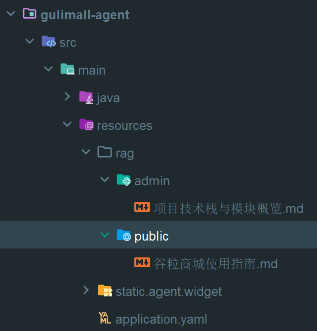
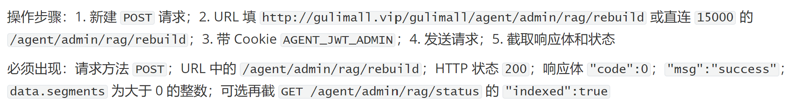
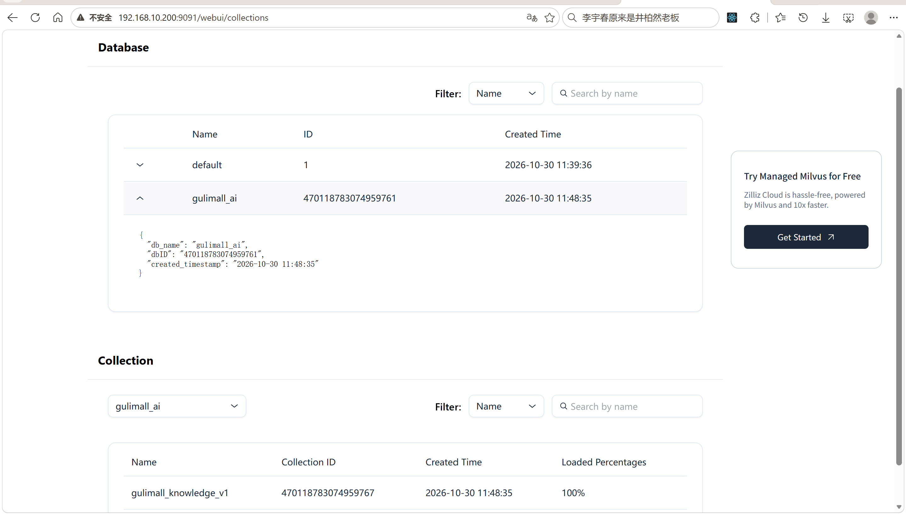
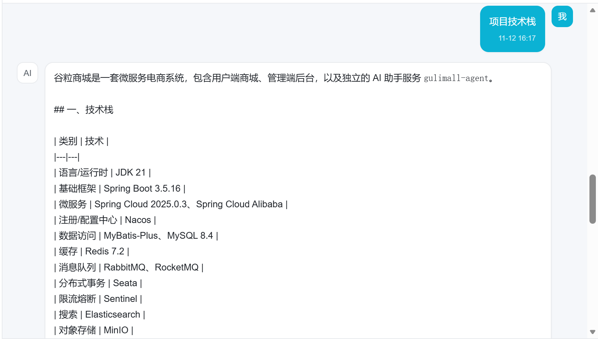
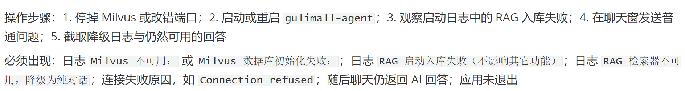

# 19.4 AI RAG 与 Milvus-介绍

> 本篇介绍谷粒商城 AI 的 RAG 知识库：Markdown 文档放在哪里、按目录怎么分 PUBLIC 和 ADMIN、文档怎么切分、embedding 怎么生成、Milvus 的 database 和 collection 怎么初始化、检索时怎么按角色过滤、内容 hash 怎么做幂等、管理端怎么重建索引，以及 Milvus 不可用时怎么降级。

> Milvus 相关配置：[data 目录](../../deploy/milvus/data/.gitkeep)、[etcd 目录](../../deploy/milvus/etcd/.gitkeep)、[minio 目录](../../deploy/milvus/minio/.gitkeep)。

---

## 1. 这个功能是干什么的

RAG（Retrieval-Augmented Generation）解决“模型不知道商城自己的使用说明和项目信息”的问题。

模型训练数据里没有谷粒商城的操作手册，也没有当前项目的模块分工。RAG 的做法是：

1. 把商城使用指南、项目技术栈等文档放进知识库。
2. 启动时把文档切分并向量化，写入 Milvus。
3. 用户提问时，先按语义检索相关片段。
4. 把片段作为上下文交给模型，再生成回答。

RAG 只补充“说明类知识”，不替代工具：

1. 库存、价格、订单、购物车等实时数据，仍以工具查询结果为准。
2. RAG 文档只说明功能、流程、模块职责和部署概览。
3. 工具结果和知识库冲突时，以工具结果为准。

知识库分两类：

| 目录 | audience | 用户端 | 管理端 |
|---|---|---|---|
| `rag/public/**` | `PUBLIC` | 可检索 | 可检索 |
| `rag/admin/**` | `ADMIN` | 不可检索 | 可检索 |

当前文档：

| 文件 | audience | 内容 |
|---|---|---|
| `rag/public/谷粒商城使用指南.md` | PUBLIC | 商城功能和使用流程 |
| `rag/admin/项目技术栈与模块概览.md` | ADMIN | 技术栈、模块职责、部署概览 |



## 2. 用户、管理员、开发者怎么操作

### 2.1 用户提问

1. 用户在聊天窗问“怎么加入购物车”“秒杀怎么参加”。
2. 后端把问题向量化。
3. Milvus 只检索 `audience=PUBLIC` 的片段。
4. 相关片段交给模型。
5. 模型结合使用指南回答。

用户端检索不到 `ADMIN` 文档，避免把项目内部信息暴露给普通用户。

### 2.2 管理员提问

1. 管理员问“项目用的是什么技术栈”“gulimall-agent 负责什么”。
2. 后端检索 `PUBLIC + ADMIN`。
3. 管理端文档可以作为上下文。
4. 模型回答项目技术栈和模块职责。

管理端提示词允许回答与商城直接相关的技术问题，但仍禁止输出密钥、Token、内网 IP、SQL 和服务器路径。

### 2.3 管理员重建索引

1. 管理员调 `POST /agent/admin/rag/rebuild`。
2. 服务端先抢 Redis 锁。
3. 重新加载文档、切分、向量化。
4. 清空旧 collection 数据。
5. 写入新片段。
6. 返回片段数。



### 2.4 管理员查看状态

1. 调 `GET /agent/admin/rag/status`。
2. 返回 `indexed` 布尔值。
3. `true` 表示 Redis 里存在入库标记。
4. `false` 表示还没入库或标记被清掉。

### 2.5 开发者新增文档

1. 在 `gulimall-agent/src/main/resources/rag/public/` 或 `rag/admin/` 下新建 `.md`。
2. 文件不能为空。
3. 重启应用，`RagBootstrapRunner` 会检查内容指纹。
4. 指纹变化时自动入库。
5. 或者由管理员手动重建。

文档不能放在 `rag` 根目录或其他子目录，否则加载器会跳过并打警告。

### 2.6 开发者配置 RAG

```yaml
gulimall:
  ai:
    rag:
      enabled: true
      host: ${MILVUS_HOST}
      port: ${MILVUS_PORT}
      database: ${MILVUS_DATABASE}
      collection: ${MILVUS_COLLECTION}
      dimension: 1536
      max-results: 5
      min-score: 0.65
      ingest-on-startup: true
      chunk-max-chars: 1200
      chunk-overlap-chars: 100
      doc-location: rag
      username: ${MILVUS_USERNAME}
      password: ${MILVUS_PASSWORD}
```

参数说明：

1. `enabled`：关闭后不连接 Milvus。
2. `database`：Milvus 数据库名，默认 `gulimall_ai`。
3. `collection`：集合名，默认 `gulimall_knowledge_v1`。
4. `dimension`：向量维度，必须和 embedding 模型一致。
5. `max-results`：每次最多返回 5 个片段。
6. `min-score`：相似度低于 0.65 的片段丢弃。
7. `chunk-max-chars`：每个片段最多 1200 字符。
8. `chunk-overlap-chars`：相邻片段重叠 100 字符。

## 3. 整体设计思路

### 3.1 业务上怎么设计

#### 3.1.1 知识库只做补充

RAG 不负责实时数据，原因：

1. 文档更新有延迟，库存和订单每秒都在变。
2. 文档是说明性的，不适合存结构化业务数据。
3. 实时查询需要权限校验，工具已经做了。

所以提示词规定：实时数据以工具为准，知识库只说明功能和流程。

#### 3.1.2 按角色分可见范围

文档按目录分 `PUBLIC` 和 `ADMIN`：

1. 用户端只能检索 `PUBLIC`。
2. 管理端可以检索 `PUBLIC + ADMIN`。
3. 其他目录不加载，避免管理端文档被误标成 `PUBLIC`。

过滤发生在 Milvus 查询阶段，不是先查全部再在 Java 里过滤，避免管理端内容进入用户请求的上下文。

#### 3.1.3 内容不变不重复入库

每次启动都重新 embedding 会浪费时间和费用。所以用“来源路径 + 内容 hash”生成文档指纹：

1. 指纹和 Redis marker 相同，跳过。
2. 不同才抢锁入库。
3. 入库成功后更新 marker。

#### 3.1.4 重建先清空

本地删除某份 Markdown 后，Milvus 里的旧片段不会自动消失。如果只按当前文档来源删除，已删除文档的片段会一直残留，用户端仍可能检索到。

所以重建时先 `removeAll()`，再写入当前文档的全部片段。

#### 3.1.5 失败降级

RAG 是增强能力，不是主链路。以下情况不能阻止聊天：

1. Milvus 没启动。
2. collection 不存在。
3. embedding 调用失败。
4. 检索超时。

处理方式：

1. 启动入库失败只记日志。
2. 检索器创建失败返回 `null`，AI Service 不挂 RAG。
3. 检索过程异常返回空列表。
4. Milvus 连接失败后冷却 60 秒，避免每个请求都等超时。

### 3.2 技术上怎么设计

#### 3.2.1 文档加载

`RagDocumentLoader.load`：

1. 用 `classpath*:{docLocation}/**/*.md` 扫描。
2. 空文件跳过。
3. 按路径判断 `PUBLIC` 或 `ADMIN`。
4. 其他目录跳过。
5. 每份文档带 `source`、`audience`、`version` 三个元数据。

`version` 是文档内容的短哈希，取 SHA-256 前 8 字节。

#### 3.2.2 切分

`DocumentSplitters.recursive(1200, 100)`：

1. 每个片段最多 1200 字符。
2. 相邻片段重叠 100 字符。
3. 优先按段落、句子切，避免把一句话切断。

重叠的作用是保留上下文边界，避免答案刚好跨在两个片段之间。

#### 3.2.3 embedding

使用 `text-embedding-3-small`，1536 维。

`ModelFactory.embedding()` 全局只创建一个向量模型，首次调用时按配置创建并缓存。

#### 3.2.4 Milvus 初始化

Milvus 分两层：

1. database：`gulimall_ai`。
2. collection：`gulimall_knowledge_v1`。

`MilvusEmbeddingStore` 会自动建 collection，但不会建 database，所以 `MilvusDatabaseInitializer` 先用原生 SDK 建库。

#### 3.2.5 检索

`EmbeddingStoreContentRetriever`：

1. embedding store 来自 `MilvusStoreProvider.get()`。
2. embedding model 来自 `ModelFactory.embedding()`。
3. `maxResults=5`。
4. `minScore=0.65`。
5. 过滤条件 `audience in [PUBLIC]` 或 `audience in [PUBLIC, ADMIN]`。

外面包一层 `SafeContentRetriever`，检索异常返回空列表。

#### 3.2.6 幂等与锁

Redis key：

| Key | 作用 | TTL |
|---|---|---|
| `gulimall:ai:rag:indexed` | 文档指纹 marker | 长期 |
| `gulimall:ai:rag:lock` | 入库/重建锁 | 10 分钟 |

多实例同时启动时，只有抢到锁的实例执行入库，其他实例直接返回。

## 4. 详细代码、配置和解释

RAG 的代码链路分成三段：启动阶段把 Markdown 加载、切分、向量化并写入 Milvus；对话阶段按用户身份检索片段并挂到 AI Service；管理端提供重建和状态查询。每一段都由独立的类承担，彼此通过 `RagIndexService`、`MilvusStoreProvider` 和 `RoleAwareContentRetriever` 连接。

本章按“文档加载 → 入库与重建 → Milvus 建库 → 连接管理 → 按角色检索 → 启动与管理端 → 对话挂载 → 存储配置 → 问答效果”组织。每个小节先说明类或配置在业务链路里解决什么问题，再给出关键概念、正常链路、代码分块解释、一次完整示例，最后列出边界和可优化点。

### 4.1 RagDocumentLoader：文档加载与可见范围标注

#### 4.1.1 这个类解决什么问题

客服对话里，用户会问“怎么加入购物车”“秒杀怎么参加”；管理端会问“项目用了什么技术栈”“gulimall-agent 负责什么”。这些答案不在模型训练数据里，分散在项目内置的 Markdown 文档中。`RagDocumentLoader` 负责把 classpath 下的 Markdown 扫描出来，转成 LangChain4J 的 `Document`，并给每份文档打三个元数据：来源路径、可见范围、内容版本。

调用方有两处：

1. `RagIndexService.ingest()` 调 `load()` 拿文档去切分、向量化、写 Milvus。
2. `RagIndexService.ingestIfNeeded()` 调 `fingerprint()` 判断文档有没有变化。

上游是 `resources/rag/public` 和 `resources/rag/admin` 两个目录，下游是切分器和 Milvus 的 metadata。检索阶段按 `audience` 过滤，所以这个类标注的 `PUBLIC`/`ADMIN` 直接决定用户能检索到哪些片段。

#### 4.1.2 关键概念与元数据

| 概念 | 值或来源 | 作用 |
|---|---|---|
| `docLocation` | `gulimall.ai.rag.doc-location`，默认 `rag` | 文档根目录 |
| 扫描表达式 | `classpath*:{docLocation}/**/*.md` | 找所有 Markdown |
| `audience` | 目录决定：`public/` 为 `PUBLIC`，`admin/` 为 `ADMIN` | 检索时的可见范围过滤字段 |
| `source` | `audience` 小写加文件名 | 记录片段来自哪份文档 |
| `version` | 正文 SHA-256 前 8 字节 | 单个文档的内容版本 |
| `fingerprint` | 所有 `source:version` 拼接后再取短哈希 | 整个知识库的内容指纹 |

扫描表达式用 `classpath*:` 而不是 `classpath:`。`classpath*:` 会扫描所有 classpath 位置，包括依赖 jar；`classpath:` 只取第一个匹配。当前文档放在应用自己的 `resources` 下，两种写法都能用，`classpath*:` 为将来把知识库拆成独立 jar 留了余地。

#### 4.1.3 正常链路

```text
应用启动
  → RagBootstrapRunner.run
  → RagIndexService.ingestIfNeeded
  → RagDocumentLoader.fingerprint
  → RagDocumentLoader.load
       ├── 扫描 classpath*:rag/**/*.md
       ├── 读成 UTF-8 文本
       ├── 空文件跳过
       ├── audienceOf 判断 public/admin
       ├── 组装 source/audience/version
       └── 返回 Document 列表
```

#### 4.1.4 代码与解释

```java
@Slf4j
@Component
@RequiredArgsConstructor
public class RagDocumentLoader {

    private final AiProperties properties;

    public List<Document> load() {
        List<Document> documents = new ArrayList<>();
        try {
            PathMatchingResourcePatternResolver resolver = new PathMatchingResourcePatternResolver();
            String docLocation = properties.getRag().getDocLocation();
            String location = "classpath*:" + docLocation + "/**/*.md";
            Resource[] resources = resolver.getResources(location);
            for (Resource resource : resources) {
                String filename = resource.getFilename() == null ? "unknown.md" : resource.getFilename();
                String text = new String(resource.getInputStream().readAllBytes(), StandardCharsets.UTF_8);
                if (text.isBlank()) {
                    continue;
                }

                String audience = audienceOf(resource, docLocation);
                if (audience == null) {
                    log.warn("RAG 文档不在 public/admin 目录下，已跳过：{}", resource.getDescription());
                    continue;
                }
                String source = audience.toLowerCase(Locale.ROOT) + "/" + filename;
                documents.add(Document.from(text, Metadata.from(Map.of(
                        "source", source,
                        "audience", audience,
                        "version", shortHash(text)
                ))));
                log.info("RAG 加载文档：{} audience={} chars={}", source, audience, text.length());
            }
        } catch (Exception ex) {
            log.warn("RAG 文档加载失败：{}", ex.getMessage());
        }
        return documents;
    }

    public String fingerprint() {
        StringBuilder raw = new StringBuilder();
        for (Document document : load()) {
            raw.append(document.metadata().getString("source"))
                    .append(':')
                    .append(document.metadata().getString("version"))
                    .append(';');
        }
        return shortHash(raw.toString());
    }

    private String audienceOf(Resource resource, String docLocation) {
        String path;
        try {
            path = resource.getURL().getPath();
        } catch (Exception ex) {
            path = resource.getDescription();
        }
        path = path.replace('\\', '/').toLowerCase(Locale.ROOT);
        String prefix = "/" + docLocation.replace('\\', '/')
                .replaceAll("^/+|/+$", "")
                .toLowerCase(Locale.ROOT) + "/";
        if (path.contains(prefix + "admin/")) {
            return "ADMIN";
        }
        if (path.contains(prefix + "public/")) {
            return "PUBLIC";
        }
        return null;
    }

    private String shortHash(String text) {
        try {
            byte[] digest = MessageDigest.getInstance("SHA-256")
                    .digest(text.getBytes(StandardCharsets.UTF_8));
            StringBuilder hex = new StringBuilder();
            for (int i = 0; i < 8; i++) {
                hex.append(String.format("%02x", digest[i]));
            }
            return hex.toString();
        } catch (Exception ex) {
            return String.valueOf(text.hashCode());
        }
    }
}
```

1. `PathMatchingResourcePatternResolver` 配合 `classpath*:` 通配符，扫描 classpath 下所有 Markdown，不把文件名写死。
2. `docLocation` 来自配置，默认 `rag`。知识库换目录时只改配置，不改代码。
3. 每个 `Resource` 先取文件名，文件名缺失时用 `unknown.md` 兜底，避免空指针。
4. `readAllBytes()` 一次性读成 UTF-8 文本。文档是纯文本，不需要按行处理。
5. `text.isBlank()` 跳过空文件。空文档入库后会生成无意义片段，占用检索名额。
6. `audienceOf` 判断目录。路径先把 `\` 统一成 `/`，再转小写，消除 Windows 与 Linux 的分隔符和大小写差异。
7. `prefix` 由 `docLocation` 拼出来，去掉首尾多余的 `/`，保证配置写成 `rag`、`/rag/` 或 `RAG` 都能匹配。
8. 先判断 `admin/` 再判断 `public/`。两个目录互斥，都不匹配时返回 `null`。
9. `audience` 为 `null` 时打警告并跳过。文档放在 `rag` 根目录或其他子目录不会入库，防止管理端内容被误标成 `PUBLIC`。
10. `source` 由 `audience` 小写加文件名组成，例如 `public/谷粒商城使用指南.md`。不同目录下的同名文件也能区分。
11. `Document.from(text, Metadata.from(...))` 把正文和元数据一起封装，元数据随后会写进 Milvus，供检索过滤和来源展示使用。
12. `shortHash` 对正文做 SHA-256，取前 8 个字节转十六进制，作为单个文档的 `version`。
13. `fingerprint()` 重新调用 `load()`，把所有 `source:version` 拼成一个长字符串，再取短哈希。任何一份文档改名或改内容，指纹都会变化。
14. 加载过程整体包在 `try/catch` 里，异常只记警告并返回已加载的部分，不让启动流程失败。

可见范围按目录判断，而不是按文件名前缀。目录是显式的分类声明，新增文档时放进对应目录就完成了标注；文件名前缀容易写错，也容易在复制文件时丢失。指纹同时包含 `source` 和 `version`：只算内容哈希发现不了文件改名，只算路径发现不了内容修改。

#### 4.1.5 一次完整示例

```text
resources/rag/public/谷粒商城使用指南.md
resources/rag/admin/项目技术栈与模块概览.md
resources/rag/说明.md

load() 返回 2 个 Document：
1. source=public/谷粒商城使用指南.md     audience=PUBLIC  version=3f2a91c4
2. source=admin/项目技术栈与模块概览.md audience=ADMIN   version=8b7d02ef

说明.md 不在 public/admin 下：
  WARN RAG 文档不在 public/admin 目录下，已跳过

fingerprint()：
  raw = "public/谷粒商城使用指南.md:3f2a91c4;admin/项目技术栈与模块概览.md:8b7d02ef;"
  shortHash(raw) = 9c1d7e20
```

修改 public 文档后，该文档的 `version` 和整体 `fingerprint` 都会变化，入库流程才会重新执行。

#### 4.1.6 它不做什么

1. 不切分文档，切分由 `DocumentSplitters.recursive` 完成。
2. 不生成 embedding，也不写 Milvus。
3. 不校验文档内容是否符合业务事实，只负责搬运和标注。
4. 不读取数据库或远程知识库，只扫描 classpath。
5. 不限制单文件大小，超大文档会直接读进内存。

#### 4.1.7 边界与可优化点

1. `fingerprint()` 和 `ingest()` 各调用一次 `load()`，文档会被读取两遍。文档多时可以在一次加载后把结果传给指纹计算。
2. `try/catch` 包住整个循环，任意一个文件读取失败会中断后续文件，返回部分结果。
3. 空文件直接跳过，没有日志，排查“为什么少了一份文档”时不直观。
4. `shortHash` 只取 8 字节，碰撞概率低但存在。用于幂等判断足够，不适合当安全哈希。
5. `source` 只有目录加文件名，文件移动或改名会被当成新文档，旧来源的片段要等全量重建才消失。
6. 没有内容长度上限和非法字符校验，异常 Markdown 可能生成大量碎片。
7. 文档只支持 UTF-8，其他编码会读出乱码。

### 4.2 RagIndexService：幂等入库与全量重建

#### 4.2.1 这个类解决什么问题

文档向量化要调用 embedding 接口，按 token 计费。每次启动都重新向量化会造成不必要的费用和启动延迟。多个实例同时启动时，如果都写同一个 collection，会出现重复片段和并发写冲突。本地删除一份 Markdown 后，Milvus 里的旧片段不会自动消失。`RagIndexService` 把这三个问题收在一个入口：用文档指纹做幂等，用 Redis 锁做多实例互斥，用全量清空加写入保证本地文档和 Milvus 一致。

调用方有两处：

1. `RagBootstrapRunner` 在应用启动后调 `ingestIfNeeded()`，按需入库。
2. `RagAdminController` 在管理员操作时调 `rebuild()` 和 `isIndexed()`。

上游依赖 `RagDocumentLoader` 提供文档和指纹，`MilvusStoreProvider` 提供向量库，`ModelFactory` 提供 embedding 模型，`StringRedisTemplate` 提供标记和锁。下游是 Milvus 的 collection 和 Redis 的两个 key。

#### 4.2.2 关键概念与 Redis 键

| 名称 | 值 | 作用 |
|---|---|---|
| `MARKER` | `gulimall:ai:rag:indexed` | 记录已入库文档的指纹 |
| `LOCK` | `gulimall:ai:rag:lock` | 入库和重建互斥锁，TTL 10 分钟 |
| `ingestIfNeeded` | 启动时调用 | 指纹变化才入库 |
| `rebuild` | 管理端调用 | 强制全量重建 |
| `isIndexed` | 管理端调用 | 判断 marker 是否存在 |
| `ingest` | 私有方法 | 加载、切分、清空、向量化、写入 |

锁的 TTL 是 10 分钟。入库包含 embedding 网络调用，文档多时可能持续数分钟；TTL 太短会让锁在入库完成前过期，导致两个实例同时写入。TTL 太长又会在实例崩溃后长时间阻塞重建。10 分钟是当前文档规模下的折中值。

#### 4.2.3 正常链路

启动入库：

```text
RagBootstrapRunner
  → ingestIfNeeded
       ├── RAG 关闭 → 返回
       ├── fingerprint
       ├── 读 MARKER
       ├── 指纹相同 → 返回
       ├── SETNX LOCK，TTL 10 分钟
       ├── 抢不到 → 返回
       ├── ingest
       │     ├── load
       │     ├── recursive 切分
       │     ├── storeProvider.get
       │     ├── removeAll
       │     ├── embedAll
       │     └── addAll
       ├── count > 0 → 写 MARKER
       └── finally 删 LOCK
```

管理端重建：

```text
RagAdminController.rebuild
  → rebuild
       ├── SETNX LOCK
       ├── 抢不到 → 15009
       ├── ingest
       ├── count > 0 → 写 MARKER
       ├── finally 删 LOCK
       └── 返回片段数
```

#### 4.2.4 代码与解释

```java
@Slf4j
@Service
@RequiredArgsConstructor
public class RagIndexService {

    private static final String MARKER = "gulimall:ai:rag:indexed";
    private static final String LOCK = "gulimall:ai:rag:lock";

    private final AiProperties properties;
    private final RagDocumentLoader documentLoader;
    private final MilvusStoreProvider storeProvider;
    private final ModelFactory modelFactory;
    private final StringRedisTemplate redisTemplate;

    public void ingestIfNeeded() {
        if (!properties.getRag().isEnabled()) {
            return;
        }

        String fingerprint = documentLoader.fingerprint();
        String marker = redisTemplate.opsForValue().get(MARKER);
        if (fingerprint.equals(marker)) {
            return;
        }

        Boolean locked = redisTemplate.opsForValue()
                .setIfAbsent(LOCK, "1", Duration.ofMinutes(10));
        if (!Boolean.TRUE.equals(locked)) {
            return;
        }
        try {
            int count = ingest();
            if (count > 0) {
                redisTemplate.opsForValue().set(MARKER, fingerprint);
            }
        } finally {
            redisTemplate.delete(LOCK);
        }
    }

    public int rebuild() {
        Boolean locked = redisTemplate.opsForValue()
                .setIfAbsent(LOCK, "1", Duration.ofMinutes(10));
        if (!Boolean.TRUE.equals(locked)) {
            throw new AgentException(AgentErrorCode.RAG_UNAVAILABLE, "RAG 正在重建中，请稍后再试");
        }
        try {
            int count = ingest();
            if (count > 0) {
                redisTemplate.opsForValue().set(MARKER, documentLoader.fingerprint());
            }
            return count;
        } finally {
            redisTemplate.delete(LOCK);
        }
    }

    public boolean isIndexed() {
        return redisTemplate.hasKey(MARKER);
    }

    private int ingest() {
        List<Document> documents = documentLoader.load();
        if (documents.isEmpty()) {
            log.warn("RAG 没有找到可入库的文档（classpath:{}/**/*.md）",
                    properties.getRag().getDocLocation());
            return 0;
        }

        List<TextSegment> segments = DocumentSplitters
                .recursive(properties.getRag().getChunkMaxChars(),
                        properties.getRag().getChunkOverlapChars())
                .splitAll(documents);
        if (segments.isEmpty()) {
            return 0;
        }

        EmbeddingStore<TextSegment> store = storeProvider.get();

        store.removeAll();

        EmbeddingModel embeddingModel = modelFactory.embedding();
        List<Embedding> embeddings = embeddingModel.embedAll(segments).content();
        store.addAll(embeddings, segments);
        log.info("RAG 入库完成：文档 {} 个，片段 {} 个", documents.size(), segments.size());
        return segments.size();
    }
}
```

`ingestIfNeeded` 的执行顺序：

1. `enabled=false` 直接返回，不连 Milvus，也不计算指纹。
2. 调用 `documentLoader.fingerprint()` 计算当前文档集合的指纹。
3. 读 Redis 的 `MARKER`。
4. 指纹与 marker 相同，说明文档没有变化，直接返回，跳过 embedding。
5. `setIfAbsent` 抢 `gulimall:ai:rag:lock`，同时设置 10 分钟 TTL。抢锁和设置过期时间是一个原子命令。
6. 抢不到锁说明其他实例正在入库，当前实例直接返回，避免重复写入。
7. 调 `ingest()` 执行真正的入库。
8. 片段数大于 0 才更新 marker。没有片段说明文档为空或切分失败，此时更新 marker 会让下次启动误以为已经入库。
9. `finally` 删除锁。无论入库成功还是抛异常，锁都会释放，避免死锁。

`rebuild` 的执行顺序：

1. 管理员手动重建，先抢同一把锁。
2. 抢不到锁抛 `15009`，提示“RAG 正在重建中”。这里选择报错而不是静默返回，让管理员知道当前操作没有执行。
3. 调 `ingest()` 全量重建。
4. 片段数大于 0 时更新 marker。
5. `finally` 删除锁。
6. 返回当前入库的片段数，管理端用它提示重建结果。

`ingest` 的执行顺序：

1. 调 `documentLoader.load()` 加载文档，空列表打警告并返回 0。
2. 用 `DocumentSplitters.recursive(chunkMaxChars, chunkOverlapChars)` 切分，默认每个片段最多 1200 字符，相邻片段重叠 100 字符。
3. 切分结果为空返回 0，不触碰 Milvus。
4. 调 `storeProvider.get()` 拿向量库。这里才真正连接 Milvus，连接失败会抛 `15009`。
5. `store.removeAll()` 清空 collection 里的旧片段。
6. 调 `modelFactory.embedding()` 取 embedding 模型，模型对象由工厂缓存。
7. `embedAll(segments)` 批量向量化，一次网络请求处理多个片段。
8. `addAll(embeddings, segments)` 把向量和片段文本一起写入 Milvus。
9. 返回片段数，供调用方决定是否更新 marker。

先清空再写入，是因为本地删除文档后，Milvus 不会自动删除对应片段。如果只按当前文档的 `source` 删除已变更的部分，已经删除的文档会永远留在 collection 里，用户端仍可能检索到。全量清空保证 Milvus 内容与当前本地文档集合一致。

marker 在 `ingest` 成功之后才写。如果写入过程中抛异常，marker 保持旧值，下次启动或管理员重建会再次尝试。反过来，如果先写 marker 再入库，入库失败后指纹已经被记下，后续启动会误判为已完成。

#### 4.2.5 一次完整示例

首次启动：

```text
1. marker 不存在
2. fingerprint = 9c1d7e20
3. SETNX lock 成功
4. load 返回 2 份文档
5. 切分得到 8 个片段
6. 连接 Milvus，removeAll
7. embedAll 生成 8 个向量
8. addAll 写入
9. SET marker = 9c1d7e20
10. DEL lock
11. 日志：RAG 入库完成：文档 2 个，片段 8 个
```

第二次启动，文档未改：

```text
1. fingerprint = 9c1d7e20
2. marker = 9c1d7e20
3. 指纹相同，直接返回，不调用 embedding
```

修改 public 文档后重启：

```text
1. fingerprint 变为 1d4b77a9
2. marker 仍为 9c1d7e20
3. 抢锁成功
4. 全量重建：removeAll 后写入 9 个片段
5. marker 更新为 1d4b77a9
```

管理员重建：

```text
POST /agent/admin/rag/rebuild
→ 抢锁成功
→ removeAll
→ 重新向量化并写入
→ marker 更新为当前指纹
→ 返回 {"segments": 9}
```

#### 4.2.6 它不做什么

1. 不做按文档增量更新，任何一次变化都会触发全量重建。
2. 不保证 `removeAll` 和 `addAll` 的原子性，两者之间存在检索不到数据的窗口。
3. 不校验 embedding 维度与 collection 维度是否一致，维度不一致会在写入阶段报错。
4. 不处理 Redis 不可用。marker 和锁都依赖 Redis，Redis 故障时启动入库会失败。
5. 不提供入库进度、取消和重试队列。
6. 不清理已经不再使用的旧 collection，只清空当前 collection 的数据。

#### 4.2.7 边界与可优化点

1. 全量重建会重新 embedding 所有文档，文档多时费用和时间都会上升。可以按每份文档的 `version` 做增量，只重算变化的文档。
2. `removeAll` 到 `addAll` 完成之间，检索会短暂返回空结果。生产环境可以先写临时 collection，写完再切换别名。
3. marker 写入和 Milvus 写入不是原子操作。极端情况下 marker 更新成功但 Milvus 写入失败，需要人工重建。
4. 锁 TTL 固定 10 分钟。入库超过 10 分钟时锁会过期，另一个实例可能进入并重复写入。长文档场景要延长 TTL 或给锁续期。
5. `finally` 直接删除锁，没有校验锁的持有者。如果锁已经过期并被其他实例重新获取，当前实例会误删别人的锁。生产环境应使用 Redisson 的可重入锁或带 value 校验的删除脚本。
6. `ingestIfNeeded` 和 `rebuild` 的抢锁、写 marker、删锁逻辑重复，可以抽公共方法。
7. `ingestIfNeeded` 在文档为空时返回且不更新 marker，每次启动都会重试加载并打警告。
8. `addAll` 部分成功时没有回滚，collection 里可能出现不完整数据，marker 也不会更新，下次启动会再次全量覆盖。
9. 多实例同时启动时，抢不到锁的实例直接跳过，不会等待第一个实例完成。如果第一个实例失败，当前启动周期内其他实例也不会补做。

### 4.3 MilvusDatabaseInitializer：建库

#### 4.3.1 这个类解决什么问题

Milvus 的数据组织分两层：database 下面挂 collection。`MilvusEmbeddingStore` 在 collection 不存在时会自动创建 collection，但不会自动创建 database。新环境第一次启动时，如果 `gulimall_ai` 数据库不存在，store 创建会直接失败，RAG 整条链路都不可用。`MilvusDatabaseInitializer` 用 Milvus 原生 SDK 先确认 database 存在，不存在就创建，为后面的 store 创建扫清前置条件。

调用方只有一处：`MilvusStoreProvider.get()` 在创建 store 前调 `ensureDatabase()`。上游是 `AiProperties.Rag` 里的 host、port、database、username、password，下游是 `MilvusEmbeddingStore`。

#### 4.3.2 关键概念与接口

| 概念 | 说明 |
|---|---|
| `ConnectParam` | 原生客户端的连接参数，host、port、鉴权 |
| `MilvusServiceClient` | Milvus 原生 gRPC 客户端 |
| `listDatabases()` | 查询所有 database 名称 |
| `createDatabase()` | 创建 database |
| status 0 | Milvus 返回码，0 表示成功 |
| `already exist` | 并发创建时的兜底判断 |

鉴权只在用户名和密码都配置时开启。Milvus 默认不开启鉴权，带空用户名或空密码连接反而会失败。

#### 4.3.3 正常链路

```text
MilvusStoreProvider.get
  → MilvusDatabaseInitializer.ensureDatabase
       ├── 构建 ConnectParam
       ├── 用户名和密码都有 → 开启鉴权
       ├── 建 MilvusServiceClient
       ├── listDatabases
       ├── database 已存在 → 返回
       ├── createDatabase
       ├── status 非 0 且不是 already exist → 警告
       └── finally close
```

#### 4.3.4 代码与解释

```java
@Slf4j
@Component
@RequiredArgsConstructor
public class MilvusDatabaseInitializer {

    private final AiProperties properties;

    public void ensureDatabase() {
        AiProperties.Rag rag = properties.getRag();
        ConnectParam.Builder builder = ConnectParam.newBuilder()
                .withHost(rag.getHost())
                .withPort(rag.getPort());
        if (StringUtils.hasText(rag.getUsername()) && StringUtils.hasText(rag.getPassword())) {
            builder.withAuthorization(rag.getUsername(), rag.getPassword());
        }

        MilvusServiceClient client = null;
        try {
            client = new MilvusServiceClient(builder.build());
            R<ListDatabasesResponse> databases = client.listDatabases();
            if (databases.getStatus() != null && databases.getStatus() == 0
                    && databases.getData() != null
                    && databases.getData().getDbNamesList().contains(rag.getDatabase())) {
                return;
            }

            R<RpcStatus> result = client.createDatabase(CreateDatabaseParam.newBuilder()
                    .withDatabaseName(rag.getDatabase())
                    .build());

            if (result.getStatus() == null || result.getStatus() != 0) {
                String message = result.getMessage() == null ? "" : result.getMessage();
                if (!message.toLowerCase().contains("already exist")) {
                    log.warn("创建 Milvus 数据库返回非成功状态：{}", message);
                }
            }
        } catch (Exception ex) {
            throw new IllegalStateException("Milvus 数据库初始化失败：" + ex.getMessage(), ex);
        } finally {
            if (client != null) {
                try {
                    client.close(0);
                } catch (InterruptedException ex) {
                    Thread.currentThread().interrupt();
                }
            }
        }
    }
}
```

1. 从 `AiProperties.Rag` 取连接配置，不把地址和库名写死在代码里。
2. `ConnectParam.newBuilder()` 设置 host 和 port。port 是 gRPC 端口，默认 19530。
3. 只有用户名和密码都有值时才调 `withAuthorization`。只配一个或都不配时保持匿名连接，兼容未开启鉴权的 Milvus。
4. `new MilvusServiceClient(...)` 建立原生客户端。这一步不会自动建库，只是连上 Milvus 的默认库。
5. `listDatabases()` 查询所有 database 名称。
6. 状态为 0、返回数据不为空、列表包含目标库名时，说明库已存在，直接返回。
7. 库不存在时调 `createDatabase`，库名来自配置。
8. 创建结果不是 0 时先取 message。message 包含 `already exist` 说明其他实例并发创建成功，属于正常情况，不记警告；其他非 0 状态记警告。
9. 任意异常包装成 `IllegalStateException` 抛出，交给 `MilvusStoreProvider` 转成 `15009` 并进入冷却。
10. `finally` 关闭客户端。`close(0)` 是同步关闭，等待 0 秒；被中断时恢复线程中断标记。

为什么不直接用 `MilvusEmbeddingStore` 建库：LangChain4J 的 store 只负责 collection，database 是更上层的命名空间，必须由原生 SDK 处理。先建库再建 store，顺序不能反。

#### 4.3.5 一次完整示例

空 Milvus 首次启动：

```text
1. get() 进入同步块
2. ensureDatabase()
3. listDatabases 返回 ["default"]
4. 不包含 gulimall_ai
5. createDatabase("gulimall_ai") 返回 status=0
6. close 客户端
7. 继续创建 MilvusEmbeddingStore
8. collection gulimall_knowledge_v1 由 store 自动创建
```

再次启动：

```text
1. listDatabases 返回 ["default", "gulimall_ai"]
2. 包含目标库，直接返回
3. 不重复创建
```

#### 4.3.6 它不做什么

1. 不创建 collection，collection 由 `MilvusEmbeddingStore` 自动创建。
2. 不检查 collection 的维度和字段，这部分由 store 负责。
3. 不管理 database 的权限和配额。
4. 不做连接池，每次调用创建一个短连接客户端。

#### 4.3.7 边界与可优化点

1. 每次创建 store 都会调一次 `ensureDatabase`。`MilvusStoreProvider` 缓存 store 后不会重复调用，但进程重启后仍会再查一次。可以缓存“已检查”状态。
2. 每次调用都新建并关闭客户端，连接开销较大。可以把客户端做成单例复用。
3. 没有配置连接超时，Milvus 不可达时按 SDK 默认超时等待。
4. 不支持 TLS，生产环境如果启用 Milvus 加密连接需要补充证书配置。
5. `listDatabases` 返回状态非 0 时不会区分“查询失败”和“库不存在”，会继续尝试创建，可能把连接问题误判成缺库。
6. `already exist` 用字符串匹配判断，Milvus 返回文案变化时会失效。

### 4.4 MilvusStoreProvider：延迟创建与冷却

#### 4.4.1 这个类解决什么问题

Milvus 是 RAG 新增的中间件，不是聊天主链路的必需依赖。如果把 `MilvusEmbeddingStore` 做成启动期 Bean，Milvus 没启动时应用会因为依赖注入或初始化失败而起不来，聊天和工具查询也一起不可用。`MilvusStoreProvider` 把 store 的创建推迟到第一次真正需要时，创建成功后缓存，创建失败后进入 60 秒冷却，冷却期内快速失败，避免每个聊天请求都等待连接超时。

调用方有两处：

1. `RagIndexService.ingest()` 入库时调用，拿 store 写数据。
2. `RoleAwareContentRetriever.build()` 创建检索器时调用，拿 store 查数据。

上游是 `MilvusDatabaseInitializer` 和 `AiProperties.Rag`，下游是 Milvus 的 collection。

#### 4.4.2 关键概念与状态

| 字段或概念 | 作用 |
|---|---|
| `store` | 缓存创建成功的 `MilvusEmbeddingStore`，`volatile` 保证可见性 |
| `nextRetryAt` | 失败后的冷却截止时间，`volatile` 保证多线程可见 |
| 双重检查锁 | 第一次创建只允许一个线程进入 |
| `autoFlushOnInsert` | 每次写入后自动 flush，数据立即可查 |
| 60 秒冷却 | 失败后短时间内不再尝试连接 |
| `RAG_UNAVAILABLE` | 统一错误码 `15009` |

#### 4.4.3 正常链路

```text
调用方 get()
  ├── store 已存在 → 返回
  ├── 当前时间 < nextRetryAt → 快速失败
  ├── 进入 synchronized
  │     ├── 再检查 store
  │     ├── RAG 关闭 → 15009
  │     ├── ensureDatabase
  │     ├── 构建 MilvusEmbeddingStore
  │     ├── 用户名和密码都有 → 带鉴权
  │     ├── 成功 → 缓存 store，清空冷却
  │     └── 失败 → 设置 60 秒冷却，抛 15009
  └── 返回 store
```

#### 4.4.4 代码与解释

```java
@Slf4j
@Component
@RequiredArgsConstructor
public class MilvusStoreProvider {

    private final AiProperties properties;
    private final MilvusDatabaseInitializer databaseInitializer;

    private volatile MilvusEmbeddingStore store;
    private volatile long nextRetryAt = 0;

    public MilvusEmbeddingStore get() {
        if (store != null) {
            return store;
        }

        if (System.currentTimeMillis() < nextRetryAt) {
            throw new AgentException(AgentErrorCode.RAG_UNAVAILABLE, "Milvus 暂不可用，稍后重试");
        }

        synchronized (this) {
            if (store != null) {
                return store;
            }
            AiProperties.Rag rag = properties.getRag();
            if (!rag.isEnabled()) {
                throw new AgentException(AgentErrorCode.RAG_UNAVAILABLE, "RAG 已关闭");
            }

            try {
                databaseInitializer.ensureDatabase();
                MilvusEmbeddingStore.Builder builder = MilvusEmbeddingStore.builder()
                        .host(rag.getHost())
                        .port(rag.getPort())
                        .databaseName(rag.getDatabase())
                        .collectionName(rag.getCollection())
                        .dimension(rag.getDimension())
                        .autoFlushOnInsert(true);
                if (StringUtils.hasText(rag.getUsername()) && StringUtils.hasText(rag.getPassword())) {
                    builder.username(rag.getUsername()).password(rag.getPassword());
                }
                store = builder.build();
                nextRetryAt = 0;
                log.info("Milvus 向量库已连接：{}:{}/{}", rag.getHost(), rag.getPort(), rag.getDatabase());
                return store;
            } catch (AgentException ex) {
                nextRetryAt = System.currentTimeMillis() + 60_000;
                throw ex;
            } catch (Exception ex) {
                nextRetryAt = System.currentTimeMillis() + 60_000;
                throw new AgentException(AgentErrorCode.RAG_UNAVAILABLE,
                        "Milvus 不可用：" + ex.getMessage(), ex);
            }
        }
    }
}
```

1. `store != null` 直接返回。创建成功后所有请求共用同一个 store，不重复建连接。
2. 当前时间小于 `nextRetryAt` 时抛 `15009`。冷却期内的请求立即失败，不再尝试连接 Milvus。
3. 进入 `synchronized (this)` 后再次检查 `store`。并发场景下第一个线程创建完成后，后面的线程直接复用，避免重复创建。
4. 检查 `rag.isEnabled()`。RAG 关闭时抛 `15009`，由上层决定降级为纯对话。
5. 调 `databaseInitializer.ensureDatabase()` 确保 database 存在。
6. 用 builder 设置 host、port、database、collection、dimension 和 `autoFlushOnInsert(true)`。collection 不存在时由 store 自动创建。
7. 用户名和密码都有值时设置鉴权，否则保持匿名连接。
8. `builder.build()` 创建 store。成功后清空 `nextRetryAt`，记录连接日志并返回。
9. 捕获 `AgentException` 时保留原错误码，设置 60 秒冷却后继续抛出；捕获其他异常时包装成 `15009`，同样设置冷却。两类失败都进入冷却，避免故障期间反复等待。

延迟创建的原因：RAG 是增强能力。Milvus 没启动、网络不通、配置缺失时，聊天仍然要能用，工具仍然要能查库存和订单，只是知识库检索降级。把失败限制在 RAG 内部，主链路不受影响。

#### 4.4.5 一次完整示例

Milvus 未启动时的首次聊天：

```text
1. AssistantFactory 调 forPrincipal
2. RoleAwareContentRetriever.build 调 storeProvider.get()
3. store 为空，nextRetryAt 为 0
4. 进入同步块，ensureDatabase 连接失败
5. 设置 nextRetryAt = 当前时间 + 60 秒
6. 抛 15009
7. forPrincipal 捕获异常，返回 null
8. AI Service 不挂检索器，按纯对话回答
9. 60 秒内的后续请求在第 2 步直接失败，不再等待连接超时
10. 60 秒后再次请求会重新尝试连接
```

Milvus 正常时：

```text
1. 第一次 get() 建库、建 store，缓存
2. 后续 get() 直接返回缓存对象
3. 入库和检索共用同一个 store
```

#### 4.4.6 它不做什么

1. 不做主动探活。store 创建成功后，Milvus 后续挂掉不会立即感知。
2. 不重试连接。失败后只冷却，不自动补偿。
3. 不管理 collection 的 schema，字段和维度由 store 及配置决定。
4. 不在应用关闭时显式关闭 store。
5. 不区分连接失败、鉴权失败和配置错误，统一转成 `15009`。

#### 4.4.7 边界与可优化点

1. 冷却时间固定 60 秒，可以配置化，按环境调整。
2. store 缓存后不探活。Milvus 中途挂掉时，第一次检索才会失败，`SafeContentRetriever` 返回空结果，但 store 不会被清空，后续请求仍会继续尝试。
3. store 创建成功后如果 Milvus 重启，旧连接可能失效，需要重启应用或补充重建逻辑。
4. 没有记录连接失败次数和耗时，缺少可观测性。
5. `synchronized` 只保护首次创建。连接失败后并发请求会在锁外快速失败，这是预期行为。
6. 不支持 TLS 和自定义超时，生产环境需要补配置。
7. `autoFlushOnInsert(true)` 让每次写入立即可见，但会增加写入开销，批量入库时可以关闭后手动 flush。

### 4.5 RoleAwareContentRetriever：按角色检索

#### 4.5.1 这个类解决什么问题

知识库同时存放用户使用指南和项目内部文档。普通用户只能看到使用指南，管理员可以看到技术栈和模块职责。如果把两类文档放在同一个检索范围里，再在 Java 代码里过滤，管理端片段会先进入用户请求的上下文，既浪费 token，也存在信息泄露风险。`RoleAwareContentRetriever` 按当前身份返回不同的检索器，把 `audience` 过滤条件下推到 Milvus 查询阶段，从数据源头隔离可见范围。

调用方是 `AssistantFactory`：构建普通对话和流式对话时都会调 `forPrincipal(principal)` 取检索器。上游是 `Principal`、`MilvusStoreProvider`、`ModelFactory` 和 `AiProperties.Rag`，下游是 LangChain4J 的 `AiServices.contentRetriever`。

#### 4.5.2 关键概念与检索参数

| 概念 | 说明 |
|---|---|
| `Principal` | 当前请求身份，`isAdmin()` 决定检索范围 |
| 用户检索器 | `audience in [PUBLIC]` |
| 管理员检索器 | `audience in [PUBLIC, ADMIN]` |
| `maxResults` | 每次最多返回的片段数，默认 5 |
| `minScore` | 相似度阈值，默认 0.65，低于阈值的片段丢弃 |
| `SafeContentRetriever` | 异常兜底包装，检索失败返回空列表 |
| 懒加载缓存 | 两种检索器只在第一次使用时创建 |

过滤条件用 `MetadataFilterBuilder.metadataKey("audience").isIn(audiences)` 表达。`isIn` 会生成 Milvus 的标量过滤条件，只有 `audience` 命中白名单的片段才参与相似度计算。

#### 4.5.3 正常链路

```text
ChatOrchestrator
  → AssistantFactory.assistant / streamingAssistant
  → RoleAwareContentRetriever.forPrincipal(principal)
       ├── RAG 关闭 → null
       ├── ADMIN → adminRetriever
       │     └── audience in [PUBLIC, ADMIN]
       ├── USER  → userRetriever
       │     └── audience in [PUBLIC]
       ├── 构建 EmbeddingStoreContentRetriever
       ├── 包装 SafeContentRetriever
       └── 异常 → null
  → retriever 非空时挂到 AiServices
```

#### 4.5.4 代码与解释

```java
@Slf4j
@Component
@RequiredArgsConstructor
public class RoleAwareContentRetriever {

    private final AiProperties properties;
    private final MilvusStoreProvider storeProvider;
    private final ModelFactory modelFactory;

    private volatile ContentRetriever userRetriever;
    private volatile ContentRetriever adminRetriever;

    public ContentRetriever forPrincipal(Principal principal) {
        if (!properties.getRag().isEnabled()) {
            return null;
        }
        try {
            return principal.isAdmin() ? adminRetriever() : userRetriever();
        } catch (AgentException ex) {
            log.warn("RAG 检索器不可用，降级为纯对话：{}", ex.getMessage());
            return null;
        } catch (Exception ex) {
            log.warn("RAG 检索器初始化失败，降级为纯对话：{}", ex.getMessage());
            return null;
        }
    }

    private ContentRetriever userRetriever() {
        if (userRetriever != null) {
            return userRetriever;
        }
        synchronized (this) {
            if (userRetriever == null) {
                userRetriever = build(List.of("PUBLIC"));
            }
            return userRetriever;
        }
    }

    private ContentRetriever adminRetriever() {
        if (adminRetriever != null) {
            return adminRetriever;
        }
        synchronized (this) {
            if (adminRetriever == null) {
                adminRetriever = build(List.of("PUBLIC", "ADMIN"));
            }
            return adminRetriever;
        }
    }

    private ContentRetriever build(List<String> audiences) {
        AiProperties.Rag rag = properties.getRag();
        ContentRetriever delegate = EmbeddingStoreContentRetriever.builder()
                .embeddingStore(storeProvider.get())
                .embeddingModel(modelFactory.embedding())
                .maxResults(rag.getMaxResults())
                .minScore(rag.getMinScore())
                .filter(MetadataFilterBuilder.metadataKey("audience").isIn(audiences))
                .build();

        return new SafeContentRetriever(delegate);
    }
}
```

1. `forPrincipal` 先检查 `enabled`。RAG 关闭时直接返回 `null`，不连接 Milvus，也不创建检索器。
2. `principal.isAdmin()` 决定使用哪个检索器。管理员拿 `adminRetriever`，其他身份拿 `userRetriever`。
3. `userRetriever()` 先读缓存，为空时进入同步块并二次检查，然后调 `build(List.of("PUBLIC"))`。
4. `adminRetriever()` 的结构相同，白名单是 `List.of("PUBLIC", "ADMIN")`。
5. `build` 用 `storeProvider.get()` 拿向量库，用 `modelFactory.embedding()` 拿 embedding 模型，设置 `maxResults`、`minScore` 和 `audience` 过滤条件。
6. 构建完成后包装成 `SafeContentRetriever`，检索异常在包装层被吞掉，返回空列表。
7. `forPrincipal` 捕获 `AgentException` 和其他异常，记警告后返回 `null`。`AssistantFactory` 看到 `null` 就不挂检索器，对话降级为纯对话。

过滤必须放在 Milvus 查询阶段。如果先查全部再在 Java 里按 `audience` 过滤，管理端片段已经进入用户请求的候选集，既消耗检索配额，也可能被后续逻辑误用。`isIn` 条件让 Milvus 在向量检索前就排除不允许的片段。

`SafeContentRetriever` 的结构很简单：内部持有真实的 `ContentRetriever`，`retrieve` 方法把查询委托给它；捕获到异常时记一条警告并返回空列表，不再把异常继续上抛。

关键点：

1. 委托真实检索器，正常路径不改变检索结果。
2. 检索异常返回空列表，聊天继续。
3. 模型仍会基于工具和自身知识回答。

这样设计的原因：知识库查不到不应该让整个聊天失败。用户问商品库存时，即使 RAG 挂了，工具仍能查实时数据。空结果和“没有相关知识”在模型看来是同一种输入，模型会按提示词规则回答。

#### 4.5.5 一次完整示例

普通用户问“怎么参加秒杀”：

```text
1. principal.isAdmin() = false
2. 取 userRetriever
3. 过滤 audience in [PUBLIC]
4. 问题向量化
5. Milvus 返回最相似的 5 个片段，低于 0.65 的丢弃
6. 片段交给模型
7. 模型结合谷粒商城使用指南回答
```

管理员问“gulimall-agent 负责什么”：

```text
1. principal.isAdmin() = true
2. 取 adminRetriever
3. 过滤 audience in [PUBLIC, ADMIN]
4. 检索到管理端文档里的模块职责片段
5. 模型回答技术栈和服务分工
```

RAG 不可用时：

```text
1. storeProvider.get() 抛 15009
2. forPrincipal 捕获并返回 null
3. AssistantFactory 不挂 contentRetriever
4. 模型按纯对话回答
```

#### 4.5.6 它不做什么

1. 不按用户 id 做更细粒度的文档权限，只有用户和管理员两级。
2. 不判断问题是否需要知识库，启用 RAG 后每条消息都会走检索。
3. 不重排检索结果，直接使用 Milvus 的相似度顺序。
4. 不校验片段内容，命中什么就交给模型什么。
5. 不缓存检索结果，每次请求都重新查 Milvus。

#### 4.5.7 边界与可优化点

1. 两个检索器创建后缓存，不会感知 `maxResults`、`minScore` 等配置变化，修改配置需要重启。
2. `SafeContentRetriever` 的异常日志没有区分 Milvus 故障、过滤条件错误和 collection 缺失，排查时信息不足。
3. 可以按用户等级细分 `audience`，当前只有两级。
4. 每条消息都检索会增加延迟和 token 消耗。可以先用规则或小模型判断问题类型，只对说明类问题检索。
5. 检索结果没有来源引用，模型回答里无法标注片段出处。
6. `minScore=0.65` 是经验值，不同 embedding 模型的分数分布不同，换模型后需要重新评估。
7. 用户检索器和管理员检索器共用同一个 store，管理员内容隔离只依赖 `audience` 元数据。如果入库时元数据写错，隔离会失效。

### 4.6 RagBootstrapRunner：启动入库

#### 4.6.1 这个类解决什么问题

知识库应该在应用启动后自动可用，不需要管理员每次手动点重建。但 Milvus 未启动、模型 key 缺失、网络不通都可能让入库失败，这些失败不能阻止应用启动。`RagBootstrapRunner` 在 Spring Boot 启动完成后尝试执行一次按需入库，失败只记日志，把 RAG 的可用性限制在增强能力范围内。

调用方是 Spring Boot 的启动流程。上游是 `RagIndexService`，下游没有其他依赖。

#### 4.6.2 关键概念与开关

| 概念 | 说明 |
|---|---|
| `ApplicationRunner` | Spring Boot 启动完成后执行 `run` |
| `ingest-on-startup` | 配置开关，默认 `true` |
| 同步执行 | 入库在启动线程里跑，会延长启动时间 |
| 异常吞掉 | 失败只记 `warn`，不抛给启动流程 |

#### 4.6.3 正常链路

```text
Spring Boot 启动
  → 所有 Bean 就绪
  → RagBootstrapRunner.run
       ├── ingestOnStartup=false → 返回
       ├── RagIndexService.ingestIfNeeded
       │     ├── 指纹相同 → 返回
       │     └── 指纹变化 → 入库
       └── 异常 → warn 日志
```

#### 4.6.4 代码与解释

```java
@Slf4j
@Component
@RequiredArgsConstructor
public class RagBootstrapRunner implements ApplicationRunner {

    private final RagIndexService ragIndexService;

    @Value("${gulimall.ai.rag.ingest-on-startup:true}")
    private boolean ingestOnStartup;

    @Override
    public void run(ApplicationArguments args) {
        if (!ingestOnStartup) {
            return;
        }

        try {
            ragIndexService.ingestIfNeeded();
        } catch (Exception ex) {
            log.warn("RAG 启动入库失败（不影响其它功能）：{}", ex.getMessage());
        }
    }
}
```

1. `implements ApplicationRunner` 让 Spring Boot 在所有单例 Bean 初始化完成后调用 `run`。
2. `@Value` 读取 `gulimall.ai.rag.ingest-on-startup`，默认 `true`。关闭后启动阶段不触发入库。
3. 开关为 `false` 时直接返回，不计算指纹，也不连接 Milvus。
4. 调 `ragIndexService.ingestIfNeeded()`。指纹没变时内部直接返回，不会重复 embedding。
5. `try/catch` 捕获所有异常，只记 `warn` 日志。Milvus 没启动、Redis 不通、embedding 失败都不会阻止应用启动。

放在 `ApplicationRunner` 而不是 `@PostConstruct`，是因为启动阶段其他 Bean 已经就绪，可以安全访问 Redis、Milvus 和模型工厂。放在 `@PostConstruct` 里可能遇到依赖还没初始化完成的问题。

#### 4.6.5 一次完整示例

首次启动：

```text
1. 应用上下文初始化完成
2. RagBootstrapRunner.run 被调用
3. ingestOnStartup = true
4. ingestIfNeeded 发现 marker 为空
5. 加载、切分、向量化、写入
6. 写 marker
7. 日志：RAG 入库完成：文档 2 个，片段 8 个
8. 应用启动完成
```

Milvus 未启动：

```text
1. RagBootstrapRunner.run 被调用
2. ingestIfNeeded 抢锁成功
3. storeProvider.get 连接失败，抛 15009
4. catch 记录：RAG 启动入库失败（不影响其它功能）
5. 应用继续启动
6. 聊天可用，RAG 降级为纯对话
```

#### 4.6.6 它不做什么

1. 不等待入库完成后再开放请求。Spring Boot 的启动完成事件和 Web 容器就绪是两回事，入库期间请求可能已经进来。
2. 不重试失败。失败后要等下次启动或管理员手动重建。
3. 不异步执行，入库耗时直接加在启动时间上。
4. 不检查入库结果，片段数为 0 也只记一条日志。

#### 4.6.7 边界与可优化点

1. 入库同步执行，文档多时启动时间会明显变长。可以改成异步线程，或放到定时任务里。
2. 失败后没有自动重试，生产环境可以加重试或告警。
3. 多实例同时启动时，只有一个实例抢到锁执行入库，其他实例直接返回，这是预期行为。
4. `ingestOnStartup=false` 时知识库完全依赖管理员手动重建，容易忘记。
5. 启动入库失败只记 `warn`，没有指标和告警，故障可能长期不被发现。

### 4.7 RagAdminController：管理端维护

#### 4.7.1 这个类解决什么问题

管理员修改 Markdown 后，需要在不重启应用的情况下让新内容生效；也需要确认知识库当前是否已经入库。`RagAdminController` 提供两个管理端接口：一个强制全量重建，一个查询入库标记。两个接口都只允许管理员调用，普通用户无法触发重建，也无法查看知识库状态。

调用方是管理端前端。上游是 agent 的 JWT 身份解析，下游是 `RagIndexService`。

#### 4.7.2 接口清单

| 操作 | 方法与路径 | 权限 | 调用的服务方法 | 返回 |
|---|---|---|---|---|
| 重建知识库 | `POST /agent/admin/rag/rebuild` | 管理员 | `rebuild()` | `segments` |
| 查询状态 | `GET /agent/admin/rag/status` | 管理员 | `isIndexed()` | `indexed` |

路径前缀是 `/agent/admin/rag`，网关转发时会去掉 `/gulimall` 前缀。身份由 `PrincipalArgumentResolver` 从 JWT 解析成 `Principal`。

#### 4.7.3 正常链路

```text
管理端
  → POST /agent/admin/rag/rebuild
       ├── principal.isAdmin() = false → 15001
       ├── ragIndexService.rebuild
       │     ├── 抢锁失败 → 15009
       │     ├── ingest
       │     └── 返回片段数
       └── R.ok().put("segments", n)

  → GET /agent/admin/rag/status
       ├── principal.isAdmin() = false → 15001
       └── R.ok().put("indexed", boolean)
```

#### 4.7.4 代码与解释

```java
@RestController
@RequestMapping("/agent/admin/rag")
@RequiredArgsConstructor
public class RagAdminController {

    private final RagIndexService ragIndexService;

    @PostMapping("/rebuild")
    public R rebuild(Principal principal) {
        if (!principal.isAdmin()) {
            throw new AgentException(AgentErrorCode.NOT_LOGIN, "只有管理员可以重建知识库");
        }

        int segments = ragIndexService.rebuild();
        return R.ok().put("segments", segments);
    }

    @GetMapping("/status")
    public R status(Principal principal) {
        if (!principal.isAdmin()) {
            throw new AgentException(AgentErrorCode.NOT_LOGIN, "只有管理员可以查看知识库状态");
        }
        return R.ok().put("indexed", ragIndexService.isIndexed());
    }
}
```

1. `@RestController` 和 `@RequestMapping("/agent/admin/rag")` 定义管理端 RAG 接口前缀。
2. `rebuild` 先判断 `principal.isAdmin()`。非管理员抛 `15001`，不暴露重建能力。
3. 管理员调用 `ragIndexService.rebuild()`。锁被占用时服务层抛 `15009`，由全局异常处理器转成统一响应。
4. 重建成功返回片段数，管理端用它提示当前入库规模。
5. `status` 同样先校验管理员身份。
6. 返回 `indexed` 布尔值，表示 Redis 里是否存在入库标记。

#### 4.7.5 一次完整示例

管理员重建：

```text
POST /gulimall/agent/admin/rag/rebuild
Authorization: Bearer <admin jwt>

响应：
{
  "code": 0,
  "msg": "success",
  "data": {
    "segments": 9
  }
}
```

普通用户调用：

```text
POST /gulimall/agent/admin/rag/rebuild

响应：
{
  "code": 15001,
  "msg": "只有管理员可以重建知识库"
}
```

查询状态：

```text
GET /gulimall/agent/admin/rag/status

响应：
{
  "code": 0,
  "data": {
    "indexed": true
  }
}
```

#### 4.7.6 它不做什么

1. 不做文档上传和在线编辑，文档仍然随应用发布。
2. 不提供重建进度和任务 id，接口同步等待重建完成。
3. 不返回片段明细、最后更新时间、文档数量。
4. 不限制重建频率，管理员可以连续触发。
5. 不记录操作审计日志。

#### 4.7.7 边界与可优化点

1. 重建是同步接口，文档多时请求会等待数分钟，容易触发网关超时。可以改成异步任务，先返回任务 id，再轮询进度。
2. 没有频率限制，连续点击重建会产生多次全量 embedding。
3. `status` 只返回布尔值，无法区分“从未入库”“入库中”“入库失败”。
4. 可以补充文档数量、片段数量、最后重建时间、当前指纹。
5. 管理员身份只校验 JWT 里的角色，生产环境还应记录操作人和操作时间。
6. 重建期间检索会短暂查不到数据，接口没有提示这个窗口。

### 4.8 AssistantFactory：把 RAG 挂到对话上

#### 4.8.1 这个类解决什么问题

检索器创建出来只是独立组件，只有挂到 LangChain4J 的 `AiServices` 上，模型才会在回答前先查知识库。`AssistantFactory` 每次请求按“当前身份 + 当前模型 + 自定义提示词”构建 AI Service，RAG 可用时把检索器挂上去，不可用时保持纯对话。工具和知识库可以同时挂载，模型先看检索片段，再决定是否调用工具查实时数据。

调用方是 `ChatOrchestrator`。上游是 `RoleAwareContentRetriever`，下游是 `AiServices` 构建出的 `ShopAssistant` 或 `ShopStreamingAssistant`。

#### 4.8.2 关键概念与挂载顺序

| 概念 | 说明 |
|---|---|
| `AiServices.builder` | 构建声明式 AI 接口 |
| `contentRetriever` | 知识库检索器，回答前自动检索 |
| `tools` | 查库存、订单、购物车等实时数据的工具 |
| `systemMessageProvider` | 每次请求生成系统提示词 |
| 每次请求构建 | 身份、模型、提示词、会话都不同，不能做成单例 |

挂载顺序：先设置模型、记忆和系统提示词，再按模型能力挂工具，最后挂 RAG 检索器。RAG 检索器为 `null` 时跳过，不改变其他配置。

#### 4.8.3 正常链路

```text
ChatOrchestrator
  → AssistantFactory.assistant / streamingAssistant
       ├── 构建 ChatMemoryProvider
       ├── 构建 AiServices
       ├── 模型支持工具 → 挂工具
       ├── roleAwareContentRetriever.forPrincipal
       ├── retriever 非空 → builder.contentRetriever
       └── build
```

#### 4.8.4 代码与解释

```java
ContentRetriever retriever = roleAwareContentRetriever.forPrincipal(principal);
if (retriever != null) {
    builder.contentRetriever(retriever);
}
```

1. 调 `roleAwareContentRetriever.forPrincipal(principal)` 取当前身份的检索器。
2. 返回非 `null` 时调 `builder.contentRetriever(retriever)`，把检索器挂到 AI Service。
3. 返回 `null` 时跳过挂载，AI Service 按纯对话工作。
4. 这段代码在普通对话和流式对话两个构建方法里各出现一次，行为一致。

RAG 和工具可以同时挂载。模型收到问题后，LangChain4J 先把检索到的片段放进上下文，模型再决定是否调用工具。工具结果和知识库片段冲突时，系统提示词规定以工具结果为准，因为工具查的是实时数据。

#### 4.8.5 一次完整示例

用户问“怎么加入购物车”：

```text
1. AssistantFactory 构建 AI Service
2. forPrincipal 返回 PUBLIC 检索器
3. contentRetriever 挂载成功
4. 模型先检索使用指南
5. 模型结合片段回答步骤
```

用户问“这个商品还有库存吗”：

```text
1. contentRetriever 仍然挂载
2. 检索可能命中商品说明片段
3. 模型判断需要实时库存，调用 StockTools
4. 工具返回库存
5. 模型以工具结果为准回答
```

Milvus 不可用：

```text
1. forPrincipal 返回 null
2. 不挂 contentRetriever
3. 工具照常挂载
4. 模型按纯对话和工具回答
```

#### 4.8.6 它不做什么

1. 不判断问题是否需要检索，挂载后每条消息都会检索。
2. 不合并或重排检索片段，直接交给模型。
3. 不校验知识库内容的安全性，文档内容会作为上下文进入模型。
4. 不做检索结果引用，回答里没有来源标注。
5. 不缓存 AI Service，每次请求重新构建。

#### 4.8.7 边界与可优化点

1. 每条消息都检索会增加延迟和 token 消耗。可以按问题类型决定是否启用检索。
2. 检索片段可能包含过期内容，模型无法判断文档时效。
3. 知识库文档如果包含恶意指令，可能影响模型行为，需要对文档来源做管控。
4. 可以记录检索耗时、命中片段数和相似度，便于评估知识库质量。
5. 普通对话和流式对话的构建逻辑重复，可以抽公共方法。
6. 工具和 RAG 同时挂载时，模型可能优先使用知识库而忽略工具，提示词需要持续调优。

### 4.9 Milvus collection 与向量维度配置

#### 4.9.1 这段配置解决什么问题

RAG 的向量最终要落到 Milvus 的 collection 里。collection 决定片段存在哪个库、向量多少维、用什么相似度计算、元数据怎么存。配置不一致时，写入会失败，或者写入成功但检索结果不可用。这段配置要把“embedding 模型输出什么”和“Milvus 接受什么”对齐，并为将来换模型留出切换空间。

使用方是 `MilvusStoreProvider`，它在构建 `MilvusEmbeddingStore` 时读取 host、port、database、collection、dimension 和鉴权信息。上游是 `gulimall.ai.rag` 配置段，下游是 Milvus 的实际存储。

#### 4.9.2 存储结构与字段

| 层级 | 名称 | 说明 |
|---|---|---|
| database | `gulimall_ai` | 业务库，由 `MilvusDatabaseInitializer` 创建 |
| collection | `gulimall_knowledge_v1` | 知识片段集合，由 store 自动创建 |
| dimension | 1536 | 与 `text-embedding-3-small` 输出一致 |
| metric | COSINE | LangChain4J 默认相似度 |
| field | embedding | 向量字段 |
| field | text | 片段文本 |
| field | metadata | `source`、`audience`、`version` 等元数据 |



#### 4.9.3 正常链路

```text
MilvusStoreProvider.get
  → ensureDatabase("gulimall_ai")
  → MilvusEmbeddingStore.builder
       ├── host/port
       ├── databaseName=gulimall_ai
       ├── collectionName=gulimall_knowledge_v1
       ├── dimension=1536
       ├── autoFlushOnInsert=true
       └── 鉴权
  → collection 不存在时自动创建
  → addAll 写入向量和元数据
```

#### 4.9.4 维度、相似度与命名解释

1. 维度必须一致。embedding 模型输出 1536 维，collection 也必须声明 1536 维，否则 `addAll` 写入失败。换模型时维度和 collection 要一起换。
2. `COSINE` 衡量两个向量的夹角，适合文本 embedding。它对向量长度不敏感，只比较方向。
3. collection 名带 `_v1` 后缀。将来换 embedding 模型时新建 `gulimall_knowledge_v2`，新旧数据可以并存，切换配置即可回滚，不需要原地改维度。
4. `metadata` 里的 `audience` 是检索过滤字段，`source` 用于标识来源，`version` 用于标识文档版本。
5. `autoFlushOnInsert(true)` 让每次写入后立即可查，适合文档量不大的场景。批量导入时可以关闭，写完再手动 flush。
6. database 和 collection 是两层命名空间。同一个 Milvus 可以放多个业务库，同一个库可以放多个 collection。

#### 4.9.5 一次写入示例

```text
文档：rag/public/谷粒商城使用指南.md
片段：第 3 段，约 800 字符

Metadata：
  source   = public/谷粒商城使用指南.md
  audience = PUBLIC
  version  = 3f2a91c4

写入 Milvus：
  database   = gulimall_ai
  collection = gulimall_knowledge_v1
  embedding  = [0.013, -0.027, ...] 共 1536 维
  text       = 片段正文
  metadata   = 上述三个字段
```

#### 4.9.6 它不做什么

1. 不自动迁移旧 collection 的数据。
2. 不检查 embedding 模型名称与 collection 维度是否匹配，只在写入失败时暴露。
3. 不配置备份和快照。
4. 不按业务租户拆分 collection，所有知识片段放在同一个集合里。
5. 不管理向量索引参数，使用 LangChain4J 和 Milvus 的默认索引。

#### 4.9.7 边界与可优化点

1. 维度写死在配置里，换模型必须同步修改配置并重建 collection。
2. `removeAll` 会清空整个 collection，误操作会删除全部知识片段，生产环境应加备份或软切换。
3. 单个 collection 承载所有文档，文档量很大时检索性能会下降，可以按业务域拆分。
4. 没有显式配置索引类型和参数，数据量增长后需要按 Milvus 最佳实践调整。
5. 元数据字段没有唯一约束，同一片段可能重复写入，依赖全量重建保证一致性。
6. 没有记录 collection 的数据量和最后写入时间，运维缺少观测手段。

### 4.10 知识库问答效果与检索边界

#### 4.10.1 这条链路解决什么问题

向量入库只是准备数据，真正产生价值的是问答时把检索片段交给模型。用户问“怎么参加秒杀”，检索器从使用指南里找到秒杀章节；管理员问“agent 模块负责什么”，检索器从管理端文档里找到模块职责。模型结合片段生成回答，比只靠自身知识更准确，也能覆盖项目特有的流程和名词。

这条链路连接 `AssistantFactory`、`RoleAwareContentRetriever`、`Milvus` 和模型，是 RAG 对用户可见的最终环节。

#### 4.10.2 正常链路

```text
用户问题
  → ChatOrchestrator
  → AssistantFactory 构建 AI Service
  → RoleAwareContentRetriever 按身份选择检索器
  → 问题向量化
  → Milvus 相似度检索 + audience 过滤 + minScore 过滤
  → SafeContentRetriever 兜底
  → 片段放入模型上下文
  → 模型生成回答
```

#### 4.10.3 问答效果示例

用户问“怎么参加秒杀”：

```text
1. 用户身份为 USER
2. 只检索 PUBLIC 文档
3. 命中谷粒商城使用指南里的秒杀章节
4. 片段包含活动入口、开始时间、下单流程
5. 模型按片段整理步骤回答
```

管理员问“agent 模块负责什么”：

```text
1. 管理员身份
2. 检索 PUBLIC + ADMIN
3. 命中项目技术栈与模块概览里的模块职责
4. 模型回答技术栈、服务分工和 agent 的定位
```



检索不到相关片段时，模型会基于工具和自身知识回答；如果确实不知道，会如实说明，不编造商城内部流程。

#### 4.10.4 它不做什么

1. 不保证每个问题都能检索到片段，知识库只覆盖已写入的文档。
2. 不替代实时工具，库存、价格、订单、购物车仍以工具查询结果为准。
3. 不校验回答是否完全来自片段，模型仍可能补充自身知识。
4. 不提供引用链接和文档定位。
5. 不处理多轮追问里的指代消解，检索查询只基于当前问题。

#### 4.10.5 边界与可优化点

1. 检索质量受切分大小影响。片段太大，噪声多；片段太小，上下文不完整。当前 1200 字符、100 重叠需要按文档类型调整。
2. `minScore=0.65` 会过滤掉低相似度片段，阈值过高会经常检索不到，阈值过低会引入无关内容。
3. 文档更新后必须重建索引，否则用户仍会检索到旧片段。
4. 模型可能把片段里的说明和工具返回的实时数据混在一起，提示词需要明确“实时数据以工具为准”。
5. 管理端文档可能包含内部技术细节，用户端隔离依赖 `audience` 元数据，入库时必须保证标注正确。
6. 可以增加检索命中率、平均相似度、无结果比例等指标，持续评估知识库覆盖度。
7. 可以为回答增加来源标注，让用户知道答案来自哪份文档。

## 5. 数据怎么流转

### 5.1 启动入库

```text
Spring Boot 启动
  → RagBootstrapRunner.run
  → RagIndexService.ingestIfNeeded
       ├── RAG 关闭 → 返回
       ├── RagDocumentLoader.fingerprint
       ├── 与 Redis marker 比较 → 相同返回
       ├── 抢 Redis 锁
       ├── RagDocumentLoader.load
       ├── DocumentSplitters.recursive(1200, 100)
       ├── MilvusStoreProvider.get
       │     └── MilvusDatabaseInitializer.ensureDatabase
       ├── ModelFactory.embedding
       ├── store.removeAll
       ├── embeddingModel.embedAll
       ├── store.addAll
       └── 写 marker、删锁
```

### 5.2 聊天检索

```text
用户问题
  → AssistantFactory
  → RoleAwareContentRetriever.forPrincipal
       ├── ADMIN → audience in [PUBLIC, ADMIN]
       └── USER  → audience in [PUBLIC]
  → EmbeddingStoreContentRetriever.retrieve
       ├── 问题向量化
       ├── Milvus 相似度检索
       └── minScore 过滤
  → SafeContentRetriever 兜底
  → 片段交给模型
  → 模型生成回答
```

### 5.3 存储

| 存储 | 内容 | 生命周期 |
|---|---|---|
| classpath `rag/public/**` | 用户端文档 | 随应用发布 |
| classpath `rag/admin/**` | 管理端文档 | 随应用发布 |
| Milvus `gulimall_ai.gulimall_knowledge_v1` | 片段和向量 | 长期 |
| Redis `gulimall:ai:rag:indexed` | 文档指纹 | 长期 |
| Redis `gulimall:ai:rag:lock` | 入库锁 | 10 分钟 |

## 6. 完整执行流程

### 6.1 首次启动入库

1. 应用启动完成。
2. `RagBootstrapRunner.run` 被调用。
3. `ingestOnStartup` 为 `true`。
4. `RagIndexService.ingestIfNeeded` 检查 RAG 开关。
5. 计算文档指纹。
6. Redis marker 为空，指纹不同。
7. 抢 `gulimall:ai:rag:lock` 成功。
8. 加载 `rag/public` 和 `rag/admin` 下的 Markdown。
9. 按 1200 字符、100 重叠切分。
10. `MilvusStoreProvider.get` 建连接。
11. 先确保 `gulimall_ai` 数据库存在。
12. 创建 `MilvusEmbeddingStore`，collection 自动创建。
13. 取 embedding 模型。
14. 清空旧片段。
15. 批量向量化。
16. 写入 Milvus。
17. 写 Redis marker。
18. 删除锁。
19. 启动完成，聊天可用。

### 6.2 用户问使用问题

1. 用户问“怎么加入购物车”。
2. `ChatOrchestrator.prepare` 准备会话和模型。
3. `AssistantFactory` 调 `forPrincipal`。
4. 身份是 `USER`，返回 `userRetriever`。
5. 检索器过滤 `audience=PUBLIC`。
6. 问题向量化。
7. Milvus 返回最相似的 5 个片段，低于 0.65 的丢弃。
8. 片段作为上下文交给模型。
9. 模型结合使用指南回答。
10. 回答保存到 Redis 会话。

### 6.3 管理员重建索引

1. 管理员进入管理端 AI 页面。
2. 调 `POST /agent/admin/rag/rebuild`。
3. `RagAdminController` 校验 `isAdmin`。
4. `RagIndexService.rebuild` 抢锁。
5. 加载文档、切分。
6. 清空 collection。
7. 重新向量化并写入。
8. 更新 marker。
9. 删除锁。
10. 返回片段数。
11. 管理端提示重建完成。

### 6.4 Milvus 不可用

1. 应用启动，Milvus 没启动。
2. `RagBootstrapRunner` 调 `ingestIfNeeded`。
3. `MilvusStoreProvider.get` 连接失败。
4. 设置 60 秒冷却。
5. 启动入库失败只记日志。
6. 应用正常启动。
7. 用户聊天时 `forPrincipal` 捕获异常返回 `null`。
8. AI Service 不挂 RAG。
9. 模型按纯对话回答。
10. 60 秒后再次请求会重试连接。



## 7. 异常、边界、踩坑

1. **RAG 关闭**：`forPrincipal` 返回 `null`，不连接 Milvus。
2. **Milvus 没启动**：连接失败，冷却 60 秒，聊天降级为纯对话。
3. **database 不存在**：`MilvusDatabaseInitializer` 先建库。
4. **collection 不存在**：`MilvusEmbeddingStore` 自动创建。
5. **维度不一致**：写入失败，必须保证 embedding 和 collection 都是 1536 维。
6. **文档放在错误目录**：加载器跳过并打警告，不会入库。
7. **空文档**：跳过，不生成片段。
8. **内容没变化**：指纹相同，跳过 embedding。
9. **多实例同时启动**：Redis 锁保证只有一个实例入库。
10. **重建抢不到锁**：返回 `15009`“RAG 正在重建中”。
11. **本地删除文档**：全量 `removeAll` 后重建，旧片段不会残留。
12. **清空到写入之间**：检索可能短暂查不到数据。
13. **marker 与 Milvus 不一致**：极端情况下需要手动重建。
14. **检索异常**：`SafeContentRetriever` 返回空列表，聊天继续。
15. **相似度太低**：低于 `min-score` 的片段被丢弃，模型按无知识库回答。
16. **管理端文档泄露**：用户检索器只查 `PUBLIC`，管理端文档不会进入用户上下文。
17. **管理员接口越权**：非管理员调重建或状态接口抛 `15001`。
18. **嵌入费用**：全量重建会重新 embedding 所有片段，文档多时成本高。
19. **启动变慢**：入库是同步执行，文档多时会拖慢启动。
20. **知识库过期**：文档更新后必须重建，否则 marker 不变不会自动入库。

## 8. 本篇小结

1. RAG 只补充说明类知识，实时数据仍以工具查询为准。
2. 文档按 `rag/public` 和 `rag/admin` 分 `PUBLIC` 和 `ADMIN`，其他目录跳过。
3. 文档按 1200 字符切分，相邻片段重叠 100 字符。
4. embedding 使用 `text-embedding-3-small`，1536 维。
5. Milvus 使用 `gulimall_ai` 数据库和 `gulimall_knowledge_v1` collection。
6. 内容 hash 做幂等，指纹不变不重复 embedding。
7. 多实例入库用 Redis 锁互斥，锁 10 分钟。
8. 重建先 `removeAll`，保证删除的文档不会残留。
9. 用户端只检索 `PUBLIC`，管理端检索 `PUBLIC + ADMIN`。
10. 检索异常返回空列表，Milvus 连接失败冷却 60 秒，聊天降级为纯对话。
11. 主要优化方向：增量入库、异步启动、重建进度、检索指标、文档版本管理、collection 版本切换。
