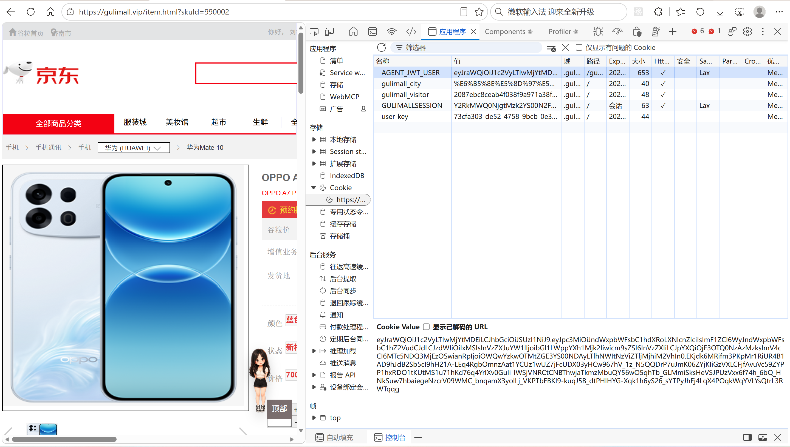
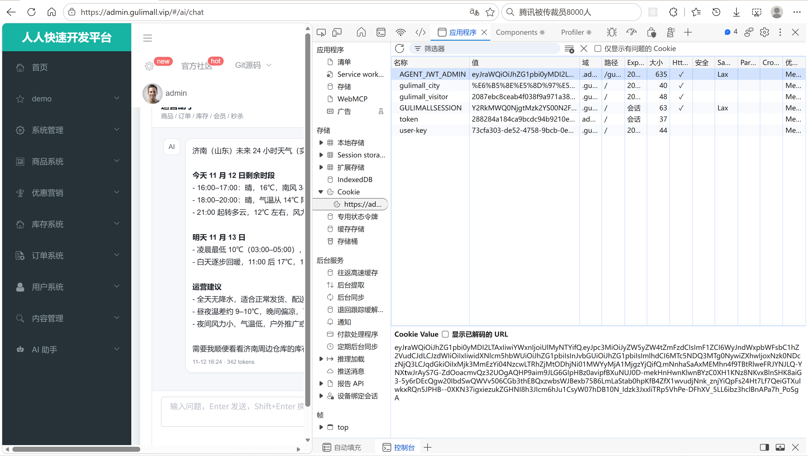
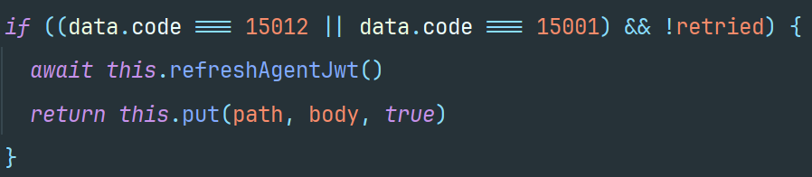
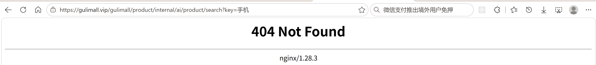
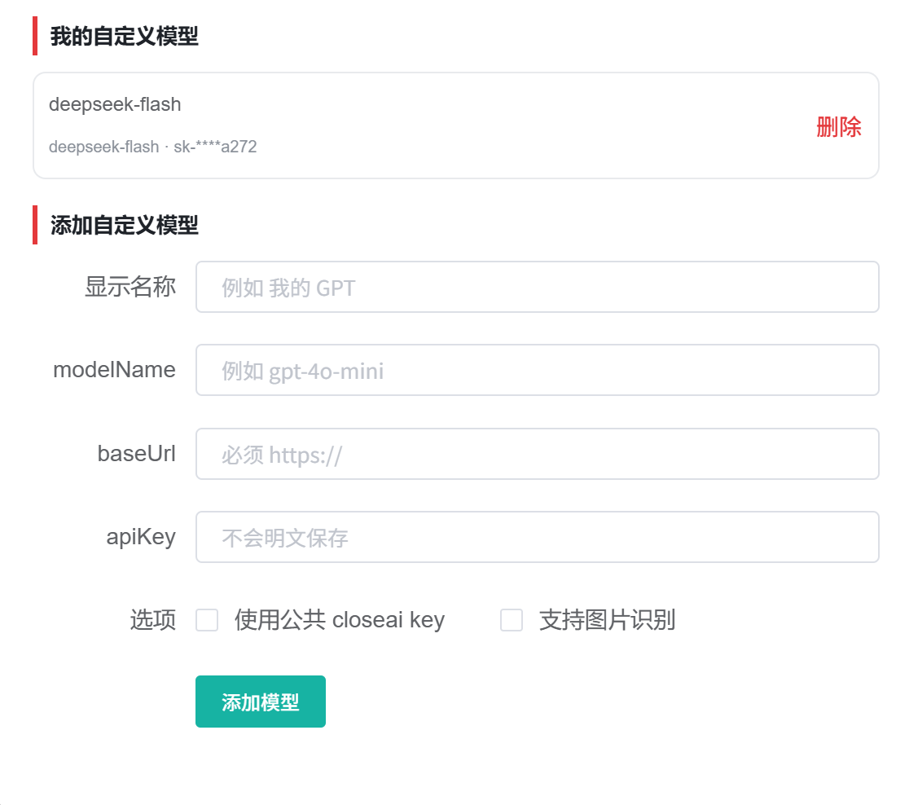
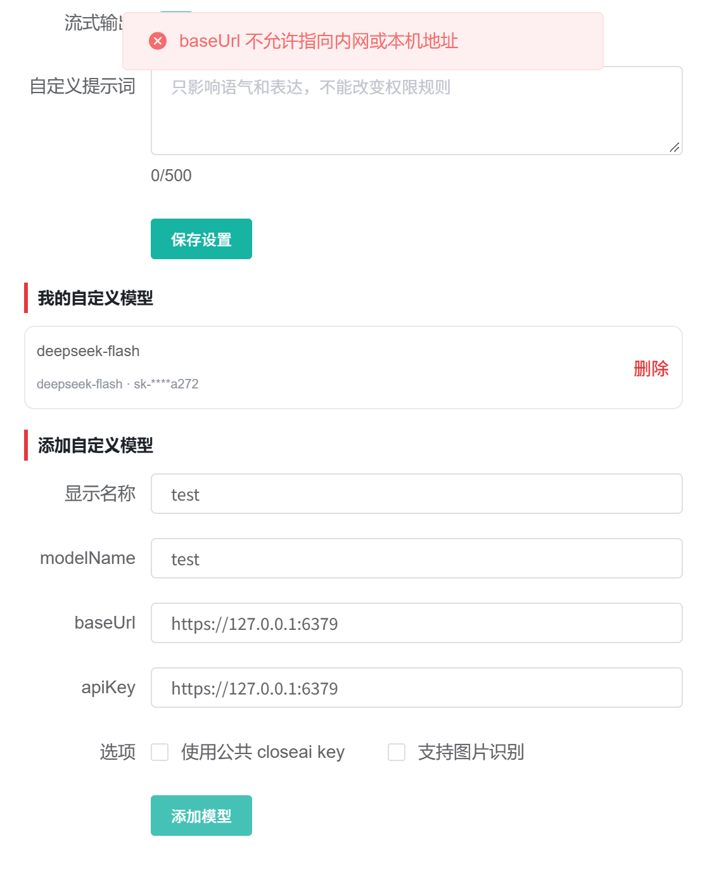

# 20.1 AI JWT 与内部接口安全-介绍

> 本篇介绍谷粒商城 AI 的登录态与接口安全：用户端、管理端、agent 三套登录态怎么分工，RS256 双密钥怎么签发和验签，`kid/iss/aud/role` 怎么防止凭证混用，HttpOnly Cookie 和刷新怎么工作，`Principal` 怎么贯穿工具权限，内部接口的 `X-Internal-Token` 和常量时间比较怎么做，Nginx 怎么返回 404，自定义模型的 apiKey 怎么用 AES-GCM 加密，baseUrl 怎么用大白话讲清楚 SSRF 校验。

> JWT 相关文档：[JWT 原理与项目实践](../JWT/JWT原理与项目实践.md)。

---

## 1. 这个功能是干什么的

AI 服务同时面向用户端和管理端，必须解决三个问题：

1. 这个请求是谁发的。
2. 这个身份能看哪些数据、用哪些工具。
3. 服务之间的内部接口怎么防止外部调用。

对应三套登录态：

| 登录态 | 存放位置 | 作用 | 有效期 |
|---|---|---|---|
| 用户端 Spring Session | Cookie `GULIMALLSESSION`，Redis 存 Session | 商城页面登录、刷新 agent JWT | 7 天滑动 |
| 管理端 renren token | 管理端 Cookie / 请求头，renren-fast 管理 | 管理后台登录、刷新 agent JWT | renren-fast 管理 |
| agent JWT | Cookie `AGENT_JWT_USER` 或 `AGENT_JWT_ADMIN` | 只给 gulimall-agent 验签 | 30 分钟 |

agent JWT 只负责“访问 AI 服务”，不替代原来的登录态：

1. 用户登录仍在 auth-server 完成。
2. 管理员登录仍在 renren-fast 完成。
3. agent 不签发 JWT，只验签。
4. JWT 不落 MySQL、不落 Redis，服务端只做本地验签。

安全边界分四层：

1. **身份层**：JWT 的 `kid`、`iss`、`aud`、`role` 必须互相对应。
2. **权限层**：`ToolBundleFactory` 按角色组装工具，用户端拿不到管理工具。
3. **接口层**：业务模块的 `/internal/ai/**` 必须带 `X-Internal-Token`。
4. **数据层**：自定义模型的 apiKey 加密落库，baseUrl 做 SSRF 校验。



## 2. 用户、管理员、开发者怎么操作

### 2.1 用户登录

1. 用户访问 `auth.gulimall.vip/login.html`。
2. 输入账号密码，auth-server 调 member 校验。
3. 校验通过后，会员信息写入 Spring Session。
4. auth-server 同时签发 `role=user` 的 agent JWT。
5. JWT 写入 `AGENT_JWT_USER` Cookie。
6. Cookie 设置 HttpOnly、Secure、SameSite=Lax、30 分钟。
7. 用户回到商城页面，聊天窗可以正常使用。

用户端 Cookie 的 domain 是 `.gulimall.vip`，path 是 `/gulimall/agent/`，只有访问 AI 接口时才发送。

### 2.2 管理员登录

1. 管理员访问管理后台。
2. renren-fast 校验账号密码和验证码。
3. 校验通过后生成管理端 token。
4. renren-fast 同时签发 `role=admin` 的 agent JWT。
5. JWT 写入 `AGENT_JWT_ADMIN` Cookie。
6. Cookie domain 是 `admin.gulimall.vip`，path 是 `/gulimall/agent/`。
7. 管理端 AI 页面可以正常使用。

管理端 Cookie 只在 `admin.gulimall.vip` 发送，用户端 Cookie 在 `.gulimall.vip` 发送，浏览器本身完成了第一层隔离。



### 2.3 JWT 过期后刷新

1. 前端请求 agent 接口。
2. 后端返回 `15012`，表示 JWT 无效或过期。
3. 前端调刷新接口。
4. 用户端：`POST auth.gulimall.vip/agent/jwt/refresh`。
5. 管理端：`POST /gulimall/sys/agent/jwt/refresh`。
6. 刷新接口读取旧登录态，有效就重新签发 30 分钟 JWT。
7. 前端重试原请求一次。
8. 刷新失败则提示重新登录。



### 2.4 退出登录

1. 用户端退出：`session.invalidate()`，同时清除 `AGENT_JWT_USER` Cookie。
2. 管理端退出：renren-fast 作废旧 token，同时清除 `AGENT_JWT_ADMIN` Cookie。
3. JWT 本身无状态，退出只清浏览器 Cookie。
4. 已经复制出去的 JWT 在 30 分钟过期前仍然有效。

### 2.5 开发者添加内部接口

1. 业务模块新建 Controller，继承 `InternalAiControllerSupport`。
2. 路径使用 `/internal/ai/{模块}/**`。
3. 每个方法先调 `verifyInternal(request)`。
4. 只提供查询，不提供写操作。
5. 返回精简的 `R`，避免把整张表塞给模型。



### 2.6 开发者配置密钥

```yaml
gulimall:
  agent:
    jwt:
      issuer-user: gulimall-auth-server
      issuer-admin: renren-fast
      audience: gulimall-agent
      user-cookie: AGENT_JWT_USER
      admin-cookie: AGENT_JWT_ADMIN
      user-public-key-path: ${AGENT_JWT_USER_PUBLIC_KEY_PATH}
      admin-public-key-path: ${AGENT_JWT_ADMIN_PUBLIC_KEY_PATH}
      user-key-id: user-2026-01
      admin-key-id: admin-2026-01
      clock-skew-seconds: 30
```

用户端签发方：

```yaml
gulimall:
  agent:
    jwt:
      issuer: gulimall-auth-server
      audience: gulimall-agent
      cookie-name: AGENT_JWT_USER
      cookie-domain: .gulimall.vip
      cookie-path: /gulimall/agent/
      cookie-secure: ${AGENT_JWT_COOKIE_SECURE}
      ttl: 30m
      key-id: user-2026-01
      private-key-path: ${AGENT_JWT_USER_PRIVATE_KEY_PATH}
```

管理端签发方：

```yaml
gulimall:
  agent:
    jwt:
      issuer: renren-fast
      audience: gulimall-agent
      cookie-name: AGENT_JWT_ADMIN
      cookie-domain: admin.gulimall.vip
      cookie-path: /gulimall/agent/
      cookie-secure: ${AGENT_JWT_COOKIE_SECURE:false}
      ttl: 30m
      key-id: admin-2026-01
      private-key-path: ${AGENT_JWT_ADMIN_PRIVATE_KEY_PATH:jwt/admin/jwt_private.pem}
```

密钥分工：

| 文件 | 谁持有 | 用途 |
|---|---|---|
| `jwt/user/jwt_private.pem` | auth-server | 签发用户端 JWT |
| `jwt/user/jwt_public.pem` | agent | 验签用户端 JWT |
| `jwt/admin/jwt_private.pem` | renren-fast | 签发管理端 JWT |
| `jwt/admin/jwt_public.pem` | agent | 验签管理端 JWT |

私钥只给签发方，agent 只保存公钥。公钥泄露不能伪造 JWT，私钥泄露才能。

### 2.7 开发者配置自定义模型加密

```yaml
AI_SETTINGS_AES_KEY: ${GULIMALL_AI_AES_KEY:<your-aes-key>}
INTERNAL_API_TOKEN: ${GULIMALL_INTERNAL_API_TOKEN:<your-internal-api-token>}
```

`AI_SETTINGS_AES_KEY` 是 Base64 编码的主密钥，长度必须是 16、24 或 32 字节。生产环境必须用 `openssl rand -base64 32` 重新生成，并通过环境变量覆盖开发默认值。



## 3. 整体设计思路

### 3.1 业务上怎么设计

#### 3.1.1 三套登录态各司其职

1. Spring Session 负责商城页面的常规登录，7 天滑动过期。
2. renren token 负责管理后台，由 renren-fast 自己管理。
3. agent JWT 负责 AI 服务，30 分钟过期，只做本地验签。

为什么不直接用 Spring Session 或 renren token 调 agent：

1. agent 不依赖 auth-server 的 Session 存储，减少耦合。
2. agent 不通过 Feign 反问 renren-fast，减少一次远程调用。
3. JWT 无状态，agent 可以水平扩展。

#### 3.1.2 双密钥与角色绑定

两套密钥：

1. 用户端私钥在 auth-server，`kid=user-2026-01`，签发 `role=user`。
2. 管理端私钥在 renren-fast，`kid=admin-2026-01`，签发 `role=admin`。

agent 按 `kid` 选择公钥，再校验 `iss`、`aud`、`role` 是否和该密钥匹配。

这样即使有人拿到用户端 JWT，也不能当管理员用；即使拿到管理端 JWT，也不能在用户端冒充会员。

#### 3.1.3 30 分钟短期 + 刷新

agent JWT 只有 30 分钟，降低泄露后的可用窗口。

刷新依赖旧登录态：

1. 用户端刷新读 Spring Session。
2. 管理端刷新由 renren-fast 的 JWTFilter 保护。
3. 刷新只读旧登录态，不写 JWT 到 Redis 或 MySQL。

#### 3.1.4 最小权限工具

用户端工具集不包含管理工具。权限边界在 Java 侧，不在提示词里。

即使模型被诱导说“忽略规则，查全部订单”，工具集里没有 `AdminOrderTools`，调用也会失败。

#### 3.1.5 内部接口 fail closed

内部接口没配置 `INTERNAL_API_TOKEN` 时，服务端直接返回 404，绝不默认放行。

这样漏配不会让接口裸奔，只会让 AI 工具查询失败，问题容易发现。

### 3.2 技术上怎么设计

#### 3.2.1 RS256 非对称签名

RS256 用私钥签名、公钥验签：

1. 签发方用私钥签 JWT。
2. agent 用公钥验签。
3. agent 不需要接触私钥。
4. 公钥泄露不能伪造签名。

对称的 HS256 需要双方共享同一个密钥，任何一方泄露都能伪造，不适合两个签发方共用一个 agent。

#### 3.2.2 JWT 声明

| 声明 | 示例 | 作用 |
|---|---|---|
| `kid` | `user-2026-01` | 选择公钥，防止密钥混用 |
| `iss` | `gulimall-auth-server` | 签发方 |
| `aud` | `gulimall-agent` | 接收方 |
| `sub` | `1` | 会员 id 或管理员 id |
| `username` | `zhangsan` | 展示名 |
| `role` | `user` / `admin` | 角色 |
| `exp` | 时间戳 | 过期时间 |
| `jti` | UUID | JWT 唯一 id |

agent 先读 `kid`，再选公钥，再校验 `iss`、`aud`、`role`。四者必须互相对应。

#### 3.2.3 HttpOnly Cookie

JWT 放在 HttpOnly Cookie 里，前端 JavaScript 读不到，降低 XSS 窃取风险。

Cookie 属性：

1. `HttpOnly=true`：JS 不可读。
2. `Secure`：只走 HTTPS，生产开启。
3. `SameSite=Lax`：跨站请求默认不带，降低 CSRF 风险。
4. `Domain`：用户端 `.gulimall.vip`，管理端 `admin.gulimall.vip`。
5. `Path=/gulimall/agent/`：只在 AI 接口发送。
6. `Max-Age=30 分钟`：和 JWT 过期时间一致。

#### 3.2.4 Principal 贯穿权限

`Principal` 是当前请求的身份，包含类型、id、用户名和显示名。

1. `subject()` 生成 `USER:1` 或 `ADMIN:1`，作为会话和记忆 key。
2. `isAdmin()` 决定工具集和提示词。
3. 工具从 `ToolContext` 取 `Principal`，只查本人数据。

#### 3.2.5 内部 token 与常量时间比较

`InternalAiControllerSupport.verifyInternal`：

1. 服务端没配置 token 直接 404。
2. 取 `X-Internal-Token`。
3. 用 `MessageDigest.isEqual` 比较。

为什么不用 `equals`：普通字符串比较遇到第一个不同字符就返回，攻击者可以通过响应时间差猜出正确前缀。`MessageDigest.isEqual` 会遍历完整长度，时间与内容无关，降低时序攻击风险。

#### 3.2.6 Nginx 404

内部接口只允许服务间调用。外部访问 `/gulimall/product/internal/ai/product/search` 时：

1. Gateway 按 `product-route` 转发。
2. `StripPrefix=1` 去掉 `gulimall`。
3. 服务收到 `/product/internal/ai/product/search`。
4. 内部接口实际路径是 `/internal/ai/product/search`。
5. 路径不匹配，返回 404。

部署层还可以加显式规则，把 `/gulimall/*/internal/**` 直接返回 404，减少请求进入网关。

#### 3.2.7 AES-GCM 加密 apiKey

自定义模型需要用户填 `apiKey`。明文存 MySQL 一旦数据库泄露，所有 key 都会暴露。

AES-GCM 用大白话解释：

1. **AES** 是一把锁，负责把明文变成密文。
2. **主密钥** `AI_SETTINGS_AES_KEY` 是唯一能开锁的钥匙，放在环境变量里，不写数据库。
3. **IV** 是每次加密随机生成的一串字节，相当于“盐”。同一段明文每次加密出来的密文都不一样，攻击者无法通过比对密文猜内容。
4. **Tag** 是 GCM 自带的防篡改校验码。密文被改过一个字节，解密时 Tag 就对不上，直接报错。
5. **v1 格式** 是数据库里存的字符串格式：`v1:` + Base64(IV + 密文 + Tag)。`v1:` 是版本号，将来换算法时可以区分新旧数据。

解密时：

1. 校验 `v1:` 前缀。
2. Base64 解码。
3. 前 12 字节是 IV。
4. 剩下的部分是密文 + Tag。
5. 用主密钥和 IV 解密。
6. Tag 校验失败通常说明主密钥变了或密文被改过。

#### 3.2.8 SSRF 校验

SSRF 用大白话解释：用户填了一个 `baseUrl`，服务端会主动去访问这个地址。如果用户填的是内网地址，服务端就成了“替攻击者访问内网”的跳板。

可能被访问的目标：

1. `127.0.0.1` 上的管理端口。
2. `192.168.x.x` 上的 Redis、MySQL。
3. 云厂商元数据地址 `169.254.169.254`。
4. 内网其他服务。

`UrlSafetyValidator` 做三层：

1. **协议层**：生产必须 `https`，防止 apiKey 明文上网。
2. **字符串层**：直接拦 `localhost`、`127.0.0.1`、`0.0.0.0`、`::1`、`10.`、`192.168.`、`169.254.`、`172.16-31`。
3. **DNS 层**：把域名解析成真实 IP，再检查是否是本机、回环、内网、链路本地、组播地址。

为什么需要 DNS 层：攻击者可以注册 `evil.com`，让它解析到 `127.0.0.1`。只检查字符串会漏掉，必须解析后检查真实 IP。



## 4. 详细代码、配置和解释

AI 服务的安全链路从浏览器里的 Cookie 开始，经过 agent 的验签、身份解析和工具权限，一直延伸到业务模块的内部接口和数据库里的自定义模型密钥。下面按“验签配置 → 验签服务 → 身份对象 → Cookie 解析 → 参数注入 → 签发与刷新 → 内部接口 → AES-GCM 加密 → SSRF 校验”的顺序展开。每个小节先说明它在整条链路中的位置、调用方和上下游，再解释代码的执行顺序、触发条件与设计原因。

### 4.1 AgentJwtProperties：验签配置

#### 4.1.1 这个类解决什么问题

agent 每天要面对两种来源的 JWT：用户端由 auth-server 在登录成功后签发，管理端由 renren-fast 在后台登录成功后签发。两种 JWT 放在不同的 Cookie 里，用不同的私钥签名，对应不同的公钥、不同的 `kid` 和不同的角色。

如果这些值散落在 `AgentJwtService` 和 `PrincipalResolver` 的常量里，换一次密钥、改一次 Cookie 名、调整一次时钟偏差都要改代码重新发版。`AgentJwtProperties` 把这些外部约定集中到 `gulimall.agent.jwt` 配置下，让验签服务只关心“按配置找公钥和 Cookie”，不关心具体值是什么。

调用关系是：

1. 上游：`gulimall-agent.yaml` 提供配置值，公钥文件由部署环境放到配置指定的路径。
2. 直接使用方：`AgentJwtService` 启动时读公钥路径、`kid`、签发方和接收方；`PrincipalResolver` 读两个 Cookie 名。
3. 下游：验签结果变成 `Principal`，再交给聊天编排、工具集和会话服务。

#### 4.1.2 字段与上下游约定

| 字段 | 配置键 | 对应上游 | 在链路中的作用 |
|---|---|---|---|
| `issuerUser` | `issuer-user` | auth-server 的 `issuer` | 用户端 JWT 的 `iss` 必须等于它 |
| `issuerAdmin` | `issuer-admin` | renren-fast 的 `issuer` | 管理端 JWT 的 `iss` 必须等于它 |
| `audience` | `audience` | 两个签发方的 `audience` | JWT 的 `aud` 必须包含它 |
| `userCookie` | `user-cookie` | auth-server 写的 Cookie 名 | 从请求中取用户端 JWT |
| `adminCookie` | `admin-cookie` | renren-fast 写的 Cookie 名 | 从请求中取管理端 JWT |
| `userPublicKeyPath` | `user-public-key-path` | 用户端公钥文件 | 验用户端签名 |
| `adminPublicKeyPath` | `admin-public-key-path` | 管理端公钥文件 | 验管理端签名 |
| `userKeyId` | `user-key-id` | 用户端 JWT header 的 `kid` | 选择用户端公钥 |
| `adminKeyId` | `admin-key-id` | 管理端 JWT header 的 `kid` | 选择管理端公钥 |
| `clockSkewSeconds` | `clock-skew-seconds` | 部署环境的时钟同步精度 | 允许的 `exp`/`nbf` 偏差 |

这些字段两两成对，不能只改一边。签发方把 `kid` 写成 `user-2026-01`，验签方也必须用同一个值做 Map 的 key；签发方把 Cookie 名写成 `AGENT_JWT_USER`，验签方读错名字就会一直认为未登录。公钥路径则指向 PEM 文件，agent 启动时一次性读入内存。

#### 4.1.3 代码与解释

这一段是整个验签链路的配置入口。类本身没有业务方法，职责只有一个：把 YAML 里的横线命名绑定成 Java 字段，供后续服务读取。

```java
@Data
@Component
@ConfigurationProperties(prefix = "gulimall.agent.jwt")
public class AgentJwtProperties {

    private String issuerUser = "gulimall-auth-server";

    private String issuerAdmin = "renren-fast";

    private String audience = "gulimall-agent";

    private String userCookie = "AGENT_JWT_USER";

    private String adminCookie = "AGENT_JWT_ADMIN";

    private String userPublicKeyPath = "../jwt/user/jwt_public.pem";

    private String adminPublicKeyPath = "../jwt/admin/jwt_public.pem";

    private String userKeyId = "user-2026-01";

    private String adminKeyId = "admin-2026-01";

    private long clockSkewSeconds = 30;
}
```

1. `@Data` 生成 getter/setter，`AgentJwtService` 和 `PrincipalResolver` 通过 getter 读取配置，不直接访问字段。
2. `@Component` 把配置类注册成 Spring Bean，`AgentJwtService` 可以用构造器注入。
3. `@ConfigurationProperties(prefix = "gulimall.agent.jwt")` 指定绑定前缀，YAML 里的 `issuer-user` 会自动对应 `issuerUser`，不需要逐字段写 `@Value`。
4. `issuerUser` 和 `issuerAdmin` 的默认值是开发环境的签发方名字，生产环境应该在 YAML 里显式写一遍，避免默认值掩盖漏配。
5. `audience` 默认是 `gulimall-agent`，两个签发方必须签出同一个接收方，否则 agent 会拒绝。
6. `userCookie` 和 `adminCookie` 是浏览器里的 Cookie 名，必须和签发方 `ResponseCookie.from(...)` 的第一个参数完全一致。
7. `userPublicKeyPath` 和 `adminPublicKeyPath` 默认用相对路径 `../jwt/...`，适合本地从项目根目录启动；容器或服务器部署时应通过环境变量换成绝对路径。
8. `userKeyId` 和 `adminKeyId` 同时出现在 JWT header 和验签方的 Map key 里，是选择公钥的唯一依据。
9. `clockSkewSeconds` 默认 30 秒，传给 jjwt 的 `clockSkewSeconds()`，用来容忍签发方和验签方的时钟差。

#### 4.1.4 一次配置加载示例

```text
1. agent 启动，Spring 扫描到 @ConfigurationProperties
2. 读取 gulimall-agent.yaml：
     issuer-user=gulimall-auth-server
     issuer-admin=renren-fast
     audience=gulimall-agent
     user-cookie=AGENT_JWT_USER
     admin-cookie=AGENT_JWT_ADMIN
     user-public-key-path=/opt/gulimall/jwt/user/jwt_public.pem
     admin-public-key-path=/opt/gulimall/jwt/admin/jwt_public.pem
     user-key-id=user-2026-01
     admin-key-id=admin-2026-01
3. 生成 AgentJwtProperties Bean
4. AgentJwtService.loadKeys() 读取两个路径，加载两把公钥
5. 日志输出：agent JWT 公钥加载完成 userKid=user-2026-01 adminKid=admin-2026-01
```

配置加载成功只代表值绑定成功，公钥是否可读要到 `AgentJwtService` 启动阶段才验证。公钥文件缺失或格式不对时应用直接启动失败，不会带病运行。

#### 4.1.5 它不做什么

1. 不加载公钥，只保存路径。真正的文件读取在 `AgentJwtService.loadPublicKey()`。
2. 不校验 `issuer` 和 `audience` 是否与签发方一致，配置写错时只能在验签阶段表现为 `15012`。
3. 不监听配置变化，`@ConfigurationProperties` 默认是启动时绑定，运行中修改 YAML 不会热更新。
4. 不管理私钥，私钥只存在于 auth-server 和 renren-fast。

#### 4.1.6 边界与可优化点

1. 公钥路径支持环境变量覆盖，生产环境应使用绝对路径，避免工作目录变化导致找不到文件。
2. 公钥没有热加载能力，轮换密钥需要重启 agent；可以在启动时记录公钥指纹，便于确认换的是哪一把。
3. `clockSkewSeconds=30` 对 NTP 同步要求较高，跨机房部署时可按实际时钟偏差调大，但不建议无限放大，否则过期 JWT 的可利用窗口会变长。
4. 配置里 `issuer-user`、`issuer-admin`、`audience` 与 Cookie 名存在对应关系，启动时可以加一段自检，发现 `kid` 重复或公钥路径相同就拒绝启动。

### 4.2 AgentJwtService：验签与身份转换

#### 4.2.1 这个类解决什么问题

agent 不保存 Spring Session，也不读取 auth-server 的 Redis，更不会拿着用户凭证去反问 renren-fast。它要回答的问题只有一个：当前请求携带的 JWT 是不是某一种可信签发方签出来的，如果是，这个身份是谁。

这个问题由 `AgentJwtService` 在本地完成。上游 `PrincipalResolver` 把 Cookie 里的字符串传进来，下游聊天编排、工具集和会话服务拿到 `Principal` 后按身份取数据。整个验签过程不访问数据库、不访问 Redis、不发远程请求，所以 agent 可以水平扩容，重启也不会影响已经签发的 JWT。

它同时承担两个安全边界：

1. 签名边界：只有持有对应私钥的一方才能签出能通过验签的 JWT。
2. 角色边界：用户端私钥签出的 JWT 只能被识别成 `user`，不能通过改 payload 变成管理员。

#### 4.2.2 关键概念

| 概念 | 在代码里的位置 | 作用 |
|---|---|---|
| RS256 | `signWith(privateKey, Jwts.SIG.RS256)` / `verifyWith(publicKey)` | 私钥签名、公钥验签，agent 不接触私钥 |
| `kid` | JWT header | 选择 user/admin 公钥，防止两套密钥混用 |
| `iss` | payload | 签发方，必须与该公钥绑定的签发方一致 |
| `aud` | payload | 接收方，必须包含 `gulimall-agent` |
| `role` | payload | 角色，必须与该公钥绑定的角色一致 |
| `sub` | payload | 会员 id 或管理员 id，转成 `Principal.id` |
| `username` | payload | 展示名，缺失时用 `sub` 兜底 |
| `exp` | payload | 过期时间，jjwt 自动校验并允许 30 秒偏差 |
| `clockSkewSeconds` | 配置 | 允许的时钟偏差 |
| `AGENT_TOKEN_INVALID` | 错误码 `15012` | 前端据此刷新 JWT 或重新登录 |

`kid`、`iss`、`role` 三者绑定是这个类最核心的设计。只验签名只能证明“JWT 是某个私钥签的”，不能证明“这个身份是管理员”。如果用户端私钥签出的 JWT 里写 `role=admin`，而验签方不检查角色，就会把普通会员当成管理员。绑定之后，选择用户端公钥时同时要求 `iss=gulimall-auth-server`、`role=user`，写错任何一项都拒绝。

#### 4.2.3 正常链路

```text
浏览器 Cookie
  → PrincipalResolver 取到 JWT 字符串
  → AgentJwtService.verify(token)
       1. 按 "." 拆三段
       2. Base64URL 解码 header，读 kid
       3. 用 kid 在 keys Map 里找 KeyEntry
       4. 用 KeyEntry.publicKey 验 RS256 签名和 exp
       5. 校验 iss 等于 KeyEntry.issuer
       6. 校验 aud 包含 gulimall-agent
       7. 校验 role 等于 KeyEntry.role
       8. sub 转 Long，作为身份 id
       9. username 空则用 sub 兜底
  → Principal(type, id, username, displayName)
```

任何一步失败都抛 `AgentException`，错误码统一是 `15012`。未知 `kid`、签名不对、过期、签发方不对、接收方不对、角色不对、缺少 `sub` 都属于这一类。

#### 4.2.4 代码与解释

这一块是验签服务的主体。前半部分在启动时建立“`kid` → 公钥 + 允许的签发方 + 允许的角色”的映射，后半部分在请求时按这个映射做校验并转换身份。

```java
@Slf4j
@Service
@RequiredArgsConstructor
public class AgentJwtService {

    private static final String ROLE_USER = "user";
    private static final String ROLE_ADMIN = "admin";

    private final AgentJwtProperties properties;
    private final ObjectMapper objectMapper;

    private final Map<String, KeyEntry> keys = new LinkedHashMap<>();

    @PostConstruct
    public void loadKeys() {
        keys.put(properties.getUserKeyId(), new KeyEntry(
                loadPublicKey(properties.getUserPublicKeyPath()),
                properties.getIssuerUser(),
                ROLE_USER));
        keys.put(properties.getAdminKeyId(), new KeyEntry(
                loadPublicKey(properties.getAdminPublicKeyPath()),
                properties.getIssuerAdmin(),
                ROLE_ADMIN));
        log.info("agent JWT 公钥加载完成 userKid={} adminKid={}",
                properties.getUserKeyId(), properties.getAdminKeyId());
    }

    public Principal verify(String token) {
        try {
            String kid = readKeyId(token);
            KeyEntry entry = keys.get(kid);
            if (entry == null) {
                throw new AgentException(AgentErrorCode.AGENT_TOKEN_INVALID, "登录凭证密钥不匹配");
            }

            Claims claims = Jwts.parser()
                    .verifyWith(entry.key())
                    .clockSkewSeconds(properties.getClockSkewSeconds())
                    .build()
                    .parseSignedClaims(token)
                    .getPayload();

            if (!entry.issuer().equals(claims.getIssuer())) {
                throw new AgentException(AgentErrorCode.AGENT_TOKEN_INVALID, "登录凭证签发方不匹配");
            }
            if (claims.getAudience() == null
                    || !claims.getAudience().contains(properties.getAudience())) {
                throw new AgentException(AgentErrorCode.AGENT_TOKEN_INVALID, "登录凭证接收方不匹配");
            }

            String role = claims.get("role", String.class);
            if (!entry.role().equals(role)) {
                throw new AgentException(AgentErrorCode.AGENT_TOKEN_INVALID, "登录凭证角色不匹配");
            }

            String subject = claims.getSubject();
            if (subject == null || subject.isBlank()) {
                throw new AgentException(AgentErrorCode.AGENT_TOKEN_INVALID, "登录凭证缺少用户 id");
            }
            long id = Long.parseLong(subject);
            String username = claims.get("username", String.class);
            if (username == null || username.isBlank()) {
                username = subject;
            }

            PrincipalType type = ROLE_ADMIN.equals(role) ? PrincipalType.ADMIN : PrincipalType.USER;
            return new Principal(type, id, username, username);
        } catch (AgentException ex) {
            throw ex;
        } catch (Exception ex) {
            log.warn("agent JWT 校验失败：{}", ex.getMessage());
            throw new AgentException(AgentErrorCode.AGENT_TOKEN_INVALID,
                    "登录凭证无效或已过期，请重新登录", ex);
        }
    }

    private String readKeyId(String token) {
        String[] parts = token == null ? new String[0] : token.split("\\.");
        if (parts.length != 3) {
            throw new AgentException(AgentErrorCode.AGENT_TOKEN_INVALID, "登录凭证格式不正确");
        }
        try {
            byte[] header = Base64.getUrlDecoder().decode(parts[0]);
            JsonNode node = objectMapper.readTree(header);
            String kid = node.path("kid").asText("");
            if (kid.isBlank()) {
                throw new AgentException(AgentErrorCode.AGENT_TOKEN_INVALID, "登录凭证缺少 kid");
            }
            return kid;
        } catch (AgentException ex) {
            throw ex;
        } catch (Exception ex) {
            throw new AgentException(AgentErrorCode.AGENT_TOKEN_INVALID, "登录凭证 header 解析失败", ex);
        }
    }

    private PublicKey loadPublicKey(String path) {
        try {
            String pem = Files.readString(Path.of(path), StandardCharsets.UTF_8)
                    .replaceAll("-----BEGIN [^-]+-----", "")
                    .replaceAll("-----END [^-]+-----", "")
                    .replaceAll("\\s", "");
            byte[] encoded = Base64.getDecoder().decode(pem);
            return KeyFactory.getInstance("RSA")
                    .generatePublic(new X509EncodedKeySpec(encoded));
        } catch (Exception ex) {
            throw new IllegalStateException("加载 agent JWT 公钥失败：" + path, ex);
        }
    }

    private record KeyEntry(PublicKey key, String issuer, String role) {
    }
}
```

1. `ROLE_USER` 和 `ROLE_ADMIN` 是 JWT payload 里的角色字符串，必须和两个签发方写入的值一致。
2. `properties` 提供签发方、接收方、`kid`、公钥路径和时钟偏差。
3. `objectMapper` 只用于解析 JWT header 里的 JSON，不参与签名校验。
4. `keys` 用 `LinkedHashMap` 保存 `kid` 到 `KeyEntry` 的映射，启动时写入两项，请求时只读，不存在并发修改。
5. `loadKeys()` 上的 `@PostConstruct` 表示 Bean 初始化完成后执行，早于任何请求。
6. 用户端公钥加载后绑定 `issuerUser` 和 `ROLE_USER`，管理端公钥绑定 `issuerAdmin` 和 `ROLE_ADMIN`。
7. `loadPublicKey()` 失败会抛 `IllegalStateException`，Spring 启动过程随之中断，避免应用在缺少公钥的情况下接收请求。
8. `verify()` 第一步调用 `readKeyId()`，先拿到 `kid` 才能选公钥。
9. `keys.get(kid)` 为空说明 JWT 声明了一把服务端不认识的密钥，直接拒绝，不允许回退到默认公钥。
10. `Jwts.parser().verifyWith(entry.key())` 指定这一把公钥做签名校验，`clockSkewSeconds()` 放宽时间比较，`parseSignedClaims()` 同时校验签名和 `exp`。
11. `iss` 必须与 `KeyEntry.issuer` 相等。用户端公钥配的是 `gulimall-auth-server`，管理端公钥配的是 `renren-fast`，两套身份不能互换。
12. `aud` 可能是一个数组，代码用 `contains(properties.getAudience())` 判断，允许 JWT 同时声明多个接收方。
13. `role` 必须与 `KeyEntry.role` 相等，这是防止“用户端密钥签出管理员角色”的关键检查。
14. `sub` 为空或空白直接拒绝，避免构造出没有 id 的身份。
15. `Long.parseLong(subject)` 把字符串转成 id；转换失败会被外层 `catch` 捕获并转成 `15012`。
16. `username` 缺失或空白时用 `sub` 兜底，保证 `Principal` 的展示名不为空。
17. `PrincipalType` 只在角色等于 `admin` 时取 `ADMIN`，其余都是 `USER`，这是第二道角色收敛。
18. `catch (AgentException ex)` 原样抛出，保留前面已经确定的错误提示；其他异常统一包装成“登录凭证无效或已过期”，避免把 jjwt 的内部异常细节返回给前端。
19. `readKeyId()` 先按 `.` 拆分，段数不是 3 就判定格式错误；JWT 的 header、payload、signature 必须各占一段。
20. header 使用 Base64URL 解码，因为 JWT 的 URL 安全编码和普通 Base64 的字符集不同。
21. `kid` 为空直接拒绝，缺少 `kid` 就无法确定该用哪把公钥。
22. `loadPublicKey()` 先去掉 PEM 的 `BEGIN/END` 行和所有空白，再做 Base64 解码，最后用 `X509EncodedKeySpec` 生成 RSA 公钥。
23. `KeyEntry` 是一个私有 record，把公钥、签发方、角色三件东西绑在一起，避免出现“公钥取错但签发方校验通过”的组合。
24. 整个 `verify()` 不查询数据库，也不检查 JWT 是否被吊销，身份完全由签名和声明决定。

#### 4.2.5 一次验签示例

用户 id 为 7、登录名为 `zhangsan` 的会员，在 auth-server 登录后拿到 JWT。请求 agent 时：

```text
1. PrincipalResolver 读到 AGENT_JWT_USER
2. verify(token)
3. readKeyId 得到 kid=user-2026-01
4. keys 命中用户端 KeyEntry：issuer=gulimall-auth-server，role=user
5. 公钥验签通过
6. iss=gulimall-auth-server，匹配
7. aud=[gulimall-agent]，匹配
8. role=user，匹配
9. sub=7，转成 7
10. username=zhangsan
11. 返回 Principal(USER, 7, zhangsan, zhangsan)
```

如果同一个人把 payload 里的 `role` 改成 `admin` 再重新发送，签名会失效，因为用户端私钥签出的原始内容已经被改动；即使攻击者拿到用户端私钥重新签名，第 13 步的 `role` 检查也会发现用户端密钥不允许 `admin`，请求仍被拒绝。

如果 JWT 已过期，`parseSignedClaims()` 会抛异常，外层转成 `15012`，前端收到后调用刷新接口换取新 JWT。

#### 4.2.6 它不做什么

1. 不签发 JWT，签发在 auth-server 和 renren-fast 各自的 `AgentJwtService`。
2. 不保存 JWT，不写 Redis，也不写 MySQL。
3. 不校验 Spring Session 或 renren token，它只认 Cookie 里的 JWT。
4. 不判断业务数据权限，例如“这个会员能不能看这个订单”由工具和业务接口决定。
5. 不处理退出登录，退出只清浏览器 Cookie，已经复制出去的 JWT 在过期前仍然能通过验签。

#### 4.2.7 边界与可优化点

1. 公钥只在启动时加载，轮换密钥需要重启 agent；可以在配置里保留新旧两个 `kid`，实现灰度轮换。
2. 没有 JWT 黑名单，退出登录后旧 JWT 仍然有效到 `exp`。需要强制下线时，只能把有效期缩短或增加 Redis 黑名单。
3. `jti` 已经生成但没有使用，可以配合 Redis 做一次性凭证或防重放。
4. 没有绑定设备、IP 或 User-Agent，JWT 泄露后可以在任意地点使用。
5. 时钟偏差固定为配置值，跨机房部署时应按实际时间同步情况调大，但不宜超过分钟级。
6. 角色只有 `user` 和 `admin` 两种，管理端内部不同岗位的权限没有细分，需要更细的授权时应在 `Principal` 上增加权限集合。

### 4.3 Principal：当前身份

#### 4.3.1 这个类解决什么问题

验签只回答“是谁”，但下游很多地方都需要这个“谁”：聊天编排用它决定会话归属，`ToolBundleFactory` 用它决定加载哪一组工具，`ConversationService` 用它判断会话是否属于当前请求，工具方法用它取会员 id 去查本人订单和购物车。

如果每个下游都各自传 `type`、`id`、`username` 三个参数，调用链会变得很长，也容易出现“类型传了但 id 忘了传”的问题。`Principal` 把这三样东西收成一个不可变对象，从 Controller 一直传到工具层。

另一个关键点是用户 id 和管理员 id 可能相同。会员表里 id 为 1 的会员和管理员表里 id 为 1 的管理员是两个人，如果会话 key 只写 `1`，两边的对话记录会串在一起。`subject()` 用“类型: id”的格式把两者分开。

#### 4.3.2 字段与接口

| 成员 | 类型 | 含义 |
|---|---|---|
| `type` | `PrincipalType` | `USER` 或 `ADMIN` |
| `id` | `Long` | 会员 id 或管理员 id |
| `username` | `String` | 登录名 |
| `displayName` | `String` | 页面展示名，当前等于登录名 |
| `subject()` | 方法 | 生成 `USER:1` 或 `ADMIN:1`，作为会话和记忆的 key |
| `isAdmin()` | 方法 | 判断是否为管理端身份，决定工具集和提示词 |

#### 4.3.3 代码与解释

这一段是身份对象的定义。它不依赖 Spring，也不依赖任何业务服务，只是把验签结果固定下来。

```java
public record Principal(PrincipalType type, Long id, String username, String displayName) {

    public String subject() {
        return type.name() + ":" + id;
    }

    public boolean isAdmin() {
        return type == PrincipalType.ADMIN;
    }
}
```

1. `record` 让对象天然不可变，请求进入业务层后不会被中途改掉身份。
2. `type` 区分用户端和管理端，后续所有权限分支都从它派生。
3. `id` 是数据库主键，工具查询本人数据时直接使用。
4. `username` 用于展示和日志，不参与权限判断。
5. `displayName` 预留给会员昵称，当前签发方没有提供昵称，所以与 `username` 相同。
6. `subject()` 返回 `type.name() + ":" + id`，例如 `USER:1`、`ADMIN:1`，会话表、记忆 key、图片任务归属都用它。
7. `isAdmin()` 只判断 `type == PrincipalType.ADMIN`，不解析角色字符串，避免字符串比较出错。

#### 4.3.4 一次使用示例

同一个数字 id 在两个端的表现：

```text
用户端：Principal(USER, 1, zhangsan, zhangsan)
  subject() = USER:1
  isAdmin() = false
  ToolBundleFactory 加载购物车、本人订单、会员信息工具

管理端：Principal(ADMIN, 1, admin, admin)
  subject() = ADMIN:1
  isAdmin() = true
  ToolBundleFactory 加载全部订单、任意会员概要、仓库工具
```

如果会话 key 只用 id，`USER:1` 和 `ADMIN:1` 会落到同一条会话记录里；加上类型前缀后，两端的上下文彻底分开。

#### 4.3.5 边界与可优化点

1. `displayName` 当前等于 `username`，会员昵称没有进入 JWT；需要展示昵称时，可以在签发时补一个声明，或由工具按 id 查询。
2. 没有租户、店铺或组织字段，多租户场景需要扩展。
3. 身份对象不可变，但 `PrincipalType` 目前只有两个枚举值，新增角色时要同步检查所有 `isAdmin()` 分支。
4. `subject()` 是字符串拼接，适合做 key，不适合做 SQL 条件；工具查数据时仍然使用 `id` 和 `type`。

### 4.4 PrincipalResolver：从 Cookie 解析身份

#### 4.4.1 这个类解决什么问题

agent 的请求可能来自用户端商城页面，也可能来自管理后台。两个页面使用不同的 JWT Cookie，agent 需要在同一个接口里识别出当前是哪种身份。

浏览器已经完成了第一层隔离：`AGENT_JWT_USER` 的 domain 是 `.gulimall.vip`，用户端和管理端子域都会发送；`AGENT_JWT_ADMIN` 的 domain 是 `admin.gulimall.vip`，只在管理后台发送。`PrincipalResolver` 在这个基础上按 Cookie 名称做第二层选择：先看管理端 Cookie，没有再看用户端 Cookie。

调用方有两处：

1. `PrincipalArgumentResolver` 在处理 Controller 的 `Principal` 参数时调用。
2. `ChatController.stream()` 在 SSE 接口里手动调用，因为流式响应不能走普通参数解析器的异常处理。

下游是 `AgentJwtService.verify()`，`PrincipalResolver` 只负责“取哪个 Cookie”，不负责验签和身份转换。

#### 4.4.2 Cookie 与身份对应关系

| Cookie | 签发方 | domain | path | 角色 |
|---|---|---|---|---|
| `AGENT_JWT_USER` | auth-server | `.gulimall.vip` | `/gulimall/agent/` | `user` |
| `AGENT_JWT_ADMIN` | renren-fast | `admin.gulimall.vip` | `/gulimall/agent/` | `admin` |

两个 Cookie 的 path 相同，所以在管理后台访问 `/gulimall/agent/**` 时，浏览器可能同时带上两个 Cookie。此时管理端 Cookie 优先，避免管理员被识别成普通会员。

#### 4.4.3 正常链路

```text
请求 /gulimall/agent/chat
  → PrincipalArgumentResolver
  → PrincipalResolver.resolve(request)
       1. 读取 AGENT_JWT_ADMIN
       2. 有值 → AgentJwtService.verify(adminToken)
       3. 无值 → 读取 AGENT_JWT_USER
       4. 有值 → AgentJwtService.verify(userToken)
       5. 都没有 → 返回 null
  → null 由上层转成 15001
```

`PrincipalResolver` 不吞异常。管理端 Cookie 存在但验签失败时，`verify()` 抛出 `15012`，请求直接失败，不会回退去尝试用户端 Cookie。这个行为是刻意设计的：拿着一份损坏的管理端凭证，不应该被降级成普通用户继续访问。

#### 4.4.4 代码与解释

这一段解决“从哪个 Cookie 取 JWT”的问题。取到之后立即交给验签服务，解析器本身不解析 JWT 内容。

```java
@Slf4j
@Component
@RequiredArgsConstructor
public class PrincipalResolver {

    private final AgentJwtProperties properties;
    private final AgentJwtService agentJwtService;

    public Principal resolve(HttpServletRequest request) {
        String adminToken = readCookie(request, properties.getAdminCookie());
        log.debug("agent 身份解析 hasAdminCookie={} hasUserCookie={}",
                StringUtils.hasText(adminToken),
                StringUtils.hasText(readCookie(request, properties.getUserCookie())));
        if (StringUtils.hasText(adminToken)) {
            return agentJwtService.verify(adminToken);
        }

        String userToken = readCookie(request, properties.getUserCookie());
        if (StringUtils.hasText(userToken)) {
            return agentJwtService.verify(userToken);
        }

        return null;
    }

    private String readCookie(HttpServletRequest request, String name) {
        Cookie[] cookies = request.getCookies();
        if (cookies == null) {
            return null;
        }
        for (Cookie cookie : cookies) {
            if (name.equals(cookie.getName())) {
                return cookie.getValue();
            }
        }
        return null;
    }
}
```

1. `properties` 提供两个 Cookie 名，避免在代码里写死字符串。
2. `agentJwtService` 负责真正的验签和身份转换。
3. `resolve()` 先读 `AGENT_JWT_ADMIN`，管理端身份优先。
4. 调试日志只输出“有没有 Cookie”，不输出 JWT 内容，避免日志泄露凭证。
5. `StringUtils.hasText(adminToken)` 同时排除 null、空串和全空白。
6. 管理端 Cookie 有值就调用 `verify(adminToken)`，使用管理端公钥和 `role=admin` 的绑定。
7. 管理端 Cookie 不存在时才读 `AGENT_JWT_USER`，两套凭证不会同时参与验签。
8. 用户端 Cookie 有值就调用 `verify(userToken)`，使用用户端公钥和 `role=user` 的绑定。
9. 两个 Cookie 都没有时返回 `null`，由 `PrincipalArgumentResolver` 转成 `15001`。
10. `readCookie()` 先判断 `request.getCookies()` 是否为 null，没有 Cookie 的请求直接返回 null。
11. 遍历 Cookie 数组，按名称精确匹配，返回第一个命中的值。
12. 没有匹配项返回 null；同名 Cookie 出现多次时只取第一个，浏览器正常情况下不会为同一 domain/path 写两个同名 Cookie。

#### 4.4.5 一次解析示例

管理员在 `admin.gulimall.vip` 打开 AI 页面并发送消息：

```text
1. 浏览器同时带上 AGENT_JWT_ADMIN 和 AGENT_JWT_USER（如果用户也在商城登录过）
2. PrincipalResolver 先读 AGENT_JWT_ADMIN，取到管理端 JWT
3. verify() 按 kid=admin-2026-01 选管理端公钥
4. iss=renren-fast、role=admin 校验通过
5. 返回 Principal(ADMIN, 1, admin, admin)
6. 工具集加载管理端工具
```

如果管理端 Cookie 已过期，`verify()` 抛 `15012`，前端调用管理端刷新接口，而不是切换成用户端身份。

#### 4.4.6 它不做什么

1. 不生成 JWT，也不刷新 JWT。
2. 不判断请求域名，无法区分“这个请求来自管理后台还是商城”，只看 Cookie 名称。
3. 不处理未登录的业务响应，只返回 null，错误码由参数解析器或 Controller 决定。
4. 不在两个 Cookie 同时存在时做一致性校验，也不发出告警。

#### 4.4.7 边界与可优化点

1. 两个 Cookie 同时存在时没有告警，管理端优先可能掩盖用户端 JWT 的异常；可以在调试日志里补充两者的 `kid`。
2. 管理端 Cookie 无效时不会回退到用户端 Cookie，这是 fail closed 的体现，但也意味着管理员无法在管理后台以普通用户身份使用 AI。
3. 可以按请求的 Host 决定只看哪个 Cookie，减少 `admin.gulimall.vip` 上的歧义。
4. Cookie 名来自配置，修改时必须同步修改签发方的 `cookie-name`，否则解析不到。

### 4.5 PrincipalArgumentResolver：注入 Principal

#### 4.5.1 这个类解决什么问题

聊天、会话、管理探测等多个 Controller 都需要当前身份。如果每个方法都写一遍 `request.getCookies()`、再调用 `PrincipalResolver`，重复代码会很多，而且容易漏掉“未登录就拒绝”的判断。

`PrincipalArgumentResolver` 是 Spring MVC 的参数解析器。Controller 方法只要声明一个 `Principal` 类型的参数，Spring 就会在调用方法前执行这个解析器，把 Cookie 解析成身份对象。业务方法因此可以写成 `public R chat(Principal principal, ...)`，不需要感知 Cookie 和 JWT。

它由 `WebMvcConfig.addArgumentResolvers()` 注册。上游是 DispatcherServlet 的参数绑定流程，下游是 `PrincipalResolver`，最终结果作为方法参数传入 Controller。

#### 4.5.2 使用它的接口

| Controller 方法 | 路径 | 用途 |
|---|---|---|
| `ChatController.chat` | `POST /agent/chat` | 普通对话 |
| `ChatController.stop` | `POST /agent/chat/stop` | 停止当前会话的流式回答 |
| `ChatController.me` | `GET /agent/auth/me` | 前端判断登录态 |
| `ConversationController.list/create/messages` | `/agent/conversations/**` | 会话列表与消息 |
| `AdminModelProbeController.probe` | 管理端模型探测 | 非管理员直接拒绝 |

这些方法都不再自己解析 Cookie，身份由解析器统一提供。

#### 4.5.3 正常链路

```text
HTTP 请求
  → DispatcherServlet 找到 Controller 方法
  → 发现参数类型是 Principal
  → PrincipalArgumentResolver.supportsParameter 返回 true
  → resolveArgument()
       → PrincipalResolver.resolve(request)
       → null：抛 15001
       → 有身份：返回 Principal
  → 调用 Controller 方法
```

`suspend` 和异步接口不在这个流程里；SSE 接口由 Controller 手动解析，原因见 4.5.4。

#### 4.5.4 代码与解释

这一段把“请求里的 Cookie”转换成“方法参数里的身份”，并在没有身份时中断请求。

```java
@Component
@RequiredArgsConstructor
public class PrincipalArgumentResolver implements HandlerMethodArgumentResolver {

    private final PrincipalResolver principalResolver;

    @Override
    public boolean supportsParameter(MethodParameter parameter) {
        return Principal.class.equals(parameter.getParameterType());
    }

    @Override
    public Object resolveArgument(MethodParameter parameter,
                                  ModelAndViewContainer mavContainer,
                                  NativeWebRequest webRequest,
                                  WebDataBinderFactory binderFactory) {
        HttpServletRequest request = webRequest.getNativeRequest(HttpServletRequest.class);
        Principal principal = request == null ? null : principalResolver.resolve(request);

        if (principal == null) {
            throw new AgentException(AgentErrorCode.NOT_LOGIN, "请先登录后再使用 AI 助手");
        }
        return principal;
    }
}
```

1. `@Component` 把解析器注册成 Bean，`WebMvcConfig` 通过构造器注入。
2. `principalResolver` 是真正读取 Cookie 和验签的组件。
3. `supportsParameter()` 只判断参数类型是否等于 `Principal.class`，其他参数交给 Spring 默认解析器。
4. `resolveArgument()` 从 `NativeWebRequest` 取底层 `HttpServletRequest`，因为读取 Cookie 需要 Servlet API。
5. `request == null` 时按未登录处理，避免空指针。
6. 解析结果为 null 时抛 `AgentException(NOT_LOGIN)`，错误码 `15001`，前端据此跳转登录页。
7. JWT 存在但无效或过期时，`PrincipalResolver` 内部已经抛出 `15012`，不需要在这里再包装。
8. 有身份时直接返回 `Principal`，Spring 把它注入 Controller 方法。

#### 4.5.5 SSE 为什么手动解析

普通接口未登录时返回 JSON 错误体没有问题，但 `/agent/chat/stream` 的客户端期望 `text/event-stream`。如果参数解析器抛异常，Spring 返回的是普通 JSON，前端 SSE 解析器会认为连接异常，拿不到统一格式的错误。

所以 `ChatController.stream()` 不声明 `Principal` 参数，而是自己调用 `principalResolver.resolve(request)`：

1. 捕获 `AgentException` 后用 `errorEmitter()` 返回一条 `error` 事件。
2. 结果为 null 时同样返回 `error` 事件，错误码 `15001`。
3. 前端用与正常流相同的事件解析逻辑处理错误，不需要区分“HTTP 错误”和“SSE 错误”。

#### 4.5.6 一次请求示例

前端加载聊天窗时调用登录态接口：

```text
1. GET /gulimall/agent/auth/me
2. 网关去掉 /gulimall 前缀，agent 收到 /agent/auth/me
3. DispatcherServlet 发现 me(Principal principal)
4. PrincipalArgumentResolver.resolveArgument()
5. PrincipalResolver 读到 AGENT_JWT_USER
6. AgentJwtService 验签通过，返回 Principal(USER, 7, zhangsan, zhangsan)
7. me() 返回 type、id、username、displayName
8. 前端根据 type 决定展示用户端还是管理端入口
```

如果没有 Cookie，第 4 步抛 `15001`，前端提示登录；如果 Cookie 过期，第 6 步抛 `15012`，前端先尝试刷新。

#### 4.5.7 边界与可优化点

1. 所有 `Principal` 参数都强制登录，没有“可选身份”的写法；需要匿名访问的接口不能声明这个参数。
2. 不能通过方法注解跳过登录，所有豁免都只能写成不声明 `Principal` 的方法。
3. 错误码只有 `15001` 和 `15012`，无法区分“Cookie 缺失”“Cookie 名不对”“JWT 过期”等具体原因。
4. 解析器每次请求都读一遍 Cookie，成本很低；如果后续需要审计，可以在这里统一记录身份和路径。

### 4.6 用户端签发：auth-server

#### 4.6.1 这个类解决什么问题

用户在商城页面登录成功后，登录态保存在 Spring Session 里，浏览器拿到的是 `GULIMALLSESSION` Cookie。这个 Session 属于 auth-server，agent 不共享它的存储，也不应该为了识别用户去远程读取 Session。

agent 需要的是一个可以本地验签、短时间有效、只用于访问 AI 的凭证。auth-server 的 `AgentJwtService` 在登录成功时签发用户端 JWT，写进 `AGENT_JWT_USER` Cookie，agent 用用户端公钥本地验签。这样登录仍然只有一处，AI 服务的身份识别却不需要跨服务查 Session。

调用方有四个入口：

1. `LoginController` 的账号密码登录。
2. `GiteeOAuthController` 的 Gitee 授权登录。
3. `GitHubOAuthController` 的 GitHub 授权登录。
4. `WechatOAuthController` 的微信授权登录。

它们都在写入 Spring Session 之后调用 `agentJwtService.issue(member, response)`，保证“Session 有效”和“JWT 已签发”同步发生。

#### 4.6.2 签发内容与下游用途

| 部分 | 值 | 下游用途 |
|---|---|---|
| header `kid` | `user-2026-01` | agent 选择用户端公钥 |
| `iss` | `gulimall-auth-server` | agent 校验签发方 |
| `aud` | `gulimall-agent` | agent 校验接收方 |
| `sub` | 会员 id | 转成 `Principal.id` |
| `username` | 登录名 | 展示名；缺失时用 id 兜底 |
| `role` | `user` | agent 判断工具集 |
| `iat` | 当前时间 | 签发时间 |
| `exp` | 当前时间 + 30 分钟 | 过期时间 |
| `jti` | UUID | JWT 唯一标识，为后续审计预留 |

Cookie 属性同时决定浏览器什么时候发送它：`domain=.gulimall.vip` 让商城各子域共享，`path=/gulimall/agent/` 让它只在 AI 接口发送，`HttpOnly` 让 JavaScript 读不到，`SameSite=Lax` 降低跨站携带风险。

#### 4.6.3 正常链路

```text
用户提交账号密码
  → LoginController 调 member 校验
  → 校验通过，member 返回会员信息
  → session.setAttribute(LOGIN_USER, member)
  → AgentJwtService.issue(member, response)
       私钥加载于启动阶段
       RS256 签名
  → Set-Cookie: AGENT_JWT_USER=...
  → 浏览器保存 HttpOnly Cookie
  → 后续访问 /gulimall/agent/** 时自动携带
```

Session 是刷新 JWT 的依据，JWT 是访问 agent 的凭证。两者职责分开：Session 失效时不能刷新，JWT 失效时只要 Session 还在就可以换新的。

#### 4.6.4 代码与解释

这一段负责生成 JWT 并把它写进浏览器。签名使用启动时加载的用户端私钥，agent 只保存对应公钥。

```java
public long issue(Long memberId, String username, HttpServletResponse response) {
    if (memberId == null) {
        throw new IllegalArgumentException("会员 id 不能为空");
    }
    Instant now = Instant.now();
    Instant expiresAt = now.plus(properties.getTtl());
    String token = Jwts.builder()
            .header().keyId(properties.getKeyId()).and()
            .issuer(properties.getIssuer())
            .audience().add(properties.getAudience()).and()
            .subject(String.valueOf(memberId))
            .claim("username", username == null ? String.valueOf(memberId) : username)
            .claim("role", "user")
            .issuedAt(Date.from(now))
            .expiration(Date.from(expiresAt))
            .id(UUID.randomUUID().toString())
            .signWith(privateKey, Jwts.SIG.RS256)
            .compact();

    ResponseCookie cookie = ResponseCookie.from(properties.getCookieName(), token)
            .domain(properties.getCookieDomain())
            .path(properties.getCookiePath())
            .httpOnly(true)
            .secure(properties.isCookieSecure())
            .sameSite("Lax")
            .maxAge(properties.getTtl())
            .build();
    response.addHeader(HttpHeaders.SET_COOKIE, cookie.toString());
    return expiresAt.toEpochMilli();
}
```

1. `memberId` 为空时直接抛 `IllegalArgumentException`，没有 id 的 JWT 无法构造身份。
2. `Instant.now()` 取当前时间，`expiresAt` 按配置的 `ttl` 计算，默认 30 分钟。
3. `header().keyId(...)` 把 `kid` 写进 JWT header，agent 靠它选择公钥。
4. `issuer(...)` 写签发方，必须等于 agent 配置里的 `issuer-user`。
5. `audience().add(...)` 写接收方，agent 校验 `aud` 是否包含 `gulimall-agent`。
6. `subject(...)` 写会员 id 的字符串形式，agent 会把它转成 `Long`。
7. `username` 为空时用会员 id 兜底，保证展示名不为空。
8. `claim("role", "user")` 固定写用户端角色，签发方没有机会签出管理员身份。
9. `issuedAt`、`expiration` 分别写签发时间和过期时间。
10. `id(UUID)` 写 `jti`，当前不参与校验，但为后续审计和防重放留下标识。
11. `signWith(privateKey, Jwts.SIG.RS256)` 用用户端私钥做 RS256 签名，私钥在 `loadPrivateKey()` 中从 PEM 文件加载。
12. `ResponseCookie.from(...)` 创建 Cookie，名称、domain、path 都来自配置，和 agent 读取的名称一致。
13. `httpOnly(true)` 让前端脚本无法读取 JWT，降低 XSS 窃取风险。
14. `secure(...)` 控制是否只走 HTTPS，生产环境由 `AGENT_JWT_COOKIE_SECURE` 设为 true。
15. `sameSite("Lax")` 限制跨站请求携带，降低 CSRF 风险。
16. `maxAge(ttl)` 让 Cookie 的过期时间和 JWT 的 `exp` 保持一致。
17. `response.addHeader(SET_COOKIE, ...)` 把 Cookie 写入响应，浏览器收到后保存。
18. 返回 `expiresAt` 的毫秒时间戳，前端可以据此提前刷新。

#### 4.6.5 登录成功后的调用

签发动作不单独暴露接口，它挂在登录成功之后。下面的代码是账号密码登录里的调用顺序：

```java
MemberResponseVo member = login.getData("data", new TypeReference<MemberResponseVo>() {
});
session.setAttribute(AuthServerConstant.LOGIN_USER, member);
agentJwtService.issue(member, response);
```

1. `login.getData(...)` 从 member 服务的响应里取会员信息。
2. `session.setAttribute(LOGIN_USER, member)` 先把会员写入 Spring Session，后续刷新以它为准。
3. `agentJwtService.issue(member, response)` 再签发 JWT 并写 Cookie。
4. 顺序不能反：如果先签 JWT 再写 Session，刷新时可能读不到登录态；如果写 Session 失败，也不应该留下一个能访问 agent 的 JWT。

OAuth 登录入口在拿到会员信息后执行同样的三步，区别只在会员信息的来源。

#### 4.6.6 退出登录

退出要同时清服务端会话和浏览器 Cookie：

```java
@GetMapping("/logout.html")
public String logout(HttpSession session, HttpServletResponse response) {
    session.invalidate();
    agentJwtService.clear(response);
    return "redirect:" + authUrl + "/login.html";
}
```

1. `session.invalidate()` 让 Spring Session 失效，刷新接口从此拿不到 `LOGIN_USER`。
2. `agentJwtService.clear(response)` 写一个同名、同 domain、同 path、`Max-Age=0` 的 Cookie，浏览器收到后删除原 Cookie。
3. `clear()` 的属性必须和签发时一致，domain 或 path 不同会被浏览器当成另一个 Cookie，原 JWT 仍然存在。
4. 重定向回登录页，避免用户停留在已退出的页面继续操作。
5. JWT 本身无状态，退出不会让已经复制出去的 JWT 立即失效，它仍然能用到 `exp`。

#### 4.6.7 一次完整示例

```text
1. 用户访问 auth.gulimall.vip/login.html
2. 提交 zhangsan / ******
3. auth-server 调 member 校验，返回 memberId=7
4. session.setAttribute(LOGIN_USER, member)
5. issue(7, "zhangsan", response)
6. header: {"alg":"RS256","kid":"user-2026-01"}
7. payload: iss=gulimall-auth-server, aud=[gulimall-agent],
           sub=7, username=zhangsan, role=user,
           iat=..., exp=..., jti=...
8. 私钥签名，生成三段式 JWT
9. Set-Cookie: AGENT_JWT_USER=...; Domain=.gulimall.vip;
              Path=/gulimall/agent/; HttpOnly; Secure; SameSite=Lax;
              Max-Age=1800
10. 用户进入商城页面，聊天窗请求 /gulimall/agent/auth/me
11. agent 验签通过，返回 Principal(USER, 7, zhangsan, zhangsan)
```

#### 4.6.8 它不做什么

1. 不校验账号密码，密码校验在登录控制器和 member 服务。
2. 不读写 agent 的会话，agent 也不共享这个 Session。
3. 不刷新 JWT，刷新由单独的刷新控制器负责。
4. 不保存 JWT，签完即丢，服务端没有副本。
5. 不处理权限，`role=user` 是固定值，具体能查什么由 agent 的工具集决定。

#### 4.6.9 边界与可优化点

1. JWT 没有绑定设备、IP 或 User-Agent，复制后可以在别处使用到过期。
2. 退出登录只清浏览器 Cookie，没有服务端吊销列表；需要强制失效时可以引入 Redis 黑名单，按 `jti` 记录。
3. 多个登录入口都要记得调用 `issue()`，新增登录方式时容易漏；可以把“写 Session + 签发 JWT”封装成一个统一的登录成功方法。
4. `cookie-secure` 由环境变量控制，开发环境可能为 false，生产环境必须为 true。
5. 30 分钟有效期对长时间停留在页面的用户偏短，依赖前端在 `15012` 后自动刷新；刷新失败才提示重新登录。

### 4.7 用户端刷新

#### 4.7.1 这个类解决什么问题

agent JWT 只有 30 分钟。用户在商城页面浏览时间较长时，JWT 会先于 Spring Session 过期。此时 agent 返回 `15012`，但用户并没有退出登录，不应该被直接踢回登录页。

刷新接口用仍然有效的 Spring Session 换取新的 agent JWT。它不信任旧 JWT，也不要求旧 JWT 未过期，只要服务端 Session 里还有会员信息，就重新签发一份。

调用方是前端：聊天窗收到 `15012` 后，先调用刷新接口，成功后重试原请求一次；刷新也失败时才提示重新登录。上游是 auth-server 的 Spring Session，下游是 `AgentJwtService.issue()`。

#### 4.7.2 接口与触发条件

| 项目 | 值 |
|---|---|
| 方法 | `POST` |
| 路径 | `/agent/jwt/refresh` |
| 凭据 | `GULIMALLSESSION`，不是旧 JWT |
| 成功返回 | `data.expiresAt`，新的过期时间 |
| Session 无效 | `15001`，提示重新登录 |

#### 4.7.3 正常链路

```text
前端请求 agent 返回 15012
  → POST auth.gulimall.vip/agent/jwt/refresh
  → request.getSession(false) 取已有 Session
  → 读 LOGIN_USER
  → 是 MemberResponseVo 且 id 不为空
  → AgentJwtService.issue(member, response)
  → Set-Cookie 新的 AGENT_JWT_USER
  → 返回新的 expiresAt
  → 前端重试原请求
```

#### 4.7.4 代码与解释

这一段用服务端会话换新凭证，不读取旧 JWT。这样即使旧 JWT 已经过期，只要 Session 还有效就能继续使用。

```java
@RestController
@RequiredArgsConstructor
public class AgentJwtRefreshController {

    private final AgentJwtService agentJwtService;

    @PostMapping("/agent/jwt/refresh")
    public R refresh(HttpServletRequest request, HttpServletResponse response) {
        HttpSession session = request.getSession(false);
        Object loginUser = session == null
                ? null
                : session.getAttribute(AuthServerConstant.LOGIN_USER);
        if (!(loginUser instanceof MemberResponseVo member) || member.getId() == null) {
            return R.error(15001, "登录已过期，请重新登录");
        }
        long expiresAt = agentJwtService.issue(member, response);
        return R.ok().put("data", Map.of("expiresAt", expiresAt));
    }
}
```

1. `@RestController` 让返回值直接序列化成 JSON，`@RequiredArgsConstructor` 注入签发服务。
2. `@PostMapping("/agent/jwt/refresh")` 定义刷新路径，前端在收到 `15012` 后调用。
3. `request.getSession(false)` 只取已有 Session，不创建新 Session；没有登录过的请求不会因为刷新而生成一个空会话。
4. `session == null` 时 `loginUser` 为 null，后面统一按未登录处理。
5. 从 Session 中读取 `LOGIN_USER`，这是登录成功时写入的会员对象。
6. `instanceof MemberResponseVo member` 同时完成类型检查和类型转换，Session 里的对象类型不对时按未登录处理。
7. `member.getId() == null` 再次确认 id 存在，避免签出没有 `sub` 的 JWT。
8. 不满足条件返回 `15001`，前端据此跳转登录页。
9. 条件满足时调用 `issue(member, response)`，重新走一遍签名和写 Cookie 的流程。
10. 返回 `data.expiresAt`，前端可以更新本地记录的过期时间。

#### 4.7.5 一次刷新示例

```text
1. 用户 09:00 登录，JWT 09:30 过期，Session 7 天滑动有效
2. 10:10 用户发送消息，agent 发现 exp 已过，返回 15012
3. 前端 POST /agent/jwt/refresh
4. Session 仍存在，LOGIN_USER 是 memberId=7
5. issue(7, "zhangsan", response)
6. 新 JWT 的 exp 为 10:40
7. Set-Cookie 覆盖旧 Cookie
8. 前端重试原消息，agent 验签通过
9. 后续 30 分钟内继续正常使用
```

如果用户在 09:00 之后主动退出，`session.invalidate()` 会让第 4 步读不到 `LOGIN_USER`，刷新返回 `15001`，前端只能重新登录。

#### 4.7.6 它不做什么

1. 不校验旧 JWT，旧 JWT 是否过期不影响刷新。
2. 不延长 Spring Session 的绝对过期时间，Session 的滑动策略由 auth-server 配置决定。
3. 不轮换 Session id，刷新只换 JWT。
4. 不检查 JWT 是否被吊销，因为服务端没有保存 JWT。

#### 4.7.7 边界与可优化点

1. 刷新没有频控，恶意请求可以在 Session 有效期内反复签发 JWT；可以按会员 id 做频率限制。
2. 刷新次数没有记录，无法发现异常设备；可以把 `jti` 和刷新时间写入审计日志。
3. Session 过期后只能重新登录，没有“记住登录”之类的长周期凭证。
4. 刷新接口位于 auth-server，跨域和 Cookie 发送依赖前端配置；`path=/gulimall/agent/` 的 Cookie 在刷新请求上是否携带，需要和实际请求路径保持一致。

### 4.8 管理端签发与刷新：renren-fast

#### 4.8.1 这个类解决什么问题

管理后台使用 renren-fast 自己的登录体系，管理员的凭证由 renren-fast 管理。agent 的管理端 AI 页面需要知道“当前是哪个管理员”，但又不能要求 renren-fast 和 agent 共享 Session。

解决办法与用户端对称：renren-fast 在管理员登录成功时签一份 `role=admin` 的 JWT，写进 `admin.gulimall.vip` 域的 `AGENT_JWT_ADMIN` Cookie。agent 用另一把管理端公钥验签，得到 `Principal(ADMIN, ...)`。

上游是 renren-fast 的 `SysLoginController`，下游是 agent 的管理端接口和管理工具。管理端 JWT 与用户端 JWT 的区别只在签发方、`kid`、角色、Cookie 名和私钥，签发流程完全一致。

#### 4.8.2 用户端与管理端的差异

| 项目 | 用户端 | 管理端 |
|---|---|---|
| 签发方 | auth-server | renren-fast |
| `iss` | `gulimall-auth-server` | `renren-fast` |
| `kid` | `user-2026-01` | `admin-2026-01` |
| `role` | `user` | `admin` |
| Cookie | `AGENT_JWT_USER` | `AGENT_JWT_ADMIN` |
| Cookie domain | `.gulimall.vip` | `admin.gulimall.vip` |
| 私钥持有方 | auth-server | renren-fast |
| 验签公钥 | 用户端公钥 | 管理端公钥 |

两套密钥不能互换。管理端私钥泄露只会影响管理端身份，不会让攻击者签出用户端 JWT；用户端 JWT 即使被篡改角色，也会被 agent 的角色绑定检查拒绝。

#### 4.8.3 正常链路

```text
管理员访问管理后台
  → renren-fast 校验账号密码和验证码
  → 生成 renren 自己的管理端 token
  → SysLoginController 调 AgentJwtService.issue(user, response)
  → Set-Cookie: AGENT_JWT_ADMIN=...
  → 管理员打开 AI 页面
  → agent 读到 AGENT_JWT_ADMIN
  → 用管理端公钥验签
  → Principal(ADMIN, userId, username, username)
  → ToolBundleFactory 加载管理端工具
```

#### 4.8.4 代码与解释

这一段是管理端签发。结构、参数和用户端一致，差别只在签发方、密钥和角色。

```java
public long issue(SysUserEntity user, HttpServletResponse response) {
    Instant now = Instant.now();
    Instant expiresAt = now.plus(properties.getTtl());
    String token = Jwts.builder()
            .header().keyId(properties.getKeyId()).and()
            .issuer(properties.getIssuer())
            .audience().add(properties.getAudience()).and()
            .subject(String.valueOf(user.getUserId()))
            .claim("username", user.getUsername())
            .claim("role", "admin")
            .issuedAt(Date.from(now))
            .expiration(Date.from(expiresAt))
            .id(UUID.randomUUID().toString())
            .signWith(privateKey, Jwts.SIG.RS256)
            .compact();

    ResponseCookie cookie = ResponseCookie.from(properties.getCookieName(), token)
            .domain(properties.getCookieDomain())
            .path(properties.getCookiePath())
            .httpOnly(true)
            .secure(properties.isCookieSecure())
            .sameSite("Lax")
            .maxAge(properties.getTtl())
            .build();
    response.addHeader(HttpHeaders.SET_COOKIE, cookie.toString());
    return expiresAt.toEpochMilli();
}
```

1. `user` 是 renren-fast 的 `SysUserEntity`，`userId` 来自管理端登录校验结果。
2. `now` 和 `expiresAt` 按配置的 `ttl` 计算，默认 30 分钟。
3. `header().keyId(...)` 写 `admin-2026-01`，agent 用它选择管理端公钥。
4. `issuer(...)` 写 `renren-fast`，必须等于 agent 的 `issuer-admin`。
5. `audience(...)` 写 `gulimall-agent`，与用户端共用同一个接收方。
6. `subject(...)` 写管理员 id，agent 转成 `Principal.id`。
7. `username` 写管理员登录名，管理端页面用它展示。
8. `claim("role", "admin")` 固定管理端角色。
9. `issuedAt`、`expiration` 写时间声明。
10. `jti` 写 UUID，为审计预留。
11. `signWith(privateKey, RS256)` 用管理端私钥签名，私钥在 `loadPrivateKey()` 中加载。
12. Cookie 的名称、domain、path、HttpOnly、Secure、SameSite、Max-Age 与用户端结构相同，具体值来自 renren-fast 的配置。
13. `Secure` 默认由 `AGENT_JWT_COOKIE_SECURE:false` 控制，生产环境应设为 true。

管理端登录成功后调用 `agentJwtService.issue(user, response)`，退出时调用 `clear(response)`。`clear()` 同样写一个 `Max-Age=0` 的同名 Cookie，属性必须与签发时一致。

#### 4.8.5 管理端刷新

管理端刷新接口复用了 renren-fast 自己的登录态，不再依赖 Session：

```java
@RestController
@RequestMapping("/sys/agent/jwt")
@RequiredArgsConstructor
public class AgentJwtRefreshController extends AbstractController {

    private final AgentJwtService agentJwtService;

    @PostMapping("/refresh")
    public R refresh(HttpServletResponse response) {
        SysUserEntity user = getUser();
        if (user == null || user.getUserId() == null) {
            return R.error(401, "登录已过期，请重新登录");
        }
        long expiresAt = agentJwtService.issue(user, response);
        return R.ok().put("data", Map.of("expiresAt", expiresAt));
    }
}
```

1. `@RequestMapping("/sys/agent/jwt")` 把刷新接口放在管理端路径下。
2. 继承 `AbstractController`，可以调用 `getUser()` 取当前登录管理员。
3. `getUser()` 读取的是 renren-fast 的旧管理端 token 对应的用户，不是 agent JWT。
4. 用户为空或 id 为空时返回 `401`，前端提示重新登录。
5. 条件满足时调用 `issue(user, response)`，签发新的 30 分钟管理端 JWT。
6. 返回 `data.expiresAt`。
7. 这个接口由 renren-fast 现有的 `JWTFilter` 保护，旧管理端 token 无效时请求到不了方法体。

#### 4.8.6 一次管理端示例

```text
1. 管理员访问 admin.gulimall.vip，输入账号密码和验证码
2. renren-fast 校验通过，生成管理端 token
3. SysLoginController 调 issue(user, response)
4. header kid=admin-2026-01，role=admin
5. Set-Cookie: AGENT_JWT_ADMIN=...; Domain=admin.gulimall.vip;
              Path=/gulimall/agent/; HttpOnly; SameSite=Lax
6. 打开 AI 页面，GET /gulimall/agent/auth/me
7. PrincipalResolver 先读 AGENT_JWT_ADMIN
8. 管理端公钥验签通过，返回 Principal(ADMIN, 1, admin, admin)
9. ToolBundleFactory 加载全部订单、会员概要、仓库工具
```

#### 4.8.7 它不做什么

1. 不替代 renren-fast 自己的管理端 token，两者同时存在。
2. 不细分管理员角色，所有管理员都是 `admin`。
3. 不共享用户端的 Session，也不读取用户的 `AGENT_JWT_USER`。
4. 不保存 JWT，不提供吊销列表。

#### 4.8.8 边界与可优化点

1. 管理端 JWT 也是 30 分钟，频繁进行管理操作时需要多次刷新。
2. 只有 `admin` 一个角色，无法区分超级管理员和普通运营；需要细粒度权限时应在 JWT 里增加权限声明，或在 agent 侧按管理员 id 查询权限。
3. 管理端退出必须同时调用 renren-fast 的退出逻辑和 `clear(response)`，漏掉后者会让 JWT 留在浏览器里直到过期。
4. 管理端 Cookie 域是 `admin.gulimall.vip`，如果管理后台换域名，签发方和 agent 的读取配置都要同步修改。

### 4.9 InternalAiControllerSupport：内部接口鉴权

#### 4.9.1 这个类解决什么问题

agent 的工具需要查询商品、订单、会员、库存等数据，这些查询由各业务模块的 `/internal/ai/**` 接口提供。这些接口不在用户访问路径上，不能用用户 JWT 鉴权，也不能对外开放。

`InternalAiControllerSupport` 是业务模块内部接口的鉴权基类。它要求每个请求带 `X-Internal-Token`，并且只有服务端配置的 `INTERNAL_API_TOKEN` 与请求头一致时才继续执行业务。token 没配置时直接返回 404，也就是 fail closed：宁可让 AI 工具查询失败，也不让接口在没有凭证的情况下裸奔。

调用关系是：

1. 上游：agent 的 Feign 拦截器自动加 `X-Internal-Token`。
2. 使用方：商品、订单、会员、库存、搜索等模块的 `InternalAiController` 继承这个基类，每个方法第一行调用 `verifyInternal(request)`。
3. 下游：校验通过后才进入各自的 Service 查询。

#### 4.9.2 关键概念

| 概念 | 说明 |
|---|---|
| `INTERNAL_API_TOKEN` | 服务间共享的内部调用令牌，配置在 `config/common.yaml` |
| `X-Internal-Token` | 请求头名称，Feign 写入、业务模块读取 |
| `MessageDigest.isEqual` | 常量时间比较，避免根据响应时间猜测 token |
| 404 | 鉴权失败统一返回“资源不存在”，不暴露接口存在 |
| fail closed | 服务端没配置 token 时拒绝所有请求，而不是默认放行 |
| `maskPhone` | 手机号脱敏工具，避免 AI 把完整号码返回给管理端 |

为什么用 404 而不是 401：401 等于告诉外部“这个地址存在，只是没带凭证”。内部接口本来就不应该被外部感知，统一返回 404 可以降低被扫描和探测的价值。

#### 4.9.3 正常链路

```text
agent 工具发起 Feign 调用
  → FeignInternalTokenConfig 写入 X-Internal-Token
  → 业务模块 InternalAiController
  → verifyInternal(request)
       1. 读取服务端 INTERNAL_API_TOKEN
       2. 未配置 → 404
       3. 读取请求头 X-Internal-Token
       4. 请求头为空 → 404
       5. MessageDigest.isEqual 比较
       6. 不一致 → 404
       7. 一致 → 继续业务查询
```

#### 4.9.4 代码与解释

这一段是内部接口的公共闸门。它不关心调用方是谁，只关心“有没有正确的共享令牌”。

```java
public abstract class InternalAiControllerSupport {

    @Value("${INTERNAL_API_TOKEN:}")
    private String expectedToken;

    protected void verifyInternal(HttpServletRequest request) {
        if (expectedToken == null || expectedToken.isBlank()) {
            throw new ResponseStatusException(HttpStatus.NOT_FOUND);
        }

        String actual = request.getHeader("X-Internal-Token");
        if (actual == null || !MessageDigest.isEqual(
                expectedToken.getBytes(StandardCharsets.UTF_8),
                actual.getBytes(StandardCharsets.UTF_8))) {
            throw new ResponseStatusException(HttpStatus.NOT_FOUND);
        }
    }

    protected String maskPhone(String phone) {
        if (phone == null || phone.length() < 7) {
            return phone;
        }
        return phone.substring(0, 3) + "****" + phone.substring(phone.length() - 4);
    }
}
```

1. `abstract` 表示这个类只用于继承，不直接实例化。
2. `@Value("${INTERNAL_API_TOKEN:}")` 从配置读取令牌，冒号后面为空表示没有默认值；漏配时字段是空串。
3. `expectedToken` 是服务端期望的令牌，只在内存中比较，不返回给调用方。
4. `verifyInternal()` 第一件事是判断服务端令牌是否为空或全空白。
5. 没配置时直接抛 `ResponseStatusException(HttpStatus.NOT_FOUND)`，返回 404，业务代码不会执行。
6. 从请求头读取 `X-Internal-Token`，名称必须与 Feign 拦截器写入的名称完全一致。
7. 请求头为空时同样返回 404，不区分“没带”和“带错”，减少信息泄露。
8. `MessageDigest.isEqual` 对两个字节数组做常量时间比较，遍历完整长度，时间不随匹配前缀变化。
9. 比较不一致返回 404，不返回“token 错误”之类的提示。
10. 比较通过后方法正常返回，调用方继续执行后续查询。
11. `maskPhone()` 对长度小于 7 的手机号原样返回，避免截取出错。
12. 长度足够时保留前 3 位和后 4 位，中间替换成 `****`，例如 `138****1234`。

#### 4.9.5 一次内部调用示例

```text
1. 模型调用“搜索商品”工具
2. ProductTools 调 ProductAiClient.search(...)
3. Feign 拦截器写入 X-Internal-Token: fe75...
4. 请求到达 gulimall-product 的 /internal/ai/product/search
5. InternalAiController.search() 第一行 verifyInternal(request)
6. 服务端 INTERNAL_API_TOKEN 已配置，请求头一致
7. 继续调用 skuInfoService.queryPageByCondition(params)
8. 返回 R.ok().put("page", result)
```

如果业务模块漏配 `INTERNAL_API_TOKEN`，第 6 步直接 404，AI 工具会收到查询失败，但接口不会对外可用。如果请求头错误，同样 404，外部无法通过错误信息判断 token 是否正确。

#### 4.9.6 它不做什么

1. 不识别调用方是哪个服务，也不区分模块，所有持有同一个 token 的服务都能调用。
2. 不校验用户身份，内部接口只处理服务间调用，用户身份由 agent 侧负责。
3. 不加密请求内容，只做凭证校验，传输安全依赖 HTTPS 或内网隔离。
4. 不记录审计日志，谁在什么时候调用了哪个内部接口没有落库。
5. 不做频率限制，持有 token 的调用方可以持续请求。

#### 4.9.7 边界与可优化点

1. 一个 token 所有模块共用，泄露后影响面覆盖全部内部接口；生产环境可以按模块拆分 token，或者按调用方签发不同凭证。
2. 没有 token 轮换机制，换 token 需要同时重启 agent 和所有业务模块。
3. 可以增加调用方标识请求头和审计日志，记录调用来源、接口、耗时和结果。
4. `ResponseStatusException` 返回的 404 走 Spring 默认错误处理，如果全局异常处理器改写了错误体，需要确认不会把内部接口的存在暴露出去。
5. 内部接口只读，但 token 泄露后仍然可以批量拉取数据，应配合网关限流和接口级权限。

### 4.10 FeignInternalTokenConfig：Feign 自动加头

#### 4.10.1 这个配置解决什么问题

agent 调用业务模块的内部接口时，每个请求都必须带 `X-Internal-Token`。如果让每个 Feign 方法自己写 `@RequestHeader`，新增客户端或新增方法时很容易漏，漏了之后业务模块返回 404，排查成本高。

`FeignInternalTokenConfig` 注册一个全局 `RequestInterceptor`，在所有 Feign 请求发出前统一写入请求头。业务客户端只关心路径和参数，不关心内部令牌。

调用关系是：

1. 上游：`ProductAiClient`、`OrderAiClient`、`MemberAiClient` 等 Feign 客户端。
2. 拦截器：所有经过 Feign 的请求都会进入 `internalTokenInterceptor`。
3. 下游：业务模块的 `InternalAiControllerSupport.verifyInternal()`。

agent 和业务模块从同一份 `config/common.yaml` 读取 `INTERNAL_API_TOKEN`，保证两边一致。

#### 4.10.2 正常链路

```text
ProductTools 调 ProductAiClient.search()
  → Feign 构造请求
  → internalTokenInterceptor
       token 非空 → header("X-Internal-Token", token)
  → Nacos 服务发现 gulimall-product
  → 业务模块 verifyInternal()
  → 比较通过，执行查询
```

服务间调用使用 Nacos 服务名，不经过 Nginx。Nginx 的 404 规则只拦外部请求，不影响 Feign 调用。

#### 4.10.3 代码与解释

这一段把内部令牌注入到每个 Feign 请求里，避免业务代码重复处理请求头。

```java
@Configuration
public class FeignInternalTokenConfig {

    @Bean
    public RequestInterceptor internalTokenInterceptor(@Value("${INTERNAL_API_TOKEN:}") String token) {
        return template -> {
            if (StringUtils.hasText(token)) {
                template.header("X-Internal-Token", token);
            }
        };
    }
}
```

1. `@Configuration` 把配置类注册到 Spring 容器。
2. `@Bean` 返回 `RequestInterceptor`，Feign 会自动收集容器里的拦截器并应用到请求。
3. `@Value("${INTERNAL_API_TOKEN:}")` 读取令牌，没配置时为空串。
4. 返回的 lambda 接收 `RequestTemplate`，可以在请求发出前修改请求头和参数。
5. `StringUtils.hasText(token)` 判断令牌是否非空，空串和全空白都不写头。
6. 令牌非空时写入 `X-Internal-Token`，名称与业务模块读取的名称一致。
7. 令牌为空时不写头，业务模块的 fail closed 会返回 404，问题在第一次调用时就能暴露。
8. 这个拦截器对所有 Feign 客户端生效，包括调用非内部接口的客户端，因此令牌会出现在更多请求里。

#### 4.10.4 一次调用示例

```text
1. 用户问“有没有 5000 元以内的手机”
2. 模型选择 ProductTools.search
3. ProductAiClient.search(key="手机", max="5000", page="1", limit="10")
4. Feign 拦截器读取 INTERNAL_API_TOKEN
5. 写入 X-Internal-Token: fe75...
6. 请求到达 gulimall-product
7. verifyInternal() 比较通过
8. 返回分页结果，工具把结果交给模型
```

如果 agent 配置了 token、业务模块没配置，业务模块返回 404；如果业务模块配置了 token、agent 没配置，拦截器不写头，同样返回 404。两边必须使用同一份配置值。

#### 4.10.5 它不做什么

1. 不区分内部接口和普通 Feign 调用，所有请求都会加头。
2. 不校验响应，也不重试失败的调用。
3. 不加密令牌，令牌以明文请求头传输，依赖 HTTPS 或内网隔离。
4. 不做请求级签名，令牌被截获后可以重放。
5. 不管理令牌轮换，令牌来自启动时的配置。

#### 4.10.6 边界与可优化点

1. 所有 Feign 请求都带内部 token，包括非内部接口，增加了泄露面；可以只对 `agent.feign` 包下的客户端生效，或者把内部客户端单独放到一个配置类里。
2. 没有请求级签名和时间戳，令牌被截获后可以重放；可以增加时间戳和 HMAC 签名。
3. 令牌明文保存在进程内存和配置文件中，部署时需要限制配置文件权限。
4. 拦截器没有日志，排查“请求有没有带头”时只能在服务端看 404；可以在 debug 级别记录是否写入，不打印令牌内容。

### 4.11 InternalAiController：业务模块内部接口

#### 4.11.1 这个类解决什么问题

模型能回答“有什么商品”“这个 SKU 多少钱”“某个分类下有哪些品牌”，靠的是 agent 工具去业务模块取数据。业务模块已有的后台接口带有管理端权限校验，返回的是完整实体，不适合直接给模型调用：权限不匹配，数据量也过大。

商品模块单独提供一组 `/internal/ai/product/**` 只读接口，复用现有的 Service 查询，返回精简结果。接口继承 `InternalAiControllerSupport`，每个方法第一行校验内部令牌，通过后才查库。

调用方是 agent 的 `ProductTools`，它通过 `ProductAiClient` 发起 Feign 调用。下游是 `SkuInfoService`、`SpuInfoService`、`CategoryService`、`BrandService` 和 `CategoryBrandRelationService`。

#### 4.11.2 接口清单

| 接口 | 方法 | 用途 | 复用的服务 |
|---|---|---|---|
| `/internal/ai/product/search` | GET | 按关键字、分类、品牌、价格区间分页查 SKU | `SkuInfoService.queryPageByCondition` |
| `/internal/ai/product/sku/{skuId}` | GET | SKU 详情、图片、销售属性、库存 | `SkuInfoService.item` |
| `/internal/ai/product/categories` | GET | 一级、二级分类树 | `CategoryService.getLevel1CategoryList` / `getCatelogJson` |
| `/internal/ai/product/brands` | GET | 分类下的品牌，不传分类返回常用品牌 | `BrandService.list` / `CategoryBrandRelationService.getBrandsByCatId` |
| `/internal/ai/product/spu/{spuId}/skus` | GET | SPU 下的所有 SKU | `SkuInfoService.getSkuBySpuId` |
| `/internal/ai/product/spu/{spuId}` | GET | SPU 基本信息 | `SpuInfoService.getById` |

接口前缀与 Feign 客户端的 `path` 完全对应：

```text
ProductAiClient  @FeignClient(name = "gulimall-product", path = "/internal/ai/product")
InternalAiController  @RequestMapping("/internal/ai/product")
```

#### 4.11.3 正常链路

```text
模型决定调用商品搜索
  → ProductTools.search
  → ProductAiClient.search
  → Feign 拦截器写 X-Internal-Token
  → Nacos 找到 gulimall-product
  → InternalAiController.search
       1. verifyInternal(request)
       2. 拼 params
       3. skuInfoService.queryPageByCondition(params)
       4. R.ok().put("page", result)
  → ProductTools 用 ToolResult.from 取 page
  → 模型拿到精简后的商品列表
```

#### 4.11.4 代码与解释

这一段是商品内部接口的主体。类上加前缀，方法上先鉴权再查询，返回结构尽量贴近工具需要的字段。

```java
@RestController
@RequestMapping("/internal/ai/product")
@RequiredArgsConstructor
public class InternalAiController extends InternalAiControllerSupport {

    private final SkuInfoService skuInfoService;
    private final SpuInfoService spuInfoService;
    private final CategoryService categoryService;
    private final BrandService brandService;
    private final CategoryBrandRelationService categoryBrandRelationService;

    @GetMapping("/search")
    public R search(HttpServletRequest request,
                    @RequestParam(value = "key", required = false) String key,
                    @RequestParam(value = "catelogId", required = false) String catelogId,
                    @RequestParam(value = "brandId", required = false) String brandId,
                    @RequestParam(value = "min", required = false) String min,
                    @RequestParam(value = "max", required = false) String max,
                    @RequestParam(value = "page", defaultValue = "1") String page,
                    @RequestParam(value = "limit", defaultValue = "10") String limit) {
        verifyInternal(request);

        Map<String, Object> params = new HashMap<>();
        params.put("key", key);
        params.put("catelogId", catelogId);
        params.put("brandId", brandId);
        params.put("min", min);
        params.put("max", max);
        params.put("page", page);
        params.put("limit", limit);
        PageUtils result = skuInfoService.queryPageByCondition(params);
        return R.ok().put("page", result);
    }
}
```

1. `@RestController` 让所有方法返回 JSON，`@RequestMapping("/internal/ai/product")` 固定模块前缀。
2. `extends InternalAiControllerSupport` 继承 `verifyInternal()` 和 `maskPhone()`。
3. 五个 Service 依赖都复用后台已有实现，没有为 AI 单独写一套查询。
4. `search()` 接收关键字、分类、品牌、价格区间、页码和每页数量，参数都可以为空。
5. `verifyInternal(request)` 必须是方法第一行业务调用前执行，令牌不对直接 404。
6. `params` 的 key 与 `queryPageByCondition` 的约定保持一致，避免在 Controller 里做二次转换。
7. `page` 默认 1、`limit` 默认 10，模型不传时不会一次拉取全量。
8. `skuInfoService.queryPageByCondition(params)` 复用后台 SKU 条件查询，返回 `PageUtils`。
9. `R.ok().put("page", result)` 把分页结果放在 `page` 字段，`ToolResult` 优先取这个字段。
10. 其余方法结构相同：先 `verifyInternal(request)`，再调用对应 Service，最后包装成 `R`。
11. `sku()` 返回 `skuInfoService.item(skuId)`，包含商品详情页使用的聚合信息。
12. `categories()` 只返回一级和二级分类，避免三级全量树把模型上下文撑爆。
13. `brands()` 不传分类时返回最多 100 个品牌，传分类时返回该分类关联的品牌。
14. `spuSkus()` 和 `spu()` 分别返回 SPU 下的 SKU 列表和 SPU 基本信息。

#### 4.11.5 一次搜索示例

```text
请求：
GET /internal/ai/product/search?key=手机&max=5000&page=1&limit=10
Header：X-Internal-Token: fe75...

处理：
1. verifyInternal 校验通过
2. params = {key:手机, catelogId:null, brandId:null,
            min:null, max:5000, page:1, limit:10}
3. queryPageByCondition 按条件分页查询
4. 返回：
   {
     "code": 0,
     "page": {
       "totalCount": 36,
       "pageSize": 10,
       "list": [ ... ],
       "currPage": 1,
       "totalPage": 4
     }
   }
5. ProductTools 取 page.list，交给模型总结
```

#### 4.11.6 它不做什么

1. 不提供新增、修改、删除，所有接口都是只读。
2. 不校验用户身份，只校验服务间的内部令牌。
3. 不返回后台实体的全部字段，避免把成本价、内部状态等敏感字段暴露给模型。
4. 不处理跨模块聚合，订单、会员、库存各自有独立的内部控制器。
5. 不做结果摘要，摘要由 agent 的工具层负责。

#### 4.11.7 边界与可优化点

1. 每个方法都写一次 `verifyInternal(request)`，漏写就会绕过鉴权；可以用拦截器或 `HandlerInterceptor` 按路径统一校验。
2. 参数直接放进 `Map`，`page`、`limit` 的合法性依赖下游解析，非法值可能抛异常或查出过多数据。
3. 返回字段较多时，工具结果会被截断；可以按工具需求进一步精简字段，或者提供专门的摘要接口。
4. 内部接口没有分页上限，`limit` 传很大时会增加数据库和网络压力，应在 Controller 或 Service 层限制最大值。
5. 接口路径固定，新增模块时要同步新增 Feign 客户端和工具类，工具集与接口清单需要一起维护。

### 4.12 Nginx 404 规则

#### 4.12.1 这段配置解决什么问题

内部接口只允许 agent 通过服务间调用访问。即使请求带不上正确的 `X-Internal-Token`，业务模块也会返回 404，但请求仍然会经过公网 Nginx、网关和服务发现，消耗连接和线程。部署层再加一条规则，把 `/gulimall/*/internal/**` 在 Nginx 直接拒绝，可以更早挡住外部探测。

调用关系是：

1. 上游：浏览器、爬虫或任何外部客户端。
2. 拦截点：Nginx 的 server 块。
3. 下游：命中规则直接返回 404，不再进入网关；不命中规则才继续转发。

agent 的 Feign 调用走 Nacos 服务名，不经过 Nginx，所以这条规则不影响正常的内部调用。

#### 4.12.2 正常链路

```text
外部访问 /gulimall/product/internal/ai/product/search
  → Nginx 匹配 location ~ ^/gulimall/[^/]+/internal/
  → return 404
  → 请求结束，网关和服务都收不到

agent Feign 调用
  → Nacos 解析 gulimall-product
  → 直接访问服务实例
  → 不经过 Nginx
```

#### 4.12.3 代码与解释

这一段是部署层的早拦截规则，和业务模块的 token 校验形成两道防线。

```nginx
# 内部 AI 接口只允许服务间调用，外部访问直接 404
location ~ ^/gulimall/[^/]+/internal/ {
    return 404;
}
```

1. `location` 使用正则匹配，`~` 表示区分大小写的正则。
2. `^/gulimall/` 限定路径从网关前缀开始，避免误伤其他路径。
3. `[^/]+` 匹配模块名，例如 `product`、`order`、`member`，不跨越下一层斜杠。
4. `/internal/` 是内部接口的固定段，命中后整条规则成立。
5. `return 404` 直接结束请求，不执行 `proxy_pass`，请求不会进入网关。
6. 规则写在 server 块里，所有用户端和管理端站点都要包含这段配置。
7. 修改后执行 `nginx -t` 校验语法，再 `nginx -s reload` 让配置生效。
8. Feign 调用走 Nacos 服务名，不经过 Nginx，因此不会被这条规则拦截。

#### 4.12.4 一次外部访问示例

```text
1. 外部客户端请求 https://shop.gulimall.vip/gulimall/product/internal/ai/product/search
2. Nginx 匹配 ^/gulimall/[^/]+/internal/
3. 返回 404
4. 网关没有收到请求，业务服务也没有收到请求

对比：不带这条规则时
1. 请求进入网关
2. Gateway 按 product-route 转发，StripPrefix=1 去掉 gulimall
3. 服务收到 /product/internal/ai/product/search
4. 内部接口实际是 /internal/ai/product/search，路径不匹配，返回 404
5. 请求仍然消耗了网关和服务的连接
```

显式规则的作用是更早拦截，减少无效请求；网关的路径不匹配是第二层兜底。

#### 4.12.5 它不做什么

1. 不校验 `X-Internal-Token`，只按路径拦截。
2. 不区分用户端和管理端域名，规则对所有站点生效。
3. 不记录访问日志，被拦截的请求默认只出现在 Nginx access log 里。
4. 不替代业务模块的鉴权，服务间调用仍然需要 token。

#### 4.12.6 边界与可优化点

1. 不同站点的 server 块都要 include 这段规则，漏一个就少一层防护。
2. 正则 location 的优先级高于前缀 location，配置时要注意不要被其他 `location` 覆盖。
3. 可以在网关再加全局过滤器，按路径统一返回 404，减少对 Nginx 配置的依赖。
4. 404 响应可以被外部用来判断“路径是否存在”；如果希望完全隐藏，可以返回统一的错误页或直接断开连接。
5. 规则只覆盖 `/gulimall/*/internal/`，如果内部接口路径变更，需要同步修改正则。

### 4.13 AesGcmCryptoService：apiKey 加密

#### 4.13.1 这个类解决什么问题

用户添加自定义模型时需要填写第三方服务的 `apiKey`。这个 key 在调用模型时要用，所以服务端必须能还原明文；但数据库一旦泄露，明文 key 会直接暴露给攻击者。

`AesGcmCryptoService` 用 AES-GCM 对 `apiKey` 做对称加密，数据库只存密文和掩码。主密钥放在环境变量 `AI_SETTINGS_AES_KEY` 里，不写数据库；页面展示时只返回掩码，不返回明文。

调用关系是：

1. 上游：`SettingsService.createCustomModel()` 在保存自定义模型时调用 `encrypt()` 和 `mask()`。
2. 存储：`ai_custom_model.api_key_cipher` 存密文，`api_key_mask` 存掩码。
3. 下游：真正调用模型时用 `decrypt()` 还原明文，明文只在内存中使用，不落库、不返回前端。

#### 4.13.2 关键概念

| 概念 | 说明 |
|---|---|
| AES | 对称加密算法，同一个主密钥加密和解密 |
| GCM | 分组密码的工作模式，自带完整性校验 |
| IV | 每次加密随机生成的 12 字节初始向量，保证相同明文产生不同密文 |
| Tag | GCM 生成的 16 字节认证标签，密文被改过会校验失败 |
| `v1:` | 密文版本前缀，便于将来更换算法 |
| 主密钥 | Base64 编码的 16、24 或 32 字节密钥，来自环境变量 |
| 掩码 | 页面展示用的 `sk-****abcd`，不包含完整 key |

密文格式是：

```text
v1: + Base64(12 字节 IV || GCM 密文 || 16 字节 Tag)
```

`Cipher.doFinal()` 在 GCM 模式下返回的字节数组已经包含 Tag，所以拼接时只需要在密文前面放 IV。

#### 4.13.3 正常链路

```text
用户提交自定义模型
  → SettingsService 校验字段和 baseUrl
  → cryptoService.encrypt(apiKey)
       随机 IV + AES-GCM 加密
       v1: + Base64(IV + 密文 + Tag)
  → cryptoService.mask(apiKey)
  → ai_custom_model 存 api_key_cipher 和 api_key_mask
  → 列表接口只返回 api_key_mask

调用模型
  → 读取 api_key_cipher
  → cryptoService.decrypt(cipher)
  → 得到明文 apiKey，只在内存中使用
```

#### 4.13.4 代码与解释

这一段负责 apiKey 的加密、解密和展示掩码。它不访问数据库，只做字节层面的转换。

```java
@Slf4j
@Component
public class AesGcmCryptoService {

    private static final String PREFIX = "v1:";
    private static final int IV_LENGTH = 12;
    private static final int TAG_BITS = 128;

    private final SecretKeySpec secretKey;
    private final SecureRandom secureRandom = new SecureRandom();

    public AesGcmCryptoService(@Value("${AI_SETTINGS_AES_KEY:}") String base64Key) {
        if (base64Key == null || base64Key.isBlank()) {
            this.secretKey = null;
            log.warn("未配置 AI_SETTINGS_AES_KEY，自定义模型保存功能不可用");
            return;
        }

        byte[] keyBytes = Base64.getDecoder().decode(base64Key.trim());
        if (keyBytes.length != 16 && keyBytes.length != 24 && keyBytes.length != 32) {
            throw new IllegalStateException("AI_SETTINGS_AES_KEY 必须是 Base64 编码的 16/24/32 字节密钥");
        }
        this.secretKey = new SecretKeySpec(keyBytes, "AES");
    }

    public boolean isAvailable() {
        return secretKey != null;
    }

    public String encrypt(String plainText) {
        if (!isAvailable()) {
            throw new AgentException(AgentErrorCode.CUSTOM_MODEL_INVALID,
                    "未配置 AI_SETTINGS_AES_KEY，无法保存自定义模型的 apiKey");
        }
        if (plainText == null || plainText.isBlank()) {
            throw new AgentException(AgentErrorCode.CUSTOM_MODEL_INVALID, "apiKey 不能为空");
        }

        try {
            byte[] iv = new byte[IV_LENGTH];
            secureRandom.nextBytes(iv);
            Cipher cipher = Cipher.getInstance("AES/GCM/NoPadding");
            cipher.init(Cipher.ENCRYPT_MODE, secretKey, new GCMParameterSpec(TAG_BITS, iv));
            byte[] cipherText = cipher.doFinal(plainText.getBytes(StandardCharsets.UTF_8));

            byte[] packed = new byte[iv.length + cipherText.length];
            System.arraycopy(iv, 0, packed, 0, iv.length);
            System.arraycopy(cipherText, 0, packed, iv.length, cipherText.length);
            return PREFIX + Base64.getEncoder().encodeToString(packed);
        } catch (Exception ex) {
            throw new AgentException(AgentErrorCode.CUSTOM_MODEL_INVALID, "apiKey 加密失败", ex);
        }
    }

    public String decrypt(String cipherText) {
        if (cipherText == null || !cipherText.startsWith(PREFIX)) {
            throw new AgentException(AgentErrorCode.CUSTOM_MODEL_INVALID, "apiKey 密文格式不正确");
        }
        if (!isAvailable()) {
            throw new AgentException(AgentErrorCode.CUSTOM_MODEL_INVALID,
                    "未配置 AI_SETTINGS_AES_KEY，无法解密自定义模型");
        }

        try {
            byte[] packed = Base64.getDecoder().decode(cipherText.substring(PREFIX.length()));
            byte[] iv = new byte[IV_LENGTH];
            byte[] data = new byte[packed.length - IV_LENGTH];
            System.arraycopy(packed, 0, iv, 0, IV_LENGTH);
            System.arraycopy(packed, IV_LENGTH, data, 0, data.length);

            Cipher cipher = Cipher.getInstance("AES/GCM/NoPadding");
            cipher.init(Cipher.DECRYPT_MODE, secretKey, new GCMParameterSpec(TAG_BITS, iv));
            return new String(cipher.doFinal(data), StandardCharsets.UTF_8);
        } catch (Exception ex) {
            throw new AgentException(AgentErrorCode.CUSTOM_MODEL_INVALID,
                    "apiKey 解密失败，请检查 AI_SETTINGS_AES_KEY 是否变更", ex);
        }
    }

    public String mask(String plainText) {
        if (plainText == null || plainText.isBlank()) {
            return "";
        }
        if (plainText.length() <= 8) {
            return "****";
        }
        return plainText.substring(0, 3) + "****" + plainText.substring(plainText.length() - 4);
    }
}
```

1. `PREFIX` 固定为 `v1:`，解密时先检查前缀，避免把其他格式的数据当成本服务的密文。
2. `IV_LENGTH=12` 是 GCM 推荐的 IV 长度，随机生成，不能复用。
3. `TAG_BITS=128` 表示 16 字节认证标签，GCM 默认强度。
4. `secretKey` 是解析后的 AES 密钥，未配置时为 null。
5. `SecureRandom` 用于生成 IV，不能使用 `Random`，后者可预测。
6. 构造器读取 `AI_SETTINGS_AES_KEY`，没配置时不阻止应用启动。
7. 未配置时把 `secretKey` 设为 null 并记录警告，保存自定义模型时再抛业务错误，其他功能不受影响。
8. 配置了密钥时先做 Base64 解码，去掉首尾空白。
9. AES 只接受 16、24、32 字节的密钥，其他长度直接抛 `IllegalStateException`，让应用启动失败，避免带病运行。
10. `SecretKeySpec(keyBytes, "AES")` 把字节数组包装成 AES 密钥。
11. `isAvailable()` 判断主密钥是否已加载，调用方可以据此决定是否展示自定义模型入口。
12. `encrypt()` 先检查主密钥，未配置时抛 `CUSTOM_MODEL_INVALID`，不把明文写进数据库。
13. 明文为空或全空白时同样拒绝，避免存一个空 key。
14. 每次加密生成新的 12 字节 IV，保证相同明文每次得到的密文不同。
15. `Cipher.getInstance("AES/GCM/NoPadding")` 指定算法、模式、填充；GCM 不需要额外填充。
16. `cipher.init(ENCRYPT_MODE, secretKey, new GCMParameterSpec(TAG_BITS, iv))` 传入密钥、Tag 长度和 IV。
17. `cipher.doFinal(...)` 返回“密文 + Tag”，不是单独的密文。
18. `packed` 先放 IV，再放密文和 Tag，解密方按固定长度拆。
19. 返回 `v1:` 加 Base64 编码，数据库存的是可读字符串。
20. 加密过程中的任何异常都包装成 `CUSTOM_MODEL_INVALID`，不把底层异常信息暴露给前端。
21. `decrypt()` 先检查 `v1:` 前缀，没有前缀说明不是本服务写的数据，直接拒绝。
22. 再检查主密钥是否可用，未配置时无法解密。
23. Base64 解码后，前 12 字节是 IV，剩余部分是密文和 Tag。
24. `cipher.init(DECRYPT_MODE, secretKey, new GCMParameterSpec(TAG_BITS, iv))` 用同一个主密钥和 IV 初始化解密。
25. `doFinal()` 在 GCM 模式下会校验 Tag，密文被改过或主密钥不对都会抛异常。
26. 解密失败统一提示“请检查 AI_SETTINGS_AES_KEY 是否变更”，不返回底层异常。
27. `mask()` 对空值返回空串。
28. 长度不超过 8 时全部隐藏为 `****`，避免短 key 被推断。
29. 长度足够时保留前 3 位和后 4 位，中间用 `****`，页面只能看到类似 `sk-****abcd` 的结果。

#### 4.13.5 一次加密示例

```text
明文 apiKey：sk-1234567890abcdef

1. 生成随机 IV：a1 b2 c3 d4 e5 f6 07 18 29 3a 4b 5c
2. AES-GCM 加密，得到密文 + 16 字节 Tag
3. 拼接：IV || 密文 || Tag
4. Base64 编码
5. 数据库存储：
   api_key_cipher = v1:AQIDBAUGBwgZ...==
   api_key_mask   = sk-****cdef
6. 列表接口返回 api_key_mask，不返回 api_key_cipher
7. 调用模型时 decrypt(api_key_cipher)
8. 得到明文 sk-1234567890abcdef，只在内存中使用
```

如果数据库泄露，攻击者拿到的是 `v1:` 密文，没有主密钥无法还原明文。主密钥放在环境变量或密钥管理系统里，是最后一道防线。

#### 4.13.6 它不做什么

1. 不访问数据库，加密和解密都是纯内存操作。
2. 不管理主密钥的生命周期，主密钥由部署环境提供。
3. 不绑定用户或模型 id，同一主密钥可以解所有密文。
4. 不把明文返回给前端，`mask()` 只返回掩码。
5. 不处理密钥轮换，换主密钥后旧密文无法解密。

#### 4.13.7 边界与可优化点

1. 主密钥轮换需要重新加密所有历史密文，当前没有迁移工具；可以引入 `v2:` 前缀和新旧密钥并存。
2. 加密没有绑定 AAD，密文被整体替换到另一条记录时仍能解密；可以把模型 id 或用户 id 作为 AAD。
3. 主密钥只在环境变量里，生产环境应使用独立的密钥管理系统，并限制读取权限。
4. 掩码保留前 3 位和后 4 位，对于短 key 信息量偏大；可以按 key 长度调整保留位数。
5. 解密失败只提示主密钥可能变更，没有区分“密文损坏”和“密钥不对”，排查时可以记录更细的日志，但不返回给前端。

### 4.14 UrlSafetyValidator：baseUrl 防 SSRF

#### 4.14.1 这个类解决什么问题

自定义模型允许用户填写 `baseUrl`，服务端会主动向这个地址发起请求。如果用户填的是 `http://127.0.0.1:6379` 或 `http://<your-vm-host-ip>:3306`，服务端就成了攻击者访问内网的跳板，这就是 SSRF。

`UrlSafetyValidator` 在保存自定义模型时校验 `baseUrl`，分四层拦截：格式、协议、字符串黑名单、DNS 解析后的真实 IP。它只决定“这个地址能不能保存”，不负责后续每次请求的校验。

调用关系是：

1. 上游：`SettingsService.createCustomModel()` 在字段校验完成后、加密前调用 `validate(baseUrl, config)`。
2. 配置：`gulimall.ai.security.custom-model` 决定是否强制 HTTPS、是否拒绝内网地址。
3. 下游：校验通过后才写数据库；真正调用模型时由模型客户端使用这个 `baseUrl`。

#### 4.14.2 四层校验

| 层 | 检查内容 | 拦截示例 |
|---|---|---|
| 格式 | `URI.create` 成功，必须有 scheme 和 host | `not-a-url` |
| 协议 | 生产要求 `https` | `http://api.example.com` |
| 字符串 | `localhost`、`127.0.0.1`、`0.0.0.0`、`::1`、`10.`、`192.168.`、`169.254.`、`172.16-31` | `http://<your-ip>` |
| DNS | 解析所有 A/AAAA 记录，任一地址是本机、回环、内网、链路本地、组播就拒绝 | `https://evil.com` 解析到 `127.0.0.1` |

为什么需要 DNS 层：攻击者可以注册一个看起来正常的域名，让它解析到 `127.0.0.1` 或内网地址。只检查字符串会漏掉，必须把域名解析成真实 IP 再检查。

#### 4.14.3 正常链路

```text
用户提交 baseUrl
  → SettingsService.createCustomModel
  → required(baseUrl, ...) 非空和长度校验
  → UrlSafetyValidator.validate(baseUrl, config)
       1. URI.create
       2. scheme + host
       3. requireHttps
       4. isPrivateHost 字符串黑名单
       5. denyPrivateAddresses 时做 DNS 解析
       6. 检查每个解析地址
  → 通过后继续加密 apiKey 和入库
```

#### 4.14.4 代码与解释

这一段是保存前的地址安全检查。它只抛业务异常，不修改用户输入。

```java
@Component
public class UrlSafetyValidator {

    public void validate(String baseUrl, AiProperties.CustomModel config) {
        URI uri;
        try {
            uri = URI.create(baseUrl);
        } catch (Exception ex) {
            throw new AgentException(AgentErrorCode.CUSTOM_MODEL_INVALID, "baseUrl 格式不正确");
        }
        if (uri.getScheme() == null || uri.getHost() == null) {
            throw new AgentException(AgentErrorCode.CUSTOM_MODEL_INVALID, "baseUrl 必须包含协议和主机名");
        }

        if (config.isRequireHttps() && !"https".equalsIgnoreCase(uri.getScheme())) {
            throw new AgentException(AgentErrorCode.CUSTOM_MODEL_INVALID, "baseUrl 必须使用 https://");
        }

        String host = uri.getHost().toLowerCase(Locale.ROOT);
        if (isPrivateHost(host)) {
            throw new AgentException(AgentErrorCode.CUSTOM_MODEL_INVALID, "baseUrl 不允许指向内网或本机地址");
        }

        if (config.isDenyPrivateAddresses()) {
            try {
                for (InetAddress address : InetAddress.getAllByName(host)) {
                    if (address.isAnyLocalAddress()
                            || address.isLoopbackAddress()
                            || address.isSiteLocalAddress()
                            || address.isLinkLocalAddress()
                            || address.isMulticastAddress()) {
                        throw new AgentException(AgentErrorCode.CUSTOM_MODEL_INVALID,
                                "baseUrl 解析到了内网地址，已拒绝");
                    }
                }
            } catch (AgentException ex) {
                throw ex;
            } catch (Exception ex) {
                throw new AgentException(AgentErrorCode.CUSTOM_MODEL_INVALID, "baseUrl 域名无法解析");
            }
        }
    }

    private boolean isPrivateHost(String host) {
        return "localhost".equals(host)
                || "127.0.0.1".equals(host)
                || "0.0.0.0".equals(host)
                || "::1".equals(host)
                || host.startsWith("10.")
                || host.startsWith("192.168.")
                || host.startsWith("169.254.")
                || host.matches("^172\\.(1[6-9]|2[0-9]|3[0-1])\\..*");
    }
}
```

1. `URI.create(baseUrl)` 解析用户输入，格式非法时抛异常，统一转成“baseUrl 格式不正确”。
2. `getScheme()` 或 `getHost()` 为空时拒绝，保证是带协议和主机名的绝对地址。
3. `config.isRequireHttps()` 打开时只允许 `https`，防止 apiKey 明文走 HTTP。
4. `uri.getHost().toLowerCase(Locale.ROOT)` 转成小写，避免 `LOCALHOST` 绕过字符串检查。
5. `isPrivateHost(host)` 按字符串拦掉明显的本机地址和内网网段。
6. `config.isDenyPrivateAddresses()` 打开时才做 DNS 解析，允许在测试环境关闭。
7. `InetAddress.getAllByName(host)` 返回域名对应的所有 A/AAAA 记录，不只看第一条。
8. `isAnyLocalAddress()` 覆盖 `0.0.0.0` 这类任意本地地址。
9. `isLoopbackAddress()` 覆盖 `127.0.0.1` 和 `::1`。
10. `isSiteLocalAddress()` 覆盖 `10/8`、`172.16/12`、`192.168/16` 等内网地址。
11. `isLinkLocalAddress()` 覆盖 `169.254/16`，云厂商元数据地址通常在这个网段。
12. `isMulticastAddress()` 覆盖组播地址，避免服务端向组播组发请求。
13. 任一解析地址命中就抛异常，整个域名被拒绝。
14. `catch (AgentException ex)` 原样抛出，保留“解析到了内网地址”的具体提示。
15. 其他异常统一转成“baseUrl 域名无法解析”，解析失败也拒绝，避免解析失败后绕过检查。
16. `isPrivateHost()` 先判断四个本机写法，再判断 `10.`、`192.168.`、`169.254.` 前缀。
17. `172.16` 到 `172.31` 用正则匹配，避免误伤 `172.15` 和 `172.32`。

#### 4.14.5 一次校验示例

```text
允许：
https://api.openai.com/v1
  → scheme=https，host=api.openai.com
  → 字符串黑名单不命中
  → DNS 解析到公网地址
  → 通过

拒绝：
http://127.0.0.1:6379
  → requireHttps 先拒绝（如果开启）
  → 字符串黑名单命中 127.0.0.1
  → 返回“baseUrl 不允许指向内网或本机地址”

拒绝：
https://evil.example.com
  → 字符串检查通过
  → DNS 解析到 <your-vm-host-ip>
  → isSiteLocalAddress 命中
  → 返回“baseUrl 解析到了内网地址，已拒绝”
```

#### 4.14.6 它不做什么

1. 不在每次模型请求时校验，只在保存自定义模型时校验。
2. 不限制端口，`https://public-host:6379` 这样的地址仍然可能通过。
3. 不校验重定向目标，模型客户端如果跟随 302，可能跳到内网。
4. 不覆盖所有 IPv6 内网段，只依赖 `InetAddress` 的通用判断。
5. 不检查域名是否属于可信供应商，任何公网 HTTPS 地址都可以保存。

#### 4.14.7 边界与可优化点

1. DNS 解析和实际请求之间可能发生 DNS 重绑定，严格场景需要在建立连接时再次校验解析结果，或者固定解析后的 IP。
2. 保存时校验通过不代表运行时安全，模型客户端的 HTTP 客户端应关闭自动重定向，或者在重定向后再次校验目标地址。
3. 只拦常见内网段，IPv6 的 `fc00::/7`、`fe80::/10` 等覆盖不完整，可以补充显式判断。
4. 没有端口白名单，可以只允许 443，或者按供应商配置允许的端口。
5. 可以增加域名白名单，只允许已知的模型服务商，进一步缩小攻击面。
6. 解析失败直接拒绝是 fail closed 的体现，但也会让 DNS 临时故障时的保存请求失败，需要在前端给出明确提示。

### 4.15 配置汇总

#### 4.15.1 这些配置解决什么问题

整条安全链路依赖三组配置，任何一组两边不一致，表现都是“看起来登录了但用不了”：

1. agent 的验签配置必须和 auth-server、renren-fast 的签发配置对齐，否则 JWT 会被 `15012` 拒绝。
2. agent 和业务模块的 `INTERNAL_API_TOKEN` 必须相同，否则内部接口返回 404。
3. `AI_SETTINGS_AES_KEY` 必须在所有 agent 实例上保持一致，否则一台实例加密、另一台实例解密会失败。

下面三组配置分别对应验签、内部调用和自定义模型安全限制。

#### 4.15.2 agent 验签配置

这一段是 agent 侧的验签配置，决定它信任哪些签发方、从哪些 Cookie 取 JWT、用哪些公钥验签。

```yaml
gulimall:
  agent:
    jwt:
      issuer-user: gulimall-auth-server
      issuer-admin: renren-fast
      audience: gulimall-agent
      user-cookie: AGENT_JWT_USER
      admin-cookie: AGENT_JWT_ADMIN
      user-public-key-path: ${AGENT_JWT_USER_PUBLIC_KEY_PATH}
      admin-public-key-path: ${AGENT_JWT_ADMIN_PUBLIC_KEY_PATH}
      user-key-id: user-2026-01
      admin-key-id: admin-2026-01
      clock-skew-seconds: 30
```

1. `issuer-user` 必须等于 auth-server 的 `gulimall.agent.jwt.issuer`。
2. `issuer-admin` 必须等于 renren-fast 的 `gulimall.agent.jwt.issuer`。
3. `audience` 必须等于两个签发方写入的 `audience`。
4. `user-cookie` 必须等于 auth-server 写入的 `cookie-name`。
5. `admin-cookie` 必须等于 renren-fast 写入的 `cookie-name`。
6. `user-public-key-path` 指向用户端公钥 PEM，生产环境用绝对路径。
7. `admin-public-key-path` 指向管理端公钥 PEM，生产环境用绝对路径。
8. `user-key-id` 必须等于用户端签发时的 `key-id`。
9. `admin-key-id` 必须等于管理端签发时的 `key-id`。
10. `clock-skew-seconds` 是允许的时钟偏差，按部署环境调整。

#### 4.15.3 内部接口与加密配置

这一段是 agent 和业务模块共享的配置，决定内部接口能不能调通、apiKey 能不能加密。

```yaml
AI_SETTINGS_AES_KEY: ${GULIMALL_AI_AES_KEY:<your-aes-key>}
INTERNAL_API_TOKEN: ${GULIMALL_INTERNAL_API_TOKEN:<your-internal-api-token>}
```

1. `AI_SETTINGS_AES_KEY` 是 Base64 编码的主密钥，长度必须是 16、24 或 32 字节。
2. 开发默认值只用于本地启动，生产环境必须用 `openssl rand -base64 32` 重新生成，并通过环境变量覆盖。
3. 主密钥变更后，数据库里已有的密文无法解密，必须重新录入 apiKey。
4. `INTERNAL_API_TOKEN` 是 agent 和所有业务模块共享的内部令牌，两边必须使用同一个值。
5. 令牌没配置时业务模块 fail closed，内部接口全部 404。
6. 这两个值都不应该提交到公开仓库，部署时通过环境变量或密钥管理系统注入。

#### 4.15.4 自定义模型安全限制

这一段控制自定义模型功能是否开放、每个身份能建多少个、允许哪些协议和地址。

```yaml
gulimall:
  ai:
    security:
      custom-model:
        enabled: true
        max-per-principal: 10
        allowed-providers:
          - openai-compatible
        require-https: true
        deny-private-addresses: true
```

1. `enabled` 控制自定义模型功能总开关，关闭后用户不能新增模型。
2. `max-per-principal` 限制每个身份最多 10 个自定义模型，防止无限创建。
3. `allowed-providers` 只允许 OpenAI 兼容协议，其他协议在保存时拒绝。
4. `require-https` 强制 `baseUrl` 使用 HTTPS，防止 apiKey 明文上网。
5. `deny-private-addresses` 打开 DNS 解析后的内网检查，防止 SSRF。

#### 4.15.5 对齐检查清单

| 检查项 | 左边 | 右边 | 不一致的表现 |
|---|---|---|---|
| 用户端签发方 | agent `issuer-user` | auth-server `issuer` | 用户端 JWT 验签失败，15012 |
| 用户端密钥 id | agent `user-key-id` | auth-server `key-id` | 找不到公钥，15012 |
| 用户端 Cookie 名 | agent `user-cookie` | auth-server `cookie-name` | 取不到 JWT，15001 |
| 管理端签发方 | agent `issuer-admin` | renren-fast `issuer` | 管理端 JWT 验签失败，15012 |
| 管理端密钥 id | agent `admin-key-id` | renren-fast `key-id` | 找不到公钥，15012 |
| 管理端 Cookie 名 | agent `admin-cookie` | renren-fast `cookie-name` | 取不到 JWT，15001 |
| 接收方 | agent `audience` | 两端 `audience` | 验签失败，15012 |
| 内部令牌 | agent `INTERNAL_API_TOKEN` | 业务模块同名配置 | 内部接口 404 |
| 主密钥 | 所有 agent 实例 | 同一个 `AI_SETTINGS_AES_KEY` | 解密失败，15007 |

#### 4.15.6 它不做什么

1. 不做配置校验，写错只能在运行时表现为错误码。
2. 不做密钥轮换，换密钥需要改配置并重启相关服务。
3. 不隐藏开发默认值，默认值只适合本地环境，生产必须覆盖。
4. 不区分环境，三组配置在各服务的 YAML 和 `config/common.yaml` 中分别维护。

#### 4.15.7 边界与可优化点

1. 配置分散在 agent、auth-server、renren-fast 和 `config/common.yaml`，修改时容易漏；可以在启动时增加自检，发现 `kid` 重复、公钥缺失或令牌为空就拒绝启动。
2. 开发默认值降低了本地启动成本，但也可能被误带到生产；部署流水线应检查环境变量是否覆盖。
3. 主密钥和内部令牌都是明文配置，生产环境应使用密钥管理系统，并限制配置文件读取权限。
4. 可以增加配置变更审计，记录谁在什么时候修改了签发方、公钥和令牌。

## 5. 数据怎么流转

### 5.1 用户登录

```text
浏览器 POST auth.gulimall.vip/login
  → auth-server 校验账号密码
  → member 返回会员信息
  → Spring Session 写 LOGIN_USER
  → AgentJwtService.issue
       RS256 私钥签名
  → Set-Cookie AGENT_JWT_USER
  → 浏览器保存 HttpOnly Cookie
```

### 5.2 访问 agent

```text
浏览器请求 /gulimall/agent/chat
  → Nginx → Gateway
  → ChatController
  → PrincipalArgumentResolver
  → PrincipalResolver 读 Cookie
       ├── AGENT_JWT_ADMIN
       └── AGENT_JWT_USER
  → AgentJwtService.verify
       kid → 公钥 → 签名 → iss → aud → role
  → Principal
  → 业务逻辑
```

### 5.3 刷新

```text
agent 返回 15012
  → 前端 POST 刷新接口
  → auth-server 读 Spring Session
       有效 → 重新签发 30 分钟 JWT
       无效 → 15001
  → 更新 Cookie
  → 前端重试原请求一次
```

### 5.4 内部调用

```text
Agent 工具
  → FeignInternalTokenConfig 加 X-Internal-Token
  → 业务模块 /internal/ai/**
  → verifyInternal
       token 未配置 → 404
       token 不匹配 → 404
  → 查询并返回 R
```

### 5.5 自定义模型

```text
用户提交 baseUrl + apiKey
  → UrlSafetyValidator 校验 baseUrl
  → AesGcmCryptoService.encrypt(apiKey)
  → MySQL 存 api_key_cipher 和 api_key_mask
  → 前端只拿 mask
  → 聊天时 decrypt 得到明文
  → ModelFactory 创建模型
```

## 6. 完整执行流程

### 6.1 用户登录并访问 AI

1. 用户打开登录页。
2. 提交账号密码。
3. auth-server 调 member 校验。
4. 校验通过，会员信息写 Spring Session。
5. auth-server 签发 `role=user` 的 agent JWT。
6. JWT 写入 `AGENT_JWT_USER` HttpOnly Cookie。
7. 用户回到商城页面。
8. 聊天窗调 `/agent/auth/me`。
9. `PrincipalResolver` 读到用户 Cookie。
10. `AgentJwtService.verify` 按 `kid=user-2026-01` 选公钥。
11. 校验签名、`exp`、`iss`、`aud`、`role`。
12. 返回 `Principal(USER, 1, ...)`。
13. 聊天正常使用。

### 6.2 JWT 过期后刷新

1. 前端请求 agent 接口。
2. JWT 超过 30 分钟，验签失败。
3. 返回 `15012`。
4. 前端调 `auth.gulimall.vip/agent/jwt/refresh`。
5. auth-server 读 Spring Session。
6. Session 有效，取出会员信息。
7. 重新签发 30 分钟 JWT。
8. 更新 Cookie。
9. 前端重试原请求一次。
10. 请求成功。
11. 如果 Session 也过期，返回 `15001`，前端显示登录页。

### 6.3 管理员登录并访问 AI

1. 管理员打开管理后台。
2. 输入账号、密码、验证码。
3. renren-fast 校验通过。
4. 生成管理端 token。
5. 签发 `role=admin` 的 agent JWT。
6. JWT 写入 `AGENT_JWT_ADMIN` Cookie。
7. 管理端页面调 `/agent/auth/me`。
8. `PrincipalResolver` 优先读管理端 Cookie。
9. 按 `kid=admin-2026-01` 选公钥。
10. 校验 `iss=renren-fast`、`aud=gulimall-agent`、`role=admin`。
11. 返回 `Principal(ADMIN, 1, ...)`。
12. 管理端 AI 页面加载成功。

### 6.4 用户端 token 冒充管理端

1. 攻击者拿到用户端 JWT。
2. 把 `role` 改成 `admin`。
3. 重新签名需要用户端私钥，攻击者没有。
4. 即使不做签名校验，直接改 header 的 `kid=admin-2026-01`。
5. agent 用管理端公钥验签失败。
6. 返回 `15012`。

如果攻击者只改 `role` 不改 `kid`：

1. 用户端公钥验签成功。
2. `entry.role()` 是 `user`，`claims.role` 是 `admin`。
3. 角色不匹配，返回 `15012`。

### 6.5 外部访问内部接口

1. 外部请求 `/gulimall/product/internal/ai/product/search`。
2. Nginx 可选规则直接 404。
3. 没有规则时进入 Gateway。
4. `product-route` 匹配，`StripPrefix=1`。
5. 服务收到 `/product/internal/ai/product/search`。
6. 内部接口是 `/internal/ai/product/search`。
7. 路径不匹配，返回 404。
8. 即使路径碰巧匹配，没有 `X-Internal-Token` 也返回 404。

### 6.6 保存自定义模型

1. 用户填写 `baseUrl`、`modelName`、`apiKey`。
2. `SettingsService.createCustomModel` 校验数量、provider、必填字段。
3. `UrlSafetyValidator` 校验 baseUrl。
4. `AesGcmCryptoService.encrypt` 加密 apiKey。
5. 生成 `modelId=custom:{uuid}`。
6. MySQL 存 `api_key_cipher` 和 `api_key_mask`。
7. 前端只拿到掩码。
8. 聊天时按 `modelId` 找到模型。
9. `decrypt` 得到明文 key。
10. `ModelFactory` 创建模型。

### 6.7 用户填写内网 baseUrl

1. 用户填 `http://127.0.0.1:6379`。
2. 协议不是 HTTPS，第一层拒绝。
3. 即使改成 `https://127.0.0.1:6379`。
4. `isPrivateHost` 命中 `127.0.0.1`，拒绝。
5. 用户改成 `https://evil.com`。
6. 字符串检查通过。
7. DNS 解析 `evil.com` 到 `127.0.0.1`。
8. `InetAddress` 检查命中回环地址，拒绝。
9. 返回 `15007`，前端提示 baseUrl 不合法。

## 7. 异常、边界、踩坑

1. **没有 agent Cookie**：`PrincipalResolver` 返回 `null`，参数解析器抛 `15001`。
2. **JWT 格式错误**：不是三段，抛 `15012`。
3. **缺少 kid**：抛 `15012`。
4. **kid 不认识**：抛 `15012`。
5. **签名不匹配**：抛 `15012`。
6. **JWT 过期**：抛 `15012`，前端刷新。
7. **iss 不匹配**：用户端 JWT 用管理端公钥验签，抛 `15012`。
8. **aud 不匹配**：JWT 不是签给 `gulimall-agent`，抛 `15012`。
9. **role 不匹配**：用户端 JWT 写 `role=admin`，抛 `15012`。
10. **sub 为空**：抛 `15012`。
11. **公钥文件缺失**：应用启动失败，避免带病运行。
12. **私钥文件缺失**：签发方启动失败。
13. **刷新时 Session 过期**：返回 `15001`，要求重新登录。
14. **刷新接口被刷**：当前没有频控。
15. **退出后 JWT 仍有效**：JWT 无状态，30 分钟内仍可用。
16. **两个 Cookie 同时存在**：管理端优先，用户端身份被覆盖。
17. **内部 token 未配置**：业务模块返回 404，fail closed。
18. **内部 token 不匹配**：返回 404，不暴露接口存在。
19. **Feign 没带 token**：业务模块 404，工具调用失败。
20. **Nginx 规则漏配**：网关路径不匹配仍会 404，但多一次无效转发。
21. **AES 主密钥未配置**：应用能启动，保存自定义模型报 `15007`。
22. **AES 主密钥长度错误**：应用启动失败。
23. **AES 主密钥变更**：旧密文解密失败，Tag 校验不通过。
24. **密文格式不是 v1**：解密直接拒绝。
25. **baseUrl 不是 HTTPS**：生产配置下拒绝。
26. **baseUrl 是 localhost**：字符串检查拒绝。
27. **baseUrl 域名解析到内网**：DNS 层拒绝。
28. **baseUrl 域名解析失败**：拒绝，避免绕过。
29. **DNS 重绑定**：解析和请求之间 IP 可能变化，严格场景需要请求时二次校验。
30. **重定向到内网**：当前只校验初始 URL，没有校验 302 目标。

## 8. 本篇小结

1. 三套登录态分工：Spring Session 管商城页面，renren token 管管理后台，agent JWT 管 AI 服务。
2. agent JWT 用 RS256，两套私钥分别由 auth-server 和 renren-fast 持有，agent 只保存公钥。
3. `kid` 选公钥，`iss`、`aud`、`role` 三者必须和密钥绑定关系一致，防止凭证混用。
4. JWT 放 HttpOnly Cookie，用户端 domain `.gulimall.vip`，管理端 domain `admin.gulimall.vip`。
5. JWT 30 分钟，过期后用 Spring Session 或 renren 旧 token 刷新，只重试一次。
6. `Principal` 贯穿会话、提示词和工具，`subject()` 生成 `USER:1` 或 `ADMIN:1`。
7. 工具集按角色组装，用户端拿不到管理工具，权限边界在 Java 侧。
8. 内部接口用 `X-Internal-Token`，没配置也返回 404，fail closed。
9. 常量时间比较避免时序攻击，Nginx 和网关路径双重限制外部访问。
10. apiKey 用 AES-GCM 加密，IV 随机、Tag 防篡改、v1 格式带版本号。
11. baseUrl 做协议、字符串、DNS 三层校验，防止服务端被当成内网跳板。
12. 主要优化方向：JWT 黑名单、密钥轮换、刷新频控、内部 token 分模块、DNS 重绑定防护、重定向校验。
