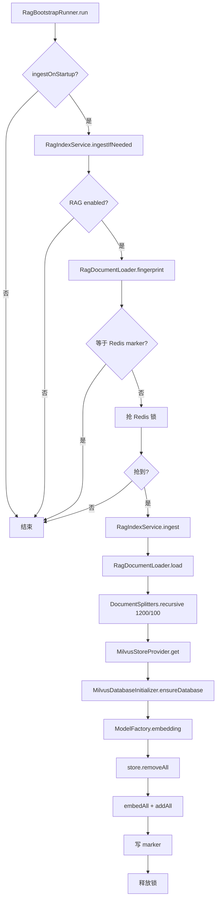
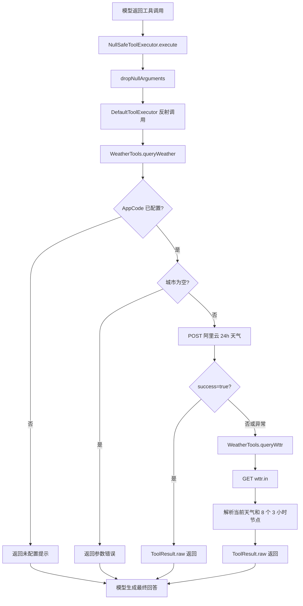

# gulimall-agent 模块说明

> 谷粒商城 AI 助手模块。独立微服务，端口 `15000`，同时服务**用户端商城页面**和**管理端后台**。
>
> 技术栈：JDK 21 + Spring Boot 3.5.16 + Spring Cloud 2025.0.3 + LangChain4J 1.0.1 + Redis + Milvus + MinIO。

---

## 一、模块定位

`gulimall-agent` 不直接操作业务表，而是：

1. 接收用户/管理员的自然语言问题；
2. 按角色拼提示词、按模型目录选模型；
3. 让模型通过 **Function Calling 工具**调各业务模块的只读内部接口；
4. 把工具结果交回模型，生成中文回答；
5. 把会话、记忆、图片、设置、RAG 知识库持久化。

用户端和管理端共用同一套模型、工具、会话和 RAG，但：

- 用户端只能查**本人**的订单/购物车/地址/优惠券；
- 管理端可以查**全部**订单、会员概要、仓库；
- 工具集由 `ToolBundleFactory.create` 按角色组装，模型即使被提示词诱导也调用不到越权工具。

---

## 二、功能清单

### 2.1 对话

- 普通对话：`POST /agent/chat`，一次性返回完整回答。
- 流式对话：`POST /agent/chat/stream`，SSE 事件 `meta -> delta... -> done/error`。
- 停止生成：`POST /agent/chat/stop`，按 `conversationId` 给当前流打停止标记，已生成内容会保存。
- 多会话：列表、消息、会话内搜索、3 天内全局搜索、删除。
- 多轮记忆：同一个 `conversationId` 下保留最近 40 条模型记忆。
- 技术问答：管理端可回答项目技术栈/模块职责/部署概览；用户端只回答商城使用指南范围内的功能说明；两端都禁止输出密钥、Token、内网 IP、SQL、服务器路径。

### 2.2 工具（只读）

用户端 + 管理端都能用：

- 商品：搜索、SKU 详情、分类树、品牌、SPU/SKU。
- 搜索：ES 全文搜索。
- 秒杀：场次、场次商品、秒杀首页。
- 库存：单 SKU、批量 SKU。
- 物流：地址转经纬度、经纬度反查地区。
- 天气：阿里云 24 小时天气，失败自动回退 `wttr.in`。
- 图片：看图、生成商城相关图片。

仅用户端：本人购物车、本人订单、会员资料/地址/优惠券/积分。
仅管理端：全部订单检索、交易统计、任意会员概要、仓库列表。

### 2.3 图片

- 上传：校验大小、类型、文件头、尺寸，存 MinIO，元数据存 Redis 3 天。
- 看图：固定视觉模型 `gpt-6.1-sol` 识别后，把结果交给当前对话模型。
- 生成：`gpt-image-1-mini`，异步任务，提交后立即返回 `taskId`。
- 生成范围：只允许商城相关（商品图、促销海报、活动横幅、优惠券/秒杀宣传图、店铺/品牌视觉）。

### 2.4 RAG

- 启动时从 `classpath:rag/**/*.md` 加载文档。
- 按目录区分：`rag/public/**` 为 `PUBLIC`，`rag/admin/**` 为 `ADMIN`；其它目录跳过。
- 用户端只检索 `PUBLIC`，管理端检索 `PUBLIC + ADMIN`。
- 文档内容 hash 作为幂等标记，内容没变不重复 embedding。
- 管理端可手动重建索引。

### 2.5 设置与自定义模型

- 窗口颜色、默认模型、流式开关、自定义提示词。
- 用户自定义 OpenAI 兼容模型：baseUrl、modelName、apiKey（AES-GCM 加密落库）、是否支持看图、超时等。
- 自定义模型新增/删除后清理模型缓存。

### 2.6 双端接入

- 用户端：auth-server 登录后签发 `role=user` 的 agent JWT；Spring Session 只用于 auth-server 刷新 JWT。
- 管理端：renren-fast 登录后签发 `role=admin` 的 agent JWT；agent 只验签，不再通过 Feign 校验旧 token。
- 用户端聊天窗：Thymeleaf 页面引入 `chat-widget.js`，悬浮宠物 + 聊天面板。
- 管理端：`renren-fast-vue` 的 `ai/chat` 页面。

---

## 三、全链路流程（按执行顺序）

### 3.1 启动与配置加载

**设计思路**

- 配置全部外置到 `config/` 和 Nacos，代码里不写业务默认值；缺必填项直接启动失败，避免带病运行。
- 模型配置分两层：`defaults` 管全局默认，`models` 只写差异；`ModelCatalog.init` 启动时合并成不可变内置列表。
- 启动阶段只做“能快速失败”的校验和初始化；Milvus、RAG、MinIO 失败时降级，不影响聊天主链路。

**执行顺序**

1. `GulimallAgentApplication.main` 调 `SpringApplication.run`。类上的 `@EnableDiscoveryClient`、`@EnableFeignClients(basePackages="...agent.feign")`、`@MapperScan("...settings.mapper")`、`@EnableConfigurationProperties(AiProperties.class)` 在启动时生效。
2. `application.yaml` 的 `spring.config.import` 按顺序加载：Nacos `gulimall.yaml` → `config/common.yaml` → `config/gulimall-agent.yaml` → 上级目录同名文件兜底；后加载覆盖先加载。
3. Spring 绑定 `AiProperties`（`@ConfigurationProperties(prefix="gulimall.ai")` + `@Validated`）。`@NotNull`/`@NotBlank`/`@NotEmpty` 校验 `defaults`、`defaultModel`、`models`、`image`、`embedding`、`rag`、`conversation`、`security`，缺项直接启动失败。
4. `ModelCatalog.init`（`@PostConstruct`）：遍历 `properties.getModels()`，对每个模型调 `withDefaults(source)` 合并默认值，按 `sort` 排序，保存为 `List.copyOf` 的 `builtInModels`。
5. `ModelFactory` 构造：注入 `AiProperties`、`TracingChatModelListener`、`List<ChatModelStrategy>`，把每个策略按 `provider()` 放进 `strategyMap`。此时**不创建任何模型对象**，模型在第一次 `chat/streaming/image/embedding` 调用时按需创建并缓存。
6. `RagBootstrapRunner.run`（`ApplicationRunner`）：`ingestOnStartup` 为 false 直接返回；否则调 `RagIndexService.ingestIfNeeded`，任何异常只记日志。
7. `WebMvcConfig.addArgumentResolvers` 注册 `PrincipalArgumentResolver`；`addResourceHandlers` 把 `/agent/widget/**` 映射到 `classpath:/static/agent/widget/`，`cachePeriod=0`。
8. `AgentJwtService.loadKeys`（`@PostConstruct`）加载 user/admin 两把 RSA 公钥；缺少公钥直接启动失败。
9. `FeignInternalTokenConfig.internalTokenInterceptor` 创建 Feign 请求拦截器。
10. `MinioConfig.minioClient` 创建 MinIO 客户端；`ImageStorageService.ensureBucket`（`@PostConstruct`）检查/创建 bucket，失败只记警告。
11. `ImageTaskExecutorConfig.imageTaskExecutor` 创建图片线程池。

---

### 3.2 agent JWT 鉴权与统一异常

**设计思路**

- agent 不再读取管理端旧 `token`，也不再读取用户端 `GULIMALLSESSION`。
- agent 只认 auth-server / renren-fast 用 RSA 私钥签发的 `RS256` JWT。
- 用户端 JWT 放 HttpOnly Cookie `AGENT_JWT_USER`，domain `.gulimall.vip`；
  管理端 JWT 放 HttpOnly Cookie `AGENT_JWT_ADMIN`，domain `admin.gulimall.vip`。
- 两个签发方各有一套私钥，agent 只保存两把公钥，按 JWT header 的 `kid` 选择。
- JWT 不落 MySQL、不落 Redis；服务端只做本地验签。

**执行顺序**

1. 用户登录成功：auth-server 用 `jwt/user/jwt_private.pem` 签发 `role=user` JWT，写
   `AGENT_JWT_USER` Cookie（path `/gulimall/agent/`、HttpOnly、Secure、SameSite=Lax、30 分钟）。
2. 管理员登录成功：renren-fast 用 `jwt/admin/jwt_private.pem` 签发 `role=admin` JWT，写
   `AGENT_JWT_ADMIN` Cookie（path `/gulimall/agent/`、HttpOnly、SameSite=Lax、30 分钟）。
   `cookie-secure` 由 `AGENT_JWT_COOKIE_SECURE` 控制，默认 `false`；生产 HTTPS 环境设为 `true`。
3. Controller 写 `Principal principal` 时，`PrincipalArgumentResolver.supportsParameter` 判断参数类型，
   `resolveArgument` 调 `PrincipalResolver.resolve(request)`。
4. `PrincipalResolver.resolve`：
    - 先读 `AGENT_JWT_ADMIN`，存在就验签并返回 ADMIN；
    - 没有管理端 Cookie 时，再读 `AGENT_JWT_USER`，存在就验签并返回 USER；
    - 两个 Cookie 都不存在 → 返回 `null`。
5. `AgentJwtService.verify`：
    - 从 JWT header 读 `kid`，选择 user/admin 公钥；
    - 验 RS256 签名、`exp`、`iss`、`aud`；
    - 校验 `kid`、`iss`、`role` 三者匹配，防止 user/admin 凭证混用；
    - 用 `sub` 作为 id、`username` 作为用户名，构造 `Principal`。
6. `PrincipalArgumentResolver.resolveArgument`：
    - `null`（没有对应 Cookie）→ 抛 `15001 NOT_LOGIN`；
    - JWT 无效/过期/角色不匹配 → `AgentJwtService` 抛 `15012 AGENT_TOKEN_INVALID`。
7. 业务代码用 `Principal.subject()` 生成 `USER:1` / `ADMIN:1` 作为会话/记忆 key；
   用 `Principal.isAdmin()` 决定工具集和提示词。
8. 前端收到 `15012` 时调用刷新接口：
    - 用户端：`POST auth.gulimall.vip/agent/jwt/refresh`，auth-server 读取 Spring Session，
      有效就重新签发 30 分钟 JWT 并更新 Cookie；
    - 管理端：`POST /gulimall/sys/agent/jwt/refresh`，renren-fast 现有 JWTFilter 校验旧 token，
      有效就重新签发 30 分钟 JWT 并更新 Cookie；
    - 刷新只读旧登录态，不写 JWT 到 Redis/MySQL。
9. `AgentException` 被 `AgentExceptionHandler.handleAgentException` 捕获，转成 `R.error(code, msg)`，HTTP 仍是 200。
10. 未预期异常被 `AgentExceptionHandler.handleException` 捕获，统一 `R.error(99000, "AI 服务暂时不可用，请稍后再试")`。
11. SSE 接口不走参数解析器：`ChatController.stream` 手动调 `PrincipalResolver.resolve`；
    没有 JWT 或 JWT 无效时，用 `ChatController.errorEmitter(code, message)` 返回 SSE `error` 事件（15001/15012）。

**错误码表**

| 常量 | 值 | 含义 | 是否实际抛出 |
|---|---|---|---|
| `NOT_LOGIN` | 15001 | 没有 agent JWT | 是 |
| `AGENT_TOKEN_INVALID` | 15012 | JWT 无效/过期/角色不匹配 | 是 |
| `AI_NOT_CONFIGURED` | 15003 | AI key 未配置/设置表未初始化 | 是 |
| `MODEL_NOT_FOUND` | 15004 | 模型/会话不存在 | 是 |
| `MESSAGE_INVALID` | 15005 | 消息为空/过长/格式错误 | 是 |
| `CONVERSATION_BUSY` | 15006 | 同会话并发 | 是 |
| `CUSTOM_MODEL_INVALID` | 15007 | 自定义模型不合法 | 是 |
| `IMAGE_INVALID` | 15008 | 图片不合法 | 是 |
| `RAG_UNAVAILABLE` | 15009 | RAG/Milvus 不可用 | 是 |
| `MODEL_CALL_FAILED` | 15010 | 模型/图片生成失败 | 是 |

---

### 3.3 普通对话（`POST /agent/chat`）

**设计思路**

- 每次请求单独构建 AI Service，因为提示词、工具、记忆窗口都依赖“当前用户 + 当前模型 + 当前会话”。
- 同一会话加 Redis 锁串行处理，避免两条消息同时写乱记忆。
- 先保存用户消息，再调模型；模型异常时用户消息仍然保留。
- 工具和 RAG 都是“按需挂载”：模型支持工具才挂工具，Milvus 可用才挂 RAG。

**执行顺序**

1. `ChatController.chat(principal, request)` → `ChatOrchestrator.chat(principal, request)`。
2. `ChatOrchestrator.chat` 调 `prepare(principal, request)`：
    1. 校验 `message` 非空（纯图片允许文字为空）、长度 ≤ `conversation.maxMessageChars`；
    2. 有 `imageIds` 时：校验数量 ≤ `image.maxImagesPerMessage`；逐张 `ImageMetadataService.get` 校验归属 → `ImageStorageService.download` 取字节 → `VisionAnalysisService.analyze` 识别 → 拼 `userText`，同时收集 `imageUrls`；
    3. `SettingsService.getOrCreate` 取用户设置；`request.modelId` 为空用 `setting.defaultModel`；
    4. `ModelCatalog.find(principal, modelId)` 选模型（内部走 `ModelCatalog.list`）；
    5. `ConversationService.getOrCreate(principal, request.conversationId, model.getId())` 取/建会话并校验归属；
    6. 组装 `ChatMessageDto userMessage`（id、role=user、content、imageUrls、imageIds、createdAt、status=ok），预生成 `assistantMessageId`；
    7. 返回 `Prepared(principal, conversationId, model, userText, customPrompt, userMessage, assistantMessageId)`。
3. `ChatOrchestrator.acquireLock(conversationId)`：Redis `setIfAbsent("gulimall:ai:lock:conv:{convId}", "1", 300s)`；抢不到抛 `15006 CONVERSATION_BUSY`。
4. `ChatOrchestrator.appendUserMessage(prepared)` → `ConversationService.append` 写用户消息。
5. `AssistantFactory.assistant(principal, model, customPrompt, conversationId)` 构建 AI Service：
    - `MessageWindowChatMemory.builder().id(memoryId).maxMessages(40).chatMemoryStore(redisChatMemoryStore)`；
    - `AiServices.builder(ShopAssistant.class).chatModel(modelFactory.chat(model)).chatMemoryProvider(...).systemMessageProvider(memoryId -> systemPrompt(...))`；
    - `model.tools == true` 时 `builder.tools(toolExecutors(toolBundleFactory.create(principal, conversationId)))`；
    - `roleAwareContentRetriever.forPrincipal(principal)` 非空时 `builder.contentRetriever(retriever)`；
    - `builder.build()` 返回 `ShopAssistant`。
6. `assistant.chat(conversationId, userText)`：LangChain4J 调模型；模型可能返回工具调用，`NullSafeToolExecutor.execute` 执行对应 `@Tool` 方法，工具内部通过 `ToolContext` 取当前身份并调 Feign。
7. 模型返回后，`ChatOrchestrator.saveAssistant(prepared, answer, null)`：
    - 空回答兜底为“（AI 没有返回内容，请稍后重试）”；
    - 组装 `ChatMessageDto assistantMessage`（id=`assistantMessageId`、role=assistant、content、modelId、createdAt、status=ok）；
    - `ConversationService.append` 写 AI 消息；
    - 组装 `ChatResponseDto` 返回。
8. `finally` 中 `redisTemplate.delete(lockKey)` 释放锁。


---

### 3.4 流式对话与停止（`POST /agent/chat/stream`、`/agent/chat/stop`）

**设计思路**

- 用 `SseEmitter` 把 token 逐段推给前端；事件名区分 `meta/delta/done/error`。
- 每个流生成一个 `streamId`；停止接口只给当前 `streamId` 打标记，不影响之后新发起的对话。
- 用户停止后不再推送新 token，但已生成部分要落 Redis，刷新后还能看到。
- 锁、streamId、停止标记统一在完成/超时/异常回调里清理。

**执行顺序**

1. `ChatController.stream(httpRequest, request)` 不用 `Principal` 参数，手动 `PrincipalResolver.resolve(httpRequest)`；未登录 → `ChatController.errorEmitter(15001, "请先登录后再使用 AI 助手")`。
2. `ChatOrchestrator.stream(principal, request)`：
    1. `prepare` 失败：创建 `SseEmitter(300_000L)`，`sendEvent("error", {code,message})`，`complete()` 返回；
    2. 创建 `SseEmitter(300_000L)`；`acquireLock` 失败同样用 `error` 事件返回；
    3. 定义 `AtomicBoolean released` + `Runnable release`，注册 `emitter.onCompletion/onTimeout/onError`，保证只释放一次锁；
    4. 生成 `streamId = UUID`，写 `gulimall:ai:stream:{convId}`，TTL 5 分钟；
    5. `appendUserMessage` 失败 → `clearStream` + `release` + `error(15010, "保存消息失败")`；
    6. `sendEvent("meta", {conversationId, messageId, modelId})`。
3. `AssistantFactory.streamingAssistant(principal, model, customPrompt, conversationId)`：与普通版相同，只是 `.streamingChatModel(modelFactory.streaming(model))`，返回 `ShopStreamingAssistant`。
4. `assistant.chatStream(conversationId, userText)` 得到 `TokenStream`，注册三个回调后 `.start()`：
    - `onPartialResponse(token)`：
        1. `isStopped(conversationId, streamId)` 为 true → `stopped=true`，丢弃 token；
        2. 否则 `fullText.append(token)`，`sendEvent("delta", {content})`。
    - `onCompleteResponse(response)`：
        1. `completed.compareAndSet(false,true)`，防重复；
        2. 已停止 → 只保存 `fullText` 已推给前端的部分，`done` 事件带 `stopped=true`；
        3. 未停止 → `extractText(response, fullText)`，`saveAssistant`，`done` 带 `conversationId/messageId/modelId/inputTokens/outputTokens`；
        4. `finally`：`clearStream`、`release.run()`、`emitter.complete()`。
    - `onError(error)`：
        1. 记录日志；
        2. 未完成且未停止 → `sendEvent("error", {code:15010, message})`；
        3. `clearStream`、`release.run()`、`emitter.complete()`。
5. 用户点停止：前端调 `ChatController.stop(principal, body)` → `ChatOrchestrator.stop(principal, conversationId)`：
    1. `conversationId` 不能为空；
    2. `ConversationService.getOrCreate(principal, conversationId, null)` 校验归属；
    3. 读 `gulimall:ai:stream:{convId}`；有值则写 `gulimall:ai:stop:{convId}=streamId`，TTL 120 秒。
6. `isStopped` 比较 `STOP_PREFIX + convId` 的值是否等于当前 `streamId`；新对话的 streamId 不同，不受影响。
7. `clearStream` 只清自己这条流：读取当前 `STREAM_PREFIX`，等于自己的 `streamId` 才同时删 stream 和 stop key。

**SSE 事件表**

| event | data | 时机 |
|---|---|---|
| `meta` | `conversationId`、`messageId`、`modelId` | 用户消息已保存、模型开始前 |
| `delta` | `content` | 每个 token |
| `done` | `conversationId`、`messageId`、`modelId`、`inputTokens`、`outputTokens`、`stopped` | 正常完成/用户停止 |
| `error` | `code`、`message` | 校验失败、抢锁失败、保存失败、模型异常 |

---

### 3.5 多会话、记忆、搜索

**设计思路**

- “页面历史”和“模型记忆”分开存：页面要完整消息，模型只要最近窗口，避免上下文无限增长。
- 所有 Redis key 带 3 天滑动过期；每次读写都续期。
- 会话索引用 ZSET 按最后活跃时间排序；元数据用 HASH，消息用 LIST。

**执行顺序**

1. `ConversationController.list(principal)` → `ConversationService.list(principal)`：
    - `reverseRange(indexKey, 0, -1)` 取会话 id；
    - 逐个读 `META` HASH；空则从索引删除；
    - 组装 `ConversationSummary`（id/title/modelId/createdAt/updatedAt/messageCount），`parseLong/parseInt` 兜底。
2. `ConversationController.create(principal, body)` → `ConversationService.create(principal, modelId)`：
    1. `zCard(indexKey)` 达到 `maxConversationsPerPrincipal` 时，取 `range(indexKey,0,0)` 最久未用，`deleteById(oldId)`；
    2. 生成 `conversationId`，写 `META` HASH（ownerType/ownerId/title=新对话/modelId/createdAt/updatedAt/messageCount=0），`expire(ttl)`；
    3. `zAdd(indexKey, conversationId, now)`，`expire(ttl)`。
3. `ConversationController.messages(...)` → `ConversationService.messages(principal, id, limit, beforeId)`；请求没传 `limit` 时使用 `conversation.ui-page-size`：
    1. `getOrCreate` 校验归属；
    2. `range(MSG,0,-1)` 取全部，`parseMessages` 反序列化；
    3. `beforeId` 找到结束下标；`start = max(0, end-limit)`，返回子列表。
4. `ConversationController.searchCurrent(...)` → `ConversationService.search`：校验归属，大小写不敏感 `contains`，最多 `limit` 条。
5. `ConversationController.searchAll(...)` → `ConversationService.searchAll`：`list` 遍历所有会话，逐个 `search`，组装 `ChatSearchResult`。
6. `ConversationController.delete(...)` → `ConversationService.delete`：`getOrCreate` 校验归属 → `deleteById` → 从 ZSET 移除索引。
7. `deleteById` 删除 `MSG`、`META`、`MEMORY` 三个 key。
8. 模型记忆由 `RedisChatMemoryStore` 单独维护：
    - `getMessages(memoryId)`：读 `gulimall:ai:memory:{memoryId}`，用 `ChatMessageDeserializer` 反序列化，坏数据返回空列表；
    - `updateMessages(memoryId, messages)`：`ChatMessageSerializer` 序列化，`set` 并续期 TTL；
    - `deleteMessages(memoryId)`：删除记忆 key。

**Redis key 表**

| Key | 类型 | 作用 | 维护者 |
|---|---|---|---|
| `gulimall:ai:conv:index:{USER:1}` | ZSET | 会话索引，score=最后活跃时间 | `ConversationService.create/append/list/delete` |
| `gulimall:ai:conv:meta:{convId}` | HASH | 标题/模型/消息数/时间 | `ConversationService.create/append` |
| `gulimall:ai:conv:msg:{convId}` | LIST | 完整 UI 消息 JSON | `ConversationService.append` |
| `gulimall:ai:memory:{convId}` | STRING | 模型记忆窗口（LangChain4J JSON） | `RedisChatMemoryStore` |
| `gulimall:ai:lock:conv:{convId}` | STRING | 会话串行锁 | `ChatOrchestrator.acquireLock` |
| `gulimall:ai:stream:{convId}` | STRING | 当前流 id | `ChatOrchestrator.stream` |
| `gulimall:ai:stop:{convId}` | STRING | 停止标记 | `ChatOrchestrator.stop` |

> 说明：`ConversationService.MEMORY` 直接引用 `RedisChatMemoryStore.PREFIX`，删除会话时同时删除消息、元数据和模型记忆。

---

### 3.6 图片上传与看图

**设计思路**

- 上传不信任浏览器 `Content-Type`，按文件头判断真实类型，限制大小/尺寸。
- 聊天请求只传 `imageId`，服务端凭 Redis 元数据找回 MinIO 对象并校验归属，避免拿别人的图片 id 看图。
- 识别固定用视觉模型，生成固定用图片模型；两者职责分开。

**上传流程**

1. `ImageController.upload(principal, file)` → `ImageValidationService.validate(file)`：
    1. `file == null || file.isEmpty()` → `15008 请选择要上传的图片`；
    2. `file.getSize() > image.maxUploadBytes` → 报错；
    3. `detectMime(bytes)` 按魔数判断 JPEG（FF D8 FF）/PNG（89 50 4E 47）/WebP（RIFF....WEBP）；
    4. MIME 不在 `image.allowedTypes` → 报错；
    5. WebP 直接放行；JPEG/PNG 用 `ImageIO.read` 解码，`resizeIfNeeded` 把最大边压到 2048，重新编码，返回 `ValidatedImage(bytes,mime,extension,width,height)`。
2. `ImageController.upload` 生成对象路径：`ai/upload/{USER|ADMIN}/{id}/{yyyyMMdd}/{uuid}.{ext}`。
3. `ImageStorageService.upload(bytes, contentType, objectKey)` → `minioClient.putObject(...)` → `publicUrl(objectKey)`（`/oss/gulimall/...`）。
4. 生成 `imageId`，`ImageMetadataService.save(principal, imageId, objectKey, url, mime, size)`：写 `gulimall:ai:img:{imageId}` HASH（ownerType/ownerId/objectKey/url/mime/size），TTL 3 天。
5. 返回 `{imageId, url, width, height}`。
6. `ImageController.info(principal, imageId)` → `ImageMetadataService.get(principal, imageId)`：不存在/过期/非本人 → `15008`；返回元数据。

**看图流程（聊天请求带 imageIds）**

1. `ChatOrchestrator.prepare` 遍历 `imageIds`：
    1. `ImageMetadataService.get(principal, imageId)` 校验归属；
    2. `ImageStorageService.download(meta.objectKey())` 取原始字节；
    3. `VisionAnalysisService.analyze(principal, bytes, meta.mime(), message)`：
        - `ModelCatalog.visionModel(principal)` 取配置的 `image.vision-model`（`gpt-6.1-sol`），找不到取第一个 `vision=true` 的模型；
        - `AiModelDefinition.withTimeout(image.timeout)` 复制一份模型定义并替换超时，避免影响普通对话；
        - `ModelFactory.chat(definition)` → `strategy(definition).createChatModel(...)` → `OpenAiCompatibleChatModelStrategy.createChatModel`；
        - 图片转 base64，`UserMessage.from(TextContent, ImageContent)`，`model.chat(userMessage)`；
        - 异常不抛出，返回“图片识别失败：...”，聊天继续；
    4. 识别结果拼进 `userText`，`imageUrls` 保留给前端展示。
2. 后续按 3.3 的普通对话/3.4 的流式对话继续。

---

### 3.7 图片异步生成

**设计思路**

- 图片模型耗时长，不能占用 Tomcat 请求线程；所以“提交任务立即返回，后台线程池生成”。
- 任务状态存 Redis，完成后把图片作为一条普通 AI 消息写回会话，刷新/轮询都能看到。
- 只允许商城相关图片：先由系统提示词约束，再由 `ImagePromptGuard` 做确定性校验。

**提交流程（模型工具 / 直接接口两条入口）**

入口 A：模型调用 `ImageTools.generateImage(prompt, size)`。
入口 B：前端调 `ImageController.generate(principal, GenerateImageRequest)`。

两条入口最终都走 `ImageTaskService.submit`：

1. `ImageTaskService.submit(principal, conversationId, prompt, size, quality)`：
    1. `prompt` 为空 → `15008`；
    2. `ImagePromptGuard.isProjectRelated(prompt)` 为 false → `15008`“只能生成与谷粒商城相关的图片…”；
    3. 有 `conversationId` → `ConversationService.getOrCreate` 校验归属；
    4. 生成 `taskId`，写 `gulimall:ai:imgtask:{taskId}` HASH（id/ownerType/ownerId/conversationId/prompt/size/quality/status=PENDING/createdAt/updatedAt），TTL 1 小时（`saveTask`）；
    5. 有会话 → `rightPush("gulimall:ai:imgtask:conv:{convId}", taskId)`，TTL 1 小时；
    6. `executor.execute(() -> runTask(...))`；`TaskRejectedException` → `updateStatus(FAILED)` + 抛 `15010`；
    7. 返回 `taskId`。
2. `ImageTools.generateImage` 把 `taskId` 包装成“图片正在后台生成…”返回给模型；`ImageController.generate` 返回 `{taskId,status:PENDING,prompt,conversationId}`。
3. `ImageTaskExecutorConfig.imageTaskExecutor` 的线程执行 `runTask(taskId, principal, conversationId, prompt, size, quality)`：
    1. `updateStatus(taskId,"RUNNING",null,null)`；
    2. `ImageGenerationService.generate(principal, prompt, size, quality)`：
        - 校验 prompt 非空、≤1000 字；
        - `normalizeSize(size)`：只接受 `1024x1536/1536x1024/1024x1024`，否则 `defaultSize()`；
        - `normalizeQuality(quality)`：只接受 `low/medium/high`，否则 `defaultQuality()`；
        - `ModelFactory.image(finalSize, finalQuality)`：按 `size|quality` 缓存，`OpenAiImageModel.builder()`；
        - `model.generate(cleanPrompt)`；`image.base64Data()` 为空时尝试返回 `image.url()`；否则 base64 解码；
        - 对象路径 `ai/generated/{USER|ADMIN}/{id}/{yyyyMMdd}/{uuid}.png`；
        - `ImageStorageService.upload(bytes,"image/png",objectKey)` → `publicUrl`；
    3. `updateStatus(taskId,"DONE",url,null)`；
    4. `appendImageMessage(principal, conversationId, prompt, url)` → `appendMessage`：
        - `ConversationService.getOrCreate` 再校验（会话可能已被删）；
        - 组装 `ChatMessageDto`（role=assistant、content=Markdown 图片、createdAt、status=ok）；
        - `ConversationService.append`；
    5. 异常：`updateStatus(FAILED,error)` + `appendFailureMessage`（同样走 `appendMessage`）。
4. 前端每 4 秒轮询：
    - `ImageController.tasks(principal, conversationId)` → `ImageTaskService.list`：
      `range(CONV_TASK_KEY, -20, -1)` 取最近 20 个 taskId，逐个读 HASH，`owned` 过滤，`toView`；
    - `ImageController.task(principal, taskId)` → `ImageTaskService.get`：
      HASH 为空 → `15008`；`checkOwner`；`toView`。
5. 状态机：`PENDING → RUNNING → DONE / FAILED`；任务 HASH 和会话任务列表 TTL 1 小时，图片消息本身留在会话里 3 天。


---

### 3.8 RAG 知识库

**设计思路**

- RAG 只做“补充知识”，不替代工具实时数据；检索失败要降级为空，不能让聊天失败。
- 文档按 `audience` 分 `PUBLIC/ADMIN`：`rag/public` 为 `PUBLIC`，`rag/admin` 为 `ADMIN`；用户端只能查 `PUBLIC`，管理端可查 `PUBLIC+ADMIN`。
- 重建时必须先清空 collection，否则本地删掉的文档会一直残留在 Milvus。

**启动入库流程**

1. `RagBootstrapRunner.run(args)`：
    1. `ingestOnStartup` 为 false → 返回；
    2. `RagIndexService.ingestIfNeeded`；异常只记日志。
2. `RagIndexService.ingestIfNeeded`：
    1. `properties.getRag().isEnabled()` 为 false → 返回；
    2. `RagDocumentLoader.fingerprint()`：遍历 `load()`，拼 `source:version;`，`shortHash`；
    3. 与 Redis `gulimall:ai:rag:indexed` 比较，相同 → 返回；
    4. `setIfAbsent("gulimall:ai:rag:lock","1",10min)` 抢锁，抢不到 → 返回；
    5. `ingest()`；成功且片段数 > 0 → 写 marker；`finally` 删锁。
3. `RagDocumentLoader.load`：
    - `classpath*:{rag.docLocation}/**/*.md` 扫描；
    - 空文件跳过；
    - `audienceOf(resource, docLocation)`：路径含 `/{docLocation}/public/` → `PUBLIC`，含 `/{docLocation}/admin/` → `ADMIN`；其它目录跳过；
    - `Document.from(text, Metadata{source, audience, version=shortHash(text)})`。
4. `RagIndexService.ingest`：
    1. `documentLoader.load()`；空 → 返回 0；
    2. `DocumentSplitters.recursive(rag.chunkMaxChars, rag.chunkOverlapChars)` 切分；片段大小和重叠字符数来自配置；
    3. `storeProvider.get()` 取 `MilvusEmbeddingStore`；
    4. `store.removeAll()` 全量清空；
    5. `modelFactory.embedding()` 取向量模型；
    6. `embeddingModel.embedAll(segments)` + `store.addAll(embeddings, segments)`；
    7. 返回片段数。
5. `MilvusStoreProvider.get()`：
    1. 已创建直接返回；
    2. `now < nextRetryAt` → 快速失败 `15009`；
    3. `synchronized` 双重检查；RAG 关闭 → `15009`；
    4. `MilvusDatabaseInitializer.ensureDatabase()`；
    5. `MilvusEmbeddingStore.builder()`：host/port/database/collection/dimension/autoFlushOnInsert；用户名密码都配置才加鉴权；
    6. 成功清空 `nextRetryAt`；失败设置 60 秒冷却并抛 `15009`。
6. `MilvusDatabaseInitializer.ensureDatabase()`：
    1. `ConnectParam` 建原生客户端（用户名密码都配置才鉴权）；
    2. `listDatabases()`，已存在直接返回；
    3. `createDatabase(...)`；status 非 0 且不是 already exist → 警告；
    4. `finally` `client.close(0)`。

**聊天检索流程**

1. `AssistantFactory.assistant/streamingAssistant` 调 `RoleAwareContentRetriever.forPrincipal(principal)`。
2. `forPrincipal`：RAG 关闭 → `null`；管理员 → `adminRetriever()`；用户 → `userRetriever()`；异常 → `null`。
3. `userRetriever`/`adminRetriever`：双重检查 + `volatile` 缓存。
4. `build(audiences)`：
    - `EmbeddingStoreContentRetriever.builder().embeddingStore(storeProvider.get()).embeddingModel(modelFactory.embedding()).maxResults(rag.maxResults).minScore(rag.minScore).filter(audience isIn audiences).build()`；
    - 包 `new SafeContentRetriever(delegate)`。
5. 模型回答前，LangChain4J 调 `SafeContentRetriever.retrieve(query)` → delegate 检索；异常返回 `List.of()`。

**管理端维护流程**

1. `RagAdminController.rebuild(principal)`：非管理员 → `15001`；`RagIndexService.rebuild()`：
    1. 抢 `gulimall:ai:rag:lock`，抢不到抛 `15009`；
    2. `ingest()`；片段数 > 0 写 marker；
    3. `finally` 删锁；返回片段数。
2. `RagAdminController.status(principal)`：非管理员 → `15001`；`RagIndexService.isIndexed()` 判断 marker 是否存在。

**RAG 流程图**



---

### 3.9 设置、自定义模型与模型探测

**设计思路**

- 设置按身份一行存 MySQL，读失败时退回内存默认值，保证聊天主链路可用。
- 自定义模型 apiKey 必须加密存储，前端只拿掩码；baseUrl 必须做 SSRF 校验。
- 模型目录合并内置 + 自定义，工厂按 provider 选策略并缓存；模型变更要清缓存。

**设置读写流程**

1. `SettingsController.get(principal)` → `SettingsService.getOrCreate` + `SettingsService.listCustomModelViews`。
2. `SettingsService.getOrCreate`：
    1. `settingMapper.selectOne(lambdaQuery.eq(principalType).eq(principalId))`；
    2. 有 → 返回；
    3. 无 → `defaultSetting(principal)` + `settingMapper.insert`；
    4. 异常 → 记警告，返回内存默认值（id 可能为 null）。
3. `SettingsController.update(principal, request)` → `SettingsService.update`：
    1. `getOrCreate`；`id == null` → `15003`“设置表未初始化”；
    2. `themeColor` 非空校验 `#RRGGBB`；
    3. `streamEnabled`、`defaultModel` 直接覆盖；
    4. `customPrompt` 长度 ≤ `maxCustomPromptChars`；
    5. `petPositionX/Y` 覆盖；
    6. `settingMapper.updateById`。
4. `SettingsController.addModel(principal, request)` → `SettingsService.createCustomModel`：
    1. `security.customModel.isEnabled()` 为 false → `15007`；
    2. `customModelMapper.selectCount` ≥ `maxPerPrincipal` → `15007`；
    3. provider 必须在 `allowedProviders`；
    4. `required(displayName/modelName/baseUrl/apiKey)`；
    5. `UrlSafetyValidator.validate(baseUrl, config)`；
    6. temperature 0～2、timeout 5～120；
    7. `useSharedKey=true` → 不存 key，mask=“公共 closeai key”；否则 `cryptoService.encrypt(apiKey)` + `cryptoService.mask(apiKey)`；
    8. 组装 `AiCustomModel`（modelId=`custom:{uuid16}`、enabled=true…），`customModelMapper.insert`；
    9. 返回 `CustomModelView`；
    10. Controller 调 `modelFactory.evict(view.getModelId())`（新 id 本来无缓存，调用是为了语义清晰）。
5. `SettingsController.deleteModel(principal, id)` → `SettingsService.deleteCustomModel`：
    1. `selectById`；不存在/非本人 → `15007`；
    2. `deleteById`；
    3. Controller 调 `modelFactory.evictPrefix("custom:")` 清所有自定义模型缓存。
6. 聊天选模型时 `ModelCatalog.list(principal)`：内置 `builtInModels` + `SettingsService.listCustomModels(principal)`；过滤 `enabled=false`；按 `sort` 排序。
7. `SettingsService.listCustomModels`：`selectList(enabled=true)`，逐行 `toDefinition`：
    - `useSharedKey` → `properties.defaults.apiKey`；否则 `cryptoService.decrypt(apiKeyCipher)`；
    - 映射为 `AiModelDefinition`：`custom=true`、`customModelId`、`tools=true`、`sort=1000+id`、`timeout=timeoutSeconds`、`maxRetries/defaults`、`logRequests/Responses=true`；
    - 单个模型解密失败跳过，不影响其它模型。
8. `SettingsService.listCustomModelViews`：`selectList` 全部（不过滤 enabled），逐行转 `CustomModelView`，只返回 `apiKeyMask`。

**自定义模型安全流程**

1. `AesGcmCryptoService` 构造器读 `AI_SETTINGS_AES_KEY`（Base64）：
    - 未配置 → `secretKey=null`，应用仍启动，保存模型时报错；
    - 解码后长度必须是 16/24/32 字节，否则启动失败。
2. `encrypt(plainText)`：`isAvailable` 校验 → 随机 12 字节 IV → `AES/GCM/NoPadding` → 返回 `v1:` + Base64(IV || 密文+Tag)。
3. `decrypt(cipherText)`：校验 `v1:` 前缀 → 拆 IV/密文 → GCM 解密；Tag 校验失败通常说明主密钥变了。
4. `mask(plainText)`：长度 ≤ 8 → `****`；否则前 3 + `****` + 后 4。
5. `UrlSafetyValidator.validate(baseUrl, config)`：
    1. `URI.create` 失败 → `15007`；
    2. scheme/host 必须存在；
    3. `requireHttps` 时必须 `https`；
    4. `isPrivateHost(host)` 拦截 localhost/127.0.0.1/0.0.0.0/::1/10./192.168./169.254./172.16-31；
    5. `denyPrivateAddresses` 时 DNS 解析，任一地址是 anyLocal/loopback/siteLocal/linkLocal/multicast → 拒绝；解析失败 → 拒绝。

**模型目录与探测流程**

1. `ModelController.list(principal)` → `ModelCatalog.list(principal)`，每个 `AiModelDefinition` 经 `toView` 转 `ModelView`（不返回 baseUrl/apiKey）。
2. `AdminModelProbeController.probe(principal, modelId)`：
    1. 非管理员 → `15001`；
    2. 指定 modelId → `ModelCatalog.find`；否则 `ModelCatalog.list`；
    3. 逐个 `modelFactory.chat(definition)` → `OpenAiCompatibleChatModelStrategy.createChatModel` → `model.chat("只回复OK")`；
    4. 成功记录 reply，失败记录 error，最后返回 `results`。

---

### 3.10 前端接入与用户交互链路

**用户端（`chat-widget.js`）**

页面只引一个脚本：

```html
<script src="/gulimall/agent/widget/chat-widget.js" defer></script>
```

脚本自动注入 CSS、宠物、聊天面板；API 统一走 `/gulimall/agent/**`，Nginx → 网关 → 本服务。

**发送消息链路（前端 → 后端）**

1. `init()`：`injectCss` → `buildRoot` → `buildPet` → `checkPetImage` → `applyPetSize` → `applyTheme` → `checkLogin` → `loadAll` → `bindPanelEvents`。
2. `checkLogin()` → `request("/agent/auth/me")`；15001/15012 → `showLoginMask(true)`。
   请求遇到 15012 时，`request()` 先调 `refreshAgentJwt()`，刷新 Cookie 后重试一次。
3. `openPanel()`：未登录 → `showLoginMask(true)`；已登录 → `loadModels`/`loadSettings`/`loadConversations`，有 `imageTask` 时 `startImageTaskPolling`。
4. `sendMessage()`：
    1. 读输入框，组装 `body = {conversationId, message, modelId, imageIds}`；
    2. 无会话先 `createConversation()`；
    3. 流式开 → `sendStream(body)`；否则 `sendNormal(body)`；
    4. 发送前 `setBusy(true)`，失败 `playPet('failed')`。
5. `sendNormal(body)` → `request("/agent/chat", {method:"POST", body})` → 把返回的 `data` 渲染成 AI 消息。
6. `sendStream(body)`：
    1. `fetch("/agent/chat/stream")`，`AbortController` 控制取消；
    2. 读 `response.body.getReader()`，按 SSE 分块，`handleSseChunk(chunk, placeholder)`；
    3. `meta` → 记录 messageId/conversationId；`delta` → `updateStreamingMessage`；`done` → 结束 streaming 状态；
       `error` → 提示；
    4. `error.code=15012` 时，移除当前占位消息，调 `refreshAgentJwt()` 后重试一次 `sendStream`。
7. `stopStream()`：`abortController.abort()` + `request("/agent/chat/stop", {conversationId})`。
8. `uploadFile(file)`：大小 ≤8MB → `POST /agent/images`（FormData）→ 存 `imageId`；`handlePasteImage` 从剪贴板取图。
9. `pollImageTasks()`：页面打开/切换会话/聊天结束后各查一次 `GET /agent/images/tasks?conversationId=`；
   只有存在 PENDING/RUNNING 任务时才每 4 秒轮询，任务全部 DONE/FAILED 后自动停止。
10. 历史/搜索：`openHistory` → `renderHistoryList`；`openConversation(id)` → `loadMessages`；`loadEarlier` 带 `before`；`doCurrentSearch` → `/agent/conversations/{id}/messages/search`；`searchAllHistory` → `/agent/conversations/search`；`deleteConversation` → `DELETE /agent/conversations/{id}`。
11. 设置：`openSettings` → `syncSettingsForm`；`saveSettings` → `PUT /agent/settings`；`addCustomModel` → `POST /agent/settings/models`；`deleteCustomModel` → `DELETE /agent/settings/models/{id}`；`loadSettings`/`loadModels` 刷新。
12. 宠物：`buildPet`/`playPet`/`petTick`/`startPetDrag`/`movePetDrag`/`endPetDrag`/`savePetPosition`/`applyPetVisibility`。宠物是打开聊天窗的**唯一入口**，因此不再提供“隐藏宠物”设置。

**管理端**

1. 路由 `/ai/chat` → `renren-fast-vue/src/views/modules/ai/chat.vue`。
2. 管理端登录仍在 renren-fast 完成；登录成功后 renren-fast 额外设置 `AGENT_JWT_ADMIN` HttpOnly Cookie。
3. agent 请求只认这个 Cookie；旧 `token` 只在 renren-fast 自己的登录/刷新接口中使用，agent 不再读取。
4. `chat.vue` 的 `get/post/put/del`、SSE、图片上传收到 15012 时，先调
   `/gulimall/sys/agent/jwt/refresh` 刷新 Cookie，再重试一次。
5. 管理端菜单 icon 必须是 `src/icons/svg/icon-*.svg` 的名字（如 `ai`），不能写 `el-icon-xxx`。
6. 管理端可额外使用：`/agent/admin/models/probe`、`/agent/admin/rag/status`、`/agent/admin/rag/rebuild`。

---


### 3.11 Function Calling 与天气查询流程

**设计思路**

- 工具由“规格 + 执行器”两部分组成：`ToolSpecifications.toolSpecificationFrom(method)` 给模型看名称、参数和说明，`ToolExecutor` 负责真正调用 Java 方法。
- 模型只决定“调哪个工具、传什么参数”，权限边界、null 参数清洗、结果截断都在 Java 侧完成。
- 天气工具优先调用阿里云 24 小时接口；接口失效、返回 `success=false` 或网络异常时，回退到 `wttr.in`。
- 工具结果统一转 JSON 并截断，避免把整份第三方响应塞进模型上下文。

**执行顺序**

1. `AssistantFactory.assistant/streamingAssistant` 在 `model.tools == true` 时调 `toolExecutors(toolBundleFactory.create(principal, conversationId))`。
2. `ToolBundleFactory.create` 把 `WeatherTools` 加入公共工具列表；`AssistantFactory.toolExecutors` 遍历所有带 `@Tool` 的方法，生成 `ToolSpecification`，并用 `NullSafeToolExecutor` 包装 `DefaultToolExecutor`。
3. 模型返回工具调用后，LangChain4J 按 `ToolSpecification` 找到对应 `ToolExecutor`，调 `NullSafeToolExecutor.execute(request, memoryId)`。
4. `NullSafeToolExecutor.dropNullArguments` 删除模型显式传来的 null 参数，再交给 `DefaultToolExecutor` 反射调用 `WeatherTools.queryWeather(city)`。
5. `WeatherTools.queryWeather`：
   1. `appCode` 为空 → 返回“天气服务未配置”，不编造天气；
   2. 城市为空 → 返回参数错误；
   3. 调阿里云 `POST /weather/query/24h`，表单 `area=城市`，请求头 `Authorization: APPCODE {appCode}`；
   4. 响应包含 `"success":true` → `ToolResult.raw(result)`；
   5. 否则调 `queryWttr(city, reason)`。
6. `WeatherTools.queryWttr`：
   1. `GET {fallbackBaseUrl}/{city}?format=j1&lang=zh`；
   2. 解析 `current_condition[0]` 的温度、体感、湿度、风速、天气描述、观测时间；
   3. 取 `weather[0].hourly` 前 8 个节点（3 小时间隔，覆盖 24 小时）；
   4. 组装 `{source, city, reason, current, hourly}`，`ToolResult.raw` 返回；
   5. 兜底接口也失败 → 返回失败原因。
7. `ToolResult.from/raw/json` 统一截断到 6000 字符；模型拿到工具结果后继续生成最终回答。

**天气查询流程图**



## 四、接口清单

| 方法 | 路径 | 说明 | 入口方法 |
|---|---|---|---|
| GET | `/agent/auth/me` | 当前身份 | `ChatController.me` |
| GET | `/agent/models` | 可选模型 | `ModelController.list` |
| POST | `/agent/chat` | 普通对话 | `ChatController.chat` |
| POST | `/agent/chat/stream` | SSE 流式对话 | `ChatController.stream` |
| POST | `/agent/chat/stop` | 停止当前流 | `ChatController.stop` |
| GET/POST | `/agent/conversations` | 会话列表/新建 | `ConversationController.list/create` |
| GET | `/agent/conversations/{id}/messages` | 会话消息 | `ConversationController.messages` |
| GET | `/agent/conversations/{id}/messages/search` | 会话内搜索 | `ConversationController.searchCurrent` |
| GET | `/agent/conversations/search` | 3 天内全局搜索 | `ConversationController.searchAll` |
| DELETE | `/agent/conversations/{id}` | 删除会话 | `ConversationController.delete` |
| POST | `/agent/images` | 上传图片 | `ImageController.upload` |
| GET | `/agent/images/{imageId}` | 图片元数据 | `ImageController.info` |
| POST | `/agent/images/generate` | 提交异步图片生成任务 | `ImageController.generate` |
| GET | `/agent/images/tasks?conversationId=` | 会话图片任务 | `ImageController.tasks` |
| GET | `/agent/images/tasks/{taskId}` | 单任务状态 | `ImageController.task` |
| GET/PUT | `/agent/settings` | 读/写设置 | `SettingsController.get/update` |
| POST | `/agent/settings/models` | 添加自定义模型 | `SettingsController.addModel` |
| DELETE | `/agent/settings/models/{id}` | 删除自定义模型 | `SettingsController.deleteModel` |
| GET | `/agent/admin/models/probe` | 管理员探测模型 | `AdminModelProbeController.probe` |
| GET | `/agent/admin/rag/status` | RAG 索引状态 | `RagAdminController.status` |
| POST | `/agent/admin/rag/rebuild` | 重建 RAG 索引 | `RagAdminController.rebuild` |

---

## 五、存储设计

### 5.1 Redis

| Key | 作用 | 写入/读取方法 |
|---|---|---|
| `gulimall:ai:conv:index:{USER:1}` | 会话索引 ZSET | `ConversationService.create/append/list/delete` |
| `gulimall:ai:conv:meta:{convId}` | 会话标题/模型/消息数 | `ConversationService.create/append/list/getOrCreate` |
| `gulimall:ai:conv:msg:{convId}` | 完整 UI 消息 LIST | `ConversationService.append/messages/search` |
| `gulimall:ai:memory:{convId}` | 模型记忆窗口 | `RedisChatMemoryStore` |
| `gulimall:ai:lock:conv:{convId}` | 会话串行锁 | `ChatOrchestrator.acquireLock` |
| `gulimall:ai:stream:{convId}` | 当前流 id | `ChatOrchestrator.stream/stop/clearStream` |
| `gulimall:ai:stop:{convId}` | 停止标记 | `ChatOrchestrator.stop/isStopped/clearStream` |
| `gulimall:ai:img:{imageId}` | 上传图片元数据 | `ImageMetadataService.save/get` |
| `gulimall:ai:imgtask:{taskId}` | 图片任务状态 | `ImageTaskService.saveTask/updateStatus/get` |
| `gulimall:ai:imgtask:conv:{convId}` | 会话图片任务列表 | `ImageTaskService.submit/list` |
| `gulimall:ai:rag:indexed` | RAG 内容指纹 marker | `RagIndexService.ingestIfNeeded/rebuild/isIndexed` |
| `gulimall:ai:rag:lock` | RAG 重建锁 | `RagIndexService.ingestIfNeeded/rebuild` |
| `gulimall:cart:{memberId}` | 购物车（复用 cart 模块） | `CartTools.getMyCart/getCartCount/getCartItem` |

### 5.2 MySQL（`gulimall_ai`）

- `ai_user_setting`：用户/管理员 AI 设置，一个身份一行；字段见 `AiUserSetting`。
- `ai_custom_model`：自定义 OpenAI 兼容模型，`api_key_cipher` 为 AES-GCM 密文，`api_key_mask` 给前端展示。

### 5.3 MinIO

- `ai/upload/{USER|ADMIN}/{id}/{yyyyMMdd}/{uuid}.{ext}`：用户上传图。
- `ai/generated/{USER|ADMIN}/{id}/{yyyyMMdd}/{uuid}.png`：AI 生成图。
- 对外统一 `/oss/gulimall/...`，由 Nginx 反代到 MinIO。

### 5.4 Milvus

- 数据库：`MILVUS_DATABASE`（默认 `gulimall_ai`）。
- Collection：`MILVUS_COLLECTION`（默认 `gulimall_knowledge_v1`）。
- 存 RAG 文档片段和 1536 维 embedding。

---

## 六、配置文件与资源

| 文件 | 作用 |
|---|---|
| `gulimall-agent/pom.xml` | 模块依赖；LangChain4J BOM 1.0.1；Spring Boot/Cloud/Alibaba 版本 |
| `src/main/resources/application.yaml` | 应用名、配置导入顺序、端口 15000 |
| `config/gulimall-agent.yaml` | 模型列表、默认参数/超时、图片模型、embedding、Milvus、RAG、数据源、agent JWT 公钥、MyBatis-Plus |
| `config/gulimall-auth-server.yaml` | 用户端登录 Session（7d）、用户端 agent JWT 私钥路径与 Cookie 配置 |
| `renren-fast/src/main/resources/application.yml` | 管理端 agent JWT 私钥路径与 Cookie 配置 |
| `jwt/user/jwt_private.pem`、`jwt/user/jwt_public.pem` | 用户端 agent JWT 密钥；私钥只给 auth-server，公钥给 agent |
| `jwt/admin/jwt_private.pem`、`jwt/admin/jwt_public.pem` | 管理端 agent JWT 密钥；私钥只给 renren-fast，公钥给 agent |
| `config/common.yaml` | 所有模块共用：MySQL、Redis、Nacos、MinIO、Session Cookie、AI Key、天气、内部 token、Milvus |
| `src/main/resources/rag/public/谷粒商城使用指南.md` | 用户端 RAG 知识（PUBLIC） |
| `src/main/resources/rag/admin/项目技术栈与模块概览.md` | 项目技术栈/模块职责/部署概览（ADMIN，仅管理端） |
| `src/main/resources/static/agent/widget/chat-widget.js` | 用户端宠物 + 聊天面板逻辑 |
| `src/main/resources/static/agent/widget/chat-widget.css` | 用户端聊天窗样式 |
| `src/main/resources/static/agent/widget/pet/xbb/` | 宠物精灵图 |
| `sql/gulimall_ai.sql` | `gulimall_ai` 库表结构 |
| `sql/gulimall_ai_menu.sql` | 管理端 AI 菜单与角色授权 |
| `renren-fast-vue/src/views/modules/ai/chat.vue` | 管理端 AI 聊天页面 |
| `renren-fast-vue/src/icons/svg/icon-ai*.svg` | 管理端 AI 菜单 SVG 图标 |

> RAG 文档按目录区分：`rag/public/**` 对用户端开放，`rag/admin/**` 仅管理端检索；新增文档必须放在这两个目录下，其它目录会被跳过。

**AI 配置要点**

- `defaults.timeout: 60s`：普通对话（模型 + 查库 + 总结）。
- `defaults.streaming-timeout: 90s`：流式回答。
- `image.vision-model: gpt-6.1-sol`：看图固定模型。
- `image.timeout: 90s`：看图超时。
- `image.generation.model-name: gpt-image-1-mini`：生成模型。
- `image.generation.timeout/max-retries`：图片生成超时与重试。
- `embedding`：向量模型（`text-embedding-3-small`，1536 维）。
- `milvus`：连接、database、collection。
- `rag`：文档根目录、召回数量、阈值、切片字符数；文档按 public/admin 子目录区分可见范围。
- `gulimall.agent.jwt`：agent 只保存 user/admin 两把公钥和 kid；私钥分别在 auth-server 与 renren-fast。
- `spring.session.timeout: 7d`：用户端 Session 滑动过期 7 天；agent JWT 仍是 30 分钟，过期后由登录服务刷新。
- 生产部署时把 `jwt/user`、`jwt/admin` 放到 `/mydata/app/jwt`（或通过 `AGENT_JWT_*_KEY_PATH` 指定绝对路径）；私钥只挂载给对应签发服务。

---

## 七、已知限制

1. LangChain4J 使用 1.0.1，工具 null 参数靠 `NullSafeToolExecutor` 兼容；长期建议升级到 1.23+。
2. 图片异步任务在线程池里，服务重启会丢失正在排队/执行的任务；生产建议换成 MQ + 任务表。
3. 图片生成提示词用关键词白名单判定“商城相关”，过于口语化但确实属于商城的描述可能被误拒，可按需补充 `ImagePromptGuard` 关键词。
4. agent JWT 是无状态的：退出登录只清除浏览器 Cookie；如果 JWT 已被复制，它在 30 分钟过期前仍然有效，当前没有 Redis 黑名单/撤销机制。
