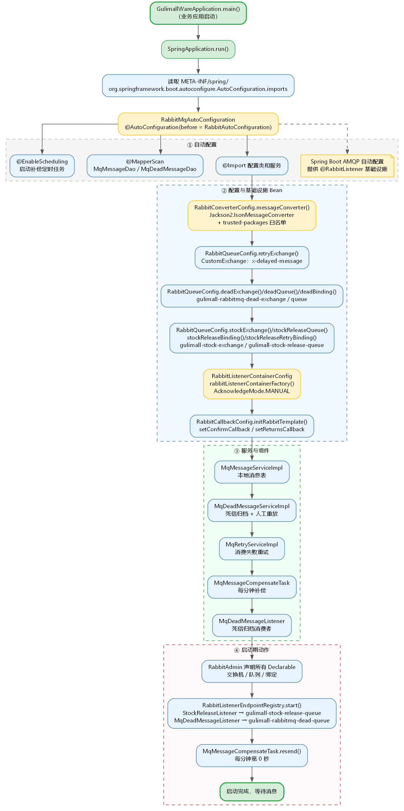
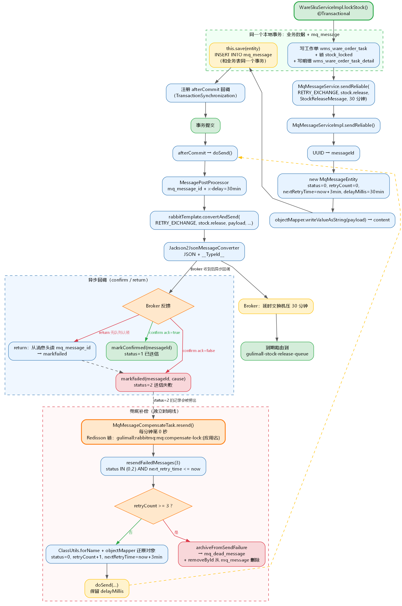
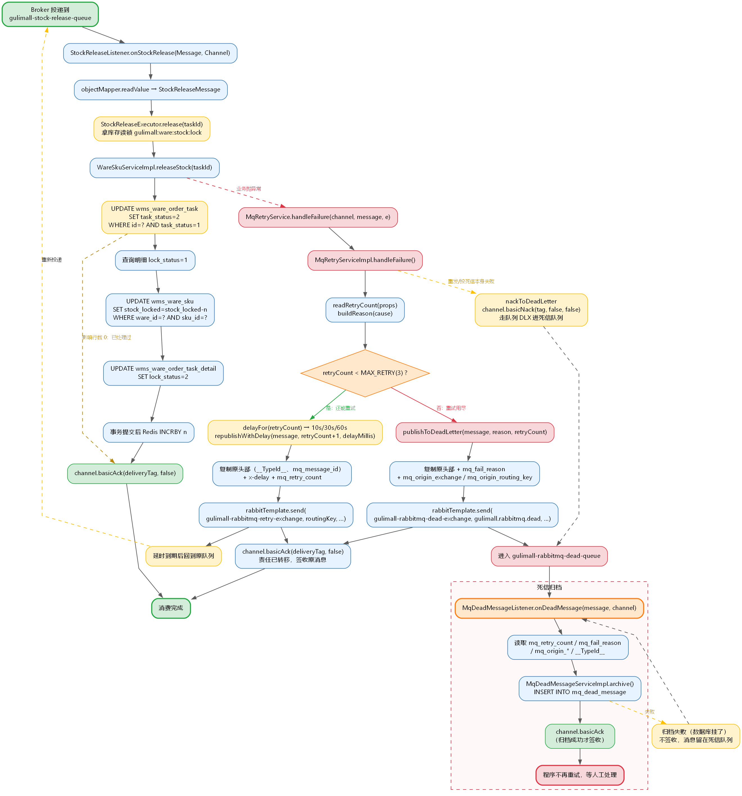
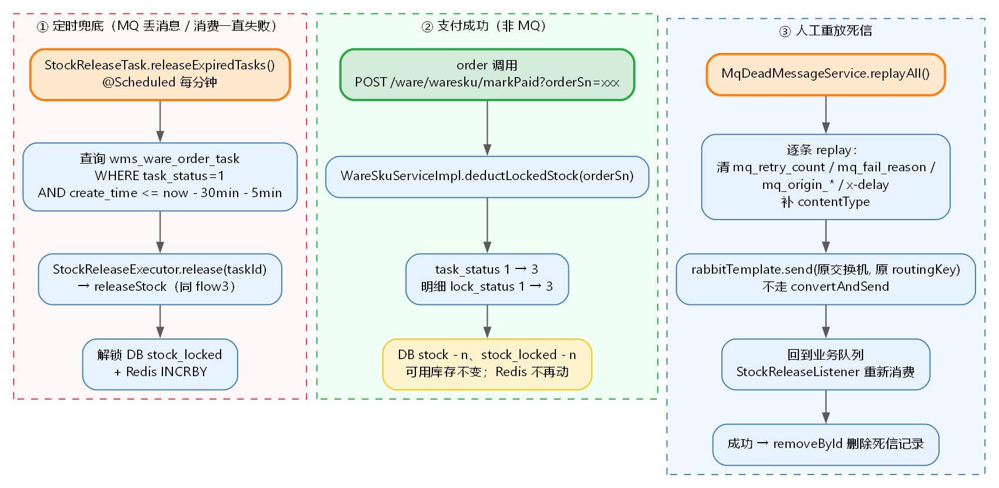

# gulimall-rabbitmq 共通模块使用说明

## 1. 引入

业务模块 pom 加：

```xml
<dependency>
    <groupId>com.atguigu.gulimall</groupId>
    <artifactId>gulimall-rabbitmq</artifactId>
    <version>0.0.1-SNAPSHOT</version>
</dependency>
```

引入后自动装配，不需要写 `@EnableRabbit`，也不需要自己声明 `RabbitTemplate`、队列 Bean。

## 2. 必须配置

### 2.1 RabbitMQ 连接与发送端确认

`config/common.yaml`（所有模块共用）：

```yaml
spring:
  rabbitmq:
    host: ${RABBITMQ_HOST}
    port: ${RABBITMQ_PORT}
    username: ${RABBITMQ_USERNAME}
    password: ${RABBITMQ_PASSWORD}
    virtual-host: ${RABBITMQ_VHOST}
    publisher-confirm-type: correlated
    publisher-returns: true
    template:
      mandatory: true
```

broker 需要安装 `rabbitmq_delayed_message_exchange` 插件（延时消息和失败重试都依赖它）。

### 2.2 业务模块私有配置

```yaml
spring:
  rabbitmq:
    listener:
      simple:
        acknowledge-mode: manual   # 共通模块也会强制 manual
        prefetch: 10

gulimall:
  rabbitmq:
    # 消费端反序列化白名单，写消息体所在包
    trusted-packages: com.atguigu.gulimall.ware.mq.message
```

### 2.3 数据库

本地消息表和死信表必须建在**业务库**（和业务表同库），ware 执行：

```bash
mysql -h ... -u ... -p gulimall_wms < sql/migrate-gulimall-wms-rabbitmq-tables.sql
```

表：`mq_message`、`mq_dead_message`。

### 2.4 Redis

补偿任务用 Redisson 加锁，业务模块需要有 Redis 配置。

## 3. 交换机 / 队列在哪创建

统一在 `gulimall-rabbitmq` 的：

- `constant/MqConstants.java`：交换机名、队列名、routingKey
- `config/RabbitQueueConfig.java`：用 `@Bean` 声明

新增一个业务队列：

1. `MqConstants` 里加交换机、队列、routingKey 常量；
2. `RabbitQueueConfig` 里加 `DirectExchange`、`Queue`、两个 `Binding`：
   - 绑业务交换机：正常入口
   - 绑 `gulimall-rabbitmq-retry-exchange`：延时 / 重试回路，`.with(routingKey).noargs()`
3. 队列需要死信兜底就加 `deadLetterExchange` / `deadLetterRoutingKey`。

当前已有：

| 类型 | 名字 | 用途 |
|---|---|---|
| 延时交换机 | `gulimall-rabbitmq-retry-exchange` | 首次延时 + 消费失败重试 |
| 死信交换机 / 队列 | `gulimall-rabbitmq-dead-exchange` / `gulimall-rabbitmq-dead-queue` | 重试用尽归档 |
| 业务交换机 | `gulimall-stock-exchange` | 库存业务 |
| 业务队列 | `gulimall-stock-release-queue` | 库存解锁，routingKey `stock.release` |

## 4. 送信

注入 `MqMessageService`：

```java
@Autowired
private MqMessageService mqMessageService;
```

普通消息：

```java
mqMessageService.sendReliable(
        MqConstants.STOCK_EXCHANGE,
        MqConstants.STOCK_RELEASE_ROUTING_KEY,
        message);
```

延时消息（毫秒）：

```java
mqMessageService.sendReliable(
        MqConstants.RETRY_EXCHANGE,
        MqConstants.STOCK_RELEASE_ROUTING_KEY,
        message,
        30 * 60 * 1000L);
```

说明：

- 有事务时，消息记录和业务数据同一个事务；提交后才投递，回滚则一起回滚。
- 发送失败由 `MqMessageCompensateTask` 每分钟扫描补偿，最多 3 次，仍失败进 `mq_dead_message`。

## 5. 收信

```java
@RabbitListener(queues = MqConstants.STOCK_RELEASE_QUEUE)
public void onMessage(Message message, Channel channel) {
    long deliveryTag = message.getMessageProperties().getDeliveryTag();
    try {
        StockReleaseMessage payload = objectMapper.readValue(
                message.getBody(), StockReleaseMessage.class);

        // 业务处理

        channel.basicAck(deliveryTag, false);
    } catch (Exception e) {
        // 交给共通模块：10s/30s/60s 重试，3 次后进死信
        mqRetryService.handleFailure(channel, message, e);
    }
}
```

注意：

- 手动 ack 由共通模块的 `rabbitListenerContainerFactory` 强制开启。
- 成功才 `basicAck`；失败不要自己 nack，统一调 `handleFailure`。
- 消费必须幂等，MQ 是至少一次投递。

## 6. 本地消息表 / 死信 / 人工重放

- `mq_message`：status `0 新建待确认`、`1 已送信`、`2 送信失败待补偿`；`delay_millis` 保存延时。
- `mq_dead_message`：消费重试 3 次仍失败 / 发送重发 3 次仍失败的消息。
- 人工重放：

```java
@Autowired
private MqDeadMessageService mqDeadMessageService;

int count = mqDeadMessageService.replayAll();
```

## 7. 流程图

### 图 1：启动阶段



### 图 2：发送端



### 图 3：消费端（库存解锁 + 重试 / 死信）



### 图 4：库存兜底 / 支付扣减 / 人工重放



> 源文件在 `diagrams/` 目录下（`.dot`），改完执行：
> `dot -Tpng -Gdpi=140 diagrams/flow1-startup.dot -o diagrams/flow1-startup.png`
> 其余三张同理。
